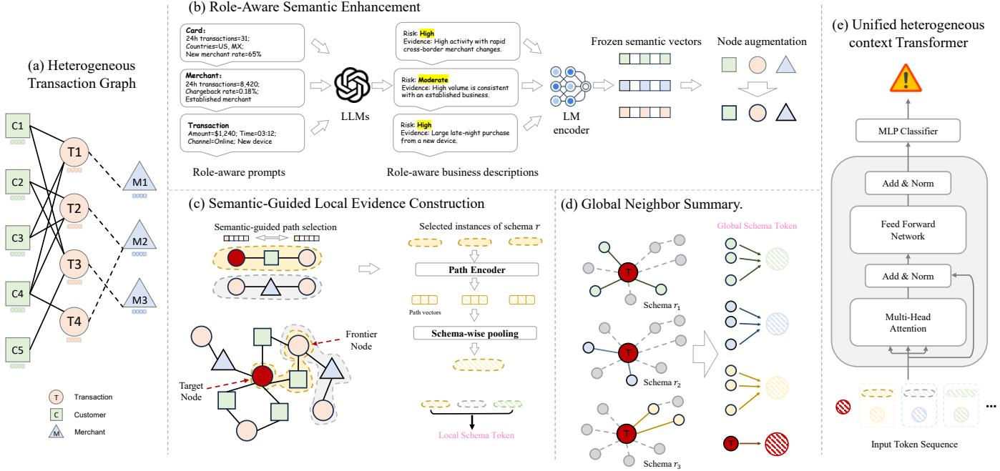
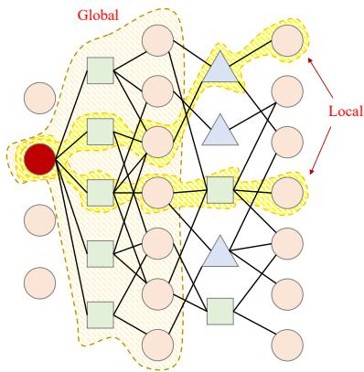
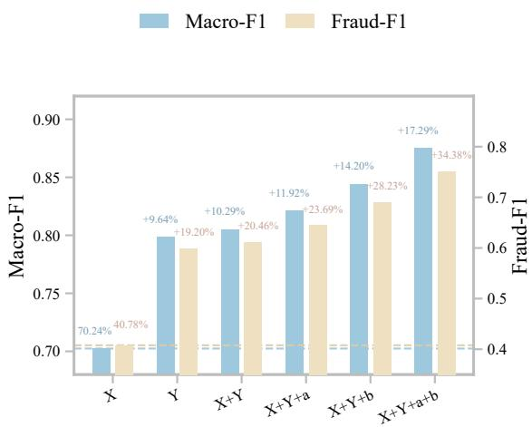
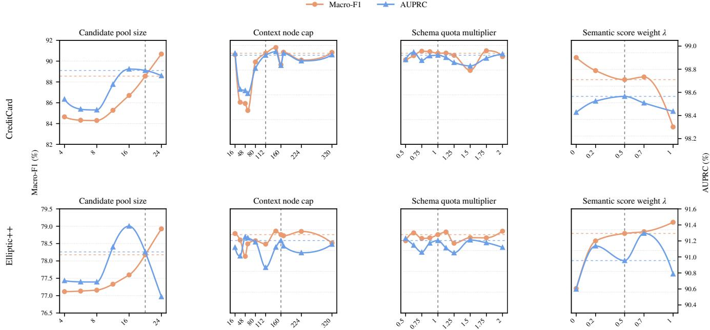
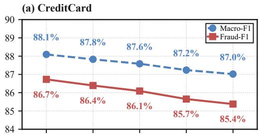
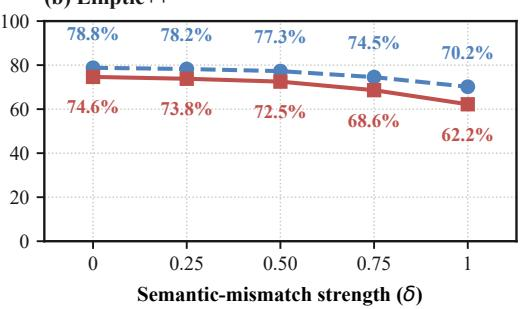
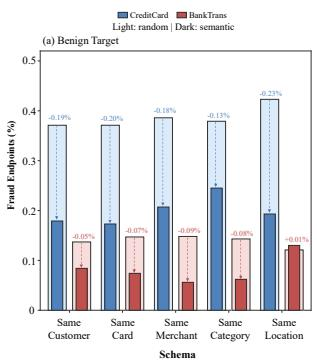
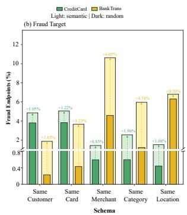

# LLM-Enhanced Heterogeneous Graph Learning with Business Semantics for Financial Fraud Detection

Yixuan Chen   
chenyx2123@mails.jlu.edu.cn   
HKUST-GZ & Jilin University Guangzhou, China

Weiyu Han hanweiyu.hwy@ant-intl.com Ant International Shanghai, China

Hongyu Zhan   
hzhan701@connect.hkust-gz.edu.cn   
The Hong Kong University of Science and Technology (Guangzhou) Guangzhou, China   
Xiao Tan✉   
alex.tx@ant-intl.com   
Ant International   
Shanghai, China   
Shuai Chen   
shuai.cs@ant-intl.com   
Ant International   
Shanghai, China   
Jie Sheng   
shengjie.sheng@ant-intl.com   
Ant International   
Shanghai, China

Jun Xia✉ junxia@hkust-gz.edu.cn HKUST-GZ & HKUST Hong Kong SAR, China

Tianyi Zhang   
zty113091@ant-intl.com   
Ant International   
Shanghai, China

## Abstract

Financial fraud detection increasingly relies on heterogeneous transaction graphs, in which entities such as cards and merchants play distinct business roles and the risk meaning of an attribute depends on the entity’s role: a high transaction volume may be routine for a merchant but unusual for a card. Heterogeneous graph neural networks preserve typed entities and relations but typically treat these attributes as role-agnostic inputs and leave their business meaning implicit. Meanwhile, most existing methods integrating large language models (LLMs) with graphs focus on homogeneous graphs or heterogeneous graphs with naturally available textual attributes, leaving their use on transaction graphs with structured attributes underexplored. To address this issue, we propose SemHGT, an LLM-enhanced framework that interprets structured attributes according to entity roles and makes the business semantics explicit in three stages: (1) role-aware prompts elicit risk-related business descriptions from node attributes, and a text encoder maps them to semantic vectors that enrich node representations; (2) semantic similarity guides multi-round sampling of target-specific path instances under transaction-to-transaction schemas; (3) schemalevel tokens that combine local path evidence with global neighbor summaries are processed together with the target transaction by a unified transformer. Across three benchmark datasets, SemHGT leads the evaluated baselines on most dataset–metric comparisons. Further analyses provide additional evidence for the efectiveness of SemHGT’s design and clarify how its semantic modeling and evidence selection contribute to fraud detection. Code is available at https://anonymous.4open.science/r/SemHGT-528A/.

## CCS Concepts

• Information systems → Data mining.

Keywords   
Financial fraud detection, heterogeneous graph learning, large lan  
guage models

## 1 Introduction

Transactions arising from Web-based commerce are naturally represented as heterogeneous graphs [1, 17, 40]. A transaction can be linked to diferent kinds of entities, such as cards, accounts, merchants, devices, and locations, through relations with distinct meanings [1, 6, 40]. These typed entities and interactions provide complementary evidence for fraud detection: a target transaction may be suspicious because of the behavior of an associated entity [4] or because it participates in a repeated relational pattern [16]. By representing all entities with a single node type and all interactions with a single edge type, a homogeneous graph would obscure these roles and make it dificult to distinguish the evidence conveyed by diferent connections [12, 30].

Heterogeneous graph neural networks (HGNNs) ofer a principled way to preserve this structure. Meta-path-based models aggregate information along predefined typed schemas [7, 30], while meta-path-free models use type- and relation-aware message passing [12, 26, 35]. More recent heterogeneous graph transformers further incorporate structural and relational encodings into attention [20, 23, 29]. Fraud-oriented graph neural networks (GNNs) address task-specific challenges by modeling temporal transaction behavior [31], mitigating neighborhood camouflage through label-aware neighbor selection [4], addressing class imbalance with label-balanced sampling [16], and capturing attribute-association patterns across graph neighborhoods [5]. Despite these advances, real-world financial fraud detection presents a distinct semantic challenge. Transaction networks involve entities with diferent business roles and their node attributes consist primarily of structured numerical and categorical fields rather than natural-language text. Interpreting these attributes requires accounting for the role of each entity: high transaction volume, for example, may reflect routine merchant activity but unusual behavior for a card. Such roledependent risk implications are not explicit in the raw attributes.

Large language models (LLMs) have been used in graph learning to provide textual features and auxiliary semantic supervision [8, 11]. However, most existing LLM-enhanced graph methods focus on homogeneous graphs or heterogeneous graphs with naturally available textual attributes, leaving heterogeneous transaction graphs with predominantly structured attributes less explored. Recent fraud-detection studies employ graph-conditioned prompting [15] and LLM-guided contrastive objectives [25], but the use of role-aware business semantics in heterogeneous fraud detection remains limited. Such semantics can enrich node representations with risk-related information and guide target-specific sampling of local evidence under typed relations. Their joint use in these two stages remains underexplored. To address this gap, we propose the Semantics-enhanced Heterogeneous Graph Transformer (SemHGT), an LLM-enhanced framework for financial fraud detection over heterogeneous transaction graphs.

SemHGT follows three stages. First, role-aware prompts elicit risk-related business descriptions from node attributes, and a text encoder maps them to semantic vectors that enrich node represen tations. Second, semantic similarity guides multi-round sampling of target-specific path evidence under predefined transaction-totransaction schemas. Third, for each schema, the sampled local evidence is combined with a global summary of the target’s transaction neighbors to form a schema-level token. A unified transformer processes these tokens together with a token for the target transaction to predict fraud.

The main contributions can be summarized as follows:

• We explore the use of LLM-derived, role-aware business semantics to enhance heterogeneous graph learning for financial fraud detection.

• We propose SemHGT, an LLM-enhanced heterogeneous graph transformer framework that makes role-aware business semantics explicit, using them to enrich node representations and guide target-conditioned path evidence selection for financial fraud detection.

• We evaluate SemHGT on three benchmark datasets, where it leads the evaluated baselines on most dataset–metric comparisons. Further analyses provide evidence for the effectiveness of the design and clarify how semantic modeling and evidence selection contribute to fraud detection.

## 2 Related Work

GNNs for Financial Fraud Detection. Graph neural networks (GNNs) learn node representations by propagating and aggregating information over graph connections. Financial transaction graphs contain multiple entity and relation types, motivating heterogeneous graph neural networks (HGNNs) that preserve typed connectivity. Meta-path-based models aggregate information along predefined typed schemas: HAN [30] combines meta-path neigh bors and schemas through hierarchical attention, while MAGNN [7] encodes intermediate entities within each path instance. Meta-path free models instead parameterize message passing using node and relation types, as in R-GCN [26], HGT [12], and R-HGNN [35]. Further approaches, including SlotGAT [41], HINormer [23], and

PHGT [20], explore slot-based aggregation, sampled structural contexts, and schema-aware tokens. Together, these methods ofer increasingly expressive ways to encode heterogeneous structure.

GNNs for financial fraud detection further adapt graph learning to fraud-specific challenges. GTAN [31] captures temporal transaction behavior with gated temporal attention; CARE-GNN [4] uses label-aware neighbor selection to mitigate feature and relation camouflage; PC-GNN [16] addresses class imbalance through label-balanced subgraph construction and sampling; and GAAP [5] models attribute-association patterns across graph neighborhoods. While these methods exploit temporal, neighborhood, and attributeassociation signals, they do not explicitly incorporate semantic information as a complementary signal for fraud detection.

Integrating LLMs with Graphs. Research integrating large language models (LLMs) with graphs follows two complementary directions. Graph-enhanced LLMs incorporate graph structure or neighborhood information into language-model inputs or training. THLM [42] uses topology-aware context-graph prediction during pre-training, while HiGPT [28] expresses heterogeneous graph tasks through graph instructions to support cross-graph transfer. For fraud detection, DGP [15] uses dual-granularity prompts to retain detailed information about the target while summarizing its graph neighborhood, making graph context available to an LLMbased classifier. However, the computational cost of LLM-based inference can limit the scalability of graph-enhanced LLMs, particularly in large-scale industrial applications.

LLM-enhanced GNNs use language-model outputs to provide features, auxiliary supervision, or data for a graph encoder. TAPE [11] converts LLM-generated explanations into features for GNNs on text-attributed graphs. Other approaches apply LLMs to heterogeneous graph learning by generating minority-class nodes and edges, as in LLM-HetGDT [22], or completing missing attributes before graph encoding, as in HINAC [24]. MH-LGC [25] uses LLMguided contrastive learning in a multi-view hypergraph detector. Together, these studies use LLMs to provide graph features, graphconditioned predictions, training signals, or additional graph data. Despite this progress, most existing LLM-enhanced graph methods target homogeneous graphs or heterogeneous graphs whose nodes already carry natural-language text. Still, financial fraud detection often involves heterogeneous transaction graphs whose node attributes consist primarily of structured numerical and categorical fields rather than natural-language text.

## 3 Method

## 3.1 Problem Formulation and Framework Overview

Let $\mathcal { G } = ( \mathcal { V } , \mathcal { E } , \mathcal { T } , \mathcal { R } )$ denote a heterogeneous transaction graph, where V and E are its node and edge sets, and T and R are its node- and relation-type sets. Each node � $\in \mathcal { N }$ has type $\tau ( v ) \in \mathcal { T }$ and structured attributes $\mathbf { x } _ { v } . \mathrm { L e t } \mathcal { V } _ { \mathrm { t x n } } \subseteq \mathcal { V }$ be the transaction nodes. Given a target transaction $i \in \mathcal { V } _ { \mathrm { t x n } }$ , the task is to predict its binary fraud label $y _ { i } \in \{ 0 , 1 \}$ , where 1 denotes fraud and 0 denotes benign.

Let $\boldsymbol { S } = \{ r _ { 1 } , . . . , r _ { R } \}$ be the predefined transaction-to-transaction path schemas. As shown in Figure 1, SemHGT follows three stages:

it first enhances typed node representations with role-aware business semantics, then samples and encodes target-specific path evidence under each schema, and finally fuses each local path summary with the global summary of the target’s transaction neighbors to form one schema-level token. A transformer processes these tokens together with a token representing the target transaction.

## 3.2 Role-Aware Semantic Enhancement

LLM-Based Description Generation. The risk implications of an attribute depend on the entity’s business role. We therefore use a role-aware prompt $\Phi _ { \tau ( \upsilon ) }$ to interpret the attributes of node � in light of corresponding reference statistics. The language model generates a risk-related business description, which a frozen text encoder maps to a normalized semantic vector:

$$
\mathbf { d } _ { v } = \mathrm { L L M } \big ( \Phi _ { \tau ( v ) } ( \mathbf { x } _ { v } ) \big ) , \qquad \mathbf { s } _ { v } = \frac { \mathrm { E n c } ( \mathbf { d } _ { v } ) } { \| \mathrm { E n c } ( \mathbf { d } _ { v } ) \| _ { 2 } } .\tag{1}
$$

The complete prompt templates are provided in Appendix B.

Semantic Node Enhancement. For each node type, separate projections map the raw attributes and semantic vector to a common �-dimensional space, yielding raw-feature representation $\mathbf { r } _ { v }$ and semantic representation ${ \bf q } _ { v } \colon$

$$
\mathbf { r } _ { v } = f _ { \tau ( v ) } ^ { \mathrm { r a w } } ( \mathbf { x } _ { v } ) , \qquad \mathbf { q } _ { v } = f _ { \tau ( v ) } ^ { \mathrm { s e m } } ( \mathbf { s } _ { v } ) .\tag{2}
$$

We use a feature-wise gate to inject semantic information without discarding the structured representation:

$$
\begin{array} { r } { \mathbf { g } _ { v } = \sigma \Big ( \mathbf { W } _ { \tau ( v ) } ^ { g } \left[ \mathbf { r } _ { v } \lVert \mathbf { q } _ { v } \right] + \mathbf { b } _ { \tau ( v ) } ^ { g } \Big ) , \qquad \mathbf { h } _ { v } = \mathrm { L N } ( \mathbf { r } _ { v } + \alpha \mathbf { g } _ { v } \odot \mathbf { q } _ { v } ) ~ . } \end{array}\tag{3}
$$

Here, $\mathbf { W } _ { \tau ( v ) } ^ { g }$ and $\mathbf { b } _ { \tau ( v ) } ^ { g }$ are type-specific learnable parameters, � is the sigmoid function, and � is a learnable scalar. The gate controls the semantic contribution to the raw-feature representation, producing the enhanced representation $\mathbf { h } _ { v }$ used in path sampling and token construction.

## 3.3 Semantic-Guided Local Evidence Construction

Semantic-Guided Path Sampling. For schema $r \in S ,$ , a path instance is an ordered typed sequence

$$
\xi = ( u , a _ { 1 } , \ldots , a _ { m } , v ) , \qquad r ( \xi ) = r ,\tag{4}
$$

where $u , v \in \mathcal { V } _ { \mathrm { t x n } }$ are the endpoint transactions and $a _ { 1 } , \ldots , a _ { m }$ are the intermediate nodes along schema �. For example, $T { - } W { - } T$ denotes two transaction nodes (�) connected through a wallet node (� ).

Starting from target �, the sampler expands for a fixed number of rounds. For a frontier transaction � and a candidate endpoint transaction �, it scores the candidate by

$$
\begin{array} { r } { q _ { i } ( u , v ) = \lambda s _ { u } ^ { \top } s _ { v } + \left( 1 - \lambda \right) s _ { i } ^ { \top } s _ { v } . } \end{array}\tag{5}
$$

Here, $\lambda \in \left[ 0 , 1 \right]$ controls the relative weight of similarity to the current frontier transaction � and the target transaction �, with weights � and 1 − �, respectively. Since the semantic vectors are normalized, both similarities are cosine similarities. Candidates are ranked independently per schema, and at most $k _ { r }$ path instances are retained for schema � in each sampling round, subject to its candidate cap and the shared context budget. The retained set for target � and schema �, denoted $ { \mathrm { b y } } \Xi _ { i } ^ { r }$ , accumulates the selected paths across rounds. Selected paths are added atomically, preserving their intermediate nodes under the node budget.

Each round expands from the transaction endpoints reached in the previous round, allowing the sampled evidence to span multiple relations, such as �–Card–�–Merchant–�.

Local Path Encoding and Pooling. To summarize the sampled local evidence, each retained instance $\boldsymbol { \xi } = ( u , a _ { 1 } , \ldots , a _ { m } , \upsilon )$ is encoded in typed order by a GRU [2]:

$$
\mathbf { u } _ { i , \xi } = \mathrm { G R U } ( \mathbf { h } _ { u } , \mathbf { h } _ { a _ { 1 } } , \ldots , \mathbf { h } _ { v } ) _ { \mathrm { l a s t } } .\tag{6}
$$

The final GRU state $\mathbf { u } _ { i , \xi }$ represents the path. For each schema, targetconditioned attention weights and pools the retained path states:

$$
a _ { i , \xi } = \frac { ( { \bf W } _ { \mathcal { P } } { \bf u } _ { i , \xi } ) ^ { \top } ( { \bf W } _ { h } { \bf h } _ { i } ) } { \sqrt { d _ { a } } } , \qquad \omega _ { i , \xi } = \mathrm { s o f t m a x } _ { \xi \in \Xi _ { i } ^ { r ( \xi ) } } ( a _ { i , \xi } ) ,\tag{7}
$$

$$
\mathbf { p } _ { i , r } = \sum _ { \xi \in \Xi _ { i } ^ { r } } \omega _ { i , \xi } \mathbf { u } _ { i , \xi } .\tag{8}
$$

Here, $\mathbf { W } _ { p }$ and ${ \bf W } _ { h }$ project into a $d _ { a }$ -dimensional attention space, $a _ { i , \xi }$ is the path–target score, $\omega _ { i , \xi }$ is its within-schema normalized weight, and $\mathbf { p } _ { i , r }$ is the pooled local summary for schema �.

## 3.4 Schema-Token Construction and Prediction

Global Neighbor Summary. For each schema �, let ${ \cal N } _ { r } ( i )$ contain the transaction neighbors oftarget � in the observable graph induced by �. We summarize this neighborhood by averaging their enhanced representations:

$$
\mathbf { c } _ { i , r } = \mathrm { M e a n } \{ \mathbf { h } _ { j } : j \in N _ { r } ( i ) \} , \qquad \mathbf { t } _ { i , r } ^ { ( 0 ) } = f _ { \mathrm { r e l } } ( \mathbf { c } _ { i , r } ) + \mathbf { e } _ { r } ,\tag{9}
$$

The learned projection $f _ { \mathrm { r e l } }$ maps the schema mean to the relationtoken space, and the learned schema embedding $\mathbf { e } _ { r }$ gives the initial token $\mathbf { t } _ { i , r } ^ { \overline { { ( 0 ) } } }$ its schema identity.

Local–Global Fusion. The pooled local path summary is fused only with the token of its own schema using a feature-wise gated residual:

$$
\begin{array} { r } { \gamma _ { i , r } = \sigma \Big ( \mathbf { W } _ { \gamma } [ \mathbf { t } _ { i , r } ^ { ( 0 ) } \lVert \tilde { \mathbf { p } } _ { i , r } \rVert + \mathbf { b } _ { \gamma } \Big ) , \qquad \mathbf { t } _ { i , r } = \mathbf { t } _ { i , r } ^ { ( 0 ) } + \gamma _ { i , r } \odot \tilde { \mathbf { p } } _ { i , r } . } \end{array}\tag{10}
$$

Here, $\tilde { \mathbf { p } } _ { i , r } = f _ { \mathrm { a d a p t } } ( \mathbf { p } _ { i , r } )$ is the projected local summary; $\mathbf { W } _ { \gamma }$ and ${ \bf b } _ { \gamma }$ are learnable gate parameters; and $\gamma _ { i , r }$ controls its contribution. The resulting $\mathbf { t } _ { i , r }$ is the final schema-level token.

Token Sequence and Prediction. We construct the root token as $\mathbf { t } _ { i , 0 } = f _ { \mathrm { r o o t } } ( \mathbf { h } _ { i } ) + \mathbf { e } _ { 0 }$ , where $f _ { \mathrm { r o o t } }$ is a learned projection and $\mathbf { e } _ { 0 }$ is a learned root identity embedding. The initial transformer input contains this root token and one schema-level token for every enabled schema:

$$
{ \bf X } _ { i } ^ { ( 0 ) } = [ { \bf t } _ { i , 0 } ; { \bf t } _ { i , r _ { 1 } } ; \ldots ; { \bf t } _ { i , r _ { R } } ] , \qquad \{ r _ { 1 } , \ldots , r _ { R } \} = S .\tag{11}
$$

A transformer encoder $\left[ 2 9 \right]$ processes the sequence, and the final state of the target token, $\mathbf { z } _ { i }$ , is used for classification:

$$
\ell _ { i } = f _ { \mathrm { c l s } } ( \mathbf { z } _ { i } ) , \qquad \widehat { p } _ { i } = \mathrm { s o f t m a x } ( \ell _ { i } ) _ { 1 } .\tag{12}
$$

The classifier $f _ { \mathrm { c l s } }$ maps the final root state to class logits $\ell _ { i } ; \widehat { p } _ { i }$ is the predicted fraud probability.

  
Figure 1: Overview of SemHGT. Role-aware business semantics enhance node representations and guide target-conditioned path sampling. For each schema, SemHGT fuses the sampled local path summary with the average representation of the target’s transaction neighbors under that schema to construct a schema-level token. A unified transformer jointly processes the target token and all schema-level tokens for fraud prediction.

  
Figure 2: Global and local context for a target transaction. Global context averages the transaction neighbors under each schema, while local context captures the selected targetrelevant path evidence.

Algorithm 1 summarizes target-wise inference, from semantic enhancement and iterative path sampling to schema-token construction and fraud prediction.

Training Objective. The node projections, semantic gates, path encoder, relation adapter, transformer, and classifier are trained jointly, while the language model and text encoder remain frozen.

We optimize weighted cross-entropy over the labeled training transactions $\mathrm { \mathcal { N } } _ { \mathrm { t r a i n } } \mathrm { : }$

$$
\mathcal { L } = - \frac { 1 } { \vert \mathcal { V } _ { \mathrm { t r a i n } } \vert } \sum _ { i \in \mathcal { V } _ { \mathrm { t r a i n } } } w _ { y _ { i } } \log \left( \mathrm { s o f t m a x } ( \ell _ { i } ) _ { y _ { i } } \right) ,\tag{13}
$$

where $\boldsymbol { w } _ { y _ { i } }$ is the loss weight for class ��.

## 3.5 Target-wise Computational Complexity

For a target transaction $i ,$ let $C _ { i }$ be the number of candidate paths scored across schemas and sampling rounds, and let $\begin{array} { r } { \Xi _ { i } = \bigcup _ { r \in \cal S } \Xi _ { i } ^ { r } } \end{array}$ be the retained paths, with $P _ { i } = | \Xi _ { i } |$ . Their average node count is $\bar { m } _ { i } = P _ { i } ^ { - 1 } \sum _ { \xi \in \Xi _ { i } }$ |�|; for a path $\xi = ( u , a _ { 1 } , \ldots , a _ { m } , v ) , | \xi | = m + 2 .$ Let $\begin{array} { r } { D _ { i } = \sum _ { r \in S } \dot { | } N _ { r } ( i ) | } \end{array}$ | be the total number of schema-specific transaction neighbors used in the global summaries. Scoring candidates costs $O ( C _ { i } d _ { s } )$ , encoding the retained paths with the GRU costs $O ( P _ { i } \bar { m } _ { i } d ^ { 2 } )$ , and aggregating global neighbors costs $O ( D _ { i } d )$ . Thus, for fixed sampling rounds, schemas, and model dimensions, the leading target-dependent computation is

$$
T _ { i } = O \left( C _ { i } d _ { s } + P _ { i } { \bar { m } } _ { i } d ^ { 2 } + D _ { i } d \right) ,\tag{14}
$$

where $d _ { s }$ is the semantic-vector dimension and $d$ is the hidden dimension. The transformer processes a fixed-length sequence of the target token and schema tokens, so its cost does not grow with the number of sampled paths.

Algorithm 1 Target-wise Inference in SemHGT   
Require: Graph ${ \mathcal { G } } ,$ target transaction �, schemas $s ,$ and sampling   
rounds �   
Ensure: $\widehat { p } _ { i }$   
1: Obtain enhanced node representations $\mathbf { h } _ { v }$ (Eq. (3))   
2: Initialize $\mathcal { F } _ { i } \gets \{ i \}$ and $\Xi _ { i } ^ { r } \gets \emptyset$ for all $r \in S$   
3: for $\ell = 1 , \ldots , L$ do   
4: Sample schema-consistent paths from $\mathcal { F } _ { i }$ and score end  
points with $q _ { i } ( u , v )$ (Eq. (5))   
5: Retain top-ranked paths under schema caps and context   
budget; update $\Xi _ { i } ^ { r }$ and $\mathscr { F } _ { i }$   
6: end for   
7: for all $r \in S$ do   
8: Encode each retained path $\xi = ( u , a _ { 1 } , \ldots , v )$ with a GRU   
$\mathbf { \boldsymbol { \mathsf { u } } } _ { i , \xi } \gets \mathrm { G R U } ( \mathbf { \boldsymbol { h } } _ { u } , \mathbf { \boldsymbol { h } } _ { a _ { 1 } } , \dots , \mathbf { \boldsymbol { h } } _ { v } ) _ { \mathrm { l a s t } } , \quad \xi \in \Xi _ { i } ^ { r } \left( \mathrm { E q . } \left( 6 \right) \right)$   
9: Pool path vectors with target-conditioned weights:   
$\begin{array} { r } { \mathbf p _ { i , r } \gets \sum _ { \xi \in \Xi _ { i } ^ { r } } \omega _ { i , \xi } \mathbf u _ { i , \xi } } \end{array}$ (Eqs. (7)–(8))   
10: Form an initial schema token from the global neighbor   
summary (Eq. (9)) and fuse local evidence:   
$\mathbf { t } _ { i , r } \gets \mathbf { t } _ { i , r } ^ { ( 0 ) } + \boldsymbol { \gamma } _ { i , r } \odot f _ { \mathrm { a d a p t } } ( \mathbf { p } _ { i , r } ) \left( \mathrm { E q . } \left( 1 0 \right) \right)$   
11: end for   
12: Form $\mathbf { X } _ { i } ^ { ( 0 ) }$ from the root and schema tokens (Eq. (11))   
13: Obtain the final target-token representation:   
z� ← [transformer $( \mathbf { X } _ { i } ^ { ( 0 ) } ) ] _ { 0 }$   
14: Compute �b� ← softmax $( f _ { \mathrm { c l s } } ( \mathbf { z } _ { i } ) ) _ { 1 }$   
15: return $\widehat { p } _ { i }$

## 4 Experiments

## 4.1 Experimental Setup

Datasets. We evaluate SemHGT on CreditCard, BankTrans, and Elliptic++. CreditCard and BankTrans are the heterogeneous financial fraud datasets constructed in FinFraudBench [1], while Elliptic++ is a transaction-and-wallet benchmark [6]. Each task is binary classification over transaction nodes. CreditCard and Elliptic++ are split chronologically into training, validation, and test periods in an approximate 6:1:3 ratio under an inductive protocol [10], whereas BankTrans uses a label-stratified 1:1:8 split under a transductive protocol [14]. In BankTrans, validation and test features and topology are available as unlabeled context during training, while their labels remain withheld. CreditCard and Elliptic++ are evaluated inductively on separate graph components for each temporal split, with no cross-split edges; both use the same split-aware policy for label-blind reference statistics. Table 1 summarizes graph sizes, transaction-label composition, and metapath schemas; further graph and split details appear in Appendix A.

The main results use all transactions in each test split. The ablation study also uses the full CreditCard test split; all other analytical experiments use fixed, class-balanced subsets of their corresponding test sets. Appendix A.3 reports the subset sizes and class counts.

Evaluation Metrics. We report Macro-F1, Fraud-F1, area under the precision–recall curve (AUPRC), and area under the receiver operating characteristic curve (AUROC). Macro-F1 averages the F1 scores of the benign and fraud classes equally, while Fraud-F1 focuses on precision and recall for the fraud class at the validationselected threshold. AUPRC summarizes the precision–recall tradeof across thresholds and is informative under class imbalance [3]. AUROC measures how well the model ranks fraudulent transactions above benign ones across thresholds, complementing the thresholddependent F1 measures.

Table 1: Statistics of the experimental graph views.
<table><tr><td>Dataset</td><td>Nodes</td><td> $\mathrm { E d g e s }$ </td><td>Metapaths</td></tr><tr><td>CreditCard</td><td># nodes: 1,860,300 Transaction: 1,852,394 Fraud: 9,651 (0.52%) Customer: 2,817 Card: 2,817 Merchant: 2,079 Category: 42</td><td># edge types: 14 # edges: 18,535,208</td><td>T-Customer-T T-Card-T T-Merchant-T T-Category-T T-Location-T</td></tr><tr><td>BankTrans</td><td># node types: 6 # nodes: 8,987,098 Transaction: 8,914,963 Fraud: 13,332 (0.15%) Customer: 1,219 Card: 4,070 Merchant: 66,537</td><td># edge types: 14 # edges: 89,227,542</td><td>T-Customer-T T-Card-T T-Merchant-T T-Category-T T-Location-T</td></tr><tr><td>Elliptic++</td><td>Location: 200 # node types: 2 # nodes: 110,857 Transaction: 46,564 Fraud: 4,545 (9.76%)</td><td># edge types: 8 # edges: 402,882</td><td>T-T T-W-T T-W-W-T  $T - W - W - W - T$ </td></tr></table>

Implementation Details. We use Qwen3-8B [32] to generate riskrelated business descriptions and a frozen MPNet encoder [27] to map them to semantic vectors. The encoder produces 768-dimensional vectors, which are projected to 128 dimensions. The prediction transformer has two layers, four attention heads, a 128-dimensional hidden state, a feed-forward width of 256, and dropout 0.2. We train all datasets with AdamW [18] and weight decay $1 0 ^ { - 4 }$ . Table 2 summarizes the epoch budgets, batch sizes, and learning rates.

The local path schemas are dataset-specific. CreditCard and BankTrans use five schemas: �–Customer–� (same customer), �– Card–� (same card),�–Merchant–� (same merchant),�–Category– � (same category), and � –Location–� (same location). Elliptic++ uses four schemas: $T - T$ (direct transaction link), �–�–� (transactions sharing a wallet),�–�–�–� (transactions connected through two intermediate wallets), and $T { - } W { - } W { - } W { - } T$ (transactions connected through three intermediate wallets). For each schema, the global component averages the representations of its transaction neighbors; the sampled local path summary is then fused into the corresponding schema-level token.

Table 2: Core dataset-specific training settings; earlystopping patience is shown in parentheses.
<table><tr><td>Dataset</td><td>Max epochs (patience)</td><td></td><td>Batch size Learning rate</td></tr><tr><td>CreditCard</td><td>40 (10)</td><td>256</td><td> $1 0 ^ { - 3 } \mathrm { \ : ( c o n s t a n t ) }$ </td></tr><tr><td>BankTrans</td><td>50 (10)</td><td>128</td><td> $1 0 ^ { - 4 } \to 1 0 ^ { - 5 }$  (cosine)</td></tr><tr><td>Elliptic++</td><td>40 (10)</td><td>128</td><td> $3 \times 1 0 ^ { - 4 } \ : ( $  constant)</td></tr></table>

Table 3: Main fraud-detection results on CreditCard, BankTrans, and Elliptic++. For each dataset, the table reports Macro-F1, Fraud-F1, AUPRC, and AUROC. All values are percentages, shown as mean ± standard deviation across three runs. The best result in each metric column is boldfaced and shaded, and the second-best is underlined.
<table><tr><td rowspan=1 colspan=13>CreditCard                               BankTrans                               Elliptic++Method</td></tr><tr><td rowspan=1 colspan=5>Macro-F1  Fraud-F1   AUPRC   AUROC</td><td rowspan=1 colspan=4>Macro-F1  Fraud-F1   AUPRC  AUROC</td><td rowspan=1 colspan=4>Macro-F1 Fraud-F1   AUPRC  AUROC</td></tr><tr><td rowspan=1 colspan=2>MLP           $7 2 . 4 1 \pm 0 . 1 5$ </td><td rowspan=1 colspan=1> $4 4 . 9 9 \pm 0 . 3 1$ </td><td rowspan=1 colspan=1> $4 0 . 8 3 \pm 0 . 2 4$ </td><td rowspan=1 colspan=1> $9 4 . 2 9 \pm 0 . 1 4$ </td><td rowspan=1 colspan=1> $5 4 . 4 7 \pm 0 . 6 7$ </td><td rowspan=1 colspan=1> $9 . 1 7 \pm 1 . 4 1$ </td><td rowspan=1 colspan=2> $3 . 7 6 \pm 0 . 0 2$  $9 2 . 7 5 \pm 0 . 0 2$ </td><td rowspan=1 colspan=1> $7 9 . 1 0 \pm 0 . 6 1$ </td><td rowspan=1 colspan=2> $6 0 . 3 1 \pm 1 . 2 0$  $5 9 . 5 7 \pm 0 . 5 9$ </td><td rowspan=1 colspan=1> $8 4 . 4 9 \pm 0 . 4 1$ </td></tr><tr><td rowspan=1 colspan=1>SlotGAT [41]</td><td rowspan=1 colspan=1> $7 6 . 6 2 \pm 0 . 4 7$ </td><td rowspan=1 colspan=1> $5 3 . 4 3 \pm 0 . 9 3$ </td><td rowspan=1 colspan=1> $4 7 . 6 8 \pm 1 . 0 1$ </td><td rowspan=1 colspan=1> $9 4 . 4 6 \pm 0 . 5 1$ </td><td rowspan=1 colspan=1> $8 6 . 6 4 \pm 0 . 6 1$ </td><td rowspan=1 colspan=1> $7 3 . 3 2 \pm 1 . 2 1$ </td><td rowspan=1 colspan=1> $6 7 . 9 5 \pm 1 . 8 3$ </td><td rowspan=1 colspan=1> $9 6 . 8 2 \pm 0 . 1 1$ </td><td rowspan=1 colspan=1> $7 4 . 2 5 \pm 3 . 1 5$ </td><td rowspan=1 colspan=1> $5 1 . 0 8 \pm 6 . 0 6$ </td><td rowspan=1 colspan=1> $4 9 . 8 2 \pm 7 . 3 5$ </td><td rowspan=1 colspan=1> $8 6 . 2 0 \pm 2 . 2 3$ </td></tr><tr><td rowspan=1 colspan=1>SimpleHGN [21]</td><td rowspan=1 colspan=1> $6 3 . 3 1 \pm 0 . 8 9$ </td><td rowspan=1 colspan=1> $2 6 . 8 9 \pm 1 . 7 8$ </td><td rowspan=1 colspan=1> $1 4 . 7 5 \pm 0 . 4 0$ </td><td rowspan=1 colspan=1> $8 4 . 8 0 \pm 0 . 1 4$ </td><td rowspan=1 colspan=1> $8 3 . 9 3 \pm 0 . 6 5$ </td><td rowspan=1 colspan=1> $6 7 . 9 2 \pm 1 . 2 9$ </td><td rowspan=1 colspan=1> $5 5 . 3 5 \pm 6 . 3 7$ </td><td rowspan=1 colspan=1> $9 6 . 0 2 \pm 0 . 2 0$ </td><td rowspan=1 colspan=1> $7 4 . 2 9 \pm 0 . 4 9$ </td><td rowspan=1 colspan=1> $5 1 . 5 5 \pm 0 . 9 1$ </td><td rowspan=1 colspan=1> $5 2 . 3 0 \pm 0 . 7 4$ </td><td rowspan=1 colspan=1> $8 7 . 5 6 \pm 0 . 3 5$ </td></tr><tr><td rowspan=1 colspan=1>FastGTN [37]</td><td rowspan=1 colspan=1> $7 3 . 9 1 \pm 0 . 3 4$ </td><td rowspan=1 colspan=1> $4 8 . 0 2 \pm 0 . 6 8$ </td><td rowspan=1 colspan=1> $4 7 . 7 2 \pm 0 . 7 0$ </td><td rowspan=1 colspan=1> $9 3 . 7 6 \pm 0 . 1 2$ </td><td rowspan=1 colspan=1> $5 7 . 3 1 \pm 1 . 5 9$ </td><td rowspan=1 colspan=1> $1 4 . 8 4 \pm 3 . 0 6$ </td><td rowspan=1 colspan=1> $6 . 4 5 \pm 1 . 5 9$ </td><td rowspan=1 colspan=1> $9 4 . 7 6 \pm 0 . 4 0$ </td><td rowspan=1 colspan=1> $7 7 . 2 3 \pm 0 . 4 1$ </td><td rowspan=1 colspan=1> $5 6 . 5 6 \pm 0 . 8 0$ </td><td rowspan=1 colspan=1> $6 0 . 2 0 \pm 0 . 7 7$ </td><td rowspan=1 colspan=1> $8 4 . 9 9 \pm 0 . 3 4$ </td></tr><tr><td rowspan=1 colspan=1>HAN [30]</td><td rowspan=1 colspan=1> $\underline { { 8 3 . 3 4 \pm 0 . 8 8 } }$ </td><td rowspan=1 colspan=1> ${ \underline { { 6 6 . 8 1 \pm 1 . 7 5 } } }$ </td><td rowspan=1 colspan=1> ${ \underline { { 7 0 . 2 9 \pm 1 . 7 2 } } }$ </td><td rowspan=1 colspan=1> $9 6 . 9 7 \pm 0 . 3 4$ </td><td rowspan=1 colspan=1> $8 0 . 2 5 \pm 0 . 4 2$ </td><td rowspan=1 colspan=1> $6 0 . 5 5 \pm 0 . 8 4$ </td><td rowspan=1 colspan=1> $5 4 . 7 4 \pm 2 . 4 7$ </td><td rowspan=1 colspan=1> $9 4 . 3 5 \pm 0 . 4 1$ </td><td rowspan=1 colspan=1> $7 1 . 7 1 \pm 0 . 2 2$ </td><td rowspan=1 colspan=1> $4 7 . 5 8 \pm 0 . 4 2$ </td><td rowspan=1 colspan=1> $5 5 . 3 4 \pm 1 . 3 7$ </td><td rowspan=1 colspan=1> $8 5 . 3 0 \pm 0 . 2 1$ </td></tr><tr><td rowspan=1 colspan=1>SeHGNN [33]</td><td rowspan=1 colspan=1> $8 1 . 3 6 \pm 0 . 7 5$ </td><td rowspan=1 colspan=1> $6 2 . 8 6 \pm 1 . 5 0$ </td><td rowspan=1 colspan=1> $6 3 . 7 3 \pm 1 . 4 1$ </td><td rowspan=1 colspan=1> $9 7 . 0 4 \pm 0 . 1 0$ </td><td rowspan=1 colspan=1> $8 2 . 3 1 \pm 0 . 7 4$ </td><td rowspan=1 colspan=1> $6 4 . 6 7 \pm 1 . 4 7$ </td><td rowspan=1 colspan=1> $6 3 . 9 7 \pm 0 . 5 3$ </td><td rowspan=1 colspan=1> $9 5 . 8 6 \pm 0 . 2 5$ </td><td rowspan=1 colspan=1> $7 4 . 9 9 \pm 0 . 6 6$ </td><td rowspan=1 colspan=1> $5 2 . 8 3 \pm { 1 . 1 7 }$ </td><td rowspan=1 colspan=1> $5 7 . 9 4 \pm 1 . 8 9$ </td><td rowspan=1 colspan=1> $8 6 . 5 2 \pm 0 . 6 5$ </td></tr><tr><td rowspan=1 colspan=1>R-GCN [26]</td><td rowspan=1 colspan=1> $7 7 . 1 1 \pm 1 . 4 0$ </td><td rowspan=1 colspan=1> $5 4 . 4 0 \pm 2 . 7 9$ </td><td rowspan=1 colspan=1> $5 5 . 2 8 \pm 2 . 2 8$ </td><td rowspan=1 colspan=1> $9 5 . 6 5 \pm 0 . 5 6$ </td><td rowspan=1 colspan=1> $8 7 . 3 0 \pm 0 . 2 5$ </td><td rowspan=1 colspan=1> $7 4 . 6 4 \pm 0 . 5 0$ </td><td rowspan=1 colspan=1> $6 9 . 9 5 \pm 2 . 0 0$ </td><td rowspan=1 colspan=1> $9 6 . 5 4 \pm 0 . 1 0$ </td><td rowspan=1 colspan=1> $6 1 . 8 6 \pm 0 . 7 6$ </td><td rowspan=1 colspan=1> $3 3 . 7 2 \pm 0 . 9 8$ </td><td rowspan=1 colspan=1> $5 9 . 8 7 \pm 1 . 8 0$ </td><td rowspan=1 colspan=1> $8 5 . 7 4 \pm 0 . 8 1$ </td></tr><tr><td rowspan=1 colspan=1>GCN [14]</td><td rowspan=1 colspan=1> $8 0 . 3 4 \pm 0 . 2 0$ </td><td rowspan=1 colspan=1> $6 0 . 8 0 \pm 0 . 4 1$ </td><td rowspan=1 colspan=1> $5 9 . 5 5 \pm 0 . 9 0$ </td><td rowspan=1 colspan=1> $9 5 . 0 3 \pm 0 . 1 5$ </td><td rowspan=1 colspan=1> $6 8 . 3 3 \pm 0 . 7 7$ </td><td rowspan=1 colspan=1> $3 6 . 7 5 \pm 1 . 5 3$ </td><td rowspan=1 colspan=1> $3 0 . 4 1 \pm 2 . 2 8$ </td><td rowspan=1 colspan=1> $9 6 . 1 1 \pm 0 . 0 6$ </td><td rowspan=1 colspan=1> $7 7 . 0 9 \pm 0 . 0 8$ </td><td rowspan=1 colspan=1> $5 6 . 5 1 \pm 0 . 0 9$ </td><td rowspan=1 colspan=1> $5 8 . 5 1 \pm 0 . 8 4$ </td><td rowspan=1 colspan=1> $8 5 . 9 9 \pm 0 . 7 1$ </td></tr><tr><td rowspan=1 colspan=1>R-HGNN [35]</td><td rowspan=1 colspan=1> $7 9 . 3 7 \pm 0 . 2 3$ </td><td rowspan=1 colspan=1> $5 8 . 9 0 \pm 0 . 4 5$ </td><td rowspan=1 colspan=1> $5 9 . 0 9 \pm 0 . 4 8$ </td><td rowspan=1 colspan=1> $9 5 . 1 2 \pm 0 . 8 2$ </td><td rowspan=1 colspan=1> $8 6 . 1 2 \pm 1 . 4 0$ </td><td rowspan=1 colspan=1> $7 2 . 2 9 \pm 2 . 8 0$ </td><td rowspan=1 colspan=1> $6 8 . 1 4 \pm 6 . 3 7$ </td><td rowspan=1 colspan=1> $9 6 . 9 0 \pm 0 . 0 4$ </td><td rowspan=1 colspan=1> $7 4 . 0 8 \pm 0 . 9 2$ </td><td rowspan=1 colspan=1> $5 0 . 9 7 \pm 1 . 7 1$ </td><td rowspan=1 colspan=1> $5 2 . 6 8 \pm 1 . 5 4$ </td><td rowspan=1 colspan=1> $8 7 . 2 0 \pm 0 . 4 9$ </td></tr><tr><td rowspan=1 colspan=1>HeSRN [19]</td><td rowspan=1 colspan=1> $5 2 . 6 2 \pm 3 . 1 6$ </td><td rowspan=1 colspan=1> $8 . 0 2 \pm 3 . 9 7$ </td><td rowspan=1 colspan=1> $1 4 . 7 8 \pm 8 . 1 7$ </td><td rowspan=1 colspan=1> $8 8 . 6 1 \pm 5 . 1 3$ </td><td rowspan=1 colspan=1> $8 2 . 3 8 \pm 5 . 4 0$ </td><td rowspan=1 colspan=1> $6 4 . 8 1 \pm 1 0 . 7 9$ </td><td rowspan=1 colspan=1> $5 9 . 0 3 \pm 1 2 . 6 1$ </td><td rowspan=1 colspan=1> $9 5 . 6 7 \pm 0 . 8 6$ </td><td rowspan=1 colspan=1> $7 0 . 3 0 \pm 0 . 2 1$ </td><td rowspan=1 colspan=1> $4 4 . 7 3 \pm 0 . 4 3$ </td><td rowspan=1 colspan=1> $4 3 . 0 4 \pm 3 . 0 8$ </td><td rowspan=1 colspan=1> $8 6 . 2 6 \pm 0 . 3 3$ </td></tr><tr><td rowspan=1 colspan=1>NARS [34]</td><td rowspan=1 colspan=1> $7 8 . 7 3 \pm 0 . 2 7$ </td><td rowspan=1 colspan=1> $5 7 . 6 1 \pm 0 . 5 2$ </td><td rowspan=1 colspan=1> $5 9 . 1 0 \pm 0 . 1 9$ </td><td rowspan=1 colspan=1> $9 3 . 3 3 \pm 0 . 4 2$ </td><td rowspan=1 colspan=1> $7 5 . 5 8 \pm 0 . 5 2$ </td><td rowspan=1 colspan=1> $5 1 . 2 3 \pm 1 . 0 4$ </td><td rowspan=1 colspan=1> $4 4 . 0 6 \pm 1 . 5 7$ </td><td rowspan=1 colspan=1> $9 7 . 0 0 \pm 0 . 1 5$ </td><td rowspan=1 colspan=1> $\underline { { 8 0 . 1 1 \pm 0 . 2 8 } }$ </td><td rowspan=1 colspan=1> $\underline { { 6 2 . 3 0 \pm 0 . 5 0 } }$ </td><td rowspan=1 colspan=1> $6 2 . 1 5 \pm 0 . 7 7$ </td><td rowspan=1 colspan=1> $8 6 . 2 6 \pm 0 . 2 0$ </td></tr><tr><td rowspan=1 colspan=1>LSPI [39]</td><td rowspan=1 colspan=1> $5 6 . 0 5 \pm 1 . 1 9$ </td><td rowspan=1 colspan=1> $1 2 . 2 9 \pm 2 . 3 9$ </td><td rowspan=1 colspan=1> $2 5 . 2 5 \pm 2 4 . 9 4$ </td><td rowspan=1 colspan=1> $7 2 . 5 1 \pm 2 5 . 3 0$ </td><td rowspan=1 colspan=1> $8 7 . 5 0 \pm 0 . 3 5$ </td><td rowspan=1 colspan=1> $7 5 . 0 3 \pm 0 . 7 0$ </td><td rowspan=1 colspan=1> $\underline { { 7 4 . 7 1 \pm 0 . 6 0 } }$ </td><td rowspan=1 colspan=1> $9 6 . 9 0 \pm 0 . 4 4$ </td><td rowspan=1 colspan=1> $7 0 . 7 7 \pm 1 . 3 9$ </td><td rowspan=1 colspan=1> $4 4 . 8 2 \pm 2 . 8 4$ </td><td rowspan=1 colspan=1> $4 8 . 6 0 \pm 1 . 9 6$ </td><td rowspan=1 colspan=1> $8 6 . 9 0 \pm 0 . 0 7$ </td></tr><tr><td rowspan=1 colspan=1>HetTree [9]</td><td rowspan=1 colspan=1> $6 3 . 1 1 \pm 1 . 2 5$ </td><td rowspan=1 colspan=1> $2 6 . 3 8 \pm 2 . 4 9$ </td><td rowspan=1 colspan=1> $5 2 . 4 6 \pm 3 . 4 1$ </td><td rowspan=1 colspan=1> $9 2 . 1 4 \pm 0 . 9 9$ </td><td rowspan=1 colspan=1> $8 5 . 3 1 \pm 0 . 8 4$ </td><td rowspan=1 colspan=1> $7 0 . 6 5 \pm 1 . 6 7$ </td><td rowspan=1 colspan=1> $6 5 . 0 9 \pm 5 . 4 0$ </td><td rowspan=1 colspan=1> $9 6 . 7 9 \pm 0 . 2 2$ </td><td rowspan=1 colspan=1> $7 4 . 4 5 \pm 0 . 4 6$ </td><td rowspan=1 colspan=1> $5 1 . 6 2 \pm 0 . 8 5$ </td><td rowspan=1 colspan=1> $4 9 . 7 3 \pm 1 . 8 8$ </td><td rowspan=1 colspan=1> $8 5 . 8 4 \pm 0 . 1 1$ </td></tr><tr><td rowspan=1 colspan=1>MLED [13]</td><td rowspan=1 colspan=1> $6 5 . 7 9 \pm 0 . 4 2$ </td><td rowspan=1 colspan=1> $3 1 . 8 6 \pm 0 . 8 4$ </td><td rowspan=1 colspan=1> $1 4 . 2 5 \pm 0 . 9 6$ </td><td rowspan=1 colspan=1> $8 4 . 7 2 \pm 0 . 3 6$ </td><td rowspan=1 colspan=1> $7 7 . 7 2 \pm 2 . 1 2$ </td><td rowspan=1 colspan=1> $5 5 . 4 9 \pm 4 . 2 4$ </td><td rowspan=1 colspan=1> $5 4 . 1 3 \pm 6 . 1 9$ </td><td rowspan=1 colspan=1> $9 6 . 4 0 \pm 0 . 3 7$ </td><td rowspan=1 colspan=1> $7 2 . 7 1 \pm 1 . 1 1$ </td><td rowspan=1 colspan=1> $4 9 . 5 1 \pm 1 . 8 5$ </td><td rowspan=1 colspan=1> $5 9 . 0 6 \pm 0 . 9 7$ </td><td rowspan=1 colspan=1> $8 6 . 7 3 \pm 0 . 0 2$ </td></tr><tr><td rowspan=1 colspan=1>HetGNN [38]</td><td rowspan=1 colspan=1> $6 6 . 9 0 \pm 6 . 0 1$ </td><td rowspan=1 colspan=1> $3 4 . 2 9 \pm 1 1 . 7 2$ </td><td rowspan=1 colspan=1> $4 4 . 1 9 \pm 2 . 2 8$ </td><td rowspan=1 colspan=1> $9 6 . 1 0 \pm 2 . 3 4$ </td><td rowspan=1 colspan=1> $8 6 . 7 3 \pm 0 . 4 5$ </td><td rowspan=1 colspan=1> $7 3 . 5 0 \pm 0 . 8 9$ </td><td rowspan=1 colspan=1> $6 1 . 7 6 \pm 0 . 0 3$ </td><td rowspan=1 colspan=1> $9 6 . 8 7 \pm 0 . 2 5$ </td><td rowspan=1 colspan=1> $7 5 . 1 9 \pm 0 . 6 8$ </td><td rowspan=1 colspan=1> $5 3 . 2 9 \pm 1 . 3 3 $ </td><td rowspan=1 colspan=1> $5 2 . 1 5 \pm 1 . 9 5$ </td><td rowspan=1 colspan=1> $8 7 . 1 3 \pm 0 . 3 5$ </td></tr><tr><td rowspan=1 colspan=1>GTN [36]</td><td rowspan=1 colspan=1> $6 8 . 9 0 \pm 8 . 2 6$ </td><td rowspan=1 colspan=1> $3 7 . 9 6 \pm 1 6 . 5 0 $ </td><td rowspan=1 colspan=1> $5 2 . 5 9 \pm 3 . 3 7$ </td><td rowspan=1 colspan=1> $9 5 . 5 0 \pm 1 . 1 1$ </td><td rowspan=1 colspan=1> $\underline { { 8 7 . 8 1 \pm 0 . 5 7 } }$ </td><td rowspan=1 colspan=1> ${ 7 5 . 6 5 \pm 1 . 1 4 }$ </td><td rowspan=1 colspan=1> $7 3 . 4 5 \pm 1 . 7 3$ </td><td rowspan=1 colspan=1> $9 7 . 3 7 \pm 0 . 2 1$ </td><td rowspan=1 colspan=1> $7 6 . 8 8 \pm 1 . 9 5$ </td><td rowspan=1 colspan=1> $5 5 . 9 4 \pm 3 . 7 5$ </td><td rowspan=1 colspan=1> $5 8 . 5 2 \pm 3 . 7 1$ </td><td rowspan=1 colspan=1> $\underline { { 8 8 . 7 3 \pm 0 . 9 8 } }$ </td></tr><tr><td rowspan=1 colspan=1>HGT [12]</td><td rowspan=1 colspan=1> $6 5 . 4 9 \pm 0 . 9 3$ </td><td rowspan=1 colspan=1> $3 1 . 3 0 \pm 1 . 8 5$ </td><td rowspan=1 colspan=1> $1 3 . 7 9 \pm 1 . 3 2$ </td><td rowspan=1 colspan=1> $8 4 . 1 8 \pm 0 . 7 5$ </td><td rowspan=1 colspan=1> $7 8 . 4 5 \pm 1 . 7 9$ </td><td rowspan=1 colspan=1> $5 6 . 9 5 \pm 3 . 5 7$ </td><td rowspan=1 colspan=1> $5 6 . 0 1 \pm 1 . 4 4$ </td><td rowspan=1 colspan=1> $9 7 . 3 0 \pm 1 . 1 0 $ </td><td rowspan=1 colspan=1> $7 6 . 5 6 \pm 0 . 0 8$ </td><td rowspan=1 colspan=1> $5 5 . 6 4 \pm 0 . 1 1$ </td><td rowspan=1 colspan=1> $5 5 . 9 6 \pm 1 . 9 4$ </td><td rowspan=1 colspan=1> $8 6 . 3 4 \pm 0 . 8 7$ </td></tr><tr><td rowspan=1 colspan=1>GAAP [5]</td><td rowspan=1 colspan=1> $8 0 . 4 0 \pm 0 . 5 0$ </td><td rowspan=1 colspan=1> $6 0 . 9 3 \pm 0 . 9 9$ </td><td rowspan=1 colspan=1> $6 2 . 0 4 \pm 1 . 0 1$ </td><td rowspan=1 colspan=1> $9 7 . 8 2 \pm 0 . 1 4$ </td><td rowspan=1 colspan=1> $7 3 . 8 5 \pm 1 . 8 4$ </td><td rowspan=1 colspan=1> $4 7 . 7 7 \pm 3 . 6 7$ </td><td rowspan=1 colspan=1> $3 9 . 3 8 \pm 4 . 4 8$ </td><td rowspan=1 colspan=1> $9 6 . 8 3 \pm 0 . 2 2$ </td><td rowspan=1 colspan=1> $7 8 . 1 1 \pm 0 . 7 3$ </td><td rowspan=1 colspan=1> $5 8 . 2 4 \pm 1 . 4 2$ </td><td rowspan=1 colspan=1> $\underline { { 6 2 . 8 4 \pm 0 . 3 2 } }$ </td><td rowspan=1 colspan=1> $8 4 . 9 6 \pm 0 . 4 4$ </td></tr><tr><td rowspan=1 colspan=13>SemHGT       $\mathbf { 8 5 . 8 9 \pm 0 . 7 0 }$  ${ \bf 7 1 . 8 9 \pm 1 . 3 8 }$  $7 7 . 5 3 \pm 0 . 9 8$ 98.46±0.20 90.35±0.09 80.72±0.19 78.08±0.2496.86 ± 0.4383.49±0.27 68.77±0.52 69.23±1.14 ${ \bf 9 0 . 0 0 \pm 0 . 7 2 }$ </td></tr></table>

Baselines. The 18 baselines in Table 3 cover several modeling paradigms. MLP uses transaction attributes without graph propagation, and GCN [14] represents homogeneous graph learning. The heterogeneous graph baselines include relation- and type-aware models such as R-GCN, HAN, GTN, FastGTN, HGT, HetGNN, SimpleHGN, SeHGNN, R-HGNN, and NARS [12, 21, 26, 30, 33–38]. We also compare with fraud-oriented graph methods, including Slot-GAT, HeSRN, LSPI, HetTree, MLED, and GAAP [5, 9, 13, 19, 39, 41].

AUPRC provide complementary evidence: Fraud-F1 reflects the precision–recall balance for fraudulent transactions at the validationcalibrated threshold, while AUPRC summarizes this trade-of across thresholds. Their joint improvement therefore indicates gains both at the selected operating point and in ranking fraud cases, which is particularly relevant under class imbalance. Taken together, these results support the efectiveness of SemHGT for heterogeneous financial fraud detection.

We train and evaluate the models using three random seeds. The language model and text encoder remain frozen. Training labels alone are used for optimization. We select checkpoints by corrected validation AUPRC and calibrate the F1 threshold on validation data; final metrics are computed over every test transaction, with test labels used only for this evaluation. We report the mean and sample standard deviation across seeds. Appendix A provides the perschema sampling budgets, validation protocol, and model-training configuration.

## 4.2 Main Results

Table 3 compares SemHGT with the evaluated baselines on Credit-Card, BankTrans, and Elliptic++. SemHGT leads all four metrics on CreditCard and Elliptic++. On BankTrans, it achieves the strongest Macro-F1, Fraud-F1, and AUPRC, while GTN attains a higher AU-ROC (97.37 versus 96.86).

The margins over the strongest baseline further show gains across multiple aspects of detection. On CreditCard, SemHGT improves Macro-F1, Fraud-F1, AUPRC, and AUROC by 2.55, 5.08, 7.24, and 0.64 percentage points, respectively. The corresponding gains on BankTrans are 2.54, 5.07, and 3.37 points for Macro-F1, Fraud-F1, and AUPRC; on Elliptic++, they are 3.38, 6.47, 6.39, and 1.27 points across the four metrics. The consistent gains in Fraud-F1 and

Figure 3: Ablation results on the full CreditCard test split for Macro-F1 and Fraud-F1 across six configurations combining local path evidence (�), global neighbor summaries (�), and semantic enhancements. Dashed lines mark the �-only baseline, and annotations report the absolute percentage-point changes from this baseline for each configuration.

  
Figure 4: Hyperparameter sensitivity on the fixed, class-balanced test subsets of CreditCard (top) and Elliptic++ (bottom). From left to right, the columns vary candidate-pool size, context-node cap, schema-quota multiplier, and semantic-score weight �. Orange circles show Macro-F1 (left axis), and blue triangles show AUPRC (right axis). Vertical dashed lines mark the reference setting for each parameter, while horizontal dashed lines indicate the corresponding metric scores.

## 4.3 Ablation Study

We run six controlled ablations on the full CreditCard test split to isolate the local and global components of the schema tokens and the two semantic enhancements. Let � denote schema-level tokens built solely from sampled local path evidence, and � denote schemalevel tokens built from the average representations of transaction neighbors under each schema. We compare $X , Y , X + Y , X + Y + a ,$ $X + Y + b ;$ and the full configuration $X + Y + a + b .$ , where � enables business-semantic node enhancement and � enables semanticsimilarity guidance during local path sampling. When � is disabled, paths are sampled uniformly with the same schemas and sampling budget. Figure 3 reports Macro-F1 and Fraud-F1 for all six settings, enabling comparison of component efects.

� alone outperforms � on both metrics, and combining the global and local components improves further. Adding either nodesemantic enhancement or semantic-guided local path sampling to � + � yields additional gains, with the latter producing the larger improvement of the two. The full configuration achieves the highest scores, 87.53 Macro-F1 and 75.16 Fraud-F1, improving over � by 17.29 and 34.38 percentage points, respectively.

� summarizes schema-specific transaction-neighbor context, while � retains selected typed-path evidence. The semantic modules act at diferent stages: � enriches node representations, whereas � guides target-specific path selection. The full configuration’s best scores support combining both semantic enhancements with local and global relational evidence.

## 4.4 Hyperparameter Sensitivity

We study four sampling parameters on the fixed, class-balanced CreditCard and Elliptic++ test subsets described above. The candidatepool size controls how many path candidates are considered per schema, the context-node cap limits the total nodes retained in the sampled context, and the schema-quota multiplier scales the path quota for each schema. The semantic-score weight � balances candidate similarity to the current frontier and to the target transaction. Figure 4 reports Macro-F1 and AUPRC for each setting.

Increasing the candidate-pool size from 4 to 24 produces an overall rise in Macro-F1 on both datasets, although the intermediate settings are not strictly monotonic. AUPRC responds diferently: it changes only modestly on CreditCard and peaks at an intermediate pool size on Elliptic++. Thus, a broader candidate pool can improve classification performance, but its efect is not uniform across ranking metrics.

The context-node cap and schema-quota multiplier also yield non-monotonic responses. Increasing either budget does not consistently improve Macro-F1 or AUPRC, and the more favorable settings difer across datasets and metrics. A possible explanation is a coverage–relevance trade-of: relaxing these constraints expands the available local evidence, but the additional nodes or paths may be less informative and introduce noise. Sampling performance therefore depends not only on the total evidence budget, but also on its allocation across schemas for each target transaction.

The semantic-score weight � balances similarity to the current frontier and the target transaction in Eq. (5). On the plotted sweep, the intermediate settings $( \lambda \in \{ 0 . 2 , 0 . 5 , 0 . 7 \} )$ yield higher AUPRC than both endpoints $( \lambda = 0$ and 1) on both datasets. $\mathrm { A t } \lambda = 0 . 5$ , for example, AUPRC reaches 98.565% on CreditCard and 90.954% on Elliptic++, compared with 98.427%/98.436% and 90.598%/90.787% at $\lambda = 0 / 1$ , respectively. This pattern supports combining target and frontier semantic similarities rather than relying exclusively on either. Macro-F1 is less consistent: among the plotted settings, $\lambda = 0$ performs best on CreditCard and $\lambda = 1$ on Elliptic++, so the advantage of intermediate weights is clearest for AUPRC.

(b) Elliptic++  

  
Figure 5: Sensitivity to within-type semantic mismatch on the balanced CreditCard and Elliptic++ test subsets. The mismatch strength � controls the interpolation between each node’s semantic vector and that of a randomly permuted node of the same type. Lines show Macro-F1 and Fraud-F1 as semantic alignment decreases.

## 4.5 Sensitivity to Semantic Misalignment

To measure sensitivity to node–semantic alignment, we interpolate each node’s semantic vector with that of a randomly permuted node of the same type. For node �, the perturbed vector is

$$
\widetilde { \mathbf { s } } _ { v } ( \delta ) = ( 1 - \delta ) \mathbf { s } _ { v } + \delta \mathbf { s } _ { \pi _ { \tau ( v ) } ( v ) } , \qquad \delta \in [ 0 , 1 ] ,\tag{15}
$$

where $\pi _ { \tau ( \boldsymbol { v } ) }$ denotes a permutation within node type. The same permutation is used for all values of � and is independent of fraud labels. For each setting, we train and evaluate the model using the perturbed vectors for both semantic node enhancement and semantic-guided path sampling; checkpoint selection and threshold calibration follow the validation protocol. The analysis uses the fixed, class-balanced CreditCard and Elliptic++ test subsets.

Figure 5 and Table 4 show that both metrics decline as � increases, indicating that performance benefits from preserving the alignment between each node and its own risk-related business semantics. The decrease is modest on CreditCard and more pronounced on Elliptic++, where Macro-F1 falls from 78.80% to 70.17% and Fraud-F1 from 74.64% to 62.22% between the two endpoints.

Table 4: Macro-F1 and Fraud-F1 scores (%) under within-type semantic mismatch on the balanced CreditCard and Elliptic++ test subsets. � interpolates each node’s semantic vector with a same-type permuted vector, from original alignment $( \delta = 0 )$ to the permuted vector $( \delta = 1 )$
<table><tr><td>Dataset</td><td>Metric</td><td> $\delta = 0$ </td><td> $\delta = 0 . 2 5$ </td><td> $\delta = 0 . 5 0$ </td><td> $\delta = 0 . 7 5$ </td><td> $\delta = 1$ </td></tr><tr><td>CreditCard</td><td>Macro-F1</td><td>88.10</td><td>87.83</td><td>87.58</td><td>87.24</td><td>87.02</td></tr><tr><td>CreditCard</td><td>Fraud-F1</td><td>86.73</td><td>86.39</td><td>86.09</td><td>85.65</td><td>85.38</td></tr><tr><td>Elliptic++</td><td>Macro-F1</td><td>78.80</td><td>78.24</td><td>77.28</td><td>74.54</td><td>70.17</td></tr><tr><td>Elliptic++</td><td>Fraud-F1</td><td>74.64</td><td>73.81</td><td>72.50</td><td>68.62</td><td>62.22</td></tr></table>

  
Figure 6: Fraud-label composition of sampled terminal transaction endpoints. Panels show benign and fraudulent targets; colors distinguish datasets, shades distinguish sampling strategies, and annotations report semantic-minus-uniform diferences (percentage points).

## 4.6 Fraud-Label Composition of Sampled Evidence

We examine whether semantic-guided sampling changes the fraudlabel composition of local evidence. For each target and schema, we measure the fraction of fraudulent terminal transaction nodes among the retained paths, excluding the target itself and duplicate endpoints within each sampling repeat. Semantic-guided and uniform sampling use the same schemas, candidate pools, path quotas, and context budgets; labels are used only to form the balanced target subsets and to analyze endpoints after sampling, never to compute sampling scores.

Figure 6 shows a consistent class-conditional pattern. For benign targets, semantic-guided sampling yields lower fraud-endpoint rates than uniform sampling for all five CreditCard schemas and four of the five BankTrans schemas. For the same-location schema on BankTrans, the two rates are very close. For fraudulent targets, semantic-guided sampling yields higher fraud-endpoint rates across all five schemas on both datasets. The size of this increase varies by schema: it is largest for same-category endpoints on Credit-Card (+1.959 percentage points) and same-merchant endpoints on BankTrans (+6.046 points). Overall, the pattern is consistent with semantic guidance shifting the sampled evidence toward endpoints whose fraud-label composition aligns with the target class, while the endpoint labels themselves are not used by the sampler.

## 5 Ethical Use of Data and Informed Consent

This study uses the publicly released CreditCard and BankTrans datasets from FinFraudBench [1] and the Elliptic++ dataset [6]. Our experiments are a secondary analysis of these existing transactiongraph data; we collected no new data and did not recruit or contact individuals.

## 6 Conclusion and Future Work

We presented SemHGT, an LLM-enhanced framework that makes role-aware business semantics explicit in heterogeneous transaction graphs. Its first stage generates risk-related business descriptions and encodes them as semantic vectors to enrich node representations; these vectors also guide target-specific sampling of typed path evidence. The sampled local evidence is then combined with global schema-neighbor context into schema-level tokens for transformer-based fraud prediction. Across CreditCard, BankTrans, and Elliptic++, SemHGT leads the evaluated baselines on most dataset–metric comparisons. Further analyses provide evidence for the efectiveness of the design and clarify how semantic modeling and evidence selection contribute to fraud detection. These findings support the value of combining role-aware semantics with relational evidence for financial fraud detection on heterogeneous transaction graphs.

Future work can investigate ways to reduce reliance on manually specified schemas, including methods that integrate role-aware business semantics into meta-path-free heterogeneous graph mod els for financial fraud detection. Another direction is to adapt semantic representations to fraud-detection objectives and evolving transaction behavior.

## References

[1] Yixuan Chen, Hongyu Zhan, Jie Sheng, Weiyu Han, Shuai Chen, Tianyi Zhang, Xiao Tan, and Jun Xia. 2026. FinFraudBench: A Heterogeneous Graph Benchmark for Financial Fraud Detection. arXiv preprint arXiv:2608.15177 (2026).

[2] Kyunghyun Cho, Bart van Merriënboer, Caglar Gulcehre, Dzmitry Bahdanau, Fethi Bougares, Holger Schwenk, and Yoshua Bengio. 2014. Learning Phrase Representations using RNN Encoder–Decoder for Statistical Machine Translation. In Proceedings of the 2014 Conference on Empirical Methods in Natural Language Processing (EMNLP), Alessandro Moschitti, Bo Pang, and Walter Daelemans (Eds.). Association for Computational Linguistics, Doha, Qatar, 1724–1734. doi:10.3115/ v1/D14-1179

[3] Jesse Davis and Mark Goadrich. 2006. The relationship between Precision-Recall and ROC curves. In Proceedings ofthe 23rd International Conference on Machine Learning (Pittsburgh, Pennsylvania, USA) (ICML ’06). Association for Computing Machinery, New York, NY, USA, 233–240. doi:10.1145/1143844.1143874

[4] Yingtong Dou, Zhiwei Liu, Li Sun, Yutong Deng, Hao Peng, and Philip S. Yu. 2020. Enhancing Graph Neural Network-based Fraud Detectors against Camouflaged Fraudsters. In Proceedings ofthe 29th ACM International Conference on Information & Knowledge Management (Virtual Event, Ireland) (CIKM ’20). Association for Computing Machinery, New York, NY, USA, 315–324. doi:10.1145/33405313411903

[5] Mingjiang Duan, Da He, Tongya Zheng, Lingxiang Jia, Mingli Song, Xinyu Wang, and Zunlei Feng. 2025. Global attribute-association pattern aggregation for graph fraud detection. In Proceedings ofthe AAAI Conference on Artificial Intelligence, Vol. 39. 11616–11624.

[6] Youssef Elmougy and Ling Liu. 2023. Demystifying Fraudulent Transactions and Illicit Nodes in the Bitcoin Network for Financial Forensics. In Proceedings ofthe 29th ACM SIGKDD Conference on Knowledge Discovery and Data Mining (Long Beach, CA, USA) (KDD ’23). Association for Computing Machinery, New York, NY, USA, 3979–3990. doi:10.1145/3580305.3599803

[7] Xinyu Fu, Jiani Zhang, Ziqiao Meng, and Irwin King. 2020. Magnn: Metap ath aggregated graph neural network for heterogeneous graph embedding. In Proceedings of the web conference 2020. 2331–2341.

[8] Hang Gao, Chenhao Zhang, Fengge Wu, Changwen Zheng, Junsuo Zhao, and Huaping Liu. 2025. Bootstrapping heterogeneous graph representation learning via large language models: A generalized approach. In Proceedings ofthe aaai conference on artificial intelligence, Vol. 39. 16717–16726.

[9] Mingyu Guan, Jack W Stokes, Qinlong Luo, Fuchen Liu, Purvanshi Mehta, Elnaz Nouri, and Taesoo Kim. 2025. Heterogeneous graph neural network on semantic tree. In Proceedings of the AAAI Conference on Artificial Intelligence, Vol. 39. 16924–16932.

[10] Will Hamilton, Zhitao Ying, and Jure Leskovec. 2017. Inductive Representation Learning on Large Graphs. In Advances in Neural Information Processing Systems, I. Guyon, U. Von Luxburg, S. Bengio, H. Wallach, R. Fergus, S. Vishwanathan, and R. Garnett (Eds.), Vol. 30. Curran Associates, Inc. https://proceedings.neurips. cc/paper\_files/paper/2017/file/5dd9db5e033da9c6fb5ba83c7a7ebea9-Paper.pdf

[11] Xiaoxin He, Xavier Bresson, Thomas Laurent, Adam Perold, Yann Le-Cun, and Bryan Hooi. 2024. Harnessing Explanations: LLM-to-LM Interpreter for Enhanced Text-Attributed Graph Representation Learn ing. In International Conference on Learning Representations, B. Kim, Y. Yue, S. Chaudhuri, K. Fragkiadaki, M. Khan, and Y. Sun (Eds.), Vol. 2024. 5711–5732. https://proceedings.iclr.cc/paper\_files/paper/2024/file/ 1766d75b077b66457040e4661771aec5-Paper-Conference.pdf

[12] Ziniu Hu, Yuxiao Dong, Kuansan Wang, and Yizhou Sun. 2020. Heterogeneous graph transformer. In Proceedings of the web conference 2020. 2704–2710.

[13] Tairan Huang, Yili Wang, Qiutong Li, Changlong He, and Jianliang Gao. 2025. Can LLMs Find Fraudsters? Multi-level LLM Enhanced Graph Fraud Detection. In Proceedings ofthe 33rd ACM International Conference on Multimedia (Dublin, Ireland) (MM ’25). Association for Computing Machinery, New York, NY, USA, 1530–1538. doi:10.1145/3746027.3755245

[14] Thomas N Kipf and Max Welling. 2016. Semi-supervised classification with graph convolutional networks. arXiv preprint arXiv:1609.02907 (2016).

[15] Yuan Li, Jun Hu, Bryan Hooi, Bingsheng He, and Cheng Chen. 2026. Dgp: A dual-granularity prompting framework for fraud detection with graph-enhanced llms. In Proceedings of the AAAI Conference on Artificial Intelligence, Vol. 40. 15171–15179.

[16] Yang Liu, Xiang Ao, Zidi Qin, Jianfeng Chi, Jinghua Feng, Hao Yang, and Qing He. 2021. Pick and Choose: A GNN-based Imbalanced Learning Approach for Fraud Detection. In Proceedings ofthe Web Conference 2021 (Ljubljana, Slovenia) (WWW ’21). Association for Computing Machinery, New York, NY, USA, 3168–3177. doi:10.1145/3442381.3449989

[17] Ziqi Liu, Chaochao Chen, Xinxing Yang, Jun Zhou, Xiaolong Li, and Le Song. 2018. Heterogeneous Graph Neural Networks for Malicious Account Detection. In Proceedings of the 27th ACM International Conference on Information and Knowledge Management (Torino, Italy) (CIKM ’18). Association for Computing Machinery, New York, NY, USA, 2077–2085. doi:10.1145/3269206.3272010

[18] Ilya Loshchilov and Frank Hutter. 2017. Decoupled weight decay regularization. arXiv preprint arXiv:1711.05101 (2017).

[19] Yifan Lu, Ziyun Zou, Belal Alsinglawi, Islam Al-Qudah, Izzat Alsmadi, Feilong Tang, Pengfei Jiao, Shoaib Jameel, and Imran Razzak. 2025. HeSRN: Representation Learning On Heterogeneous Graphs via Slot-Aware Retentive Network. arXiv preprint arXiv:2510.09767 (2025).

[20] Zhiyuan Lu, Yuan Fang, Cheng Yang, and Chuan Shi. 2024. Heterogeneous graph transformer with poly-tokenization. In Proceedings of the Thirty-Third International Joint Conference on Artificial Intelligence (Jeju, Korea) (IJCAI ’24). Article 247, 9 pages. doi:10.24963/ijcai.2024/247

[21] Qingsong Lv, Ming Ding, Qiang Liu, Yuxiang Chen, Wenzheng Feng, Siming He, Chang Zhou, Jianguo Jiang, Yuxiao Dong, and Jie Tang. 2021. Are we really making much progress? Revisiting, benchmarking and refining heterogeneous graph neural networks. In Proceedings of the 27th ACM SIGKDD Conference on Knowledge Discovery & Data Mining (Virtual Event, Singapore) (KDD ’21). Association for Computing Machinery, New York, NY, USA, 1150–1160. doi:10. 1145/3447548.3467350

[22] Tianyi Ma, Yiyue Qian, Zehong Wang, Zheyuan Zhang, Chuxu Zhang, and Yanfang Ye. 2025. LLM-Empowered Class Imbalanced Graph Prompt Learning for Online Drug Traficking Detection. In Findings ofthe Association for Computational Linguistics: ACL 2025, Wanxiang Che, Joyce Nabende, Ekaterina Shutova, and Mohammad Taher Pilehvar (Eds.). Association for Computational Linguistics, Vienna, Austria, 14095–14114. doi:10.18653/v1/2025.findings-acl.725

[23] Qiheng Mao, Zemin Liu, Chenghao Liu, and Jianling Sun. 2023. HINormer: Representation Learning On Heterogeneous Information Networks with Graph Transformer. In Proceedings ofthe ACM Web Conference 2023 (Austin, TX, USA) (WWW’23). Association for Computing Machinery, New York, NY, USA, 599–610. doi:10.1145/3543507.3583493

[24] Hao Ou, Jie Sun, Bing Wei, Jiarui Hu, ShaoHua Dong, and Jiahui Zhang. 2026. HINAC: LLM-enhanced heterogeneous graph attribute completion with heterogeneity-distribution-aware graph transformer. (2026).

[25] Rui Ou, Kun Zhu, Nana Zhang, Jiangtong Li, Chaochao Chen, Yuhua Xu, and Changjun Jiang. 2026. Targeting borderline fraudsters: multi-view hypergraph fraud detection with LLM-guided contrastive learning. In Proceedings of the AAAI Conference on Artificial Intelligence, Vol. 40. 15591–15599.

[26] Michael Schlichtkrull, Thomas N. Kipf, Peter Bloem, Rianne van den Berg, Ivan Titov, and Max Welling. 2018. Modeling Relational Data with Graph Convolu tional Networks. In The Semantic Web, Aldo Gangemi, Roberto Navigli, Maria-Esther Vidal, Pascal Hitzler, Raphaël Troncy, Laura Hollink, Anna Tordai, and Mehwish Alam (Eds.). Springer International Publishing, Cham, 593–607.

[27] Kaitao Song, Xu Tan, Tao Qin, Jianfeng Lu, and Tie-Yan Liu. 2020. MP-Net: Masked and Permuted Pre-training for Language Understanding. In Advances in Neural Information Processing Systems, H. Larochelle, M. Ranzato, R. Hadsell, M.F. Balcan, and H. Lin (Eds.), Vol. 33. Curran Associates, Inc., 16857–16867. https://proceedings.neurips.cc/paper\_files/paper/2020/file/ c3a690be93aa602ee2dc0ccab5b7b67e-Paper.pdf

[28] Jiabin Tang, Yuhao Yang, Wei Wei, Lei Shi, Long Xia, Dawei Yin, and Chao Huang. 2024. HiGPT: Heterogeneous Graph Language Model. In Proceedings ofthe 30th ACM SIGKDD Conference on Knowledge Discovery and Data Mining (Barcelona, Spain) (KDD ’24). Association for Computing Machinery, New York, NY, USA, 2842–2853. doi:10.1145/3637528.3671987

[29] Ashish Vaswani, Noam Shazeer, Niki Parmar, Jakob Uszkoreit, Llion Jones, Aidan N Gomez, Ł ukasz Kaiser, and Illia Polosukhin. 2017. Attention is All you Need. In Advances in Neural Information Processing Systems, I. Guyon, U. Von Luxburg, S. Bengio, H. Wallach, R. Fergus, S. Vishwanathan, and R. Garnett (Eds.), Vol. 30. Curran Associates, Inc. https://proceedings.neurips.cc/paper\_ files/paper/2017/file/3f5ee243547dee91fbd053c1c4a845aa-Paper.pdf

[30] Xiao Wang, HouyeJi, Chuan Shi, Bai Wang, Yanfang Ye, Peng Cui, and Philip S Yu. 2019. Heterogeneous graph attention network. In The world wide web conference. 2022–2032.

[31] Sheng Xiang, Mingzhi Zhu, Dawei Cheng, Enxia Li, Ruihui Zhao, Yi Ouyang, Ling Chen, and Yefeng Zheng. 2023. Semi-supervised credit card fraud detection via attribute-driven graph representation. In Proceedings ofthe AAAI conference on artificial intelligence, Vol. 37. 14557–14565.

[32] An Yang, Anfeng Li, Baosong Yang, Beichen Zhang, Binyuan Hui, Bo Zheng, Bowen Yu, Chang Gao, Chengen Huang, Chenxu Lv, et al. 2025. Qwen3 technical report. arXiv preprint arXiv:2505.09388 (2025).

[33] Xiaocheng Yang, Mingyu Yan, Shirui Pan, Xiaochun Ye, and Dongrui Fan. 2023. Simple and eficient heterogeneous graph neural network. In Proceedings of the AAAI conference on artificial intelligence, Vol. 37. 10816–10824.

[34] Lingfan Yu, Jiajun Shen, Jinyang Li, and Adam Lerer. 2020. Scalable graph neural networks for heterogeneous graphs. arXiv preprint arXiv:2011.09679 (2020).

[35] Le Yu, Leilei Sun, Bowen Du, Chuanren Liu, Weifeng Lv, and Hui Xiong. 2023. Heterogeneous Graph Representation Learning With Relation Awareness. IEEE Transactions on Knowledge and Data Engineering 35, 6 (2023), 5935–5947. doi:10. 1109/TKDE.2022.3160208

[36] Seongjun Yun, Minbyul Jeong, Raehyun Kim, Jaewoo Kang, and Hyunwoo J Kim. 2019. Graph Transformer Networks. In Advances in Neural Information Processing

Systems, H. Wallach, H. Larochelle, A. Beygelzimer, F. d'Alché-Buc, E. Fox, and R. Garnett (Eds.), Vol. 32. Curran Associates, Inc. https://proceedings.neurips. cc/paper\_files/paper/2019/file/9d63484abb477c97640154d40595a3bb-Paper.pdf

[37] Seongjun Yun, Minbyul Jeong, Sungdong Yoo, Seunghun Lee, Sean S. Yi, Raehyun Kim, Jaewoo Kang, and Hyunwoo J. Kim. 2022. Graph Transformer Networks: Learning meta-path graphs to improve GNNs. Neural Networks 153 (2022), 104–119. doi:10.1016/j.neunet.2022.05.026

[38] Chuxu Zhang, Dongjin Song, Chao Huang, Ananthram Swami, and Nitesh V. Chawla. 2019. Heterogeneous Graph Neural Network. In Proceedings ofthe 25th ACM SIGKDD International Conference on Knowledge Discovery & Data Mining (Anchorage, AK, USA) (KDD ’19). Association for Computing Machinery, New York, NY, USA, 793–803. doi:10.1145/3292500.3330961

[39] Yufei Zhao, Shiduo Wang, and Hua Duan. 2025. LSPI: Heterogeneous graph neural network classification aggregation algorithm based on size neighbor path identification. Applied Soft Computing 171 (2025), 112656.

[40] Qiwei Zhong, Yang Liu, Xiang Ao, Binbin Hu, Jinghua Feng, Jiayu Tang, and Qing He. 2020. Financial Defaulter Detection on Online Credit Payment via Multiview Attributed Heterogeneous Information Network. In Proceedings of The Web Conference 2020 (Taipei, Taiwan) (WWW’20). Association for Computing Machinery, New York, NY, USA, 785–795. doi:10.1145/3366423.3380159

[41] Ziang Zhou,Jieming Shi, Renchi Yang, Yuanhang Zou, and Qing Li. 2023. SlotGAT: Slot-based Message Passing for Heterogeneous Graphs. In Proceedings ofthe 40th International Conference on Machine Learning (Proceedings ofMachine Learning Research, Vol. 202), Andreas Krause, Emma Brunskill, Kyunghyun Cho, Barbara Engelhardt, Sivan Sabato, and Jonathan Scarlett (Eds.). PMLR, 42644–42657. https://proceedings.mlr.press/v202/zhou23j.html

[42] Tao Zou, Le Yu, Yifei Huang, Leilei Sun, and Bowen Du. 2023. Pretraining Language Models with Text-Attributed Heterogeneous Graphs. In Findings of the Association for Computational Linguistics: EMNLP 2023, Houda Bouamor, Juan Pino, and Kalika Bali (Eds.). Association for Computational Linguistics, Singapore, 10316–10333. doi:10.18653/v1/2023.findings-emnlp.692

## A Extended Experimental Details

## A.1 Graph Views and Split Protocols

Table 5 gives the transaction counts and class composition for the dataset splits described in Section 4.1.

Table 5: Transaction-label counts for each data split.
<table><tr><td>Dataset</td><td>Split</td><td>Transactions</td><td>Fraud</td><td>Non-fraud</td></tr><tr><td>CreditCard</td><td>Train</td><td>1,111,436</td><td>6,401</td><td>1,105,035</td></tr><tr><td></td><td>Validation</td><td>185,240</td><td>1,105</td><td>184,135</td></tr><tr><td></td><td>Test</td><td>555,718</td><td>2,145</td><td>553,573</td></tr><tr><td>BankTrans</td><td>Train</td><td>891,496</td><td>1,333</td><td>890,163</td></tr><tr><td></td><td>Validation</td><td>891,496</td><td>1,333</td><td>890,163</td></tr><tr><td></td><td>Test</td><td>7,131,971</td><td>10,666</td><td>7,121,305</td></tr><tr><td>Elliptic++</td><td>Train</td><td>28,938</td><td>3,402</td><td>25,536</td></tr><tr><td></td><td>Validation</td><td>4,005</td><td>275</td><td>3,730</td></tr><tr><td></td><td>Test</td><td>13,621</td><td>868</td><td>12,753</td></tr></table>

## A.2 Validation and Full-Test Evaluation

For validation, we retain all fraud transactions and subsample nonfraud transactions (Table 6). We weight each sampled negative by the full-to-sampled negative-count ratio when computing AUPRC and AUROC. Checkpoint selection and F1-threshold calibration use validation labels; final metrics use the complete test split.

Table 6: Validation subsets used for checkpoint selection and threshold calibration.
<table><tr><td>Dataset</td><td>Full validation</td><td>Subset (fraud / non-fraud)</td><td>Neg. weight</td></tr><tr><td>CreditCard</td><td>185,240</td><td>2,210 (1,105 / 1,105)</td><td>166.6380</td></tr><tr><td>BankTrans</td><td>891,496</td><td>22,661 (1,333 / 21,328)</td><td>41.7368</td></tr><tr><td>Elliptic++</td><td>4,005</td><td>550 (275 / 275)</td><td>13.5636</td></tr></table>

## A.3 Balanced Test Subsets for Analytical Experiments

Except for ablation, analytical experiments use the fixed, classbalanced test subsets in Table 7.

## A.4 Schema-Specific Sampling Budgets

Table 8 lists per-schema path quotas and maximum context sizes.   
Sampling expands the transaction frontier for up to two rounds;   
the context cap counts typed intermediate entities.

## A.5 Fraud-Label Composition of Sampled Evidence

Table 9 reports fraud rates among unique terminal transaction endpoints, excluding the target, for semantic-guided and uniform sampling on the balanced subsets in Table 7. Endpoint labels are used only for this post-sampling analysis.

Table 7: Class-balanced test subsets used in analytical experiments other than ablation.

<table><tr><td>Dataset</td><td>Non-fraud</td><td>Fraud</td><td>Total</td></tr><tr><td>CreditCard</td><td>2,145</td><td>2,145</td><td>4,290</td></tr><tr><td>BankTrans</td><td>1,000</td><td>1,000</td><td>2,000</td></tr><tr><td>Elliptic++</td><td>868</td><td>868</td><td>1,736</td></tr></table>

Table 8: Local path schemas and sampling budgets. � denotes a transaction; � denotes a wallet.
<table><tr><td>Dataset</td><td>Schema</td><td>Per-round path quota kr Max. context nodes</td><td></td></tr><tr><td rowspan="5">CreditCard</td><td>T-Customer-T</td><td>8</td><td></td></tr><tr><td>T-Card-T</td><td>8</td><td rowspan="4">112</td></tr><tr><td>T-Merchant-T</td><td>8</td></tr><tr><td>T-Category-T</td><td>1</td></tr><tr><td>T-Location-T</td><td>1</td></tr><tr><td rowspan="5">BankTrans</td><td>T-Customer-T</td><td>8</td><td rowspan="5">128</td></tr><tr><td>T-Card-T</td><td>8</td></tr><tr><td>T-Merchant-T</td><td>8</td></tr><tr><td>T-Category-T</td><td>4</td></tr><tr><td>T-Location-T</td><td>4</td></tr><tr><td rowspan="4">Elliptic++</td><td>T-T</td><td>8</td><td rowspan="4">160</td></tr><tr><td>T-W-T</td><td>8</td></tr><tr><td> $T { \mathrm { - } } W { \mathrm { - } } W { \mathrm { - } } T$ </td><td></td></tr><tr><td> $T - W - W - W - T$ </td><td>4 4</td></tr></table>

Table 9: Fraud-endpoint rates for semantic-guided and uniform sampling. Rates are percentages; Δ is semantic minus uniform in percentage points.

<table><tr><td>Target label</td><td>Schema</td><td>Semantic</td><td>Uniform</td><td>∆sem-unif</td></tr><tr><td>CreditCard</td><td></td><td></td><td></td><td></td></tr><tr><td>Benign</td><td>same customer</td><td>0.179</td><td>0.371</td><td>-0.192</td></tr><tr><td>Benign</td><td>same card</td><td>0.173</td><td>0.371</td><td>-0.198</td></tr><tr><td>Benign</td><td>same merchant</td><td>0.207</td><td>0.386</td><td>-0.179</td></tr><tr><td>Benign</td><td>same category</td><td>0.245</td><td>0.379</td><td>-0.135</td></tr><tr><td>Benign</td><td>same location</td><td>0.193</td><td>0.423</td><td>-0.230</td></tr><tr><td>Fraudulent</td><td>same customer</td><td>4.854</td><td>3.803</td><td>+1.051</td></tr><tr><td>Fraudulent</td><td>same card</td><td>5.050</td><td>3.829</td><td>+1.221</td></tr><tr><td>Fraudulent</td><td>same merchant</td><td>1.439</td><td>0.594</td><td>+0.845</td></tr><tr><td>Fraudulent</td><td>same category</td><td>2.556</td><td>0.597</td><td>+1.959</td></tr><tr><td>Fraudulent</td><td>same location</td><td>1.524</td><td>0.442</td><td>+1.082</td></tr><tr><td>BankTrans</td><td></td><td></td><td></td><td></td></tr><tr><td>Benign</td><td>same customer</td><td>0.084</td><td>0.137</td><td>-0.054</td></tr><tr><td>Benign</td><td>same card</td><td>0.074</td><td>0.147</td><td>-0.072</td></tr><tr><td>Benign</td><td>same merchant</td><td>0.056</td><td>0.148</td><td>-0.092</td></tr><tr><td>Benign</td><td>same category</td><td>0.062</td><td>0.143</td><td>-0.080</td></tr><tr><td>Benign</td><td>same location</td><td>0.130</td><td>0.121</td><td>+0.009</td></tr><tr><td>Fraudulent</td><td>same customer</td><td>1.875</td><td>0.229</td><td>+1.646</td></tr><tr><td>Fraudulent</td><td>same card</td><td>3.663</td><td>0.431</td><td>+3.232</td></tr><tr><td>Fraudulent</td><td>same merchant</td><td>10.626</td><td>4.580</td><td>+6.046</td></tr><tr><td>Fraudulent</td><td>same category</td><td>5.962</td><td>1.223</td><td>+4.738</td></tr><tr><td>Fraudulent</td><td>same location</td><td>6.805</td><td>6.305</td><td>+0.500</td></tr></table>

## B CreditCard Risk-Semantic Prompt Templates

The CreditCard prompts pair a shared system message with a nodetype-specific instruction for each of the six node types.

## B.1 Shared System Message

## System message

You are a financial graph semantic analyst supporting transaction fraud-risk modeling. Return exactly one line in this format and no other text: Business risk level: <low| moderate|high>. Evidence: <one complete factual sentence of at most 32 English words>. Choose the level only from supplied attributes and supplied reference ranges. When available, the evidence should cover two or three complementary observable fields, such as amount or aggregate, decoded category, time, geography, or behavior. Do not compare with percentiles or ranges unless the comparison is explicitly and unambiguously supported. Do not state a fraud or benign label, use labels, data splits, entity identifiers, causal claims, or invented facts.

B.2 Node-type-specific User Instructions

## Transaction

Describe the payment event only from its supplied amount, local timestamp or weekend context, customer-versus-merchant distance, coordinates, and local population. Treat a large amount or long distance as context only, never as a label.

## Customer

Describe the customer activity profile using age, home geography, transaction count, total and typical spend, spend variability, activity duration, and card, merchant, and category diversity. Use relative ranges when supplied.

## Card

Describe the card usage profile using transaction volume, total, typical, variable, maximum and minimum spend, active duration, billing state, and merchant/category diversity. State relative exposure only when supported by the reference range.

## Merchant

Describe the merchant context using business category, transaction scale, typical and variable amount, customer/ card reach, and state diversity. Do not use the merchant name as evidence.

## Category

Describe the business-category context using transaction scale, amount profile, merchant coverage, and card/customer reach relative to category-level reference ranges.

## Location

Describe the geographic activity context using transaction scale, amount profile, customer/card/merchant reach, and population context relative to location-level ranges.

The selected instruction is paired with the shared system message, and filtered node attributes are supplied as name–value lines. When available, prompts also include label-blind reference bands and summary statistics. Permitted fields and reference statistics depend on node type; CreditCard uses training-only statistics for training nodes, training-plus-validation statistics for validation nodes, and training-plus-test statistics for test nodes.