# LongSearchEval: Evaluating Long-Horizon Web Search Capabilities of Large Language Models via a Trajectory-Aware Agent Framework with Failure-Node Localization

Jialiang Liu1† Shusheng Li2,3,4\*† Wenjun Tan2,3,4\*

1College of Information Science and Engineering, Northeastern University, China

2Key Laboratory of Intelligent Computing of Medical Images, Ministry of Education, Northeastern University, China.

3School of Computer Science and Engineering, Northeastern University, Shenyang 110819, China 4National Frontiers Science Center for Industrial Intelligence and Systems Optimization, Northeastern University, China

tanwenjun@cse.neu.edu.cn

## Abstract

Long-horizon web search requires LLM-based agents to integrate information across webpages through extended interactions under task-specific constraints. Evaluating this capability is important not only for measuring final answer quality, but also for assessing whether an agent acquires, verifies, and uses evidence reliably over extended interactions. Existing evaluations, however, mainly rely on simulated trajectories or on post-hoc trajectories reconstructed from final answers, rather than on retained real interaction traces, which limits the fidelity of behavioral assessment and weakens support for fine-grained error localization. To address this gap, we introduce LONGSEARCHEVAL, a trajectory-aware agent evaluation framework that combines a unified agent execution protocol with sourceconstrained outcome verification and retrospective failure-node localization. Stage 1 verifies answer groups against agent-cited webpages without human-authored gold answers; Stage 2 audits normalized rounds and links flagged fail ure nodes to incorrect answer groups. We evaluate 16 models from eight families on 100 tasks, yielding 1,600 retained runs and 6,545 automatically flagged failure nodes. Trajectory collection and evaluation required 1,037 and 318 hours of cumulative runtime, respectively. Human validation yields 94.50% agreement on supplied answer-group labels and 98.11% feature-correspondence precision for audited round–group links. Together, outcome scores and linked trajectory evidence support controlled model comparison and retrospective in spection of answer-related content.

## 1 Introduction

Large language models (LLMs) have demonstrated remarkable capabilities in language understanding, generation, and complex reasoning, enabling a broad range of applications beyond traditional natural language processing (Brown et al., 2020). Building on these capabilities, LLM-based agents extend models from passive generation to autonomous problem solving by interacting with external environments (Yao et al., 2023; Wang et al., 2024c). Web search enables language models to acquire external and up-to-date information by retrieving and inspecting web sources beyond their parametric knowledge (Nakano et al., 2021). Agentic web search further transforms retrieval into autonomous information seeking, where agents decompose complex queries, navigate webpages, verify evidence, and synthesize citation-supported responses (Gou et al., 2025).

Early approaches have explored complementary directions toward autonomous web information seeking. Mind2Web (Deng et al., 2023), WebArena (Zhou et al., 2024), and AgentBench (Liu et al., 2024a) establish general benchmarks for real-world websites, reproducible browser environments, and multi-domain agent evaluation. WebVoyager (He et al., 2024), WebLINX (Lu et al., 2024), and VisualWebArena (Koh et al., 2024) extend evaluation to multimodal or dialogue-conditioned web interaction. Assistant-Bench (Yoran et al., 2024), WorkArena (Drouin et al., 2024), WorkArena++ (Boisvert et al., 2024), and TravelPlanner (Xie et al., 2024a) examine realistic, time-consuming, or compositional tasks that require extended information gathering and planning. AppWorld (Trivedi et al., 2024), OS-World (Xie et al., 2024b), AndroidWorld (Rawles et al., 2025), and τ-bench (Yao et al., 2025) further introduce stateful applications, open-ended computer environments, and tool–user interaction protocols. Collectively, these benchmarks substantially improve the realism and scope of agent evaluation, while leaving limited support for jointly verifying source-grounded final answers and locating related evidence in comparable open-web trajectories.

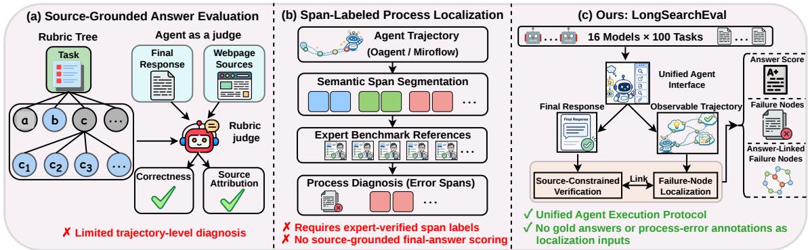  
Figure 1: Source-grounded answer evaluation, process benchmarks, and retrospective trajectory inspection. Expert labels in (b) are benchmark references, not required localization inputs; (c) returns content related to Stage 1- incorrect answer groups under a shared unified agent execution protocol.

Recent research has increasingly focused on evaluating DEEPSEARCH agents from two complementary perspectives. The first direction emphasizes source-grounded final-answer evaluation (Figure 1(a)). Mind2Web 2 (Gou et al., 2025) introduces realistic long-horizon agentic-search tasks and rubric-based Agent-as-a-Judge evaluation. GAIA (Mialon et al., 2024), AssistantBench (Yoran et al., 2024), LiveResearchBench (Wang et al., 2025), and BrowseComp (Wei et al., 2025) evaluate complex information seeking under externalknowledge, live-web, or persistent-browsing requirements. RAGChecker (Ru et al., 2024), longform factuality (Wei et al., 2024) evaluation, and RAGTruth (Niu et al., 2024) provide finer-grained analyses of retrieval support, claim correctness, and hallucination in grounded generation. Because these settings often rely on LLM-based evaluators, a parallel line of work studies judge construction (Zheng et al., 2023) and meta-evaluation (Zeng et al., 2024) through pairwise comparison, adversarial instruction-following cases, critique generation (Ke et al., 2024), rubric-conditioned scoring (Kim et al., 2024), hierarchical criteria (Liu et al., 2024b), and judge-specific benchmarks (Tan et al., 2025). Other studies identify systematic evaluator biases, including unfair comparison behavior (Wang et al., 2024a) and self-preference (Panickssery et al., 2024). These methods substantially improve outcome evaluation, but their primary object remains the generated answer and its supporting evidence rather than the observable search process that produced it. The second direction investigates process-level evaluation and error localization (Figure 1(b)). Let’s Verify Step by Step (Lightman et al., 2024), Math-Shepherd (Wang et al., 2024b), and ProcessBench (Zheng et al., 2025) show that intermediate-step verification (Lightman et al., 2024) can reveal reasoning failures beyond final-answer accuracy. AgentBoard (Ma et al., 2024) introduces progress-level diagnostics for multi-turn agents, while analyses of error snowballing (Zhang et al., 2024) show how early mistakes can induce downstream failures. TELBench and DRIFT (Wang et al., 2026) further adapt process localization to DeepResearch trajectories by segmenting agent trajectories and identifying harmful error spans. These approaches demonstrate the value of process-level diagnosis. Human-verified labels support their evaluation benchmarks, which is distinct from requiring such labels as localization inputs. Our focus is the outcome-conditioned connection between answer groups judged incorrect and retained web-search content under a unified agent execution protocol.

In response to these challenges, we introduce LONGSEARCHEVAL, a trajectory-aware agent evaluation framework for assessing the long-horizon web-search capabilities of LLMs (Figure 1(c)). Each evaluated LLM operates within a shared agent controller and standardized web-tool interface, and its final response is assessed together with the observable trajectory that produced it. The shared controller and restricted tool outputs standardize the interaction conditions, connecting model-level comparison with inspectable evidence of search behavior.

LONGSEARCHEVAL combines controlled trajectory collection with two evaluation stages. Sourceconstrained outcome verification checks finalanswer groups using only the webpages cited by the agent, without requiring human-authored gold answers. Conditioned on the final response and Stage 1 judgments, retrospective failure-node localization links related content, sources, or fields to groups judged incorrect. The returned associations expose where constraint-relevant evidence for each incorrect group appears in the trajectory. A correct webpage observation can still expose an answer discrepancy. These associations support retrospective inspection, not identification of an agent’s first erroneous commitment.

We apply LONGSEARCHEVAL to 16 models from eight families on 100 real-world web-search tasks, yielding 1,600 retained runs. Trajectory collection and evaluation required 1,037 and 318 hours, respectively. Human review of 946 supplied answer groups from 200 responses yields 94.50% agreement with automatic judgments, while Answer Score and Answer Precision correlate with human scores at Pearson coefficients of 0.9054 and 0.9132. In a separate run sample, review of all 317 retained round–group links confirms 311 feature correspondences (98.11%). The experiments also reveal distinct search and reading patterns among models with similar answer scores.

## Our contributions are threefold:

1. We formulate long-horizon web-search evaluation as a joint analysis of source-supported outcomes and observable trajectories under a controlled agent protocol.

2. We introduce LONGSEARCHEVAL, which combines trajectory collection under a unified execution protocol, source-constrained verification, and retrospective localization of content related to Stage 1 incorrect groups, without gold answers or pre-labeled process errors as operational inputs.

3. We build a 1,600-run corpus covering 16 LLMs and 100 tasks, with human validation of 946 supplied answer groups and all 317 retained links in fixed samples.

## 2 Related Work

Web Agent Evaluation. Web-agent evaluation has progressed from isolated browsing actions toward realistic long-horizon interaction and evidencegrounded task completion. Mind2Web (Deng et al., 2023) introduces large-scale real-world website tasks for generalist web agents, while WebArena (Zhou et al., 2024) provides realistic multi-website environments for autonomous interaction. AgentBench (Liu et al., 2024a) evaluates LLMs as agents across diverse environments. WebVoyager (He et al., 2024), WebLINX (Lu et al., 2024), and VisualWebArena (Koh et al., 2024) extend evaluation to multimodal or dialogue-conditioned web interaction. Assistant-Bench (Yoran et al., 2024), WorkArena (Drouin et al., 2024), WorkArena++ (Boisvert et al., 2024), and TravelPlanner (Xie et al., 2024a) further study realistic, time-consuming, or compositional information-seeking tasks, while AppWorld (Trivedi et al., 2024), OSWorld (Xie et al., 2024b), AndroidWorld (Rawles et al., 2025), and τ-bench (Yao et al., 2025) investigate stateful environments and tool-user interaction. Beyond task completion, recent studies have focused on evaluating whether agent responses are supported by external evidence. Mind2Web 2 (Gou et al., 2025) introduces rubric-based Agent-as-a-Judge evaluation for citation-supported web responses. GAIA (Mialon et al., 2024), AssistantBench (Yoran et al., 2024), LiveResearchBench (Wang et al., 2025), and BrowseComp (Wei et al., 2025) evaluate complex information seeking under external-knowledge and live-web settings. RAGChecker (Ru et al., 2024), long-form factuality evaluation (Wei et al., 2024), and RAGTruth (Niu et al., 2024) further analyze retrieval support, claim correctness, and hallucination. These methods improve outcome evaluation, but mainly focus on final responses rather than indexed trajectory content related to answer groups judged incorrect.

Process-Level Diagnosis. Process-level evaluation aims to identify failures beyond final outputs. Let’s Verify Step by Step (Lightman et al., 2024), Math-Shepherd (Wang et al., 2024b), and Process-Bench (Zheng et al., 2025) show that intermediatestep verification can reveal reasoning failures beyond final-answer accuracy. AgentBoard (Ma et al., 2024) introduces progress-level diagnostics for multi-turn agents, while error snowballing analysis (Zhang et al., 2024) studies how early mistakes induce downstream failures. TELBench and DRIFT (Wang et al., 2026) further extend process localization to DeepResearch trajectories by segmenting agent trajectories and identifying harmful error spans. These approaches demonstrate the value of process diagnosis. LONGSEARCHEVAL connects source-constrained answer-group verification with retrospective localization of related observations, sources, and fields under a unified agent execution protocol. The final response and its judgments are inputs to this task; returned associations do not identify error onset.

## 3 Method

LONGSEARCHEVAL evaluates LLMs’ longhorizon web-search capabilities through a shared agent execution protocol and two complementary evaluation stages. For each model–task run, we jointly consider the source-grounded final response $F$ and the observable web-interaction trajectory τ produced while solving the task. Agent execution under a unified protocol first provides comparable interaction records. Stage 1 then verifies sourcesupported answer groups in $F _ { \ast }$ , and Stage 2 uses these judgments and $F$ to flag candidate locations and link their content to groups judged incorrect by Stage 1. Figure 2 illustrates the complete workflow.

## 3.1 Agent Execution and Trajectory Collection

Within LONGSEARCHEVAL, we run 16 LLMs on a shared task set and collect the complete web-search trajectories produced during actual agent execution. A representative example of the trajectorycollection workflow is illustrated in Appendix C.4.

Given model m and task question q, we initialize the agent history as $\mathcal { H } _ { m , q , 0 } = ( q )$ . At round t, the model generates an explicitly recorded reasoning state $h _ { m , q , t }$ from the existing interaction history and then selects a tool action $a _ { m , q , t }$ . This sequential dependence is formalized as

$$
\begin{array} { r l } & { p _ { \theta _ { m } } \left( h _ { t } , a _ { t } \mid \mathcal { H } _ { t - 1 } \right) } \\ & { \quad = p _ { \theta _ { m } } \left( h _ { t } \mid \mathcal { H } _ { t - 1 } \right) p _ { \theta _ { m } } \left( a _ { t } \mid \mathcal { H } _ { t - 1 } , h _ { t } \right) . } \end{array}\tag{1}
$$

Here, $\theta _ { m }$ denotes the parameters of model m. The variable $h _ { m , q , t }$ corresponds to the observable textual reasoning field logged by the shared agent controller; it does not include unobserved internal states. A tool action is represented as $a _ { m , q , t } =$ $( w _ { m , q , t } , \xi _ { m , q , t } )$ , where $w _ { m , q , t }$ identifies a tool in the shared web-tool interface W and $\xi _ { m , q , t }$ t contains its invocation arguments. After the action is executed, the web environment returns an observation according to

$$
o _ { m , q , t } \sim p _ { \mathcal { W } } \left( o \mid a _ { m , q , t } , s _ { m , q , t - 1 } ^ { \mathrm { w e b } } \right) ,\tag{2}
$$

where $s _ { m , q , t - 1 } ^ { \mathrm { w e b } }$ denotes the web-environment state before the action. Search results, webpage content, and tool failures are all recorded as observations $o _ { m , q , t }$ in their original execution order. Web content therefore serves as environmental feedback within the agent interaction rather than as a separate collection objective. After round t, the interaction history is updated as

$$
\mathcal { H } _ { m , q , t } = \left( q , ( h _ { m , q , s } , a _ { m , q , s } , o _ { m , q , s } ) _ { s = 1 } ^ { t } \right) .\tag{3}
$$

Subsequent decisions use this history, which retains unsuccessful searches, intermediate revisions, and candidates omitted from the final response. Let $d _ { m , q , t }$ denote the controller’s termination state after round t, and let B be the maximum interaction budget. The realized stopping round is

$$
T _ { m , q } = \operatorname* { m i n } \left\{ t \geq 1 : d _ { m , q , t } = { \mathrm { f i n a l i z e } } \vee t = B \right\} .\tag{4}
$$

After round $T _ { m , q }$ , the agent generates the terminal response $F _ { m , q }$ conditioned on the complete interaction history. The resulting raw trajectory is

$$
\tau _ { m , q } ^ { \mathrm { r a w } } = \left( ( h _ { m , q , t } , a _ { m , q , t } , o _ { m , q , t } ) _ { t = 1 } ^ { T _ { m , q } } , F _ { m , q } \right)\tag{5}
$$

Conditioned on the task and realized trajectory length, the complete generation process factorizes as

$$
\begin{array} { r l } {  { p _ { \theta _ { m } , \mathcal { W } } ( \tau ^ { \mathrm { r a w } } \mid q , T ) } } \\ & { = p _ { \theta _ { m } } ( F \mid \mathcal { H } _ { T } ) \prod _ { t = 1 } ^ { T } p _ { \theta _ { m } } ( h _ { t } , a _ { t } \mid \mathcal { H } _ { t - 1 } ) } \\ & { ~ p _ { \mathcal { W } } ( o _ { t } \mid a _ { t } , s _ { t - 1 } ^ { \mathrm { w e b } } ) . } \end{array}\tag{6}
$$

After collection, the resulting trajectory preserves the complete observable decision process from the task question to the final response, allowing subsequent evaluators to inspect where taskrelevant defects are flagged and how these rounds relate to the retained final response.

## 3.2 Source-Constrained Outcome Verification

Stage 1 evaluates how well the final response fulfills the task requirements by verifying its answer groups against the webpages cited in that response. For each group, the verifier checks whether the cited content supports all applicable requirements and then aggregates the group-level judgments into outcome scores. It uses only agent-provided URLs and performs no additional web search, enabling source-constrained evaluation without human-authored gold answers.

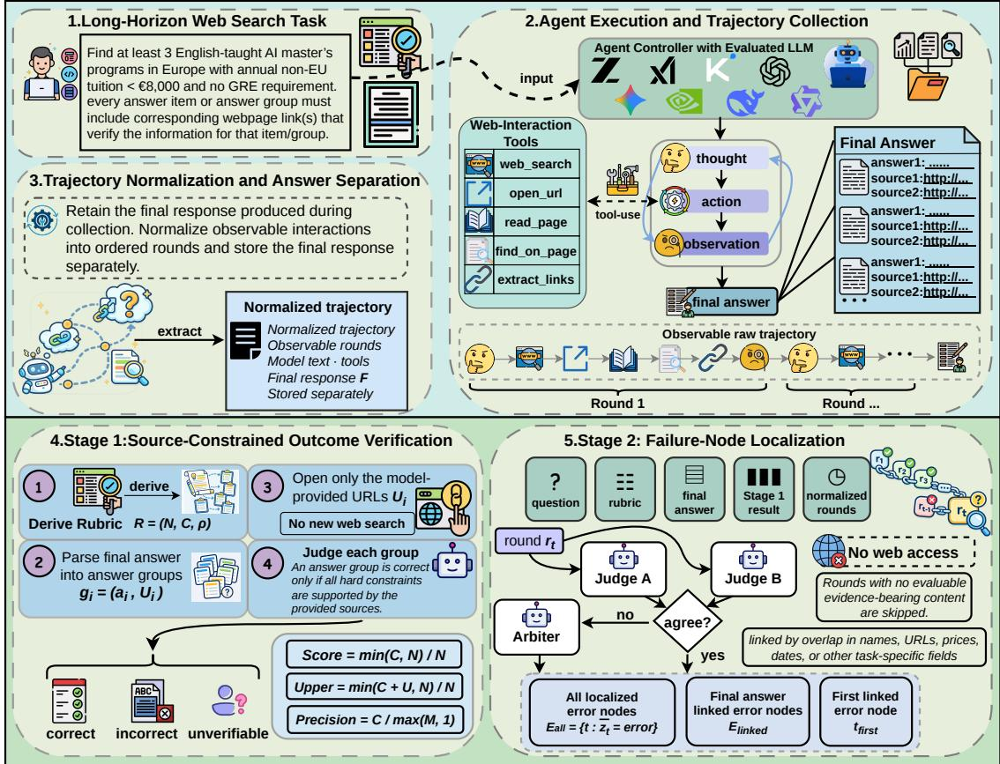  
Figure 2: Overview of LONGSEARCHEVAL. A unified agent interface records each LLM’s observable trajectory and final response. Stage 1 verifies answers using agent-provided URLs. Conditioned on the response and Stage 1 judgments, Stage 2 links related content in normalized rounds to incorrect answer groups without web access or hidden chain-of-thought.

For each retained run $( m , q )$ , Stage 1 independently instantiates a rubric

$$
R _ { m , q } = ( N _ { m , q } , \mathcal { C } _ { m , q } , \rho _ { m , q } )
$$

from the task question under the same evaluator configuration. Here, $N _ { m , q }$ is the required minimum number of answer groups, $\mathcal { C } _ { m , q }$ is the set of hard task constraints, and $\rho _ { m , q }$ specifies the grouping rule. The evaluated model identity is not included in this generation call. Stage 1 then parses the final response into:

$$
\begin{array} { r } { \mathcal { G } ( F _ { m , q } ) = \{ g _ { m , q , i } \} _ { i = 1 } ^ { P _ { m , q } } , } \\ { g _ { m , q , i } = ( a _ { m , q , i } , \mathcal { U } _ { m , q , i } ) , } \end{array}\tag{7}
$$

where $a _ { m , q , i }$ is the answer content of group i and $\mathcal { U } _ { m , q , i }$ is the set of URLs cited as its evidence. The minimum count $N _ { m , q }$ is used for task-level scoring, whereas each proposed group must independently satisfy all applicable hard constraints. For readability, we suppress the run indices $( m , q )$ in the remainder of this subsection. The count-mode conventions used in the experiment are specified in Section 4.1 alongside the score aggregation rules.

For each answer group $g _ { i } = ( a _ { i } , \mathcal { U } _ { i } )$ , the verifier fetches only the URLs in $\mathcal { U } _ { i }$ and denotes the resulting webpage evidence by $E _ { i }$ . Let $\beta _ { i } = 1$ when at least one cited URL yields usable page content. Let $\gamma _ { i } ~ = ~ 1$ when $\mathcal { U } _ { i }$ is non-empty but all cited URLs fail solely because of source-access uncertainty, such as a timeout, temporary unavailability, network failure, or anti-bot blocking. Missing, malformed, fabricated, or irrelevant citations are not treated as access-only failures under this criterion.

Missing citations, unsupported claims, invalid attributions, and constraint violations are treated as incorrect, whereas groups that cannot be verified solely because of source-access uncertainty are kept separate as unverifiable.

Let $\mathcal { C } _ { i } \subseteq \mathcal { C }$ contain the blocking constraints applicable to group $g _ { i }$ , excluding the task-level count requirement. The verifier defines a binary support function $\psi ( g _ { i } , c , E _ { i } )$ , where $\psi ( g _ { i } , c , E _ { i } ) = 1$ means that the cited evidence supports constraint c for group gi. The group verdict is

$$
v _ { i } = \left\{ \begin{array} { l l } { \qquad \quad \land _ { i } = 1 } \\ { \mathrm { c o r r e c t , } \qquad \land \displaystyle \prod _ { c \in \mathcal { C } _ { i } } \psi ( g _ { i } , c , E _ { i } ) = 1 , } \\ { \mathrm { u n v e r i f i a b l e , } \quad \beta _ { i } = 0 \land \gamma _ { i } = 1 , } \\ { \mathrm { i n c o r r e c t , } \quad \mathrm { o t h e r w i s e } . } \end{array} \right.\tag{8}
$$

Let $\begin{array} { r } { C = \sum _ { i } { \bf 1 } [ v _ { i } = \mathrm { c o r r e c t } ] , U = \sum _ { i } { \bf 1 } [ v _ { i } = } \end{array}$ unverifiable], and $M = | \mathcal { G } ( F ) |$ . We define the normalized answer score $s _ { \mathrm { a n s } } ,$ , its optimistic counterpart $s _ { \mathrm { a n s } } ^ { + }$ , and answer precision $q _ { \mathrm { a n s } }$ as

$$
\begin{array} { r l } & { s _ { \mathrm { a n s } } = \frac { \operatorname* { m i n } ( C , N ) } { N } , } \\ & { s _ { \mathrm { a n s } } ^ { + } = \frac { \operatorname* { m i n } ( C + U , N ) } { N } , } \\ & { q _ { \mathrm { a n s } } = \frac { C } { \operatorname* { m a x } ( M , 1 ) } . } \end{array}\tag{9}
$$

The reported Answer Score and Upper Score are percentage scores, $1 0 0 s _ { \mathrm { a n s } }$ and $1 0 0 s _ { \mathrm { a n s } } ^ { + } ,$ , respectively. The main answer score measures task-level requirement satisfaction under the minimum-count setting; Upper Score treats the groups currently marked unverifiable as potentially correct, and precision measures the verified fraction of the returned groups. These quantities measure satisfaction under agent-provided evidence.

## 3.3 Trajectory-Aware Failure-Node Localization

Stage 2 traces answer groups judged incorrect by Stage 1 back to related webpage content in the recorded trajectory. For each such group, the localization task is to identify relevant observations, sources, or fields along the original round order, from the beginning of the trajectory onward. The resulting round–group associations provide concrete evidence locations for inspecting the final answer, without re-evaluating its Stage 1 verdict.

Each judge receives only the task question, runspecific rubric, final response, Stage 1 answergroup verdicts, and one normalized round, with no web access or evaluated-model identity. Judges assess only observable content, not latent reasoning or hidden chain-of-thought. Each round is represented as

$$
x _ { m , q , t } = \left( q , R _ { m , q } , F _ { m , q } , V _ { m , q } ^ { ( 1 ) } , r _ { m , q , t } \right) ,\tag{10}
$$

where $V _ { m , q } ^ { ( 1 ) } = \{ ( g _ { m , q , i } , v _ { m , q , i } ) \} _ { i = 1 } ^ { P _ { m , q } }$ contains the Stage 1 verdicts; $( m , q )$ is omitted when unambiguous. Judges independently produce

$$
\hat { y } _ { t } ^ { j } = \left( z _ { t } ^ { j } , \mathcal { L } _ { t } ^ { j } \right) , \quad j \in \{ A , B \} ,
$$

where $z _ { t } ^ { j } \in$ {error, nonerror, skipped} is the verdict and $\hat { \mathcal { L } } _ { t } ^ { j }$ the proposed answer-group links. For a jointly identified error, $\hat { \mathcal { L } } _ { t } ^ { A B } = \left( \mathcal { L } _ { t } ^ { A } \bar { \cup } \mathcal { L } _ { t } ^ { B } \right)$ . The consensus output $\bar { y } _ { t } = ( \bar { z } _ { t } , \bar { \mathcal { L } } _ { t } )$ is

$$
\bar { y } _ { t } = \left\{ \begin{array} { l l } { \big ( \mathrm { e r r o r } , \hat { \mathcal { L } } _ { t } ^ { A B } \big ) , } & { \hat { z } _ { t } ^ { A } = \hat { z } _ { t } ^ { B } = \mathrm { e r r o r } , } \\ { \hat { y } _ { t } ^ { A } , } & { \hat { z } _ { t } ^ { A } = \hat { z } _ { t } ^ { B } \neq \mathrm { e r r o r } , } \\ { \big ( x _ { t } , \hat { y } _ { t } ^ { A } , \hat { y } _ { t } ^ { B } \big ) , } & { \hat { z } _ { t } ^ { A } \neq \hat { z } _ { t } ^ { B } . } \end{array} \right.\tag{11}
$$

Agreement does not trigger arbitration. Joint errors retain the union of proposed links and use Judge A’s normalized error type when available, otherwise Judge B’s. For differing verdicts, the third-case tuple is passed to the arbiter and its output is adopted. Rounds assigned error by the arbiter remain flagged failure nodes when no valid normalized type is available, but are excluded from taxonomy-specific analyses.

The original candidate checks and error/nonerror/skipped labels are retained, including checks on exploratory candidates. Extracted units and reasons are evaluator interpretations, not agent quotations. Inspecting an ineligible candidate is not itself erroneous; correct observations can expose answer discrepancies. A consensuserror round is termed a failure node, used as an automatic candidate flag. All such nodes form $\mathcal { E } _ { \mathrm { a l l } } = \{ t : \bar { z } _ { t } = \mathrm { e r r o r } \}$ . We report $\mathcal { E } _ { \mathrm { a l l } }$ as an automatic diagnostic inventory, not a behavioral-error rate; evaluable-round counts and organization depend on search behavior within each run.

Judges associate flagged failure nodes with finalanswer groups through task-relevant semantic cues without requiring exact lexical overlap. The proposed answer-group links are standardized in format without an additional deterministic semanticconsistency check, to accommodate implicit correspondences in open-ended tasks. When both judges label the same round as error, their proposed links are merged and deduplicated, while arbitrationresolved rounds retain the arbiter’s links. Because raw diagnostic links may include groups not confirmed as incorrect by Stage 1, downstream analyses retain only links to the confirmed incorrect set $\mathcal { B } = \{ i \in \{ 1 , . . . , P \} : v _ { i } = \mathrm { i n c o r r e c t } \}$ . Correct, unverifiable, and nonexistent targets are excluded. This target-status filter is not a semantic check; Stage 1 mistakes can affect the retained associations. Answer-linked failure nodes are

$$
\mathcal { E } _ { \mathrm { l i n k e d } } = \left\{ t \in \mathcal { E } _ { \mathrm { a l l } } : \bar { \mathcal { L } } _ { t } \cap \mathcal { B } \neq \emptyset \right\} .\tag{12}
$$

When $\mathcal { E } _ { \mathrm { l i n k e d } }$ is non-empty, we define $t _ { \mathrm { f i r s t } }$ min $\mathcal { E } _ { \mathrm { l i n k e d } }$ as the earliest returned related location, not the first erroneous commitment or a causal origin. The nodes in $\mathcal { E } _ { \mathrm { l i n k e d } }$ and their retained round– group edges are the main retrospective output; $\mathcal { E } _ { \mathrm { a l l } }$ also includes unlinked flags. Nodes, edges, and target groups have separate denominators because links can be many-to-many. Appendix G.2 illustrates these source–answer comparisons.

Together, answer metrics and group verdicts characterize outcomes, while these three diagnostics summarize all flagged failure nodes, answerlinked failure nodes, and the earliest linked round. Auxiliary signals for search, content inspection, link navigation, and premature answering support complementary behavioral analyses. Both stages are model-identity blind; model IDs are attached only after judging.

## 4 Experiments

We use LONGSEARCHEVAL to compare LLMs long-horizon web-search performance through outcome scores, observable search behavior, and failure-node diagnostics, then assess outcome verification and diagnostic correspondence through human review.

## 4.1 Experimental Setup

Tasks, models, and protocol. The evaluation comprises 16 models from eight families on 100 long-horizon web-search tasks: 46 from Mind2Web 2 (Gou et al., 2025), 20 from LiveResearchBench (Wang et al., 2025), 29 from Assistant-Bench (Yoran et al., 2024), and 5 manually curated tasks. All models use the same agent controller, prompt, five web-interaction tools, configured iteration limit, and execution policy. Each model–task pair contributes one retained run, giving 1,600 trajectories; recovery attempts do not create additional samples. The evaluated DeepSeek models are V3.2 and V4-Flash. Stage 1 uses DeepSeek-V4-Pro as its single verifier. Stage 2 uses DeepSeek-V4-Pro as Judge A and Qwen3.7-Max as Judge B and arbiter. This role assignment is fixed across all evaluated models and tasks; evaluated-model identities are omitted from judging inputs. The ten-category vocabulary is fixed from a disjoint 50-task, 500- trajectory development set.

Metrics and aggregation. Answer Score (AS), Answer Precision (AP), and Upper Score are macro-averaged over each model’s runs; Unverifiable Group Rate pools U/M over all returned groups. The corpus contains 7,685 answer groups and 42,658 normalized rounds. Table 1 jointly reports outcome, behavior, evidence-use, and execution indicators. The minimum-count formula in Section 3.2 applies to min; the stored exact normalization uses max(N, M) and dynamic\_all uses M as the AS/Upper denominator. AP uses max(M, 1), and confirmed empty outputs receive zero. These conventions retain the exported scores without changing the labels. Reported 95% intervals use 10,000 paired task-bootstrap resamples with fixed automatic outputs; they quantify tasklevel uncertainty rather than repeated agent execution.

## 4.2 Long-Horizon Web Search Performance

Table 1 shows substantial variation under the shared interface. GPT-6.1-Sol has the highest point estimates for AS (68.80), AP (68.34%), and Upper (75.35), followed by GPT-6-Luna-Pro in AS (65.88) and AP (67.39%). GPT-5.4 has the lowest UGR (3.56%). The Sol–Luna AS difference is 2.92 points, with a paired 95% interval of [−5.67, 11.99], whereas the GLM-5–GLM-4.7- Flash difference is 14.67 points [8.41, 20.82]. Thus the results distinguish broad performance gaps from closely spaced point estimates.

Similar outcome scores can conceal different search profiles. DeepSeek-V3.2 and V4-Flash obtain AS values of 54.38 and 53.90, respectively, but average 13.75 versus 21.99 searches and 22.29k versus 37.60k read characters—about 37.5% fewer searches and 40.7% less text for V3.2. The paired AS difference is 0.48 points [−6.03, 6.95]. Across models, search counts range from 9.49 to 21.99, and read text from 4.78k to 48.02k characters. Grok-4.20 returns the most final URLs (14.34 per run) without leading the outcome scores. Joint reporting therefore distinguishes verification success from interaction volume and evidence presentation.

All 1,600 runs remain in the analysis, including 1,567 direct agent responses, 20 collection-time notool syntheses, and 13 fallbacks. The saved validity indicator is true for 1,573 responses (98.31%); 11 runs carry a premature-answer flag. These retained paths are evaluated unchanged rather than limiting the comparison to successful executions with valid outputs.

Table 1: Outcome quality, search behavior, evidence use, and execution robustness evaluated with LONGSEARCHEVAL under the controlled agent execution setting. AS, AP, and UGR denote Answer Score, Answer Precision, and Unverifiable Group Rate. AP and UGR are percentages, and Read kChars is the mean character count divided by 1,000. Valid and Prem. use the saved final-answer-validity and premature-answer indicators. Models are grouped by family, with thin horizontal rules separating families to facilitate within- and cross-family comparisons.
<table><tr><td></td><td colspan="4">Outcome Quality</td><td colspan="3">Search Behavior</td><td colspan="2">Evidence Use</td><td colspan="2">Execution Robustness</td></tr><tr><td>Model</td><td>AS ↑</td><td>AP (%)↑</td><td>Upper ↑</td><td>UGR (%)↓</td><td>Avg. Rounds</td><td>Avg. Searches</td><td>Avg. Domains</td><td>Read kChars</td><td>Final URLs</td><td>Valid (%)↑</td><td>Prem. (%)↓</td></tr><tr><td>GPT-6.1-Sol</td><td>68.80</td><td>68.34</td><td>75.35</td><td>5.32</td><td>17.74</td><td>9.49</td><td>6.59</td><td>26.79</td><td>10.44</td><td>100</td><td>0</td></tr><tr><td>GPT-6-Luna-Pro</td><td>65.88</td><td>67.39</td><td>73.08</td><td>6.12</td><td>18.41</td><td>14.57</td><td>5.38</td><td>16.58</td><td>8.11</td><td>100</td><td>0</td></tr><tr><td>GPT-5.4</td><td>54.23</td><td>55.99</td><td>58.85</td><td>3.56</td><td>19.67</td><td>11.19</td><td>5.37</td><td>10.24</td><td>12.90</td><td>100</td><td>0</td></tr><tr><td>GPT-5-Mini</td><td>47.17</td><td>47.17</td><td>51.13</td><td>4.90</td><td>25.07</td><td>16.35</td><td>5.08</td><td>4.78</td><td>11.24</td><td>92</td><td>5</td></tr><tr><td>Gemini-3.1-Pro</td><td>38.51</td><td>38.76</td><td>50.15</td><td>10.99</td><td>24.57</td><td>16.64</td><td>5.72</td><td>24.64</td><td>7.99</td><td>100</td><td>0</td></tr><tr><td>Gemini-2.5-Flash</td><td>33.33</td><td>35.20</td><td>38.31</td><td>6.48</td><td>32.37</td><td>11.42</td><td>6.54</td><td>36.44</td><td>8.45</td><td>95</td><td>3</td></tr><tr><td>Kimi-K2.6</td><td>51.86</td><td>51.84</td><td>58.51</td><td>7.05</td><td>34.67</td><td>21.98</td><td>9.16</td><td>44.75</td><td>9.08</td><td>99</td><td>0</td></tr><tr><td>Kimi-K2.5</td><td>50.35</td><td>50.12</td><td>55.97</td><td>5.04</td><td>32.48</td><td>18.88</td><td>8.47</td><td>44.80</td><td>9.21</td><td>100</td><td>0</td></tr><tr><td>Qwen3.7-Plus</td><td>49.23</td><td>49.01</td><td>54.03</td><td>4.68</td><td>20.44</td><td>13.80</td><td>5.15</td><td>23.11</td><td>8.02</td><td>96</td><td>2</td></tr><tr><td>Qwen3.6-Flash</td><td>37.32</td><td>37.90</td><td>45.20</td><td>8.55</td><td>20.34</td><td>15.90</td><td>4.73</td><td>21.42</td><td>7.53</td><td>98</td><td>0</td></tr><tr><td>DeepSeek-V3.2</td><td>54.38</td><td>54.48</td><td>59.28</td><td>4.66</td><td>27.67</td><td>13.75</td><td>8.39</td><td>22.29</td><td>9.35</td><td>100</td><td>0</td></tr><tr><td>DeepSeek-V4-Flash</td><td>53.90</td><td>53.78</td><td>58.69</td><td>5.43</td><td>30.22</td><td>21.99</td><td>6.75</td><td>37.60</td><td>12.26</td><td>99</td><td>0</td></tr><tr><td>GLM-5</td><td>47.54</td><td>46.44</td><td>53.67</td><td>5.39</td><td>30.04</td><td>13.58</td><td>7.69</td><td>48.02</td><td>8.18</td><td>99</td><td>0</td></tr><tr><td>GLM-4.7-Flash</td><td>32.87</td><td>32.61</td><td>39.57</td><td>6.07</td><td>31.80</td><td>20.85</td><td>6.18</td><td>10.27</td><td>7.43</td><td>97</td><td>0</td></tr><tr><td>Grok-4.20</td><td>48.31</td><td>48.04</td><td>52.93</td><td>4.33</td><td>25.40</td><td>10.67</td><td>6.87</td><td>34.43</td><td>14.34</td><td>99</td><td>1</td></tr><tr><td>Nemotron-3-Ultra</td><td>43.35</td><td>43.14</td><td>48.53</td><td>5.11</td><td>35.69</td><td>13.76</td><td>7.07</td><td>39.58</td><td>9.42</td><td>99</td><td>0</td></tr></table>

Table 2: Automatic candidate-node diagnostics under Stage 1-incorrect-group filtering. Earliest-association percentages use the 850 runs with retained links.
<table><tr><td>Process diagnostic</td><td>Result</td></tr><tr><td>All automatically flagged candidate nodes</td><td>6,545</td></tr><tr><td>Linked / unlinked candidate nodes</td><td>3,664 / 2,881</td></tr><tr><td>Typed / unassigned candidate nodes</td><td>6,503 / 42</td></tr><tr><td>Unlinked incorrect final-answer groups Runs with at least one linked candidate node</td><td>1,145</td></tr><tr><td>Earliest association by round 5 / 20</td><td>850 46.5% / 88.7%</td></tr></table>

## 4.3 Failure-Node and Trajectory Diagnostics

Of 42,658 rounds, the final consensus retains 14,734 evaluable records: 6,545 automatic candidate flags and 8,189 nonerror labels. Among flagged nodes, 3,664 (56.0%) have retained links to Stage 1-incorrect answer groups. The 5,798 distinct round–group edges cover 2,229 of 3,374 incorrect groups, leaving 1,145 without a retained content association. Table 2 reports node-level diagnostics separately from answer-group coverage.

Among the 850 linked runs, the earliest returned association is by round 5 in 395 runs (46.5%) and by round 20 in 754 (88.7%); the median is round 6, with an interquartile range of 3–13. These locations identify related content for retrospective inspection, not when the agent first made an erroneous commitment. Constraint violation (2,124 nodes), insufficient evidence (1,782), and missing required field (1,222) account for 78.86% of typed nodes. Figure 3 shows their model-specific composition: the constraint-violation share is 21.15% for V3.2 and 33.55% for V4-Flash despite their similar aggregate AS. The taxonomy summarizes the judges’ diagnostic categories over candidate content. Human validation below assesses correspondence between the returned locations and their target answer groups through a manual audit of all retained links in the sampled trajectories.

## 4.4 Evaluator Reliability and Human Validation

Audit design. The post-hoc audit covers 946 supplied answer groups across all tasks, with two randomly sampled model responses per task. Human labels serve as validation references, not inputs to scoring or localization. The primary reviewer (H1) checks requirements and the original cited URLs, assigns correct/incorrect/unverifiable labels, and derives response-level scores. Automatic verdicts, scores, reasons, and model metadata are withheld until annotation is locked. The review retains the supplied group boundaries, all 200 responses (including four confirmed empty-group responses), and both sides’ recorded quantity parameters. A second reviewer (H2) independently checks a fixed 40-response, 172-group subset. Reported intervals use 10,000 paired task-cluster bootstrap resamples, retaining each task’s two responses and all associated group-level records.

Within-model share of typed failure nodes (%)  
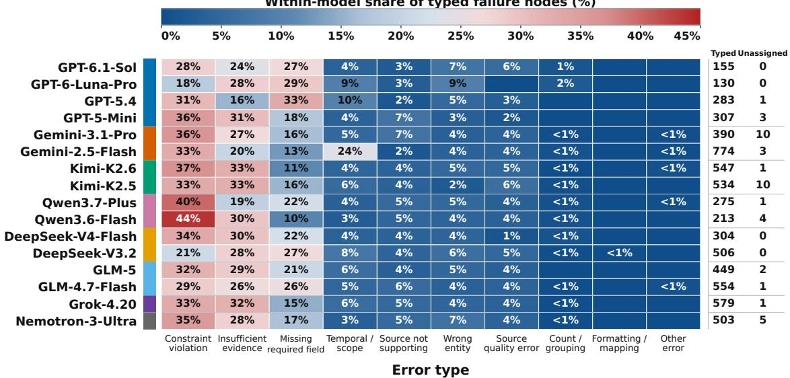  
Figure 3: Diagnostic type composition of 6,503 automatically flagged and typed candidate nodes. Each model is normalized by its own typed-node count; 42 unassigned nodes remain in localization totals but not in type denominators.

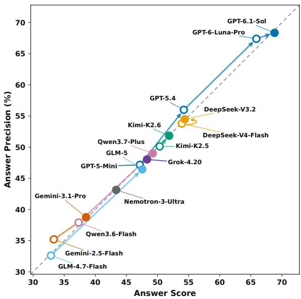  
Figure 4: Answer Score versus Answer Precision for 16 LLMs. Colors and lines denote model families.

Outcome agreement. Table 3 reports Pearson r, Spearman ρ, and Kendall τ on the same 200 response pairs. At group level, 894/946 judgments agree (94.50%; $\kappa = 0 . 8 9 8 9 )$ . AS and AP have mean absolute errors of 4.88 score points and 4.45 percentage points, with machine-minus-human biases of 0.84 and 0.46, respectively. The AS and AP Pearson 95% intervals are [0.8496, 0.9519] and [0.8595, 0.9588]. The two human reviewers agree on 160/172 subset group labels (93.02%; $\kappa = 0 . 8 5 7 4 )$ . Figure 5 complements these statistics by showing repeated exact matches across score levels and lower-frequency off-diagonal discrepancies. The agreement in group judgments and response-level scores supports the validity of source-constrained evaluation on the supplied answer groups.

Table 3: Score correlations following the 946-group human audit. Each coefficient uses 200 response pairs from 100 tasks.
<table><tr><td>Score</td><td>Pearson r</td><td>Spearman ρ</td><td>Kendall τ</td></tr><tr><td>Answer Score</td><td>0.9054</td><td>0.9035</td><td>0.8609</td></tr><tr><td>Answer Precision</td><td>0.9132</td><td>0.9103</td><td>0.8712</td></tr></table>

Within-task comparison. When both comparisons are non-tied, automatic and human orderings agree on 56/60 tasks for AS and 57/61 for AP. Including 28/27 shared ties gives 84/100 matching relations for each metric; each also has four reversed non-ties and 12 one-sided ties. These results assess within-task comparisons between the two sampled model responses.

Round-to-answer correspondence. The process sample covers all 2,642 normalized rounds of 100 runs from 50 randomly selected tasks. All 317 retained round–group links are reviewed, including every retained edge in the sample. A supported link shares a verified, locatable feature such as an entity, URL, provider, or price; topic similarity alone is insufficient. For split/merged groups, at least one mapped target must satisfy this rule. Review confirms 311/317 links, giving 98.11% feature-correspondence precision (95% CI: [96.15, 99.40]). The audit supports highprecision localization of answer-related trajectory content under the defined feature-correspondence criterion.

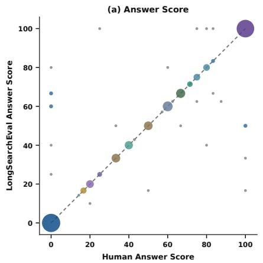

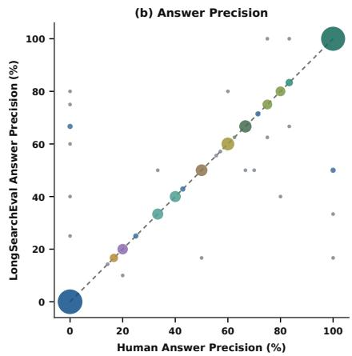  
Figure 5: Automatic–human outcome-score alignment in the post-hoc validation study: (a) Answer Score and (b) Answer Precision. Both panels use the same 200 response pairs from 100 tasks. Dashed lines indicate exact agreement (y = x); marker area is proportional to the number of responses sharing the same score pair.

Audit criteria. A separate audit using an explicit erroneous-commitment criterion assigned no error labels to the reviewed rounds, whereas the candidate-content procedure produced 349 flags. These counts concern different annotation targets. The returned-link audit above evaluates the outcome-conditioned content-localization task defined in Section 3.3.

Internal consistency. Judges A and B agree on 12,417 of 14,818 round-level verdict pairs (83.80%). Among 4,612 rounds jointly labeled as error with comparable normalized types, their type judgments agree in 4,032 cases (87.42%). Together with human validation of answer scores and returned-link correspondence, these results provide empirical support for the effectiveness and reliability of LONGSEARCHEVAL in source-constrained evaluation and retrospective trajectory-content localization.

## 5 Conclusion

We presented LONGSEARCHEVAL, a trajectoryaware agent evaluation framework for long-horizon web search that combines agent execution under a unified protocol, source-constrained outcome verification, and retrospective failure-node localization. The 16-model, 1,600-run corpus combines answer scores, search behavior, and inspectable round-group associations. Similar answer scores can accompany different search workloads. Conditioned on the final response and Stage 1 judgments, localization connects answer groups with inspectable trajectory content. Correct webpage observations can still be diagnostically useful when compared with a group judged incorrect; the full candidate inventory is reported separately from returned answer-linked evidence. Human validation demonstrates close alignment with reference answer judgments and high precision in returned content correspondences. Together with cross-judge agreement, these findings support the effectiveness and reliability of LONGSEARCHEVAL for sourceconstrained outcome evaluation and retrospective trajectory inspection.

## References

Léo Boisvert, Megh Thakkar, Maxime Gasse, Massimo Caccia, Thibault Le Sellier De Chezelles, Quentin Cappart, Nicolas Chapados, Alexandre Lacoste, and Alexandre Drouin. 2024. WorkArena++: Towards compositional planning and reasoning-based common knowledge work tasks. In Advances in Neural Information Processing Systems, volume 37.

Tom B. Brown, Benjamin Mann, Nick Ryder, Melanie Subbiah, Jared D. Kaplan, Prafulla Dhariwal, Arvind Neelakantan, Pranav Shyam, Girish Sastry, Amanda Askell, Sandhini Agarwal, Ariel Herbert-Voss, Gretchen Krueger, Tom Henighan, Rewon Child, Aditya Ramesh, Daniel Ziegler, Jeffrey Wu, Clemens Winter, Chris Hesse, Mark Chen, Eric Sigler, Mateusz Litwin, Scott Gray, Benjamin Chess, Jack Clark, Christopher Berner, Sam McCandlish, Alec Radford, Ilya Sutskever, and Dario Amodei. 2020. Language models are few-shot learners. In Advances in Neural Information Processing Systems, volume 33.

Xiang Deng, Yu Gu, Boyuan Zheng, Shijie Chen, Samuel Stevens, Boshi Wang, Huan Sun, and Yu Su. 2023. Mind2Web: Towards a generalist agent for the web. In Advances in Neural Information Processing Systems, volume 36.

Alexandre Drouin, Maxime Gasse, Massimo Caccia, Issam H. Laradji, Manuel Del Verme, Tom Marty, David Vazquez, Nicolas Chapados, and Alexandre Lacoste. 2024. WorkArena: How capable are web agents at solving common knowledge work tasks? In Proceedings ofthe 41st International Conference on Machine Learning, volume 235 of Proceedings of Machine Learning Research, pages 11642–11662.

Boyu Gou, Zanming Huang, Yuting Ning, Yu Gu, Michael Lin, Weijian Qi, Andrei Kopanev, Botao Yu, Bernal Jiménez Gutiérrez, Yiheng Shu, Chan Hee Song, Jiaman Wu, Shijie Chen, Hanane Moussa, Tianshu Zhang, Jian Xie, Yifei Li, Tianci Xue, Zeyi Liao, Kai Zhang, Boyuan Zheng, Zhaowei Cai, Viktor Rozgic, Morteza Ziyadi, Huan Sun, and Yu Su. 2025. Mind2Web 2: Evaluating agentic search with agent-as-a-judge. In Advances in Neural Information Processing Systems, volume 38.

Hongliang He, Wenlin Yao, Kaixin Ma, Wenhao Yu, Yong Dai, Hongming Zhang, Zhenzhong Lan, and Dong Yu. 2024. WebVoyager: Building an end-toend web agent with large multimodal models. In Proceedings ofthe 62nd Annual Meeting ofthe Association for Computational Linguistics (Volume 1: Long Papers), pages 6864–6890.

Pei Ke, Bosi Wen, Andrew Feng, Xiao Liu, Xuanyu Lei, Jiale Cheng, Shengyuan Wang, Aohan Zeng, Yuxiao Dong, Hongning Wang, Jie Tang, and Minlie Huang. 2024. CritiqueLLM: Towards an informative critique generation model for evaluation of large language model generation. In Proceedings of the 62nd Annual Meeting ofthe Associationfor Computational Linguistics (Volume 1: Long Papers), pages 13034– 13054.

Seungone Kim, Jamin Shin, Yejin Cho, Joel Jang, Shayne Longpre, Hwaran Lee, Sangdoo Yun, Seongjin Shin, Sungdong Kim, James Thorne, and Minjoon Seo. 2024. Prometheus: Inducing finegrained evaluation capability in language models. In The Twelfth International Conference on Learning Representations.

Jing Yu Koh, Robert Lo, Lawrence Jang, Vikram Duvvur, Ming Lim, Po-Yu Huang, Graham Neubig, Shuyan Zhou, Russ Salakhutdinov, and Daniel Fried. 2024. VisualWebArena: Evaluating multimodal agents on realistic visual web tasks. In Proceedings ofthe 62nd Annual Meeting ofthe Association for Computational Linguistics (Volume 1: Long Papers), pages 881–905.

Hunter Lightman, Vineet Kosaraju, Yuri Burda, Harrison Edwards, Bowen Baker, Teddy Lee, Jan Leike, John Schulman, Ilya Sutskever, and Karl Cobbe. 2024. Let’s verify step by step. In The Twelfth International Conference on Learning Representations.

Xiao Liu, Hao Yu, Hanchen Zhang, Yifan Xu, Xuanyu Lei, Hanyu Lai, Yu Gu, Hangliang Ding, Kaiwen Men, Kejuan Yang, Shudan Zhang, Xiang Deng, Aohan Zeng, Zhengxiao Du, Chenhui Zhang, Sheng Shen, Tianjun Zhang, Yu Su, Huan Sun, Minlie Huang, Yuxiao Dong, and Jie Tang. 2024a. Agent-Bench: Evaluating LLMs as agents. In The Twelfth International Conference on Learning Representations.

Yuxuan Liu, Tianchi Yang, Shaohan Huang, Zihan Zhang, Haizhen Huang, Furu Wei, Weiwei Deng, Feng Sun, and Qi Zhang. 2024b. HD-Eval: Aligning large language model evaluators through hierarchical criteria decomposition. In Proceedings of the 62nd Annual Meeting ofthe Associationfor Computational Linguistics (Volume 1: Long Papers), pages 7641–7660.

Xing Han Lu, Zdenek Kasner, and Siva Reddy. 2024.ˇ WebLINX: Real-world website navigation with multiturn dialogue. In Proceedings of the 41st International Conference on Machine Learning, volume 235 of Proceedings ofMachine Learning Research, pages 33007–33056.

Chang Ma, Junlei Zhang, Zhihao Zhu, Cheng Yang, Yujiu Yang, Yaohui Jin, Zhenzhong Lan, Lingpeng Kong, and Junxian He. 2024. AgentBoard: An analytical evaluation board of multi-turn LLM agents. In Advances in Neural Information Processing Systems, volume 37.

Grégoire Mialon, Clémentine Fourrier, Craig Swift, Thomas Wolf, Yann LeCun, and Thomas Scialom. 2024. GAIA: A benchmark for general AI assistants. In The Twelfth International Conference on Learning Representations.

Reiichiro Nakano, Jacob Hilton, Suchir Balaji, Jeff Wu, Long Ouyang, Christina Kim, Christopher Hesse, Shantanu Jain, Vineet Kosaraju, William Saunders, Xu Jiang, Karl Cobbe, Tyna Eloundou, Gretchen Krueger, Kevin Button, Matthew Knight, Benjamin Chess, and John Schulman. 2021. WebGPT: Browser-assisted question-answering with human feedback. arXiv preprint arXiv:2112.09332.

Cheng Niu, Yuanhao Wu, Juno Zhu, Siliang Xu, KaShun Shum, Randy Zhong, Juntong Song, and Tong Zhang.

2024. RAGTruth: A hallucination corpus for developing trustworthy retrieval-augmented language models. In Proceedings of the 62nd Annual Meeting ofthe Associationfor Computational Linguistics (Volume 1: Long Papers), pages 10862–10878.

Arjun Panickssery, Samuel R. Bowman, and Shi Feng. 2024. LLM evaluators recognize and favor their own generations. In Advances in Neural Information Processing Systems, volume 37.

Chris Rawles, Sarah Clinckemaillie, Yifan Chang, Jonathan Waltz, Gabrielle Lau, Marybeth Fair, Alice Li, William Bishop, Wei Li, Folawiyo Campbell-Ajala, Daniel Toyama, Robert Berry, Divya Tyamagundlu, Timothy Lillicrap, and Oriana Riva. 2025. AndroidWorld: A dynamic benchmarking environment for autonomous agents. In The Thirteenth International Conference on Learning Representations.

Dongyu Ru, Lin Qiu, Xiangkun Hu, Tianhang Zhang, Peng Shi, Shuaichen Chang, Cheng Jiayang, Cunxiang Wang, Shichao Sun, Huanyu Li, Zizhao Zhang, Binjie Wang, Jiarong Jiang, Tong He, Zhiguo Wang, Pengfei Liu, Yue Zhang, and Zheng Zhang. 2024. RAGChecker: A fine-grained framework for diagnosing retrieval-augmented generation. In Advances in Neural Information Processing Systems, volume 37.

Sijun Tan, Siyuan Zhuang, Kyle Montgomery, William Tang, Alejandro Cuadron, Chenguang Wang, Raluca Popa, and Ion Stoica. 2025. JudgeBench: A benchmark for evaluating LLM-based judges. In The Thirteenth International Conference on Learning Representations.

Harsh Trivedi, Tushar Khot, Mareike Hartmann, Ruskin Manku, Vinty Dong, Edward Li, Shashank Gupta, Ashish Sabharwal, and Niranjan Balasubramanian. 2024. AppWorld: A controllable world of apps and people for benchmarking interactive coding agents. In Proceedings of the 62nd Annual Meeting of the Association for Computational Linguistics (Volume 1: Long Papers), pages 16022–16076.

Jiaming Wang, Ziteng Feng, Jiangtao Wu, Ruihao Li, Qianqian Xie, Yuxiang Ren, He Zhu, Xueming Han, Fanyu Meng, Junlan Feng, and Jiaheng Liu. 2026. Where do deep-research agents go wrong? span-level error localization in agent trajectories. Preprint, arXiv:2606.02060.

Jiayu Wang, Yifei Ming, Riya Dulepet, Qinglin Chen, Austin Xu, Zixuan Ke, Frederic Sala, Aws Albarghouthi, Caiming Xiong, and Shafiq Joty. 2025. LiveResearchBench: A live benchmark for user-centric deep research in the wild. Preprint, arXiv:2510.14240.

Peiyi Wang, Lei Li, Liang Chen, Zefan Cai, Dawei Zhu, Binghuai Lin, Yunbo Cao, Lingpeng Kong, Qi Liu, Tianyu Liu, and Zhifang Sui. 2024a. Large language models are not fair evaluators. In Proceedings ofthe 62nd Annual Meeting ofthe Associationfor Computational Linguistics (Volume 1: Long Papers), pages 9440–9450.

Peiyi Wang, Lei Li, Zhihong Shao, Runxin Xu, Damai Dai, Yifei Li, Deli Chen, Yu Wu, and Zhifang Sui. 2024b. Math-shepherd: Verify and reinforce LLMs step-by-step without human annotations. In Proceedings ofthe 62nd Annual Meeting ofthe Association for Computational Linguistics (Volume 1: Long Papers), pages 9426–9439.

Xingyao Wang, Zihan Wang, Jiateng Liu, Yangyi Chen, Lifan Yuan, Hao Peng, and Heng Ji. 2024c. MINT: Evaluating LLMs in multi-turn interaction with tools and language feedback. In The Twelfth International Conference on Learning Representations.

Jason Wei, Zhiqing Sun, Spencer Papay, Scott McKinney, Jeffrey Han, Isa Fulford, Hyung Won Chung, Alex Tachard Passos, William Fedus, and Amelia Glaese. 2025. BrowseComp: A simple yet challenging benchmark for browsing agents. arXiv preprint arXiv:2504.12516.

Jerry Wei, Chengrun Yang, Xinying Song, Yifeng Lu, Nathan Hu, Jie Huang, Dustin Tran, Daiyi Peng, Ruibo Liu, Da Huang, Cosmo Du, and Quoc V. Le. 2024. Long-form factuality in large language models. In Advances in Neural Information Processing Systems, volume 37.

Jian Xie, Kai Zhang, Jiangjie Chen, Tinghui Zhu, Renze Lou, Yuandong Tian, Yanghua Xiao, and Yu Su. 2024a. TravelPlanner: A benchmark for real-world planning with language agents. In Proceedings of the 41st International Conference on Machine Learning, volume 235 of Proceedings of Machine Learning Research, pages 54590–54613.

Tianbao Xie, Danyang Zhang, Jixuan Chen, Xiaochuan Li, Siheng Zhao, Ruisheng Cao, Toh Jing Hua, Zhoujun Cheng, Dongchan Shin, Fangyu Lei, Yitao Liu, Yiheng Xu, Shuyan Zhou, Silvio Savarese, Caiming Xiong, Victor Zhong, and Tao Yu. 2024b. OSWorld: Benchmarking multimodal agents for open-ended tasks in real computer environments. In Advances in Neural Information Processing Systems, volume 37.

Shunyu Yao, Noah Shinn, Pedram Razavi, and Karthik Narasimhan. 2025. τ-bench: A benchmark for toolagent-user interaction in real-world domains. In The Thirteenth International Conference on Learning Representations.

Shunyu Yao, Jeffrey Zhao, Dian Yu, Nan Du, Izhak Shafran, Karthik Narasimhan, and Yuan Cao. 2023. ReAct: Synergizing reasoning and acting in language models. In The Eleventh International Conference on Learning Representations.

Ori Yoran, Samuel Joseph Amouyal, Chaitanya Malaviya, Ben Bogin, Ofir Press, and Jonathan Berant. 2024. AssistantBench: Can web agents solve realistic and time-consuming tasks? In Proceedings of the 2024 Conference on Empirical Methods in Natural Language Processing, pages 8938–8968.

Zhiyuan Zeng, Jiatong Yu, Tianyu Gao, Yu Meng, Tanya Goyal, and Danqi Chen. 2024. Evaluating large language models at evaluating instruction following. In The Twelfth International Conference on Learning Representations.

Muru Zhang, Ofir Press, William Merrill, Alisa Liu, and Noah A. Smith. 2024. How language model hallucinations can snowball. In Proceedings of the 41st International Conference on Machine Learning, volume 235 of Proceedings of Machine Learning Research, pages 59670–59684.

Chujie Zheng, Zhenru Zhang, Beichen Zhang, Runji Lin, Keming Lu, Bowen Yu, Dayiheng Liu, Jingren Zhou, and Junyang Lin. 2025. ProcessBench: Identifying process errors in mathematical reasoning. In Proceedings of the 63rd Annual Meeting of the Associationfor Computational Linguistics (Volume 1: Long Papers), pages 1009–1024.

Lianmin Zheng, Wei-Lin Chiang, Ying Sheng, Siyuan Zhuang, Zhanghao Wu, Yonghao Zhuang, Zi Lin, Zhuohan Li, Dacheng Li, Eric P. Xing, Hao Zhang, Joseph E. Gonzalez, and Ion Stoica. 2023. Judging LLM-as-a-judge with MT-Bench and chatbot arena. In Advances in Neural Information Processing Systems, volume 36.

Shuyan Zhou, Frank F. Xu, Hao Zhu, Xuhui Zhou, Robert Lo, Abishek Sridhar, Xianyi Cheng, Tianyue Ou, Yonatan Bisk, Daniel Fried, Uri Alon, and Graham Neubig. 2024. WebArena: A realistic web environment for building autonomous agents. In The Twelfth International Conference on Learning Representations.

# Supplementary Material

## A Overview and Evaluation Units

This supplement details the LONGSEARCHEVAL evaluation protocol and results. It follows the same 16-model, eight-family, 100-task comparison, with one retained run per model–task pair. It expands the collection protocol, source-constrained verification, retrospective content localization, and validation. Human review is a separate validation study, not an input to automatic evaluation.

How to interpret the localization output Afailure node is a normalized round assigned the stored consensus label error; it is an automatic candidate flag. A retained link associates that round with an answer group judged incorrect by Stage 1. These associations locate answer-related content in the recorded trajectory. Human review separately evaluates returned feature correspondences and explicit agent commitments.

## A.1 Reading Guide

Tasks and evaluator roles appear in Appendix B; collection and normalization in Appendices C and D. Stage 1 and its rubric-consistency analysis appear in Appendix $\operatorname { E } ;$ Stage 2, its round accounting, and judge agreement appear in Appendix F. Appendix G brings all ten error-type definitions, four representative cases, and the type distribution together. Appendix H gives the complete quantitative diagnostics, followed by human validation in Appendix I and experimental runtime and API budgets in Appendix J. Appendix K specifies prompt contracts and reproduction procedures; Appendix L discusses evaluation scope.

## A.2 Objects and Denominators

For model m and task $q ,$ let $F _ { m , q }$ be the retained final response and $\tau _ { m , q } = ( r _ { 1 } , \ldots , r _ { T } )$ the normalized trajectory. The terminal response is stored separately and never counted as a round. Each run has its own stored rubric $R _ { m , q } = ( N , \mathcal { C } , \rho )$ , specifying the required answer count, hard constraints, and grouping rule, together with a count mode. Stage 1 extracts groups $g _ { i } = ( a _ { i } , \mathcal { U } _ { i } )$ , comprising answer content and cited URLs, and labels each group correct, incorrect, or unverifiable.

Type shares use typed nodes only; humanreview denominators are specified separately in Appendix I.

## B Tasks, Models, and Evaluator Configuration

The evaluation set targets long-horizon web search. Retained tasks require sustained information seeking over public webpages, explicit constraint tracking, and a final response whose answer items can be checked against cited webpage sources. The separate taxonomy-development set appears in Appendix G.3.

## B.1 Operational Task Definition

A retained long-horizon web search task requires an agent to search, open, read, compare, and verify information from public webpages and then produce a response that can be checked from those webpages. Tasks may require multiple candidates, fields, sources, or constraint checks; they are not restricted to a single answer string or a single supporting page.

For every retained task, the final-answer instruction requires each answer item or answer group to include the corresponding webpage URL or URLs that verify the information in that group. When an original task does not specify how many items should be returned, the adapted task specifies an appropriate minimum count. This makes task-level coverage measurable while preserving group-level verification: a task can require at least N valid groups, while each proposed group must independently satisfy all applicable hard constraints and source requirements.

The adapted task text, including any added source or minimum-count requirement, defines the shared task specification for the evaluated models. The evaluation pipeline does not require a humanauthored gold final answer or pre-labeled trajectory errors to generate the reported outcome and process diagnostics.

## B.2 Source Composition

The 100-task main evaluation set contains 46 tasks derived from Mind2Web 2, 20 from LiveResearch-Bench, 29 from AssistantBench, and 5 manually curated tasks. Model comparisons aggregate over the complete task set.

The five manually curated tasks are subjected to the same task-definition, source-grounding, and weak-tool-suitability requirements as the benchmark-derived tasks. They are included to supplement the retained benchmark subsets rather than to define a separate evaluation regime.

<table><tr><td>Unit</td><td>Meaning and aggregation</td></tr><tr><td>Task / retained run</td><td>100 task IDs; 1,600 model–task cells. Retries and resumes do not add samples.</td></tr><tr><td>Answer group</td><td>7,685 supplied groups. AS, AP, and Upper are run-level scores macro-averaged over 100 tasks</td></tr><tr><td>Normalized round</td><td>per model; UGR pools groups. 42,658 ordered units; distinct from raw controller iterations and individual tool calls.</td></tr><tr><td>Flagged node</td><td>6,545 consensus-error rounds, including 42 without an assigned type. Counts summarize the automatic diagnostic inventory.</td></tr><tr><td>Retained edge</td><td>A distinct run–round–incorrect-group triple. 5,798 edges connect 3,664 nodes to 2,229 groups Each unit has its own denominator.</td></tr><tr><td>Earliest association</td><td>Minimum linked-round index, conditional on a retained link; defined for 850 runs. The other 750 receive no index.</td></tr></table>

Table A1: Evaluation units and their separate aggregation denominators.

## B.3 Selection and Adaptation

Selection used five qualitative criteria: public-web feasibility, a need to compare multiple pages or candidates, explicit jointly applicable constraints, human-checkable evidence, and compatibility with the five shared tools. Tasks dependent on login, maps, decisive visual evidence, or unsupported interaction are excluded. Adaptation requires supporting URLs per answer group and adds an explicit minimum count where the original request leaves quantity open. Temporal, scope, source, formatting, and candidate-level conditions remain in the task shown to every model; they are not hidden scoring requirements.

## B.4 Stored and Derived Task Metadata

The core stored task object contains task\_id, category, and question. The category field retains heterogeneous descriptive tags. Primary model results aggregate over all task IDs using the same task population.

Stored fields. task\_id joins the task, trajectory, manifest, Stage 1, and Stage 2 artifacts; question records the adapted task text; and category is retained only as an unconsolidated descriptive tag.

Derived diagnostics. question\_word\_count records prompt length, while rubric\_variation describes field-level variation across run-specific rubrics in Appendix E. Neither quantity enters scoring.

Because Stage 1 reconstructs a rubric independently for every model–task run, exact free-text rubric hashes are not treated as task-level ground truth. All reported outcome scores use the rubric stored in the corresponding run report.

## B.5 Evaluated Model Inventory

The retained main comparison comprises 16 models from eight families, each evaluated on the same 100 tasks with the shared weak-tool controller. The run-selection manifest binds each retained trajectory to its evaluated model; trace02 identifies DeepSeek-V3.2 in this comparison.

## B.6 Evaluator Role Assignment

Stage 1 uses DeepSeek-V4-Pro as a single verifier for rubric construction and source-constrained answer verification. Stage 2 uses DeepSeek-V4- Pro as Judge A and Qwen3.7-Max as Judge B; Qwen3.7-Max also supplies the arbiter. These assignments are fixed across evaluated models and tasks. Evaluated-model identity is excluded from evaluator inputs. Stage 1 uses the task, answer groups, and evidence from agent-provided URLs without replacement search. Each Stage 2 judge receives the task, run-specific rubric, final response, Stage 1 verdicts, and normalized round, without web access. Only the arbiter additionally receives the two judge outputs. Human review validates this automatic framework and is not an operational step in its evaluation pipeline.

## C Controlled Weak-Tool Trajectory Collection

This section expands the controlled collection protocol summarized in the main paper. All evaluated models use the same ReAct controller, system prompt, five-tool interface, iteration budget, and execution policy; only the underlying LLM varies during collection. Under these fixed conditions, the observable trajectory exposes model-side search planning, URL selection, page reading, keyword localization, link navigation, evidence checking, and final synthesis. Scoring uses a fixed evaluator configuration with independently reconstructed run-specific rubrics, as detailed in Appendix E.

<table><tr><td>Family</td><td>Evaluated models</td><td>Trajectories</td></tr><tr><td>GPT</td><td>GPT-6.1-Sol; GPT-6-Luna-Pro; GPT-5.4; GPT-5-Mini</td><td>400</td></tr><tr><td>Gemini</td><td>Gemini-3.1-Pro; Gemini-2.5-Flash</td><td>200</td></tr><tr><td>Kimi</td><td>Kimi-K2.6; Kimi-K2.5</td><td>200</td></tr><tr><td>Qwen</td><td>Qwen3.7-Plus; Qwen3.6-Flash</td><td>200</td></tr><tr><td>DeepSeek</td><td>DeepSeek-V3.2; DeepSeek-V4-Flash</td><td>200</td></tr><tr><td>GLM</td><td>GLM-5; GLM-4.7-Flash</td><td>200</td></tr><tr><td>Grok</td><td>Grok-4.20</td><td>100</td></tr><tr><td>Nemotron</td><td>Nemotron-3-Ultra</td><td>100</td></tr><tr><td>Total</td><td>16 models, eight families</td><td>1,600</td></tr></table>

Table A2: Main evaluation inventory across 100 tasks. Each of the 16 models contributes one retained trajectory per task, giving 1,600 trajectories across eight families. Model names follow the main paper.

Retained-run and recovery rules are specified in Appendix D.8.

## C.1 Measurement Objective and Information Boundary

The controlled interface keeps page selection, passage inspection, and strategy revision observable.

Weak-tool information boundary

Discovery. web\_search exposes ranked titles, URLs, and domains; open\_url creates a cached page record and returns metadata, not body text. Evidence. Only read\_page and find\_on\_page expose cached page text to the model; extract\_links exposes only anchors and destination URLs. Excluded assistance. The interface supplies no query-aware snippets, page summaries, semantic retrieval, reranked passages, direct answers, or LLM-generated webpage extraction.

## C.2 Shared ReAct Controller

The agent is implemented as a text-style ReAct controller connected to an OpenAI-compatible model endpoint. Function-calling mode is disabled so that the controller emits an observable sequence of model messages, tool requests, tool results, and a terminal final-response marker. These records are captured by the collection framework and later converted into the normalized trajectory representation described in Appendix D.

A controller iteration may produce a tool request, an observation-dependent follow-up decision, or a terminal response. Malformed actions are first handled by the implementation’s mechanical parser recovery. If parsing still fails, the format error and expected action format are returned to the model, and the correction consumes another ReAct iteration rather than a separate malformed-action budget.

## C.3 Weak-Tool Interface

The agent registers exactly five web tools. Their roles are intentionally separated so that discovering a URL, opening a page, reading its body text, locating a literal term, and following links remain distinct model decisions. The model-visible contracts are:

web\_search. Input is a query and requested result count, capped at 10. The model receives only the query plus ranked titles, URLs, and domains. Snippets, page content, answer boxes, knowledgegraph fields, summaries, semantic chunks, relevance scores, and direct answers are excluded.

open\_url. Input is a candidate URL. The tool returns a page identifier and metadata: requested and resolved URLs, status, title, cleaned-text length, extracted-link count, and cache status. It does not return body text, a relevant passage, a main-content summary, a query-aware fragment, or an LLMgenerated description.

read\_page. Inputs are a page identifier, start offset, and requested character count (default 3,000; hard cap 5,000). The return is an exact character slice from mechanically cleaned cached text. No rewriting, compression, semantic filtering, reranking, or summarization is applied.

find\_on\_page. Inputs are a page identifier, literal keyword, maximum matches, and context width. The model receives case-insensitive exactsubstring matches with local cached-text context, without semantic search, BM25, embeddings, query expansion, fuzzy retrieval, or LLM extraction.

extract\_links. Inputs are a page identifier and maximum link count. The tool mechanically returns anchor text and absolute URLs, without relevance ranking, recommendations, target-page summaries, or preselection of “useful” links.

## C.4 Representative ReAct Search Episode

Figure A1 follows Qwen3.7-Plus on ds\_003\_trace\_03: R11 discovers the BMA House URL, R12 opens it, and R13–R14 read and search the same cached page. Each step is a separate normalized round. R13 exposes 3,000 of the 10,376 cached characters, and R14 returns four literal matches for delegate. The displayed “Thought” is model-emitted controller text. The terminal response is stored separately from these normalized rounds.

## C.5 Effective Execution Controls

Table A3 records the collection configuration. The 120-iteration budget and generate early-stopping setting are present in all 1,600 retained run manifests. Other operational values below come from the archived configuration audit and implementation snapshot; per-run historical environment overrides are not fully persisted.

Parser corrections consume ordinary iterations, requests above a tool cap are truncated, and a failed web request is returned as an observable tool error. The LLM timeout applies per request attempt, not to the complete trajectory; no fixed end-to-end wallclock limit is imposed.

The 660-second watchdog measures absence of subprocess output, not absence of a new webpage or search result. It is therefore distinct from the soft and hard search-stagnation counters. The latter monitor search progress inside the agent, whereas the watchdog monitors whether the batch subprocess is still producing observable output.

## C.6 Stored Artifacts and Behavioral Diagnostics

For each retained model–task trajectory, the collection project stores raw and human-inspectable interaction records, run metadata, behavioral metrics, and checkpoint state. Run identifiers join these records to tasks and model metadata.

Interaction records. The raw record preserves ordered model messages, tool calls, observations, and terminal output. The human-inspectable trajectory adds normalized model-decision blocks and trajectory-round boundaries for downstream auditing.

Join and recovery metadata. Manifests store run, task, model, trajectory, configuration, and artifact identifiers; checkpoint state supports resumption without creating an additional experimental sample.

Behavioral and finalization diagnostics. Tooluse fields summarize calls, domains, URLs, and text read. Separate finalization fields record answer provenance, termination, evidence use, validator status, premature answering, and budget exhaustion; they do not form one mutually exclusive state.

Existing code identifiers may retain the legacy term trace; the paper-facing description uses trajectory.

The large internal webpage caches are not part of the paper-facing package. The archived analysis records contain the URLs and observable webpage text presented within the trajectory records, together with final responses, manifests, metrics, and evaluation reports. The implications for exact re-aggregation and live-web re-verification are discussed in Appendix K.

## D Trajectory Construction, Finalization, and Recovery

The collection framework records low-level observable events, whereas LONGSEARCHEVAL operates on normalized trajectory rounds and a separate terminal final response. This section specifies the transformation between these representations and distinguishes trajectory construction from terminal validation, collection-time final synthesis, and infrastructure recovery.

## D.1 Observable Event Record

The raw record preserves observable controller events in chronological order: the task question, model-produced ReAct messages, tool requests and results, and a terminal final-answer marker. The formatted record uses event classes such as Question, ReasoningRound, ToolCall, ToolCallResult, and FinalAnswer. Trajectory construction uses only this recorded interaction; hidden model states and external web evidence are outside the extractor’s inputs.

## D.2 Trajectory-Round Construction

The production extractor preserves event order and applies deterministic boundaries to the observable ReAct sequence. A new model-decision turn opens a round; tool actions and results follow the implemented tool-stage order. A round may begin at open\_url or a later stage when earlier stages are absent. A transition back to an earlier stage can open another round: for example, find\_on\_page followed by open\_url creates a boundary under the production ordering.

<table><tr><td colspan="3">Representative Agent Search Episode ds_003 | ds_003_trace_03 | Qwen3.7-plus | R11–R14 | bmahouse.org.uk</td></tr><tr><td colspan="2">STEP 1 Website Searching Normalized Round R11 Observable Thought Observation</td></tr><tr><td>I have good data on 20 Cavendish Square. Now let me search for more central London venues with DDR or pricing for 80-120 people. Tool : web_search {&#x27;query&#x27;: &#x27;central London conference venue day delegate rate 100 people hire price&#x27;,</td><td>{&quot;query&quot;: &quot;central London conference venue day delegate rate 100 people hire price&quot;, &quot;results&quot;: [.., {&quot;rank&quot;: 9, &quot;title&quot;: &quot;Central London Conference Venue - BMA House&quot; &quot;url&quot;: &quot;https://bmahouse.org.uk/conferences/&quot;, &quot;domain&quot;: &quot;bmahouse.org.uk&quot;}</td></tr><tr><td>&#x27;max_results&#x27;: 10} STEP 2 Page Opening Observable Thought</td><td>, ...} Normalized Round R12 Observation</td></tr><tr><td>Let me check BMA House and University of London for central London venues with capacity and pricing information. Tool : open_url {&#x27;url&#x27;: &#x27;https://bmahouse.org.uk/conferences/&#x27;}</td><td>{ &quot;page_id&quot;: &quot;p_838767970bb0&quot;, &quot;url&quot;: &quot;https://bmahouse.org.uk/conferences/&quot;, &quot;final_url&quot;: &quot;https://bmahouse.org.uk/conferences/&quot;, &quot;status_code&quot;: 200, &quot;title&quot;: &quot;Central London Conference Venue | BMA House&quot;, &quot;text_length&quot;: 10376, &quot;link_count&quot;: 76, &quot;cached&quot;: false}</td></tr><tr><td colspan="2">STEP 3 Text Exposure Normalized Round R13</td></tr><tr><td>Observable Thought Let me read the BMA House page to check capacity and pricing information. Tool : read_page {&#x27;page_id&#x27;: &#x27;p_838767970bb0&#x27;, &#x27;start&#x27;: 0,</td><td>Observation {&quot;page_id&quot;: &quot;p_838767970bb0&quot;, &quot;start&quot;: 0, &quot;end&quot;: 3000, &quot;text_length&quot;: 10376, &quot;text&quot;: &quot;Central London Conference Venue | BMA House\n...\nWith capacities ranging from 10 all the way up to 320 delegates, the venue is fully flexible;\n...&quot;}</td></tr><tr><td>&#x27;max_chars&#x27;: 3000} STEP 4 Literal Localization Observable Thought</td><td>Normalized Round R14 Observation</td></tr><tr><td>Let me find BMA House&#x27;s specific room capacities and DDR information. Tool : find_on_page {&#x27;page_id&#x27;: &#x27;p_838767970bb0&#x27;, &#x27;keyword&#x27;: &#x27;delegate&#x27;, &#x27;max_matches&#x27;: 5}</td><td>{&quot;page_id&quot;: &quot;p_838767970bb0&quot;, &quot;keyword&quot;: &quot;delegate&quot;, &quot;num_matches_returned&quot;: 4, &quot;matches[3]. context&quot;: &quot;...\nHOSPITALITY MENUS\nDRINKS MENUS\nDAY DELEGATE RATES\nROOM HIRE RATES &amp; CAPACITIES\nRooms available\nGreat HallInThe flagship room of BMA House.\nRoom dimensions:\nL33.48m x W13.72m x H8.97m\nMaximum capacity:\n320\nREAD MORE\nPaget room\nA beautiful space full of character.\nRoom dimensions:\nL16.9m x</td></tr><tr><td colspan="2">W12.48m x H5.1m\nMaximum capacity:\n160\n...&quot;} Round Outcome The stored page evidence exposes day-delegate and room-hire sections and reports room capacities of 320 and 160.</td></tr></table>

Figure A1: Recorded rounds R11–R14: candidate discovery, metadata-only opening, cached-text exposure, and literal localization. R13–R14 reuse the page identifier from R12; ellipses abbreviate stored fields.
<table><tr><td>Control</td><td>Effective value</td></tr><tr><td>Maximum ReAct budget</td><td>120 iterations</td></tr><tr><td>Early-stopping method</td><td>generate</td></tr><tr><td>web_search results</td><td>Default 10; hard cap 10</td></tr><tr><td>read_page characters</td><td>Default 3,000; hard cap 5,000</td></tr><tr><td>LLM request timeout</td><td>600 seconds per attempt</td></tr><tr><td>web_search timeout</td><td>10-second connect; 20-second read</td></tr><tr><td>open_url timeout</td><td>10-second connect; 25-second read</td></tr><tr><td>Cached-page tools</td><td>No network request</td></tr><tr><td>End-to-end wall-clock limit</td><td>None</td></tr><tr><td>No-output watchdog / check / grace</td><td>660 / 5 / 5 seconds</td></tr><tr><td>Search-stagnation thresholds</td><td>Soft 8; hard 14</td></tr><tr><td>Total-search thresholds</td><td>Soft 50; hard 75</td></tr><tr><td>Hard-brake evidence target</td><td>3 evidence items</td></tr></table>

Table A3: Recorded collection controls; historical per-run coverage is specified in the text. Per-request timeouts and the subprocess watchdog are distinct from search-stagnation controls.

Rounds therefore differ from raw events and individual tool calls. Their boundaries follow recorded decisions and tool-stage transitions without posthoc human segmentation by topic, candidate set, or semantic similarity. The terminal response is extracted separately and receives no round index. The production extractor’s event-type branches specify the exact boundary rules.

## D.3 Worked Round Boundaries

The production boundary rules can be read from three retained examples:

• ds\_009\_trace\_03: new model decisions open R1–R4; R1–R3 contain search results and R4 an opening result. A read request present only as unexecuted call text in R4 contributes no pagetext observation.

• ds\_058\_trace\_03: R3 begins directly with an opening result; the extractor does not invent a preceding search stage.

• ds\_065\_trace\_06: an opening result in R4 is followed by a search result, resetting the tool-stage order and starting R5.

The final response remains separate in each example.

## D.4 Terminal Final-Response Separation

The normalized trajectory is represented as

$$
\begin{array} { r l } & { \tau _ { m , q } = \left( r _ { m , q , 1 } , \ldots , r _ { m , q , T _ { m , q } } \right) , } \\ & { A _ { m , q } = \left( \tau _ { m , q } , F _ { m , q } \right) . } \end{array}
$$

Stage 1 evaluates $F _ { m , q } ,$ while Stage 2 audits the indexed rounds of $\tau _ { m , q }$ conditioned on that response and its Stage 1 judgments.

The terminal-output parser distinguishes a canonical agent final response from intermediate tool syntax or malformed terminal content. Finalanswer validity checks reject, among other cases:

• empty or degenerate repeated output;

• raw tool-call text, tool JSON, or XML-style toolcall syntax;

• page metadata presented as if it were the answer;

• malformed terminal content that cannot be interpreted as a final response;

• an answer produced before any executed pagetext reading or literal-search evidence operation.

The last condition implements the evidencebefore-answer requirement: search titles and opened-page metadata alone do not count as pagetext evidence.

## D.5 Collection-Time Final-Only Synthesis

If terminal output is invalid but the trajectory already contains usable evidence, the collection framework may request a no-tool final-only synthesis. The model receives the already collected context but cannot invoke additional web tools.

The current configuration permits up to two finalsynthesis attempts.

A synthesized final answer is recorded through explicit final-answer provenance fields rather than inferred from answer text or stored as a second trajectory. The collection record sets final\_answer\_source to final\_recovery; the manifest and finalization record persist the same source value. Downstream audit code derives the final\_only\_synthesis flag strictly from this field.

If usable evidence is unavailable, the framework preserves an invalid fallback rather than fabricating a source-grounded response. Final-only synthesis records a distinct terminal-response construction path; the resulting answer undergoes the same collection checks and subsequent evaluation.

Both evaluation stages receive the retained response unchanged. Evaluation-time normalization applies to trajectory structure, URLs, schemas, and judge outputs.

## D.6 Retry and Recovery Layers

The recovery layers may overlap, but none creates an additional experimental replicate:

• Request layer. Web-tool HTTP calls are not automatically retried; a backend exception becomes an observable tool error. Model requests use framework retry setting 5, while malformed provider response objects permit up to three shape-recovery attempts.

• Controller layer. Mechanical parser recovery is attempted for malformed ReAct actions; unresolved format errors consume ordinary ReAct iterations rather than a separate retry budget.

• Process layer. A failed batch subprocess permits up to two attempts, and a saved runtime checkpoint permits up to three auto-resume attempts. Resume markers remain observable in the retained artifact.

• Terminal layer. Collection-time no-tool finalonly synthesis permits up to two attempts using already collected evidence.

Provider connection, timeout, rate-limit, and internal-server exceptions are handled by the model-request layer. Web-tool exceptions are instead returned as observable tool errors. If a runtime exception persists, the framework saves a checkpoint before applying the configured resume policy.

## D.7 Execution-State Dimensions

Execution and finalization fields arise from different dimensions and should not be interpreted as one mutually exclusive status variable.

Availability and provenance. has\_final\_answer records whether a terminal object is present. final\_ answer\_source distinguishes agent, final\_recovery, and fallback, while final\_answer\_reason records the selected terminal path.

Budget, evidence, and validation. max\_ iterations\_reached may coexist with a saved response; evidence\_requirement\_met records whether page text was obtained before finalization; and the validity flags plus final\_answer\_invalid\_ reason record the terminal validator outcome.

Behavior and recovery. premature\_answer marks answering before the required page-text operation. A resume marker records checkpoint-based recovery, although the released artifacts do not reliably separate every batch retry from every runtime autoresume.

## D.8 Retained-Trajectory Policy

The corpus contains one retained trajectory for each of the $1 6 \times 1 0 0 = 1 { , } 6 0 0$ model–task pairs. All 1,600 artifacts are preserved and evaluated. Infrastructure retries, resume attempts, invalid-final retries, and finalization repair do not add extra rows to the experimental run matrix. Final-answer provenance, terminal validation, evidence status, and resume markers remain separate diagnostic dimensions and may overlap. Their independently observable corpus counts are reported with the extended results in Appendix H.

Cache use and the procedures for offline aggregation, evaluator re-execution, and live-web verification are specified in Appendix K.

## E Stage 1: Source-Constrained Outcome Verification

Stage 1 evaluates the terminal response as a set of source-grounded answer groups and assigns one of three verdicts to each extracted group.

## Stage 1 evidence contract

Receives. The task question and retained terminal response; the run-specific rubric and answer groups are reconstructed within Stage 1. May access. Only webpages cited in the evaluated agent’s answer-group URL sets, using saved or newly fetched text for those same URLs.

Must not use. Evaluated-model identity, replacement search, uncited pages, or external evidence introduced to repair a missing citation. Access-only state. Unverifiable is reserved for a non-empty cited URL set whose members all fail solely because of access uncertainty, with no established answer-visible blocking failure.

## E.1 Inputs and Run-Specific Rubrics

For each retained model–task run $( m , q )$ , Stage 1 receives the task question q and the terminal response $F _ { m , q } .$ . Under the same evaluator configuration, it independently constructs from the task question

$$
R _ { m , q } = ( N _ { m , q } , \mathcal { C } _ { m , q } , \rho _ { m , q } ) ,
$$

where $N _ { m , q }$ is the required number of answer groups under the stored count mode, $\mathcal { C } _ { m , q }$ is the set of hard constraints, and $\rho _ { m , q }$ specifies how the response should be divided into groups. Task-level count requirements are used for coverage scoring, whereas group-level constraints determine whether an individual proposed group is acceptable.

The rubric is reconstructed separately for every retained run rather than generated once and shared across all 16 models. This reflects the implemented evaluation pipeline; each run is scored using the rubric stored in its own report. The evaluated model identity is excluded from rubric generation, and no canonical rubric is substituted post hoc when computing the reported scores. The fixed evaluator configuration and saved run-specific rubrics jointly define the scoring protocol. Field-level consistency across the 16 reconstructions per task is summarized at the end of this section.

## E.2 Answer-Group Extraction

Given $R _ { m , q } $ , Stage 1 parses the terminal response into

$$
\mathcal { G } ( F _ { m , q } ) = \{ g _ { m , q , i } = ( a _ { m , q , i } , \mathcal { U } _ { m , q , i } ) \} _ { i = 1 } ^ { P _ { m , q } } ,
$$

where $a _ { m , q , i }$ contains the answer content assigned to group i and $\mathcal { U } _ { m , q , i }$ contains the URLs cited for that group. The grouping rule $\rho _ { m , q }$ determines the evaluation unit: depending on the task, a group may represent one entity, one row, one candidate with several required fields, or another task-defined answer unit.

Group extraction is automatic and is not manually corrected before scoring. Multiple URLs may be attached to one group, including cases in which different URLs support different required fields.

Missing citations yield an empty URL set rather than external source discovery by the evaluator. Responses that do not follow the requested output format are still parsed when the required answer units can be recovered from the response; otherwise, missing or malformed content is reflected in the extracted groups and subsequent verdicts.

## E.3 URL-Constrained Evidence Acquisition

For each group $g _ { i } \ = \ ( a _ { i } , \mathcal { U } _ { i } )$ , the verifier may inspect only the URLs in $\mathcal { U } _ { i }$ . It does not issue a search query, replace a missing source, or obtain additional evidence from an uncited page. Existing usable cached webpage text is reused. If a cached page is marked abnormal, the evaluator first attempts to fetch and cache that page again before assigning the source state.

Let $E _ { i }$ denote the webpage evidence obtained from the cited URL set. We set $\beta _ { i } = 1$ when at least one URL yields usable content. We set $\gamma _ { i } = 1$ when $\mathcal { U } _ { i }$ is non-empty but every cited URL fails solely because of access uncertainty, such as a timeout, network failure, anti-bot blocking, or temporary unavailability. Missing URLs, malformed or fabricated URLs, irrelevant pages, and reachable pages that do not support the claim are not treated as access-only failures.

The evaluation-time cache stabilizes verification. Saved reports preserve the evidence references and verdicts used for statistical re-aggregation $( \mathsf { A p } \cdot$ pendix K).

## E.4 Multiple and Conflicting Sources

When a group cites multiple URLs, the verifier considers their available texts jointly. Different sources may support different fields or constraints of the same group, and no single URL is required to establish every field when the combined cited evidence is sufficient. Conversely, the presence of one relevant URL does not make the group correct when another required field remains unsupported.

The verifier does not apply a fixed preference for official, primary, or secondary sources unless the task itself imposes an explicit source-quality constraint. When cited sources disagree, the Stage 1 judge resolves the group using the complete cited evidence and emits one of the existing three verdicts; the implementation does not introduce a separate unresolved-conflict category. With mixed usable and inaccessible sources, the verdict follows the usable cited evidence and applicable answervisible requirements. The formal rule below separates these checks from access uncertainty.

## E.5 Group Verdicts

For readability, we suppress the run indices below. Let $\mathcal { C } _ { i } \subseteq \mathcal { C }$ be the blocking constraints applicable to group $g _ { i } .$ , excluding the task-level count requirement. The support function $\psi ( g _ { i } , c , E _ { i } ) = 1$ indicates support for constraint $^ { c , }$ checking cited evidence or answer-visible fields as required by its evidence domain. Let $\delta _ { i } = 1$ when an answer-visible blocking failure is already established, such as a missing required field or citation. This condition operationalizes the main paper’s access-only principle: an established answer-visible failure takes priority over page inaccessibility. The group verdict is

$$
v _ { i } = \left\{ \begin{array} { l l } { \mathrm { ~ c o r r e c t , ~ } } & { \beta _ { i } = 1 \mathrm { ~ } \wedge \mathrm { ~ } \delta _ { i } = 0 } \\ { \mathrm { ~ c o r r e c t , ~ } } & { \mathrm { ~ } \wedge \mathrm { ~ } \psi ( g _ { i } , c , E _ { i } ) = 1 } \\ { \mathrm { ~ } } & { \forall c \in \mathcal { C } _ { i } , } \\ { \mathrm { u n v e r i f a b l e , ~ } } & { \beta _ { i } = 0 \mathrm { ~ } \wedge \mathrm { ~ } \gamma _ { i } = 1 } \\ { \mathrm { ~ } } & { \mathrm { ~ } \wedge \mathrm { ~ } \delta _ { i } = 0 , } \\ { \mathrm { i n c o r r e c t , ~ } } & { \mathrm { ~ o t h e r w i s e . ~ } } \end{array} \right.
$$

Thus, missing citations, unsupported claims, invalid attributions, missing required fields, and constraint violations receive incorrect labels, while access-only failures are separated as unverifiable.

## E.6 Outcome Metrics and Aggregation

Let $C , I ,$ and $U$ count correct, incorrect, and unverifiable groups, with $M = C + I + U$ . The stored rubric specifies required count N and count mode $\mu$ (count\_mode). For $M > 0$ and $N > 0$ , define

$$
\begin{array} { r } { f ( K ; N , M , \mu ) = \phantom { \left[ \begin{array} { l } { \mu } \\ { \nu } \end{array} \right] } } \\ { \left\{ \begin{array} { l l } { \operatorname* { m i n } ( K , N ) / N , \quad } & { \mu = \mathbf { m i n } , } \\ { K / \operatorname* { m a x } ( N , M ) , } & { \mu = \mathbf { e x a c t } , } \\ { K / M , } & { \mu = \mathbf { d y n a m i c \_ a l l } . } \end{array} \right. } \end{array}
$$

Then $\begin{array} { r l r } { \mathrm { A S } } & { { } = } & { \ 1 0 0 f ( C ; N , M , \mu ) } \end{array}$ Upper $\begin{array} { r l r } { \mathrm { ~  ~ \omega ~ } } & { { } = } & { \mathrm { ~  ~ \psi ~ } _ { 1 0 0 f } ( C \mathrm { ~  ~ \psi ~ } + \mathrm { ~  ~ \psi ~ } U ; N , M , \mu ) } \end{array}$ and $\begin{array} { r l } { \mathbf { A P } } & { { } = } \end{array}$ $1 0 0 C / \operatorname* { m a x } ( M , 1 )$ . Confirmed empty responses receive zero. Rubrics require $N \geq 1 ;$ a zerodenominator branch returns zero. The minimumcount equation in the main method is the min case; exact also penalizes overproduction through max $\mathinner { \tau \mathopen { \left( N , M \right) } }$ . Upper treats unverifiable groups as potentially correct without changing their labels. Every reported value retains its original run-specific rubric, quantity mode, and saved automatic score; descriptive modal rubrics do not replace the stored scoring objects.

AS, AP, and Upper are macro-averages over each model’s 100 tasks. Unverifiable Group Rate instead pools groups:

$$
\mathrm { U G R } _ { m } = 1 0 0 \frac { \sum _ { q } U _ { m , q } } { \sum _ { q } M _ { m , q } } .
$$

These denominators distinguish response-level precision from pooled group-level access uncertainty.

## E.7 Rubric Reconstruction Stability

All 1,600 stored rubrics are available, giving 16 reconstructions for each of 100 tasks. Table A4 summarizes the completed field-consistency analysis. Run-weighted modal coverage sums the largest within-task frequency once per task and divides by 1,600, including tied modes. Unique-mode medians exclude only the tasks tied for that field. Each model score continues to use its own saved rubric; no modal-rubric rescoring was performed.

The required count is identical across all 16 runs for 87 tasks, while the hard-constraint count is identical for one task. Complete normalized rubric hashes are distinct for every within-task pair (0/12,000 matches). Normalization applies Unicode NFKC, collapses whitespace, folds case, sorts dictionary keys and hard constraints, and otherwise preserves list order. These hashes measure literal agreement in the stored rubric fields.

Figure A2 shows the task-level distributions across 16 saved runs per task.

## F Stage 2: Retrospective Localization and Linking

Stage 2 identifies recorded content related to finalanswer groups judged incorrect by Stage 1. It retains the original candidate checks and the stored error/nonerror/skipped labels. A consensus-error round is called a failure node, denoting an automatic candidate flag under the final-answer context. The output combines this diagnostic inventory with associations to the original Stage 1 group judgments.

## F.1 Inputs, Verdicts, and Consensus

Before judging, a deterministic filter skips structurally empty rounds and rounds matching configured background or navigation patterns. It applies lexical rules to the recorded text, context, observations, and URLs, including price and URL exceptions. Each remaining round is sent to both judges, which receive the same tuple

$$
x _ { m , q , t } = \bigl ( q , R _ { m , q } , F _ { m , q } , V _ { m , q } ^ { ( 1 ) } , r _ { m , q , t } \bigr ) ,
$$

comprising the task, run-specific rubric, retained final response, Stage 1 group records, and one normalized round. Neither judge has web access, evaluated-model identity, or hidden model states. The output records the verdict, failed criteria, proposed group IDs, a reason, and a diagnostic type when applicable. Extracted answer units and reasons are evaluator interpretations, stored separately from the model-emitted text.

The candidate checks inspect task-relevant claims, evidence interpretations, constraint judgments, and candidate content. A nonerror verdict means that no candidate defect is flagged under these checks; skipped means that no evaluable answer unit is retained. These labels support outcomeconditioned inspection of the recorded content.

Agreement on error. Retain Judge A’s base record; union failed criteria and deduplicate the proposed-link union. Use A’s normalized type when available, otherwise B’s.

Agreement on nonerror or skipped. Retain Judge A’s record.

Verdict disagreement. Pass the original input and both judge records to the arbiter and adopt its returned record. Type disagreement alone preserves the agreed verdict.

## F.2 Round Accounting

Figure A3 accounts for all 42,658 normalized rounds. Deterministic pre-filtering skips 26,379 rounds before judging; 16,279 proceed to both judges. Of these, 1,545 are skipped after judging, leaving 14,734 evaluable records: 6,545 candidate flags and 8,189 nonerror verdicts. Skipped records are compacted into summaries. These counts concern rounds, rather than provider requests or batches.

## F.3 Judge Agreement and Record Coverage

The paired-record diagnostics reported in the main paper cover 14,818 recovered Judge A/B verdict pairs: 12,417 agree (83.80%) and 2,401 differ. Of 4,679 pairs jointly labeled error, 4,612 have comparable normalized types; 4,032 type labels agree (87.42%) and 580 differ. The remaining 67 pairs contribute to verdict-level accounting and retain a separate non-comparable-type status.

<table><tr><td>Field</td><td>Modal coverage</td><td>Tied tasks</td><td>Median unique-mode count</td><td>Distinct values/task</td></tr><tr><td>Required count N</td><td>1,556/1,600 (97.25%)</td><td>1</td><td>16/16 (99 tasks)</td><td>1-5</td></tr><tr><td>Hard-constraint count</td><td>755/1,600 (47.19%)</td><td>11</td><td>7/16 (89 tasks)</td><td>1-9</td></tr><tr><td>Normalized grouping-rule text</td><td>927/1,600 (57.94%)</td><td>2</td><td>10/16 (98 tasks)</td><td>1-16</td></tr></table>

Table A4: Field-level agreement among the 16 stored rubrics for each task. Grouping-rule agreement measures normalized wording; the other rows measure agreement in the required count and number of constraints.

a Modal required-N coverage (n = 99)  
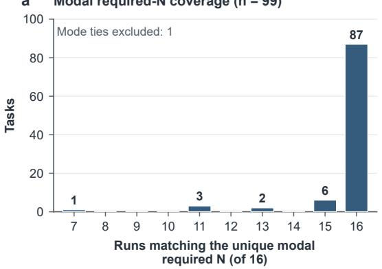

b Required-N variation (n = 100)  
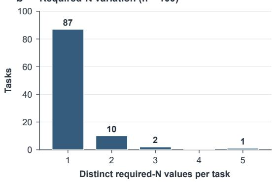

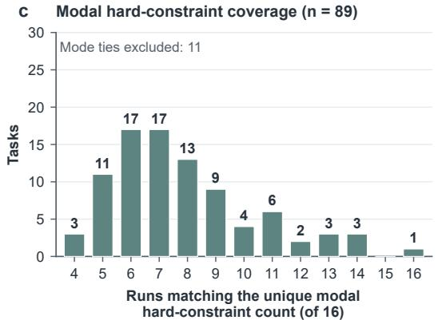

d Hard-constraint-count variation (n = 100)  
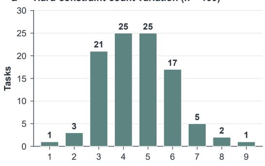

Figure A2: Field-level rubric stability across 16 saved runs per task (100 tasks; 1,600 rubrics). Panels (a) and (c) show the frequency of the unique modal required count and hard-constraint count, excluding 1 and 11 tasks with tied modes, respectively. Panels (b) and (d) retain all 100 tasks and show the number of distinct values per task. The panels measure structural count agreement. Each run retains its original rubric for scoring.  
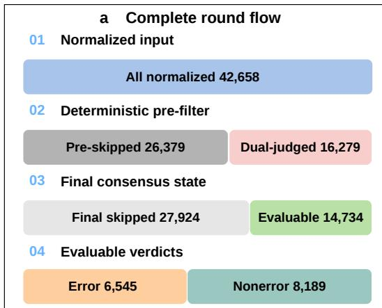

b Persisted-record composition  
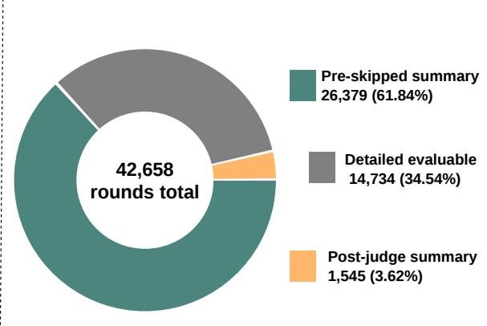  
Figure A3: Stage 2 round accounting across 1,600 runs. (a) The 16,279 dual-judged rounds yield 14,734 evaluable records and 1,545 post-judging skips; the latter combine with 26,379 pre-skipped rounds to give 27,924 final skips. The stored error label denotes an automatic candidate flag. (b) Persisted-record composition uses all 42,658 rounds as its denominator: 61.84% pre-skipped summaries, 34.54% detailed evaluable records, and 3.62% post-judge summaries.

Arbiter-return summaries cover 2,317 disagreements; another 84 disagreements have no retained summary. These two counts sum to the 2,401 verdict disagreements. Paired-record rates use rounds for which both judge objects were recovered, including recoverable post-judging skipped records. The 16,279 dual-judged rounds in Appendix F.2 instead describe the complete operational workload. Each statistic therefore retains its corresponding record population.

## F.4 Proposed Links and Target-Status Filtering

The prompt supplies all Stage 1 groups and their verdicts and asks the judges to consider taskrelevant correspondences such as entities, names, URLs, providers, prices, dates, and required fields. Exact lexical overlap is not required. Parsing normalizes ID shape, including null-to-emptylist conversion and numeric-to-string conversion. Returned-link feature correspondence is assessed in the human-validation sample. Agreeing-error links are unioned and deduplicated. Arbiter-resolved links remain as returned before summary construction.

Let $\bar { \mathcal { L } } _ { t }$ be the stored consensus links and $\boldsymbol { B } =$ $\{ i : v _ { i } =$ incorrect} the Stage 1-incorrect group set. Downstream summaries retain

$$
\begin{array} { r } { \mathscr { L } _ { t } ^ { \mathrm { s u m } } = \bar { \mathscr { L } } _ { t } \cap \boldsymbol { B } . } \end{array}
$$

This intersection excludes correct, unverifiable, and nonexistent targets. This operation selects targets according to their saved Stage 1 status. Returnedlink feature correspondence is evaluated through the human link audit in Appendix I.

## F.5 Diagnostic Units and Interpretation

For a retained run, define

$$
\begin{array} { r l r } & { } & { { \mathcal { E } } _ { \mathrm { a l l } } = \{ t : \bar { z } _ { t } = \mathrm { e r r o r } \} , } \\ & { } & { { \mathcal { E } } _ { \mathrm { l i n k e d } } = \{ t \in { \mathcal { E } } _ { \mathrm { a l l } } : { \mathcal { L } } _ { t } ^ { \mathrm { s u m } } \neq \emptyset \} , } \\ & { } & { t _ { \mathrm { f i r s t } } = \operatorname* { m i n } { \mathcal { E } } _ { \mathrm { l i n k e d } } \quad ( { \mathcal { E } } _ { \mathrm { l i n k e d } } \neq \emptyset ) , } \\ & { } & { { \mathcal { B } } _ { \mathrm { u n l i n k e d } } = { \mathcal { B } } \setminus \bigcup _ { t \in { \mathcal { E } } _ { \mathrm { a l l } } } { \mathcal { L } } _ { t } ^ { \mathrm { s u m } } . } \end{array}
$$

The primary retrospective output is the linked nodes and their retained round–group edges; the full candidate inventory also includes unlinked flags. The earliest linked index identifies the earliest returned related location in the retained trajectory. Nodes, edges, target groups, and runs have separate denominators: one node may link to multiple groups, and one group may receive multiple links. Node counts summarize automatic flags; human link review measures feature correspondence, and the separate commitment-based audit assesses explicit erroneous commitments.

## F.6 Unassigned Types

Of 6,545 flagged nodes, $^ { 6 , 5 0 3 }$ have a normalized type and 42 (0.64%) remain unassigned. These nodes stay in localization and linking totals but are kept separate from the typed-node denominator. The ten-category composition appears in Appendix G.

## G Error-Type Definitions and Representative Cases

The diagnostic vocabulary contains ten error-type labels for flagged candidate content. This section first defines every category and its boundary, then presents four source–answer comparisons, and finally reports how the vocabulary is fixed and distributed across the corpus.

## G.1 Ten Categories and Their Boundaries

Table A5 gives the complete definitions. Each typed node receives one dominant category. A retained round–group link, when present, identifies the associated final-answer content. The four cases below use these same category names.

## G.2 Four Representative Source–Answer Cases

Figure A4 illustrates four categories defined in Table A5: source not supporting, constraint violation, source quality error, and wrong entity. Each panel pairs a recorded observation with its final-answer group and the evaluator’s interpretation. The remaining six categories retain their full definitions in the same table. The cases preserve the original model, task, round, and group bindings:

1. Source not supporting. Qwen3.6-Flash, ds\_006, R9/G6. The source lists A100 at USD 3.09/hour and A100-80G at USD 3.18/hour; the answer pairs the 80-GB variant with USD 3.09/hour.

2. Constraint violation. GLM-4.7-Flash, ds\_010, R5/G1. The Family membership and NARM add-on total USD 150/year under a task requirement of strictly less than USD 150.

<table><tr><td>Error type Diagnostic definition and nearest boundary</td><td></td></tr><tr><td>Wrong entity</td><td>The target is identified, substituted, or merged with a different entity, alias, version, institution, product, or location. If the entity is the intended one but fails an eligibility condition, use con-</td></tr><tr><td>Constraint violation</td><td>straint violation. A candidate fails an explicit hard condition such as a feature, threshold, status, or eligibility rule. Date, geographic, and population boundaries belong to temporal or scope error.</td></tr><tr><td>Missing required field</td><td>An identifiable answer unit lacks a required attribute or source. An existing value assigned to the wrong field is a mapping error; incorrectly formed units are a grouping error.</td></tr><tr><td>Insufficient evidence</td><td>The available observation is too incomplete to establish a claim, for example a title, metadata, or partial passage lacking the required detail.</td></tr><tr><td>Source not supporting</td><td>Inspected content can be assessed but is irrelevant, omits the claimed fact, supports another value, or contradicts the interpretation. The issue is support for the claim, rather than source</td></tr><tr><td>Source quality error</td><td>type. The source is invalid, inaccessible, unsuitable, or explicitly disallowed by an official/primary- source requirement.</td></tr><tr><td>Count or grouping error</td><td>The number, distinctness, or boundaries of answer units are wrong through miscounting, dupli- cation, merging, splitting, or omission. This differs from an absent attribute in a properly formed</td></tr><tr><td>Temporal or scope error</td><td>unit. Inclusion or exclusion crosses an explicit date, period, geography, population, domain, jurisdic- tion, or other scope boundary.</td></tr><tr><td>Formatting or mapping error</td><td>The required information exists but violates the required format or is attached to the wrong item, field, label, unit, column, or output slot.</td></tr><tr><td>Other error</td><td>A concrete diagnostic defect outside the nine named categories. Use only when no named category applies; never for an absent type.</td></tr></table>

Table A5: Definitions and category boundaries of all ten diagnostic categories. Every category is defined here; the four selected cases illustrate a subset of the vocabulary. Stored labels remain automatic diagnostic assignments, including when the associated webpage observation itself is correct.

3. Source quality error. Nemotron-3-Ultra, ds\_075, R41/G3. A third-party Outlet Mall Finder page is retained as an “Official Directory” for Tanger Outlets Cookstown.

4. Wrong entity. DeepSeek-V3.2, ds\_009, R52/G1. The source describes Drayton Wiser HubR as a heating controller; the final selection includes it among smart thermostats.

These panels provide concrete source–answer comparisons for retained answer groups; figureinternal round units and type descriptions are evaluator interpretations. The separate corpus-level human link audit uses the fixed 317-edge sample in Appendix I.

## G.3 Development and Corpus Profile

A disjoint development set of 50 tasks and 500 trajectories fixes the vocabulary used for the 100- task, 1,600-run evaluation.

For agreeing error verdicts, the consensus retains Judge A’s normalized type when available, otherwise Judge B’s. Differing verdicts use the arbiter’s returned record. Type disagreement alone is not arbitrated. An absent normalized type remains unassigned; other error is an explicit tenth category and is not a missing-value code.

Interpretation follows three levels: the recorded webpage observation, the agent’s emitted text, and the evaluator’s diagnostic assignment. Inspecting the linked final-answer group then places the round in the context of the retained outcome.

The full evaluation retains 6,503 typed and 42 unassigned nodes among 6,545 automatic flags. Constraint violation, insufficient evidence, and missing required field together account for 5,128/6,503 typed nodes (78.86%). All ten categories remain present, including one formatting/mapping node. Model-specific shares use that model’s own typed-node count and exclude its unassigned nodes. The resulting shares describe the composition of the automatic diagnostic inventory.

## H Extended Results and Diagnostics

The main comparison covers 16 LLMs from eight families on 100 tasks: 1,600 retained trajectories, 7,685 answer groups, and 42,658 normalized rounds. Automatic evaluation flags 6,545 failure nodes, comprising 6,503 typed and 42 unassigned nodes. The retained associations comprise 3,664 answer-linked nodes and 5,798 round–group edges. These corpus totals anchor the model-level and conditional distributions below. Figure A6 gives a joint view of the linked candidate inventory, earliest returned associations, and execution markers.

case3: source\_quality\_error  
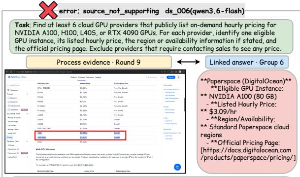  
case1: source\_not\_supporting

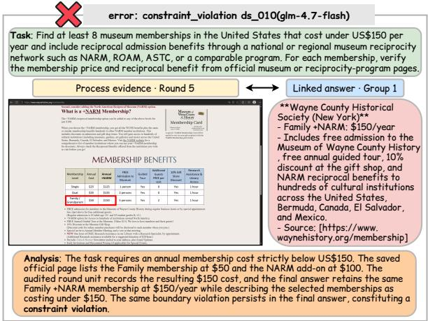

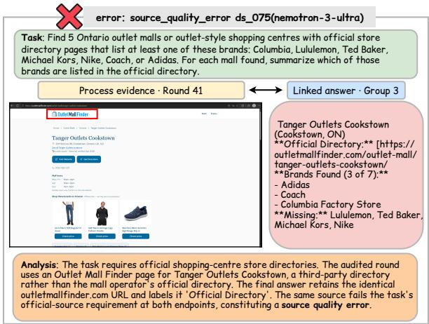

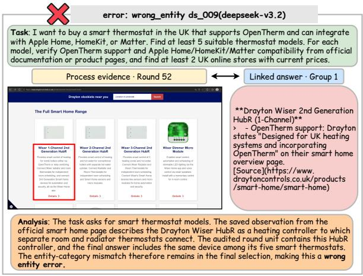  
case4: wrong\_entity

Figure A4: Illustrative source–answer comparisons: source not supporting, constraint violation, source quality error, and wrong entity. The original four-panel layout pairs returned observations with final-answer groups; round units and type descriptions reproduce evaluator interpretations. The accompanying case descriptions identify each model, task, round, and group.  
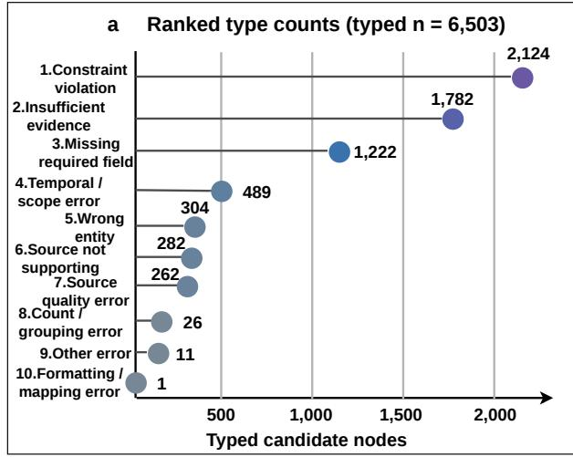

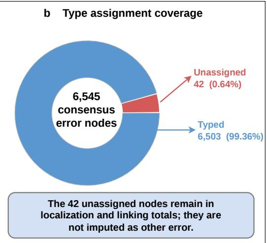  
Figure A5: Diagnostic-type composition and assignment coverage. (a) Counts over 6,503 typed candidate nodes; all ten categories are retained. (b) Among 6,545 automatically flagged nodes, 6,503 (99.36%) have a normalized type and 42 (0.64%) remain unassigned. The latter stay in localization and linking totals under a separate unassigned status. Consensus error nodes denote the automatic candidate flags defined in Appendix F.

## H.1 Outcome Scores and Aggregation

The main paper provides the complete model-level outcome table. AS, AP, and Upper are unweighted means over each model’s 100 saved reports. UGR pools unverifiable groups over all provided groups for that model. AP and UGR are displayed as percentages. The corpus contains 3,863 correct, 3,374 incorrect, and 448 unverifiable groups. The stored count modes comprise 1,294 exact, 164 min, and 142 dynamic\_all runs. The formulas in Appendix E.6 reproduce all 1,600 saved scores from their original group counts; no labels or rubrics are changed.

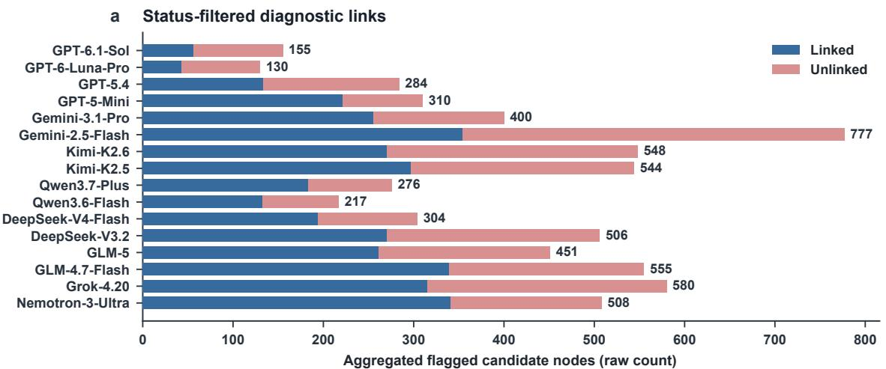

b First linked round (n = 850)  
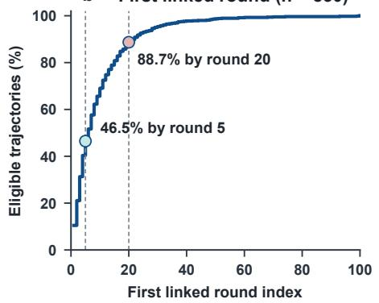

c Overlapping execution-audit markers  
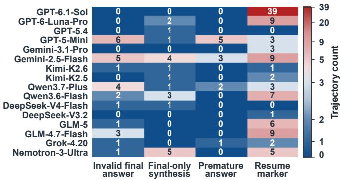  
Figure A6: Extended trajectory and execution diagnostics for 1,600 retained runs. (a) Linked and unlinked candidate flags, including unassigned types. (b) Earliest returned association among 850 trajectories with links. (c) Separately recorded, overlapping execution markers. The marker totals are 25 invalid-final flags, 20 final-only syntheses, 11 premature-answer flags, and 99 resume-marked trajectories.

## H.2 Complete Model-Level Process Diagnostics

A linked node is a non-skipped consensus-error round whose proposed group IDs intersect the Stage 1 incorrect groups. One node may link to multiple groups; each retained edge is identified by its run, round, and group IDs. Table A6 separates these units. Of the 3,374 incorrect groups, 2,229 (66.06%) have at least one retained association and 1,145 have none. The 3,664 linked and 2,881 unlinked nodes partition all 6,545 failure nodes. These counts include all 42 unassigned nodes, with each node counted once in Figure A6(a).

Failure-node count has pooled Spearman correlations of −0.427 with AS and −0.428 with AP (n = 1, 600 trajectories); within-model coefficients are negative for all 16 models. These are outcomeaware associations: Stage 2 receives the final response and Stage 1 verdicts.

## H.3 Earliest Returned Association

Of the 1,600 trajectories, 850 have a retained association. Their first linked round has median 6 (quartiles 3 and 13; range 1–100). The cumulative counts are 395/850 by round 5 (46.47%), 587/850 by round 10 (69.06%), and 754/850 by round 20 (88.71%). The 750 trajectories without an association remain outside this conditional distribution. These positions locate the earliest returned related content. Quantiles use linear interpolation at index (n − 1)q in the ordered eligible observations. Figure A6(b) visualizes this conditional distribution and reports the cumulative percentages rounded to one decimal.

<table><tr><td>Model</td><td>All rounds</td><td>Evaluable rounds</td><td>Flagged nodes</td><td>Runs with flag</td><td>Linked nodes</td><td>Runs with link</td></tr><tr><td>GPT-6.1-Sol</td><td>1,774</td><td>762</td><td>155</td><td>43</td><td>56</td><td>20</td></tr><tr><td>GPT-6-Luna-Pro</td><td>1,841</td><td>552</td><td>130</td><td>49</td><td>43</td><td>21</td></tr><tr><td>DeepSeek-V3.2</td><td>2,767</td><td>1,221</td><td>506</td><td>86</td><td>270</td><td>54</td></tr><tr><td>GPT-5.4</td><td>1,967</td><td>838</td><td>284</td><td>70</td><td>133</td><td>53</td></tr><tr><td>DeepSeek-V4-Flash</td><td>3,022</td><td>853</td><td>304</td><td>60</td><td>194</td><td>47</td></tr><tr><td>Kimi-K2.6</td><td>3,467</td><td>1,348</td><td>548</td><td>72</td><td>270</td><td>50</td></tr><tr><td>Kimi-K2.5</td><td>3,248</td><td>1,231</td><td>544</td><td>76</td><td>297</td><td>63</td></tr><tr><td>Qwen3.7-Plus</td><td>2,044</td><td>603</td><td>276</td><td>73</td><td>183</td><td>56</td></tr><tr><td>Grok-4.20</td><td>2,540</td><td>1,102</td><td>580</td><td>76</td><td>315</td><td>55</td></tr><tr><td>GLM-5</td><td>3,004</td><td>1,081</td><td>451</td><td>72</td><td>261</td><td>60</td></tr><tr><td>GPT-5-Mini</td><td>2,507</td><td>693</td><td>310</td><td>61</td><td>221</td><td>54</td></tr><tr><td>Nemotron-3-Ultra</td><td>3,569</td><td>1,122</td><td>508</td><td>80</td><td>341</td><td>64</td></tr><tr><td>Gemini-3.1-Pro</td><td>2,457</td><td>796</td><td>400</td><td>73</td><td>255</td><td>62</td></tr><tr><td>Qwen3.6-Flash</td><td>2,034</td><td>425</td><td>217</td><td>67</td><td>132</td><td>53</td></tr><tr><td>Gemini-2.5-Flash</td><td>3,237</td><td>1,215</td><td>777</td><td>79</td><td>354</td><td>67</td></tr><tr><td>GLM-4.7-Flash</td><td>3,180</td><td>892</td><td>555</td><td>79</td><td>339</td><td>71</td></tr><tr><td>Total</td><td>42,658</td><td>14,734</td><td>6,545</td><td>1,116</td><td>3,664</td><td>850</td></tr></table>

Table A6: Raw process counts over 100 trajectories per model. Evaluable rounds have an error or nonerror consensus verdict; final skipped rounds are excluded. Linked nodes and runs use the retained intersection with Stage 1 incorrect groups. Counts summarize observed activity and diagnostic coverage within each model’s retained trajectories.

## H.4 Search Behavior and Outcomes

Table A7 reports per-trajectory tool-use means. Tool counts measure returned tool-result events, including unsuccessful returns; they do not count provider retries. Mean normalized trajectory length ranges from 17.74 to 35.69 rounds.

Page-use summaries complement these tool counts. Across models, the mean number of distinct opened URLs ranges from 7.73 to 18.38 per trajectory, and distinct domains from 4.73 to 9.16. Mean read volume ranges from 4.78 to 48.02 thousand characters, including repeated or overlapping reads; final answers contain 7.43–14.34 URL occurrences on average. The archived model-level tables retain the full breakdowns.

Across the eleven recorded behavior fields and the AS/AP outcomes, the largest absolute pooled Spearman coefficient is 0.140 (final-answer URL occurrences versus AS). The corresponding AP association is 0.128. Each pooled coefficient uses 1,600 trajectories; within-model summaries use 100 trajectories per model and report the median of 16 coefficients, with average ranks for ties. These summaries describe the relation between observable search activity and the retained outcome scores.

## H.5 Execution-Audit Summary

Figure A6(c) shows the model-level distribution of four execution markers. Each marker counts the trajectories where it is present; a trajectory can contribute to multiple columns.

The final-answer source field partitions the corpus into 1,567 agent responses, 20 collection-time final-only syntheses, and 13 fallbacks. All retained trajectories contain a final answer. The four overlapping execution markers in Figure A6(c) total 25 invalid-final flags, 20 final-only syntheses, 11 premature-answer flags, and 99 resume-marked trajectories. The resume indicator counts the literal marker across batch resumption and runtime continuation.

Collection-time validation records 1,573 validfinal flags and 25 invalid-final flags; two runs have neither flag. An invalid-reason field is present in 27 records, and 1,589 runs meet the evidence requirement. Among the 20 synthesis responses, 17 are marked valid and three invalid; no run has a maximum-iteration flag. These separately stored finalization fields describe execution checks, while Stage 1 evaluates source-constrained answer-group correctness. The evaluator preserves the collected answers.

## I Human Validation

Human review assesses supplied answer-group labels, response scores, and returned round–group

<table><tr><td>Model</td><td>Search</td><td>Open</td><td>Read</td><td>Find</td><td>Extract</td><td>Tools</td><td>Rounds</td></tr><tr><td>GPT-6.1-Sol</td><td>9.49</td><td>13.41</td><td>7.75</td><td>4.30</td><td>0.85</td><td>35.80</td><td>17.74</td></tr><tr><td>GPT-6-Luna-Pro</td><td>14.57</td><td>9.29</td><td>5.38</td><td>4.15</td><td>0.39</td><td>33.78</td><td>18.41</td></tr><tr><td>DeepSeek-V3.2</td><td>13.75</td><td>15.64</td><td>10.84</td><td>12.98</td><td>0.65</td><td>53.86</td><td>27.67</td></tr><tr><td>GPT-5.4</td><td>11.19</td><td>10.40</td><td>4.86</td><td>8.68</td><td>0.76</td><td>35.89</td><td>19.67</td></tr><tr><td>DeepSeek-V4-Flash</td><td>21.99</td><td>14.21</td><td>12.09</td><td>5.27</td><td>0.35</td><td>53.91</td><td>30.22</td></tr><tr><td>Kimi-K2.6</td><td>21.98</td><td>17.42</td><td>15.64</td><td>8.59</td><td>0.32</td><td>63.95</td><td>34.67</td></tr><tr><td>Kimi-K2.5</td><td>18.88</td><td>15.97</td><td>16.10</td><td>6.56</td><td>0.24</td><td>57.75</td><td>32.48</td></tr><tr><td>Qwen3.7-Plus</td><td>13.80</td><td>9.63</td><td>6.87</td><td>3.82</td><td>0.16</td><td>34.28</td><td>20.44</td></tr><tr><td>Grok-4.20</td><td>10.67</td><td>11.94</td><td>14.90</td><td>4.97</td><td>0.14</td><td>42.62</td><td>25.40</td></tr><tr><td>GLM-5</td><td>13.58</td><td>19.07</td><td>13.54</td><td>6.44</td><td>0.53</td><td>53.16</td><td>30.04</td></tr><tr><td>GPT-5-Mini</td><td>16.35</td><td>10.29</td><td>2.38</td><td>9.40</td><td>0.30</td><td>38.72</td><td>25.07</td></tr><tr><td>Nemotron-3-Ultra</td><td>13.76</td><td>23.75</td><td>11.86</td><td>9.46</td><td>0.62</td><td>59.45</td><td>35.69</td></tr><tr><td>Gemini-3.1-Pro</td><td>16.64</td><td>10.48</td><td>8.98</td><td>5.87</td><td>0.35</td><td>42.32</td><td>24.57</td></tr><tr><td>Qwen3.6-Flash</td><td>15.90</td><td>8.31</td><td>6.08</td><td>2.53</td><td>0.15</td><td>32.97</td><td>20.34</td></tr><tr><td>Gemini-2.5-Flash</td><td>11.42</td><td>12.87</td><td>11.88</td><td>15.12</td><td>0.94</td><td>52.23</td><td>32.37</td></tr><tr><td>GLM-4.7-Flash</td><td>20.85</td><td>10.83</td><td>3.87</td><td>13.79</td><td>0.12</td><td>49.46</td><td>31.80</td></tr></table>

Table A7: Mean tool use and normalized length over 100 trajectories per model. The Tools column sums the five tool categories; normalized rounds are counted separately from tool calls.

correspondences. Each analysis uses its specified sample and denominator.

## I.1 Sample and Review Protocol

The post-hoc audit uses two randomly selected responses from different models for each of the 100 tasks: 200 responses and 946 supplied answer groups, including four explicitly confirmed emptygroup responses. Fifty randomly selected tasks contribute both trajectories to process review (100 trajectories; 2,642 normalized rounds). Reviewer H1 completes the primary audit; a different reviewer, H2, independently checks fixed subsets of 40 responses from 20 tasks (172 groups) and 20 trajectories from 10 tasks (499 rounds). The subsets form independent agreement checks within the primary samples. Sampling uses CPython’s MT19937 generator with seed 20261004 and the frozen 16-model population; it is not stratified by scores, disagreements, or error counts.

For Stage 1, reviewers receive the requirements, complete final response, supplied groups, and original cited URLs. Automatic labels, scores, reasons, separate model metadata, and the other reviewer’s annotations are withheld. Complete answer text may still contain self-identification. Reviewers assign C/I/U labels and scores are derived from the locked details; disagreements remain unchanged. Both reviewers self-report web-search expertise, rule familiarity, and no exposure to the withheld item-level results. This post-hoc protocol was clarified in the context of previously inspected comparison results; item-level annotations follow the withholding and locking procedure described here.

With group boundaries fixed, the audit evaluates supplied-group judgments and their derived scores. Reviewers check the original citation set at review time; webpage content may vary between accesses. Each reviewer’s annotations are locked before score comparison. Process labels and the answer endpoints used for link review are locked separately before candidates are shown, and later link judgments do not overwrite those endpoints. Process review follows an instruction to use the current and earlier rounds; the static workbooks retain the complete trajectories.

Reported 95% intervals use 10,000 paired taskcluster percentile bootstrap draws (seed 20261009), preserving all observations and repeated-task weights. The cluster counts are 100 for primary answers, 50 for process and links, 20 for H2 answers, and 10 for H2 process review. Link resampling includes the 13 process-sample tasks with no candidate edge.

## I.2 Answer-Group and Score Agreement

Automatic and H1 labels agree on 894/946 groups (94.50%, 95% CI [91.96, 96.73]; Cohen’s κ = 0.8989, [0.8523, 0.9392]).

H1 and H2 agree on 160/172 subset groups (93.02%, [87.65, 97.66]; κ = 0.8574, [0.7464, 0.9499]).

Table A9 compares automatic–H1 and independent H1–H2 response-score agreement. In the primary automatic–H1 comparison, both sides retain their recorded quantity rules: N differs in 12 responses and count mode in 11 (15 responses in the union). All 200 responses enter the comparison with their recorded scores. For the two sampled model responses per task, automatic and human orderings agree on 56/60 tasks for AS and 57/61 for AP when both orderings are non-tied. Including 28 shared AS ties and 27 shared AP ties gives 84/100 matching relations for each metric. Each metric also has four reversed non-ties and 12 one-sided ties.

<table><tr><td colspan="6">Automatic → H1 (946 groups)</td><td colspan="6">H1 → H2 (172 groups)</td></tr><tr><td>Row label</td><td>C</td><td></td><td>I U</td><td>Total</td><td></td><td>Row label</td><td>C</td><td>I U</td><td></td><td>Total</td></tr><tr><td>C</td><td>475</td><td>21</td><td>2</td><td>498</td><td></td><td></td><td>103</td><td>5</td><td>1</td><td>109</td></tr><tr><td>I</td><td>22</td><td>373</td><td>1</td><td>396</td><td></td><td></td><td>6</td><td>51</td><td></td><td>57</td></tr><tr><td>U</td><td>1</td><td></td><td>5 46</td><td></td><td>52</td><td></td><td>0</td><td>0 6</td><td></td><td>6</td></tr><tr><td>Total</td><td>498</td><td>399</td><td>49</td><td>946</td><td></td><td>Total</td><td>109 56</td><td>7</td><td></td><td>172</td></tr></table>

Table A8: Supplied-group label matrices. Columns identify the second member of each comparison; C/I/U mean correct/incorrect/unverifiable.

## I.3 Returned-Link Feature Correspondence

Every retained link in the process sample is reviewed: 317 candidate edges across 55 trajectories and 37 tasks. Support requires a verified, locatable feature—such as an entity, URL, domain, model, provider, or price—with evidence on both the round and target sides. For a split or merged group, at least one explicitly mapped target must satisfy this rule. Review confirms 311/317 links, giving 98.11% feature-correspondence precision ([96.15, 99.40]), with six unsupported and no undetermined links.

Explicit group alignment yields 475 alignment records and 360 targets, while the evaluation unit remains the 317 original candidate edges. Three targets retain reviewed machine-only text rather than a matched human group. The criterion applies to observable content features across process verdicts. It measures the precision of returned locations for retrospective inspection of answer-related content.

## I.4 Commitment-Based Process Audit

The separate human process audit uses error for an explicit erroneous interpretation or commitment. Opening a candidate, observing third-party content, and collecting an incomplete set of fields are assessed as exploratory activity unless an erroneous commitment is present. Automatic flags instead assess candidate content against hard constraints. Table A10 reports these two annotation targets: the commitment-based audit assigns zero error labels, while the automatic candidate-content procedure flags 349 rounds.

On the independent process subset, H1/H2 agree on 494/499 rounds (99.00%, [97.74, 100.00]; κ = 0.9799, [0.9525, 1.0000]). The five disagreements are H1-skipped/H2-non\_error. Both reviewers assign zero error labels; their agreement therefore describes the distinction between non-error and skipped rounds. Binary-error κ and conditional type agreement are undefined in this subset.

For the 317 candidate links, locked human process endpoints comprise 289 non-error and 28 skipped labels. A separate strict conjunction requires the same target to have a human error node, a locked incorrect answer group, and supported feature correspondence. It yields 0/317 edges because the reviewed process endpoints contain no human error label. The 311/317 feature-correspondence result and this conjunction retain their distinct definitions and the same original edge denominator.

## J Computational Resources and API Budget

Constructing and evaluating the corpus requires sustained model inference, web interaction, and source verification across 1,600 retained runs. The cumulative runtimes reported in the main paper are 1,037 hours for trajectory collection and 318 hours for automatic evaluation, totaling 1,355 hours. The upper-scenario API budget is approximately USD 2,943: USD 1,812.30 for collection and USD 1,130.69 for evaluation. Runtime, interaction volume, and API workload together describe the investment in collecting and verifying the retained corpus.

## J.1 Accounting Scope and Workload

Runtime follows the main-paper totals and sums the time invested across runs; parallel execution determines the elapsed calendar schedule. API budgets use the archived price snapshot dated 23 October 2026. Collection uses the upper full-history workload scenario, while evaluation uses recorded token usage repriced under the paper’s fixed evaluator roles. All amounts are in USD and cover model API inference for the retained-run pipeline. Websearch services, hosting, labor, and development experiments are separate resource categories.

<table><tr><td></td><td colspan="3">Automatic-H1</td><td colspan="3">H1-H2</td></tr><tr><td>Metric</td><td>AS</td><td>AP</td><td>Upper</td><td>AS</td><td>AP</td><td>Upper</td></tr><tr><td>Pearson r</td><td>0.9054 [0.8496, 0.9519]</td><td>0.9132 [0.8595, 0.9588]</td><td>0.8798 [0.8107, 0.9372]</td><td>0.8961 [0.7335, 0.9825]</td><td>0.9022 [0.7468, 0.9834]</td><td>0.9215 [0.8003, 0.9879]</td></tr><tr><td>Spearman ρ</td><td>0.9035 [0.8441, 0.9515]</td><td>0.9103 [0.8514, 0.9583]</td><td>0.8816 [0.8107, 0.9370]</td><td>0.8614 [0.6248, 0.9837]</td><td>0.8679 [0.6394, 0.9855]</td><td>0.9003 [0.7314, 0.9876]</td></tr><tr><td>Kendall τ</td><td>0.8609 [0.7931, 0.9204]</td><td>0.8712 [0.8054, 0.9299]</td><td>0.8326 [0.7557, 0.8992]</td><td>0.8087 [0.5839, 0.9578]</td><td>0.8136 [0.5899, 0.9623]</td><td>0.8561 [0.6881, 0.9675]</td></tr><tr><td>MAE</td><td>4.8792 [2.8749, 7.1625]</td><td>4.4542 [2.4832, 6.6833]</td><td>6.2625 [3.7458,9.1167]</td><td>5.0625 [1.5625, 9.3958]</td><td>5.0625 [1.5625, 9.3958]</td><td>4.5625</td></tr><tr><td>Bias</td><td>0.8375 [-1.4584, 3.2500]</td><td>0.4625 [-1.7584, 2.7833]</td><td>2.0542 [-0.7502, 5.1333]</td><td>0.8958 [-3.3333, 5.7500]</td><td>0.8958 [-3.3333, 5.7500]</td><td>[1.3333, 8.7297] 0.3958 [-3.5417, 5.0625]</td></tr></table>

Table A9: Response-score agreement on 200 automatic–H1 responses and the independent 40-response H1–H2 subset. Each cell gives the point estimate above its 95% confidence interval. AS is Answer Score, AP is Answer Precision, and Upper is Upper Score. AS/Upper errors are points on a 0–100 scale; AP errors are percentage points and AP correlations use 0–1 values. Bias is automatic minus H1 in the left block and H1 minus H2 in the right block. H2 labels do not replace H1 in the primary comparison.

<table><tr><td>Human \Automatic</td><td></td><td>Error Non-error</td><td>Skipped</td><td>Total</td></tr><tr><td>Error</td><td>0</td><td>0</td><td>0</td><td>0</td></tr><tr><td>Non-error</td><td>329</td><td>589</td><td>353</td><td>1,271</td></tr><tr><td>Skipped</td><td>20</td><td>9</td><td>1,342</td><td>1,371</td></tr><tr><td>Total</td><td>349</td><td>598</td><td>1,695</td><td>2,642</td></tr></table>

Table A10: Complete process cross-tabulation on 100 trajectories from 50 tasks. The two sets of labels concern different annotation targets.

The collection records contain 74,015 tool-result events: 24,482 searches, 21,351 page openings, 15,302 reads, 12,193 within-page searches, and 687 link extractions. These interactions expose 44.58 million read characters and produce the 42,658 normalized rounds used in evaluation. Reconstructing the model-request workload yields an estimated 75,622 calls. Long trajectories repeatedly present accumulated context to the model, so input processing is a substantial component of the collection budget.

Evaluation records contain 40,455 structured model operations: 30,335 in Stage 1 and 10,120 in Stage 2. Recorded usage totals 422.56 million tokens, comprising 259.23 million input and 163.32 million output tokens. The operation records also include 14,722 JSON-repair attempts, yielding at least 55,177 successful provider responses. Their usage is already included in the recorded token totals. Collection calls and evaluation operations retain their respective counting units.

## J.2 Upper-Scenario Collection Budget

The upper workload scenario reconstructs full accumulated input histories and allocates 800 output tokens per model request. Saved histories use cl100k\_base as a common token-count proxy, yielding 1,467,125,200 input tokens. For 72,913 tool-associated assistant-message slots, the scenario allocates 530 visible tokens per message; their repetition in subsequent requests contributes 2,482,483 history occurrences. Thus the aggregate input and output budgets are

$$
\begin{array} { r l } & { T _ { \mathrm { i n } } ^ { \mathrm { c o l } } = 1 , 4 6 7 , 1 2 5 , 2 0 0 + 5 3 0 \times 2 , 4 8 2 , 4 8 3 } \\ & { \qquad = 2 , 7 8 2 , 8 4 1 , 1 9 0 , } \end{array}
$$

$$
T _ { \mathrm { o u t } } ^ { \mathrm { c o l } } = 7 5 , 6 2 2 \times 8 0 0 = 6 0 , 4 9 7 , 6 0 0 .
$$

This is the upper full-history scenario in the resource audit. Each model’s input and output workloads are priced separately at its archived uncached rates. The resulting collection budget is USD 1,812.30, of which input processing contributes USD 1,624.44 (89.63%) and output generation USD 187.86. Each model contributes 100 retained trajectories. The largest collection budgets are USD 334.61 for Gemini-3.1-Pro, USD 278.07 for GPT-6.1-Sol, and USD 263.06 for GPT-5.4; GPT-6-Luna-Pro has the smallest budget at USD 9.82. This variation reflects both accumulatedcontext workload and the archived model-specific input/output rates.

## J.3 Evaluation Budget and Stage Allocation

For role r, let $T _ { r } ^ { \mathrm { i n } }$ and $T _ { r } ^ { \mathrm { o u t } }$ be recorded token counts, and $p _ { r } ^ { \mathrm { i n } }$ and $p _ { r } ^ { \mathrm { o u t } }$ the reference prices in USD per million tokens. The budget is

$$
B _ { \mathrm { A P I } } = \sum _ { r } \frac { T _ { r } ^ { \mathrm { i n } } p _ { r } ^ { \mathrm { i n } } + T _ { r } ^ { \mathrm { o u t } } p _ { r } ^ { \mathrm { o u t } } } { 1 0 ^ { 6 } } .
$$

The fixed roles use DeepSeek-V4-Pro for Stage 1 and Judge A, with input/output rates of USD 1.32/3.96 per million tokens. Judge B and the arbiter use Qwen3.7-Max at USD 2.50/7.50. These are the audit’s peak/international reference rates with uncached input.

Stage 1 comprises rubric construction, answer grouping, source verification, and recorded evidence-repair operations. Its budget is USD 676.66 (59.84% of evaluation). Stage 2’s two judges and arbitration account for USD 454.03 (40.16%). Table A11 summarizes the token workloads and their corresponding upper-scenario budgets.

<table><tr><td>Phase</td><td>Input (M)</td><td>Output (M)</td><td>USD</td></tr><tr><td>Collection</td><td>2,782.84</td><td>60.50</td><td>1,812.30</td></tr><tr><td>Stage 1</td><td>157.17</td><td>118.48</td><td>676.66</td></tr><tr><td>Stage 2</td><td>102.07</td><td>44.84</td><td>454.03</td></tr><tr><td>Budgeted total</td><td>3,042.07</td><td>223.82</td><td>2,942.98</td></tr></table>

Table A11: Token workload and upper-scenario API budget for the retained-run pipeline. M denotes one million tokens. Collection uses estimated workload; evaluation uses recorded usage. All API amounts are reference-price budgets. Totals are computed before rounding.

Together, the runtime and workload breakdowns quantify the investment in collecting real interactions and verifying their outcomes. The budget includes repeated context processing, sourceconstrained verification, independent round judgments, and arbitration as distinct parts of the evaluation pipeline. The resource audit records the selected workload scenario, price snapshot, and stage allocation for offline re-aggregation.

## K Prompts, Schemas, Algorithms, and Reproduction

This section specifies the retained prompt and schema contracts, implementation procedure, and three reproduction modes.

## K.1 Prompt Roles and Shared Information Boundaries

The seven prompt roles are the collection agent, three Stage 1 roles (rubric construction, extraction, verification), two Stage 2 judges, and the arbiter. Evaluator inputs exclude evaluated-model identity. Stage 1 accesses agent-cited URLs; Stage 2 uses the recorded audit tuple and arbitration adds both judge outputs.

## K.2 Agent System Prompt and Tool Descriptions

The shared instruction defines the ReAct syntax, evidence-before-answer rule, and terminal format. The archived instruction is reproduced below with its wording unchanged:

Agent instruction (archived source snapshot)

You are a web research ReAct agent in a weaktool evaluation setting.

Every task requires web search. Use web\_search to discover candidate URLs, but web\_search returns only titles and URLs.

You must open and inspect pages using open\_url, read\_page, find\_on\_page, and extract\_links.

Do not answer from search result titles alone. Do not assume a page supports a claim unless you have read relevant page text.

Use multiple pages when the task requires comparison or verification.

When calling a tool, use exactly one tool call and no extra text after the Action Input. Use this format:

Thought: ...

Action: tool\_name

Action Input: {"arg": "value"}

Never output only a JSON object or a fenced JSON block. The tool name must always appear on an Action line before Action Input.

Never output provider-style tool text such as [Tool call], function\_call, function\_calls, or standalone tool names followed by JSON. Those are not valid final answers and not valid ReAct steps in this experiment.

Do not output chat role labels such as User:, Assistant:, or System:.

Do not use Tool or Tool Input blocks. Do not use XML-style, angle-bracket, or providerspecific function-call markup. Do not place a new Thought or Action on the same line as Action Input.

When you have enough evidence, use the official ReAct final format:

Thought: I can answer without using any more tools.

Answer: [final answer with source URLs]

After Answer, stop completely. Never request read\_page, web\_search, open\_url, find\_on\_page, or extract\_links after Answer.

Do not use Answer to explain that tools failed or that evidence is missing. A final Answer must directly satisfy the user’s task using verified source URLs. If evidence is insufficient, continue using the available tools instead of ending with a refusal or noncompletion note.

Do not use Action after Answer.

The controller appends the five tool descriptions and arguments in Appendix C.3.

## K.3 Stage 1 Prompt Contracts

Rubric construction. The task yields N, count\_mode, hard constraints, and a grouping rule, preserving strict inequalities, dates, scope, source requirements, and conditional applicability. Count requirements govern task-level scoring; other constraints govern eligible groups.

Answer-group extraction. The final response yields ordered task-defined units with stable IDs and associated URLs. Extraction resolves formatting while preserving answer content and cited sources.

Group verification. The verifier uses each group, its usable cited texts, and answer-visible requirements to return a verdict, failed criterion IDs, evidence references, inaccessible URLs where applicable, and an evidence-grounded reason. The access-only rule follows Appendix E.5.

## K.4 Stage 2 Judge and Arbiter Prompt Contracts

Each judge independently maps the tuple in Appendix F.1 to a verdict, failed criteria, a diagnostic type, proposed group IDs, and a reason using the candidate-content checks. Links use observable entity, URL, date, price, or other task-field correspondences. The arbiter receives the tuple plus both judge records and returns the same roundevaluation schema for verdict disagreements.

Source bindings. The archived implementation snapshot records prompt builders and schemas under method\_artifacts/prompts\_and\_schemas/: ag ent\_system\_prompt\_current.txt; prompt\_and\_tool\_ builder\_inventory.json (source symbols and verbatim builder bodies); and schemas\_current.py (typed schema). These specify snapshot wording and serialization. Retained manifests govern historical execution settings; rendered provider requests and per-run environment overrides have partial archival coverage.

## K.5 Structured Output Schemas

Machine-readable schemas specify exact types, optionality, enumerations, and validation rules for four object groups:

Collection objects. Run/task IDs, question, final response, ordered rounds, and model metadata; rounds contain IDs, model text, tool sequences, observations, URLs, and page-text context.

Stage 1 objects. Rubric fields above plus criterion IDs; group content, citations, and access states; evaluation verdicts, criterion results, evidence references, reasons, counts, and scores.

Stage 2 objects. Round ID, verdict, skip flag, failed criteria, type, links, and reason; consensus adds judge verdicts, arbiter-use status, and merged or arbiter-returned links before target-status filtering.

Final report. Stage outputs joined to linkage summaries, behavioral fields, and execution metadata by retained run IDs.

## K.6 Implementation-Aligned Procedures

The implementation applies the Stage 2 rules in Appendix F in the following order, preserving proposed links before target-status filtering.

1. Pre-skip structurally empty rounds and configured background or navigation-pattern matches.

2. Send remaining rounds independently to both judges with identical audit tuples and output contracts.

$$
\bar { \mathcal { L } } _ { t } \cap
$$

$$
\mathcal { L } _ { t } ^ { \mathrm { s u m } } =
$$

7. Aggregate total, evaluable, error, typed, linked, and first-linked diagnostics; links record diagnostic content associations.

## K.7 Artifact Scope and Reproduction

The anonymized repository provides core implementation, representative samples, and instructions identifying released materials and executable entry points. Credentials and private provider settings remain outside the public artifacts.

Offline re-aggregation. Join the 1,600 retained manifests and trajectories to tasks, Stage 1 rubrics, groups and verdicts, Stage 2 judge and consensus records, and behavioral and aggregation tables. Use the frozen run-selection manifest and task/run IDs, preserving one row per model–task pair, its scoring mode, and target-status filtering. All records come from the same frozen version.

Evaluator re-execution. Re-running either stage calls external providers under selected configurations. Provider revisions, prompt versions, serialization, and serving nondeterminism may alter outputs.

Live-web re-verification. Stage 1 revisits agentcited URLs under current access conditions: pages may change, redirect, disappear, or become blocked. Released page excerpts and report references preserve selected observations; live retrieval produces new ones.

## L Evaluation Scope and Broader Impacts

## L.1 Task and Execution Scope

The 100 public-web tasks evaluate multi-source search and constraint satisfaction through sourcesupported answer groups under a shared weak-tool interface. One retained run per model–task cell supports paired task comparisons; reported uncertainty concerns task variation. Visual interaction, authenticated workflows, private context, transactions, and richer browser operations define complementary settings with different access and execution policies.

## L.2 Evaluator Configuration and Rubric Variation

Fixed evaluator roles standardize comparisons. Human-agreement statistics use separate primarysample and independent-subset denominators (Appendix I). Required counts are more consistent across run-specific rubrics than hard-constraint counts; field-level modal coverage and normalized text hashes characterize complementary aspects (Appendix E.7). Other judges, prompts, or provider versions provide configurations for sensitivity analysis.

## L.3 Process Interpretation

Link review measures returned feature correspondence; commitment review assesses explicit erroneous commitments (Appendix I). Stage 2 conditions on final responses and Stage 1 verdicts, so flag–score associations are outcome-conditioned. The earliest linked-round index locates the first returned association (Appendix F.5); the taxonomy assigns one dominant category from ten labels and accounts separately for unassigned types.

## L.4 Replication Conditions

Appendix K.7 distinguishes frozen-record aggregation from evaluator re-execution and live-web verification under new provider and source conditions. The budget snapshot fixes reference prices and upper workload assumptions (Appendix J).

## L.5 Broader Impacts

Source-supported scores and inspectable trajectory associations support evaluation research and targeted agent improvement within this setting. Public-web excerpts require attention to licenses, privacy, and redistribution; improved browsing also enables large-scale scraping. Security, promptinjection resilience, and deployment safety require dedicated evaluations. Offline aggregation reuses collected model and network outputs; energy use and emissions lie outside the reported resource accounting.