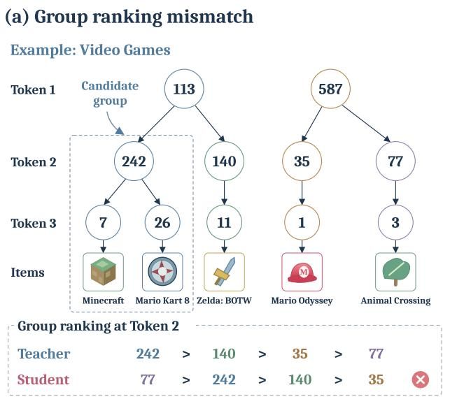
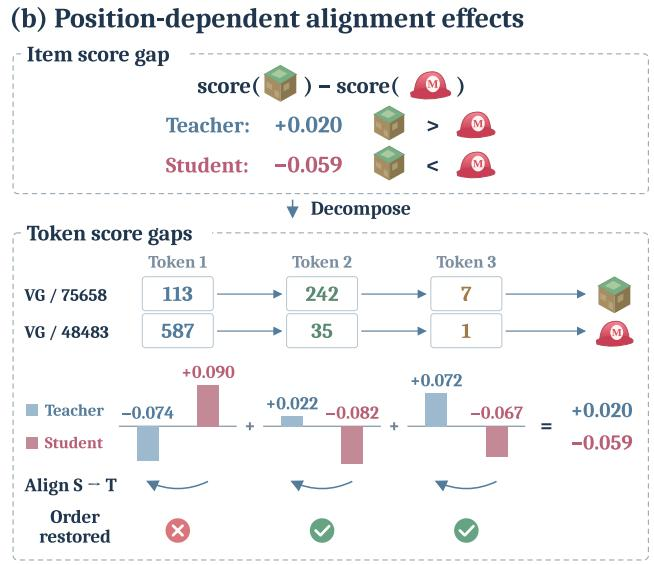
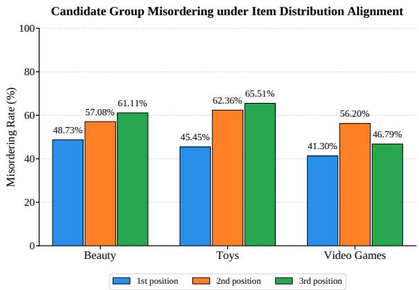
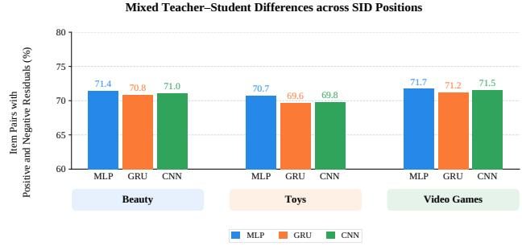
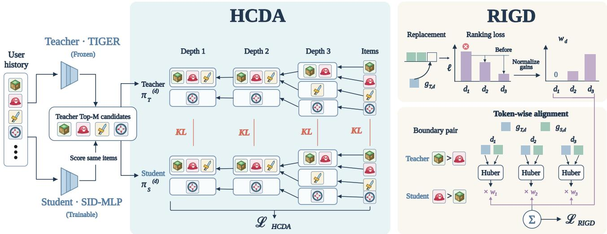
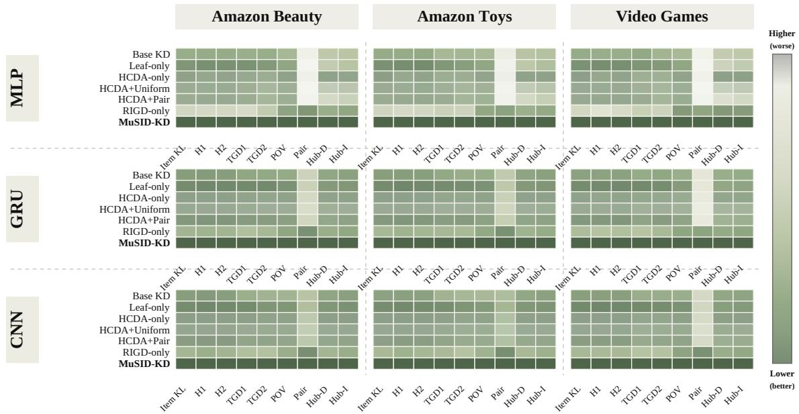
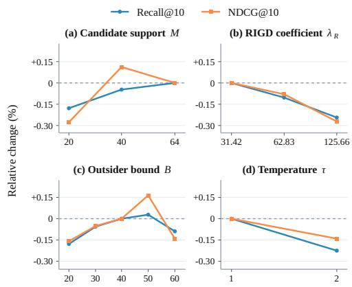

# MuSID-KD: Multigranularity Knowledge Distillation for Generative Recommendation with Semantic IDs

Fengshi Zhang East China Normal University Shanghai, China

Shuxiao Xie Fudan University Shanghai, China

Xiyan Ding East China Normal University Shanghai, China

Wei Zhang∗ East China Normal University Shanghai, China

## Abstract

Generative recommendation with semantic IDs (SIDs) represents each item as a sequence of discrete tokens and autoregressively predicts the next item’s SID. Despite strong recommendation performance, repeated decoding over multiple SID positions incurs substantial inference cost. Knowledge distillation transfers knowl edge from a powerful generative teacher to a lightweight student, yet conventional objectives do not fully account for multi token SID generation. We identify two limitations: item-level distribution alignment may not adequately preserve the teacher’s ranking of candidate groups sharing SID prefixes, while uniform alignment across SID positions may afect final item ranking differently. We propose MuSID-KD, which combines Hierarchical Candidate Distribution Alignment (HCDA) and Ranking Impact Guided Levelwise Distillation (RIGD). HCDA aggregates item probabilities according to shared SID prefixes and aligns candidate distributions at successive levels, from candidate groups to individual items. RIGD evaluates the reduction in pairwise ranking surrogate loss when one student score contribution is replaced with the teacher’s contribution, and allocates supervision accordingly. Experiments on real-world recommendation datasets using three lightweight student architectures demonstrate improved recommendation accuracy and better alignment of prefix marginal distributions and pairwise item rankings, without modifying the student’s online inference architecture. Code is available at https://anonymous.4open.science/r/m7k2-review-83f9/.

## Keywords

Generative recommendation, semantic IDs, knowledge distillation, candidate distributions, ranking alignment

Relevance to the Web. Personalized Web recommendation requires both high ranking quality and eficient serving across large item catalogs. MuSID-KD addresses this quality and eficiency tradeof through knowledge transfer during training while preserving lightweight SID generation at inference.

## 1 Introduction

The growing scale of item catalogs and diversity of user interests have made item representation and preference modeling central problems in recommendation. Conventional recommenders often use independent atomic IDs that do not explicitly encode semantic relationships among items. Generative recommendation with semantic IDs (SIDs) instead represents each item as a sequence of discrete tokens and predicts the next item’s SID from user interactions [10, 19]. Shared SID prefixes organize items within a structured token space, and models such as TIGER have demonstrated the efectiveness of this paradigm [19].

Autoregressive SID generation nevertheless incurs serving costs: constrained beam search repeatedly expands candidate prefixes and evaluates next token distributions. Knowledge distillation (KD) transfers predictions from a strong teacher to a compact student to reduce this burden [6, 23]. For example, SID-MLP replaces costly Transformer decoding with lightweight, prefix-conditioned prediction heads while preserving dependencies on the user context and previously generated SID tokens [4]. Recently, SID-specific distillation methods such as SmartGR have further exploited SID hierarchy and ranking information [30]. However, existing methods still leave two supervision gaps in multi-token SID generation:

• Insuficient supervision of candidate distributions across SID granularities. Items with a common SID prefix cannot be distinguished until later tokens are generated. At SID position �, we call candidate items sharing their first � SID tokens a candidate group. Shorter prefixes form coarser groups, while a full SID identifies an individual item. In Figure 1(a), Minecraft and Mario Kart 8 belong to the group sharing the prefix (113, 242). Thus, the teacher’s distribution over candidate items also induces coarser prefix marginal distributions over candidate groups.

Item distribution alignment matches the teacher’s distribution over candidate items, so candidate group rankings receive only indirect supervision. When student capacity is limited, approximate alignment of item probabilities does not ensure that rankings of the corresponding groups are preserved. In our diagnosis, a student using only candidate item distribution alignment for distillation disagrees with the teacher’s group ordering in 53.8% of evaluated comparisons on average across datasets and intermediate SID positions (Figure 2). Figure 1(a) illustrates a case where the student ranks group 77 above the teacher’s preferred group 242. This motivates explicit alignment of candidate group distributions as well as individual item distributions.

• Uniform supervision across SID positions. An item score sums conditional token log probabilities across SID positions. Thus, the gap between two item scores sums the contributions from individual positions. Conventional token distribution distillation supervises predictions at each

  
Figure 1: Two supervision problems in distillation with SIDs, illustrated by teacher and student predictions. (a) Teacher and student may rank candidate groups formed by shared SID prefixes diferently. (b) For a fixed item pair, diferences between teacher and student pairwise score contributions may have opposite signs across SID positions.

SID position but does not consider whether matching the teacher there improves the final pairwise ranking. We find that 69.6%–71.7% ofevaluated item pairs exhibit score residuals with opposite signs across SID positions (Figure 3). In Figure 1(b), the student’s contribution at the first position favors the teacher-preferred item (+0.090), whereas the teacher’s contribution at that position favors the other item (−0.074). At the second and third positions, the teacher favors the preferred item, while the student favors the other item. Uniformly pulling all levels toward the teacher can reduce an already favorable contribution while improving the others.

Motivated by these findings, we propose MuSID-KD, a distillation framework tailored to multi-token SID generation. Its Hierarchical Candidate Distribution Alignment (HCDA) objective aggregates candidate item probabilities under each shared SID prefix and aligns the resulting prefix marginal distributions at all SID positions. Its Ranking Impact Guided Levelwise Distillation (RIGD) objective measures how replacement at one SID position changes the pairwise ranking surrogate loss; only positions with positive replacement gain receive nonzero weight. Both objectives operate during ofline training and leave the student model and its online decoding unchanged.

## The main contributions of this work are summarized as follows:

• We identify two key limitations of existing SID distillation: insuficient supervision of candidate group rankings at intermediate SID positions and uniform teacher matching despite its diferent efects on final item rankings.

• We propose MuSID-KD, combining HCDA to align candidate distributions at multiple SID granularities and RIGD to allocate supervision according to the ranking benefit of matching the teacher at each SID position.

• Extensive experiments on four real-world datasets with three lightweight student architectures demonstrate improved recommendation accuracy and knowledge transfer, supported by ablation studies, ranking diagnostics, and eficiency analysis.

## 2 Related Work

## 2.1 Generative Recommendation with Semantic IDs

Generative recommendation casts next item prediction as sequence generation. TIGER uses residual quantization to assign semantic token sequences to items and generates SIDs autoregressively [15, 19]. Other work studies learned tokenization, SID representation, and efficient generation [8, 25]. Unlike recommendation based on atomic IDs, SID models expose multiple token positions and shared prefixes, ofering a natural basis for candidate group analysis. Repeated decoding and beam search nevertheless impose online inference costs [4].

## 2.2 Knowledge Distillation for Recommendation

Knowledge distillation compresses a teacher’s predictive behavior into a smaller model [6]. Recommendation specific approaches transfer rankings, preference distributions, or relationships between items. Ranking Distillation (RD) uses ranked teacher outputs [23]; Relaxed Ranking Distillation (RRD) and related methods refine sampled supervision [11]; RCE-KD studies ranking oriented cross entropy objectives [32]. In generative modeling, sequence distillation and on policy distribution matching transfer autoregressive behavior [1, 13, 14]. These objectives are informative baselines but do not directly supervise candidate groups at all SID levels or model each level’s influence on item comparisons.

## 2.3 Distillation for SID Generation

Recently, knowledge distillation has begun to be applied to SIDbased generative recommendation to reduce its online inference cost. SID-MLP [4] retains the teacher model’s history encoding capability and replaces the complex Transformer decoder with a lightweight prefix-conditioned MLP prediction network, reducing repeated computation during generation and thus lowering inference overhead. SmartGR [30] further exploits overlapping SID prefixes for hierarchy-aware token distribution distillation and incorporates cumulative prefix-score relationships among beam search candidates into student training.

Overall, existing methods leverage SID hierarchy and ranking information but still focus on conditional predictions and prefix rankings. They do not directly align candidate distributions across SID granularities or distinguish how individual SID positions afect final item rankings. MuSID-KD addresses both limitations with structured distillation objectives for multi-token SIDs.

## 3 Preliminaries

## 3.1 Generative Recommendation with SIDs

Given the interaction history $x _ { u }$ of user �, each catalog item � is mapped to a unique SID of length �,

$$
\mathbf { z } _ { i } = ( z _ { i , 1 } , z _ { i , 2 } , \ldots , z _ { i , L } ) .
$$

where $z _ { i , d }$ is the token at level � and $\mathbf { z } _ { i , < d }$ denotes the prefix containing the first $d - 1$ tokens. Model � $\in \{ T , S \}$ , with � and � denoting the teacher and student, predicts the conditional token probability $p _ { m } ( z _ { i , d } \mid x _ { u } , \mathbf { z } _ { i , < d } )$ . The item score is the sum of conditional token log probabilities along its SID sequence:

$$
s _ { m } ( i \mid u ) = \sum _ { d = 1 } ^ { L } \log p _ { m } ( z _ { i , d } \mid x _ { u } , \mathbf { z } _ { i , < d } ) .\tag{1}
$$

Items are ranked by this score and the top � items are returned.   
We omit the explicit conditioning on � when unambiguous.

## 3.2 Distillation Setting

We distill a pretrained SID teacher into a lightweight student using the same fixed item to SID mapping and valid SID constraints. The teacher remains fixed; only the student is updated. For each training pair $( x _ { u } , i _ { u } ^ { + } )$ with observed next item $i _ { u } ^ { + } ,$ , the student receives ground truth next item supervision:

$$
\mathcal { L } _ { \mathrm { C E } } = - \mathbb { E } _ { ( x _ { u } , i _ { u } ^ { + } ) } \sum _ { d = 1 } ^ { L } \log { p _ { S } ( z _ { i _ { u } ^ { + } , d } \mid x _ { u } , \mathbf { z } _ { i _ { u } ^ { + } , < d } ) } .\tag{2}
$$

The teacher generates at most � distinct valid candidate items,

$$
C _ { M } ( u ) = \{ i _ { 1 } , \dots , i _ { | C _ { M } ( u ) | } \} , \quad | C _ { M } ( u ) | \le M .\tag{3}
$$

We cache the teacher’s candidate item scores and conditional token log probabilities. The student recomputes SID sequence scores on the same candidate set, allowing the two models to induce diferent scores, rankings, and candidate distributions. Here � is the maximum number of teacher candidate items; � is the recommendation cutof with $K \leq M$ . Distillation is applied only ofline.

  
Figure 2: Candidate group misordering rates at intermediate SID positions when distillation aligns only candidate item probabilities. For each comparison, four groups share their preceding prefix and difer at the current token. A comparison is incorrect when the student reverses any strictly teacher ordered group pair or predicts a tie.

## 4 Analyzing Supervision in SID Distillation

We first assess whether aligning the candidate item distribution preserves rankings among groups sharing SID prefixes. We then examine how matching the teacher at individual SID positions afects item ranking.

## 4.1 Limits of Item Distribution Alignment

For model �, normalizing item scores over the common teacher candidate set defines a temperature scaled candidate distribution

$$
\pi _ { m } ( i \mid u ) = \frac { \exp ( s _ { m } ( i \mid u ) / \tau ) } { \sum _ { j \in C _ { M } ( u ) } \exp ( s _ { m } ( j \mid u ) / \tau ) } , \quad i \in C _ { M } ( u ) ,\tag{4}
$$

where $\tau > 0 . \mathrm { A t } \mathrm { S I D }$ position �, items belong to the same candidate group when their first � SID tokens match. For a length � prefix �, its probability mass is the sum of all candidate item probabilities within that group:

$$
\pi _ { m } ^ { ( d ) } ( p \mid u ) = \sum _ { i \in C _ { M } ( u ) \atop \mathbf { z } _ { i , 1 : d } = p } \pi _ { m } ( i \mid u ) .\tag{5}
$$

The candidate group in Figure 1(a) sharing prefix (113, 242) aggregates the probabilities assigned to Minecraft and Mario Kart 8. Short prefixes yield coarse groups that split as � increases. When $d = L$ , a unique complete SID identifies an item, so $\pi _ { m } ^ { ( L ) }$ coincides with the item distribution.

Exact matching of the candidate item distribution also matches every prefix marginal distribution. In practice, limited student capacity yields only approximate alignment, so group orderings can still difer. To quantify this issue, we train a student with ground truth supervision and a distillation loss that aligns only the candidate item distribution. At each intermediate SID position, we form four valid competing groups sharing the preceding prefix and assess their ranking against the teacher. Figure 2 shows an average misordering rate of 53.8% across the evaluated datasets and intermediate levels.

  
Figure 3: Proportion of item pairs ordered by the teacher whose residual $r _ { d }$ is positive at some SID positions and negative at others, measured for pairs crossing the top � recommendation boundary.

Observation 1. Optimizing only the final candidate item distribution does not ensure that a compact student preserves the teacher’s candidate group rankings at intermediate SID positions.

Explicit supervision of these distributions is therefore warranted.

## 4.2 Diferent Efects of Teacher Supervision Across SID Positions

For an item pair $i \succ j$ ordered by the teacher, define the pairwise score contribution at SID position � as the diference between the items’ conditional token log probabilities:

$$
\begin{array} { r } { g _ { m , d } ( i , j \mid u ) = \log p _ { m } ( z _ { i , d } \mid x _ { u } , \mathbf { z } _ { i , < d } ) \qquad } \\ { - \log p _ { m } ( z _ { j , d } \mid x _ { u } , \mathbf { z } _ { j , < d } ) . } \end{array}\tag{6}
$$

The pairwise score gap is

$$
G _ { m } ( i , j \mid u ) = s _ { m } ( i \mid u ) - s _ { m } ( j \mid u ) = \sum _ { d = 1 } ^ { L } g _ { m , d } ( i , j \mid u ) .\tag{7}
$$

If $G _ { m } > 0 ;$ model � ranks item � above item $j .$ To characterize the direction of matching the teacher at position �, define the score residual

$$
r _ { d } ( i , j \mid u ) = g _ { T , d } ( i , j \mid u ) - g _ { S , d } ( i , j \mid u ) .\tag{8}
$$

A positive $r _ { d }$ means that matching the teacher at position � in creases the pairwise score gap favoring �. A negative $r _ { d }$ means that the same operation decreases the gap. Thus, opposite signs across levels signal diferent efects on the teacher preferred pair order.

We evaluate pairs spanning the teacher’s top � cutof and count those with both positive and negative score residuals across SID positions. As Figure 3 shows, this applies to 69.6%–71.7% of the evaluated pairs.

Observation 2. Matching the teacher at diferent SID positions can afect the same final pairwise comparison in opposite directions.

Distillation should therefore assess the efect of each position’s score correction rather than supervising all positions uniformly.

## 5 MuSID-KD

## 5.1 Framework Overview

Figure 4 presents MuSID-KD. The teacher and student score the same cached candidate set. HCDA aligns the candidate item distribution and prefix marginal distributions; RIGD weights score alignment at each SID position according to the reduction in pairwise ranking loss. Both operate only during training.

## 5.2 Hierarchical Candidate Distribution Alignment

Observation 1 motivates supervision over the complete hierarchy of candidate group distributions. We first compute the teacher and student item probabilities in Eq. (4). Next, at each SID position �, we aggregate probabilities of candidate items sharing the same length � prefix according to Eq. (5). This gives coherent distributions from coarse candidate groups to individual items. We align them with

$$
\mathcal { L } _ { \mathrm { H C D A } } = \mathbb { E } _ { u } \left[ \sum _ { d = 1 } ^ { L } D _ { \mathrm { K L } } \Big ( \pi _ { T } ^ { ( d ) } ( \cdot \cdot \mid u ) \parallel \pi _ { S } ^ { ( d ) } ( \cdot \mid u ) \Big ) \right] .\tag{9}
$$

Here $D _ { \mathrm { K L } }$ is Kullback Leibler divergence. We weight the alignment loss at each SID position equally. Earlier terms align coarse candidate group probability masses; the final term aligns the candidate item distribution. HCDA thus makes the candidate group information that is implicit in item probabilities an explicit training target.

## 5.3 Ranking Impact Guided Levelwise Distillation

Observation 2 motivates deciding whether and how strongly to match the teacher’s score contribution at each SID position. RIGD considers pairs crossing the teacher’s recommendation cutof. Let rank� (� | �) be the teacher’s rank. Define

$$
\begin{array} { c l l } { { Q ( u ) = \{ ( i , j ) : \mathrm { \ r a n k } _ { T } ( i \mid u ) \leq K , } }  \\ { { K < \mathrm { r a n k } _ { T } ( j \mid u ) \leq B \} , \quad K < B \leq M . } } \end{array}\tag{10}
$$

For each pair, we begin at the first SID position where their tokens difer. Their identical preceding tokens and prefixes have identical conditional probabilities and cannot contribute to the score gap. Let

$$
\begin{array} { l } { { d _ { i j } ^ { \star } = \operatorname* { m i n } \{ d : z _ { i , d } \neq z _ { j , d } \} , } } \\ { { \mathcal { D } _ { i j } = \{ d _ { i j } ^ { \star } , d _ { i j } ^ { \star } + 1 , . . . , L - 1 \} . } } \end{array}\tag{11}
$$

Only these positions are eligible for RIGD supervision. The final position disambiguates item identity and is excluded from the RIGD loss, but its contribution remains in the pairwise score gap $G _ { m }$ . Pairs that first diverge at the final level have no eligible position.

To measure the efect of matching the teacher at position �, we keep the other student score contributions fixed and replace only the contribution at � with the teacher’s value:

$$
\widetilde { G } _ { S , d } ( i , j \mid u ) = G _ { S } ( i , j \mid u ) - g _ { S , d } ( i , j \mid u ) + g _ { T , d } ( i , j \mid u ) .\tag{12}
$$

We call this replacement at a single SID position. For teacher order $i \succ j ,$ , the margin based Softplus surrogate is

$$
\ell ( G ) = { \mathrm { s o f t p l u s } } ( \mu - G ) ,\tag{13}
$$

  
Figure 4: Overview of MuSID-KD. HCDA aligns distributions over candidate groups induced by shared SID prefixes, culminating in the candidate item distribution. RIGD estimates the reduction in pairwise ranking loss when replacing each student score contribution with the teacher’s value and uses positive reductions to weight Huber alignment. Both components are absent during online inference.

where $\mu$ is the ranking margin. A larger gap in the teacher preferred direction yields a lower surrogate loss. We define the nonnegative replacement gain as

$$
A _ { d } ( i , j \mid u ) = \left[ \ell ( G _ { S } ( i , j \mid u ) ) - \ell ( \widetilde { G } _ { S , d } ( i , j \mid u ) ) \right] _ { + } ,\tag{14}
$$

where $[ a ] _ { + } = \operatorname* { m a x } ( a , 0 )$ . This replacement gain is positive only when matching the teacher at position � reduces the pairwise rank ing surrogate loss. We normalize the positive replacement gains within each pair:

$$
w _ { d } ( i , j \mid u ) = \mathrm { s t o p g r a d } \left( \frac { A _ { d } ( i , j \mid u ) } { \operatorname* { m a x } \{ \sum _ { t \in \mathcal { D } _ { i j } } A _ { t } ( i , j \mid u ) , \epsilon \} } \right) .\tag{15}
$$

The floor $\epsilon > 0$ prevents division by zero; stopgrad blocks gradients through the weights. Positions with zero replacement gain receive zero weight; among the remaining positions, larger gains yield larger weights.

Let $Q _ { \mathrm { v a l i d } }$ contain the training pairs with nonempty $\mathcal { D } _ { i j }$ . RIGD minimizes weighted diferences between teacher and student pair wise score contributions:

$$
\mathcal { L } _ { \mathrm { R I G D } } = \frac { 1 } { \vert Q _ { \mathrm { v a l i d } } \vert } \sum _ { ( u , i , j ) \in Q _ { \mathrm { v a l i d } } } \sum _ { d \in \mathcal { D } _ { i j } } w _ { d } ( i , j \mid u )\tag{16}
$$

where $\rho _ { H }$ is the Huber loss and $\sigma _ { d }$ is the standard deviation of teacher pairwise score contributions at position �, computed from training item pairs. This normalizes score scales across positions. An empty valid set gives zero loss. Replacement at one SID position and the Softplus surrogate are used only to compute the weights; the actual optimization aligns the original contributions with the Huber loss in Eq. (16).

## 5.4 Training and Inference

The complete student training objective combines observed next item prediction with the two structured distillation losses:

$$
\begin{array} { r } { \mathcal { L } = \mathcal { L } _ { \mathrm { C E } } + \lambda _ { H } \mathcal { L } _ { \mathrm { H C D A } } + \lambda _ { R } \mathcal { L } _ { \mathrm { R I G D } } . } \end{array}\tag{17}
$$

Both $\lambda _ { H }$ and $\lambda _ { R }$ control the strengths of their corresponding losses. Candidate group aggregation, replacement, and weight computation occur only during ofline distillation. Online serving uses the student history encoder, prefix-conditioned token heads, and constrained SID beam search, without additional inference modules.

## 6 Experiments

We address four questions: RQ1: Does MuSID-KD improve recommendation quality over existing KD methods? RQ2: How do HCDA, RIGD, and their design choices afect performance? RQ3: Do the objectives improve candidate group alignment and item ranking knowledge transfer? RQ4: What training overhead and inference costs result from MuSID-KD?

## 6.1 Experimental Settings

Datasets and evaluation. Our main experiments use Amazon Beauty, Toys, and Video Games, supplemented by Steam-100K. Beauty and Toys use Amazon Reviews 2014 [18], while Video Games uses Amazon Reviews 2023 [7]. We sort interactions chronologically and use leave-one-out evaluation for next item prediction; each request includes up to 20 preceding interactions. All Amazon and Steam-100K experiments are conducted with three independent random seeds (42, 43, and 44). We report the mean performance across the three runs. All methods follow the same data splits and evaluation protocol, including identical item mappings, SID assignments, and valid SID constraints. Recall@5/10 and normalized discounted cumulative gain (NDCG)@5/10 measure performance against held out interactions. NDCG@10 is the primary metric. MuSID-KD’s Amazon metric standard deviations are in Table 1.

Table 1: Amazon results (0–1 scale; mean over seeds 42–44). R@K/N@K denote Recall@K/NDCG@K. Gain vs. Base and Gain vs. best are relative percentage improvements over SID-MLP (Base KD) and the strongest other student, respectively, computed from the displayed means; TIGER is a teacher reference and excluded from student comparisons. SD is the standard deviation of MuSID-KD over three seeds. Bold/light-red denote the best student; gray denotes the strongest other student (including ties). VG is Video Games.
<table><tr><td rowspan=1 colspan=21>Category               Method                       MLP                            GRU                            CNNR@5   N@5  R@10  N@10  R@5   N@5  R@10  N@10  R@5   N@5  R@10  N@10</td></tr><tr><td rowspan=1 colspan=1>Beauty</td><td rowspan=1 colspan=20></td></tr><tr><td rowspan=1 colspan=1>Teacher reference</td><td rowspan=1 colspan=1>TIGER (Teacher)</td><td rowspan=1 colspan=3>0.0428  0.0283</td><td rowspan=1 colspan=7>0.0677  0.0363  0.0428  0.0283</td><td rowspan=1 colspan=3>0.0677  0.0363</td><td rowspan=1 colspan=6>0.0428  0.0283  0.0677  0.0363</td></tr><tr><td rowspan=2 colspan=1>Traditional</td><td rowspan=1 colspan=1>RD</td><td rowspan=1 colspan=3>0.0423  0.0274</td><td rowspan=1 colspan=7>0.0656  0.0350  0.0433  0.0284</td><td rowspan=1 colspan=3>0.0671  0.0362</td><td rowspan=1 colspan=6>0.0418  0.0274  0.0647  0.0348</td></tr><tr><td rowspan=1 colspan=1>RRD</td><td rowspan=1 colspan=3>0.0431  0.0285</td><td rowspan=1 colspan=10>0.0658  0.0354  0.0422  0.0275  0.0663  0.0354</td><td rowspan=1 colspan=6>0.0420  0.0281  0.0649  0.0352</td></tr><tr><td rowspan=1 colspan=1>Recommendation KD</td><td rowspan=1 colspan=1>RCE-KD</td><td rowspan=1 colspan=3>0.0433  0.0280</td><td rowspan=1 colspan=4>0.0664  0.0361</td><td rowspan=1 colspan=1>0.0431</td><td rowspan=1 colspan=4>0.0279  0.0669</td><td rowspan=1 colspan=1>0.0356</td><td rowspan=1 colspan=5>0.0408  0.0276  0.0651</td><td rowspan=1 colspan=1>0.0354</td></tr><tr><td rowspan=1 colspan=1>General AR /</td><td rowspan=1 colspan=1>GKD</td><td rowspan=1 colspan=3>0.0427  0.0276</td><td rowspan=1 colspan=4>0.0666  0.0359</td><td rowspan=1 colspan=1>0.0406</td><td rowspan=1 colspan=4>0.0273  0.0644</td><td rowspan=1 colspan=1>0.0350</td><td rowspan=1 colspan=5>0.0388  0.0259  0.0590</td><td rowspan=1 colspan=1>0.0323</td></tr><tr><td rowspan=1 colspan=1>LLM KD</td><td rowspan=1 colspan=1>DistiLLM-2</td><td rowspan=1 colspan=3>0.0425  0.0287</td><td rowspan=1 colspan=4>0.0662  0.0363</td><td rowspan=1 colspan=1>0.0419</td><td rowspan=1 colspan=4>0.0277  0.0659</td><td rowspan=1 colspan=1>0.0352</td><td rowspan=1 colspan=1>0.0370</td><td rowspan=1 colspan=4>0.0251  0.0574</td><td rowspan=1 colspan=1>0.0314</td></tr><tr><td rowspan=1 colspan=1></td><td rowspan=1 colspan=1>SID-MLP (Base KD)</td><td rowspan=1 colspan=3>0.0429  0.0282</td><td rowspan=1 colspan=10>0.0660  0.0356  0.0416  0.0281  0.0656  0.0358</td><td rowspan=1 colspan=1>0.0380</td><td rowspan=1 colspan=4>0.0254  0.0580</td><td rowspan=1 colspan=1>0.0319</td></tr><tr><td rowspan=1 colspan=1>SID-based generative</td><td rowspan=1 colspan=1>SmartGR</td><td rowspan=1 colspan=3>0.0435  0.0278</td><td rowspan=1 colspan=5>0.0668  0.0356  0.0426</td><td rowspan=1 colspan=5>0.0286  0.0667  0.0360</td><td rowspan=1 colspan=5>0.0373  0.0249  0.0594</td><td rowspan=1 colspan=1>0.0321</td></tr><tr><td rowspan=1 colspan=1>recommendation KD</td><td rowspan=1 colspan=1>MuSID-KD</td><td rowspan=1 colspan=3>0.0442 0.0292</td><td rowspan=1 colspan=5>0.0679 0.0369 0.0441</td><td rowspan=1 colspan=5>0.0291 0.0682 0.0368</td><td rowspan=1 colspan=5>0.0437 0.0288 0.0686</td><td rowspan=1 colspan=1>0.0368</td></tr><tr><td rowspan=2 colspan=1></td><td rowspan=1 colspan=1>Gain vs. best (%)</td><td rowspan=1 colspan=3>+1.61%  +1.74%</td><td rowspan=1 colspan=10>+1.65%  +1.65%  +1.85%  +1.75%  +1.64%  +1.66%</td><td rowspan=1 colspan=5>+4.05%  +2.49%  +5.38%</td><td rowspan=1 colspan=1>+3.95%</td></tr><tr><td rowspan=1 colspan=1>SD</td><td rowspan=1 colspan=19>0.00011 0.00011 0.00025 0.00022 0.00017 0.00011 0.00045 0.00017 0.00020 0.00011 0.00034 0.00011</td></tr><tr><td rowspan=1 colspan=1>Toys</td><td rowspan=1 colspan=1></td><td rowspan=1 colspan=13></td><td rowspan=1 colspan=6></td></tr><tr><td rowspan=1 colspan=1>Teacher reference</td><td rowspan=1 colspan=1>TIGER (Teacher)</td><td rowspan=1 colspan=3>0.0405  0.0254</td><td rowspan=1 colspan=1>0.0648</td><td></td><td rowspan=1 colspan=2>0.0332</td><td rowspan=1 colspan=1>0.0405</td><td rowspan=1 colspan=2>0.0254</td><td rowspan=1 colspan=2>0.0648</td><td rowspan=1 colspan=1>0.0332</td><td rowspan=1 colspan=1>0.0405</td><td rowspan=1 colspan=4>0.0254  0.0648</td><td rowspan=1 colspan=1>0.0332</td></tr><tr><td rowspan=1 colspan=1></td><td rowspan=1 colspan=1>RD</td><td rowspan=1 colspan=3>0.0379  0.0233</td><td rowspan=1 colspan=1>0.0615</td><td></td><td rowspan=1 colspan=2>0.0309</td><td rowspan=1 colspan=1>0.0376</td><td rowspan=1 colspan=2>0.0242</td><td rowspan=1 colspan=2>0.0615</td><td rowspan=1 colspan=1>0.0319</td><td rowspan=1 colspan=1>0.0380</td><td></td><td rowspan=1 colspan=3>0.0241  0.0603</td><td rowspan=1 colspan=1>0.0312</td></tr><tr><td rowspan=1 colspan=1>Traditional</td><td rowspan=1 colspan=1>RRD</td><td rowspan=1 colspan=1>0.0397</td><td></td><td rowspan=1 colspan=1>0.0246</td><td rowspan=1 colspan=1>0.0624</td><td></td><td rowspan=1 colspan=2>0.0319</td><td rowspan=1 colspan=1>0.0378</td><td rowspan=1 colspan=2>0.0244</td><td rowspan=1 colspan=2>0.0622</td><td rowspan=1 colspan=1>0.0323</td><td rowspan=1 colspan=1>0.0378</td><td rowspan=1 colspan=4>0.0239  0.0585</td><td rowspan=1 colspan=1>0.0306</td></tr><tr><td rowspan=1 colspan=1>Recommendation KD</td><td rowspan=1 colspan=1>RCE-KD</td><td rowspan=1 colspan=1>0.0388</td><td></td><td rowspan=1 colspan=1>0.0244</td><td rowspan=1 colspan=1>0.0631</td><td></td><td rowspan=1 colspan=2>0.0324</td><td rowspan=1 colspan=1>0.0374</td><td rowspan=1 colspan=1>0.0246</td><td></td><td rowspan=1 colspan=2>0.0620</td><td rowspan=1 colspan=1>0.0325</td><td rowspan=1 colspan=1>0.0365</td><td rowspan=1 colspan=4>0.0233  0.0587</td><td rowspan=1 colspan=1>0.0302</td></tr><tr><td rowspan=2 colspan=1>General AR /LLM KD</td><td rowspan=1 colspan=1>GKD</td><td rowspan=1 colspan=1>0.0372</td><td></td><td rowspan=1 colspan=1>0.0237</td><td rowspan=1 colspan=1>0.0628</td><td></td><td rowspan=1 colspan=1>0.0317</td><td></td><td rowspan=1 colspan=1>0.0382</td><td rowspan=1 colspan=1>0.0240</td><td></td><td rowspan=1 colspan=2>0.0612</td><td rowspan=1 colspan=1>0.0317</td><td rowspan=1 colspan=1>0.0337</td><td rowspan=1 colspan=2>0.0217</td><td></td><td rowspan=1 colspan=1>0.0544</td><td rowspan=1 colspan=1>0.0282</td></tr><tr><td rowspan=1 colspan=1>DistiLLM-2</td><td rowspan=1 colspan=1>0.0376</td><td></td><td rowspan=1 colspan=1>0.0239</td><td rowspan=1 colspan=1>0.0613</td><td></td><td rowspan=1 colspan=1>0.0313</td><td></td><td rowspan=1 colspan=1>0.0372</td><td rowspan=1 colspan=1>0.0236</td><td></td><td rowspan=1 colspan=2>0.0579</td><td rowspan=1 colspan=1>0.0303</td><td rowspan=1 colspan=1>0.0324</td><td rowspan=1 colspan=2>0.0208</td><td></td><td rowspan=1 colspan=1>0.0529</td><td rowspan=1 colspan=1>0.0270</td></tr><tr><td rowspan=1 colspan=1></td><td rowspan=1 colspan=1>SID-MLP (Base KD)</td><td rowspan=1 colspan=1>0.0374</td><td></td><td rowspan=1 colspan=1>0.0235</td><td rowspan=1 colspan=1>0.0626</td><td></td><td rowspan=1 colspan=1>0.0315</td><td></td><td rowspan=1 colspan=1>0.0367</td><td rowspan=1 colspan=1>0.0233</td><td></td><td rowspan=1 colspan=2>0.0565</td><td rowspan=1 colspan=1>0.0296</td><td rowspan=1 colspan=1>0.0328</td><td></td><td rowspan=1 colspan=1>0.0210</td><td></td><td rowspan=1 colspan=1>0.0533</td><td rowspan=1 colspan=1>0.0276</td></tr><tr><td rowspan=1 colspan=1>SID-based generative</td><td rowspan=1 colspan=1>SmartGR</td><td rowspan=1 colspan=1>0.0381</td><td></td><td rowspan=1 colspan=1>0.0241</td><td rowspan=1 colspan=1>0.0622</td><td></td><td rowspan=1 colspan=2>0.0321</td><td rowspan=1 colspan=1>0.0380</td><td rowspan=1 colspan=1>0.0238</td><td></td><td rowspan=1 colspan=2>0.0604</td><td rowspan=1 colspan=1>0.0315</td><td rowspan=1 colspan=1>0.0330</td><td></td><td rowspan=1 colspan=1>0.0206</td><td></td><td rowspan=1 colspan=1>0.0519</td><td rowspan=1 colspan=1>0.0267</td></tr><tr><td rowspan=1 colspan=1>recommendation KD</td><td rowspan=1 colspan=1>MuSID-KD</td><td rowspan=1 colspan=2>0.0408</td><td rowspan=1 colspan=1>0.0254</td><td rowspan=1 colspan=1>0.0644</td><td></td><td rowspan=1 colspan=2>0.0330</td><td rowspan=1 colspan=1>0.0388</td><td rowspan=1 colspan=1>0.0250</td><td></td><td rowspan=1 colspan=2>0.0650</td><td rowspan=1 colspan=1>0.0334</td><td rowspan=1 colspan=1>0.0398</td><td></td><td rowspan=1 colspan=1>0.0250</td><td></td><td rowspan=1 colspan=1>0.0639</td><td rowspan=1 colspan=1>0.0328</td></tr><tr><td rowspan=2 colspan=1></td><td rowspan=1 colspan=1>Gain vs. best (%)</td><td rowspan=1 colspan=3>+2.77%  +3.25%</td><td rowspan=1 colspan=1>+2.06%</td><td></td><td rowspan=1 colspan=3>+1.85%  +1.57%</td><td rowspan=1 colspan=5>+1.63%  +4.50%  +2.77%</td><td rowspan=1 colspan=1>+4.74%</td><td rowspan=1 colspan=2>+3.73%</td><td rowspan=1 colspan=2>+5.97%</td><td rowspan=1 colspan=1>+5.13%</td></tr><tr><td rowspan=1 colspan=1>SD</td><td rowspan=1 colspan=3>0.00028 0.00011</td><td rowspan=1 colspan=1>0.00039</td><td></td><td rowspan=1 colspan=3>0.00008 0.00011</td><td rowspan=1 colspan=5>0.00008 0.00022 0.00017</td><td rowspan=1 colspan=1>0.00022</td><td rowspan=1 colspan=2>0.00008</td><td rowspan=1 colspan=2>0.00022</td><td rowspan=1 colspan=1>0.00014</td></tr><tr><td rowspan=1 colspan=1>VG</td><td rowspan=1 colspan=1></td><td rowspan=1 colspan=3></td><td rowspan=1 colspan=5></td><td rowspan=1 colspan=5></td><td rowspan=1 colspan=5></td><td rowspan=1 colspan=1></td></tr><tr><td rowspan=1 colspan=1>Teacher reference</td><td rowspan=1 colspan=1>TIGER (Teacher)</td><td rowspan=1 colspan=3>0.0612  0.0403</td><td rowspan=1 colspan=4>0.0951  0.0512</td><td rowspan=1 colspan=1>0.0612</td><td rowspan=1 colspan=1>0.0403</td><td rowspan=1 colspan=3>0.0951</td><td rowspan=1 colspan=1>0.0512</td><td rowspan=1 colspan=5>0.0612  0.0403  0.0951</td><td rowspan=1 colspan=1>0.0512</td></tr><tr><td rowspan=2 colspan=1>Traditional</td><td rowspan=1 colspan=1>RD</td><td rowspan=1 colspan=2>0.0575</td><td rowspan=1 colspan=1>0.0372</td><td rowspan=1 colspan=2>0.0926</td><td rowspan=1 colspan=2>0.0484</td><td rowspan=1 colspan=1>0.0589</td><td rowspan=1 colspan=1>0.0381</td><td rowspan=1 colspan=1></td><td rowspan=1 colspan=2>0.0933</td><td rowspan=1 colspan=1>0.0493</td><td rowspan=1 colspan=2>0.0580</td><td rowspan=1 colspan=3>0.0374  0.0921</td><td rowspan=1 colspan=1>0.0483</td></tr><tr><td rowspan=1 colspan=1>RRD</td><td rowspan=1 colspan=2>0.0582</td><td rowspan=1 colspan=1>0.0390</td><td rowspan=1 colspan=2>0.0918</td><td rowspan=1 colspan=2>0.0495</td><td rowspan=1 colspan=1>0.0594</td><td rowspan=1 colspan=2>0.0387</td><td rowspan=1 colspan=2>0.0893</td><td rowspan=1 colspan=1>0.0490</td><td rowspan=1 colspan=2>0.0591</td><td rowspan=1 colspan=3>0.0390  0.0884</td><td rowspan=1 colspan=1>0.0485</td></tr><tr><td rowspan=1 colspan=1>Recommendation KD</td><td rowspan=1 colspan=1>RCE-KD</td><td rowspan=1 colspan=3>0.0586  0.0388</td><td rowspan=1 colspan=2>0.0920</td><td rowspan=1 colspan=3>0.0497  0.0587</td><td rowspan=1 colspan=1>0.0394</td><td rowspan=1 colspan=3>0.0937</td><td rowspan=1 colspan=1>0.0504</td><td rowspan=1 colspan=5>0.0589  0.0388  0.0918</td><td rowspan=1 colspan=1>0.0494</td></tr><tr><td rowspan=2 colspan=1>General AR /LLM KD</td><td rowspan=1 colspan=1>GKD</td><td rowspan=1 colspan=2>0.0590</td><td rowspan=1 colspan=1>0.0381</td><td rowspan=1 colspan=2>0.0928</td><td rowspan=1 colspan=2>0.0493</td><td rowspan=1 colspan=1>0.0598</td><td rowspan=1 colspan=1>0.0392</td><td rowspan=1 colspan=1></td><td rowspan=1 colspan=2>0.0931</td><td rowspan=1 colspan=1>0.0497</td><td rowspan=1 colspan=1>0.0570</td><td rowspan=1 colspan=4>0.0370  0.0897</td><td rowspan=1 colspan=1>0.0475</td></tr><tr><td rowspan=1 colspan=1>DistiLLM-2</td><td rowspan=1 colspan=2>0.0592</td><td rowspan=1 colspan=1>0.0379</td><td rowspan=1 colspan=2>0.0924</td><td rowspan=1 colspan=2>0.0486</td><td rowspan=1 colspan=1>0.0596</td><td rowspan=1 colspan=1>0.0385</td><td rowspan=1 colspan=1></td><td rowspan=1 colspan=1>0.0939</td><td rowspan=1 colspan=1></td><td rowspan=1 colspan=1>0.0502</td><td rowspan=1 colspan=1>0.0587</td><td rowspan=1 colspan=2>0.0383</td><td rowspan=1 colspan=2>0.0915</td><td rowspan=1 colspan=1>0.0489</td></tr><tr><td rowspan=1 colspan=1></td><td rowspan=1 colspan=1>SID-MLP (Base KD)</td><td rowspan=1 colspan=2>0.0588</td><td rowspan=1 colspan=1>0.0383</td><td rowspan=1 colspan=2>0.0922</td><td rowspan=1 colspan=2>0.0488</td><td rowspan=1 colspan=1>0.0591</td><td rowspan=1 colspan=1>0.0389</td><td rowspan=1 colspan=1></td><td rowspan=1 colspan=1>0.0935</td><td></td><td rowspan=1 colspan=1>0.0499</td><td rowspan=1 colspan=1>0.0553</td><td rowspan=1 colspan=1></td><td rowspan=1 colspan=1>0.0358</td><td rowspan=1 colspan=2>0.0870</td><td rowspan=1 colspan=1>0.0460</td></tr><tr><td rowspan=1 colspan=1>SID-based generative</td><td rowspan=1 colspan=1>SmartGR</td><td rowspan=1 colspan=3>0.0584  0.0386</td><td rowspan=1 colspan=1>0.0930</td><td rowspan=1 colspan=1></td><td rowspan=1 colspan=2>0.0491</td><td rowspan=1 colspan=1>0.0585</td><td rowspan=1 colspan=1>0.0383</td><td rowspan=1 colspan=1></td><td rowspan=1 colspan=3>0.0929  0.0495</td><td rowspan=1 colspan=1>0.0550</td><td rowspan=1 colspan=1></td><td rowspan=1 colspan=1>0.0360</td><td rowspan=1 colspan=2>0.0872</td><td rowspan=1 colspan=1>0.0462</td></tr><tr><td rowspan=1 colspan=1>recommendation KD</td><td rowspan=1 colspan=1>MuSID-KD</td><td rowspan=1 colspan=3>0.0601 0.0396</td><td rowspan=1 colspan=1>0.0944</td><td rowspan=1 colspan=1></td><td rowspan=1 colspan=2>0.0505</td><td rowspan=1 colspan=1>0.0607</td><td rowspan=1 colspan=1>0.0400</td><td rowspan=1 colspan=1></td><td rowspan=1 colspan=3>0.0954 0.0512</td><td rowspan=1 colspan=1>0.0605</td><td rowspan=1 colspan=2>0.0399</td><td rowspan=1 colspan=2>0.0944</td><td rowspan=1 colspan=1>0.0508</td></tr><tr><td rowspan=1 colspan=1></td><td rowspan=1 colspan=1>Gain vs. best (%)</td><td rowspan=1 colspan=3>+1.52%  +1.54%</td><td rowspan=1 colspan=16>+1.51%  +1.61%  +1.51%  +1.52%  +1.60%  +1.59%  +2.37%  +2.31%  +2.50%  +2.83%</td></tr><tr><td rowspan=2 colspan=1></td><td></td><td></td><td></td><td></td><td></td><td></td><td></td><td></td><td></td><td></td><td></td><td></td><td></td><td></td><td></td><td></td><td></td><td></td><td></td><td></td></tr><tr><td rowspan=1 colspan=1>SD</td><td rowspan=1 colspan=3>0.00011 0.00014</td><td rowspan=1 colspan=16>0.00034 0.00011 0.00034 0.00017 0.00064 0.00025 0.00031 0.00025 0.00045 0.00031</td></tr></table>

Teacher, students, and baselines. We use a fixed TIGER teacher and three lightweight student architectures: an attention readout (MLP), recurrent readout (GRU), and temporal convolution readout (CNN). Each student uses four prefix-conditioned prediction heads and shares the teacher’s frozen history encoder, item token map ping, token embeddings, and valid SID constraints. All methods use constrained beam search with width 50. We compare conventional recommendation KD (RD, RRD, RCE-KD), general generative distillation (GKD, DistiLLM-2), and SID specific distillation (SID-MLP, SmartGR). We define Base KD as SID-MLP’s token distribution KL combined with cross entropy at ground-truth prefixes. Importantly, Base KD is not the same as Leaf-only, which aligns teacher and student distributions over full candidate items. Other distillation methods are adapted to the same teacher, student architectures, and decoding protocol. Appendix B details the implementations. Implementation. Each training request uses up to � = 64 teacher candidate items. RIGD samples pairs with teacher ranks 1 through 10 versus 11 through 40 $( K = 1 0 , B = 4 0 )$ . The learning rate is $5 \times 1 0 ^ { - 5 } ;$ checkpoints are selected using validation NDCG@10, without consulting test performance. Training hyperparameters are specified in Appendix B.

## 6.2 Overall Recommendation Performance (RQ1)

Table 1 reports results for three student architectures on the three Amazon datasets. MuSID-KD achieves the highest mean among student methods in all 36 comparisons (three datasets, three students, four metrics). Its mean relative NDCG@10 improvement over Base KD is 8.31% across the nine settings. Relative to the strongest competing student method in each setting, NDCG@10 improves by 1.59%–5.13%. The improvement holds for MLP, GRU, and CNN students, indicating that the proposed objectives are not restricted to one lightweight architecture. On Steam-100K, NDCG@10 improves over Base KD by 2.15% on average across architectures, with complete results in Appendix A.1.

Table 2: Amazon ablations (R@10 and N@10). HCDA-only and RIGD-only isolate each loss while retaining cross entropy. Bold: MuSID-KD; gray: strongest competing variant.
<table><tr><td rowspan="3">Variant</td><td colspan="6">Beauty</td><td colspan="6">Toys</td><td colspan="6">Video Games</td></tr><tr><td colspan="2">MLP</td><td colspan="2">GRU</td><td colspan="2">CNN</td><td colspan="2">MLP</td><td colspan="2">GRU</td><td colspan="2">CNN</td><td colspan="2">MLP</td><td colspan="2">GRU</td><td colspan="2">CNN</td></tr><tr><td>R</td><td>N</td><td>R</td><td>N</td><td>R</td><td>N</td><td>R</td><td>N</td><td>R</td><td>N</td><td>R</td><td>N</td><td>R</td><td>N</td><td>R</td><td>N</td><td>R</td><td>N</td></tr><tr><td>CE-only</td><td>0.0660</td><td>0.0359</td><td>0.0388</td><td>0.0215</td><td>0.0288</td><td>0.0161</td><td>0.0591</td><td>0.0303</td><td>0.0333</td><td>0.0189</td><td>0.0261</td><td>0.0140</td><td>0.0925</td><td>0.0492</td><td>0.0646</td><td>0.0342</td><td>0.0375</td><td>0.0196</td></tr><tr><td>Base KD</td><td>0.0660</td><td>0.0356</td><td>0.0656</td><td>0.0358</td><td>0.0580</td><td>0.0319</td><td>0.0626</td><td>0.0315</td><td>0.0565</td><td>0.0296</td><td>0.0533</td><td>0.0276</td><td>0.0922</td><td>0.0488</td><td>0.0935</td><td>0.0499</td><td>0.0870</td><td>0.0460</td></tr><tr><td>HCDA-only</td><td>0.0666</td><td>0.0361</td><td>0.0666</td><td>0.0361</td><td>0.0609</td><td>0.0335</td><td>0.0631</td><td>0.0321</td><td>0.0594</td><td>0.0309</td><td>0.0565</td><td>0.0291</td><td>0.0929</td><td>0.0493</td><td>0.0939</td><td>0.0503</td><td>0.0895</td><td>0.0477</td></tr><tr><td>RIGD-only</td><td>0.0667</td><td>0.0360</td><td>0.0667</td><td>0.0362</td><td>0.0617</td><td>0.0336</td><td>0.0632</td><td>0.0320</td><td>0.0596</td><td>0.0308</td><td>0.0573</td><td>0.0296</td><td>0.0928</td><td>0.0495</td><td>0.0939</td><td>0.0504</td><td>0.0894</td><td>0.0476</td></tr><tr><td>Leaf-only</td><td>0.0666</td><td>0.0360</td><td>0.0664</td><td>0.0361</td><td>0.0613</td><td>0.0332</td><td>0.0631</td><td>0.0319</td><td>0.0591</td><td>0.0307</td><td>0.0566</td><td>0.0294</td><td>0.0928</td><td>0.0491</td><td>0.0941</td><td>0.0503</td><td>0.0892</td><td>0.0474</td></tr><tr><td>Leaf+Pair</td><td>0.0668</td><td>0.0363</td><td>0.0667</td><td>0.0363</td><td>0.0619</td><td>0.0337</td><td>0.0633</td><td>0.0320</td><td>0.0596</td><td>0.0310</td><td>0.0568</td><td>0.0293</td><td>0.0931</td><td>0.0495</td><td>0.0942</td><td>0.0504</td><td>0.0896</td><td>0.0478</td></tr><tr><td>Leaf+RIGD</td><td>0.0671</td><td>0.0364</td><td>0.0669</td><td>0.0362</td><td>0.0634</td><td>0.0342</td><td>0.0636</td><td>0.0321</td><td>0.0602</td><td>0.0314</td><td>0.0581</td><td>0.0302</td><td>0.0929</td><td>0.0494</td><td>0.0943</td><td>0.0506</td><td>0.0900</td><td>0.0479</td></tr><tr><td>HCDA+Uniform</td><td>0.0665</td><td>0.0363</td><td>0.0670</td><td>0.0359</td><td>0.0626</td><td>0.0340</td><td>0.0634</td><td>0.0324</td><td>0.0599</td><td>0.0313</td><td>0.0576</td><td>0.0297</td><td>0.0926</td><td>0.0496</td><td>0.0936</td><td>0.0504</td><td>0.0904</td><td>0.0482</td></tr><tr><td>HCDA+AbsRes</td><td>0.0670</td><td>0.0362</td><td>0.0668</td><td>0.0363</td><td>0.0632</td><td>0.0344</td><td>0.0635</td><td>0.0321</td><td>0.0608</td><td>0.0316</td><td>0.0582</td><td>0.0301</td><td>0.0933</td><td>0.0498</td><td>0.0946</td><td>0.0505</td><td>0.0902</td><td>0.0484</td></tr><tr><td>HCDA+PosUni</td><td>0.0669</td><td>0.0362</td><td>0.0666</td><td>0.0362</td><td>0.0621</td><td>0.0339</td><td>0.0637</td><td>0.0322</td><td>0.0603</td><td>0.0311</td><td>0.0577</td><td>0.0299</td><td>0.0930</td><td>0.0497</td><td>0.0944</td><td>0.0507</td><td>0.0903</td><td>0.0483</td></tr><tr><td>HCDA+Shuffled</td><td>0.0667</td><td>0.0361</td><td>0.0665</td><td>0.0361</td><td>0.0620</td><td>0.0338</td><td>0.0632</td><td>0.0323</td><td>0.0600</td><td>0.0312</td><td>0.0579</td><td>0.0298</td><td>0.0932</td><td>0.0493</td><td>0.0945</td><td>0.0501</td><td>0.0901</td><td>0.0480</td></tr><tr><td>HCDA+Collapsed</td><td>0.0664</td><td>0.0358</td><td>0.0662</td><td>0.0360</td><td>0.0602</td><td>0.0331</td><td>0.0629</td><td>0.0318</td><td>0.0581</td><td>0.0305</td><td>0.0561</td><td>0.0290</td><td>0.0927</td><td>0.0490</td><td>0.0940</td><td>0.0502</td><td>0.0887</td><td>0.0471</td></tr><tr><td>MuSID-KD</td><td>0.0679</td><td>0.0369</td><td>0.0682</td><td>0.0368</td><td>0.0686</td><td>0.0368</td><td>0.0644</td><td>0.0330</td><td>0.0650</td><td>0.0334</td><td>0.0639</td><td>0.0328</td><td>0.0944</td><td>0.0505</td><td>0.0954</td><td>0.0512</td><td>0.0944</td><td>0.0508</td></tr></table>

  
Figure 5: Nine diagnostics of candidate distribution alignment and item ranking across Amazon Beauty, Toys, and Video Games with MLP, GRU, and CNN. H1/H2 denote HDrift-1/2; TGD1/TGD2 denote TGD-1/2; Pair denotes Pair Softplus; and Hub-D/Hub-I denote Huber-D/I. Each metric is normalized within each dataset and student setting; darker colors indicate lower error.

Generalization across SID tokenizers. The preceding experi ments use SIDs constructed with a residual quantization variational autoencoder (RQ-VAE). To test whether the proposed distillation objectives depend on this particular tokenizer, we additionally evaluate SIDs generated by residual K-means (R-KMeans). The teacher and student models in this setting use the same R-KMeans SID assignment. As shown in Figure 6, MuSID-KD outperforms both Base KD and SmartGR on Recall@10 and NDCG@10 for all four datasets and all three student architectures, and ranks first in all 24 settings. Its NDCG@10 improves by 5.50% on average over Base KD, and by 3.61% over the stronger of Base KD and SmartGR in each setting. Together with the RQ-VAE results in Table 1, these findings indicate that MuSID-KD’s benefits are not restricted to one SID tokenization method.

Recall@10 (%)
<table><tr><td rowspan=1 colspan=2></td><td rowspan=1 colspan=1>Base KD</td><td rowspan=1 colspan=1>SmartGR</td><td rowspan=1 colspan=1>MuSID-KD</td></tr><tr><td rowspan=1 colspan=1></td><td rowspan=1 colspan=1>MLP</td><td rowspan=1 colspan=1>5.42</td><td rowspan=1 colspan=1>5.18</td><td rowspan=1 colspan=1>5.59</td></tr><tr><td rowspan=2 colspan=1>St</td><td rowspan=2 colspan=1>GRUeamCNN</td><td rowspan=1 colspan=1>5.10</td><td rowspan=1 colspan=1>5.23</td><td rowspan=1 colspan=1>5.45</td></tr><tr><td rowspan=1 colspan=1>4.88</td><td rowspan=1 colspan=1>4.75</td><td rowspan=1 colspan=1>5.06</td></tr><tr><td rowspan=1 colspan=1></td><td rowspan=1 colspan=1>MLP</td><td rowspan=1 colspan=1>6.17</td><td rowspan=1 colspan=1>6.44</td><td rowspan=1 colspan=1>6.66</td></tr><tr><td rowspan=2 colspan=2>GRUBeautyCNN</td><td rowspan=1 colspan=1>6.51</td><td rowspan=1 colspan=1>6.30</td><td rowspan=1 colspan=1>6.71</td></tr><tr><td rowspan=1 colspan=1>6.20</td><td rowspan=1 colspan=1>6.43</td><td rowspan=1 colspan=1>6.60</td></tr><tr><td rowspan=1 colspan=2>MLP</td><td rowspan=1 colspan=1>5.86</td><td rowspan=1 colspan=1>5.60</td><td rowspan=1 colspan=1>6.08</td></tr><tr><td rowspan=2 colspan=2>GRUToys   CNN</td><td rowspan=1 colspan=1>5.84</td><td rowspan=1 colspan=1>6.01</td><td rowspan=1 colspan=1>6.26</td></tr><tr><td rowspan=1 colspan=1>6.02</td><td rowspan=1 colspan=1>5.83</td><td rowspan=1 colspan=1>6.22</td></tr><tr><td rowspan=1 colspan=1></td><td rowspan=1 colspan=1>MLP</td><td rowspan=1 colspan=1>8.75</td><td rowspan=1 colspan=1>9.07</td><td rowspan=1 colspan=1>9.36</td></tr><tr><td rowspan=1 colspan=1>Vi</td><td rowspan=1 colspan=1>deo   GRU</td><td rowspan=1 colspan=1>9.07</td><td rowspan=1 colspan=1>8.74</td><td rowspan=1 colspan=1>9.46</td></tr><tr><td rowspan=1 colspan=1>Ga</td><td rowspan=1 colspan=1>mes  CNN</td><td rowspan=1 colspan=1>8.81</td><td rowspan=1 colspan=1>9.19</td><td rowspan=1 colspan=1>9.45</td></tr></table>

NDCG@10 (%)
<table><tr><td rowspan=2 colspan=1></td><td rowspan=2 colspan=1>MLP</td><td rowspan=1 colspan=1>Base KD</td><td rowspan=1 colspan=1>SmartGR</td><td rowspan=1 colspan=1>MuSID-KD</td></tr><tr><td rowspan=1 colspan=1>2.68</td><td rowspan=1 colspan=1>2.74</td><td rowspan=1 colspan=1>2.84</td></tr><tr><td rowspan=2 colspan=1>St</td><td rowspan=2 colspan=1>GRUeamCNN</td><td rowspan=1 colspan=1>2.73</td><td rowspan=1 colspan=1>2.63</td><td rowspan=1 colspan=1>2.81</td></tr><tr><td rowspan=1 colspan=1>2.40</td><td rowspan=1 colspan=1>2.51</td><td rowspan=1 colspan=1>2.59</td></tr><tr><td rowspan=1 colspan=1></td><td rowspan=1 colspan=1>MLP</td><td rowspan=1 colspan=1>3.41</td><td rowspan=1 colspan=1>3.29</td><td rowspan=1 colspan=1>3.54</td></tr><tr><td rowspan=2 colspan=2>GRUBeauty   CNN</td><td rowspan=1 colspan=1>3.27</td><td rowspan=1 colspan=1>3.42</td><td rowspan=1 colspan=1>3.57</td></tr><tr><td rowspan=1 colspan=1>3.44</td><td rowspan=1 colspan=1>3.35</td><td rowspan=1 colspan=1>3.55</td></tr><tr><td rowspan=1 colspan=2>MLP</td><td rowspan=1 colspan=1>2.96</td><td rowspan=1 colspan=1>3.05</td><td rowspan=1 colspan=1>3.14</td></tr><tr><td rowspan=2 colspan=2>GRUToysCNN</td><td rowspan=1 colspan=1>3.11</td><td rowspan=1 colspan=1>2.99</td><td rowspan=1 colspan=1>3.22</td></tr><tr><td rowspan=1 colspan=1>2.94</td><td rowspan=1 colspan=1>3.06</td><td rowspan=1 colspan=1>3.20</td></tr><tr><td rowspan=1 colspan=1></td><td rowspan=1 colspan=1>MLP</td><td rowspan=1 colspan=1>4.81</td><td rowspan=1 colspan=1>4.68</td><td rowspan=1 colspan=1>5.00</td></tr><tr><td rowspan=1 colspan=1>Vi</td><td rowspan=1 colspan=1>deo   GRU</td><td rowspan=1 colspan=1>4.75</td><td rowspan=1 colspan=1>4.91</td><td rowspan=1 colspan=1>5.07</td></tr><tr><td rowspan=1 colspan=1>Ga</td><td rowspan=1 colspan=1>mes  CNN</td><td rowspan=1 colspan=1>4.88</td><td rowspan=1 colspan=1>4.72</td><td rowspan=1 colspan=1>5.07</td></tr></table>

Figure 6: Results using residual K-means (R-KMeans) SIDs instead of the main RQ-VAE tokenizer. Teacher and students use the same R-KMeans SIDs. Values are Recall@10 and NDCG@10 in percent; bold marks the best student per dataset and architecture.

## 6.3 Ablation Study (RQ2)

Table 2 evaluates R@10/N@10 ablations; the @5 and Steam-100K results appear in Appendix A. MuSID-KD variants share ground truth cross entropy; HCDA-only and RIGD-only isolate each proposed loss, and the full method combines them. Base KD additionally includes token distribution KL.

Contribution of HCDA. Leaf-only supervises the final candidate item distribution; Leaf+RIGD also includes RIGD while omitting intermediate candidate group alignment. Full MuSID-KD improves the mean NDCG@10 over Leaf+RIGD by 4.21% across the nine Amazon settings. The HCDA+Shufled variant deliberately breaks the correspondence between candidate probabilities and their SID prefixes; its lower performance supports the importance of the correct candidate group structure rather than simply adding more KL terms.

Contribution of RIGD. HCDA+Uniform weights eligible SID levels equally; HCDA+AbsRes uses absolute teacher–student score residuals, and HCDA+PosUni gives equal weights only to positive residuals. Full MuSID-KD outperforms all three alternatives in NDCG@10 across the nine settings. The absolute residual alone measures correction size rather than improvement to the item order. PosUni selects directionally useful positions without distinguishing how much each helps. Leaf+Pair directly optimizes the full pairwise score gap and remains below full MuSID-KD. HCDA+Collapsed aligns the combined residual, which also changes normalization; the comparison therefore does not isolate supervision granularity on its own. Together, these results favor selection and weighting by replacement gain at each SID position.

## 6.4 Knowledge Transfer Analysis (RQ3)

We evaluate nine diagnostics on the teacher’s top 40 candidate items for each request. Item KL measures divergence between candidate item distributions. HDrift-1/2 measure divergence between prefix marginal distributions at SID positions 1 and 2, while TGD-1/2 measure disagreement on the most probable prefix group. For ranking, POV is the rate at which the student reverses or ties item pairs ranked by the teacher; Pair Softplus is the mean pairwise ranking surrogate loss; and Huber-D/I measure errors in pairwise score contributions under two fixed weighting rules derived from Base KD. All measures are lower when alignment is better; precise definitions, units, and raw values are in Appendix B.2.

Figure 5 shows on Beauty that HCDA-only reduces intermediate group discrepancies beyond Leaf-only. On Beauty with CNN, HDrift-2 decreases from 0.0663 to 0.0386 and TGD-2 from 31.58% to 25.23%. This indicates better alignment of group probability mass and the teacher’s most probable prefix group. When HCDA is kept fixed, MuSID-KD lowers Pair Softplus, POV, and Huber errors relative to HCDA+Uniform. For Beauty with MLP, Pair Softplus drops from 0.3883 to 0.3414. The results support complementary gains in distribution alignment across SID granularities and final item ordering.

## 6.5 Training and Serving Eficiency (RQ4)

All additional computation in MuSID-KD is incurred during training: building group distributions, generating item pairs spanning the teacher’s top � cutof, performing replacements at individual SID positions, and determining weights. On Beauty with MLP, 200 training epochs including beam search validation take 27 minutes for Base KD versus 49 minutes for MuSID-KD. Peak GPU memory grows from 7.4 GB to 9.2–9.5 GB. Inference does not compute distillation targets. For MLP, GRU, and CNN, Base KD/MuSID-KD throughputs are 2769/3036, 3445/3423, and 3028/3024 requests/s, respectively, indicating comparable serving eficiency. Further cost breakdowns are in Appendix B.3.

## 7 Conclusion and Future Work

MuSID-KD addresses two limitations in SID distillation: incomplete transfer of rankings among candidate groups sharing SID prefixes and diferent ranking efects of teacher alignment across SID positions. HCDA aligns candidate group distributions, while RIGD weights position-level score alignment by its impact on pairwise ranking loss. Across datasets and student architectures, the method improves accuracy and knowledge transfer without changing online decoding. Future work will consider eficient candidate sampling, ranking impact estimation, and joint corrections across SID positions.

## References

[1] Rishabh Agarwal, Nino Vieillard, Yongchao Zhou, Piotr Stanczyk, Sabela Ramos Garea, Matthieu Geist, and Olivier Bachem. 2024. On-Policy Distillation of Language Models: Learning from Self-Generated

Mistakes. In The Twelfth International Conference on Learning Representations. https://proceedings.iclr.cc/paper\_files/paper/2024/hash/ 5be69a584901a26c521c2b51e40a4c20-Abstract-Conference.html

[2] Jiaxin Deng, Shiyao Wang, Kuo Cai, Lejian Ren, Qigen Hu, Weifeng Ding, Qiang Luo, and Guorui Zhou. 2025. OneRec: Unifying Retrieve and Rank with Genera tive Recommender and Iterative Preference Alignment. arXiv:2502.1896

[3] Yijie Ding, Jiacheng Li, Julian McAuley, and Yupeng Hou. 2026. Inductive Generative Recommendation via Retrieval-based Speculation. Proceedings of the AAAI Conference on Artificial Intelligence 40, 17 (2026), 14675–14683. doi:10.1609/aaai.v40i17.38486

[4] Zitian Guo, Yupeng Hou, Clark Mingxuan Ju, Neil Shah, and Julian McAuley. 2026. MLPs are Eficient Distilled Generative Recommenders. arXiv:2605.12617 https://arxiv.org/abs/2605.12617

[5] Xiangnan He, Lizi Liao, Hanwang Zhang, Liqiang Nie, Xia Hu, and Tat-Seng Chua. 2017. Neural Collaborative Filtering. In Proceedings ofthe 26th International Conference on World Wide Web. doi:10.1145/3038912.3052569

[6] Geofrey Hinton, Oriol Vinyals, and Jef Dean. 2015. Distilling the Knowledge in a Neural Network. arXiv:1503.02531 https://arxiv.org/abs/1503.02531

[7] Yupeng Hou, Jiacheng Li, Xiangjun Fu, Zhankui He, An Yan, Xiusi Chen, and Julian McAuley. 2026. Bridging Language and Items for Retrieval and Recom mendation: Benchmarking LLMs as Semantic Encoders. In Proceedings ofthe 64th Annual Meeting ofthe Association for Computational Linguistics (Volume 1: Long Papers). Association for Computational Linguistics, San Diego, California, United States, 3251–3265. doi:10.18653/v1/2026.acl-long.147

[8] Yupeng Hou, Jiacheng Li, Ashley Shin, Jinsung Jeon, Abhishek Santhanam, Wei Shao, Kaveh Hassani, Ning Yao, and Julian McAuley. 2025. Generating Long Semantic IDs in Parallel for Recommendation. arXiv:2506.05781

[9] Yupeng Hou, Jianmo Ni, Zhankui He, Noveen Sachdeva, Wang-Cheng Kang, Ed H. Chi, Julian McAuley, and Derek Zhiyuan Cheng. 2025. ActionPiece: Contextually Tokenizing Action Sequences for Generative Recommendation. In Proceedings of the 42nd International Conference on Machine Learning (Proceedings of Machine Learning Research, Vol. 267). PMLR, 24004–24024. https://proceedings.mlr.press/ v267/hou25f.htm

[10] Clark Mingxuan Ju, Liam Collins, Leonardo Neves, Bhuvesh Kumar, Louis Yufeng Wang, Tong Zhao, and Neil Shah. 2025. Generative Recommendation with Semantic IDs: A Practitioner’s Handbook. arXiv:2507.22224

[11] SeongKu Kang, Junyoung Hwang, Wonbin Kweon, and Hwanjo Yu. 2020. DE-RRD: A Knowledge Distillation Framework for Recommender System. In Proceedings of the 29th ACM International Conference on Information and Knowledge Management. 605–614. doi:10.1145/3340531.3412005

[12] SeongKu Kang, Junyoung Hwang, Wonbin Kweon, and Hwanjo Yu. 2021. Topology Distillation for Recommender System. In Proceedings of the 27th ACM SIGKDD Conference on Knowledge Discovery and Data Mining. Association for Computing Machinery, 829–839. doi:10.1145/3447548.3467319

[13] Yoon Kim and Alexander M. Rush. 2016. Sequence-Level Knowledge Distillation. In Proceedings of the 2016 Conference on Empirical Methods in Natural Language Processing. 1317–1327. doi:10.18653/v1/D16-1139

[14] Jongwoo Ko, Tianyi Chen, Sungnyun Kim, Tianyu Ding, Luming Liang, Ilya Zharkov, and Se-Young Yun. 2025. DistiLLM-2: A Contrastive Approach Boosts the Distillation of LLMs. In Proceedings ofthe 42nd International Conference on Machine Learning (Proceedings ofMachine Learning Research, Vol. 267). PMLR, 31044–31062. https://proceedings.mlr.press/v267/ko25a.htm

[15] Doyup Lee, Chiheon Kim, Saehoon Kim, Minsu Cho, and Wook-Shin Han. 2022. Autoregressive Image Generation using Residual Quantization. In Proceedings ofthe IEEE/CVF Conference on Computer Vision and Pattern Recognition. 11523– 11532. https://arxiv.org/abs/2203.01941

[16] Xinyu Lin, Chaoqun Yang, Wenjie Wang, Yongqi Li, Cunxiao Du, Fuli Feng, See-Kiong Ng, and Tat-Seng Chua. 2025. Eficient Inference for Large Language Model-based Generative Recommendation. In The Thirteenth International Conference on Learning Representations. https://arxiv.org/abs/2410.05165

[17] Enze Liu, Bowen Zheng, Cheng Ling, Lantao Hu, Han Li, and Wayne Xin Zhao. 2025. Generative Recommender with End-to-End Learnable Item Tokenization. In Proceedings of the 48th International ACM SIGIR Conference on Research and Development in Information Retrieval. Association for Computing Machinery, New York, NY, USA, 11 pages. doi:10.1145/3726302.3729989

[18] Julian McAuley, Christopher Targett, Qinfeng Shi, and Anton van den Hengel. 2015. Image-based Recommendations on Styles and Substitutes. In Proceedings ofthe 38th International ACM SIGIR Conference on Research and Development in Information Retrieval. Association for Computing Machinery, New York, NY, USA, 43–52. doi:10.1145/2766462.2767755

[19] Shashank Rajput, Nikhil Mehta, Anima Singh, Raghunandan H. Keshavan, Trung Vu, Lukasz Heldt, Lichan Hong, Yi Tay, Vinh Q. Tran, Jonah Samost, Maciej Kula, Ed H. Chi, and Maheswaran Sathiamoorthy. 2023. Recommender Systems with Generative Retrieval. In Advances in Neural Information Processing Systems, Vol. 36. Curran Associates, Inc., 10299–10315. doi:10.52202/075280-0452

[20] Stefen Rendle, Christoph Freudenthaler, Zeno Gantner, and Lars Schmidt-Thieme. 2009. BPR: Bayesian Personalized Ranking from Implicit Feedback. In Proceedings of the 25th Conference on Uncertainty in Artificial Intelligence.

460–469. https://proceedings.mlr.press/r7/rendle09a.html

[21] Anushya Subbiah, Vikram Aggarwal, James Pine, Stefen Rendle, Krishna Sayana, and Kun Su. 2025. Eficient Item ID Generation for Large-Scale LLM-based Recommendation. arXiv:2509.03746

[22] Juntao Tan, Shuyuan Xu, Wenyue Hua, Yingqiang Ge, Zelong Li, and Yongfeng Zhang. 2024. IDGenRec: LLM-RecSys Alignment with Textual ID Learning. In Proceedings of the 47th International ACM SIGIR Conference on Research and Development in Information Retrieval. https://arxiv.org/abs/2403.19021

[23] Jiaxi Tang and Ke Wang. 2018. Ranking Distillation: Learning Compact Ranking Models With High Performance for Recommender System. In Proceedings ofthe 24th ACM SIGKDD International Conference on Knowledge Discovery and Data Mining. Association for Computing Machinery, New York, NY, USA, 2289–2298. doi:10.1145/3219819.3220021

[24] Aaron van den Oord, Oriol Vinyals, and Koray Kavukcuoglu. 2017. Neural Discrete Representation Learning. In Advances in Neural Information Processing Systems, Vol. 30. https://arxiv.org/abs/1711.00937

[25] Wenjie Wang, Honghui Bao, Xinyu Lin, Jizhi Zhang, Yongqi Li, Fuli Feng, See-Kiong Ng, and Tat-Seng Chua. 2024. Learnable Item Tokenization for Generative Recommendation. In Proceedings ofthe 33rd ACM International Conference on Information and Knowledge Management. Association for Computing Machinery, New York, NY, USA, 2400–2409. doi:10.1145/3627673.3679569

[26] Jiawen Xie, Haiyang Wu, Deyi Ji, Yuekui Yang, and Shaoping Ma. 2025. LOHRec: Leveraging Order and Hierarchy in Generative Sequential Recommendation. In Findings ofthe AssociationforComputational Linguistics: EMNLP2025. Association for Computational Linguistics, 17968–17983. doi:10.18653/v1/2025.findingsemnlp.977

[27] Liu Yang, Fabian Paischer, Kaveh Hassani, Jiacheng Li, Shuai Shao, Zhang Gabriel Li, Yun He, Xue Feng, Nima Noorshams, Sem Park, Bo Long, Robert D. Nowak, Xiaoli Gao, and Hamid Eghbalzadeh. 2024. Unifying Generative and Dense Retrieval for Sequential Recommendation. arXiv:2411.18814

[28] Yuanqing Yu, Yifan Wang, Weizhi Ma, Zhiqiang Guo, and Min Zhang. 2026. APAO: Bridging the Training-Inference Gap in Generative Recommendation via Adap tive Prefix-Aware Optimization. In Proceedings ofthe 32nd ACM SIGKDD Conference on Knowledge Discovery and Data Mining. doi:10.1145/3770855.3818052

[29] Hansi Zeng, Chen Luo, Bowen Jin, Sheikh Muhammad Sarwar, Tianxin Wei, and Hamed Zamani. 2024. Scalable and Efective Generative Information Retrieval. In Proceedings ofthe ACM Web Conference 2024. arXiv:2311.09134.

[30] Ziheng Zhang, Yu Cui, Bohao Wang, Yong He, Chao Yu, Chuan Yuan, Wujie Sun, Can Wang, and Jiawei Chen. 2026. SmartGR: Hierarchy and Beam-Aware Knowledge Distillation for Generative Recommendation. arXiv:2608.02048 https: //arxiv.org/abs/2608.02048

[31] Bowen Zheng, Yupeng Hou, Hongyu Lu, Yu Chen, Wayne Xin Zhao, Ming Chen, and Ji-Rong Wen. 2024. Adapting Large Language Models by Integrating Collaborative Semantics for Recommendation. In 2024 IEEE 40th International Conference on Data Engineering (ICDE). IEEE, 1435–1448.

[32] Zhangchi Zhu and Wei Zhang. 2026. Rejuvenating Cross-Entropy Loss in Knowledge Distillation for Recommender Systems. In The Fourteenth International Conference on Learning Representations. https://proceedings.iclr.cc/paper\_files/paper/ 2026/hash/a92de7efca19f26309a38b3e3fa3dd86-Abstract-Conference.htm

## A Additional Experimental Results

## A.1 Steam-100K

Table S1 reports the four recommendation metrics and teacher reference. Table S2 reports the 14 ablation configurations on the same metrics. Table S3 presents Amazon @5 ablation results complementary to the @10 results in the main text.

## A.2 Hyperparameter Sensitivity

Figure A1 reports Beauty–MLP sensitivity to �, � , �, and �. Rel. gain (%) is the percentage change in Recall@10 or NDCG@10 relative to the MuSID-KD reference result for the corresponding sweep. The dashed horizontal lines mark zero relative change; the default parameter values are $M = 6 4 , \lambda _ { R } = 3 1 . 4 2 , B = 4 0$ , and � = 1. For candidate lists truncated below �, the efective pair boundary is $B _ { \mathrm { e f f } } = \operatorname* { m i n } ( B , | C _ { M } ( u ) | )$ , with $K < B _ { \mathrm { e f f } } \leq | C _ { M } ( u ) |$

Table S1: Steam-100K baseline comparison (%). TIGER is a teacher reference and is excluded from student best/second-best highlighting. Bold and gray indicate the best and second-best student results, including ties.
<table><tr><td>Dataset</td><td>Category</td><td>Method</td><td colspan="4">MLP</td><td colspan="4">GRU</td><td colspan="4">CNN</td></tr><tr><td></td><td></td><td></td><td>R@5</td><td>N@5</td><td>R@10</td><td>N@10</td><td>R@5</td><td>N@5</td><td>R@10</td><td>N@10</td><td>R@5</td><td>N@5</td><td>R@10</td><td>N@10</td></tr><tr><td rowspan="9">Steam- 100K</td><td rowspan="2">Teacher</td><td>TIGER (Teacher)</td><td>4.25</td><td>2.43</td><td>6.15</td><td>3.03</td><td>4.25</td><td>2.43</td><td>6.15</td><td>3.03</td><td>4.25</td><td>2.43</td><td>6.15</td><td>3.03</td></tr><tr><td>RD</td><td>4.17</td><td>2.36</td><td>5.59</td><td>2.86</td><td>3.93</td><td>2.32</td><td>5.58</td><td>2.82</td><td>3.68</td><td>2.14</td><td>5.34</td><td>2.64</td></tr><tr><td rowspan="3">Traditional Recommendation KD</td><td>RRD</td><td>4.15</td><td>2.39</td><td>5.65</td><td>2.84</td><td>4.05</td><td>2.34</td><td>5.54</td><td>2.83</td><td>3.72</td><td>2.13</td><td>5.32</td><td>2.64</td></tr><tr><td>RCE-KD</td><td>4.01</td><td>2.33</td><td>5.61</td><td>2.83</td><td>3.92</td><td>2.32</td><td>5.50</td><td>2.78</td><td>3.74</td><td>2.17</td><td>5.40</td><td>2.65</td></tr><tr><td>GKD</td><td>3.82</td><td>2.26</td><td>5.62</td><td>2.80</td><td>3.81</td><td>2.32</td><td>5.48</td><td>2.81</td><td>3.69</td><td>2.12</td><td>5.38</td><td>2.62</td></tr><tr><td rowspan="3">General AR / LLM KD</td><td>DistiLLM-2</td><td>3.76</td><td>2.23</td><td>5.66</td><td>2.82</td><td>3.69</td><td>2.24</td><td>5.59</td><td>2.79</td><td>3.75</td><td>2.13</td><td>5.42</td><td>2.68</td></tr><tr><td>SID-MLP (base KD)</td><td>3.80</td><td>2.25</td><td>5.66</td><td>2.84</td><td>3.72</td><td>2.27</td><td>5.49</td><td>2.83</td><td>3.45</td><td>2.08</td><td>5.31</td><td>2.69</td></tr><tr><td>SmartGR</td><td>3.81</td><td>2.26</td><td>5.65</td><td>2.83</td><td>3.77</td><td>2.29</td><td>5.55</td><td>2.81</td><td>3.70</td><td>2.11</td><td>5.29</td><td>2.61</td></tr><tr><td rowspan="3">SID-based generative KD</td><td>MuSID-KD</td><td>4.26</td><td>2.43</td><td>5.77</td><td>2.91</td><td>4.19</td><td>2.40</td><td>5.69</td><td>2.88</td><td>3.82</td><td>2.21</td><td>5.51</td><td>2.75</td></tr><tr><td></td><td></td><td></td><td></td><td></td><td></td><td></td><td></td><td></td><td></td><td></td><td></td><td></td></tr></table>

  
Figure A1: Beauty–MLP hyperparameter sensitivity: relative Recall@10 and NDCG@10 gains (%) over the MuSID-KD reference result; dashed horizontal lines mark zero relative change.

## B Implementation and Measurement Details

## B.1 Data, Models, and Training

Beauty and Toys use Amazon Reviews 2014 [18]; Video Games uses Amazon Reviews 2023 [7]. Chronological leave-one-out evaluation uses up to 20 preceding interactions. The frozen TIGER T5 history encoder is shared. MLP, GRU, and CNN students use attention, recurrent, and temporal-convolution/pooling readouts, respectively, followed by four prefix-conditioned MLP heads. Under the default student configurations, readout and prediction-head parameter counts are 1.664M (MLP), 1.763M (GRU), and 1.713M (CNN), excluding frozen encoder parameters and token embeddings. Beam width is $W = 5 0$

The learning rate is $5 \times 1 0 ^ { - 5 }$ . Training uses � = 64 teacher candidates and pairs between ranks 1–10 and $1 1 - 4 0 ( K = 1 0 , B =$ 40). HCDA uses $\tau = 1 , \omega _ { d } = 1$ , and a $1 0 ^ { - 9 }$ group-probability floor. RIGD uses $\mu = 0 . 0 5 , \epsilon = 1 0 ^ { - 9 }$ , and unit-threshold Huber loss. Its scale is $\sigma _ { d } = \mathrm { m a x } \{ \mathrm { S t d } [ g _ { T , d } ] , 1 0 ^ { - 4 } \}$ }, estimated from teacher pairwise score contributions at eligible SID positions in the training data.

Pairs without positive gain remain in the averaging denominator with zero contribution; an empty pair set gives zero loss.

The efective coeficients are $\lambda _ { H } = 4 \mathrm { a n d } \lambda _ { R } = 3 1 . 4 2$ . HCDA is averaged over requests and RIGD over valid minibatch pairs. The additional objectives, caches, and scale statistics use training requests only. Amazon and Steam-100K experiments use three independent seeds (42, 43, and 44); the reported performance is averaged across runs. Steam-100K ablations use 200 training epochs.

Base KD combines 0.3 token cross-entropy and 0.7 token KL at ground-truth prefixes. Adapted external objectives retain this base. RD uses rank-decayed preferences and dynamic student ranks; RRD samples catalog negatives; RCE-KD uses ranking cross-entropy. GKD mixes ground-truth and sampled prefixes, and DistiLLM-2 uses skew divergences on contrastive sampled SIDs. Their teacher targets are detached and queried conditionals are normalized over the selected 256-token codebook. SmartGR combines token and beam-prefix objectives. CE-only omits distillation. Leaf-only retains only candidate item distribution KL; Leaf+Pair and Leaf+RIGD add the indicated supervision. The explicit direct-Pair controls use $\begin{array} { r } { \mathcal { L } _ { \mathrm { P a i r } } = | \mathcal { B } | ^ { - 1 } \sum _ { ( i , j ) \in \mathcal { B } } } \end{array}$ softplus $- G _ { S } ( i , j ) / 0 . 0 5 )$ with coeficient one, rather than RIGD’s Huber-weighted depth correction.

Ablation implementations. HCDA+Uniform weights eligible nonfinal SID levels equally. For a pair (�, �), let $r _ { d } = g _ { T , d } - g _ { S , d }$ at eligible level �. HCDA+AbsRes first gates on whether any $r _ { d } > 0$ and then normalizes |��| over eligible levels; consequently, SID positions with negative score residuals can still receive nonzero weights. HCDA+PosUni assigns equal weights only where $r _ { d } > 0 ,$ setting all weights to zero when there is no positive residual. HCDA+Shufled applies the same within-request permutation to teacher and student candidate score vectors while keeping SID leaf positions fixed, disrupting the correspondence between probabilities and prefix groups. HCDA+Collapsed sums eligible residuals before applying one Huber penalty, normalized using the current minibatch standard deviation of the collapsed residual rather than per-level fixed scales. Thus, Collapsed changes both supervision granularity and the normalization strategy. HCDA+Pair and Leaf+Pair directly optimize the direct pairwise ranking loss above, unlike RIGD’s replacement gain weighted alignment of score contributions.

Table S2: Steam-100K ablations on all four metrics (%). Base KD and MuSID-KD provide reference results for the ablation comparisons. Bold indicates best student results and gray denotes second-best (ties included).
<table><tr><td>Setting</td><td colspan="4">MLP</td><td colspan="4">GRU</td><td colspan="4">CNN</td></tr><tr><td></td><td>R@5</td><td>N@5</td><td>R@10</td><td>N@10</td><td>R@5</td><td>N@5</td><td>R@10</td><td>N@10</td><td>R@5</td><td>N@5</td><td>R@10</td><td>N@10</td></tr><tr><td>CE-only</td><td>3.62</td><td>2.26</td><td>5.54</td><td>2.82</td><td>3.68</td><td>2.27</td><td>5.46</td><td>2.79</td><td>3.51</td><td>2.11</td><td>5.39</td><td>2.69</td></tr><tr><td>Base KD</td><td>3.80</td><td>2.25</td><td>5.66</td><td>2.84</td><td>3.72</td><td>2.27</td><td>5.49</td><td>2.83</td><td>3.45</td><td>2.08</td><td>5.31</td><td>2.69</td></tr><tr><td>Leaf-only</td><td>4.03</td><td>2.35</td><td>5.55</td><td>2.86</td><td>3.93</td><td>2.30</td><td>5.60</td><td>2.82</td><td>3.71</td><td>2.13</td><td>5.28</td><td>2.67</td></tr><tr><td>Leaf+Pair</td><td>4.11</td><td>2.38</td><td>5.56</td><td>2.80</td><td>3.92</td><td>2.30</td><td>5.51</td><td>2.76</td><td>3.64</td><td>2.12</td><td>5.41</td><td>2.70</td></tr><tr><td>Leaf+RIGD</td><td>4.12</td><td>2.37</td><td>5.63</td><td>2.85</td><td>4.10</td><td>2.33</td><td>5.52</td><td>2.75</td><td>3.71</td><td>2.15</td><td>5.37</td><td>2.63</td></tr><tr><td>HCDA-only</td><td>4.17</td><td>2.34</td><td>5.57</td><td>2.79</td><td>4.09</td><td>2.36</td><td>5.56</td><td>2.80</td><td>3.76</td><td>2.10</td><td>5.36</td><td>2.63</td></tr><tr><td>HCDA+Pair</td><td>4.18</td><td>2.35</td><td>5.64</td><td>2.81</td><td>4.07</td><td>2.35</td><td>5.57</td><td>2.79</td><td>3.65</td><td>2.14</td><td>5.33</td><td>2.70</td></tr><tr><td>RIGD-only</td><td>4.13</td><td>2.38</td><td>5.60</td><td>2.81</td><td>3.88</td><td>2.28</td><td>5.47</td><td>2.76</td><td>3.67</td><td>2.15</td><td>5.38</td><td>2.67</td></tr><tr><td>HCDA+Uniform</td><td>4.16</td><td>2.34</td><td>5.64</td><td>2.85</td><td>4.08</td><td>2.31</td><td>5.58</td><td>2.75</td><td>3.76</td><td>2.15</td><td>5.39</td><td>2.66</td></tr><tr><td>HCDA+AbsRes</td><td>4.19</td><td>2.32</td><td>5.68</td><td>2.78</td><td>4.11</td><td>2.35</td><td>5.55</td><td>2.79</td><td>3.73</td><td>2.16</td><td>5.37</td><td>2.68</td></tr><tr><td>HCDA+PosUni</td><td>4.14</td><td>2.36</td><td>5.58</td><td>2.78</td><td>4.06</td><td>2.33</td><td>5.53</td><td>2.77</td><td>3.72</td><td>2.16</td><td>5.41</td><td>2.65</td></tr><tr><td>HCDA+Shuffled</td><td>4.10 3.56</td><td>2.37</td><td>5.67</td><td>2.83</td><td>4.12</td><td>2.36</td><td>5.57</td><td>2.81</td><td>3.73</td><td>2.17</td><td>5.30</td><td>2.63</td></tr><tr><td>HCDA+Collapsed</td><td></td><td>2.16</td><td>5.23</td><td>2.68</td><td>3.34</td><td>2.06</td><td>5.09</td><td>2.62</td><td>3.70</td><td>2.10</td><td>5.35</td><td>2.66</td></tr><tr><td>MuSID-KD (Full)</td><td>4.26</td><td>2.43</td><td>5.77</td><td>2.91</td><td>4.19</td><td>2.40</td><td>5.69</td><td>2.88</td><td>3.82</td><td>2.21</td><td>5.51</td><td>2.75</td></tr></table>

Table S3: Complementary Amazon ablations at @5 (%). Each entry reports Recall@5 / NDCG@5; the corresponding @10 results are in the main text. Bold denotes MuSID-KD.
<table><tr><td>Setting</td><td colspan="3">Beauty</td><td colspan="3">Toys</td><td colspan="3">Video Games</td></tr><tr><td></td><td>MLP</td><td>GRU</td><td>CNN</td><td>MLP</td><td>GRU</td><td>CNN</td><td>MLP</td><td>GRU</td><td>CNN</td></tr><tr><td>CE-only</td><td>4.34/2.87</td><td>2.53/1.72</td><td>1.78/1.26</td><td>3.70/2.32</td><td>2.19/1.52</td><td>1.72/1.11</td><td>5.87/3.83</td><td>4.05/2.65</td><td>2.32/1.50</td></tr><tr><td>Base KD</td><td>4.29/2.82</td><td>4.16/2.81</td><td>3.80/2.54</td><td>3.74/2.35</td><td>3.67/2.33</td><td>3.28/2.10</td><td>5.88/3.83</td><td>5.91/3.89</td><td>5.53/3.58</td></tr><tr><td>Leaf-only</td><td>4.31/2.85</td><td>4.23/2.83</td><td>3.97/2.65</td><td>3.82/2.41</td><td>3.73/2.36</td><td>3.52/2.22</td><td>5.91/3.87</td><td>5.93/3.93</td><td>5.70/3.71</td></tr><tr><td>HCDA-only</td><td>4.34/2.83</td><td>4.24/2.84</td><td>3.96/2.63</td><td>3.85/2.43</td><td>3.73/2.37</td><td>3.51/2.21</td><td>5.90/3.87</td><td>5.97/3.90</td><td>5.71/3.71</td></tr><tr><td>Leaf+Pair</td><td>4.35/2.83</td><td>4.25/2.85</td><td>4.05/2.67</td><td>3.85/2.42</td><td>3.75/2.42</td><td>3.54/2.23</td><td>5.93/3.88</td><td>5.96/3.90</td><td>5.72/3.73</td></tr><tr><td>Leaf+RIGD</td><td>4.36/2.85</td><td>4.24/2.85</td><td>4.07/2.72</td><td>3.90/2.43</td><td>3.76/2.40</td><td>3.61/2.30</td><td>5.94/3.90</td><td>5.99/3.93</td><td>5.77/3.76</td></tr><tr><td>HCDA+Shuffled</td><td>4.35/2.86</td><td>4.26/2.84</td><td>4.04/2.66</td><td>3.88/2.39</td><td>3.77/2.43</td><td>3.56/2.25</td><td>5.92/3.85</td><td>5.97/3.95</td><td>5.75/3.75</td></tr><tr><td>RIGD-only</td><td>4.32/2.87</td><td>4.26/2.85</td><td>3.99/2.66</td><td>3.87/2.42</td><td>3.75/2.38</td><td>3.50/2.24</td><td>5.91/3.89</td><td>5.96/3.94</td><td>5.72/3.74</td></tr><tr><td>HCDA+Uniform</td><td>4.33/2.86</td><td>4.28/2.86</td><td>4.02/2.69</td><td>3.91/2.45</td><td>3.78/2.39</td><td>3.55/2.27</td><td>5.90/3.88</td><td>5.94/3.91</td><td>5.78/3.77</td></tr><tr><td>HCDA+AbsRes</td><td>4.34/2.84</td><td>4.27/2.86</td><td>4.08/2.70</td><td>3.87/2.44</td><td>3.80/2.41</td><td>3.58/2.28</td><td>5.96/3.91</td><td>6.00/3.94</td><td>5.76/3.78</td></tr><tr><td>HCDA+PosUni</td><td>4.37/2.87</td><td>4.29/2.82</td><td>4.03/2.68</td><td>3.89/2.46</td><td>3.79/2.38</td><td>3.59/2.26</td><td>5.95/3.89</td><td>5.98/3.94</td><td>5.74/3.74</td></tr><tr><td>HCDA+Collapsed</td><td>4.32/2.84</td><td>4.21/2.84</td><td>3.94/2.61</td><td>3.81/2.40</td><td>3.71/2.37</td><td>3.44/2.21</td><td>5.89/3.86</td><td>5.95/3.92</td><td>5.67/3.69</td></tr><tr><td>MuSID-KD (Full)</td><td>4.42/2.92</td><td>4.41/2.91</td><td>4.37/2.88</td><td>4.08/2.54</td><td>3.88/2.50</td><td>3.98/2.50</td><td>6.01/3.96</td><td>6.07/4.00</td><td>6.05/3.99</td></tr></table>

## B.2 Scoring and Mechanism Diagnostics

Diagnostics use the teacher’s top 40 candidates per request (training uses $M = 6 4 )$ . Teacher and student item probabilities �¯� and �¯� normalize their respective cached item and student SID-path scores on this shared support. Item KL is $\mathrm { K L } ( \bar { \pi } _ { T } \lVert \bar { \pi } _ { S } )$ . HDrift-� is the KL between length-� prefix marginals, each obtained by summing item probabilities; depths 1 and 2 are reported to avoid redundancy with item KL. Top Group Disagreement (TGD-�) flags requests where the most probable length-� prefix difers between teacher and student; SID-prefix ties are broken lexicographically.

For item pairs spanning the teacher’s top � cutof, ranks 1–10 are paired with ranks 11–40. Write $\begin{array} { r } { G _ { S } ( i , j ) = \sum _ { d = 1 } ^ { L } g _ { S , d } ( i , j ) } \end{array}$ , consistent with Eq. (7). Pairwise Order Violation (POV) counts a student score gap $G _ { S } \leq 0 ;$ , including ties, as a violation; Pair Softplus averages softplus $\left( 0 . 0 5 - G _ { S } \right)$ , which difers from the training control Pair loss softplus $\left( - G _ { S } / 0 . 0 5 \right)$ . These diagnostics use common pairs and are not conditional on a positive replacement gain.

Huber-D and Huber-I use identical per-level normalized residuals $z _ { d } = ( g _ { S , d } - g _ { T , d } ) / \sigma _ { d }$ and the unit-threshold Smooth L1 penalty �� (��) over eligible levels $D _ { i j }$ (from the SID divergence depth through level 3). Their weights are determined once using a fixed Base KD reference, not separately optimized for each evaluated model. Specifically, for $q \in \{ D , I \}$ , define the reference replacement gain at a single SID position and its normalized nonnegative weight:

$$
\begin{array} { r l } & { L _ { D } ( G ) = \mathrm { s o f t p l u s } ( 0 . 0 5 - G ) , } \\ & { L _ { I } ( G ) = \mathrm { s o f t p l u s } ( - G / 0 . 0 5 ) , } \\ & { \quad a _ { d } ^ { ( q ) } = [ L _ { q } ( G _ { \mathrm { b a s e } } ) - L _ { q } ( G _ { \mathrm { b a s e } } + r _ { d , \mathrm { b a s e } } ) ] _ { + } , } \\ & { \quad w _ { d } ^ { ( q ) } = a _ { d } ^ { ( q ) } / \mathrm { m a x } \{ \sum _ { t \in D _ { i j } } a _ { t } ^ { ( q ) } , 1 0 ^ { - 9 } \} . } \end{array}\tag{18}
$$

Table B1: Training, GPU memory, cache export, and serving costs. Times are minutes or ms/request (serving); training includes beam validation.  
(a) Full training and memory
<table><tr><td>Run</td><td>200 epochs min</td><td>Peak GPU GB</td></tr><tr><td>MLP Base KD</td><td>27</td><td>7.4</td></tr><tr><td>MLP MuSID-KD</td><td>49</td><td>9.2-9.5</td></tr><tr><td>CNN MuSID-KD</td><td>65</td><td></td></tr></table>

<table><tr><td colspan="2">(b) Teacher cache export</td></tr><tr><td>Dataset</td><td>min</td></tr><tr><td>Beauty</td><td>26.2</td></tr><tr><td>Toys</td><td>26.7</td></tr><tr><td>Video Games</td><td>38.6</td></tr></table>

(c) MuSID-KD serving phases
<table><tr><td>Phase</td><td>GRU</td><td>CNN</td></tr><tr><td>Frozen T5 encoder</td><td>0.154</td><td>0.151</td></tr><tr><td>Student context</td><td>0.031</td><td>0.046</td></tr><tr><td>SID prediction/beam scoring</td><td>0.089</td><td>0.114</td></tr><tr><td>Beam bookkeeping</td><td>0.019</td><td>0.019</td></tr><tr><td>Total</td><td>0.292</td><td>0.331</td></tr></table>

Table D1: Beauty diagnostics (lower is better). TGD and POV are percentages; other metrics are unscaled. Bold marks the minimum; definitions are in Appendix B.2.
<table><tr><td></td><td>Student</td><td></td><td></td><td></td><td></td><td></td><td></td><td></td><td>Pair</td><td></td><td></td></tr><tr><td>Dataset</td><td></td><td>Method</td><td>Item KL</td><td>HDrift-1</td><td>HDrift-2</td><td>TGD-1</td><td>TGD-2</td><td>POV</td><td>Softplus</td><td>Huber-D</td><td>Huber-I</td></tr><tr><td rowspan="10"></td><td></td><td></td><td>0.100670 0.051456</td><td>0.045033 0.021539</td><td>0.082126 0.042083</td><td>16.79 12.46</td><td>35.75 26.80</td><td>10.93 7.26</td><td>0.393655 0.391118</td><td>0.076414 0.050309</td><td>0.053440 0.032503</td></tr><tr><td>Leaf-only HCDA-only</td><td></td><td></td><td>0.018498</td><td>0.036893</td><td></td><td>25.88</td><td>6.76</td><td>0.395989</td><td>0.051863</td><td></td></tr><tr><td>HCDA+Uniform</td><td></td><td>0.045387</td><td>0.019050</td><td>0.036987</td><td>11.83</td><td>26.05</td><td>6.33</td><td>0.388316</td><td>0.037520</td><td>0.032359 0.023753</td></tr><tr><td>HCDA+Pair</td><td></td><td>0.044023</td><td>0.018693</td><td>0.037182</td><td>11.93 11.89</td><td>26.35</td><td>6.54</td><td>0.395344</td><td>0.054633</td><td>0.033297</td></tr><tr><td>RIGD-only</td><td></td><td>0.045503 0.070771</td><td>0.031490</td><td>0.058785</td><td></td><td>29.17</td><td>6.68</td><td>0.343984</td><td>0.042486</td><td></td></tr><tr><td>MuSID-KD</td><td></td><td></td><td>0.017830</td><td>0.035638</td><td>14.42</td><td></td><td></td><td></td><td></td><td>0.026364</td></tr><tr><td>Base KD</td><td></td><td>0.042977</td><td></td><td></td><td>11.66</td><td>25.32</td><td>6.23</td><td>0.341443</td><td>0.036775</td><td>0.022948</td></tr><tr><td></td><td>Leaf-only</td><td>0.244564 0.048274</td><td>0.119998 0.020718</td><td>0.208229 0.040485</td><td>26.31</td><td>50.64</td><td>17.77</td><td>0.439444</td><td>0.151225</td><td>0.111759</td></tr><tr><td></td><td>HCDA-only</td><td>0.035289</td><td>0.014068</td><td>0.028949</td><td>11.11 9.35</td><td>24.86 21.58</td><td>6.51 5.19</td><td>0.375833 0.374753</td><td>0.036761 0.030595</td><td>0.022435 0.018436</td></tr><tr><td></td><td>HCDA+Uniform</td><td>0.033592</td><td>0.014219</td><td>0.028497</td><td>9.44</td><td>21.86</td><td>4.88</td><td>0.371142</td><td>0.022807</td><td>0.014068</td></tr><tr><td rowspan="10">Beauty GRU</td><td>HCDA+Pair</td><td></td><td>0.035688</td><td>0.014302</td><td>0.029282</td><td>9.58</td><td>22.10</td><td>5.22</td><td>0.375735</td><td>0.031373</td><td>0.018830</td></tr><tr><td>RIGD-only</td><td></td><td>0.073914</td><td>0.032750</td><td>0.062797</td><td>13.65</td><td>27.54</td><td>6.14</td><td>0.327674</td><td>0.042099</td><td>0.025052</td></tr><tr><td>MuSID-KD</td><td>0.032992</td><td></td><td></td><td></td><td></td><td></td><td>4.76</td><td>0.324326</td><td>0.022391</td><td>0.013709</td></tr><tr><td>Base KD</td><td></td><td></td><td>0.013668</td><td>0.027935</td><td>9.20</td><td>21.29</td><td></td><td></td><td></td><td></td></tr><tr><td>Leaf-only</td><td></td><td>0.515006</td><td>0.318404</td><td>0.462264</td><td>42.81</td><td>66.64</td><td>24.69</td><td>0.538513 0.388830</td><td>0.262580</td><td>0.199730 0.031182</td></tr><tr><td rowspan="5"></td><td></td><td>0.077514</td><td>0.037424</td><td>0.066335 0.038603</td><td>16.03</td><td>31.58</td><td>9.40</td><td></td><td>0.051249</td><td></td></tr><tr><td>HCDA-only</td><td>0.046750</td><td>0.019938</td><td></td><td>11.28</td><td>25.23</td><td>6.59</td><td>0.380494</td><td>0.037289</td><td>0.022323</td></tr><tr><td>HCDA+Uniform</td><td>0.042607</td><td>0.019081</td><td>0.036282</td><td>11.12</td><td>24.06</td><td>5.97</td><td>0.375686</td><td>0.027136</td><td>0.016653</td></tr><tr><td>HCDA+Pair</td><td>0.047297</td><td>0.020728</td><td>0.039247</td><td>12.09</td><td>25.15</td><td>6.63</td><td>0.380145</td><td>0.038250</td><td>0.022788</td></tr><tr><td>RIGD-only</td><td>0.136456</td><td>0.067351</td><td>0.116790</td><td>19.30</td><td>35.68 23.63</td><td>8.76 5.80</td><td>0.328085</td><td>0.072418</td><td></td></tr><tr><td></td><td>MuSID-KD</td><td>0.041376</td><td>0.018824</td><td>0.035351</td><td>10.89</td><td></td><td></td><td></td><td>0.323154</td><td>0.026011</td><td>0.043099 0.016244</td></tr></table>

Huber-� averages $\begin{array} { r } { \sum _ { d \in D _ { i j } } w _ { d } ^ { ( q ) } \rho _ { H } ( z _ { d } ) } \end{array}$ over valid pairs. Both are diagnostics of score contributions at individual SID positions; neither applies Huber directly to the pairwise score gap. Item KL, HDrift, and TGD are averaged by request; POV, Pair Softplus, and both Huber variants are averaged across all valid item pairs. TGD and POV are displayed as percentages, while all KL, Softplus, and Huber values are unscaled. Relative percentage changes of recommendation scores are averaged over dataset–student settings after computing $\left( { { v _ { \mathrm { M u S I D - K D } } } } / { { v _ { \mathrm { c o n t r o l } } } } - 1 \right) \times 1 0 0 \%$ for each setting.

## B.3 Additional Cost Measurements

Table B1 reports training, memory, caching, and serving costs. Student serving uses batch size 32; teacher throughput uses 64.

## C Objective Properties

By the KL chain rule, HCDA induces position weights (4, 3, 2, 1) on conditional distributions over SID prefixes when � = 4 and �� = 1, compared with (1, 1, 1, 1) for Leaf-only. For a teacher ranked pair, a positive replacement gain at position � is equivalent to a positive score residual $r _ { d } = g _ { T , d } - g _ { S , d } .$ . The residual and the replacement gain are diferent quantities: the former is a score diference, whereas the latter is a reduction in pairwise ranking surrogate loss.

## D Exact Mechanism Measurements

Table D1 gives Beauty diagnostic measurements for MLP, GRU, and CNN; see Appendix B.2 for definitions and units.

Consistency on the other datasets. All nine metrics use the same evaluation rules on Toys and Video Games. MuSID-KD consistently improves over Base KD for MLP, GRU, and CNN. For Toys– MLP, Item KL, TGD-2, and POV decrease from 0.139783, 39.02%, and 13.62% to 0.060499, 28.02%, and 8.01%, respectively; for Video Games–MLP, they decrease from 0.076808, 31.93%, and 9.12% to 0.031806, 21.24%, and 4.74%.