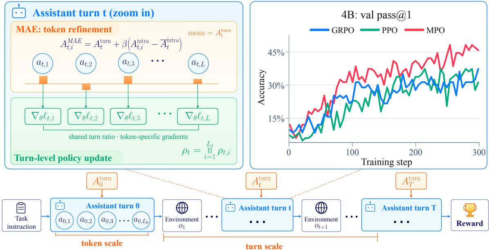

# Multiscale Policy Optimization for Long-Horizon LLM Agents

Tao Ren1,\*, Hui Yang1,\*, Jia Deng2,\*, Tingyang Chen2,\*, Qiyao Wang2,\*, Shuo Tang2,\*, Ziyang Zeng2,\*, Yuhua Jiang3, Guanghao Li3, Huatong Song4, Yining Li3, Yifan Luo2, Kunbao Ding2, Feng Chang2,†, Chuan Hao2, Ran Tao2, Bryan Dai2, Jiafeng Liang6,†, Jinyang Jiang5,†

1Peking University 2IQuest Research 3Tsinghua University 4Renmin University of China 5The University of Hong Kong 6Independent Researcher

\*Equal contribution. †Corresponding authors. Contact: rtkenny@stu.pku.edu.cn

## Abstract

Long-horizon LLM agents interact with their environments through complete assistant turns while generating each action token by token. We observe that critic values vary primarily across turns, motivating optimization anchored at turns with finer credit allocation among tokens. We propose Multiscale Policy Optimization (MPO), combining Multiscale Advantage Estimation (MAE) and turn-level importance sampling to align credit assignment and policy updates at the turn scale. Extensive experiments across search, tool-use, and automation tasks with 4B and 30B-A3B models demonstrate consistent gains over strong RL baselines.

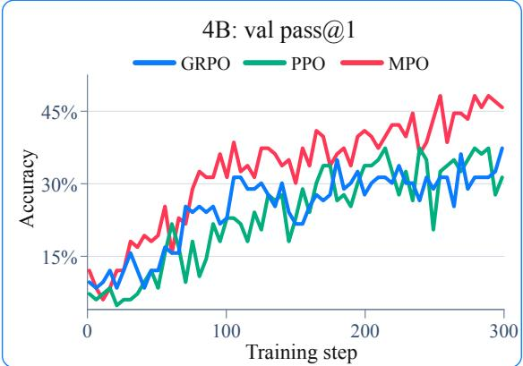  
Figure 1. Overview of Multiscale Policy Optimization (MPO). Agents interact through complete assistant turns while generating actions token by token. MAE refines shared turn advantages into token-level credit while preserving each turn’s mean. The policy update combines a shared complete-turn importance ratio with token-specific gradients. Top right: validation pass@1 during 4B training.

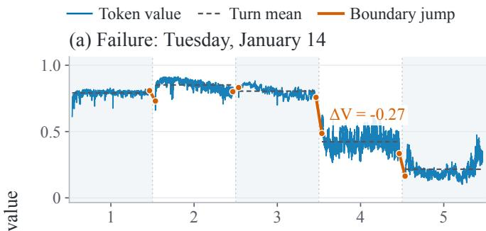

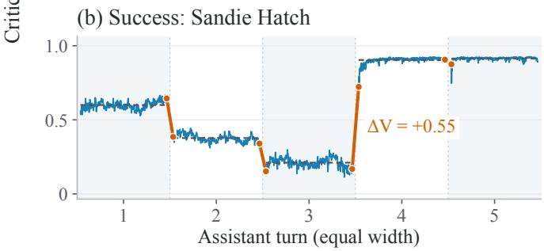  
Figure 2. Critic values exhibit structure at the turn scale. A failed trajectory (a) and a successful trajectory (b) both exhibit relatively stable values within turns and pronounced changes across turn boundaries.

## 1. Introduction

An LLM agent interacts with its environment through complete assistant turns, such as search queries, tool calls, and final responses, while its policy generates each turn token by token. Learning from a terminal task reward therefore involves two scale choices. Credit must connect the final outcome to interactions across the trajectory and distinguish the tokens within each interaction. Policy updates must also account for changes in complete-output probabilities while retaining those local distinctions. These choices motivate a policy-optimization method that uses both the interaction and generation scales.

Two common families of RL methods leave a gap between these scales. Critic-free, grouprelative methods, including GRPO, DAPO, and GSPO [30, 44, 50], derive one shared advantage per generated sequence from group-relative outcome rewards. Despite differences in their update objectives, this shared credit signal does not distinguish the contributions of individual turns or tokens within a rollout. Critic-based, token-level methods, including PPO, VC-PPO, VAPO, and SAO [9, 29, 45, 46], use a learned value function to estimate advantages along the token sequence. Their common formulation treats each generated token as an action, providing finer credit without explicitly separating within-turn generation from turn-level environment interaction. Agentic RL therefore calls for credit assignment that captures both the contribution of each complete interaction and the relative contributions of tokens within it.

Observing credit structure across turns. Figure 2 illustrates learned values that vary within turns and exhibit larger changes across some environment interactions. Across 2,048 trajectories and 16,323 turns from eight checkpoint batches of one search-agent run, differences between turn means account for a median of 89.5% of the critic’s token-weighted within-trajectory value variance. Between-turn variance exceeds within-turn variance in 93.8% of trajectories. This structure motivates propagating long-range credit across turns while retaining local token information. Appendix C provides additional statistics and detailed analyses of critic behavior in multi-turn agent interactions.

Multiscale Policy Optimization. Treating complete assistant turns as macro actions, we establish a turn-level improvement bound and show that token surrogates incur an additional within-turn distribution-shift penalty for exact advantages under the same KL constraints. Guided by this analysis and the observed critic structure, we develop Multiscale Policy Optimization (MPO), combining multiscale credit assignment with turn-level importance weighting. Multiscale Advantage Estimation (MAE) uses turn-level GAE to propagate credit across interactions, then refines token credit through a centered local correction that preserves the turn mean. We derive this allocation as a constrained projection using a single critic. Turn-level importance weighting applies the complete-turn probability ratio while retaining each token’s MAE advantage in its policy gradient through a stop-gradient construction.

Our contributions are threefold:

• We analyze policy improvement for LLM agents at turn and token scales, deriving a turn-level improvement bound and identifying the additional discrepancy that token-level surrogates introduce through within-turn distribution shift.

• We propose MPO, which combines multiscale advantage estimation (MAE) with turn-level importance sampling to align credit assignment and policy updates with complete turns while preserving token-specific credit.

• We demonstrate consistent performance gains over strong RL baselines across search, tool-use, and automation tasks with both 4B and 30B-A3B models.

## 2. Related Work

## 2.1. Tool use and multi-turn agent learning

Early work connected language-model reasoning with actions and external tools [26, 31, 42]. Reflection, memory, planning, reusable skills, and multi-agent collaboration supported adaptation from experience and sustained interaction [8, 20, 33, 36, 39], establishing core interaction patterns for agents operating over multiple turns.

Modern coding agents and execution harnesses integrate repository editing, code execution, testing, and browsing to resolve software issues and complete practical web and research tasks [1, 34, 37, 41, 49]. Coding agents also support algorithm discovery [19]. Agents also use execution feedback and accumulated experience to refine their tools, workflows, and memory [11, 24, 25, 40, 47]. These systems motivate optimizing agents across complete interaction turns and the tokens generated within each turn.

## 2.2. RL in LLM Posttraining

Classical policy-gradient methods optimize expected return through reward- or advantageweighted updates [35, 38]. Advantage estimation and conservative, trust-region, or proximal updates provide foundations for stable policy optimization [14, 27–29].

Building on GRPO [30], DeepSeek-R1 [7] demonstrated the potential of large-scale RL for reasoning. Subsequent methods improve importance weighting and trust-region control [5, 21, 44, 50], as well as critic learning and long-response optimization [3, 6, 45, 46]. Risk-based objectives further address exploration and solution diversity [12, 23]. Policy optimization also targets visually grounded causal reasoning [16].

RL also supports multi-turn agents that learn through tool use and environment feedback [13, 18, 51]. Long horizons and sparse task rewards make credit assignment across decisions especially important [2, 4, 48, 52]. Recent work further develops stable policy updates for asynchronous agent training [9, 10]. MPO aligns advantage estimation and importance correction with complete turns, while retaining centered token-level credit within each turn.

## 3. Agentic RL Across Turns and Tokens

## 3.1. Agentic RL with Terminal Reward

An LLM agent solves a task by alternating between assistant outputs and environment observations. Its interaction trajectory is

$$
\tau = ( o _ { 0 } , a _ { 0 } , o _ { 1 } , a _ { 1 } , \dots , o _ { T } , a _ { T } ) .\tag{1}
$$

Here $o _ { \mathrm { 0 } }$ is the task prompt, $a _ { t }$ is an assistant output such as a tool call or final response, and $o _ { t + 1 }$ is the environment feedback following a nonterminal output. The trajectory ends after $a _ { T }$ . Each observation and assistant output is a token sequence:

$$
o _ { t } = ( o _ { t , 1 } , \ldots , o _ { t , M _ { t } } ) , \qquad a _ { t } = ( a _ { t , 1 } , \ldots , a _ { t , L _ { t } } ) ,\tag{2}
$$

Here $M _ { t }$ and $L _ { t } \geq 1$ are the respective sequence lengths, and $t = 0 , \dots , T$ indexes assistant turns. Let $h _ { t } = \left( o _ { 0 } , a _ { 0 } , \ldots , o _ { t } \right)$ denote the history at the start of turn $t ,$ with $h _ { 0 } = \left( o _ { 0 } \right)$ . The history before generating token $a _ { t , i }$ is

$$
h _ { t , i } = ( h _ { t } , a _ { t , < i } ) , \qquad a _ { t , < i } = ( a _ { t , 1 } , \ldots , a _ { t , i - 1 } ) .\tag{3}
$$

The assistant policy factorizes autoregressively as $\begin{array} { r } { \pi _ { \theta } ( a _ { t } \mid h _ { t } ) = \prod _ { i = 1 } ^ { L _ { t } } \pi _ { \theta } ( a _ { t , i } \mid h _ { t , i } ) } \end{array}$ . Environment observations follow $o _ { t + 1 } \sim P _ { \mathrm { e n v } } ( \cdot \mid h _ { t } , a _ { t } )$ and become part of the next assistant turn’s context. The task distribution and environment dynamics are independent of $\theta ;$ together with the policy, they induce the trajectory distribution $p _ { \theta }$

The agent receives a single reward $R ( \tau )$ when the interaction terminates, with no intermediate rewards. Its objective is $\mathcal { T } ( \theta ) = \mathbb { E } _ { \tau \sim p _ { \theta } } [ R ( \tau ) ]$ . Only the final assistant token of the entire trajectory receives this reward; every earlier token has zero reward:

$$
r _ { t , i } : = \left\{ \begin{array} { l l } { R ( \tau ) , } & { t = T , \ i = L _ { T } , } \\ { 0 , } & { \mathrm { o t h e r w i s e } . } \end{array} \right.\tag{4}
$$

## 3.2. Turns as Macro Decisions

The environment receives complete assistant outputs as actions, while the policy generates each output autoregressively. We treat $a _ { t }$ as the macro action and retain $h _ { t }$ as its state: the history includes the time index and any remaining interaction or token budget. The turn-ending decision is included in $a _ { t } . ~ \mathrm { A }$ fixed maximum token length $L _ { \mathrm { m a x } }$ and any forced termination rule are shared by both policies. There is no environment interaction between tokens inside one assistant output. The macro transition is therefore $h _ { t } \stackrel { a _ { t } } { \longrightarrow } h _ { t + 1 } ,$ with the same environment law defined above.

We use the original policy notation at both scales:

$$
\pi _ { \theta } ( a _ { t } \mid h _ { t } ) = \prod _ { i = 1 } ^ { L _ { t } } \pi _ { \theta } ( a _ { t , i } \mid h _ { t , i } ) .\tag{5}
$$

The complete-turn probability on the left is induced by the token probabilities on the right, using the same model parameters. This factorization lets us evaluate changes in either a complete output or an individual token distribution while retaining one policy. The objective remains

$$
\mathcal { T } ( \theta ) = \mathbb { E } _ { \tau \sim p _ { \theta } } [ R ( \tau ) ] .\tag{6}
$$

When discussing two fixed policies, we also write $\mathcal { T } ( \pi )$ and $\mathcal { T } ( \pi ^ { \prime } )$ for this same objective.

Lemma 1 (Objective consistency). Under a lossless token refinement, identical reward and stopping rules, and $\gamma = 1$ , the macro and token descriptions have the same task return. Moreover,

$$
\nabla _ { \theta } \log \pi _ { \theta } ( a _ { t } \mid h _ { t } ) = \sum _ { i = 1 } ^ { L _ { t } } \nabla _ { \theta } \log \pi _ { \theta } ( a _ { t , i } \mid h _ { t , i } ) .\tag{7}
$$

The proof is given in Appendix A.1.

Both descriptions assign the same probability and return to each complete interaction. Their common task objective allows us to compare surrogates built at different scales. The choice of advantage weights and the choice of importance ratios are separate parts of this construction; the following analysis makes the surrogate difference explicit. The theoretical analysis assumes a fixed turn horizon of $T + 1$

## 4. Policy Improvement Across Turns and Tokens

We analyze how turn-level and token-level surrogates relate to the same task-return objective. Following the surrogate-and-distribution-shift analysis of TRPO [27], we first establish a finitehorizon turn-level improvement bound, then identify the additional discrepancy introduced by token surrogates. These results motivate combining multiscale credit assignment with turn-level importance weighting in MPO. Full proofs and the extension to estimated turn advantages are provided in Appendix A.

## 4.1. Turn-Level Policy Improvement

Fix an old policy � and a candidate $\pi ^ { \prime }$ on the same turn process, with horizon $T + 1 , \gamma = 1$ , and identical initial-history and environment distributions. Define the time-indexed occupancy measure at turn � as $d _ { t } ^ { \pi } ( h ) : = \operatorname* { P r } _ { \pi } ( h _ { t } = h )$ for $t = 0 , \ldots , T .$ , where the probability is taken over the initial task, assistant outputs sampled from $\pi ,$ and environment responses. Thus $d _ { t } ^ { \pi }$ is the distribution of histories at the start of turn �. At each active history, define the exact old-policy values by

$$
\begin{array} { r l } & { ~ V _ { t } ^ { \pi } ( h ) = \mathbb { E } _ { \pi } [ R ( \tau ) ~ | ~ h _ { t } = h ] , } \\ & { ~ Q _ { t } ^ { \pi } ( h , a ) = \mathbb { E } _ { \pi } [ R ( \tau ) ~ | ~ h _ { t } = h , a _ { t } = a ] , } \\ & { ~ A _ { t } ^ { \pi } ( h , a ) = Q _ { t } ^ { \pi } ( h , a ) - V _ { t } ^ { \pi } ( h ) . } \end{array}\tag{8}
$$

These expectations mean continuing � from the supplied history; the values must also be defined at histories reached by $\pi ^ { \prime }$ . Set $V _ { T + 1 } ^ { \pi } = 0$ and all post-termination values to zero. Assume all

expectations below are finite; bounded task rewards suffice. Common policy support is assumed for importance ratios, but is not needed for the performance-difference or TV inequalities themselves. The Bellman identity gives $\mathbb { E } _ { a \sim \pi } A _ { t } ^ { \pi } ( h , a ) = 0$

Lemma 2 (Macro performance difference and importance ratios). In the finite-horizon setting above, the performance difference satisfies

$$
\mathcal { T } ( \pi ^ { \prime } ) - \mathcal { T } ( \pi ) = \sum _ { t = 0 } ^ { T } \mathbb { E } _ { \boldsymbol { h } _ { t } \sim \boldsymbol { d } _ { t } ^ { \pi ^ { \prime } } } \left[ A _ { t } ^ { \pi } ( h _ { t } , a _ { t } ) \right] .\tag{9}
$$

Define the surrogate under the old-policy occupancy measure by $\begin{array} { r } { S _ { M } ( \pi ^ { \prime } ; \pi ) : = \sum _ { t = 0 } ^ { T } { \mathbb E } _ { d _ { t } ^ { \pi } , \pi ^ { \prime } } [ A _ { t } ^ { \pi } ] } \end{array}$ . If $\pi ^ { \prime } ( \cdot \mid h )$ is absolutely continuous with respect to $\pi ( \cdot \mid h )$ at old-policy histories, then $S _ { M } ( \pi ^ { \prime } ; \pi ) =$ $\textstyle \mathbb { E } _ { \pi } \sum _ { t = 0 } ^ { T } ( \rho _ { t } - 1 ) A _ { t } ^ { \pi }$ , where $\rho _ { t } = \pi ^ { \prime } ( a _ { t } \mid h _ { t } ) / \pi ( a _ { t } \mid h _ { t } )$ is the complete-turn importance ratio.

$\boldsymbol { S _ { M } }$ is an improvement, so $S _ { M } ( \pi ; \pi ) = 0 ;$ the corresponding absolute surrogate is $\mathcal { T } ( \pi ) + \mathcal { S } _ { M }$ The proof is given in Appendix A.1.

Theorem 1 (Monotonic improvement at the turn scale). In the finite-horizon setting above, suppose $\left| A _ { t } ^ { \pi } ( h , a ) \right| \leq A _ { \operatorname* { m a x } }$ at all admissible turn-start histories and complete outputs. Set

$$
\alpha _ { M } = \operatorname* { s u p } _ { t , h } D _ { \mathrm { T V } } ( \pi ^ { \prime } ( \cdot \mid h ) , \pi ( \cdot \mid h ) ) ,
$$

where $\begin{array} { r } { D _ { \mathrm { T V } } ( p , q ) = \frac { 1 } { 2 } \| p - q \| _ { 1 } } \end{array}$ . Here the supremum ranges over turn-start histories, and the distributions are over complete outputs $a _ { t }$ . Then

$$
\mathcal { T } ( \pi ^ { \prime } ) - \mathcal { T } ( \pi ) \geq S _ { M } - 2 A _ { \operatorname* { m a x } } T ( T + 1 ) \alpha _ { M } ^ { 2 } .\tag{10}
$$

Thus a nonnegative right-hand side certifies nondecrease of the task return; a positive right-hand side certifies strict improvement.

Appendices A.1–A.2 provide the full performance-difference derivation and proof of Theorem 1.

The bound certifies improvement when the exact surrogate gain covers the distribution-shift penalty. Its surrogate combines a turn-level advantage with a complete-output importance ratio, connecting credit at interaction boundaries to changes in the probability of each turn.

## 4.2. Additional Cost of Token Surrogates

The autoregressive parameterization supports the macro surrogate through $\begin{array} { r } { \rho _ { t } = \prod _ { i } \rho _ { t , i } , } \end{array}$ , where $\rho _ { t , i } = \pi ^ { \prime } ( a _ { t , i } \mid h _ { t , i } ) / \pi ( a _ { t , i } \mid h _ { t , i } )$ . The product ratio corrects the entire turn distribution. A separate token ratio corrects only the next-token distribution at an old-policy prefix, so replacing the turn surrogate with token terms changes the prefix distributions used to evaluate credit.

Theorem 2 (The additional cost of token surrogates). Let $A _ { t , i } ^ { \pi , \mathrm { t o k } }$ be the exact token advantage, and let $A _ { \mathrm { m a x } } ^ { \mathrm { t o k } } < \infty$ be a uniform bound on its absolute value over all admissible token prefixes and next tokens, so that $| A _ { t , i } ^ { \pi , \mathrm { t o k } } ( h _ { t , i } , a _ { t , i } ) | \leq A _ { \operatorname* { m a x } } ^ { \mathrm { t o k } }$ . Set $\begin{array} { r } { \alpha _ { T } = \mathbf { s u p } _ { h } D _ { \mathrm { T V } } ( \pi ^ { \prime } ( \cdot \mid h ) , \pi ( \cdot \mid h ) ) } \end{array}$ , where ℎ ranges over token prefixes and the distributions are over next tokens. Define

$$
S _ { T } = \mathbb { E } _ { \pi } \sum _ { t } \sum _ { i } ( \rho _ { t , i } - 1 ) A _ { t , i } ^ { \pi , \mathrm { t o k } } .
$$

For $L _ { t } \leq L _ { \operatorname* { m a x } } ,$

$$
| S _ { M } - S _ { T } | \leq 2 ( T + 1 ) A _ { \operatorname* { m a x } } ^ { \mathrm { t o k } } L _ { \operatorname* { m a x } } ( L _ { \operatorname* { m a x } } - 1 ) \alpha _ { T } ^ { 2 } .\tag{11}
$$

Consequently,

$$
\begin{array} { r l } & { \mathcal { T } ( \pi ^ { \prime } ) - \mathcal { T } ( \pi ) \geq S _ { T } - 2 A _ { \operatorname* { m a x } } T ( T + 1 ) \alpha _ { M } ^ { 2 } } \\ & { \qquad - 2 ( T + 1 ) A _ { \operatorname* { m a x } } ^ { \mathrm { t o k } } L _ { \operatorname* { m a x } } \bigr ( L _ { \operatorname* { m a x } } - 1 \bigr ) \alpha _ { T } ^ { 2 } . } \end{array}\tag{12}
$$

At a fixed macro state, the exact macro advantage telescopes into exact token advantages. The macro surrogate averages them over new-policy prefixes, whereas $S _ { T }$ uses old-policy prefixes. This within-turn distribution shift produces the additional term; Appendix A.3 gives the proof.

The policy-change budgets must also be compared at the same scale. By the KL chain rule, a uniform token KL cap �, including the stopping decision, implies

$$
D _ { \mathrm { K L } } ^ { \operatorname* { m a x } } ( \pi \| \pi ^ { \prime } ) \leq L _ { \operatorname* { m a x } } \delta , \qquad \alpha _ { M } ^ { 2 } \leq \frac { L _ { \operatorname* { m a x } } \delta } { 2 } .\tag{13}
$$

For $R \in [ 0 , 1 ]$ , setting $\delta = \Delta / L _ { \mathrm { m a x } }$ certifies a macro KL budget $\Delta ;$ the token bound then carries an additional penalty $( T + 1 ) ( L _ { \mathrm { m a x } } - 1 ) \Delta$

Takeaway. Under the same KL constraints, the token-surrogate improvement bound incurs an additional within-turn distribution-shift penalty relative to the turn-surrogate bound.

## 5. Multiscale Policy Optimization

As illustrated in Figure 1, MPO combines two components motivated by the analysis above. Its advantage estimator, MAE, propagates credit across turns and allocates it among tokens within each turn (Sections 5.1–5.2). Its policy update uses complete-turn importance weights while preserving each token’s advantage in the gradient (Section 5.3).

The two MAE stages reuse the critic $V _ { t , i } = V ( h _ { t , i } )$ , whose old-policy rollout predictions remain fixed during advantage estimation. Environment tokens enter the history but are not policy actions. At turn boundaries, set

$$
V _ { t , L _ { t } + 1 } : = V _ { t + 1 , 1 } \quad ( 0 \leq t \leq T ) , \qquad V _ { T + 1 , 1 } : = 0 ,\tag{14}
$$

with zero values after true termination. Under the terminal reward placement in Eq. (4) and $\gamma = 1$ , define

$$
\delta _ { t , i } = r _ { t , i } + V _ { t , i + 1 } - V _ { t , i } .\tag{15}
$$

## 5.1. Turn-Level Credit Propagation

Summing TD residuals within a turn cancels all internal value predictions:

$$
\delta _ { t } ^ { \mathrm { t u r n } } = \sum _ { i = 1 } ^ { L _ { t } } \delta _ { t , i } = \mathbf { 1 } \{ t = T \} R ( \tau ) + V _ { t + 1 , 1 } - V _ { t , 1 } .\tag{16}
$$

Applying GAE [28] on this macro time axis gives

$$
\begin{array} { l } { { \displaystyle { \cal A } _ { t } ^ { \mathrm { t u r n } } = \delta _ { t } ^ { \mathrm { t u r n } } + \lambda { \cal A } _ { t + 1 } ^ { \mathrm { t u r n } } } } \\ { { \displaystyle ~ = \sum _ { \ell = 0 } ^ { T - t } \lambda ^ { \ell } \delta _ { t + \ell } ^ { \mathrm { t u r n } } } , } \end{array}\tag{17}
$$

where $\lambda \in [ 0 , 1 ]$ and $A _ { T + 1 } ^ { \mathrm { t u r n } } = 0$ . This shared credit decays once per interaction rather than once per token. For fixed rewards and boundary values, it is independent of turn lengths and internal critic predictions. Appendix A.5 characterizes the corresponding estimation error using only boundary critic errors; the token-GAE comparison is in Appendix A.6.

## 5.2. Within-Turn Credit Allocation

To refine the relative token weights, form a local trace restricted to the current turn:

$$
A _ { t , i } ^ { \mathrm { { i n t r a } } } = \sum _ { j = i } ^ { L _ { t } } \lambda _ { \mathrm { { i n t r a } } } ^ { j - i } \delta _ { t , j } .\tag{18}
$$

Only the advantage trace is cut at the boundary: the final TD residual still bootstraps from $V _ { t + 1 , 1 }$ and equals $R ( \tau ) - V _ { T , L _ { T } }$ at trajectory termination.

We combine the turn and local signals according to two design requirements. First, the turn estimate should determine the mean token credit. It propagates task-level credit across interactions using boundary values, so we use it as the shared credit for the complete output. Broadcasting this estimate gives the turn-level score contribution by $\operatorname { E q . } ( 7 ) ;$ local refinement then adjusts individual token weights around that common level. Directly adding the local trace would also shift the mean by $\beta \overline { { A } } _ { t } ^ { \mathrm { i n t r a } }$ , where $\begin{array} { r } { \overline { { A } } _ { t } ^ { \mathrm { { i n t r a } } } = L _ { t } ^ { - 1 } \sum _ { i } A _ { t , i } ^ { \mathrm { { i n t r a } } } } \end{array}$ . Fixing the mean to $A _ { t } ^ { \mathrm { t u r n } }$ keeps the local branch from changing this shared credit.

Second, the allocation should retain the relative differences in the local estimates, which provide information for distinguishing tokens within a turn. Broadcasting alone assigns identical weights to all tokens. We therefore seek weights that satisfy the prescribed turn mean while remaining as close as possible to the scaled local signals. Writing $\mathbf { A } _ { t } ^ { \mathrm { i n t r a } }$ for their vector, we express these requirements as a least-squares projection. The squared distance treats all token positions equally and penalizes changes to the local weights:

$$
\begin{array} { r l } {  { \mathbf { A } _ { t } ^ { \mathrm { M A E } } = \underset { \mathbf { w } \in \mathbb { R } ^ { L _ { t } } } { \mathrm { a r g m i n } } \frac { 1 } { 2 } \| \mathbf { w } - \beta \mathbf { A } _ { t } ^ { \mathrm { i n t r a } } \| _ { 2 } ^ { 2 } , } } \\ & { \mathrm { s u b j e c t \ t o } \quad \frac { 1 } { L _ { t } } \sum _ { i = 1 } ^ { L _ { t } } w _ { i } = A _ { t } ^ { \mathrm { t u r n } } , } \end{array}\tag{19}
$$

where $\beta \geq 0$ scales the local refinement. Solving this strictly convex problem yields the unique allocation

$$
\boxed { A _ { t , i } ^ { \mathrm { M A E } } = A _ { t } ^ { \mathrm { t u r n } } + \beta \big ( A _ { t , i } ^ { \mathrm { i n t r a } } - \overline { { A } } _ { t } ^ { \mathrm { i n t r a } } \big ) } .\tag{20}
$$

Before batch normalization, it satisfies

$$
\frac { 1 } { L _ { t } } \sum _ { i = 1 } ^ { L _ { t } } A _ { t , i } ^ { \mathrm { M A E } } = A _ { t } ^ { \mathrm { t u r n } } .\tag{21}
$$

Centering fixes the average credit to the turn estimate while preserving pairwise differences in the scaled local signals. Setting $\beta = 0$ recovers turn broadcasting.

## 5.3. Turn-Level Importance Correction

Having assigned token credit, we combine it with importance correction at the turn scale. We normalize $A _ { t , i } ^ { \mathrm { \tiny { M A E } } }$ once over valid assistant tokens in the rollout batch and hold the resulting

weights $\widehat { A } _ { t , i } ^ { \mathrm { M A E } }$ fixed during the update. Write $\pi _ { \theta }$ for the candidate policy and $\pi$ for the fixed rollout policy. The token and complete-turn ratios are

$$
\rho _ { t , i } ( \theta ) = \frac { \pi _ { \theta } ( a _ { t , i } \mid h _ { t , i } ) } { \pi ( a _ { t , i } \mid h _ { t , i } ) } , \qquad \rho _ { t } ( \theta ) = \prod _ { i = 1 } ^ { L _ { t } } \rho _ { t , i } ( \theta ) .\tag{22}
$$

Multiplying all MAE advantages by the same differentiable $\rho _ { t }$ would cancel the centered local correction in the unclipped sum. To retain token-specific credit under complete-turn importance weighting, we stop the gradient through the other token ratios:

$$
\widetilde { \rho } _ { t , i } ( \boldsymbol { \theta } ) = \rho _ { t , i } ( \boldsymbol { \theta } ) \mathrm { s g } \left[ \prod _ { j = 1 \atop j \neq i } ^ { L _ { t } } \rho _ { t , j } ( \boldsymbol { \theta } ) \right] ,\tag{23}
$$

where sg preserves its argument in the forward pass and has zero gradient. Thus every token has the complete-turn weight $\widetilde { \rho } _ { t , i } ( \theta ) = \rho _ { t } ( \theta )$ in the forward pass, while

$$
\nabla _ { \boldsymbol { \theta } } \widetilde { \rho } _ { t , i } ( \boldsymbol { \theta } ) = \rho _ { t } ( \boldsymbol { \theta } ) \nabla _ { \boldsymbol { \theta } } \log \pi _ { \boldsymbol { \theta } } ( a _ { t , i } \mid h _ { t , i } ) .\tag{24}
$$

This construction weights each token’s score gradient by the complete turn ratio and its own MAE advantage. The MPO update is defined by the clipped surrogate

$$
\begin{array} { r l } & { \mathcal { L } _ { \mathrm { M P O } } ( \boldsymbol { \theta } ) = \widehat { \mathbb { E } } _ { t , i } \Big [ \operatorname* { m i n } \bigr ( \widetilde { \rho } _ { t , i } ( \boldsymbol { \theta } ) \widehat { A } _ { t , i } ^ { \mathrm { M A E } } , } \\ & { \qquad \mathrm { c l i p } \bigr ( \widetilde { \rho } _ { t , i } ( \boldsymbol { \theta } ) , 1 - \epsilon , 1 + \epsilon \bigr ) \widehat { A } _ { t , i } ^ { \mathrm { M A E } } \bigr ) \Big ] , } \end{array}\tag{25}
$$

where $\widehat { \mathbb E } _ { t , i }$ is the empirical mean over all valid assistant tokens in the rollout batch and $\epsilon > 0$ is the clipping threshold. Gradient ascent uses the stop-gradient rule in Eq. (23); the full turn ratio therefore controls the forward weighting and clipping, while each token’s MAE advantage controls its own score gradient.

Following VAPO’s decoupled GAE [46], we set $\lambda _ { \mathrm { c r i t i c } } = 1$ , so the critic directly regresses the terminal return $R ( \tau )$

Takeaway. MPO propagates credit across turns and refines it within each turn while preserving the turn mean. Turn-level importance weighting then retains token-specific credit in the policy gradient.

## 6. Experiments

## 6.1. Experimental Settings

We evaluate Qwen3-4B-Thinking and Qwen3-30B-A3B-Instruct [22] in three agentic settings: Search, Claw-Eval, and Automation Bench. The main comparisons use separate training in each setting, with 300 steps for Search, 300 for Claw-Eval, and 200 for Automation Bench. We compare MPO with the initial checkpoint (Base), GRPO [30], GSPO [50], PPO [29], VAPO [46], and SAO [9]. To examine the update objective, MPO w/ token IS retains MAE but replaces complete-turn importance ratios with token-level ratios.

Table 1. Main evaluation on search and agent tasks. Search benchmarks report pass@1 and pass@3; Claw-Eval reports pass@3 and pass3. Automation Bench reports pass@1. Search and Claw-Eval scores are percentages; higher is better for all metrics. Base denotes the initial checkpoint before task-specific RL. Trained-model Search pass@1 and pass@3 are estimated using 32 rollouts per task.
<table><tr><td></td><td colspan="2">BrowseComp-Plus</td><td colspan="2">GAIA</td><td colspan="2">HLE</td><td colspan="2">Claw-Eval</td><td>Automation Bench</td></tr><tr><td>Method</td><td>pass@1</td><td>pass@3</td><td>pass@1</td><td>pass@3</td><td>pass@1</td><td>pass@3</td><td>pass@3</td><td>pass3</td><td>pass@1</td></tr><tr><td colspan="8">Qwen3-4B-Thinking</td></tr><tr><td>Base</td><td>8.84</td><td>18.07</td><td>24.92</td><td>33.98</td><td>5.53</td><td>9.60</td><td>25.22</td><td>8.09</td><td>0.00</td></tr><tr><td>GRPO</td><td>39.34</td><td>52.12</td><td>33.92</td><td>44.63</td><td>8.51</td><td>14.43</td><td>64.45</td><td>48.79</td><td>4.33</td></tr><tr><td>GSPO</td><td>38.56</td><td>52.11</td><td>34.34</td><td>45.26</td><td>9.26</td><td>13.71</td><td>63.83</td><td>49.35</td><td>5.22</td></tr><tr><td>PPO</td><td>40.85</td><td>54.30</td><td>31.71</td><td>45.03</td><td>7.22</td><td>12.82</td><td>63.25</td><td>50.78</td><td>11.67</td></tr><tr><td>VAPO</td><td>43.23</td><td>57.33</td><td>33.91</td><td>46.15</td><td>7.54</td><td>13.27</td><td>64.35</td><td>49.22</td><td>11.50</td></tr><tr><td>SAO</td><td>43.75</td><td>56.88</td><td>35.62</td><td>47.56</td><td>8.19</td><td>14.23</td><td>64.52</td><td>49.11</td><td>12.06</td></tr><tr><td>MPO w/ token IS</td><td>45.72</td><td>57.47</td><td>36.35</td><td>50.27</td><td>8.89</td><td>15.17</td><td>65.13</td><td>50.22</td><td>12.45</td></tr><tr><td>MPO (Ours)</td><td>48.08</td><td>61.83</td><td>39.47</td><td>52.67</td><td>9.92</td><td>16.78</td><td>66.91</td><td>51.73</td><td>13.33</td></tr><tr><td colspan="10">Qwen3-30B-A3B-Instruct</td></tr><tr><td>Base</td><td>21.69</td><td>27.71</td><td>25.24</td><td>37.86</td><td>7.47</td><td>12.60</td><td>32.19</td><td>12.64</td><td>0.17</td></tr><tr><td>GRPO</td><td>41.83</td><td>48.18</td><td>31.03</td><td>40.51</td><td>8.33</td><td>12.68</td><td>68.23</td><td>52.55</td><td>5.00</td></tr><tr><td>GSPO</td><td>40.22</td><td>47.31</td><td>35.25</td><td>46.25</td><td>8.61</td><td>13.34</td><td>68.62</td><td>51.34</td><td>6.23</td></tr><tr><td>PPO</td><td>45.20</td><td>51.63</td><td>35.70</td><td>45.28</td><td>8.31</td><td>13.33</td><td>70.14</td><td>55.33</td><td>14.17</td></tr><tr><td>VAPO</td><td>46.73</td><td>57.33</td><td>38.33</td><td>49.22</td><td>9.25</td><td>14.64</td><td>71.31</td><td>56.72</td><td>13.77</td></tr><tr><td>SAO</td><td>45.36</td><td>57.88</td><td>39.62</td><td>50.34</td><td>9.91</td><td>14.37</td><td>72.72</td><td>57.23</td><td>14.20</td></tr><tr><td>MPO w/ token IS</td><td>48.27</td><td>58.12</td><td>41.23</td><td>52.12</td><td>9.45 10.03</td><td>14.67</td><td>72.19</td><td>57.61</td><td>13.17</td></tr><tr><td>MPO (Ours)</td><td>50.32</td><td>59.33</td><td>43.42</td><td>56.24</td><td></td><td>15.16</td><td>73.22</td><td>58.35</td><td>15.00</td></tr></table>

Evaluation protocol. For the trained-model results in all tables, we select the best-performing checkpoint from each training run. We evaluate the selected checkpoint offline five times and report the mean of the five evaluation scores. The benchmark-specific rollout budgets and metrics described below apply to each evaluation repetition. For BrowseComp-Plus, we follow the held-out evaluation setup of Lu et al. [17]. For GAIA and HLE, we use WebThinker’s text-only evaluation subsets, drawn from their validation and test sets, respectively [15]. Base results use three rollouts per task. For trained Search models, pass@1 and pass@3 are estimated from a pool of 32 independent rollouts per task, using the same samples across evaluation budgets. We follow the original evaluation protocols for Claw-Eval [43] and Automation Bench [32]. Claw-Eval uses three independent trials, reporting pass@3 for success in at least one trial and pass3 for success in all three. Automation Bench reports pass@1 using its end-state assertion checks. All score differences below are percentage points.

## 6.2. Main Results

Performance across tasks and model scales. Table 1 shows that MPO achieves the highest reported score on all nine metrics at both model sizes. Relative to the strongest non-MPO baseline in each column, MPO improves BrowseComp-Plus, GAIA, and HLE pass@1 by 4.33, 3.85, and 0.66 points on 4B, and by 3.59, 3.80, and 0.12 points on 30A3B. The gains extend to pass@3, including improvements of 5.11 and 5.90 points on GAIA at the two scales. MPO also improves both Claw-Eval metrics and Automation Bench performance. For example, Claw-Eval pass3 increases by 0.95 and 1.12 points, showing that the improvements extend to success across

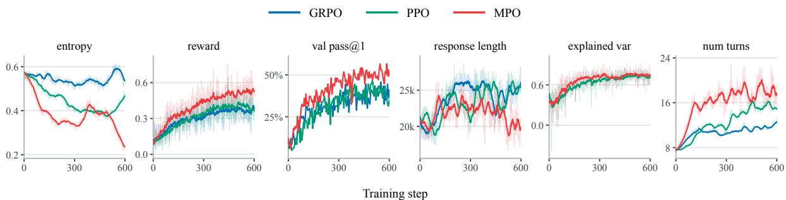  
Figure 4. Training dynamics of GRPO, PPO, and MPO on 4B through step 600, showing entropy, reward, validation pass@1, response length, explained variance, and number of turns.

repeated attempts.

Aligning advantage estimation and importance correction. Replacing turn-level ratios with token-level ratios reduces every reported score. The Search pass@1 drops on BrowseComp-Plus, GAIA, and HLE are 2.36, 3.12, and 1.03 points for 4B, and 2.05, 2.19, and 0.58 points for 30A3B. With token IS, MAE still outperforms PPO on all six Search metrics at both scales, indicating that multiscale credit assignment contributes useful gains on its own. Complete-turn importance correction provides a further improvement. Together, these comparisons support aligning shared credit and probability correction with the turn-level interaction objective, while retaining local token distinctions in the policy gradient. Figure 3 provides a visualization of validation performance and training reward through step 300.

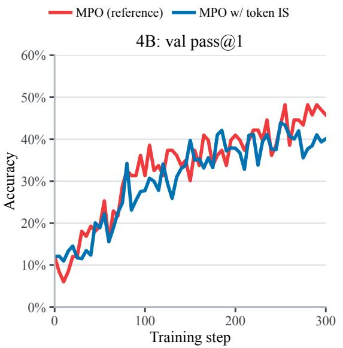

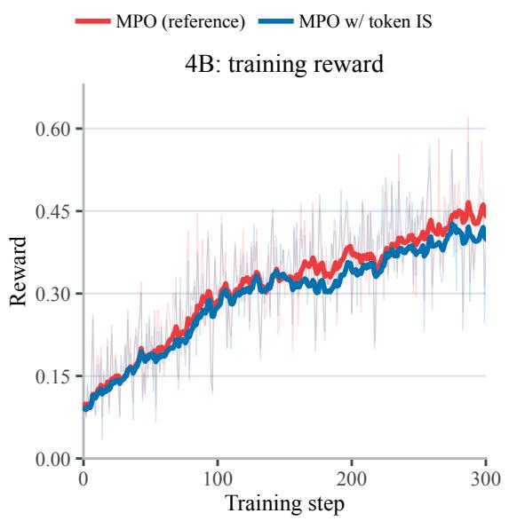  
Figure 3. 4B validation pass@1 (left) and training reward (right) through step 300.

## 6.3. Training Dynamics

Figures 4 and 5 compare GRPO, PPO, and the full MPO method, combining MAE with turn-level importance correction. MPO is shown in red in these figures and Figure 6. We track entropy, reward, validation pass@1, response length, critic explained variance, and interaction turns through step 600 for 4B and step 300 for 30A3B. Each method has one run per model size.

Critic fit under the same regression target. PPO and MPO both train the critic against terminal returns with $\lambda _ { \mathrm { c r i t i c } } = 1 _ { \mathrm { \AA } }$ , yet MPO exhibits higher explained variance on average during late training at both model scales. A plausible explanation is that turn-aligned policy updates change the visited histories and subsequent outcomes, making their return structure easier for the critic to capture. Better value estimates may in turn improve the actor’s credit signal. This interpretation concerns the interaction between policy learning and critic fitting: explained variance is measured on each policy’s own rollouts and also depends on return variance, so it does not isolate a causal improvement in critic accuracy.

## 6.4. Test-Time Scaling

Figure 6 compares GRPO, PPO, and MPO on BrowseComp-Plus, GAIA, and HLE at both 4B and 30A3B scales. We report pass@k for $k \in \{ 1 , 2 , 4 , 8 , 1 6 , 3 2 \}$ using 32 independent rollouts per task, reusing the same pool for every �. All MPO curves use the full method with turn-level importance correction. Each method uses a fixed checkpoint across sampling budgets. Decoding settings, available tools, and per-rollout budgets are matched across methods.

Benefits beyond a single attempt. The gains from MPO extend to larger sampling budgets. On 4B, MPO leads GRPO and PPO at every evaluated � on all three benchmarks. Its pass@32 reaches 75.90 on BrowseComp-Plus, 69.90 on GAIA, and 34.00 on HLE, exceeding the stronger of GRPO and PPO by 3.61, 5.82, and 5.80 points, respectively. Thus the advantage persists as additional samples expand task coverage. The 30A3B runs also benefit from additional attempts, although the relative gains depend on the benchmark and sampling budget.

These results also put the entropy curves in context. PPO’s entropy drops sharply during 30A3B training while its validation performance continues to improve. Likewise, the lower entropy of 4B MPO coexists with strong performance across sampling budgets. Token entropy alone therefore does not establish a collapse in useful exploration: pass@k directly tests whether additional sampled trajectories solve tasks that a single attempt misses.

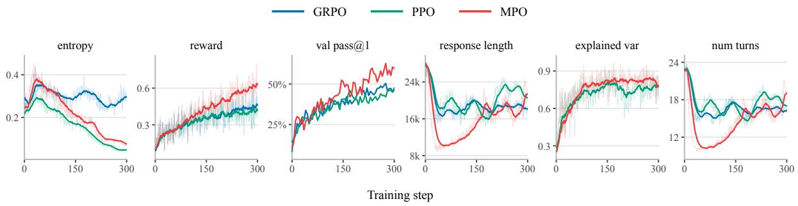  
Figure 5. Training dynamics of GRPO, PPO, and MPO on 30A3B through step 300, using the same metrics as Figure 4.

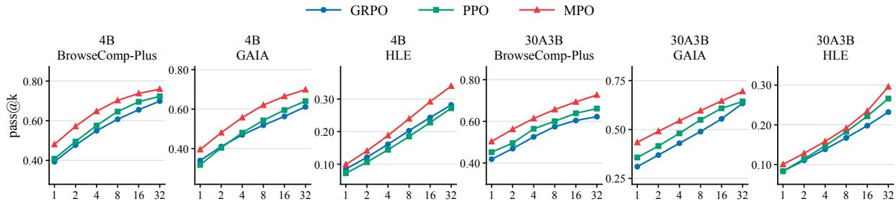  
Number of attempts (k)  
Figure 6. Test-time scaling of GRPO, PPO, and MPO on BrowseComp-Plus, GAIA, and HLE for 4B and 30A3B, showing pass@k as the number of attempts increases.

Table 2. Search ablation over turn-scale propagation and within-turn trace. Scores are percentages. The bold setting reproduces 4B MPO from Table 1. We vary $( \lambda , \lambda _ { \mathrm { i n t r a } } )$ with $\beta = 1 . 0 0$ fixed.
<table><tr><td rowspan="2">Setting  $( \lambda , \lambda _ { \mathrm { { i n t r a } } } )$ </td><td colspan="2">BrowseComp-Plus</td><td colspan="2">GAIA</td><td colspan="2">HLE</td></tr><tr><td>pass@1</td><td>pass@3</td><td>pass@1</td><td>pass@3</td><td>pass@1</td><td>pass@3</td></tr><tr><td>(0.80, 0.95)</td><td>48.08</td><td>61.83</td><td>39.47</td><td>52.67</td><td>9.92</td><td>16.78</td></tr><tr><td>(0.60, 0.95)</td><td>47.51</td><td>59.22</td><td>38.92</td><td>50.79</td><td>9.11</td><td>15.17</td></tr><tr><td>(0.85, 0.95)</td><td>46.36</td><td>58.91</td><td>37.26</td><td>51.04</td><td>8.87</td><td>14.89</td></tr><tr><td>(0.80, 0.90)</td><td>46.25</td><td>57.81</td><td>37.92</td><td>50.35</td><td>8.15</td><td>15.22</td></tr><tr><td>(0.80, 1.00)</td><td>47.67</td><td>59.18</td><td>38.23</td><td>50.95</td><td>8.43</td><td>16.16</td></tr></table>

Table 3. Search ablation over local refinement strength. Scores are percentages. The bold setting reproduces 4B MPO from Table 1. We vary � with $\lambda = 0 . 8 0$ and $\lambda _ { \mathrm { i n t r a } } = 0 . 9 5$ fixed.
<table><tr><td rowspan="2">Setting β</td><td colspan="2">BrowseComp-Plus</td><td colspan="2">GAIA</td><td colspan="2">HLE</td></tr><tr><td>pass@1</td><td>pass@3</td><td>pass@1</td><td>pass@3</td><td>pass@1</td><td>pass@3</td></tr><tr><td>0.0</td><td>41.80</td><td>56.77</td><td>34.20</td><td>48.90</td><td>7.88</td><td>12.96</td></tr><tr><td>0.5</td><td>44.13</td><td>58.10</td><td>37.24</td><td>51.85</td><td>8.26</td><td>13.22</td></tr><tr><td>1.0</td><td>48.08</td><td>61.83</td><td>39.47</td><td>52.67</td><td>9.92</td><td>16.78</td></tr><tr><td>1.5</td><td>46.23</td><td>60.35</td><td>38.26</td><td>51.26</td><td>8.93</td><td>16.23</td></tr><tr><td>2.0</td><td>45.14</td><td>59.75</td><td>37.05</td><td>50.01</td><td>8.11</td><td>15.43</td></tr></table>

## 6.5. Ablation Studies

We ablate cross-turn propagation, within-turn trace length, and local refinement strength on 4B Search by varying $\lambda , \lambda _ { \mathrm { { i n t r a } } } ,$ and � one at a time. The critic target, initialization, and remaining training setup are held fixed. Tables 2 and 3 report pass@1 and pass@3 on all three Search benchmarks. The reference setting is $( \lambda , \lambda _ { \mathrm { { i n t r a } } } , \beta ) = ( 0 . 8 0 , 0 . 9 5 , 1 . 0 0 )$ and reproduces MPO’s 4B results in Table 1. Each setting has one run. Validation learning curves for these settings appear in Appendix D.

Turn-scale propagation, �. The intermediate setting $\lambda = 0 . 8 0$ performs best among the tested values. Increasing it to 0.85 reduces BrowseComp-Plus, GAIA, and HLE pass@1 by 1.72, 2.21, and 1.05 points, respectively, and also reduces all three pass@3 scores. Moving closer to one thus hurts performance over this part of the tested range, consistent with a longer trace carrying more variability from distant interactions. Reducing � to 0.60 also lowers performance, suggesting that shortening the trace too much discards useful cross-turn credit. The results favor balancing these effects rather than maximizing the propagation range.

Within-turn trace, $\lambda _ { \mathrm { { i n t r a } } } .$ Reducing $\lambda _ { \mathrm { i n t r a } }$ from 0.95 to 0.90 lowers pass@1 by 1.83, 1.55, and 1.77 points on BrowseComp-Plus, GAIA, and HLE, and lowers pass@3 on every benchmark. This shorter trace limits how far local TD information reaches within a generated turn. Setting $\lambda _ { \mathrm { i n t r a } } = 1$ also reduces all six scores relative to 0.95, including a 0.41-point drop in BrowseComp-Plus pass@1. Thus, 0.95 performs best on all six metrics in this sweep.

Different decay rates for different time scales. The two coefficients count different events: � decays once per interaction, whereas $\lambda _ { \mathrm { i n t r a } }$ decays once per generated token. A trajectory contains far fewer interactions than tokens, and each interaction itself requires many generated tokens. Using the same coefficient would therefore impose very different credit ranges. For example, the nominal geometric trace length $1 / ( 1 - \lambda )$ is five turns at $\lambda = 0 . 8 0$ , while $\lambda _ { \mathrm { i n t r a } } = 0 . 9 5$ gives twenty tokens; reducing the latter to 0.90 halves that local range. A smaller turn coefficient can therefore retain credit across several interactions, while a larger local coefficient avoids restricting allocation to only a few tokens. This difference motivates tuning the two scales separately and explains our choice of $\lambda < \lambda _ { \mathrm { { i n t r a } } } \mathrm { { : } }$ multiscale policy optimization uses distinct propagation ranges for environment interaction and autoregressive generation.

Local refinement strength, $\beta .$ Setting $\beta = 0$ removes within-turn credit allocation from MAE, leaving only turn-level GAE: every token in a turn receives the same turn advantage. Even without within-turn allocation, this turn-level variant outperforms the standard PPO baseline with token-level GAE in Table 1 on all six Search metrics. Its pass@1 gains over PPO are 0.95, 2.49, and 0.66 percentage points on BrowseComp-Plus, GAIA, and HLE, respectively. However, removing local allocation still substantially reduces performance relative to full MPO (Table 3). Compared with $\beta = 1 . 0 0 $ , pass@1 drops by 6.28, 5.27, and 2.04 percentage points on BrowseComp-Plus, GAIA, and HLE, respectively, and pass@3 also decreases on all three benchmarks. These results show that allocating credit within a turn provides benefits beyond propagating credit across turns alone. Introducing local refinement with $\beta = 0 . 5 0$ partially recovers the loss, while $\beta = 1 . 0 0$ performs best on all six metrics. Increasing $\beta$ further to 1.50 and then 2.00 progressively reduces both pass@1 and pass@3 across all three benchmarks. Since the local correction is centered, these changes preserve the turn’s mean advantage while amplifying differences among its tokens. The results therefore support within-turn credit allocation with a moderate refinement strength; removing it or giving it excessive weight both hurt performance.

## 7. Conclusion

We introduced MPO to organize LLM-agent policy optimization across turns and tokens. Its MAE component combines cross-turn credit propagation with mean-preserving local allocation, and its update aligns complete-turn importance correction with token-specific gradients. Our analysis motivates these scale choices, while experiments show gains across Search and agent tasks and continued benefits from increased sampling. The ablations support treating interaction and generation as distinct credit horizons. Together, these findings motivate using both scales when optimizing long-horizon LLM agents.

## References

1 Antonis Antoniades, Albert Örwall, Kexun Zhang, Yuxi Xie, Anirudh Goyal, and William Wang. SWE-Search: Enhancing software agents with monte carlo tree search and iterative refinement. In International Conference on Learning Representations, volume 2025, pages 64485– 64515, 2025. URL https://proceedings.iclr.cc/paper\_files/paper/2025/hash/ a1e6783e4d739196cad3336f12d402bf-Abstract-Conference.html.

2 Guanting Dong, Hangyu Mao, Kai Ma, Licheng Bao, Yifei Chen, Zhongyuan Wang, Zhongxia Chen, Jiazhen Du, Huiyang Wang, Fuzheng Zhang, Guorui Zhou, Yutao Zhu, Ji-Rong Wen, and Zhicheng Dou. Agentic reinforced policy optimization. In International Conference on Learning Representations, 2026. URL https://openreview.net/forum?id=TX4k7BF6aO.

3 Tiantian Fan, Lingjun Liu, Yu Yue, Jiaze Chen, Chengyi Wang, Qiying Yu, Chi Zhang, Zhiqi Lin, Ruofei Zhu, Yufeng Yuan, Xiaochen Zuo, Bole Ma, Mofan Zhang, Gaohong Liu, Ru Zhang, Haotian Zhou, Cong Xie, Ruidong Zhu, Zhi Zhang, Xin Liu, Mingxuan Wang, Lin Yan, and Yonghui Wu. Truncated proximal policy optimization. arXiv preprint arXiv:2506.15050, 2025. URL https://arxiv.org/abs/2506.15050.

4 Lang Feng, Zhenghai Xue, Tingcong Liu, and Bo An. Group-in-group policy optimization for LLM agent training. In Advances in Neural Information Processing Systems, volume 38, pages 46375–46408, 2025. doi: 10.52202/085713-1544. URL https://proceedings.neurips. cc/paper\_files/paper/2025/hash/420c9f777c0b4f78d515e53cf74d58b2-Abstr act-Conference.html.

5 Chang Gao, Chujie Zheng, Xiong-Hui Chen, Kai Dang, Shixuan Liu, Bowen Yu, An Yang, Shuai Bai, Jingren Zhou, and Junyang Lin. Soft adaptive policy optimization. arXiv preprint arXiv:2511.20347, 2025. URL https://arxiv.org/abs/2511.20347.

6 Xue Gong, Qi Yi, Ziyuan Nan, Guanhua Huang, Kejiao Li, Yuhao Jiang, Ruibin Xiong, Zenan Xu, Jiaming Guo, Shaohui Peng, and Bo Zhou. Segmental advantage estimation: Enhancing PPO for long-context LLM training. arXiv preprint arXiv:2601.07320, 2026. URL https://arxiv.org/abs/2601.07320.

7 Daya Guo, Dejian Yang, Haowei Zhang, Junxiao Song, Peiyi Wang, et al. DeepSeek-R1 incentivizes reasoning in LLMs through reinforcement learning. Nature, 645:633–638, 2025. doi: 10.1038/s41586-025-09422-z. URL https://www.nature.com/articles/s41586 -025-09422-z.

8 Sirui Hong, Mingchen Zhuge, Jonathan Chen, Xiawu Zheng, Yuheng Cheng, Jinlin Wang, Ceyao Zhang, Zili Wang, Steven Yau, Zijuan Lin, Liyang Zhou, Chenyu Ran, Lingfeng Xiao, Chenglin Wu, and Jürgen Schmidhuber. MetaGPT: Meta programming for a multi-agent collaborative framework. In International Conference on Learning Representations, volume 2024, pages 23247–23275, 2024. URL https://proceedings.iclr.cc/paper\_files/paper/ 2024/hash/6507b115562bb0a305f1958ccc87355a-Abstract-Conference.html.

9 Zhenyu Hou, Yujiang Li, Jie Tang, and Yuxiao Dong. Single-rollout asynchronous optimization for agentic reinforcement learning. arXiv preprint arXiv:2607.07508, 2026. URL https://arxiv.org/abs/2607.07508.

10 Jian Hu, Yifan Zhang, Hao Zhang, Binfeng Xu, Shaokun Zhang, Hongqing Peng, Zhiding Yu, Pavlo Molchanov, Jan Kautz, and Yi Dong. FlashREINFORCE: Critic-free single-rollout

asynchronous RL for agentic language models. Technical report, September 2026. URL https://yifanzhang-pro.github.io/FlashREINFORCE/FlashREINFORCE.pdf.

11 Shengran Hu, Cong Lu, and Jeff Clune. Automated design of agentic systems. In International Conference on Learning Representations, volume 2025, pages 21344–21377, 2025. URL https: //proceedings.iclr.cc/paper\_files/paper/2025/hash/36b7acf6f6010652b3 f2a433774a66fe-Abstract-Conference.html.

12 Yuhua Jiang, Jiawei Huang, Yufeng Yuan, Xin Mao, Yu Yue, Qianchuan Zhao, and Lin Yan. Risk-sensitive reinforcement learning for alleviating exploration dilemmas in large language models. In International Conference on Learning Representations, volume 2026, pages 47117– 47141, 2026. URL https://proceedings.iclr.cc/paper\_files/paper/2026/hash/ 4e6d14709eae0cbc49a1d19d87fb8b21-Abstract-Conference.html.

13 Bowen Jin, Hansi Zeng, Zhenrui Yue, Jinsung Yoon, Sercan Ö. Arık, Dong Wang, Hamed Zamani, and Jiawei Han. Search-R1: Training LLMs to reason and leverage search engines with reinforcement learning. In Conference on Language Modeling, 2025. URL https://open review.net/forum?id=Rwhi91ideu.

14 Sham Kakade and John Langford. Approximately optimal approximate reinforcement learning. In Proceedings of the Nineteenth International Conference on Machine Learning, 2002. URL https://www.hunch.net/\~jl/projects/RL/aoarl/Final.pdf.

15 Xiaoxi Li, Jiajie Jin, Guanting Dong, Hongjin Qian, Yongkang Wu, Ji-Rong Wen, Yutao Zhu, and Zhicheng Dou. WebThinker: Empowering large reasoning models with deep research capability. In Advances in Neural Information Processing Systems, volume 38, pages 120091– 120131, 2025. doi: 10.52202/085713-4011. URL https://proceedings.neurips.cc/pap er\_files/paper/2025/hash/ae03bdef276132fae089692445725635-Abstract-C onference.html.

16 Jiafeng Liang, Zhihao Zhu, Zihan Zhang, Baoqi Ren, Shixin Jiang, Runxuan Liu, Tao Ren, Ming Liu, See-Kiong Ng, and Bing Qin. Perception without engagement: Dissecting the causal discovery deficit in LMMs. arXiv preprint arXiv:2605.09422, 2026. URL https: //arxiv.org/abs/2605.09422.

17 Miao Lu, Weiwei Sun, Weihua Du, Zhan Ling, Xuesong Yao, Kang Liu, and Jiecao Chen. Scaling LLM multi-turn RL with end-to-end summarization-based context management. arXiv preprint arXiv:2510.06727, 2025. URL https://arxiv.org/abs/2510.06727.

18 Xufang Luo, Yuge Zhang, Zhiyuan He, Zilong Wang, Siyun Zhao, Dongsheng Li, Luna K. Qiu, and Yuqing Yang. Agent Lightning: Train ANY AI agents with reinforcement learning. arXiv preprint arXiv:2508.03680, 2025. URL https://arxiv.org/abs/2508.03680.

19 Alexander Novikov, Ngân Vu, Marvin Eisenberger, Emilien Dupont, Po-Sen Huang,˜ Adam Zsolt Wagner, Sergey Shirobokov, Borislav Kozlovskii, Francisco J. R. Ruiz, Abbas Mehrabian, M. Pawan Kumar, Abigail See, Swarat Chaudhuri, George Holland, Alex Davies, Sebastian Nowozin, Pushmeet Kohli, and Matej Balog. AlphaEvolve: A coding agent for scientific and algorithmic discovery. arXiv preprint arXiv:2506.13131, 2025. URL https://arxiv.org/abs/2506.13131.

20 Joon Sung Park, Joseph C. O’Brien, Carrie J. Cai, Meredith Ringel Morris, Percy Liang, and Michael S. Bernstein. Generative agents: Interactive simulacra of human behavior. In Proceedings of the 36th Annual ACM Symposium on User Interface Software and Technology.

Association for Computing Machinery, 2023. doi: 10.1145/3586183.3606763. URL https: //doi.org/10.1145/3586183.3606763.

21 Penghui Qi, Xiangxin Zhou, Zichen Liu, Tianyu Pang, Chao Du, Min Lin, and Wee Sun Lee. Rethinking the trust region in LLM reinforcement learning. arXiv preprint arXiv:2602.04879, 2026. URL https://arxiv.org/abs/2602.04879.

22 Qwen Team. Qwen3 technical report, 2025. URL https://arxiv.org/abs/2505.09388.

23 Tao Ren, Jinyang Jiang, Hui Yang, Wan Tian, Minhao Zou, Guanghao Li, Zishi Zhang, Qinghao Wang, Shentao Qin, Yanjun Zhao, Rui Tao, Hui Shao, and Yijie Peng. RiskPO: Risk-based policy optimization with verifiable reward for LLM post-training. In International Conference on Learning Representations, volume 2026, pages 5262–5281, 2026. URL https: //proceedings.iclr.cc/paper\_files/paper/2026/hash/096b1019463f34eb24 1e87cfce8dfe16-Abstract-Conference.html.

24 Tao Ren, Weiyao Luo, Hui Yang, Rongzhi Zhu, Xiang Huang, Yuchuan Wu, Bingxue Chou, Jieping Ye, Jiafeng Liang, Yongbin Li, and Yijie Peng. Scaling self-evolving agents via parametric memory. arXiv preprint arXiv:2606.04536, 2026. doi: 10.48550/arXiv.2606.04536. URL https://arxiv.org/abs/2606.04536.

25 Maxime Robeyns, Martin Szummer, and Laurence Aitchison. A self-improving coding agent. arXiv preprint arXiv:2504.15228, 2025. URL https://arxiv.org/abs/2504.15228.

26 Timo Schick, Jane Dwivedi-Yu, Roberto Dessi, Roberta Raileanu, Maria Lomeli, Eric Hambro, Luke Zettlemoyer, Nicola Cancedda, and Thomas Scialom. Toolformer: Language models can teach themselves to use tools. In Advances in Neural Information Processing Systems, volume 36, 2023. URL https://proceedings.neurips.cc/paper\_files/paper/202 3/hash/d842425e4bf79ba039352da0f658a906-Abstract-Conference.html.

27 John Schulman, Sergey Levine, Pieter Abbeel, Michael Jordan, and Philipp Moritz. Trust region policy optimization. In Proceedings of the 32nd International Conference on Machine Learning, volume 37 of Proceedings ofMachine Learning Research, pages 1889–1897, 2015. URL https://proceedings.mlr.press/v37/schulman15.html.

28 John Schulman, Philipp Moritz, Sergey Levine, Michael I. Jordan, and Pieter Abbeel. Highdimensional continuous control using generalized advantage estimation. In International Conference on Learning Representations, 2016. URL https://arxiv.org/abs/1506.02438.

29 John Schulman, Filip Wolski, Prafulla Dhariwal, Alec Radford, and Oleg Klimov. Proximal policy optimization algorithms. arXiv preprint arXiv:1707.06347, 2017. doi: 10.48550/arXiv.1 707.06347. URL https://arxiv.org/abs/1707.06347.

30 Zhihong Shao, Peiyi Wang, Qihao Zhu, Runxin Xu, Junxiao Song, Xiao Bi, Haowei Zhang, Mingchuan Zhang, Y. K. Li, Y. Wu, and Daya Guo. DeepSeekMath: Pushing the limits of mathematical reasoning in open language models. arXiv preprint arXiv:2402.03300, 2024. URL https://arxiv.org/abs/2402.03300.

31 Yongliang Shen, Kaitao Song, Xu Tan, Dongsheng Li, Weiming Lu, and Yueting Zhuang. HuggingGPT: Solving AI tasks with ChatGPT and its friends in Hugging Face. In Advances in Neural Information Processing Systems, volume 36, pages 38154–38180, 2023. doi: 10.52202 /075280-1657. URL https://proceedings.neurips.cc/paper\_files/paper/2023/ hash/77c33e6a367922d003ff102ffb92b658-Abstract-Conference.html.

32 Daniel Shepard and Robin Salimans. AutomationBench. arXiv preprint arXiv:2604.18934, 2026. URL https://arxiv.org/abs/2604.18934.

33 Noah Shinn, Federico Cassano, Ashwin Gopinath, Karthik Narasimhan, and Shunyu Yao. Reflexion: Language agents with verbal reinforcement learning. In Advances in Neural Information Processing Systems, volume 36, 2023. URL https://proceedings.neurips. cc/paper\_files/paper/2023/hash/1b44b878bb782e6954cd888628510e90-Abstr act-Conference.html.

34 Aditya Bharat Soni, Boxuan Li, Xingyao Wang, Valerie Chen, and Graham Neubig. Coding agents with multimodal browsing are generalist problem solvers. In Findings ofthe Association for Computational Linguistics: EACL 2026, pages 6052–6069. Association for Computational Linguistics, 2026. doi: 10.18653/v1/2026.findings-eacl.318. URL https://aclanthology .org/2026.findings-eacl.318/.

35 Richard S. Sutton, David A. McAllester, Satinder P. Singh, and Yishay Mansour. Policy gradient methods for reinforcement learning with function approximation. In Advances in Neural Information Processing Systems, volume 12, 1999. URL https://proceedings.neur ips.cc/paper\_files/paper/1999/hash/464d828b85b0bed98e80ade0a5c43b0f-A bstract.html.

36 Guanzhi Wang, Yuqi Xie, Yunfan Jiang, Ajay Mandlekar, Chaowei Xiao, Yuke Zhu, Linxi Fan, and Anima Anandkumar. Voyager: An open-ended embodied agent with large language models. arXiv preprint arXiv:2305.16291, 2023. URL https://arxiv.org/abs/2305.162 91.

37 Xingyao Wang, Simon Rosenberg, Juan Michelini, Calvin Smith, Hoang H. Tran, Engel Nyst, Rohit Malhotra, Xuhui Zhou, Valerie Chen, Robert Brennan, and Graham Neubig. The OpenHands software agent SDK: A composable and extensible foundation for production agents. In Proceedings ofMachine Learning and Systems, volume 8, pages 1843–1855, 2026. URL https://proceedings.mlsys.org/paper\_files/paper/2026/hash/8ae9cf363e a625161f885b798c1f1f78-Abstract-Conference.html.

38 Ronald J. Williams. Simple statistical gradient-following algorithms for connectionist reinforcement learning. Machine Learning, 8:229–256, 1992. doi: 10.1007/BF00992696. URL https://link.springer.com/article/10.1007/BF00992696.

39 Qingyun Wu, Gagan Bansal, Jieyu Zhang, Yiran Wu, Beibin Li, Erkang Zhu, Li Jiang, Xiaoyun Zhang, Shaokun Zhang, Jiale Liu, Ahmed Hassan Awadallah, Ryen W. White, Doug Burger, and Chi Wang. AutoGen: Enabling next-gen LLM applications via multi-agent conversation framework. In Conference on Language Modeling, 2024. URL https://www.microsoft.co m/en-us/research/wp-content/uploads/2023/08/LLM\_agent.pdf.

40 Chunqiu Steven Xia, Zhe Wang, Yan Yang, Yuxiang Wei, and Lingming Zhang. Live-SWEagent: Can software engineering agents self-evolve on the fly? arXiv preprint arXiv:2511.13646, 2025. URL https://arxiv.org/abs/2511.13646.

41 John Yang, Carlos E. Jimenez, Alexander Wettig, Kilian Lieret, Shunyu Yao, Karthik Narasimhan, and Ofir Press. SWE-agent: Agent-computer interfaces enable automated software engineering. In Advances in Neural Information Processing Systems, volume 37, pages 50528–50652, 2024. doi: 10.52202/079017-1601. URL https://proceedings.neurips. cc/paper\_files/paper/2024/hash/5a7c947568c1b1328ccc5230172e1e7c-Abstr act-Conference.html.

42 Shunyu Yao, Jeffrey Zhao, Dian Yu, Nan Du, Izhak Shafran, Karthik Narasimhan, and Yuan Cao. ReAct: Synergizing reasoning and acting in language models. In International Conference on Learning Representations, 2023. URL https://arxiv.org/abs/2210.03629.

43 Bowen Ye, Rang Li, Qibin Yang, Yuanxin Liu, Linli Yao, Hanglong Lv, Zhihui Xie, Chenxin An, Lei Li, Lingpeng Kong, Qi Liu, Zhifang Sui, and Tong Yang. Claw-Eval: Towards trustworthy evaluation of autonomous agents. arXiv preprint arXiv:2604.06132, 2026. URL https://arxiv.org/abs/2604.06132.

44 Qiying Yu, Zheng Zhang, Ruofei Zhu, Yufeng Yuan, Xiaochen Zuo, Yu Yue, Weinan Dai, Tiantian Fan, Gaohong Liu, Lingjun Liu, Xin Liu, Haibin Lin, Zhiqi Lin, Bole Ma, Guangming Sheng, Yuxuan Tong, Chi Zhang, Mofan Zhang, Wang Zhang, Hang Zhu, Jinhua Zhu, Jiaze Chen, Jiangjie Chen, Chengyi Wang, Hongli Yu, Yuxuan Song, Xiangpeng Wei, Hao Zhou, Jingjing Liu, Wei-Ying Ma, Ya-Qin Zhang, Lin Yan, Mu Qiao, Yonghui Wu, and Mingxuan Wang. DAPO: An open-source LLM reinforcement learning system at scale. arXiv preprint arXiv:2503.14476, 2025. URL https://arxiv.org/abs/2503.14476.

45 Yufeng Yuan, Yu Yue, Ruofei Zhu, Tiantian Fan, and Lin Yan. What’s behind PPO’s collapse in long-CoT? value optimization holds the secret. arXiv preprint arXiv:2503.01491, 2025. URL https://arxiv.org/abs/2503.01491.

46 Yu Yue, Yufeng Yuan, Qiying Yu, Xiaochen Zuo, Ruofei Zhu, Wenyuan Xu, Jiaze Chen, Chengyi Wang, TianTian Fan, Zhengyin Du, Xiangpeng Wei, Xiangyu Yu, Gaohong Liu, Juncai Liu, Lingjun Liu, Haibin Lin, Zhiqi Lin, Bole Ma, Chi Zhang, Mofan Zhang, Wang Zhang, Hang Zhu, Ru Zhang, Xin Liu, Mingxuan Wang, Yonghui Wu, and Lin Yan. VAPO: Efficient and reliable reinforcement learning for advanced reasoning tasks. arXiv preprint arXiv:2504.05118, 2025. URL https://arxiv.org/abs/2504.05118.

47 Jenny Zhang, Shengran Hu, Cong Lu, Robert Tjarko Lange, and Jeff Clune. Darwin Gödel Machine: Open-ended evolution of self-improving agents. In International Conference on Learning Representations, 2026. URL https://arxiv.org/abs/2505.22954.

48 Wenxuan Zhang, Yuhui Wang, Donggang Jia, Xiaoqian Shen, Jian Ding, Ivan Viola, Jürgen Schmidhuber, and Mohamed Elhoseiny. Hybrid advantage estimation with unified critic for VLM agentic reinforcement learning. In European Conference on Computer Vision, 2026. URL https://arxiv.org/abs/2607.23605.

49 Yuntong Zhang, Haifeng Ruan, Zhiyu Fan, and Abhik Roychoudhury. AutoCodeRover: Autonomous program improvement. In Proceedings ofthe 33rd ACM SIGSOFT International Symposium on Software Testing and Analysis, pages 1592–1604. Association for Computing Machinery, 2024. doi: 10.1145/3650212.3680384. URL https://doi.org/10.1145/3650 212.3680384.

50 Chujie Zheng, Shixuan Liu, Mingze Li, Xiong-Hui Chen, Bowen Yu, Chang Gao, Kai Dang, Yuqiong Liu, Rui Men, An Yang, Jingren Zhou, and Junyang Lin. Group sequence policy optimization. arXiv preprint arXiv:2507.18071, 2025. URL https://arxiv.org/abs/2507 .18071.

51 Yifei Zhou, Andrea Zanette, Jiayi Pan, Sergey Levine, and Aviral Kumar. ArCHer: Training language model agents via hierarchical multi-turn RL. In Proceedings of the 41st International Conference on Machine Learning, volume 235 of Proceedings of Machine Learning Research, pages 62178–62209. PMLR, 2024. URL https://proceedings.mlr.press/v235/zhou24t.h tml.

52 Rongzhi Zhu, Xiang Huang, Yuchuan Wu, Rui Wang, Zequn Sun, Tao Ren, Weiyao Luo, Bingxue Qiu, Jieping Ye, Yongbin Li, and Wei Hu. EIBench: A simulator-based benchmark and turn-credit RL for emotion management. arXiv preprint arXiv:2606.15532, 2026. URL https://arxiv.org/abs/2606.15532.

## A. Proofs of the Policy-Improvement Guarantees

## A.1. Objective Consistency and the Macro PDL

Proof of Lemma 1. Fix a complete interaction �. Its probability is the initial-task probability, multiplied by the probabilities of the generated assistant tokens and the intervening environment responses. Grouping the assistant factors within each turn gives

$$
p _ { \theta } ( \tau ) = p ( o _ { 0 } ) \prod _ { t = 0 } ^ { T } \prod _ { i = 1 } ^ { L _ { t } } \pi _ { \theta } ( a _ { t , i } \mid h _ { t , i } ) \prod _ { t = 0 } ^ { T - 1 } P _ { \mathrm { e n v } } ( o _ { t + 1 } \mid h _ { t } , a _ { t } ) = p ( o _ { 0 } ) \prod _ { t = 0 } ^ { T } \pi _ { \theta } ( a _ { t } \mid h _ { t } ) \prod _ { t = 0 } ^ { T - 1 } P _ { \mathrm { e n v } } ( o _ { t + 1 } \mid h _ { t } , a _ { t } ) .
$$

Thus the token and macro descriptions induce the same trajectory law. They also assign the same return to each trajectory: $\gamma = 1$ , the reward is unchanged, and the same stopping rule determines termination. Their expected task returns are consequently equal.

For a fixed complete output of positive probability, the finite-product factorization gives

$$
\log \pi _ { \theta } ( a _ { t } \mid h _ { t } ) = \sum _ { i = 1 } ^ { L _ { t } } \log \pi _ { \theta } ( a _ { t , i } \mid h _ { t , i } ) .
$$

Differentiating this finite sum proves Eq. (7), wherever the token probabilities are differentiable. For variable-length outputs, the stopping decision is one of these factors; when differentiating a fixed output its length is fixed. Deterministic forced stopping contributes a factor of one and a zero score. □

Proof of Lemma 2. For each supplied history, the values in Eq. (8) use the old policy for all subsequent decisions. They are defined throughout the histories relevant to either policy, not merely at the histories observed in a sampled batch. At termination let $h _ { T + 1 }$ be an absorbing history with value zero. The reward law and the law of $h _ { t + 1 }$ given $\left( { { h _ { t } } , { a _ { t } } } \right)$ are common to both policies. Consequently the exact values satisfy

$$
Q _ { t } ^ { \pi } ( h , a ) = \mathbb { E } \left[ \sum _ { i = 1 } ^ { L _ { t } } r _ { t , i } + V _ { t + 1 } ^ { \pi } ( h _ { t + 1 } ) \Bigg | h _ { t } = h , a _ { t } = a \right] ,\tag{26}
$$

$$
V _ { t } ^ { \pi } ( h ) = \sum _ { a } \pi ( a \mid h ) Q _ { t } ^ { \pi } ( h , a ) , \qquad \sum _ { a } \pi ( a \mid h ) A _ { t } ^ { \pi } ( h , a ) = 0 .\tag{27}
$$

Here $\textstyle \sum _ { i } r _ { t , i }$ is zero except at the actual terminal turn, where it equals $R ( \tau ) .$ ; no intermediate reward is introduced. All expectations are assumed finite, as they are for bounded rewards.

We next relate these conditional identities to the full return. Define the one-turn temporal difference

$$
\delta _ { t } ^ { \pi } = \sum _ { i = 1 } ^ { L _ { t } } r _ { t , i } + V _ { t + 1 } ^ { \pi } ( h _ { t + 1 } ) - V _ { t } ^ { \pi } ( h _ { t } ) .
$$

Although actions are sampled under $\pi ^ { \prime } ,$ , conditioning on the current history and complete output fixes the environment’s next-step law. Equation (26) therefore gives

$$
\mathbb { E } _ { \pi ^ { \prime } } [ \delta _ { t } ^ { \pi } \mid h _ { t } , a _ { t } ] = Q _ { t } ^ { \pi } ( h _ { t } , a _ { t } ) - V _ { t } ^ { \pi } ( h _ { t } ) = A _ { t } ^ { \pi } ( h _ { t } , a _ { t } ) .\tag{28}
$$

For each realized trajectory the value terms telescope, since $\gamma = 1$

$$
\sum _ { t = 0 } ^ { T } \delta _ { t } ^ { \pi } = \sum _ { t = 0 } ^ { T } \sum _ { i = 1 } ^ { L _ { t } } r _ { t , i } + V _ { T + 1 } ^ { \pi } ( h _ { T + 1 } ) - V _ { 0 } ^ { \pi } ( h _ { 0 } ) = R ( \tau ) - V _ { 0 } ^ { \pi } ( h _ { 0 } ) .
$$

Under a trajectory sampled from $\pi ^ { \prime }$ , the marginal law of $\left( h _ { t } , a _ { t } \right)$ is $d _ { t } ^ { \pi ^ { \prime } } ( h _ { t } ) \pi ^ { \prime } ( a _ { t } \mid h _ { t } )$ . Thus the conditional identity in Eq. (28) gives the following chain:

$$
\begin{array} { r l } {  { \sum _ { t = 0 } ^ { T } \mathbb { E } _ { d _ { t } ^ { \tau } , \sigma ^ { \tau } } [ A _ { t } ^ { \sigma } ] = \sum _ { t = 0 } ^ { T } \mathbb { E } _ { \tau \sim \sigma ^ { \tau } } [ \mathbb { E } _ { \tau } [ \delta _ { t } ^ { \sigma } \mid h _ { t } , a _ { t } ] ] } \quad } & { } \\ & { = \sum _ { t = 0 } ^ { T } \mathbb { E } _ { \tau \sim \sigma ^ { \tau } } [ \delta _ { t } ^ { \sigma } ] } \\ & { = \mathbb { E } _ { \tau \sim \sigma ^ { \tau } } [ \sum _ { t = 0 } ^ { T } \delta _ { t } ^ { \sigma } ] } \\ & { = \mathbb { E } _ { \tau \sim \sigma ^ { \tau } } [ R ( \tau ) - V _ { \tau } ^ { \sigma } ( h _ { 0 } ) ] } \\ & { = \mathcal { G } _ { T \sim \sigma ^ { \prime } } [ R ( \tau ) - V _ { \tau _ { 0 } } ^ { \sigma } ( h _ { 0 } ) ] \quad . } \end{array}
$$

The second equality is the tower property; the third exchanges a finite sum and expectation; the fourth uses the pathwise telescoping identity.

Both policies start from the same initial-history distribution, so $d _ { 0 } ^ { \pi ^ { \prime } } = d _ { 0 } ^ { \pi }$ . By the definition of the exact old-policy value, $V _ { 0 } ^ { \pi } ( h _ { 0 } ) = \mathbb { E } _ { \tau \sim \pi } [ R ( \tau ) \mid h _ { 0 } ]$ . Hence

$$
\begin{array} { r l } & { \mathbb { E } _ { h _ { 0 } \sim d _ { 0 } ^ { \pi ^ { \prime } } } \left[ V _ { 0 } ^ { \pi } ( h _ { 0 } ) \right] = \mathbb { E } _ { h _ { 0 } \sim d _ { 0 } ^ { \pi } } \left[ \mathbb { E } _ { \tau \sim \pi } \left[ R ( \tau ) \mid h _ { 0 } \right] \right] } \\ & { ~ = \mathbb { E } _ { \tau \sim \pi } \left[ R ( \tau ) \right] = \mathcal { T } ( \pi ) . } \end{array}
$$

Only the initial-history distributions are identified here; the full trajectory laws under $\pi ^ { \prime }$ and � are not interchanged. Substituting this equality into the preceding chain yields

$$
\sum _ { t = 0 } ^ { T } \mathbb { E } _ { d _ { t } ^ { \pi ^ { \prime } } , \pi ^ { \prime } } [ A _ { t } ^ { \pi } ] = \mathcal { T } ( \pi ^ { \prime } ) - \mathcal { T } ( \pi ) .
$$

This proves the PDL in $\operatorname { E q . } \ ( 9 ) ;$ it does not replace any new-policy state distribution by an old-policy one.

It remains to establish the importance-ratio representation. Replacing only $d _ { t } ^ { \pi ^ { \prime } }$ by $d _ { t } ^ { \pi }$ in the PDL defines $\boldsymbol { \cal { S } } _ { M } ;$ the resulting approximation error is retained below. For its ratio representation, common support gives, at a fixed $h ,$

$$
\begin{array} { l } { { \displaystyle \sum _ { a } \pi ( a \mid h ) \left( \frac { \pi ^ { \prime } ( a \mid h ) } { \pi ( a \mid h ) } - 1 \right) A _ { t } ^ { \pi } ( h , a ) = \sum _ { a } \pi ^ { \prime } ( a \mid h ) A _ { t } ^ { \pi } ( h , a ) - \sum _ { a } \pi ( a \mid h ) A _ { t } ^ { \pi } ( h , a ) } } \\ { { = \displaystyle \sum _ { a } \pi ^ { \prime } ( a \mid h ) A _ { t } ^ { \pi } ( h , a ) . } } \end{array}
$$

Average over $d _ { t } ^ { \pi }$ and sum over � to obtain the importance-ratio representation in Lemma 2. Absolute continuity of the new action law with respect to the old one suffices for this step; the preceding PDL and the TV argument below do not require it.

## A.2. Turn-Level Policy Improvement

Proof of Theorem 1. Sums below are over complete outputs and token-sequence histories; the same argument uses integrals for general observation spaces.

We first bound the difference between the turn-start occupancy measures. Given a history ℎ and a complete output $^ { a , }$ the next observation is sampled from the same environment distribution $P _ { \mathrm { e n v } } ( o \mid h , a )$ under both policies. The next history is obtained by appending � and � to ℎ. Thus the joint probabilities of $( h , a , o )$ are $d _ { t } ^ { \pi ^ { \prime } } ( h ) \pi ^ { \prime } ( a | h ) P _ { \mathrm { e n v } } ( o | \bar { h } , a )$ and $d _ { t } ^ { \pi } ( h ) \pi ( a ~ \mid ~ h ) P _ { \mathrm { e n v } } ( o ~ \mid ~ h , a )$ , respectively. Summing these probabilities over triples that produce the same next history and applying the triangle inequality gives, for $0 \leq t < T$

$$
\begin{array} { r l } { D _ { \mathrm { T V } } ( d _ { t + 1 } ^ { \pi ^ { \prime } } , d _ { t + 1 } ^ { \pi } ) \le \displaystyle \frac { 1 } { 2 } \displaystyle \sum _ { h , a , o } \bigg \| d _ { t } ^ { \pi ^ { \prime } } ( h ) \pi ^ { \prime } ( a \mid h ) - d _ { t } ^ { \pi } ( h ) \pi ( a \mid h ) \bigg | P _ { \mathrm { e v e } } ( o \mid h , a ) } & { } \\ & { = \displaystyle \frac { 1 } { 2 } \displaystyle \sum _ { h , a } \bigg \| d _ { t } ^ { \pi ^ { \prime } } ( h ) \pi ^ { \prime } ( a \mid h ) - d _ { t } ^ { \pi } ( h ) \pi ( a \mid h ) \bigg | } \\ & { \le \displaystyle \frac { 1 } { 2 } \displaystyle \sum _ { h , a } d _ { t } ^ { \pi ^ { \prime } } ( h ) | \pi ^ { \prime } ( a \mid h ) - \pi ( a \mid h ) | + \displaystyle \frac { 1 } { 2 } \displaystyle \sum _ { h , a } | d _ { t } ^ { \pi ^ { \prime } } ( h ) - d _ { t } ^ { \pi } ( h ) | \pi ( a \mid h ) } \\ & { = \displaystyle \sum _ { h } d _ { t } ^ { \pi ^ { \prime } } ( h ) D _ { \mathrm { T V } } ( \pi ^ { \prime } ( \cdot \mid h ) , \pi ( \cdot \mid h ) ) + D _ { \mathrm { T V } } ( d _ { t } ^ { \pi ^ { \prime } } , d _ { t } ^ { \pi } ) } \\ & { \le \alpha _ { M } + D _ { \mathrm { T V } } ( d _ { t } ^ { \pi ^ { \prime } } , d _ { t } ^ { \pi } ) . } \end{array}\tag{29}
$$

The first equality uses $\textstyle \sum _ { o } P _ { \mathrm { e n v } } ( o \mid h , a ) = 1$ . The second inequality adds and subtracts $d _ { t } ^ { \pi ^ { \prime } } ( h ) \pi ( a \mid$ ℎ) inside the absolute value. The resulting terms separate the change in the action distribution from the existing difference in occupancy measures. Since $d _ { 0 } ^ { \pi ^ { \prime } } = d _ { 0 } ^ { \pi } .$ , induction yields

$$
D _ { \mathrm { T V } } ( d _ { t } ^ { \pi ^ { \prime } } , d _ { t } ^ { \pi } ) \leq t \alpha _ { M } , \qquad 0 \leq t \leq T .\tag{30}
$$

In particular, the first turn contributes no occupancy-measure error.

Next, the exact old-policy advantage has zero mean under �. Using Eq. (27), for every history $h ,$

$$
\begin{array} { r l } & { \left| \mathbb { E } _ { a \sim \pi ^ { \prime } ( \cdot | h ) } \left[ A _ { t } ^ { \pi } ( h , a ) \right] \right| = \displaystyle \left| \sum _ { a } [ \pi ^ { \prime } ( a \mid h ) - \pi ( a \mid h ) ] A _ { t } ^ { \pi } ( h , a ) \right| } \\ & { \quad \quad \quad \leq A _ { \operatorname* { m a x } } \displaystyle \sum _ { a } \left| \pi ^ { \prime } ( a \mid h ) - \pi ( a \mid h ) \right| \leq 2 A _ { \operatorname* { m a x } } \alpha _ { M } . } \end{array}\tag{31}
$$

Finally, subtracting the surrogate from the performance-difference identity in Lemma 2 gives the exact relation

$$
\mathcal { T } ( \pi ^ { \prime } ) - \mathcal { T } ( \pi ) - S _ { M } = \sum _ { t = 0 } ^ { T } \sum _ { h } [ d _ { t } ^ { \pi ^ { \prime } } ( h ) - d _ { t } ^ { \pi } ( h ) ] \mathbb { E } _ { a \sim \pi ^ { \prime } ( \cdot | h ) } [ A _ { t } ^ { \pi } ( h , a ) ] .
$$

Taking absolute values and applying Eqs. (31) and (30), in that order, gives

$$
\begin{array} { r l } { \displaystyle | \mathcal { I } ( \pi ^ { \prime } ) - \mathcal { J } ( \pi ) - S _ { M } | \le \displaystyle \sum _ { t = 0 } ^ { T } \displaystyle \sum _ { h } | d _ { t } ^ { \pi ^ { \prime } } ( h ) - d _ { t } ^ { \pi } ( h ) | \left| \mathbb { E } _ { a \sim \pi ^ { \prime } ( \cdot | h ) } \left[ A _ { t } ^ { \pi } ( h , a ) \right] \right| } & { } \\ { \displaystyle } & { \le 2 A _ { \operatorname* { m a x } } \alpha _ { M } \displaystyle \sum _ { t = 0 } ^ { T } \displaystyle \sum _ { h } | d _ { t } ^ { \pi ^ { \prime } } ( h ) - d _ { t } ^ { \pi } ( h ) | } \\ { \displaystyle } & { = 4 A _ { \operatorname* { m a x } } \alpha _ { M } \displaystyle \sum _ { t = 0 } ^ { T } D _ { \Gamma } \mathrm { v } ( d _ { t } ^ { \pi ^ { \prime } } , d _ { t } ^ { \pi } ) } \\ { \displaystyle } & { \le 4 A _ { \operatorname* { m a x } } \alpha _ { M } ^ { 2 } \displaystyle \sum _ { t = 0 } ^ { T } t = 2 A _ { \operatorname* { m a x } } T ( T + 1 ) \alpha _ { M } ^ { 2 } . } \end{array}\tag{32}
$$

The equality uses $\begin{array} { r } { D _ { \mathrm { T V } } ( p , q ) = \frac { 1 } { 2 } \| p - q \| _ { 1 } } \end{array}$ , and the last step uses $\textstyle \sum _ { t = 0 } ^ { T } t = T ( T + 1 ) / 2$ . Taking the lower side of this absolute-error bound gives Theorem 1.

For $T = 0 ,$ , the initial occupancy measures coincide and the remainder is zero. For $\alpha _ { M } = 0 .$ both the surrogate gain and the remainder are zero. The condition in the theorem is sufficient for improvement; it is not necessary.

## A.3. Within-Turn Surrogate Shift and KL Conversion

Proof of Theorem 2. Fix a turn $t ,$ its starting history $h _ { t } = h ,$ and a complete output $a _ { t }$ . At an active token prefix $x ,$ write $V ^ { \pi , \mathrm { t o k } } ( x ) = \mathbb { E } _ { \pi } [ R ( \tau ) \mid h _ { t , i } = x ]$ for the expected return from continuing �. Thus $\bar { V } ^ { \pi , \mathrm { t o k } } ( h _ { t , 1 } ) = V _ { t } ^ { \pi } ( h )$ . The exact token advantage is the expected return after fixing the next token, minus this value. For $i < L _ { t } ,$ appending $a _ { t , i }$ deterministically gives $h _ { t , i + 1 }$ , with no reward or environment interaction. Hence

$$
A _ { t , i } ^ { \pi , \mathrm { t o k } } ( h _ { t , i } , a _ { t , i } ) = V ^ { \pi , \mathrm { t o k } } ( h _ { t , i + 1 } ) - V ^ { \pi , \mathrm { t o k } } ( h _ { t , i } ) .
$$

At the last token, the complete macro action has been specified, so

$$
\begin{array} { r l } & { A _ { t , L _ { t } } ^ { \pi , \mathrm { t o k } } ( h _ { t , L _ { t } } , a _ { t , L _ { t } } ) = \mathbb { E } \Bigg [ \sum _ { i = 1 } ^ { L _ { t } } r _ { t , i } + V _ { t + 1 } ^ { \pi } ( h _ { t + 1 } ) \Bigg | h _ { t } , a _ { t } \Bigg ] - V ^ { \pi , \mathrm { t o k } } ( h _ { t , L _ { t } } ) } \\ & { \quad \quad \quad = Q _ { t } ^ { \pi } ( h _ { t } , a _ { t } ) - V ^ { \pi , \mathrm { t o k } } ( h _ { t , L _ { t } } ) . } \end{array}
$$

The conditional expectation averages over the environment response, and the second equality is Eq. (26). Summing over the tokens cancels each internal value:

$$
\begin{array} { l } { \displaystyle \sum _ { i = 1 } ^ { L _ { t } } A _ { t , i } ^ { \pi , \mathrm { t o k } } ( h _ { t , i } , a _ { t , i } ) = \displaystyle \sum _ { i = 1 } ^ { L _ { t } - 1 } \big [ V ^ { \pi , \mathrm { t o k } } ( h _ { t , i + 1 } ) - V ^ { \pi , \mathrm { t o k } } ( h _ { t , i } ) \big ] + Q _ { t } ^ { \pi } ( h _ { t } , a _ { t } ) - V ^ { \pi , \mathrm { t o k } } ( h _ { t , L _ { t } } ) } \\ { = Q _ { t } ^ { \pi } ( h _ { t } , a _ { t } ) - V _ { t } ^ { \pi } ( h _ { t } ) = A _ { t } ^ { \pi } ( h _ { t } , a _ { t } ) . } \end{array}\tag{33}
$$

This identity holds for every complete output.

We next bound the difference between the within-turn occupancy measures. Pad a stopped output to $L _ { \mathrm { m a x } }$ positions with deterministic zero-advantage actions. Extend the occupancy notation by writing $d _ { t , i } ^ { \pi } ( \cdot \mid h )$ for the distribution of the token prefix $h _ { t , i }$ when the turn starts at ℎ and its tokens are sampled under $\pi ;$ define $d _ { t , i } ^ { \pi ^ { \prime } } ( \cdot \mid h )$ in the same way. These are conditional occupancy measures within a fixed turn: both start from the same $h ,$ regardless of how that history was reached. In the sums below, � denotes a token prefix and � a single token.

Each next prefix is obtained by sampling one token and appending it. As in Eq. (29), adding

and subtracting $d _ { t , i } ^ { \pi ^ { \prime } } ( x \mid h ) \pi ( a \mid x )$ gives

$$
\begin{array} { r l } { D _ { \mathrm { T V } } \big ( d _ { t , i + 1 } ^ { \pi ^ { \prime } } ( \cdot \vert \hbar ) , d _ { t , i + 1 } ^ { \pi } ( \cdot \vert \hbar ) \big ) \le \displaystyle \frac { 1 } { 2 } \displaystyle \sum _ { x , u } \displaystyle \Big \vert d _ { t , i } ^ { \pi ^ { \prime } } ( x \mathbin { \vert \hbar \rangle } \pi ^ { \prime } ( a \mathbin { \vert \lambda \rangle } - d _ { t , i } ^ { \pi } ( x \mathbin { \vert \hbar \rangle } \pi ( a \mathbin { \vert \lambda \rangle } ) } \\ & { \le \displaystyle \frac { 1 } { 2 } \sum _ { x , u } d _ { t , i } ^ { \pi ^ { \prime } } ( x \mathbin { \vert \hbar \rangle } ) \big \vert \pi ^ { \prime } ( a \mathbin { \vert \lambda \rangle } - \pi ( a \mathbin { \vert \lambda \rangle } ) } \\ & { \quad + \displaystyle \frac { 1 } { 2 } \sum _ { x , u } \displaystyle \big \vert d _ { t , i } ^ { \pi ^ { \prime } } ( x \mathbin { \vert \lambda \rangle } - d _ { t , i } ^ { \pi } ( x \mathbin { \vert \hbar \rangle } ) \big \vert \pi ( a \mathbin { \vert \lambda \rangle } } \\ & { = \displaystyle \sum _ { x } d _ { t , i } ^ { \pi ^ { \prime } } ( x \mathbin { \vert \hbar \rangle } D _ { \mathrm { T V } } \big ( \pi ^ { \prime } ( \cdot \mathbin { \vert x \rangle } , \pi ( \cdot \mathbin { \vert x \rangle } ) } \\ & { \quad + D _ { \mathrm { T V } } \big ( d _ { t , i } ^ { \pi ^ { \prime } } ( \cdot \mathbin { \vert \hbar \rangle } , d _ { t , i } ^ { \pi } ( \cdot \mathbin { \vert \hbar ) } ) } \\ & { \le \alpha _ { T } + D _ { \mathrm { T V } } \big ( d _ { t , i } ^ { \pi ^ { \prime } } ( \cdot \mathbin { \vert \lambda \rangle } , d _ { t , i } ^ { \pi } ( \cdot \mathbin { \vert \hbar \rangle } ) . } \end{array}
$$

The equality uses $\textstyle \sum _ { a } \pi ( a \mid x ) = 1$ and the definition of total variation. $\mathrm { A t } i = 1$ , both occupancy measures concentrate on $h ,$ so their difference is zero. Iterating the bound $i - 1$ times gives

$$
D _ { \mathrm { T V } } \big ( d _ { t , i } ^ { \pi ^ { \prime } } ( \cdot \mid h ) , d _ { t , i } ^ { \pi } ( \cdot \mid h ) \big ) \leq ( i - 1 ) \alpha _ { T } .\tag{34}
$$

Padded positions have identical deterministic transitions and also satisfy the one-step bound.

We next bound the mean old-policy token advantage under $\pi ^ { \prime }$ . At each prefix �, the exact advantage satisfies $\begin{array} { r } { \sum _ { a } \pi ( a \mid x ) A _ { t . i } ^ { \pi , \mathrm { t o k } } ( x , a ) = 0 ; } \end{array}$ ; this also holds at padded positions, where the advantage is zero. Consequently,

$$
\begin{array} { r l } {  {  \mathbb { E } _ { a \sim \pi ^ { \prime } ( \cdot \vert x ) } [ A _ { t , i } ^ { \pi , \mathrm { t o k } } ( x , a ) ]  =  \sum _ { a } [ \pi ^ { \prime } ( a \mid x ) - \pi ( a \mid x ) ] A _ { t , i } ^ { \pi , \mathrm { t o k } } ( x , a )  } } \\ & { \leq \displaystyle \sum _ { a } \sum _ { \mathfrak { a } } \vert \pi ^ { \prime } ( a \mid x ) - \pi ( a \mid x ) \vert \vert A _ { t , i } ^ { \pi , \mathrm { t o k } } ( x , a ) } \\ & { \leq A _ { \operatorname* { m a x } } ^ { \mathrm { t o k } } \displaystyle \sum _ { a } \vert \pi ^ { \prime } ( a \mid x ) - \pi ( a \mid x ) \vert } \\ & { = 2 A _ { \operatorname* { m a x } } ^ { \mathrm { t o k } } D _ { \mathrm { T V } } \big ( \pi ^ { \prime } ( \cdot \vert x ) , \pi ( \cdot \vert x ) \big ) } \\ & { \leq 2 A _ { \operatorname* { m a x } } ^ { \mathrm { t o k } } \alpha _ { T } . } \end{array}\tag{35}
$$

The first equality subtracts the zero mean under �. The first inequality is the triangle inequality, and the second uses the uniform bound $| A _ { t , i } ^ { \pi , \mathrm { t o k } } ( x , a ) | \leq A _ { \operatorname* { m a x } } ^ { \mathrm { t o k } }$ . The next equality is the definition of total variation; the final inequality uses $\alpha _ { T }$ as its supremum over all token prefixes.

Finally, express both surrogates using these conditional occupancy measures. By the definition of $\boldsymbol { S _ { M } }$ and Eq. (33),

$$
\begin{array} { r l } & { S _ { M } = \displaystyle \sum _ { t = 0 } ^ { T } \mathbb { E } _ { h \sim d _ { t } ^ { \pi } } \mathbb { E } _ { a _ { t } \sim \pi ^ { \prime } ( \cdot | h ) } \left[ A _ { t } ^ { \pi } ( h , a _ { t } ) \right] } \\ & { \quad = \displaystyle \sum _ { t = 0 } ^ { T } \mathbb { E } _ { h \sim d _ { t } ^ { \pi } } \mathbb { E } _ { a _ { t } \sim \pi ^ { \prime } ( \cdot | h ) } \left[ \displaystyle \sum _ { i = 1 } ^ { L _ { \operatorname* { m a x } } } A _ { t , i } ^ { \pi , \mathrm { t o k } } ( h _ { t , i } , a _ { t , i } ) \right] } \\ & { \quad = \displaystyle \sum _ { t = 0 } ^ { T } \mathbb { E } _ { h \sim d _ { t } ^ { \pi } } \sum _ { i = 1 } ^ { L _ { \operatorname* { m a x } } } \sum _ { x } d _ { t , i } ^ { \pi ^ { \prime } } ( x \mid h ) \mathbb { E } _ { a \sim \pi ^ { \prime } ( \cdot | x ) } \left[ A _ { t , i } ^ { \pi , \mathrm { t o k } } ( x , a ) \right] . } \end{array}
$$

The last equality conditions each summand on its prefix: under $\pi ^ { \prime } ,$ the prefix has occupancy measure $d _ { t , i } ^ { \mathcal { \bar { \pi } ^ { \prime } } } ( \cdot \mid \dot { h } )$ and the next token has distribution $\pi ^ { \prime } ( \cdot \mid x )$ . For $S _ { T } ,$ , prefixes are sampled under �. At a fixed prefix, the importance ratio changes only the distribution of the next token:

$$
\begin{array} { r l } & { \mathbb { E } _ { a \sim \pi ( \cdot \vert x ) } [ ( \rho _ { t , i } - 1 ) A _ { t , i } ^ { \pi , \mathrm { t o k } } ( x , a ) ] = \displaystyle \sum _ { a } \pi ( a \mid x ) \left( \frac { \pi ^ { \prime } ( a \mid x ) } { \pi ( a \mid x ) } - 1 \right) A _ { t , i } ^ { \pi , \mathrm { t o k } } ( x , a ) } \\ & { \quad \quad \quad \quad = \displaystyle \sum _ { a } [ \pi ^ { \prime } ( a \mid x ) - \pi ( a \mid x ) ] A _ { t , i } ^ { \pi , \mathrm { t o k } } ( x , a ) } \\ & { \quad \quad \quad = \mathbb { E } _ { a \sim \pi ^ { \prime } ( \cdot \vert x ) } [ A _ { t , i } ^ { \pi , \mathrm { t o k } } ( x , a ) ] . } \end{array}
$$

The ratio is well defined by the support assumption, and the last equality uses the zero old-policy mean. Conditioning $S _ { T }$ on the turn-start history and then on the token prefix gives

$$
\begin{array} { l } { { S _ { T } = \displaystyle \sum _ { t = 0 } ^ { T } \mathbb { E } _ { h \sim d _ { t } ^ { \pi } } \sum _ { i = 1 } ^ { L _ { \mathrm { m a x } } } \sum _ { x } d _ { t , i } ^ { \pi } ( x \mid h ) \mathbb { E } _ { a \sim \pi ( \cdot \vert x ) } { [ ( \rho _ { t , i } - 1 ) A _ { t , i } ^ { \pi , \mathrm { t o k } } ( x , a ) ] } } } \\ { { \ = \displaystyle \sum _ { t = 0 } ^ { T } \mathbb { E } _ { h \sim d _ { t } ^ { \pi } } \sum _ { i = 1 } ^ { L _ { \mathrm { m a x } } } \sum _ { x } d _ { t , i } ^ { \pi } ( x \mid h ) \mathbb { E } _ { a \sim \pi ^ { \prime } ( \cdot \vert x ) } { [ A _ { t , i } ^ { \pi , \mathrm { t o k } } ( x , a ) ] } . } } \end{array}
$$

Both expressions average turn-start histories under $d _ { t } ^ { \pi } .$ ; only the conditional within-turn occupancy measures differ. Subtracting gives

$$
S _ { M } - S _ { T } = \sum _ { t = 0 } ^ { T } \mathbb { E } _ { h \sim d _ { t } ^ { \pi } } \sum _ { i = 1 } ^ { L _ { \operatorname* { m a x } } } \sum _ { x } [ d _ { t , i } ^ { \pi ^ { \prime } } ( x \mid h ) - d _ { t , i } ^ { \pi } ( x \mid h ) ] \mathbb { E } _ { a \sim \pi ^ { \prime } ( \cdot \mid x ) } [ A _ { t , i } ^ { \pi , \operatorname { t o k } } ( x , a ) ] .
$$

Taking absolute values, applying Eq. (35), and then using Eq. (34) yields

$$
\begin{array} { r l } { \displaystyle | S _ { M } - S _ { T } | \leq \sum _ { t = 0 } ^ { T } \mathbb { E } _ { h \to a _ { \tau } ^ { t } } \sum _ { i = 1 } ^ { L _ { m a x } } \sum _ { x } \left| d _ { t , i } ^ { \tau _ { i } ^ { \prime } } ( x \mathbin { | } h ) - d _ { t , i } ^ { \tau _ { i } ^ { \prime } } ( x \mathbin { | } h ) \right| \left| \mathbb { E } _ { a \to x ^ { \prime } ( \mathrel { \cdot } \mathbin { | } s ) } \big [ A _ { t , i } ^ { \tau _ { i } \mathrm { d a b } } ( x , a ) \big ] \right| } & { } \\ { \leq 2 \lambda _ { \operatorname* { m a x } } ^ { \mathrm { t o b } } \alpha _ { T } \sum _ { t = 0 } ^ { T } \mathbb { E } _ { h \to a _ { \tau } ^ { t } } \sum _ { i = 1 } ^ { L _ { m a x } } \sum _ { x } \left| d _ { t , i } ^ { \tau _ { i } ^ { \prime } } ( x \mathbin { | } h ) - d _ { t , i } ^ { \tau _ { i } ^ { \prime } } ( x \mathbin { | } h ) \right| } & { } \\ { = 4 \lambda _ { \operatorname* { m a x } } ^ { \mathrm { t o b } } \alpha _ { T } \sum _ { t = 0 } ^ { T } \mathbb { E } _ { h \to a _ { \tau } ^ { t } } \sum _ { i = 1 } ^ { L _ { m a x } } D _ { T } ( d _ { t , i } ^ { \tau } ( \mathbin { | } h ) , d _ { t , i } ^ { \tau _ { i } ^ { \prime } } ( \mathbin { | } h ) ) } & { } \\ { \leq 4 \lambda _ { \operatorname* { m a x } } ^ { \mathrm { t o b } } \alpha _ { T } ^ { T } \sum _ { t = 0 } ^ { L _ { \operatorname* { m a x } } } ( i - 1 ) } & { } \\  = 2 ( T + 1 ) \lambda _ { t = 0 } ^ { \mathrm { t o b } } \lambda _ { \operatorname* { m a x } } ^ { \mathrm { t o b } } L _ { \operatorname* { m a x } } ( I _ { \operatorname* { m a x } } - 1 ) \alpha _ { T } ^ { 2 } \end{array}
$$

The first equality uses $\begin{array} { r } { \sum _ { x } \left| p ( x ) - q ( x ) \right| = 2 D _ { \mathrm { T V } } ( p , q ) } \end{array}$ ; the last uses $\begin{array} { r } { \sum _ { i = 1 } ^ { L _ { \operatorname* { m a x } } } ( i - 1 ) = L _ { \operatorname* { m a x } } ( L _ { \operatorname* { m a x } } - 1 ) / 2 . } \end{array}$ This proves Eq. (11). Applying Theorem 1 and then this bound $\mathrm { g i v e s }$

$$
\begin{array} { r l } & { \mathcal { T } ( \pi ^ { \prime } ) - \mathcal { T } ( \pi ) \geq S _ { M } - 2 A _ { \operatorname* { m a x } } T ( T + 1 ) \alpha _ { M } ^ { 2 } } \\ & { \qquad \geq S _ { T } - | S _ { M } - S _ { T } | - 2 A _ { \operatorname* { m a x } } T ( T + 1 ) \alpha _ { M } ^ { 2 } } \\ & { \qquad \geq S _ { T } - 2 A _ { \operatorname* { m a x } } T ( T + 1 ) \alpha _ { M } ^ { 2 } - 2 ( T + 1 ) A _ { \operatorname* { m a x } } ^ { \mathrm { t o k } } L _ { \operatorname* { m a x } } ( L _ { \operatorname* { m a x } } - 1 ) \alpha _ { T } ^ { 2 } , } \end{array}
$$

which is Eq. (12).

Proof of the KL conversion in Eq. (13). Fix ℎ and include the stopping decision in the complete output. Since $L ( a ) \ \leq \ L _ { \operatorname* { m a x } } ,$ the log ratio is a bounded-length sum over generated tokens. Conditioning each term on its prefix gives

$$
\begin{array} { r l } & { D _ { \mathrm { K L } } ( \pi ( \cdot \mid h ) \| \pi ^ { \prime } ( \cdot \mid h ) ) = \mathbb { E } _ { a \sim \pi ( \cdot \mid h ) } \displaystyle \sum _ { i = 1 } ^ { L ( a ) } \log \frac { \pi ( a _ { i } \mid h _ { i } ) } { \pi ^ { \prime } ( a _ { i } \mid h _ { i } ) } } \\ & { \quad \quad \quad \quad \quad \quad \quad \quad \quad \quad \quad \quad \quad \quad \quad \quad \quad \quad \quad \quad \quad } \\ & { \quad \quad \quad \quad \quad = \mathbb { E } _ { a \sim \pi ( \cdot \mid h ) } \displaystyle \sum _ { i = 1 } ^ { L ( a ) } D _ { \mathrm { K L } } ( \pi ( \cdot \mid h _ { i } ) \| \pi ^ { \prime } ( \cdot \mid h _ { i } ) ) \le L _ { \operatorname* { m a x } } \delta . } \end{array}\tag{36}
$$

Here logarithms are natural and the assumed finite token KL cap makes the required absolute continuity explicit. Taking the supremum over ℎ and applying Pinsker’s inequality gives $\alpha _ { M } ^ { 2 } \leq L _ { \operatorname* { m a x } } \delta / 2 ;$ at token prefixes it likewise gives $\alpha _ { T } ^ { 2 } \leq \delta / 2$

When $R \in [ 0 , 1 ]$ , all exact remaining-return values lie in $[ 0 , 1 ] ,$ , so $A _ { \mathrm { { m a x } } } = A _ { \mathrm { { m a x } } } ^ { \mathrm { { t o k } } } = 1$ is valid. Writing $L = L _ { \mathrm { m a x } }$ and substituting the two TV bounds into the macro and token bounds gives

$$
\mathcal { T } ( \pi ^ { \prime } ) - \mathcal { T } ( \pi ) \geq S _ { M } - T ( T + 1 ) L \delta ,\tag{37}
$$

$$
\mathcal { T } ( \pi ^ { \prime } ) - \mathcal { T } ( \pi ) \geq S _ { T } - T ( T + 1 ) L \delta - ( T + 1 ) L ( L - 1 ) \delta .\tag{38}
$$

For $\delta = \Delta / L$ , the last penalty is $( T + 1 ) ( L - 1 ) \Delta ,$ as claimed in the main text.

## A.4. Arbitrary Estimators and Action-Independent Baselines

Let $\widehat { A } _ { t }$ be any integrable scalar macro estimate computed on old-policy rollouts, with its construction fixed during the update. Assume all displayed importance-weighted expectations are finite. Define its conditional mean error and population estimated improvement by

$$
b _ { t } ( h , a ) = \mathbb { E } _ { \pi } [ \widehat { A } _ { t } \mid h _ { t } = h , a _ { t } = a ] - A _ { t } ^ { \pi } ( h , a ) ,\tag{39}
$$

$$
\widehat { S } _ { M } = \mathbb { E } _ { \pi } \sum _ { t = 0 } ^ { T } ( \rho _ { t } - 1 ) \widehat { A } _ { t } .\tag{40}
$$

The expectation includes future rollout randomness. The hat denotes an estimated advantage, not an empirical average.

Theorem 3 (Estimator-robust policy improvement). Under Theorem 1, suppose state-only functions $c _ { t }$ satisfy $| b _ { t } ( h , a ) - c _ { t } ( h ) | \leq \epsilon _ { A , t }$ uniformly. Then

$$
\begin{array} { r } { \mathcal { T } ( \pi ^ { \prime } ) - \mathcal { T } ( \pi ) \geq \widehat { S } _ { M } - 2 A _ { \operatorname* { m a x } } T ( T + 1 ) \alpha _ { M } ^ { 2 } } \\ { - 2 \alpha _ { M } \displaystyle \sum _ { t = 0 } ^ { T } \epsilon _ { A , t } . } \end{array}\tag{41}
$$

In particular, a common bound $\epsilon _ { A }$ gives an estimation penalty $2 ( T + 1 ) \alpha _ { M } \epsilon _ { A }$

Proof of Theorem 3. The estimator is computed under the old-policy rollout law, and $\rho _ { t } - 1$ is a

function of $\left( h _ { t } , a _ { t } \right)$ . Conditioning on that pair gives

$$
\begin{array} { l } { \widehat { S } _ { M } - S _ { M } = \displaystyle \sum _ { t = 0 } ^ { T } \mathbb { E } _ { \pi } \left[ ( \rho _ { t } - 1 ) ( \widehat { A } _ { t } - A _ { t } ^ { \pi } ( h _ { t } , a _ { t } ) ) \right] } \\ { = \displaystyle \sum _ { t = 0 } ^ { T } \mathbb { E } _ { h \sim d _ { t } ^ { \pi } } \sum _ { a } \pi ( a \mid h ) \left( \frac { \pi ^ { \prime } ( a \mid h ) } { \pi ( a \mid h ) } - 1 \right) b _ { t } ( h , a ) } \\ { = \displaystyle \sum _ { t = 0 } ^ { T } \mathbb { E } _ { h \sim d _ { t } ^ { \pi } } \sum _ { a } \left[ \pi ^ { \prime } ( a \mid h ) - \pi ( a \mid h ) \right] b _ { t } ( h , a ) . } \end{array}
$$

The integrability assumptions justify these conditional expectations. For each fixed $h ,$ the state-only part cancels because

$$
\sum _ { a } [ \pi ^ { \prime } ( a \mid h ) - \pi ( a \mid h ) ] c _ { t } ( h ) = c _ { t } ( h ) ( 1 - 1 ) = 0 .
$$

Subtracting this zero term before taking absolute values yields

$$
\begin{array} { l } { \displaystyle | \widehat { S } _ { M } - S _ { M } | \leq \sum _ { t = 0 } ^ { T } \mathbb { E } _ { h \sim d _ { t } ^ { \pi } } \sum _ { a } | \pi ^ { \prime } ( a  { | \ h   } - \pi ( a  { | \ h  }  { \harpoonright. } | b _ { t } ( h , a ) - c _ { t } ( h )  { | \ h   } } \\ { \displaystyle \qquad \leq \sum _ { t = 0 } ^ { T } 2 \alpha _ { M } \epsilon _ { A , t } . } \end{array}
$$

Therefore $\begin{array} { r } { S _ { M } \geq \widehat { S } _ { M } - 2 \alpha _ { M } \sum _ { t } \epsilon _ { A , t } } \end{array}$ . Substitution into Eq. (10) proves the theorem. If all $\epsilon _ { A , t } \leq \epsilon _ { A } ,$ summing $T + 1$ terms gives the stated uniform-error penalty. □

## A.5. Boundary Critic Error and the Turn-Credit Guarantee

For the turn GAE in Eq. (17), write $e _ { t } ( h _ { t } ) = V _ { t , 1 } - V _ { t } ^ { \pi } ( h _ { t } )$ for the boundary critic error.

Corollary 1 (Policy improvement with turn-level GAE). Under the assumptions of Theorem 3, suppose rollouts reach true termination, $e _ { T + 1 } = 0 , \lambda \in [ 0 , 1 ]$ , and $| e _ { t } ( h ) | \le \epsilon _ { B }$ . Then one may take

$$
\epsilon _ { A , t } = \epsilon _ { B } ( 1 - \lambda ^ { T - t } ) , \qquad \epsilon _ { A } = \epsilon _ { B } ( 1 - \lambda ^ { T } ) .\tag{42}
$$

Thus, with ${ \widehat { S } } _ { M }$ formed from $A _ { t } ^ { \mathrm { t u r n } }$ ,

$$
\begin{array} { r } { \mathcal { T } ( \pi ^ { \prime } ) - \mathcal { T } ( \pi ) \geq \widehat { S } _ { M } - 2 A _ { \operatorname* { m a x } } T ( T + 1 ) \alpha _ { M } ^ { 2 } } \\ { - 2 ( T + 1 ) \alpha _ { M } \epsilon _ { B } ( 1 - \lambda ^ { T } ) . } \end{array}\tag{43}
$$

Proof of Corollary 1. Use the exact-critic residual $\delta _ { s } ^ { \pi }$ defined in the proof of Lemma 2. First fix $\left( h _ { t } , a _ { t } \right) = \left( h , a \right)$ and continue with �. Equation (28) gives $\mathbb { E } _ { \pi } [ \delta _ { t } ^ { \pi } \mid h _ { t } = h , a _ { t } = a ] = A _ { t } ^ { \pi } ( h , a )$ . For every $s > t ,$ the full history $h _ { s }$ contains $\left( { { h _ { t } } , { a _ { t } } } \right)$ , and

$$
\mathbb { E } _ { \pi } [ \delta _ { s } ^ { \pi } \mid h _ { s } ] = \sum _ { a _ { s } } { \pi } ( a _ { s } \mid h _ { s } ) A _ { s } ^ { \pi } ( h _ { s } , a _ { s } ) = 0 .
$$

The tower property consequently gives $\mathbb { E } _ { \pi } [ \delta _ { s } ^ { \pi } \mid h _ { t } = h , a _ { t } = a ] = 0$ for $s > t$ . It follows that the entire exact-critic trace has conditional mean

$$
\mathbb { E } _ { \boldsymbol \pi } \left[ \sum _ { \ell = 0 } ^ { T - t } \lambda ^ { \ell } \boldsymbol \delta _ { t + \ell } ^ { \boldsymbol \pi } \right| h _ { t } = h , a _ { t } = a \Bigg ] = A _ { t } ^ { \boldsymbol \pi } ( h , a ) .
$$

Replacing exact boundary values by critic predictions changes the residual at turn � by $e _ { s + 1 } ( h _ { s + 1 } ) - e _ { s } ( h _ { s } )$ . Suppress only the history arguments in the following pathwise sum:

$$
\begin{array} { l } { { \displaystyle { \cal A } _ { t } ^ { \mathrm { t u r n } } - \sum _ { \ell = 0 } ^ { T - t } \lambda ^ { \ell } \delta _ { t + \ell } ^ { \pi } = \sum _ { \ell = 0 } ^ { T - t } \lambda ^ { \ell } ( e _ { t + \ell + 1 } - e _ { t + \ell } ) } } \\ { { ~ = ~ \displaystyle { \sum _ { j = 1 } ^ { T - t + 1 } \lambda ^ { j - 1 } e _ { t + j } - e _ { t } - \sum _ { j = 1 } ^ { T - t } \lambda ^ { j } e _ { t + j } } } } \\ { { ~ = - e _ { t } + ( 1 - \lambda ) \sum _ { j = 1 } ^ { T - t } \lambda ^ { j - 1 } e _ { t + j } + \lambda ^ { T - t } e _ { T + 1 } . } } \end{array}
$$

True termination makes the last term zero. Taking the conditional expectation and subtracting the exact advantage therefore gives

$$
b _ { t } ( h , a ) = - e _ { t } ( h ) + ( 1 - \lambda ) \sum _ { j = 1 } ^ { T - t } \lambda ^ { j - 1 } \mathbb { E } _ { \pi } [ e _ { t + j } ( h _ { t + j } ) \ | \ h _ { t } = h , a _ { t } = a ] .\tag{44}
$$

Choose the state-only baseline $c _ { t } ( h ) = - e _ { t } ( h )$ . For $0 \leq \lambda < 1$ 1

$$
| b _ { t } ( h , a ) - c _ { t } ( h ) | \leq ( 1 - \lambda ) \sum _ { j = 1 } ^ { T - t } \lambda ^ { j - 1 } \epsilon _ { B } = \epsilon _ { B } ( 1 - \lambda ^ { T - t } ) .
$$

For $\lambda = 1$ , the finite sum in Eq. (44) is multiplied by zero, so the same bound holds with value zero. Empty sums vanish and $\lambda ^ { 0 } = 1$ , including when $\lambda = 0 ;$ thus the bound also covers $t = T$ and $T = 0$

Theorem 3 now gives an estimation penalty 2���� $\scriptstyle \sum _ { t = 0 } ^ { T } ( 1 - \lambda ^ { T - t } )$ . Since $1 - \lambda ^ { T - t } \leq 1 - \lambda ^ { T }$ , this is at most $2 ( T + 1 ) \alpha _ { M } \epsilon _ { B } ( 1 - \lambda ^ { T } )$ , proving Eqs. (42) and (43). □

The cancellation of $e _ { T + 1 }$ uses true termination. At a nonterminal truncation, that term must be retained unless its bootstrap error is separately controlled.

## A.6. Token GAE and Internal Critic Error

For comparison, standard token GAE applies trace decay at every generated assistant token:

$$
A _ { t , i } ^ { \mathrm { G A E } } ( \lambda ) = \delta _ { t , i } + \lambda A _ { t , i + 1 } ^ { \mathrm { G A E } } ( \lambda ) .\tag{45}
$$

The trace continues across turns using $A _ { t , L _ { t } + 1 } ^ { \mathrm { G A E } } ( \lambda ) : = A _ { t + 1 , 1 } ^ { \mathrm { G A E } } ( \lambda )$ , with $A _ { T + 1 , 1 } ^ { \mathrm { G A E } } ( \lambda ) : = 0$ at termination. Ordering assistant actions by $\begin{array} { r } { k ( t , i ) ~ = ~ \sum _ { u < t } L _ { u } + i } \end{array}$ gives $\begin{array} { r } { N = \sum _ { t = 0 } ^ { T } L _ { t } } \end{array}$ action positions. In this flattened notation,

$$
A _ { k } ^ { \mathrm { G A E } } ( \lambda ) = \sum _ { j = k } ^ { N } \lambda ^ { j - k } \delta _ { j } .\tag{46}
$$

Environment tokens introduce neither TD residuals nor decay steps, but credit across a turn still decays at each assistant token. $\mathrm { A t } \lambda = 1$ , the value differences telescope to

$$
A _ { k } ^ { \mathrm { G A E } } ( 1 ) = R ( \tau ) - V _ { k } .\tag{47}
$$

To compare trace lengths, specialize to exactly $T + 1$ turns of � tokens each, with $N = ( T + 1 ) L$ At flattened position $j = k ( t , i )$ , let $e _ { i } ^ { T } ( h )$ be the critic prediction minus the exact old-policy token value at history $h ,$ and set $e _ { N + 1 } ^ { T } = 0$ . All critic predictions are frozen during the policy update. Inside expectations, errors are evaluated at the corresponding random histories.

Proposition 1 (Token GAE error and policy improvement). Under the assumptions of Theorem 2, suppose rollouts reach true termination, $q \in [ 0 , 1 ]$ , and $| e _ { j } ^ { T } ( h ) | \leq \epsilon _ { T }$ . The conditional bias of token GAE relative to the exact token advantage is

$$
b _ { j } ^ { T } ( h , a ) = - e _ { j } ^ { T } ( h ) + ( 1 - q ) \sum _ { m = 1 } ^ { N - j } q ^ { m - 1 } \mathbb { E } _ { \pi } [ e _ { j + m } ^ { T } \ | \ h _ { t , i } = h , a _ { t , i } = a ] .\tag{48}
$$

With $\begin{array} { r } { \widehat { S } _ { T } = \mathbb { E } _ { \pi } \sum _ { j = 1 } ^ { N } ( \rho _ { j } - 1 ) A _ { j } ^ { \mathrm { G A E } } ( q ) } \end{array}$ and finite displayed expectations,

$$
\begin{array} { r l } & { \mathcal { J } ( \pi ^ { \prime } ) - \mathcal { J } ( \pi ) \geq \widehat { S } _ { T } - 2 A _ { \operatorname* { m a x } } T ( T + 1 ) \alpha _ { M } ^ { 2 } } \\ & { \qquad - 2 ( T + 1 ) A _ { \operatorname* { m a x } } ^ { \mathrm { t o k } } L ( L - 1 ) \alpha _ { T } ^ { 2 } - 2 N \alpha _ { T } \epsilon _ { T } ( 1 - q ^ { N - 1 } ) . } \end{array}\tag{49}
$$

Proof of Proposition 1. Write $\delta _ { j } ^ { \pi }$ for the token TD residual formed with exact values. The token Bellman equation gives $\mathbb { E } _ { \pi } [ \delta _ { i } ^ { \pi } \ | \ h _ { t , i } = h , a _ { t , i } = a ] = A _ { t , i } ^ { \pi , \mathrm { t o k } } ( h , a )$ . At each later position $\ell > j ,$ the token action is sampled under �, so its exact advantage has conditional mean zero given its prefix. That prefix contains the fixed earlier history and action. The tower property therefore gives $\mathbb { E } _ { \pi } [ \delta _ { \ell } ^ { \pi } \ | \ h _ { t , i } = h , a _ { t , i } = a ] \ = 0$ . Consequently the conditional mean of $\textstyle { \bar { \sum } } _ { m = 0 } ^ { N - j } q ^ { m } \delta _ { j + m } ^ { \pi }$ is the exact advantage at position �.

The difference between the estimated and exact residuals is $e _ { j + 1 } ^ { T } - e _ { j } ^ { T }$ . Collecting its coefficients in the finite trace gives

$$
\begin{array} { l } { { \displaystyle { \cal A } _ { j } ^ { \mathrm { G A E } } ( q ) - \sum _ { m = 0 } ^ { N - j } q ^ { m } \delta _ { j + m } ^ { \pi } = \sum _ { m = 0 } ^ { N - j } q ^ { m } ( e _ { j + m + 1 } ^ { T } - e _ { j + m } ^ { T } ) } } \\ { { \displaystyle \quad \quad = - e _ { j } ^ { T } + \sum _ { m = 1 } ^ { N - j } ( q ^ { m - 1 } - q ^ { m } ) e _ { j + m } ^ { T } + q ^ { N - j } e _ { N + 1 } ^ { T } } } \\ { { \displaystyle \quad \quad = - e _ { j } ^ { T } + ( 1 - q ) \sum _ { m = 1 } ^ { N - j } q ^ { m - 1 } e _ { j + m } ^ { T } } . } \end{array}
$$

Taking conditional expectations proves Eq. (48). The geometric sum bounds the remaining action-dependent part by

$$
| b _ { j } ^ { T } ( h , a ) + e _ { j } ^ { T } ( h ) | \leq \epsilon _ { T } ( 1 - q ^ { N - j } ) .
$$

For $q = 1$ this follows directly from the zero factor $1 - q ;$ for $j = N$ the sum is empty. We use $q ^ { 0 } = 1$ also at $q = 0$

Condition on each old-policy token history in the difference of surrogates. The importance ratio changes only the next-token distribution. Moreover, $\begin{array} { r } { \sum _ { a } [ \pi ^ { \prime } ( a \mid h ) - \pi ( a \mid h ) ] e _ { i } ^ { T } ( h ) = 0 } \end{array}$ . Thus

$$
\begin{array} { r l } & { | \widehat { S } _ { T } - S _ { T } | = \left| \displaystyle \sum _ { j = 1 } ^ { N } \mathbb { E } _ { h \sim d _ { j } ^ { \pi , \mathrm { t o k } } } \displaystyle \sum _ { a } [ \pi ^ { \prime } ( a \mid h ) - \pi ( a \mid h ) ] [ b _ { j } ^ { T } ( h , a ) + e _ { j } ^ { T } ( h ) ] \right| } \\ & { \quad \quad \quad \leq 2 \alpha _ { T } \epsilon _ { T } \displaystyle \sum _ { j = 1 } ^ { N } ( 1 - q ^ { N - j } ) \leq 2 N \alpha _ { T } \epsilon _ { T } ( 1 - q ^ { N - 1 } ) , } \end{array}
$$

where $d _ { i } ^ { \pi , \mathrm { t o k } }$ denotes the old-policy history law at flattened position �. Substituting the resulting lower bound on $S _ { T }$ into Eq. (12) proves the claim. □

The conditioning in Eq. (48) fixes one token, not a complete turn. This bias therefore cannot be used as the scalar macro bias in Theorem 3. The bound above includes both the within-turn distribution shift and errors at internal prefixes.

## A.7. Matched-Budget Comparison and an Internal-Error Example

Corollary 2 (Comparison under a common token KL budget). Assume the hypotheses of Corollary 1 and Proposition 1. As in Appendix A.6, consider $( T + 1 )$ turns of � tokens each, with $N = ( T + 1 ) L$ . For $R \in [ 0 , 1 ]$ , a uniform token KL cap � gives the bounds $\mathcal { T } ( \pi ^ { \prime } ) - \mathcal { T } ( \pi ) \geq \widehat { S } _ { M } - P _ { M }$ and $\mathcal { T } ( \pi ^ { \prime } ) - \mathcal { T } ( \pi ) \geq$ $\widehat { S } _ { T } - P _ { T }$ , with the penalty envelopes

$$
\begin{array} { l } { { P _ { M } = T ( T + 1 ) L \delta } } \\ { { \nonumber } } \\ { { \qquad + 2 ( T + 1 ) \sqrt { L \delta / 2 } \epsilon _ { B } ( 1 - \lambda ^ { T } ) , } } \end{array}\tag{50}
$$

$$
P _ { T } = T ( T + 1 ) L \delta + ( T + 1 ) L ( L - 1 ) \delta
$$

$$
+ 2 ( T + 1 ) L \sqrt { \delta / 2 } \epsilon _ { T } ( 1 - q ^ { ( T + 1 ) L - 1 } ) .\tag{51}
$$

If a common critic-error cap $\epsilon _ { B } = \epsilon _ { T } = \epsilon > 0$ is available, $T > 0 , \delta > 0 .$ , and $q = \lambda < 1$ , the token-to-macro ratio of the estimation terms is

$$
\sqrt { L } \frac { 1 - \lambda ^ { ( T + 1 ) L - 1 } } { 1 - \lambda ^ { T } } \geq \sqrt { L } .\tag{52}
$$

This also exceeds $\sqrt { L }$ for $L > 1$ when matching boundary decay $q ^ { L } = \lambda \in ( 0 , 1 )$ , since $q ^ { ( T + 1 ) L - 1 } = \lambda ^ { T + 1 - 1 / L }$ $A t q = \lambda = 1$ both estimation terms vanish; their ratio is undefined.

Proof of Corollary 2. Because $R \in \ [ 0 , 1 ]$ , exact values and action values are in [0, 1], so both macro and token advantages have magnitude at most one. Pinsker’s inequality and Eq. (13) give $\alpha _ { T } ^ { 2 } \leq \delta / 2$ and $\alpha _ { M } ^ { 2 } \leq L \delta / 2$ . All penalty coefficients in the two improvement bounds are nonnegative. Replacing the advantage bounds by one, $\alpha _ { T }$ by ${ \sqrt { \delta / 2 } } ,$ and $\alpha _ { M }$ by $\sqrt { L \delta / 2 }$ therefore gives valid upper bounds on those penalties. In particular the two distribution-shift terms become

$$
2 T ( T + 1 ) { \frac { L \delta } { 2 } } = T ( T + 1 ) L \delta , \qquad 2 ( T + 1 ) L ( L - 1 ) { \frac { \delta } { 2 } } = ( T + 1 ) L ( L - 1 ) \delta .
$$

The estimation terms undergo the same substitution, yielding Eqs. (50)–(51).

Under the common positive error cap, $T > 0 , \delta > 0 ,$ , and $q = \lambda < 1$ , the macro estimation term is positive. Dividing gives

$$
\frac { 2 ( T + 1 ) L \sqrt { \delta / 2 } \epsilon ( 1 - \lambda ^ { ( T + 1 ) L - 1 } ) } { 2 ( T + 1 ) \sqrt { L \delta / 2 } \epsilon ( 1 - \lambda ^ { T } ) } = \sqrt { L } \frac { 1 - \lambda ^ { ( T + 1 ) L - 1 } } { 1 - \lambda ^ { T } } .
$$

Since $( T + 1 ) L - 1 \geq T$ and $0 \leq \lambda < 1$ , the numerator in the final fraction is at least its denominator. This proves Eq. (52). If instead $q ^ { L } = \lambda \in ( 0 , 1 )$ , the exponent becomes $T + 1 - 1 / L ,$ strictly greater than � for $L > 1$ . Thus $1 - q ^ { ( T + 1 ) L - 1 } > 1 - \lambda ^ { T }$ , proving the strict comparison. For $q = \lambda = 1$ , each estimation term is zero directly from its formula. □

The common error cap is an explicit comparison assumption; it does not follow merely from using one critic. These compare certified worst-case penalties, not actual biases or achieved improvements. In particular, the two surrogates on the right-hand sides need not be equal.

Proposition 2 (Internal critic error can reverse the update direction). Consider one turn of $L > 1$ tokens. Its first token chooses a fair sign $Y \in \{ - 1 , 1 \}$ under the old policy; the remaining tokens are deterministic. The terminal reward is $R = 1 / 2 + c Y$ , with $0 < c < 1 / 2$ . Use exact boundary values $V _ { 0 , 1 } = 1 / 2 , V _ { 1 , 1 } = 0 _ { \it { \Omega } }$ , but internal predictions $V _ { \mathrm { 0 } , j } = 1 / 2 + ( c - \varepsilon ) Y f o r \ : 2 \leq j \leq L$ . Each internal value error has magnitude �. The two estimates relevant to the only nonzero policy score are

$$
A _ { 0 } ^ { \mathrm { t u r n } } = c Y , \qquad A _ { 1 } ^ { \mathrm { G A E } } ( q ) = [ c - \varepsilon ( 1 - q ^ { L - 1 } ) ] Y .\tag{53}
$$

When $0 < c < \varepsilon ( 1 - q ^ { L - 1 } )$ , increasing the token surrogatefavors the lower-reward action, whereas the macro surrogate favors the higher-reward action. This holds for arbitrarily small policy updates and with both critics’ predictions in [0, 1],for example $c = 0 . 0 5 , \varepsilon = 0 . 2 , q = 0 . 8 , L = 4$ . The objective and boundary predictions are identical; the difference comes from bootstrapping at internal prefixes.

ProofofProposition 2. Only the first and last TD residuals are nonzero: $\delta _ { 1 } = ( c - \varepsilon ) Y$ and $\delta _ { L } = \varepsilon Y$ Their GAE sum is $( c - \varepsilon + q ^ { L - 1 } \varepsilon ) Y$ . The macro residual is exactly ��. If the new probability of $Y = 1 \mathrm { i s } 1 / 2 + u ,$ then

$$
\mathcal { T } ( \pi ^ { \prime } ) - \mathcal { T } ( \pi ) = 2 c u , \qquad \widehat { S } _ { T } = 2 [ c - \varepsilon ( 1 - q ^ { L - 1 } ) ] u .
$$

Choosing $u \ : < 0$ makes the second quantity positive and the first negative under the stated condition. For the numerical values in the text and $u = - 0 . 1$ , the surrogate increases by 0.00952 and the return decreases by 0.01. The nonbaseline bias radius at the first token is $\varepsilon ( 1 - q ^ { L - 1 } )$ and the other tokens have no policy change. Its exact surrogate-error bound is $2 | u | \varepsilon ( 1 - q ^ { L - 1 } ) =$ 0.01952, which accounts for this reversal. Letting |�| approach zero also satisfies arbitrarily small positive KL budgets: the only changing conditional action law has $\begin{array} { r } { D _ { \mathrm { K L } } ( \pi \| \pi ^ { \prime } ) = - \frac { 1 } { 2 } \log ( 1 - \frac { \pi } { L } ) } \end{array}$ $4 u ^ { 2 } ) \stackrel { - } {  } 0 { \mathrm { ~ a s ~ } } u  0$ . For the specified example the internal predictions are 0.35 and 0.65, and $c - \varepsilon ( 1 - q ^ { L - 1 } ) = - 0 . 0 4 7 6 < 0 \nonumber$ , verifying the reward-range and sign conditions explicitly. □

## A.8. Macro and Token Ratio Objectives

Broadcasting a fixed scalar turn estimate $\widehat { A } _ { t }$ gives the token objective

$$
\mathcal { T } ( \widehat { A } ) = \mathbb { E } _ { \pi } \sum _ { t } \sum _ { i } ( \rho _ { t , i } - 1 ) \widehat { A } _ { t } .
$$

Proposition 3 (Local agreement of broadcast ratio objectives). In general, $\mathcal { T } ( \widehat { A } )$ and ${ \widehat { S } } _ { M }$ differ at finite updates. Their gradients agree at the old policy when both use the same frozen estimates and summation weights, token probabilities are differentiable with common support, and differentiation may be interchanged with the rollout expectation.

Proof of Proposition 3. Let $\theta _ { 0 }$ parameterize the old policy, and let $\rho _ { t , i } ( \boldsymbol { \theta } )$ be the token ratios on a fixed old-policy rollout. The macro ratio is $\begin{array} { r } { \rho _ { t } ( \theta ) = \prod _ { i } \rho _ { t , i } ( \theta ) } \end{array}$ , and every token ratio is one at $\theta _ { 0 }$ The finite-product rule gives

$$
\nabla _ { \boldsymbol { \theta } } ( \rho _ { t } ( \boldsymbol { \theta } ) - 1 ) \vert _ { \boldsymbol { \theta } _ { 0 } } = \sum _ { i } \left( \prod _ { \boldsymbol { j } \neq i } \rho _ { t , \boldsymbol { j } } ( \boldsymbol { \theta } ) \right) \nabla _ { \boldsymbol { \theta } } \rho _ { t , i } ( \boldsymbol { \theta } ) \Bigg | _ { \boldsymbol { \theta } _ { 0 } } = \nabla _ { \boldsymbol { \theta } } \sum _ { i } ( \rho _ { t , i } ( \boldsymbol { \theta } ) - 1 ) \Bigg | _ { \boldsymbol { \theta } _ { 0 } } .
$$

Multiplying by the frozen $\widehat { A } _ { t } ,$ summing over turns, and taking the fixed old-policy expectation proves gradient equality under the stated interchange assumption (for example, integrably dominated gradients suffice).

For finite updates the omitted product terms need not cancel even in expectation. Consider one turn with two independent fair signs �, � under $\pi ,$ a frozen estimate ${ \widehat { A } } = X Y .$ , and new probabilities $\pi ^ { \prime } ( X = 1 ) = 1 / 2 + u , \pi ^ { \prime } ( Y = 1 ) = 1 / 2 + \nu ,$ , where $| u | , | \nu | < 1 / 2$ . Then $\rho _ { 1 } = 1 + 2 u X$ and $\rho _ { 2 } = 1 + 2 \nu Y$ . Independence and zero means give

$$
\mathcal { T } = \mathbb { E } \left[ ( 2 u X + 2 \nu Y ) X Y \right] = 0 , \qquad \widehat { S } _ { M } = \mathbb { E } \left[ ( 2 u X + 2 \nu Y + 4 u \nu X Y ) X Y \right] = 4 u \nu .
$$

These differ whenever $u \nu \neq 0 ,$ as claimed.

PPO clipping further changes the objective and does not impose a hard macro trust region [29]. The proposition concerns the unclipped objectives and does not assert finite-update equivalence.

## B. Implementation and Ablation Settings

Training data. For BCP, we follow the training-data setup of SUPO [17]. The training data for Claw and Automation are proprietary internal company datasets; their specific details cannot be disclosed.

Table 4. RL training hyperparameters for BCP, Claw, and Automation. The BCP settings are shared by the 4B and 30B-A3B runs. Length limits are measured in tokens. The max\_turn row corresponds to max\_assistant\_turns for BCP, max\_turns for Claw, and max\_steps for Automation.
<table><tr><td>Hyperparameter</td><td>BCP</td><td>Claw</td><td>Automation</td></tr><tr><td>max_prompt_length</td><td>4096</td><td>8000</td><td>8000</td></tr><tr><td>max_response_length</td><td>32768</td><td>64000</td><td>64000</td></tr><tr><td>train_batch_size</td><td>32</td><td>64</td><td>64</td></tr><tr><td>Actor optim.lr</td><td> $1 0 ^ { - 6 }$ </td><td> $1 . 6 \times 1 0 ^ { - 6 }$ </td><td> $1 . 6 \times 1 0 ^ { - 6 }$ </td></tr><tr><td>Critic optim.lr</td><td> $1 0 ^ { - 5 }$ </td><td> $1 0 ^ { - 5 }$ </td><td> $1 0 ^ { - 5 }$ </td></tr><tr><td>rollout.n</td><td>8</td><td>8</td><td>8</td></tr><tr><td>max_turn</td><td>20</td><td>20</td><td>50</td></tr></table>

Computing the two traces. The turn anchor can be computed by broadcasting $V _ { t , 1 }$ within each turn and running a token GAE scan with decay 1 internally and � at the final token. Internal TD errors then vanish, and the turn-end residual equals Eq. (16). The local branch uses the original token values and the backward recursion

$$
A _ { t , i } ^ { \mathrm { i n t r a } } = \left\{ \begin{array} { l l } { \delta _ { t , i } + \lambda _ { \mathrm { i n t r a } } A _ { t , i + 1 } ^ { \mathrm { i n t r a } } , } & { i < L _ { t } , } \\ { \delta _ { t , L _ { t } } , } & { i = L _ { t } . } \end{array} \right.\tag{54}
$$

The within-turn mean used for centering is

$$
\overline { { \boldsymbol A } } _ { t } ^ { \mathrm { { i n t r a } } } = \frac { 1 } { L _ { t } } \sum _ { i = 1 } ^ { L _ { t } } { \boldsymbol A } _ { t , i } ^ { \mathrm { { i n t r a } } } ,\tag{55}
$$

Critic target. We train the critic by directly regressing the final Monte Carlo return: $\widehat { R } _ { t , i } = R ( \tau )$ at every valid assistant token. The target is detached, and each prediction is conditioned on the corresponding token prefix.

Algorithm 1 Multiscale Advantage Estimation   
Require: Trajectory $\tau = \left( o _ { 0 } , a _ { 0 } , \dots , o _ { T } , a _ { T } \right)$ , values $V _ { t , i } ,$ terminal reward $R ( \tau ) ; \lambda , \lambda _ { \mathrm { i n t r a } } , \beta$   
1: Set $V _ { T + 1 , 1 } = 0$ and $A _ { T + 1 } ^ { \mathrm { t u r n } } = 0 .$   
2: Read $L _ { t } = \left| a _ { t } \right| ;$ assign $\boldsymbol { r } _ { t , i }$ using Eq. (4).   
3: Compute token TD errors $\delta _ { t , i }$ using Eqs. (14) and (15).   
4: for $t = T , \dots , 0$ do   
5: Compute $\delta _ { t } ^ { \mathrm { t u r n } }$ and $A _ { t } ^ { \mathrm { t u r n } }$ using Eqs. (16)–(17).   
6: Compute $A _ { t , i } ^ { \mathrm { i n t r a } }$ for $i = L _ { t } , \ldots , 1$ using Eq. (54).   
7: Center and combine using Eqs. (55) and (20).   
8: end for   
9: Set $\widehat { R } _ { t , i } = R ( \tau )$ at every valid assistant token.   
10: Normalize $A _ { t , i } ^ { \mathrm { M A E } }$ over valid batch tokens.   
11: return normalized advantages and critic targets $\widehat { R } _ { t , i } .$

Configuration. Our reference configuration uses $\lambda = 0 . 8 , \lambda _ { \mathrm { { i n t r a } } } = 0 . 9 5 , \lambda _ { \mathrm { { c r i t i c } } } = 1$ , and $\beta = 1$ We use $\gamma = 1$ , an explicit assistant action mask, and the terminal reward placement in Eq. (4); dense token-level KL rewards are excluded. All traces and turn reductions take linear time in the stored trajectory length. Algorithm 1 summarizes the estimator.

Advantage normalization. The implementation subtracts the batch mean and divides by the square root of the sample variance plus $1 0 ^ { - 8 }$ . Masked positions are zeroed; batches with at most one valid action receive zero policy advantages.

Parameter ablations. The 4B Search ablations in Tables 2 and 3 vary one parameter at a time around $( \lambda , \lambda _ { \mathrm { { i n t r a } } } , \beta ) = ( 0 . 8 0 , 0 . 9 5 , 1 . 0 0 )$ , with $\gamma = 1$ and $\lambda _ { \mathrm { c r i t i c } } = 1$ fixed. The evaluated settings are $\lambda \in \{ 0 . 6 0 , 0 . 8 0 , 0 . 8 5 \} , \lambda _ { \mathrm { i n t r a } } \in \{ 0 . 9 0 , 0 . 9 5 , 1 . 0 0 \}$ , and $\beta \in \{ 0 . 0 , 0 . 5 , 1 . 0 , 1 . 5 , 2 . 0 \}$ . Each configuration uses one training run. We select its best-performing checkpoint and report the mean of five repeated offline evaluations, following the protocol in Section 6.1. At $\beta = 0 ,$ , only turn-level GAE remains and $\lambda _ { \mathrm { i n t r a } }$ has no effect on the actor credit.

## C. Critic Values Across Turns

Figure 7 summarizes the original assistant-token critic predictions for all 2,048 trajectories and 16,323 turns from eight checkpoints of one MPO 4B search run.

Value differences are primarily between turns. Panel (a) compares variation around each turn’s mean with variation of turn means around the trajectory mean. Most points lie above the equality line: between-turn variation exceeds within-turn variation in 93.8% of trajectories. Panel (b) shows that this pattern persists across checkpoints. The median share of variance explained by between-turn differences is 89.5% when weighting by token count and 90.2% when weighting turns equally, indicating that the pattern is not driven solely by differences in turn length.

Local token variation remains relevant. Panel (c) compares jumps from the last token value of one turn to the first of the next with the within-turn P95–P05 value span. The mean boundary jump exceeds the mean within-turn span in only 22.4% of trajectories. Panel (d) further shows that boundaries account for 9.2% of pooled squared adjacent value changes; small within-turn fluctuations accumulate over many more tokens. Thus, differences in turn-level value do not imply that most local value movement occurs at boundaries. Together, these observations motivate organizing long-range credit at the turn scale while retaining token-level refinement within each turn.

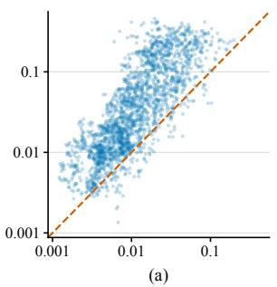

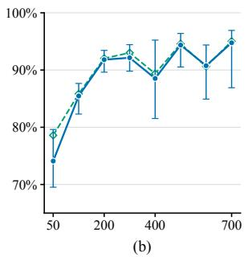

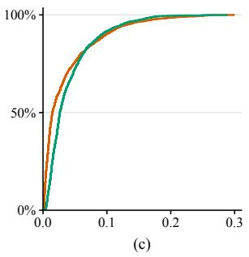

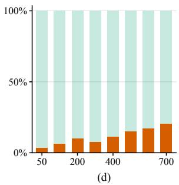  
Figure 7. Critic-value structure across turns. (a) Within-turn (horizontal) versus between-turn (vertical) RMS deviations, weighted by token count. Each point is a trajectory; the dashed line marks equality. (b) Median between-turn variance share versus training step, with token weighting (blue) and equal turn weighting (green). Error bars are 95% prompt-cluster bootstrap intervals within each checkpoint. (c) Cumulative distributions of per-trajectory mean absolute boundary jumps (orange) and mean within-turn P95–P05 spans (green). (d) Shares of pooled squared adjacent value changes at turn boundaries (orange) and within turns (pale green), by training step.

## C.1. More Examples

Figure 8 shows six additional trajectories with pronounced critic-value changes at multiple turn boundaries, complementing the examples in Figure 2.

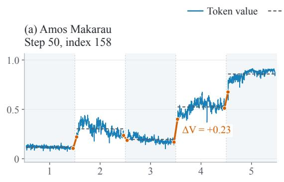

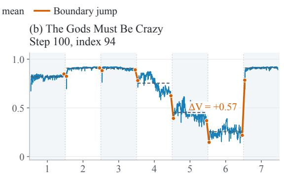

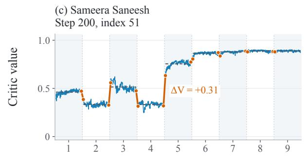

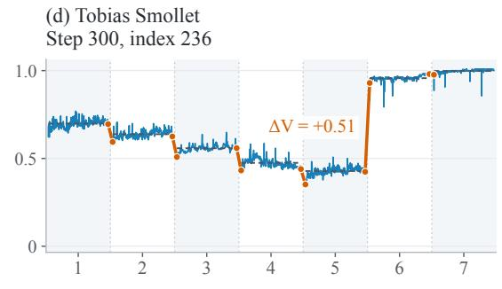

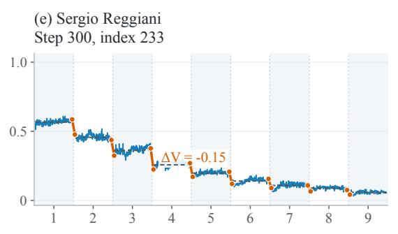

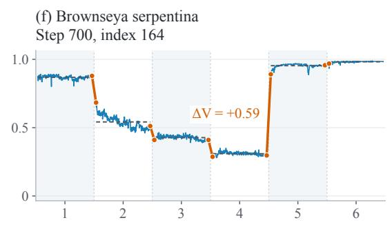  
Assistant turn (equal width)

Figure 8. More examples of critic-value structure across turns. Blue curves show raw token values, dashed lines show turn means, and orange segments mark changes between successive turns. As in Figure 2, turns have equal display width and curves are unsmoothed; only assistant-action positions are included, with no appended terminal zero.

## D. Validation Curves for Parameter Ablations

Figures 9–11 compare 4B BrowseComp-Plus validation pass@1 through training step 300. Red curves show the MPO reference with $( \lambda , \lambda _ { \mathrm { { i n t r a } } } , \beta ) \ = \ ( 0 . 8 0 , 0 . 9 5 , 1 . 0 0 ) ;$ blue curves show oneparameter ablations. All panels use the same axis ranges and display unsmoothed validation measurements.

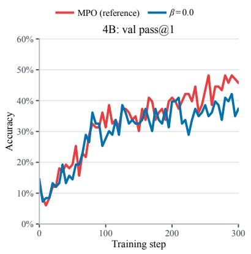

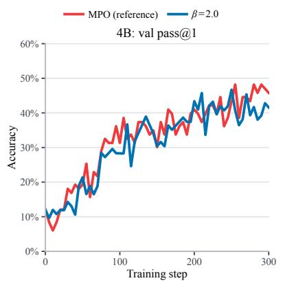

Figure 9. Local refinement strength �: 0.0 (left) and 2.0 (right), compared with the MPO reference.  
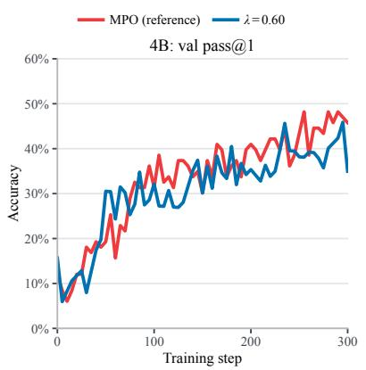

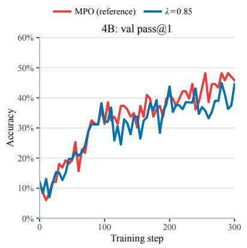

Figure 10. Cross-turn propagation �: 0.60 (left) and 0.85 (right), compared with the MPO reference.  
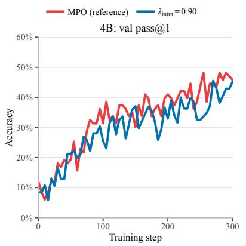

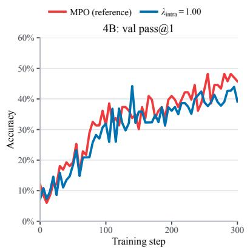  
Figure 11. Within-turn trace $\lambda _ { \mathrm { i n t r a } } \colon 0 . 9 0$ (left) and 1.00 (right), compared with the MPO reference.