# Spine: Compiling Subtask Trees into Structured Context for Long-Horizon Coding Agents

JIAHONG XIANG, Southern University of Science and Technology, China KUNQIU CHEN, Southern University of Science and Technology, China LINGMING ZHANG, University of Illinois at Urbana-Champaign, USA YUQUN ZHANG, Southern University of Science and Technology, China

Long-horizon coding tasks contain nested subtasks. Typically, agents record interactions sequentially into a growing history as model context, causing severe context inflation and performance degradation. One group of existing context-management approaches compresses or trims the history without explicit subtask boundaries, such that context reduction can discard information needed by unfinished subtasks, leading to repeated exploration and disrupted task progress. On the other hand, recursive subagent delegation isolates completed subtasks through child agents via assigning every subtask boundary to delegation, which conflates subtask granularity with executing agent choice, adding execution and coordination overhead. This raises a question: how can model context align with subtask nesting and completion without incurring the high overhead of additional agents? To answer this question, we introduce Spine, an interface and runtime that align model context with subtask nesting and completion in a just-in-time manner. Specifically, an agent declares explicit subtask boundaries through work scopes, allowing the same agent to execute nested subtasks inline without multi-agent overhead, while reserving delegation for independent parallel tasks. The runtime organizes execution in SpineTree, a persistent tree that serves as the structural spine recording subtask relations, local interactions, completion states, and returned results. Before each model call, the runtime compiles the tree into model context just in time, retaining unfinished subtasks’ interactions and replacing completed subtasks’ details with their submitted results, while preserving prefix-cache reuse.

We integrate Spine into Codex, OpenAI’s popular coding-agent harness, to build SpineCodex. We evaluate it on three widely-adopted long-horizon benchmarks: SWE-Milestone for repository evolution, ProgramBench for whole-program reconstruction, and FrontierSWE for open-ended engineering. With GPT-5.6 Sol, SpineCodex improves SWE-Milestone Score by 11.8% while reducing total cost by 32.4%, compared with native Codex. It also achieves a comparable Score to Recursive Subagent at 73.7% lower total cost. With the same model it improves the average ProgramBench test-pass rate by 17.3% compared with native Codex and improves Mean@5, i.e., the mean score over five trials per task, on eight of the ten evaluated FrontierSWE tasks. To evaluate generalizability, we integrate Spine into Pi, a popular open-source coding-agent harness with an extensible architecture, through a reusable software package. With Gemini 3.8 Flash and the open-weight Qwen 3.8 27B, this integration improves SWE-Milestone Score by 9.5–17.5% and the average ProgramBench test-pass rate by 4.3–8.7%, compared with native Pi.

CCS Concepts: • Software and its engineering → Automatic programming; • Computing methodologies → Artificial intelligence.

Additional Key Words and Phrases: Coding agents, context management, large language models

## 1 Introduction

Coding agents are increasingly used for complex, long-horizon software-engineering tasks [3, 22]. For example, in May 2026, roughly one in four sampled active individual users of Codex, OpenAI’s coding agent, had submitted a request estimated to require at least eight hours of human work [22]. These tasks contain nested subtasks, i.e., subtasks themselves containing further subtasks. When a subtask completes, the agent uses its result to resume its parent task, i.e., the task that directly contains it. To complete such tasks, a coding agent iteratively reasons, invokes tools, and uses the resulting observations to guide subsequent interactions [53]. The agent harness, i.e., the software that runs tools and prepares model inputs, encapsulates these interactions into subsequent model calls as a growing interaction history [45], which forms part of the model context as the input information supplied to each model call. However, simply recording interactions in turn as history is impractical, since it could easily inflate the context and reduce agent efectiveness, making it essential to select which interactions to encapsulate. Intuitively, for completed subtasks, only their returned results are likely needed by their parent task rather than detailed original interactions, which are in fact essential for proceeding with unfinished subtasks [49].

Existing approaches manage context by compressing or trimming the interaction history, or by assigning subtasks to child agents. History compression and trimming reduce the information encapsulated into later calls. For instance, AgentDiet removes redundant or expired content [49], while AgentFold lets the agent summarize selected parts of the history at diferent granular levels [55]. Context Folding uses a plan–branch–return workflow trained with FoldGRPO, in which the returned result ofa completed branch replaces its intermediate interactions [43]. However, reducing interaction history does not by itself maintain subtask relations, completion status, or where unfinished work should resume. When this information must be recovered from reduced context, the model may lose track of progress, repeat exploration [13], or declare completion while work remains unfinished [56]. These failures add execution cost and disrupt continued progress.

Recursive subagent delegation instead assigns subtasks to child agents with separate contexts, which can in turn delegate further subtasks and return their results. For example, Recursive Agent Harnesses gives each child a complete tool-using harness with its own workspace and context [28]. These calls represent subtask nesting and isolate completed work through returned results, but using them to establish every subtask boundary forces delegation and adds execution and coordination overhead, even when the current agent could perform the work itself. Studies of multi-agent systems show that communication inflation and redundant messages can directly degrade task performance [58, 62], while divergent context prefixes force shared information to be repeatedly reprocessed without KV-cache reuse [54]. Crucially, whether a subtask is delegated to another agent or executed locally by the current agent, the agent still makes decisions about when the subtask starts, completes, and returns. However, existing interaction histories lack an explicit representation of these boundaries and completion states.

To summarize, these observations lead to three issues in context management: (1) the lack of an explicit representation of subtask boundaries and completion status in the interaction history; (2) the lack of separation between subtask granularity and executing agent choice; and (3) the lack of a history representation distinguishing between completed and unfinished subtasks for parent tasks.

This raises a question: how can model context align with subtask nesting and completion without incurring the high overhead of additional agents? Ideally, the same agent should be able to complete a subtask and resume its parent task with the result, while retaining information needed by other unfinished subtasks with explicit subtask boundaries.

To answer this question, we introduce Spine, an interface and runtime that align model context with subtask nesting and completion while supporting both local execution and delegation in a just-in-time manner. Specifically, Spine addresses the aforementioned issues through three key designs. (1) To provide an explicit representation of subtask boundaries and completion status, the agent declares a work scope, i.e., a subtask with an explicit entry, a parent task, and a result submitted on completion. (2) To separate subtask granularity from executing agent choice, a work scope can span multiple model calls and tool interactions, where the current agent can open nested scopes within it, complete each scope by submitting a result, and resume the parent task locally, while independent subtasks can be delegated to other agents for parallel execution so that subtask boundaries do not determine which agent executes the work. (3) To distinguish completed subtasks and unfinished subtasks for parent tasks, the runtime maintains a persistent execution tree, namely SpineTree, and compiles it into model context just in time before each model call, retaining unfinished work scopes’ interactions and replacing completed scopes’ details with their submitted results. More specifically, SpineTree serves as the structural spine recording the current agent’s scopes, their nesting, interactions, and completion status, together with submitted results and results returned by delegated agents. Completing a work scope therefore both resumes its parent with the submitted result and changes the context supplied to the next call. Notably, the detailed interactions remain preserved in SpineTree, while the unchanged context preceding the scope remains eligible for prefix-cache reuse.

We integrate Spine into the agent harness ofCodex, OpenAI’s widely used coding product [30, 31], to build SpineCodex. We evaluate efectiveness and cost using GPT-5.6 Sol [33] and Grok 4.6 [48] on three widely-adopted long-horizon coding benchmarks: SWE-Milestone [13], ProgramBench [52], and FrontierSWE [6]. On SWE-Milestone with GPT-5.6 Sol, SpineCodex improves Score by 11.8%, 16.7%, and 14.8% while reducing total cost by 32.4%, 58.1%, and 22.7%, compared with native Codex, AgentDiet, and Context Folding, respectively. It also achieves a comparable Score to Recursive Subagent at 73.7% lower total cost. With the same model, it improves the average ProgramBench test-pass rate by 17.3% compared with native Codex, and FrontierSWE’s Mean@5, i.e., the mean score over five trials per task, on eight of ten evaluated tasks. To evaluate generalizability, we integrate Spine as a plugin into Pi [15], a popular open-source coding-agent harness with an extensible architecture [14], through its oficial extension interface [16]. Using Gemini 3.8 Flash [20] and the open-weight Qwen 3.8 27B [41], this integration improves SWE-Milestone Score by 9.5–17.5% and the average ProgramBench test-pass rate by 4.3–8.7%, compared with native Pi.

This paper makes the following contributions:

• Spine. We propose an interface that aligns model context with subtask nesting and completion while supporting both local execution and delegation for agents. It combines explicit subtask declarations with context construction from a persistent execution tree, namely SpineTree, allowing the current agent to execute nested subtasks with a structurally aligned interaction history.

• System Implementation. We integrate Spine with the existing mechanisms of Codex and Pi, yielding SpineCodex and a loadable SpinePi plugin, respectively. The implementation involves approximately 17K lines of Rust code and 9K lines of TypeScript/Rust code, which are ready to use out of the box.

• Extensive Study. We conduct an extensive study across three long-horizon coding benchmarks, four models, and two agent harnesses. On SWE-Milestone with GPT-5.6 Sol, SpineCodex resolves 19 of 98 milestones, compared with 14 for native Codex and 17 for Recursive Subagent, at 32.4% and 73.7% lower total cost, respectively. In the Pi integration, Spine improves SWE-Milestone Score by 9.5–17.5% and the average ProgramBench test-pass rate by 4.3–8.7% across the evaluated models.

## 2 Motivating Example

The task is a version migration of Nushell, i.e., a shell and scripting language, requiring coordinated changes across the repository [13]. Within a parser update, for example, the agent can run a targeted compilation check and then resume the unfinished update as in Figure 1. At this stage, subsequent model inputs require the check result alongside the ongoing parser work, whereas the check’s intermediate interactions need not all remain.

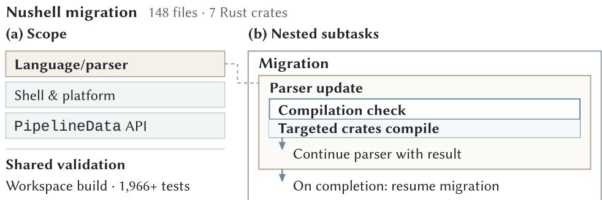  
Fig. 1. Nested work within the Nushell migration.

We first consider an agent that compresses a flat interaction history without explicitly representing the nested structure of its subtasks [49]. The reduced context must still allow the model to identify which inspections have already been completed and where implementation should resume. In Figure 2(a), the agent inspects nine source files, and the resulting inspection history is replaced by a summary. The next response rereads overlapping ranges from seven of these files, and a later response revisits seven again. In this trace, the agent revisits previously inspected source while implementation remains unfinished. These repeated inspections add tool calls and bring the same source content back into model input, consuming additional execution budget. The challenge is to reduce completed subtasks’ details while keeping the context of unfinished work available.

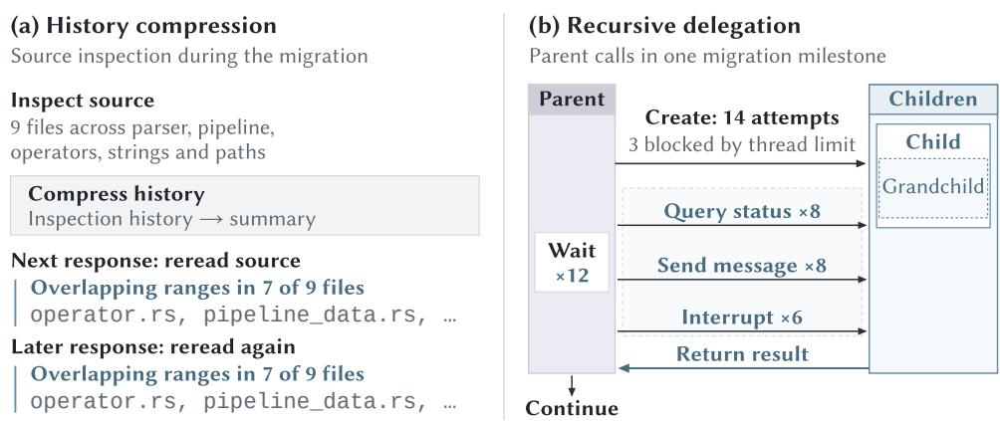  
Fig. 2. History compression and recursive delegation during the Nushell migration.

Next, we consider an agent that delegates subtasks to child agents, which can in turn delegate further subtasks. Each child has a local context and returns a result to its parent, giving nested work separate execution boundaries. The parent must assign work, communicate requirements, check progress, and collect results. If subsequent work depends on a child’s result, the parent must wait for it before proceeding. In the milestone shown in Figure 2(b), the parent issues twelve wait calls and makes fourteen attempts to create child agents, three of which are blocked by the thread limit. These handofs and coordination steps add model and tool interactions alongside the child agents’ own execution. Thus, relying on delegation merely to isolate context introduces substantial coordination overhead, particularly when the parent simply blocks to await sequential results.

Ideally, an agent could complete the nested compilation check and resume the parser update with its earlier context and the check result within its own execution, as in Figure 3. The agent would first mark the check’s beginning, allowing the runtime to record its interactions separately from the ongoing parser work. When the check completes, the agent would return a result such as “targeted crates compile”. The runtime would replace the check’s intermediate reads, repairs, and compiler output with this result in the next model input, while retaining the context of the unfinished parser update. With the check result available, the same agent could continue the parser update for local-variable completion. When the parser update finishes, its result would return to the migration in the same way, while other changes and workspace validation remain pending. This example motivates explicit subtask boundaries that let the current agent replace completed subtasks’ details with their results while retaining information needed by unfinished parent tasks and leaving the choice of executing agents independent of the boundary.

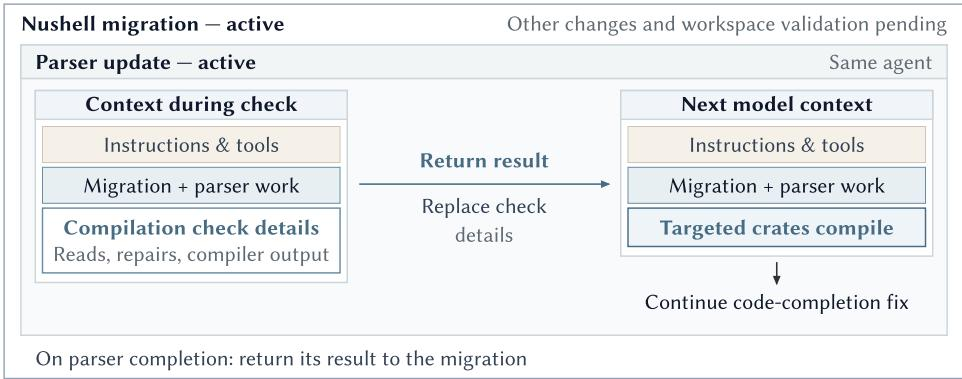  
Fig. 3. Returning nested results within the same agent.

## 3 Background and Related Work

## 3.1 Long-Horizon Coding Agents and Tasks

Coding-agent harnesses, e.g., Codex, Claude Code, and Pi, let an agent inspect, modify, and test a repository through repeated model calls and tool use [2, 4, 5, 7, 12, 15, 31, 45, 51]. As shown in Figure 4, the harness repeatedly executes tool calls, records their results, and prepares the next model input. As the loop repeats, the harness accumulates interactions and selects what context to include in each subsequent model call. Typically, the interaction history refers to the record of these interactions and model context refers to the input to one model call, including instructions, the task, and selected history.

In long-horizon coding tasks, agents use this loop to carry out a sequence of interdependent development steps. Researchers have developed benchmarks to evaluate agents on such tasks. For example, SWE-Milestone requires agents to complete dependent milestones in a persistent repository [13]; ProgramBench requires whole-program reconstruction from documentation and an execute-only reference implementation [52]; and FrontierSWE covers open-ended implementation, performance optimization, and research tasks [6].

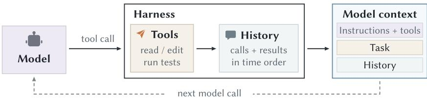  
Fig. 4. The coding-agent execution loop.

To complete these tasks, an agent may perform subtasks within an ongoing subtask, each of which can span several iterations of this loop. When a subtask completes, the agent uses its result to resume the parent task, i.e., the task that directly contains it. Figure 1(b) illustrates this recursive structure. Specifically, the compilation check returns its result to the parser update, which later returns its own result to the migration. When the same agent performs these nested subtasks, the harness records their interactions in one chronological history.

This order alone does not mark where the check begins and ends or which interactions its unfinished parent still needs. A harness can compact earlier interactions to keep later inputs within the context window, while the reduced input must retain the information needed to continue unfinished work [29, 56]. With exact-prefix caching, rewriting an earlier token prevents reuse of cached computation beyond that point, while the unchanged prefix remains reusable [27, 60].

## 3.2 Context-Management Approaches

Recent approaches manage model context by selecting, condensing, or retaining information across calls. For example, AgentDiet uses a separate reflection model to remove redundant or expired material within a sliding window of history [49], while AgentFold lets the agent summarize selected historical spans at diferent granular levels [55]. Other approaches provide context condensation as a callable operation [26]. For coding agents, SWE-Pruner selects taskrelevant lines from incoming file observations [46], whereas AttnCompress uses proxy attention to select blocks from accumulated trajectories [57].

To preserve input information needed for later work, recent approaches improve compression instructions or let the agent restore omitted context [23, 25]. SWE-MeM lets the agent choose when, what span, and how to compress based on task progress [17]. AutoCompact trains a coding agent to compact after a stage is suficiently resolved [59]. CORVUS keeps file observations synchronized with repository changes [61], while Ledger maintains execution facts and mediates repeated tool calls [47].

Other approaches use subtask completion to decide when to replace detailed interactions. HiAgent keeps detailed interactions for the current subgoal and summarizes completed subgoals, while allowing their full trajectories to be retrieved [21]. Context Folding uses FoldGRPO to train agents in a single-level plan–branch–return workflow to learn when to create a branch for a subtask and when to return. Specifically, a completed branch’s returned result replaces its intermediate interactions in the parent context [43].

For approaches that trim or summarize context without explicitly maintaining work structure, the model must reconstruct subtask relations, completion status, and pending work from retained interactions. Long-running coding observations report increased reading and searching after compaction [13], as well as dificulty recovering progress and premature completion across context windows [56]. These problems add execution cost and disrupt continued progress. Context management therefore needs to both preserve work state and reduce input.

## 3.3 Recursive Subagent Systems

Recursive calls give each child its own context and let it invoke further children before returning a result to its parent [28, 42, 50]. Recursive Agent Harnesses applies this pattern to a complete tool-using harness, such that each child has its own context, workspace, and tools [28]. THREAD recursively spawns child execution threads with contexts derived from their parents and returns selected outputs to the parent threads [42]. Current advanced coding-agent harnesses also expose this delegation pattern; for example, Codex can spawn child sessions from a parent thread and return their results, while Claude Code can invoke subagents through programmatic workflows [4, 32].

However, when subtask boundaries are established through child-agent calls, finer-grained task decomposition also requires more agent executions and communication. AgentPrune finds that some messages contribute little to task completion in the evaluated multi-agent systems, yet are still encapsulated as the receiving agents’ model inputs and consume tokens [58]. KVCOMM shows that when shared content follows diferent prefixes, ordinary prefix caching cannot directly reuse its computation, such that agents process the same content again [54]. Recursive subtask boundaries should therefore be represented independently of whether the work remains with the current agent or is delegated to another agent.

## 4 Spine Approach

Spine is an interface that aligns model context with subtask nesting and completion in a just-in-time manner. Specifically, it addresses the three issues illustrated in Section 1 as follows: (1) the agent declares explicit subtask boundaries and completion status through work scopes and a persistent SpineTree (Section 4.1); (2) the interface decouples subtask granularity from executing agent choice by supporting both local inline nesting and parallel delegation (Section 4.2); and (3) the runtime dynamically distinguishes completed subtasks from unfinished subtasks by compiling context just in time, resuming parent tasks with submitted results while preserving prefix caches (Section 4.3).

Figure 5 shows how the runtime supports this interaction. The agent issues lifecycle commands through its harness, and the frontend incorporates these commands and the associated messages into SpineTree, preserving work nesting and interaction order. The backend uses the updated tree to assemble the next model input. Specifically, as illustrated, this context retains the parent task’s preceding messages and the active child’s ongoing interactions, while replacing completed child interactions with their returned results.

## 4.1 Work Scopes and SpineTree

The fundamental unit of interaction with Spine is a work scope, i.e., an agent-declared subtask with an explicit entry, a parent task, and a result submitted on completion. Within a scope, the current agent can inspect files, edit code, and run checks over multiple turns. Entering a nested subtask forms a child scope whose result returns to the unfinished parent. We call work performed by the current agent inline work, whereas delegated work is performed by another agent.

SpineTree is an ordered, persistent execution tree that serves as the structural spine of the execution. Specifically, the sequence of unmatched Open markers represents the active path from the root task to the current subtask, while completed inline scopes form closed branches $b =$ Branch $( d , F , \mu )$ that retain their local contents and returned results of the active path.

Let M be the set of messages. Formally, a branch is defined as

$$
b = { \mathrm { B r a n c h } } ( d , F , \mu ) , \qquad \mu \in M ^ { * } .\tag{1}
$$

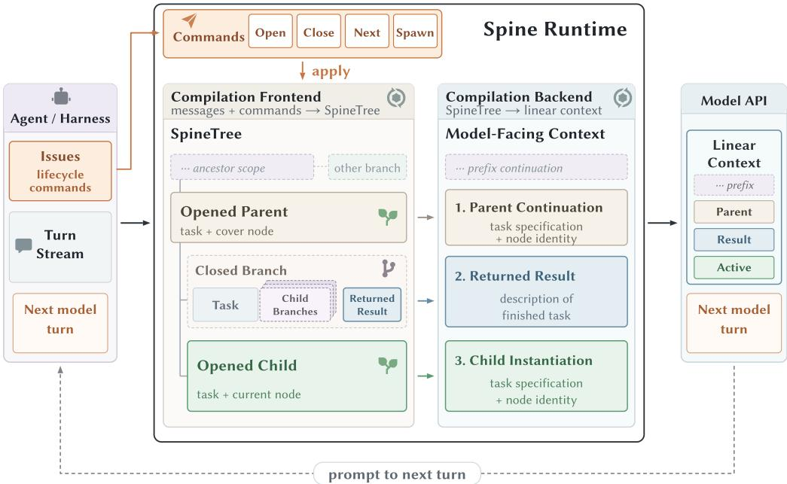  
Fig. 5. Overview of Spine.

Its components are as follows.

� (Task): the task description supplied when the scope is opened.

� (Branch Body): an ordered list $F = [ Y _ { 1 } ^ { \prime } , \ldots , Y _ { k } ^ { \prime } ]$ of this scope’s local message nodes, completed child branches, and delegated result nodes, preserving their interleaving.

$\mu$ (Returned Result): a message sequence $\mu$ submitted on completion to the parent task. Subsequent model context uses this result in place of the details retained in $F .$

While a scope remains open, the runtime must also record where its work began and which interactions belong to it. An ordered list � encodes SpineTree as a whole, including messages, unfinished scopes, completed branches, and delegated results. Each $F$ is the body of one completed Branch(�, �, �), which appears as an entry in $T$ or in an enclosing branch body. Using � for an entry, we define

$$
\begin{array} { r l } & { T = [ Y _ { 1 } , \varrho . . . , Y _ { n } ] , } \\ & { Y : = \mathsf { M e s s a g e } ( m ) \mid \mathrm { O p e n } ( d ) \mid \mathsf { B r a n c h } ( d , F , \mu ) \mid \mathsf { S p a w n N o d e } ( \mu ) . } \end{array}\tag{2}
$$

Here Message(�) wraps a message � $\in \mathbf { \Omega } M$ , Open(�) marks unfinished inline work, and SpawnNode(�) stores a delegated result. Node identities are implicit in this notation.

In �, each $Y _ { i }$ belongs to the nearest preceding Open(�) at position $j < i ,$ or the implicit root if none exists. Each entry of � belongs directly to its enclosing branch. Open markers identify the active ancestor chain: the innermost marker denotes the active subtask, or execution resides at the root task if none remain. Note that completed branches contain no Open markers, since child scopes must finish before their parent scope closes. As a result, these rules preserve work ownership alongside message order.

Table 1. Lifecycle commands and terminal streams. $\widehat { P }$ and $\widehat { o }$ encode preceding and current-turn messages; “·” denotes list concatenation dele ated results follow task order.
<table><tr><td>Command/event</td><td>Terminal stream ω</td><td>Work semantics</td></tr><tr><td>No command</td><td> ${ \widehat { P } } \cdot { \widehat { O } }$ </td><td>Continue current work.</td></tr><tr><td>Open(d)</td><td> $\widehat { P } \cdot \left[ \mathrm { O p e n } ( d ) \right] \cdot \widehat { O }$ </td><td>Enter inline child.</td></tr><tr><td>Close(µ)</td><td> $\widehat { P } \cdot \left[ \mathsf { C l o s e } ( \mu ) \right] \cdot \widehat { O }$ </td><td>Complete child; return result.</td></tr><tr><td>Next  $( \mu , d )$ </td><td> $\widehat { P } \cdot \left[ \mathsf { C l o s e } ( \mu ) , \mathsf { O p e n } ( d ) \right] \cdot \widehat { O }$ </td><td>Close child; open sibling.</td></tr><tr><td>Spawn(tasks)</td><td> $\widehat { P } \cdot \widehat { O } \cdot [ \mathsf { S p a w n N o d e } ( \mu _ { i } ) ] _ { i = 0 } ^ { k - 1 }$ </td><td>Delegate tasks; collect results.</td></tr></table>

## 4.2 Interface Operations

The interface provides four commands for organizing work during task execution, decoupling subtask nesting from executor choice. The agent uses Open to enter a child scope locally and Close to complete it with a result, allowing the same agent to execute nested subtasks inline without multi-agent overhead. Once the child completes, the parent resumes with that result in its model context. Next combines completion with entry into a sibling scope, while Spawn delegates independent subtasks to other agents in parallel and collects their results. Ordinary model and tool interactions continue within the current scope between these commands.

To apply these operations to SpineTree, the runtime translates messages and command events into terminals—discrete input tokens representing messages, boundaries, and results. The frontend (Section 4.3.1) consumes the resulting stream in order.

A turn comprises one model interaction and its associated harness processing. Assume � contains pending incoming messages (such as user prompts or delegated returns) awaiting processing at turn start, and � contains the turn’s local messages, including tool calls and results. For $P = \left[ p _ { 1 } , \ldots , p _ { k } \right]$ and $O = \left[ o _ { 1 } , \ldots , o _ { \ell } \right]$ , mapping each message to a parser terminal gives

$$
\begin{array} { l } { \widehat { P } = [ \mathsf { M e s s a g e } ( p _ { 1 } ) , \ldots , \mathsf { M e s s a g e } ( p _ { k } ) ] , } \\ { \widehat { O } = [ \mathsf { M e s s a g e } ( o _ { 1 } ) , \ldots , \mathsf { M e s s a g e } ( o _ { \ell } ) ] . } \end{array}\tag{3}
$$

The hats denote the same messages represented as parser terminals, where their content and order are unchanged. Each command produces a terminal stream $\omega ,$ consumed by the frontend in order. Here, “·” denotes concatenation, and delegated results are appended as separate result nodes. Table 1 summarizes the corresponding state transitions and streams. An Open enters a child scope under the current scope, or under the root when no scope is open. A Close retains the child scope’s body � in SpineTree while replacing it with result $\mu$ in the parent’s next model input; Close and Next require an open non-root scope.

## 4.3 Just-In-Time Context Compilation

Context compilation implements the interface operations by dynamically assembling model context from the persistent work records just in time before each model call. Figure 6 illustrates a diagnostic check within an unfinished parser update. Specifically, the agent declares the check’s boundaries through Open and Close, submitting “Diagnostic tests pass” as its result $\mu .$ These boundaries assign the test call and output $( m _ { 2 } , m _ { 3 } )$ to the check. The frontend stores them in the completed branch’s body � . When the parent continues, the backend carries $\mu$ into the next input alongside the parent’s task and identity, $D ( \boldsymbol { p } )$ , and its messages $( m _ { 1 } , m _ { 4 } )$ . Note that the test details remain in SpineTree.

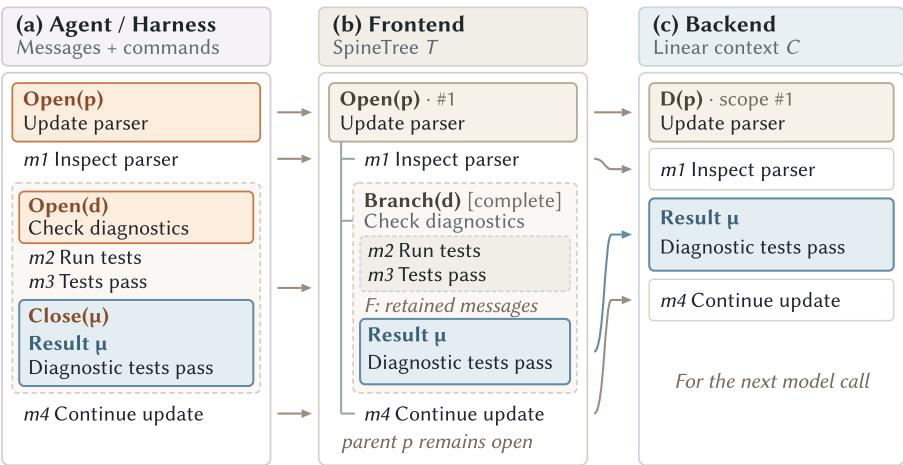  
Fig. 6. Context compilation for an illustrative diagnostic check.

4.3.1 Compilationfrontend. In turn �, with pending messages $P _ { t } { } _ { : }$ , local messages $O _ { t } .$ , and command event $x _ { t }$ , the frontend incrementally incorporates the terminal stream $\omega _ { t }$ into the existing tree $T _ { t }$

$$
\begin{array} { r } { \omega _ { t } = \mathrm { t e r m i n a l s } ( P _ { t } , O _ { t } , x _ { t } ) , } \\ { T _ { t + 1 } = \mathrm { f r o n t e n d } ( T _ { t } , \omega _ { t } ) . \qquad } \end{array}\tag{4}
$$

At its core, scope lifecycle follows a balanced-bracket structure. Specifically, an Open marker initiates a scope, intermediate messages accumulate in its body, and a matching Close marker seals the scope into a completed branch. Formally, the following LR(0) grammar [1] specifies this process without lookahead, constructing branches deterministically as soon as their Close terminals arrive. Note that we assume nonempty streams and branch bodies. With payloads omitted, the grammar is

$$
{ \begin{array} { r c l } { { \mathrm { S t a r t } } } & {  } & { { \mathrm { N o d e s ~ E n d } } } \\ { { \mathrm { N o d e s } } } & {  } & { { \mathrm { N o d e ~ | ~ N o d e s ~ N o d e } } } \\ { { \mathrm { N o d e } } } & {  } & { { \mathrm { M e s s a g e ~ | ~ T r e e N o d e } } } \\ { { \mathrm { T r e e N o d e } } } & {  } & { { \mathrm { O p e n ~ N o d e s ~ C l o s e ~ | ~ S p a w n N o d e } } . } \end{array} }\tag{5}
$$

The runtime incrementally parses prefixes of valid streams. End is a logical end marker which is never emitted during execution. The ParseStack retains parser states and semantic values across turns.

Operationally, the frontend shifts each terminal from � left to right onto the ParseStack. After each shift, it repeatedly applies reductions selected by the current LR(0) state, replacing the matching stack sufix with the production’s left-hand-side symbol. Reducing Open Nodes Close to TreeNode constructs the innermost Branch $( d , F , \mu )$ from the opening task, ordered body, and closing result. The delegated rule retains SpawnNode $( \mu )$ , while Nodes reductions preserve node order. After all available reductions, flattening the stack’s semantic node lists in place yields � with unmatched Open markers retained (Section 4.1). The backend can therefore project the tree while open work continues across turns.

4.3.2 Compilation backend. The backend assembles model input from the updated work state. It carries messages and open task descriptors forward, while using each completed child’s result in place of its detailed interactions. For $T _ { t + 1 } = [ Y _ { 1 } , . . . , Y _ { n } ]$ , this projection is

$$
C _ { t + 1 } = \operatorname { b a c k e n d } ( T _ { t + 1 } ) = h ( Y _ { 1 } ) \cdot \ldots \cdot h ( Y _ { n } ) ,
$$

$$
h ( Y ) = { \left\{ \begin{array} { l l } { [ m ] , } & { Y = { \mathsf { M e s s a g e } } ( m ) , } \\ { D ( d ) , } & { Y = { \mathsf { O p e n } } ( d ) , } \\ { \mu , } & { Y \in \{ { \mathsf { B r a n c h } } ( d , F , \mu ) , { \mathsf { S p a w n N o d e } } ( \mu ) \} . } \end{array} \right. }\tag{6}
$$

Here $D ( d ) \in { \cal M } ^ { * }$ renders an Open node’s task and node identity as messages. Crucially, a completed inline branch contributes solely its returned result $\mu$ without expanding its body $F ,$ shielding subsequent turns from voluminous intermediate interactions while safely preserving them in SpineTree. A delegated node contributes its result, while the delegated agent manages the local interactions.

Prefix Cache Preservation. A delegated child’s input extends its parent’s context with a taskspecific sufix $\Delta _ { \mathrm { c h i l d } }$ . Completing an inline scope afects only the sufix of $T$ beginning at the active Open marker. Its projection �, including the task description, is replaced by �, preserving the preceding prefix � of the model context:

$$
\begin{array} { r l } { \displaystyle } & { C _ { \mathrm { c h i l d } } = C _ { \mathrm { p a r e n t } } \cdot \Delta _ { \mathrm { c h i l d } } , } \\ { \displaystyle } & { Q \cdot B \longrightarrow Q \cdot \mu . } \end{array}\tag{7}
$$

The second line isolates branch replacement, where any new sibling task and the current turn’s messages are then appended as in Section 4.2. With identical token serialization and compatible cache settings, the unchanged prefixes remain eligible for KV-cache reuse, although actual reuse depends on cache availability. Specifically, inference engines can reuse the precomputed key-value states for $Q ,$ avoiding redundant attention computation across turns.

## 5 Evaluation

## 5.1 Benchmarks and Evaluation Metrics

We evaluate Spine on three widely-adopted benchmarks covering continuous repository evolution, whole-program reconstruction, and open-ended engineering. Table 2 summarizes the tasks evaluated and the metrics used for each benchmark.

Table 2. Evaluation benchmarks and metrics.
<table><tr><td>Benchmark</td><td>Scope</td><td>Metrics</td><td>Target</td></tr><tr><td rowspan="2">SWE-Milestone [13]</td><td>7 tasks</td><td>Score (%)</td><td>Continuous</td></tr><tr><td>(98 milestones total)</td><td># Resolved</td><td>repository evolution</td></tr><tr><td rowspan="2">ProgramBench [52]</td><td>50 tasks randomly</td><td># Resolved / # Almost</td><td>Whole-program</td></tr><tr><td>sampled from 200</td><td>Avg. pass (%)</td><td>reconstruction</td></tr><tr><td rowspan="2">FrontierSWE [6]</td><td>10 tasks</td><td>Mean@5</td><td>Open-ended</td></tr><tr><td>5 trials/task</td><td>Best@5</td><td>engineering</td></tr></table>

• SWE-Milestone [13] requires agents to complete dependent milestones in a persistent repository (e.g., upgrading go-zero’s go-redis dependency from v8 to v9 [44]) while preserving existing behaviors.

• ProgramBench [52] requires agents to reconstruct programs ranging from command-line utilities to FFmpeg and SQLite [34, 35] using documentation and an execute-only reference implementation. Agents produce source code and build files, which are evaluated through hidden tests that check whether the resulting program reproduces the reference behavior.

• FrontierSWE [6] covers open-ended engineering tasks, such as building a PostgreSQLcompatible server backed by SQLite, implementing Git in Zig, and optimizing libswscale [36, 38, 40]. Continuous scores measure partial progress toward each task’s objective.

Across all three benchmarks, we report their oficial evaluation metrics. For SWE-Milestone, we report its oficial metric Score (%) [13], which evaluates milestone progress as the harmonic mean of test recall (new functionality) and precision (regression prevention), and the number of milestones passing all required tests (# Resolved). For ProgramBench [52], we report the numbers of tasks passing all tests (# Resolved) or at least 95% of tests (# Almost, including fully resolved tasks), together with the average test-pass rate across tasks (Avg. pass (%)). For FrontierSWE [6], we report the mean (Mean@5) and maximum (Best@5) scores over five trials per task.

We also report monetary cost (Cost (\$)), total token usage (Total tokens), and average input tokens per main-model request (Avg. input tokens/req.).

## 5.2 Evaluation Harness Systems and Models

To evaluate Spine across diferent types of agent harnesses, we select two popular open-source systems: Codex [31], which features a native session lifecycle, and Pi [15], which provides an extensible plugin architecture. We implement Spine on them as SpineCodex and SpinePi, respectively, both of which are ready to use out of the box with their original harnesses, Codex and Pi, as baseline controls.

• Codex / SpineCodex. We select Codex, whose repository has over 127,000 GitHub stars [31] and whose broader ecosystem has over five million weekly active users [30], as the common harness for comparing context-management approaches in RQ1. SpineCodex connects to Codex’s native session lifecycle to support work scopes, forked child sessions, and execution resumption, with approximately 17K lines of Rust code.

• Pi / SpinePi. We select Pi, whose repository has over 111,000 GitHub stars [15] and whose codingagent package received over 4.5 million npm downloads in one week [14], to evaluate Spine’s generalizability in RQ2. SpinePi is loaded as a plugin through Pi’s extension interface, registering Spine tools and providing model context [16], with approximately 9K lines of TypeScript/Rust code.

Baselines. We select four baselines covering compaction, trajectory reduction, context folding, and recursive delegation. All approaches run within Codex.

• Codex. We use Codex’s native context compaction mechanism [29, 31].

• AgentDiet. AgentDiet uses reflection over a sliding window of the trajectory to identify and remove redundant information [49].

• Context Folding. Context Folding lets the agent branch into a subtask and return a summary to the parent context. We implement its folding mechanism with the shared model, without FoldGRPO training [43].

• Recursive Subagent. Following recursive delegation frameworks [28, 42], we instantiate this baseline by adapting Codex’s native subagent mechanism [32], where agents recursively delegate subtasks to child sessions and incorporate their returned results.

Models. We select models spanning frontier capabilities, cost-eficient inference, and open-weight deployment. Specifically, we use GPT-5.6 Sol and Grok 4.6 with Codex for RQ1 [33, 48], and Gemini 3.8 Flash and Qwen 3.8 27B with Pi for RQ2 [20, 41]; we access the first three models through their providers’ oficial APIs and run Qwen 3.8 27B locally with vLLM [24] on NVIDIA A100 GPUs.

## 5.3 Evaluation Setup

We run each comparison in isolated containers with the same model, harness, task subset, and budget across the approaches being compared. Unless explicitly noted otherwise, our default benchmark is SWE-Milestone and our default model is GPT-5.6 Sol.

For SWE-Milestone, we follow the oficial protocol and resume each run until all milestones have been submitted for evaluation [9]. Given the cost of evaluating all 200 tasks, we randomly sample 50 tasks from ProgramBench and retain its six-hour and 1,000-step limits [52]. For FrontierSWE, we evaluate a fixed subset of ten available V1 tasks with five trials per task and a 20-hour budget per trial. Seven of its 17 tasks [6] are unavailable in our environment, including optimizer-design, which requires an H100 GPU [39], and frogsgame-rl, which requires the external Tinker API and network access [37]. We evaluate FrontierSWE in RQ1 to cover open-ended engineering tasks, while RQ2 evaluates harness generalizability on SWE-Milestone and ProgramBench. The source code of SpineCodex and SpinePi is available on GitHub [18, 19].

## 5.4 Research Questions

We evaluate the efectiveness, generalizability, and runtime behavior of Spine through three research questions:

• RQ1: How efective is Spine on the Codex harness for long-horizon software engineering tasks? To answer this RQ, we compare Codex and SpineCodex across three benchmarks, and then compare SpineCodex with other context-management approaches on SWE-Milestone.

• RQ2: Does Spine remain efective when integrated into another agent harness? To answer this RQ, we compare Pi and SpinePi on SWE-Milestone and ProgramBench with Gemini 3.8 Flash and Qwen 3.8 27B.

• RQ3: How do agents use Spine to organize work, and how does this afect the context carried forward? We analyze scope use and input changes, revisit the motivating example through an execution trace, and conduct ablation studies on subtask nesting and boundary maintenance.

## 5.5 Result Analysis

5.5.1 RQ1: Efectiveness ofSpine. SpineCodex resolves more milestones than Codex on SWE-Milestone with both evaluated models (Table 3), increasing the number from 14 to 19 with GPT-5.6 Sol and from 12 to 14 with Grok 4.6. The corresponding Score improves by 11.8% with GPT-5.6 Sol and 13.8% with Grok 4.6, relative to Codex.

SpineCodex also improves whole-program reconstruction on ProgramBench (Table 3), increasing the average test-pass rate relative to Codex by 17.3% with GPT-5.6 Sol and 10.2% with Grok 4.6. With GPT-5.6 Sol, it fully resolves two of the 50 tasks, compared with none for Codex.

On FrontierSWE, SpineCodex improves Mean@5 and Best@5 over Codex on eight and seven of the ten tasks, respectively, with GPT-5.6 Sol, and improves both metrics on six tasks with Grok 4.6 (Table 4). For example, on libexpat-to-x86asm, its Mean@5 and Best@5 with GPT-5.6 Sol increase from zero to 0.1707 and 0.5444, respectively.

SpineCodex costs less than Codex in five of the six benchmark–model settings (Tables 3 and 4). The exception is ProgramBench with GPT-5.6 Sol, where the higher average test-pass rate is accompanied by a 5.4% increase in cost.

Finding 1: Spine enhances Codex’s efectiveness across repository evolution, whole-program reconstruction, and open-ended engineering tasks, while reducing monetary cost by 6.7–37.9% in five of the six evaluated benchmark–model settings.

Table 3. Performance of SpineCodex and Codex on SWE-Milestone and ProgramBench.
<table><tr><td colspan="7">SWE-Milestone</td></tr><tr><td>Model</td><td>Agent</td><td>Score (%) # Resolved</td><td></td><td></td><td>Total Avg. input tokens tokens/req.</td><td>Cost ($)</td></tr><tr><td>GPT-5.6 Sol</td><td>CODEX</td><td>38.1</td><td></td><td>14/98 1,072.4M</td><td>131.2K</td><td>681.22</td></tr><tr><td></td><td>SPINECODEX</td><td>42.6</td><td></td><td>19/98 640.5M</td><td>72.3K</td><td>460.77</td></tr><tr><td>Grok 4.6</td><td>CODEX</td><td>35.5</td><td>12/98</td><td>713.8M</td><td>120.0K</td><td>505.57</td></tr><tr><td></td><td>SPINECODEX</td><td>40.4</td><td>14/98</td><td>444.2M</td><td>60.3K</td><td>314.20</td></tr><tr><td colspan="7">ProgramBench</td></tr><tr><td>Model</td><td>Agent</td><td># Resolved # Almost</td><td>Avg. pass (%)</td><td></td><td>Total Avg. input tokens tokens/req.</td><td>Cost ($)</td></tr><tr><td>GPT-5.6 Sol</td><td>CODEX</td><td>0/50</td><td>2/50</td><td>62.55 228.44M</td><td>74.71K</td><td>210.21</td></tr><tr><td></td><td>SPINECODEX</td><td>2/50</td><td>7/50</td><td>73.35 264.32M</td><td>67.29K</td><td>221.56</td></tr><tr><td>Grok 4.6</td><td>CODEX</td><td>1/50</td><td>5/50</td><td>64.58 223.53M</td><td>132.75K</td><td>189.73</td></tr><tr><td></td><td>SPINECODEX</td><td>1/50</td><td>8/50</td><td>71.15 199.02M</td><td>119.16K</td><td>164.58</td></tr></table>

Table 4. Per-task performance of SpineCodex and Codex on FrontierSWE.
<table><tr><td></td><td colspan="4">GPT-5.6 Sol</td><td colspan="4">Grok 4.6</td></tr><tr><td>Task</td><td colspan="2">CODEX</td><td colspan="2">SPINECODEX</td><td colspan="2">CoDEX</td><td colspan="2">SPINECODEX</td></tr><tr><td></td><td>Mean@5</td><td>Best@5</td><td>Mean@5</td><td>Best@5</td><td>Mean@5</td><td>Best@5</td><td>Mean@5</td><td>Best@5</td></tr><tr><td>cranelift-codegen-opt</td><td>0</td><td>0</td><td>0</td><td>0</td><td>0.0164</td><td>0.0822</td><td>0</td><td>0</td></tr><tr><td>dart-style-haskell</td><td>0.1533</td><td>0.4029</td><td>0.4019</td><td>0.8136</td><td>0.0876</td><td>0.1595</td><td>0.4074</td><td>0.8505</td></tr><tr><td>dependent-type-checker</td><td>1.8420</td><td>3.6100</td><td>2.4750</td><td>3.7400</td><td>0</td><td>0</td><td>0</td><td>0</td></tr><tr><td>ffmpeg-swscale-rewrite</td><td>0.5472</td><td>1.6400</td><td>0.9488</td><td>1.7200</td><td>0.2140</td><td>0.6280</td><td>0.3910</td><td>0.6550</td></tr><tr><td>git-to-zig</td><td>0.1149</td><td>0.1845</td><td>0.1496</td><td>0.2174</td><td>0.1085</td><td>0.2030</td><td>0.1580</td><td>0.2180</td></tr><tr><td>libexpat-to-x86asm</td><td>0</td><td>0</td><td>0.1707</td><td>0.5444</td><td>0.0356</td><td>0.1781</td><td>0.6126</td><td>0.9703</td></tr><tr><td>lua-native-compiler</td><td>0.5934</td><td>1.0000</td><td>0.7889</td><td>0.9889</td><td>0.6343</td><td>0.9006</td><td>0.9801</td><td>0.9834</td></tr><tr><td>postgres-sqlite-wire-adapter</td><td>0</td><td>0</td><td>0.0314</td><td>0.1568</td><td>0.0595</td><td>0.1556</td><td>0.0138</td><td>0.0691</td></tr><tr><td>pyright-type-checking-optimization</td><td>0.8771</td><td>1.6420</td><td>1.1263</td><td>1.7100</td><td>0.9060</td><td>1.1913</td><td>1.2808</td><td>1.4206</td></tr><tr><td>revideo-perf-opt</td><td>0.2438</td><td>1.2189</td><td>0</td><td>0</td><td>0</td><td>0</td><td>0</td><td>0</td></tr><tr><td colspan="5">Total cost ($)</td><td colspan="4">955.30 771.99</td></tr></table>

Due to the substantial computational cost of evaluating full benchmark suites, we compare SpineCodex with four context-management baselines under our default setting (SWE-Milestone with GPT-5.6 Sol, Table 5). Among all five approaches, SpineCodex achieves the highest Score, resolves the most milestones, and uses the fewest total tokens at the lowest cost (Table 5).

Table 5 presents the performance and cost comparison across context-management approaches on SWE-Milestone. In AgentDiet, reducing source-inspection history from 11.7k to 1.6k tokens while implementation is pending leads to repeated source rereading (Figure 7a), resolving fewer milestones than Codex (12 vs. 14) at higher cost (\$1,098.52 vs. \$681.22). Similarly, our Context Folding baseline uses a single-level plan–branch–return workflow and resolves 13 milestones (vs. 14 for Codex), using 19.5% more tokens at 29.4% higher cost than SpineCodex. While Recursive

Table 5. Comparison with context-management approaches on SWE-Milestone using GPT-5.6 Sol.
<table><tr><td>Agent</td><td>Score (%) # Resolved</td><td></td><td>Total</td><td>Avg. input tokens tokens/req.</td><td>Cost ($)</td></tr><tr><td>CODEX</td><td>38.1</td><td>14/98</td><td>1,072.4M</td><td>131.2K</td><td>681.22</td></tr><tr><td>AGENTDIET</td><td>36.5</td><td></td><td>12/98 959.2M + 76.0M*</td><td></td><td>92.8K 1,057.08 + 41.44*</td></tr><tr><td>CONTEXT FOLDING</td><td>37.1</td><td>13/98</td><td>765.2M</td><td>87.3K</td><td>596.25</td></tr><tr><td>RECURSIVE SUBAGENT</td><td>42.4</td><td>17/98</td><td>2,139.9M</td><td>65.3K</td><td>1,749.73</td></tr><tr><td>SPINECODEX</td><td>42.6</td><td>19/98</td><td>640.5M</td><td>72.3K</td><td>460.77</td></tr></table>

\*Added terms report compression overhead.

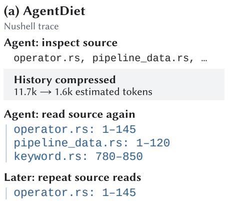

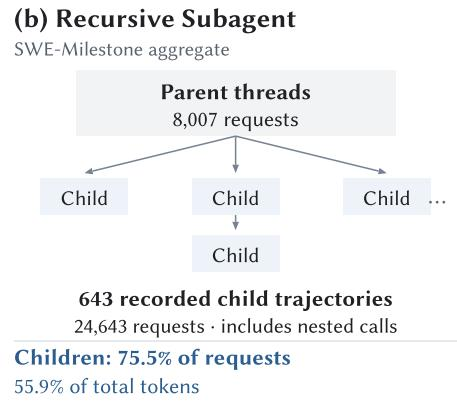  
Fig. 7. (a) Repeated source inspection with AgentDiet; (b) delegation with Recursive Subagent.

Subagent achieves a Score comparable to SpineCodex (42.4% vs. 42.6%, resolving 17 vs. 19 milestones), establishing every subtask boundary through delegation causes child agents to account for 75.5% of its 32,650 model requests (vs. 8,792 for SpineCodex; Figure 7b), driving cost to \$1,749.73 (vs. \$460.77). In contrast, SpineCodex executes nested subtasks locally while maintaining explicit work boundaries, resolving the most milestones (19) at the lowest cost (\$460.77).

## 5.5.2 RQ2: Generalizability to Pi.

In SpinePi, the agent declares work-scope boundaries through Pi’s extension interface, and the runtime uses these declarations to prepare subsequent model inputs. Across both evaluated benchmarks, SpinePi improves task performance over Pi (Table 6). On SWE-Milestone, SpinePi resolves more milestones than Pi with both models, increasing the number from 13 to 15 with Gemini 3.8 Flash and from 8 to 14 with Qwen 3.8 27B. The corresponding Score improves by 9.5% (from 35.8% to 39.2%) with Gemini 3.8 Flash and by 17.5% (from 30.9% to 36.3%) with Qwen 3.8 27B. On ProgramBench, SpinePi fully resolves one task with each model, compared with none for Pi, and increases the average test-pass rate by 8.7% with Gemini 3.8 Flash (from 60.41% to 65.65%) and by 4.3% with Qwen 3.8 27B (from 56.28% to 58.71%).

SpinePi also reduces average input tokens per request across most evaluated settings. With Gemini 3.8 Flash, average input drops by 67.8% on SWE-Milestone (from 511.06K to 164.31K) and by 30.5% on ProgramBench, cutting SWE-Milestone cost from \$644.21 to \$351.55 (45.4%). This substantial reduction occurs because Pi accumulates extensive flat history across Gemini’s long window, whereas SpinePi replaces completed subtask details upon return. The exception to token reduction is Qwen 3.8 27B on SWE-Milestone, where total tokens increase from 1,996.97M to 2,252.80M. Here, the baseline model frequently stalls or loses track of progress in accumulated history, whereas SpinePi preserves work boundaries, allowing the model to sustain execution and resolve six additional milestones.

Table 6. Performance of SpinePi and Pi on SWE-Milestone and ProgramBench.
<table><tr><td colspan="7">SWE-Milestone</td></tr><tr><td>Model</td><td>Agent</td><td>Score (%) # Resolved</td><td></td><td>Total</td><td>Avg. input tokens tokens/req.</td><td>Cost ($)</td></tr><tr><td>Gemini 3.8</td><td>PI</td><td>35.8</td><td>13/98</td><td>6,950.27M</td><td>511.06K</td><td>644.21</td></tr><tr><td>Flash</td><td>SPINEPI</td><td>39.2</td><td></td><td>15/98 3,126.11M</td><td>164.31K</td><td>351.55</td></tr><tr><td>Qwen 3.8 27B</td><td>P1</td><td>30.9</td><td>8/98</td><td>1,996.97M</td><td>132.46K</td><td>一</td></tr><tr><td></td><td>SPINEPI</td><td>36.3</td><td></td><td>14/98 2,252.80M</td><td>148.73K</td><td></td></tr><tr><td colspan="7">ProgramBench</td></tr><tr><td>Model</td><td>Agent</td><td># Resolved # Almost</td><td>Avg. pass (%)</td><td>Total</td><td>Avg. input tokens tokens/req.</td><td>Cost ($)</td></tr><tr><td>Gemini 3.8</td><td>PI</td><td>0/50</td><td>5/50</td><td>60.41 1,663.4M</td><td>113.1K</td><td>217.08</td></tr><tr><td>Flash</td><td>SPINEPI</td><td>1/50</td><td>9/50</td><td>65.65 1,419.2M</td><td>78.6K</td><td>200.96</td></tr><tr><td>Qwen 3.8 27B</td><td>P1</td><td>0/50</td><td>2/50</td><td>56.28</td><td>239.84M 68.14K</td><td>一</td></tr><tr><td></td><td>SPINEPI</td><td>1/50</td><td>2/50</td><td>58.71</td><td>197.26M 51.63K</td><td></td></tr></table>

Finding 2: Spine generalizes efectively to Pi, improving SWE-Milestone Score by 9.5–17.5% and resolving more milestones across both models, while reducing average input tokens per request by up to 67.8% and cutting commercial model cost by 45.4%.

## 5.5.3 RQ3: Behavioral Characteristics of Spine.

Runtime characteristics. Agents use Spine to organize nested subtasks in seven SpineCodex project runs on SWE-Milestone, one per repository (Figure 8a). With the runtime root at depth zero, 72.6% of requests with recorded scope depth occur at depths greater than one.

We also examine model input at return boundaries by comparing the inputs immediately before and after each accepted Close or Next call. The post-return input includes the returned result and other new messages, yet it is shorter after 223 of 224 Close calls and 77 of 80 Next calls, with median decreases across all calls of 23,045 and 35,627 tokens, respectively (Figure 8b). There, negative values indicate shorter input, and boxes show medians and interquartile ranges, with whiskers extending to observations within 1.5 interquartile ranges. Such measurements together show that agents use nested scopes beyond one level and return boundaries usually leave shorter inputs, consistent with the runtime replacing completed local interactions with returned results.

Case study. A recorded SpineCodex execution of the Nushell migration milestone (Section 2) illustrates how the agent manages subtask boundaries across nested scopes and continues from returned results (Figure 9). Within the language/parser update, the agent uses Open to establish an inner scope for operator and parser checks. Upon passing targeted tests, the agent calls Close with a concise result; the runtime archives detailed execution in SpineTree and presents this result alongside ongoing parent context, allowing the same agent to directly continue with the pending local-variable completion (Figure 9a).

When local-variable completion concludes, the agent calls Close on language/parser to return its aggregated result to the root migration. Across this outer return, model input drops from 65,815 to 19,207 tokens (70.8%) as intermediate interactions recede into SpineTree while pending subtasks (PipelineData migration and workspace validation) remain clearly maintained in context (Figure 9b). By explicitly maintaining work states and context across boundaries, SpineCodex helps the agent sustain progress throughout the long-horizon task, ultimately resolving the migration milestone.

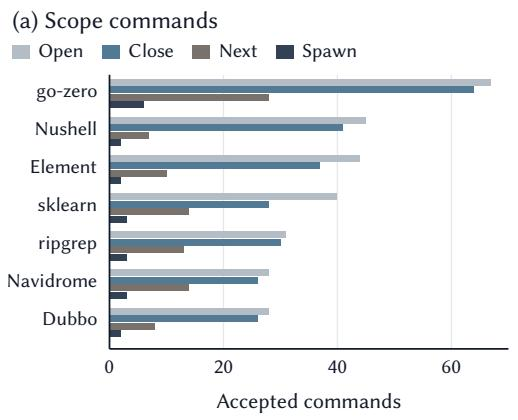

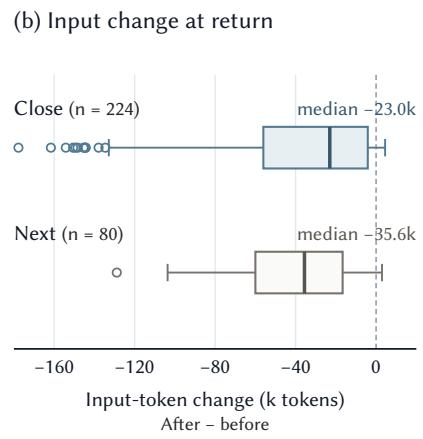  
Fig. 8. Runtime behavior of SpineCodex: (a) lifecycle calls; (b) input-token changes at returns.

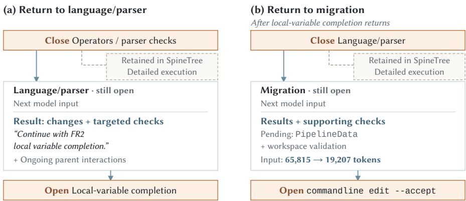  
Fig. 9. Nested returns during the Nushell migration with SpineCodex.

Ablation study. To evaluate the core mechanisms in Spine—subtask nesting and explicit workboundary representation—we evaluate two ablations across three representative SWE-Milestone projects (Navidrome [10], ripgrep [11], and Element [8]) under our default model (GPT-5.6 Sol at high efort, three runs per configuration; Table 7). Depth 1 limits scopes to one level below the root, testing whether multi-level nesting is needed beyond single-level plan–branch–return workflows. No boundary maintenance removes explicit boundary markers and node states from model inputs while retaining runtime state compilation, isolating the efect of presenting boundary cues to the agent.

Table 7. Ablation of nesting and boundary maintenance on three SWE-Milestone tasks.
<table><tr><td>Configuration</td><td>Score (%)</td><td>Resolved</td><td></td><td>Tokens Avg. input</td><td>Cost</td></tr><tr><td>Navidrome, 9 milestones</td><td></td><td></td><td></td><td></td><td></td></tr><tr><td>SPINECODEX</td><td>36.4</td><td>3/9</td><td>60.46M</td><td>71.2K</td><td>$42.48</td></tr><tr><td>Depth 1</td><td>28.6</td><td>2.33/9</td><td>71.50M</td><td>99.5K</td><td>$52.60</td></tr><tr><td>No boundary maintenance</td><td>29.0</td><td>2.33/9</td><td>67.40M</td><td>124.2K</td><td>$60.50</td></tr><tr><td>ripgrep, 11 milestones</td><td></td><td></td><td></td><td></td><td></td></tr><tr><td>SPINECODEX</td><td>72.4</td><td>5.667/11</td><td>48.22M</td><td>59.8K</td><td>$34.67</td></tr><tr><td>Depth 1</td><td>66.8</td><td>4/11</td><td>54.43M</td><td>82.8K</td><td>$40.78</td></tr><tr><td>No boundary maintenance</td><td>67.2</td><td>3/11</td><td>52.77M</td><td>118.1K</td><td>$45.88</td></tr><tr><td>Element, 18 milestones</td><td></td><td></td><td></td><td></td><td></td></tr><tr><td>SPINECODEX</td><td>33.7</td><td>2.667/18</td><td>112.12M</td><td>78.1K</td><td>$78.87</td></tr><tr><td>Depth 1</td><td>27.4</td><td>1.667/18</td><td>123.60M</td><td>98.7K</td><td>$91.79</td></tr><tr><td>No boundary maintenance</td><td>27.5</td><td>1.333/18</td><td>114.10M</td><td>128.6K</td><td>$102.24</td></tr></table>

Across all three projects, SpineCodex improves Score by 7.7–27.3% over both ablations, resolving more milestones at lower cost with shorter inputs (Table 7). Restricting nesting (Depth 1) raises average input per request from 59.8K–78.1K to 82.8K–99.5K, showing that shallow scopes fail to isolate intermediate interactions within nested subtasks. More prominently, removing boundary cues causes average input to surge to 118.1K–128.6K (+64–97%) and cost to rise by 30–42%. This confirms the first gap in Section 1: without explicit boundaries and completion states in context, the agent may lose track of active scopes, accumulating redundant interactions and delaying returns.

## 6 Threats to Validity

Threats to internal validity. Diferences in experimental settings and implementation choices may afect comparisons between methods. To mitigate these efects, we evaluate all approaches under the same model, harness, task set, and execution budget within each comparison, and conduct all runs in isolated containers. Furthermore, to ensure that observed improvements stem from the core mechanisms of Spine rather than incidental factors, we conduct an ablation study (Section 5.5.3) that isolates scope nesting and explicit work-boundary representation, confirming their individual contributions to both task efectiveness and execution cost.

Threats to external validity. The generalizability of our findings may depend on the tasks, models, and agent harnesses selected for evaluation. To address this, we evaluate Spine on three benchmarks covering repository evolution, whole-program reconstruction, and open-ended engineering. We also integrate Spine into Codex and Pi and evaluate these integrations using multiple models, including an open-weight model, to examine its applicability across diferent tasks and systems.

Threats to construct validity. A single metric may not capture both task completion and execution cost. To address this, we adopt each benchmark’s native evaluation metrics to measure task completion and partial progress, and complement them with token usage and monetary cost to assess execution overhead.

## 7 Conclusion

We presented Spine, an interface that enables agents to explicitly declare subtask boundaries, allowing model context to align with subtask nesting and completion. It separates subtask boundaries from delegation and uses SpineTree to construct context that retains unfinished subtasks’ interactions and replaces completed subtasks’ details with their results. We integrated Spine into Codex and evaluated it on SWE-Milestone, ProgramBench, and FrontierSWE. With GPT-5.6 Sol, SpineCodex improves SWE-Milestone Score by 11.8% while reducing total cost by 32.4%, compared with native Codex. A plugin integration into Pi also improves SWE-Milestone Score and the average ProgramBench test-pass rate compared with native Pi under both evaluated models, including an open-weight model. By decoupling subtask boundaries from delegation and compiling context around hierarchical work structures just in time, Spine demonstrates that coding agents can sustain complex, long-horizon engineering tasks efectively and economically.

## Data Availability

SpineCodex and SpinePi are open source on GitHub [18, 19] and published on npm, ready to use out of the box:

• SpineCodex: npm install -g @spinejit/spine-codex, then run spine-codex;

• SpinePi: pi install npm:@spinejit/pi-spinejit in an existing Pi installation.

## References

[1] A. V. Aho and S. C. Johnson. 1974. LR Parsing. Comput. Surveys 6, 2 (June 1974), 99–124. doi:10.1145/356628.356629

[2] Anomalyco. 2026. OpenCode: The Open Source AI Coding Agent. GitHub repository. https://github.com/anomalyco opencode

[3] Anthropic. [n. d.]. Rakuten Accelerates Development with Claude Code. Customer case study. https://www.anthropic. com/customers/rakuten Accessed October 2, 2026.

[4] Anthropic. 2026. Orchestrate Subagents at Scale with Dynamic Workflows. Claude Code documentation. https: //code.claude.com/docs/en/workflows

[5] Anthropic. 2026. Scaling Managed Agents: Decoupling the Brain from the Hands. Anthropic Engineering. https: //www.anthropic.com/engineering/managed-agents

[6] Evan Chu, Rajan Agarwal, Abishek Thangamuthu, Brendan Graham, Justus Mattern, Freeman Jiang, Paul Cento, Swarnim Jain, Mersad Abbasi, Mohammad Hossein Rezaei, George Wang, Alex Zhang, Simon Guo, Karina Nguyen, Danna Liu, Arash Bidgoli, Aditya Dalmia, Apoorv Dankar, Ashrut Vaddela, Calvin Chen, Keshav Kumar, Kushagra Vaish, Navid Pour, Rishyanth Kondra, Sagar Badiyani, Sidharth Giri, Snagnik Das, Soham Gaikwad, Syed Shah, Vagish Dilawari, and Vishal Agarwal. 2026. FrontierSWE. Proximal Blog. https://www.frontierswe.com/blog/v1

[7] Cursor Team. 2026. Expanding our Long-Running Agents Research Preview. Cursor Engineering Blog. https: //cursor.com/blog/long-running-agents

[8] DeepCommit-ai. 2026. SWE-Milestone: Element Web Task Data. Hugging Face dataset. https://huggingface. co/datasets/DeepCommit-ai/SWE-Milestone-data/tree/3500478e740d42583277c2658aa7729eb36e10f4/elementhq\_element-web\_v1.11.95\_v1.11.97 Release range: v1.11.95–v1.11.97.

[9] DeepCommit-ai. 2026. SWE-Milestone: Evaluation Protocol. Oficial benchmark repository README, Troubleshooting. https://github.com/DeepCommit-ai/SWE-Milestone/blob/17a8f1593e172e26b36cea15e2b30fb9536c93f5/README. md

[10] DeepCommit-ai. 2026. SWE-Milestone: Navidrome Task Data. Hugging Face dataset. https://huggingface.co/datasets/ DeepCommit-ai/SWE-Milestone-data/tree/3500478e740d42583277c2658aa7729eb36e10f4/navidrome\_navidrome\_v0. 57.0\_v0.58.0 Release range: v0.57.0–v0.58.0.

[11] DeepCommit-ai. 2026. SWE-Milestone: ripgrep Task Data. Hugging Face dataset. https://huggingface.co/datasets DeepCommit-ai/SWE-Milestone-data/tree/3500478e740d42583277c2658aa7729eb36e10f4/BurntSushi\_ripgrep\_14.1. 1\_15.0.0 Release range: 14.1.1–15.0.0.

[12] DeepSeek AI. 2026. DeepSeek Harness: Everything is a Plugin. GitHub repository. https://github.com/deepseekai/deepseek-harness

[13] Gangda Deng, Zhaoling Chen, Zhongming Yu, Haoyang Fan, Yuhong Liu, Yuxin Yang, Dhruv Parikh, Rajgopal Kannan, Le Cong, Mengdi Wang, Qian Zhang, Viktor Prasanna, Xiangru Tang, and Xingyao Wang. 2026. SWE-Milestone: Evaluating AI Agents on Continuous Software Evolution. arXiv:2603.13428 [cs.SE] https://arxiv.org/abs/2603.13428

[14] Earendil. 2026. @earendil-works/pi-coding-agent npm package. npm registry; weekly-download snapshot for 2026-09-24–2026-09-30. https://www.npmjs.com/package/@earendil-works/pi-coding-agent

[15] earendil-works. 2026. Pi: AI Agent Toolkit, Unified LLM API, Agent Loop, TUI, and Coding Agent CLI. GitHub repository. https://github.com/earendil-works/pi

[16] earendil-works. 2026. Pi Extensions. Pi documentation. https://github.com/earendil-works/pi/blob/main/packages coding-agent/docs/extensions.md

[17] Shuzheng Gao, Wenhao Zeng, Zhaojian Yu, Jianqiao Wangni, Chaozheng Wang, Kai Cai, Shilin He, and Michael R. Lyu. 2026. SWE-MeM: Learning Adaptive Memory Management for Long-Horizon Coding Agents. arXiv:2606.28434 [cs.SE] https://arxiv.org/abs/2606.28434

[18] GhabiX. 2026. spine-plugin. GitHub repository. https://github.com/GhabiX/spine-plugin

[19] GhabiX. 2026. SpineCodex. GitHub repository. https://github.com/GhabiX/SpineCodex

[20] Google. 2026. Gemini 3.8 Flash. Gemini API documentation. https://ai.google.dev/gemini-api/docs/models/gemini-3.8-flash

[21] Mengkang Hu, Tianxing Chen, Qiguang Chen, Yao Mu, Wenqi Shao, and Ping Luo. 2025. HiAgent: Hierarchical Working Memory Management for Solving Long-Horizon Agent Tasks with Large Language Model. In Proceedings ofthe 63rd Annual Meeting ofthe Association for Computational Linguistics. 32779–32798. https://aclanthology.org/2025.acllong.1575/

[22] Drew Johnston, David Holtz, Alex Martin Richmond, Christopher Ong, Prasanna Tambe, and Aaron Chatterji. 2026. The Shift to Agentic AI: Evidence from Codex. arXiv:2606.26959 [econ.GN] https://arxiv.org/abs/2606.26959

[23] Minki Kang, Wei-Ning Chen, Dongge Han, Huseyin A. Inan, Lukas Wutschitz, Yanzhi Chen, Robert Sim, and Saravan Rajmohan. 2026. ACON: Optimizing Context Compression for Long-horizon LLM Agents. In Proceedings ofthe 43rd International Conference on Machine Learning (Proceedings ofMachine Learning Research, Vol. 306). 55321–55375. https://proceedings.mlr.press/v306/kang26b.html

[24] Woosuk Kwon, Zhuohan Li, Siyuan Zhuang, Ying Sheng, Lianmin Zheng, Cody Hao Yu, Joseph E. Gonzalez, Hao Zhang, and Ion Stoica. 2023. Eficient Memory Management for Large Language Model Serving with PagedAttention. In Proceedings of the 29th Symposium on Operating Systems Principles. 611–626. doi:10.1145/3600006.3613165

[25] Mo Li, L. H. Xu, Qitai Tan, Long Ma, Flood Sung, Ting Cao, and Yunxin Liu. 2026. Sculptor: Empowering LLMs with Cognitive Agency via Active Context Management. In International Conference on Learning Representations. https://proceedings.iclr.cc/paper\_files/paper/2026/file/f9155a06ba1b20e40c38bf8541db456f-Paper-Conference.pdf

[26] Shukai Liu, Bo Jiang, Jian Yang, Yizhi Li, Jinyang Guo, Xianglong Liu, and Bryan Dai. 2026. Context as a Tool: Context Management for Long-Horizon SWE-Agents. In Findings ofthe Association for Computational Linguistics: ACL 2026. Association for Computational Linguistics, San Diego, California, United States, 20604–20617. doi:10.18653/v1/2026. findings-acl.1032

[27] Elias Lumer, Faheem Nizar, Akshaya Jangiti, Kevin Frank, Anmol Gulati, Mandar Phadate, and Vamse Kumar Subbiah. 2026. Don’t Break the Cache: An Evaluation of Prompt Caching for Long-Horizon Agentic Tasks. arXiv:2601.06007 https://arxiv.org/abs/2601.06007

[28] Elias Lumer, Sahil Sen, Kevin Paul, and Vamse Kumar Subbiah. 2026. Recursive Agent Harnesses. arXiv:2606.13643 https://arxiv.org/abs/2606.13643

[29] OpenAI. 2025. Building More with GPT-5.1-Codex-Max. OpenAI. https://openai.com/index/gpt-5-1-codex-max/

[30] OpenAI. 2026. Codex Is Becoming a Productivity Tool for Everyone. OpenAI. https://openai.com/index/codex-forknowledge-work/

[31] OpenAI. 2026. Codex: Lightweight Coding Agent that Runs in Your Terminal. GitHub repository. https://github.com openai/codex

[32] OpenAI. 2026. Codex Multi-Agent V2 Spawn Handler. GitHub source code. https://github.com/openai/codex/blob/ main/codex-rs/core/src/tools/handlers/multi\_agents\_v2/spawn.rs

[33] OpenAI. 2026. GPT-5.6 Sol Model. OpenAI API documentation. https://developers.openai.com/api/docs/models/gpt-5.6-sol

[34] ProgramBench. 2026. ProgramBench: FFmpeg/FFmpeg Task. Oficial benchmark task page. https://programbench. com/task/fmpeg\_\_fmpeg.360a402

[35] ProgramBench. 2026. ProgramBench: SQLite/SQLite Task. Oficial benchmark task page. https://programbench.com task/sqlite\_\_sqlite.839433d/

[36] Proximal. 2026. FrontierSWE V1: FFmpeg libswscale Re-implementation. FrontierSWE V1 task page. https://www. frontierswe.com/v1/fmpeg-swscale-rewrite

[37] Proximal. 2026. FrontierSWE V1: FrogsGame Post-Training. Oficial benchmark task page. https://www.frontierswe. com/v1/frogsgame-rl

[38] Proximal. 2026. FrontierSWE V1: Git to Zig. FrontierSWE V1 task page. https://www.frontierswe.com/v1/git-to-zig

[39] Proximal. 2026. FrontierSWE V1: Optimizer Design. Oficial benchmark task page. https://www.frontierswe.com/v1 optimizer-design

[40] Proximal. 2026. FrontierSWE V1: PostgreSQL 18 on SQLite. FrontierSWE V1 task page. https://www.frontierswe. com/v1/postgres-sqlite-wire-adapter

[41] Qwen Team. 2026. Qwen3.8-27B. Hugging Face model card. https://huggingface.co/Qwen/Qwen3.8-27B

[42] Philip Schroeder, Nathaniel W. Morgan, Hongyin Luo, and James Glass. 2025. THREAD: Thinking Deeper with Recursive Spawning. In Proceedings ofthe 2025 Conference ofthe Nations ofthe Americas Chapter ofthe Association for Computational Linguistics: Human Language Technologies. 8418–8442. https://aclanthology.org/2025.naacl-long.427/

[43] Weiwei Sun, Miao Lu, Zhan Ling, Kang Liu, Xuesong Yao, Yiming Yang, and Jiecao Chen. 2025. Scaling Long-Horizon LLM Agent via Context-Folding. arXiv:2510.11967 [cs.CL] https://arxiv.org/abs/2510.11967

[44] SWE-Milestone Team. 2026. SWE-Milestone go-zero M001: go-redis v9 Upgrade with API Modernization. Official benchmark task specification. https://huggingface.co/datasets/DeepCommit-ai/SWE-Milestone-data/blob/ 3500478e740d42583277c2658aa7729eb36e10f4/zeromicro\_go-zero\_v1.6.0\_v1.9.3/srs/M001/SRS.md

[45] Xingyao Wang, Boxuan Li, Yufan Song, Frank F. Xu, Xiangru Tang, Mingchen Zhuge, Jiayi Pan, Yueqi Song, Bowen Li, Jaskirat Singh, et al. 2025. OpenHands: An Open Platform for AI Software Developers as Generalist Agents. In International Conference on Learning Representations. https://proceedings.iclr.cc/paper\_files/paper/2025/hash a4b6ad6b48850c0c331d1259fc66a69c-Abstract-Conference.htm

[46] Yuhang Wang, Yuling Shi, Mo Yang, Rongrui Zhang, Shilin He, Heng Lian, Yuting Chen, Siyu Ye, Kai Cai, and Xiaodong Gu. 2026. SWE-Pruner: Self-Adaptive Context Pruning for Coding Agents. arXiv:2601.16746 [cs.SE] https://arxiv.org/abs/2601.16746

[47] Zehao Wang, Yisen Xu, Chenglin Li, Chao Peng, Bram Adams, Ahmed E. Hassan, and Tse-Hsun Chen. 2026. Turning Interaction History into Execution State: A Runtime Layer for Long-Horizon Coding Agents. arXiv:2608.00808 [cs.SE] https://arxiv.org/abs/2608.00808

[48] xAI. 2026. Grok 4.6. xAI API pricing documentation. https://docs.x.ai/developers/pricing

[49] Yuan-An Xiao, Pengfei Gao, Chao Peng, and Yingfei Xiong. 2026. Reducing Cost of LLM Agents with Trajectory Reduction. Proceedings ofthe ACM on Software Engineering 3, FSE, Article FSE056 (July 2026), 22 pages. doi:10.1145 3797084

[50] Chenxiao Yang, Nathan Srebro, and Zhiyuan Li. 2026. Recursive Models for Long-Horizon Reasoning. In Proceedings of the 43rd International Conference on Machine Learning (Proceedings of Machine Learning Research, Vol. 306). 145939– 145967. https://proceedings.mlr.press/v306/yang26bp.html

[51] John Yang, Carlos E. Jimenez, Alexander Wettig, Kilian Lieret, Shunyu Yao, Karthik Narasimhan, and Ofir Press. 2024. SWE-agent: Agent-Computer Interfaces Enable Automated Software Engineering. In Advances in Neural Information Processing Systems. https://proceedings.neurips.cc/paper\_files/paper/2024/hash/5a7c947568c1b1328ccc5230172e1e7c-Abstract-Conference.html

[52] John Yang, Kilian Lieret, Jefrey Ma, Parth Thakkar, Dmitrii Pedchenko, Sten Sootla, Emily McMilin, Pengcheng Yin Rui Hou, Gabriel Synnaeve, Diyi Yang, and Ofir Press. 2026. ProgramBench: Can Language Models Rebuild Programs From Scratch? arXiv:2605.03546 [cs.SE] https://arxiv.org/abs/2605.03546

[53] Shunyu Yao, Jefrey Zhao, Dian Yu, Nan Du, Izhak Shafran, Karthik Narasimhan, and Yuan Cao. 2023. ReAct: Synergizing Reasoning and Acting in Language Models. In International Conference on Learning Representations. https://openreview.net/forum?id=WE\_vluYUL-X

[54] Hancheng Ye, Zhengqi Gao, Mingyuan Ma, Qinsi Wang, Yuzhe Fu, Ming-Yu Chung, Yueqian Lin, Zhijian Liu, Jianyi Zhang, Danyang Zhuo, and Yiran Chen. 2025. KVCOMM: Online Cross-context KV-cache Communication for Eficient LLM-based Multi-agent Systems. In Advances in Neural Information Processing Systems, Vol. 38. 20359–20405. doi:10.52202/085713-0605

[55] Rui Ye, Zhongwang Zhang, Kuan Li, Huifeng Yin, Zhengwei Tao, Yida Zhao, Liangcai Su, Liwen Zhang, Wenbiao Yin, Zile Qiao, Xinyu Wang, Pengjun Xie, Fei Huang, Jingren Zhou, Siheng Chen, and Yong Jiang. 2026. AgentFold: Long-Horizon Web Agents with Proactive Context Folding. In International Conference on Learning Representations. https: //proceedings.iclr.cc/paper\_files/paper/2026/hash/fa948624dfde013671e72c1a7ca4aebc-Abstract-Conference.htm

[56] Justin Young. 2025. Efective Harnesses for Long-Running Agents. Anthropic Engineering. https://www.anthropic. com/engineering/efective-harnesses-for-long-running-agents

[57] Zhengran Zeng, Yixin Li, Rui Xie, Wei Ye, and Shikun Zhang. 2026. AttnCompress: Dynamic Attention-Guided Trajectory Compression for Software Engineering Agents. Proceedings of the ACM on Software Engineering 3, ISSTA (Oct. 2026), 1331–1353. doi:10.1145/3832149

[58] Guibin Zhang, Yanwei Yue, Zhixun Li, Sukwon Yun, Guancheng Wan, Kun Wang, Dawei Cheng, Jefrey Yu, and Tianlong Chen. 2025. Cut the Crap: An Economical Communication Pipeline for LLM-based Multi-Agent Systems. In International Conference on Learning Representations. https://proceedings.iclr.cc/paper\_files/paper/2025/file bbc461518c59a2a8d64e70e2c38c4a0e-Paper-Conference.pdf

[59] Xuan Zhang, Longtao Zheng, Cunxiao Du, Bo An, and Xin Dong. 2026. AutoCompact: Learning When to Compact Context in Long-Horizon Coding Agents. arXiv:2610.02163 [cs.CL] https://arxiv.org/abs/2610.02163

[60] Lianmin Zheng, Liangsheng Yin, Zhiqiang Xie, Chuyue Sun, Jef Huang, Cody Hao Yu, Shiyi Cao, Christos Kozyrakis, Ion Stoica, Joseph E. Gonzalez, Clark Barrett, and Ying Sheng. 2024. SGLang: Eficient Execution of Structured Language Model Programs. In Advances in Neural Information Processing Systems, Vol. 37. https://proceedings.neurips. cc/paper\_files/paper/2024/hash/724be4472168f31ba1c9ac630f15dec8-Abstract-Conference.html

[61] Mingwei Zheng, David O’Brien, Siwei Cui, Pardis Pashakhanloo, Rajdeep Mukherjee, Myeongsoo Kim, and Sachit Kuhar. 2026. CORVUS: Context Optimization and Reduction Via Underlying Synchronization for LLM Coding Agents. arXiv:2607.22711 [cs.LG] https://arxiv.org/abs/2607.22711

[62] Kunlun Zhu, Hongyi Du, Zhaochen Hong, Xiaocheng Yang, Shuyi Guo, Zhe Wang, Zhenhailong Wang, Cheng Qian, Xiangru Tang, Heng Ji, and Jiaxuan You. 2025. MultiAgentBench: Evaluating the Collaboration and Competition of LLM agents. In Proceedings of the 63rd Annual Meeting of the Association for Computational Linguistics (Volume 1: Long Papers). Association for Computational Linguistics, 8580–8622. doi:10.18653/v1/2025.acl-long.421