# AI-Assisted Discovery of CNOT Decompositions for Quantum Permutations on Constrained Topologies

Daniele Lizzio Bosco1,3, Jacopo Cossio1, Simone Faro2, Francesco Pio Marino2, Gabriele Messina2,4, Carla Piazza1 and Giuseppe Serra1

1Department of Mathematical, Computer and Physical Sciences, University of Udine, Via delle Scienze 206, 33100 Udine, Italy

2Department of Mathematics and Computer Science, University of Catania, Viale Andrea Doria 6, 95125 Catania, Italy

3Department of Biology, University of Naples Federico II, Corso Umberto I 40, 80138 Napoli, Italy

4Catania Astrophysical Observatory, Istituto Nazionale di Astrofisica, Via Santa Sofia 78, 95123 Catania, Italy

## Abstract

Eficient quantum circuit compilation is a fundamental challenge for current quantum computers, where limited qubit connectivity can introduce substantial overhead in the implementation of logical operations. Recent AI-assisted synthesis methods have shown considerable potential for reducing circuit complexity, but their role in uncovering principles that can guide the design of new deterministic compilation algorithms remains largely unexplored. In this work, we investigate this perspective for the synthesis of quantum permutations into CNOT circuits under constrained qubit connectivity. Using AlphaCNOT as an exploratory tool, we identify a recurring decomposition for remote transpositions that improves on the standard construction based on adjacent SWAP routing. For two qubits at graph distance � > 1, the discovered pattern yields a topology-legal implementation using at most 6� − 4 CNOT gates, compared with the 6� − 3 gates required by the corresponding SWAP-based construction. We formalize this observation through a constructive proof and use it to define Global Transpositions, a deterministic synthesis method that searches for a minimum-cost decomposition of an entire permutation into topology-aware logical transpositions. The resulting method subsumes optimal SWAP routing within its synthesis model and provides certified upper bounds on the topology-constrained CNOT cost. Our experiments also reveal optimized circuits that cannot be expressed as concatenations of independently synthesized transpositions. Instead, these circuits exploit intermediate linear transformations that temporarily leave the permutation subgroup and combine partial efects of multiple logical operations, a mechanism we call intermediate CNOT fusion. Overall, our results show that AI-assisted synthesis can support not only circuit optimization, but also the discovery of reusable identities, provable constructions, and previously hidden mechanisms in quantum circuit compilation.

## Keywords

Quantum circuits, CNOT Optimization, AI-assisted discovery, Quantum optimization, Linear reversible circuits

## 1. Introduction

Limited qubit connectivity remains one of the main obstacles to the eficient execution of quantum circuits on current hardware. A quantum algorithm is typically designed in terms of logical qubits with no restrictions on which pairs may interact, whereas a physical quantum processor only permits two-qubit gates between adjacent vertices of a coupling graph [1, 2, 3]. Consequently, the practical cost of executing a quantum algorithm depends not only on its logical circuit, but also on how that circuit is compiled onto the target topology.

A standard approach to connectivity-constrained compilation is to insert SWAP gates whenever two logical qubits that must interact are not physically adjacent. Since a SWAP is commonly decomposed into three CNOT gates, minimizing the number of SWAPs provides a natural surrogate objective for reducing the two-qubit gate count. This approach is particularly relevant on current quantum devices, where two-qubit gates typically dominate both the execution error and the compilation overhead.

For permutation circuits, the relationship between SWAP and CNOT synthesis is particularly direct. A permutation directly describes a rearrangement of qubit states and can therefore be implemented as a sequence of transpositions. In the absence of connectivity constraints, this relationship is well understood. Bu et al. [4] proved that a permutation of � elements consisting of � disjoint cycles admits an optimal realization using exactly $3 ( n - k )$ CNOT gates. Thus, under all-to-all connectivity, the optimal CNOT cost is completely determined by the cycle structure of the target permutation.

Under constrained connectivity, however, SWAP minimization and CNOT minimization are distinct problems. Chen et al. [5] showed that a routing solution containing the minimum possible number of SWAP gates does not necessarily yield a minimum-CNOT implementation after each SWAP is expanded independently. Although this establishes a separation between the two optimization objectives, it leaves open a more structural question: which opportunities available to direct CNOT synthesis are excluded when the search is restricted to SWAP-based routing?

We investigate this question using the constant-depth circuits for quantum rotations and permutations introduced by Faro et al. [6]. These constructions provide depth-optimal implementations through structured layers of disjoint transpositions, and therefore constitute a strong benchmark for determining whether circuits already optimized at the permutation level can be further improved at the CNOT level.

To analyze these circuits, we employ AlphaCNOT [7], an AI-based optimizer that searches directly in the space of topology-legal CNOT circuits. Unlike SWAP-based routing, AlphaCNOT is not restricted to intermediate transformations that are themselves permutations. Rather than treating the optimizer only as a black box, we inspect its outputs to identify recurring structures that can be formalized and incorporated into deterministic synthesis methods.

Our first observation concerns remote transpositions. A transposition between two qubits at graph distance � > 1 can be implemented through 2� − 1 adjacent SWAPs, requiring 6� − 3 CNOT gates. AlphaCNOT repeatedly produces implementations using 6� − 4 CNOTs. We formalize this pattern through a constructive proof, showing that every such transposition admits a topology-legal implementation of length at most 6� − 4. This provides a reusable local primitive that improves by one CNOT over the corresponding SWAP-based construction.

Building on this primitive, we introduce Global Transpositions, a deterministic synthesis method for arbitrary permutations. Each logical transposition is assigned a topology-dependent CNOT cost, and the target permutation is synthesized through a minimum-cost path in a weighted Cayley graph of the symmetric group. The method is exact within the restricted model of circuits obtained by concatenating independently synthesized transpositions. Since the generator set includes all adjacent SWAPs, the CNOT count produced by Global Transpositions is never greater than that obtained by expanding an optimal SWAP routing into three-CNOT blocks.

Global Transpositions is more expressive than SWAP routing, but it still requires the circuit to return to the permutation subgroup after every logical transposition. AlphaCNOT reveals that this restriction can leave additional optimization opportunities unexplored: for several target permutations, direct synthesis produces circuits shorter than those represented by the Global Transpositions model.

These additional reductions arise when the partial efects of multiple logical operations are synthesized jointly. Intermediate prefix transformations may temporarily leave the permutation subgroup $S _ { n } \subset$ $G L ( n , \mathbb { F } _ { 2 } )$ and traverse more general linear reversible transformations before returning to the target permutation. This allows partial efects to be shared across the boundaries of independently synthesized transpositions. We refer to this mechanism as Intermediate CNOT Fusion.

This phenomenon suggests a possible explanation for the separation between SWAP-based and direct CNOT synthesis. SWAP routing and Global Transpositions search within the permutation subgroup, whereas direct CNOT synthesis can exploit the larger space of invertible binary linear transformations. Intermediate states outside the permutation subgroup can therefore provide shorter paths to a target permutation.

The contributions of this paper are threefold:

• We give a constructive topology-legal implementation of a transposition at graph distance � $> 1$ using at most 6� − 4 CNOT gates.

• We introduce Global Transpositions, a deterministic synthesis method that computes a minimumcost decomposition into independently synthesized logical transpositions and is never worse than an optimal SWAP routing expanded into CNOT gates.

• We experimentally investigate Intermediate CNOT Fusion, through which direct CNOT synthesis combines partial efects of multiple logical operations using intermediate transformations outside the permutation subgroup.

Overall, our results show how AI-assisted optimization can support the discovery of deterministic compilation principles. In this context, AlphaCNOT acts not only as an optimizer, but as a discovery tool. It reveals two levels of structure: a local remote-transposition saving, which we formalized constructively and used to construct the Global Transpositions algorithm, and a more global fusion phenomenon, which is experimentally visible but not yet fully characterized.

## 2. Background

This section reviews the background necessary for the remainder of the paper. We first recall the family of constant-depth quantum circuits for rotations and permutations introduced in [6], which serves as the baseline for our study. We then briefly describe the AI-based optimization framework employed throughout the paper [7]. In both cases, we focus only on the concepts and results directly relevant to our analysis, referring the reader to the original works for complete technical details.

## 2.1. Constant-Depth Quantum Rotations and Permutations

Let $R = ( q _ { 0 } , q _ { 1 } , \dotsc , q _ { n - 1 } )$ be a quantum register of � qubits. A rotation of magnitude � cyclically shifts the qubit states by � positions, while a permutation rearranges the qubits according to an arbitrary permutation $\pi \in S _ { n }$ . These operations are fundamental building blocks in quantum algorithms and compilation, as they frequently arise when adapting logical circuits to the connectivity constraints of quantum hardware.

Faro et al. [6] introduced a constructive framework for implementing both rotations and arbitrary permutations by means of logspace-uniform families of quantum circuits having constant depth and linear size. The construction exploits the decomposition of a rotation into two reflections, each implemented as a layer of pairwise disjoint SWAP operations that can be executed completely in parallel. Consequently, every rotation is realized using only two layers of parallel SWAP gates, yielding a constant-depth circuit whose depth is independent of the size of the quantum register.

The construction naturally extends from rotations to arbitrary permutations. Any permutation is first decomposed into disjoint cycles, and each cycle is implemented as a cyclic rotation acting only on the qubits belonging to that cycle. Since disjoint cycles operate on disjoint subsets of qubits, all cycle implementations can be executed simultaneously, preserving constant circuit depth while maintaining linear circuit size. This establishes that arbitrary qubit permutations belong to the complexity class QNC0.

The circuits introduced in [6] constitute the baseline considered throughout this paper. Their highly structured SWAP-based construction, based on layers of pairwise disjoint transpositions, provides a natural benchmark for investigating whether additional reductions can be achieved when synthesis is performed directly at the CNOT level. Rather than modifying the routing itself, our work analyzes how AI-based CNOT synthesis transforms these SWAP-optimal circuits and studies the structural properties of the resulting CNOT decompositions.

## 2.2. AI-Based CNOT Optimization

Artificial intelligence has recently emerged as a promising approach for quantum circuit synthesis, optimization, and compilation. Reinforcement learning methods have been applied to hardware-aware transpilation and CNOT minimization [8, 9, 7], while other works have shown that AI-based search can discover non-trivial circuit structures and compilation strategies. Examples include AlphaTensor for quantum circuit optimization [10], reinforcement-learning-based discovery of fault-tolerant statepreparation circuits [11], reinforcement-learning based methods for synthesis and transpilation of permutation circuits [12], RL-based methods for Cliford synthesis [13, 14], and Q-PRESYN, where learned local circuit transformations improve the outcome of a subsequent synthesis procedure [15]. More recently, AI-driven search has also been investigated for automated quantum algorithm discovery [16]. These results suggest that AI-generated solutions can be useful not only as optimized outputs, but also as objects from which reusable compilation principles may be identified.

AlphaCNOT. AlphaCNOT [7] is a model-based reinforcement learning algorithm that tackles the CNOT synthesis as a sequential planning problem. A CNOT circuit can be represented by its parity matrix $A \in G L ( n , \mathbb { F } _ { 2 } )$ . Consequently, CNOT synthesis is addressed by searching for a sequence of CNOT operations that reduces � to the identity matrix. Each state of the search therefore corresponds to an invertible binary matrix, while each action corresponds to the application of a CNOT gate, implemented as an elementary row operation over $\mathbb { F } _ { 2 }$

To learn eficient decompositions (i.e., equivalent circuits with lower gate count), AlphaCNOT combines deep neural networks with Monte Carlo Tree Search (MCTS) to explicitly explore multiple candidate synthesis trajectories. The MCTS procedure iterates through the standard phases of selection, expansion, simulation, and backpropagation, progressively focusing the search on promising branches of the search tree. Its exploration is guided by two neural networks: a policy network, which assigns prior probabilities to all possible CNOT actions, and a value network, which estimates the quality of the current matrix state, without performing an exhaustive exploration. This model-based formulation allows AlphaCNOT to exploit the known circuit dynamics and perform look-ahead search, rather than committing to a single sequence of heuristic-based actions.

AlphaCNOT tackles both the unconstrained version of the problem, also referred to as linear reversible synthesis, and the topology-aware one. In the latter setting, the action space is restricted to CNOT gates supported by the coupling graph, defined a priori in the problem’s formulation.

Finally, since the search process is nondeterministic, AlphaCNOT can be used in a “multi-shot” fashion: given the same circuit, we can repeat the synthesis process multiple times and select the best outcome.

In what follows, we use AlphaCNOT primarily as an exploratory tool. The decompositions provided are used to explore and inspect recurring structures, and to formulate hypotheses that can subsequently be formalized as deterministic constructions. This methodology motivates the local transposition construction and the intermediate CNOT-fusion phenomena studied in the following sections.

Experimental Details. Since AlphaCNOT performs a stochastic search, repeated inference runs on the same target may return diferent valid CNOT decompositions. In what follows, we report CNOT decompositions and counts either in a single-shot setting, in which a single synthesis run is performed, or in a best-of-ten setting, in which the model is independently sampled ten times and the solution with the smallest CNOT count is retained.

Figure 1 shows a few representative coupling graphs used in the experiments. We adopt the topology notation of [8], in which each coupling graph is identified by its number of qubits followed by a letter denoting its connectivity family. Thus, for instance, 3� denotes a three-qubit line, whereas 4� denotes a four-qubit T-shaped topology. We extend the same naming convention to the other graph families considered in our experiments.

The source code used to run AlphaCNOT, together with the trained models for the coupling topologies considered in our experiments, is publicly available in the AlphaCNOT GitHub repository.

## 3. Discovery of local primitives

As a starting point, we consider the problem of mapping a target permutation consisting of a single transposition $\tau ( i , j )$ . Let $d = d _ { G } ( i , j )$ denote the distance between the two endpoints in the coupling graph �. A standard SWAP-based implementation moves one endpoint along a shortest path, swaps it with the other, and moves it back. This requires $2 d - 1$ adjacent SWAP gates and therefore $3 ( 2 d - 1 ) =$ $6 d - 3 \mathrm { C N O T }$ gates after expanding each SWAP into three CNOTs. A closely related problem was studied by Kutin et al. [17] in the linear nearest-neighbor setting: their construction exchanges the two endpoints of an �-wire line using $6 n - 9$ CNOT gates, which corresponds to $6 d - 3$ when the endpoint distance is $d = n - 1$

This bound, however, is not necessarily optimal with respect to CNOT count. The smallest example is $\tau ( 0 , 2 )$ on the three-qubit line 0 − 1 − 2. The SWAP-based construction requires three adjacent SWAPs, i.e., nine CNOT gates, while the same permutation admits an eight-CNOT implementation, as shown in Figure 2.

Empirical pattern. We evaluated the CNOT count found by AlphaCNOT on a variety of topologies for all transpositions. Interestingly, we noticed the same pattern (see Table 1): for most targets $\tau ( i , j )$ AlphaCNOT finds a CNOT decomposition with CNOT count of

$$
f ( d ) = \left\{ \begin{array} { l l } { { 3 , } } & { { d = 1 , } } \\ { { 6 d - 4 , } } & { { d > 1 . } } \end{array} \right.
$$

The single-shot results in Table 1 show that AlphaCNOT does not always find decompositions of length $f ( d )$ in a single inference run, as in a few cases (i.e. the ones in bold in Table 1), some average decompositions yield slightly increased CNOT counts. However, by increasing the computational budget by evaluating AlphaCNOT in a best-of-ten fashion, AlphaCNOT found exactly $f ( d )$ for each transposition, suggesting that for each transposition $\tau ( i , j )$ for $i , j$ of distance $d \geq 2 ,$ , it is always possible to decompose $\tau ( i , j )$ in $6 d - 4 \mathrm { C N O T s }$

Starting from this observation, we provide a constructive proof of the following theorem.

Theorem 3.1. Let � be a topology and let $\tau ( i , j )$ be a transposition whose endpoints have distance $d _ { G } ( i , j ) > 1$ in $G .$ Then $\tau ( i , j )$ admits a topology-legal CNOT implementation of length at most $6 d - 4 .$

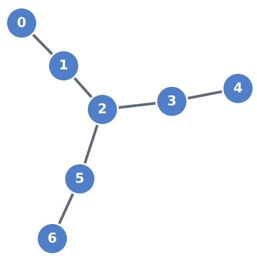  
(a) 7� topology

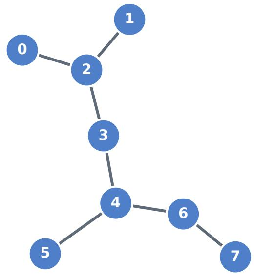  
(b) 8� topology  
Figure 1: Examples of coupling topologies considered in our experiments. Vertices represent physical qubits, while edges denote the allowed two-qubit interactions. The full set of topologies can be found in [8].

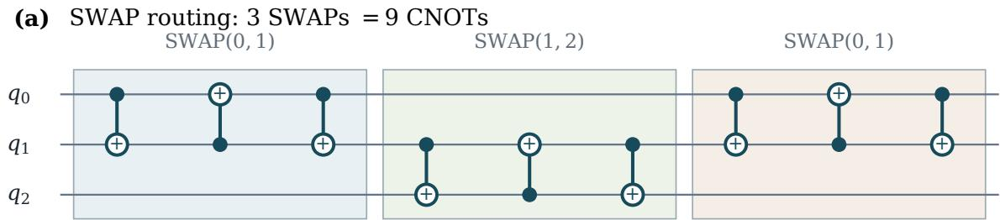

(b) Direct decomposition: 8 CNOTs  
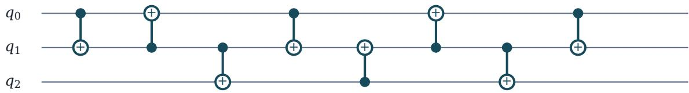  
Figure 2: The first local separation between SWAP routing and direct CNOT synthesis. The transposition �(0, 2) on the path $0 - 1 - 2$ costs 9 CNOTs when implemented as three adjacent SWAPs, but admits a direct topology-legal implementation with 8 CNOTs.

Table 1  
Mean CNOT count found by AlphaCNOT (single shot) over all transpositions of distance � for selected topologies as defined in [8]. Values in bold represent averages that do not coincide with the formula �(�), highlighting that in some cases AlphaCNOT was not able to obtain the observed upper bound.
<table><tr><td>Topology 一</td><td> $\overline { { d = 1 } }$   $\overline { { d = 2 } }$ </td><td>d = 4 d = 5</td><td> $d = 3$ </td><td></td><td></td><td></td><td> $\overline { { d = 6 } }$ </td><td></td><td>d = 7</td></tr><tr><td>Formula  $\overline { { f ( d ) } }$ </td><td>3</td><td>8</td><td>14</td><td></td><td>20</td><td>26</td><td>32</td><td></td><td>38</td></tr><tr><td>4L</td><td>3.00</td><td>8.00</td><td>14.00</td><td></td><td></td><td></td><td></td><td></td><td></td></tr><tr><td>4Y</td><td>3.00</td><td>8.00</td><td></td><td></td><td></td><td></td><td></td><td></td><td></td></tr><tr><td>5L</td><td>3.00</td><td>8.00</td><td>14.00</td><td></td><td>20.00</td><td></td><td></td><td></td><td></td></tr><tr><td>5T</td><td>3.00</td><td>8.00</td><td>14.00</td><td></td><td></td><td></td><td></td><td></td><td></td></tr><tr><td>6L</td><td>3.00</td><td>8.00</td><td>14.00</td><td></td><td>20.00</td><td>26.00</td><td></td><td></td><td></td></tr><tr><td>6Y</td><td>3.00</td><td>8.00</td><td>14.00</td><td></td><td>20.00</td><td></td><td></td><td></td><td></td></tr><tr><td>7L</td><td>3.00</td><td>8.00</td><td>14.00</td><td></td><td>20.33</td><td>26.00</td><td>32.00</td><td></td><td></td></tr><tr><td>7Y</td><td>3.00</td><td>8.17</td><td>14.00</td><td></td><td>20.67</td><td></td><td></td><td></td><td></td></tr><tr><td>8F</td><td>3.00</td><td>8.00</td><td>14.00</td><td></td><td>20.25 20.00</td><td>26.00 26.00</td><td>32.00</td><td></td><td></td></tr></table>

Proof. Let

$$
i = v _ { 0 } , v _ { 1 } , \ldots , v _ { d } = j
$$

be a shortest path in � from � to �. Since every consecutive pair $( v _ { k } , v _ { k + 1 } )$ is connected by an edge of �, any CNOT circuit using only edges of this path is automatically topology-legal on �. Thus it is enough to construct the desired circuit on the line topology

$$
0 - 1 - \cdots - d ,
$$

after relabeling $v _ { k }$ as $k .$ In particular, it sufices to prove the statement for the transposition $\tau ( 0 , d )$ on this line.

Write $X _ { a , b }$ for a CNOT with control � and target �. All gate products below are listed in application order. We proceed by induction on $d \geq 2$ . The base case is � = 2. On the line $0 - 1 - 2$ , the following eight gates implement � (0, 2):

$$
X _ { 0 , 1 } X _ { 1 , 0 } X _ { 1 , 2 } X _ { 0 , 1 } X _ { 2 , 1 } X _ { 1 , 0 } X _ { 1 , 2 } X _ { 0 , 1 } .
$$

Indeed, applying these gates to the row labels $( a , b , c )$ gives

$$
\begin{array} { r l } & { ( a , b , c ) \mapsto ( a , a + b , c ) \mapsto ( b , a + b , c ) \mapsto ( b , a + b , a + b + c ) \mapsto ( b , a , a + b + c ) } \\ & { \qquad \mapsto ( b , b + c , a + b + c ) \mapsto ( c , b + c , a + b + c ) \mapsto ( c , b + c , a ) \mapsto ( c , b , a ) , } \end{array}
$$

which is exactly the transposition of the two endpoints.

For the induction step, assume that there is a CNOT circuit $C _ { 1 , d }$ implementing $\tau ( 1 , d )$ on the subpath $1 - 2 - \cdots - d ,$ with length $6 ( d - 1 ) - 4$ . Let

$$
S _ { 0 } = X _ { 0 , 1 } X _ { 1 , 0 } X _ { 0 , 1 }
$$

be the usual three-CNOT implementation of the adjacent transposition $\tau ( 0 , 1 )$ . Then

$$
S _ { 0 } C _ { 1 , d } S _ { 0 }
$$

implements $\tau ( 0 , d )$ , since at the permutation level

$$
( 0 1 ) ( 1 d ) ( 0 1 ) = ( 0 d ) .
$$

To see this directly, the two outer transpositions exchange the labels 0 and 1, so conjugating $( 1 , d )$ by (0, 1) simply replaces the endpoint 1 by 0, while � is fixed because $d > 1$ . Hence the resulting transposition exchanges precisely 0 and �.

Finally, the length of the circuit is

$$
3 + { \big ( } 6 ( d - 1 ) - 4 { \big ) } + 3 = 6 d - 4 .
$$

This completes the induction and proves the claimed construction.

A visualization of our construction for $d = 4$ is provided in Figure 3, compared to an optimal output provided by AlphaCNOT. The linear behavior of the bound is also a natural consequence of the recursive construction. Increasing the distance by one amounts to surrounding the transposition at distance $d - 1$ with two adjacent transpositions, each of which requires three CNOTs. Thus, each additional unit of distance contributes exactly six CNOTs, yielding the recurrence $L ( d ) = L ( d - 1 ) + 6$ , which, together with the base case $L ( 2 ) = 8 ,$ gives $L ( d ) = 6 d - 4$

It is important to emphasize that the construction above establishes only an upper bound, as we do not prove that the length $6 d - 4$ is optimal. Nevertheless, the available computational evidence supports its optimality. In addition to the experimental results obtained with AlphaCNOT, we performed exhaustive brute-force searches on all graph topologies considered in this work with up to five qubits. In all cases considered, no topology-legal implementation shorter than $6 d - 4$ was found. This evidence leads us to conjecture that the bound is tight, although a general proof of optimality remains open.

At this point, the construction above assigns an explicit topology-dependent CNOT cost to every transposition of two qubits. This naturally suggests using remote transpositions as the basic building blocks for synthesizing arbitrary permutations, and choosing among them according to their certified CNOT costs. In the following section, we formalize this idea as a deterministic global synthesis algorithm.

## 4. Global Transpositions Algorithm

The previous result associates every logical transposition with a concrete topology-legal CNOT decomposition and, consequently, with an explicit CNOT cost. This allows us to move from the synthesis of individual transpositions to that of arbitrary permutations: instead of decomposing a permutation exclusively into adjacent SWAPs, we may search directly over all logical transpositions and weight each of them by the cost of its CNOT implementation.

(a) Recursive construction for τ(0, 4): 20 CNOTs  
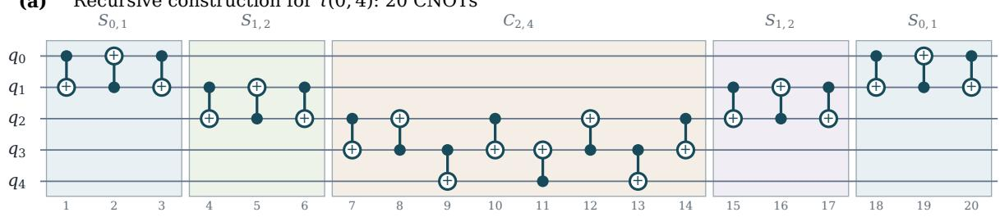

(b) AlphaCNOT output for τ(0, 4): 20 CNOTs  
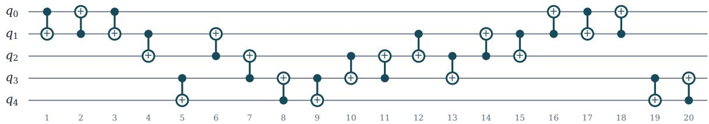  
Figure 3: Example of the recursive decomposition of $\tau ( 0 , 4 )$ with distance $^ { 4 , }$ compared to a decomposition found by AlphaCNOT. Note that in the decomposition below, it is easy to recognize the components corresponding to the two copies of the SWAP between $q _ { 0 }$ and $q _ { 1 } \ S _ { 0 , 1 }$ (i.e., the 6 CNOTs between $q _ { 0 }$ and $q _ { 1 } )$ . However, the remaining transposition $\tau ( 1 , 4 )$ cannot be easily decomposed into $S _ { 1 , 2 }$ and $C _ { 2 , 4 }$

Let $G = ( V , E )$ be the coupling graph, with $| V | = n ,$ and assume that every undirected edge supports both CNOT orientations. For two vertices $i , j \in V ,$ let $d _ { G } ( i , j )$ be their graph distance. The previous construction gives a topology-legal CNOT implementation of the transposition $\tau ( i , j )$ with cost

$$
w _ { G } ( i , j ) = \left\{ \begin{array} { l l } { { 3 , } } & { { d _ { G } ( i , j ) = 1 , } } \\ { { 6 d _ { G } ( i , j ) - 4 , } } & { { d _ { G } ( i , j ) > 1 . } } \end{array} \right.
$$

Thus, every logical transposition can be assigned an explicit, certified CNOT cost $w _ { G } ,$ , corresponding to a constructive decomposition in the same number of CNOTs.

Note that minimum-cost decompositions of permutations into transpositions with non-uniform costs have previously been studied in a general combinatorial setting [18]. Our construction can be viewed as an instance of this framework in which transposition costs are induced by topology-constrained CNOT implementations.

Weighted Cayley graph. Define a weighted graph $\mathcal { T } _ { G }$ whose vertices are the permutations in $S _ { n }$ For every permutation $\pi \in S _ { n }$ and every unordered pair $\{ i , j \} \subseteq V$ , add an edge

$$
\pi \longrightarrow \pi \circ \tau ( i , j )
$$

with weight $w _ { G } ( i , j )$ . Since arbitrary transpositions generate $S _ { n } , \mathcal { T } _ { G }$ is connected. A path in $\mathcal { T } _ { G }$ is a decomposition of the target permutation into logical transpositions, and the path weight is a guaranteed CNOT cost obtained by expanding each transposition with the construction above.

We call the resulting method Global Transpositions: it is global because the decomposition is chosen over the whole target permutation, not independently cycle by cycle. In particular, if

$$
\sigma = \tau _ { 1 } \tau _ { 2 } \cdot \cdot \cdot \tau _ { m }
$$

is the path returned by the weighted search, then the CNOT cost reported by the method is

$$
\ell _ { \mathrm { G T } } ^ { G } ( \sigma ) = \sum _ { r = 1 } ^ { m } w _ { G } ( \tau _ { r } ) .
$$

Table 2  
Naive exact search complexity for the three synthesis models.
<table><tr><td>Method</td><td></td><td>State space Number of states</td><td>Generators</td><td></td><td>Naive algorithm Worst-case time</td></tr><tr><td>Optimal SWAP</td><td> $\overline { { S _ { n } } }$ </td><td>n!</td><td> $\overline { { | E | } }$  adjacent SWAPs</td><td>BFS</td><td> $O ( n ! | E | )$ </td></tr><tr><td>Global Transpositions</td><td> $S _ { n }$ </td><td> $n !$  n-1</td><td>(2) weighted transpositions</td><td>Dijkstra</td><td> $O \big ( n ! n ^ { 2 } \log ( n ! ) \big )$ </td></tr><tr><td>Optimal CNOT</td><td> $\mathrm { G L } ( n , \mathbb { F } _ { 2 } )$ </td><td> $\prod _ { k = 0 } ( 2 ^ { n } - 2 ^ { k } )$ </td><td>2|E| oriented CNOTs</td><td>BFS</td><td> $O ( | \mathrm { G L } ( n , 2 ) | | E | )$ </td></tr></table>

The corresponding concrete circuit is obtained by replacing each $\tau _ { r }$ by the CNOT block associated with a shortest path between its two endpoints.

Algorithm. For a fixed topology $G ,$ the algorithm is:

1. compute all-pairs graph distances on $G ;$

2. assign each logical transposition $\tau ( i , j )$ the weight $w _ { G } ( i , j )$ ;

3. run Dijkstra from the identity permutation in the weighted Cayley graph $\gamma _ { G } ;$

4. for a target $\sigma ,$ , recover the predecessor chain from $\sigma$ to the identity, giving a minimum-weight transposition decomposition;

5. expand each selected transposition into its topology-legal CNOT block.

Guarantees. The output of Global Transpositions is exact for its own restricted model: among all decompositions of $\mathit { \Pi } _ { \sigma }$ into logical transpositions with block costs $w _ { G }$ , Dijkstra returns one with minimum total weight. Moreover, this weight is always an upper bound on the true topology-constrained CNOT optimum:

$$
\ell _ { \mathrm { C N O T } } ^ { G } ( \sigma ) \leq \ell _ { \mathrm { G T } } ^ { G } ( \sigma ) .
$$

Indeed, every weighted edge in $\tau _ { G }$ is backed by a concrete topology-legal CNOT circuit.

The method also dominates optimal SWAP routing expanded gate by gate:

$$
\ell _ { \mathrm { G T } } ^ { G } ( \sigma ) \leq 3 \ell _ { \mathrm { S W A P } } ^ { G } ( \sigma ) .
$$

To see this, take an optimal adjacent-SWAP decomposition of �. Each adjacent SWAP is precisely a transposition $\tau ( i , j )$ with $d _ { G } ( i , j ) = 1$ and weight 3. Since Global Transpositions minimizes over all transpositions, it can reproduce that SWAP path and possibly improve on it by using longer transpositions with the $6 d - 4$ identity.

These inequalities explain why this method is a useful middle baseline. It is strictly more expressive than SWAP routing, but it still returns to $S _ { n }$ after each transposition block. Therefore it cannot represent CNOT-level fusions between consecutive blocks. Any residual gap

$$
\ell _ { \mathrm { G T } } ^ { G } ( \sigma ) - \ell _ { \mathrm { C N O T } } ^ { G } ( \sigma )
$$

or, empirically,

$$
\ell _ { \mathrm { G T } } ^ { G } ( \sigma ) - \ell _ { \mathrm { A l p h a C N O T } } ^ { G } ( \sigma ) ,
$$

is evidence for a phenomenon beyond independent transposition blocks.

Search-space and complexity comparison. The three relevant exact-search viewpoints difer mainly in the state space and in the generator set. Let $m = | E |$ . In Table $^ { 2 , }$ we report the cost of the most direct exhaustive algorithm for each model, ignoring constant-time details of state encoding and hash-table lookup.

The all-pairs shortest-path distances required to define the transposition weights can be computed in $O ( n ( n + | E | ) )$ time by running BFS from every vertex. This preprocessing cost is negligible compared with the �!-state search over the permutation space performed by Global Transpositions.

More generally, exact synthesis remains computationally challenging across the diferent models considered here. Finding a minimum-length sequence of adjacent SWAPs on an arbitrary connectivity graph corresponds to the Token Swapping problem, which is NP-hard [19]. Optimal CNOT synthesis is also computationally hard: hardness results are known for topology-constrained CNOT synthesis [20], while CNOT-distance has recently been shown to be NP-complete even under all-to-all connectivity [21].

These complexity results motivate the development of more scalable alternatives to exhaustive search. In this direction, the approximation techniques developed for permutation decompositions with non-uniform transposition costs [18] provide a natural starting point for approximate variants of Global Transpositions that avoid explicit exploration of the full permutation space $S _ { n }$ . Determining whether the specific topology-induced cost function $w _ { G }$ admits stronger approximation guarantees or more eficient specialized algorithms remains an interesting open question.

## 5. Beyond Transpositions: Intermediate CNOT Fusion

Global Transpositions improves over SWAP routing by changing the elementary objects used to synthesize a permutation. Instead of restricting the search to adjacent SWAPs, it searches over arbitrary logical transpositions and assigns a topology-dependent CNOT cost to each of them. The resulting permutation is therefore implemented as a sequence of independently synthesized transpositions. The circuits produced by AlphaCNOT reveal that this construction does not exhaust the available savings. In several instances, direct CNOT synthesis produces a circuit shorter than the complete Global Transpositions construction, even though the latter has already selected its sequence of transpositions globally.

Global Transpositions is optimal with respect to the decomposition model of transpositions. In particular, we have that given a connectivity map $G = ( V , E )$ with $| V | = n$ , and a permutation $\sigma \in S _ { n }$ the cost found by GT is

$$
\ell _ { \mathrm { G T } } ^ { G } ( \sigma ) = \operatorname* { m i n } _ { \substack { m \geq 0 , \sigma = { \tau _ { 1 } } { \tau _ { 2 } } \cdots { \tau _ { m } } } } \sum _ { r = 1 } ^ { m } w _ { G } ( { \tau _ { r } } ) ,
$$

Definition 1 (Intermediate CNOT fusion). Let � be a connectivity map and let $\sigma \in S _ { n }$ . We say that � admits an intermediate CNOTfusion (with respect to transpositions) on � if there exists a topology-legal CNOT circuit � implementing � such that

$$
\ell _ { C } ^ { G } ( \sigma ) < \ell _ { \mathrm { G T } } ^ { G } ( \sigma ) .\tag{1}
$$

Any such circuit � is called a fusion witness for � on �. Thus, intermediate CNOT fusion relative to GT occurs whenever � admits a topology-legal CNOT implementation using fewer CNOT gates than the minimum-cost concatenation of transposition blocks considered by the GT model.

Note that this definition is specifically relative to transpositions, whose elementary permutation blocks are cycles of length two, i.e., logical transpositions, with their constructive implementation costs �� (assuming they are optimal). The same comparison could possibly be extended to synthesis models whose block libraries also include longer cycles (for example, the set of transpositions and 3-cycles, etc.), allowing for a more general definition of intermediate fusion. However, while for transpositions we were able to obtain a constructive bound of the cost $w _ { G } ,$ for longer cycles we would need to develop diferent tools, or to compute optimal costs of each cycle. For this reason, in what follows we will consider only fusions with respect to transpositions.

Minimal example. Consider the line topology 4� and the target permutation

$$
\sigma = [ 2 , 3 , 1 , 0 ] .
$$

Global Transpositions returns

$$
\tau ( 1 , 2 ) \tau ( 0 , 1 ) \tau ( 1 , 3 ) ,
$$

(a) 4L, Global Transpositions: 3 + 3 + 8 = 14 CNOTs τ(1, 2) τ(0, 1)  
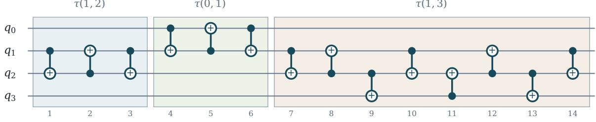

(b) 4L, joint AlphaCNOT synthesis: 13 CNOTs  
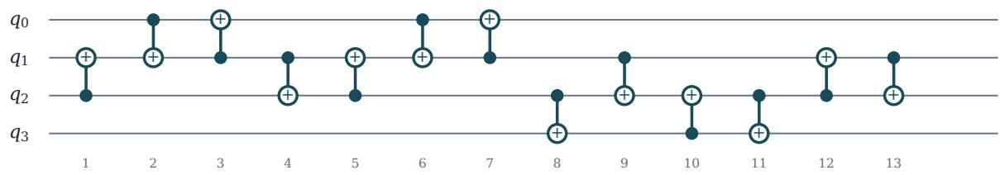  
Figure 4: Intermediate CNOT fusion on 4� for $\sigma = [ 2 , 3 , 1 , 0 ]$ . Global Transpositions realizes three independently synthesized transpositions using 14 CNOTs, whereas direct AlphaCNOT synthesis realizes an optimal decomposition in 13 gates.

Table 3  
Mean CNOT count over 100 target permutations per constrained topology (for 4 qubits, all 24 permutations are considered). AlphaCNOT results are obtained with 10 repetitions. Results for Optimal CNOT are obtained with bidirectional BFS.
<table><tr><td>topology</td><td>SWAP×3</td><td>Global Transpositions</td><td>AlphaCNOT</td><td>Optimal CNOT</td></tr><tr><td>4L</td><td>8.64</td><td>8.18</td><td>8.03</td><td>8.03</td></tr><tr><td>4Y</td><td>8.04</td><td>7.83</td><td>7.59</td><td>7.59</td></tr><tr><td>5L</td><td>15.03</td><td>14.21</td><td>13.73</td><td>13.71</td></tr><tr><td>5T</td><td>13.50</td><td>12.92</td><td>12.46</td><td>12.42</td></tr><tr><td> $6 L$ </td><td>22.59</td><td>21.24</td><td>20.37</td><td>一</td></tr><tr><td> $6 T$ </td><td>19.20</td><td>18.28</td><td>17.67</td><td>一</td></tr><tr><td> $6 Y$ </td><td>18.78</td><td>17.86</td><td>17.26</td><td>一</td></tr><tr><td> $7 L$ </td><td>32.28</td><td>30.23</td><td>28.97</td><td>一</td></tr><tr><td> $7 T$ </td><td>27.45</td><td>25.89</td><td>25.01</td><td>一</td></tr><tr><td> $7 Y$ </td><td>26.40</td><td>24.95</td><td>24.53</td><td>一</td></tr><tr><td> $8 F$ </td><td>37.71</td><td>35.34</td><td>34.07</td><td>一</td></tr><tr><td>8H</td><td>32.40</td><td>30.82</td><td>29.92</td><td>一</td></tr><tr><td>8T</td><td>38.67</td><td>36.36</td><td>35.23</td><td>一</td></tr><tr><td>8T2</td><td>33.27</td><td>31.57</td><td>30.71</td><td>一</td></tr></table>

whose three blocks cost $3 + 3 + 8 = 1 4$ CNOTs. The first two blocks are adjacent transpositions, while the last one is a distance-two transposition implemented with the construction of Section 4. AlphaCNOT, when applied directly to the full permutation, returns the 13-CNOT circuit shown in Figure 4. For this instance, exhaustive bidirectional BFS over topology-legal CNOT circuits certifies that 13 CNOTs are optimal.

This example separates intermediate fusion from the remote-transposition construction studied in the previous section. The latter reduces the cost of one logical transposition. Here, all three transpositions have already been assigned the individual costs used by the GT construction; the additional CNOT disappears only when the complete permutation is synthesized as one circuit. The improvement is numerically small, but it exposes a limitation of any method whose total cost is obtained by summing independently synthesized transposition blocks.

Full evaluation. We now evaluate the average number of CNOTs found by optimal SWAP algorithm, Global Transpositions, and AlphaCNOT over diferent topologies. For each topology, we randomly select 100 permutations of the corresponding size (for 4� and 4� we consider all the 24 permutations instead). Results for AlphaCNOT are obtained with a best-of-ten strategy, i.e. we execute the model 10 times and select the best solution. In addition, we report the average optimal CNOT count obtained by bidirectional BFS for up to 5 qubits. We report our results in Table 3.

AlphaCNOT achieves a lower mean CNOT count than Global Transpositions on every topology in the table. Across the full set sampled targets, the mean decreases from 23.85 CNOTs for SWAP synthesis to 22.55 for Global Transpositions, and then to 21.83 for AlphaCNOT. Thus, the transposition model explains an average reduction of 1.31 CNOTs relative to SWAP synthesis, while direct synthesis finds a further reduction of 0.72 CNOTs, or 3.2% relative to Global Transpositions. The latter gap is present on every tested constrained topology and ranges from 0.15 to 1.27 CNOTs per target on average.

These results support a two-stage interpretation of the structures exposed by AlphaCNOT. Remotetransposition synthesis explains why a logical transposition need not be implemented as a chain of full SWAPs. Intermediate fusion explains the remaining empirical gap: even after the transpositions have been selected globally and assigned improved individual costs, treating them as independent blocks leaves additional CNOT reductions unexplored.

Additional examples. Finally, we show in Figure 5 some examples and visualizations of diferent permutations, with the solutions found by Global Transpositions and AlphaCNOT. Note that while AlphaCNOT is not optimal, it can find non-trivial CNOT reductions that cannot be obtained by performing optimal synthesis over $S _ { n }$ . This suggests that Intermediate CNOT fusions play a major role in obtaining eficient CNOT decompositions of permutation circuits.

## 6. Discussion and Future Directions

In this work, we used AlphaCNOT to investigate CNOT synthesis for depth-optimal quantum rotation and permutation circuits. Our analysis revealed two distinct structures. First, the circuits produced by AlphaCNOT exposed a recurring pattern for remote transpositions, which we formalized as a constructive implementation using at most 6� − 4 CNOT gates for endpoints at graph distance � > 1. This result led to Global Transpositions, a deterministic synthesis method that optimizes the decomposition of an entire permutation into topology-aware logical transpositions. Beyond this, AlphaCNOT reveals additional reductions that cannot be captured by independently optimized transposition blocks. By exploiting intermediate linear transformations outside the permutation subgroup, it can combine efects across transposition boundaries, a mechanism we call Intermediate CNOT Fusion. This shows that the gap between SWAP-optimal and CNOT-eficient synthesis stems not only from cheaper transpositions, but also from the richer intermediate state space available at the CNOT level.

More broadly, these results illustrate a role for AlphaCNOT beyond black-box circuit optimization. Its generated circuits provide concrete objects that can be inspected to identify recurring patterns and formulate structural hypotheses. In the case of remote transpositions, such a pattern led to a constructive proof and a deterministic synthesis algorithm; in the case of Intermediate CNOT Fusion, it exposed a limitation of approaches that restrict their intermediate states to the permutation subgroup.

Several questions remain open. The most immediate is a theoretical characterization of Intermediate CNOT Fusion: determining when fusion is possible, how large the resulting CNOT savings can be, and whether such opportunities can be identified directly from the target permutation and the coupling graph. A related question is whether intermediate non-permutation transformations are necessary for CNOT-optimal realizations of some permutation circuits, or whether equally short circuits confined to more restricted classes of intermediate transformations always exist. More generally, these observations suggest the possibility of deriving new deterministic synthesis rules from the patterns exposed by AlphaCNOT and extending the same methodology to other circuit families and quantum compilation problems.

8T2: σ = [4, 3, 7, 6, 5, 1, 2, 0] (Δ = 5)  
5T: σ = [2, 4, 3, 1, 0] (Δ = 2)  
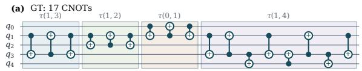

6L: σ = [1, 5, 0, 4, 2, 3] (Δ = 1)  
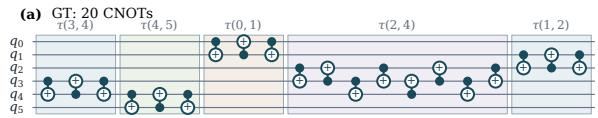

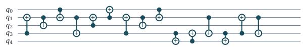  
(a) Decomposition of [2, 4, 3, 1, 0] over 5�.

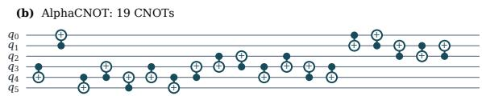  
(b) Decomposition of [1, 5, 0, 4, 2, 3] over 6�.

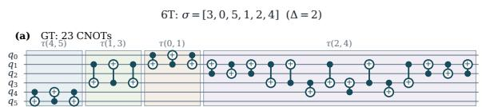

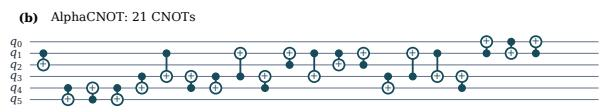

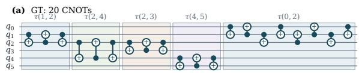

(c) Decomposition of [3, 0, 5, 1, 2, 4] over 6�.  
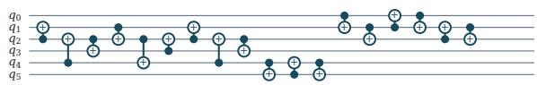  
(d) Decomposition of [3, 2, 0, 4, 5, 1] over 6�.

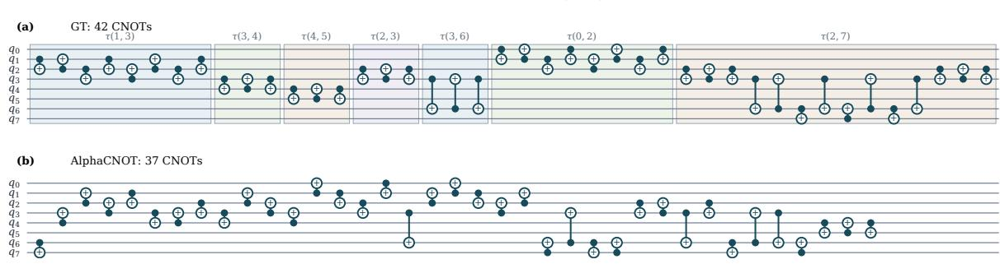  
(e) Decomposition of [4, 3, 7, 6, 5, 1, 2, 0] over 8�2.  
Figure 5: Visualizations of some decompositions found by Global Transpositions (GT) and AlphaCNOT with non-trivial intermediate CNOT fusions.

## Acknowledgements

JC is supported by FSE/FVG PhD Grant on “Computer Science and Artificial Intelligence” (CUP G23C25000620008). This work has been partially supported by INdAM-GNCS project Algebra lineare quantistica, state preparation e compilazione di circuiti quantistici (CUP E53C25002010001) and by the regional project QUASAR-FVG Calcolo e simulazione quantistica: sviluppo, applicazioni e ricerca in Friuli Venezia Giulia (CUP G23C25001510002).

## Declaration on Generative AI

During the preparation of this work, the authors used ChatGPT in order to perform grammar and spelling check, and to paraphrase and reword certain paragraphs. After using this tool, the authors reviewed and edited the content as needed and take full responsibility for the publication’s content.

## References

[1] M. G. Davis, E. Smith, A. Tudor, K. Sen, I. Siddiqi, C. Iancu, Towards Optimal Topology Aware Quantum Circuit Synthesis, in: 2020 IEEE International Conference on Quantum Computing and Engineering (QCE), IEEE, Denver, CO, USA, 2020, pp. 223–234. URL: https://ieeexplore.ieee.org/ document/9259942/. doi:10.1109/QCE49297.2020.00036.

[2] A. Kissinger, A. M. Van De Griend, CNOT circuit extraction for topologically-constrained quantum memories, Quantum Information and Computation 20 (2020) 581–596. URL: http: //www.rintonpress.com/journals/doi/QIC20.7-8-4.html. doi:10.26421/QIC20.7-8-4.

[3] B. Wu, X. He, S. Yang, L. Shou, G. Tian, J. Zhang, X. Sun, Optimization of CNOT circuits on limited-connectivity architecture, Physical Review Research 5 (2023) 013065. URL: https://link.aps. org/doi/10.1103/PhysRevResearch.5.013065. doi:10.1103/PhysRevResearch.5.013065.

[4] A. Bu, E. Fan, R. Joo, Minimum synthesis cost of cnot circuits, Quantum Information Processing 24 (2025). URL: http://dx.doi.org/10.1007/s11128-025-04831-5. doi:10.1007/ s11128-025-04831-5.

[5] C. Chen, B. Schmitt, H. Zhang, L. S. Bishop, A. Javadi-Abhar, Optimizing quantum circuit synthesis for permutations using recursion, in: Proceedings of the 59th ACM/IEEE Design Automation Conference, DAC ’22, ACM, 2022, p. 7–12. URL: http://dx.doi.org/10.1145/3489517.3530654. doi:10. 1145/3489517.3530654.

[6] S. Faro, A. Pavone, C. Viola, Families of constant-depth quantum circuits for rotations and permutations, in: U. de’Liguoro, M. Palazzo, L. Roversi (Eds.), Proceedings of the 25th Italian Conference on Theoretical Computer Science, Torino, Italy, September 11-13, 2024, volume 3811 of CEUR Workshop Proceedings, CEUR-WS.org, 2024, pp. 29–41. URL: https://ceur-ws.org/Vol-3811/ paper270.pdf.

[7] J. Cossio, D. Lizzio Bosco, R. Romanello, G. Serra, C. Piazza, AlphaCNOT: Learning CNOT minimization with model-based planning, CoRR abs/2604.13812 (2026). URL: https://doi.org/10. 48550/arXiv.2604.13812. doi:10.48550/ARXIV.2604.13812. arXiv:2604.13812.

[8] D. Kremer, V. Villar, H. Paik, I. Duran, I. Faro, J. Cruz-Benito, Practical and eficient quantum circuit synthesis and transpiling with Reinforcement Learning, 2024. URL: https://arxiv.org/abs/ 2405.13196v2.

[9] R. Romanello, D. Lizzio Bosco, J. Cossio, D. Sutulovic, G. Serra, C. Piazza, P. Burelli, CNOT Minimal Circuit Synthesis: A Reinforcement Learning Approach, in: 2025 IEEE International Conference on Quantum Artificial Intelligence (QAI), 2025, pp. 253–260. URL: https://ieeexplore.ieee.org/ document/11344638/. doi:10.1109/QAI63978.2025.00047.

[10] F. J. R. Ruiz, T. Laakkonen, J. Bausch, M. Balog, M. Barekatain, F. J. H. Heras, A. Novikov, N. Fitzpatrick, B. Romera-Paredes, J. Van De Wetering, A. Fawzi, K. Meichanetzidis, P. Kohli, Quantum circuit optimization with AlphaTensor, Nature Machine Intelligence 7 (2025) 374–385. URL: https://www.nature.com/articles/s42256-025-01001-1. doi:10.1038/s42256-025-01001-1.

[11] R. Zen, J. Olle, L. Colmenarez, M. Puviani, M. Müller, F. Marquardt, Quantum Circuit Discovery for Fault-Tolerant Logical State Preparation with Reinforcement Learning, Physical Review X 15 (2025) 041012. URL: https://link.aps.org/doi/10.1103/gqpr-dgz7. doi:10.1103/gqpr-dgz7.

[12] V. Villar, J. Cruz-Benito, I. Faro, D. Kremer, Ai methods for permutation circuit synthesis across generic topologies, Proceedings of the AAAI Symposium Series 7 (2025) 404–410. doi:10.1609/ aaaiss.v7i1.36912.

[13] D. Lizzio Bosco, J. Cossio, C. Piazza, G. Serra, Alphacliford: Eficient cliford synthesis and transpilation with model-based rl, 2026. URL: https://arxiv.org/abs/2608.18946. arXiv:2608.18946.

[14] R. Yeung, A. Kissinger, R. Cornish, Equivariant reinforcement learning for cliford quantum circuit synthesis, 2026. URL: https://arxiv.org/abs/2605.10910. arXiv:2605.10910.

[15] D. Lizzio Bosco, L. Cincio, G. Serra, M. Cerezo, Quantum Circuit Pre-Synthesis: Learning Local Edits to Reduce t-count, 2026. URL: https://arxiv.org/abs/2601.19738v1.

[16] F. Finger, F. Rapp, P. Kalidindi, K. He, K. Yin, A. Koziell-Pipe, D. Z. Manrique, G. Greene-Diniz, S. Clark, H. Fawzi, B. Romera-Paredes, A. Fawzi, K. Meichanetzidis, Automated near-term quantum

algorithm discovery for molecular ground states, 2026. URL: http://arxiv.org/abs/2603.26359. doi:10. 48550/arXiv.2603.26359, arXiv:2603.26359 [quant-ph].

[17] S. Kutin, D. P. Moulton, L. Smithline, Computation at a distance, Chic. J. Theor. Comput. Sci. 2007 (2007). URL: https://api.semanticscholar.org/CorpusID:5429591.

[18] F. Farnoud, O. Milenkovic, Sorting of Permutations by Cost-Constrained Transpositions, IEEE Transactions on Information Theory 58 (2012) 3–23. URL: http://ieeexplore.ieee.org/document/ 6121988/. doi:10.1109/TIT.2011.2171532.

[19] T. Miltzow, L. Narins, Y. Okamoto, G. Rote, A. Thomas, T. Uno, Approximation and Hardness of Token Swapping, LIPIcs, Volume 57, ESA 2016 57 (2016) 66:1–66:15. URL: https://drops.dagstuhl. de/entities/document/10.4230/LIPIcs.ESA.2016.66. doi:10.4230/LIPICS.ESA.2016.66.

[20] J. Jiang, X. Sun, S.-H. Teng, B. Wu, K. Wu, J. Zhang, Optimal space-depth trade-of of cnot circuits in quantum logic synthesis, in: Proceedings of the Thirty-First Annual ACM-SIAM Symposium on Discrete Algorithms, SODA ’20, Society for Industrial and Applied Mathematics, USA, 2020, p. 213–229.

[21] A. Acuaviva, A. Acuaviva, P. Acuaviva, CNOT-Distance is NP-complete under all-to-all connectivity, 2026. URL: http://arxiv.org/abs/2608.03825. doi:10.48550/arXiv.2608.03825, arXiv:2608.03825 [quant-ph].