Timestral

## Abstract

We introduce Timestral, a family of four time series foundation models for probabilistic forecasting, with 5M, 28M, 123M, and 209M parameters. Timestral sets a new state of the art on GIFT-Eval, TIME, and fev-bench, where Timestral-209M and Timestral-123M take the top two places on every metric. We achieve this with three ingredients: Decoupled Horizon Forecasting (DHF), which separates prediction tokens from the causally encoded context, so that longer horizons are trained without masking context and each observed value is both a forecast target and context for later forecasts; a covariate framework that natively supports known-future covariates within a causal architecture; and a two-stage pipeline that pretrains exclusively on a diverse, large-scale synthetic corpus before post-training on a mix of real and synthetic data with extended context. This report describes the model design and its benchmark results. Weights for all four models are available on Hugging Face1 and inference code on GitHub2.

## Webpage: https://mistral.ai/news/timestral

## 1 Introduction

Time series foundation models (TSFMs) enable forecasting across datasets and domains without retraining. By training on large collections of real and synthetic time series, these models provide a shared alternative to fitting a separate model for each forecasting problem [Ansari et al., 2024, Das et al., 2024]. Recent advances have improved forecast accuracy, demonstrated gains from scaling, and extended support to multivariate series and external covariates [Khwaja et al., 2026, Ansari et al., 2025, Podest et al., 2026, Meyer et al., 2026]. These developments place increasing importance on how models use the information available at each forecast origin and on the training distributions that support this use.

Bidirectional encoder-only models such as Chronos-2 and Falcon-2.0 [Ansari et al., 2025, Xia et al., 2026] sample a context length and a horizon length for each training example, so each forward pass covers a single combination of the two. Causal decoder-only models instead forecast from every position of a sequence and thus cover many context lengths in one forward pass. To also cover multiple horizon lengths, recent causal models are trained to forecast several patches ahead directly rather than autoregressively. Contiguous Patch Masking (CPM), used in TiRex, Toto-2.0, and TimesFM-3 [Auer et al., 2025, Khwaja et al., 2026, Jain and Sen, 2026], achieves this by masking spans of the input sequence. The masked observations, however, are then also unavailable as context for later forecasts in the same training sequence, coupling the horizon distribution to full-patch context masking. Known-future covariates pose a second challenge: their future values must be accessible to forecasts, while future target values must remain hidden.

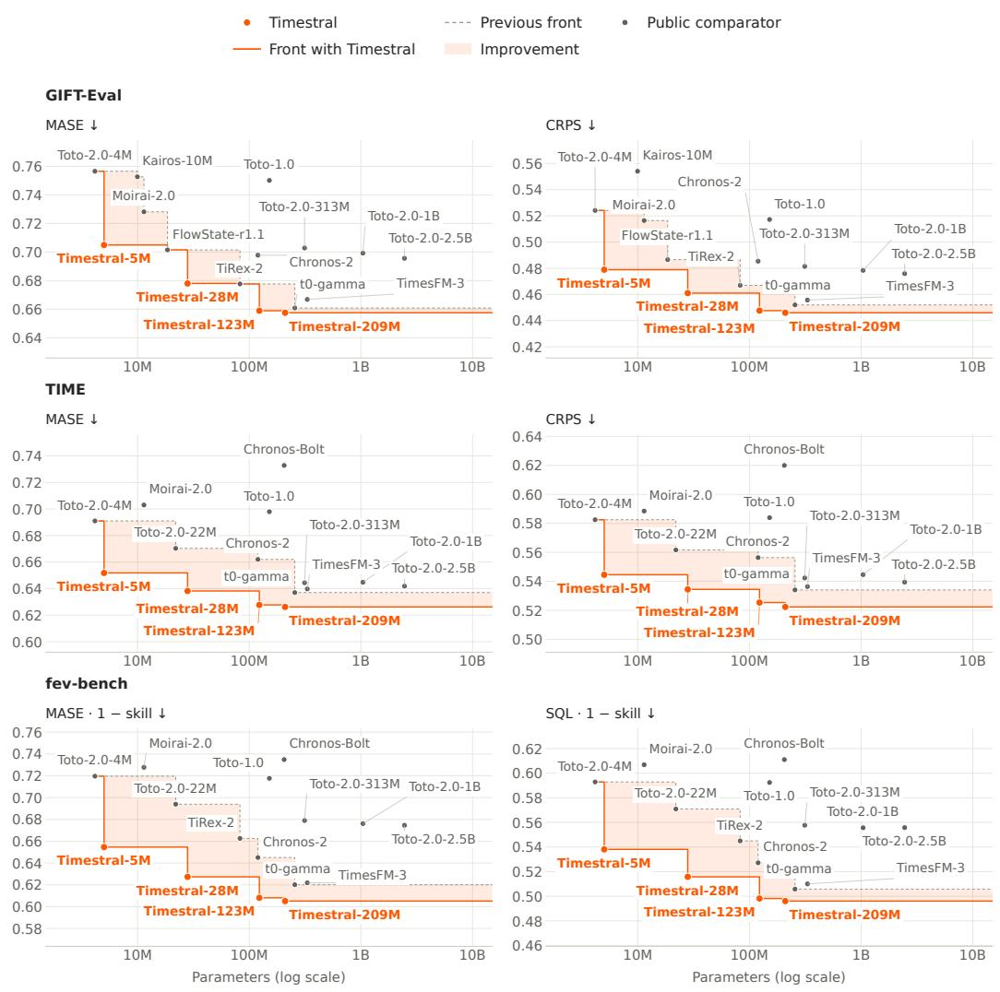  
Figure 1: Forecast error against parameter count on GIFT-Eval, TIME, and fev-bench (lower is better; fev-bench skill scores are shown as one minus the skill score). The dashed and solid curves show the Pareto fronts without and with Timestral, respectively. All four Timestral models lie on the Pareto front across the six panels.

We introduce Timestral, a family of four foundation models for probabilistic univariate, multivariate, and covariate-informed time series forecasting, with 5M, 28M, 123M, and 209M parameters. All four models share the same architecture and training recipe, offering a range of trade-offs between forecast accuracy and inference cost. Timestral addresses the coupling of horizons and context masking through Decoupled Horizon Forecasting (DHF), which separates causal context representations from learned prediction tokens, and the covariate challenge through a role-aware covariate framework that integrates known-future information while preserving target causality. The models are pretrained on a synthetic corpus of univariate signals and structured multivariate dependencies, then post-trained on a mixture of real and synthetic data with extended context. Timestral-209M sets a new state of the art in forecasting performance on GIFT-Eval, TIME, and fev-bench. As shown in Figure 1, all four Timestral models lie on the Pareto front for all benchmark metrics. Timestral-123M already outperforms every other model shown, including models with billions of parameters.

This report presents the released Timestral models, their benchmark results, and the main design choices behind them:

• Decoupled Horizon Forecasting. We introduce DHF, a forecasting formulation that separates missing observations from prediction tokens. DHF preserves observed values as context for later forecast origins within the same training sequence, allowing multiple forecast blocks to be supervised while controlling horizon sampling independently of artificial context masking.

• Covariate conditioning within DHF. We integrate past-only and known-future covariates through explicit series roles and asymmetric attention. This enables prediction tokens to use known-future information at multiple forecast origins while preserving causality over target values.

• A model family spanning accuracy and inference cost. We release four model sizes, from 5M to 209M parameters. The 209M model ranks first on all reported metrics among the models compared on GIFT-Eval [Aksu et al., 2024], TIME [Qiao et al., 2026], and fev-bench [Shchur et al., 2026].

## 2 Background

We first describe TSFMs within the framework of prior-data fitted networks (PFNs), which interprets forecasting as amortised posterior inference (Section 2.1). We then review how current TSFMs model dependencies across variates and over time, and the drawbacks that motivate the design of Timestral (Section 2.2).

## 2.1 Time Series Foundation Models as Prior-Data Fitted Networks

Synthetic data has become a standard ingredient of TSFM training, and its share has generally grown. TimesFM mixes 20% synthetic series built from ARMA processes, seasonal patterns, trends, and steps [Das et al., 2024]; Chronos samples 10% of its training series from KernelSynth, a Gaussian-process generator [Ansari et al., 2024]; and TiRex draws about a third of its training series from an extended KernelSynth generator [Auer et al., 2025]. More recent models rely on synthetic data more heavily: 57.5% of Toto-2.0’s pretraining mix is generated with TempoPFN’s generators [Khwaja et al., 2026], and Chronos-2 learns its multivariate and covariate capabilities from synthetic data only, with a variant trained without any real data performing only slightly worse than the full model [Ansari et al., 2025].

At the other end, time series PFNs such as ForecastPFN, Mamba4Cast, TimePFN, and TempoPFN are trained exclusively on synthetic data [Dooley et al., 2023, Bhethanabhotla et al., 2024, Taga et al., 2025, Moroshan et al., 2026].

Timestral follows this direction: it is pretrained exclusively on synthetic data, and a significant part of our effort went into designing the generating processes. The PFN framework provides a principled view of this choice, in which the generators define a prior over processes and forecasting becomes approximate Bayesian inference under that prior.

Given the observed history $\mathbf { y } _ { 1 : t }$ of the target variates (the context), the task is to produce forecasts $\hat { \mathbf { y } } _ { t + 1 : t + H }$ for the next H time steps. From a Bayesian perspective, a probabilistic forecast should follow the posterior predictive distribution (PPD). If the series is generated by an unknown process $f$ drawn from a prior $p ( f )$ , the PPD integrates over all processes consistent with the context,

$$
p ( \mathbf { y } _ { t + 1 : t + H } \mid \mathbf { y } _ { 1 : t } ) = \int p ( \mathbf { y } _ { t + 1 : t + H } \mid \mathbf { y } _ { 1 : t } , f ) p ( f \mid \mathbf { y } _ { 1 : t } ) \mathrm { d } f .\tag{1}
$$

It accounts for both the noise of a given process and the uncertainty about which process generated the context. Covariates enter as further conditioning variables and are omitted for brevity.

PFNs [Müller et al., 2022] learn to approximate the PPD during training: each training example draws a process $f \sim p ( f )$ and a dataset from $f ,$ and the network predicts held-out values from the observed ones. In tabular PFNs [Hollmann et al., 2023, 2025], f can be a random structural causal model that generates context rows of features and targets; the network then predicts the targets of further rows from their features. In time series PFNs, f generates a context $\mathbf { y } _ { 1 : t }$ (optionally with covariates) and the network predicts its continuation $\mathbf { y } _ { t + 1 : t + H }$ as in Equation (1). When trained with the negative log-likelihood, the network’s optimal prediction is the PPD. The network thus amortises posterior inference over $f \colon$ instead of fitting a model to each new series, it infers from the context which processes are plausible and approximates the PPD in a single forward pass.

TSFMs differ from this setting in two respects but admit the same interpretation. First, many recent TSFMs are trained with the pinball loss [Auer et al., 2025, Ansari et al., 2025, Khwaja et al., 2026]. With the pinball loss, the optimal prediction is not the full PPD but its quantiles [Koenker and Bassett, 1978]: for each future time step and quantile level $\tau ,$ the network learns the τ-quantile of the PPD at that time step. Second, their prior is not defined by synthetic generators alone: real series, viewed as draws from unknown processes, are also used, for example in continued training as in recent tabular PFNs [Garg et al., 2025], so the full training data and its augmentations form the prior.

In this view, a TSFM approximates the PPD under the prior defined by its training data. This prior determines which processes are plausible for a given context and thus how uncertain the forecasts are. A prior with too much unpredictable variability widens forecasts even for regular series, whereas one with too little makes the model overconfident. The composition of the training data is therefore a central design choice for TSFMs.

## 2.2 Time Series Foundation Model Architectures

Patch-based forecasting. Following PatchTST [Nie et al., 2023], most modern TSFMs represent a time series as a sequence of non-overlapping patches [Das et al., 2024, Woo et al., 2024, Ansari et al., 2025, Khwaja et al., 2026, Jain and Sen, 2026]. Each patch i of $P$ consecutive time steps of a target variate is mapped to a token embedding $\mathbf { v } _ { i } ,$ , reducing the token sequence length by a factor of $P .$ A sequence-modelling backbone, such as a Transformer, state-space model, or recurrent neural network, processes these context tokens and computes patch-based representations $\mathbf { h } _ { j }$ for the forecast horizon. $\mathbf { A }$ prediction head maps these representations back to time-step resolution, producing forecasts for future patch $j .$ . This is commonly a quantile head, which predicts conditional quantiles for each time step to represent forecast uncertainty [Ansari et al., 2025, Khwaja et al., 2026].

Multivariate forecasting and covariates. Multivariate forecasting allows predictions for each target variate to depend on both its own history and the histories of other target variates. Covariates $\mathbf { x } _ { t }$ provide additional inputs without themselves being forecast. Past-only covariates (patch embeddings $\mathbf { c } _ { i } ^ { \mathrm { p a s t } } )$ supply historical values, while known-future covariates (patch embeddings ${ \bf c } _ { i } ^ { \mathrm { f u t } } )$ supply both historical values and values known in advance over the forecast horizon. Toto-2.0 and Chronos-2 use cross-variate attention to exchange information between variates at the same patch position. Toto-2.0 replaces temporal attention in its final Transformer block with variate attention, whereas Chronos-2 applies both temporal and variate attention in every Transformer block [Khwaja et al., 2026, Ansari et al., 2025]. Chronos-2 supports both covariate types within its group-attention formulation.

Bidirectional temporal modelling. Bidirectional encoder-only models such as Chronos-2 [Ansari et al., 2025] and Falcon-2.0 [Xia et al., 2026] process the observed context together with tokens at future prediction positions, without exposing future values of the target variates. Figure 2a illustrates this construction with context embeddings $\mathbf { v } _ { 0 } , \ldots , \mathbf { v } _ { 3 }$ and prediction tokens $\mathbf { p } _ { 4 } , \ldots , \mathbf { p } _ { 6 }$ . Bidirectional attention lets all positions exchange information; the prediction head maps the final representations at future positions to forecasts. Training on forecasts starting at different points in a series generally requires encoding each context separately, because bidirectional attention lets later observations influence earlier context representations.

Causal temporal modelling. Causal temporal modelling restricts each context representation to values of target variates and past-only covariates at the current and preceding patch positions. Known-future covariate values may additionally be used beyond this cutoff. Causal decoder-only models such as TimesFM [Das et al., 2024], Toto [Cohen et al., 2025], and Timer [Liu et al., 2024] map the representation at each position to a forecast of the following patch (Figure 2b). Trained on fully observed sequences, a single forward pass thus provides a one-patch-ahead forecast from every position of the sequence, reusing the shared history instead of re-encoding it for each forecast. Patch-wise autoregressive (AR) inference extends the horizon by feeding decoded predictions back as inputs before predicting the next patch. AR forecasting can estimate uncertainty over longer horizons by sampling multiple trajectories [Salinas et al., 2020]. However, sampling multiple trajectories adds significant computational cost, and feeding predictions back into the model can compound errors [Bengio et al., 2015, Wen et al., 2018].

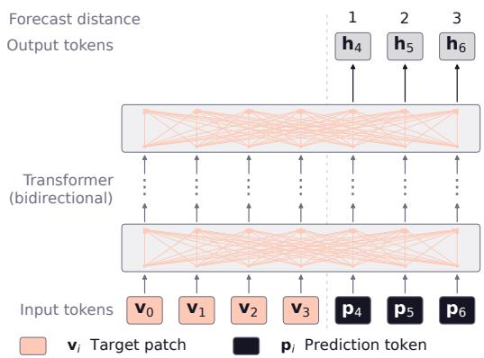  
(a) Bidirectional encoder-only model.

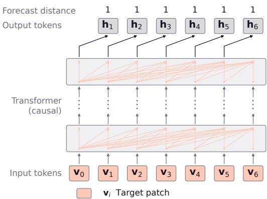  
(b) Causal decoder-only model.

Figure 2: Temporal information flow during training. Input tokens enter the Transformer after embedding; output tokens are final Transformer representations supplied to the prediction head. Only outputs used for forecasting are shown. The index of $\mathbf { h } _ { j }$ denotes the forecast patch $j ,$ and numbers above it give forecast distances in patches. (a) Context tokens $\mathbf { v } _ { 0 } , \ldots , \mathbf { v } _ { 3 }$ and prediction tokens $\mathbf { p } _ { 4 } , \ldots , \mathbf { p } _ { 6 }$ interact bidirectionally, producing h , h , h at the future positions. (b) Causal attention computes $\mathbf { h } _ { i + 1 }$ at position i for one-patch-ahead forecasting. Normalisation, embedding, the prediction head, and denormalisation are omitted here and shown in Figure 4.  
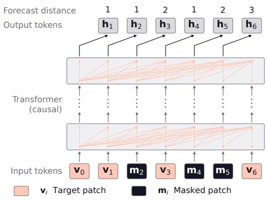  
(a) Training.

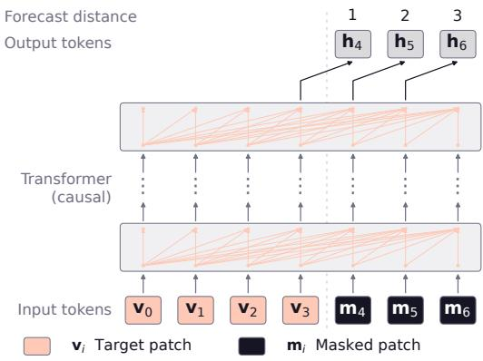  
(b) Forecasting.  
Figure 3: Causal decoder-only model with CPM: training and forecasting, using the token-level convention of Figure 2. Each output $\mathbf { h } _ { j }$ is computed at position $j - 1$ and passed to the prediction head for patch j. (a) Masking patch 2 makes ${ \bf h } _ { 3 }$ serve a two-patch-ahead forecast from the context ending at patch 1. After visible patch 3, masked patches 4 and 5 allow forecasts for patches 4, 5, 6 at distances 1, 2, 3. Their observed context contains patches 0, 1, 3, but not masked patch 2. (b) Context tokens $\mathbf { v } _ { 0 } , \ldots , \mathbf { v } _ { 3 }$ followed by $\mathbf { m } _ { 4 } , \ldots , \mathbf { m } _ { 6 }$ yield the three required outputs $\mathbf { h } _ { 4 } , \mathbf { \bar { h } } _ { 5 } , \mathbf { h } _ { 6 }$ from positions 3, 4, 5.

Contiguous Patch Masking. CPM trains models to forecast several future patches without feeding intermediate predictions back as inputs. First introduced in TiRex [Auer et al., 2025] and later adapted to Transformers in Toto-2.0 [Khwaja et al., 2026], CPM masks consecutive input patches during training, teaching the model to forecast several patches ahead from the preceding context. A masked patch has all its values hidden from the model but remains in the input sequence as a token with embedding $\mathbf { m } _ { i } . \mathbf { A }$ run of r masked patches following a visible patch therefore allows forecasts up to $r + 1$ patches ahead (Figure 3a). At inference, the input sequence is constructed from the observed context followed by a block of masked patches covering the forecast horizon (Figure 3b). The model then forecasts the whole block in one forward pass, without feeding intermediate predictions back as inputs. During training, however, patches masked to create longer-horizon forecasts also remain unavailable as observations for forecasts starting later in the sequence. The masking pattern therefore determines both the forecast horizons encountered during training and the observations available as context. In contrast, DHF, introduced in Section 3.1, separates horizon sampling from context masking while retaining shared causal context computation.

## 3 Timestral

Timestral is a causal encoder-only model for multivariate forecasting that supports both past-only and known-future covariates (Figure 4). As in bidirectional encoder-only models such as Chronos-2 and Falcon-2.0, forecasts are produced at dedicated prediction tokens rather than from context representations; unlike them, the context is encoded causally. Two modelling choices define the dependency structure of Timestral, along time and across variates. Along time, DHF (Section 3.1) decouples the context from the forecast horizon: prediction tokens attend to the context without affecting it. Across variates (Section 3.2), targets exchange information with each other and receive information from covariates, but never pass information to them; only known-future covariates contribute values from later patches, including the forecast horizon. Section 3.3 describes the patch embedding, normalisation, Transformer backbone, and quantile head.

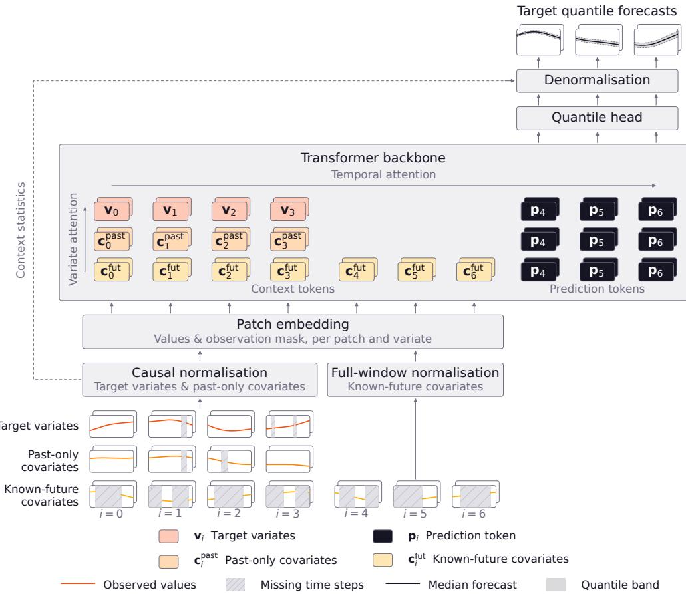  
Figure 4: Timestral overview: target variates, past-only covariates, and known-future covariates. Input boxes show target values $\mathbf { y } _ { t }$ and covariate values $\mathbf { x } _ { t }$ in patches of $P$ consecutive time steps. Within the Transformer, context and prediction tokens form two separate streams (Section 3.1): $\mathbf { v } _ { i } ,$ $\mathbf { c } _ { i } ^ { \mathrm { { p a s t } } }$ , and ${ \mathbf { c } } _ { i } ^ { \mathrm { { f u t } } }$ denote the context tokens of patch i of a target variate, a past-only covariate, and a known-future covariate, respectively, and $\mathbf { p } _ { i }$ denotes the prediction token at the temporal position of patch i. Every variate has a prediction token for each forecast patch, but only known-future covariates also have context tokens in the forecast horizon. Only the outputs at the prediction tokens of target variates are passed to the quantile head. Stacked boxes represent multiple variates.

## 3.1 Temporal Modelling via Decoupled Horizon Forecasting

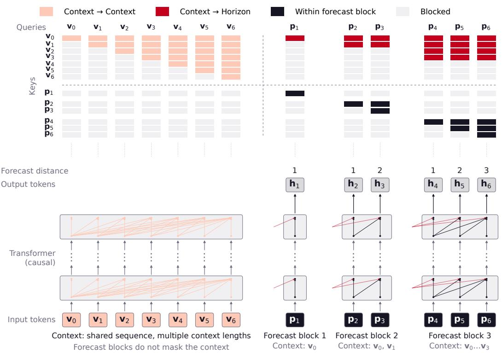  
Figure 5: Timestral training with DHF. Shared context and independent forecast blocks, with the corresponding attention mask above. Columns index queries and rows index keys. Context tokens attend causally to the context and never to prediction tokens; prediction tokens attend only to the context before their forecast block and to preceding and current prediction tokens in the same block. For readability, the red context-to-horizon arrows are drawn short: each stands for a prediction token’s attention to all context tokens before its block, as given by the red cells in the mask above. Output tokens $\mathbf { h } _ { j }$ are passed to the prediction head; numbers above them give forecast distances in patches. The blocks match the forecast distances of Figure 3a, but no context patch is masked to create them. Missing-data augmentation of the context is applied independently of the forecast block lengths.

DHF uses separate tokens for observed context patches and for forecast positions. For simplicity, we describe DHF for a single target variate. Temporal attention operates on each variate separately, and all variates of a series share the same forecast blocks. The context consists of one token $\mathbf { v } _ { i }$ per patch $i ,$ processed with causal attention, so the representation of patch i depends only on patches $0 , \ldots , i$ As shown in Figure $^ { 5 , }$ a forecast block covering patches $\bar { b } , \dotsc , b + \bar { k } - 1$ adds prediction tokens $\mathbf { p } _ { b } , \ldots , \mathbf { p } _ { b + k - 1 }$ . These are copies of a single learned embedding, distinguished by their temporal position: $\mathbf { p } _ { j }$ takes the same temporal position as the context token $\mathbf { v } _ { j }$ . Both kinds of tokens are processed by the same Transformer, with shared parameters. Each $\mathbf { p } _ { j }$ attends to the context tokens before its block and to the prediction tokens $\mathbf { p } _ { b } , \ldots , \mathbf { p } _ { j }$ of its own block, whereas context tokens never attend to prediction tokens. Context and prediction tokens thus form two separate streams. The resulting output $\mathbf { h } _ { j }$ is passed to the prediction head to forecast patch $j$ and therefore depends only on $\mathbf { v } _ { 0 } , \ldots , \mathbf { v } _ { b - 1 }$ and $\mathbf { p } _ { b } , \ldots , \mathbf { p } _ { j }$ . Outputs at context tokens are not passed to the prediction head and receive no direct loss.

To train forecasts at many forecast distances, each training sequence is tiled into consecutive forecast blocks whose lengths are sampled from a block-length distribution. A block of length k contains one forecast at each distance $1 , \ldots , k .$ , so this distribution determines how often each forecast distance is trained. Because context tokens never attend to prediction tokens, the context representations are computed once and shared by all blocks of a training sequence. As in causal decoder-only models (Figure 2b), a single training sequence thus provides training signal from forecasts at many starting points, but in DHF, the forecast from each starting point can extend several patches ahead.

Unlike CPM, DHF does not mask context patches to create longer forecast distances. In CPM, a forecast at distance d requires masking the $d - 1$ patches before its target, and these patches are then also missing from the context of all later forecasts, so training longer forecast distances removes context. In DHF, each patch in a forecast block has two tokens during training: its prediction token, at which it is forecast, and its context token, which keeps its observed values available to later blocks. In Figure 5, for instance, the forecasts of the third block depend on $\mathbf { v } _ { 2 }$ , which CPM masks.

This decoupling has the following advantages. First, how often each forecast distance is trained can be tuned without side effects on the context. Second, missing data can be simulated independently of the forecast distances: optional missing-data augmentation hides variable-length gaps at arbitrary time steps rather than whole patches, which is closer to realistic missing-data distributions, and the hidden values are still scored as targets. Third, missing values, whether in the data or introduced by augmentation, are flagged in their context tokens and thus represented differently from forecast positions, whereas CPM represents a patch masked for forecasting in the same way as a fully missing patch. These advantages come at the cost of roughly doubling the number of tokens during training, since forecast blocks tile the full sequence so that every patch except the first serves as a forecast target.

At inference, a single forecast block follows the context, so forecasts up to the maximum block length of 32 patches (1,024 time steps) are produced in a single forward pass. Longer horizons can be forecast block by block, conditioning each block on the predicted medians of the previous ones, as in Toto-2.0 [Khwaja et al., 2026].

## 3.2 Multivariate and Covariate Modelling

Each variate of a multivariate series is represented by its own sequence of tokens and has one of three roles: target variate, past-only covariate, or known-future covariate (Figure 4). Every variate has context and prediction tokens, but only the outputs at prediction tokens of target variates are used as forecasts. Roles are not embedded in the tokens and enter the model only through the attention masks and the choice of normalisation (Section 3.3). Along time, target variates and past-only covariates are processed causally, as described in Section 3.1. The context tokens of known-future covariates instead attend over the entire window, including the forecast horizon, where they hold the known future values. Normalisation follows the same distinction (Section 3.3).

Similar to Chronos-2 and Toto-2.0 [Ansari et al., 2025, Khwaja et al., 2026], variate attention exchanges information between the variates of a series at the same patch position, among context tokens and among prediction tokens. It uses no positional encoding, so the order of the variates does not affect the forecasts. To prevent future information leakage, known-future covariates attend only to each other. Otherwise, a known-future covariate could read the value of a target variate or past-only covariate at patch i and, through its temporal attention, carry it back to earlier patches, from which it would reach the forecast of patch i. Past-only covariates do not attend to target variates either; this is a modelling choice that treats covariates as exogenous, so that their representations do not depend on target values. Forecasts can thus use future values of known-future covariates, but never future value of target variates or past-only covariates.

During training, some variates in a random subset of multivariate series are assigned the role of past-only or known-future covariates, while the others remain target variates. These covariates are inputs only and are not scored, so ordinary multivariate series become forecasting tasks with covariates.

## 3.3 Architecture

Each patch of $P = 3 2$ time steps of a variate is embedded into a single token by a two-layer residual multilayer perceptron (MLP). Its input consists of the P normalised values and P binary indicators of missing time steps, at which the values are set to zero, so that missing values are distinguished from observed zeros. Similar to previous work, values are standardised causally with the mean and standard deviation of all observed values of their variate up to the end of the current patch [Cohen et al., 2025], and an inverse hyperbolic sine is applied to the standardised values [Ansari et al., 2025]. Known-future covariates, whose values are known over the entire window, are instead normalised with statistics over this window, and binary ones, such as holiday flags, are left unchanged.

Table 1: Timestral model sizes. All models use a head dimension of 64, sigmoid-gated attention, and variate attention in every fourth block.
<table><tr><td>Model</td><td> $d _ { \mathrm { m o d e l } }$ </td><td>Blocks</td><td>Heads</td><td>SwiGLU width</td><td>Parameters</td></tr><tr><td>Timestral-5M</td><td>192</td><td>8</td><td>3</td><td>512</td><td>5.2M</td></tr><tr><td>Timestral-28M</td><td>384</td><td>12</td><td>6</td><td>1024</td><td>27.8M</td></tr><tr><td>Timestral-123M</td><td>640</td><td>20</td><td>10</td><td>1712</td><td>122.6M</td></tr><tr><td>Timestral-209M</td><td>768</td><td>24</td><td>12</td><td>2048</td><td>209.3M</td></tr></table>

The backbone is a pre-norm Transformer with RMSNorm [Zhang and Sennrich, 2019] and SwiGLU feed-forward layers [Shazeer, 2020]. Each block applies temporal attention and a feed-forward layer, and every fourth block additionally applies variate attention between the two. Both attention types use gated attention with an elementwise sigmoid output gate [Qiu et al., 2025]. Temporal attention encodes token positions with rotary position embeddings [Su et al., 2024] on half of each head’s dimensions. No timestamps, frequency information, or role or position embeddings are added; positions enter only through the rotary embeddings of temporal attention. Neither dropout nor stochastic depth is used.

After a final RMSNorm, a two-layer residual MLP maps each output $\mathbf { h } _ { j }$ to 21 quantiles for each of the P time steps of patch $j .$ The head predicts the median directly and the other quantiles by adding or subtracting cumulative sums of positive (softplus) increments, preventing quantile crossing by construction. Each forecast patch is standardised with the statistics of all values up to the end of the preceding patch, and its predicted quantiles are mapped back to the original scale by inverting the asinh and this standardisation. Within a forecast block, these values include the earlier patches of the block, which are unknown at inference and are therefore replaced by their predicted medians. The same statistics are used during training to standardise the targets, so that training and inference match. Table 1 lists the model sizes.

## 4 Results

We describe the data and training setup shared by the four Timestral models, then report their forecasting performance on public benchmarks.

## 4.1 Training Setup

All four Timestral models are pretrained exclusively on synthetic data with a context length of 8,192 time steps and then post-trained on a mixture of real and synthetic data with a context length of 32,768 time steps for substantially fewer steps.

Training data. The synthetic corpus includes both univariate signals and multivariate examples, covering temporal dynamics and cross-series dependencies. We generate univariate series with diverse trends, seasonal patterns, and noise characteristics across temporal resolutions. Additional patterns include regime changes, localised events, level shifts, and count-valued observations. We construct multivariate examples by introducing linear and nonlinear dependencies between base univariate signals, using structured synthetic priors [Ansari et al., 2025, Xie et al., 2026, Naour et al., 2026, Podest et al., 2026]. Selected variates serve as past-only or known-future covariates, providing training examples with different input availability patterns.

Training objective. We train with the pinball loss [Koenker and Bassett, 1978], without auxiliary objectives. For a target value y and a predicted quantile $\hat { q } _ { \tau }$ at level $\tau ,$ the loss is

$$
\rho _ { \tau } ( e ) = \mathrm { m a x } ( \tau e , ( \tau - 1 ) e ) , \qquad e = y - \hat { q } _ { \tau } .\tag{2}
$$

Minimising this loss trains $\hat { q } _ { \tau }$ to estimate the conditional τ -quantile of y [Koenker and Bassett, 1978]. The prediction head outputs 21 quantile levels, $\mathcal { T } = \{ 0 . 0 1 , \stackrel { . } { 0 } . 0 5 , 0 . 1 0 , . . . , 0 . 9 5 , 0 . 9 9 \}$ . We average the loss equally across quantile levels and scored positions:

$$
\mathcal { L } = \frac { 1 } { \left| \mathcal { T } \right| \sum _ { i } w _ { i } } \sum _ { i } w _ { i } \sum _ { \tau \in \mathcal { T } } \rho _ { \tau } \left( y _ { i } - \hat { q } _ { \tau , i } \right) ,\tag{3}
$$

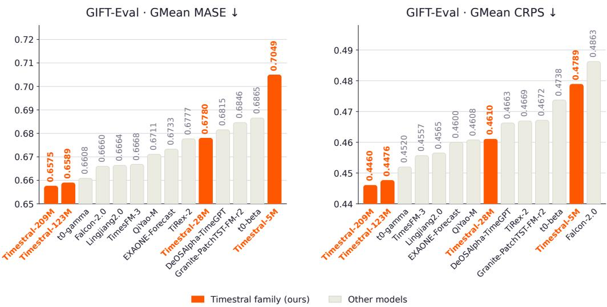  
Figure 6: GIFT-Eval results for all four Timestral models and the ten leading competitors by aggregate MASE. Both panels show the same models, ranked separately by each metric. Lower is better.

where i indexes target values within forecast blocks and w is one for scored positions and zero otherwise. Only observed target values within a forecast horizon are scored. Context representations and covariates receive no direct loss; they are trained through their influence on the scored predictions. Targets and predictions are compared in the model’s normalised space, reducing differences in loss scale between series.

## 4.2 Forecasting Performance

We evaluate Timestral on GIFT-Eval [Aksu et al., 2024], TIME [Qiao et al., 2026], and fevbench [Shchur et al., 2026]. On fev-bench, we report skill scores for mean absolute scaled error (MASE) and scaled quantile loss (SQL). On GIFT-Eval, Timestral uses past-only covariates on the few datasets that provide them. On fev-bench, it uses the available past-only and known-future covariates according to each task’s input specification.

Timestral sets a new state of the art across GIFT-Eval, TIME, and fev-bench. Figures 6 to 8 compare all four Timestral sizes with other leading entries on each benchmark, and Table 3 in Appendix A reports the scores of all compared models. Timestral-209M ranks first on all six metrics among the models compared: it has the lowest MASE and continuous ranked probability score (CRPS) on GIFT-Eval and TIME and the highest MASE and SQL skill scores on fev-bench, using a single checkpoint. Pairwise win rates in Appendix A.3 complement these aggregate scores by measuring how often Timestral improves over each competitor. Appendix A.2 additionally reports results on the industrial benchmark IND-Eval [Haugland et al., 2026], where Timestral-209M, Timestral-123M, and Timestral-28M take the top three places.

Every Timestral size lies on the Pareto front. Figure 1 plots accuracy against parameter count: all four Timestral models lie on the Pareto front, and the smaller ones outperform much larger models. Timestral-123M ranks second on all six metrics, ahead of every model outside the family, and both Timestral-123M and Timestral-209M have fewer parameters than t0-gamma (256M) [The Forecasting Company, 2026] and TimesFM-3 (331M). Timestral-28M outperforms Chronos-2 and Toto-2.0-2.5B, about 4 and 90 times larger, on all six metrics, and on fev-bench Timestral-5M outperforms every Toto-2.0 model, including Toto-2.0-2.5B with about 480 times as many parameters.

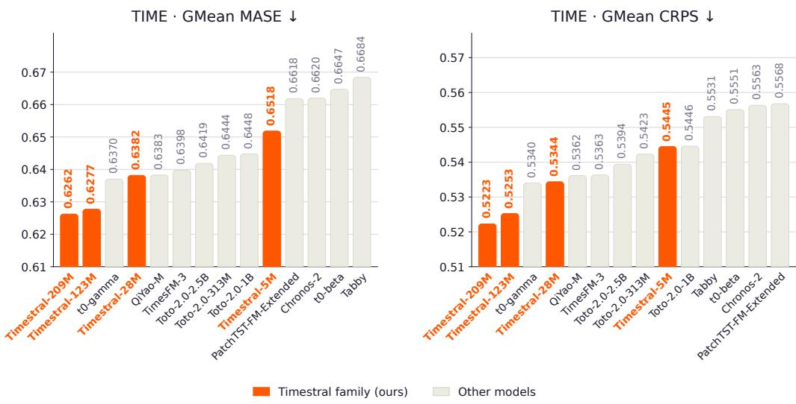  
Figure 7: TIME results for all four Timestral models and the ten leading competitors by aggregate MASE. Both panels show the same models, ranked separately by each metric. Lower is better on both metrics.

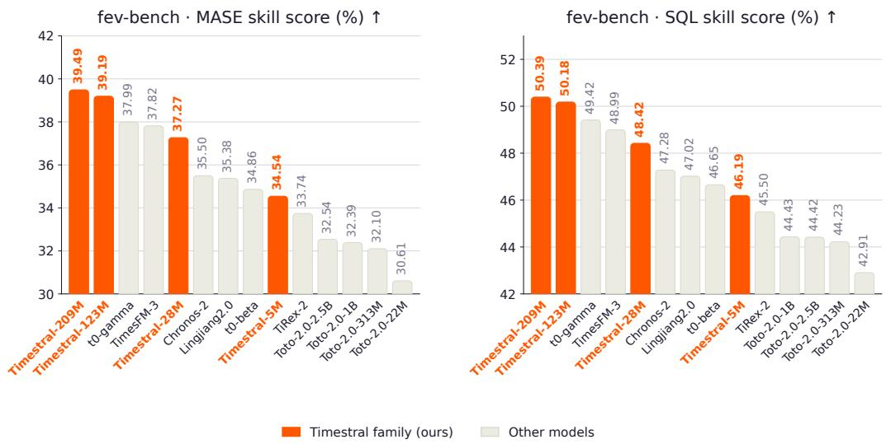  
Figure 8: fev-bench results for all four Timestral models and the ten leading competitors by MASE skill score. Both panels show the same models, ranked separately by each metric. Higher is better for both MASE and SQL skill scores.

## 4.3 Inference Speed

Timestral does not require a GPU at inference. A forecast of up to 1,024 time steps is produced in a single forward pass (Section 3.1), so its cost depends mainly on the context length and the number of variates. Table 2 reports the latency and throughput of each model for a representative workload: forecasting one day ahead (96 steps) of a univariate series without covariates, from about three weeks of 15-minute history (2,048 steps).

Setup. We time the forecast method of the released inference package with the released checkpoints, end to end, with bfloat16 weights and torch.compile; the bfloat16 forecasts differ from float32 ones by less than 0.2%. Each forecast uses symmetric averaging: the model also forecasts the

Timestral-5M Timestral-28M Timestral-123M Timestral-209M 1 target + 7 known-future covariates

Table 2: Inference latency and throughput for forecasting 96 steps of a univariate series without covariates from a context of 2,048 steps, with symmetric averaging. CPU latency is the median of 50 runs at batch size 1. CPU throughput is per core at batch size 16, and GPU throughput is on one NVIDIA H100 at batch size 256. Checkpoint sizes are for float32 weights.
<table><tr><td colspan="3"></td><td colspan="3">CPU</td><td>GPU</td></tr><tr><td>Model</td><td>Parameters</td><td>Checkpoint size</td><td>8 threads</td><td>1 thread</td><td>series/s</td><td>series/s</td></tr><tr><td>Timestral-5M</td><td>5.2M</td><td>21 MB</td><td>17 ms</td><td>16 ms</td><td>106</td><td>18,770</td></tr><tr><td>Timestral-28M</td><td>27.8M</td><td>111MB</td><td>31 ms</td><td>56 ms</td><td>24</td><td>10,730</td></tr><tr><td>Timestral-123M</td><td>122.6M</td><td>490 MB</td><td>85 ms</td><td>210ms</td><td>5.9</td><td>4,990</td></tr><tr><td>Timestral-209M</td><td>209.3M</td><td>837MB</td><td>113 ms</td><td>345 ms</td><td>3.5</td><td>3,650</td></tr></table>

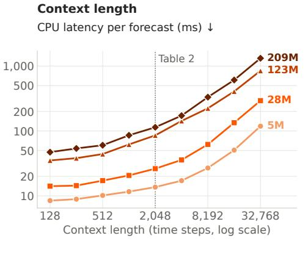

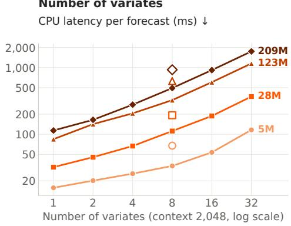  
Figure 9: CPU latency per forecast against context length (left, one variate) and number of target variates (right, context of 2,048 steps), on 8 threads with the settings of Table 2 (median of 20 runs). Hollow markers: one target with seven known-future covariates. Both axes are logarithmic.

negated series and averages the reflected forecast with the original one, which requires two forward passes. CPU numbers are measured on a 48-core server CPU (AMD EPYC 9454) and GPU numbers on one NVIDIA H100, with PyTorch 2.14; we report the median over repeated runs after warm-up.

A forecast takes 17 to 113 ms on 8 CPU threads. Latency grows with model size, and additional threads mainly benefit the larger models: from 1 to 8 threads, Timestral-209M becomes 3.1 times faster, whereas Timestral-5M is already as fast on a single core.

Smaller models trade some accuracy for speed. Timestral-28M is 3.6 times faster than Timestral-209M, and Timestral-123M has about 0.2% higher GIFT-Eval MASE than Timestral-209M at 75% of its latency (Figure 1 and Table 2).

Throughput. One CPU core forecasts 3.5 (Timestral-209M) to 106 (Timestral-5M) series per second, so forecasting 100,000 series every 15 minutes requires 2 to 32 cores. One NVIDIA H100 forecasts 3,650 to 18,770 series per second, that is, 100,000 series in 5 to 27 seconds.

Context length and number of variates. Figure 9 varies the context length and the number of variates. Up to 2,048 steps, latency changes little: it roughly doubles from 128 to 2,048 steps. Beyond, it grows nearly in proportion to the context, by about 9 to 12 times from 2,048 to 32,768 steps, the longest context used in training; at that length, a forecast takes 119 ms with Timestral-5M and 1.3 s with Timestral-209M. A series with 32 variates takes 7 to 15 times as long as a univariate series. Covariates cost more than target variates: one target with seven known-future covariates takes 1.7 to 2.0 times as long as eight target variates.

## 5 Conclusion

We introduced Timestral, a family of four foundation models with 5M to 209M parameters for probabilistic univariate, multivariate, and covariate-informed forecasting. DHF separates prediction tokens from the causally encoded context, so that observed values serve both as forecast targets and as context for later forecasts, and longer forecast distances are trained without masking context. Role-aware attention masks let prediction tokens use known-future covariates at every forecast origin, while forecasts never use future values of target variates or past-only covariates. The models are pretrained exclusively on synthetic data and then post-trained on a mixture of real and synthetic data with extended context.

Timestral-209M ranks first among the models compared on every reported metric of GIFT-Eval, TIME, and fev-bench using a single checkpoint. It leads by a wider margin on IND-Eval. Timestral-123M ranks second, ahead of every model outside the Timestral family, and all four sizes lie on the Pareto front of accuracy against size. Accuracy still improves from 123M to 209M parameters, which motivates training larger models. Beyond standalone forecasting, Timestral can be embedded in existing monitoring pipelines or combined with language models in agentic workflows. A further direction is to use the context representations as embeddings for tasks such as classification and anomaly detection.

## Core contributors

Adrien Petralia, Alexandre Gavaudan, Artjom Joosen, Etienne Goffinet, Richard Kurle, Yassine El Ouahidi, Yassir Bendou.

## Contributors

Abdelaziz Bounhar, Abhijeet Somani, Aditi Kabra, Adrian Valente, Adrien Sadé, Ahmed Djermani, Alan Jeffares, Albert Jiang, Alberto Bietti, Aleksandr Timashov, Alexandre Cahill, Alexandre Laval, Alexandre Sablayrolles, Alexandros Sanchez Vassopoulos, Amélie Héliou, Amos You, André Jonas son, Andreas Fürst, Andrew Bai, Andrew Ehrenberg, Andrew Zhao, Andy Lo, Angele Lenglemetz, Anmol Agarwal, Antonia Calvi, Arata Suzuki, Arjun Majumdar, Arthur Fournier, Ashwani Kumar, Augustin Lombard, Avinash Sooriyarachchi, Aylin Guliz Akkus, Aysenur Karaduman, Baptiste Bout, Baptiste Rozière, Barna Pásztor, Baudouin De Monicault, Benjamin Holzschuh, Benjamin Tibi, Benno Stein, Bernhard Stadlbauer, Bhargavi Bhaskar, Binbing Hou, Błazej Osi˙ nski, Boris van´ Breugel, Camille Le Scao, Chaoran Yu, Charlotte Cronjäger, Chen-Yo Sun, Chris Bamford, Christian Wallenwein, Christophe Renaudin, Clémence Lanfranchi, Colin Bonatti, Corentin Barreau, Corentin Sautier, Cristiana-Diana Diaconu, Cyprien Courtot, Daniel Lopes, Daniel Marczak, Darius Dabert, Diego de las Casas, Dominik Nuss, Dylan Rubini, Dzmitry Soupel, Elizaveta Demyanenko, Elliot Chane-Sane, Emilien Fugier, Emmanuel Gottlob, Erik Aas, Etienne Duchesne, Fabian Paischer, Fabian Schlager, Faruk Ahmed, Federico Baldassarre, Félix Rosseeuw, Filip Szatkowski, Filippo Vicentini, Florian Wiesner, Gabrielle Berrada, Gaëtan Ecrepont, Gaspard Blanchet, Gaspard Donada Vidal, Gaurav Mahajan, Gauthier Guinet, Genevieve Hayes, Georgii Novikov, Georgios Christoglou, Giada Pistilli, Gonzague de Carpentier, Graeme Nail, Guillaume Breton, Guillaume Kunsch, Guillaume Lample, Guillaume Martin, Guillaume Raille, Guillaume Richard, Guillem Simeon, Gunjan Dhanuka, Gunshi Gupta, Hamza Senhaji Rhazi, Han Zhou, Hédi Hadiji, Himanshu Jaju, Hope McGovern, Hubert de Parseval, Hugo Cisneros, Hugo Germain, Hugo Thimonier, Hugo Venturini, Hyeonju Lee, Hyunwoo Oh, Iliass Lasri, Ilyas Oulkadda, Jacques Sun, Jan Ludziejewski, Jason Rute, Jean de Becdelièvre, Jean Quentin, Jean-Malo Delignon, Jessica Chudnovsky, Jianchao Li, Jie Zhang, Jin Bin Ou, Joachim Studnia, Joep Barmentlo, Johannes Brandstetter, John Harvill, Jonas Amar, Jonas Schweizer, Jonathan Roberts, Joséphine Delas, Josselin Somerville, Jules Depersin, Julien Denize, Julien Tauran, Julien Verlaguet, Kartik Khandelwal, Khyathi Raghavi Chandu, Kilian Tep, Konstantin Mishchenko, Kris Szczepaniak, Kush Jain, Larissa Laich, Laura Calem, Laurence Aitchison, Laurent Callot, Laurent Fainsin, Léo Cotteleer, Léonard Blier, Loïc Chadoutaud, Loïck Chambon, Lorenzo Proietti, Louis Faucon, Louis Martin, Louis Serrano, Lu Li, Luc Boudier, Lucas Fernandes Martins, Lucas Mebille, Lucile Saulnier, Ludovic Ho Fuh, Luis Montero, Łukasz Borchmann, Maarten Buyl, Malik Hassan Raza, Manon Chossegros, Marcin Mozejko, Margaret Jennings, Markus˙ Hennerbichler, Martin Alexandre, Mathieu Poirée, Mathieu Schmitt, Mathilde Guillaumin, Mathis

Felardos, Matthieu André, Matthieu Dinot, Matthieu Futeral, Maurits Bleeker, Mauro Comi, Max Mynter, Maxim Berman, Maxime Darrin, Maxime Langelier, Maxime Louis, Maximilian Augustin, Maximilian Müller, Mehdi Bouaziz, Melina Jingting Laimon, Mert Unsal, Mia Chiquier, Michael Pilcer, Michał Pietruszka, Michał Zaj ˛ac, Mickaël Seznec, Mikhail Biriuchinskii, Minh-Quang Pham, Minwoo Kang, Mircea Lica, Morgane Rivière, Namit Katariya, Natasha Ørregaard Klingenbrunn, Nathan Bout, Nathan Grinsztajn, Nathan Simpson, Neeraj Aggarwal, Neil Ashton, Neil Mallinar, Nick Bührer, Nicolas Moreau, Nicolò Lucchesi, Ola Mysiak, Oliver Leicht, Olivier Bousquet, Olivier Koch, Parag Jain, Patricia Wang, Patrick Blies, Patrick von Platen, Patryk Saffer, Paul Jacob, Paul Teiletche, Paul Wambergue, Paula Kurylowicz, Pavan Kumar Reddy, Pavel Kuksa, Philippe Formont, Philippe Pinel, Philomène Chagniot, Pierre Glandon, Pierre Stock, Pierre-André Savalle, Piotr Miłos,´ Poojan Shah, Prateek Gupta, Pravesh Agrawal, Pui Ki Chan, Quentin Desreumaux, Quentin Selle, Quentin Torroba, Quentin Wargnier, Quercus Hernandez, Ram Ramrakhya, Randall Isenhour, Ranjit Parva, Raphaël Balouka, Raphaël Rialland, Raul Perez Pelaez, Reinhard Sonnleitner, Remi Delacourt, Rishi Shah, Rob Romijnders, Rohan Shah, Rohin Arora, Romain Sauvestre, Roman Soletskyi, Ronan Riochet, Rosalie Millner, Rupert Menneer, Sagar Vaze, Samuel Barry, Samuel Belkadi, Samuel Humeau, Samuele Papa, Sanchit Gandhi, Sandeep Cranganore, Sandeep Subramanian, Sarthak Mittal, Saskia Adaime, Scott Matthews, Sean Cha, Sebastian Kaltenbach, Seungjae Jung, Shashwat Verma, Sherif Waly, Shrimai Prabhumoye, Siddhant Waghjale, Siddharth Gandhi, Simon Lepage, Simon Sorg, Soham Ghosh, Sophie Marbach, Srijan Mishra, Stanislas Lange, Steve Hong, Sumukh Aithal, Szymon Antoniak, Tarun Kumar Vangani, Teddy Turquet, Teven Le Scao, Théo Cachet, Thibaut Lavril, Thomas Chabal, Thomas Coste, Thomas Defard, Thomas Foubert, Thomas Loux, Thomas Robert, Thomas Wang, Tianyu Zhang, Tim Lawson, Timothée Lacroix, Timothy Wallis, Tobias Kronlachner, Tom Bewley, Tom Edwards, Tomas Hodan, Triantafyllos Afouras, Tuhin Das, Tyler Wang, Udit Saxena, Ulrick Blé, Umar Jamil, Umberto Tomasini, Valentin Macé, Van Phung, Venkata Reddy, Vibha Masti, Victor Jouault, Victor Letzelter, Victor Paltz, Victor Poucheret, Vincent Maladière, Vincent Pfister, Virgile Richard, Vladislav Bataev, Wassim Bouaziz, Wen Ding Li, William Flanagan, William Havard, William Marshall, Witold J˛edrzejewski, Xinghui Li, Xingran Guo, Xinyu Yang, Xuanyu Zhang, Yann Dreze, Yann Viegas, Yannic Neuhaus, Yassine Turki, Yessin Moakher, Yi He, Yihan Wang, Yimu Pan, Yuying Zhu, Yves Martin des Taillades, Zaccharie Ramzi, Zhenlin Xu, Zsófia Csákány.

## References

Taha Aksu, Gerald Woo, Juncheng Liu, Xu Liu, Chenghao Liu, Silvio Savarese, Caiming Xiong, and Doyen Sahoo. GIFT-Eval: A benchmark for general time series forecasting model evaluation, 2024. URL https: //arxiv.org/abs/2410.10393.

Abdul Fatir Ansari, Lorenzo Stella, Ali Caner Turkmen, Xiyuan Zhang, Pedro Mercado, Huibin Shen, Oleksandr Shchur, Syama Sundar Rangapuram, Sebastian Pineda Arango, Shubham Kapoor, Jasper Zschiegner, Danielle C. Maddix, Hao Wang, Michael W. Mahoney, Kari Torkkola, Andrew Gordon Wilson, Michael Bohlke-Schneider, and Bernie Wang. Chronos: Learning the language of time series. Transactions on Machine Learning Research, 2024. ISSN 2835-8856. URL https://openreview.net/forum?id=gerNCVqqtR. Expert Certification.

Abdul Fatir Ansari, Oleksandr Shchur, Jaris Küken, Andreas Auer, Boran Han, Pedro Mercado, Syama Sundar Rangapuram, Huibin Shen, Lorenzo Stella, Xiyuan Zhang, Mononito Goswami, Shubham Kapoor, Danielle C. Maddix, Pablo Guerron, Tony Hu, Junming Yin, Nick Erickson, Prateek Mutalik Desai, Hao Wang, Huzefa Rangwala, George Karypis, Yuyang Wang, and Michael Bohlke-Schneider. Chronos-2: From univariate to universal forecasting, 2025. URL https://arxiv.org/abs/2510.15821.

Andreas Auer, Patrick Podest, Daniel Klotz, Sebastian Böck, Günter Klambauer, and Sepp Hochreiter. TiRex: Zero-shot forecasting across long and short horizons with enhanced in-context learning. In D. Belgrave, C. Zhang, H. Lin, R. Pascanu, P. Koniusz, M. Ghassemi, and N. Chen, editors, Advances in Neural Information Processing Systems, volume 38, Main Conference, pages 57529–57580. Curran Associates, Inc., 2025. doi: 10.52202/085713-1929. URL https://proceedings.neurips.cc/paper\_files/paper/2025/file/ 5356603f9c47399adfd372f77a677057-Paper-Conference.pdf.

Samy Bengio, Oriol Vinyals, Navdeep Jaitly, and Noam Shazeer. Scheduled sampling for sequence prediction with recurrent neural networks. In C. Cortes, N. Lawrence, D. Lee, M. Sugiyama, and R. Garnett, editors, Advances in Neural Information Processing Systems, volume 28. Curran Associates, Inc., 2015. URL https://proceedings.neurips.cc/paper\_files/paper/2015/file/ e995f98d56967d946471af29d7bf99f1-Paper.pdf.

Sathya Kamesh Bhethanabhotla, Omar Swelam, Julien Siems, David Salinas, and Frank Hutter. Mamba4Cast: Efficient zero-shot time series forecasting with state space models, 2024. URL https://arxiv.org/abs/ 2410.09385.

Ben Cohen, Emaad Khwaja, Youssef Doubli, Salahidine Lemaachi, Chris Lettieri, Charles Masson, Hugo Miccinilli, Elise Ramé, Qiqi Ren, Afshin Rostamizadeh, Jean du Terrail, Anna-Monica Toon, Kan Wang, Stephan Xie, Zongzhe Xu, Viktoriya Zhukova, David Asker, Ameet Talwalkar, and Othmane Abou-Amal. This time is different: An observability perspective on time series foundation models. In D. Belgrave, C. Zhang, H. Lin, R. Pascanu, P. Koniusz, M. Ghassemi, and N. Chen, editors, Advances in Neural Information Processing Systems, volume 38, Main Conference, pages 50907–50951. Curran Associates, Inc., 2025. doi: 10.52202/085713-1698. URL https://proceedings.neurips.cc/paper\_files/paper/2025/file/ 48ea942b60e6c52b50ca90e4a40d8ac2-Paper-Conference.pdf.

Abhimanyu Das, Weihao Kong, Rajat Sen, and Yichen Zhou. A decoder-only foundation model for time-series forecasting. In Ruslan Salakhutdinov, Zico Kolter, Katherine Heller, Adrian Weller, Nuria Oliver, Jonathan Scarlett, and Felix Berkenkamp, editors, Proceedings of the 41st International Conference on Machine Learning, volume 235 of Proceedings of Machine Learning Research, pages 10148–10167. PMLR, 21–27 Jul 2024. URL https://proceedings.mlr.press/v235/das24c.html.

Samuel Dooley, Gurnoor Singh Khurana, Chirag Mohapatra, Siddartha V Naidu, and Colin White. ForecastPFN: Synthetically-trained zero-shot forecasting. In A. Oh, T. Naumann, A. Globerson, K. Saenko, M. Hardt, and S. Levine, editors, Advances in Neural Information Processing Systems, volume 36, pages 2403–2426. Curran Associates, Inc., 2023. doi: 10.52202/075280-0112. URL https://proceedings.neurips.cc/paper\_ files/paper/2023/file/0731f0e65559059eb9cd9d6f44ce2dd8-Paper-Conference.pdf.

Anurag Garg, Muhammad Ali, Noah Hollmann, Lennart Purucker, Samuel Müller, and Frank Hutter. Real-TabPFN: Improving tabular foundation models via continued pre-training with real-world data, 2025. URL https://arxiv.org/abs/2507.03971.

Vebjørn Haugland, Pavel Gulin, David Foss, Peet Cremer, Erlend Aune, Simone Casolo, Andreas Solbrå, and Milad Mobarhan. IND-Eval: Aligning evaluation and simulation for industrial time series foundation models, 2026. URL https://arxiv.org/abs/2610.16652.

Noah Hollmann, Samuel Müller, Katharina Eggensperger, and Frank Hutter. TabPFN: A transformer that solves small tabular classification problems in a second. In The Eleventh International Conference on Learning Representations, 2023. URL https://openreview.net/forum?id=cp5PvcI6w8\_.

Noah Hollmann, Samuel Müller, Lennart Purucker, Arjun Krishnakumar, Max Körfer, Shi Bin Hoo, Robin Tibor Schirrmeister, and Frank Hutter. Accurate predictions on small data with a tabular foundation model. Nature, 637(8045):319–326, 2025. ISSN 1476-4687. doi: 10.1038/s41586-024-08328-6.

Ayush Jain and Rajat Sen. TimesFM-3: A zero-shot foundation model for multivariate forecasting. Google Research Blog, 2026. URL https://research.google/blog/ timesfm-3-a-zero-shot-foundation-model-for-multivariate-forecasting/.

Emaad Khwaja, Chris Lettieri, Gerald Woo, Eden Belouadah, Marc Cenac, Guillaume Jarry, Enguerrand Paquin, Xunyi Zhao, Viktoriya Zhukov, Othmane Abou-Amal, Chenghao Liu, Ameet Talwalkar, and David Asker. Toto 2.0: Time series forecasting enters the scaling era, 2026. URL https://arxiv.org/abs/2605.20119.

Roger Koenker and Gilbert Bassett. Regression quantiles. Econometrica, 46(1), January 1978. ISSN 0012-9682. doi: 10.2307/1913643. URL http://dx.doi.org/10.2307/1913643.

Yong Liu, Haoran Zhang, Chenyu Li, Xiangdong Huang, Jianmin Wang, and Mingsheng Long. Timer: Generative pre-trained transformers are large time series models. In Ruslan Salakhutdinov, Zico Kolter, Katherine Heller, Adrian Weller, Nuria Oliver, Jonathan Scarlett, and Felix Berkenkamp, editors, Proceedings of the 41st International Conference on Machine Learning, volume 235 of Proceedings of Machine Learning Research, pages 32369–32399. PMLR, 21–27 Jul 2024. URL https://proceedings.mlr.press/v235/ liu24cb.html.

Lucas Meyer, Claudio Sole, Huikan Xiang, Nicolas Li, Lucas Franceschino, Arnau Quera-Bofarull, Maarten P. Scholl, Joachim Fainberg, and Geoffrey Négiar. t0: A time-series foundation model for forecasting with context, 2026. URL https://arxiv.org/abs/2609.24559.

Vladyslav Moroshan, Julien Siems, Arber Zela, Timur Carstensen, and Frank Hutter. TempoPFN: Synthetic pre-training of linear RNNs for zero-shot time series forecasting, 2026. URL https://arxiv.org/abs/ 2510.25502.

Samuel Müller, Noah Hollmann, Sebastian Pineda Arango, Josif Grabocka, and Frank Hutter. Transformers can do Bayesian inference. In International Conference on Learning Representations, 2022. URL https: //openreview.net/forum?id=KSugKcbNf9.

Etienne Le Naour, Tahar Nabil, and Adrien Petralia. TS-ICL: A flexible time-indexed foundation model for time series via in-context learning, 2026. URL https://arxiv.org/abs/2606.05878.

Yuqi Nie, Nam H Nguyen, Phanwadee Sinthong, and Jayant Kalagnanam. A time series is worth 64 words: Longterm forecasting with Transformers. In The Eleventh International Conference on Learning Representations, 2023. URL https://openreview.net/forum?id=Jbdc0vTOcol.

Patrick Podest, Marco Pichler, Elias Bürger, Levente Zólyomi, Bernhard Voggenberger, Wilhelm Berghammer, Daniel Klotz, Sebastian Böck, Günter Klambauer, and Sepp Hochreiter. TiRex-2: Generalizing TiRex to multivariate data and streaming, 2026. URL https://arxiv.org/abs/2607.01204.

Zhongzheng Qiao, Sheng Pan, Anni Wang, Viktoriya Zhukova, Yong Liu, Xudong Jiang, Qingsong Wen, Mingsheng Long, Ming Jin, and Chenghao Liu. It’s TIME: Towards the next generation of time series forecasting benchmarks. In Tong Zhang, Miroslav Dudik, Martin Jaggi, Alekh Agarwal, Sharon Li, Dale Schuurmans, Jerry Zhu, Felix Berkenkamp, Hanze Dong, and Alberto Bietti, editors, Proceedings of the 43rd International Conference on Machine Learning, volume 306 of Proceedings of Machine Learning Research, pages 101344–101377. PMLR, 06–11 Jul 2026. URL https://proceedings.mlr.press/ v306/qiao26g.html.

Zihan Qiu, Zekun Wang, Bo Zheng, Zeyu Huang, Kaiyue Wen, Songlin Yang, Rui Men, Le Yu, Fei Huang, Suozhi Huang, Dayiheng Liu, Jingren Zhou, and Junyang Lin. Gated attention for large language models: Non-linearity, sparsity, and attention-sink-free. In D. Belgrave, C. Zhang, H. Lin, R. Pascanu, P. Koniusz, M. Ghassemi, and N. Chen, editors, Advances in Neural Information Processing Systems, volume 38, Main Conference, pages 100092–100118. Curran Associates, Inc., 2025. doi: 10.52202/085713-3345. URL https://proceedings.neurips.cc/paper\_files/paper/2025/file/ 904e89bb4e632e75fb47f093b620b257-Paper-Conference.pdf.

David Salinas, Valentin Flunkert, Jan Gasthaus, and Tim Januschowski. DeepAR: Probabilistic forecasting with autoregressive recurrent networks. International Journal ofForecasting, 36(3):1181–1191, 2020. ISSN 0169-2070. doi: 10.1016/j.ijforecast.2019.07.001.

Noam Shazeer. GLU variants improve Transformer, 2020. URL https://arxiv.org/abs/2002.05202.

Oleksandr Shchur, Abdul Fatir Ansari, Caner Turkmen, Lorenzo Stella, Nick Erickson, Pablo Guerron, Michael Bohlke-Schneider, and Yuyang Wang. fev-bench: A realistic benchmark for time series forecasting, 2026. URL https://arxiv.org/abs/2509.26468.

Jianlin Su, Murtadha Ahmed, Yu Lu, Shengfeng Pan, Wen Bo, and Yunfeng Liu. RoFormer: Enhanced transformer with rotary position embedding. Neurocomputing, 568:127063, 2024. ISSN 0925-2312. doi: 10.1016/j.neucom.2023.127063.

Ege Onur Taga, Muhammed Emrullah Ildiz, and Samet Oymak. TimePFN: Effective multivariate time series forecasting with synthetic data. In Proceedings ofthe AAAI Conference on Artificial Intelligence, volume 39, pages 20761–20769. Association for the Advancement of Artificial Intelligence (AAAI), 2025. doi: 10.1609/ aaai.v39i19.34288.

The Forecasting Company. Introducing t0-gamma. The Forecasting Company Blog, 2026. URL https: //www.theforecastingcompany.com/blog/t0-gamma/.

Ruofeng Wen, Kari Torkkola, Balakrishnan Narayanaswamy, and Dhruv Madeka. A multi-horizon quantile recurrent forecaster, 2018. URL https://arxiv.org/abs/1711.11053.

Gerald Woo, Chenghao Liu, Akshat Kumar, Caiming Xiong, Silvio Savarese, and Doyen Sahoo. Unified training of universal time series forecasting transformers. In Ruslan Salakhutdinov, Zico Kolter, Katherine Heller, Adrian Weller, Nuria Oliver, Jonathan Scarlett, and Felix Berkenkamp, editors, Proceedings of the 41st International Conference on Machine Learning, volume 235 of Proceedings of Machine Learning Research, pages 53140–53164. PMLR, 21–27 Jul 2024. URL https://proceedings.mlr.press/v235/woo24a. html.

Hongjie Xia, Yiding Liu, Yifan Hu, Peiyuan Liu, and Zewei Dong. Into the ORBIT for time series: Training regimes for foundation models, 2026. URL https://arxiv.org/abs/2608.13262.

Shifeng Xie, Vasilii Feofanov, Jianfeng Zhang, Themis Palpanas, and Ievgen Redko. CauKer: Classification time series foundation models can be pretrained on synthetic data. In C. Vondrick, B. Hariharan, C. Raffel, L. Pinto, D. Yang, and A. Faust, editors, International Conference on Learning Representations, volume 2026, pages 68606–68634, 2026. URL https://proceedings.iclr.cc/paper\_files/paper/2026/file/ 702b67152ec4435795f681865b67999c-Paper-Conference.pdf.

Biao Zhang and Rico Sennrich. Root mean square layer normalization. In H. Wallach, H. Larochelle, A. Beygelzimer, F. d'Alché-Buc, E. Fox, and R. Garnett, editors, Advances in Neural Information Processing Systems, volume 32. Curran Associates, Inc., 2019. URL https://proceedings.neurips.cc/paper\_files/ paper/2019/file/1e8a19426224ca89e83cef47f1e7f53b-Paper.pdf.

## A Detailed Results

This appendix expands on the results in Section 4. We report aggregate scores for all compared models on GIFT-Eval, TIME, and fev-bench, followed by an evaluation on IND-Eval, which focuses on industrial forecasting tasks. Pairwise win rates complement these aggregate results by showing how often each Timestral model outperforms the selected competitors.

## A.1 GIFT-Eval, TIME, and fev-bench

Table 3 reports aggregate scores for all models included in the benchmark bars or Pareto plot at the date of the release (October 15th 2026). The table includes all four released Timestral sizes. Timestral-209M ranks first on all six metrics, and Timestral-123M ranks second, ahead of every model outside the Timestral family in this comparison.

Table 3: Aggregate results for leading models on GIFT-Eval, TIME, and fev-bench. GIFT-Eval and TIME report geometric-mean errors relative to Seasonal Naive (lower is better); fev-bench reports MASE and SQL skill scores in percent (higher is better). SQL scales quantile loss by the context’s mean absolute seasonal error. Bold and underlined scores denote first and second place before rounding; dashes indicate missing scores. For TiRex-2, PT and ZS denote pretrained and zero-shot GIFT-Eval submissions, respectively; its fev-bench entry uses a benchmark-specific checkpoint.
<table><tr><td></td><td colspan="2">GIFT-Eval</td><td colspan="2">TIME</td><td colspan="2">fev-bench</td></tr><tr><td>Model</td><td>MASE↓</td><td>CRPS↓</td><td>MASE↓</td><td>CRPS↓</td><td>MASE skill score (%) ↑</td><td>SQL skill score (%) ↑</td></tr><tr><td>Timestral-209M</td><td>0.6575</td><td>0.4460</td><td>0.6262</td><td>0.5223</td><td>39.49</td><td>50.39</td></tr><tr><td>Timestral-123M</td><td>0.6589</td><td>0.4476</td><td>0.6277</td><td>0.5253</td><td>39.19</td><td>50.18</td></tr><tr><td>Timestral-28M</td><td>0.6780</td><td>0.4610</td><td>0.6382</td><td>0.5344</td><td>37.27</td><td>48.42</td></tr><tr><td>Timestral-5M</td><td>0.7049</td><td>0.4789</td><td>0.6518</td><td>0.5445</td><td>34.54</td><td>46.19</td></tr><tr><td>Chronos-2</td><td>0.6978</td><td>0.4854</td><td>0.6620</td><td>0.5563</td><td>35.50</td><td>47.28</td></tr><tr><td>Chronos-Bolt</td><td></td><td></td><td>0.7328</td><td>0.6200</td><td>26.52</td><td>38.89</td></tr><tr><td>DeOSAlpha-TimeGPT</td><td>0.6815</td><td>0.4663</td><td></td><td></td><td>一</td><td>I</td></tr><tr><td>EXAONE-Forecast</td><td>0.6733</td><td>0.4600</td><td></td><td></td><td></td><td></td></tr><tr><td>Falcon-2.0</td><td>0.6660</td><td>0.4863</td><td></td><td></td><td>7</td><td></td></tr><tr><td>Falcon-X</td><td>0.6873</td><td>0.4857</td><td></td><td></td><td></td><td></td></tr><tr><td>FlowState-r1</td><td></td><td></td><td></td><td></td><td>27.83</td><td>39.91</td></tr><tr><td>FlowState-r1.1</td><td>0.7015</td><td>0.4866</td><td></td><td></td><td></td><td></td></tr><tr><td>Granite-PatchTST-FM-r2</td><td>0.6846</td><td>0.4672</td><td></td><td></td><td></td><td></td></tr><tr><td>Kairos-50M</td><td>0.7422</td><td>0.5482</td><td></td><td></td><td></td><td>I</td></tr><tr><td>Kairos-23M</td><td>0.7480</td><td>0.5544</td><td>0.7395</td><td>0.6440</td><td></td><td></td></tr><tr><td>Kairos-10M</td><td>0.7527</td><td>0.5541</td><td></td><td></td><td></td><td></td></tr><tr><td>Lingjiang2.0</td><td>0.6664</td><td>0.4565</td><td></td><td></td><td>35.38</td><td>47.02</td></tr><tr><td>Moirai-2.0</td><td>0.7281</td><td>0.5164</td><td>0.7030</td><td>0.5885</td><td>27.22</td><td>39.31</td></tr><tr><td>PatchTST-FM-Extended</td><td></td><td></td><td>0.6618</td><td>0.5568</td><td>一</td><td></td></tr><tr><td>QiYao-M</td><td>0.6711</td><td>0.4608</td><td>0.6383</td><td>0.5362</td><td>1</td><td></td></tr><tr><td>Sundial-base</td><td>0.7502</td><td>0.5590</td><td>0.7576</td><td>0.6634</td><td>24.75</td><td>33.42</td></tr><tr><td>t0-beta</td><td>0.6865</td><td>0.4738</td><td>0.6647</td><td>0.5551</td><td>34.86</td><td>46.65</td></tr><tr><td>t0-gamma</td><td>0.6608</td><td>0.4520</td><td>0.6370</td><td>0.5340</td><td>37.99</td><td>49.42</td></tr><tr><td>Tabby</td><td></td><td></td><td>0.6684</td><td>0.5531</td><td></td><td></td></tr><tr><td>Timer-S1</td><td>0.6934</td><td>0.4853</td><td>0.7021</td><td>0.5886</td><td></td><td></td></tr><tr><td>TimesFM-2.5</td><td>0.7050</td><td>0.4903</td><td>0.6686</td><td>0.5674</td><td>30.20</td><td>42.20</td></tr><tr><td>TimesFM-3</td><td>0.6668</td><td>0.4557</td><td>0.6398</td><td>0.5363</td><td>37.82</td><td>48.99</td></tr><tr><td>TiRex</td><td>0.7158</td><td>0.4885</td><td>0.6831</td><td>0.5731</td><td>30.01</td><td>42.58</td></tr><tr><td>TiRex-2 (fev)</td><td></td><td></td><td></td><td></td><td>33.74</td><td>45.50</td></tr><tr><td>TiRex-2 (PT)</td><td>0.6777</td><td>0.4669</td><td></td><td></td><td></td><td></td></tr><tr><td>TiRex-2 (ZS)</td><td>0.6973</td><td>0.4781</td><td></td><td></td><td></td><td></td></tr><tr><td>Toto-1.0</td><td>0.7501</td><td>0.5173</td><td>0.6980</td><td>0.5839</td><td>28.23</td><td>40.76</td></tr><tr><td>Toto-2.0-2.5B</td><td>0.6956</td><td>0.4759</td><td>0.6419</td><td>0.5394</td><td>32.54</td><td>44.42</td></tr><tr><td>Toto-2.0-1B</td><td>0.6992</td><td>0.4784</td><td>0.6448</td><td>0.5446</td><td>32.39</td><td>44.43</td></tr><tr><td>Toto-2.0-313M</td><td>0.7028</td><td>0.4814</td><td>0.6444</td><td>0.5423</td><td>32.10</td><td>44.23</td></tr><tr><td>Toto-2.0-22M</td><td>0.7188</td><td>0.4963</td><td>0.6703</td><td>0.5616</td><td>30.61</td><td>42.91</td></tr><tr><td>Toto-2.0-4M</td><td>0.7565</td><td>0.5242</td><td>0.6910</td><td>0.5825</td><td>28.04</td><td>40.71</td></tr></table>

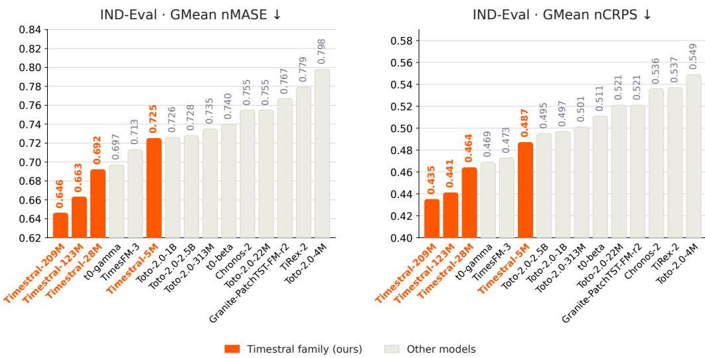  
Figure 10: IND-Eval aggregate nMASE (left) and nCRPS (right) for all four Timestral sizes and eleven competitors. All results are from our evaluations using public checkpoints and inference implementations under the official benchmark protocol. Both panels show the same models, ordered by their respective dataset-balanced geometric-mean error. Lower is better.

## A.2 IND-Eval

Benchmark. We additionally evaluate Timestral on IND-Eval [Haugland et al., 2026], a public benchmark for forecasting in complex physical systems. It comprises 187 tasks covering applications in energy, manufacturing, and transport. Compared with general-purpose forecasting benchmarks, it emphasises finer sampling resolutions and multivariate targets.

Evaluation. All IND-Eval results reported here come from our own evaluation runs, using publicly released checkpoints and inference code from the model authors’ public repositories under the official benchmark protocol. We re-evaluate TimesFM-3, Chronos-2, and TiRex-2, the three models studied by Haugland et al. [2026], and extend the comparison to t0-gamma, t0-beta, all five released Toto-2.0 sizes (4M, 22M, 313M, 1B, and 2.5B), and Granite-PatchTST-FM-r2, alongside all four Timestral sizes. All models are evaluated zero-shot, without fine-tuning, using the official IND-Eval context– target windows and a context capped at 4,096 time steps. We report normalised MASE (nMASE) and normalised CRPS (nCRPS) relative to Seasonal Naive. Each task score divides the model’s error by the corresponding error of Seasonal Naive; values below one indicate lower error. We first take the geometric mean of task scores within each dataset, then the geometric mean of the resulting dataset scores. This gives each dataset equal weight in the aggregate.

Aggregate results. Figure 10 compares aggregate errors for all four Timestral sizes and the eleven competitors evaluated here. Timestral-209M ranks first among the models compared, with aggregate nMASE of 0.646 and nCRPS of 0.435. Relative to t0-gamma, the strongest model outside the Timestral family on both metrics (0.697 and 0.469), this is about 7% lower error. Accuracy improves at every increase in Timestral model size. Timestral-123M obtains 0.663 nMASE and 0.441 nCRPS, and Timestral-28M obtains 0.692 and 0.464, respectively; both remain ahead of every model outside the family on the two aggregates.

## A.3 Pairwise Win Rates

Aggregate errors summarise overall forecasting accuracy, while pairwise win rates measure how often one model outperforms another across tasks. Figures 11 to 14 compare all four released Timestral sizes with the selected competitors on each benchmark. Each cell reports the row model’s win rate against the column model across the benchmark’s tasks, with lower error counting as a win and exact ties as half a win, following the fev definition [Shchur et al., 2026]. Errors are compared before rounding, and all tasks receive equal weight.

We follow the official evaluation protocols for each benchmark; IND-Eval task errors come from our own evaluation runs described in Appendix A.2. For fev-bench, win rates use task errors rather than aggregate skill scores. Timestral-209M wins on a majority of tasks against every selected competitor on both metrics of each benchmark. Timestral-123M shows the same pattern on all four benchmarks.

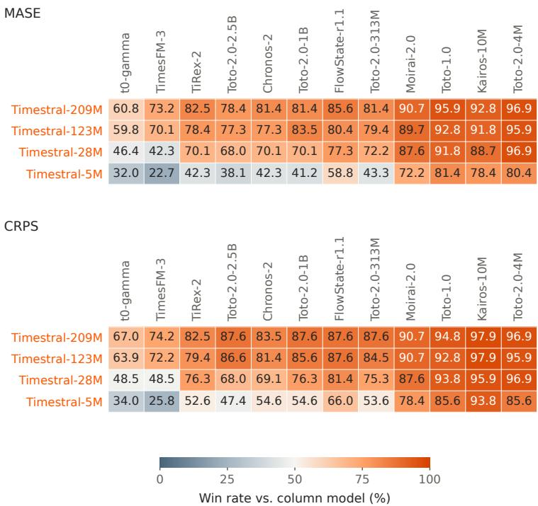  
Figure 11: GIFT-Eval pairwise win rates for MASE (top) and CRPS (bottom) across 97 dataset– frequency–horizon configurations. Rates above 50% favour the row model. CRPS uses the official nine-quantile approximation; TiRex-2 is the pretrained submission. Both panels order comparators by increasing aggregate MASE.

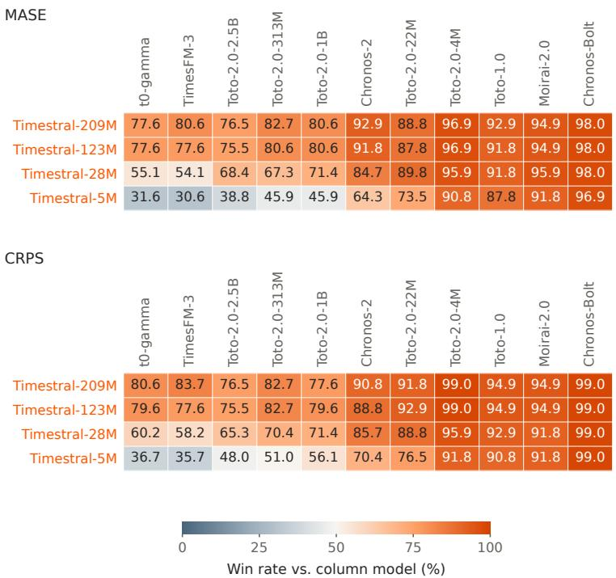  
Figure 12: TIME pairwise win rates for MASE (top) and CRPS (bottom) across 98 dataset–frequency– horizon configurations. Task errors follow the official leaderboard, averaging over series, forecast windows, and variates. Configurations are equally weighted, with ties counted as half a win; rates above 50% favour the row model. Both panels order comparators by increasing aggregate MASE.

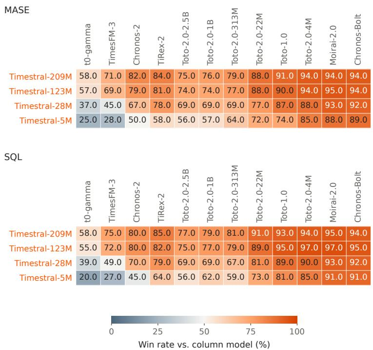  
Figure 13: fev-bench pairwise win rates for MASE (top) and SQL (bottom) across 100 official tasks. SQL scales quantile loss by the context’s mean absolute seasonal error. Tasks are equally weighted, with ties counted as half a win; rates above 50% favour the row model. Both panels order comparators by decreasing MASE skill score.

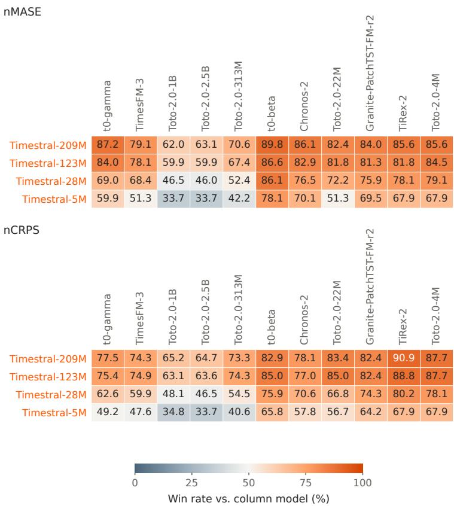  
Figure 14: IND-Eval pairwise win rates for nMASE (top) and nCRPS (bottom) across 187 forecasting tasks: all four Timestral sizes versus the eleven competitors in Figure 10. Errors come from our evaluations under the official protocol. Tasks are equally weighted, with ties counted as half a win; aggregate errors instead weight datasets equally. Rates above 50% favour the row model. Both panels order comparators by increasing aggregate nMASE.