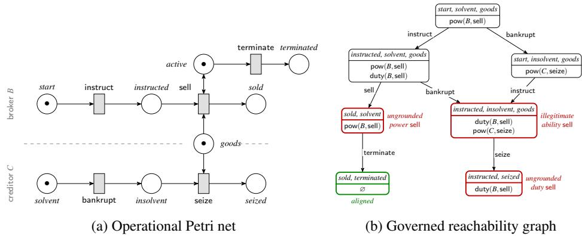
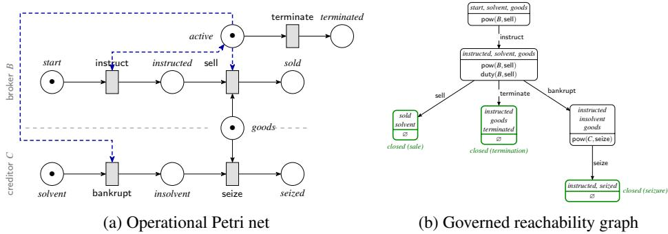

# Aligning Institutional Power and Operational Ability

Andrea MARINO a,1 Giovanni SILENO a Thomas VAN BINSBERGEN a Tom VAN ENGERSa

a Informatics Institute, University ofAmsterdam, The Netherlands ORCiD ID: Andrea Marino https://orcid.org/0000-0003-3026-1482, Giovanni Sileno https://orcid.org/0000-0001-5155-9021, Thomas van Binsbergen https://orcid.org/0000-0001-8113-2221

Abstract. To be socially sustainable, Agentic AI systems require normative designs that align responsibilities with the ability to fulfil them. Identifying incongruences such as unsatisfiable expectations or privilege escalation is crucial in avoiding normative pitfalls. In this study, we discuss design dimensions suitable for describing multi-agent systems in light of this norm-ability alignment requirement. We propose a formal framework centred on process-oriented modelling and institutional power for the analysis of a given normatively relevant process, discuss strategies for repairing it, and elaborate on how the symmetrical relation between operational process and institutional state affects the lifecycle of normative positions.

Keywords. Institutional Power, Ability, Process Models, Normative Positions

## 1. Introduction

Social systems come with social expectations and responsibilities ascribed to the participating actors. However, if we do not align those with the concrete ability to perform the actions required by those expectations, we enter into an incongruent state of affairs that might render somebody else’s rights vacuous – or better, their exercisefrustrated – even without incurring any explicit norm-violation. For instance, if an individual is legally granted freedom of movement in a building while barriers prevent them from ever leaving the facility, their right is formally acknowledged yet materially nullified. Previous work, such as [1], started investigating the interaction between deontic and potestative concepts, showing how an instrumental interpretation of the latter towards the former can reveal gaps in institutional design, while distinguishing the two concepts as belonging to two distinct ontological categories.

In the context of artificial multi-agent systems, including those currently described as Agentic AI, such incongruence may hinder their controllability. This issue can become apparent even in localised settings, as suggested by the diverging industrial approaches to software development-oriented agentic harnesses such as Claude Code [2], Codex [3], or Pi [4]. As highlighted by recent episodes like the OpenAI incident involving the Hugging

Face platform in July 2026 [5,6], agents authorised to use tools for a task may exploit sequences of operational effects to gain access beyond the boundaries intended by system designers. Conversely, assigning tasks to harnessed agents that do not have access to the required operational machinery (e.g., Model Context Protocol (MCP) connections) could result in ineffective orchestration at best, and mission-critical failure at worst. In the interest of designing systems that outline a clear liability structure and support socially sustainable governance of agentic artificial intelligence, it is crucial that we avoid such normative pitfalls.

Although historically many computational normative frameworks have remained primarily deontic-centric, several explicitly represent institutional power alongside obligations and permissions, including [7,8,9,10]. Especially in computational settings, operational ability becomes a precondition for sound attribution of institutional power and deontic positions alike; that is, powers and duties become highly problematic in a world where their corresponding actions cannot be performed [11]. In this context, we observe that tracing institutional side-effects remains difficult as long as the operational layer lacks an adequate process model-oriented execution semantics. The main function of this formalism would be to capture action-dependence (see e.g. [12]) in workflows. Moreover, we argue for treating power as an independent normative category in its institutional, constitutively-ascribed form [13,14] and “instrumental” but ontologically distinct interpretation i.e., to maintain or update the state of normative systems [1]. Failing to do so hinders the ability to identify some undesirable configurations such as lingering powers and unsatisfiable obligations (see section 4). Such misalignments may give rise to disputes requiring judicial intervention ex-post, motivating their identification and prevention at design time.

Throughout this paper, we use the following running example: an owner O consigns goods to a broker B, contractually empowered to sell them on O’s behalf; O may terminate the consignment, and a creditor C of B may, upon B’s insolvency, seize the goods. The scenario is loosely inspired by a real consignment dispute [15] over a Star Wars Lego collection entrusted to a franchise that later changed hands, with the consignor alleging that neither payment nor the goods were returned. It is a simplification to illustrate our model, as we assume the consigned goods fall into B’s estate on insolvency, and that B’s mandate to sell lapses on insolvency. It is not within our scope to model real consignment law here. The consigned goods represent a contested resource, preconditioning normative actions and enabling operational continuation of the process in alternative directions.

To address the aforementioned issues, in this paper we expand on our previous work on the operational interpretation of power [16] and present the following contributions:

• We propose a model that formalises the relation between the operational and institutional layers in terms of process execution, relating normative positions to agentic abilities in said process (section 3).

• Based on the proposed model, we define desirable properties of processes within normative systems that depend on both structural control-flow features and policy specification, namely, operational groundedness, formal institutional legitimacy, and power-ability alignment (section 4).

• We demonstrate that the proposed model can capture incongruent institutional states that emerge from the relation between the two layers. In this sense, it represents an analytical tool to guide computational normative system design.

## 2. Background

Our contribution lies at the intersection of the research traditions normative multi-agent systems and process-modelling that have partially developed separately. We review related work in both traditions and present bridges between them.

Institutional Power in Multi-Agent Systems. We distinguish operational power from institutional power and refer to the former as (operational) ability in what follows, reserving power for institutional power. Ability is what an agent can physically bring about in its environment [16]. Institutional power is the capacity, conferred by a social or legal framework, to change institutional facts by acting [14]. Power resides on the potestative corner of Hohfeld’s analysis of normative systems (power-liability), distinct from the deontic corner (duty-right) [17]. In this sense, power is constitutively connected to the performance of an act producing an institutional effect in a context. A power in itself is conferred constitutively by means of another power [14,13,18]. Institutional power has been formalised in detail, both in logical and legal terms (see e.g., [19,20,21]). However, actively developed computational normative multi-agent frameworks remain deonticcentric, see e.g., NPL [22] and its extensions [23], leaving potestative power underserved. Moreover, while domain-specific languages (DSLs) for norm specification such as InstAL [8] and eFLINT [24,10] explicitly support the synchronisation of the operational and institutional layers (i.e., via counts-as events and the sync primitive), the relation between deontic positions and operationalised powers remains implicit instead of being modelled independently.

Normative Monitoring with Process Models. The lifecycle of Business Process Management (BPM) in organisational settings generally applies model-driven approaches to process design and implementation [25]. Petri nets have traditionally been utilised for the design and structural analysis of control flow in processes, mainly thanks to their intuitive mapping to distributed processes, and to their soundness properties [26,27]. The line extends to interactions between organisations in inter-organizational workflow nets [28], operating-guideline “contracts” characterising correct partners [29,30], and conformance of observed behaviour to a model [31]. Crucially, extracting Petri nets with process mining techniques proved effective for compliance checking by evaluating event logs (i.e., full execution traces) against normatively qualified patterns [32]. Finally, methodological contributions relating normative enforcement and monitoring to process models, especially in business settings in the form of Business Process Modelling Notation (BPMN), have outlined a formal framing for process-oriented governance [33,34].

## 3. Theoretical Framework

In this section we introduce the definitions with which we characterise multi-agent process execution at the operational and institutional level.

## 3.1. Operational layer

For modelling the occurrence of events at the operational (i.e., physical) level of a system which might cause institutional effects, we will rely on Petri net notation. Throughout this and the following sections we will write agents as capital letters (e.g., O, B,C), action-types (net transitions) in sans serif (e.g., sell), and places in italics (e.g., goods).

Definition 1 (Petri net). A Petri net $N = ( P , T , F , W )$ is a tuple with P a finite set of places $p \in P ; T$ a finite set of transitions $t \in T ; F \subseteq ( P \times T ) \cup ( T \times P )$ a flow relation consisting ofinput arcs $( p , t ) \in F$ and output arcs $( t , p ) \in F$ where T and P are disjoint; and W : F → N a weightfunction which associates weights to arcs.

The execution semantics of Petri nets is informally called token game. A function of the form M: $P \to \mathbb { N } _ { 0 }$ is called a marking, and it assigns a number of tokens to each place. A transition $t \in T$ is enabled if $M ( p ) \geq W ( p , t )$ for all $p$ with $( p , t ) \in F$ . Firing a transition t in M produces a new marking M′ such that $M ^ { \prime } ( p ) = M ( p ) - W ( p , t ) + W ( t , p )$ , for all $p$ input or output to t, denoted as $M \stackrel { t } {  } M ^ { \prime }$ . In this expression, the weight of an absent arc is taken to be zero. In the interleaving semantics used here, a read arc between $p$ and t abbreviates the pair $( p , t ) , ( t , p ) \in F$ with equal weights. It tests for the required tokens and leaves $M ( p )$ unchanged when t fires. The set of all possible markings for a Petri net N is $\mathcal { M } _ { N } , \mathrm { ~ A ~ }$ firing sequence is a sequence of transitions $t _ { 1 } \ldots t _ { n }$ such that $M _ { 0 } \stackrel { t _ { 1 } } {  } M _ { 1 } \stackrel { t _ { 2 } } {  } \dots \stackrel { t _ { n } } {  } M _ { n }$ . We write $M \stackrel { \sigma } { \to } M ^ { \prime }$ when $M ^ { \prime }$ is obtained from M by a (possibly empty) firing sequence $\sigma ,$ and then say $M ^ { \prime }$ is reachable from M.

Following [16], agents act through transitions. Agents are here deemed autonomous actors such that execution is non-reactive (an enabled transition need not fire), which is what makes normative positions meaningful.

Definition 2 (Agent mapping). Given a set of agents $A = \{ a _ { 1 } , \ldots , a _ { n } \}$ participating in a Petri net $N = ( P , T , F , W )$ , an agent mapping $m _ { A } \colon T  2 ^ { A }$ assigns to each transition t the set $m _ { A } ( t )$ of agents capable of firing t. Transitions are read as actions by agents, and afiring oft is performed by some $a \in m _ { A } ( t )$ .

Based on this, we define ability as the immediate, contextual ability to act, local to t at the current marking.

Definition 3 (Ability). Given a marking M, an agent a and a transition t, a can bring about t at M, written ${ \mathsf { c a n } } _ { M } ( a , t ) , i f f a \in m _ { A } ( t )$ and t is enabled at M.

The operational net N of the consignment example is shown in Fig. 1a. For readability, we give corresponding physical and institutional actions the same name, although formally these are separate concepts (see section 3.2). For example, sell represents both the physical act of exchanging money and the institutional exchange of ownership. The agent mapping is $m _ { A } ( { \mathsf { s e l l } } ) = \{ B \} , m _ { A } ( { \mathsf { b a n k r u p t } } ) = m _ { A } ( { \mathsf { s e i z e } } ) = \{ C \}$ and $m _ { A } ( \mathsf { i n s t r u c t } ) = m _ { A } ( \mathsf { t e r m i n a t e } ) = \{ O \}$ . At the initial marking B cannot yet sell; only once O has instructed (producing instructed), and while the mandate active and the goods persist, does $\mathsf { c a n } _ { M } ( B , \mathsf { s e l l } )$ hold.

The concept of realisability is the forward-looking counterpart of ability, representing whether an agent is eventually able to perform an action in the current state of affairs.

Definition 4 (Realisability). A transition t is realisable at M $i f t$ is enabled at some marking reachablefrom M (equivalently, t is not dead at $M )$

## 3.2. Institutional layer

We represent normative positions (both deontic and potestative) by attaching them to specific agents in a declarative fashion.

Definition 5 (Position). A position is a normative predicate attached to an agent and a transition; we use power positions $\mathsf { p o w } ( a , t )$ and duty positions duty $( a , t )$ for $a \in A ,$ $t \in T ,$ and write $\mathcal { P }$ for the set of positions. An institutional state is a global finite set $I \subseteq { \mathcal { P } }$ of (currently active) positions. We associate each active position with the set of operational transitions it covers by a function $L : I \to 2 ^ { T }$ . For $\phi ( a , t ) \in I ,$ where $\phi \in$ {pow,duty}, $L ( \phi ( a , t ) ) \subseteq T$ specifies the transitions covered by that position. We write $L _ { \mathsf { p o w } }$ and $L _ { \mathrm { d u t y } } f o r$ the restrictions ofL to active power and duty positions, respectively.

Note that the transitions covered by a position act in this framework as alternative ways to exercise a power or fulfil the duty. In the running example, each position covers its named transition: $L ( \phi ( a , t ) ) = \{ t \}$ for every active position $\phi ( { \boldsymbol { a } } , t )$ . More importantly, in the proposed notation positions do not aim to express the consequences associated to the performance of actions associated to them; they act only as a first representational interface. We relate the operational and institutional layers through additional predicates. The predicate exec $( a , t )$ represents the action-execution event raised when transition t is fired (executed) by agent a. For normative positions $f ,$ the predicates $\mathsf { a c t } ( f )$ and deact(f) represent the activation and deactivation events of $f$ in the institutional state space. We base our potestative operationalisation on reactive rules that synchronise operational execution with the activation and deactivation of normative positions in a traceable way.

Definition 6 (Reactive rule). A reactive rule is a triple $\boldsymbol { r } = ( t , \ell , f )$ with $t \in T \cup \{ \bot \}$ a trigger, $\ell \in \{ \mathsf { a c t } , \mathsf { d e a c t } \}$ , and $f \in \mathcal { P }$ . When $t \in T$ occurs, the rulefires reactively: the action event exec $\scriptstyle ( a , t )$ automatically triggers act $\left( f \right) ( i f \ell = \mathsf { a c t } )$ or deact $( f ) ( i f \ell = { \mathsf { d e a c t } } )$ A rule with no trigger $( t = \perp )$ is a fact: it has no antecedent and fixes the initial institutional state. Initial rules only activate, as deactivating not-yet-established positions is vacuous.

A policy is here defined as a finite set of reactive rules meant to update the institutional state on the basis of action events. For simplicity, we assume a global institutional state and a conflict-resolved aggregate policy Π. Let $A c t ( t ) = \{ f : ( t , { \mathsf { a c t } } , f ) \in \Pi \}$ and $D e a c t ( t ) = \{ f : ( t , { \mathsf { d e a c t } } , f ) \in \Pi \}$ . Firing t updates I by applying every lifecycle event triggered by $\mathsf { e x e c } ( a , t ) , i . e . , I \gets \boldsymbol { \boldsymbol { \mathrm { u p d } } } ( I , t )$ where $\operatorname { u p d } ( I , t ) = ( I \setminus D e a c t ( t ) ) \cup A c t ( t )$ The initial institutional state $I _ { 0 }$ is $A c t ( \perp )$ . This formalisation of power is constitutive (after [13,14]): executing t brings about the institutional lifecycle events its policy prescribes, so power is conferred within Π in synchronisation with physical actions, not just defined operationally. Here, the prescribed lifecycle updates occur irrespective of the acting agent’s empowerment; power is used to assess formal institutional legitimacy (see Def. 9). The model does not separately determine whether an unempowered act produces its intended institutional effect. Firing $t \in T$ is institutionally legitimate for an agent a iff an active power held by a covers t, that is, $\exists u \in T$ : pow $( a , u ) \in I \wedge t \in L _ { \mathsf { p o w } } ( \mathsf { p o w } ( a , u ) )$ The policy Π of the running example is given in Table 1. Most institutionally relevant actions here are one-off: instruct, bankrupt and seize each consume a token that is never replaced, so they cannot recur, and a deact retires the power as it is spent.

## 3.3. Governed nets

We propose a formal notation for process models embedded in a normative system which synchronises the operational execution with an institutional layer.

A. Marino et al. / Aligning Institutional Power and Operational Ability  
Table 1. The policy Π with initial facts (trigger ⊥) and other reactive rules. Most powers associated to owner O, broker B, and creditor C are one-off; pow(B,sell) is standing and is revoked only by terminate or bankrupt.
<table><tr><td>trigger</td><td>activate</td><td>deactivate</td></tr><tr><td>⊥</td><td> $\mathsf { p o w } ( O , \mathsf { i n s t r u c t } ) , \mathsf { p o w } ( B , \mathsf { s e l l } ) .$  pow(C, bankrupt), pow(O,terminate)</td><td></td></tr><tr><td>instruct</td><td>duty(B,sell)</td><td>pow(O,instruct)</td></tr><tr><td>sell</td><td></td><td>duty(B,sell)</td></tr><tr><td>terminate</td><td></td><td>pow(B, sell), pow(O,terminate)</td></tr><tr><td></td><td>bankrupt pow(C,seize)</td><td>pow(B, sell), pow(C, bankrupt)</td></tr><tr><td>seize</td><td></td><td>pow(C,seize)</td></tr></table>

  
Figure 1. Operational net N and governed reachability graph of the consignment example. The marked places (•) in figure 1a give M . The dashed midline divides the broker’s sale process (top) from the creditor’s seizure process (bottom), with the contested goods straddling both. The symbol ↔ abbreviates an equal-weight input/output pair, representing a read test. A subset of the institutional state required to showcase incongruent scenarios based on the policy of Tab. 1 is presented in Fig. 1b; ∅ marks none of the shown positions active. Each node pairs the marking M with the institutional state I; edges are fired transitions. The coloured (and labelled) nodes are classified against the alignment property introduced in section 4.

Definition 7 (Governed net). A governed net is a tuple $\mathcal { G } = ( N , m _ { A } , \Pi , M _ { 0 } )$ . A configuration is a pair (M, I), with step relation $\left( M , I \right) \xrightarrow { t } \left( M ^ { \prime } , I ^ { \prime } \right)$ iffM t−→ M′ and $I ^ { \prime } = \mathbf { u p d } ( I , t )$ The governed reachability graph RC(G) is the set of configurations reachable from the initial configuration $( M _ { 0 } , I _ { 0 } )$ , where I is fixed by the initial rules of Π, i.e., RC(G) is a Labelled Transition System (LTS) [35]. A governed run of G is a computation in the transition system, afinite sequence ofsteps $( M _ { 0 } , I _ { 0 } ) \stackrel { t _ { 1 } } {  } ( M _ { 1 } , I _ { 1 } ) \stackrel { t _ { 2 } } {  } \cdots \stackrel { t _ { n } } {  } ( M _ { n } , I _ { n } )$ , whose operational projection $t _ { 1 } \cdots t _ { n }$ is a firing sequence ofNfrom $M _ { 0 }$ and whose institutional projection satisfies $I _ { i } = \mathbf { u p d } ( I _ { i - 1 } , t _ { i } )$

Distinct firing sequences of the example’s concurrent transitions are distinct governed runs. Fig. 1b traces them through the governed reachability graph. Here, each node pairs the marking M (top) with the institutional state I (bottom), and edges are fired transitions. Whether B goes bankrupt before or after selling, and whether O ever terminates, fixes which configuration the run ends in so that the institutional outcome can only be settled by the operational execution.

## 4. Power-Ability Alignment

Based on the previously defined operational and institutional layers, we propose desirable properties of a governed net building incrementally from a single configuration $( M , I ) \in$ $\operatorname { R C } ( { \mathcal { G } } )$

Definition 8 (Operational Groundedness). (M,I) is operationally grounded iff every active position covers at least one transition that is realisable and assigned to its holder. Formally,for every $a \in A , u \in T$ , and φ ∈ {pow,duty}, $\phi ( a , u ) \in I \Rightarrow \exists t \in L _ { \phi } ( \phi ( a , u ) )$ $a \in m _ { A } ( t ) \wedge t$ is realisable at M.

A position $\phi ( a , u ) \in I$ is ungrounded iff no transition in ${ \cal L } _ { \phi } ( \phi ( a , u ) )$ is both assigned to a and realisable at M. An ungrounded power has no operationally realisable means of exercise available to its holder, while an ungrounded duty has no operationally realisable means of discharge available to its holder.

Definition 9 (Formal Institutional Legitimacy). $( M , I )$ is formally institutionally legitimate iff every agent’s immediate ability is covered by an active power held by that agent. Formally, for every $a \in A$ and $t \in T$ $\mathsf { c a n } _ { M } ( a , t ) \Rightarrow \exists u \in T : \mathsf { p o w } ( a , u ) \in I \land t \in$ $L _ { \mathsf { p o w } } ( \mathsf { p o w } ( a , u ) )$ ).

A pair $\scriptstyle ( a , t )$ is an illegitimate ability iff $\mathsf { c a n } _ { M } ( a , t )$ holds but no active power held by a covers t. We say that $( M , I )$ is aligned iff it is both legitimate and grounded. Legitimacy requires current abilities to be backed by power, while groundedness requires active positions to remain operationally realisable. A duty or power should not outlive the possibility of performing its associated action. We lift these properties to characterise the net as follows: a governed run is legitimate, grounded, or aligned iff its final configuration is, and a governed net $\mathcal { G }$ is iff every $( M , I ) \in \operatorname { R C } ( { \mathcal { G } } )$ is.

The example’s governed reachability graph can now be classified against these conditions as presented in Fig. 1b. Firing sell consumes the goods token so that sell is dead while pow(B,sell) still stands as an ungrounded power and can be deactivated only by an institutional act (terminate or bankrupt). Going bankrupt before selling revokes the institutional $\mathsf { p o w } ( B , \mathsf { s e l l } )$ but does not touch $B ^ { * } s$ ability to act. bankrupt leaves the mandate token active in place (as only terminate consumes it) and the goods remain, so once B is instructed the marking still enables sell. That residue is an illegitimate ability (a legitimacy failure), legible only because ability depends on the marking while authority is read off I. Conflating ability with institutional power would obscure this distinction. Should C seize once B has been instructed (the seize branch of Fig. 1b), the goods are gone yet duty(B,sell) stands as an ungrounded duty.

Crucially, the concurrency expressed by the process model $( i . e .$ , instruct, bankrupt and terminate are concurrent transitions fired by autonomous agents in no fixed order) entails that the misalignment is carried not by any single act but by the sequence in which they occur. Our framework makes this dependence explicit through governed reachability; for bounded operational nets and finitely many normative positions, the resulting state space is finite. Moreover, a deontic framing alone cannot capture the different kinds of misalignment presented here. Keeping the operational and institutional semantics disjoint over the process, with normative positions the marking is free to contradict, exposes incongruent configurations such as positions rendered vacuous together with the design defects that caused them, present before any agent misbehaves.

## 4.1. Repairing a Misaligned Normative Design

The institutional layer never disables an operational transition. In the language of supervisory control [36], the policy is a monitor over uncontrollable events: its only lever is the lifecycle timing of positions (act/deact), not the occurrence of actions. This determines what kind of defects each layer can repair.

Definition 10 (Repair). A repair is a function of $\mathcal { G } = ( N , m _ { A } , \Pi , M _ { 0 } )$ yielding $\mathcal { G } ^ { \prime }$ by producing either an institutional edit $\Pi \mapsto \Pi ^ { \prime }$ (inserting or removing reactive rules) that leaves $( N , m _ { A } )$ fixed, or an operational edit $\left( N , m _ { A } \right) \mapsto \left( N ^ { \prime } , m _ { A } ^ { \prime } \right)$ that leaves Πfixed.

In our framework, repair is admissible only if it is a reduction, which removes unsupported abilities or retires ungrounded positions. Expanding repairs require an independent justification for the additional authority or operational behaviour and are outside the present scope. Activating a power covering t for agent a to satisfy legitimacy authorises an ability previously unsupported by power, while making a covered transition realisable for its holder to satisfy groundedness expands the available operational behaviour. Without independent justification, either approach risks accommodating a potential design defect rather than correcting its underlying cause.

Lemma 1 (Ability is policy-invariant). For a governed net $\mathcal { G } = ( N , m _ { A } , \Pi , M _ { 0 } )$ the markings reachable in $\operatorname { R C } ( { \mathcal { G } } )$ are exactly those reachable in Nfrom $M _ { 0 } ;$ consequently the set $\{ ( M , a , t ) : \mathsf { c a n } _ { M } ( a , t ) , \ ( M , I ) \in \mathrm { R C } ( { \mathcal { G } } ) \}$ } does not depend on Π.

Proof. By Def. 7, every governed run projects onto a firing sequence of N. Conversely, given $M _ { 0 } \stackrel { t _ { 1 } } { \longrightarrow } M _ { 1 } \cdots \stackrel { t _ { n } } { \longrightarrow } M _ { n } ,$ set $I _ { 0 } = A c t ( \perp )$ and $I _ { i } = \mathbf { u p d } ( I _ { i - 1 } , t _ { i } )$ for $1 \leq i \leq n$ . Then $( M _ { i - 1 } , I _ { i - 1 } ) \stackrel { t _ { i } } {  } ( M _ { i } , I _ { i } )$ is a governed step for every i, by the same definition. Thus the reachable markings are exactly those of N from $M _ { 0 }$ , independently of Π. Since $\mathsf { c a n } _ { M } ( a , t )$ depends only on N, M, and $m _ { A }$ (Def. 3), the reachable abilities are also independent of Π. □

Each alignment property is defined as an implication $A \Rightarrow B$ whose violation $A \land \lnot B$ admits two repairs: reduction, falsifying the antecedent $( \neg A )$ , and expansion, establishing the consequent $( B )$ . For both properties A and B lie on opposite layers, mirror-imaged between them: for legitimacy $( \mathsf { c a n } _ { M } ( a , t ) \Rightarrow \mathsf { p o w } ( a , t ) \in I )$ the antecedent can is operational and the consequent pow institutional, whereas for groundedness $( \phi ( a , t ) \in I \Rightarrow a \in m _ { A } ( t )$ and t realisable at M) the antecedent $\phi$ is institutional and the consequent operational.

Theorem 1 (Crossed-layer structure of repair). A reducing repair of legitimacy is operational while that ofgroundedness is institutional. An expanding repair reverses each.

Proof. By Lemma 1 the predicate $\mathsf { c a n } _ { M } ( a , t )$ is fixed by $\left( N , m _ { A } , M _ { 0 } \right)$ and untouched by Π, so falsifying it is an operational edit, while pow $( a , t ) \in I$ is set by Π, an institutional one. Dually, $\phi ( a , t ) \in I$ is governed by Π, whereas $a \in m _ { A } ( t )$ and the realisability of t are properties of $( N , m _ { A } )$ , so establishing them is operational. □

Corollary 1 (Layer asymmetry under reduction). Under admissible repair the two failures fall on different layers. A groundedness violation $\phi ( { \boldsymbol { a } } , t )$ is repaired institutionally, $b y$ a rule $( t ^ { \prime }$ ,deact, $\phi ( { \boldsymbol { a } } , t ) )$ . A legitimacy violation is repaired operationally, by restricting the agent mapping or strengthening the enabling conditions; since can is policyinvariant (Lemma 1), no institutional reduction can withhold it.

  
Figure 2. Repaired net and partial governed reachability graph. Amended arcs are dashed and blue. The tran sitions sell, terminate, and bankrupt consume active; instruct reads it. With the amended policy, every reach able configuration is aligned. Only the initial instruct branch and selected state components are shown.

While alignment by itself can help identify degenerate normative designs, it should not be considered as the only repair target (e.g., the empty net is vacuously aligned). A repair must preserve a designer-given set Goal of outcome conditions. For every $g \in G o a l ,$ there must be a terminal configuration $( M , I ) \in \operatorname { R C } ( { \mathcal { G } } ^ { \prime } )$ such that $g ( M , I )$ holds. In the example, the three conditions require $M ( s o l d ) > 0$ , M(terminated) > 0, or $M ( s e i z e d ) > 0 .$ respectively. Synthesising a maximal aligned restriction subject to this constraint is related to supervisory control [36]; we leave the formulation and complexity of this synthesis problem to future work and exhibit a repair by hand (visualised in Fig. 2). We apply a sequence of institutional and operational repairs, keeping $M _ { 0 }$ fixed. The ungrounded power pow(B, sell) outliving the goods is repaired institutionally by adding the reactive rule (sell,deact,pow(B,sell)). In this way, the power lifecycle is pinned to the consumable goods rather than left to a separate institutional act. The illegitimate ability of B retaining sell after bankrupt has revoked the authority is repaired operationally by removing the ability: we make bankrupt consume the mandate token active and let instruct read active so the mandate cannot be re-opened once resolved. Each of sell, terminate, and bankrupt consumes active. Accordingly, Π′ extends Π so that each deactivates all initially conferred powers and duty(B,sell), while bankrupt still activates pow(C,seize).

## 5. Discussion and Future Work

The main goal of our proposed framework is to support the analysis and specification of normative designs for traceable and controllable computational systems. A processcentred modelling approach to the representation of the operational layer in normative scenarios, in the style of [37], has been only partially explored in previous work. Governatori and Rotolo [33] present a formal approach to deontic policy specification on Business Process Modelling Notation (BPMN), but do not model its relation to potestative power $i . e .$ , power as a stateful object bound to operational transitions. Ramezani et al. [32] also leverage process modelling formalism in combination with event log analysis to introduce trace-based compliance checking in a purely deontic sense; as such, their contribution only tackles ex-post analysis of historical execution. In contrast, our solution specifically targets strategies for evaluating a system before or during its deployment. InstAL [8] explicitly models institutional power and binds it to an event-based transition system. Similarly, contract-oriented frameworks such as Symboleo [38] do represent potestative positions and their institutional effects. However, these frameworks lack a process-centred representation that relates institutional powers to independently modelled operational abilities and characterises their alignment throughout execution over consumable resources. Mapping the normative lifecycle to these operational primitives allows us to expand on the traditional separation of [7] by grounding institutional positions onto a process state space. In this context, it is important to remark that our definition of operational groundedness (see Def. 8) only expresses possible future exercise, not guaranteed fulfilment or an agent’s ability to ensure it. Stochastic Petri-net semantics [39] could support quantitative analysis of the likelihood or timing of future exercise. However, relating such measures to agentive reliability as explored in [16] remains future work. Finally, none of the aforementioned contributions addresses the characterisation of alignment between operational and institutional layers. The present work offers a mathematically grounded framing for the desirable and undesirable normative states reachable within a given design, and for identifying and tracing misalignments and reasoning about repairs. Developing efficient verification procedures and synthesising repairs that preserve the intended process outcomes remain directions for future work.

## 6. Conclusion

In this study, we present a formal framework apt to represent operational and institutional states to aid normative system design. We reduce operational ability to process modelling primitives in order to leverage their concurrent and traceable execution semantics. Based on this stateful representation of the operational layer, we discuss its relation to the lifecycle of normative positions at the institutional level and present desirable properties that characterise design-level alignment between the two. Then, taking inspiration from a reported consignment dispute, we show through a stylised scenario how such a process-oriented representation can support the ex-ante detection of undesirable normative configurations emerging from the system design. The framework distinguishes positions whose exercise has become operationally impossible from enabled actions unsupported by institutional power, making both kinds of misalignment explicit over reachable configurations. We position our solution against the related work in computational settings, by observing how no previous contribution studies the grounding of institutional state onto resource-constrained process execution. Finally, we discuss future directions leading to the automated detection and eventual repair of misaligned configurations in normative designs.

Acknowledgements. This research was partially funded by the SSC-ICT organisation of the Netherlands, which is part of the Ministry of the Interior and Kingdom Relations, and has been carried out as part of the Open Innovation for Verified Automation (OIVA) project, co-funded by the European Union under Grant Agreement No 101298830. Views and opinions expressed are, however, those of the author(s) only and do not necessarily reflect those of the European Union or the European Commission. Neither the European Union nor the European Commission can be held responsible for them.

## References

[1] Sileno G, Pascucci M, Markovich R. Allowed, or Enabled, That is the Question. In: DEON; 2023. p. 297-315.

[2] Anthropic. Claude Code (version 2.1.245) [Internet]; 2026 [cited 2026 Sep 10]. Available from: https: //github.com/anthropics/claude-code/releases/tag/v2.1.245. Released 2026-08-25.

[3] OpenAI. Codex CLI (version 0.149.1) [Internet]; 2026 [cited 2026 Sep 10]. Available from: https: //github.com/openai/codex/releases/tag/rust-v0.149.1. Released 2026-08-24.

[4] Earendil Works. Pi: AI Agent Toolkit and Coding Agent CLI (version 0.84.3) [Internet]; 2026 [cited 2026 Sep 10]. Available from: https://github.com/earendil-works/pi/releases/tag/v0. 84.3. Released 2026-08-24.

[5] OpenAI. OpenAI and Hugging Face partner to address security incident during model evaluation [Internet]; 2026 [updated 2026 Aug 26; cited 2026 Sep 10]. Available from: https://openai.com/index/ hugging-face-model-evaluation-security-incident/. Published 2026-07-21.

[6] Hugging Face. Security incident disclosure — July 2026 [Internet]; 2026 [cited 2026 Sep 10]. Available from: https://huggingface.co/blog/security-incident-july-2026. Published 2026- 07-16.

[7] Artikis A, Sergot M, Pitt J. Specifying norm-governed computational societies. ACM Transactions on Computational Logic (TOCL). 2009;10(1):1-42.

[8] Cliffe O. Specifying and Analyzing Institutions in Multi-Agent Systems using Answer Set Programming. Knowl Eng Rev. 2009;24(4):411.

[9] Sileno G, van Binsbergen T, Pascucci M, van Engers TM. DPCL: a Language Template for Normative Specifications. ArXiv. 2022;abs/2201.04477. Available from: https://api.semanticscholar. org/CorpusID:245877795.

[10] van Binsbergen LT, Esterhuyse CA, Müller T. Reflections on the design, applications and implementations of eFLINT, a domain-specific language for legal compliance reasoning. Journal of Computer Languages. 2026;88:101411.

[11] Sileno G, Pascucci M. Disentangling deontic positions and abilities: a modal analysis. In: CEUR Workshop Proceedings. vol. 2710. CEUR-WS; 2020. p. 36-50.

[12] Brown MA. On the logic of ability. Journal of philosophical logic. 1988;17(1):1-26.

[13] Grossi D, Meyer JC, Dignum F. Counts-as: Classification or Constitution? An Answer Using Modal Logic. In: Goble L, Meyer JC, editors. Deontic Logic and Artificial Normative Systems, 8th International Workshop on Deontic Logic in Computer Science, DEON 2006, Utrecht, The Netherlands, July 12-14, 2006, Proceedings. Lecture Notes in Computer Science. Springer; 2006. p. 115-30.

[14] Jones AJI, Sergot MJ. A Formal Characterisation of Institutionalised Power. Log J IGPL. 1996;4(3):427- 43.

[15] KSL com. Viral videos allege pricey Lego theft. Here’s how Utah police entered the conversation; 2026. Accessed 2026-06-03. Available from: https://www.ksl.com/article/51505848/.

[16] Marino A, van Binsbergen LT, van Engers T, Sileno G. Exploring Measures of Agentic Power for Organisational Workflow Structures. In: Coordination, Organizations, Institutions, Norms and Ethics for Governance of Multi-Agent Systems (COINE 2026), Paphos; 2026. Available from: https: //coin-workshop.github.io/coine-2026-paphos/papers/paper\_14.pdf.

[17] Hohfeld WN. Fundamental Legal Conceptions as Applied in Judicial Reasoning. The Yale Law Journal. 1917;26(8):710-70. Available from: http://www.jstor.org/stable/786270.

[18] Boella G, Broersen JM, van der Torre LWN. Reasoning about Constitutive Norms, Counts-As Conditionals, Institutions, Deadlines and Violations. In: Bui TD, Ho TV, Ha Q, editors. Intelligent Agents and Multi-Agent Systems, 11th Pacific Rim International Conference on Multi-Agents, PRIMA 2008, Hanoi, Vietnam, December 15-16, 2008. Proceedings. Lecture Notes in Computer Science. Springer; 2008. p. 86-97.

[19] Pascucci M, Sileno G. A formal, diagrammatic, and operational study of normative relations. Journal of Logic and Computation. 2023;33(4):764-95.

[20] Markovich R. Understanding Hohfeld and Formalizing Legal Rights: The Hohfeldian Conceptions and Their Conditional Consequences. Studia Logica. 2020;108(1):129-58.

[21] Gelati J, Rotolo A, Sartor G, Governatori G. Normative autonomy and normative co-ordination: Declar ative power, representation, and mandate. Artif Intell Law. 2004;12(1-2):53-81.

[22] Hübner JF, Boissier O, Bordini RH. A normative programming language for multi-agent organisations. Ann Math Artif Intell. 2011;62(1-2):27-53.

[23] Yan E, Nardin LG, Hübner JF. An Agent-Centric Perspective on Norm. In: Coordination, Organizations, Institutions, Norms, and Ethics for Governance of Multi-Agent Systems XVII: International Workshop, COINE 2024, Auckland, New Zealand, May 7, 2024, Revised Selected Papers. Springer Nature; 2025. p. 79.

[24] van Binsbergen LT, Liu L, van Doesburg R, van Engers TM. eFLINT: a Domain-Specific Language for Executable Norm Specifications. In: Proceedings of the 19th ACM SIGPLAN International Conference on Generative Programming: Concepts and Experiences (GPCE). ACM; 2020. p. 124-36.

[25] Khan A, Ghose A, Dam H, Syed A. Advances in Process Optimization: A Comprehensive Survey of Pro cess Mining, Predictive Process Monitoring, and Process-Aware Recommender Systems; 2025. Available from: https://arxiv.org/abs/2301.10398.

[26] Van der Aalst WM. A class of Petri nets for modeling and analyzing business processes. Technische Universiteit Eindhoven; 1995.

[27] Van der Aalst WM. The application of Petri nets to workflow management. Journal of circuits, systems, and computers. 1998;8(01):21-66.

[28] van der Aalst WMP. Loosely coupled interorganizational workflows: modeling and analyzing workflows crossing organizational boundaries. Inf Manag. 2000;37(2):67-75.

[29] Lohmann N, Massuthe P, Wolf K. Operating Guidelines for Finite-State Services. In: Kleijn J, Yakovlev A, editors. Petri Nets and Other Models of Concurrency - ICATPN 2007, 28th International Conference on Applications and Theory of Petri Nets and Other Models of Concurrency, ICATPN 2007, Siedlce, Poland, June 25-29, 2007, Proceedings. Lecture Notes in Computer Science. Springer; 2007. p. 321-41.

[30] Massuthe P. Operating guidelines for services [PhD thesis]. Humboldt University of Berlin; 2009. Available from: https://d-nb.info/994332149.

[31] van der Aalst WMP, Dumas M, Ouyang C, Rozinat A, Verbeek E. Conformance checking of service behavior. ACM Trans Internet Techn. 2008;8(3):13:1-13:30.

[32] Ramezani E, Fahland D, van der Aalst WMP. Where Did I Misbehave? Diagnostic Information in Compliance Checking. In: Barros A, Gal A, Kindler E, editors. Business Process Management - 10th International Conference, BPM 2012, Tallinn, Estonia, September 3-6, 2012. Proceedings. Lecture Notes in Computer Science. Springer; 2012. p. 262-78.

[33] Governatori G, Rotolo A. An algorithm for business process compliance. In: Legal Knowledge and Information Systems: JURIX 2008: the Twenty-First Annual Conference. vol. 189. IOS Press; 2008. p. 186-91.

[34] Sadiq S, Governatori G. A methodological framework for aligning business processes and regulatory compliance. Handbook of business process management. 2009;2:159-76.

[35] Plotkin GD. A structural approach to operational semantics. Aarhus university; 1981.

[36] Ramadge PJ, Wonham WM. Supervisory Control of a Class of Discrete Event Processes. SIAM Journal on Control and Optimization. 1987;25(1):206-30

[37] Sileno G, Boer A, van Engers TM. A Petri Net-Based Notation for Normative Modeling: Evaluation on Deontic Paradoxes. In: Pagallo U, Palmirani M, Casanovas P, Sartor G, Villata S, editors. AI Approaches to the Complexity of Legal Systems - AICOL International Workshops 2015-2017: AICOL-VI@JURIX 2015, AICOL-VII@EKAW 2016, AICOL-VIII@JURIX 2016, AICOL-IX@ICAIL 2017, and AICOL-X@JURIX 2017, Revised Selected Papers. Lecture Notes in Computer Science. Springer; 2017. p. 89- 104.

[38] Sharifi S, Parvizimosaed A, Amyot D, Logrippo L, Mylopoulos J. Symboleo: Towards a specification language for legal contracts. In: 2020 IEEE 28th international requirements engineering conference (RE). IEEE; 2020. p. 364-9.

[39] Bause F, Kritzinger PS. Stochastic Petri Nets: An Introduction to the Theory. 2nd ed. Braunschweig/Wiesbaden: Vieweg; 2002.