KUNS-3134

# Atom as an Agent: Emergent Order by Collective Predictive Coding

Koji Hashimoto1 and Tadahiro Taniguchi2

1Physics Department, Kyoto University, Kyoto 606-8502, JAPAN

∗E-mail: koji@scphys.kyoto-u.ac.jp

2Graduate School of Informatics, Kyoto University, Kyoto 606-8501, JAPAN ∗E-mail: taniguchi@i.kyoto-u.ac.jp

What is the intrinsic reason of emergence of macroscopic order parameter out of microscopic systems? In this article, we apply to physics the collective predictive coding (CPC), the theory of language/symbol emergence. As our language emerges out of our human communications, physical macroscopic order parameter emerges out of communications among atoms — each atom is regarded as an agent who predicts each other’s behavior through inference. We present three examples of classical spin systems: twodimensional ferromagnetic and antiferromagnetic Ising models, a two-dimensional spin model with competing stripe orders, and the fully connected Sherrington–Kirkpatrick spin-glass model. In all of these examples, proper macroscopic order parameters including the replica overlap emerge automatically through communication informatics of CPC, only from observed spin configurations. We call the learned macroscopic coordinate the collective predictive order. Furthermore, for the ferromagnetic and antiferromagnetic Ising models, the equilibrium distribution of the collective predictive order yields an emergent potential with the symmetry and thermal evolution characteristic of a Landau potential. Notably, the emergence of the collective predictive order does not refer to any structure of microscopic Hamiltonians/Lagrangians. Thus our “Atom-asan-Agent” (AaaA) principle ofers a completely data-driven method for the emergence of macroscopic order, that is, machine learning physics.

Contents PAGE   
1 The problem of order parameter emergence 2   
2 Collective predictive coding 4   
3 Emergent order parameter 8   
4 Emergent potential 17   
5 Agentic communication between atoms 23   
6 Conclusion and discussion 29

## 1. The problem of order parameter emergence

Known is the critical importance of emergence in physics, while the reason of its existence has not been revealed.1 Numerous examples of the physical emergence include, for example, classical physics emergent from quantum physics, and classical spacetime emergent from quanta in holographic principle [2–4]. It is rather natural that the emergence is not physically explained, because the emergence is the un-explanability of collective phenomena; suppose some microscopic ingredients exhibits collectively some distinguishable property which cannot be explained by the ingredients’ own property directly, that is when it is called emergent. If this is truly the case, we may have to give up a direct derivation of, say, order parameter of the emergent phenomena, under the viewpoint that any physical derivation should be accompanied by some explainability.

However, from a meta-level of viewpoint, the reasoning above has a pitfall. When we say we explain a certain phenomenon, we use some notions which are shared by us physicists, and the explainability actually depends on the popularity of the notions used in the community. Physical notions have been born and renewed through communication among physicists and through discovery of new phenomena in experiments and theories. Physical notions, such as the order parameters, were born as a language with which physicists communicate. Thus, this historical aspect of how physical notions are born in physics can be a hint for discovery of a possible mechanism of emergent phenomena in physics, and a possible reason of the existence of the macroscopic variables.

To this end, we are motivated to utilize an information-theoretic theory of language/symbol emergence, called Collective Predictive Coding (CPC) [5, 6], to find the mechanism of emergence in physics. This theory is defined with an information-theoretic inference free energy which models how languages are emergent through communication between agents. CPC was proposed as a computational account of symbol emergence systems, in which individuals develop their own perceptual representations through interactions with the environment, while shared symbol systems emerge through communication [7]. Human society is a typical example of such a system. More concretely, CPC theorizes the structure of communication, and learning to jointly explain the agents’ observations leads to the emergence of a common shared notion, which serves as a language among the agents. Each agent predicts its own observations using its local probabilistic prediction model, while the shared variable connects these models into a collective predictive description.

As our application of CPC to physics, we regard each atom as a CPC agent. Here a CPC agent is a unit that uses a local probabilistic prediction model to infer a shared variable from its observations and learns the parameters of that model. Each atom observes its state, for example its spin. Each atom uses its local probabilistic prediction model to predict its own spin observation from the shared variable, and participates in inferring that variable through communication. Through communication and learning, the shared variable acquires a collective meaning: the local probabilistic prediction models together predict the whole spin configuration. The emergent language should be nothing but the order parameter of the whole system, because the order parameter in physics is a macroscopic variable which characterizes the behavior of the whole system in a concise manner. The order parameter singles out the most essential ingredient of the system and dictates the phase structure of the system, and sharing this order parameter value among agents is the most eficient way to reproduce the whole system behavior. Thus, CPC is the key to the emergence of the order parameter.

We call this the Atom-as-an-Agent (AaaA) principle. In this paper, we implement this principle using CPC. If this actually works, from just the observation of each atom’s spin configuration, improving the collective predictability of the observed spin configurations should lead to the automated discovery, or the emergence, of order parameters of the system.

In this article, we demonstrate that the AaaA principle works for classical spin systems, by showing that through the AaaA principle the known order parameters emerge. We present three examples: (i) two-dimensional ferromagnetic and antiferromagnetic Ising models, (ii) a two-dimensional spin model with competing stripe orders, and (iii) the fully connected Sherrington–Kirkpatrick (SK) spin-glass model. The first model (i) is the most basic among physics, and the emergent order parameter is the magnetization which is a coordinated average of spins. The second example ofers a check if both of the two competing orders in the model can emerge. The last example is about the emergence of the replica overlap as a collective predictive order. In all of these examples, the collective predictive order, which automatically emerges from the spin observation data only, is shown to agree closely with the known order parameter, up to a nonlinear map.

What needs to be emphasized as for the AaaA principle is that for the emergence of the order parameter one does not need to know the structure of the Hamiltonian. Only the observed spin configurations are necessary to pin down the order parameter. Readers know that in physics textbooks normally the order parameters are introduced with the help of symmetries of the Hamiltonian, since spontaneous symmetry breaking caused by the condensation of the order parameter determines the phase diagram of the system. On the other hand, our AaaA principle is completely data-driven; the order parameters emerge without any information on microscopic structure of the Hamiltonian, such as symmetries.

In this paper, we examine concretely the AaaA principle in two stages: we first identify collective variables and their thermodynamic properties using centralized CPC (Secs. 3 and 4), and then investigate how an ordering pattern can be learned through communication between individual sites (Sec. 5).

In Sec. 3, we test both the correspondence of the learned coordinates with known order parameters and their ability to predict unobserved spins from observations at other sites. In Sec. 4, we use the equilibrium distribution of the learned coordinate to reconstruct a Landaulike free-energy potential for the ferromagnetic and antiferromagnetic Ising models. The resulting potentials evolve from two wells to one on heating, and yield finite-size estimates of the transition temperature consistent with the known critical point. Thus, the construction connects the discovery of a collective variable to the thermodynamics of its fluctuations.

In Sec. 5, each site acts as an agent: it proposes a value of the shared variable using its own observed spin, while neighboring sites assess that proposal using their local probabilistic prediction models. Alternating these exchanges with updates of the local probabilistic prediction models learns a common ferromagnetic pattern from random initial weights. This procedure is called Metropolis-Hastings naming game (MHNG) [6, 8] in the context of CPC, and we apply a generalized form of MHNG to the spin system, to find out that the agentic communication in fact properly learns the order parameter. This provides a concrete realization of the AaaA principle: the microscopic agents learn how their individual observations relate to a shared macroscopic description.

We believe that this novel approach to emergence of order parameters or macroscopic variables opens a door toward revealing the mystery of emergence. From the viewpoint of a technique for solving physics inversely, in Sec. 6 we compare our AaaA principle with other machine learning methods for automated discovery of order parameter and phase transition.

## 2. Collective predictive coding

An order parameter captures the behavior of many spins in a common macroscopic variable. CPC explores a similar idea for language: shared words help individuals with diferent observations describe and predict the same world [5, 9]. Computer models show that communication can produce common names for objects and help agents learn object categories [6, 8].

Predictive coding (PC) describes how an agent predicts sensory observations and updates its internal representation of their causes using prediction errors [10]. Friston’s variational formulation relates such inference and learning to the minimization of an information-theoretic free energy [11], of the form introduced below in Eq. (4). CPC extends this perspective to multiple agents to model symbol emergence systems, including human society, whose members’ diferent observations are linked by a shared variable [5, 7]. Each agent predicts its own observations, while the collective system integrates their distributed observations through this variable.

For example, suppose agents are humans, and all humans look at a single apple in reality. Depending on from which angle each human observes the apple, the picture of the apple may difer for each human observation. Then humans communicate to establish a shared symbol (a sign), such as the word “apple,” for the object they are looking at. This is a situation of joint attention. Through communication and perceptual learning, they develop a shared use of the sign, grounded in each individual’s perceptual categories. Each person uses the sign to predict their own observations, while the sign links these diferent perspectives into a collective description of the object. CPC quantifies this situation through a generative model and information-theoretic free-energy minimization.

Following Sec. 1, we treat atoms as agents and seek a shared variable that predicts their spin configurations: a candidate order parameter learned from observations alone, without using the Hamiltonian. We now formulate this idea as a variational problem, specifying in turn the data, the probability distributions, and the quantities to be varied.

## 2.1. Local observations and a shared variable

Let $i = 1 , \ldots , N$ label agents and $a = 1 , \dots , M$ label observed configurations. The fixed input is the data set

$$
{ \mathcal D } = \{ S ^ { ( a ) } \} _ { a = 1 } ^ { M } , \qquad S ^ { ( a ) } = ( s _ { 1 } ^ { ( a ) } , \ldots , s _ { N } ^ { ( a ) } ) ,\tag{1}
$$

where $s _ { i } ^ { ( a ) }$ is the local observation of agent i in configuration a. For a spin system, i labels lattice sites and $s _ { i } ^ { ( a ) } = \pm 1$ . All observations are held fixed throughout the variation which we describe below.

We introduce a shared, unobserved (latent) variable $w \in \mathbb { R } ^ { K }$ . In applications of CPC to symbol emergence, this variable represents a common name for an object observed by different agents. Here we allow a continuous w as a candidate coordinate of the collective spin state. We relate it to the observations through the joint probability distribution

$$
p _ { \alpha , \boldsymbol { \theta } } ( \boldsymbol { S } , \boldsymbol { w } ) = p _ { \alpha } ( \boldsymbol { w } ) \prod _ { i = 1 } ^ { N } p _ { \boldsymbol { \theta } ^ { ( i ) } } ^ { ( i ) } ( s _ { i } \mid \boldsymbol { w } ) .\tag{2}
$$

Equation (2) is called a generative model: first draw w from the normalized distribution $p _ { \alpha } ( w )$ , then draw each $s _ { i }$ from $p _ { \theta ^ { ( i ) } } ^ { ( i ) } ( s _ { i } \mid w )$ . The result is a model configuration S. “Generation” means this statistical sampling procedure, rather than a physical evolution of the spins. Each factor $p _ { \theta ^ { ( i ) } } ^ { ( i ) } ( s _ { i } \mid w )$ describes an agent’s prediction of its own observation, whereas their product describes the collective prediction conditioned on w. The agents connected through w can thus be viewed as an integrated collective cognitive system, or a “super-agent” [12]. Here w provides shared conditioning information for the local predictions, with its prior distribution specified by $p _ { \alpha } ( w )$

The product in Eq. (2) assumes that the observations are conditionally independent given w; correlations between agents are represented through this common variable. Within each configuration all agents refer to the same latent state, while diferent configurations have their own states. The parameters α and $\theta = ( \theta ^ { ( 1 ) } , \dots , \theta ^ { ( N ) } )$ are common to the entire data set. The latent dimension K and the families of normalized distributions $\{ p _ { \alpha } ( w ) , p _ { \theta ^ { ( i ) } } ^ { ( i ) } ( s _ { i } \mid w ) \}$ are modeling choices, analogous in physics research to choosing a class of actions before varying its fields. The theoretical heart of CPC is this starting assumption of the structure (2).

It should be noted that, the agents’ inference task proceeds in the direction reverse to the generation described above: combining their local observations, they try to determine a distribution over the common w. This inference alternates with learning the parameters of the local probabilistic prediction models, as described below. The measured configurations themselves remain fixed during the learning. The learning determines the parameters α and $\theta = ( \theta ^ { ( 1 ) } , \dots , \theta ^ { ( N ) } )$ .

## 2.2. Variational principle

2.2.1. Variational free energy. CPC formulates the learning process as a variational principle. For each configuration labeled by a, introduce an auxiliary probability density $q _ { a } ( w )$ , subject to $q _ { a } ( w ) \geq 0$ and R dw $q _ { a } ( w ) = 1$ . The variational degrees of freedom are the functions $\left\{ q _ { a } \right\}$ and the common parameters $\alpha , \theta ;$ w itself is the integration variable. Define

$$
\mathcal { F } [ \{ q _ { a } \} , \alpha , \theta \mid \mathcal { D } ] \equiv \sum _ { a = 1 } ^ { M } F _ { a } + \Omega _ { \mathrm { r e g } } ( \alpha , \theta ) ,\tag{3}
$$

$$
F _ { a } \equiv \int d w q _ { a } ( w ) \log \frac { q _ { a } ( w ) } { p _ { \alpha } ( w ) \prod _ { i } p _ { \theta ^ { ( i ) } } ^ { ( i ) } ( s _ { i } ^ { ( a ) } \mid w ) } .\tag{4}
$$

Each observed value $s _ { i } ^ { ( a ) }$ is inserted into its corresponding local likelihood, averaged with the distribution $q _ { a }$ for that configuration, and finally summed over all configurations. The optional regularization $\Omega _ { \mathrm { r e g } }$ constrains the model parameters; the basic formulation has $\Omega _ { \mathrm { r e g } } = 0$

The reason we define the free energy like this will be clarified later, but here we note that one can further decompose the free energy and look at the decomposed meaning. Consider the decomposition

$$
F _ { a } = D _ { \mathrm { K L } } ( q _ { a } \| p _ { \alpha } ) - \sum _ { i } \left. \log p _ { \theta ^ { ( i ) } } ^ { ( i ) } ( s _ { i } ^ { ( a ) } \mid w ) \right. _ { q _ { a } } ,\tag{5}
$$

where $\begin{array} { r } { \langle f \rangle _ { q } \equiv \int d w q ( w ) f ( w ) } \end{array}$ . Here $\begin{array} { r } { D _ { \mathrm { K L } } ( q \Vert p ) \equiv \int d w q ( w ) \log [ q ( w ) / p ( w ) ] } \end{array}$ is the Kullback– Leibler divergence. The first term measures the diference between $q _ { a } ( w )$ and $p _ { \alpha } ( w )$ ; the second measures the loss in predicting the observations.

The variational principle is

$$
( \{ q _ { a } ^ { * } \} , \alpha ^ { * } , \theta ^ { * } ) \in \underset { \{ q _ { a } \} , \alpha , \theta } { \arg \operatorname* { m i n } } \mathcal { F } [ \{ q _ { a } \} , \alpha , \theta \mid \mathcal { D } ]\tag{6}
$$

with $q _ { a } ( w ) \geq 0$ and R dw $q _ { a } ( w ) = 1$ for each $^ { a , }$ while D is held fixed. Thus both the configuration-dependent distributions $q _ { a } ( w )$ and the parameters $\alpha , \theta$ shared by all configurations are varied. This free energy is a dimensionless information quantity. The physical Hamiltonian and temperature enter only through the observed configurations D indirectly; evaluating $\mathcal { F }$ requires the data and the chosen generative model. The meaning of the variational principle (6) will be made clear as we explain the inference and the learning, below.

2.2.2. Inference of latent states. First hold $\alpha , \theta$ fixed and vary $q _ { a }$ . The stationary condition with a normalization multiplier $\xi _ { a }$ is log $q _ { a } + 1 - \log p _ { \alpha , \theta } ( S ^ { ( a ) } , w ) + \xi _ { a } = 0$ , giving

$$
q _ { a } ^ { * } ( w ) = \frac { p _ { \alpha } ( w ) \prod _ { i } p _ { \theta ^ { ( i ) } } ^ { ( i ) } ( s _ { i } ^ { ( a ) } \mid w ) } { p _ { \alpha , \theta } ( S ^ { ( a ) } ) } = p _ { \alpha , \theta } ( w \mid S ^ { ( a ) } ) ,\tag{7}
$$

where $\begin{array} { r } { p _ { \alpha , \theta } ( S ) \equiv \int d w p _ { \alpha , \theta } ( S , w ) } \end{array}$ solves $\xi _ { a }$ to give the first equality, and the last equality in Eq. (7) uses Bayes’ theorem: normalizing the joint distribution at the observed $S ^ { ( a ) }$ gives the conditional distribution of w. Thus the optimized $q _ { a } ^ { * } ( w )$ is the conditional distribution $p _ { \alpha , \theta } ( w \mid S ^ { ( a ) } )$ determined by the fixed observation $S ^ { ( a ) }$ through Eq. (7). This step is called $\it { i n f e r e n c e . } ^ { 2 }$ Indeed, the identity

$$
\begin{array} { r } { F _ { a } = D _ { \mathrm { K L } } \Big ( q _ { a } \| p _ { \alpha , \theta } ( w \mid S ^ { ( a ) } ) \Big ) - \log p _ { \alpha , \theta } ( S ^ { ( a ) } ) } \end{array}\tag{8}
$$

shows that $q _ { a } ( w ) = q _ { a } ^ { * } ( w )$ of Eq. (7) minimizes $F _ { a }$ , since $D _ { \mathrm { K L } } \geq 0$ . Restricting $q _ { a }$ to a chosen family gives an approximate inference scheme.

This clarifies the reason of our definition of the free energy by introducing auxiliary distribution $q _ { a }$ . It is a strange way of writing, but the point is the structure of $p$ given in (2): we want to determine the parameters under the constraint of the structure of the generative model.

2.2.3. Learning the configuration distribution. Hold $\left\{ q _ { a } \right\}$ fixed and minimize $\mathcal { F }$ over $\alpha , \theta .$ This is learning: all configurations contribute to a common predictive rule. For example, each local probabilistic prediction model has gradient

$$
\frac { \partial \mathcal { F } } { \partial \theta ^ { ( i ) } } = - \sum _ { a } \left. \frac { \partial } { \partial \theta ^ { ( i ) } } \log p _ { \theta ^ { ( i ) } } ^ { ( i ) } ( s _ { i } ^ { ( a ) } \mid w ) \right. _ { q _ { a } } + \frac { \partial \Omega _ { \mathrm { r e g } } } { \partial \theta ^ { ( i ) } } .\tag{9}
$$

Why is this gradient descent actually the learning process with use of the data $\mathcal { D } ?$ To answer this question, let us look at the free energy which is minimized with $q _ { a } ^ { * }$

$$
\mathcal { I } ( \alpha , \theta ) \equiv \operatorname* { m i n } _ { \{ q _ { a } \} } \mathcal { F } = - \sum _ { a } \log p _ { \alpha , \theta } ( S ^ { ( a ) } ) + \Omega _ { \mathrm { r e g } } ( \alpha , \theta ) .\tag{10}
$$

The first term in fact measures the deviation of the model prediction against the data $\mathcal { D } ,$ as follows. To explain this in an easier way, let us define

$$
{ \widehat { p } } _ { D } ( S ) = { \frac { 1 } { M } } \sum _ { a = 1 } ^ { M } \mathbf { 1 } \{ S = S ^ { ( a ) } \} ,\tag{11}
$$

where 1 is one when the condition holds and zero otherwise. This is called an empirical distribution. Equation (10) then becomes

$$
\frac { \mathcal { I } ( \alpha , \theta ) } { M } = D _ { \mathrm { K L } } ( \widehat { p } _ { \mathcal D } | | p _ { \alpha , \theta } ) + H ( \widehat { p } _ { \mathcal D } ) + \frac { \Omega _ { \mathrm { r e g } } ( \alpha , \theta ) } { M } ,\tag{12}
$$

with the entropy of the empirical distribution $\begin{array} { r } { H ( \widehat { p } _ { \mathcal { D } } ) \equiv - \sum _ { S } \widehat { p } _ { \mathcal { D } } ( S ) \log \widehat { p } _ { \mathcal { D } } ( S ) } \end{array}$ . Thus, the first term tells us that minimizing $\mathcal { I }$ brings the model’s configuration distribution $p _ { \alpha , \theta } ( S )$ closer to the observed frequency distribution ${ \widehat { p } } _ { \mathcal { D } } ( S )$ in KL divergence. Here we have ignored the regularization $\Omega _ { \mathrm { r e g } } = 0$ for simplicity, and the entropy of the empirical distribution $H ( \widehat { p } _ { \mathcal { D } } )$ is of no importance because it is a fixed number given by the data.

This is how minimizing the variational free energy incorporates the statistics of the observations into the model. Regularization balances this fit against the chosen constraints on the parameters.

2.2.4. Numerical strategy: Alternating minimization and collective prediction. Inference and learning are called respectively the E-step and M-step of expectation–maximization (EM). The variational principle (6) is implemented numerically by alternating these steps as follows:

(1) Fix $\mathcal { D } ,$ the model families, and $\Omega _ { \mathrm { r e g } } ;$ initialize $\alpha , \theta .$

(2) At fixed $\alpha , \theta ,$ determine each $q _ { a } ( w )$ using Eq. (7) (E-step).

(3) At fixed $\left\{ q _ { a } \right\}$ , update the common parameters $\alpha , \theta$ to decrease $\mathcal { F } \left( \mathrm { M } \mathrm { - s t e p } \right)$

(4) Repeat the two updates, monitoring $\mathcal { F }$ and the parameters for convergence.

These are two alternating minimizations of the same functional.

Two notes on the minimization: first, diferent initializations may lead to diferent local minima and should be compared. Second, with approximate inference, the corresponding variational bound will be optimized (note that the equality in Eq. (10) requires unrestricted optimization over $\left\{ q _ { a } \right\}$ so it may not be achieved during the learning).

## 2.3. Extracting the latent constituents

After the inference and the learning loops are numerically performed, the model parameters are determined. Then, from this determined generative model, how can we see the relation between the latent w and the data S? This reading-of method from the generative model leads to the automated discovery of a macroscopic variable made of microscopic variables.

Let us take a new configuration S. After learning, parameters $\alpha ^ { * } , \theta ^ { * }$ determine the conditional distribution $p _ { \alpha ^ { * } , \theta ^ { * } } ( w \mid S )$ for the new configuration S through Eq. (7). A macroscopic coordinate can be extracted as

$$
\widehat { w } ( S ) = \int d w w p _ { \alpha ^ { * } , \theta ^ { * } } ( w \mid S ) .\tag{13}
$$

This is the relation between the latent variable w and the configuration S. The collective aspect of this expression is explicitly seen in Eq. (7): each agent contributes log $p _ { \theta ^ { ( i ) } } ^ { ( i ) } ( s _ { i } ^ { ( a ) } \mid w )$ to log $q _ { a } ^ { * } ( w )$ , together with the common term log $p _ { \alpha } ( w )$ and a normalization constant. The choice of w is learned so that the whole set of agents’ inference agree with each other as a single w, thus the architecture is optimized so that the macroscopic variable w represents the configuration S appropriately.

The learned coordinate provides a candidate order parameter whose physical meaning is established by its predictive power. Its physical significance is measured by its relation to symmetries and phase transitions. Its form depends on the chosen model class, while its parameters are determined from the observed configurations. We call the learned coordinate $\widehat { w } ( S )$ the collective predictive order. In the following sections we examine this correspondence for classical spin systems.

## 3. Emergent order parameter

We now ask whether the collective predictive order defined in Sec. 2 numerically emerges and acquires the meaning of a physical order parameter. Three examples test progressively diferent requirements: (i) a scalar magnetization, (ii) two competing stripe orders, and (iii) an overlap between replicas of the fully connected SK spin glass. Here (i) is for demonstrating the reproduction of the most popular spin model, while (ii) is a study whether our CPC can actually count a necessary number of order parameters. And (iii) is of course to study whether the CPC can find one of the most nontrivial order parameters known, the replica order. In all the examples, as we have emphasized, the Hamiltonians below specify only the ensembles used to generate the data; they are not supplied to CPC.

## 3.1. A local probabilistic prediction model and the learned coordinate

For Ising observations $s _ { i } = \pm 1$ , take $w \in \mathbb { R } ^ { K }$ and specialize Eq. (2) to the following generative model

$$
\begin{array} { r } { p _ { 0 } ( w ) = ( 2 \pi ) ^ { - K / 2 } e ^ { - | w | ^ { 2 } / 2 } , } \\ { p _ { \theta ^ { ( i ) } } ^ { ( i ) } ( s _ { i } \mid w ) = \cfrac { e ^ { s _ { i } ( b _ { i } + W _ { i } \cdot w ) } } { 2 \cosh ( b _ { i } + W _ { i } \cdot w ) } . } \end{array}\tag{14}
$$

This model realizes its conditional mean as $\langle s _ { i } \rangle _ { w } = \operatorname { t a n h } ( b _ { i } + W _ { i } \cdot w )$ . Each site has its own freely learned $b _ { i }$ and K-component $W _ { i }$ , and the model parameters, previously written as $\{ \alpha , \theta _ { i } \}$ are now $\left\{ b _ { i } , W _ { i } \right\} ( { \mathrm { a n d } } K )$ . No symmetry such as uniform, staggered, or stripe pattern

is imposed on the training parameters. The regularization is

$$
\Omega _ { \mathrm { r e g } } = { \frac { \lambda _ { W } } { 2 } } \sum _ { i } | W _ { i } | ^ { 2 } + { \frac { \lambda _ { b } } { 2 } } \sum _ { i } b _ { i } ^ { 2 } , \qquad \lambda _ { b } = \operatorname * { m a x } ( 1 , 0 . 1 \lambda _ { W } ) .\tag{15}
$$

The objective uses the sum over configurations in $\operatorname { E q } .$ . (3), without dividing it by the sample count. At fixed parameters, Eq. (7) determines the conditional distribution of w by Bayes’ theorem. We evaluate its integrals by numerical quadrature and update the site parameters by Newton steps on the concave local learning objectives. Thus this implementation uses explicit probability distributions, without a neural network.

We use the conditional mean $\widehat { w } ( S )$ in $\operatorname { E q } .$ . (13) as the candidate order parameter itself — the collective predictive order. In our model architecture (14), the relation between the collective predictive order $\widehat { w } ( S )$ and the familiar spin averages can be made explicit. For the case $K = 1$ , define a particular combination of the spins

$$
h _ { W } ( S ) \equiv \sum _ { i } W _ { i } s _ { i } .\tag{16}
$$

Then, with the following definition of an unnormalized weight

$$
\rho ( w ) \equiv \exp \left[ - \frac { w ^ { 2 } } { 2 } - \sum _ { i } \log 2 \cosh ( b _ { i } + W _ { i } w ) \right] ,\tag{17}
$$

we find

$$
\widehat w ( \boldsymbol S ) = G ( h _ { W } ( \boldsymbol S ) ) , \qquad G ( h ) = \frac { \int d w w \rho ( \boldsymbol w ) e ^ { \boldsymbol w h } } { \int d w \rho ( \boldsymbol w ) e ^ { \boldsymbol w h } } , \qquad G ^ { \prime } ( h ) = \mathrm { V a r } _ { h } ( \boldsymbol w ) > 0 .\tag{18}
$$

To see why only $h _ { W } ( S )$ appears here, write the joint distribution as

$$
p ( S , w ) = ( 2 \pi ) ^ { - 1 / 2 } e ^ { \sum _ { i } b _ { i } s _ { i } } \rho ( w ) e ^ { w h _ { W } ( S ) } .
$$

When inferring $w ,$ , the observed spins S are held fixed. Hence $e ^ { \sum _ { i } b _ { i } s _ { i } }$ is the same factor for every possible w: it cannot favor one value of w over another. Dividing by $\begin{array} { r } { p ( S ) = \int d w p ( S , w ) } \end{array}$ to obtain $p ( w \mid S )$ cancels this factor. This is analogous to the cancellation of a constant energy shift in a normalized Boltzmann probability. The $b _ { i }$ still afect $\rho ( w )$ and therefore the map G.

The physical point is that, for nearly uniform or staggered weights, the discovered collective predictive order $\widehat { w } ( S )$ is approximately related to the corresponding magnetization through the nonlinear monotonic map in Eq. (18). Eq (18) shows that once the parameters have been learned, the inferred coordinate depends on the many observed spins only through one weighted sum, $h _ { W } ( S )$ . Two configurations with the same $h _ { W }$ give the same $\widehat { w } .$ , and the monotonicity $G ^ { \prime } ( h ) > 0$ means that G preserves the ordering of these weighted sums.

If the learned $W _ { i }$ are uniform, this sum is proportional to the magnetization; if their signs alternate between sublattices with equal magnitude, it is proportional to the staggered magnetization. Thus the weights $W _ { i }$ select which collective spin pattern is represented, while $G$ converts its amplitude into the collective predictive order. Whether the selected pattern is a physical order parameter is tested below. The overall sign is arbitrary; for $K > 1$ , rotations of the latent axes are also arbitrary. Their scale is fixed by the chosen model convention, not by a thermodynamic normalization.

## 3.2. Two criteria for a successful discovery

We judge the learned coordinate by two criteria. First, does it reproduce a known physi cal order parameter, allowing for the change of coordinates described above? Second, does knowing this coordinate help predict spins that have not been observed? The first criterion identifies the physical meaning of the coordinate; the second tests whether it captures information shared among sites. Both are needed: even in a disordered phase, a coordinate can track magnetization fluctuations without appreciably helping to predict other spins.

To test these criteria on data not used to determine the model, we divide the available configurations into three sets. The training set is used to learn $b _ { i }$ and $W _ { i }$ . The validation set is used to choose among fits obtained with diferent regularization strengths and, where compared, diferent latent dimensions K. The test set is used only for the final assessment, after these choices and all parameters have been fixed. The precise splits are given for each example below. Our training uses data with diferent several temperatures, but supplies neither temperature labels nor coupling constants, lattice coordinates, or known order parameters. Only the site labels identify which observations belong to the same site across configurations.

For the model selection (such as a proper choice of $K )$ , we use the validation data set. We ask how much probability a learned model assigns to each validation configuration S. Its negative log likelihood (NLL) is $- \log p _ { \alpha , \theta } ( S )$ , where the probability is obtained by integrating over w. A smaller NLL means that the observed configuration is assigned a larger probability, meaning that, for the validation data S, a smaller NLL is with a better model. We compare the mean NLL per site,

$$
- \frac { 1 } { N | \mathcal { V } | } \sum _ { S \in \mathcal { V } } \log p _ { \alpha , \theta } ( S ) ,
$$

where V is the validation set, and select the model architecture with the lowest value of this mean NLL. This comparison determines the model to be further tested with the two criteria described.

We assess the first criterion by comparing the coordinate with the known order parameter on test configurations. For the second criterion, we shall perform the following prediction task on the validated model: We show to the model only a randomly chosen set O containing 25% of the sites in each test configuration, and hide the remaining 75%. Using only the revealed spins $S _ { O }$ , we infer a distribution of w and predict a hidden spin sj:

$$
\begin{array} { r } { q _ { O } ( w ) = \cfrac { p _ { 0 } ( w ) \prod _ { i \in O } p _ { \theta ^ { ( i ) } } ^ { ( i ) } ( s _ { i } \mid w ) } { \int d w ^ { \prime } p _ { 0 } ( w ^ { \prime } ) \prod _ { i \in O } p _ { \theta ^ { ( i ) } } ^ { ( i ) } ( s _ { i } \mid w ^ { \prime } ) } , } \\ { p _ { \mathrm { p r e d } } ( s _ { j } \mid S _ { O } ) = \cint d w q _ { O } ( w ) p _ { \theta ^ { ( j ) } } ^ { ( j ) } ( s _ { j } \mid w ) , \quad j \notin O . } \end{array}\tag{19}
$$

We then reveal the hidden spins and evaluate the probability assigned to their actual values. We define the improvement of the NLL as

$$
\Delta \mathrm { N L L } = \langle \log p _ { \mathrm { p r e d } } ( s _ { j } \mid S _ { O } ) - \log p _ { \mathrm { i n d } , j } ( s _ { j } ) \rangle _ { S , O , j \notin O } ,\tag{20}
$$

where the average is over test configurations, random choices of observed sites, and hidden sites. The second term which we introduced as a reference value is made by an independentsite prediction $p _ { \mathrm { i n d } , j } ( s _ { j } )$ which is defined by using only the frequency of that value at site j in the training data. For example, if spin j is up in half of the training configurations, this reference assigns probability $1 / 2$ to up, regardless of the other observed spins. It therefore uses no information shared between sites.

Thus, this (20) is the independent-site prediction NLL minus the CPC prediction NLL: a positive value means that CPC predicts the hidden spins better. We call this quantity the prediction gain below.3 The reported gain is per hidden site. Unlike the NLL for complete configurations used in model selection, this test measures how much observing some spins helps predict the others. The predictivity lies at the heart of CPC.

## 3.3. Ferromagnetic and antiferromagnetic order

Consider square lattices with periodic boundary conditions and

$$
H _ { \mathrm { F } } = - \sum _ { \langle i , j \rangle } s _ { i } s _ { j } , \qquad H _ { \mathrm { A F } } = + \sum _ { \langle i , j \rangle } s _ { i } s _ { j } ,\tag{21}
$$

where the coupling magnitude and Boltzmann constant are set to unity. For each model, configurations on a $3 2 \times 3 2$ lattice were pooled over 13 temperatures from 1.5 to 3.5, whose range includes the known phase transition temperature $T _ { c } = 2 / \log ( 1 + \sqrt { 2 } )$ . At each temperature, 240 configurations were used for learning, 60 for validation, and 200 for testing. We used $K = 1$ and 101 quadrature points on [−4.5, 4.5] to perform integrations. Among $\lambda _ { W } = 1$ , 10, 100, each with three initializations, validation selected $\lambda _ { W } = 1$ for both models. We tried three initializations; one initialization used the leading covariance mode without physical labels4, while the other two were random.

Figure 1 resolves the decrease of the regularized free energy into its E and M updates for the selected fits, both of which started from random weights. At fixed parameters, the E-step updates all $q _ { a } ( w )$ by the quadrature described above. At fixed $\left\{ q _ { a } \right\}$ , the M-step updates each site’s $( b _ { i } , W _ { i } )$ using at most eight Newton iterations, stopping early when the largest absolute parameter increment is below $1 0 ^ { - 6 }$ . Starting after the initial E-step, we count one M-step followed by an E-step as one epoch. The runs terminated after 20 epochs for the ferromagnet and 142 for the antiferromagnet, when the relative decrease of the regularized free energy between successive epochs fell below $5 \times 1 0 ^ { - 7 }$ . The final values were $\mathcal { F } _ { \mathrm { l a s t } } / ( M N ) = 0 . 4 0 7 8 6 9$ and 0.409239, respectively, with $M = 3 1 2 0$ training configurations and $N = 1 0 2 4$ sites. To resolve the small decreases following the initial rapid drop, the figure shows the diference from the final value on a logarithmic scale. Evaluating F after each update, while holding $q _ { a }$ fixed during the M-step, confirms that both E and M updates lower it, up to numerical roundof.

Figure 2 displays the learned weights. Their normalized absolute overlaps with the uniform and staggered vectors are respectively 0.99913 for the ferromagnet and 0.99916 for the antiferromagnet. Overlaps with the incorrect pattern are below $2 . 5 \times 1 0 ^ { - 4 }$ . Hence the same learning rule selects either

$$
m _ { \mathrm { F } } ( S ) = \frac { 1 } { N } \sum _ { i } s _ { i } , \qquad m _ { \mathrm { A F } } ( S ) = \frac { 1 } { N } \sum _ { i } ( - 1 ) ^ { x _ { i } + y _ { i } } s _ { i }\tag{22}
$$

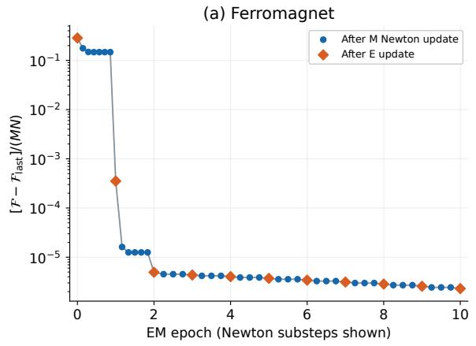

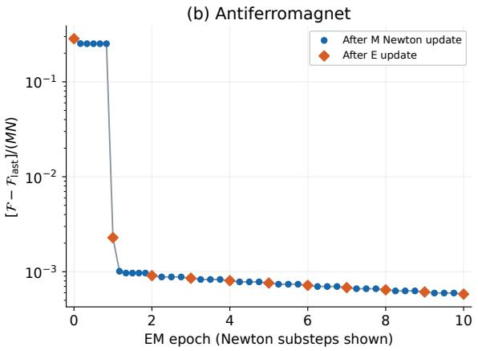  
Fig. 1 E and M updates of the regularized free energy for the selected ferromagnetic (left) and antiferromagnetic (right) cases. The first ten epochs are shown. Blue circles mark individual Newton updates within an M-step; orange diamonds mark the subsequent Estep, with epoch zero denoting the initial E-step. Intermediate Newton updates are spaced evenly within each epoch for display; the horizontal axis is not elapsed time. The vertical axis is the diference from the final recorded free energy, divided by the number of training configurations and sites, on a logarithmic scale. $\mathcal { F } _ { \mathrm { l a s t } }$ is the value at numerical termination, not an assumed exact minimum.

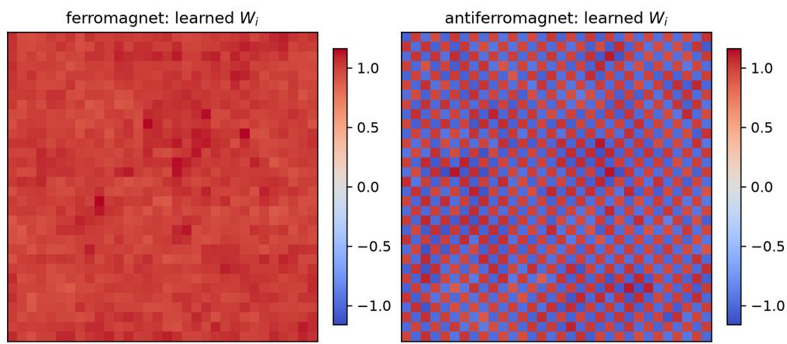  
Fig. 2 Spatial weights $W _ { i }$ learned independently from ferromagnetic (left) and antiferromagnetic (right) configurations. The uniform and staggered patterns are results of learning, rather than constraints.

as the relevant spatial projection, although neither expression was supplied.

Figure $\mathrm { 3 ( a ) }$ compares the temperature dependence of the learned coordinate with that of the conventional magnetization $( m _ { \mathrm { F } } \ \mathrm { o r } \ m _ { \mathrm { A F } } )$ . The solid curves show $\langle | \widehat { w } | \rangle _ { T } / \langle | \widehat { w } | \rangle _ { T = 1 . 5 }$ , while the dashed curves show $\langle \vert m \vert \rangle _ { T } . \mathrm { B o t h } ^ { 5 }$ decrease across the transition region around $T _ { c }$

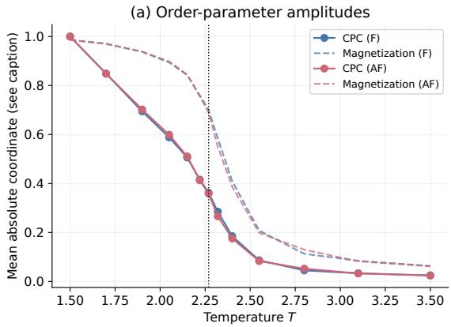

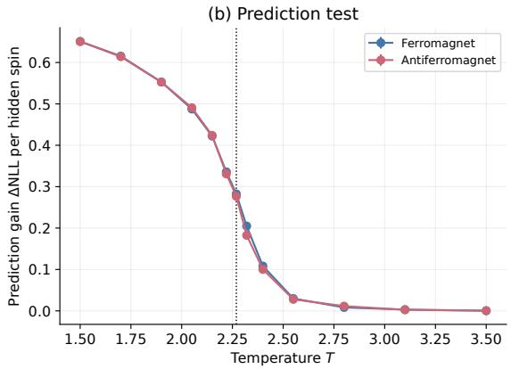  
Fig. 3 Temperature dependence and predictive performance of the learned Ising coordinate. (a) Solid curves: mean absolute collective predictive order divided by its value at $T = 1 . 5$ . Dashed curves: mean absolute magnetization for the ferromagnet (F) and staggered magnetization for the antiferromagnet (AF), without rescaling. The nonlinear maps in Eq. (23) relate the learned coordinate to these conventional order parameters. (b) Prediction gain ∆NLL, Eq. (20), for the hidden 75% of spins given the observed 25%. Positive values indicate a lower prediction NLL than the independent-site reference. Vertical dotted lines mark $T _ { c }$

Their shapes difer: the collective predictive order is a nonlinear function of magnetization, as we prescribed before. The nonlinear relation can be estimated explicitly. With the arbitrary sign chosen so that $\widehat { w }$ increases with magnetization, the nearly uniform or staggered weights give $h _ { W } ( S ) \simeq A _ { \mathrm { { F } } } m _ { \mathrm { { F } } } ( S )$ or $A _ { \mathrm { A F } } m _ { \mathrm { A F } } ( S )$ , where $\begin{array} { r } { A _ { \mathrm { F } } = \sum _ { i } W _ { i } = 1 0 3 1 . 9 8 } \end{array}$ and $\begin{array} { r } { A _ { \mathrm { A F } } = \sum _ { i } ( - 1 ) ^ { x _ { i } + y _ { i } } W _ { i } = 1 0 3 1 . 7 3 } \end{array}$ , respectively. Fitting the unnormalized wb against the corresponding m gives the following odd-quintic approximations to the rescaled maps G in Eq. (18):

$$
G _ { \mathrm { F } } ( A _ { \mathrm { F } } m ) \simeq 1 . 4 7 9 0 7 m - 2 . 4 9 0 0 8 m ^ { 3 } + 3 . 4 6 0 0 3 m ^ { 5 } ,
$$

$$
G _ { \mathrm { A F } } ( A _ { \mathrm { A F } } m ) \simeq 1 . 4 0 8 2 0 m - 2 . 2 3 2 6 6 m ^ { 3 } + 3 . 2 4 4 5 5 m ^ { 5 } .\tag{23}
$$

For each model, the coeficients were fitted using 1300 of the 2600 test configurations pooled over all temperatures, and evaluated on the remaining 1300, giving $R ^ { 2 } = 0 . 9 9 4 0 8$ and 0.99392, respectively. Thus the diferent curve shapes in Fig. 3(a) are consistent with a nonlinear reparametrization of magnetization. These fits describe the already learned coordinates; magnetization was not supplied during CPC training or inference.

We next apply the second criterion of Sec. 3.2. With the learned parameters fixed, we reveal 25% of the sites in each test configuration and predict the remaining 75% using Eq. (19). Relative to the independent-site prediction based on training frequencies, the prediction gain ∆NLL of Eq. (20) is about 0.651 at $T = 1 . 5$ and 0.28 at $T _ { c }$ for both models. These positive values mean that observing some spins improves the prediction of the others. At $T = 3 . 5$ which is higher than the phase transition temperature, the gains are only $1 . 5 \times 1 0 ^ { - 4 }$ and $6 . 1 \times 1 0 ^ { - 4 }$ for the ferromagnet and antiferromagnet, respectively, in nats per hidden spin. Thus the collective predictive order still tracks magnetization fluctuations at high temperature, but provides essentially no predictive improvement over independent sites.

## 3.4. Two competing stripe orders

To test whether more than one order parameter can be identified, consider the frustrated square-lattice model

$$
H = - J _ { 1 } \sum _ { \langle i , j \rangle } s _ { i } s _ { j } + J _ { 2 } \sum _ { \langle \langle i , j \rangle \rangle } s _ { i } s _ { j } , \qquad J _ { 1 } = J _ { 2 } = 1 .\tag{24}
$$

The second sum couples diagonal neighbors. At low temperature, vertical and horizontal stripes compete on the same spins. Their conventional order parameters, used only in evaluation, are

$$
m _ { x } = \frac { 1 } { N } \sum _ { x , y } ( - 1 ) ^ { x } s _ { x , y } , \qquad m _ { y } = \frac { 1 } { N } \sum _ { x , y } ( - 1 ) ^ { y } s _ { x , y } .\tag{25}
$$

Four ordered sectors lie near $( \pm m _ { 0 } , 0 )$ and $( 0 , \pm m _ { 0 } )$

We generated $1 6 \times 1 6$ configurations by Metropolis sampling with parallel tempering at 13 temperatures from 1.2 to 3.6, using $1 4 0 / 4 0 / 8 0$ configurations per temperature for training/validation/test. After 1400 initial sweeps, samples were saved every ten sweeps. Exact lattice symmetries—global spin reversal, rotation, and translation—were randomly applied to reduce sector imbalance. These transformations were not supplied to CPC. We compared $K = 1$ with $K = 2$ , using respectively 81 points and a $1 7 \times 1 7$ quadrature grid on $[ - 4 . 2 , 4 . 2 ] ^ { K }$ . Validation selected $\lambda _ { W } = 1$ from 1, 10, with two initializations per choice.

We first ask whether the learned weights reproduce the two stripe patterns associated with $m _ { x }$ and $m _ { y }$ in Eq. (25). These patterns are represented by the site-dependent vectors $u _ { x , i } = ( - 1 ) ^ { x _ { i } }$ and $u _ { y , i } = ( - 1 ) ^ { y _ { i } }$ . For $K = 2$ , we would like to see the the consistency between the two learned weight vectors and the two components of our learned collective predictive order. Note that they need not coincide with $u _ { x }$ and $u _ { y }$ individually: they may be linear combinations of the two. Recovering both stripe patterns therefore means that suitable linear combinations of the learned vectors can reproduce both $u _ { x }$ and $u _ { y }$

To quantify this, let W be the $N \times K$ matrix whose columns are the learned weight vectors, and let $U = ( u _ { x } , u _ { y } )$ . The matrices

$$
P _ { \ b { W } } \equiv \ b { W } ( \ b { W } ^ { \mathsf { T } } \ b { W } ) ^ { - 1 } \ b { W } ^ { \mathsf { T } } , \qquad P _ { \ b { U } } \equiv \ b { U } ( \ b { U } ^ { \mathsf { T } } \ b { U } ) ^ { - 1 } \ b { U } ^ { \mathsf { T } }\tag{26}
$$

project a spatial pattern onto the space spanned by the learned vectors and onto the space spanned by the two stripe patterns, respectively. We measure their agreement by

$$
\mathcal { O } \equiv \frac { 1 } { 2 } \operatorname { T r } ( P _ { W } P _ { U } ) .\tag{27}
$$

Equivalently, O is the average fraction of the squared length of each stripe vector retained when projected onto the learned space. It equals one when both stripe patterns can be fully reconstructed, and zero when the learned vectors are orthogonal to both patterns.

We obtain $\mathcal { O } = 0 . 9 9 6 3$ for $K = 2$ , showing that the two learned vectors span almost exactly the space of the two stripe patterns. For $K = 1$ , we obtain $\mathcal { O } = 0 . 4 9 7 3$ , close to the maximum possible value of $1 / 2$ for a single learned vector. Thus the $K = 1$ model captures one direction within the stripe space, whereas the two-component model captures both independent stripe directions.

Let us proceed for the second criterion. There are two distinct probability comparisons. For complete test configurations, the mean NLL per spin is 0.51631 for $K = 1$ and 0.38433 for

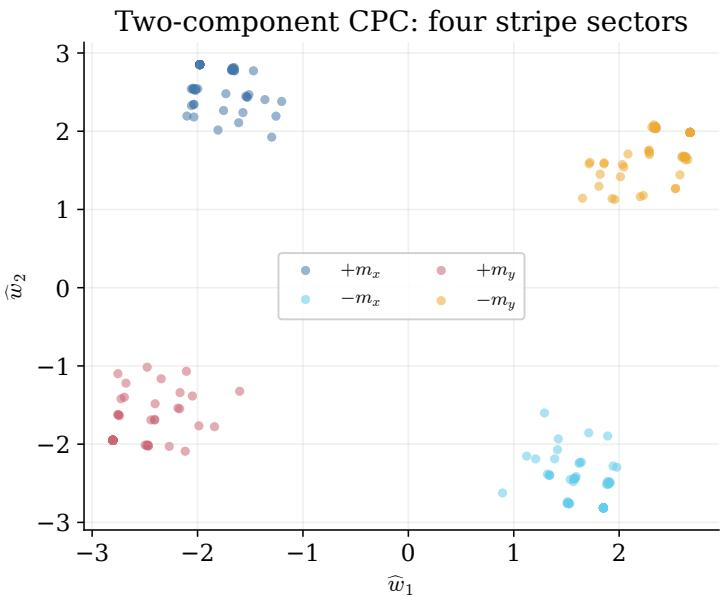  
Fig. 4 Collective predictive order $( K = 2 )$ inferred from low-temperature stripe configurations at $T = 1 . 2 , 1 . 4 { \mathrm { . } }$ , and 1.6. Each point represents one test configuration. The separate four sectors associated with $+ m _ { x } , - m _ { x } , + m _ { y } ,$ and $- m _ { y }$ are observed. Colors identify the conventional stripe sectors after learning; these labels were not supplied to CPC.

$K = 2 ,$ , so the two-component model assigns larger probability to the observed configurations on average. Separately, we perform the masked prediction test of Sec. 3.2: 25% of the spins are revealed and the remaining 75% are predicted, with all parameters fixed. At $T = 1 . 2$ the reduction in prediction NLL relative to the same independent-site reference is $\Delta \mathrm { N L L } =$ 0.6557 for $K = 2 ,$ , compared with 0.4234 for $K = 1$ , per hidden spin. The second component therefore improves both the probability assigned to complete test configurations and the prediction of their hidden spins. This concludes that our CPC can find that spins need at least two components of collective predictive order and $K = 2$ is favored.6

Figure 4 shows the two components of the collective predictive order $\widehat { w } ( S )$ inferred from test configurations at $T = 1 . 2 , 1 . 4$ , and 1.6. The four distinguishable groups correspond to the positive and negative sectors of the two stripe orders, identified by color after learning. A polynomial map fitted to part of the test set reconstructs $( m _ { x } , m _ { y } )$ from the learned coordinate with $R ^ { 2 } = 0 . 9 8 6 1$ on the remaining configurations.

At high temperature the masked prediction gain becomes negligible or slightly negative: $\Delta \mathrm { N L L } \simeq - 0 . 0 0 5$ for $K = 2$ at $T = 3 . 6$ means that CPC predicts the hidden spins slightly worse than the independent-site reference. A fixed two-component model is therefore useful for the ordered ensemble, but does not prove that two predictive components remain necessary in the disordered regime.

As a summary, the learned collective predictive order reproduces known existence of multiple order parameters, with their correct structure.

## 3.5. Replica overlap in a spin glass

A spin glass tests a diferent choice of local observations. We use the fully connected Sherrington–Kirkpatrick (SK) model,

$$
H = - \sum _ { i < j } J _ { i j } s _ { i } s _ { j } , \qquad J _ { i j } \sim \mathcal { N } ( 0 , 1 / N ) , \qquad N = 3 2 .\tag{28}
$$

Every pair of spins interacts, irrespective of spatial separation. Thus this infinite-range model has no specified spatial lattice dimension; $N = 3 2$ denotes the number of spins. Two separate parallel-tempering ladders sample replicas with the same J and temperature. Each agent now observes the four-state pair $( \hat { s _ { i } ^ { ( 1 ) } } , s _ { i } ^ { ( \hat { 2 } ) } )$ , rather than a single spin. The conventional replica overlap is

$$
q _ { 1 2 } = \frac { 1 } { N } \sum _ { i } s _ { i } ^ { ( 1 ) } s _ { i } ^ { ( 2 ) } .\tag{29}
$$

The choice to supply two replicas is a modeling input; their product and the overlap formula are not supplied to the learning rule.

For scalar w and the same Gaussian $p _ { 0 } ( w )$ , replace the local probabilistic prediction model by an unrestricted four-state distribution,

$$
p _ { \theta ^ { ( i ) } } ^ { ( i ) } ( u , v \mid w ) = \frac { e ^ { b _ { i , u v } + W _ { i , u v } w } } { \sum _ { u ^ { \prime } , v ^ { \prime } = \pm 1 } e ^ { b _ { i , u ^ { \prime } v ^ { \prime } } + W _ { i , u ^ { \prime } v ^ { \prime } } w } } , \qquad u , v = \pm 1 .\tag{30}
$$

The regularization in Eq. (15) now also sums over the four states. Neither the parameters at diferent sites nor the four-state weights are constrained to favor overlap. Data comprise ten replica pairs per $( J , T )$ at eight temperatures from 0.55 to 2.0. The 44 independently generated coupling realizations are split as $2 4 / 8 / 1 2$ for training/validation/test; hence every test J is unseen during learning. Sampling uses 700 initial sweeps and six sweeps between saved pairs. Independent spin reversals and replica exchange are applied as exact symmetries, with no site permutation. CPC receives neither J nor temperature labels. Integrals use 81 quadrature points on [−4.2, 4.2], and validation selects $\lambda _ { W } = 1$ over 10 with two initializations each.

To interpret the result, decompose the learned weights after training:

$$
W _ { i , u v } = c _ { i } + h _ { i } ^ { ( 1 ) } u + h _ { i } ^ { ( 2 ) } v + \kappa _ { i } u v .\tag{31}
$$

The common $c _ { i }$ cancels from Eq. (30). Of the summed squared norms of the other three contrasts, 98.55% lies in κ. Thus the overlap channel is selected by learning.

Figure 5 shows the relation between the learned coordinate wb and the replica overlap $q _ { 1 2 }$ for the test configurations. To quantify this relation, we fit $\widehat { w } \simeq a _ { 1 } q _ { 1 2 } + a _ { 3 } q _ { 1 2 } ^ { 3 } + a _ { 5 } q _ { 1 2 } ^ { 5 }$ . The coeficients are determined using configurations from the validation set of coupling realizations, where each realization is a separately generated set of random couplings $\{ J _ { i j } \}$ . Keeping these coeficients fixed, we evaluate the map on the test set, whose coupling realizations were used neither for CPC training nor for fitting the polynomial. The fit gives $R ^ { 2 } = 0 . 9 9 2 0 0$ on this test set, showing that the learned coordinate is well described as a nonlinear function of the replica overlap, even for previously unseen coupling realizations.

For the second criterion, we perform the masked prediction test on the 12 test realizations of the random couplings, which were not used for training or model selection. Here the local observation is the pair of spins from the two replicas, with four possible values. We reveal these pairs at 25% of the sites and predict the pairs at the remaining $7 5 \%$ . The independentsite reference uses the training frequencies of the four local states. At $T = 0 . 5 5$ , CPC reduces the prediction NLL relative to this reference by $\Delta \mathrm { N L L } = 0 . 1 2 8 9$ per hidden site pair; the gain is also positive for each of the 12 test coupling realizations evaluated separately. Randomly shufling the sites of the second replica in each test pair removes this predictive improvement.

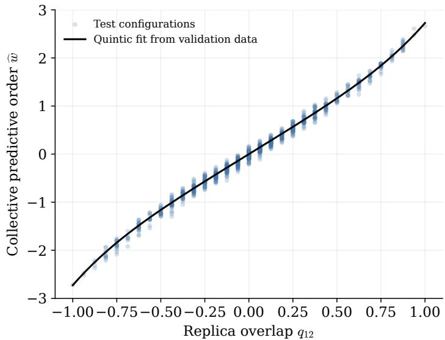  
Fig. 5 Relation between the replica overlap $q _ { 1 2 }$ and the inferred collective predictive order wb in the fully connected SK model with $N = 3 2$ spins. Each point represents one replicapair configuration from the test set. The 960 configurations comprise ten samples at each of eight temperatures, $0 . 5 5 \leq T \leq 2 . 0$ , for each of 12 independently generated realizations of the random couplings $\{ J _ { i j } \}$ . The two replicas in each pair share the same couplings. The black curve is the odd-quintic map from $q _ { 1 2 }$ to ${ \widehat { w } } .$ , fitted using the separate validation set of coupling realizations and then held fixed. It gives $R ^ { 2 } = 0 . 9 9 2 0 0$ on the test configurations shown here.

These calculations demonstrate the recovery of the replica overlap across coupling realizations. More generally, for all three examples the common result is concrete: learning from configuration snapshots let the familiar macroscopic order parameter emerge, and their physical relevance is supported by prediction of observations withheld from inference. Although the examples depend on the chosen local probabilistic prediction model, observation structure, and candidate latent dimensions, our results are encouraging: the macroscopic order emerges through collective predictive coding.

## 4. Emergent potential

Section 3 showed that the collective predictive order $\widehat { w } ( S )$ recovers familiar order parameters, up to a nonlinear change of variable. We now ask whether its equilibrium fluctuations also reveal the associated Landau potential. This extends the idea of Sec. 1: after finding a macroscopic variable from spin configurations, we seek the free energy that describes its preferred values and their change with temperature. The free energy landscape should respect hidden symmetry structure, if any, and in this sense, the symmetry can be emergent as the potential emerges.

We study the ferromagnetic and antiferromagnetic Ising models. The strategy for obtaining the emergent potential is summarized as follows. For each model and lattice size, the parameters of Eq. (14) are learned once from training data configurations collected at several temperatures. The resulting map $S \mapsto { \widehat { w } } ( S )$ is then held fixed. Temperature labels then enter at this stage to group the test configurations into thermal ensembles. The frequencies of the inferred coordinates in each ensemble then determine the potential. In the following, we define our emergent potential from CPC, and present our results on the Ising models. Remarkably, Landau-like potentials with phase transition are emergent, from which the Ising critical temperature is read accurately.

## 4.1. Emergent Landau potential

Here we shall define our potential only from the data configurations and the learned collective predictive order, as follows.

After learning the scalar map $\widehat { w } ( S )$ of Eq. (13), we apply it to equilibrium spin configurations at each temperature. The inputs at this stage are the learned map, the configurations, and their size and temperature labels. For fixed $L , T ,$ , let $S ^ { ( r ) } , r = 1 , \dots , R .$ , denote these configurations. Their collective predictive orders and measured distribution are

$$
P _ { L , T } ^ { \mathrm { e m p } } ( \widehat { w } ) \equiv \frac { 1 } { R } \sum _ { r = 1 } ^ { R } \delta ( \widehat { w } - \widehat { w } ( S ^ { ( r ) } ) ) .\tag{32}
$$

Thus each configuration contributes one value, and the fraction of values in a given interval estimates the probability of that interval. We use the test configurations of Sec. 3.2, keeping all learned parameters fixed. Grouping the configurations by temperature allows us to follow the thermal evolution of this distribution.

Let $P _ { L , T } ( \widehat { w } )$ denote the underlying equilibrium distribution estimated by Eq. (32). In terms of the equilibrium probability $p _ { L , T } ( S )$ of a configuration, it is

$$
P _ { L , T } ( \widehat { w } ) = \sum _ { S } p _ { L , T } ( S ) \delta ( \widehat { w } - \widehat { w } ( S ) ) .\tag{33}
$$

The observed frequencies provide an estimate of this distribution directly.

We define the potential as

$$
\Phi _ { L , T } \bigl ( \widehat { w } \bigr ) \equiv - k _ { \mathrm { B } } T \log \frac { P _ { L , T } \bigl ( \widehat { w } \bigr ) } { P _ { L , T } ^ { \mathrm { m a x } } } , \qquad P _ { L , T } ^ { \mathrm { m a x } } \equiv \operatorname* { m a x } _ { \widehat { w } } P _ { L , T } \bigl ( \widehat { w } \bigr ) .\tag{34}
$$

This construction uses the relative frequencies of the inferred values. For configurations sampled at thermal equilibrium, $\Phi _ { L , T }$ is the constrained free energy with its minimum set to zero.7 Frequently observed values form potential wells and are localized around the bottom of the potential, while rare intermediate values form potential barriers.

7 The thermodynamic identification follows by writing the equilibrium probability as $p _ { L , T } ( S ) =$ $e ^ { - \beta H ( S ) } / Z _ { L , T }$ , with $\beta = ( k _ { \mathrm { B } } T ) ^ { - 1 }$ and $\begin{array} { r } { Z _ { L , T } = \breve { \sum _ { S } } e ^ { - \beta \breve { H } ( S ) } } \end{array}$ . The partition sum at fixed collective predictive order is

$$
\qquad \mathcal { Z } _ { L , T } ( \widehat { w } ) = \sum _ { S } e ^ { - \beta H ( S ) } \delta \bigl ( \widehat { w } - \widehat { w } ( S ) \bigr ) , \qquad P _ { L , T } ( \widehat { w } ) = \frac { \mathcal { Z } _ { L , T } ( \widehat { w } ) } { Z _ { L , T } } .\tag{35}
$$

Hence the free energy is $A _ { L , T } ( \widehat { w } ) \equiv - k _ { \mathrm { B } } T$ log $\mathcal { Z } _ { L , T } ( \widehat { w } ) = - k _ { \mathrm { B } } T$ log $P _ { L , T } ( \widehat { w } ) - k _ { \mathrm { B } } T$ log $Z _ { L , T }$ Equation (34) is therefore $\begin{array} { r } { A _ { L , T } ( \widehat { w } ) - \operatorname* { m i n } _ { \widehat { w } } A _ { L , T } ( \widehat { w } ) } \end{array}$ . This identity supplies the thermodynamic interpretation; the numerical construction uses the configuration frequencies in Eq. (32).

This gives the two stages of the construction a direct physical meaning. Minimizing the dimensionless variational free energy $\mathcal { F }$ of Eq. (3) selects the macroscopic variable $\widehat { w } ( S )$ . Its equilibrium distribution then determines the constrained Landau potential $\Phi _ { L , T } ( \widehat { w } )$

Two notes on the potential follow. First, the definition of the probability distribution Eq. (32) is with a delta-function, thus it is quite spiky and not suited for physical interpretation of the emergent potential. To obtain a smooth estimate from Eq. (32), we replace each delta function by a normalized Gaussian of width $h _ { T }$

$$
\widehat { P } _ { L , T } ( \widehat { w } ) = \frac { 1 } { R \sqrt { 2 \pi } h _ { T } } \sum _ { r = 1 } ^ { R } \exp \left[ - \frac { ( \widehat { w } - \widehat { w } ( S ^ { ( r ) } ) ) ^ { 2 } } { 2 h _ { T } ^ { 2 } } \right] .\tag{36}
$$

This is Gaussian kernel density estimation. We determine $h _ { T }$ by leave-one-out likelihood cross-validation.8 We insert this estimate (36) into Eq. (34). The figures show

$$
\beta \Phi _ { L , T } ( \widehat { w } ) = - \log \frac { \widehat { P } _ { L , T } ( \widehat { w } ) } { \operatorname* { m a x } _ { \widehat { w } } \widehat { P } _ { L , T } ( \widehat { w } ) } , \qquad \beta = ( k _ { \mathrm { B } } T ) ^ { - 1 } .\tag{37}
$$

Thus the numerical procedure to obtain the emergent potential consists of evaluating the learned map on each test configuration, smoothing the resulting distribution, and taking its negative logarithm relative to the maximum density.

Second, note that the argument of our potential is not the magnetization but the collective predictive order of Sec. 3.1, the latter is a nonlinear transform of the former. Let us look at the diference concerning the coordinates of the potential here. For perfectly uniform or staggered weights, Eq. (18) gives ${ \widehat { w } } = G ( A m )$ , where m is the corresponding magnetization and A is the proportionality factor between $h _ { W }$ and m. Writing this relation as $\widehat { w } = f ( m )$ , a smooth invertible f gives

$$
\begin{array} { l } { \displaystyle P _ { \widehat { w } } ( \widehat { w } ) = P _ { m } ( m ( \widehat { w } ) ) \left| \frac { d m } { d \widehat { w } } \right| , } \\ { \displaystyle \Phi _ { \widehat { w } } ( \widehat { w } ) = \Phi _ { m } ( m ( \widehat { w } ) ) + k _ { \mathrm { B } } T \log \left| \frac { d \widehat { w } } { d m } \right| + C . } \end{array}\tag{38}
$$

Here C accounts for the separate choices of zero free energy. The Jacobian therefore changes the potential shape and its polynomial coeficients. Even the number of local minima can depend on a nonlinear change of variable. In this paper, we examine the potential as a function of the collective predictive order.

## 4.2. Emergent potential of Ising models and emergent symmetry

We apply this construction to the square-lattice Ising models of Eq. (21), with periodic boundaries and $| J | = k _ { \mathrm { B } } = 1$ . Although the configurations and learned parameters are separate from those of Sec. 3.3, the newly learned weights align with the uniform pattern in the ferromagnetic model and the staggered pattern in the antiferromagnetic model. First here we describe the settings. For each model and each $L = 1 2 , 1 6 , 2 4 , 3 2 , 4 8 , 6 4$ , a scalar CPC model is learned independently from eleven temperatures between 1.5 and 3.5. At each temperature, 70, 20 and 800 configurations are allocated to training, validation and testing. Configurations are collected from sixteen independently initialized Monte Carlo sequences using Wolf cluster updates and are mixed before splitting into the three sets. The spin orientation of each configuration is saved as produced by the Monte Carlo updates. Antiferromagnetic configurations are obtained from ferromagnetic ones by $s _ { i } \mapsto \epsilon _ { i } s _ { i }$ , where $\epsilon _ { i } = ( - 1 ) ^ { x _ { i } + y _ { i } }$ . The roles of training, validation, and test data are the same as in Sec. 3.2.

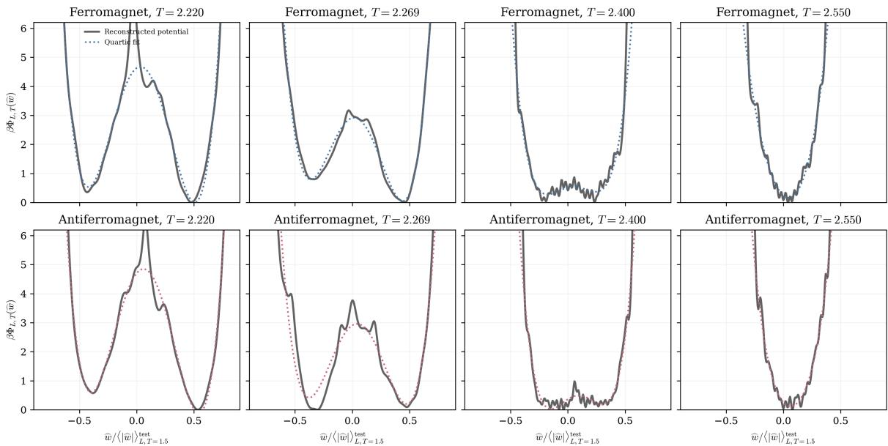  
Fig. 6 Emergent Landau potentials of the collective predictive order at $L = 3 2$ . Top: ferromagnet; bottom: antiferromagnet. From left to right, the temperatures are $T = 2 . 2 2$ ， $T = T _ { c } = 2 / \log ( 1 + { \sqrt { 2 } } ) \simeq 2 . 2 6 9 1 8 5$ $T = 2 . 4 0 $ , and $T = 2 . 5 5$ , in units $| J | = k _ { \mathrm { B } } = 1$ . Gray solid curves show the potentials reconstructed using Eq. (36); colored dotted curves show the quartic fits of $\operatorname { E q . }$ (40). The horizontal axis is $\widehat { w } / w _ { 0 , L }$ , where $w _ { 0 , L }$ is defined in Eq. (39), and each reconstructed potential has its minimum set to zero. Fit coeficients are listed in Table 1.

Our results of the emergent potentials are presented in Fig. 6. We use $L = 3 2$ to illustrate the reconstruction. The gray solid curves in Fig. 6 show the potentials reconstructed directly from the measured coordinates. This captures the well-known behavior of the Landau potential for magnetization in the Ising models.

It is quite intriguing that in fact the potentials approximately preserve $Z _ { 2 }$ symmetry $\widehat { w }$ ↔ $- \widehat { w }$ . We like to remind the readers that we have not told to the model the symmetry of the Hamiltonian. The CPC method automatically reconstruct the Landau potential through the automatically discovered order parameter, and the resultant potentials retain the symmetry.

Furthermore, the tendency of the spontaneous symmetry breaking can be apparently seen in the temperature dependence of the emergent potentials. With the high temperature samples, the reconstructed potential is just a single well, while at low temperature, it has two wells. There is a phase transition between them. The two wells near the transition approach the origin on heating and give way to a single well near the origin at $T = 2 . 5 5$

Here are some detailed notations and numbers used for obtaining the potentials in Fig. 6. For comparisons between models and sizes, we express the horizontal axis in units of the mean low-temperature amplitude,

$$
w _ { 0 , L } \equiv \langle | \widehat { w } ( S ) | \rangle _ { L , T = 1 . 5 } ^ { \mathrm { t e s t } } = \frac { 1 } { R } \sum _ { r = 1 } ^ { R } | \widehat { w } ( S ^ { ( r ) } ) | .\tag{39}
$$

The sum uses the $R = 8 0 0$ test configurations at $T = 1 . 5$ for each model and size. Each plot uses $\widehat { w } / w _ { 0 , L }$ on the horizontal axis, with $w _ { 0 , L }$ held fixed throughout the temperature scan. A constant rescaling multiplies the probability density by a constant, which cancels in the ratio defining $\Phi _ { L , T }$ in Eq. (34).

## 4.3. Landau coeficients and critical temperature estimate

The reconstructed emergent Landau potential shown in Fig. 6 actually exhibits a phase transition, then can we pin down the critical temperature from the potentials? The exact thermodynamic critical temperature is $T _ { c } = 2 / \log ( 1 + \sqrt { 2 } ) = 2 . 2 6 9 1 8 5 \ldots ,$ while Fig. 6 suggests that the transition temperature is higher than that. In the following, we study the finite-size efect on this model and consider the infinite volume limit to numerically pin-down the value of the critical temperature.

At the reference size $L = 3 2$ , we describe the change of shape in familiar Landau terms by fitting the measured potentials at each temperature to

$$
\beta \Phi _ { L , T } ( \widehat { w } ) \simeq \sum _ { n = 0 } ^ { 4 } a _ { n } ( L , T ) \left( \frac { \widehat { w } } { w _ { 0 , L } } \right) ^ { n } .\tag{40}
$$

The coeficients $a _ { n }$ refer to powers of the ratio $\widehat { w } / w _ { 0 , L }$ used in the figures. Equivalently, the coeficient of $\widehat { w } ^ { n }$ is $a _ { n } / w _ { 0 , L } ^ { n }$ . Here Φ has its minimum set to zero. The least-squares fit uses points with $| \widehat { w } | / w _ { 0 , L } \leq 0 . 9$ and $\beta \Phi \le 6$ , avoiding regions where very few configurations are observed. We retain the odd terms to describe the asymmetry of the measured profiles. We report coeficients for $T \leq 2 . 5 5 \colon$ at higher temperatures the observed range of wb becomes too narrow to constrain the quartic term reliably. Figure 6 also shows representative fits at $L = 3 2 ;$ ; their coeficients are listed in Table 1.

The numerical values in Table 1 show that $a _ { 2 }$ changes from negative to positive while $a _ { 4 }$ remains positive at the listed temperatures. This signifies the phase transition described in the emergent Landau potential. To quantify this sign change numerically, we fit the quadratic coeficient over $2 . 2 2 \leq T \leq 2 . 5 5$ to a straight line,

$$
a _ { 2 } ( L , T ) \simeq A _ { L } [ T - T _ { * } ( L ) ] .\tag{41}
$$

Here $A _ { L }$ is the fitted slope and $T _ { * } ( L )$ is the temperature at which that line reaches zero. We use this definition at every size, and numerically evaluate them to build Table 2.

A standard finite-size estimate of the transition shift is obtained by requiring the correlation length $\xi \propto | T - T _ { c } | ^ { - \nu }$ to become comparable to L. This suggests a shift proportional

Table 1 Representative quartic coeficients at $L = 3 2$ , in the coordinate and potential convention of Eqs. (39) and (40). F and AF denote the ferromagnet and antiferromagnet. Digits are rounded to reflect the sampling uncertainty.
<table><tr><td>Model</td><td> $T$ </td><td> $a _ { 0 }$ </td><td> $a _ { 1 }$ </td><td> $a _ { 2 }$ </td><td> $a _ { 3 }$ </td><td> $a _ { 4 }$ </td></tr><tr><td>F</td><td>2.220</td><td>4.6</td><td>2.7</td><td>-40</td><td>-15</td><td>95</td></tr><tr><td>F</td><td>2.269</td><td>2.9</td><td>1.0</td><td>-30</td><td>-12</td><td>96</td></tr><tr><td>F</td><td>2.400</td><td>0.5</td><td>1.0</td><td>-9</td><td>-17</td><td>112</td></tr><tr><td>F</td><td>2.550</td><td>0.2</td><td>-3.3</td><td>35</td><td>10</td><td>59</td></tr><tr><td>AF</td><td>2.220</td><td>4.7</td><td>4.8</td><td>-39</td><td>-26</td><td>95</td></tr><tr><td>AF</td><td>2.269</td><td>2.9</td><td>2.4</td><td>-28</td><td>-15</td><td>81</td></tr><tr><td>AF</td><td>2.400</td><td>0.4</td><td>2.5</td><td>-9</td><td>-49</td><td>149</td></tr><tr><td>AF</td><td>2.550</td><td>0.2</td><td>-4.5</td><td>40</td><td>-45</td><td>137</td></tr></table>

Table 2 Temperatures $T _ { * } ( L )$ at which the fitted quadratic Landau coeficient vanishes. Brackets give the 95% intervals from 300 resamplings of the test configurations.
<table><tr><td colspan="3">Ferromagnet</td><td colspan="2">Antiferromagnet</td></tr><tr><td> $L$ </td><td> $T _ { * } ( L )$ </td><td>95% interval</td><td> $T _ { * } ( L )$ </td><td>95% interval</td></tr><tr><td>12</td><td>2.512</td><td>[2.487, 2.595]</td><td>2.493</td><td>[2.467, 2.565]</td></tr><tr><td>16</td><td>2.513</td><td>[2.479, 2.592]</td><td>2.518</td><td>[2.485, 2.633]</td></tr><tr><td>24</td><td>2.485</td><td>[2.458, 2.560]</td><td>2.484</td><td>[2.451, 2.521]</td></tr><tr><td>32</td><td>2.413</td><td>[2.393, 2.435]</td><td>2.406</td><td>[2.386, 2.431]</td></tr><tr><td>48</td><td>2.356</td><td>[2.345, 2.372]</td><td>2.345</td><td>[2.338, 2.358]</td></tr><tr><td>64</td><td>2.336</td><td>[2.304, 2.355]</td><td>2.337</td><td>[2.328, 2.353]</td></tr></table>

to $L ^ { - 1 / \nu }$ . We test the simplest leading form

$$
T _ { * } ( L ) = T _ { * } ( \infty ) + \frac { c } { L } ,\tag{42}
$$

where $c$ and $T _ { * } ( \infty )$ are fitted constants.9 Figure 7 compares least-squares fits with equal weight for each size, using either all six sizes or only $L = 3 2 , 4 8 , 6 4$ . The latter reduces the influence of smaller systems and thus is adopted here. Its intercept at $1 / L = 0$ gives

$$
T _ { * } ^ { \mathrm { F } } ( \infty ) = 2 . 2 5 6 , \qquad T _ { * } ^ { \mathrm { A F } } ( \infty ) = 2 . 2 5 8 .\tag{43}
$$

Repeating the extrapolation for the resampled data gives 95% intervals [2.203, 2.300] and [2.223, 2.298], respectively. Both contain the exact value $T _ { c } = 2 . 2 6 9 1 8 5 \dots$

The physical result is that the collective predictive order found from spin observations supports a Landau description: its measured equilibrium potential develops two wells, which approach a single central well on heating. The temperature extracted from the quadratic coeficient has a finite-size shift whose extrapolation is consistent with the known transition. Together with Sec. 3, this establishes the two steps of the construction: CPC selects the macroscopic variable from the mixed-temperature configurations, and it also derives its Landau potentials from fixed-temperature statistics.

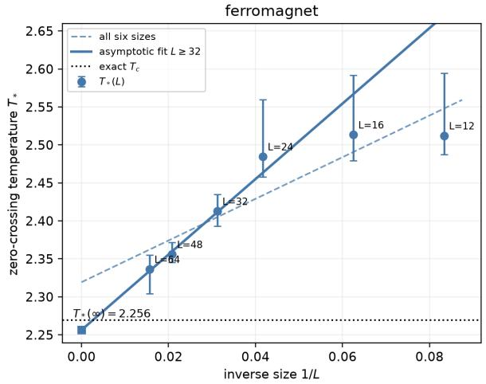

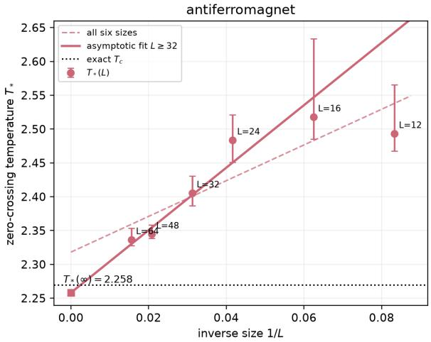  
Fig. 7 Finite-size extrapolation of $T _ { * } ( L )$ , the temperature at which the linear fit to $a _ { 2 } ( T )$ vanishes. Points show the six system sizes; error bars are 95% intervals from resampling test configurations. Dashed lines fit all six sizes, while solid lines fit only $L = 3 2 , 4 8 , 6 4$ using Eq. (42). Squares at $1 / L = 0$ mark the latter extrapolations. The horizontal dotted line is the exact $T _ { c } = 2 . 2 6 9 1 8 5$

## 5. Agentic communication between atoms

Sections 3 and 4 identified macroscopic order and its potential from spin configurations. Their inference step combined all site observations in a numerical integral, that is, the information of the observation at all the sites is collected and computed for the inference, which is analogous to the existence of a central computer. On the other hand, for example the emergence of language or symbols in human history does not need such a central computer for the inference. Rather, communication between agents, not the centralized communication, can produce the language and symbols as a common variable. In fact, the virtue of CPC is that this kind of decentralized communication can also actually attain sharing of a common emergent variable [6, 8].

Thus here in this section we ask whether a macroscopic order parameter can be learned through communication between individual sites. Each site proposes or evaluates a common variable using its own observed spin, and learns its own parameters from the outcome. This follows the CPC picture of a shared name acquiring meaning through communication, and establishes the Atom-as-an-Agent principle.

The relevant procedure constructed in the scheme of CPC is called Metropolis–Hastings naming game (MHNG), and it provides the basic rule [6, 8]: one agent proposes a name, and another accepts it according to how well it explains that agent’s observation. Here the name is a real number w. The acceptance step is familiar from Monte Carlo physics, with a ratio of local observation probabilities playing the role of a Boltzmann-weight ratio. Repeating this communication and acceptance/rejection process many times for the whole community of agents, all the agents can successfully obtain a shared notion. For the case of two agents, the MHNG communication rule has been shown to have the same stationary distribution as centralized inference of the shared variable, with the observations and model parameters held fixed [6, 8].

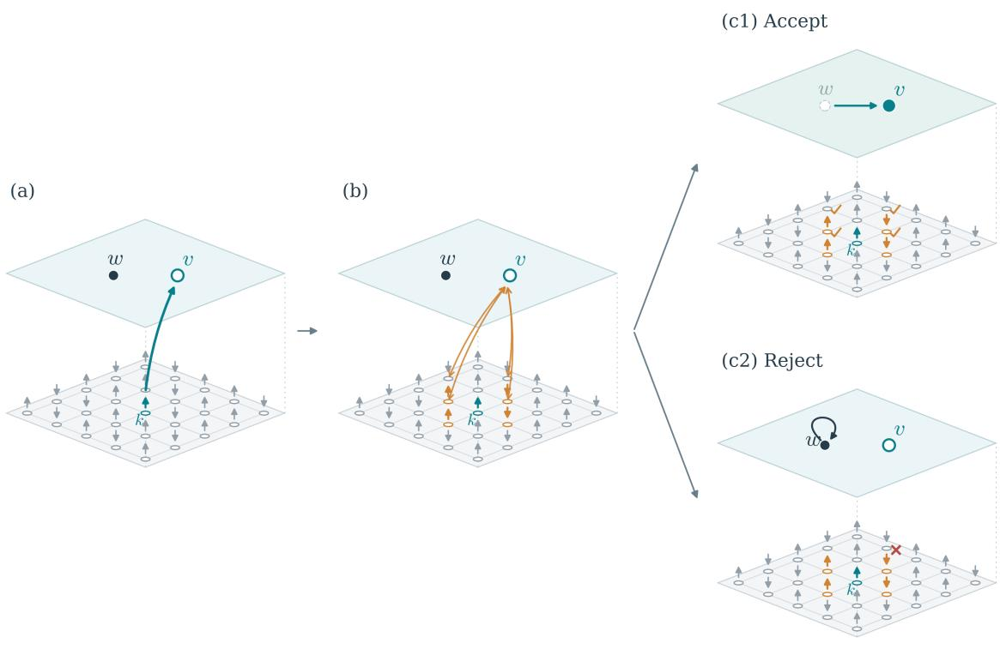  
Fig. 8 One communication step of the four-neighbor MHNG. The lower layer shows a fixed observed spin configuration; the upper layer represents values of the single variable shared by all sites. (a) Site k (teal) proposes v from its local conditional distribution, Eq. (45). (b) Its four nearest neighbors (orange) independently compare v with the current value w using Eq. (46); orange links depict these local evaluations. (c1) All four listeners accept (check marks), and the shared state changes from w to v. (c2) At least one listener rejects (cross), and the shared state remains $w ,$ as indicated by the loop arrow. Panels (c1) and (c2) are alternative outcomes. Filled circles in the upper layer indicate the current shared value. Both outcomes count as one communication step, after which a new proposing site is chosen. The spin configuration stays fixed throughout.

In this section, we demonstrate that learning through four-neighbor MHNG recovers the same ferromagnetic ordering pattern as centralized CPC in Sec. 3.3.

## 5.1. A shared variable proposed and tested by individual spins

We first specify how individual sites propose and assess a common explanation of their spin configuration. We use the scalar model of Eq. (14). For configuration $S ^ { ( a ) }$ , define the probability assigned by site i to its observed spin:

$$
L _ { i } ^ { ( a ) } ( w ) \equiv \frac { \exp [ s _ { i } ^ { ( a ) } ( b _ { i } + W _ { i } w ) ] } { 2 \cosh ( b _ { i } + W _ { i } w ) } , \qquad p _ { 0 } ( w ) = \frac { e ^ { - w ^ { 2 } / 2 } } { \sqrt { 2 \pi } } .\tag{44}
$$

The two parameters $( W _ { i } , b _ { i } )$ are learned separately at each site. A positive $W _ { i }$ associates a positive common w with an increased probability of an up spin; a negative $W _ { i }$ gives the opposite association. Learning these associations gives the common variable its meaning.

Hold one observed configuration and the parameters fixed, and suppress a for the following communication step. The lower layer in Fig. 8 shows the observed spins; the upper layer represents the single shared variable. Starting from its current value w, choose a proposing site k uniformly from all N sites.

Step (a) In Fig. 8 (a), this site k uses its own observation to draw a candidate v from the following normalized distribution at k,

$$
g _ { k } ( v ) \equiv p _ { 0 } ( v ) L _ { k } ( v ) \Big / \int d v p _ { 0 } ( v ) L _ { k } ( v ) .\tag{45}
$$

By Bayes’ theorem, this is the distribution of the common variable conditioned on that site’s spin alone.10

Step (b) In Fig. 8(b), each of the four nearest neighbors $j \in \mathcal { N } ( k )$ independently accepts the candidate with probability

$$
A _ { j } ( w , v ) \equiv \operatorname* { m i n } \left( 1 , \frac { L _ { j } ( v ) } { L _ { j } ( w ) } \right) .\tag{46}
$$

A candidate that better explains the listener’s spin is always accepted; a less probable explanation is accepted with the indicated probability, that is the Metropolis-Hastings test. All four listeners compare the same current value w with the same candidate v.

Step (c) If all agree, the shared state becomes $v ,$ as shown in panel (c1). If any listener rejects, the state remains $w ,$ represented by the loop in panel (c2). These panels show alternative outcomes of the same decision. The probability of acceptance, conditional on the speaker, is

$$
A _ { k } ^ { ( 4 ) } ( w , v ) \equiv \prod _ { j \in \mathcal { N } ( k ) } \operatorname* { m i n } \biggl ( 1 , \frac { L _ { j } ( v ) } { L _ { j } ( w ) } \biggr ) .\tag{47}
$$

Every proposal counts as one communication step, including a rejection, which contributes a repeated current value to the sequence. Local proposals and decisions thus generate successive shared explanations of the configuration, while the observed spins remain fixed.

## 5.2. Numerical steps for learning

We now construct a learning procedure in which each site adjusts its association with the shared variable, starting from random weights. We use the saved ferromagnetic Ising configurations of Sec. 3.3: L = 32, N = 1024, and thirteen temperatures from 1.5 to 3.5, including $T _ { c }$ . At each temperature there are 240 training, 60 validation, and 200 test configurations, giving M = 3120, 780, and 2600 configurations in total.11 The training set combines all temperatures. Learning uses each site’s spin observations and the periodic square lattice’s nearest-neighbor relations for communication.

Each run starts from independently generated Gaussian numbers $\xi _ { i } .$ with

$$
W _ { i } ^ { ( 0 ) } = 0 . 0 8 \frac { \xi _ { i } } { \mathrm { s t d } _ { j } \xi _ { j } } , \qquad b _ { i } ^ { ( 0 ) } = \mathrm { a t a n h } \left[ \mathrm { c l i p } \left( \frac { 1 } { M } \sum _ { a } s _ { i } ^ { ( a ) } , - 0 . 9 5 , 0 . 9 5 \right) \right] .\tag{48}
$$

Here std is the sample standard deviation, and $\mathrm { c l i p } ( x , l , u )$ restricts x to the interval $[ l , u ]$ Thus the initial weights have random signs, and each initial bias is set by that site’s observed mean spin. Each configuration starts with an independent $w ^ { ( a ) }$ drawn from the unit Gaussian.

One learning epoch consists of communication followed by parameter updates. For each fixed spin configuration, perform 64 communication steps, then 256 further steps, recording the current shared value w after every 32 steps. This gives $D = 8$ samples $w _ { a d }$ for each configuration $S ^ { ( a ) }$ , where $d = 1 , \ldots , D$ labels the recorded values. Each site uses these samples to average over the fluctuations of the shared variable and updates its own parameters to reduce

$$
Q ( \theta ) \equiv \frac { 1 } { D } \sum _ { a , d , i } \Big [ \log 2 \cosh ( b _ { i } + W _ { i } w _ { a d } ) - s _ { i } ^ { ( a ) } ( b _ { i } + W _ { i } w _ { a d } ) \Big ] + \Omega _ { \mathrm { r e g } } ( \theta ) ,\tag{49}
$$

with the regularization of Eq. (15).12 The parameter update proceeds as follows. With the communication samples fixed, each site takes four Newton steps to reduce $Q$ with respect to its own parameters $( W _ { i } , b _ { i } ) . ^ { 1 3 }$ To avoid excessively large changes, each increment is restricted to $[ - 0 . 2 5 , 0 . 2 5 ]$ , and the parameters after the four steps are averaged with their values before the update.

After updating the parameters, communication for each configuration $S ^ { ( a ) }$ resumes from its last recorded value $w _ { a D }$ in the next epoch.

For model selection, we partly use the centralized computation, as follows. We use the same regularization candidates $\lambda _ { W } = 1 , 1 0 , 1 0 0$ and validation-likelihood criterion as in Sec. 3.3. Here all three initializations for each λ are random, and each run lasts 60 epochs. For each $\lambda _ { W }$ , we retain the run with the smallest final training objective $\mathcal { I } ;$ validation likelihood then selects $\lambda _ { W } = 1$ . Note that these selection scores are evaluated by centralized one-dimensional integration over $w ,$ , thus we use centralized computation to choose among the trained models, while the samples used for their parameter updates are generated by MHNG communication.

We next examine the collective predictive order obtained by the MHNG algorithm.

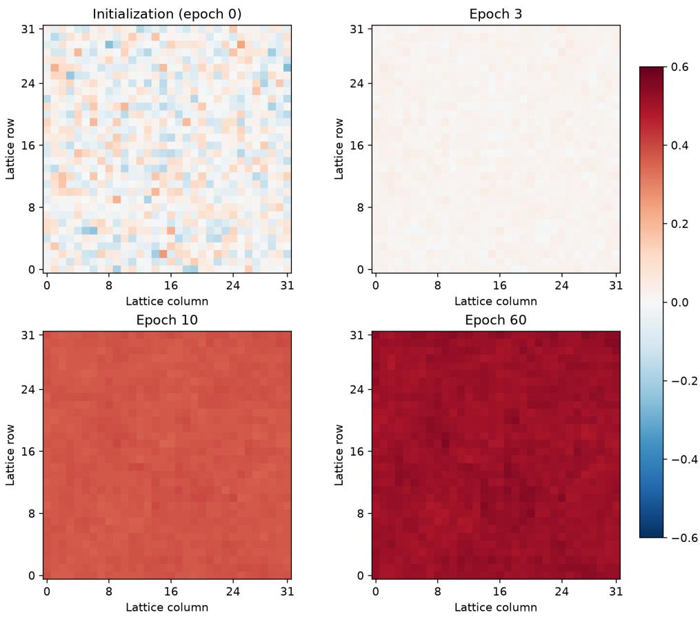  
Fig. 9 Site weights $W _ { i }$ learned with four-neighbor communication, at initialization and epochs 3, 10, and 60. All panels use the same color scale [−0.6, 0.6] and the same overall sign convention. Random initial signs evolve into a nearly uniform pattern.

## 5.3. The order parameter obtained through communication

We test whether the learned common variable represents ferromagnetic order by examining the spatial weights and comparing its inferred value with magnetization on test configurations.

See Figure 9 which shows the evolution of the selected model’s weights. Their normalized overlap with the uniform pattern, $| \textstyle \sum _ { i } W _ { i } | / { \sqrt { N \sum _ { i } W _ { i } ^ { 2 } } }$ , increases from 0.01033 to 0.999726. The other eight runs reach overlaps between 0.999708 and 0.999748. After choosing one common overall sign for display, the final weights have mean 0.515033 and spatial standard deviation 0.012052. Thus learning from local decisions recovers a nearly uniform coupling of the shared variable to the spins.

To evaluate the order encoded in the learned local probabilistic prediction models, we hold $( W _ { i } , b _ { i } )$ fixed and infer the shared variable separately at each site. For a new spin configuration S, site i assigns the proposal distribution of Eq. (45) to v. We compute its mean and then average over sites:

$$
\mu _ { i } ( s _ { i } ) \equiv \frac { \int d v v p _ { 0 } ( v ) L _ { i } ( v ) } { \int d v p _ { 0 } ( v ) L _ { i } ( v ) } , \qquad \bar { w } _ { \mathrm { l o c } } ( S ) \equiv \frac { 1 } { N } \sum _ { i = 1 } ^ { N } \mu _ { i } ( s _ { i } ) .\tag{51}
$$

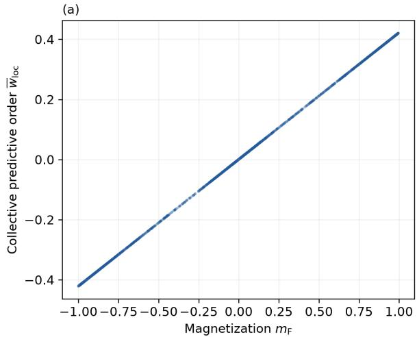

(b)  
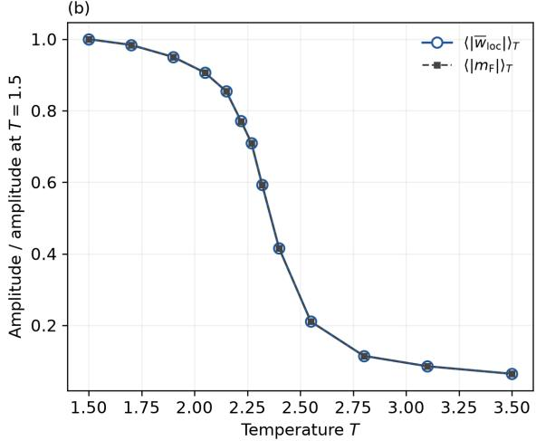  
Fig. 10 Collective predictive order evaluated by local inference after learning through four-neighbor MHNG. (a) The spatial average $\bar { w } _ { \mathrm { l o c } } ( S )$ of the local proposal means versus magnetization on 2600 test configurations. A common sign is chosen so that the mean learned weight is positive. (b) Temperature dependence of $\langle | \bar { w } _ { \mathrm { l o c } } | \rangle _ { T }$ (open circles, solid line) and $\langle | m _ { \mathrm { F } } | \rangle _ { T }$ (squares, dashed line), each normalized by its own value at $T = 1 . 5$ . Each temperature has 200 test configurations; the two curves almost overlap.

Each local mean uses only that site’s observed spin and learned parameters. The two values $\mu _ { i } ( s _ { i } = \pm 1 )$ are computed once per site using 80-point Gauss–Hermite quadrature. We use $\bar { w } _ { \mathrm { l o c } }$ as a local readout of collective predictive order, distinguished from the full conditional mean $\widehat { w }$ of Eq. (13).

Figure 10 shows that the spatial average $\bar { w } _ { \mathrm { l o c } }$ of the local inference means closely follows magnetization, with $| \operatorname { c o r r } ( { \bar { w } } _ { \mathrm { l o c } } , m _ { \mathrm { F } } ) | = 0$ .9999996 on the 2600 test configurations. Thus the interpretation of this collective predictive order is the magnetization.

This nearly linear relation, as opposed to the results in the previous sections, reflects both the learned weights and the definition of the readout. Since each spin takes only two values, each local mean can be written as

$$
\mu _ { i } ( s _ { i } ) = \frac { \mu _ { i } ( + 1 ) + \mu _ { i } ( - 1 ) } { 2 } + \frac { \mu _ { i } ( + 1 ) - \mu _ { i } ( - 1 ) } { 2 } s _ { i } .\tag{52}
$$

Thus $\bar { w } _ { \mathrm { l o c } }$ is a weighted sum of spins plus a constant. For uniform weights and zero biases, symmetry gives $\mu _ { i } ( s _ { i } ) = c s _ { i }$ with a common constant c, so that $\bar { w } _ { \mathrm { l o c } } = c m _ { \mathrm { F } }$ . The learned model is close to this limit.

This readout tests whether the local probabilistic prediction models learned through MHNG have acquired the common ferromagnetic pattern. Its linear form difers from the nonlinear relation obtained by combining all sites’ probabilities before taking the conditional mean $\widehat { w }$ in Sec. 3.3. The mean absolute values of $\bar { w } _ { \mathrm { l o c } }$ and $m _ { \mathrm { F } }$ also have nearly identical temperature dependence after normalization by their respective values at $T = 1 . 5$ , as shown in Figure 10. Table 3 lists the unnormalized amplitudes.

These results give the Atom-as-an-Agent principle a concrete realization in a system of spins. Each site proposes or evaluates a shared explanation using its own observation, and learns how that explanation relates to its local state. Starting from random weights, these exchanges produce a common variable that represents ferromagnetic order. The variable is shared across the system, while proposal, acceptance, and parameter updates are assigned to individual sites. In this construction, macroscopic order acquires a predictive meaning through the communication and learning of its microscopic constituents.14

Table 3 Mean absolute local readout and magnetization on test configurations, with 200 configurations at each temperature.
<table><tr><td>T</td><td> $\langle | \bar { w } _ { \mathrm { l o c } } | \rangle _ { T }$ </td><td> $\langle | m _ { \mathrm { F } } | \rangle _ { T }$ </td></tr><tr><td>1.5</td><td>0.41602</td><td>0.98661</td></tr><tr><td> $T _ { c }$ </td><td>0.29536</td><td>0.70033</td></tr><tr><td>3.5</td><td>0.02678</td><td>0.06350</td></tr></table>

## 6. Conclusion and discussion

In this article, we have formulated the emergence of macroscopic order through collective predictive coding (CPC). Each site behave as an agent, and it describes its observed spin by a local probability distribution conditioned on a variable common to all the agents. Learning these distributions from configurations, in such a way that the common shared variable can predicts the configurations better, determines which collective patterns the common variable represents. In this manner the shared common variable automatically emerges as functions of the configuration through CPC and learning, and they serve as a macroscopic variable well representing the configurations, thus called collective predictive orders.

Our CPC construction recovers magnetization and staggered magnetization in the 2- dimensional classical Ising models, two competing stripe orders, and replica overlap in the fully connected Sherrington-Kirkpatrick model when each site observes a replica pair, as shown in Sec. 3. In particular, the emergence of the order parameters is verified at various levels — the non-necessity of knowing the symmetry structure of the system beforehand, and the automatic detection of the necessary number K of the order parameters. For the Ising models, the equilibrium distribution of the collective predictive order yields an emergent Landau potential that evolves from two wells to one on heating. Extrapolating the temperature where its quadratic coeficient vanishes gives transition temperatures consistent with the known exact value (Sec. 4).

We also implemented learning through four-neighboring site communication. Local proposals and acceptance decisions lead from random site weights to a common variable that closely follows magnetization. The learned site weights recover the uniform ferromagnetic pattern also found by centralized CPC in Sec. 3.3, and the spatial average of the local inference means closely tracks magnetization.

The novelty of our CPC application is that we regard each atom as an agent. We allow its capability of inference, prediction and communication. The communication among the microscopic agents to better predict the world lets the macroscopic order emerge collectively. This concludes that the philosophy of “Atom-as-an-Agent” principle actually works quite well in classical spin systems for the emergence of order parameters, Landau potentials, and symmetry and its spontaneous breaking.

Before ending this article, here we argue our novelty concerning the emergence of order parameters by comparing our method to other methods. The emergence of order parameters from microscopic data has been approached from several complementary directions using machine learning (ML) and neural networks. We briefly place the present work in this context, for each of those directions, to discuss the diference and the merits of our AaaA principle.

◦ Mean-field theory. The conventional Weiss mean-field approximation replaces the influence of neighboring spins by a self-consistent average field determined by the microscopic interactions. Our AaaA learns a collective coordinate directly from spin configurations without requiring these interactions (and thus their Hamiltonian) as input, and uses its measured equilibrium distribution to construct an efective potential that reflects the observed collective fluctuations.

◦ ML methods for phase classification and transition detection. Neural networks have been used to classify phases from spin configurations [13] and electronic wave functions [14]. Transitions have also been located through classification performance under varied trial phase labels [15] and through the learned weights of a temperature classifier [16]. Our AaaA learns a shared variable for each configuration without phase or temperature labels, and tests its physical relevance by predicting unobserved spins. This variable also provides a common description that individual sites can develop through local inference and communication. Therefore, our AaaA can be classified as a novel kind of completely unsupervised machine learning which can properly find order parameter and phase transition.

◦ Learning collective coordinates. Principal component analysis (PCA) and variational autoencoders can recover order parameters from spin configurations [17, 18]. Variational autoencoders have also provided coordinates describing chemical ordering in alloys [19] and identified the phase diagram of the anisotropic Ising model [20]. These methods already provide a mapping from each configuration to a collective coordinate. The distinctive emphasis of AaaA is to formulate the inference of this coordinate as the combination of information supplied by individual sites. Each site’s local probabilistic prediction model both contributes to inferring the shared variable and predicts its own spin from that variable. This gives the collective coordinate a concrete role in interactions among microscopic agents, and allows its formation to be studied through local proposals, acceptance decisions, and learning.

◦ ML methods for interpretable order parameters. Support vector machines (SVMs) with tensorial kernels have extracted explicit order-parameter tensors and local constraints in frustrated magnets [21], including multiple coexisting and competing orders [22]. An SVM classifier for many-body localization has also been related to a physical measure of wavefunction localization [23]. The distinction from AaaA lies in the principle used to identify the order parameter. These SVM approaches extract physical observables from learned rules for distinguishing phases. AaaA learns a shared variable that explains the observations at individual sites, without using phase classification as its learning objective. The resulting variable is identified with physical order through its correspondence with known observables and its ability to predict unobserved spins. Thus, even when the same order parameter is recovered, it emerges as a discriminator between phases in the SVM approaches and as a common explanation of local observations in AaaA.

◦ Coarse graining and efective potentials. Coarse-grained variables have been learned by maximizing the information they retain about distant degrees of freedom [24]. This shares with AaaA the aim of identifying collective variables through their statistical relation to other parts of the system; AaaA additionally gives these variables a role in communication between local agents. Landau free-energy potentials have also been learned from polarization and strain data [25]. In the present construction, the collective coordinate itself is learned from microscopic configurations, and its measured equilibrium distribution then supplies the efective potential.

These approaches ofer complementary ways to extract macroscopic physics from microscopic data. The distinctive emphasis of AaaA is to make each microscopic site a participant in forming the collective description: each site learns a local probabilistic prediction model, while a shared variable connects its observations to those of other sites. Our examples show how this construction identifies ordering patterns, supports prediction of unobserved spins, and provides a coordinate for reconstructing an equilibrium free-energy potential. The communication experiment further demonstrates that an ordering pattern can develop through local proposals, acceptance decisions, and learning. This gives concrete form to the Atom-asan-Agent principle: macroscopic order becomes a shared description that microscopic agents learn to use.

Let us discuss possible more applications of our AaaA principle. First, the examples which we studied in this article is just classical systems, and its application to quantum systems is important in dealing with emergence of macroscopic order, since as described in the introduction the emergence of classical physics out of quantum mechanics is one of the major examples of emergent phenomena in physics. It should be noted that in quantum systems more variety of order parameters can be introduced, such as topological phases. For example, unsupervised learning has classified band topology through continuous deformations connecting Hamiltonians [26] and identified topological phase boundaries from experimental ultracold-atom data [27]. These results extend learning beyond conventional symmetry-breaking order and suggest a direction for AaaA beyond the examples studied here. Such an extension would require identifying observations and local probabilistic prediction models through which the shared variable can represent topological information.

A further direction concerns spacetime emergence in holography, as mentioned in the Introduction. Within a holographic neural-network architecture, bulk metric functions have been learned from boundary response data, including lattice QCD data [28, 29]. These studies motivate asking whether inference and communication among microscopic CPC agents can produce a shared description with a geometric interpretation. This would extend the present approach from the emergence of order parameters toward the emergence of spacetime.

One of the generalizations of our AaaA protocols is on the architecture of the local communication. In Sec. 5, the four-neighbor experiment uses the lattice adjacency. One can modify this communication rule — how many agents participate in the single communication, and how this communication group is chosen in the learning process. This extension could afect how successfully collective predictive order emerges. For example, if all sites participate in the acceptance decision, the acceptance rate can become very low, making updates of the common variable ineficient. Some other communication architecture can also be suggested from experimental configuration data which often can access only a partial set of sites. It would be interesting to extend our AaaA architecture to the one which reflects the experimental situation.

Finally, let us conclude with a philosophical point of view. Our Atom-as-an-Agent (AaaA) principle may sound odd, as we regard atoms as agents to communicate. However, remember that in these decades the physics principles have been afected by and introduced the viewpoint of information theory. Communication is the most fundamental part of information theory as C. Shannon himself described [30]. Thus it is rather natural that the functions such as agentic communication and agentic inference are assigned to each atom, with which we reconstruct our physical theory on that novel basis. Our AaaA principle is a realization of such philosophy. Interestingly, G. Parisi, in his account of complex systems, describes atoms and spins as interacting elementary agents whose collective behavior emerges from simple individual rules [31]. The AaaA construction pursued here is along Parisi’s expression. Each atom contributes its observation, assesses a proposed common variable, and learns how that variable explains its local state. Through the scheme of collective predictive coding, the collective predictive order then acquires meaning as the shared predictive description of these atomic agents. The realization of this AaaA principle, presented in this article, is one of the goals of Machine Learning Physics.

## Acknowledgment

The authors thank the members of the Institute of Generative Science, Kyoto University (Preparatory Ofice), for many valuable discussions. K. H. is grateful to all the members of “Foundation of Machine Learning Physics” project in Japan for developing and exploring together new perspectives in physics through AI. K. H. also like to thank Masayuki Ohzeki for his personal communications.

K. H. was supported in part by JSPS KAKENHI Grant No. JP22H05111 and JP22H05115, and by JST, ARiSE, Japan Grant No. JPMJAR2633. T. T. was supported in part by JSPS KAKENHI Grant Numbers JP23H04835. We also acknowledge the use of artificial intelligence tools for their assistance in coding and manuscript preparation.

## References

[1] K. Morita, S¯ohatsu to Butsuri: Mikuro to Makuro o Tsunagu Tetsugaku (Nagoya University Press, Nagoya, 2024), in Japanese. ISBN: 978-4-8158-1175-4.

[2] J. M. Maldacena, “The Large N limit of superconformal field theories and supergravity,” Int. J. Theor. Phys. 38 (1999), 1113-1133 doi:10.1023/A:1026654312961 [arXiv:hep-th/9711200 [hep-th]].

[3] S. S. Gubser, I. R. Klebanov and A. M. Polyakov, “Gauge theory correlators from noncritical string theory,” Phys. Lett. B 428 (1998), 105-114 doi:10.1016/S0370-2693(98)00377-3 [arXiv:hep-th/9802109 [hep-th]].

[4] E. Witten, “Anti-de Sitter space and holography,” Adv. Theor. Math. Phys. 2 (1998), 253-291 doi:10.4310/ATMP.1998.v2.n2.a2 [arXiv:hep-th/9802150 [hep-th]].

[5] T. Taniguchi, “Collective predictive coding hypothesis: symbol emergence as decentralized Bayesian inference,” Front. Robot. AI 11 (2024), 1353870. doi:10.3389/frobt.2024.1353870.

[6] T. Taniguchi, Y. Yoshida, Y. Matsui, N. Le Hoang, A. Taniguchi and Y. Hagiwara, “Emergent communication through Metropolis-Hastings naming game with deep generative models,” Adv. Robot. 37 (2023), 1266–1282. doi:10.1080/01691864.2023.2260856.

[7] T. Taniguchi (ed.), Symbol Emergence Systems: An Interdisciplinary Discussion about Cognition, Language and Society (Springer, Singapore, 2026). doi:10.1007/978-981-95-1327-7.

[8] J. Inukai, T. Taniguchi, A. Taniguchi and Y. Hagiwara, “Recursive Metropolis-Hastings naming game: symbol emergence in a multi-agent system based on probabilistic generative models,” Front. Artif. Intell. 6 (2023), 1229127. doi:10.3389/frai.2023.1229127.

[9] T. Taniguchi, S. Takagi, J. Otsuka, Y. Hayashi and H. T. Hamada, “Collective predictive coding as model of science: formalizing scientific activities towards generative science,” R. Soc. Open Sci. 12 (2025), 241678. doi:10.1098/rsos.241678.

[10] K. Friston, “A theory of cortical responses,” Philos. Trans. R. Soc. B 360 (2005), 815–836. doi:10.1098/rstb.2005.1622.

[11] K. Friston, “The free-energy principle: a unified brain theory?” Nat. Rev. Neurosci. 11 (2010), 127–138. doi:10.1038/nrn2787.

[12] T. Taniguchi, Y. Hirai, M. Suzuki, S. Murata, T. Horii and K. Tanaka, “System 0/1/2/3: Quad-Process Theory for Multitimescale Embodied Collective Cognitive Systems,” Artif. Life 31 (2025), 465–496. doi:10.1162/ARTL.a.12.

[13] J. Carrasquilla and R. G. Melko, “Machine learning phases of matter,” Nature Phys. 13 (2017), 431–434. doi:10.1038/nphys4035.

[14] T. Ohtsuki and T. Ohtsuki, “Deep Learning the Quantum Phase Transitions in Random Two-Dimensional Electron Systems,” J. Phys. Soc. Jpn. 85 (2016), 123706. doi:10.7566/JPSJ.85.123706.

[15] E. P. L. van Nieuwenburg, Y.-H. Liu, and S. D. Huber, “Learning phase transitions by confusion,” Nature Phys. 13 (2017), 435–439. doi:10.1038/nphys4037.

[16] A. Tanaka and A. Tomiya, “Detection of Phase Transition via Convolutional Neural Networks,” J. Phys. Soc. Jpn. 86 (2017), 063001. doi:10.7566/JPSJ.86.063001.

[17] L. Wang, “Discovering phase transitions with unsupervised learning,” Phys. Rev. B 94 (2016), 195105. doi:10.1103/PhysRevB.94.195105. [arXiv:1606.00318 [cond-mat.stat-mech]].

[18] S. J. Wetzel, “Unsupervised learning of phase transitions: From principal component analysis to variational autoencoders,” Phys. Rev. E 96 (2017), 022140. doi:10.1103/PhysRevE.96.022140. [arXiv:1703.02435 [cond-mat.stat-mech]].

[19] J. Yin, Z. Pei, and M. C. Gao, “Neural network-based order parameter for phase transitions and its applications in high-entropy alloys,” Nature Comput. Sci. 1 (2021), 686–693. doi:10.1038/s43588-021- 00139-3.

[20] A. Baul, N. Walker, J. Moreno, and K.-M. Tam, “Application of the variational autoencoder to detect the critical points of the anisotropic Ising model,” Phys. Rev. E 107 (2023), 045301. doi:10.1103/PhysRevE.107.045301.

[21] J. Greitemann, K. Liu, L. D. C. Jaubert, H. Yan, N. Shannon, and L. Pollet, “Identification of emergent constraints and hidden order in frustrated magnets using tensorial kernel methods of machine learning,” Phys. Rev. B 100 (2019), 174408. doi:10.1103/PhysRevB.100.174408.

[22] K. Liu, J. Greitemann, and L. Pollet, “Learning multiple order parameters with interpretable machines,” Phys. Rev. B 99 (2019), 104410. doi:10.1103/PhysRevB.99.104410.

[23] W. Zhang, L. Wang, and Z. Wang, “Interpretable machine learning study of the many-body localization transition in disordered quantum Ising spin chains,” Phys. Rev. B 99 (2019), 054208. doi:10.1103/PhysRevB.99.054208.

[24] M. Koch-Janusz and Z. Ringel, “Mutual information, neural networks and the renormalization group,” Nature Phys. 14 (2018), 578–582. doi:10.1038/s41567-018-0081-4.

[25] M. Pulzone, N. S. Fedorova, H. Aramberri, and J. ´I˜niguez-Gonz´alez, “Machine learning Landau freeenergy potentials for third-principles simulations,” Phys. Rev. B 112 (2025), 224113. doi:10.1103/9ph9- ry5x.

[26] M. S. Scheurer and R.-J. Slager, “Unsupervised Machine Learning and Band Topology,” Phys. Rev. Lett. 124 (2020), 226401. doi:10.1103/PhysRevLett.124.226401.

[27] N. K¨aming, A. Dawid, K. Kottmann, M. Lewenstein, K. Sengstock, A. Dauphin, and C. Weitenberg, “Unsupervised machine learning of topological phase transitions from experimental data,” Mach. Learn.: Sci. Technol. 2 (2021), 035037. doi:10.1088/2632-2153/abfe7.

[28] K. Hashimoto, S. Sugishita, A. Tanaka and A. Tomiya, “Deep learning and the AdS/CFT correspondence,” Phys. Rev. D 98 (2018), 046019. doi:10.1103/PhysRevD.98.046019. [arXiv:1802.08313 [hep-th]].

[29] K. Hashimoto, S. Sugishita, A. Tanaka and A. Tomiya, “Deep learning and holographic QCD,” Phys.

[30] C. E. Shannon, “A Mathematical Theory of Communication,” Bell Syst. Tech. J. 27 (1948), 379–423 and 623–656. Online reprint: https://spinchange.com/the-mathematical-theory-of-communication/ (accessed October 24, 2026).

Rev. D 98 (2018), 106014. doi:10.1103/PhysRevD.98.106014. [arXiv:1809.10536 [hep-th]].

[31] G. Parisi, In a Flight of Starlings: The Wonders of Complex Systems, translated by S. Carnell (Penguin Press, New York, 2023).