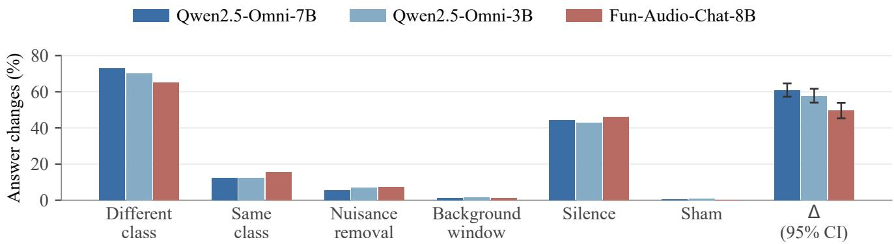
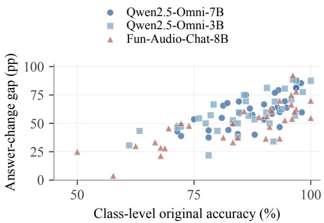
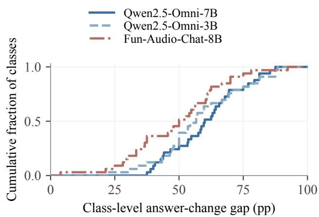

# BEYOND ANSWER CHANGES: MATCHED SAME-CLASS CONTROLS FOR LOCAL AUDIO EVIDENCE

Yunuo Wang1,† Maoyuan Chen2,† Yuanjin Huang3 Xing Liu4

1The Hong Kong University of Science and Technology (Guangzhou), Guangzhou, China 2School of Computer Science, Wuhan University, Wuhan, China 3National University of Singapore, Singapore 4Northeastern University, Toronto, Canada

## ABSTRACT

For audio-language models, an answer change after a local sound-event edit can reflect a response to the event’s class, sensitivity to waveform rewriting, or both. We compare matched same-class and different-class replacements of a queried event. Both use the same interval, level estimate, donor fitting, and crossfade, while the same-class replacement preserves the correct answer. Across 600 synthetic soundscapes and three models from two architecture families, different-class replacements produce 49.7 to 60.9 percentage points more answer changes than same-class replacements. Same-class accuracy remains within 5.2 percentage points of original accuracy. Among trials with correct original and same-class answers, soundscape-weighted selective accuracy for the inserted class is 73.7 to 81.9%, averaging eligible trials within each soundscape and then weighting eligible soundscapes equally. This protocol tests how model answers respond to local changes in event class.

Index Terms— audio-language models, local evidence, waveform interventions, evaluation

## 1. INTRODUCTION

Audio-language models answer natural-language questions about soundscapes by combining sound recognition with language-based reasoning [1, 2]. Benchmarks such as the Massive Multi-Task Audio Understanding and Reasoning benchmark span speech, environmental sounds, and music [3]. A central question is whether an answer is genuinely supported by the acoustic evidence. Correct responses can often be recovered from text alone [4], and improvements in audio question answering can partly reflect better text-based reasoning [5]. For environmental sounds this dependence is also local, since a question about a brief bark concerns one event within a longer recording. Evaluating the answer therefore requires linking it to the class of that event.

Intervention methods examine evidence use by perturbing the audio and observing how the answer moves. Noise and region-guided masking probe audio faithfulness [6]. Attention-guided masking with a duration-matched control connects localized perturbations to prediction changes [7]. Counterfactual voice grounding tests speaker-attributed reasoning [8], and paralinguistic audits vary acoustic cues while holding transcripts fixed [9]. These approaches provide useful tests of acoustic grounding. For a local environmental-sound question, an answer change depends on what the intervention changes at the queried location. A replacement can change the event’s class or rewrite the same interval with another recording of that class. The matched same-class replacement measures responses to local rewriting while preserving the queried class. Comparing it with a different-class replacement asks how much additional answer movement comes from changing that class under the same editing procedure. Removal and masking tests instead probe what happens when local evidence is deleted or degraded. The same concern arises in text-domain counterfactual prompting, where a targeted edit is a compound treatment that benefits from a meaning-preserving baseline [10].

This paper addresses how to attribute the movement of an answer after a local waveform intervention. When an audiolanguage model changes its answer after a local waveform intervention, how can we tell whether it responded to the event’s class or to the fact that the waveform was edited? We introduce a matched local waveform intervention protocol on synthetic soundscapes with annotated event intervals, and make three contributions. (i) A matched replacement protocol. Class-changing and class-preserving replacements share the target span, donor-fitting procedure, level estimate, and crossfade. The class-preserving arm measures response to local waveform rewriting. Nuisance, background-window, silence, and sham controls complete the design. (ii) A measure of answer changes and their direction. We report whether the answer changes and whether it identifies the replacement class. An exact decomposition relates the observed gap to an accuracy-based independence reference and covariance between condition outcomes. (iii) A cross-architecture behavioral result. Across Qwen2.5-Omni-7B and Qwen2.5- Omni-3B [1] and Fun-Audio-Chat-8B [2], class-changing replacements produce 49.7 to 60.9 percentage points more answer changes than matched class-preserving rewrites. Sham answer changes stay below 1.0%, and soundscape-weighted selective accuracy reaches 73.7 to 81.9%.

  
Fig. 1. Changing the queried event’s class elicits more answer change than rewriting the same interval with another recording of that class. Nuisance and sham edits produce smaller responses. The rightmost group shows the paired gap $\Delta$ and its 95% interval. The bootstrap resamples soundscapes with both option orders and all conditions kept together.

## 2. SOUNDSCAPE INTERVENTION PROTOCOL

Figure 1 previews the response profile of the interventions. Each soundscape contains a localized query event, a temporally separate nuisance event, and continuous ambience. One of the two answer options names the query class. The other names a class absent from the placed foregrounds, and neither option names the nuisance event.

The different-class variant replaces the query event with a recording from the alternative class. Its matched same-class control inserts a different recording of the query class into exactly the same interval. Both variants use the same donorfitting, level-estimation, background-copying, and crossfade procedures. Their comparison measures the response to changing the queried class relative to ordinary rewriting of that interval.

Donor segments remain within their annotated event intervals, and separate foreground events are at least 0.3 s apart. The same-class and different-class replacements use the same target interval and matched edit durations. Post-render checks verify a median background-noise-floor difference below 1 dB between replacement and original spans, fewer than 5% of soundscapes above a 10 dB difference, and boundary first differences within three times those of the original.

The original audio anchors the six interventions. The sham self-replacement follows the same editing path, with floating-point rounding changing at most 1 LSB in about 6 of 160,000 samples. The same-class rewrite preserves the queried class, and whole-clip silence removes the soundscape. The different-class rewrite substitutes an event from the alternative class. Nuisance removal and an event-free background-window rewrite test edits away from the query. Each waveform is queried in both option orders with “Which of these two sounds is present in $\mathrm { i t ? } ^ { \flat }$ , requesting Answer: A or Answer: B.

## 3. ANSWER CHANGES AND SELECTIVE ACCURACY

The matched same-span control gives the response to rewriting an event while preserving its class. To interpret the contrast with a different-class edit, let $C _ { o } , C _ { d } ,$ and $C _ { s }$ denote binary correctness on the original, different-class, and sameclass inputs, with $a _ { j } = \mathbb { E } [ C _ { j } ]$ . For valid binary answers with fixed option-to-class mappings, the original and same-class inputs share a truth label. The different-class input has the other label. Their answer-change probabilities satisfy

$$
\begin{array} { r l } & { A _ { s } = \mathbb { E } [ C _ { o } + C _ { s } - 2 C _ { o } C _ { s } ] , } \\ & { A _ { d } = \mathbb { E } [ 1 - C _ { o } - C _ { d } + 2 C _ { o } C _ { d } ] . } \end{array}\tag{1}
$$

The answer-change gap $\Delta = A _ { d } - A _ { s }$ combines marginal correctness and dependence between condition outcomes. Factoring the correctness products gives the reference value under independence of original correctness from each edited outcome,

$$
G _ { \mathrm { i n d } } = ( 2 a _ { o } - 1 ) ( a _ { d } + a _ { s } - 1 ) .\tag{2}
$$

The exact relationship is

$$
\Delta = G _ { \mathrm { i n d } } + 2 \mathrm { C o v } ( C _ { o } , C _ { d } ) + 2 \mathrm { C o v } ( C _ { o } , C _ { s } ) .\tag{3}
$$

The reference assumes independence of original correctness from each edited outcome, without requiring independence between the edited outcomes. It is an algebraic benchmark based on marginal accuracies. Equation 3 shows that the difference between the observed gap and this reference equals the covariance correction. Figure 2 relates original accuracy to the gap for each evaluated query class and model.

Table 1. Answer changes relative to the original answer (%) across 1,200 trials per model. Each of 600 soundscapes contributes two option orders and six interventions. $\Delta$ is the different-class minus same-class answer-change gap. The 95% bootstrap intervals resample paired soundscapes, keeping both option orders and intervention conditions together.
<table><tr><td>Model</td><td>Different class</td><td>Same class</td><td>Nuisance removal</td><td>Background- window</td><td>Silence</td><td>Sham</td><td></td><td>∆ (95% CI)</td></tr><tr><td>Qwen2.5-Omni-7B</td><td>73.17</td><td>12.25</td><td>5.50</td><td>1.33</td><td>44.42</td><td>0.58</td><td></td><td>60.92 [57.25, 64.58]</td></tr><tr><td>Qwen2.5-Omni-3B</td><td>70.25</td><td>12.50</td><td>7.08</td><td>1.50</td><td>42.75</td><td>0.92</td><td></td><td>57.75 [54.00, 61.67]</td></tr><tr><td>Fun-Audio-Chat-8B</td><td>65.33</td><td>15.67</td><td>7.50</td><td>1.08</td><td>46.00</td><td>0.17</td><td></td><td>49.67 [45.33, 53.92]</td></tr></table>

  
Fig. 2. Class-level original accuracy versus the different-class minus same-class answer-change gap. Each point represents one of 33 query classes for one model. Both quantities use the same evaluation trials.

Selective accuracy measures whether a revised answer identifies the inserted class on eligible trials. An eligible trial has correct answers on both the original and same-class inputs. Each soundscape i contributes two option-order trials $\textstyle { \mathcal { T } } _ { i } .$ Define the eligible trials C and soundscapes $\mathcal { T } _ { \mathcal { C } }$ containing at least one eligible trial. The reported selective accuracy is

$$
\begin{array} { r l } & { \ \mathcal { C } = \{ t \mid C _ { o } ( t ) = C _ { s } ( t ) = 1 \} , } \\ & { \mathcal { Z } _ { \mathcal { C } } = \{ i \mid \mathcal { T } _ { i } \cap \mathcal { C } \neq \emptyset \} , } \\ & { F _ { \mathcal { C } } = \displaystyle \frac { 1 } { | \mathcal { Z } _ { \mathcal { C } } | } \sum _ { i \in \mathcal { T } _ { \mathcal { C } } } \frac { \sum _ { t \in \mathcal { T } _ { i } \cap \mathcal { C } } C _ { d } ( t ) } { | \mathcal { T } _ { i } \cap \mathcal { C } | } . } \end{array}\tag{4}
$$

On an eligible trial, identifying the different-class donor also means changing the original answer in the correct direction. Eligible trials are averaged within each soundscape before eligible soundscapes receive equal weight. Eligibility depends on each model’s responses, so a soundscape may contribute one option order. Table 2 reports eligible-trial and eligiblesoundscape counts as coverage.

## 4. EXPERIMENTS

## 4.1. Experimental setup

We evaluate Qwen2.5-Omni-7B and Qwen2.5-Omni-3B [1], alongside Fun-Audio-Chat-8B [2], on 600 shared synthetic soundscapes. Scaper [11] combines single-label foreground recordings from the FSD-MIX-SED source release [12], derived from FSD50K [13], with backgrounds from TUT Urban Acoustic Scenes 2018 [14]. Each 10 s recording sampled at 16 kHz holds a query event, a separate nuisance event, and continuous ambience at a nominal +10 dB event-tobackground ratio. The evaluation covers 33 query classes with event instances held out from the pilot. Two option orders yield 1,200 trials per condition and model. All three models exceed the protocol’s 0.75 original-accuracy floor, and silence changes more than 20% of answers. Confidence intervals resample paired soundscapes, keeping both option orders and all intervention conditions together.

## 4.2. Class changes versus matched rewrites

Different-class replacement changes the intended answer, while same-class replacement rewrites the queried interval and preserves that answer. Figure 1 shows the resulting separation. The paired answer-change gaps are 0.609, 0.578, and 0.497 for Qwen2.5-Omni-7B, Qwen2.5-Omni-3B, and Fun-Audio-Chat-8B, respectively. Their 95% intervals in Table 1 exclude zero. The independence reference in Eq. 2 is 0.538, 0.479, and 0.413. The observed gaps exceed these values by 0.072, 0.099, and 0.084, which equal the covariance corrections in Eq. 3. The direction holds across both model families and all 33 query classes. The smallest class-level gaps are 3.8 percentage points for Fun-Audio-Chat-8B and 21.9 points for Qwen2.5-Omni-3B. The same-class response provides a reference for answer changes caused by local waveform editing.

Figures 2 and 3 summarize the class-level results. The scatter relates original recognition accuracy to the gap. The cumulative curves display its distribution over all 33 query classes with equal class weights. The positive class-level gaps show that the contrast extends across all evaluated categories.

Table 2. Correct identification before and after replacement. Selective accuracy averages eligible trials within each soundscape and then weights eligible soundscapes equally. Eligibility requires correct original and same-class answers. The first three accuracy columns use all 1,200 trials. Eligible trial and soundscape counts summarize coverage.
<table><tr><td>Model</td><td>Original accuracy</td><td>Same-class accuracy</td><td>Different-class accuracy</td><td>Selective accuracy</td><td>Eligible trials</td><td>Eligible soundscapes</td></tr><tr><td>Qwen2.5-Omni-7B [1]</td><td>.882</td><td>.859</td><td>.845</td><td>.819</td><td>971</td><td>542</td></tr><tr><td>Qwen2.5-Omni-3B [1]</td><td>.853</td><td>.841</td><td>.838</td><td>.801</td><td>941</td><td>544</td></tr><tr><td>Fun-Audio-Chat-8B [2]</td><td>.847</td><td>.795</td><td>.800</td><td>.737</td><td>891</td><td>481</td></tr></table>

  
Fig. 3. Empirical cumulative distributions of class-level answer-change gaps. Each curve weights the 33 query classes equally and shows the fraction with a gap at or below each threshold. Gaps are measured in percentage points.

## 4.3. Locality and editing controls

Table 1 reports the intervention profile. Nuisance removal changes answers at rates of 0.055, 0.071, and 0.075 for the three models, while background-window rates stay below 0.016 and sham rates below 0.010. The much larger target response thus concentrates sensitivity on the queried event, beyond the response to off-target edits or to the editing path alone.

Acoustic distance. Among the 236 soundscapes, or 472 option-order trials, with different-class and same-class logmel edit distances matched within 15%, the trial-level gap is 0.617 for Qwen2.5-Omni-7B with a 95% interval of [0.555, 0.678]. For Qwen2.5-Omni-3B the gap is 0.530 with an interval of [0.462, 0.597]. The corresponding full-set trial-level gaps are 0.609 and 0.578. Both matched-subset intervals exclude zero, supporting a class-change interpretation at similar measured edit magnitudes.

## 4.4. Selective accuracy on the replacement

Table 2 complements answer changes with class recognition. Same-class replacement retains accuracies of 0.859,

0.841, and 0.795 for Qwen2.5-Omni-7B, Qwen2.5-Omni-3B, and Fun-Audio-Chat-8B, respectively, compared with 0.882, 0.853, and 0.847 on the originals. Same-class accuracy remains within 5.2 percentage points of original accuracy. The matched rewrite therefore retains recognition performance close to the original. On eligible trials, soundscape-weighted selective accuracy for the inserted class is 0.819, 0.801, and 0.737. On these trials, the correct different-class answer names the inserted class. This directional measure distinguishes recognition of the replacement from answer movement alone, as local class changes often lead models to identify the newly inserted event.

## 5. SCOPE

We synthesize soundscapes to provide exact event boundaries, same-class donors, and a background fixed across conditions. This enables matched local replacement while limiting ecological realism. The evaluation covers 33 query classes at one acoustic operating point. Selective accuracy is computed on each model’s eligible subset. Confidence intervals resample soundscapes. The 600 soundscapes use 458 background recordings, with up to eight soundscapes sharing one background. Extending the comparison to natural recordings requires verified event intervals and suitable same-class donors.

## 6. CONCLUSION

Matched same-class rewriting provides a reference for interpreting answer changes after a local sound-event replacement. With the edited span and procedure held fixed, changing the queried class produces 49.7 to 60.9 percentage points more answer changes than preserving it across three models from two architecture families. The gap is positive for all 33 query classes, while off-target and sham edits elicit much smaller responses. On eligible trials, soundscape-weighted selective accuracy of 73.7 to 81.9% shows that revised answers often identify the inserted class. The matched contrast and directional check together provide a controlled way to test whether model answers track the acoustic identity of a queried event.

## Acknowledgments

This work received no external funding. The authors have no competing interests to disclose.

## Compliance with Ethical Standards

This study recruits no human participants and collects no personal data. The informal listening checks were performed by the authors themselves on synthesized audio. Sound events come from FSD50K through the FSD-MIX-SED source release, and backgrounds come from TUT Urban Acoustic Scenes 2018. Each corpus is used under its own terms, and no redistribution right is claimed for either.

## 7. REFERENCES

[1] Jin Xu, Zhifang Guo, Jinzheng He, Hangrui Hu, Ting He, Shuai Bai, Keqin Chen, Jialin Wang, Yang Fan, Kai Dang, Bin Zhang, Xiong Wang, Yunfei Chu, and Junyang Lin, “Qwen2.5-Omni technical report,” arXiv:2503.20215, 2025.

[2] Tongyi Fun Team, Qian Chen, Luyao Cheng, Chong Deng, Xiangang Li, Jiaqing Liu, Chao-Hong Tan, Wen Wang, Junhao Xu, Jieping Ye, Qinglin Zhang, Qiquan Zhang, and Jingren Zhou, “Fun-Audio-Chat technical report,” arXiv:2512.20156v4, 2026.

[3] S Sakshi, Utkarsh Tyagi, Sonal Kumar, Ashish Seth, Ramaneswaran Selvakumar, Oriol Nieto, Ramani Duraiswami, Sreyan Ghosh, and Dinesh Manocha, “MMAU: A massive multi-task audio understanding and reasoning benchmark,” arXiv:2410.19168, 2024.

[4] Haolin He, Xingjian Du, Renhe Sun, Zheqi Dai, Yujia Xiao, Mingru Yang, Jiayi Zhou, Xiquan Li, Zhengxi Liu, Zining Liang, Chunyat Wu, Qianhua He, Tan Lee, Xie Chen, Wei-Long Zheng, Weiqiang Wang, Mark Plumbley, Jian Liu, and Qiuqiang Kong, “Measuring audio’s impact on correctness: Audio-contributionaware post-training of large audio language models,” arXiv:2509.21060v4, 2026.

[5] Andrew Rouditchenko, Saurabhchand Bhati, Edson Araujo, Samuel Thomas, Hilde Kuehne, Rogerio Feris, and James Glass, “Omni-R1: Do you really need audio to fine-tune your audio LLM?,” arXiv:2505.09439v3, 2025.

[6] Pooneh Mousavi, Lovenya Jain, Mirco Ravanelli, and Cem Subakan, “Investigating faithfulness in large audio language models,” arXiv:2509.22363v4, 2026.

[7] Cihan Xiao, Yiwen Shao, Chenxing Li, Xiang He, Zhenwen Liang, Steve Yves, Sanjeev Khudanpur, and Liefeng Bo, “Escape the language prior: Mitigating late-stage modality collapse in audio reasoning via modality-aware policy optimization,” arXiv:2605.27741v1, 2026.

[8] Dongwook Lee, Sangkwon Park, Eunwoo Song, Che Hyun Lee, Youngho Cho, Junho Kim, June Young Yi, Heeseung Kim, and Sungroh Yoon, “HEAR who said what: Unlocking speaker-attributed reasoning via counterfactual voice grounding,” arXiv:2608.29120v1, 2026.

[9] Kevin Miller, Arjun Chandra, and Venkatesh Saligrama, “Do audio language models use paralinguistic evidence? counterfactual audits for response evaluation,” arXiv:2608.06718v2, 2026.

[10] Zihao Yang, Mosh Levy, Yoav Goldberg, and Byron C. Wallace, “Compared to what? Baselines and metrics for counterfactual prompting,” in Conference on Language Modeling (COLM), 2026.

[11] Justin Salamon, Duncan MacConnell, Mark Cartwright, Peter Li, and Juan Pablo Bello, “Scaper: A library for soundscape synthesis and augmentation,” in 2017 IEEE Workshop on Applications ofSignal Processing to Audio and Acoustics (WASPAA), 2017, pp. 344–348.

[12] Yu Wang, Nicholas J. Bryan, Justin Salamon, Mark Cartwright, and Juan Pablo Bello, “Who calls the shots? rethinking few-shot learning for audio,” in IEEE Workshop on Applications ofSignal Processing to Audio and Acoustics (WASPAA), 2021.

[13] Eduardo Fonseca, Xavier Favory, Jordi Pons, Frederic Font, and Xavier Serra, “FSD50K: An open dataset of human-labeled sound events,” IEEE/ACM Transactions on Audio, Speech, and Language Processing, vol. 30, pp. 829–852, 2022.

[14] Toni Heittola, Annamaria Mesaros, and Tuomas Virtanen, “TUT Urban Acoustic Scenes 2018, development dataset,” Zenodo, 2018.