# BEYOND THE READOUT: A LATENT NUMERICALFRAME SHARED ACROSS MODALITY AND OPERATION

Oriol Juan Universitat Autònoma de Barcelona OriolJuan.Sabater@autonoma.cat

Pau Rodríguez   
Apple   
pau.rodriguez@apple.com

Alex Ferrando de las Morenas Apple a\_ferrando@apple.com

Xavier Suau   
Apple   
xsuaucuadros@apple.com

## ABSTRACT

When a multimodal model computes 17 + 35 from text or 91 − 39 from a rendered image, it produces the same answer, 52. Does it use one internal concept of number for both, or separate machinery for each path? Similarity metrics such as RSA or CKA cannot settle this question. They give the same score to identical and to rotated directions, and two representations can look alike only because both prepare the same output digits. We therefore use causal interventions. For four conditions (text or image, addition or subtraction), we learn a small subspace of Gemma4-12B-it’s residual stream in which swapping coordinates swaps the model’s answer. The subspaces answer three questions. First, do the conditions write numbers along the same directions? They do not. Reusing a subspace from text in an image on the same operation recovers only 53.2% of its causal effect. A single rotation and rescaling maps one subspace onto the other and raises recovery to 91.4%, so the conditions share one geometry expressed in different coordinates. Second, does this shared geometry only reflect the digit the model is about to print? To test this, we split each subspace into 9 directions that the output layer reads to choose the next digit and 13 directions that it cannot see. The 13 hidden directions still carry the number, yet changing them barely alters the digit being written. Third, what are these hidden directions for? A model must emit a multi-digit answer one digit at a time, so it can compute the full result early and keep it in reserve. When two numbers share their first digit, swapping the number in the hidden directions leaves the digit being written intact and redirects the next digit in 77.6% of cases. The model thus forms an abstract numerical concept upstream and unfolds it across time: multimodal representations share meaning through relational geometry across distinct coordinate frames.

## 1 INTRODUCTION

When a multimodal language model computes an arithmetic result, it can reach the same number through fundamentally different inputs and operations. For example, the quantity 52 can be reached by evaluating 17 + 35 or 91 − 39, presented as plain text or rendered as pixels in an image. Because all of these inputs arrive at the same mathematical truth, do they converge onto a shared internal representation of number?

The Platonic Representation Hypothesis (Huh et al., 2024) suggests they should, positing that representations across diverse inputs converge toward a shared statistical model of reality. Yet when comparing different computational routes to the same number, “representational convergence” can mean three fundamentally distinct physical possibilities: Q1: Coordinate identity (shared directions). Does the network place numbers along the exact same linear directions regardless of input modality or operation? If so, an intervention discovered along one route will transfer directly to another without modification. Q2: Relational isomorphism (shared geometry in different coordinates). Do different routes preserve the same relative distances and displacements between numbers, but orient them along different coordinate axes? If so, direct transfer fails, but a rigid rotation and scaling can re-align them. Q3: Output interface artifact. Do representations for the same result under different conditions resemble each other only because the model is preparing to emit the exact same output token? If so, similarity reflects the shared digit vocabulary rather than an abstract concept of number.

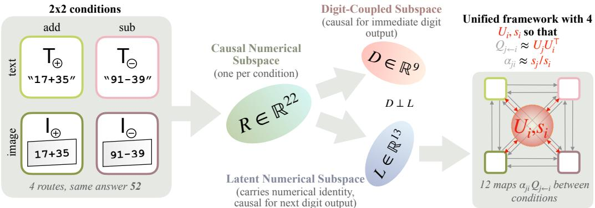  
Figure 1: Overview of the experimental framework. Crossing input modality (T, I) with operation ( , ) yields four conditions reaching the same number. In each condition, we learn a 22-dimensional causal subspace R that governs generation (Section 3). While direct reuse fails across modalities, scaled rotations αQ restore causal control to 91.4% (Section 4). Decomposing R into a 9-dimensional readout subspace D and a 13-dimensional latent subspace L reveals that numerical geometry survives outside the digit readout and synchronizes into a single shared latent frame (Section 5). Finally, latent numerical identity in L is scheduled across time, redirecting the token emitted at the subsequent autoregressive step (Section 6).

Separating these hypotheses requires moving beyond passive similarity metrics. Representational Similarity Analysis (RSA) (Kriegeskorte et al., 2008), Centered Kernel Alignment (CKA) (Kornblith et al., 2019), and Canonical Correlation Analysis (CCA) (Hotelling, 1936) compare internal relation ship structures and are invariant to orthogonal rotations by construction. Consequently, they yield identical scores under both Q1 and Q2, making them incapable of determining whether coordinates are shared or rotated. Furthermore, similarity metrics are inherently blind to Q3: any two tasks sharing an identical output vocabulary exhibit correlated late-layer representations simply from anticipating the output interface. Most fundamentally, representational agreement does not imply shared causal function (Usama & Chang, 2026) since models can exhibit matching geometry while using divergent causal mechanisms. Claiming convergence across modalities requires testing representations under counterfactual interventions.

We resolve Q1, Q2, and Q3 inside a single instruction-tuned multimodal model, where three structural properties make them cleanly separable. First, text and visual inputs pass through a unified backbone and share a single residual stream, so coordinate identity (Q1) is therefore an empirical question about one physical vector space, avoiding the confounds of aligning two independently trained networks. Second, arithmetic provides ground-truth counterfactual relations by construction: we can test whether the vector displacement transforming 52 into 71 under addition in text is the identical change under subtraction in images (Q2). Third, because numbers are tokenized digit by digit, the ten decimal digit unembeddings form an explicit rank-9 output subspace. By projecting out this readout interface, we can study the remaining latent numerical geometry in isolation (Q3).

Crossing two modalities (text T, image I) with two operations (addition , subtraction ) produces four conditions arriving at the same numerical result (fig. 1). In each condition, we use Distributed Alignment Search (DAS) (Geiger et al., 2024) to identify a 22-dimensional causal subspace R that controls the generated answer.

Our contributions are the following three findings: (i) Coordinates differ, but numerical changes rotate (Section 4). The answer to Q1 is no: direct reuse of a causal subspace across modalities recovers only 53.2% of the intervention effect for same-operation pairs. However, Q2 holds: corresponding numerical changes are related by scaled rotations (αQ), elevating same-operation cross-modal recovery to 91.4%, generalizing across all twelve directed condition pairs, and composing across factors without refitting. (ii) Numerical geometry survives outside the digit readout in a shared frame (Section 5). Answering Q3, the shared structure is not an output artifact. Partitioning each causal subspace into a 9-dimensional readout subspace D and a 13-dimensional latent subspace L shows that ablating D destroys immediate generation, yet L preserves numerical geometry, retrieving unseen values at 75.5% top-1 against 5% chance. Orthogonal group synchronization shows the four latent spaces $\mathbf { { { L } } } _ { i }$ align into a single shared latent frame. (iii) Latent numerical identity steers generation one step later (Section 6). The apparent paradox that L encodes the number yet barely affects immediate output is resolved by timing. For pairs of numbers that share their first digit, swapping the number in L leaves the current digit untouched (0.965 probability) but redirects the subsequent digit, matching the counterfactual value in 77.6% of cases. The abstract number is formed upstream and read out sequentially across steps. A second multimodal model, Ministral-3-14B, reproduces the full chain (Appendix F).

## 2 RELATED WORK

Our investigation builds on mechanistic studies of neural arithmetic, representation alignment, and causal mediation. Small networks trained on modular arithmetic learn periodic, Fourier-based solutions (Nanda et al., 2023; McCracken et al., 2025). In larger language models, arithmetic computation is distributed across attention heads and heuristics (Stolfo et al., 2023; Quirke et al., 2024; Zhang et al., 2024; Nikankin et al., 2025), often embedding numbers via Fourier features (Zhou et al., 2024), cyclic base-10 circuits (Feucht et al., 2026; Engels et al., 2025), or helical manifolds (Kantamneni & Tegmark, 2025; Fu et al., 2026). To move beyond correlational probing, activation patching and causal mediation isolate hidden components responsible for model predictions (Vig et al., 2020; Stolfo et al., 2023). Distributed Alignment Search (DAS) (Geiger et al., 2024) formalizes this by learning linear subspaces aligned with high-level variables. Recently, studies have documented that internal representations can compute abstract information prior to token emission, formalizing this as latent planning (Hanna & Ameisen, 2026; Gurnee et al., 2026; Lindsey et al., 2025). Finally, the Platonic Representation Hypothesis (Huh et al., 2024) posits that representations across diverse modalities converge toward a shared statistical model of reality, though recent work cautions that representational similarity alone does not imply shared causal mechanism (Usama & Chang, 2026).

## 3 EXPERIMENTAL SETUP AND CAUSAL SUBSPACES

To evaluate how numbers are represented across modalities and operations, the experimental framework must eliminate confounding factors: modalities must share a single vector space, conditions must evaluate identical mathematical quantities, and representations must exert causal control over generation.

Model and experimental conditions. We evaluate the instruction-tuned Gemma4-12B-it (Gemma Team, 2026), a multimodal transformer with 48 layers and residual stream dimensionality $d _ { \mathrm { m o d e l } } =$ 3840. Because text and image inputs are projected into a single residual stream, representations across modalities inhabit the same physical vector space. We disable thinking mode and prompt the model to emit only the numerical result, ensuring no intermediate chain-of-thought tokens enter the residual stream.

We establish four conditions crossing input modality with arithmetic operation: Text Addition $( T _ { \oplus } )$ Text Subtraction $( \mathsf { T } _ { \Theta } )$ , Image Addition $\displaystyle ( \mathsf { I } _ { \oplus } )$ , and Image Subtraction $( \bar { 1 _ { \Theta } } )$ ), where T and I denote text and image modalities, and and denote the operations. Operands $^ { a , }$ b are integers sampled from [0, 99] with valid domains $a + b \leq 9 9$ for addition and $a \ge$ b for subtraction, yielding exactly 5050 expressions per operation. For image inputs, the identical arithmetic expressions are rendered as centered black text on a clean white canvas. To ensure representational comparisons reflect input format rather than task competence, evaluations are restricted to expressions the model answers correctly across both modalities (Appendix A).

Extracting causal subspaces via Distributed Alignment Search. Let $\pmb { h } _ { \ell , t } ( \boldsymbol { x } ) \in \mathbb { R } ^ { d _ { \mathrm { m o d e l } } }$ denote the residual stream activation at layer ℓ and prompt position t. We extract representations at layer $\ell = 4 3$ at the final token position t immediately preceding generation. Linear probing, activation patching, and counterfactual interventions identify a late-layer region with strong numerical representations and causal influence. We use layer 43 as a common reference across conditions, and the final pre-generation position provides a semantically comparable intervention site across modalities (Appendices A.2 and C.1).

In each condition, we use DAS (Geiger et al., 2024) to learn an orthonormal basis $\pmb { R } \in \mathbb { R } ^ { d _ { \mathrm { m o d e l } } }$ ×k (with $\pmb { R } ^ { \top } \pmb { R } = \pmb { I } _ { k } )$ spanning a k-dimensional causal subspace. With the model weights completely frozen, R is optimized by gradient descent so that swapping coordinates inside the subspace replaces the base answer with the donor’s answer. Formally, given a base activation $\boldsymbol { h } _ { b }$ and a donor activation $h _ { d }$ carrying a counterfactual result, the interchange intervention is:

$$
\begin{array} { r } { \pmb { h } _ { b } ^ { \prime } = \pmb { h } _ { b } + \pmb { R } \left( \pmb { R } ^ { \top } \pmb { h } _ { d } - \pmb { R } ^ { \top } \pmb { h } _ { b } \right) , } \end{array}\tag{1}
$$

which modifies only coordinates spanned by R while leaving the orthogonal complement $( I -$ $R R ^ { \top } ) h _ { b }$ untouched.

We quantify causal efficacy using the autoregressive interchange intervention accuracy $( \mathrm { I I A } _ { \mathrm { A R } } )$ the fraction of interventions after which the model freely generates the complete multi-digit target integer. To select the subspace dimension k, we evaluate causal retention relative to $k = 3 2$ baseline, which achieved the highest $\mathrm { I I A } _ { \mathrm { A R } }$ in a preliminary dimension sweep. We select $k = 2 2$ as the smallest tested dimension retaining at least 90% of its autoregressive IIA across all four conditions (Appendix A.3).

Why causal subspaces instead of Fourier planes? Prior studies emphasize periodic Fourier features as natural coordinates for arithmetic in language models (Zhou et al., 2024; Kantamneni & Tegmark, 2025; Nikankin et al., 2025). In Gemma4-12B-it, however, pure Fourier features are causally insufficient: the 11 most Fourier-aligned directions in the causal subspace recover only 23% of the full autoregressive intervention effect, compared with 84% in Llama3.1-8B (Appendix B.3). Because the causal numerical state in modern multimodal models is substantially more distributed, we analyze the complete learned causal subspaces.

Takeaway 1 (Causal Subspaces): Intervening on Fourier-aligned directions alone fails to recover most of the causal effect (23% recovery). The full 22-dimensional causal subspaces $\mathbf { { \mathit { R } } } _ { i }$ achieve 69.3% − 86.2% autoregressive accuracy, identifying the directions mediating arithmetic answers.

## 4 NUMERICAL CHANGE TRANSPORTS ACROSS MODALITY AND OPERATION

If the four conditions encoded numbers along identical residual-stream directions, a causal subspace learned in one condition would transfer directly to another. Evaluating direct subspace reuse therefore provides a decisive empirical test of coordinate identity (Q1). When direct reuse fails, the mathematical structure of that failure reveals what coordinate transformation is missing (Q2).

Measuring direct reuse across conditions. Transporting a causal intervention tests whether steering an answer in text operates through the same physical residual-stream directions as steering an answer in vision. Let condition A denote the source where causal subspace $\mathbf { \delta } _ { R _ { A } }$ was trained, and condition B denote the destination where it is evaluated. Direct reuse inserts $\pmb { R } _ { A }$ into destination inputs using activations drawn entirely from B, ensuring no source activations enter destination computation. Because baseline intervention difficulty varies across conditions, raw intervention scores would conflate alignment with intrinsic destination difficulty. We therefore measure the normalized recovery $\tau _ { A  B } \colon$

$$
\tau _ { A  B } = \frac { \mathrm { I I A } _ { \mathrm { A R } } ( R _ { A }  B ) - \mathrm { I I A } _ { \mathrm { A R } } ( R _ { \mathrm { r a n d } }  B ) } { \mathrm { I I A } _ { \mathrm { A R } } ( R _ { B }  B ) - \mathrm { I I A } _ { \mathrm { A R } } ( R _ { \mathrm { r a n d } }  B ) } ,\tag{2}
$$

where $\mathrm { I I A } _ { \mathrm { A R } } ( { \pmb R } _ { A }  B )$ denotes the intervention accuracy of the reused subspace, and $R _ { \mathrm { r a n d } }$ is a random 22-dimensional subspace sampled from the principal component span of destination activations. A score of $\tau = 1$ indicates full recovery of the native causal effect, while $\tau = 0$ denotes performance no better than random chance. Because $\tau$ is normalized by the destination’s native subspace, values can exceed 1 if the foreign subspace happens to steer the destination more effectively. All reported values are averaged over $3 \mathrm { \ : \bar { \times } 3 \mathrm { \ : D A \bar { S } } }$ training seed pairs.

Direct reuse is incomplete across modalities. Within a single modality, direct subspace reuse across operations is remarkably strong: $\tau _ { A  B }$ averages 77.3% (fig. 2a). However, across modalities direct reuse drops substantially: the eight cross-modal condition pairs range from 23.4% to 69.2%, averaging 45.5%. Furthermore, cross-modal transfer is directional: subspaces trained on images recover 57.7% of the causal effect in text, whereas text-trained subspaces recover only 33.4% in images. Restricting to same-operation cross-modal pairs $( \mathsf { T } _ { \oplus }  \mathsf { I } _ { \oplus }$ and ${ \sf T } _ { \Theta }  { \sf I } _ { \Theta } )$ , direct reuse averages 53.2% (fig. 2a; Appendix C.2).

These findings resolve Q1 in the negative: the four conditions do not share identical coordinate directions in the residual stream.

Scaled rotations restore causal control. If coordinate directions differ, can they be aligned by a geometric mapping? Instead of aligning static activation vectors by replacement, which confounds representation with baseline shift, we align the quantity modified by the intervention: the counterfac tual displacement vector. For a base-donor pair in source condition $A ,$ the displacement in subspace coordinates is $\Delta z _ { A } = R _ { A } ^ { \top } ( h _ { d , A } - h _ { b , A } )$ . Given the corresponding displacement $\Delta z _ { B }$ in destination condition $B ,$ we fit a scaled rotation $( \alpha ^ { \star } , Q ^ { \star } )$ via constrained least squares:

$$
( \alpha ^ { \star } , Q ^ { \star } ) = \underset { \alpha , Q } { \arg \operatorname* { m i n } } \sum _ { i } \left\| \Delta z _ { B } ^ { ( i ) } - \alpha Q \Delta z _ { A } ^ { ( i ) } \right\| _ { 2 } ^ { 2 } \quad \mathrm { s . t . } \quad Q ^ { \top } Q = I _ { k } ,\tag{3}
$$

where $Q \in \mathrm { O } ( k )$ is an orthogonal matrix that rotates displacements without shearing, and $\alpha > 0$ is a single scalar that rescales overall magnitude uniformly across all directions. The transported intervention is then applied to the destination as $\pmb { h } _ { b , B } ^ { \prime } = \pmb { \bar { h _ { b , B } } } + \pmb { R _ { B } } \alpha ^ { \star } \pmb { Q } ^ { \star } \Delta z _ { A }$ , evaluated strictly on held-out numerical expressions.

An orthogonal rotation alone substantially improves cross-modal transfer, achieving 0.718 normalized recovery compared with 0.532 for direct reuse (fig. 2b; Appendix C.3). Adding a single uniform scale α further increases mean recovery by 0.196 to 0.914 across the four same-operation cross-modal directions (fig. 2a,b). The transported displacements achieve a cosine similarity of 0.902 for addition and 0.915 for subtraction with true destination displacements. Control experiments show that rotation alone is effective, while scaling provides a substantial additional gain: scaling without rotation yields only 0.006 recovery, and a random rotation fails with or without scaling (fig. 2b). Finally, replacing the scaled rotation with an unrestricted linear map yields only a minor gain from 0.914 to 0.963 (Appendix C.4).

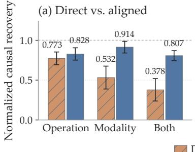

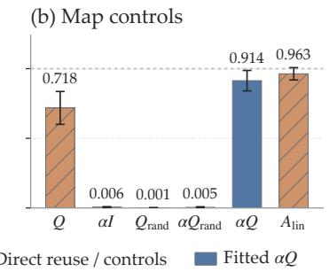

(c) Composition  
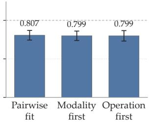  
Figure 2: Causal transfer across conditions. (a) Direct versus aligned reuse (fitting $\alpha Q )$ for changes in operation, modality, or both. (b) Cross-modal transformation controls. A map of the form αQ aligns subspaces nearly as well as an unconstrained map. Rotation alone improves recovery, and the fitted scale α provides a further gain. (c) Pairwise and composed transports. Bars average four direction means. Scores are destinationnormalized autoregressive recovery on held-out expressions.

Visual representations are geometrically compressed. The learned scale parameters α reveal a clear physical regularity: their magnitude is dictated by the direction of modality transfer instead of the arithmetic operation (table 4 and Appendix C.4). Displacements are tightly estimated at $\alpha = 0 . 6 3 9 \pm 0 . 0 0 6$ for ${ \sf T } _ { \oplus }  { \sf I } _ { \oplus }$ and $0 . 6 5 8 \pm 0 . 0 1 1$ for $\mathsf { T } _ { \Theta } \to \mathsf { I } _ { \Theta }$ when mapping from text into images. In reverse, mapping from images into text yields scales of 1 $. 2 8 3 \pm 0 . 0 1 9$ and $1 . 2 7 1 \pm 0 . 0 2 1$ Numerical displacements in the visual modality are systematically smaller in magnitude than their textual counterparts $( \alpha \approx 0 . 6 5 )$ . This magnitude difference may contribute to the asymmetry observed under direct reuse, while the fitted scales alone do not establish its architectural cause.

Compositionality across modality and operation. We next evaluate condition pairs where the arithmetic operation changes. Within a single modality $( \mathsf { T } _ { \oplus }  \mathsf { T } _ { \ominus }$ or ${ \mathsf I } _ { \oplus }  { \mathsf I } _ { \Theta } )$ , conditions are matched by the numerical transition they implement $( a  b )$ . Here, direct subspace reuse already achieves mean 0.773 normalized recovery (τ), demonstrating that switching operations preserves substantial coordinate compatibility without requiring alignment. Fitting explicit scaled rotations across operations reaches mean 0.828 recovery (fig. 2a). Crucially, these geometric maps compose across experimental factors. For condition pairs that change both modality and operation simultaneously $( \mathrm { e . g . , T _ { \oplus } \to l _ { \ominus } ) }$ , directly fitted maps recover mean 0.807. Without fitting this diagonal relation directly, chaining a modality rotation with an operation rotation $( \mathsf { T } _ { \oplus } \to \mathsf { I } _ { \oplus } \to \mathsf { I } _ { \ominus }$ or $\mathsf { T } _ { \oplus } \to \mathsf { T } _ { \ominus } \to \mathsf { I } _ { \ominus } )$ achieves 0.799 and 0.799 recovery (fig. 2c), yielding displacement predictions with mean cosine similarities of 0.968 and 0.969 to the directly fitted maps (table 6 and Appendix C.6).

These results resolve Q2 affirmatively: numerical changes share an isomorphic geometry related by scaled rotations. However, because these causal subspaces are measured at the final prompt token before generation, an essential question remains: does this shared geometry represent the abstract number, or merely the digit token the model is preparing to emit? This brings us to Q3.

Takeaway 2 (Scaled Rotations Align Modalities): Direct subspace reuse across modalities is incomplete (53.2% recovery), refuting coordinate identity (Q1). Scaled rotations $\alpha Q$ restore causal steering to 91.4% (Q2), with $\alpha \approx 0 . 6 5$ capturing visual representational compression.

## 5 BEYOND READOUT: A SHARED LATENT FRAME

Q3 asks whether the alignment of Section 4 reflects the output interface. All four conditions are read at the token preceding generation, so all of them are about to emit one decimal digit. If the shared geometry lived only in the directions that separate these digits, it would reflect tokenization and would say nothing about number. We therefore measure how strongly the causal subspaces couple to the digit readout, remove that coupling, and test whether numerical geometry survives.

Causal subspaces are strongly coupled to digit unembeddings. Let $W _ { \mathrm { d i g } } \in \mathbb { R } ^ { d _ { \mathrm { m o d e l } } \times 1 0 }$ collect the unembedding vectors corresponding to the decimal digits 0 through 9. To isolate directions that differentiate digits from each other, leaving out the shift-invariant component common to all digit logits, we subtract their mean vector w¯ and orthonormalize the result. Because these centered vectors sum to zero, they span at most 9 dimensions, yielding the rank-9 digit readout basis $U _ { \mathrm { d i g } } = \mathrm { o r t h } ( \{ { \pmb w } _ { d } - { \pmb { \bar { w } } } \} _ { d = 0 } ^ { 9 } )$

The learned causal subspaces $\mathbf { { \mathit { R } } } _ { i }$ exhibit substantial geometric alignment with $U _ { \mathrm { d i g } }$ (e.g., exceed random residual-stream baselines by a factor of 41.65 at layer 43 in text addition). Although the projection onto $U _ { \mathrm { d i g } }$ accounts for 9.8% to 11.0% of the total squared Frobenius norm of $\pmb { R } _ { i }$ , that modest fraction carries virtually all immediate causal power over the next token. Projecting $U _ { \mathrm { d i g } }$ out of the causal subspace causes self-intervention accuracy $\mathrm { I I A } _ { \mathrm { A R } }$ to collapse: performance drops from 0.826, 0.865, 0.747, and 0.695 to 0.008, 0.000, 0.005, and 0.003 for $\bar { \mathsf { T } } _ { \circledast } , \mathsf { T } _ { \circledcirc } , \mathsf { l } _ { \circledast } .$ , and $\mathsf { I } _ { \Theta }$ respectively. In contrast, ablating a random rank-9 subspace preserves substantial causal efficacy (0.634, 0.791, 0.339, and 0.560; fig. 15b). A non-arithmetic control task requiring the model only to echo a single digit (Repeat this number: 7 =) confirms that this coupling is functionally specialized for digit production (Appendix D.1).

An exact decomposition: Readout subspace D and Latent subspace L. To isolate what exists outside the output interface, projecting the digit span out of the entire residual stream via $\Pi _ { U _ { \mathrm { d i g } } } ^ { \perp } = I -$ $U _ { \mathrm { d i g } } \pmb { U } _ { \mathrm { d i g } } ^ { \top }$ leaves cross-condition numerical geometry intact in the DAS representation (Appendix D.2). However, whole-stream projection is a blunt instrument: it alters coordinates across the entire 3840- dimensional space.

We therefore construct an exact internal decomposition within the learned 22-dimensional causal subspace $\mathbf { { \mathit { R } } } _ { i }$ . We rotate the basis vectors of $\mathbf { { \mathit { R } } } _ { i }$ to order them by their alignment with the digit readout span $U _ { \mathrm { d i g } } ,$ , and split the space at rank 9 (the rank of $U _ { \mathrm { d i g } } )$ . This partitions Ri into two orthogonal subspaces: a 9-dimensional readout subspace $D \subset \mathrm { c o l } ( R _ { i } )$ ) containing all coupling between the causal subspace and the digit unembedding, and an orthogonal 13-dimensional latent subspace $L \subset \mathrm { c o l } ( R _ { i } )$ in the exact null space of the digit unembedding (overlap $O ( 1 0 ^ { - 7 } )$ ; Appendix D.2). The dimension of L is fixed by the $k = 2 2$ causal subspace (fixed for the main analyses) minus the rank-9 unembedding span, leaving 13 dimensions that encode numerical values across the full range [0, 99] without coupling to immediate token logits. Defining $\Pi _ { D }$ and $\Pi _ { L }$ as the orthogonal projectors onto D and L (they keep only the component of a vector lying in each subspace), these projectors satisfy $\Pi _ { D } + \Pi _ { L } = R _ { i } R _ { i } ^ { \top }$ , so the split of $\pmb { R } _ { i }$ is exact. Note that D is a 9-dimensional subspace of $\pmb { R } _ { i }$ chosen to align with $U _ { \mathrm { d i g } }$ . It is close to $U _ { \mathrm { d i g } }$ but not identical to it, because $U _ { \mathrm { d i g } }$ lives in the full residual stream while D lives inside the causal subspace.

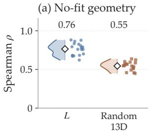

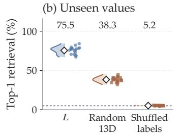

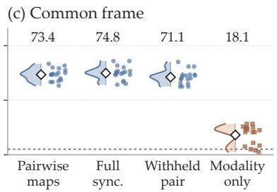  
Figure 3: Numerical geometry beyond readout supports a common frame. (a) No-fit RSA in $\pmb { L } \left( \rho = 0 . 7 6 5 \right)$ versus random 13-dimensional readout-orthogonal subspaces $( \rho = 0 . 5 4 5 )$ . (b) Unseen-value retrieval after alignment (75.5%), with random-space (38.3%) and shuffled-label (5.2%) controls. (c) Pairwise maps (73.4%) versus full synchronization (74.8%), withheld-pair reconstruction (71.1%), and modality-only synchronization (18.1%). Points average repeats within each relation and value split; half-violins show distributions, and diamonds and numbers show means. The dashed line marks the 5% chance baseline among 20 candidate values.

Numerical geometry survives inside the latent subspace L. Having cleanly isolated the 13- dimensional latent subspace L from the output readout, we test whether it retains structured numerical information. We project activations at layer 43 into each condition’s latent subspace $\mathbf { { { L } } } _ { i }$ and evaluate cross-condition alignment on values held out during alignment fitting.

The latent subspaces exhibit rich numerical geometry across all twelve directed relations: mean held-out transition cosine reaches 0.807 (table 7), and nearest-neighbor retrieval identifies the exact unseen value among 20 candidates at 75.5% top-1 and 98.8% top-5 accuracy (fig. 3b; 5% random baseline). In contrast, dimension-matched random 13-dimensional subspaces in the readout null space achieve 0.558 transition cosine and 38.3% top-1 retrieval, while shuffling numerical labels collapses retrieval to chance (5.2%). A no-fit RSA check likewise yields rank correlation $\rho = 0 . 7 6 5$ across conditions (permutation $p = 1 / 1 0 0 1 )$ versus 0.545 for random subspaces (fig. 3a).

These findings support a negative answer to Q3: the shared numerical representation is not an artifact ofthe shared digit interface. The relational geometry of arithmetic survives within an internal subspace that the current digit readout cannot see.

One common latent frame across all conditions. The twelve pairwise relations are fitted independently. Could they describe twelve unrelated mappings that happen to align pairwise? A stronger hypothesis predicts that every condition’s latent subspace $\mathbf { { { L } } } _ { i }$ reflects one unified underlying frame: each condition possesses an intrinsic orientation $U _ { i } \in \mathrm { O } ( 1 3 )$ and scale $s _ { i } > 0$ such that pairwise rotations factorize as $Q _ { j  i } \approx U _ { j } U _ { i } ^ { \top }$ and scales factorize as $\alpha _ { j i } \approx s _ { j } / s _ { i }$

We estimate the four frames jointly using orthogonal group synchronization (Gao & Zhang, 2023), minimizing total disagreement across all twelve pairwise maps simultaneously:

$$
\{ U _ { i } ^ { \star } \} = \underset { \{ U _ { i } \} } { \arg \operatorname* { m i n } } \sum _ { ( i , j ) } \xi _ { i j } \| Q _ { j  i } - U _ { j } U _ { i } ^ { \top } \| _ { F } ^ { 2 } ,\tag{4}
$$

with edge confidences $\xi _ { i j }$ and scales $s _ { i }$ solved by weighted least squares on log $\alpha _ { j i } \approx$ log $s _ { j } \mathrm { ~ - ~ }$ log $s _ { i }$ . If pairwise linear relationships were exact and cycle-consistent, a shared global frame would follow algebraically. Real activations, however, contain noise and task-specific variance. Chaining independently fitted maps around a closed loop typically accumulates drift instead of returning to the identity. Constraining all twelve directed maps to factor through four node frames $U _ { i }$ imposes a fourfold parameter reduction (from 948 to 237 free parameters), testing whether the underlying representations are governed by a globally consistent low-noise geometry rather than isolated pairwise compromises. To map absolute numerical coordinates in addition to relative displacements, we estimate one centroid offset $\mathbf { o } _ { i }$ per condition from training values:

$$
{ \pmb u } ( y ) = s _ { i } ^ { - 1 } { \pmb U } _ { i } ^ { \top } \left( z _ { i } ^ { L } ( y ) - { \pmb \sigma } _ { i } \right) , \qquad z _ { j } ^ { L } ( y ) = s _ { j } { \pmb U } _ { j } { \pmb u } ( y ) + o _ { j } .\tag{5}
$$

Taking differences cancels the offset vectors, recovering the displacement relation $\begin{array} { r l } { \Delta { \boldsymbol u } } & { { } = } \end{array}$ $s _ { i } ^ { - 1 } U _ { i } ^ { \mp } \Delta z _ { i } ^ { L }$ . The synchronization in eq. (4) therefore depends strictly on numerical displacements, and offsets are incorporated afterwards to locate absolute coordinates (Appendix D.3).

On unseen numerical values, the four synchronized frames achieve 0.791 transition cosine and 74.8% top-1 retrieval, comparable to independently fitted maps (0.801 and 73.4%; fig. 3c). Preserving held-out retrieval while eliminating 711 degrees of freedom supports an underlying, globally coherent relational frame. When one complete unordered condition pair is withheld prior to synchronization, reconstructing it from the remaining ten relations reaches 0.762 cosine, 71.1% top-1, and 98.3% top-5 retrieval (fig. 3c; table 8). Furthermore, forcing operations to share frames within modalities reduces cosine to 0.249 and retrieval to 18.1% (fig. 3c), supporting condition-dependent latent frames.

Predicting coordinates for an unseen condition by adding modality and operation shifts achieves 0.629 cosine and 58.9% top-1 retrieval on unseen values, against −0.109 cosine and 3.8% top-1 under shuffled controls (Appendix D.4). An orthogonal successor operator $G _ { + 1 }$ fitted only in ${ \sf T } _ { \oplus }$ on the full 22-dimensional causal spaces transfers without refitting, identifying $y + 1$ centroids in 65.0% to 70.0% of held-out cases (Appendix D.5). Finally, synchronizing the full 22-dimensional causal subspaces yields $\mathrm { I I A } _ { \mathrm { A R } } = 0 . 6 3 6$ (versus 0.639 for pairwise maps), preserving similar causal efficacy under global constraints (Appendix D.6).

These findings establish the strong form of Q2: the latent numerical representations across all four conditions express one shared relational frame.

Takeaway 3 (A Shared Latent Frame Beyond Readout): Abstract numerical geometry lives in the 13d latent subspace L, orthogonal to digit unembeddings (Q3). The four conditions synchronize into a single common latent frame (74.8% top-1 retrieval of values held out from alignment fitting).

## 6 LATENT NUMERICAL IDENTITY STEERS SUBSEQUENT GENERATION

The findings of the preceding sections create an apparent paradox: the latent subspace L is organized by numerical identity, aligns across modalities and operations, and synchronizes into a single common frame. Yet intervening on L alone recovers the complete donor answer in only 3.2% to 6.4% of cases, depending on the condition. How can a representation reliably encode the mathematical answer while exerting little causal influence on immediate output?

The architecture of an autoregressive model requires emitting tokens sequentially, but solving arithmetic requires computing the entire multi-digit answer upstream. We test whether the network resolves this tension through a temporal division of labor: holding the full numerical identity in L while D governs only the immediate token. We design a mismatched intervention testing this temporal division: $_ { D }$ controls the token written now, while L steers the token written next.

Constructing a mismatched intervention state. The orthogonal decomposition $R _ { i } R _ { i } ^ { \top } = \Pi _ { D } + \Pi _ { L }$ allows us to synthesize hybrid residual activations whose two components originate from different numerical answers. Let $h _ { b }$ be a base activation evaluating result b, and let $h _ { y }$ and $h _ { \tilde { y } }$ be donor activations evaluating $y$ and ${ \tilde { y } } .$ . We decompose donor edits into readout displacements $\Delta h _ { D } ^ { b  y } =$ $\Pi _ { D } ( h _ { y } - h _ { b } )$ and latent displacements $\Delta h _ { L } ^ { b \to \tilde { y } } = \Pi _ { L } ( h _ { \tilde { y } } - h _ { b } )$ . When both halves originate from the same donor $( y = \tilde { y } )$ , adding both to $h _ { b }$ reconstructs the standard intervention of eq. (1): $h ^ { \mathrm { m a t c h } } = h _ { b } + \Delta h _ { D } ^ { b  \dot { y } } + \dot { \Delta } h _ { L } ^ { b  y }$

In contrast, we construct a mismatched state by pairing the readout displacement for y with the latent displacement for $\tilde { y } \colon$

$$
\begin{array} { r } { \pmb { h } ^ { \mathrm { m i s } } = \pmb { h } _ { b } + \Delta \pmb { h } _ { D } ^ { b  y } + \Delta \pmb { h } _ { L } ^ { b  \tilde { y } } . } \end{array}\tag{6}
$$

In this state, $_ D$ points to $y ,$ while L points to ${ \tilde { y } } .$ We select pairs y and $\tilde { y }$ that share their first digit and differ only in their second digit $( \mathrm { e } . \mathrm { g } . , y = 5 2 $ and $\tilde { y } = 5 7 )$ . Both components therefore agree on the tens digit due immediately, while disagreeing on the units digit due at the next position.

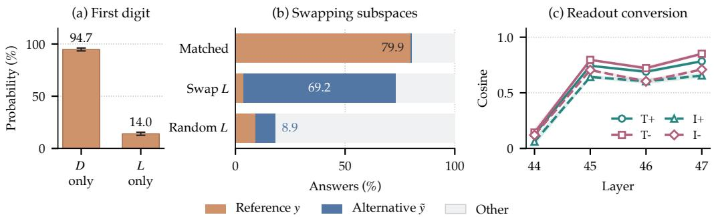  
Figure 4: The latent subspace L sets the digit written next. Each trial edits the activation of a base prompt $( e . g . , 1 7 + 1 4 = 3 1 )$ at layer 43 of the last prompt position t0, using donors with answers y and y˜ that share their first digit and differ in the second (e.g., 52 and 57). (a) Current digit. The first digit of y differs from that of the base. Editing D alone with the donor y makes the model write the first digit of y with probability 94.7%, editing L alone only 14.0%. (b) Full answer. Matched takes D and L from y and yields y in 79.9% of cases, the ceiling of a 22-dimensional edit. Swap L takes D from y and L from y˜ (eq. (6)), and yields y˜ in 69.2%. Random L takes L from an unrelated value and yields y˜ in only 8.9%. (c) Delayed readout. At the next step $t _ { 1 } ,$ the cosine between the swap’s effect and the natural change in readout directions is near zero at layer 44 and jumps at layer 45, once the edited KV-cache is read.

Mismatched latent identity redirects the subsequent token. Across four conditions and three seeds, the matched state $h ^ { \mathrm { m a t c h } }$ produces target y with mean accuracy $\mathrm { I I A } _ { \mathrm { A R } } = 0 . 7 9 9$ (fig. 4b). In contrast, the mismatched state $\bar { h ^ { \mathrm { m i s } } }$ rarely produces $y \left( \mathrm { I I A _ { A R } = 0 . 0 3 7 } \right)$ and produces y˜, supplied through L, at 0.692 accuracy (versus 0.089 for random controls; fig. 4b). The first-digit probability remains largely unchanged: 0.963 matched versus 0.965 mismatched (Appendix E.1). A separate different-first-digit evaluation shows stronger immediate control from D alone (94.7%) than from L (14.0%; fig. 4a). With pairs differing in both digits $( e . g . , y = 5 2 , \tilde { y } = 6 7 )$ , the swap yields the hybrid (e.g., 57) in 51.6% of cases, against 7.5% for D alone and 74.5% for matched edits reproducing y (table 9). Random L also inserts its own units digit (Appendix E.1).

Tracing the delayed identity through the KV-cache. We trace autoregressive generation across step $t _ { 1 }$ after intervening at layer 43 of position $t _ { 0 } .$ . Preserving the intervened KV-cache, we feed the model the identical, valid first digit, and observe token logits at $t _ { 1 }$ with no further intervention (1536 separately sampled triplets; Appendix E.2). In the matched state, the model continues with the units digit of $y ( P ( y _ { 2 } ) = 0 . 8 2 4 $ versus $P ( \tilde { y } _ { 2 } ) = 0 . 0 1 0 )$ . In the mismatched state, the probabilities invert: $P \bar { ( } y _ { 2 } ) = 0 . 0 \dot { 4 } 0$ while $P ( \tilde { y } _ { 2 } ) = 0 . 7 3 7$ , and the units digit of $\tilde { y }$ becomes the greedy top-1 prediction in 77.6% of cases. Supplying D alone without L leaves the second-digit probabilities unresolved $( P ( y _ { 2 } ) = 0 . 1 3 2 , P ( \tilde { y } _ { 2 } ) \stackrel { . . . } { = } 0 . \bar { 0 } 8 7 )$ ), showing that D alone cannot steer subsequent digits. Likewise, inserting an L from an unrelated donor sharing the first digit leaves $P ( \tilde { y } _ { 2 } )$ at only 0.020.

Latent identity converts into readout directions via intervening layers. Because L is orthogonal to the digit readout $U _ { D }$ when inserted after layer 43 of step $t _ { 0 }$ , steering the second digit at step $t _ { 1 }$ requires subsequent layers to rotate this latent edit into $U _ { D }$ . To track this conversion at each layer ℓ of step $t _ { 1 }$ , we compare how swapping $y  \tilde { y }$ in L shifts the readout coordinates, $U _ { D } ^ { \top } ( { h } _ { \ell , t _ { 1 } } ^ { \mathrm { m i s } } - \dot { h } _ { \ell , t _ { 1 } } ^ { \mathrm { m a t c h } } )$ against the readout difference between unintervened runs evaluating $\tilde { y }$ and $y , \pmb { U } _ { D } ^ { \top } ( \pmb { h } _ { \ell , t _ { 1 } } ^ { \mathrm { n a t } } ( \tilde { y } ) - \pmb { h } _ { \ell , t _ { 1 } } ^ { \mathrm { n a t } } ( y ) )$ (Appendix E.2). Their cosine similarity $\gamma _ { \ell }$ starts near zero at layer 44 $( \gamma _ { 4 4 } \approx 0 . 1 1 3 )$ , jumps sharply at layer 45 $( \gamma _ { 4 5 } \approx 0 . 7 2 2 )$ once attention reads the modified $t _ { 0 } \ \mathrm { K V } .$ -cache, and reaches a median of 0.852 in the final layer (fig. 4c). Moreover, projecting a non-arithmetic copy task (Repeat this number $: \quad 4 3 \ = )$ into L reveals the same latent geometry even without computation (Appendix E.3). We therefore interpret L as an upstream state that holds an abstract multi-digit result and converts it into readout directions sequentially across steps.

Takeaway 4 (Temporal Scheduling of Latent Identity): The latent subspace L has little direct influence on the current digit but steers the next digit (77.6% top-1 redirection after teacherforcing the shared first digit). L thus acts as a latent memory that buffers the full multi-digit result upstream and converts it into readout directions across autoregressive steps.

## 7 DISCUSSION AND CONCLUSION

Representations can share causal meaning without sharing coordinate axes. When a model adds or subtracts numbers in text or images, it computes an internal representation that behaves the same way across all four tasks. Yet this shared representation does not occupy identical coordinates in the residual stream. Directly copying the subspace across conditions recovers only 45.5% of the causal effect on average (Q1 negative). Instead, the spaces share a geometry: a single scaled rotation maps the axes of one condition onto another and recovers 91.4% of the causal effect, and all four conditions synchronize into a single relational frame (Q2 affirmative). This distinction matters for how we study foundation models. Geometry alone cannot determine whether two internal states do the same work, we need interventions to verify their causal role (Usama & Chang, 2026).

Computation upstream, readout over time. This relational convergence lives outside the vocabulary. The shared 13-dimensional subspace L is orthogonal to the digit unembeddings, ruling out an output interface artifact (Q3 refuted). While D drives the immediate token, L holds the full numerical identity in memory and steers the subsequent token through the attention cache. The model decouples upstream computation from token generation, solving the entire arithmetic problem first and reading the answer out sequentially across autoregressive steps.

Scope and open questions. This mechanism extends beyond Gemma4-12B-it. A replication in Ministral-3-14B (Appendix F) reproduces the readout-orthogonal geometry, global synchronization, and delayed causal influence, showing that the division of labor extends across model families. Our experiments focus on addition and subtraction of integers in [0, 99]. Multiplication forms distributed, depth-dependent representations across intermediate layers (Appendix B.2). Finally, while we show that the delayed signal reaches the output via the key-value cache, identifying the specific attention heads that perform this readout remains an open direction.

## AI USE STATEMENT

Large language models were used as writing and coding assistants, for editing prose and LATEX, drafting analysis and plotting scripts, and literature search. The authors designed the experiments, ran and verified all results, and take full responsibility for the content. The language models studied in this work (Gemma4-12B-it, Llama3.1-8B, and Ministral-3-14B) are the objects of the experiments.

## ETHICS STATEMENT

This work analyzes the internal activations of publicly available language models on synthetic arithmetic prompts (integers in [0, 99], presented as text and as rendered images). It involves no human subjects, personal data, or crowd-sourcing, and we foresee no direct societal risk. The interpretability methods described may help audit model behavior.

## REPRODUCIBILITY STATEMENT

All models are public checkpoints (Appendices A and F). Prompts are generated programmatically from the integer range [0, 99] following the procedure in Appendix A. Layers, token positions, subspace dimensions, training hyperparameters, seeds, and controls are reported in the appendices. Code will be released soon.

## REFERENCES

Xiaoyan Bai, Itamar Pres, Yuntian Deng, Chenhao Tan, Stuart M. Shieber, Fernanda B. Viégas, Martin Wattenberg, and Andrew Lee. Why can’t transformers learn multiplication? reverseengineering reveals long-range dependency pitfalls, 2025. URL https://arxiv.org/abs/ 2510.00184.

Joshua Engels, Eric J. Michaud, Isaac Liao, Wes Gurnee, and Max Tegmark. Not all language model features are one-dimensionally linear. In International Conference on Learning Representations, 2025. URL https://openreview.net/forum?id=d63a4AM4hb.

Sheridan Feucht, Tal Haklay, Usha Bhalla, Daniel Wurgaft, Can Rager, Raphaël Sarfati, Jack Merullo, Thomas McGrath, Owen Lewis, Ekdeep Singh Lubana, Thomas Fel, and Atticus Geiger. Arithmetic in the wild: Llama uses base-10 addition to reason about cyclic concepts, 2026. URL https://arxiv.org/abs/2605.01148. Presented at the Mechanistic Interpretability Workshop, ICML 2026.

Deqing Fu, Tianyi Zhou, Mikhail Belkin, Vatsal Sharan, and Robin Jia. Convergent evolution: How different language models learn similar number representations, 2026. URL https://arxiv. org/abs/2604.20817.

Chao Gao and Anderson Y. Zhang. Optimal orthogonal group synchronization and rotation group synchronization. Information and Inference: A Journal of the IMA, 12(2):591–632, 2023. doi: 10.1093/imaiai/iaac022. URL https://doi.org/10.1093/imaiai/iaac022.

Atticus Geiger, Zhengxuan Wu, Christopher Potts, Thomas Icard, and Noah Goodman. Finding alignments between interpretable causal variables and distributed neural representations. In Proceedings of the Third Conference on Causal Learning and Reasoning, volume 236 of Proceedings of Machine Learning Research, pp. 160–187. PMLR, 2024. URL https: //proceedings.mlr.press/v236/geiger24a.html.

Gemma Team. Gemma 4 technical report, 2026. URL https://arxiv.org/abs/2607. 02770.

Wes Gurnee, Nicholas Sofroniew, Adam Pearce, Mateusz Piotrowski, Isaac Kauvar, Runjin Chen, Anna Soligo, Paul Bogdan, Euan Ong, Rowan Wang, Ben Thompson, David Abrahams, Subhash Kantamneni, Emmanuel Ameisen, Joshua Batson, and Jack Lindsey. Verbalizable representations form a global workspace in language models. Transformer Circuits Thread, 2026. URL https: //transformer-circuits.pub/2026/workspace/index.html.

Michael Hanna and Emmanuel Ameisen. Latent planning emerges with scale. In International Conference on Learning Representations, 2026. URL https://proceedings.iclr.cc/paper\_files/paper/2026/hash/ 1e88850d283305af8cba1ec8ed2f4cae-Abstract-Conference.html.

Harold Hotelling. Relations between two sets of variates. Biometrika, 28:321–377, 1936. URL https://api.semanticscholar.org/CorpusID:122166830.

Minyoung Huh, Brian Cheung, Tongzhou Wang, and Phillip Isola. Position: The platonic representation hypothesis. In Proceedings of the 41st International Conference on Machine Learning, volume 235 of Proceedings of Machine Learning Research, pp. 20617–20642. PMLR, 2024. URL https://proceedings.mlr.press/v235/huh24a.html.

Subhash Kantamneni and Max Tegmark. Language models use trigonometry to do addition. In Reasoning and Planning for Large Language Models Workshop at ICLR 2025, 2025. URL https://openreview.net/forum?id=HH1hX4S0t8.

Simon Kornblith, Mohammad Norouzi, Honglak Lee, and Geoffrey Hinton. Similarity of neural network representations revisited. In International conference on machine learning, pp. 3519–3529. PMlR, 2019.

Nikolaus Kriegeskorte, Marieke Mur, and Peter Bandettini. Representational similarity analysis – connecting the branches of systems neuroscience. Frontiers in Systems Neuroscience, 2:4, 2008. doi: 10.3389/neuro.06.004.2008. URL https://doi.org/10.3389/neuro.06.004.2008.

Jack Lindsey, Wes Gurnee, Emmanuel Ameisen, Brian Chen, Adam Pearce, Nicholas L. Turner, Craig Citro, David Abrahams, Shan Carter, Basil Hosmer, Jonathan Marcus, Michael Sklar, Adly Templeton, Trenton Bricken, Callum McDougall, Hoagy Cunningham, Thomas Henighan, Adam Jermyn, Andy Jones, Andrew Persic, Zhenyi Qi, T. Ben Thompson, Sam Zimmerman, Kelley Rivoire, Thomas Conerly, Chris Olah, and Joshua Batson. On the biology of a large language model. Transformer Circuits Thread, 2025. URL https://transformer-circuits. pub/2025/attribution-graphs/biology.html.

Gavin McCracken, Gabriela Moisescu-Pareja, Vincent Létourneau, Doina Precup, and Jonathan Love. Uncovering a universal abstract algorithm for modular addition in neural networks. In Advances in Neural Information Processing Systems, volume 38, 2025. doi: 10.52202/085713-1476. URL https://proceedings.neurips.cc/paper\_files/paper/2025/hash/ 3edb234091dca2023308398dbf824850-Abstract-Conference.html.

Neel Nanda, Lawrence Chan, Tom Lieberum, Jess Smith, and Jacob Steinhardt. Progress measures for grokking via mechanistic interpretability. In International Conference on Learning Representations, 2023. URL https://iclr.cc/virtual/2023/poster/11385.

Yaniv Nikankin, Anja Reusch, Aaron Mueller, and Yonatan Belinkov. Arithmetic without algorithms: Language models solve math with a bag of heuristics. In International Conference on Learning Representations, 2025. URL https://openreview.net/forum?id=O9YTt26r2P.

Philip Quirke, Clement Neo, and Fazl Barez. Arithmetic in transformers explained, 2024. URL https://arxiv.org/abs/2402.02619.

Alessandro Stolfo, Yonatan Belinkov, and Mrinmaya Sachan. A mechanistic interpretation of arithmetic reasoning in language models using causal mediation analysis. In Proceedings of the 2023 Conference on Empirical Methods in Natural Language Processing, pp. 7035–7052, Singapore, December 2023. Association for Computational Linguistics. doi: 10.18653/v1/2023. emnlp-main.435. URL https://aclanthology.org/2023.emnlp-main.435/.

Muhammad Usama and Dong Eui Chang. Convergence without understanding: When language models agree on representations but disagree on reasoning, 2026. URL https://arxiv.org/ abs/2605.23315.

Jesse Vig, Sebastian Gehrmann, Yonatan Belinkov, Sharon Qian, Daniel Nevo, Yaron Singer, and Stuart M. Shieber. Investigating gender bias in language models using causal mediation analysis. In Advances in Neural Information Processing Systems, volume 33, pp. 12388–12401. Curran Associates, Inc., 2020. URL https://proceedings.neurips.cc/paper/2020/hash/ 92650b2e92217715fe312e6fa7b90d82-Abstract.html.

Wei Zhang, Chaoqun Wan, Yonggang Zhang, Yiu-Ming Cheung, Xinmei Tian, Xu Shen, and Jieping Ye. Interpreting and improving large language models in arithmetic calculation. In Proceedings of the 41st International Conference on Machine Learning, volume 235 of Proceedings ofMachine Learning Research, pp. 59932–59950. PMLR, 2024. URL https://proceedings.mlr. press/v235/zhang24bk.html.

Tianyi Zhou, Deqing Fu, Vatsal Sharan, and Robin Jia. Pre-trained large language models use Fourier features to compute addition. In Advances in Neural Information Processing Systems, volume 37, 2024. doi: 10.52202/079017-0792. URL https://proceedings.neurips.cc/paper\_files/paper/2024/hash/ 2cc8dc30e52798b27d37b795cc153310-Abstract-Conference.html.

## A EXPERIMENTAL SETUP

## A.1 PROMPTS, DATASETS, AND ACTIVATION EXTRACTION

Prompts. Thinking mode is disabled throughout and prompts request only the numerical answer. For textual inputs, the instruction and arithmetic expression are provided together in the user message. For example, the expression 10 − 6 is presented as

Output ONLY a number. 10 - 6 =

before applying the model’s instruction chat template. Schematically, the resulting prompt is

<bos><|turn>user   
Output ONLY a number. 10 - 6 =<turn|>   
<|turn>model   
<|channel>thought   
<channel|>

For image inputs, the arithmetic expression is rendered inside the image and the accompanying text contains only the answer-format instruction,

Output ONLY a number.

so the numerical content is available exclusively through the visual input. After applying the same chat template, the prompt is schematically

<bos><|turn>user   
[image]   
Output ONLY a number.<turn|>   
<|turn>model   
<|channel>thought   
<channel|>

where [image] denotes the image tokens inserted by the processor.

Datasets. Addition uses $a , b \in [ 0 , 9 9 ]$ with $a + b \leq 9 9$ and subtraction uses $a , b \in [ 0 , 9 9 ]$ with $a \geq b ,$ giving 5050 expressions each. Multiplication, used only in Appendix B.2, uses $a \in [ 0 , 9 9 ]$ and $b \in [ 0 , 9 ]$ , giving 1000 expressions. Each record stores the operands, result, and modular labels r mod 10 and r mod 100.

Image rendering. Image conditions are generated from the same arithmetic records, so operands, operation, and result are identical across formats. Only the arithmetic expression is rendered; the answer-format instruction stays in the accompanying text message. Each expression is drawn as centered black text in 64-pixel DejaVu Sans (Book) font on a white 384 × 384 canvas and stored as PNG. Rendering is deterministic, with the same font, position, scale, and colours for every example and no augmentation. Images are passed to the Gemma4-12B-it AutoProcessor with its default resizing, normalization, and visual-token settings.

Behavioural filtering. Unless an experiment studies model errors, analyses use model-correct subsets: an example is retained when the generated output parses as an integer and matches the target exactly. Filtering runs separately per format, and matched cross-modal comparisons use the intersection of examples answered correctly in every format being compared.

Activation positions. Activations are read after each transformer block from the resid\_post hook. For text, positions are defined semantically rather than by raw tokenizer index. Each semantic element is aligned with its model tokens, and when an element splits into multiple subtokens we select the final one, so the recorded activation has processed the complete element. Table 1 gives the alignment for the example above. Textual probe and intervention sweeps use positions 10–17; position 17 is the final pre-generation <channel|> token and is the common reference position used in the main analyses.

Table 1: Example semantic-token alignment for the textual prompt Output ONLY a number. $1 0 \ - \ 6$ =. When a semantic element spans multiple model tokens, the final subtoken is used.
<table><tr><td>Position</td><td>Semantic token</td><td>Position</td><td>Semantic token</td></tr><tr><td>0</td><td>&lt;bos&gt;</td><td>9</td><td>一</td></tr><tr><td>1</td><td>&lt;|turn&gt;</td><td>10</td><td>6</td></tr><tr><td>2</td><td>user</td><td>11</td><td>=</td></tr><tr><td>3</td><td>Output</td><td>12</td><td>&lt;turn|&gt;</td></tr><tr><td>4</td><td>ONLY</td><td>13</td><td>&lt;|turn&gt;</td></tr><tr><td>5</td><td>a</td><td>14</td><td>model</td></tr><tr><td>6</td><td>number</td><td>15</td><td>&lt;|channel&gt;</td></tr><tr><td>7</td><td></td><td>16</td><td>thought</td></tr><tr><td>8</td><td>10</td><td>17</td><td>&lt;channel|&gt;</td></tr></table>

## A.2 REFERENCE LAYER AND POSITION

Text position sweeps cover semantic positions 10 to 17. While linear probes reveal strong result decodability at earlier positions, activation patching and DAS identify position 17, the final prompt position before generation, as the strongest tested site for causal control. The dedicated DAS position sweep at layer 43 confirms the strongest autoregressive intervention accuracy there. This position is also the only one with a common meaning across modalities: earlier text positions correspond to operands, operators, and chat-template elements that have no visual counterpart, whereas the final pre-generation position is the same final channel token in both formats, reached after the complete input has been processed and with several blocks remaining before the output readout.

Layer 43 lies inside the late region where result geometry is stable and interventions are consistently strong. We use it as a common reference across conditions rather than claiming every condition peaks exactly there.

## A.3 DAS TRAINING AND CAUSAL DIMENSION

Training data and intervention pairs. Examples are split sample-disjointly into training, validation, and test sets using fractions 0.70/0.15/0.15. Intervention pairs are sampled independently within each split as ordered base–donor pairs. Base and donor examples are distinct and differ in the target numerical result while satisfying any experiment-specific matching constraints. Standard runs use at most 4096 training pairs, 512 validation pairs, 512 test pairs, and 128 autoregressive test pairs. When more valid pairs are available, pairs are selected by uniform reservoir sampling and shuffled before training.

Given a counterfactual answer $y ^ { \mathrm { c f } }$ , the DAS basis is optimized using the summed teacher-forced negative log-likelihood over the target tokens, averaged across examples:

$$
\mathcal { L } _ { \mathrm { D A S } } = - \frac { 1 } { B } \sum _ { i = 1 } ^ { B } \sum _ { j = 1 } ^ { m _ { i } } \log P \left( y _ { i , j } ^ { \mathrm { c f } } \mid x _ { \mathrm { b a s e } } ^ { ( i ) } , y _ { i , < j } ^ { \mathrm { c f } } ; h _ { \mathrm { b a s e } } ^ { \prime ( i ) } \right) .
$$

This loss is used only for training; causal performance is evaluated separately with interchange intervention accuracy, with $\mathrm { I I A } _ { \mathrm { A R } }$ as the principal metric.

Optimization and initialization. DAS is optimized with Adam at learning rate $1 0 ^ { - 4 }$ and batch size 16, with gradient clipping at 1.0. All runs use PCA-based initialization: PCA is estimated from up to 3584 unique training examples and retains the smallest number of components explaining 90% of the activation variance. The DAS basis is initialized as a random orthonormal k-dimensional subspace inside this retained PCA span, rather than as the leading k principal components.

Exploratory layer–dimension sweeps use 8 epochs with early-stopping patience 2. The main $k = 2 2$ experiments instead use three independent seeds, a maximum of 15 epochs, and early-stopping patience 3.

Causal dimension. We choose the common DAS dimensionality through an epoch-matched sensitivity analysis over

$$
k \in \{ 1 6 , 2 2 , 3 2 \}
$$

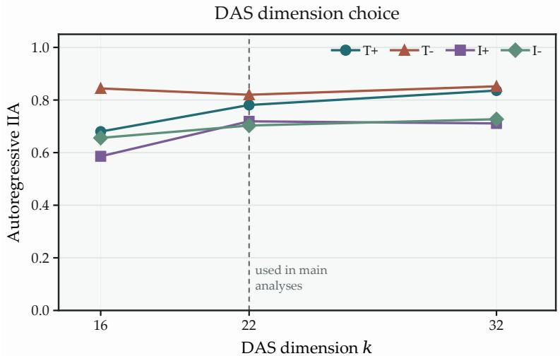  
Figure 5: Epoch-matched DAS dimension selection. Autoregressive IIA for $k \in \{ 1 6 , 2 2 , 3 2 \}$ across text and image addition and subtraction. Using $k = 3 2$ as the reference, we compare retention across the tested dimensions. A dimension of $k = 1 6$ falls below the 90% retention threshold in two conditions, whereas $k = 2 2$ satisfies it across all four. We therefore retain $k = 2 2$ for the main analyses, retraining the final subspaces with the longer 15-epoch budget.

for text and image addition and subtraction. Taking $k = 3 2$ as the reference, we select the smallest common dimension satisfying

$$
\mathrm { I I A _ { A R } } ( k ) \geq 0 . 9 0 \mathrm { I I A _ { A R } } ( 3 2 )
$$

in every condition. As shown in fig. $5 , k = 1 6$ falls below the 90% retention threshold in two conditions, whereas $k = 2 2$ satisfies it in all four conditions. We therefore use $k = 2 2$ throughout the main analyses.

## B NUMERICAL GEOMETRY IN TEXT ARITHMETIC

This appendix reports the diagnostic characterization of the textual reference conditions. None of it is required for the cross-condition results, but it establishes where an organized numerical representation appears and motivates the choice of comparison object made in Section 3.

## B.1 EMERGENCE AND CONSOLIDATION OF A BASE-10 CODE

For addition and subtraction, a weak result signal exists in earlier layers and linear probe accuracy rises sharply around layer 35. Periodic structure appears at the same depth. Figure 6 shows the transition for the period-10 component: little separation by result modulo 10 at layer 34, a circular ordering emerging at layer 35, and clear structure by layer 38.

First appearance is not the most stable form. Comparing period-matched Fourier planes across late layers with the symmetric subspace overlap $\bar  \kappa _ { \mathrm { s y m } } ( A , \bar { B ) } = \| Q _ { A } ^ { \top } Q _ { B } \| _ { F } ^ { 2 } / \operatorname* { m i n } ( \bar { k _ { A } } , k _ { B } )$ , the planes at layers 42 to 44 have the greatest average overlap with surrounding late layers (fig. 7, left). We therefore distinguish emergence of the code around layer 35 from its consolidation into a stable coordinate system in the low forties, which is the range the main analyses use.

A result probe trained on one operation transfers strongly to the other in both directions, so the same linear readout stays informative across operations within the restricted answer space. Their Fourier planes at layers 42 to 44 nonetheless align only weakly, an early instance of the pattern that recurs throughout the paper: compatible information, non-identical coordinates.

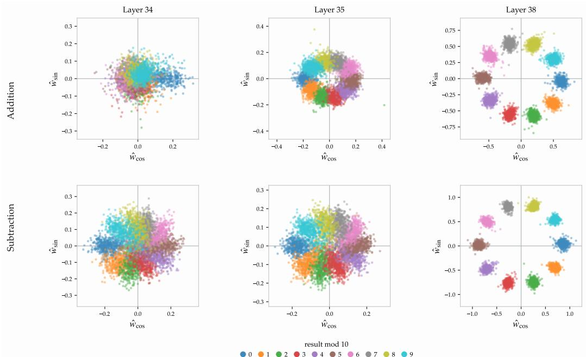  
Figure 6: A base-10 result geometry becomes progressively organized across layers. Residual stream activations for addition and subtraction projected onto the orthonormalized period-10 Fourier plane at layers 34, 35 and 38, coloured by result modulo 10.

## B.2 MULTIPLICATION

Multiplication is excluded from the four-condition analyses because its causal organization is more distributed and changes with depth, not because it lacks numerical structure. Writing $a = 1 0 a _ { 1 } + a _ { 0 }$ and $b \in \{ 0 , \ldots , 9 \}$ , we track the intermediates of Bai et al. (2025), $\hat { c } _ { 0 } = a _ { 0 } b , c _ { 0 } = \hat { c } _ { 0 }$ mod 10, and $\hat { c } _ { 1 } = a _ { 1 } b + \lfloor \hat { c } _ { 0 } / 1 0 \rfloor$

The product is refined from coarse to precise. The final product does not become available all at once. On the result-balanced subset, exact top-1 classification remains weak at depths where a long-period Fourier probe spanning the product range is already informative. At the same layers, top-k accuracy rises substantially with k: the correct product is often not yet the most likely class, but has already been restricted to a smaller candidate set. This is consistent with a coarse numerical estimate being progressively refined into an exact product (fig. 8).

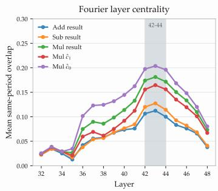

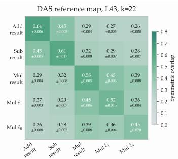

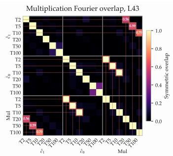  
Figure 7: The numerical representation stabilizes into partially shared, operation-dependent late states. (Left) Cross-layer stability of the Fourier representation, averaged first over periods $T \in \bar { \{ 5 , 1 0 , 2 0 , 5 0 , 1 0 0 \} }$ and then over comparison layers. Layers 42 to 44 achieve the highest mean overlap. (Middle) Symmetric overlap between independently learned $k = 2 2 \mathrm { D A S }$ subspaces. Addition and subtraction share a substantial component (0.45) while remaining below within-variable consistency across seeds. The multiplication variables form a second family. (Right) Cross-variable Fourier plane overlap between the multiplication intermediates and the final product. All panels use activations at semantic position 17.

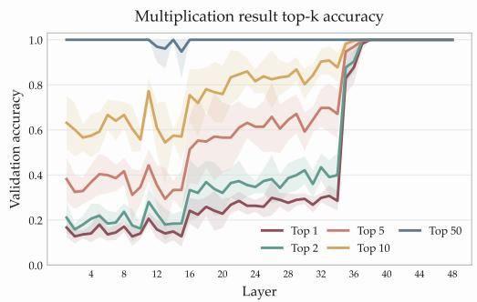

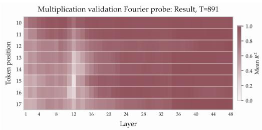  
Figure 8: Multiplication develops from coarse magnitude to exact classification. Left: Top-k accuracy for the result-balanced exact-product linear probe. The increase with k shows that the correct product is often restricted to a smaller candidate set before becoming the top prediction. Right: Held-out mean $R ^ { 2 }$ for a long-period Fourier probe spanning the multiplication result range. The earlier Fourier signal is consistent with approximate magnitude information preceding exact product classification.

On a result-balanced subset, exact product decodability rises sharply around layer 35 and the late representation develops Fourier structure. The intermediates relate to the product through decimal place value, and the Fourier overlap map recovers exactly those relations (fig. 7, right): since $r = c _ { 0 } + 1 0 \hat { c } _ { 1 }$ we have r mod $T = \hat { c } _ { 0 }$ mod $T$ for $T \in \{ 5 , 5 , 1 0 \}$ , so $\hat { c } _ { 0 }$ shares the short-period planes of the result, while a period-T component of $\hat { c } _ { 1 }$ contributes at period $1 0 T$ , so its period-2, 5 and 10 planes align with the product’s period-20, 50 and 100 planes.

The causal organization is more distributed. DAS sweeps over the final product and multiplication intermediates confirm that their causal roles differ across depth (fig. 9). Compared with addition and subtraction, the final product and its intermediates show weaker and more distributed autoregressive control. The effect of $\hat { c } _ { 0 }$ is more localized, with a clearer peak around layer 36, whereas $\hat { c } _ { 1 }$ shows a weaker but more sustained influence across the later layers.

A controlled $\hat { c } _ { 1 }$ intervention makes this distinction clearer. We select pairs whose answers contain at least three digits and satisfy $r _ { \mathrm { b a s e } }$ mod $1 0 0 \ : = \ : r _ { \mathrm { d o n o r } }$ mod 100 while differing in $\hat { c } _ { 1 } ^ { \phantom { \dagger } }$ , thereby fixing the lower two answer digits while changing the higher-order multiplication state. Under this pairing, variable-level IIA becomes nearly perfect in the late-middle layers, while teacher-forced and autoregressive answer IIA remain substantially lower. Thus, $\hat { c } _ { 1 }$ can be causally manipulated as an internal variable without being sufficient by itself to reproduce the complete answer.

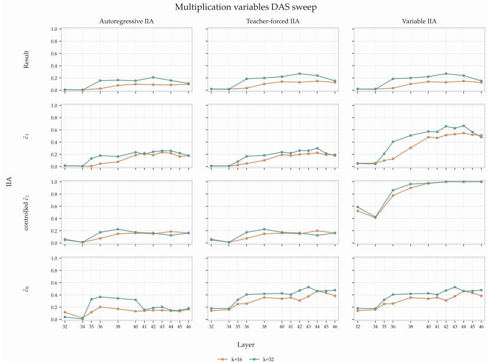  
Figure 9: DAS layer and dimensionality sweeps for multiplication variables. Rows show the final result, ${ \hat { c } } _ { 1 } ,$ controlled ${ \hat { c } } _ { 1 } ,$ and ${ \hat { c } } _ { 0 } ;$ columns report autoregressive, teacher-forced, and variable-level IIA for $k = 1 6$ and $k = 3 2$ . In the controlled $\hat { c } _ { 1 }$ condition, base and donor examples share r mod 100 but differ in $\hat { c } _ { 1 }$ . The intervention achieves near-perfect variable-level control in the late layers, but substantially weaker answer-level control.

The causal geometry also changes with depth. At layer 43, the final-product DAS space aligns most strongly with $\hat { c } _ { 1 }$ , while $\hat { c } _ { 0 }$ occupies more distinct coordinates; a $\hat { c } _ { 0 }$ space learned at layer 36 progressively loses alignment with later multiplication spaces. Multiplication therefore passes through a connected but evolving family of intermediate numerical states rather than one stable result space.

## B.3 FOURIER GEOMETRY IS A SIGNATURE, NOT A CAUSAL BASIS

To relate the visible periodic geometry to the causal subspaces, we measure directional containment $\kappa ( R  F ) = \| Q _ { R } ^ { \top } Q _ { F } \| _ { F } ^ { 2 } / \bar { k } _ { F }$ of a Fourier plane inside the corresponding DAS space. Fourier directions are consistently better represented than random subspaces predict, but containment is far from complete.

We then order the DAS directions by alignment with the Fourier subspace. Taking $F ^ { \top } R = U \Sigma V ^ { \top }$ and $\mathbf { \boldsymbol { q } } _ { i } = R \mathbf { \boldsymbol { v } } _ { i }$ gives directions spanning the same causal space but ordered by principal alignment with Fourier geometry. Intervening cumulatively from either end (fig. 10) shows that in Llama3.1-8B the 11 Fourier-visible directions recover about 84% of the full autoregressive $\mathrm { I I A } _ { \mathrm { A R } }$ while the remaining five contribute little in isolation, whereas in Gemma4-12B-it the corresponding 11 recover about 23%, the remaining 11 about $7 \% .$ , and the full effect appears only when both are combined. The geometric alignment differs correspondingly: the mean squared principal cosine over the Fouriervisible directions is 13.1% in Llama3.1-8B against 2.6% in Gemma4-12B-it.

Consistently, direct Fourier steering in Llama3.1-8B makes the intended value the top prediction in 52% of interventions, while in Gemma4-12B-it diagonal top-1 accuracy stays near chance $( \approx 5 \% )$ across the tested result-forming layers and prompt positions, so the failure is not explained by an inappropriate intervention site.

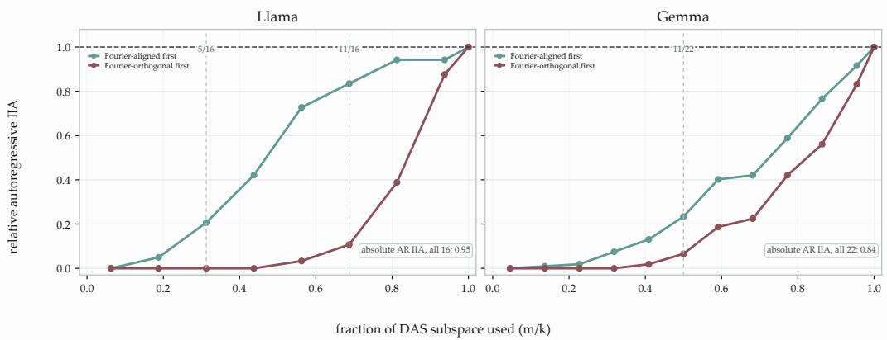  
Figure 10: The causal role of Fourier geometry differs across models. (Left) In Llama3.1-8B, directions most aligned with the Fourier subspace recover most of the full DAS effect. (Right) Gemma4-12B-it is more distributed: Fourier-aligned directions recover a minority of the effect and substantial recovery needs directions outside the visible Fourier geometry. The x-axis reports $m / k ,$ where m is the number of retained DAS direction ordered by Fourier alignment and k is the full DAS dimensionality.

## C CROSS-CONDITION TRANSPORT

## C.1 VISUAL ARITHMETIC DEVELOPS A COMPARABLE LATE CAUSAL STATE

Image addition and subtraction follow the same representational progression as their textual counterparts. Results become strongly linearly accessible in the middle-late layers, periodic structure emerges in the same region, and the clearest signal sits near the final pre-generation position. Activation patching and DAS identify strong causal influence in the late layers (42–45) at that position, matching the reference configuration of Appendix A.2.

The conditions differ in how controllable they are. Within-condition $\mathrm { I I A } _ { \mathrm { A R } }$ reaches 0.747 for image addition and 0.693 for image subtraction, against 0.831 and 0.862 for text addition and subtraction, respectively. The final pre-generation position remains preferred under the dedicated causal sweep, although the best layer and the effect of increasing k vary across conditions. These different condition-specific causal ceilings motivate the destination-normalized transfer used in the main analyses (eq. (2)); the corresponding raw $\mathrm { I I A } _ { \mathrm { A R } }$ values and seed-level diagnostics are reported below.

## C.2 DIRECT REUSE: RAW CAUSAL EFFECTS AND CONTROLS

Figure 2a reports destination-normalized direct reuse, which accounts for the different causal ceilings of the four destination conditions. For completeness, fig. 11 reports the corresponding raw autoregressive intervention accuracy before normalization.

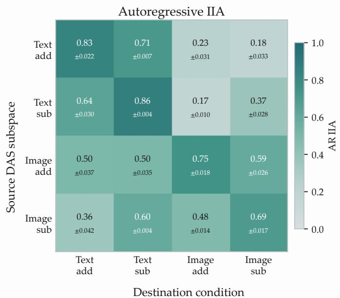  
Figure 11: Arithmetic result subspaces show partial direct causal transfer across operations and modalities. Raw IIAAR when the subspace learned on the source condition is used to intervene on base and donor activations drawn from the destination condition. Entries report mean ± standard deviation across the 3 × 3 combinations of source and destination DAS seeds.

The control subspace in eq. (2) is a random k-dimensional subspace sampled from the retained PCA span of the destination activations and evaluated on the same base–donor pairs, which keeps the baseline equal in dimension and restricted to directions the destination actually occupies.

The random subspace supplies the normalization baseline for all four destinations. Each sameoperation cross-modal direction is evaluated over all $3 \times 3$ independently trained source–destination DAS seed combinations (table 2).

Fourier planes also align only weakly across modalities. For image addition, mean text–image minrank containment over layers 42–44 and the tested periods is 0.0076, with a maximum of 0.093 for the

Table 2: Per-seed destination-normalized direct transfer. Rows denote source DAS seeds and columns destination DAS seeds. Each 3 × 3 block reports one same-operation cross-modal transfer direction.
<table><tr><td></td><td colspan="3"> $\Gamma _ { \circledast } \to \mathsf { I } _ { \circledast }$ </td><td colspan="3"> $\mathsf { T } _ { \Theta } \to \mathsf { I } _ { \Theta }$ </td><td colspan="3"> $\mathsf { I } _ { \oplus } \to \mathsf { T } _ { \oplus }$ </td><td colspan="3"> $\mathsf { I } _ { \Theta } \to \mathsf { T } _ { \Theta }$ </td></tr><tr><td>Source seed</td><td>0</td><td>1</td><td>2</td><td>0</td><td>1</td><td>2</td><td>0</td><td>1</td><td>2</td><td>0</td><td>1</td><td>2</td></tr><tr><td>0</td><td>.306</td><td>.323</td><td>.312</td><td>.535</td><td>.517</td><td>.505</td><td>.582</td><td>.610</td><td>.615</td><td>.691</td><td>.691</td><td>.685</td></tr><tr><td>1</td><td>.245</td><td>.258</td><td>.250</td><td>.512</td><td>.494</td><td>.484</td><td>.527</td><td>.552</td><td>.558</td><td>.700</td><td>.700</td><td>.694</td></tr><tr><td>2</td><td>.337</td><td>.355</td><td>.344</td><td>.605</td><td>.584</td><td>.571</td><td>.627</td><td>.657</td><td>.663</td><td>.691</td><td>.691</td><td>.685</td></tr></table>

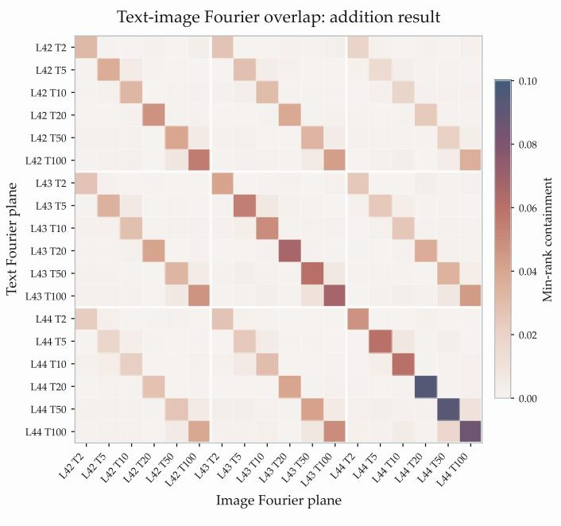  
Figure 12: Cross-modal alignment of result Fourier planes. Min-rank containment between textual and visual addition-result Fourier planes across layers and periods. Cross-modal alignment remains weak, including between matched periods, despite the periodic numerical structure visible separately within each modality.

matched layer-44, period-20 planes (fig. 12). Thus, although both modalities independently develop periodic numerical structure, those visible Fourier planes do not form one common cross-modal basis.

## C.3 CHOICE OF ALIGNMENT TARGET

Table 3 compares three quantities one could align: complete DAS coordinates, result-conditioned centroids, and the base-to-donor displacement that the interchange intervention actually modifies. A rotation fitted on displacements already improves mean normalized recovery to 0.718, compared with 0.532 under direct reuse. Adding a global scale further raises recovery to 0.914.

Table 3: Comparison of cross-modal alignment targets. Destination-normalized transfer, averaged over the 3 × 3 source and destination DAS seed combinations.
<table><tr><td>Method</td><td> $\mathsf { T } _ { \oplus } \to \mathsf { l } _ { \oplus }$ </td><td> $\mathsf { T } _ { \Theta } \to \mathsf { I } _ { \Theta }$ </td><td> ${ \mathsf I } _ { \oplus } \to { \mathsf T } _ { \oplus }$ </td><td> ${ \mathsf { I } } _ { \Theta } \to { \mathsf { T } } _ { \Theta }$ </td></tr><tr><td>Direct transfer</td><td>0.303</td><td>0.534</td><td>0.599</td><td>0.692</td></tr><tr><td>Absolute-state Q</td><td>0.546</td><td>0.772</td><td>0.708</td><td>0.804</td></tr><tr><td>Centroid-displacement Q</td><td>0.531</td><td>0.795</td><td>0.705</td><td>0.816</td></tr><tr><td>Displacement Q</td><td>0.531</td><td>0.811</td><td>0.704</td><td>0.828</td></tr><tr><td>Scaled displacement αQ</td><td>0.791</td><td>0.983</td><td>0.950</td><td>0.932</td></tr></table>

## C.4 TRANSFORMATION ABLATIONS

Table 4 isolates the contributions of orientation and magnitude to same-operation cross-modal transport. The fitted orthogonal map $Q$ alone improves mean normalized recovery from 0.532 to 0.718, while adding a global scale raises it further to 0.914. Applying the fitted scale without the learned rotation produces essentially no causal transfer; random orthogonal maps also fail, with or without scaling. The learned scaled orthogonal map $\alpha Q$ recovers 0.791, 0.983, 0.950 and 0.932 of the destination-specific effect across the four directions. Allowing a fully unrestricted linear map reaches 0.963 mean recovery, showing that most of the usable linear correspondence is captured by one learned orientation and one global scale.

Table 4: Full scaled-displacement ablation. Destination-normalized transfer, averaged over the $3 \times 3$ seed combinations.
<table><tr><td>Method</td><td> $\mathsf { T } _ { \oplus } \to \mathsf { l } _ { \oplus }$ </td><td> ${ \sf T } _ { \Theta }  { \sf I } _ { \Theta }$ </td><td> ${ \mathsf I } _ { \oplus } \to { \mathsf T } _ { \oplus }$ </td><td> ${ \mathsf { I } } _ { \Theta } \to { \mathsf { T } } _ { \Theta }$ </td></tr><tr><td>Direct</td><td>0.303</td><td>0.534</td><td>0.599</td><td>0.692</td></tr><tr><td>Displacement  $Q$ </td><td>0.531</td><td>0.811</td><td>0.704</td><td>0.828</td></tr><tr><td>Scale only αI</td><td>0.004</td><td>0.004</td><td>0.003</td><td>0.012</td></tr><tr><td>Random rotation  $Q _ { \mathrm { r a n d } }$ </td><td>0.001</td><td>0.004</td><td>0.000</td><td>0.001</td></tr><tr><td>Scaled random  $\alpha Q _ { \mathrm { r a n d } }$ </td><td>0.001</td><td>0.011</td><td>0.002</td><td>0.004</td></tr><tr><td>Full αQ</td><td>0.791</td><td>0.983</td><td>0.950</td><td>0.932</td></tr><tr><td>Unrestricted linear A</td><td>0.889</td><td>0.993</td><td>1.001</td><td>0.970</td></tr></table>

## C.5 RANK-RESTRICTED TRANSPORT

How many directions does the correspondence actually require? If only a handful carried it, crossmodal alignment would reduce to a small set of dominant axes. Let $X$ and $Y$ contain matched source and destination training displacements. We decompose their cross-covariance as

$$
X ^ { \top } Y = V \Sigma U ^ { \top }
$$

and order the matched directions by decreasing singular value. We use the cross-covariance rather than the fitted orthogonal map $Q ,$ whose singular values are all one and therefore provide no ordering. Retaining the leading m matched pairs gives

$$
\Delta z _ { B } ^ { ( m ) } = \alpha U _ { m } V _ { m } ^ { \top } \Delta z _ { A } .
$$

The full sweep separates three quantities: cumulative singular-value mass, held-out displacement cosine, and destination-normalized causal transfer (fig. 13). Geometry saturates substantially earlier than causal control. The number of modes required to reach 95% of the full-map causal recovery is 19, 17, 19 and 16 for $\mathsf { T } _ { \oplus } \to \mathsf { I } _ { \oplus } , \mathsf { T } _ { \ominus } \to \mathsf { I } _ { \ominus } , \mathsf { I } _ { \oplus } \bar { \to } \mathsf { T } _ { \oplus }$ and $| _ { \Theta }  \mathsf { T } _ { \Theta } ,$ , respectively.

The directions that best summarize the cross-condition correspondence geometrically are therefore not sufficient to reproduce it causally. This cumulative ordering shows that the leading modes alone are insufficient; it should not be interpreted as measuring the isolated causal contribution of each individual mode.

## C.6 CROSS-OPERATION AND COMPOSED TRANSPORTS

When the arithmetic operation changes, expressions no longer correspond one-to-one. An addition and a subtraction expression may represent the same numerical change while sharing neither operands nor computation. We therefore match the condition-specific spaces by the ordered numerical transition implemented by the intervention. For condition $A ,$ we define

$$
\Delta z _ { a  b } ^ { A } = \mathbb { E } \big [ \Delta z ^ { A } \mid y _ { \mathrm { b a s e } } = a , y _ { \mathrm { d o n o r } } = b \big ] ,
$$

so $a \to b$ always denotes changing the represented result from a to $b ,$ regardless of which expressions realize those values.

Scaled orthogonal maps are fitted between these transition-conditioned means, with one mean vector contributing per ordered transition. Applying the same estimator to the easier same-operation crossmodal relations, where exact expression matching is also available, provides a control for estimator choice. Averaging over expressions may remove expression-specific information while preserving the numerical transition geometry.

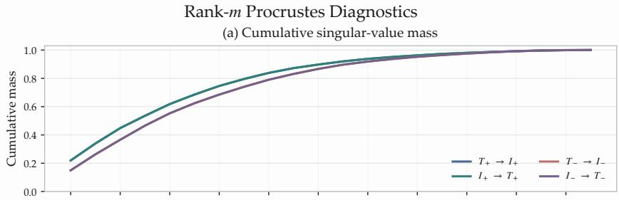

(b) Held-out displacement cosine  
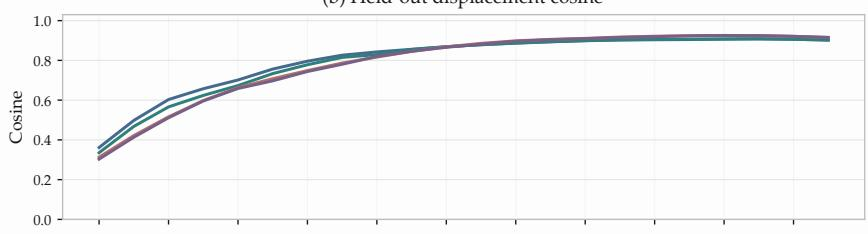

(c) Destination-normalized causal transfer  
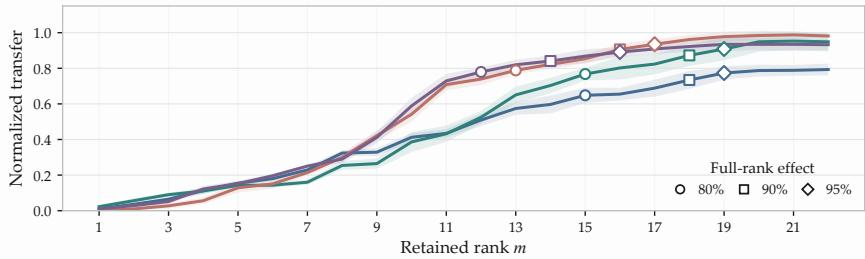  
Figure 13: Full diagnostics for cumulative rank-m transport. From top to bottom: cumulative singular-value mass, cosine alignment on test expressions, and destination-normalized causal transfer. Geometric quantities saturate earlier than causal performance, showing that the leading matched modes are not sufficient to reproduce the full intervention effect.

Table 5: Direct transports that change both modality and operation. Each map is fitted directly between the indicated source and destination condition using matched ordered numerical transitions. Entries report mean ± sample standard deviation of destination-normalized autoregressive transfer across the $3 \times 3$ source–destination DAS seed combinations.
<table><tr><td></td><td>Transport Normalized transfer</td></tr><tr><td> ${ \mathsf I } _ { \oplus } \to { \mathsf T } _ { \Theta }$   ${ \mathsf I } _ { \Theta } \to { \mathsf T } _ { \Theta }$   $T _ { \circledast }  { \mathsf { I } } _ { \circledast }$ </td><td> $0 . 8 4 7 \pm 0 . 0 5 7$   $0 . 8 4 2 \pm 0 . 0 8 2$   $0 . 8 3 9 \pm 0 . 0 4 7$ </td></tr><tr><td> $T _ { \odot } \to { \mathsf { I } } _ { \oplus }$ </td><td> $0 . 6 9 9 \pm 0 . 0 6 9$ </td></tr><tr><td>Mean</td><td>0.807</td></tr></table>

The fitted transport is also effective when only the operation changes: mean normalized recovery reaches 0.828, compared with 0.773 for direct reuse (fig. 2a). These means come from different pair-sampling protocols and are not a paired comparison. Thus, operation changes already admit strong causal reuse without alignment, while fitted maps also preserve their numerical transition geometries. Relations changing both factors reach 0.807 mean normalized recovery (table 5).

We next ask whether a relation that changes both factors can be reconstructed without fitting that relation directly. For each such source–destination pair, we compare the direct map with two paths: one changes modality first and operation second, and the other reverses the order. For example, $\mathsf { T } _ { \ @ } \to \mathsf { l } _ { \odot }$ can be reached through

$$
\mathsf { T } _ { \oplus } \to \mathsf { I } _ { \oplus } \to \mathsf { I } _ { \ominus }
$$

Table 6: Causal performance of direct and composed transport paths. Entries report mean $\pm$ sample standard deviation of destination-normalized autoregressive transfer across the 3 × 3 source–destination DAS seed combinations. The composed paths use only the two simpler pairwise maps along the corresponding modality-first or operation-first route.
<table><tr><td>Transport</td><td>Direct</td><td>Modality first</td><td>Operation first</td></tr><tr><td> ${ \mathsf I } _ { \oplus } \to { \mathsf T } _ { \Theta }$ </td><td> $0 . 8 4 7 \pm 0 . 0 5 7$ </td><td> $0 . 8 4 5 \pm 0 . 0 4 3$ </td><td> $0 . 8 4 6 \pm 0 . 0 4 9$ </td></tr><tr><td> ${ \mathsf I } _ { \Theta } \to { \mathsf T } _ { \Theta }$ </td><td> $0 . 8 4 2 \pm 0 . 0 8 2$ </td><td> $0 . 8 4 1 \pm 0 . 0 7 1$ </td><td> $0 . 8 3 5 \pm 0 . 0 7 4$ </td></tr><tr><td> $T _ { \circledast }  { \mathsf { I } } _ { \circledast }$ </td><td> $0 . 8 3 9 \pm 0 . 0 4 7$ </td><td> $0 . 8 1 7 \pm 0 . 0 3 7$ </td><td> $0 . 8 3 3 \pm 0 . 0 4 3$ </td></tr><tr><td> ${ \sf T } _ { \Theta }  { \sf I } _ { \oplus }$ </td><td> $0 . 6 9 9 \pm 0 . 0 6 9$ </td><td> $0 . 6 9 5 \pm 0 . 0 7 4$ </td><td> $0 . 6 8 2 \pm 0 . 0 8 3$ </td></tr><tr><td>Mean</td><td>0.807</td><td>0.799</td><td>0.799</td></tr></table>

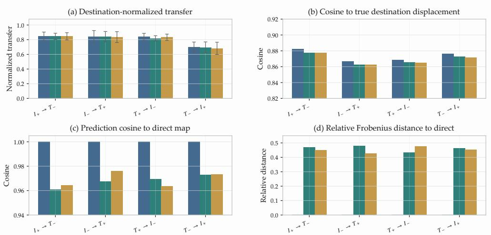  
Figure 14: Complete composed-path comparison. For each cross-operation direction, the figure compares the directly fitted transport with the modality-first and operation-first compositions. Panels report destinationnormalized causal transfer, cosine to the true destination displacement, cosine between the composed and direct-map predictions, and normalized Frobenius distance to the direct operator.

## or through

$$
\mathsf { T } _ { \oplus } \to \mathsf { T } _ { \ominus } \to \mathsf { I } _ { \ominus } .
$$

The two composed paths preserve almost all of the direct causal effect (table 6). Averaged over the four relations, direct transport reaches 0.807 destination-normalized transfer, compared with 0.799 for modality-first and 0.799 for operation-first composition.

The geometric comparison shows where this agreement holds (fig. 14). On held-out numerica transitions, the displacements predicted by the modality-first and operation-first paths have mean cosine 0.968 and 0.969, respectively, with those predicted by the directly fitted maps. Agreement on the observed numerical transitions does not, by itself, imply equality between the full 22-dimensional transformations.

## D READOUT DECOMPOSITION AND THE COMMON FRAME

## D.1 DIGIT-READOUT OVERLAP AND ABLATION CONTROLS

The centered digit-discriminative span $U _ { \mathrm { D } }$ defined in Section 5 has rank 9. For an orthonormal DAS basis $R \in \mathbb { R } ^ { d _ { \mathrm { m o d e l } } \times 2 2 }$ , we quantify its coupling to this readout as

$$
E _ { \mathrm { D } } = \frac { \left. U _ { \mathrm { D } } ^ { \intercal } R \right. _ { F } ^ { 2 } } { \left. R \right. _ { F } ^ { 2 } } .
$$

Learned DAS spaces are substantially more aligned with the digit readout than random subspaces of the residual stream: for text addition at layer 43, the observed containment is 41.65 times the analytic random residual-subspace expectation. Untrained PCA and random-in-PCA controls show 22.78 and 23.90 times this expectation, respectively, indicating additional readout enrichment in the trained causal DAS spaces.

Across the four arithmetic conditions, approximately 9.8%–11.0% of the squared DAS basis norm lies along the digit-readout span. Removing this component nevertheless almost eliminates autoregressive control. Mean self $\mathrm { \dot { - } I I A _ { A R } }$ falls from 0.826, 0.865, 0.747 and 0.695 for ${ \mathsf { T } } _ { \oplus } , { \mathsf { T } } _ { \ominus } ,$ I and $\mathsf { I } _ { \Theta }$ to 0.008, 0.000, 0.005 and 0.003, respectively. The effect is specific to the readout geometry rather than to removing nine dimensions: a dimension-matched random rank-9 ablation leaves 0.634, 0.791, 0.339 and 0.560 (fig. 15b).

These values are evaluated on the 128-pair held-out readout-ablation set; the resulting full-DAS baselines differ slightly from those in the main evaluation. The learned spaces, layer, and intervention position are unchanged.

As an independent functional check that this coupling reflects a reusable digit-output component rather than arithmetic-specific structure, we apply the text-addition DAS intervention to a non-arithmetic one-digit repeat task, such as

$$
\mathtt { R e p e a t \ t h i s \_ n u m b e r { : } } \quad 7 \ =
$$

which requires the same digit output vocabulary but no arithmetic computation. The arithmetictrained space reaches 0.489 teacher-forced IIA, whereas random and untrained PCA-based controls reach zero. Under the stricter eight-token complete-answer autoregressive criterion, transfer is only 1.5%. Thus, part of the final-position causal state learned from arithmetic can be reused directly to control the immediate digit output even when no arithmetic computation is required.

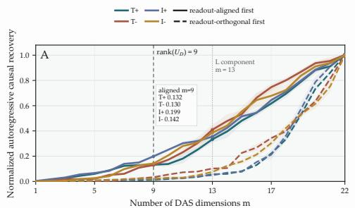

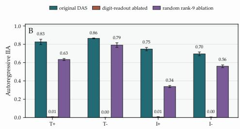  
Figure 15: Final-position causal control depends specifically on digit-readout coupling, but is carried by neither component alone. (a) Cumulative autoregressive recovery with the 22 DAS directions ordered from most to least digit-readout aligned, and in reverse. The dashed line marks the rank-9 boundary between D and L defined in Section 5. Neither component is sufficient by itself. (b) Removing $U _ { \mathrm { d i g } }$ from the complete DAS state almost eliminates autoregressive control in all four conditions, whereas ablating a dimension-matched random span preserves a substantial fraction of the original effect.

## D.2 READOUT-FREE GEOMETRY

Exact decomposition. For each learned DAS basis $R ,$ we compute

$$
U _ { D } ^ { \top } R = A \Sigma V ^ { \top }
$$

and rotate the basis within its own span as

$$
\widetilde { R } = R V = [ \widetilde { r } _ { 1 } , . . . , \widetilde { r } _ { 2 2 } ] .
$$

This changes only the coordinates inside the learned space, since

$$
\widetilde { R } \widetilde { R } ^ { \top } = R R ^ { \top } .
$$

The overlap matrix has numerical rank 9 for every condition and DAS seed, so we define

$$
\begin{array} { r } { D = [ \tilde { r } _ { 1 } , \ldots , \tilde { r } _ { 9 } ] , \qquad L = [ \tilde { r } _ { 1 0 } , \ldots , \tilde { r } _ { 2 2 } ] . } \end{array}
$$

Across conditions and seeds,

$$
\| U _ { D } ^ { \top } L \| _ { F } = O ( 1 0 ^ { - 7 } ) , \qquad \| \Pi _ { D } + \Pi _ { L } - R R ^ { \top } \| _ { F } = O ( 1 0 ^ { - 6 } ) ,
$$

so L lies in the exact readout null space within the learned DAS representation and the decomposition discards no part of the original causal subspace.

Value-held-out evaluation. All readout-free geometry experiments use a value-disjoint split. The 100 possible result values are divided into 80 alignment-training values and 20 held-out values. Writing

$$
\mu _ { i } ( y ) = \mathbb { E } [ z _ { i } \mid { \mathrm { r e s u l t } } = y ] , \qquad \Delta _ { i } ( a  b ) = \mu _ { i } ( b ) - \mu _ { i } ( a ) ,
$$

a transition contributes to the fitted scaled orthogonal map only when both a and b belong to the 80 training values. Evaluation uses exclusively transitions whose endpoints belong to the 20 held-out values. No numerical value appearing during evaluation therefore contributes to the fitted crosscondition transformation; this holdout is during alignment fitting, not during the preceding DAS training.

Because displacement alignment does not determine the origin of each coordinate system, one condition-specific offset is estimated from the training-value centroids and held fixed during retrieval of the unseen values. Top-1 retrieval is among the 20 held-out candidates, so chance is 5%.

Table 7 compares readout-orthogonal representations and controls. Projecting the digit span out of the complete DAS representation leaves mean held-out transition cosine 0.908 and 98.1% top-1 retrieval.

The exact 13-dimensional L component retains most of the relational structure while giving up some ability to identify individual values: transition cosine remains 0.807, with 75.5% top-1 retrieval. A dimension-matched random readout-orthogonal subspace reaches 0.558 transition cosine and 38.3% top-1, while shuffling destination value identities before fitting reduces transition cosine to −0.003 and retrieval to 5.2% (approximately chance). Thus, L concentrates substantially more crosscondition numerical structure than a generic readout-orthogonal slice, and the alignment depends on matching the same numerical identities across conditions.

No-fit RSA. As a fitting-free check, Representational Similarity Analysis compares the pairwise distance matrices of the held-out value centroids without estimating any cross-condition transformation:

$$
d _ { i } ( a , b ) = \lVert \mu _ { i } ( a ) - \mu _ { i } ( b ) \rVert _ { 2 } .
$$

The mean cross-condition Spearman correlation is 0.808 after projecting the digit span out of the complete DAS representation and 0.765 in the exact L spaces, compared with 0.545 for dimensionmatched random readout-orthogonal subspaces. For L, a 1000-permutation numerical-label test reaches

$$
p = { \frac { 1 } { 1 0 0 1 } } ,
$$

the minimum attainable under this procedure. The readout-free correspondence is therefore visible even before any cross-condition map is fitted.

Table 7: Cross-condition numerical geometry after separating the current digit readout. Transition cosine and retrieval are evaluated only on numerical values excluded from the alignment fit. Top-1 retrieval is among 20 held-out values, so chance is 5%. A dash indicates that RSA was not evaluated.
<table><tr><td>Representation</td><td>Transition cosine</td><td>Top-1</td><td>RSA  $\rho$ </td></tr><tr><td>Projected DAS (22d)</td><td>0.908</td><td>98.1%</td><td>0.808</td></tr><tr><td>Exact L (13d)</td><td>0.807</td><td>75.5%</td><td>0.765</td></tr><tr><td>Random readout-orthogonal (13d)</td><td>0.558</td><td>38.3%</td><td>0.545</td></tr><tr><td>Shuffled value correspondence</td><td>-0.003</td><td>5.2%</td><td></td></tr></table>

## D.3 SYNCHRONIZATION PROTOCOL

All pairwise L-space maps are fitted from training-value transitions only. Full-graph evaluation reconstructs every relation from the four synchronized frames. Leave-one-relation-out (LORO) evaluation removes both directions of one relation before synchronization and reconstructs it from the remainder. Because synchronization is fitted only to displacements, it does not determine the origin of the condition coordinate systems. Condition-specific offsets are therefore estimated separately from training-value centroids and used only for placing numerical values; they do not contribute to the synchronized rotations or scales.

Synchronization is performed independently for each matched DAS seed, so that each graph contains one coherent set of four condition-specific spaces. The direct-pairwise reference reported here is therefore restricted to matched source–destination seeds; this accounts for the small difference from the 0.807 mean in Section 5, which averages all $3 \times 3$ seed combinations.

Table 8: Global consistency of the exact L spaces. All metrics are evaluated on numerical values excluded from the pairwise alignment fits.
<table><tr><td>Map</td><td>Transition cosine</td><td>Top-1</td><td>Top-5</td></tr><tr><td>Direct pairwise</td><td>0.801</td><td>73.4%</td><td>98.4%</td></tr><tr><td>Full synchronization</td><td>0.791</td><td>74.8%</td><td>98.9%</td></tr><tr><td>LORO synchronization</td><td>0.762</td><td>71.1%</td><td>98.3%</td></tr><tr><td>Modality-only frames</td><td>0.249</td><td>18.1%</td><td>55.3%</td></tr></table>

A stricter two-frame control ties addition and subtraction within each modality, $U _ { \mathsf { T } _ { \oplus } } = U _ { \mathsf { T } _ { \ominus } }$ and $\begin{array} { r } { U _ { \mathsf { I _ { \oplus } } } = U _ { \mathsf { I _ { \ominus } } } . } \end{array}$ , with scales tied likewise. It drops to transition cosine 0.249 and 18.1% top-1. The four-frame result therefore cannot be reduced to one text–image transformation. LORO also preserves substantial unseen-value retrieval (71.1% top-1).

## D.4 HELD-OUT-CONDITION ADDITIVE CLOSURE

The leave-one-condition-out experiment tests whether the modality and operation effects observed in three corners of the $2 \times 2$ design can predict the numerical geometry of the fourth. This differs from synchronization: synchronization asks whether observed pairwise transformations are jointly consistent with one set of condition frames, whereas here one complete condition is absent from the prediction.

Let $i ^ { \star }$ denote the held-out condition, r its diagonally opposite observed condition, and m and o the two remaining conditions, differing from r in modality and operation respectively. We use r as the reference coordinate system. For any observed condition $i ,$ let

$$
\mathcal { A } _ { i  r } ( z ) = \alpha _ { r  i } Q _ { r  i } z + b _ { r  i }
$$

denote its affine alignment into the reference coordinates, where $Q _ { r  i }$ and $\alpha _ { r  i }$ are fitted from training-value displacements and $b _ { r  i }$ is the offset estimated from the training-value centroids.

For each numerical value $v ,$ the missing representation is predicted as

$$
\widehat { z } _ { i ^ { \star } } ( v ) = z _ { r } ( v ) + \Big ( A _ { m  r } \big ( z _ { m } ( v ) \big ) - z _ { r } ( v ) \Big ) + \Big ( A _ { o  r } \big ( z _ { o } ( v ) \big ) - z _ { r } ( v ) \Big ) .
$$

The two differences are respectively the modality and operation changes observed relative to the reference condition.

(a)  
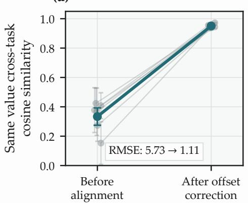

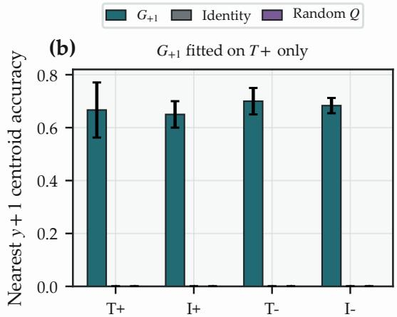  
Figure 16: A local successor relation transfers across the shared numerical frame. After registering the four full 22-dimensional DAS spaces into common coordinates, an orthogonal successor operator $G _ { + 1 }$ is fitted using text addition only and frozen. On held-out numerical values, the same operator moves representations toward the corresponding $y + 1$ centroid in text/image addition and subtraction, while identity and random-orthogonal controls fail. Transfer is strongest for one local step and degrades under repeated application.

For example, when $\mathsf { I } _ { \Theta }$ is held out, ${ \sf T } _ { \oplus }$ is the reference and

$$
\hat { z } _ { \mathsf { I } _ { \oplus } } ( v ) = z _ { \mathsf { T } _ { \oplus } } ( v ) + \left( A _ { \mathsf { I } _ { \oplus } \to \mathsf { T } _ { \oplus } } ( z _ { \mathsf { I } _ { \oplus } } ( v ) ) - z _ { \mathsf { T } _ { \oplus } } ( v ) \right) + \left( A _ { \mathsf { T } _ { \ominus } \to \mathsf { T } _ { \oplus } } ( z _ { \mathsf { T } _ { \ominus } } ( v ) ) - z _ { \mathsf { T } _ { \oplus } } ( v ) \right) .
$$

The true $\mathsf { I } _ { \odot }$ representations do not contribute to this prediction. They are aligned into the same reference coordinates only afterwards, for evaluation using an anchor map estimated for that purpose. Evaluation values are disjoint from those used to estimate the pairwise alignments.

We repeat the construction with each of $\bar { \mathsf { T } } _ { \circledast } , \mathsf { T } _ { \circledcirc } , \mathsf { l } _ { \circledast }$ and $\mathsf { I } _ { \Theta }$ held out in turn, across three matched DAS seeds and three value splits, giving 36 leave-one-condition-out evaluations. Averaged over the four held-out conditions, the predicted geometry reaches held-out transition cosine 0.629, with 58.9% top-1 retrieval among the 20 unseen values.

As a correspondence control, we repeat the construction after permuting the numerical identities of the same-modality neighbouring condition before forming the prediction, using four independent shuffles per configuration. Transition cosine falls to −0.109 and top-1 retrieval to 3.8%, approximately chance.

The experiment should therefore be interpreted as an approximate additive closure of modality and operation effects in aligned L coordinates, not as exact separability of those effects. No autoregressive intervention is performed on the predicted held-out L geometry.

## D.5 A LOCAL SUCCESSOR RELATION TRANSFERS ACROSS CONDITIONS

The common frame predicts more than correspondence between the same numerical values. If it captures a shared numerical geometry, a relation learned between nearby values in one condition should remain meaningful in the others. We test this with the simplest such relation: the successor transformation $y \mapsto y + 1$

We first register the complete 22-dimensional DAS spaces with synchronized orientations and scales and offsets estimated from training-value centroids, analogously to eq. (5) but using full DAS coordinates rather than the exact 13-dimensional L. Write $u _ { i } ^ { ( 2 \bar { 2 } ) } ( y )$ for a registered numerical centroid in condition i. Using text addition only, we fit an orthogonal operator

$$
G _ { + 1 } ^ { \star } = \arg \operatorname* { m i n } _ { G ^ { \top } G = I } \sum _ { y \in \mathcal { Y } _ { \mathrm { t r a i n } } } \left\| u _ { \sf T _ { \oplus } } ^ { ( 2 2 ) } ( y + 1 ) - G u _ { \sf T _ { \oplus } } ^ { ( 2 2 ) } ( y ) \right\| _ { 2 } ^ { 2 } .
$$

The numerical values used for evaluation are excluded entirely from the edges used to fit or validate the operator. We then freeze $G _ { + 1 } ^ { \star }$ and evaluate it without refitting on all four conditions.

The same local relation transfers across modality and operation (Figure 16). The transformed representation $G _ { + 1 } u _ { i } ^ { ( 2 2 ) } ( y )$ is nearest to the correct $y + 1$ centroid in 66.7% of text-addition cases, 65.0% of image-addition cases, 70.0% of text-subtraction cases, and 68.3% of image-subtraction cases. Identity and random-orthogonal controls remain near zero. As a behavioural check, the same transformation raises the teacher-forced top-5 presence of the entire successor target from 0.758 under the identity control to 0.887 on average. Complete-answer autoregressive accuracy under the operator is only 9.5%, however.

A transformation learned from one corner of the $2 \times 2$ design therefore preserves the same local numerical relation in the other three. This gives a direct, local view of the common geometry established by the pairwise and synchronized analyses above: what transfers is not only numerical identity, but also how nearby numerical identities are related.

The effect is approximate rather than an arithmetic mechanism. Repeated application of $G _ { + 1 }$ becomes progressively less accurate for larger shifts, and the intervention does not reliably make $y + 1$ the greedy autoregressive answer. We therefore interpret $G _ { + 1 }$ as a local regularity of the registered causal numerical geometry, not as evidence that the model performs arithmetic by repeatedly applying a linear successor operator.

## D.6 FULL-DAS SYNCHRONIZATION AS A CAUSAL CONTROL

As a behavioural counterpart to the readout-orthogonal synchronization, we repeat the same procedure in the original 22-dimensional DAS spaces, before separating their digit-readout coupling. Unlike L, these complete spaces support strong autoregressive interventions and therefore allow the synchronized relations to be evaluated causally.

Across the twelve directed relations, independently fitted pairwise transports reach mean $\mathrm { I I A _ { A R } = }$ 0.6385, while transports reconstructed from one synchronized orientation and scale per condition reach 0.6359. On the numerical transitions occupied by the data, their predicted displacements have mean cosine 0.989.

Because synchronization is fitted to displacements, it does not determine the absolute origin of each condition coordinate system. Estimating one condition-specific offset from training-value centroids raises mean same-value cross-condition cosine on held-out values from 0.334 to 0.951, while reducing RMSE from 5.73 to 1.11. Individual post-registration cosines can be as low as 0.922.

This experiment tests whether the fitted full-space transports share a global organization; it does not imply that fitting improves every individual relation, since some individual relations may differ (Section 4). We treat it as supporting evidence rather than the primary shared-frame result because the complete DAS spaces also contain the digit-readout coupling isolated in Section 5.

## E AUTOREGRESSIVE INTERVENTION DETAILS

## E.1 MATCHED AND MISMATCHED D/L INTERVENTIONS

The causal interaction experiment of Section 6 uses individual model activations rather than resultconditioned centroids. For a base state $h _ { b }$ and a donor state $h _ { y }$ representing counterfactual value y, we write the two components of the standard DAS edit as

$$
\Delta h _ { D } ^ { b \to y } = \Pi _ { D } ( h _ { y } - h _ { b } ) , \qquad \Delta h _ { L } ^ { b \to y } = \Pi _ { L } ( h _ { y } - h _ { b } ) .
$$

Since

$$
\Pi _ { D } + \Pi _ { L } = R _ { i } R _ { i } ^ { \top } ,
$$

taking both components from the same donor reconstructs exactly the original DAS interchange intervention,

$$
h _ { \mathrm { m a t c h } } = h _ { b } + \Delta h _ { D } ^ { b  y } + \Delta h _ { L } ^ { b  y } .
$$

To separate their roles, we choose a second counterfactual value $\tilde { y } \ne y$ and make the two components disagree:

$$
h _ { \mathrm { m i s } } = h _ { b } + \Delta h _ { D } ^ { b  y } + \Delta h _ { L } ^ { b  \tilde { y } } .
$$

The matched and mismatched states therefore contain the same readout-coupled contribution, while only the numerical identity supplied through L changes. We additionally evaluate D-only, L-only, and random-latent controls.

Figure 17 separates two effects. First, when y and $\tilde { y }$ require different first digits, the immediate prediction follows the value supplying $D \mathrm { : ~ a ~ } D \mathrm { - o n l y }$ intervention strongly redirects the current digit, whereas L alone does not, and a mismatch remains biased towards the digit specified by D.

Second, to isolate the later role of L, we restrict to two-digit donor values

$$
y = 1 0 y _ { 1 } + y _ { 2 } , \qquad \tilde { y } = 1 0 y _ { 1 } + \tilde { y } _ { 2 } , \qquad y _ { 2 } \ne \tilde { y } _ { 2 } .
$$

The two states now agree on the digit required immediately and disagree only on the numerical continuation. Across the four conditions and three DAS seeds, the matched intervention generates y with mean $\mathrm { I I A } _ { \mathrm { A R } } = 0 . 7 9 9$ . Replacing only $\mathbf { { { L } } } _ { y }$ by $\ b { L } _ { \tilde { y } }$ reduces $\mathrm { I I A } _ { \mathrm { A R } }$ toward y to 0.037 and redirects generation toward y˜ with $\mathrm { I I A _ { A R } } = 0 . 6 9 2 .$ A random latent displacement reaches only 0.089 toward the selected alternative value.

Crucially, this redirection leaves the shared current digit essentially unchanged: its mean probability is 0.963 in the matched state and 0.965 in the mismatch. Numerical identity in L therefore has a value-specific causal effect on the continuation despite having no direct coupling to the current digit readout.

The same-first-digit analysis contains 1009 matched/mismatched triplets across the four conditions and three DAS seeds. The random-latent control uses five displacements per triplet from unrelated numerical activations, excluding the selected base and counterfactual identities, so it preserves the magnitude and statistics of a natural latent edit without carrying the selected alternative value. Metrics are first aggregated within each condition–seed configuration and then averaged across the twelve configurations.

Pairs with different first digits. The analysis above uses pairs that share the tens digit. Table 9 reports pairs where y and y˜ differ in both digits (1041 triplets per condition, $e . g . , y = 5 2 $ and $\tilde { y } = 6 7 )$ In the mismatched state, D points to the tens digit of y and L to the units digit of y˜, so the expected output is the hybrid 57. The swap produces this hybrid in 51.6% of cases and reproduces y in only 4.7%. For reference, D alone yields the hybrid in 7.5% of cases, and the matched edit reproduces y in 74.5%, the ceiling of the 22-dimensional intervention. The swap thus reaches about two thirds of this ceiling. The units digit follows L in 57.7% of swap trials (matched: 77.9%; D alone: 8.7%; chance: 10%), while the tens digit follows D in 83.9% (matched: 88.3%). The gap to the ceiling is therefore concentrated in the units digit. The random-latent control also yields a hybrid, with the units digit of the unrelated value, in 49.1% of cases. The units digit therefore follows whichever value L carries. The random control supplies a wrong value and tests whether the selected value matters. It does not leave the units digit unedited.

Table 9: Mismatched edits on pairs with different first digits. Percentage of generations equal to $y ,$ to the hybrid (tens digit of $_ y$ and units digit of the value supplying L, which is y˜ except for Random L), and to the base answer. For Matched, D only and L only, the hybrid column counts how often the output coincides with the hybrid defined from the trial’s y and y˜.
<table><tr><td>Condition</td><td>y</td><td>Hybrid</td><td>Base</td></tr><tr><td>Matched</td><td>74.5</td><td>1.7</td><td>7.8</td></tr><tr><td>Swap L</td><td>4.7</td><td>51.6</td><td>11.8</td></tr><tr><td>D only</td><td>10.4</td><td>7.5</td><td>17.4</td></tr><tr><td>L only</td><td>4.4</td><td>1.2</td><td>75.9</td></tr><tr><td>Random L</td><td>8.7</td><td>49.1</td><td>10.9</td></tr></table>

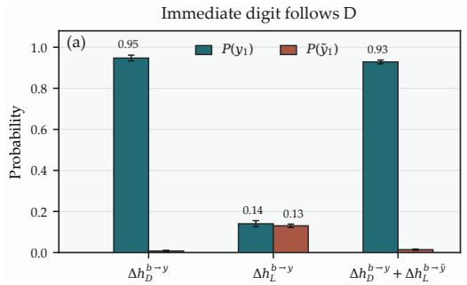

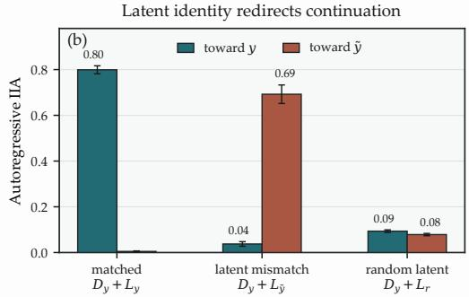  
Figure 17: The readout-coupled and readout-orthogonal components have distinct temporal causal roles. (a) The immediate digitfollows D. When the values supplying D and L require different first digits, the current prediction follows the value inserted through D; an L-only intervention does not comparably redirect that digit. (b) Numerical identity in L redirects the continuation. For values y and y˜ sharing their first digit but differing in their second, the matched intervention recovers $y ,$ whereas replacing only $\Delta { h } _ { L } ^ { b  y }$ with $\bar { \Delta h _ { L } ^ { b  \tilde { y } } }$ redirects autoregressive behaviour toward y˜. A random latent displacement does not reproduce this value-specific effect.

## E.2 CACHE PROPAGATION PROTOCOL

The temporal experiment uses the same-first-digit matched and mismatched construction of Section 6 and Appendix E.1, with separately sampled triplets. The only intervention is applied at layer 43 of the final pre-generation position $t _ { 0 } .$ After inserting the matched or mismatched state, the forward pass continues normally through the remaining layers and the resulting key–value cache is retained.

The shared first digit

$$
y _ { 1 } = \tilde { y } _ { 1 }
$$

is then supplied as the next token in both conditions, and position $t _ { 1 }$ is processed using the retained cache with no additional hidden-state intervention. Because this token is the natural first digit of both candidate values, matched and mismatched computations receive exactly the same valid autoregressive prefix. Any difference at $t _ { 1 }$ must therefore arise from the earlier intervention propagating through the model’s normal cached computation.

The intervention is introduced after layer 43 at $t _ { 0 } ,$ , so cache entries computed through that layer cannot yet contain intervention-dependent information. The first downstream entries that can carry the edit appear after this boundary, matching the sharp rise in conversion cosine from layer 44 to layer 45 reported in Section 6. The analysis uses 1536 separately sampled triplets across the four conditions and three DAS seeds.

For the layerwise conversion analysis, we project both the mismatch-induced and natural continuation changes into digit-readout coordinates,

$$
\Delta r _ { \ell } ^ { \mathrm { m i s } } = U _ { \mathrm { d i g } } ^ { \top } ( h _ { \ell , t _ { 1 } } ^ { \mathrm { m i s } } - h _ { \ell , t _ { 1 } } ^ { \mathrm { m a t c h } } ) , \qquad \Delta r _ { \ell } ^ { \mathrm { n a t } } = U _ { \mathrm { d i g } } ^ { \top } [ h _ { \ell , t _ { 1 } } ^ { \mathrm { n a t } } ( \tilde { y } ) - h _ { \ell , t _ { 1 } } ^ { \mathrm { n a t } } ( y ) ] ,
$$

and define the conversion cosine

$$
\gamma _ { \ell } = \cos ( \Delta r _ { \ell } ^ { \mathrm { m i s } } , \Delta r _ { \ell } ^ { \mathrm { n a t } } ) .
$$

It therefore measures whether the effect carried forward from the earlier latent edit points in the same digit-facing direction as the model’s natural change from y to y˜ at $t _ { 1 }$

As a value-specificity control, we repeat the propagation using an L displacement from an unrelated numerical value that shares the same required first digit. This preserves the valid common prefix while removing the selected alternative numerical identity. The probability of its alternative units digit rises only to 0.020, compared with 0.737 for the value-specific mismatch. No intervention is performed at $t _ { 1 }$ in any condition.

## E.3 REPEAT-NUMBER COMPARISON

The repeat-number experiment asks whether the numerical identity in L is specific to an arithmetic result or reflects a more general numerical state associated with a number the model is preparing to produce. We therefore use a task with no arithmetic computation, for example

$$
\begin{array} { r l r l r l } { \mathsf { O u t p u t } } & { { } \mathsf { O N L Y } } & { \mathsf { a } } & { { \mathrm { n u m b e r } } . } & { } & { { \mathsf { R e p e a t } } \quad \mathsf { t h i s } \quad { \mathrm { n u m b e r } } : } & { { } 4 3 } & { = { \mathsf { N a m b e r } } . } \end{array}
$$

where the numerical value is supplied directly.

No repeat-specific DAS space is trained and no intervention is performed. Instead, the layer-43 final-position activation from each repeat prompt is projected directly into each arithmetic $\mathbf { { { L } } } _ { i }$ basis and compared with arithmetic states representing the same numerical values. The broader analysis covers values $0 , \ldots , 9 9$ , with two-digit values used for the principal geometric comparison.

A direct comparison has an estimator mismatch: an arithmetic value centroid averages several expressions producing the same result, whereas the repeat task contains one prompt per value. We therefore repeat the analysis after sampling exactly one correctly answered arithmetic expression for each

$$
y \in \{ 1 0 , \ldots , 8 9 \} ,
$$

and repeat this sampling procedure 200 times (fig. 18). This removes the advantage arithmetic receives from averaging multiple examples into each centroid.

Under this estimator-matched comparison, arithmetic-to-arithmetic alignment reaches mean held-out transition cosine 0.655, compared with 0.690 for repeat-to-arithmetic alignment. Top-1 retrieval is 57.9% against 65.1%, respectively. The fitting-free relational comparison instead favors arithmetic, with RSA 0.633 for arithmetic-to-arithmetic and 0.518 for repeat-to-arithmetic. The repeat advantage in fitted transition geometry and the arithmetic advantage in no-fit RSA persist across all 200 samples.

The repeat task produces the correct answer for all values $0 , \ldots , 9 9$ when greedy generation is evaluated at the target answer length, including both digits of two-digit numbers. Thus, the geometric differences cannot be attributed to incorrect numerical repetition under this criterion.

The repeat states therefore retain substantial numerical organization found in arithmetic L: fitted alignment and retrieval can even outperform arithmetic-to-arithmetic comparisons, although the no-fit geometries differ. We consequently interpret L conservatively as a latent numerical result state: a structured representation of numerical identity reached by several arithmetic routes and, to a substantial degree, by a non-arithmetic task that requires producing the same number.

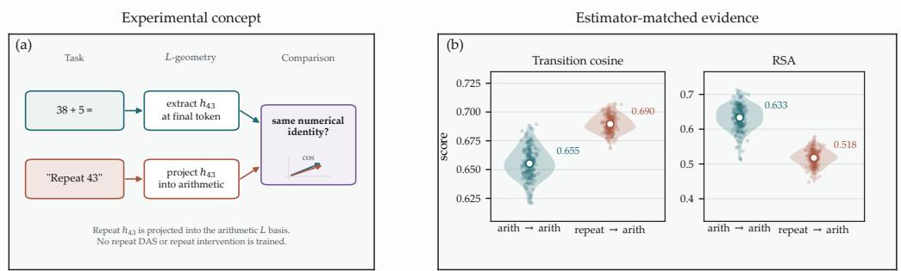  
Figure 18: The readout-orthogonal numerical geometry extends beyond arithmetic. (a) The repeat task supplies the numerical value directly. No repeat-specific DAS space is trained and no intervention is performed; the layer-43 final-position activation is projected into the arithmetic L basis and compared with arithmetic states representing the same values. (b) Estimator-matched comparison over 200 samples of one arithmetic expression per numerical value. Violin distributions show held-out transition cosine and no-fit RSA for arithmetic-toarithmetic and repeat-to-arithmetic comparisons, with markers indicating the mean.

## F SECOND-MODEL REPLICATION IN MINISTRAL

The main experiments use a single multimodal model so that text and image representations can be compared in one residual stream. We therefore ask whether the central chain of results survives in a second multimodal architecture. We use mistralai/Ministral-3-14B-Instruct-2512-BF16, which has 40 decoder blocks and residual width $d _ { \mathrm { m o d e l } } = 5 1 2 0$ , and repeat the same $2 \times 2$ comparison between text/image input and addition/subtraction, denoted $T _ { + } , \bar { T } _ { - } , I _ { + }$ and $I _ { - }$ . Thinking is disabled and the output contains digits only. The ten decimal digits are single output tokens, and two-digit answers are emitted as two successive digit tokens.

The goal is not to reproduce every diagnostic from the primary model. Instead, we test the sequence of claims that is central to the paper: whether a late causal numerical state can be found; whether its coupling to the current digit readout can be separated exactly from a readout-orthogonal remainder; whether that remainder preserves numerical geometry across modality and operation; whether the pairwise relations admit one synchronized frame; and whether the readout-free numerical identity is used causally during later autoregressive continuation.

## F.1 LOCALIZATION AND A CAUSAL NUMERICAL SUBSPACE

Prompts and chat template. We use the model’s Hugging Face chat template with use\_chat\_template=true and thinking disabled. For text arithmetic, the user message contains the answer-format instruction and the expression together; for example,

$$
\begin{array} { r l r } { \mathsf { O u t p u t ~ \mathrm { ~ O N L Y ~ \hat { ~ } a ~ } ~ n u m b e r . ~ } } & { { } 1 0 \mathrm { ~ - ~ } \mathrm { ~ \theta ~ } = } \end{array}
$$

before applying add\_generation\_prompt=true. For image arithmetic, the arithmetic expression is supplied only through the image and the text message contains

$$
\mathtt { O u t p u t \_ O N L Y } \mathtt { a _ { \ n u m b e r } } .
$$

with image content placed before text content. Under the current Ministral Hugging Face template, the corresponding user segments are schematically [INST]...[/INST] for text and [INST][IMG]...[/INST] for images. In both modalities, the final [/INST] token is therefore the common pre-generation position.

Datasets and image rendering. We use the same arithmetic generator and rendering procedure as Appendix A: only the arithmetic expression is rendered, as centered black text on a white 384 × 384 RGB canvas with font size 64. The answer-format instruction is kept in the accompanying text message. The final datasets are nevertheless model-specific rather than row-for-row copies of the Gemma datasets, because examples are filtered separately by Ministral correctness. The saved DAS metadata contains 5,028 retained addition examples in each modality, 5,027 text-subtraction examples, and 5,010 image-subtraction examples.

DAS optimization. The final runs use Adam with learning rate $1 0 ^ { - 4 }$ , batch size 1 and global gradient clipping at norm 1.0. As in the primary-model pipeline, the basis is initialized as a random orthonormal k-dimensional subspace inside a train-set PCA span. For Ministral, PCA is estimated from up to 1024 training activations and retains the smallest span explaining 90% of activation variance. Activations are taken from the resid\_post hook. Final runs use 4096/512/512 training/validation/test intervention pairs, 128 autoregressive evaluation pairs, a 15-epoch budget, early-stopping patience 3, and three independent DAS seeds.

Layer and position. The common intervention site is the final pre-generation [/INST] token, stored as position −1. Activation patching localizes the strongest common late effect to layers 35–40. At the final prompt position, normalized teacher-forced patch recovery for $T _ { + }$ is 0.543 at layer 37 and 0.554 at layer 39; for $I _ { + }$ it is 0.484 and 0.544, respectively. A direct k = 32 DAS comparison shows no autoregressive disadvantage at layer 37: $\mathrm { I I A } _ { \mathrm { A R } } = 0 .$ 188 at both layers 37 and 39 for $T _ { + }$ and 0.250 at both layers for $I _ { + }$ . We therefore use layer 37, which retains the late causal effect while leaving three transformer blocks downstream of the intervention.

<table><tr><td>Condition</td><td>TF-IIA, seeds 0/1/2</td><td> $\mathrm { T F } \mathrm { m e a n } \pm \mathrm { s t d }$ </td><td>AR-IIA, seeds 0/1/2</td><td> $\mathrm { A R \ m e a n \pm s t d }$ </td></tr><tr><td> $T _ { + }$ </td><td>.326/.326/.324</td><td> $. 3 2 5 \pm . 0 0 1$ </td><td>.312/.297/.289</td><td> $. 2 9 9 \pm . 0 1 2$ </td></tr><tr><td> $T _ { - }$ </td><td>.500/.504/.486</td><td> $. 4 9 7 \pm . 0 0 9$ </td><td>.375/.414/.414</td><td> $. 4 0 1 \pm . 0 2 3$ </td></tr><tr><td> $I _ { + }$ </td><td>.318/.299/.318</td><td> $. 3 1 2 \pm . 0 1 1$ </td><td>.312/.297/.305</td><td> $. 3 0 5 \pm . 0 0 8$ </td></tr><tr><td> $I _ { - }$ </td><td>.473/.459/.469</td><td> $. 4 6 7 \pm . 0 0 7$ </td><td>.336/.320/.336</td><td> $. 3 3 1 \pm . 0 0 9$ </td></tr></table>

Table 10: Final $k = 3 2$ DAS results at layer 37 and the final pre-generation position, across three independently initialized seeds. Standard deviations are sample standard deviations across seeds.

Dimension. We use $k = 3 2$ as main causal dimension. In full-budget runs at layer $^ { 3 7 , }$ increasing to $k = 6 4$ changes $\mathrm { I I A } _ { \mathrm { A R } }$ from 0.312 to 0.344 for $T _ { + }$ and from 0.312 to 0.336 for $I _ { + } , \mathrm { s o } \ k = 3 2 $ retains 90.9% and 93.0% of the corresponding $k = 6 4$ effects while halving the dimension. A lightweight sweep does not show a useful additional gain from $k = 6 4$ to $k = 1 2 8$ . We therefore fix $k = \bar { 3 } 2$ for all four conditions; this also leaves a 23-dimensional readout-free component after the rank-9 decomposition below.

The learned spaces are causally meaningful but not complete bottlenecks. Mean $\mathrm { I I A } _ { \mathrm { A R } }$ ranges from 0.299 to 0.401 across the four conditions: 0.299 for $\bar { T _ { + , } } , 0 . 4 0 1$ for $T _ { - } , 0 . 3 0 5$ for $I _ { + }$ and 0.331 for $I _ { - }$ . The effect is stable across independent DAS seeds, and teacher-forced and autoregressive scores remain of the same order. We therefore interpret the 32-dimensional space as a compact late numerical subspace with moderate causal control, rather than as the unique or fully sufficient causal state for the answer.

## F.2 EXACT SEPARATION OF THE CURRENT DIGIT READOUT

Let $U _ { D }$ be an orthonormal basis for the centered unembedding directions of the ten digit tokens. As in the primary model, centering removes the common mean and leaves a rank-9 digit-discriminative span. For each learned $R \in \mathbb { R } ^ { 5 1 2 0 \times 3 2 }$ , we decompose

$$
U _ { D } ^ { \top } R = A \Sigma V ^ { \top } , \qquad \widetilde { R } = R V .
$$

This rotates coordinates only inside the learned DAS space. The overlap has rank 9 for every condition and DAS seed, so we write

$$
\widetilde { R } = [ D ~ L ] , \qquad \mathrm { d i m } ( D ) = 9 , \quad \mathrm { d i m } ( L ) = 2 3 ,
$$

where $D$ carries all linear coupling of the DAS space to the centered digit readout and $L$ lies in its null space.

The decomposition is numerically exact at the precision of the computation. Across the twelve condition–seed spaces, $\| U _ { D } ^ { \top } L \| _ { F }$ lies between approximately $4 . 7 \times 1 0 ^ { - 9 }$ and $5 . 4 \times 1 0 ^ { - 9 } , \| D ^ { \top } L \| _ { F }$ between $2 . 1 \times 1 0 ^ { - 7 }$ and $3 . 6 \times 1 0 ^ { - 7 }$ , and $\| \boldsymbol { D } \boldsymbol { D } ^ { \top } + \boldsymbol { L } \boldsymbol { L } ^ { \top } - \boldsymbol { R } \boldsymbol { R } ^ { \top } \| _ { F }$ is approximately $2 . 0 \times 1 0 ^ { - 7 }$ Thus no part of the learned causal subspace is discarded.

The original DAS spaces are strongly enriched for current digit-readout directions. With

$$
E _ { D } = \frac { \| U _ { D } ^ { \top } R \| _ { F } ^ { 2 } } { k } ,
$$

the mean overlap is 0.0830, 0.0977, 0.0935 and 0.1082 for $T _ { + } , T _ { - } , I _ { + }$ and $I _ { - }$ , respectively. A random 32-dimensional subspace in a 5120-dimensional residual stream has expected overlap $9 / 5 1 2 0 = 0 . 0 0 1 7 6$ , making the observed values approximately 47–62 times larger than this expectation. This establishes strong coupling to all nine independent digit contrasts, but does not imply that the complete digit span is literally contained unchanged inside ${ \bar { R } } .$

## F.3 SHARED NUMERICAL GEOMETRY IN THE READOUT-FREE COMPONENT

We next ask whether the 23-dimensional L component remains numerically organized once every direction linearly coupled to the current digit output has been removed. All values $0 , \ldots , 9 9$ are represented in every condition–seed space. For each of three deterministic value splits, 80 values are used to fit the cross-condition relation and 20 values are held out entirely. Scaled orthogonal Procrustes maps, together with the coordinate offset needed to place value centroids, are fitted using only transitions whose endpoints lie in the 80 training values. Evaluation uses only transitions between the 20 unseen values. Across twelve directed condition relations, all $3 \times 3$ source/destination DAS-seed combinations and three value splits, this gives $n = 3 2 4$ pairwise evaluations.

<table><tr><td>Representation/control</td><td>Transition cosine</td><td>Top-1</td><td>Top-5</td></tr><tr><td>Exact L (23d)</td><td> $. 8 9 6 3 \pm . 0 4 6 3$ </td><td>93.35%</td><td>99.85%</td></tr><tr><td>Random readout-null (23d), mean</td><td>.6950</td><td>72.30%</td><td>94.17%</td></tr><tr><td>Label permutation, mean</td><td>≈ 0.0000</td><td>5.00%</td><td>25.01%</td></tr></table>

Table 11: Held-out numerical geometry in the Ministral readout-free space. Top-1 and top-5 retrieval are among 20 unseen candidate values, giving chance levels of 5% and 25%. The random row is the mean over 200 independent dimension-matched readout-null projections; the permutation row is the mean over 500 numerical label permutations of the real L spaces.

<table><tr><td>Map</td><td>Transition cosine</td><td>Top-1</td><td>Top-5</td></tr><tr><td>Direct pairwise</td><td> $. 8 9 6 4 2 \pm . 0 4 6 1 1$ </td><td>93.33%</td><td>99.82%</td></tr><tr><td>Full synchronization</td><td> $. 8 9 4 8 2 \pm . 0 4 5 1 5$ </td><td>93.84%</td><td>99.86%</td></tr><tr><td>LORÓ synchronization</td><td> $. 8 9 0 2 0 \pm . 0 4 3 5 7$ </td><td>93.89%</td><td>99.91%</td></tr></table>

Table 12: Global consistency of the Ministral L spaces. LORO removes both directions of one complete condition relation before synchronization and reconstructs the missing relation only through the remaining task graph.

The held-out transition cosine is $0 . 8 9 6 3 \pm 0 . 0 4 6 3$ , and the transported state retrieves the correct unseen numerical value at 93.35% top-1 and 99.85% top-5. A fitting-free RSA control gives mean cross-condition Spearman $\rho = 0 . 8 5 4 1 \pm 0 . 0 8 9 8 .$ . The corresponding pairwise heatmaps show no weak relation: the high global score is not driven only by one easy pair, but is present across modality changes, operation changes, and relations that change both.

A single random readout-free projection also preserves substantial numerical structure, so the geometry is not confined uniquely to the DAS-derived remainder. We therefore evaluate a distribution of 200 independent random 23-dimensional readout-null subspaces using the same held-out protocol. Their mean transition cosine is $0 . 6 9 4 9 7 \pm 0 . 0 0 7 5 9$ with 95% interval [0.67998, 0.70875]; mean top-1 is $0 . 7 2 3 0 4 \pm 0 . 0 1 6 3 8$ with interval $[ 0 . 6 9 0 1 0 , 0 . 7 5 1 4 1 ] ;$ mean top-5 is $0 . 9 4 1 6 7 \pm 0 . 0 0 6 6 9$ with interval [0.92807, 0.95387]; and mean RSA is $0 . 6 0 4 8 0 \pm 0 . { \dot { 0 } } 2 1 2 3$ with interval $[ 0 . 5 6 8 2 8 , 0 . 6 4 3 7 0 ]$ ]. None of the 200 random projections reaches the observed L score for any metric, giving the finite-sample resolution floor $p _ { \mathrm { r a n d } } = 1 / 2 0 1$

The numerical-label null is stronger still. Across 500 permutations, mean transition cosine is approximately $- 6 \times 1 0 ^ { - 6 } ,$ , top-1 is 0.04997, top-5 is 0.25010, and RSA is −0.00143. None reaches the observed score, so $p _ { \mathrm { p e r m } } = 1 / 5 0 1$ for all four metrics. The two controls together support a narrower conclusion than uniqueness: numerical geometry is broadly distributed in the readoutorthogonal residual representation, but the readout-free component selected inside the causal DAS space is strongly enriched for the shared numerical structure.

## F.4 THE PAIRWISE RELATIONS SYNCHRONIZE INTO ONE LATENT FRAME

Pairwise Procrustes fits could succeed while remaining mutually inconsistent. We therefore repeat the synchronization analysis in the L spaces. Matched DAS seeds are used so that each graph contains one coherent set of four condition-specific spaces. Across three seeds and three value splits, the analysis gives n = 108 directed relation evaluations.

Replacing independently fitted pairwise maps by one synchronized frame changes mean transition cosine by only 0.00160. More importantly, when one complete relation is withheld in both directions, LORO still reaches transition cosine 0.89020, an absolute drop of only 0.00623 from direct fitting, or roughly 0.7% relative. Retrieval does not degrade. The four task-specific readout-free spaces therefore behave as different coordinate systems of one globally consistent numerical geometry: a relation whose rotation and scale are never fitted directly can be reconstructed from the remaining graph. This establishes global consistency up to the fitted task-specific rotations, scales and offsets; it does not imply a literally identical residual-space subspace.

<table><tr><td>Task</td><td>Matched  $P ( y _ { 2 } )$ </td><td>Mismatch  $P ( \widetilde { y } _ { 2 } )$ </td><td>Matched → y</td><td>Mismatch → y</td><td> $\Delta P ( y _ { 1 } )$ </td></tr><tr><td> $I _ { + }$ </td><td>.257</td><td>.263</td><td>.174</td><td>.206</td><td>-.010</td></tr><tr><td> $I _ { - }$ </td><td>.371</td><td>.375</td><td>.286</td><td>.339</td><td>-.017</td></tr><tr><td> $T _ { + }$ </td><td>.262</td><td>.249</td><td>.268</td><td>.279</td><td>-.006</td></tr><tr><td> $T _ { - }$ </td><td>.440</td><td>.405</td><td>.414</td><td>.430</td><td>+.003</td></tr></table>

Table 13: Per-condition consistency of the same-first-digit latent mismatch, averaged over the three DAS seeds. $\Delta P ( y _ { 1 } )$ is the mismatch-minus-matched change in probability of the shared first digit. The qualitative continuation effect appears in every modality and operation.

## F.5 THE READOUT-FREE IDENTITY CAUSALLY REDIRECTS THE CONTINUATION

Geometry alone does not establish functional use. We therefore test whether changing the numerical identity in $L$ affects future generation while holding the currently required digit fixed. Let y and $\widetilde { y }$ be two two-digit donor values with the same first digit and different second digits, for example 47 and 43. For a base activation $h _ { b } .$ , decompose the DAS edit into

$$
\Delta h _ { D } ^ { b \to y } = \Pi _ { D } ( h _ { y } - h _ { b } ) , \qquad \Delta h _ { L } ^ { b \to y } = \Pi _ { L } ( h _ { y } - h _ { b } ) .
$$

The matched state is

$$
h _ { \mathrm { m a t c h } } = h _ { b } + \Delta h _ { D } ^ { b  y } + \Delta h _ { L } ^ { b  y } ,
$$

whereas the latent mismatch keeps the readout-coupled component fixed and changes only the numerical identity supplied through $L _ { i }$

$$
h _ { \mathrm { m i s } } = h _ { b } + \Delta h _ { D } ^ { b  y } + \Delta h _ { L } ^ { b  \widetilde { y } } .
$$

The experiment uses up to 128 deterministic triplets per task, all four tasks, and all three DAS seeds.

At the current output step, the shared first-digit probability is 0.97876 in the matched state and 0.97130 under the latent mismatch, a change of only −0.00746. The intervention therefore does not simply replace the whole answer at the current readout. At the following digit, however, the preference reverses. Under the matched intervention, $P ( y _ { 2 } ) = 0 . 3 3 2 4 9$ and $\bar { P ( \widetilde { y } _ { 2 } ) } = 0 . 0 5 8 2 6 $ after replacing only $L ,$ these become 0.05945 and 0.32315. Greedy second-token choice shows the same exchange: the selected $y _ { 2 }$ rate falls from 0.38867 to 0.05273, while the selected ${ \widetilde { y } } _ { 2 }$ rate rises from 0.05339 to 0.38932. The effect propagates to full autoregressive generation: the matched state generates toward $y$ at rate 0.28581 and toward $\widetilde { y }$ at 0.05273; the mismatch instead generates toward y at 0.04362 and toward $\widetilde { y }$ at 0.31315.

Controls separate value-specific continuation from generic perturbation. A D-only intervention gives $P ( y _ { 1 } ) = 0 . 8 9 2 1 0$ $\mathbf { \bar { \mathit { P } } } ( y _ { 2 } ) = 0 . 0 7 8 6 4$ and $P ( \tilde { \mathcal { Y } } _ { 2 } ) = 0 . \bar { 0 } 8 0 8 9$ , so D alone does not strongly specify the continuation. A random latent donor gives 0.93427, 0.08079 and 0.08408, respectively. Finally, a value-specificity control using an unrelated latent donor compatible with the same first digit preserves $P ( y _ { 1 } ) = 0 . 9 7 4 8 2$ but gives only $P ( y _ { 2 } ) = 0 . 0 5 3 9 1$ and $P ( \mathcal { \tilde { y } } _ { 2 } ) = 0 . 0 5 9 4 1$ . First-digit compatibility is therefore insufficient: the redirected continuation depends on the numerical identity inserted through $L .$

The causal conclusion is temporal rather than digit-wise. The data do not show that $D$ “stores the first digit” or that $L$ is a dedicated second-digit subspace. Instead, holding the readout-coupled component fixed preserves the immediately required digit, while changing numerical identity in the readout-orthogonal component selectively redirects the subsequent digit and the final autoregressive answer. The numerical identity in $L$ is therefore not only geometrically organized; it is functionally involved in future generation.

## F.6 SUMMARY

Ministral reproduces the central mechanism despite a lower absolute full-answer DAS intervention score. A compact late causal numerical space can be found and separated exactly into a rank-9 component coupled to the current digit readout and a 23-dimensional readout-null component. The latter retains strong held-out numerical geometry across modality and operation (transition cosine 0.896, top-1 93.35%, RSA 0.854), is substantially more structured than a distribution of random readout-null projections, synchronizes into one common latent frame with negligible loss, and reconstructs a relation never fitted directly. Most importantly, replacing only its numerical identity leaves the immediate shared digit almost unchanged while reversing the next-digit preference and redirecting the freely generated answer. The replication therefore separates two questions that need not coincide: how completely a small subspace controls the full autoregressive output, and how strongly the underlying numerical state is organized and functionally used.