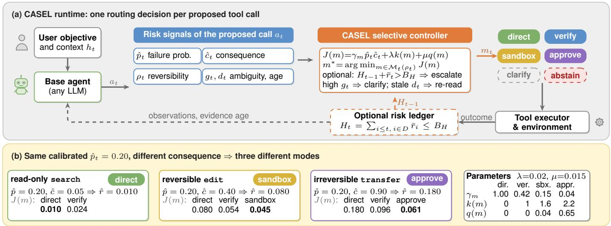
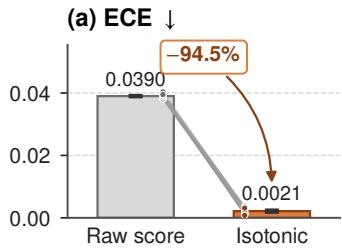
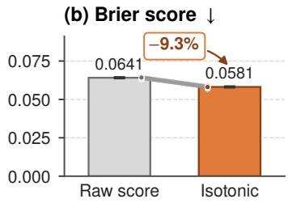
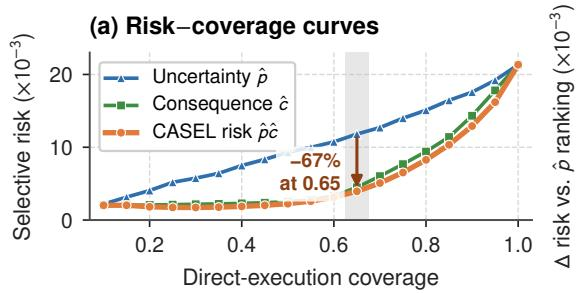
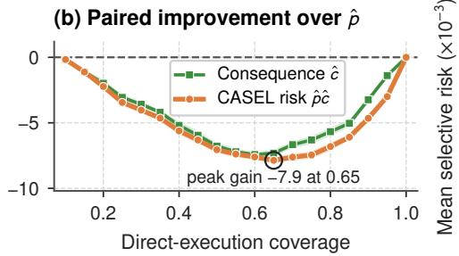
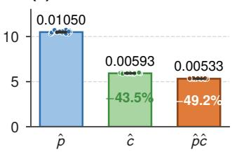
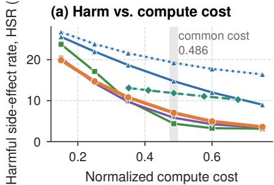
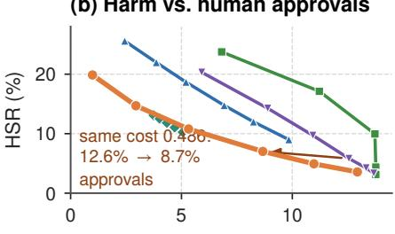
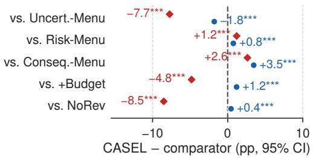

# CASEL: Consequence-Aware Selective Execution for Reliable Long-Horizon Tool-Using Agents

1st Yanyan Zhang

2nd Fei Shen

Carnegie Mellon University

Feinity LLC

3rd Ting Yan

Pittsburgh, PA 15213, USA

Sacramento, CA 95816, USA

Computer Science Department

zhangyanyanusa@gmail.com

shenfei2031@hotmail.com

Dartmouth College

Hanover, NH 03755, USA

ting.yan.gr@dartmouth.edu

4th Hao Zhang

Independent Researcher

Los Angeles, CA 90095, USA

Corresponding author: alex1995101099@gmail.com

Abstract—Tool-using language agents increasingly modify external systems, yet most runtime safeguards allocate scrutiny by generic uncertainty scores or coarse mutation heuristics. We introduce CASEL (Consequence-Aware Selective Execution Layer), a model-agnostic runtime allocation policy that combines calibrated failure probability, state-dependent consequence, reversibility, ambiguity, and evidence freshness to choose, for each proposed tool call, among direct execution, verification, sandboxing, clarification, approval, and abstention by minimizing a per-mode cost. We formalize direct execution as selective prediction and state and test the validity conditions of a finite-sample threshold and a trajectory risk ledger. In a controlled simulation over 20 seeds with 120,000 test actions each, in which every method has the same intervention menu and the same compute cost, CASEL reduces harmful-side-effect trajectories from 14.75 percent for an uncertainty-ranked gate to 7.02 percent and mean normalized harm from 0.184 to 0.123. A gate ranked by the product of failure probability and consequence reaches similar harm (5.82 percent, 0.120) but sends 45 percent more actions to human approval, and removing reversibility-aware routing raises the rate to 15.53 percent. A trajectory-level risk budget, in contrast, increases harm at equal cost (11.82 percent). Intervention effectiveness is assumed, not measured: the results rank allocation rules under the simulator’s assumptions and do not establish deployment effectiveness.

Index Terms—LLM agents, tool use, reliability, selective prediction, uncertainty calibration, runtime verification, riskaware execution.

## I. INTRODUCTION

Language-model agents increasingly act on external systems over long trajectories, and as models grow more capable they become autonomous domain-specific agents, e.g., SP-Mind runs complete spatial-proteomics analyses with specialized tools.[1] They now also generate device configurations for multi-vendor optical transport networks,[2] where an erroneous change can affect live services. Benchmarks such as WebArena, τ -Bench/τ2-Bench, and AgentDojo expose failures from stale state, planning errors, unsafe tool use, and adversarial observations.[3]–[6] Reflection and self-critique improve reasoning,[7], [8] and recent work studies clarification, abstention, mutating-action verification, least privilege, and transactional containment.[9]–[13] These mechanisms address different failure sources but leave a common allocation question: how much scrutiny should be spent before a particular action is allowed to change the world?

Uncertainty alone does not answer it. Two actions may share a 20% probability of error, yet a read-only search is cheap to retry while an irreversible transfer is costly; an uncertainty-only gate treats them alike, and a mutation-only gate still conflates a reversible edit with an irreversible commitment.

We propose CASEL, a runtime layer between an arbitrary base agent and its tool executor (Figure 1). At each step the controller estimates failure probability $\hat { p } _ { t }$ , consequence $\hat { c } _ { t } ^ { \phantom { \dagger } } .$ , reversibility $\rho _ { t } ,$ , ambiguity $g _ { t } ,$ , and evidence staleness $d _ { t } .$ and selects a graded intervention. Scrutiny should scale with consequence-weighted risk rather than generic confidence, the intervention should match the action’s reversibility, and direct execution should be calibrated as selective prediction.[14]–[16] CASEL is therefore not another uncertainty gate but a runtime allocation policy that decides where scrutiny is worth its cost and calls existing safety mechanisms as its intervention branches.

Our contributions are: (i) a consequence-aware execution objective with six intervention modes, five of which are exercised (abstain and the staleness signal $d _ { t }$ are not); (ii) explicit validity conditions for a finite-sample direct-execution threshold, shown to bind and hold over a sweep of $\epsilon ,$ and an analysis of a trajectory risk ledger whose premise fails in practice; and (iii) a reproducible controlled evaluation in which all comparators share the intervention menu and cost, with ablations, paired significance tests, stress tests, and a negative result for trajectory budgeting, plus a deployment path.

## II. RELATED WORK

Agents and benchmarks. ReAct interleaves reasoning with action and Reflexion stores verbal feedback across attempts;[7], [8] WebArena and the τ -family emphasize stateful, long-horizon tool use.[3]–[5] Focus-Then-Contact learns robot skills with residual RL under timed human intervention,[17] and

  
Figure 1. CASEL routes every proposed tool call by consequence-weighted risk, not by uncertainty alone. (a) Structured risk signals feed a controller that minimizes the per-mode cost J(m) over the modes feasible for the action’s reversibility class; dashed elements are not part of the main comparison; clarify is tested in Sec. VI-E, abstain is not exercised. (b) Worked example with the nominal parameters (inset): three calls with the same $\hat { p } _ { t }$ but different $\hat { c } _ { t }$ go to direct execution, sandboxing, and approval (lowest J in bold); an uncertainty-only gate cannot tell them apart.

DRAFT-RL scores multi-agent reasoning drafts during RL.[18] Domain-specific agents bring domain-specific benchmarks, such as SP-Bench with 102 spatial-proteomics tasks.[1] These works strengthen base policies but do not decide when an action needs extra evidence.

Clarification, abstention, and tool safety. SAGE-Agent selects clarification questions by value of information;[9] AgentAbstain tests whether agents recognize when acting is unjustified.[10] AgentDojo targets untrusted tool outputs,[6] which multi-agent evidence checking can screen;[19] AgenTRIM enforces adaptive least privilege,[12] SABER safeguards mutating steps,[11] and Cordon stages multi-step effects as semantic transactions.[13]

Selective prediction and calibration. Reject-option prediction formalizes an accuracy–coverage trade-off;[14], [15] temperature scaling calibrates scores,[20] and conformal risk control bounds monotone risks in expectation,[16] weaker than the high-probability bound used here. RAGScope routes retrieval augmented answers to acceptance, review, or an expensive verifier with a cheap, cost-aware evidence gate,[21] a pass/escalate decision that CASEL generalizes to several interventions.

Table 1 summarizes the comparison, including orthogonal layers: REFLEX calls a strong LLM when its fast decision layer is unsure,[22] and CA2I scores whole action sequences before execution.[23] CASEL’s product risk signal makes uncertainty-, consequence-, and mutation-only gates (evaluated in Sec. VI) special cases, and its heterogeneous interventions make the specialized mechanisms candidate branches rather than competitors.

## III. PROBLEM FORMULATION

At step t, history $h _ { t }$ holds the user objective, observations, and prior actions, and a base policy proposes a tool call $a _ { t } =$ $( z _ { t } , \theta _ { t } )$ . Let $F _ { t } \in \{ 0 , 1 \}$ indicate that $a _ { t }$ is invalid relative to

the task, policy, tool contract, or environment state. Its failure probability is

$$
p _ { t } = \mathbb { P } ( F _ { t } = 1 \mid h _ { t } , a _ { t } , s _ { t } ) ,\tag{1}
$$

where $s _ { t }$ is the environment state when $a _ { t }$ would be committed, observed only partially through $h _ { t }$ . With $c _ { t } ~ \in ~ [ 0 , 1 ]$ the normalized consequence if the action is wrong, the one-step expected harmful loss is ${ \boldsymbol { r } } _ { t } = { \boldsymbol { p } } _ { t } { \boldsymbol { c } } _ { t }$ . Notation. Unhatted $p _ { t } , c _ { t } , r _ { t }$ are true, unobserved quantities used in the analysis; hatted $\hat { p } _ { t } , \hat { c } _ { t } , \hat { r } _ { t } = \hat { p } _ { t } \hat { c } _ { t }$ are run-time estimates, and Algorithm 1 and all routing rules use only these. $\bar { r } _ { t }$ is the score charged to the optional ledger. Throughout, including Figure 1 and Table 1, λ and $\mu$ weight compute and interaction cost, $\rho _ { t }$ is the reversibility class, and $\gamma _ { m }$ the residual multiplier of mode m.

Before commitment, a controller chooses $m _ { t }$ from $\mathcal { M } =$ {direct, verify, sandbox, clarify, approve, abstain}. Mode m has residual failure probability $p _ { t } ^ { ( m ) }$ , compute cost $k ( m )$ , and interaction cost q(m), and the ideal myopic decision is

$$
m _ { t } ^ { * } = \arg \operatorname* { m i n } _ { m \in \mathcal { M } _ { t } } \left[ p _ { t } ^ { ( m ) } c _ { t } + \lambda k ( m ) + \mu q ( m ) \right] ,\tag{2}
$$

where $\mathcal { M } _ { t }$ removes infeasible modes. For committed actions, linearity of expectation gives, without independence,

$$
\begin{array} { r } { \mathbb E \Big [ \sum _ { t = 1 } ^ { T } c _ { t } F _ { t } \Big ] = \sum _ { t = 1 } ^ { T } p _ { t } c _ { t } , } \end{array}\tag{3}
$$

so cumulative risk can be tracked by a ledger; Sec. VI tests whether budgeting it helps.

## IV. CASEL RUNTIME

## A. Structured Risk Signals

Failure probability. A raw score $u _ { t }$ is calibrated on a heldout split, $\hat { p } _ { t } = f _ { \mathrm { c a l } } ( u _ { t } )$ , by isotonic regression or, given logits, temperature scaling;[20] thresholds and budgets are then read

Table 1  
QUALITATIVE COMPARISON WITH ALTERNATIVE APPROACHES. Step: ONE DECISION PER PROPOSED TOOL CALL.
<table><tr><td>Approach</td><td>Problem focus</td><td>Granularity</td><td>Risk signal</td><td>Intervention space</td><td>Relation to CASEL</td></tr><tr><td> $\mathrm { S A G E - A g e n t } ^ { [ 9 ] }$ </td><td>Underspecified intent</td><td>Question</td><td>Spec. vs. model unc.</td><td>Clarify</td><td>Implements clarify; triggered by gt</td></tr><tr><td>REFLEX[22]</td><td>Compute-efficient decisions</td><td>Decision</td><td>Model confidence</td><td>Call strong LLM</td><td>Orthogonal: chooses the decision maker</td></tr><tr><td> $\mathrm { C A } 2 \mathrm { I } ^ { [ 2 3 ] }$ </td><td>Pre-execution outcomes</td><td>Action sequence</td><td>Predicted return, risk</td><td>Select a plan</td><td>Orthogonal: admits whole plans</td></tr><tr><td>CASEL</td><td>Scrutiny before commit</td><td>Step</td><td> $\hat { p } _ { t } \hat { c } _ { t } , \rho _ { t } , g _ { t } , d _ { t }$ </td><td>Six modes, cost-aware</td><td></td></tr></table>

Algorithm 1 Consequence-aware selective execution   
Require: offline: $f _ { \mathrm { c a l } } .$ threshold τˆ (Eq. (5)); at step $t \colon h _ { t } , a _ { t } ,$ ledger $H _ { t - 1 }$   
1: $\hat { p } _ { t } \gets f _ { \mathrm { c a l } } ( u _ { t } ) ;$ estimate $\hat { c } _ { t } , \rho _ { t } , g _ { t } , d _ { t } ; \hat { r } _ { t } \gets \hat { p } _ { t } \hat { c } _ { t }$   
2: if $g _ { t } > \tau _ { g }$ return (clarify, $H _ { t - 1 } )$   
3: if $d _ { t } > \tau _ { d }$ and refresh exists return (verify, $H _ { t - 1 } )$   
4: $\boldsymbol { \mathcal { M } } _ { t } \gets$ FEASIBLEMODES(ρt, at); if rˆt > τˆ: remove direct   
5: $m ^ { * }$ ← arg min γmrˆt + λk(m) + µq(m)   
6: optional ledger: if $\dot { m ^ { * } } =$ direct and $\tilde { H _ { t - 1 } } + \bar { r } _ { t } > B _ { H } \colon m ^ { * } $   
ESCAL $\underset { \cdot } { \mathrm { i T E } } \left( \rho _ { t } , \mathcal { M } _ { t } \right)$   
7: return $\left( m ^ { * } , \ H _ { t - 1 } + \bar { r } _ { t } \mathbf { 1 } [ m ^ { * } = \mathsf { d i r e c t } ] \right)$

as probabilities. $u _ { t }$ can also draw on model internal states, as MISO does for ranking models.[24]

Consequence. The controller computes

$$
\hat { c } _ { t } = \mathrm { c l i p } \big ( c _ { \mathrm { b a s e } } ( z _ { t } ) M _ { \mathrm { s c o p e } } ( \theta _ { t } , h _ { t } ) , 0 , 1 \big ) ,\tag{4}
$$

where $c _ { \mathrm { b a s e } }$ is a frozen per-tool severity from auditable metadata (write access, privilege, data sensitivity, value transfer) and $M _ { \mathrm { s c o p e } } \geq 0$ a bounded magnitude factor (records, amount, rollback cost).

Reversibility. The class $\rho _ { t }$ (read, reversible, compensable, or irreversible) changes the feasible set $\mathcal { M } _ { t } ( \rho _ { t } )$ rather than scaling $\hat { c } _ { t } ^ { \phantom { \dagger } } .$ . Direct, verify, clarify, and abstain are always feasible; sandbox requires a reversible mutation or a dry-run interface such as the forkable environments of Counterfactual Rollout Replay,[25] never for irreversible commitments; approve applies to compensable and irreversible actions.

Ambiguity and freshness. $g _ { t }$ captures missing intent that more sampling cannot recover and routes to clarification; $d _ { t }$ captures stale evidence and triggers a re-read. For GUI agents, perception errors (object detection,[26] graphic understanding[27]) propagate into $u _ { t }$ and $d _ { t }$

## B. Adaptive Intervention

For feasible mode m, let $\gamma _ { m } ( \xi _ { t } ) \in [ 0 , 1 ]$ be the empirically estimated residual-error ratio, so $\hat { p } _ { t } ^ { ( m ) } = \gamma _ { m } ( \xi _ { t } ) \hat { p } _ { t }$ , where $\xi _ { t }$ collects the step features that determine how effective m is (tool $z _ { t } ,$ reversibility $\rho _ { t } ,$ , available checker); the simulator uses one constant $\gamma _ { m }$ per mode. Substituting into $\operatorname { E q . } \left( 2 \right)$ gives $J ( m ) = \gamma _ { m } { \hat { r } } _ { t } + \lambda k ( m ) + \mu q ( m )$ . The expected harm reduction of m is $V _ { m } = ( 1 - \gamma _ { m } ) \hat { r } _ { t } ,$ so, ignoring interaction cost, m beats direct execution when $V _ { m } > \lambda k ( m )$

## V. SELECTIVE-RISK CONTROL

## A. Direct-Execution Set and Finite-Sample Threshold

Let X be an action record, $S ( X )$ a scalar score, and $L ( X ) \in$ [0, 1] a harmful-loss label such as $c F$ . For threshold $\tau ,$ , the direct-execution set is $A _ { \tau } = \{ X : S ( X ) \leq \tau \}$ , with selective risk $R ( \tau ) = \mathbb { E } [ L \mid X \in A _ { \tau } ]$ and coverage $C ( \tau ) = \mathbb { P } ( X \in A _ { \tau } )$ The objective is to maximize coverage subject to $R ( \tau ) \leq \epsilon$ With $n _ { \tau }$ calibration examples in $A _ { \tau }$ and empirical risk $\hat { R } ( \tau )$ Hoeffding’s inequality gives $R ( \tau ) \leq \hat { R } ( \tau ) + \sqrt { \ln ( 1 / \delta ) / ( 2 n _ { \tau } ) }$ with probability at least $1 - \delta$ for a fixed threshold. For a fixed grid of K thresholds, a union bound yields the selection rule

$$
\hat { R } ( \tau ) + \sqrt { \ln ( K / \delta ) / ( 2 n _ { \tau } ) } \le \epsilon .\tag{5}
$$

Proposition 1 (Selective-risk validity). Fix the scorer $S$ and a K-element grid before the calibration records are drawn, and let the records $( X _ { i } , L _ { i } ) , \ L _ { i } \ \in \ [ 0 , 1 ]$ , be i.i.d. from the deployment distribution of proposed actions and disjoint from the data used to fit $f _ { \mathrm { c a l } }$ . Then, with probability at least $1 - \delta ,$ every grid threshold with $n _ { \tau } > 0$ that satisfies Eq. (5) has $R ( \tau ) \leq \epsilon ,$ the risk of executing all of Aτ directly.

Proof. Given the membership indicators, the $n _ { \tau }$ losses in $A _ { \tau }$ are i.i.d. with mean $R ( \tau )$ , so Hoeffding’s bound holds for each τ at level $\delta / K ;$ ; a union bound covers the grid. □

Scope. (i) Actions in a trajectory are dependent (exchangeability is not enough), so calibration uses one record per trajectory. (ii) The bound covers $A _ { \tau }$ as a whole, not a furtherselected subset, which can concentrate high-loss actions. To cover the deployed policy, Eq. (5) is applied to the set that the complete policy $\pi _ { \tau }$ executes directly, whose indicator is a fixed function of the trajectory prefix.

## B. Trajectory Ledger

An optional ledger tracks $\begin{array} { r } { H _ { t } = \sum _ { i < t } D _ { i } \bar { r } _ { i } } \end{array}$ , where $D _ { i } \in$ $\{ 0 , 1 \}$ indicates direct execution, and blocks direct execution that would exceed a budget $B _ { H }$

Proposition 2 (Budgeted expected harm). Let $\mathcal { G } _ { t } \ b e$ the information available when step t is routed, with $D _ { t }$ and $\bar { r } _ { t } \ \mathcal { G } _ { t }$ -measurable. $I f \mathbb { E } [ c _ { t } F _ { t } \mid { \mathcal { G } } _ { t } ] \leq { \bar { r } } _ { t }$ whenever $D _ { t } = 1$ and $\begin{array} { r } { \sum _ { t } D _ { t } \bar { r } _ { t } \le B _ { H } } \end{array}$ almost surely, then $\begin{array} { r } { \mathbb { E } [ \sum _ { t } D _ { t } c _ { t } F _ { t } ] \le B _ { H } } \end{array}$ Proof. By the tower property, $\begin{array} { r l r l } { \mathbb { E } [ \sum _ { t } D _ { t } c _ { t } F _ { t } ] } & { { } } & { = } \end{array}$ $\begin{array} { r } { \mathbb { E } [ \sum _ { t } D _ { t } \mathbb { E } [ c _ { t } F _ { t } \mid { \mathcal G } _ { t } ] ] \le \mathbb { E } [ \sum _ { t } D _ { t } { \bar { r } } _ { t } ] \le B _ { H } } \end{array}$ □

This is conditional accounting, not a reliability guarantee: $\bar { r } _ { t }$ must upper-bound the true conditional harm at every step, which a calibrated point estimate does not, and the residual harm of intervened actions is outside the ledger.

Runtime use. Offline, the operator selects the largest grid $\hat { \tau }$ whose complete-policy direct set satisfies Eq. $\mathbf { \boldsymbol { ( 5 ) } } \ ( S = \hat { r }$ $L = c F ) ;$ ; online, a call runs directly only if $\hat { r } _ { t } ~ \le ~ \hat { \tau }$ and direct minimizes $J ( m )$ . The main comparison uses $\hat { \tau } = \infty ;$ Sec. VI-E tests the threshold rule and the ledger.

## VI. CONTROLLED EVALUATION

## A. Protocol

Each seed has an independent 40,000-action calibration split and 6,000 test trajectories of 20 actions (120,000 test actions). Actions are read-only (58%), reversible (28%), or irreversible (14%). True failure probabilities come from class-dependent Beta distributions with a trajectory-level difficulty perturbation, creating within-task dependence; consequences lie mainly in [0.02, 0.20], [0.15, 0.70], and [0.55, 1] for the three classes. The controller sees a noisy raw failure score, isotonic-calibrated on the calibration split, and a noisy consequence estimate.

The simulator instantiates direct, verify, sandbox, and approve with residual multipliers $\gamma _ { m }$ of 1.00, 0.42, 0.15, and 0.04, compute costs $k ( m )$ of 0, 1.0, 1.6, and 2.2, and interaction costs $q ( m )$ of 0, 0, 0.04, and 0.65. These are assumed constants. Direct and verify are always feasible, sandbox only for reversible mutations, and approve only for irreversible ones with ${ \hat { c } } _ { t } ~ \geq ~ 0 . 5 5$ . Clarify is exercised only in the ambiguity stress family (Sec. VI-E); abstain and the staleness branch $( d _ { t } , \tau _ { d } )$ are not exercised. The cost weights keep $\lambda : \mu = 0 . 0 2 : 0 . 0 1 5 ;$ ; a common factor sets the operating point.

Comparators. Verify-only gates (the usual scalar gates) verify the actions ranked highest by $\hat { p }$ or cˆ. Menu gates rank by ${ \hat { p } } , \ { \hat { c } } ,$ or $\hat { p c }$ and give the top-ranked actions their strongest feasible intervention (sandbox if reversible, approve if irreversible, otherwise verify), so they have CASEL’s menu. CASEL minimizes $J ( m )$ . Ablations: CASEL-NoRev (verify only), CASEL+Budget $( \lambda = 0 . 0 2$ with the ledger, $B _ { H } = 0 . 0 8 .$ $\bar { r } _ { t } = \hat { p } _ { t } \hat { c } _ { t } )$ , and CASEL-Uncal (raw score). All of these are matched to one compute cost, 0.486 (for CASEL, cost-weight factor $0 . 5 8 \pm 0 . 0 2 )$ , using scores but no outcome labels; Base, Always-Verify, and Mutation-Gated are fixed policies.

Metrics. An action routed to m fails with probability $\gamma _ { m } p _ { t }$ using one uniform draw per action shared by all methods (paired outcomes). Task success is the fraction of trajectories with no failed action; the harmful side-effect rate (HSR) is the fraction with at least one failed action of true consequence $c _ { t } \geq 0 . 4 5 ;$ mean normalized harm (MNH) is the mean over trajectories of $\textstyle \sum _ { t = 1 } ^ { 2 0 } c _ { t } F _ { t }$ . Direct coverage is the share of directly executed actions, cost the mean $k ( m )$ per action, and approvals the share of actions sent to human approval. Results average 20 seeds.

## B. Main Results

Isotonic calibration lowers mean ECE by 94.5% and Brier score by 9.3% (Figure 2).

Main result. With the same menu and the same cost, CASEL lowers HSR from 14.75% for Uncertainty-Menu to 7.02% (paired difference −7.73 points, 95% CI [−7.87, −7.60]) and MNH from 0.184 to 0.123; task success is 1.79 points lower, because generic success weights every error equally (Table 2).

  
Figure 2. Isotonic calibration turns the raw failure score into a usable probability. (a) ECE and (b) Brier score of the raw score and of the calibrated pˆ on test actions. Bars: means over 20 seeds with 95% CIs; lines: paired per-seed values.

Simple consequence-aware gates are strong. Risk-Menu has slightly lower HSR (5.82%) and MNH (0.120) than CASEL, and Consequence-Menu the lowest HSR (4.38%) with higher MNH (0.136) and the lowest task success. Both send more actions to human approval: 12.6% and 13.8% versus 8.7%. Matched on total cost $\lambda k + \mu q$ instead, Risk-Menu has HSR 6.22%, MNH 0.126, and task success 45.60% (CASEL: 7.02%, 0.123, 47.01%). The per-mode cost J(m) therefore does not reduce harm beyond a product-score gate; it reaches similar harm with about 30% fewer approvals and slightly higher task success, across the cost range (Figure 4(a,b)).

## C. Risk–Coverage Quality

Figure 3 isolates score quality from the intervention model by ranking candidate direct actions by $\hat { p } ,$ cˆ, or pˆcˆ. Averaged over coverage 0.1–1.0, selective-risk AUC is 0.01050, 0.00593, and 0.00533, respectively: the product reduces AUC by 49.2% relative to uncertainty and by 10.1% relative to consequence.

## D. Ablations

Reversibility. Restricting CASEL to verification raises HSR from 7.02% to 15.53% and MNH to 0.194 at the same cost: matching the intervention to commitment semantics accounts for most of the gain. Trajectory budget. CASEL+Budget has HSR 11.82% and MNH 0.167 at the same compute cost and is dominated along its whole $B _ { H }$ sweep (Figure 4(a)): a full ledger escalates low-risk actions late in a trajectory, where expected harm is small. In the harm–approval plane it lies on CASEL’s curve (Figure 4(b)): it trades compute for approvals rather than reducing harm, so the default configuration omits the ledger. Calibration. Using the raw score raises HSR by 1.20 points and MNH by 0.005 and raises task success by 0.82 points. All ten differences in Figure 4(c) are significant (Holm-corrected $p < 1 0 ^ { - 4 } )$ .

## E. Checks of the Guarantees and Stress Tests

Threshold rule. Per seed we keep one random step from each of 40,000 fresh calibration trajectories (i.i.d. records) and apply Eq. (5) to the deployed policy (20-point grid, $\delta = 0 . 1 )$ Sweeping ϵ over 0.006–0.016: for $\epsilon \geq 0 . 0 1 5$ the rule certifies the unrestricted policy (coverage 69.1%, true selective risk 0.0048); at $\epsilon = 0 . 0 1 4$ it binds in all 20 seeds $( \hat { \tau } = 0 . 0 1 4 ,$ coverage 62.3%, risk 0.0035, cost 0.553); below, the Hoeffding slack (≈ 0.010) blocks certification. With 160,000 records the

Actions sent to human approval (%)

) Uncertainty, verify only Uncertainty-Menu Consequence-Menu Risk-Menu CASEL+Budget (�� sweep) CASEL (ours)

Table 2  
CONTROLLED EVALUATION OVER 20 SEEDS (TASK SUCCESS AND HSR: MEAN ± ONE STANDARD DEVIATION). ALL METHODS BELOW MUTATION-GATED HAVE COMPUTE COST 0.486. MENU: INTERVENTIONS A METHOD MAY USE (FULL = VERIFY, SANDBOX, APPROVE).
<table><tr><td>Method (ranking)</td><td>Menu</td><td>Task Success ↑</td><td>HSR↓</td><td>MNH↓</td><td>Direct Cov.</td><td>Cost</td><td>Approvals ↓</td></tr><tr><td>Base</td><td></td><td> $2 9 . 4 8 { \pm } 0 . 4 9$ </td><td> $3 2 . 7 6 { \pm } 0 . 7 0 $ </td><td>0.428</td><td>100.0%</td><td>0.000</td><td>0.0%</td></tr><tr><td>Always-Verify</td><td>verify</td><td> $5 8 . 8 1 { \pm } 0 . 7 1 $ </td><td> $1 5 . 4 7 { \pm } 0 . 5 3 $ </td><td>0.180</td><td>0.0%</td><td>1.000</td><td>0.0%</td></tr><tr><td>Mutation-Gated</td><td>verify</td><td> $4 3 . 7 8 { \pm } 0 . 6 2$ </td><td> $1 5 . 4 7 { \pm } 0 . 5 3 $ </td><td>0.196</td><td>58.0%</td><td>0.420</td><td>0.0%</td></tr><tr><td>Uncertainty gate (p)</td><td>verify</td><td> $4 7 . 7 8 { \pm } 0 . 5 6 $ </td><td> $1 9 . 2 5 { \pm } 0 . 5 7 $ </td><td>0.233</td><td>51.4%</td><td>0.486</td><td>0.0%</td></tr><tr><td>Consequence gate (ê)</td><td>verify</td><td> $4 5 . 1 0 { \pm } 0 . 6 3$ </td><td> $1 5 . 4 7 { \pm } 0 . 5 3 $ </td><td>0.195</td><td>51.4%</td><td>0.486</td><td>0.0%</td></tr><tr><td>Uncertainty-Menu (p)</td><td>full</td><td> $4 8 . 7 9 { \pm } 0 . 6 3 $ </td><td> $1 4 . 7 5 { \pm } 0 . 4 1$ </td><td>0.184</td><td>66.9%</td><td>0.486</td><td>6.9%</td></tr><tr><td>Consequence-Menu (ê)</td><td>full</td><td> $4 3 . 5 4 \pm 0 . 5 0$ </td><td> $4 . 3 8 \pm 0 . 2 9$ </td><td>0.136</td><td>74.7%</td><td>0.486</td><td>13.8%</td></tr><tr><td>Risk-Menu (p)</td><td>full</td><td> $4 6 . 2 6 { \pm } 0 . 5 0 $ </td><td> $5 . 8 2 \pm 0 . 3 5$ </td><td>0.120</td><td>74.2%</td><td>0.486</td><td>12.6%</td></tr><tr><td> $\mathbf { C A S E L } \ ( J ( m ) )$ </td><td>full</td><td> $4 7 . 0 1 { \pm } 0 . 5 6 $ </td><td> $7 . 0 2 \pm 0 . 3 0$ </td><td>0.123</td><td>69.1%</td><td>0.486</td><td>8.7%</td></tr><tr><td>CASEL-NoRev</td><td>verify</td><td> $4 6 . 5 6 { \pm } 0 . 5 4$ </td><td> $1 5 . 5 3 { \pm } 0 . 5 2 $ </td><td>0.194</td><td>51.4%</td><td>0.486</td><td>0.0%</td></tr><tr><td>CASEL+Budget</td><td>full</td><td> $4 5 . 8 2 { \pm } 0 . 6 4$ </td><td> $1 1 . 8 2 { \pm } 0 . 5 4 $ </td><td>0.167</td><td>63.9%</td><td>0.486</td><td>4.3%</td></tr><tr><td> $\mathbf { C A S E L - U n c a } \mathbf { \bar { l } }$ </td><td>full</td><td> $4 7 . 8 3 { \pm } 0 . 5 0 $ </td><td> $8 . 2 2 \pm 0 . 3 6$ </td><td>0.129</td><td>69.3%</td><td>0.486</td><td>8.4%</td></tr></table>

(c) Area under curve  
  
Figure 3. Ranking actions by pˆcˆ halves the selective-risk AUC of uncertainty-only ranking. (a) Selective risk (mean consequence-weighted loss of directly executed actions) versus coverage when actions are admitted in increasing order of pˆ, cˆ, or pˆcˆ; the arrow marks the largest gap. (b) Per-seed paired difference from the pˆ ranking. (c) Area under each curve (average selective risk over coverage 0.1–1.0); dots are seeds. Bands and whiskers are 95% CIs over 20 seeds

(b) Harm vs. human approvals  

(c) Paired efects at cost 0.486  
  
Figure 4. With equal menus, consequence-aware allocation has far lower harm than uncertainty ranking at every cost; CASEL matches a risk-ranked gate with fewer approvals, and the trajectory budget does not help. (a) HSR versus compute cost; the band marks the common cost 0.486. (b) HSR versus the share of actions sent to human approval. (c) Paired differences at cost 0.486, CASEL minus comparator, in HSR (red diamonds) and task success (blue dots), in points; $^ { * * * } \colon p < 0 . 0 0 1$ , two-sided paired t-test over the 20 seeds, Holm-corrected over the ten tests. Bands and bars are 95% CIs.

rule binds at $\epsilon = 0 . 0 0 9$ (coverage 63.1%) and certifies 8 of 20 seeds at 0.008 (coverage 52.6%). True selective risk never exceeded ϵ.

Ledger. Proposition 2 is therefore an analysis of when budgeting is sound, not a guarantee of the evaluated system: for CASEL+Budget its premise fails on 54% of directly executed steps $\left( { p _ { t } } { c _ { t } } > { { \bar { r } } _ { t } } \right)$ . Realized direct-execution harm exceeds the budget by 10% at $B _ { H } = 0 . 0 4$ and 2% at 0.08, and residual harm from intervened actions (0.086, about half of MNH) is not covered.

Ambiguity. In 10% of test actions intent is missing: with probability $a _ { t } \sim U ( 0 . 2 , 0 . 6 )$ a correctly executed call is still wrong. Verify and sandbox leave this error, approval halves it, and clarify $( k = 0 . 2 , q = 0 . 3 )$ removes 95% before $J ( m )$ routes the call. With $g _ { t } = a _ { t } + \mathcal { N } ( 0 , 0 . 0 8 ^ { 2 } )$ and $\tau _ { g } = 0 . 2 .$ CASEL clarifies 9.8% of actions (precision 94%, recall 92%) and lowers HSR from 19.1% to 8.4%; at equal compute cost, CASEL without g has 18.5% and Risk-Menu 16.4% (7.8– 12.4% for $\tau _ { g } \in [ 0 . 1 , 0 . 4 ] )$ .

Misspecification. Halving pˆ, cˆ, or every intervention’s effectiveness raises CASEL’s HSR to 16.6%, 18.8%, and 21.0%, still below Uncertainty-Menu at the same cost (23.4%,

25.9%, 24.3%) and within 0.6 points of Risk-Menu: the ordering is stable, but absolute harm depends on $\gamma _ { m }$ and unbiased estimates.

## VII. DEPLOYMENT CONSIDERATIONS

Adaptation and drift. Only the signals in $c _ { \mathrm { b a s e } } , \ M _ { \mathrm { s c o p e } }$ and the preferred high-risk modes are domain-specific; in optical networks, for instance, alarm correlation and root-alarm detection[28] show how far a fault propagates and can inform the scope factor. $\lambda , \mu$ are read off the deployment’s own cost– harm frontier (Figure 4), and $\gamma _ { m }$ is estimated conservatively on trajectory-disjoint traces. Such gates must be recalibrated per domain: RAGScope’s gate transfers poorly across sources but recovers with 100–200 target labels.[21] When logged calibration or residual-risk drift leaves its tolerance region, the controller re-selects τˆ, re-estimates $\gamma _ { m } ,$ or lowers λ and $\mu .$

Integration with existing AI tooling. CASEL needs only an interception point for tool calls (an MCP proxy, a pre-execution hook, or a policy engine) and no retraining. In network operations, robotic test-automation platforms for optical transport and commercial $\mathbf { O - R U s } ^ { [ 2 9 ] , \bar { [ 3 0 ] } }$ automate validation runs that can back the verify and sandbox branches. Existing tools implement the branches: an LLM judge or an execution-grounded reward model such as BoostAPR’s repair assessors[31] for verify, Cordon for sandbox, an approval service for approve, and SAGE-Agent for clarify.[9], [13]

## VIII. DISCUSSION AND LIMITATIONS

CASEL is an allocation policy, not a safety guarantee; the simulation ranks allocation rules under assumed intervention effectiveness and costs, not their effect in deployment.

Roadmap. Planned (not yet run) evaluations estimate $\gamma _ { m }$ from real verifier and rollback outcomes on $\tau ^ { 2 } .$ -Bench, WebArena, AgentDojo, AgentAbstain, and ToolEmu[3], [5], [6], [10], [32], and on domain benchmarks such as SP-Bench,[1] where consequence rubrics must be domainspecific. CASEL was not compared experimentally with REFLEX[22] or CA2I,[23] which act at other levels.

## IX. CONCLUSION

In a controlled simulation with equal menus and costs, allocating scrutiny by consequence-weighted risk and reversibility roughly halves severe side effects relative to uncertainty ranking; a per-mode cost matches a risk-ranked gate with fewer approvals, and a trajectory budget did not help.

## REFERENCES

[1] Y. Yuan et al., “SP-Mind: An autonomous reasoning agent for spatial proteomics analysis,” in Proc. ICML, 2026. [Online]. Available: https://icml.cc/virtual/2026 poster/63717

[2] L. Xiao et al., “A YANG-grounded LLM agent supporting multi-vendor Open-ROADM optical transport networks,” in Proc. ACM SIGCOMM Conf., 2026, pp. 2109–2115, doi: 10.1145/3789240.3822606.

[3] S. Zhou et al., “WebArena: A realistic web environment for building autonomous agents,” in Proc. ICLR, 2024. [Online]. Available: https://iclr.cc/virtual/2024/poster/ 17826

[4] S. Yao et al., “τ-bench: A benchmark for tool-agent-user interaction in real-world do mains,” in Proc. ICLR, 2025. [Online]. Available: https://proceedings.iclr.cc/paper files/paper/2025/file/1b126cc38b8638e07bef37e7b2bb72bf-Paper-Conference.pdf

[5] V. Barres et $\mathrm { a l . , } \ ^ { \mathrm { * } } \tau ^ { 2 } .$ -bench: Evaluating conversational agents in a dual-control environment,” in Proc. ICML, 2026. [Online]. Available: https://icml.cc/virtual/ 2026/poster/64377

[6] E. Debenedetti et al., “AgentDojo: A dynamic environment to evaluate prompt injection attacks and defenses for LLM agents,” in Proc. NeurIPS Datasets and Bench marks, 2024. [Online]. Available: https://openreview.net/forum?id=m1YYAQjO3w

[7] S. Yao et al., “ReAct: Synergizing reasoning and acting in language models,” in Proc. ICLR, 2023. [Online]. Available: https://openreview.net/forum?id=WE vluYUL-X

[8] N. Shinn et al., “Reflexion: Language agents with verbal reinforcement learning,” in Proc. NeurIPS, 2023. [Online]. Available: https://proceedings.neurips.cc/paper files/ paper/2023/hash/1b44b878bb782e6954cd888628510e90-Abstract-Conference. html

[9] M. Suri et al., “Structured uncertainty guided clarification for LLM agents,” in Findings of ACL, 2026. [Online]. Available: https://aclanthology.org/2026. findings-acl.2028/

[10] X. Liu et al., “AgentAbstain: Do LLM agents know when not to act?” in Proc. NeurIPS, 2026, to be published. [Online]. Available: https://agentabstain.github.io/

[11] A. Cuadron et al., “SABER: Small actions, big errors—Safeguarding mutating steps in LLM agents,” arXiv preprint, 2025, doi: 10.48550/arXiv.2512.07850.

[12] R. Betser et al., “AgenTRIM: Tool risk mitigation for agentic AI,” in Find ings of EMNLP, 2026, to be published. [Online]. Available: https://github.com/ FujitsuResearch/AgenTRIM

[13] Z. Chen et al., “Cordon: Semantic transactions for tool-using LLM agents,” arXiv preprint, 2026, doi: 10.48550/arXiv.2606.17573.

[14] C. K. Chow, “On optimum recognition error and reject tradeoff,” IEEE Trans. Inf. Theory, vol. 16, no. 1, pp. 41–46, 1970, doi: 10.1109/TIT.1970.1054406.

[15] Y. Geifman and R. El-Yaniv, “SelectiveNet: A deep neural network with an integrated reject option,” in Proc. ICML, 2019, pp. 2151–2159. [Online]. Available: https://proceedings.mlr.press/v97/geifman19a.html

[16] A. N. Angelopoulos et al., “Conformal risk control,” in Proc. ICLR, 2024. [Online]. Available: https://openreview.net/forum?id=33XGfHLtZg

[17] G. Qiao et al., “Focus-Then-Contact: Speeding up robotic contact-rich task learning with affordance-guided real-world residual reinforcement learning,” in Proc. ICML, 2026. [Online]. Available: https://icml.cc/virtual/2026/poster/66289

[18] Y. Li et al., “DRAFT-RL: Multi-agent chain-of-draft reasoning for reinforcement learning-enhanced LLMs,” in Proc. AAAI, 2026, pp. 29530–29537, doi: 10.1609 aaai.v40i35.40195.

[19] Y. Li et al., “Retrieval-augmented multi-agent multimodal framework for fake news detection,” in Proc. IEEE ICASSP, 2026. [Online]. Available: https://cmsworkshops. com/ICASSP2026/view paper.php?PaperNum=9709

[20] C. Guo et al., “On calibration of modern neural networks,” in Proc. ICML, 2017, pp. 1321–1330. [Online]. Available: https://proceedings.mlr.press/v70/guo17a.html

[21] Z. Liu et al., “RAGScope: A leakage-controlled, cost-aware evidence-gating protocol for RAG hallucination triage,” in Proc. IEEE ICTAI, 2026, to be published. [Online]. Available: https://arxiv.org/abs/2609.39075

[22] T. Wu and W. Y. B. Lim, “REFLEX with Jev for efficient selective control in LLM agents,” arXiv preprint, 2026, doi: 10.48550/arXiv.2609.26532.

[23] A. Anbar Jafari et al., “Consequence-aware agentic AI: A pre-execution outcome assessment framework for responsible large language model agents,” PhilArchive preprint, 2026. [Online]. Available: https://philarchive.org/rec/JAFCAA

[24] Y. Zhang et al., “MISO: Model-internal-state-guided optimization for ranking models,” arXiv preprint, 2026, doi: 10.48550/arXiv.2608.07035.

[25] Y. Li et al., “Counterfactual rollout replay: Forkable environments as free process rewards for software engineering agents,” in Proc. NeurIPS, 2026, to be published. [Online]. Available: https://www.researchgate.net/publication/414926561

[26] Z. Kang et al., “LP-DETR: Layer-wise progressive relation for object detection,” in Proc. ICIC, 2024, pp. 144–156, doi: 10.1007/978-981-96-9794-6 13.

[27] X. Deng et al., “CoVis: A collaborative framework for fine-grained graphic visual understanding,” in Proc. IEEE CSCWD, 2025, doi: 10.1109/CSCWD64889.2025. 11033610.

[28] L. Xiao et al., “Joint alarm correlation and root alarm detection in optical transport networks with graph-attention,” in Proc. IEEE CAMAD, 2025, pp. 1–6, doi: 10.1109/CAMAD67323.2025.11229899

[29] L. Xiao et al., “Optical network robotic automation platform for multi-vendor optical transport network: Accelerating validation, troubleshooting, and proof of concept ef forts,” in Proc. ONDM, 2025, pp. 1–6, doi: 10.23919/ONDM65745.2025.11029373.

[30] L. Xiao et al., “Opening the black box: Zero-touch conformance and security testing of commercial O-RUs,” in Proc. ACM WiNTECH, 2026, pp. 97–104, doi: 10.1145/3831662.3844170.

[31] Y. Li et al., “BoostAPR: Boosting automated program repair via execution-grounded reinforcement learning with dual reward models,” in Proc. ICML, 2026. [Online]. Available: https://github.com/yuanhao2023/BoostAPR

[32] Y. Ruan et al., “Identifying the risks of LM agents with an LM-emulated sandbox,” in Proc. ICLR, 2024. [Online]. Available: https://iclr.cc/virtual/2024/poster/19037