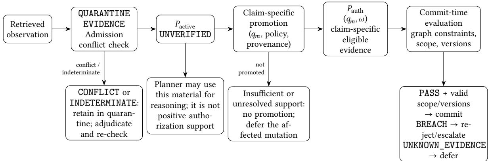

# Constraining the Commit Boundary: A DIO/ODI-Informed Authorization Guardrail for Agentic Entity Resolution

Daniel Beránek Independent Researcher, Brno, Czech Republic dan@danielberanek.cz

October 22, 2026

## Abstract

Agentic Entity Resolution (ER) systems iteratively plan actions, retrieve evidence, update hypotheses, and propose graph mutations. An erroneous identity hypothesis may therefore condition later evidence acquisition and produce observations that appear to confirm the original error. This paper does not claim to eliminate that feedback mechanism. Instead, it proposes a Digital Identity Optimization (DIO) and Ontology of Digital Identity (ODI)-informed authorization boundary between evidence available to an agent for reasoning and evidence eligible to authorize a persistent identity-changing mutation. A proposed constraint-binding function maps selected reconstruction-failure distinctions to domain-configured identity-preserving constraints. Under the proposed contract, a candidate mutation may be committed only when the candidate graph passes those constraints using claim-specific authorization-eligible evidence, the operation remains within its authorized scope, and the relevant state and policy versions remain valid. Admission as UNVERIFIED does not confer authorization eligibility. A separate claim-specific promotion decision may make specified evidence usable for a particular authorization proposition without treating its source as universally verified; insuficient support or unresolved material conflict leads to deferral rather than an irreversible merge. Its contribution is a specification of obligations at the commit boundary—claim-specific promotion, proposition coverage, conflict handling, scope binding, and version integrity—not a stand-alone theorem of semantic correctness. This is a conceptual architecture, not an implemented or empirically validated system. Its property is conditional on the correctness of the domain policy, evidence-promotion process, and enforcement boundary. It does not prevent erroneous hypotheses or hypothesis-conditioned retrieval. Dependency-aware evidence lineage and feedback control are identified as separate directions for future research.

Keywords: Digital Identity Optimization; DIO; Ontology of Digital Identity; ODI; digital identity; identity reconstruction; artificial intelligence; search engines; knowledge graphs; human observers; Agentic Entity Resolution; commit-boundary authorization; identity-changing mutations; claim-specific evidence promotion; authorization-eligible evidence; observation domain; identity-preserving constraints; referential continuity; semantic coherence; entity resolution; Reconstruction Failure Modes; Referential Reconstruction Failures; Entity Substitution; Merge Failure; Split Failure; Entity Omission; Semantic Coherence Failures; Semantic Fragmentation; Temporal Reconstruction Failures; Temporal Discontinuity; Temporal Misalignment; Contextual Adequacy Failures; Contextual Displacement; provenance

## Contents

1. Introduction 3   
2. Related Work and Positioning 4   
3. Diagnostic Failure-Path Analysis of Agentic ER 6   
3.1 Referential Reconstruction Failures (RRF) 6   
3.2 Semantic Coherence Failures (SCF) . . 7   
3.3 Temporal Reconstruction Failures (TRF) 7   
3.4 Contextual Adequacy Failures (CAF) . 7   
3.5 Failure Stage, Control Boundary, and Limitation 7   
4. A Stylized Model of Apparent Verification 8   
4.1 A Possible Hypothesis-Conditioned Feedback Path . 8   
5. DIO/ODI-Informed Mutation Authorization 9   
5.1 Semantic Target: Reconstruction Admissibility and Observation Context 9   
5.2 Constraint Binding and Its DIO/ODI Contribution 10   
5.3 Evidence States and Promotion Contract . 12   
5.4 Authorization Invariant and Assumptions 14   
5.5 Boundary and Future Direction: Dependency-Aware Evidence Flow 15   
6. Abstract Interface Specification 16   
6.1 State, Scope, and Version Contracts 16   
6.2 Phase 1 — Pre-Execution Authorization 17   
6.3 Phase 2 — Post-Execution Validation and Commit 18   
7. Illustrative Case: Corporate Entity Resolution in B2B Data Lakes 20   
7.1 Scenario and Domain Constraints 20   
7.2 Failure Case: Relatedness Is Mistaken for Identity 21   
7.3 Temporal Scope Case: Reused Source-Local Identifier 22   
7.4 Contrast Case: Documented Identity Continuity 22   
8. Proposed Evaluation Protocol 22   
8.1 Baselines and Corpus Construction . 22   
8.2 Evaluation Metrics 23   
9. Limitations and Future Research 25   
9.1 Dependency-Aware Evidence Flow . 25   
9.2 Domain-Policy Construction 25   
9.3 Multi-Agent and Contextual Negotiation 25   
10. Conclusion 26   
References 26   
Methodological Note on Model-Assisted Development of This Paper 28

## 1. Introduction

Entity Resolution (ER) is the data-management task of determining whether distinct records, mentions, or representations refer to the same real-world referent. It supports master data management, knowledge-graph construction, and cross-silo integration in heterogeneous data environments [12, 20]. Traditional ER systems compare candidate pairs or clusters using rules, learned representations, or combinations of both [10, 12, 17, 26]. Entity linking and explainable entity matching address adjacent problems at mention or pair level [2, 3], while pretrained language models and LLM-assisted methods broaden the range of evidence and comparisons available to ER pipelines [16, 17, 21, 26]. This paper addresses a governance question that becomes especially important when resolution is iterative: which evidence may authorize a persistent identity change, and under what conditions may a proposed graph mutation be committed?

Recent work has framed Agentic ER as a sequential decision-making process in which an autonomous agent plans actions, gathers evidence iteratively, invokes tools, revises its beliefs, and selectively defers cases [18]. This creates opportunities for adaptive evidence acquisition, but it also makes later actions dependent on prior intermediate states. A mistaken identity hypothesis can condition a retrieval query; the resulting material may be relevant to that query without independently establishing the identity claim. If the agent then treats the material as confirmation, an initial error may become harder to dislodge. We use apparent verification for this possible mechanism. It is an analytical construct, not a claim that iterative retrieval inevitably produces self-confirmation; retrieval-augmented systems have been studied for related vulnerability patterns [24].

The problem is not that an agent must never reason with incomplete or uncertain evidence. Exploratory reasoning often requires provisional hypotheses. The architectural question is whether a hypothesis or observation that is useful for planning should automatically be eligible to authorize a persistent change to an entity’s identity. This paper proposes that these statuses should be separated. The agent may retain a provisional interpretation for reasoning, while a protected mutation boundary requires evidence that has passed a distinct, claim-specific authorization process.

The paper connects this boundary to the Digital Identity Optimization (DIO) and Ontology of Digital Identity (ODI) Reference Model [5, 8, 9]. DIO/ODI supplies a reconstruction-oriented vocabulary and diagnostic distinctions across referential, semantic, temporal, and contextual failure modes [4, 6, 7]. The contribution here is not to claim that provenance tracking, invariant checks, transaction versioning, abstention, or human review are new in isolation. It is to propose an explicit bridge between DIO/ODI reconstruction diagnostics and mutation-specific authorization constraints, with a clear boundary around the property the architecture claims to provide.

## The proposed contribution has four parts:

1. A lifecycle-to-boundary analysis that maps possible Agentic ER failure pathways to the guardrail’s controls and explicitly stated limitations.

2. A domain-governed constraint-binding function that translates selected DIO/ODI distinctions into inspectable identity-preserving conditions for particular mutation classes.

3. An abstract two-phase MVDIO Supervisor Layer that separates Planner-visible evidence from claim-specific authorization-eligible evidence and gates persistent graph mutations on semantic evaluation, authorized scope, and valid state/policy versions.

4. A prospective evaluation protocol that separates the efect of DIO/ODI-informed constraints from conventional identifier rules, generic authorization gates, and default-deny/abstention baselines.

The formal invariant summarizes these obligations; it is not presented as an independent theorem of semantic correctness. The contribution is the explicit contract connecting claim-specific evidence promotion, proposition coverage, conflict handling, scope binding, and commit-time version integrity

to a DIO/ODI-informed policy-design process.

This is a conceptual architecture and research proposal, not a completed implementation or an empirical claim of efectiveness. In particular, it does not prevent the agent from forming a wrong hypothesis, eliminate hypothesis-conditioned retrieval, or establish that all apparent confirmations are detected. A broader information-flow design that tracks dependencies between hypotheses, actions, observations, and subsequent claims remains a separate research direction.

## 2. Related Work and Positioning

The general mechanisms used by the proposed guardrail—authorization gates, provenance records, version checks, graph validation, scope binding, and conservative deferral—are established in adjacent work. The comparison below therefore focuses on each line’s relevant contribution and the narrower identity-resolution question addressed here; it does not imply that a mechanism omitted from a row is absent from the cited system.

Table 1: Positioning relative to adjacent work.
<table><tr><td>Prior work / line</td><td>Established contribution relevant here</td><td>Scope and distinction of this paper</td></tr><tr><td>Conventional ER, LLM-assisted ER, and Agentic ER [10, 12, 16–18,21, 26]</td><td>Entity matching, data integration, language-model assistance, and sequential agent workflows.</td><td>Does not propose a new matching algorithm or agent workflow. Focuses on authorization conditions for persistent identity-changing</td></tr><tr><td>Ontology-governed enterprise agents [30]</td><td>Ontology-grounded entity alignment, graph simulation, isolated staging, provenance-bearing traces, and confidence-gated acceptance with clarification or</td><td>mutations. Targets heterogeneous ER merges and identity-continuity claims through DIO/ODI-informed, mutation-specific policy rather than a configured</td></tr><tr><td>Runtime authorization of agent-generated subgoals [29]</td><td>ontology-gap handling. Version-bound authorization witnesses and rechecking protected effects at an atomic commit boundary.</td><td>enterprise-ontology scenario. Treats the general runtime authorization boundary as prior work; focuses on the identity or continuity propositions and evidence required for a</td></tr><tr><td>Commit-time authorization [33]</td><td>Freshness, causal precedence, effect binding, and revalidation of authority for durable effects.</td><td>particular ER mutation. Shares the commit-time concern but asks which identity or continuity proposition must be established, not only whether earlier authority remains valid.</td></tr><tr><td>Prior work / line Hard-KLAIM and AGATE [34,</td><td>Established contribution relevant here Hard-KLAIM: typed effects,</td><td>Scope and distinction of this paper</td></tr><tr><td>35]</td><td>operational semantics, proposal-approval- commitment binding, provenance constraints, and mechanized trace-safety proofs. AGATE: an implemented runtime authorization/provenance gate with parameter-bound grants,</td><td>Does not claim comparable formal proof, implementation, or empirical evaluation. Proposes an ER-specific semantic authorization contract.</td></tr><tr><td>EBL-Core and CONTINUITY [36,37]</td><td>evaluation. Candidate-bound execution authorization, evidence and policy binding, current-condition checks, and continuity of authorization context across agent</td><td>Does not propose another general execution-boundary contract; focuses on identity propositions and domain constraints for an ER mutation.</td></tr><tr><td>ARGUS [23]</td><td>components. Influence-provenance tracing, selective admission of context as usable evidence, and evidence-sensitive authorization of consequential</td><td>Addresses a different threat model. The present design does not reconstruct comprehensive causal lineage and does not claim to solve the full feedback</td></tr><tr><td>SHACL and PROV-O [31, 32]</td><td>actions. Graph-constraint validation and standardized representation of provenance.</td><td>cascade. Provide relevant concepts or potential implementation substrates, but do not by themselves specify the DIO/ODI diagnostic-to-constraint</td></tr><tr><td>DIO/ODI reference work [4-9]</td><td>Reconstruction-oriented concepts and distinctions covering referential, semantic, temporal, and contextual failure modes.</td><td>mapping proposed here. Supplies the diagnostic vocabulary used in the proposed domain-governed mapping; does not automatically generate the executable constraints or establish their incremental value.</td></tr></table>

The closest authorization-related neighbors establish that version-bound commit checks and evidence-aware execution gates are not, by themselves, novel. Zhu and Wang [29] authorize self-generated subgoals against a principal-approved task contract, while Santos-Grueiro [33] examines whether authority for a durable efect remains fresh, causally prior, and valid at commit time. Zhu et al. [30] additionally cover ontology-grounded entity alignment and scenario-driven graph simulation, with low-confidence cases held from simulation for clarification or ontology-gap resolution. The distinction proposed here is narrower: the required identity or continuity proposition is derived for a particular ER mutation and assessed under domain-configured constraints informed by selected DIO/ODI diagnostics.

Hard-KLAIM [34], AGATE [35], EBL-Core [36], CONTINUITY [37], and ARGUS [23] further establish relevant approaches to typed efects, runtime authorization, provenance-aware execution, current-condition checks, or cross-component authorization continuity. The present manuscript does not claim comparable formal guarantees or an implemented runtime defense. Nor does it claim comprehensive causal-lineage reconstruction; the handling of dependencies that are absent from recorded provenance remains outside the stated guarantee.

SHACL [31] specifies graph-shape validation, and W3C PROV-O [32] provides a vocabulary for representing and exchanging provenance. These can support implementation of parts of an authorization architecture, but neither supplies the policy decision about which identity-changing proposition must be established for a particular mutation. Similarly, the DIO/ODI contribution here is not automatic SKOS entailment or an established advantage over a generic policy built from the same domain facts. It is the proposed diagnostic-to-constraint mapping: selected reconstruction-failure distinctions organize which claim a mutation requires, which relations are insuficient to establish it, and when temporal or contextual conditions call for deferral. Its incremental value remains an open empirical question.

## 3. Diagnostic Failure-Path Analysis of Agentic ER

The Agentic ER operational cycle alternates through four stages: Plan (select actions from the current state), Act (execute a tool or operation), Observe (receive evidence or a mutation result), and Update Beliefs (revise the internal state) [18]. The following mapping applies the DIO/ODI Reconstruction Failure Mode taxonomy diagnostically to that cycle [7, 8]. It is a proposed analytical application of the taxonomy, not a claim that the taxonomy was part of the original Agentic ER proposal.

The DIO/ODI diagnostic vocabulary covers four dimensions:

• Referential Reconstruction Failures (RRF): Entity Substitution (ES), Merge Failure (MF), Split Failure (SF), and Entity Omission.

• Semantic Coherence Failures (SCF): Semantic Fragmentation (SFR).

• Temporal Reconstruction Failures (TRF): Temporal Discontinuity (TD) and Temporal Misalignment (TM).

• Contextual Adequacy Failures (CAF): Contextual Displacement (CD).

The diagnostic dimensions inform analysis across the Agentic ER lifecycle, but the proposed commit-boundary guardrail operates only at the persistence boundary: it governs mutation authorization and commitment, not all hypothesis formation, query conditioning, or intermediate belief updates.

## 3.1 Referential Reconstruction Failures (RRF)

Referential failures concern incorrect identity assignment or cardinality violations between an intended referent � and its reconstructed identity $\widehat { A } \left[ 6 , 7 \right]$

• Merge Failure $( \{ A , B \} \to { \widehat { X } } , A \neq B )$ : distinct referents are consolidated into one representation [7, 12].

• Split Failure $( A \to \{ \widehat { A } _ { 1 } , \widehat { A } _ { 2 } , . . . \} )$ : one referent is represented as disconnected identity clusters because temporal or relational continuity was not reconstructed.

• Entity Substitution $( A \to { \widehat { B } } , A \neq B )$ : a less prominent target is displaced by a structurally or lexically prominent namesake. Entity-overshadowing research provides a relevant example of this ambiguity class [19]; entity-linking work provides adjacent context [2].

• Entity Omission: the system fails to generate a reconstruction despite suficient representational grounds within the defined observation domain.

In a sequential agent, an early referential failure may influence later query formulation, evidence selection, and mutation proposals. The resulting process might compound the error, correct it, or leave it unchanged. The authorization design proposed here does not determine which trajectory occurs; it governs whether a persistent identity-changing mutation is permitted at the final protected boundary.

## 3.2 Semantic Coherence Failures (SCF)

Semantic Fragmentation occurs when the system retains referential unity but fails to reconcile incompatible relational claims or representations into a coherent profile [6, 7]. Referential correctness alone does not guarantee that the resulting set of claims is coherent or usable. A mutation that consolidates records must not be treated as resolving contradictions merely because the records have been clustered together.

## 3.3 Temporal Reconstruction Failures (TRF)

Temporal Discontinuity and Temporal Misalignment arise when representations are not adequately anchored in time [4, 25]. Temporal misalignment assigns an obsolete state to a referent whose identity remains correct; temporal discontinuity treats historical states of a continuous referent as separate entities. This distinction matters for acquisitions, legal renaming, changing oficers, product transitions, and other cases where attributes and relations legitimately evolve.

## 3.4 Contextual Adequacy Failures (CAF)

Contextual Displacement occurs when a reconstruction may be factually valid but does not satisfy the requirements of the current observation domain Ω [6, 7]. A matching result adequate for product-catalog deduplication may not be adequate for legal-entity compliance. Domain and purpose therefore matter when translating a diagnostic concept into an authorization rule.

## 3.5 Failure Stage, Control Boundary, and Limitation

The failure mapping is diagnostic; the following table makes its operational scope explicit.

<table><tr><td>Lifecycle stage</td><td>Potential failure pathway</td><td>What the commit-boundary guardrail does</td><td>What it does not claim to do</td></tr><tr><td>Plan</td><td>A mistaken identity hypothesis conditions an action or query (potential RRF, TRF, or</td><td>Binds any proposed mutation to an explicit authorization record and policy scope.</td><td>Does not prevent a wrong hypothesis from shaping the Planner.</td></tr><tr><td>Act</td><td>CAF pathway). A query retrieves material selected or phrased under the current hypothesis (potential CAF pathway).</td><td>Checks the declared action scope; retrieval results enter a controlled admission path.</td><td>Does not guarantee independent retrieval or infer causal independence.</td></tr><tr><td>Lifecycle stage</td><td>Potential failure pathway</td><td>What the commit-boundary</td><td>What it does not claim</td></tr><tr><td>Observe</td><td>Retrieved content appears consistent with the hypothesis or conflicts with other claims (potential</td><td>Stages observations; records detected material conflicts for deferral/adjudication.</td><td>Does not reliably detect all apparent verification or infer causal dependence among sources.</td></tr><tr><td>Update Beliefs</td><td>An observation affects the Planner's internal state and may reinforce a substitution or stale interpretation (potential RRF/TRF</td><td>Separates Planner eligibility from authorization eligibility.</td><td>Does not block all effects of UNVERIFIED material on internal reasoning.</td></tr><tr><td>Persistent graph mutation</td><td>pathway). A hypothesis is converted into a durable merge or identity-changing edge.</td><td>Requires a PAss under the declared constraints on claim-specific  $P _ { \mathrm { a u t h } } ,$  valid scope, and current state/policy</td><td>Does not prove that the domain policy or evidence validator is infallible.</td></tr></table>

This table is a diagnostic mapping of possible failure pathways to the proposed control boundary. It does not claim that the lifecycle stages uniquely determine a failure category or that the proposed guardrail detects every listed pathway. The contribution concerns authorization containment at the persistence boundary, conditional on the assumptions specified below, not a full information-flow guarantee.

## 4. A Stylized Model of Apparent Verification

An abstract sequential agent may be represented by a state $\boldsymbol { s } _ { t } \in \mathcal { S }$ , an action $a _ { t } \in \mathcal A _ { : }$ , an observation $o _ { t } \in \mathcal { O }$ , and an update function

$$
s _ { t + 1 } = \Phi ( s _ { t } , a _ { t } , o _ { t } ) .
$$

## 4.1 A Possible Hypothesis-Conditioned Feedback Path

Under hypothesis-conditioned retrieval and insuficiently independent validation, the following sequence is possible:

1. Latent distortion: the state $s _ { t }$ contains an erroneous identity hypothesis introduced by a noisy classifier, prior inference, or earlier evidence [7, 18].

2. Biased action parameterization: the next action is selected using the corrupted state, so a query or tool call encodes part of the earlier hypothesis [4, 11].

3. Contextual ingestion: retrieval returns material relevant to the query as formulated, but relevance does not independently establish the target referent’s identity [4, 24].

4. Apparent convergence: the apparent discrepancy between an observation and the existing hypothesis may decrease even when the hypothesis is wrong, because the observation process

was conditioned on that hypothesis.

A stylized residual is

$$
\| \mathrm { P r o j e c t } ( o _ { t + 1 } ) - \mathrm { E x p e c t a t i o n } ( s _ { t } ) \| \to 0 .
$$

Here, Project denotes an illustrative mapping of an observation into the representation used by the matcher, and Expectation denotes the representation predicted from the current state. The expression presupposes that both outputs are comparable in a common representational space; neither mapping nor the discrepancy measure is specified as a calibrated estimator. The arrow denotes a possible reduction in apparent discrepancy over a feedback sequence, not a convergence result established by this paper. The expression illustrates how a hypothesis-conditioned observation may appear to agree with the current state without independently establishing referential correctness.

Boundary of the proposed solution. The proposed MVDIO Supervisor does not close the Plan–Act–Observe–Update feedback loop. It does not claim that a query is independent of the current hypothesis, that multiple returned sources provide independent corroboration, or that intermediate belief updates are free of contaminated evidence. It addresses the downstream authorization question: whether the evidence and constraints recorded for a proposed persistent mutation are suficient to permit that mutation. This narrower boundary is deliberate and makes the proposed property inspectable without claiming a solution to the full cascade mechanism.

## 5. DIO/ODI-Informed Mutation Authorization

The authorization design uses a reconstruction-oriented semantic model to inform constraints over identity-changing operations. A full agent planner may be modelled as a constrained sequential decision process, such as a Constrained Markov Decision Process [1], but this paper does not specify or claim to solve the Planner’s global optimization problem. Its formal focus is the authorization condition at a persistent mutation boundary.

## 5.1 Semantic Target: Reconstruction Admissibility and Observation Context

Let $\omega = ( O , C , t ) \in \Omega$ denote the observation domain relevant to a mutation: an observer or consuming system �, an operational context or purpose �, and the relevant temporal epoch or interval �. Let ℛ denote the space of analytically considered reconstructions. For a referent �, define the ideal admissible reconstruction set as

$$
\mathrm { A d m } ( E , \omega ) \subseteq { \mathcal { R } } .
$$

Here, $\mathrm { A d m } ( E , \omega )$ denotes the reconstructions that preserve the intended referential assignment and satisfy the applicable semantic and temporal conditions for � under �. It is an ideal semantic reference, not a set that the proposed supervisor can enumerate or verify directly from incomplete evidence.

Let $\mathcal { S }$ denote the relevant agent-state space, and let the partial projection from a state to a reconstruction be

$$
\Gamma : \mathcal { S }  \mathcal { R } .
$$

The partiality matters: some states do not yield a well-defined reconstruction in the observation domain. For states where a reconstruction is defined, the corresponding idealized inadmissibility set is

$$
{ \mathcal { S } } _ { \mathrm { i d e a l \_ f a i l } } ( E , \omega ) : = \{ s \in \mathrm { d o m } ( \Gamma ) \mid \Gamma ( s ) \not \in \mathrm { A d m } ( E , \omega ) \} .
$$

This set is an analytical reference for a defined but inadmissible reconstruction; it is not an executable detector or a claim that the supervisor observes the agent’s full internal state. The expression does not classify an undefined reconstruction and must not be read as proof that an identity claim is false. Entity Omission—where no reconstruction is produced despite suficient grounds within the observation domain—and upstream acquisition/coverage failures require separate analysis; the latter should not automatically be labeled reconstruction failures.

The diagnostic distinctions in Section 3 organize diferent ways in which reconstruction can fail or become unsuitable. Defined-output cases of Entity Substitution, Merge Failure, and Split Failure can be characterized as candidate cases of idealized inadmissibility when assessed for the relevant referent and observation domain. The set does not itself classify the cause of inadmissibility or provide a one-to-one mapping to RRF, SCF, TRF, and CAF. In particular, Semantic Fragmentation is relational across multiple reconstructions, while Temporal Discontinuity may require a sequence of time-indexed states; neither is fully encoded by this single-state set definition. The taxonomy in Section 3 remains a diagnostic organization, not a partition theorem over $\mathcal { S } _ { \mathrm { i d e a l \_ f a i l } } .$ . Contextual Displacement is analytically distinct: a reconstruction may preserve referential identity while remaining inadequate for the current purpose, so contextual conditions must be represented by domain policy rather than inferred from referential inadmissibility alone.

Contextual fitness remains distinct from admissibility. A reconstruction may preserve referential identity and temporal continuity yet still be inadequate for a particular task or consuming system. We do not assign a numeric contextual-adequacy score here, because no calibrated scoring function is specified. Instead, context-sensitive requirements must be expressed as explicit, versioned domain-policy conditions. The architecture does not assume an oracle for semantic truth: missing or inapplicable support blocks authorization but does not prove that two referents are diferent.

## 5.2 Constraint Binding and Its DIO/ODI Contribution

The DIO/ODI Reference Model provides concepts, relationships, and diagnostic mappings. It does not automatically generate executable constraints. We propose a partial, domain-governed binding function

$$
\mu _ { \Omega } : \mathcal { C } _ { \mathrm { D I O / O D I } }  \mathcal { V } _ { E } ,
$$

where ${ \mathcal { C } } _ { \mathrm { D I O / O D I } }$ denotes the selected failure-mode distinctions in the restricted domain, and $\mathcal { V } _ { E }$ is the set of explicit, domain-configured identity-preserving constraints for referent or entity class �. The mapping is proposed as a policy-design step, not as automatic SKOS entailment. In this notation, � denotes the referent or entity class, $V _ { E }$ its domain-configured constraint set, and $\nu _ { E }$ the version counter for the evidence state—not a version of � or $V _ { E }$

For this paper, reconstruction means forming a context- and time-bound representation of a referent’s identity from distributed representations and claims; it does not presuppose that one complete ground-truth profile is available. Digital Identity Optimization (DIO) is the broader framework for preserving and reconstructing coherent digital identity across such representations, while the Ontology of Digital Identity (ODI) organizes the concepts and relations used to describe that problem. In the present proposal, the domain of $\mu _ { \Omega }$ is restricted to the reconstruction-failure distinctions defined in Section 3 (RRF, SCF, TRF, and CAF) and the selected categories shown in the mapping below; it does not cover the whole DIO/ODI vocabulary.

General RDF graph validation can provide an implementation substrate for some domain-level constraints. SHACL specifies how RDF data graphs may be checked against declared shapes and conditions [31]. A suitable SHACL/SPARQL validator could therefore evaluate selected graph conditions, but SHACL does not itself supply the DIO/ODI diagnostic mapping, decide which identity proposition is required for a particular mutation, or establish the adequacy of the evidence-promotion process. The proposed $\mu _ { \Omega }$ is a design-time binding step, not a graph-validation engine or an automatic constraint-generation mechanism.

At minimum, a binding used for authorization should be:

• Domain-scoped: applicable to a declared entity class, observation context, and mutation class.

• Semantically typed: explicit about which relation or evidence type it accepts; relatedness must not silently become identity equivalence.

• Temporally scoped where relevant: continuity and state claims must be evaluated for the interval to which the mutation applies.

• Inspectable and versioned: the selected concept-to-constraint mapping and the policy version used at authorization can be recorded and audited.

• Fail-closed for irreversible mutations: insuficient authorization-eligible evidence yields UNKNOWN\_EVIDENCE, not implicit permission.

An illustrative binding is shown below. It is a domain-policy example, not a validated general-purpose mapping or a property automatically produced by the reference vocabulary. The diagnostic categories in the left column come from the DIO/ODI framing; the specific predicates and rules are supplied by the domain policy.

<table><tr><td>DIO/ODI diagnostic distinction</td><td>Example domain-level constraint</td><td>Authorization consequence for an identity-changing mutation</td></tr><tr><td>Entity Substitution / Merge Failure (RRF)</td><td>Lexical similarity or a shared commercial neighborhood does not by itself establish that two records denote the same referent.</td><td>Do not merge without claim-specific evidence establishing co-reference.</td></tr><tr><td>Temporal Discontinuity / Misalignment (TRF)</td><td>A rename or continuity claim must apply to the relevant referent and validity interval.</td><td>Defer if temporal applicability or legal continuity is unresolved.</td></tr><tr><td>Semantic Fragmentation (SCF)</td><td>Materially incompatible claims affecting identity are retained as a conflict until reconciled; clustering alone does not</td><td>Require reconciliation or defer the affected mutation.</td></tr><tr><td>Contextual Displacement (CAF)</td><td>reconcile them. The same brand_of relation may be adequate in a brand catalogue but insufficient for the legal-entity identity proposition required in a</td><td>Preserve the typed relation; require evidence and constraints appropriate to the current observation purpose.</td></tr><tr><td>Split Failure / valid continuity (RRF/TRF)</td><td>compliance context. Documented, temporally applicable evidence may establish that distinct records refer to one continuing entity.</td><td>Permit resolution when the claim-specific evidence and all applicable constraints pass.</td></tr></table>

The proposed DIO/ODI-informed contribution is a diagnostic-to-constraint mapping: selected reconstruction-failure distinctions are used to specify which claim a mutation requires, which relations are insuficient for that claim, and when temporal or contextual conditions require deferral.

This is a design proposal rather than an established advantage over generic authorization. Its incremental value depends on whether this mapping improves the safety/coverage trade-of relative to policies built from the same domain facts without the diagnostic structure.

## 5.3 Evidence States and Promotion Contract

Let $P _ { \mathrm { a c t i v e } }$ be the evidence admitted for use by the Planner and $P _ { \mathrm { q u a r } }$ the evidence retained in quarantine outside that admitted set. $P _ { \mathrm { a c t i v e } }$ may include records marked UNVERIFIED. Let $q _ { m }$ denote the identity or continuity proposition—or set of propositions—that must hold for mutation � to be authorized. Let $P _ { \mathrm { a u t h } } ( q _ { m } , \omega ) \subseteq P _ { \mathrm { a c t i v e } }$ be the evidence eligible to bear on the claim-specific assessment of those propositions in observation domain $\omega ,$ including its relevant temporal epoch or interval. This includes evidence that may support a proposition, establish a policy-relevant contradiction, or reveal an unresolved material conflict; the role taken by each item must be recorded in its claim-specific validation basis. Authorization eligibility is not itself a verdict and is not a global label asserting that a document is universally true. The same source may support one proposition while contradicting or being insuficient for another; use for a diferent proposition requires a separate policy assessment.

A retrieved observation first enters QUARANTINE\_EVIDENCE. Following basic admission checks, it may be added to $P _ { \mathrm { a c t i v e } }$ with status UNVERIFIED, but that step does not promote it into $P _ { \mathrm { a u t h } } ( q _ { m } , \omega )$ . Promotion requires a separate, auditable policy that assesses the identity or continuity claim needed for the proposed mutation.

  
Figure 1: Evidence admission and claim-specific promotion. The forward path applies only when admission returns no detected conflict and claim-specific promotion succeeds. Admission to $P _ { \mathrm { a c t i v e } }$ grants only UNVERIFIED status; it does not authorize a mutation. Commit remains conditional on graph constraints, authorized scope, and current versions.

## The minimum promotion contract is:

1. It evaluates the specific proposition required for the candidate mutation, rather than document relevance, query match, or plausibility alone.

2. It records the source/provenance basis, the proposition assessed, the item’s role (support, contradiction, or unresolved indication), temporal applicability where relevant, the validation basis, and the policy/validator version.

3. It does not treat Planner confidence, an LLM-generated verified label, or repetition across UNVERIFIED observations as suficient authorization evidence.

4. It does not promote a claim solely because the Planner’s hypothesis induced the query that retrieved supporting material. Corroboration used for promotion must have a claim-specific basis under the declared policy; simple agreement or document count is not enough by itself. Observations whose recorded provenance indicates a shared upstream query, hypothesis, source, or derivation path must not be counted as independent corroboration merely because

they appear as separate items.

5. It must not infer positive support merely from the absence of a detected conflict.

6. The recorded provenance and validation basis for a promoted claim must not cite a shadow candidate or a claim whose own recorded basis cites shadow content. A promotion process must preserve enough recorded basis to apply this restriction transitively along that recorded chain.

7. Evidence becomes authorization-eligible only for the proposition, evidentiary role, and applicability established under the declared policy. Evidence that does not qualify as positive support cannot satisfy a required positive condition.

These requirements constrain the promotion decision on the basis of recorded provenance; they do not claim that the system can reconstruct every causal dependency among retrieval actions and evidence origins. The shadow exclusion applies to the recorded validation/provenance chain used for promotion. Unrecorded or undisclosed derivations cannot be reliably screened by this contract and remain outside the guarantee; the broader dependency problem remains future research.

The validator implementation and its trust base are outside this paper’s scope. This is a material assumption, not a solved subproblem. Eligibility metadata may be written or changed only by the designated promotion process or by a versioned policy/adjudication operation that triggers a new authorization decision; the Planner and raw tool outputs cannot directly assign or alter authorization eligibility. The architecture is conditional on the promotion process correctly applying the stated policy. It cannot protect against a validator that systematically misclassifies unsupported claims as authorized, a false authoritative source, or a policy that encodes the wrong identity conditions. In domains where the validity of a mention-to-identifier link is itself uncertain, the linkage must be treated as a claim requiring evidence; the existence of an identifier alone does not prove that the mention refers to its holder.

For evidence admission, a mutation-independent check uses the observation itself and the current evidence stores: CheckAdmissionConflict(o, P\_active, P\_quar) returns CONFLICT, NO\_CONFLICT\_DETECTED, or INDETERMINATE. CONFLICT denotes a supported material conflict; INDETERMINATE denotes a plausible material conflict that cannot be resolved on the available basis. NO\_CONFLICT\_DETECTED means only that this admission check did not establish a conflict. It is not positive evidence of identity, and the check cannot certify that all conflicts have been detected. The admission check does not take q\_m as an input because no mutation-specific proposition need be fixed at read time. A conflict or indeterminate result keeps the observation quarantined for adjudication; otherwise it may be admitted to P\_active as UNVERIFIED, without authorization promotion. An admission-level CONFLICT is a reason to quarantine the observation, not by itself a mutation-level BREACH verdict.

A quarantined item remains outside Planner-visible shared evidence until a policy-designated adjudication or versioned rule determines its disposition. Such a decision must be recorded, advance the evidence-state version, and trigger a fresh admission check before an item is released to P\_active; release confers only UNVERIFIED status, not claim-specific authorization eligibility. If no authorized reviewer or applicable rule is available, the item remains quarantined and may cause a mutation to be deferred. Escalation does not itself release evidence or authorize a commit.

At mutation evaluation, the supervisor performs a separate claim-specific check:

CheckClaimConflict(q\_m, P\_auth, P\_active, P\_quar). It returns CLEAR only when no unresolved material conflict bearing on the propositions in q\_m is detected. It returns CONFLICT only when claim-specific authorization-eligible evidence, assessed under the applicable policy, establishes a relevant contradiction or prohibitive condition. It returns INDETERMINATE when a possible material conflict is indicated only by UNVERIFIED evidence in P\_active or by evidence in P\_quar, or when conflicting authorization-eligible items cannot be reconciled under the policy’s authority and temporal rules. A detected CONFLICT or INDETERMINATE must prevent PASS. An UNVERIFIED item may therefore cause deferral by revealing an unresolved conflict, but it cannot itself establish a

mutation-level BREACH or count as positive support for identity.

For action and graph evaluation, the statuses are:

• PASS: every required positive condition is supported by claim-specific authorization-eligible evidence, no applicable prohibition is established, and CheckClaimConflict returns CLEAR.

• BREACH: authorization-eligible evidence establishes a relevant contradiction or violation of an explicit prohibitive constraint.

• UNKNOWN\_EVIDENCE: required positive support is insuficient, or a material conflict remains unresolved or indeterminate.

The status aggregation rule is BREACH takes precedence over UNKNOWN\_EVIDENCE, which takes precedence over PASS: an established violation rejects the candidate even if other conditions are unknown; otherwise any missing required support or unresolved material conflict blocks a pass. Positive/suficiency constraints state what must be supported to authorize a mutation. Prohibitive constraints state what must not be asserted or committed. A relation such as brand\_of is not, by itself, proof that two referents are diferent; it is insuficient to establish legal-entity identity unless a separate policy rule and evidence support that conclusion. UNKNOWN\_EVIDENCE blocks an irreversible mutation because authorization has not been established, not because the system has proven the identity claim false.

## 5.4 Authorization Invariant and Assumptions

Let � be a proposed mutation, $q _ { m }$ the proposition or set of propositions required to authorize it, $G _ { \mathrm { c a n d } }$ its candidate graph, $\alpha _ { m }$ the authorization record, and $\sigma _ { c }$ the consistent commit-time snapshot of the relevant graph, evidence stores, policy, shadow store if used, and their versions. The required proposition set is derived by the supervisor from the candidate operation, its target/efect scope, and the applicable versioned policy instance, which is configured for the relevant observation domain:

$$
q _ { m } : = \mathrm { D e r i v e R e q u i r e d C l a i m s } ( m , V _ { E } , \nu _ { \mathrm { p o l } } ) .
$$

The resulting $q _ { m }$ is bound in $\alpha _ { m }$ ; the Planner cannot weaken or replace that derived set. The domain-specific policy instance represents the applicable observation context and temporal conditions, while the claim-specific evidence assessment evaluates applicability to $q _ { m } .$ . This is the operational bridge from domain-configured constraints to the specific propositions that must be supported for a mutation. The ideal set $\mathrm { A d m } ( E , \omega )$ defined in Section 5.1 is not evaluated directly at commit time. Rather, the design-time mapping $\mu _ { \Omega }$ selects explicit constraints from the DIO/ODI diagnostic vocabulary, the versioned policy instantiates the required propositions and constraints, and the commit contract checks their satisfaction against claim-specific authorization-eligible evidence. Consequently, a PASS result establishes compliance with the configured contract; it does not prove membership in the ideal admissible set or the semantic truth of the underlying evidence. An operation is treated as a protected identity-changing mutation whenever its realized or potential shared efects can alter the graph’s identity interpretation. If the efect class is ambiguous, it is treated as protected rather than classified as harmless or reversible by the Planner.

The authorization record binds the domain-policy version $\nu _ { \mathrm { p o l } } ( \alpha _ { m } )$ . The functions ScopeValid and VersionsValid are defined in Section 6. The proposed commit invariant is

$$
\begin{array} { r } { \mathrm { C o m m i t } ( m ) \Rightarrow \mathrm { E v a l u a t e G r a p h C o n s t r a i n t s } ( V _ { E } ^ { ( \nu _ { \mathrm { p o l } } ( \alpha _ { m } ) ) } , q _ { m } , P _ { \mathrm { a u t h } } ^ { ( \sigma _ { c } ) } ( q _ { m } , \omega ) , P _ { \mathrm { a c t i v e } } ^ { ( \sigma _ { c } ) } , P _ { \mathrm { q u a r } } ^ { ( \sigma _ { c } ) } , G _ { \mathrm { c a n d } } ^ { ( \sigma _ { c } ) } ) = \mathrm { P a S S } } \\ { \wedge \mathrm { S c o p e V a l i d } ( m , \alpha _ { m } ) \wedge \mathrm { V e r s i o n s V a l i d } ( \alpha _ { m } , \sigma _ { c } ) . } \end{array}
$$

EvaluateGraphConstraints evaluates both the candidate graph against applicable constraints and the evidence-to-claim support needed to authorize the proposed mutation; it is not merely a graph-shape validator. Each required proposition in $q _ { m }$ must be covered separately by at least one item in $P _ { \mathrm { a u t h } } ( q _ { m } , \omega )$ whose recorded claim-support and validation basis is applicable to that proposition, including temporal applicability where required. The authorization record $\alpha _ { m }$ must bind $q _ { m }$ and reference the promotion/validation record or stable record identifier relied on for each required proposition. Mere membership in $P _ { \mathrm { a u t h } }$ without proposition-specific support is insuficient. EvaluateGraphConstraints returns PASS only if all required positive conditions are supported by claim-specific authorization-eligible evidence, no applicable prohibition is established, and CheckClaimConflict returns CLEAR for the evidence stores in the same snapshot $\sigma _ { c }$ . It returns BREACH for an established policy violation and UNKNOWN\_EVIDENCE for insuficient positive support or a conflict reported as unresolved or indeterminate. The check is not assumed to detect contradictions absent from, or unrecognized in, its inputs. A conforming implementation must reject or defer unless the result is PASS, the realized operation falls within its authorized scope, and all relevant versions remain current through the commit point. VersionsValid must verify both that the authorization record was based on the relevant snapshot and that the graph, evidence-state, policy, and (if used) shadow versions still match that snapshot atomically at commit; validation against a stale snapshot alone is insuficient. This is an interface invariant: it specifies the protected commit path, not a theorem that the evidence or policy is true.

The property is conditional on seven assumptions:

1. Domain-policy adequacy: $V _ { E }$ expresses relevant identity-preserving constraints for the entity class, context, time, and mutation type.

2. Claim-specific promotion: evidence enters $P _ { \mathrm { a u t h } } ( q _ { m } , \omega )$ only under the promotion contract in Section 5.3, including its limits on Planner/query-conditioned promotion and corroboration by UNVERIFIED material.

3. Fail-closed authorization: insuficient evidence or an unresolved material conflict does not authorize an irreversible identity change.

4. Enforced and conservative mutation classification: every relevant production write passes through the supervisor, and any operation that may alter shared identity interpretation is treated as protected. Unmanaged write paths are outside the guarantee.

5. Derived authorization propositions: $q _ { m }$ is derived by the supervisor from the mutation, its target/efect scope, and the versioned domain policy; the Planner cannot supply a substitute claim set or weaken the derived authorization obligation.

6. Scope and version integrity: the operation, target, domain-policy version, graph state, complete evidence state (including quarantine), authorization eligibility, and shadow state if used remain valid through the commit point.

7. Recorded-basis and eligibility integrity: the promotion process controls eligibility metadata and applies the recorded-provenance restrictions in Section 5.3; the guarantee does not extend to derivations absent from that recorded basis.

The property is conditional on the promotion process applying the stated contract. It cannot protect against an invalid authoritative source, a validator that misclassifies unsupported claims, or a policy that encodes the wrong identity conditions. It does not guarantee that upstream reasoning is uncontaminated or that every material conflict is detected.

## 5.5 Boundary and Future Direction: Dependency-Aware Evidence Flow

A broader design could also control how evidence and intermediate hypotheses influence subsequent actions. That is a diferent problem from authorization at the commit boundary. A plausible future research direction is a dependency-aware information-flow layer that investigates three requirements:

1. Derivation lineage: retain links among observations, the actions or queries that produced them, the hypotheses that conditioned those actions, and claims subsequently derived from them.

2. Dependency-aware corroboration: avoid treating several observations as independent confirmation solely because they appear in separate documents or endpoints when their derivation paths are materially dependent.

3. Controlled feedback to the Planner: preserve or expose dependency status when evidence is reused for planning, and test when dependent evidence should be withheld, quarantined, discounted, or sent through an alternative validation path.

This is a research agenda, not a mechanism implemented or validated here. It would require a clear dependency model, an explicit information-flow contract, and evaluation using controlled hypothesis-conditioned perturbations or trajectory replay. Its efectiveness should not be implied by the commit-boundary authorization invariant.

## 6. Abstract Interface Specification

We propose a Minimum Viable Digital Identity Optimization (MVDIO) Supervisor Layer as a governance gateway for Agentic ER [18]. The architecture has a pre-execution authorization phase and a post-execution validation phase. Its purpose is to govern evidence admission and persistent mutation authorization; it is not a controller for the agent’s complete reasoning trajectory.

## 6.1 State, Scope, and Version Contracts

The supervisor distinguishes four action classes:

• READ: retrieval or exploration within a declared scope.

• STAGE\_LOCAL: local preparation with no shared-state efects.

• REVERSIBLE\_WRITE: a provisional operation authorized only for an isolated staging target, such as G\_shadow, where efects are separated from production identity state, Planner-visible shared identity state, downstream consumers, and all P\_auth inputs, and can be safely discarded. It does not authorize publication to the production graph.

• IRREVERSIBLE\_WRITE: the protected operational class for any operation whose realized or potential shared efects can persistently alter identity interpretation, such as merging legal-entity nodes or publishing an identity-changing edge. The label means that authorization is required at the shared persistence boundary; it does not assert that technical rollback is impossible. A candidate may be classified as REVERSIBLE\_WRITE only when the isolation conditions are positively established under policy; if classification or isolation is uncertain, the operation is treated as IRREVERSIBLE\_WRITE.

A READ result must not directly overwrite Planner-visible shared memory. The raw result first enters QUARANTINE\_EVIDENCE; after admission checks, it may be admitted to $P _ { \mathrm { a c t i v e } }$ as UNVERIFIED. The Planner may then use it for reasoning. This design does not claim to prevent the Planner from being influenced by it. Only the separate promotion contract determines whether it is eligible for $P _ { \mathrm { a u t h } } ( q _ { m } , \omega )$ . Admission as UNVERIFIED is never itself promotion; eligibility is claim-specific and remains subject to the policy/version checks.

The authorization record binds the permitted operation type, target and efect scope, and applicable domain-policy version $\nu _ { \mathrm { p o l } }$ . For protected graph mutations it also binds the supervisor-derived required-claim set $q _ { m }$ , graph version $\nu _ { G }$ , evidence-state version $\nu _ { E } ,$ and shadow version �� when a shadow layer is used. Version bindings are action-specific: a READ authorization does not bind a pre-retrieval $\nu _ { E }$ or �� whose change would force the retrieval to be replayed; its returned observation is admitted through the current-state protocol in Algorithm 2. A STAGE\_LOCAL authorization binds shared-state versions only when the declared local operation explicitly depends on them. A REVERSIBLE\_WRITE binds �� and the policy/isolation state relevant to staging. Use one evidence-state version, ��, for the complete relevant evidence state: it advances whenever $P _ { \mathrm { a c t i v e } }$ or $P _ { \mathrm { q u a r } }$ changes, including quarantine intake, removal, or adjudication outcome, and whenever authorization eligibility is promoted, demoted, or revoked. Every such change invalidates protected-write authorization based on the prior ��. ScopeValid checks the realized operation type, target, and allowed efects against the record. VersionsValid checks all versions bound and relevant to that operation at the required linearization or commit point. The policy is versioned and checked at authorization and at any later decision that relies on it.

We define an abstract AtomicSnapshot operation that returns a consistent logical snapshot of the production graph, both evidence stores (P\_active and P\_quar), the authorization-eligibility state, the applicable policy, the optional shadow store, and their versions. A conforming implementation may use diferent underlying mechanisms but must satisfy the declared snapshot semantics. A production commit must atomically validate relevant versions and apply the candidate against the same commit point. Merely checking versions at separate earlier times is insuficient.

A stable operation\_id supports idempotency and reconciliation after uncertain network outcomes; it does not by itself provide atomicity. The transaction layer reports one of four outcomes: COMMITTED, VERSION\_CONFLICT, COMMIT\_FAILED, or TIMEOUT\_UNKNOWN. These are transaction outcomes, not supervisor directives or semantic identity verdicts. COMMITTED maps to the supervisor directive COMMITTED; a version or snapshot conflict triggers RETRY\_REEVALUATE against a fresh snapshot, subject to one common retry budget across all retry triggers, and exhaustion yields TRANSACTION\_RETRY\_EXHAUSTED; a confirmed COMMIT\_FAILED with no committed efect maps to SYSTEM\_FAILURE\_ESCALATE; and TIMEOUT\_UNKNOWN maps to COMMIT\_UNKNOWN\_RECONCILE until the outcome can be reconciled. Any human adjudication that changes the case disposition must result in a new authorization decision against current versions; approval must not silently revive a stale candidate. A confirmed infrastructure failure yields SYSTEM\_FAILURE\_ESCALATE, not a semantic identity verdict.

## 6.2 Phase 1 — Pre-Execution Authorization

The abstract pre-execution interface evaluates the proposed action against its declared scope, the domain policy, and the evidence eligible for the relevant authorization proposition. For a persistent identity-changing operation, it returns an authorization record only after the applicable action constraints pass.

Algorithm 1: Abstract Pre-Execution Authorization

P\_active, P\_quar, current graph/evidence/policy versions, and v\_S if used Output: directive and, if authorized, a bound authorization record

1. If the operation type is unsupported, return REJECT\_UNSUPPORTED\_OPERATION.

2. If the action has unmanaged external effects, return OUT\_OF\_BAND\_AUTHORIZATION\_REQUIRED; do not execute that effect under this interface.

3. Classify the operation from its schema, potential effects, and applicable policy. An operation that may alter shared identity interpretation is IRREVERSIBLE\_WRITE. Classify as REVERSIBLE\_WRITE only when isolated staging and safe discard are positively established under the policy; ambiguity is protected

4. For READ or STAGE\_LOCAL, authorize only the declared scope; do not treat this as validation of returned content. Return READ\_AUTHORIZED for READ or STAGE\_LOCAL\_AUTHORIZED for STAGE\_LOCAL, together with the corresponding scope-bound authorization record, including the operation type, authorized scope, and versions required for that action class.

5. For REVERSIBLE\_WRITE, authorize staging only to G\_shadow after verifying isolation from production identity state, Planner-visible shared identity state, downstream consumers, and P\_auth inputs. Bind the permitted type, target/effect scope, policy, and relevant state versions in a stage-only authorization record; it

cannot authorize production commit. Return that record. If isolation cannot be established, ↪ do not stage;

classify the intended shared effect as IRREVERSIBLE\_WRITE and continue at Step 6 through the protected authorization path before execution.

6. For a protected graph mutation, derive q\_m from the mutation, target/effect scope, and versioned policy. Bind this derived set in the authorization record; do not substitute a Planner-supplied claim set.

7. Perform an action-level preflight against the current graph/evidence/policy snapshot: assess claim-specific evidence bearing on q\_m, applicable constraints that can be checked before execution, declared scope, and claim-specific conflicts. Do not evaluate a not-yet-realized candidate graph; Algorithm 2 performs the full graph evaluation after constructing the isolated candidate.

8. If evaluation is BREACH, reject the candidate and return REJECT\_CANDIDATE\_AND\_ESCALATE.

9. If evaluation is UNKNOWN\_EVIDENCE, do not issue authorization. Return HALT\_HITL only when policy requires review and a reviewer is available; otherwise return DEFER\_UNRESOLVED. No protected candidate is staged or retained in G\_shadow through this branch.

11. Return the authorization record for post-execution validation.

The pseudocode is an abstract contract, not a production implementation recipe. It intentionally omits implementation-specific source-ranking rules, thresholds, proprietary prompts, and validator internals. Human review may be part of the domain policy for dificult cases; the paper does not assume that a reviewer is always available or that human judgment is infallible [15, 18]. A human may supply or assess evidence, promote a claim under the declared policy, or authorize a versioned policy change; a reviewer does not silently override UNKNOWN\_EVIDENCE or bypass the commit invariant. Any such action requires a new authorization decision against current versions. When review is unavailable, the case remains deferred rather than being silently approved.

## 6.3 Phase 2 — Post-Execution Validation and Commit

The post-execution interface validates the realized outcome against the authorization record. MatchesAuthorizedScope checks action type, target, and permitted efects; it is not a content-truth test. For candidate graph writes, the supervisor constructs an isolated candidate, re-evaluates the candidate graph under the same applicable policy and claim-specific authorization evidence, and verifies that the policy/evidence/graph versions have not changed in a way that invalidates the authorization. A policy-version change requires re-evaluation just as a graph- or evidence-version change does.

Algorithm 2: Abstract Post-Execution Validation

Input: realized operation op\_t, authorization record (including bound q\_m for protected graph mutations), production graph G\_prod, P\_active, P\_quar, domain policy V\_E, optional shadow store G\_shadow, retry\_count, retry\_budget, operation\_id

Output: post-execution directive

The protected graph-write path applies only after the READ, STAGE\_LOCAL, and REVERSIBLE\_WRITE branches return. A REVERSIBLE\_WRITE may stage only to an isolated G\_shadow and never authorizes publication to G\_prod.

1. If op\_t does not exactly match the authorized action/effect scope, stop processing the result or candidate and return REJECT\_CANDIDATE\_AND\_ESCALATE.

2. Obtain a consistent snapshot sigma\_c of the relevant production graph, P\_active, P\_quar, authorization-eligibility state, policy, optional G\_shadow, and their versions, including v\_E for all active/quarantined evidence changes.

3. For REVERSIBLE\_WRITE or a protected graph write, if any version bound to the authorization record is stale or incompatible with sigma\_c, increment retry\_count. If retry\_count reaches retry\_budget, return TRANSACTION\_RETRY\_EXHAUSTED; otherwise return RETRY\_REEVALUATE and restart Algorithm 1 against a fresh snapshot with a new

authorization record. Do not replay a stale candidate. For READ, if its policy/scope   
authorization is no longer valid, reject the result and return BEJECT CANDIDATE AND ESCALATE

Otherwise do not reject it merely because unrelated shared evidence or graph versions changed during retrieval; Step 4 linearizes admission against the current evidence state and must not re-execute the READ. For STAGE\_LOCAL, if an explicitly bound local dependency version is stale, discard the local artifact, increment retry\_count, and return TRANSACTION\_RETRY\_EXHAUSTED when the budget is used or RETRY\_REEVALUATE against a fresh snapshot otherwise. If no relevant local dependency is stale, proceed to Step 5; shared-state versions are not required unless the operation depends on them.

4. If the action was READ:

a. atomically place the returned material in QUARANTINE\_EVIDENCE and advance v\_E;   
b. run CheckAdmissionConflict(o\_t, P\_active, P\_quar) against a consistent snapshot; this check does not depend on a mutation-specific q\_m;

c. on CONFLICT or INDETERMINATE, retain the item in quarantine and return QUARANTINE\_ONLY, provided the evidence-state version remains the one checked; if it changed, increment retry\_count and repeat the admission check against a fresh snapshot, or return TRANSACTION\_RETRY\_EXHAUSTED when the budget is used;

d. if no conflict is detected, use compare-and-swap on that checked evidence-state version to atomically remove the item from P\_quar, admit it to P\_active as UNVERIFIED, and advance v\_E; if the compare-and-swap fails, increment retry\_count and repeat the check against a fresh snapshot, or return TRANSACTION\_RETRY\_EXHAUSTED when the budget is used;

e. do not promote it into P\_auth as part of this admission step; return ADMIT\_EVIDENCE\_COMMITTED.

5. If the action was STAGE\_LOCAL, confirm that no shared-state effects occurred. If confirmed, return STAGE\_LOCAL\_CONFIRMED; otherwise return REJECT\_CANDIDATE\_AND\_ESCALATE.

6. If op\_t is a REVERSIBLE\_WRITE, verify that its authorization permits staging to G\_shadow and that the realized effects remain isolated from production, Planner-visible shared identity state, downstream consumers, and P\_auth inputs. If so, atomically apply only to G\_shadow if v\_S still matches sigma\_c, advance v\_S, and return SHADOW\_STAGED\_PROVISIONAL. If v\_S does not match, increment retry\_count; if the retry budget is exhausted, return TRANSACTION\_RETRY\_EXHAUSTED; otherwise return RETRY\_REEVALUATE and restart Algorithm 1 against a fresh snapshot. If isolation cannot be verified, discard the candidate and return REJECT\_CANDIDATE\_AND\_ESCALATE; any shared-identity attempt must restart through Algorithm 1 as an IRREVERSIBLE\_WRITE.

7. For a protected graph write, apply op\_t only to an isolated candidate graph G\_cand.

8. Re-derive the required claim set from op\_t and the policy in sigma\_c. If it differs from the q\_m bound in the authorization record, discard the candidate and return REJECT\_CANDIDATE\_AND\_ESCALATE.

9. Evaluate G\_cand against the policy and evidence state in the same sigma\_c, using the bound q\_m, P\_auth(q\_m, omega), P\_active, P\_quar, and the claim-specific conflict check. For each required proposition, verify recorded claim-specific support in P\_auth. Map CheckClaimConflict=CONFLICT to BREACH and CheckClaimConflict=INDETERMINATE to UNKNOWN\_EVIDENCE; either result blocks PASS. Do not mix in evidence from a later snapshot.

10. If the result is BREACH, discard the candidate and return REJECT\_CANDIDATE\_AND\_ESCALATE.

11. If the result is UNKNOWN\_EVIDENCE, do not commit or stage the protected candidate in G\_shadow; defer the identity-changing decision. Return HALT\_HITL only when policy requires adjudication and a reviewer is available; otherwise return DEFER\_UNRESOLVED.

12. If the result is PASS, atomically attempt commit only if the authorized scope remains valid and the current graph version v\_G, evidence-state version v\_E, policy version v\_pol, and shadow version v\_S (if used and bound in the authorization record) still match sigma\_c at the commit point. On successful commit, advance v\_G and return COMMITTED. If atomic version validation fails, handle it as VERSION\_CONFLICT under Step 13. A confirmed COMMIT\_FAILED with no committed effect is handled under Step 13; an uncertain outcome is handled as TIMEOUT\_UNKNOWN.

13. On VERSION\_CONFLICT, increment retry\_count; if the retry budget is exhausted, return TRANSACTION\_RETRY\_EXHAUSTED, otherwise return RETRY\_REEVALUATE and restart Algorithm 1 against a fresh snapshot with a new authorization record. This same retry budget applies to retry triggers in Steps 3 and 6 and to version changes or admission compare-and-swap failures in Step 4; for Step 4, rerun the admission check against a fresh snapshot rather than re-executing the READ action. On TIMEOUT\_UNKNOWN, return

COMMIT\_UNKNOWN\_RECONCILE and freeze until the operation\_id outcome is reconciled. On confirmed COMMIT\_FAILED, return SYSTEM\_FAILURE\_ESCALATE; do not treat it as a semantic identity verdict.

Lifecycle semantics. Pre-execution directives, post-execution outcomes, and case statuses are distinct; the transaction-outcome mapping is defined in Section 6.1. READ\_AUTHORIZED and STAGE\_LOCAL\_AUTHORIZED are pre-execution scope decisions, not validation of content or completed operations. STAGE\_LOCAL\_CONFIRMED means the local operation completed without shared-state efects. REJECT\_UNSUPPORTED\_OPERATION denotes rejection of an unsupported action type;

OUT\_OF\_BAND\_AUTHORIZATION\_REQUIRED means execution is withheld pending authorization outside this interface. COMMITTED means that the protected candidate passed commit-time validation and was committed within the authorized scope, with the graph version advanced; it is not a claim of semantic truth beyond the stated policy and evidence assumptions. QUARANTINE\_ONLY keeps an observation outside Planner-visible shared evidence pending adjudication; it does not label the item false or malicious. ADMIT\_EVIDENCE\_COMMITTED means an item entered $P _ { \mathrm { a c t i v e } }$ as UNVERIFIED, not that it became authorization-eligible. SHADOW\_STAGED\_PROVISIONAL means a candidate was staged only in isolated $G _ { \mathrm { s h a d o w } }$ ; it is neither a production commit nor permission to publish and any later production mutation requires a new protected authorization decision. DEFER\_UNRESOLVED terminates the current automated attempt but leaves the case available for later review or explicitly authorized retry. HALT\_HITL is emitted only when the policy requires human adjudication and a reviewer is available; if no reviewer is available, return DEFER\_UNRESOLVED. A human decision may update evidence eligibility or the versioned policy but cannot bypass the invariant; it requires a new authorization decision. RETRY\_REEVALUATE requires a fresh snapshot and a new authorization decision.

TRANSACTION\_RETRY\_EXHAUSTED is returned when the common retry budget is exhausted, regardless of which version/snapshot check triggered it; COMMIT\_UNKNOWN\_RECONCILE freezes the case until a timeout outcome is reconciled; and SYSTEM\_FAILURE\_ESCALATE reports a confirmed infrastructure failure. These are not semantic verdicts. REJECT\_CANDIDATE\_AND\_ESCALATE discards a not-yet-committed candidate; it does not imply rollback of a previously committed mutation. Its destination is a policy-defined adjudication or operations queue; escalation does not itself change evidence eligibility or authorize a retry. SHADOW\_STAGED\_PROVISIONAL applies only to an explicitly authorized REVERSIBLE\_WRITE under the Section 6.1 isolation conditions, not to a protected candidate deferred as UNKNOWN\_EVIDENCE.

The claimed property is limited to the protected persistence boundary: UNVERIFIED evidence is not eligible to satisfy positive authorization conditions unless and until it is separately promoted for the specific claim under the stated contract. Evidence may still influence the Planner, and the interface does not establish that every bad claim or material conflict will be recognized, that provenance assertions are truthful, or that the agent’s internal state remains uncontaminated.

## 7. Illustrative Case: Corporate Entity Resolution in B2B Data Lakes

This hypothetical scenario concerns Enterprise Knowledge Graph construction for risk and compliance [4, 12, 20]. It illustrates the distinction between an identity relation and other relations. It is not an observation from a deployed system.

## 7.1 Scenario and Domain Constraints

An Agentic ER system is resolving the legal entity Acme Global, which has acquired BetaTech. A separate startup, Acme AI, Inc., operates in a related technical sector. Acme Cloud is a brand of Acme Global (Acme Cloud brand\_of Acme Global). Distributed evidence includes legal records, CRM entries, and noisy media reports that conflate Acme Cloud with Acme AI, Inc. because of lexical

overlap.

For a financial-compliance observation domain, the policy configures explicit identity-preserving constraints $V _ { E }$ [6, 27, 28]. The following are illustrative policy-local predicates for this case, not claims that these exact relation labels are canonical predicates in the DIO/ODI vocabulary. Relevant relation types include:

• same\_legal\_entity: an identity-equivalence relation subject to claim-specific authorization;

• renamed\_to: continuity of the same legal entity over time, subject to temporal validity;

• brand\_of: a brand-to-legal-entity relation that does not authorize identity merge;

• absorbed\_by: an acquisition relation that does not by itself establish same\_legal\_entity or legal continuity. It is a non-suficient relation, not by itself a prohibitive finding that the identity claim is false; absent suficient continuity evidence the result is UNKNOWN\_EVIDENCE, while BREACH requires separate authorized evidence or an explicit policy condition establishing a contradiction.

Legal Lineage Constraint. Distinct representations may be merged through an IRREVERSIBLE\_WRITE only when authorization-eligible evidence establishes the required same\_legal\_entity condition or applicable legal continuity through renamed\_to. A temporally valid Legal Entity Identifier (LEI) can provide relevant legal-entity evidence [27, 28], but the existence of an LEI does not by itself prove that a particular mention belongs to its holder. A brand relation or acquisition edge alone does not establish that two entities are identical.

## 7.2 Failure Case: Relatedness Is Mistaken for Identity

An unconstrained agent identifies lexical or semantic similarity between Acme Cloud and Acme AI, Inc. A retrieval step returns a speculative blog post discussing a commercial partnership. A naive matcher treats evidence of a partnership involving the Acme Cloud brand as evidence of referential identity and concludes that Acme AI, Inc. is identical to Acme Cloud. It then propagates the mistaken equivalence to Acme Global. This is an illustrative Merge Failure and Contextual Displacement under the DIO/ODI distinctions [7, 19].

For this example, assume that $P _ { \mathrm { a u t h } }$ contains no claim-specific evidence establishing same\_legal\_entity or an applicable renamed\_to continuity claim between the two candidate referents. The speculative partnership post is available only as UNVERIFIED context, and no authorization-eligible evidence independently establishes the required identity proposition. The brand and partnership relations therefore cannot satisfy the positive condition; the graph evaluation returns UNKNOWN\_EVIDENCE, and the irreversible merge is deferred. If claim-specific authorized evidence instead established that the two legal entities were distinct, the result would be BREACH. This is an illustration of the commit-boundary property, not evidence that all variants of apparent verification will be intercepted.

Hypothesis-conditioned accumulation. Suppose the same mistaken hypothesis also prompts searches of a trade directory and a news index. Three returned items appear to reinforce the proposed merge, but their recorded provenance links lead back to the same promotional announcement and none independently establishes same\_legal\_entity or valid legal continuity. The items may be admitted as UNVERIFIED observations, but their number and apparent agreement do not make them three independent grounds for promotion. Under promotion-contract items 3–4, they remain ineligible as positive identity support unless the declared policy accepts a separately recorded, claim-specific basis. The case therefore remains UNKNOWN\_EVIDENCE and is deferred. This example tests the recorded-provenance restriction in the promotion contract; if the relevant derivation links are absent from the record, the architecture does not guarantee that the dependency will be detected.

## 7.3 Temporal Scope Case: Reused Source-Local Identifier

Consider a second hypothetical case involving a source-local supplier key, SUP-041. A source’s change log shows that the key was assigned to Supplier A during one validity interval, retired, and later reassigned to unrelated Supplier B. A flat rule that treats equality of this source-local identifier as suficient identity evidence would merge the records despite their non-overlapping assignments. A TRF-informed constraint treats the identifier as temporally scoped: equality outside the same valid assignment interval cannot satisfy the identity proposition. If the reassignment record is authorization-eligible and establishes diferent assignments, evaluation returns BREACH; if the interval or assignment remains unresolved, it returns UNKNOWN\_EVIDENCE. Neither outcome authorizes the merge.

This example distinguishes a temporally typed constraint from a flat identifier-equality rule, not from a competent baseline that already encodes the same validity intervals. It illustrates how a DIO/ODI diagnostic can make an identity-preserving condition explicit; it does not demonstrate empirical superiority over well-designed temporal entity resolution.

## 7.4 Contrast Case: Documented Identity Continuity

Consider a paired hypothetical case in which two records have diferent names because the same legal entity was formally renamed. If appropriate legal records establish the continuity claim for the relevant time interval, and claim-specific evidence satisfies the configured constraints, the guardrail may return PASS and permit the authorized resolution. If the available record merely establishes a commercial acquisition or brand relationship, that is insuficient. The contrast illustrates that the policy is not a blanket rule rejecting every uncertain match; it is a typed mapping between the relationship asserted, the evidence available, and the mutation requested.

## 8. Proposed Evaluation Protocol

This section proposes an evaluation plan for future empirical validation. No experimental results are claimed. The central question is whether DIO/ODI-informed mutation constraints improve the safety/coverage trade-of beyond generic authorization controls and conventional identifier rules, under comparable resources.

## 8.1 Baselines and Corpus Construction

The evaluation should compare at least four conditions:

• Baseline A — Unconstrained Agentic ER: a documented agent using retrieval tools and an ER matcher without the proposed mutation-authorization boundary.

• Baseline B — Conventional identifier/default-deny rules: the same task with standard identifier constraints and abstention when required evidence is missing.

• Baseline C — Generic authorization boundary: the same two-phase mutation gate and claim-specific evidence separation, but with conventional policy rules authored without the DIO/ODI diagnostic mapping.

• Challenger — DIO/ODI-informed guardrail: the same gate, evidence-promotion process, validator class, domain facts, and resource budget as C, with those same prespecified domain facts organized into the proposed mapping from referential, semantic, temporal, and contextual failure distinctions to mutation-specific constraints.

Baseline C and the Challenger must use the same case inventory, underlying domain-fact annotations, evidence-promotion process and validator class, action resources, and decision budget. The policies should be authored independently from a shared fact inventory, so that the Challenger is not advantaged by receiving facts withheld from C. Authoring efort, available time, and relevant

ER/policy expertise should be matched as far as practicable; authors should not see the counterpart policy or its results before their versions are frozen, and any adjudication process should be prespecified. This comparison remains sensitive to policy-authoring skill: with one author or team per condition, observed diferences would conflate the diagnostic organization with the authors expertise. Replication across independent author teams would help assess that source of variation, but is not a prerequisite for defining the conceptual protocol. Before running the evaluation, prespecify strata expected to be diagnostic for the mapping, including temporally reused source-local identifiers, relations that are relevant in one context but insuficient for identity in another, and hypothesis-conditioned cases where multiple UNVERIFIED observations appear mutually reinforcing but their recorded provenance links indicate shared upstream origins. If Baseline C independently encodes the same constraints from the same facts, identical outcomes are expected and do not count as evidence of a DIO/ODI advantage. The intended diference is the diagnostic structure and its explicit mapping to constraints, not a larger information budget. These comparisons separate default-deny, generic authorization, transaction protection, and DIO/ODI-informed binding. If an orchestration framework such as LangGraph is used, its exact release or commit and relevant configuration should be reported [14].

The corpus should combine entity-resolution benchmarks with temporally evolving and ambiguous entities where licensing and annotation provenance permit reproducible use. Entity-overshadowing methods provide one source of inspiration [19], while TempEL provides a temporal-evolution setting [25]. Retrieval-augmented generation vulnerability research may inform future perturbation design [24]. The selected datasets, versions, licences, entity identifiers, and ground-truth policies must be documented in the experiment report.

The commit-boundary test set should contain: (i) cases where names, brands, acquisitions, or partnerships are insuficient to establish identity; (ii) positive identity-continuity cases supported by temporally applicable evidence; (iii) conflicting or stale evidence, including source-local identifier reassignment; and (iv) cases in which mention-to-identifier linkage is uncertain. Annotation must separately label (a) whether a mutation is permitted by the predeclared domain policy and (b) whether it is referentially correct according to independent ground truth. Threshold selection and model configuration must be separated from the final test split. Entity-disjoint and perturbation-template-disjoint splits should be used where feasible.

Concurrency tests should use shared versioned evidence and graph state under controlled workloads. They should measure stale-authorization commits, version-conflict retries, uncertain-commit reconciliation, and whether any candidate is applied after its assumed graph, evidence content, authorization eligibility, or policy context has changed. The promotion process and its version must be held constant between Baseline C and the Challenger; outcomes should also be stratified by whether an error arose from policy specification, evidence promotion, conflict handling, or enforcement/version control.

## 8.2 Evaluation Metrics

Metrics should jointly report unsafe persistence, resolution coverage, abstention, and operational cost. A single safety metric is insuficient because a system that defers every case could appear safe while ofering little useful resolution.

Policy-Enforcement Violation Rate (PEVR). Report protected mutations that were committed despite a failed authorization condition, unresolved required conflict, invalid scope, or stale bound version, divided by all attempted protected mutations. This measures enforcement fidelity to the stated contract; the raw numerator and denominator must also be reported. If there are no attempts, the rate is undefined.

Referentially False Commit Rate (RFCR). Report referentially false identity-changing commits, as determined by independent ground-truth annotation, divided by all committed identity-changing mutations. Also report the count of false commits per attempted protected mutation. This measures the combined efect of policy adequacy, promotion quality, and enforcement; it must not be interpreted as an enforcement-only metric. If no identity-changing mutation is committed, RFCR is undefined.

Safe Resolution Coverage (SRC).

$$
\mathrm { S R C } = { \frac { \left| \mathrm { C o r r e c t l y ~ a n d ~ s a f e l y ~ r e s o l v e d ~ c a s e s } \right| } { \left| \mathrm { A l l ~ c a s e s ~ i n ~ t h e ~ p r e s p e c i f i e d ~ e v a l u a t i o n ~ s c o p e l } \right| } } .
$$

The evaluation scope must be defined by the independent corpus and annotation criteria before system outputs are examined; it must not be defined by the supervisor’s own eligibility decisions. Deferred cases remain in the denominator and do not count in the numerator. If the denominator is zero, SRC is undefined.

Unwarranted Abstention Rate (UAR).

$$
\mathrm { U A R } = { \frac { \left| \mathrm { U n w a r r a n t e d ~ a b s t e n t i o n s ~ o n ~ g r o u n d - t r u t h \mathrm { \cdot } r e s o l v a b l e ~ c a s e s } \right| } { \left| \mathrm { A l l ~ g r o u n d - t r u t h \mathrm { \cdot } r e s o l v a b l e ~ c a s e s } \right| } } .
$$

A ground-truth-resolvable case is one for which independent annotation confirms that suficient admissible evidence exists within the specified observation window. An unwarranted abstention is a deferred/unresolved outcome despite the case being resolvable under that annotation policy. The denominator must not be defined by the supervisor’s own decision policy; if it is zero, UAR is undefined.

False Positive Intervention Rate (FPIR).

$$
\mathrm { F P I R } = \frac { \left| \mathrm { G r o u n d - t r u t h - b e n i g n ~ c a s e s ~ i n c o r r e c t l y ~ h a l t e d ~ o r ~ d e f e r r e d } \right| } { \left| \mathrm { A l l ~ g r o u n d - t r u t h - b e n i g n ~ c a s e s } \right| } .
$$

Benign cases and the relevant intervention window must be labelled before comparing systems. If there are no benign cases, FPIR is undefined.

Efectiveness. Report Precision, Recall, and F1 under a prespecified case-level ground-truth policy. An unresolved result on a ground-truth-positive, resolvable case counts as a false negative for Recall and F1. Abstention outcomes should also be reported separately so that abstention does not artificially improve the main ER scores.

Commit integrity. Report stale-authorization commits, duplicate commits after retries, unreconciled TIMEOUT\_UNKNOWN outcomes, and commits that violate the bound target/efect scope. The expected value for protected stale-authorization commits is zero under the tested transaction contract; this is a testable requirement, not a claim already demonstrated.

Eficiency. The proposed Cost per Correct Resolution (CCR) is

$$
\mathrm { C C R } = \frac { \mathrm { T o t a l ~ s y s t e m ~ c o s t } } { \mathrm { N u m b e r ~ o f ~ c o n f i r m e d ~ c o r r e c t l y ~ r e s o l v e d ~ e n t i t i e s } } .
$$

Total cost should specify API/token pricing, human validation time and rates, and the compute-pricing basis. The denominator must use a declared entity deduplication rule. If no entities are correctly resolved, CCR is undefined; report it alongside SRC and abstention metrics.

Evaluation should report uncertainty across repeated runs and relevant dataset splits. Component ablations should compare conventional rules, the generic authorization gate, and the DIO/ODI-informed binding without bundling all controls into one intervention. The incremental-value hypothesis for the mapping is not supported if, under matched information and resources, the Challenger neither lowers RFCR at comparable safe-resolution coverage nor improves coverage without a material increase in RFCR relative to Baseline C, within the prespecified uncertainty analysis. A result in which C matches or Pareto-dominates the Challenger would count against the proposed incremental value for this task and policy family, not refute DIO/ODI as a broader framework. Any evaluation of dependency-aware cascade mitigation belongs to future research and must be reported separately from this commit-boundary evaluation.

## 9. Limitations and Future Research

The single evidence-state version $\nu _ { E }$ is a deliberately conservative invalidation mechanism: a change to evidence unrelated to a particular $q _ { m }$ can invalidate a pending authorization and increase retries under contention. The design does not claim starvation-freedom or optimal concurrency. Because unresolved conflicts indicated by quarantined or UNVERIFIED items can defer an otherwise legitimate mutation, noisy or adversarial inputs may impede progress; abuse-resistant prioritization and adjudication are outside the present contract. Revoking evidence promotion invalidates pending authorizations, but does not retroactively undo completed commits; auditing dependent commits and deciding whether compensating mutations are warranted are outside this paper’s scope. The proposed C-versus-Challenger comparison is also sensitive to policy-authoring skill, as discussed in Section 8.1; a single author or team per condition cannot isolate the diagnostic mapping from diferences in author expertise.

## 9.1 Dependency-Aware Evidence Flow

The principal limitation is deliberate: the proposed boundary does not prevent an agent from retaining a mistaken hypothesis or from selecting later retrieval actions under its influence. A future dependency-aware architecture could track high-level derivation lineage among hypotheses, actions/queries, observations, and subsequent claims; distinguish multiple documents from genuinely independent corroboration; and expose material dependency information to later planning. Its key test would be whether it reduces unsafe mutation proposals or improves calibrated deferral under controlled hypothesis-conditioned perturbations, without causing disproportionate unwarranted abstention. The present paper does not specify an estimator or claim that such a layer is straightforward to implement.

## 9.2 Domain-Policy Construction

The proposal assumes that domain-configured identity-preserving constraints $V _ { E }$ can be supplied for an entity class and observation domain [6]. In closed enterprise environments, some constraints may be instantiated from schema or identity-management rules [12, 13]. In open-world settings, deciding which properties preserve identity across contexts and time remains dificult. Methods such as Topological Data Analysis are one possible research direction, but their suitability for deriving such constraints from unstructured text has not been established here.

## 9.3 Multi-Agent and Contextual Negotiation

Multi-agent environments may contain agents operating in diferent observation domains $\Omega _ { A } \neq \Omega _ { B } .$ producing legitimate context-specific reconstructions that difer without either necessarily being erroneous [6, 11, 18, 22]. A shared representation does not imply that every agent should produce an identical contextual reconstruction. Future work should develop protocols for sharing versioned

evidence while preserving legitimate context-specific outputs and identifying genuine semantic fragmentation. The commit-boundary design addresses a class of persistence and write-contention risks; it does not resolve semantic disagreement among agents by itself.

## 10. Conclusion

Agentic ER enables iterative evidence acquisition and state updates, but an early identity hypothesis may influence later retrieval and create apparent confirmation. This paper deliberately does not claim to eliminate that feedback mechanism. It proposes a narrower architectural contribution: a DIO/ODI-informed boundary between evidence available to an agent for reasoning and evidence eligible to authorize a persistent identity-changing mutation.

The proposed binding function translates selected distinctions in referential, semantic, temporal, and contextual reconstruction failures into domain-configured constraints for particular mutation classes. Under the stated contract, a protected candidate may be committed only when the relevant candidate graph passes those constraints on claim-specific authorization-eligible evidence, the operation matches its authorized scope, and relevant state and policy versions remain valid. UNVERIFIED evidence is not positive authorization support unless separately promoted for the specific claim under the stated contract; insuficient support or unresolved material conflict leads to deferral rather than implicit permission.

This property is conditional on the adequacy of the domain policy, the claim-specific evidence-promotion process, and enforcement of the commit boundary. The invariant summarizes the specified obligations; it is not ofered as a stand-alone theorem of semantic correctness. The contribution is the explicit contract for claim-specific promotion, proposition coverage, conflict handling, scope, and version integrity, together with a proposed DIO/ODI-informed way to organize the relevant domain constraints. It is an abstract design claim, not an empirical result or a guarantee that the underlying evidence is true. The evaluation protocol is proposed future work. A dependency-aware information-flow layer that addresses the upstream hypothesis-conditioned feedback loop remains an explicit research direction beyond the present commit-boundary contribution.

## References

1. Altman, E. (1999). Constrained Markov Decision Processes. Chapman & Hall/CRC. https://search.worldcat.org/title/41258998

2. Ayoola, T., & Fisher, J. (2022). Improving “entity linking” between texts and knowledge bases. Amazon Science. https://www.amazon.science/blog/improving-entity-linking-between-textsand-knowledge-bases

3. Barlaug, N. (2023). LEMON: Explainable Entity Matching. IEEE Transactions on Knowledge and Data Engineering, 35(8), 8171–8184. https://doi.org/10.1109/TKDE.2022.3200644

4. Beránek, D. (2026a). The Crisis of Entity Resolution in Heterogeneous AI Environments: Data, Financial, and Semantic Dimensions (Version 1.0.0). Zenodo. https://doi.org/10.5281/zenodo.22257504

5. Beránek, D. (2026b). Manifest of Digital Identity Optimization (DIO) and Ontology of Digital Identity (ODI): Canonical Multilingual Edition (Version 1.0.0). Zenodo. https://doi.org/10.5281/zenodo.21610934

6. Beránek, D. (2026c). Minimum Viable Digital Identity Optimization (DIO): From Adversarial Reduction to the Semantic Field Dynamics of Digital Identity (Version 1.0.0). Zenodo. https://doi.org/10.5281/zenodo.23226205

7. Beránek, D. (2026d). From Entity Resolution Anomalies to Reconstruction Failure Modes: A Taxonomic Note Following Minimum Viable Digital Identity Optimization (DIO). Zenodo.

https://doi.org/10.5281/zenodo.23269323

8. Beránek, D. (2026e). DIO/ODI Reference Model: Canonical SKOS Vocabulary and Serialization (Version 0.1.0). https://vocab.danielberanek.cz/dio-odi/#

9. Beránek, D. (2026f). DIO/ODI Reference Model (Version 0.3.2) [Software release]. GitHub repository, release v0.3.2: https://github.com/dan-beranek/dio-odi-reference-model/releases/tag/v0.3.2. Archived software record: https://doi.org/10.5281/zenodo.23300703

10. Brunner, U., & Stockinger, K. (2020). Entity Matching with Transformer Architectures—A Step Forward in Data Integration. In Proceedings of the 23rd International Conference on Extending Database Technology (EDBT) (pp. 463–473). https://doi.org/10.5441/002/edbt.2020.58

11. Cemri, M., Pan, M. Z., Yang, S., Agrawal, L. A., Chopra, B., Tiwari, R., Keutzer, K., Parameswaran, A., Klein, D., Ramchandran, K., Zaharia, M., Gonzalez, J., & Stoica, I. (2025). Why Do Multi-Agent LLM Systems Fail? Advances in Neural Information Processing Systems (NeurIPS 2025). https://neurips.cc/virtual/2025/poster/121528

12. Christophides, V., Efthymiou, V., Palpanas, T., Papadakis, G., & Stefanidis, K. (2020). An Overview of End-to-End Entity Resolution for Big Data. ACM Computing Surveys, 53(6), Article 127, 1–42. https://doi.org/10.1145/3418896

13. ISO/IEC. (2025). Information security, cybersecurity and privacy protection—A framework for identity management—Part 1: Core concepts and terminology (ISO/IEC Standard No. 24760-1:2025). International Organization for Standardization. https://www.iso.org/standard/24760-1

14. LangChain AI. (2024). LangGraph: Building language agents as graphs. GitHub repository. https://github.com/langchain-ai/langgraph

15. Lee, J. D., & See, K. A. (2004). Trust in Automation: Designing for Appropriate Reliance. Human Factors, 46(1), 50–80. https://doi.org/10.1518/hfes.46.1.50\_30392

16. Li, H., Li, S., Hao, F., Zhang, C. J., Song, Y., & Chen, L. (2024). BoostER: Leveraging Large Language Models for Enhancing Entity Resolution. In Companion Proceedings of the ACM on Web Conference 2024 (WWW ’24) (pp. 1043–1046). https://doi.org/10.1145/3589335.3651245

17. Li, Y., Li, J., Suhara, Y., Doan, A., & Tan, W.-C. (2020). Deep Entity Matching with Pre-Trained Language Models. Proceedings of the VLDB Endowment, 14(1), 50–60. https://doi.org/10.14778/3421424.3421431

18. Papadakis, G., Korovesis, P., Koubarakis, M., & Palpanas, T. (2026). AgenticER: the next frontier in Entity Resolution. arXiv:2607.27435. https://doi.org/10.48550/arXiv.2607.27435

19. Provatorova, V., Bhargav, S., Vakulenko, S., & Kanoulas, E. (2021). Robustness Evaluation of Entity Disambiguation Using Prior Probes: the Case of Entity Overshadowing. In Proceedings of the 2021 Conference on Empirical Methods in Natural Language Processing (EMNLP 2021) (pp. 10501–10510). https://doi.org/10.18653/v1/2021.emnlp-main.820

20. Talburt, J. R., & Zhou, Y. (2015). Entity Information Life Cycle for Big Data: Master Data Management and Information Integration. Morgan Kaufmann. https://doi.org/10.1016/C2013-0-18748-X

21. Wang, T., Chen, X., Lin, H., Chen, X., Han, X., Sun, L., Wang, H., & Zeng, Z. (2025). Match, Compare, or Select? An Investigation of Large Language Models for Entity Matching. In Proceedings of the 31st International Conference on Computational Linguistics (COLING 2025) (pp. 96–109). https://aclanthology.org/2025.coling-main.8/

22. Weick, K. E., Sutclife, K. M., & Obstfeld, D. (2005). Organizing and the Process of Sensemaking. Organization Science, 16(4), 409–421. https://doi.org/10.1287/orsc.1050.0133

23. Weng, S., Feng, Y., Zhang, J., Xie, X., Yu, J., & Liu, J. (2026). ARGUS: Defending LLM Agents Against Context-Aware Prompt Injection. arXiv preprint arXiv:2605.03378. https://arxiv.org/abs/2605.03378

24. Xian, X., Wang, G., Bi, X., Zhang, R., Srinivasa, J., Kundu, A., Fleming, C., Hong, M., & Ding, J. (2025). On the Vulnerability of Applying Retrieval-Augmented Generation within

Knowledge-Intensive Application Domains. In Proceedings of the 42nd International Conference on Machine Learning (Proceedings of Machine Learning Research, 267, pp. 68292–68315). https://proceedings.mlr.press/v267/xian25a.html

25. Zaporojets, K., Kafee, L.-A., Deleu, J., Demeester, T., Develder, C., & Augenstein, I. (2022). TempEL: Linking Dynamically Evolving and Newly Emerging Entities. Advances in Neural Information Processing Systems (NeurIPS 2022), 35. https://doi.org/10.52202/068431-0135

26. Zeakis, A., Papadakis, G., Skoutas, D., & Koubarakis, M. (2023). Pre-trained Embeddings for Entity Resolution: An Experimental Analysis. Proceedings of the VLDB Endowment, 16(9), 2225–2238. https://doi.org/10.14778/3598581.3598594

27. ISO. (2020). Financial services—Legal entity identifier (LEI)—Part 1: Assignment (ISO 17442-1:2020). International Organization for Standardization. https://www.iso.org/standard/78829.html

28. Global Legal Entity Identifier Foundation (GLEIF). (n.d.). The Legal Entity Identifier (LEI). https://www.gleif.org/en/organizational-identity/lei-vlei/the-legal-entity-identifier-lei

29. Zhu, G., & Wang, C. (2026). Runtime Authorization of Self-Generated Subgoals in Long-Horizon Tool-Using AI Agents. arXiv preprint arXiv:2610.04975. https://arxiv.org/abs/2610.04975

30. Zhu, H., Liang, J., Hou, M., Tang, R., Zhu, X., Yang, J., Mao, Y., & Wu, F. (2026). From Business Events to Auditable Decisions: Ontology-Governed Graph Simulation for Enterprise AI. arXiv preprint arXiv:2604.08603. https://arxiv.org/abs/2604.08603

31. World Wide Web Consortium (W3C). (2017). Shapes Constraint Language (SHACL). W3C Recommendation. https://www.w3.org/TR/shacl

32. World Wide Web Consortium (W3C). (2013). PROV-O: The PROV Ontology. W3C Recommendation. https://www.w3.org/TR/prov-o/

33. Santos-Grueiro, I. (2026). Temporary Authority, Permanent Efects: Commit-Time Authorization for LLM Agents. arXiv preprint arXiv:2607.10487. https://arxiv.org/abs/2607.10487

34. Aldinucci, M., Bracciali, A., Colonnelli, I., Medić, D., Mulone, A., Roversi, L., & Santimaria, M. E. (2026). Hard-KLAIM: Hardening MCP-Enabled Agentic Workflows with a Locality-Aware Type-and-Efect System for Trace Safety. Journal of Logical and Algebraic Methods in Programming, Article 101191. https://doi.org/10.1016/j.jlamp.2026.101191

35. Zhang, X., Cheng, Z., Liu, K., Sun, Z., Fan, S., Yuan, T., Yuan, B., Qiang, W., & Zou, D. (2026). AGATE: Provenance-Based Runtime Defense Against Compositional Attacks on LLM Agents. arXiv preprint arXiv:2609.30830. https://arxiv.org/abs/2609.30830

36. Wu, M., Wang, L., Zhang, Y., & Deng, J. (2026). From Intent to Execution Grant: An Execution-Boundary Conformance Profile for High-Risk AI Actions (EBL-Core). arXiv preprint arXiv:2609.11596. https://arxiv.org/abs/2609.11596

37. Zheng, C., & Yang, G. (2026). CONTINUITY: Security-Context Contracts for Composable LLM Agent Controls. arXiv preprint arXiv:2609.05269. https://arxiv.org/abs/2609.05269

## Methodological Note on Model-Assisted Development of This Paper

This paper was developed through a human-led, model-assisted process of conceptual exploration, architectural formulation, source-oriented research, manuscript drafting, and adversarial review. The author supplied the DIO/ODI research context and directed the problem framing, made the consequential decision to focus the present contribution on a commit-boundary authorization guardrail, and kept broader dependency-aware control of the hypothesis-conditioned cascade as a direction for future research. The architecture and manuscript emerged through iterative interaction rather than from a single model-generated output.

Generative AI systems contributed substantively, not only as language-editing tools. GPT-based systems supported later-stage synthesis, drafting, formalization, and revision of the architecture, interface contracts, algorithms, and prose. Claude contributed design criticism and adversarial review.

Gemini was used during an earlier exploratory phase; material from that phase was subsequently reassessed rather than treated as authoritative. Perplexity supported source-oriented research, bibliographic checks, and targeted regression review, while Qwen and Kimi were used for adversarial critique of selected drafts. The roles and versions of the systems changed during development, and the work was not a controlled comparison of model capabilities. The manuscript underwent iterative, versioned revision, including reviews aimed at exposing counterexamples, unsupported novelty claims, citation problems, and inconsistencies between the stated invariant and its algorithmic realization.

Model outputs were treated as fallible proposals and critiques, not as evidence of system performance or as independent peer review. The author selected, rejected, and revised suggestions and remains responsible for the paper’s framing, design decisions, interpretations, claims, references, and final text. The author also retains responsibility for verifying retained factual claims and bibliographic details against their underlying sources. No empirical results are reported on the basis of model outputs; the evaluation protocol remains proposed future work. The paper is a model-assisted conceptual proposal developed under the author’s direction. Its stated properties remain conditional on the assumptions and limitations described above; it is neither implemented nor empirically validated.