# Follow the Herd: A Data-Driven Approach for Actionable Recourse

Nishtha Madaan∗, Srikanta Bedathur

Indian Institute of Technology Delhi, India nishtha.madaan@iitd.ac.in, srikanta@cse.iitd.ac.in

## Abstract

As machine learning systems make increasingly greater deci- sions about people’s lives, it is critical to provide users with actionable recourse about how they can achieve their desired outcomes. This problem is currently tackled by relying on expensive human supervision which involves hand-designing a cost function before searching for low-cost actions that achieve the desired outcome. In this paper, we propose “Data-Driven Action Recourse" (DDAR), the first approach for providing action recourse without requiring costly supervision from hu- mans about action costs. We build upon the notion that highly likely trajectories in the historical user data should be associ-ated with lower costs. With this, DDAR first builds a dynamics model of historical user trajectories. Under this model, it then searches for trajectories that achieve the desired outcome. In experiments, we find that this simple approach recommends plausible action recourse without requiring human supervision, achieving lower action costs than the existing approaches.

## Introduction

Machine Learning systems are widely adopted in decision- making applications such as criminal justice, loan approval, and healthcare. It is often required to provide the users of these models with a recourse in the case of an unfavorable outcome. For instance, if a user seeking a loan gets her application rejected, she would need a plausible recourse that helps her get the loan application accepted. Therefore, providing plausible and actionable recourse is critical in such scenarios.

The closest line of work pursuing this is that of action recourse (Wachter, Mittelstadt, and Russell 2017; Mothilal, Sharma, and Tan 2020; Ustun, Spangher, and Liu 2019). Broadly, in this line of work, we are given a decision model and a cost function that evaluates how costly an action is. Then, the action recourse problem is formulated as a constrained optimization problem where, given a user state, the aim is to perturb the input state in order to cross the decision boundary of the given decision model to achieve the desired outcome while also incurring the lowest cost to the user during perturbation.

The existing works that focus on generating actionable re- course (Ustun, Spangher, and Liu 2019; Rawal and Lakkaraju

2020) rely on human supervision. For example, specify- ing which attributes are mutable (e.g., income) and which attributes are not (e.g., gender or race) is done by a human— either explicitly as a constraint or implicitly via a cost func- tion. Furthermore, there may be an available recourse which, although actionable, might be less typical or commonly asso- ciated with high cost. This kind of common-sense knowledge needs significant human efort to incorporate into the cost functions of existing action recourse approaches. On the other hand, many domain-specific constraints and common-sense knowledge can be automatically derived from the historical data. To the best of our knowledge, no prior work has tackled the question of how to acquire the cost associated with actions in an unsupervised manner from data.

In this work, we propose a framework called “Data-Driven Action Recourse" (DDAR), the first action recourse framework that learns a notion of plausiblity in a data-driven manner. This framework does not require any human supervision. We implement this using a difusion model trained on historical logs of user trajectories to predict future user states given the current state. Given the trained difusion model, we generate possible recourse trajectories that are actionable and have low cost for the user. We sample the next possible recourse so that the recommended user state achieves the desired outcome with respect to the decision-making system, but crucially, this process is guided by a dynamics model of user trajectories.

The contributions of this paper are as follows: 1) We introduce DDAR, the first data-driven action recourse framework that learns to generate recourse by acquiring the underlying data distribution and its characteristics, 2) In experiments, we demonstrate that DDAR outperforms the baselines signifi cantly in various metrics. That is, we show that our generated recourse are low-cost and exhibit high recourse rate as com- pared to baselines. 3) We further extend this framework to generate a K-step recourse.

## Data-Driven Action Recourse (DDAR) Framework

In this section, we introduce our proposed framework Data-Driven Action Recourse (DDAR).

Action Recourse Problem. In action recourse problem, the aim is to take the previous user state $x _ { \mathrm { p r e v } }$ and recommend a next user state x which minimizes the cost that the user

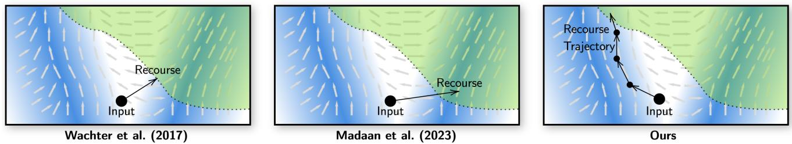  
Figure 1: Overview. In this figure, we illustrate the space of user states. The intensity of blue illustrates how likely the user state is in the population. The grey arrows denote the most likely course or direction that users pursue at the given user state. We equate the most likely direction with the direction of a low-cost recourse. The shaded green area denotes the region of state space that achieves the desired outcome from the decision-making system. $L e f t .$ We illustrate that the original formulation of Wachter et al. (Wachter, Mittelstadt, and Russell 2017) aims only for the nearest recourse, disregarding the actionability and cost of the recourse. Center: We illustrate that although the formulation of Madaan et al. (Madaan and Bedathur 2024) emphasizes lausibilit when recommendin recourse, however, it i nores the cost to the user erformin the recourse. Right: In contrast to both these revious aradi ms, our framework takes into account the recourse cost conditioned on the current state of the individual when recommendin a recourse. Furthermore, the notion of the recourse cost is ac uired in a data-driven manner without relying on costly human supervision.

incurs while also crossing the decision boundary. Formally, the action recourse problem may be described as:

$$
\arg \operatorname* { m i n } _ { x } \cos ( x | x _ { \mathrm { p r e v } } ) \qquad \mathrm { s . t . } \ f ( x ) = y ^ { * }
$$

where $f$ is a decision model and $y ^ { * }$ is the desired label that the user seeks from the decision model $f .$

A Data-Driven Cost Function. It is a challenge to know what the cost function is. Currently, it requires an expensive manual process to define it which is not ideal. Therefore, it is desirable to acquire the cost function in a data-driven manner. We look at the aggregate behavior of users in a similar situation $x _ { \mathrm { p r e v } }$ and build upon the notion that the most likely next states would be those that correspond to the low cost actions (von Neumann and Morgenstern 2007). This allows us to approximate the cost function as follows:

$$
{ \mathrm { c o s t } } ( x | x _ { \mathrm { p r e v } } ) \propto - \log p _ { \mathrm { u s e r } } ( x | x _ { \mathrm { p r e v } } )
$$

where, $p _ { \mathrm { u s e r } } ( x | x _ { \mathrm { p r e v } } )$ is the probability of the next user state x given the current user state with respect to the observational user trajectory data.

DDAR Objective. With this, we obtain our novel and pro-posed formulation of the data-driven action recourse problem:

$$
\arg \operatorname* { m a x } _ { x } \log p _ { \mathrm { u s e r } } ( x | x _ { \mathrm { p r e v } } ) \qquad \mathrm { s . t . } \ f ( x ) = y ^ { * }
$$

User Model. We shall refer to the model $p _ { \mathrm { u s e r } } ( x | x _ { \mathrm { p r e v } } )$ as the user model. We assume that this user model is capable of generating samples and evaluating the density depending on the specifics of the optimization approach used to solve the DDAR objective.

Achieving Desired Outcome. The constraint in the DDAR objective is about whether x has achieved the desired label $y ^ { * }$ or not. This constraint can be equivalently expressed as a score or a reward function i.e., a higher score or reward points to the higher likelihood of crossing the decision boundary.

Optimization Approach. In our general framework, one is free to employ any optimization approach (Garey and Johnson 1979; Metropolis et al. 1953; Geman and Geman

1984; Browne et al. 2012; Kocsis and Szepesvári 2006; Rubinstein 1999) given the user model, decision model, and a score function. A naive optimization approach to solve the action recourse problem can consist of the following steps: 1) sample several possible future trajectories from the user model given the current user state, 2) score each trajectory and 3) rank the trajectories and select those that achieve the desired label, and output them as a viable recourse.

## Conditional Guided Difusion for DDAR

In this section, we describe our proposed approach to imple- ment the DDAR framework. Our implementation rests on two key design choices: (1) We implement our user model via a difusion model. Difusion modeling via DDPM (Ho, Jain, and Abbeel 2020) has been shown to be an efective yet simple approach for modeling complex distributions. (2) We optimize for the score function by adopting a common approach called guided-difusion given the trained difusion model. We now describe our approach in detail.

## Encoder

The encoder Encoder (·) maps the raw user state to a latent representation. We assume that the user state at time l is provided as a K-sized tuple of integers i.e., $\mathbf { x } _ { l } \in \mathbb { I } ^ { K }$ . For instance, if the dataset is tabular and the user state at a certain year l is given as a row in the table with K columns, then, we can quantize each cell to an integer. Then for each k, we maintain a learned embedding dictionary $\mathcal { E } _ { k } : \mathbb { I }  \mathbb { R } ^ { D }$ that maps the integer value to an D-sized embedding. By applying embedding dictionaries to the K items in the tuple, we get an encoding of the user state as follows:

$$
\mathbf { z } _ { l } = \operatorname { E n c o d e r } _ { \theta } ( \mathbf { x } _ { l } ) ,
$$

$$
\mathrm { w h e r e } \mathbf { z } _ { t } \in \mathbb { R } ^ { K \times D } .
$$

## Conditional Difusion as the User Model

Via difusion modeling, we seek to learn a distribution $p _ { \theta } ( \mathbf { z } _ { l + 1 } | \mathbf { z } _ { l } )$ that takes a current user state $\mathbf { z } _ { l }$ and predicts

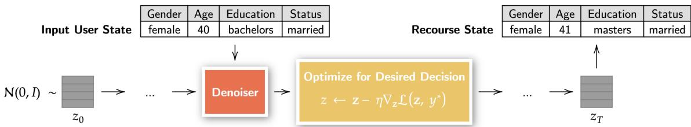  
Figure 2: Architecture. In DDAR, the input user state is first encoded and then passed to a denoising difusion model to produce a recourse embedding that is decoded to produce the final recourse. Crucially, the denoising iterations are intercepted by a gradient-update step with respect to the decision model, to guide the denoising process towards achieving the desired label.

the next user state $\mathbf { z } _ { l + 1 }$ . With difusion modeling, the distri- bution $p _ { \theta } ( \mathbf { z } _ { l + 1 } | \mathbf { z } _ { l } )$ shall consists of $_ T$ denoising steps, with each denoising step $p _ { \theta } ( \mathbf { z } _ { l + 1 , 0 } | \mathbf { z } _ { l } )$ formulated as:

$$
\int p ( \mathbf { z } _ { l + 1 , T } ) \prod _ { t = T } ^ { 1 } p _ { \theta } ( \mathbf { z } _ { l + 1 , t - 1 } | \mathbf { z } _ { l + 1 , t } , \mathbf { z } _ { l } , t ) d \mathbf { z } _ { l + 1 , 1 : T } .
$$

Here, $p ( \mathbf { z } _ { l + 1 , T } )$ is a standard Gaussian, the sequence $\mathbf { z } _ { l + 1 , T } , \ldots , \mathbf { z } _ { l + 1 , 1 }$ consists of iteratively cleaner samples, which finally produce the desired sample $\mathbf { z } _ { l + 1 , 0 }$ . We will use $\mathbf { z } _ { l + 1 , 0 }$ and $\mathbf { z } _ { l + 1 }$ interchangeably as they refer to the same vari- able. The $p _ { \theta } ( \mathbf { z } _ { l + 1 , t - 1 } | \mathbf { z } _ { l + 1 , t } , \mathbf { z } _ { l } , t )$ is a one-step denoising dis- tribution parameterized as $\mathcal { N } \left( \gamma _ { 1 , t } \hat { \mathbf { z } } _ { l + 1 , 0 } + \gamma _ { 2 , t } \mathbf { z } _ { l + 1 , t } , \beta _ { t } \mathbf { I } \right)$ where $\hat { \mathbf { z } } _ { l + 1 , 0 } = g _ { \boldsymbol { \theta } } ( \mathbf { z } _ { l + 1 , t } , \mathbf { z } _ { l } , t )$ , and the coeficients $\gamma _ { 1 , t } =$ $\beta _ { t } \sqrt { \bar { \alpha } _ { t - 1 } } / 1 - \bar { \alpha } _ { t }$ and $\gamma _ { 2 , t } = ( 1 - \bar { \alpha } _ { t - 1 } ) \sqrt { \alpha _ { t } } / 1 - \bar { \alpha } _ { t }$ . Em- ploying standard notations, we utilize a variance schedule $\beta _ { 1 } , \ldots , \beta _ { T }$ , where $\alpha _ { t } = 1 - \beta _ { t }$ , and $\begin{array} { r } { \bar { \alpha } _ { t } = \prod _ { i = 1 } ^ { t } ( 1 - \beta _ { i } ) } \end{array}$ . We use a cosine schedule in our implementation.

Implementing the Denoiser. We implement the denoising predictive mean $g _ { \theta } ( \mathbf { z } _ { l + 1 , t } , \mathbf { z } _ { l } , t )$ as a transformer. Specifically, we first concatenate $\mathbf { z } _ { l + 1 , t }$ and $\mathbf { z } _ { l }$ followed by adding learned positional embeddings and step-embeddings representing t. The result is provided as input to the transformer followed by an 2-layer MLP to obtain the denoised prediction. We use a 12-layer transformer with hidden size 768 and 12 heads.

Training Objective. Following DDPM, the training procedure involves first introducing noise to the input $\mathbf { z } _ { l + 1 , 0 } ,$ creating its noisy version $\mathbf { z } _ { l + 1 , t }$ i.e., $\begin{array} { r l } { \mathbf { z } _ { l + 1 , t } } & { { } = } \end{array}$ $\sqrt { \bar { \alpha } _ { t } } \mathbf { z } _ { l + 1 , 0 } + \sqrt { 1 - \bar { \alpha } _ { t } } \mathbf { \epsilon } _ { t }$ , where $\epsilon _ { t } \sim \mathcal { N } ( \mathbf { 0 } , \mathbf { I } )$ . Subsequently, the denoiser is trained that takes $\mathbf { z } _ { l + 1 , t }$ as input and aims to predict the original input $\mathbf { z } _ { l + 1 , 0 }$ by generating a pre- diction $\hat { \mathbf { z } } _ { l + 1 , 0 } ~ = ~ g _ { \theta } ( \mathbf { z } _ { l + 1 , t } , t )$ . The learning objective is $\mathcal { L } _ { \mathrm { d i f f u s i o n } } ( \theta ) = \mathcal { E } ( \hat { \mathbf { z } } _ { l + 1 , 0 } , \mathbf { z } _ { l + 1 , 0 } )$ where E is an error function. As our error function, we use a cross-entropy loss with respect to clean categorical labels corresponding to $\mathbf { z } _ { l + 1 , 0 } .$ We found this superior to the more conventional L2 loss.

## Recourse Generation

To generate recourse, we perform guided difusion by adding an additional guiding term $\nabla _ { \mathbf z _ { l + 1 , t } } \mathcal L _ { \mathrm { g u i d e } } ( \mathbf z _ { l + 1 , t } , y ^ { * } )$ at each denoising step. Here, $\nabla _ { \mathbf z _ { l + 1 , t } } \mathcal L _ { \mathrm { g u i d e } } ( \mathbf z _ { l + 1 , t } , y ^ { * } )$ is the gradient of the guiding loss with respect to $\mathbf { z } _ { l + 1 , t } ,$ and $y ^ { * }$ is the desired decision label. In this work, we define the guiding loss as follows: $\mathcal { L } _ { \mathrm { g u i d e } } ( \mathbf { z } , y ^ { * } ) = \mathrm { C E } \left( f ( \mathbf { z } ) , y ^ { * } \right)$ , where CE denotes cross-entropy.

## Datasets

We evaluate the efectiveness of our approach on 3 datasets: LoanSynth dataset, GradSynth dataset and AdultIncome++. Here, LoanSynth and GradSynth are synthetic datasets while AdultIncome++ is a semi-realistic dataset.

## LoanSynth Dataset

In LoanSynth dataset, a user trajectory is a table with columns such as age, education level, occupation, cashflow, bank balance, lifestyle, credit score, cars owned, weight, race, gender, and a label column with respect to a decision-maker about whether the loan was approved for this user or not. Each row corresponds to a time step or a year in the life of this user. Therefore, as we go down from the top row to the bottom row of the table, we can see the evolution of the state-of-the-user over time. We provide 30 rows or 30 years’ worth of trajectory per user.

To generate the data, we define an initial distribution of the user state and causal dynamics for the evolution of the user state. For more details about these definitions, see Appendix. For an example of this dataset, see Table 1.

## GradSynth: A Synthetic Dataset for Graduate School Applications

In GradSynth dataset, a user trajectory is a sequence of rows where the fields describe a student’s state as they apply for college admissions: 1) the tier of their previous college, 2) GPA, 3) GRE, 4) work experience, 5) number of recommendation letters, 6) quality of their SOP, and 7) gender and a label column that specifies whether the user or the student was admitted to a graduate school or not. As we go down the rows of the table, the state of the user evolves. We provide 5 rows of trajectory per user. For a sample of this dataset, see Table 2.

## Adult Income ++ Benchmark

In Adult Income++ dataset, a user trajectory is a table with the following columns about an adult: 1) age, 2) workclass, 3) fnlwgt, 4) education, 5) marital-status, 6) occupation, 7) relationship, 8) race, 8) sex, 10) capital-gain, 11) capital-loss, 12) hours-per-week, 13) native-country, and a label column that specifies if the income is above $> \dot { 5 } 0 K \mathrm { o r } = < 5 0 K$ . As we go down the rows, state of the user evolves. We provide 4 rows of trajectory per user. For an example, see Table 3.

Table 1: LoanSynth Dataset Example. We provide a sample trajectory of a user in our proposed synthetic LoanSynth dataset. Each row corresponds to a year in the user’s life. Each column corresponds to an attribute of the user state. The last column corresponds to the decision-maker’s label about whether this user would be approved for a loan or not.
<table><tr><td>t</td><td>Age</td><td>Edu</td><td>Occupation</td><td>Cash</td><td>Bank Bal</td><td>Life</td><td>Cred</td><td>Wt</td><td>Race</td><td>Sex</td><td>Label</td></tr><tr><td>0</td><td>18</td><td>0</td><td>stud_bachelor</td><td>-58K</td><td>-57K</td><td>L</td><td>300</td><td>46.05</td><td>C</td><td>M</td><td>Loan Denied</td></tr><tr><td>1</td><td>19</td><td>0</td><td>stud_bachelor</td><td>-59K</td><td>-116K</td><td>L</td><td>300</td><td>44.12</td><td>C</td><td>M</td><td>Loan Denied</td></tr><tr><td>2</td><td>20</td><td>0</td><td>stud_bachelor</td><td>-57K</td><td>-174K</td><td>L</td><td>300</td><td>43.57</td><td>C</td><td>M</td><td>Loan Denied</td></tr><tr><td>3</td><td>21</td><td>1</td><td>engineer 0</td><td>37K</td><td>-136K</td><td>T</td><td>300</td><td>41.68</td><td>C</td><td>M</td><td>Loan Denied</td></tr><tr><td>4</td><td>22</td><td>1</td><td>engineer 1</td><td>38K</td><td>-97K</td><td>T</td><td>300</td><td>40.52</td><td>C</td><td>M</td><td>Loan Denied</td></tr><tr><td>5</td><td>23</td><td>1</td><td>engineer 2</td><td>42K</td><td>-55K</td><td>T</td><td>300</td><td>42.31</td><td>C</td><td>M</td><td>Loan Denied</td></tr></table>

Table 2: GradSynth Dataset Example. We provide a sample trajectory (with t as the time index) of a user in the GradSynth dataset. Each column corresponds to an attribute of the user state. The teal-colored columns are those that can be directly intervened upon by the user. The last column corresponds to the label about whether this user would be admitted to college or not.
<table><tr><td>t.</td><td>Attempt</td><td>College</td><td>GPA</td><td>GRE Score</td><td>#Exp</td><td>#LORs</td><td>SOP</td><td>Gender</td><td>Label</td></tr><tr><td>0</td><td> $1 ^ { \mathrm { s t } }$ </td><td>Tier-3</td><td>3.0</td><td>Good</td><td>2</td><td>0</td><td>Good</td><td>Female</td><td>Not Admitted</td></tr><tr><td>1</td><td> $2 ^ { \mathrm { n d } }$ </td><td>Tier-3</td><td>3.0</td><td>Good</td><td>3</td><td>1</td><td>Poor</td><td>Female</td><td>Not Admitted</td></tr><tr><td>2</td><td> $3 ^ { \mathrm { r d } }$ </td><td>Tier-3</td><td>3.0</td><td>Good</td><td>3</td><td>1</td><td>Good</td><td>Female</td><td>Not Admitted</td></tr><tr><td>3</td><td> $4 ^ { \mathrm { t h } }$ </td><td>Tier-3</td><td>3.0</td><td>Good</td><td>3</td><td>1</td><td>Good</td><td>Female</td><td>Not Admitted</td></tr><tr><td>4</td><td> $5 ^ { \mathrm { t h } }$ </td><td>Tier-3</td><td>3.0</td><td>Good</td><td>3</td><td>1</td><td>Excellent</td><td>Female</td><td>Admitted</td></tr></table>

## Related Work

Action Recourse. Several works have pursued the problem of action recourse (Ustun, Spangher, and Liu 2019; Karimi et al. 2020b; Karimi, Schölkopf, and Valera 2021; Dhurandhar et al. 2018; Rasouli and Yu 2024; Verma et al. 2024; Jiang et al. 2024; Tominaga, Yamashita, and Kurashima 2024; De Toni et al. 2024; Yetukuri, Hardy, and Liu 2023; Esfahani et al. 2024; Koh, Kim, and Jo 2024; Wan et al. 2023; Kancheti et al. 2025). However, to our knowledge, none of the existing methods acquire a notion of cost associated to an action in a data-driven manner. Although there are several methods about counterfactual explanations (Wachter, Mittelstadt, and Russell 2017; Mothilal, Sharma, and Tan 2020; Gomez et al. 2020; Poyiadzi et al. 2020; Madaan and Bedathur 2024; Hashemi and Fathi 2020). Although some have incentives to maintain proximity or diversity (Cui et al. 2015; Karimi et al. 2020a; Ustun, Spangher, and Liu 2019; Rawal and Lakkaraju 2020; Kanamori et al. 2020), none of them incorporate an explicit notion of cost to the user. Another line of works tackles the issue of robustness of the generated recourse or explanations (Hamman et al. 2023; Maragno et al. 2023; Guyomard et al. 2023; Jiang et al. 2023; Leofante and Potyka 2023; Kayastha, Gkatzelis, and Jabbari 2026), including dealing with corrupted data (Kanamori et al. 2023). However, this is orthogonal to our focus. Future works may bring together our approach of data-driven recourse and the advances in robustness of action recourse.

Difusion in Tabular Data. There has been recent literature leveraging difusion models for performing certain tasks in tabular domain. TabDDPM (Kotelnikov et al. 2023) has been introduced as a difusion framework for mixed-type tables, outperforming GAN/VAE baselines. TabDif (Shi et al. 2024) proposed a Transformer-parameterized joint difusion with feature-wise learnable noise schedules and classifier- free guidance for conditional imputation. TimeAutoDif (Suh et al. 2024) has been developed combining a VAE with latent difusion for one-shot, non-autoregressive synthesis of multivariate time-series tables. (Wen et al. 2024) presented DifPuter, which integrates EM with difusion for iterative missing-value imputation, TabADM (Zamberg et al. 2023) for unsupervised anomaly detection via difusion-based density modeling underscoring how difusion-LM-inspired architec- tures enable high-fidelity synthesis, imputation, and analytic tasks across diverse tabular domains.

## Experiments

## Setup

Datasets We experiment on three datasets introduced in Section : (1) LoanSynth, and (2) GradSynth and (3) Adult Income ++. In LoanSynth, the decision model is tasked with predicting a loan decision (approve or reject) for a structured user state containing fields like cashflow, or education including immutable ones such as gender and race. In GradSynth, the decision model is tasked with predicting the admission decision (admit or reject). The Adult-Income++ is a synthetic extension of the original Adult-Income dataset (Frank and Asuncion 2010) where we introduce certain dynamics on the user’s attributes to evolve the user state over time. The decision maker is tasked with predicting whether the user’s income is greater than \$50K or not.

Metrics 1. Recourse Rate. We compute the fraction of all test instances for which the model could produce a recourse with the desired label under the given decision model. How- ever, this alone would mean that a poor model can produce a recourse that can have an arbitrarily high cost. Therefore, we propose to report recourse rate that can achieve the desired label under a certain allowable cost. We plot this metric with respect to various values of the maximum allowable cost. The higher the recourse rate the better. Since the above is dependent on the maximum allowable cost, therefore, to obtain a single measure of comparison, we also report the area-under-curve for the recourse rate plot (or RR-AUC for short).

Table 3: AdultIncome++ Dataset Example. We provide a sample trajectory (with t as the time index) of a user in the AdultIncome++ dataset. Each column corresponds to an attribute of the user state. The teal-colored columns are those that can be directly intervened upon by the user. The last column corresponds to the label about whether this user has an income greater than \$50K or not.
<table><tr><td>t</td><td>Age</td><td>Education</td><td>Marital Stat.</td><td>Occupation</td><td>Relationship</td><td>Race</td><td>Sex</td><td>Hrs/Wk</td><td>Nat</td><td>Label</td></tr><tr><td>0</td><td>24</td><td>Some-college</td><td>Never-married</td><td>Tech-support</td><td>Not-in-family</td><td>W</td><td>F</td><td>37</td><td>US</td><td>0</td></tr><tr><td>1</td><td>25</td><td>Some-college</td><td>Never-married</td><td>Exec-manager</td><td>Not-in-family</td><td>W</td><td>F</td><td>37</td><td>US</td><td>0</td></tr><tr><td>2</td><td>26</td><td>Some-college</td><td>Never-married</td><td>Exec-manager</td><td>Not-in-family</td><td>W</td><td>F</td><td>37</td><td>US</td><td>0</td></tr><tr><td>3</td><td>27</td><td>Assoc-voc</td><td>Never-married</td><td>Exec-manager</td><td>Not-in-family</td><td>W</td><td>F</td><td>37</td><td>US</td><td>1</td></tr></table>

(a) LoanSynth Dataset  
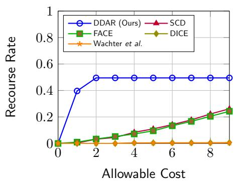

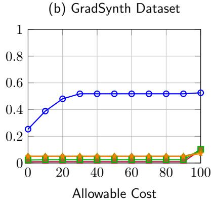

(c) Adult Income Dataset  
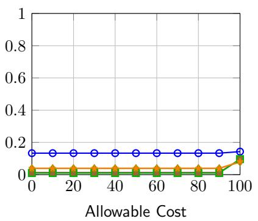  
Fi ure 3: We lot the recourse rate as a function of maximum allowable cost for our method and com are it a ainst the baseline on the datasets LoanSynth, GradSynth and AdultIncome++.

2. Cost. We compute the average cost per generated recourse. The average is computed on all test instances. The cost is computed using a cost function defined by a human expert for each dataset.

3. Conditional Negative Log-Likelihood (CNLL). As ar-gued earlier, the likely next user state should also correspond to low-cost trajectories. Therefore, another metric of interest the log-likelihood of the model-generated recourses given the previous user state. To compute this, we utilize a conditional density model that is used to evaluate all the models’ gener- ated recourses given the previous user state.

4. Unconditional Negative Log-Likelihood (UNLL). An-other metric of interest is whether the generated recourse would make sense under any circumstance or not. Thus marginalizing over the conditioning in the conditional log- likelihood, we also report the unconditional log-likelihood. To compute this, we utilize a density model over the user states to evaluate the generated recourse from all models.

Baselines We compare DDAR with five baselines for gen-erating recourses from structured datasets. We describe each of these baselines below:

1. Wachter et al. (Wachter, Mittelstadt, and Russell 2017) is an important baseline that tries to achieve the desired label while minimally perturbing the current user state. We implement this baseline by first encoding the user state and then applying gradient descent to search a recourse that produces the desired decision with smallest possible distance to the current user state.

2. DiCE. (Mothilal, Sharma, and Tan 2020) is another key baseline that, like Wachter et al., uses optimization to find a new user state which achieves the desired label with minimal perturbation and, importantly, with high diversity among various generated recourses. We implement this baseline by first encoding the row in a similar way as done in Wachter (Wachter, Mittelstadt, and Russell 2017). Next, gradient descent is applied to make find a set of recourses that achieve the desired decision, are in close proximity to the input sample, and are diverse enough.

3. FACE. (Poyiadzi et al. 2020) This is a graph-based baseline for action recourse. It treats the given user state as a node in a graph and the edges capture the proximity between the nodes. Then, given an input, the recourse is generated by finding a low-distance path that crosses the decision boundary. This is the only baseline, to our knowledge, that tackles the question of feasibility of the tra- jectory, as it prevents the trajectory from passing through sparse regions.

4. SCD (Madaan and Bedathur 2024) is a counterfactual explainer that accounts for the underlying data distribution via a neural density modeling framework such as a VAE or a difusion model but lacks a user trajectory model that can provide low-cost recourse recommendations.

Table 4: RR-AUC (↑) and Cost (↓) across the 3 datasets. Our model outperforms all baselines.
<table><tr><td rowspan="2">Method</td><td colspan="2">LoanSynth</td><td colspan="2">GradSynth</td><td colspan="2">AdultIncome++</td></tr><tr><td>RR-AUC</td><td>Cost</td><td>RR-AUC</td><td>Cost</td><td>RR-AUC</td><td>Cost</td></tr><tr><td>Wachter etal.</td><td>0.020</td><td>76.54</td><td>5.090</td><td>87.23</td><td>4.080</td><td>51.99</td></tr><tr><td>DiCE</td><td>0.026</td><td>79.68</td><td>5.207</td><td>88.38</td><td>4.097</td><td>49.99</td></tr><tr><td>FACE</td><td>0.885</td><td>107.0</td><td>2.750</td><td>222.1</td><td>5.758</td><td>98.93</td></tr><tr><td>SCD</td><td>0.943</td><td>68.51</td><td>1.256</td><td>227.7</td><td>5.965</td><td>86.48</td></tr><tr><td>Ours</td><td>4.142</td><td>1.25</td><td>48.98</td><td>10.84</td><td>13.38</td><td>3.170</td></tr></table>

Table 5: CNLL (↓) and UNLL (↓) across the 3 datasets. Our model outperforms all baselines.
<table><tr><td>Method</td><td colspan="2">LoanSynth</td><td colspan="2">GradSynth</td><td colspan="2">AdultIncome++</td></tr><tr><td></td><td>CNLL</td><td>UNLL</td><td>CNLL</td><td>UNLL</td><td>CNLL</td><td>UNLL</td></tr><tr><td>Wachter etal.</td><td>75.29</td><td>59.87</td><td>61.35</td><td>46.28</td><td>53.20</td><td>25.23</td></tr><tr><td>DiCE</td><td>71.45</td><td>54.52</td><td>64.27</td><td>49.82</td><td>53.98</td><td>25.00</td></tr><tr><td>FACE</td><td>72.40</td><td>26.10</td><td>41.51</td><td>77.39</td><td>63.83</td><td>120.48</td></tr><tr><td>SCD</td><td>90.79</td><td>26.54</td><td>38.83</td><td>78.79</td><td>82.07</td><td>120.37</td></tr><tr><td>Ours</td><td>29.26</td><td>21.27</td><td>16.42</td><td>17.56</td><td>40.17</td><td>19.50</td></tr></table>

Table 6: Qualitative Comparison of Methods on LoanSynth Dataset. We highlight all changes made by a method in cyan color. We also show immutable attributes which should not change like race and gender, and highlight the ones that were wrongly chan ed in red color.
<table><tr><td>Method</td><td>Age</td><td>Edu</td><td>Occ</td><td>Cash</td><td>Bank Bal</td><td>Spend</td><td>Debt</td><td>Cred</td><td>Race</td><td>Sex</td><td>Loan</td></tr><tr><td>Input</td><td>29</td><td>1</td><td>(&#x27;sw_dev&#x27;, 8)</td><td>30K</td><td>83K</td><td>L</td><td>629.36</td><td>75.06</td><td>C</td><td>F</td><td>No</td></tr><tr><td>Ours</td><td>30</td><td>1</td><td>(&#x27;sw_dev&#x27;, 9)</td><td>22K</td><td>127K</td><td>L</td><td>775.59</td><td>73.90</td><td>C</td><td>F</td><td>Yes</td></tr><tr><td>DICE</td><td>29</td><td>4</td><td>(&#x27;scientist&#x27;, 3)</td><td>30K</td><td>71K</td><td>L</td><td>627.35</td><td>74.83</td><td>C</td><td>F</td><td>Yes</td></tr><tr><td>SCD</td><td>36</td><td>2</td><td>(&#x27;sw_dev&#x27;, 0)</td><td>3K</td><td>325K</td><td>L</td><td>849.99</td><td>79.58</td><td>H</td><td>F</td><td>Yes</td></tr><tr><td>FACE</td><td>42</td><td>1</td><td>(&#x27;sw_dev&#x27;, 20)</td><td>23K</td><td>602K</td><td>T</td><td>849.99</td><td>90.88</td><td>H</td><td>M</td><td>Yes</td></tr><tr><td>Wachter</td><td>29</td><td>4</td><td>(&#x27;scientist&#x27;, 3)</td><td>145K</td><td>71K</td><td>L</td><td>627.35</td><td>74.83</td><td>C</td><td>F</td><td>Yes</td></tr></table>

## Results

Can DDAR efectively provide low-cost recourse? DDAR Provides High Recourse Rate. To answer this, we look at the Recourse Rate plots in Figure 3 and the values of RR-AUC reported in Table 4. We can see that even with allowable cost of 2.0 on LoanSynth, our model has a recourse rate of 0.495 which is remarkably higher than all other baselines which remain close to 0. Similarly, in GradSynth, with maximum allowed cost of 20., other models are totally failing with recourse rate of almost 0.0 while our model achieves a much higher score of 0.518. This fact is also captured in our significantly higher RR-AUC score where we achieve 4.142 on LoanSynth while other baselines achieve a score less than 1.0. Similarly, on GradSynth, we achieve the RR-AUC of 48.98 while others have a score smaller than 6.0. We see a similar trend in Adult Income ++ dataset where our model achieves significantly higher RR-AUC of 4.142 while maintaining the lowest cost of 1.25 while other baselines achieve a RR-AUC score of less than 1.0.

DDAR Provides Low Cost Recourse. We also report the average cost associated to the generated recourses. We can see in all three datasets LoanSynth, GradSynth and Adult Income ++ that our model achieves a remarkably low cost while other models are significantly worse. This can be attributed to the fact that all the baselines (including ours) were given no explicit knowledge of the cost function and the models had to infer this from data. Other models, lacking a mechanism to infer this, are totally failing in this unsupervised regime,

while ours does not.

DDAR Provides Feasible Recourse. There are two measures of feasibility. (1) The first measure is the conditional feasibility which measures how feasible is the recommended recourse given the state the user is currently in. We measure this via the conditional negative log-likelihood (CNLL) score and we can see that our recourses have a much lower CNLL of 29.26 on LoanS nth, 16.42 on GradS nth and 40.17 on Adult Income ++, while next best baseline achieves a much worse score of 71.45 on LoanSynth, 38.83 on GradSynth and 53.20 on Adult Income ++. (2) The second measure of feasibility is the unconditional feasibility which measures whether the recourse is coherent regardless of the current user state. In this measure also, our model achieves a score better than the other methods. Qualitative Analysis of the Generated Recourse. We show the qualitative results for the LoanSynth dataset in Table 6. Note that there are certain fields which should be immutable such as race or sex and changing them should be associated with a high cost. However, many baselines erroneously change race or sex in order to achieve the desired label. On the other hand, our model, through exposure to the historical data is able to take cognizance of this fact and produces recourse that do not change such immutable fields. Similarly, qualitative results for GradSynth and Adult Income ++ are presented in Appendix.

Benefits of Multi-Step Recourse A unique benefit of our method is that we can iteratively run the recourse generation process several times. Therefore, if no low-cost recourse is possible within a single time-step (e.g., a single year of the user’s life), there may be recourse possible if more time is given to the user (e.g., a time horizon of multiple years of the user’s life) to achieve their goal. We report the recourse

(b) GradSynth Dataset  
(a) LoanSynth Dataset  
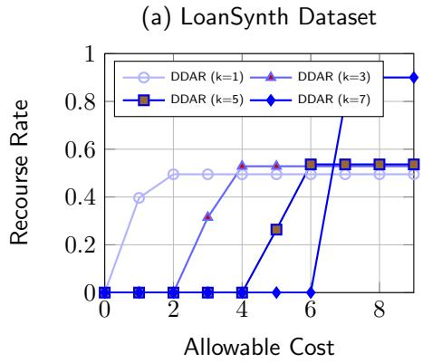

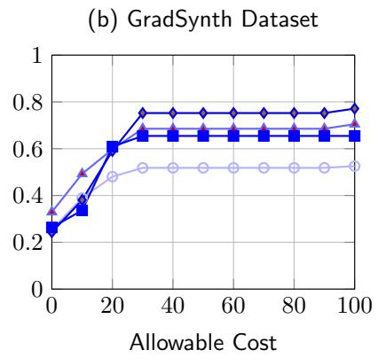

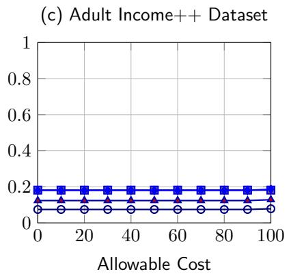  
Figure 4: Recourse rate vs. steps K. Left: LoanSynth, Centre: GradSynth, Right: AdultIncome++.

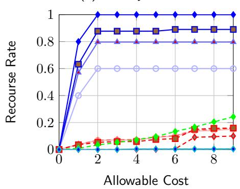

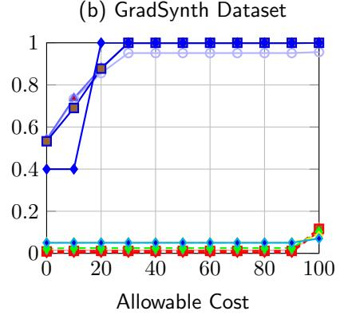

(c) Adult Income++ Dataset  
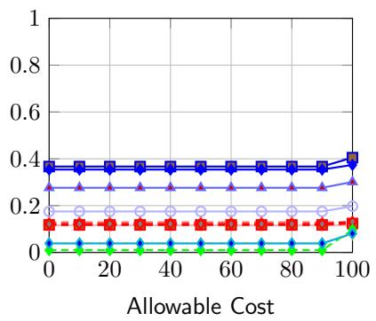  
WachterDDAR (N = 1) DDAR (N = 3) DDAR (N = 5) DDAR (N = 10) SCD (N = 1)WachterSCD (N = 3) SCD (N = 5) SCD (N = 10) FACE DICE Wachter

Figure 5: Recourse rate vs. number of trajectories N. Left: LoanSynth, Centre: GradSynth, Right: AdultIncome++.

rates of K-step recourse with K = 1, 3, 5 and 7 in Figure 4. We see that as the K is increased, we can achieve even higher rates of recourse. In LoanSynth dataset, we are able to achieve 0.9 recourse rate at $k = 7$ at allowable cost of 8 while in GradSynth dataset we are able to reach to 0.80 recourse rate at allowable cost of 100 and in Adult Income we are able to achieve a recourse rate of 0.24 at an allowable cost of 0. Note that even with K = 1, our model was already surpassing the other baselines. Qualitative K-step samples are shown in Table 7 in the Appendix.

Best-of-N Recourse. A benefit of our method is that we can sample multiple recourse trajectories and then choose the best one. We evaluate the efect of using various values of N in Figure 5. We note that across all datasets, a larger N e.g., 5 or 10, leads to a boost in our recourse rate for any maximum allowable cost. In comparison, other baselines are either deterministic, thus incapable of deriving benefits of sampling, or the boost they show with greater N is not as large as that of our model. For instance, in LoanSynth dataset, our model is able to achieve 1.0 recourse rate at an allowable cost of 2.0 while the next best baselines is at 0.12. Similar trend follows for GradSynth and Adult Income ++ datasets.

## Conclusion

In this paper, we introduced the first data-driven framework called Data-Driven Action Recourse (DDAR) for generating recourse without providing any costly common-sense knowledge from humans. We contribute three datasets in this work: LoanSynth, GradSynth and Adult Income++ for generating data-driven recourse. Through experiments, we show that DDAR generates recourses that can achieve the desired decision while also maintaining low cost compared to the baselines. An interesting avenue of future work is to have user-defined constraints that can be incorporated into the data-driven paradigm.

## References

Browne, C. B.; Powley, E.; Whitehouse, D.; Lucas, S. M.; Cowling, P. I.; Rohlfshagen, P.; Tavener, S.; Perez, D.; Samoth- rakis, S.; and Colton, S. 2012. A Survey of Monte Carlo Tree Search Methods. IEEE Transactions on Computational Intelligence and AI in Games, 4(1): 1–43.

Cui, Z.; Chen, W.; He, Y.; and Chen, Y. 2015. Optimal Action Extraction for Random Forests and Boosted Trees. Proceedings ofthe 21th ACM SIGKDD International Conference on Knowledge Discovery and Data Mining.

De Toni, G.; Viappiani, P.; Teso, S.; Lepri, B.; and Passerini, A. 2024. Personalized Algorithmic Recourse with Preference Elicitation. Transactions on Machine Learning Research. Accepted Jan 2024.

Dhurandhar, A.; Chen, P.-Y.; Luss, R.; Tu, C.-C.; Ting, P.; Shanmugam, K.; and Das, P. 2018. Explanations based on the missing: Towards contrastive explanations with pertinent negatives. arXiv preprint arXiv:1802.07623.

Esfahani, S.; De Toni, G.; Lepri, B.; Passerini, A.; Tentori, K.; and Zancanaro, M. 2024. Preference Elicitation in Inter- active and User-Centered Algorithmic Recourse: An Initial Exploration. In Proceedings of the 32nd ACM Conference on User Modeling, Adaptation and Personalization (UMAP ’24).

Frank, A.; and Asuncion, A. 2010. UCI Machine Learning Repository. http://archive.ics.uci.edu/ml. University of Cali- fornia, Irvine, School of Information and Computer Sciences.

Garey, M. R.; and Johnson, D. S. 1979. Computers and Intractability: A Guide to the Theory ofNP-Completeness. W. H. Freeman & Co.

Geman, S.; and Geman, D. 1984. Stochastic Relaxation, Gibbs Distributions, and the Bayesian Restoration of Images. IEEE Transactions on Pattern Analysis and Machine Intelligence, PAMI-6(6): 721–741.

Gomez, O.; Holter, S.; Yuan, J.; and Bertini, E. 2020. ViCE: visual counterfactual explanations for machine learning mod- els. Proceedings of the 25th International Conference on Intelligent User Interfaces.

Guyomard, V.; Fessant, F.; Guyet, T.; Bouadi, T.; and Termier, A. 2023. Generating robust counterfactual explanations. ArXiv, abs/2304.12943.

Hamman, F.; Noorani, E.; Mishra, S.; Magazzeni, D.; and Dutta, S. 2023. Robust Counterfactual Explanations for Neural Networks With Probabilistic Guarantees. In International Conference on Machine Learning.

Hashemi, M.; and Fathi, A. 2020. PermuteAttack: Counter- factual Explanation of Machine Learning Credit Scorecards. ArXiv, abs/2008.10138.

Ho, J.; Jain, A.; and Abbeel, P. 2020. Denoising difusion prob- abilistic models. Advances in neural information processing systems, 33: 6840–6851.

Jiang, J.; Lan, J.; Leofante, F.; Rago, A.; and Toni, F. 2023. Provably Robust and Plausible Counterfactual Ex- planations for Neural Networks via Robust Optimisation. ArXiv, abs/2309.12545.

Jiang, J.; Leofante, F.; Rago, A.; and Toni, F. 2024. Robust Counterfactual Explanations in Machine Learning: A Survey. ArXiv, abs/2402.01928.

Kanamori, K.; Takagi, T.; Kobayashi, K.; and Arimura, H. 2020. DACE: Distribution-Aware Counterfactual Explanation by Mixed-Integer Linear Optimization. In International Joint Conference on Artificial Intelligence.

Kanamori, K.; Takagi, T.; Kobayashi, K.; and Ike, Y. 2023. Algorithmic Recourse with Missing Values. arXiv preprint arXiv:2304.14606.

Kancheti, S. S.; Vigneswaran, R.; Mishra, B.; and Balasubra- manian, V. N. 2025. HARE: Human-in-the-Loop Algorithmic Recourse. Transactions on Machine Learning Research.

Karimi, A.-H.; Barthe, G.; Balle, B.; and Valera, I. 2020a. Model-agnostic counterfactual explanations for consequential decisions. In International Conference on Artificial Intelligence and Statistics, 895–905. PMLR.

Karimi, A.-H.; Schölkopf, B.; and Valera, I. 2021. Algo- rithmic Recourse: from Counterfactual Explanations to Inter- ventions. In Proceedings of the 2021 ACM Conference on Fairness, Accountability, and Transparency.

Karimi, A.-H.; von Kügelgen, J.; Schölkopf, B.; and Valera, I. 2020b. Algorithmic recourse under imperfect causal knowl- edge: a probabilistic approach. ArXiv, abs/2006.06831.

Kayastha, K.; Gkatzelis, V.; and Jabbari, S. 2026. Learning- Augmented Robust Algorithmic Recourse. Transactions on Machine Learning Research.

Kocsis, L.; and Szepesvári, C. 2006. Bandit-Based Monte- Carlo Planning. In European Conference on Machine Learning (ECML), 282–293. Springer.

Koh, S.; Kim, B. H.; and Jo, S. 2024. Understanding the User Perception and Experience of Interactive Algorithmic Recourse Customization. ACM Transactions on Computer-Human Interaction, 31: 1–25.

Kotelnikov, A.; Baranchuk, D.; Rubachev, I.; and Babenko, A. 2023. TabDDPM: Modelling Tabular Data with Difusion Models. In Proceedings ofthe 40th International Conference on Machine Learning, volume 202 of Proceedings of Machine Learning Research, 17564–17579. PMLR.

Leofante, F.; and Potyka, N. 2023. Promoting Counterfactual Robustness through Diversity. ArXiv, abs/2312.06564.

Madaan, N.; and Bedathur, S. 2024. Navigating the Structured What-If Spaces: Counterfactual Generation via Structured Difusion. In 2024 IEEE Conference on Secure and Trustworthy Machine Learning (SaTML), 710–722. IEEE.

Maragno, D.; Kurtz, J.; Röber, T. E.; Goedhart, R.; Birbil, Ş. İ.; and den Hertog, D. 2023. Finding Regions of Counterfactual Explanations via Robust Optimization. ArXiv, abs/2301.11113.

Metropolis, N.; Rosenbluth, A. W.; Rosenbluth, M. N.; Teller, A. H.; and Teller, E. 1953. Equation of State Calculations by Fast Computing Machines. The Journal of Chemical Physics, 21(6): 1087–1092.

Mothilal, R. K.; Sharma, A.; and Tan, C. 2020. Explaining machine learning classifiers through diverse counterfactual

explanations. In Proceedings of the 2020 Conference on Fairness, Accountability, and Transparency, 607–617.

Nichol, A. Q.; and Dhariwal, P. 2021. Improved denoising difusion probabilistic models. In International conference on machine learning, 8162–8171. PMLR.

Poyiadzi, R.; Sokol, K.; Santos-Rodriguez, R.; De Bie, T.; and Flach, P. 2020. FACE: Feasible and Actionable Counterfactual Explanations. In Proceedings of the AAAI/ACM Conference on AI, Ethics, and Society.

Rasouli, P.; and Yu, I. C. 2024. CARE: Coherent Action- able Recourse based on Sound Counterfactual Explanations. International Journal of Data Science and Analytics, 17: 13–38.

Rawal, K.; and Lakkaraju, H. 2020. Beyond Individualized Recourse: Interpretable and Interactive Summaries of Actionable Recourses. In Advances in Neural Information Processing Systems, volume 33, 12187–12198.

Rubinstein, R. Y. 1999. The Cross-Entropy Method for Combinatorial and Continuous Optimization. Methodology and Computing in Applied Probability, 1: 127–190.

Shi, J.; Xu, M.; Hua, H.; Zhang, H.; Ermon, S.; and Leskovec, J. 2024. TabDif: a Mixed-type Difusion Model for Tabular Data Generation. arXiv preprint arXiv:2410.20626.

Suh, N.; Yang, Y.; Hsieh, D.-Y.; Luan, Q.; Xu, S.; Zhu, S.; and Cheng, G. 2024. TimeAutoDif: Combining Autoencoder and Difusion Model for Time Series Tabular Data Synthesizing. arXiv preprint arXiv:2406.16028.

Tominaga, T.; Yamashita, N.; and Kurashima, T. 2024. Re- assessing Evaluation Functions in Algorithmic Recourse: An Empirical Study from a Human-Centered Perspective. In Proceedings ofthe Thirty-Third International Joint Conference on Artificial Intelligence (IJCAI-24), Human-Centred AI track, 7913–7921.

Ustun, B.; Spangher, A.; and Liu, Y. 2019. Actionable recourse in linear classification. In Proceedings of the conference on fairness, accountability, and transparency, 10–19.

Verma, S.; Boonsanong, V.; Hoang, M.; Hines, K. E.; Dicker- son, J. P.; and Shah, C. 2024. Counterfactual Explanations and Algorithmic Recourses for Machine Learning: A Review. ACM Computing Surveys, 56: 1–42.

von Neumann, J.; and Morgenstern, O. 2007. Theory of Games and Economic Behavior. Princeton University Press, 60th anniversary commemorative edition.

Wachter, S.; Mittelstadt, B.; and Russell, C. 2017. Counterfac- tual explanations without opening the black box: Automated decisions and the GDPR. Harv. JL & Tech., 31: 841.

Wang, Z. J.; Vaughan, J. W.; Caruana, R.; and Chau, D. H. 2023. GAM Coach: Towards Interactive and User-Centered Algorithmic Recourse. In Proceedings of the 2023 CHI Conference on Human Factors in Computing Systems, 1–20.

Wen, Y.; Yi, K.; Ke, J.; and Shen, Y. 2024. DifImpute: Tabu- lar Data Imputation With Denoising Difusion Probabilistic Model. arXiv preprint arXiv:2403.13863.

Yetukuri, J.; Hardy, I.; and Liu, Y. 2023. Towards User Guided Actionable Recourse. In Proceedings ofthe 2023 AAAI/ACM Conference on AI, Ethics, and Society (AIES ’23), 742–751.

Zamberg, G.; Salhov, M.; Lindenbaum, O.; and Averbuch, A. 2023. TabADM: Unsupervised Tabular Anomaly Detection with Difusion Models. arXiv preprint arXiv:2307.12336.

## Additional Details of the Method

## Denoiser Model and Training Hyperparameters

In Table 8, we report the various hyperparameters that we used for training the difusion model.

Schedule for β. We use the cosine schedule for the denoising difusion used in the existing works (Nichol and Dhariwal 2021).

## Sinusoidal Time Embeddings

The denoiser $\eta _ { \theta } ( \mathbf { z } _ { l + 1 , t } , \mathbf { z } _ { l } , t )$ in our difusion model requires t as an input. Since t is a scalar, we embed it as a vector. For this, we adopt the sinusoidal embedding approach of previous works. Formally, we embed t as $e ( t )$ where:

$$
\begin{array} { r } { e ( t ) = [ \cos ( \omega _ { 0 } t ) , \dots , \cos ( \omega _ { H - 1 } t ) , } \\ { \sin ( \omega _ { 0 } t ) , \dots , \sin ( \omega _ { H - 1 } t ) ] } \end{array}
$$

Here, $H = D / 2$ with D as the dimension of the embedding; and $\omega _ { k } = \exp ( - \log ( \operatorname* { m a x } _ { - }$ \_period)k/H) with max\_period = 10000.

## Cost Functions

In this section, we describe the pseudo-code used for com- puting costs in our two benchmarks for evaluation purposes. For these, see Algorithms 1 and 2. These cost functions are human-defined. Note that these human-defined cost functions are not provided to any of our evaluated models—all of which were trained in an unsupervised manner on historical user log data.

## Benchmark Datasets

## LoanSynth Generation

We show the data generation process for LoanSynth dataset in Algorithm 3.

## GradeSynth Generation

We show the data generation process for GradSynth dataset in Algorithm 4.

## Adult Income ++ Generation

We show the data generation process for Adult Income++ dataset in Al orithm 5.

## Qualitative Samples

In this section, we show additional qualitative samples gener- ated by our framework DDAR and by baselines for LoanSynth in Table 9 and for GradSynth in Table 10.

Table 7: Qualitative Analysis of DDAR with K-step recourse on LoanSynth dataset. We provide input-output pairs from our system DDAR. Each row corresponds to a user’s data at a point in time. Each column corresponds to an attribute of the user’s state. K = 10.
<table><tr><td>Age</td><td>Edu</td><td>Occ</td><td></td><td>Cash</td><td>Bank Bal</td><td>Life</td><td>Cred</td><td>Wt</td><td>Race</td><td>Sex</td><td>Label</td></tr><tr><td>28</td><td>1</td><td>soft_dev 1</td><td></td><td>28K</td><td>60K</td><td>T</td><td>470.80</td><td>58.12</td><td>B</td><td>F</td><td>No</td></tr><tr><td>38</td><td>2</td><td>manager 0</td><td></td><td>24K</td><td>353K</td><td>M</td><td>849.99</td><td>61.55</td><td>B</td><td>F</td><td>Yes</td></tr><tr><td>38</td><td>1</td><td>soft_dev 11</td><td></td><td>60K</td><td>550K</td><td>T</td><td>849.99</td><td>54.90</td><td>B</td><td>F</td><td>Yes</td></tr><tr><td>24</td><td>1</td><td>stud_mast 1</td><td></td><td>-58K</td><td>-266K</td><td>L</td><td>300.00</td><td>82.90</td><td>C</td><td>F</td><td>No</td></tr><tr><td>34</td><td>3</td><td>artist 4</td><td></td><td>15K</td><td>-350K</td><td>M</td><td>300.04</td><td>82.43</td><td>C</td><td>F</td><td>Yes</td></tr><tr><td>34</td><td>2</td><td>engineer 9</td><td></td><td>60K</td><td>99K</td><td>M</td><td>616.17</td><td>87.18</td><td>C</td><td>F</td><td>Yes</td></tr></table>

Algorithm 1 Algorithm to Compute Cost for the LoanSynth   
Dataset   
1: function LoanSynthCost(state\_cur,   
state\_next)   
2: cost ← 0   
3:   
4: # The age can never decrease.   
5: if state\_cur[‘age’] ≥   
state\_next[‘age’] then   
6: cost ← cost + 100.0   
7: end if   
8:   
9: # The more the user has to wait, the more the cost.   
10: cost ← cost + |state\_cur[‘age’] -   
state\_next[‘age’]|   
11:   
12: # Lifestyle change has a cost.   
13: if state\_cur[‘lifestyle’] ̸=   
state\_next[‘lifestyle’] then   
14: cost ← cost + 1.0   
15: end if   
16:   
17: # Education-level cannot go down with time.   
18: if state\_cur[‘lifestyle’] >   
state\_next[‘lifestyle’] then   
19: cost ← cost + 100.0   
20: end if   
21:   
22: return cost   
23: end function

<table><tr><td>Hyperparameter</td><td>Value</td></tr><tr><td>Learning Rate Learning Rate Warmup Steps Learning Rate Decay Half-Life Gradient Clipping Diffusion Steps Batch Size</td><td>0.0001 30000 250000 0.05 2000 120</td></tr><tr><td>Dropout Hidden Activation Hidden Size Intermediate Size Number of Attention Heads Number of Layers Vocabulary Size</td><td>0.1 GELU 768 3072 12 12 30522</td></tr></table>

Table 8: Hyperparameters of the Difusion Model.

Table 9: Qualitative Comparison of Methods. Changes in cyan, invalid immutable changes in red.
<table><tr><td>Method Age</td><td></td><td>Edu. Occ.</td><td></td><td>Sav. (k)</td><td>Inc. (k) Spd.</td><td>Debt (k)</td><td></td><td>CrSc. Race</td><td></td><td>e Sex Ln.</td><td></td></tr><tr><td>Input</td><td>29</td><td></td><td>1 SD-8</td><td>30.4</td><td>83.3 lav.</td><td></td><td>0.63</td><td>75.1</td><td>C</td><td>F</td><td>No</td></tr><tr><td>DSCD</td><td>30</td><td></td><td>1 SD-9</td><td>21.8</td><td>127.5 lav.</td><td></td><td>0.78</td><td>73.9</td><td>C</td><td>F</td><td>Yes</td></tr><tr><td>DICE</td><td>29</td><td></td><td>4 SC-3</td><td>30.3</td><td>71.2 lav.</td><td></td><td>0.63</td><td>74.8</td><td>C</td><td>F</td><td>Yes</td></tr><tr><td>SCD</td><td>36</td><td></td><td>2 SD-0</td><td>2.8</td><td>325.1 lav.</td><td></td><td>0.85</td><td>79.6</td><td>H</td><td>F</td><td>Yes</td></tr><tr><td>FACE</td><td>42</td><td></td><td>1 SD-20</td><td>22.8</td><td>602.1 thr.</td><td></td><td>0.85</td><td>90.9</td><td>H</td><td>M</td><td>Yes</td></tr><tr><td>Wac.</td><td>29</td><td></td><td>4 SC-3</td><td>145.2</td><td>71.2 lav.</td><td></td><td>0.63</td><td>74.8</td><td>C</td><td>F</td><td>Yes</td></tr><tr><td>Input</td><td>33</td><td></td><td>0 SB-3</td><td>-29.3</td><td>-88.3 thr.</td><td></td><td>0.52</td><td>54.6</td><td>B</td><td>M</td><td>No</td></tr><tr><td>DSCD</td><td>34</td><td></td><td>1 SD-0</td><td>28.2</td><td>-68.4 thr.</td><td></td><td>0.85</td><td>56.8</td><td>B</td><td>M</td><td>Yes</td></tr><tr><td>DICE</td><td>33</td><td></td><td>0 SB-3</td><td>-29.0</td><td>-96.9 thr.</td><td></td><td>0.52</td><td>54.9</td><td>B</td><td>M</td><td>Yes</td></tr><tr><td>SCD</td><td>36</td><td></td><td>2 SD-0</td><td>2.8</td><td>325.1 lav.</td><td></td><td>0.85</td><td>79.6</td><td>H</td><td>F</td><td>Yes</td></tr><tr><td>FACE</td><td>38</td><td></td><td>1 EN-1</td><td>53.2</td><td>428.9 thr.</td><td></td><td>0.85</td><td>90.1</td><td>H</td><td>M</td><td>Yes</td></tr><tr><td>Wac.</td><td>33</td><td></td><td>0 SB-3</td><td>-29.0</td><td>-96.9</td><td>thr.</td><td>0.52</td><td>54.9</td><td>B</td><td>M</td><td>Yes</td></tr><tr><td>Input</td><td>29</td><td></td><td>1 SD-2</td><td>33.7</td><td>93.4 thr.</td><td></td><td>0.60</td><td>58.5</td><td>B</td><td>F</td><td>No</td></tr><tr><td>DSCD</td><td>30</td><td></td><td>1 SD-3</td><td>40.8</td><td>127.5 thr.</td><td></td><td>0.78</td><td>56.8</td><td>B</td><td>F</td><td>Yes</td></tr><tr><td>DICE</td><td>29</td><td></td><td>4 SC-3</td><td>34.5</td><td>99.4 thr.</td><td></td><td>0.60</td><td>58.7</td><td>B</td><td>F</td><td>Yes</td></tr><tr><td>SCD</td><td>34</td><td></td><td>1 SD-11</td><td>40.8</td><td></td><td>184.0 mod.</td><td>0.85</td><td>75.8</td><td>B</td><td>M</td><td>Yes</td></tr><tr><td>FACE</td><td>38</td><td></td><td>1 EN-1</td><td>53.2</td><td>428.9 thr.</td><td></td><td>0.85</td><td>90.1</td><td>H</td><td>M</td><td>Yes</td></tr><tr><td>Wac.</td><td>29</td><td></td><td>4 SC-3</td><td>145.2</td><td>99.4 thr.</td><td></td><td>0.60</td><td>58.7</td><td>B</td><td>F</td><td>Yes</td></tr><tr><td>Input</td><td>32</td><td></td><td>1 SM-1</td><td>-39.4</td><td></td><td>191.7 mod.</td><td>0.85</td><td>81.1</td><td>A</td><td>F</td><td>No</td></tr><tr><td>DSCD</td><td>33</td><td></td><td>2 EN-0</td><td>28.2</td><td></td><td>212.0 mod.</td><td>0.85</td><td>82.4</td><td>A</td><td>F</td><td>Yes</td></tr><tr><td>DICE</td><td>32</td><td></td><td>1 SC-3</td><td>-39.5</td><td></td><td>184.0 mod.</td><td>0.85</td><td>81.5</td><td>A</td><td>F</td><td>Yes</td></tr><tr><td>SCD</td><td>34</td><td></td><td>1 SD-11</td><td>40.8</td><td></td><td>184.0 mod.</td><td>0.85</td><td>75.8</td><td>A</td><td>M</td><td>Yes</td></tr><tr><td>FACE</td><td>41</td><td></td><td>1 SD-2</td><td>61.5</td><td>528.1 thr.</td><td></td><td>0.85</td><td>76.9</td><td>H</td><td>M</td><td>Yes</td></tr><tr><td>Wac.</td><td>32</td><td></td><td>1 MG-16</td><td>-39.5</td><td>184.0</td><td>mod.</td><td>0.85</td><td>81.5</td><td>A</td><td>F</td><td>Yes</td></tr><tr><td>Input</td><td>35</td><td></td><td>2 MG-4</td><td>32.1</td><td>95.8 lav.</td><td></td><td>0.61</td><td>75.8</td><td>H</td><td>M</td><td>No</td></tr><tr><td>DSCD</td><td>36</td><td></td><td>2 MG-5</td><td>30.3</td><td>127.5 lav.</td><td></td><td>0.78</td><td>74.8</td><td>H</td><td>M</td><td>Yes</td></tr><tr><td>DICE</td><td>35</td><td></td><td>4 SC-3</td><td>145.2</td><td>99.4 lav.</td><td></td><td>0.61</td><td>75.8</td><td>H</td><td>M</td><td>Yes</td></tr><tr><td>SCD</td><td>41</td><td></td><td>2 SD-0</td><td>4.9</td><td>184.0lav.</td><td></td><td>0.85</td><td>63.4</td><td>H</td><td>M</td><td>Yes</td></tr><tr><td>FACE</td><td>41</td><td></td><td>2 SD-2</td><td>61.5</td><td>528.1 thr.</td><td></td><td>0.85</td><td>76.9</td><td>H</td><td>M</td><td>Yes</td></tr><tr><td>Wac.</td><td>35</td><td></td><td>4 SP-1</td><td>145.2</td><td>99.4 lav.</td><td></td><td>0.61</td><td>75.8</td><td>H</td><td>M</td><td>Yes</td></tr></table>

Table 10: Comparison of Diferent Methods on GradSynth Dataset. We show highlight all changes made my diferent algorithms in cyan color. We also show immutable attributes which should not change in a plausible recourse like gender, tier of institute, college gpa and highlight the ones that were changed in red color.
<table><tr><td>Method</td><td>College</td><td>GPA</td><td>GRE</td><td>Exp.</td><td>Rec.</td><td>SOP</td><td>Gender</td><td>Admission</td></tr><tr><td>Input</td><td>Tier-3</td><td>4.0</td><td>Good</td><td>1.0</td><td>0.0</td><td>Average</td><td>Male</td><td>False</td></tr><tr><td>DSCD (ours)</td><td>Tier-3</td><td>4.0</td><td>Good</td><td>1.0</td><td>0.0</td><td>Excellent</td><td>Male</td><td>True</td></tr><tr><td>SCD</td><td>Tier-3</td><td>4.0</td><td>Poor</td><td>8.0</td><td>0.0</td><td>Good</td><td>Female</td><td>True</td></tr><tr><td>DICE</td><td>Tier-1</td><td>4.0</td><td>Excellent</td><td>8.0</td><td>6.0</td><td>Excellent</td><td>Male</td><td>True</td></tr><tr><td>Wachter</td><td>Tier-1</td><td>4.0</td><td>Poor</td><td>8.0</td><td>6.0</td><td>Excellent</td><td>Male</td><td>True</td></tr><tr><td>FACE</td><td>Tier-3</td><td>4.0</td><td>Poor</td><td>7.0</td><td>4.0</td><td>Average</td><td>Male</td><td>True</td></tr><tr><td>Input</td><td>Tier-2</td><td>3.0</td><td>Average</td><td>0.0</td><td>0.0</td><td>Excellent</td><td>Female</td><td>False</td></tr><tr><td>DSCD (ours)</td><td>Tier-2</td><td>3.0</td><td>Average</td><td>1.0</td><td>0.0</td><td>Excellent</td><td>Female</td><td>True</td></tr><tr><td>SCD</td><td>Tier-3</td><td>4.0</td><td>Poor</td><td>8.0</td><td>6.0</td><td>Average</td><td>Female</td><td>True</td></tr><tr><td>DICE</td><td>Tier-1</td><td>4.0</td><td>Excellent</td><td>8.0</td><td>6.0</td><td>Excellent</td><td>Female</td><td>True</td></tr><tr><td>Wachter</td><td>Tier-1</td><td>4.0</td><td>Poor</td><td>8.0</td><td>6.0</td><td>Excellent</td><td>Female</td><td>True</td></tr><tr><td>FACE</td><td>Tier-3</td><td>4.0</td><td>Poor</td><td>7.0</td><td>4.0</td><td>Average</td><td>Female</td><td>True</td></tr><tr><td>Input</td><td>Tier-3</td><td>4.0</td><td>Average</td><td>1.0</td><td>0.0</td><td>Average</td><td>Female</td><td>False</td></tr><tr><td>DSCD (ours)</td><td>Tier-3</td><td>4.0</td><td>Average</td><td>2.0</td><td>0.0</td><td>Good</td><td>Female</td><td>True</td></tr><tr><td>SCD</td><td>Tier-3</td><td>4.0</td><td>Poor</td><td>8.0</td><td>6.0</td><td>Average</td><td>Female</td><td>True</td></tr><tr><td>DICE</td><td>Tier-1</td><td>4.0</td><td>Excellent</td><td>8.0</td><td>6.0</td><td>Excellent</td><td>Female</td><td>True</td></tr><tr><td>Wachter</td><td>Tier-1</td><td>4.0</td><td>Poor</td><td>8.0</td><td>6.0</td><td>Excellent</td><td>Female</td><td>True</td></tr><tr><td>FACE</td><td>Tier-3</td><td>4.0</td><td>Poor</td><td>7.0</td><td>2.0</td><td>Average</td><td>Male</td><td>True</td></tr><tr><td>Input</td><td>Tier-3</td><td>3.0</td><td>Average</td><td>0.0</td><td>0.0</td><td>Good</td><td>Female</td><td>False</td></tr><tr><td>DSCD (ours)</td><td>Tier-3</td><td>3.0</td><td>Average</td><td>0.0</td><td>6.0</td><td>Good</td><td>Female</td><td>True</td></tr><tr><td>SCD</td><td>Tier-3</td><td>4.0</td><td>Poor</td><td>8.0</td><td>1.0</td><td>Average</td><td>Female</td><td>True</td></tr><tr><td>DICE</td><td>Tier-3</td><td>4.0</td><td>Poor</td><td>8.0</td><td>6.0</td><td>Poor</td><td>Female</td><td>True</td></tr><tr><td>Wachter</td><td>Tier-3</td><td>4.0</td><td>Poor</td><td>8.0</td><td>6.0</td><td>Poor</td><td>Female</td><td>True</td></tr><tr><td>FACE</td><td>Tier-3</td><td>4.0</td><td>Poor</td><td>7.0</td><td>4.0</td><td>Average</td><td>Male</td><td>True</td></tr></table>

Table 11: Qualitative Analysis of System DDAR. We provide input-output pairs from our system DDAR. Each row corresponds to a user’s data at a point in time. Each column corresponds to an attribute of the user’s state.
<table><tr><td>Age</td><td>Edu</td><td>Occ</td><td></td><td>Cash</td><td>Bank Bal</td><td>Life</td><td>Cred</td><td>Wt</td><td>Race</td><td>Sex</td><td>Loan?</td></tr><tr><td>29</td><td>1</td><td>soft_dev 8</td><td></td><td>30,389</td><td>83,330.26</td><td>lavish</td><td>629.36</td><td>75.06</td><td>C</td><td>F</td><td>No</td></tr><tr><td>30</td><td>1</td><td>soft_dev 9</td><td></td><td>21,816.25</td><td>127,471.26</td><td>lavish</td><td>775.59</td><td>73.90</td><td>C</td><td>F</td><td>Yes</td></tr><tr><td>33</td><td>0</td><td>stud_bach 3</td><td></td><td>-29,344</td><td>-88,282.86</td><td>thrifty</td><td>523.62</td><td>54.60</td><td>B</td><td>M</td><td>No</td></tr><tr><td>34</td><td>1</td><td>soft_dev 0</td><td></td><td>28,183.54</td><td>-68,442.25</td><td>thrifty</td><td>849.99</td><td>56.80</td><td>B</td><td>M</td><td>Yes</td></tr><tr><td>29</td><td>1</td><td>soft_dev 2</td><td></td><td>33,652</td><td>93,366.83</td><td>thrifty</td><td>597.82</td><td>58.49</td><td>B</td><td>F</td><td>No</td></tr><tr><td>30</td><td>1</td><td>soft_dev 3</td><td></td><td>40,846.97</td><td>127,471.26</td><td>thrifty</td><td>775.59</td><td>56.80</td><td>B</td><td>F</td><td>Yes</td></tr><tr><td>32</td><td>1</td><td>stud_mast 1</td><td></td><td>-39,448</td><td>191,681.03</td><td>moderate</td><td>850.00</td><td>81.06</td><td>A</td><td>F</td><td>No</td></tr><tr><td>33</td><td>2</td><td>engineer</td><td>0</td><td>28,183.54</td><td>212,039.41</td><td>moderate</td><td>849.99</td><td>82.43</td><td>A</td><td>F</td><td>Yes</td></tr><tr><td>35</td><td>2</td><td>manager 4</td><td></td><td>32,057</td><td>95,828.00</td><td>lavish</td><td>607.82</td><td>75.79</td><td>H</td><td>M</td><td>No</td></tr><tr><td>36</td><td>2</td><td>manager 5</td><td></td><td>30,282.50</td><td>127,471.26</td><td>lavish</td><td>775.59</td><td>74.83</td><td>H</td><td>M</td><td>Yes</td></tr></table>

Table 12: Qualitative Comparison of Methods on GradSynth Dataset. We highlight all changes made by a method in cyan color. We also show immutable attributes which should not change in a plausible recourse like gender, tier of institute, college GPA and highlight the ones that were wrongly changed in red color. We see that other baselines often make such mistakes while ours does not.
<table><tr><td>Method</td><td>College</td><td>GPA</td><td>GRE</td><td>Exp.</td><td>Rec.</td><td>SOP</td><td>Gender</td><td>Admission</td></tr><tr><td>Input</td><td>Tier-2</td><td>2.0</td><td>Average</td><td>2.0</td><td>0.0</td><td>Good</td><td>Female</td><td>False</td></tr><tr><td>Ours</td><td>Tier-2</td><td>2.0</td><td>Average</td><td>2.0</td><td>6.0</td><td>Excellent</td><td>Female</td><td>True</td></tr><tr><td>SCD</td><td>Tier-3</td><td>4.0</td><td>Poor</td><td>8.0</td><td>6.0</td><td>Average</td><td>Female</td><td>True</td></tr><tr><td>DICE</td><td>Tier-1</td><td>4.0</td><td>Poor</td><td>8.0</td><td>6.0</td><td>Excellent</td><td>Female</td><td>True</td></tr><tr><td>Wachter</td><td>Tier-1</td><td>4.0</td><td>Poor</td><td>8.0</td><td>6.0</td><td>Excellent</td><td>Female</td><td>True</td></tr><tr><td>FACE</td><td>Tier-3</td><td>4.0</td><td>Poor</td><td>7.0</td><td>4.0</td><td>Average</td><td>Female</td><td>True</td></tr></table>

Algorithm 2 Al orithm to Compute Cost for the GradS nth   
Dataset   
1: function CustomCost(state\_cur, state\_next)   
2: cost ← 0   
3:   
4: # University Tier should not change   
5: if state\_cur[‘tier’] ̸=   
state\_next[‘tier’] then   
6: cost ← cost + 100.0   
7: end if   
8:   
9: # GPA should not change   
10: if state\_cur[‘gpa’] ̸=   
state\_next[‘gpa’] then   
11: cost ← cost + 100.0   
12: end if   
13:   
14: # Recommendations should increase   
15: if float(state\_cur[‘recommendation’])   
> float(state\_next[‘recommendation’])   
then   
16: cost ← cost + 100.0   
17: end if   
18:   
19: # Experience Letters cannot decrease   
20: if float(state\_cur[‘experience’]) >   
float(state\_next[‘experience]) then   
21: cost ← cost + 100.0   
22: end if   
23:   
24: # Gender should not change   
25: if state\_cur[‘gender’] ̸=   
state\_next[‘gender’] then   
26: cost ← cost + 100.0   
27: end if   
28:   
29: # GRE increase comes with a cost   
30: cost ← cost + 10.0 ×   
relu(state\_next[‘gre’]   
state\_cur[‘gre’])   
31:   
32: # SOP ualit increase comes with a cost   
33: cost ← cost + 10.0 ×   
relu(state\_next[‘sop’]   
state\_cur[‘sop’])   
34:   
35: return cost   
36: end function

Algorithm 3 S nthetic Loan Approval Data Generation   
1: Input: N (number of individuals), T (simulation duration in years)   
2: Output: Synthetic dataset of individuals over time   
3: for i = 1 to N do   
4: Initialize state:   
5: age ← initial\_a e(), education ← initial\_education()   
6: occupation ← initial\_occupation(), cashflow ← 0   
7: bank\_balance ← initial\_bank\_balance(), lifestyle ← initialize\_lifestyle()   
8: credit\_score ← initial\_credit\_score(), weight ← initialize\_weight()   
9: race ← initialize\_race(), gender ← initialize\_gender(), loan\_approved ← 0   
10: S ← [] ▷ Initialize stora e for state histor   
11: for t = 1 to T do   
12: age ← transition\_age(age)   
13: (occupation, education) ← transition\_occupation\_education(occupation, education)   
14: lifestyle ← transition\_lifestyle(lifestyle)   
15: weight ← weight + random(−2, 2)   
16: cashflow ← transition\_cashflow(occupation, lifestyle)   
17: bank\_balance ← transition\_bank\_balance(bank\_balance, cashflow)   
18: credit\_score ← transition\_credit\_score(credit\_score, cashflow, bank\_balance)   
19: loan\_approved ← loan\_approval(credit\_score, cashflow, bank\_balance)   
20: S ← S ∪ {(age, education, occupation, lifestyle, weight, bank\_balance, credit\_score, loan\_approved)}   
21: end for   
22: Save S as CSV: synthetic\_loan\_approval/person\_data\_i.csv   
23: end for

Algorithm 4 Graduate Admissions Data Generation   
1: Input: N (number of applicants), T (simulation duration in years)   
2: Output: S nthetic dataset of raduate admission decisions   
3: for i = 1 to N do   
4: Initialize state:   
5: college ← initial\_college(), gpa ← initial\_gpa()   
6: gre ← initial\_gre(), (experience, recommendation) ← initial\_experience\_recommendation()   
7: sop ← initial\_sop(), gender ← initial\_gender()   
8: admission ← None   
9: S ← [] ▷ Initialize storage for state history   
10: for t = 1 to T do   
11: (experience, recommendation) ← transition\_experience\_recommendation(experience, recommendation)   
12: college ← transition\_college(college)   
13: gpa ← transition\_gpa(gpa)   
14: gre ← transition\_gre(gre)   
15: sop ← transition\_sop(sop)   
16: gender ← transition\_gender(gender)   
17: admission ← compute\_admission\_decision(college, gpa, gre, experience, recommendation, sop, gender)   
18: S ← S ∪ {(college, gpa, gre, experience, recommendation, sop, gender, admission)}   
19: end for   
20: Save S as CSV: synthetic\_grad\_admissions\_03/grad\_data\_i.csv   
21: end for

Algorithm 5 Synthetic Adult Income Data Generation   
Require: Transition matrices $T _ { a }$ for each a ∈   
{workclass, . . . , sex}   
Require: Legality rules $\mathcal { R } ;$ income model; original file   
adult\_income.csv   
Ensure: Generated sequences in recourses/   
1: Load CSV, drop education-num, strip whitespace,   
remove rows with ’?’ in any categorical column   
2: Create directory recourses/ if needed   
3: for all row in data do   
4: state row[categorical], age ←   
row.age, outputs ← {row}   
5: for i = 1 → 4 do   
6: age←age+1   
7: repeat   
8: for all a in categorical do   
9: $s t a t e [ a ] \sim \breve { T } _ { a } [ s t a t e [ a ] ]$   
10: end for   
11: until state satisfies R   
12: income ← income\_model.predict(state)   
13: Append to outputs the record with updated   
(state, age, income) and unchanged other fields   
14: end for   
15: Write outputs to   
recourses/sample\_{row\_idx}.csv   
16: end for