# From Interaction to Capability: Task Advancement as State and Supervision for GUI Agents

Ziyang Chen<sup>1</sup> Qian Li<sup>2</sup> Chengwei Qin<sup>1</sup>

<sup>1</sup>The Hong Kong University of Science and Technology (Guangzhou) <sup>2</sup>Joint SDU-NTU Centre for Artificial Intelligence Research (C-FAIR), Shandong University

## Abstract

GUI memory should preserve the results of past actions and learn reusable operations. This is difficult in long-horizon workflows, where agents must use information across applications and useful operations are interleaved with failed attempts. We introduce Task Advancement Memory (TAM), which defines task advancement as verified task progress, and supports ongoing task execution and learns reusable operations. During execution, Task Advancement State represents how verified task progress changes the remaining goals, allowing the agent to build on earlier achievements across applications. After each task, advancement supervision identifies and abstracts the interactions that produced a verified local result. The learned operations preserve the relation between required inputs, expected outcomes, and verification conditions. This retains locally successful operations from both successful and failed tasks. On MobileWorld GUI-only tasks, Advancement State alone raises success from 12.0% to 28.2%. Full TAM achieves a 17.6% relative gain in task success over the strongest evaluated baseline and reduces lifecycle tokens per solved task by 38.7%. On SPA-Bench, TAM achieves state-of-the-art task success in the single-app English Level 3 setting.

## 1 Introduction

GUI agents should complete workflows whose information and effects are distributed across screens and applications. Long interaction histories mix completed work with attempts and productive actions with detours, leaving the agent to reconstruct how far the task has advanced and what remains to be done. For example, after confirming a calendar event, an agent should proceed to notifying participants using the event details it has already read. Therefore, memory should represent how completed work changes the remaining task.

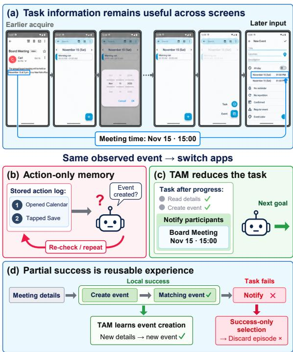  
Figure 1: Task advancement connects execution and learning. (a) To create the calendar event, the agent must retain the meeting time after leaving the email. (b– c) Recording a save action leaves its outcome uncertain. TAM retains the confirmed event and its details, making participant notification the remaining goal. (d) Even if notification fails, the verified event-creation operation can be reused with new meeting details.

Recent methods improve the information available to the agent through context management, program-guided execution, and verified task state (Yang et al., 2025; Tian et al., 2026; Liu et al., 2026a; Zheng et al., 2026; Wu et al., 2026; Liu et al., 2026b). Trajectory exemplars, induced workflows, and experience memories also transfer knowledge to later tasks (Zheng et al., 2024b; Wang et al., 2025b,a; Xiao et al., 2026; Ouyang et al., 2026). These approaches address how memory can help an agent complete remaining goals and how successful interactions can become reusable operations. However, agents still struggle to apply correctly acquired information to later goals across applications. Workflow memories tied to historical action sequences also leave the agent to adapt past routes when the interface changes. A task’s final outcome also gives incomplete feedback about intermediate operations, a failed task can contain useful successes, while a successful task can include ineffective attempts.

We propose Task Advancement Memory (TAM), a memory framework that uses task progress to guide execution and learning. A task advancement occurs when GUI observations confirm that a previously unresolved requirement is satisfied, either by obtaining required information or by achieving a requested outcome. Each advancement reduces what the agent still needs to determine or accomplish. We call this task reduction. For online execution, Task Advancement State makes earlier advancements usable by later goals. It shows what information is available for each remaining goal and which goals are ready to pursue. TAM uses each advancement to supervise the selection and abstraction of productive interactions. The learned operations specify the inputs needed at entry, the result to achieve, and how to verify it. This retains useful capabilities from productive portions of both successful and failed workflows. Figure 1 illustrates these two uses of task advancement.

We evaluate TAM on the GUI-only subset of MobileWorld (Kong et al., 2026) and the Level-3 English subset of SPA-Bench (Chen et al., 2025). With Qwen3-VL-32B-Instruct used by every listed MobileWorld method, TAM improves success from 29.1% for the strongest evaluated memory baseline to 34.2%. With GPT-4o in the SPA-Bench English Level 3 setting, it reaches 57.0%, the highest success rate in the reported comparison. Our contributions are as follows:

• We introduce Task Advancement State within TAM to guide execution across applications. It represents the remaining task in terms of satisfied requirements, available inputs, and unresolved dependencies. This lets the agent build on earlier advancements when choosing its next action.

• We propose advancement supervision, which converts partial task success into capabilities that can be reused in subsequent tasks. Each learned operation specifies what it needs, what it should achieve, and how to verify the outcome.

• We show that TAM outperforms the evaluated memory baselines in task success on Mobile-World and SPA-Bench. Cross-benchmark comparisons, component ablations, and cost analyses establish the value of task-state memory and the additional benefit of persistent operators.

## 2 Related Work

Task state and verified execution. Explicit task representations preserve information and unfinished work across interface changes. AgentProg represents task variables and control flow; ATMem maintains task-driving information and execution status; TSR separates durable task information from transient observations; and StructAgent combines requirements, values, evidence, and verified transitions (Tian et al., 2026; Liu et al., 2026a; Zheng et al., 2026; Wu et al., 2026). MGA also organizes interaction around validated state changes (Cheng et al., 2025). These methods preserve explicit task information and distinguish intended actions from observed outcomes. TAM links task results to the remaining requirements they support. These dependencies guide execution and define the inputs and outcomes of reusable operations.

Trajectory, workflow, and skill memory. Persistent experience can guide later tasks through demonstrations, trajectories, workflows, or skills. Synapse retrieves abstracted trajectories as incontext exemplars; AWM induces workflows from offline or online experience; and ReasoningBank distills reusable reasoning strategies (Zheng et al., 2024b; Wang et al., 2025b; Ouyang et al., 2026). Mobile-Agent-E stores tips and shortcuts, UI-Mem organizes workflows, subtask skills, and failure patterns, and SkillGen synthesizes and validates skills from successful and unsuccessful trajectories (Wang et al., 2025a; Xiao et al., 2026; Ma et al., 2026). These systems reuse experience at different granularities. They adopt different rules for locating a reusable segment, assigning local credit, and verifying the result that the segment is expected to achieve. TAM selects interactions by the local requirement they satisfy and carries that requirement into the learned operation’s expected outcome and verification condition.

Exploration-built interface knowledge. Another family constructs persistent knowledge through dedicated exploration. AppAgent builds application knowledge from exploration or demonstrations; GUI-Xplore learns action-aware structure from exploration videos; GUI-explorer generates function-aware exploration goals and mines transition knowledge; ActionEngine builds statemachine memory with an offline crawler; and EAM constructs an executable GUI graph through stateaware exploration (Zhang et al., 2025; Sun et al., 2025; Xie et al., 2025; Zhong et al., 2026; Qin et al., 2026). This approach can provide broad interface coverage before downstream tasks are attempted.

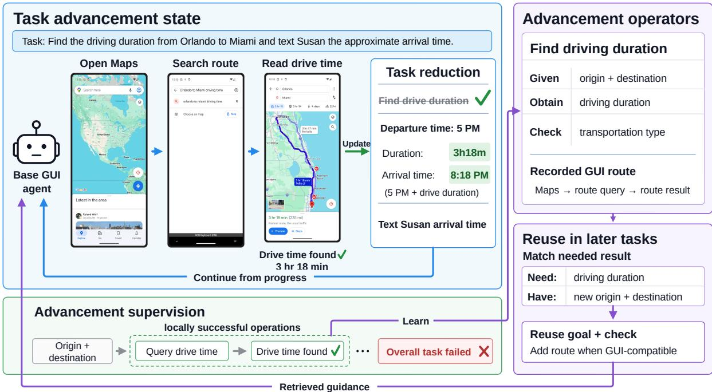  
Figure 2: Overview of TAM. Task Advancement State guides cross-application execution through task reduction. After the route query, the remaining task is to notify Susan, with the arrival time already specified. Advancement supervision learns a reusable operator from the successful query, even if the overall task fails. Later tasks reuse the operator’s goal and verification condition with new locations, adding a recorded GUI route when compatible.

## 3 Method

TAM uses task advancement in two ways. Task Advancement State represents what remains to be done using the information already obtained. Advancement supervision learns reusable operations from interactions that satisfy a task requirement. These memories guide a fixed base policy, which chooses primitive actions from the live interface (Figure 2). Appendix A gives the execution procedure, update rules, and learning details.

## 3.1 Task Advancement as a Shared Memory Unit

At step t, a base policy $\pi _ { \theta }$ receives the instruction g, current GUI observation $o _ { t } .$ , bounded recent history $H _ { t } ,$ and TAM’s bounded memory context $C _ { t }$ . It emits a primitive action in the original environment action space. TAM changes the supplied memory, without retraining the policy. A separate episode record T retains evidence for task-end review. Online state acceptance guides the current task, retrospective review evaluates which interactions should enter persistent memory.

At task initialization, an LLM-based task compiler identifies the information to acquire and the outcomes to establish from the instruction. It represents them in a graph $\mathcal { Q } = ( V , E _ { Q } )$ , whose nodes V are requirements and whose edges $E _ { Q }$ encode their dependencies. For each requirement q, its dependencies $R _ { q }$ identify the requirements that supply its inputs, and an evidence rule $V _ { q }$ specifies how its result is recognized. An optional branch condition $\gamma _ { q }$ specifies when the instruction requires q. These dependencies concern task results rather than a prescribed sequence of GUI actions. The task-local state $S _ { t }$ records each requirement’s status, known values, and supporting evidence at step t. Object bindings associate a value or outcome with its task entity, such as the event to which a meeting time belongs.

A task advancement records progress on a requirement: GUI observations confirm that previously missing information has been obtained or a requested outcome has been achieved. Let $S ^ { - }$ <sup>−</sup> and $S ^ { + }$ denote the task memory states before and after an evidence update. Write $z _ { q } ^ { \pm } = z _ { S ^ { \pm } } ( q )$ for the status of $q ,$ with U and E denoting UNRESOLVED and ESTABLISHED. An advancement is

Algorithm 1 Task Advancement Memory   
Require: instruction $^ { g , }$ policy $\pi _ { \theta } .$ , operator graph $\mathcal { G }$   
1: Compile requirements $\mathcal { Q }$ from g   
2: Initialize state $S ,$ cache $\mathcal { E } ,$ and history H   
3: Initialize trace $\tau$ and candidate segments $\boldsymbol { B }$   
4: while the task is active do   
5: Observe $o ;$ update S from supported facts   
6: Add new advancement segments to B   
7: Read inputs and remaining work from $S$   
8: retrieve relevant evidence and operators for   
Frontier $( S ) ;$ assemble memory context $C$   
9: Assemble C from $S$ and retrieved memory   
10: Sample a $\sim \pi _ { \boldsymbol { \theta } } ( \cdot \mid g , o , H , C )$   
11: Execute $^ { a ; }$ observe $o ^ { \prime }$   
12: Update $S$ from relevant effects in $o ^ { \prime }$   
13: Add new advancement segments to $\boldsymbol { B }$   
14: Append $( o , a , o ^ { \prime } )$ to $\tau ;$ refresh H   
15: end while   
16: Review $\boldsymbol { B }$ using $\tau ;$ retain supported operations   
17: Abstract entry inputs and outcomes   
18: Consolidate operators into $\mathcal { G }$

$$
\begin{array} { r } { \mathrm { A d v } ( q ) = \mathbf { 1 } \left[ ( z _ { q } ^ { - } , z _ { q } ^ { + } ) = ( \mathrm { U } , \mathrm { E } ) \right] V _ { q } ( \xi ) , } \end{array}\tag{1}
$$

where $\xi$ is the supporting observation and $V _ { q } ( \xi ) \in$ $\{ 0 , 1 \}$ indicates whether TAM accepts it as evidence that $q$ is satisfied. Model-based extraction assesses the observed fact or effect; schema and evidence-reference checks associate it with the specified requirement. A single screen can establish several requirements. Each advancement also identifies a candidate interaction segment for later review and learning.

## 3.2 Advancement as State: Online Task Reduction

Task Advancement State turns verified progress into an explicit representation of the remaining problem. Information already obtained is bound to the requirements that need it, and satisfied requirements are removed from the remaining work. We call this task reduction. We call the unfinished requirements with their available inputs the residual task. Completed requirements leave this view, while their results remain in $S _ { t }$ for later use. For example, Figure 2 assumes a departure time of 5 PM. Reading a driving duration of 3 h 18 min supplies the missing value for calculating arrival at 8:18

PM. The remaining goal is to send Susan that time. TAM thus carries the result of the route query into the messaging goal across the application change.

Reason from the reduced task. Among the remaining requirements, TAM identifies those whose inputs are already available and whose branch conditions hold. This set is the Advancement Frontier. Let $K _ { t }$ and $U _ { t }$ denote the established and unresolved requirements, treating an absent branch condition as true:

$$
F _ { t } = \{ q \in U _ { t } : R _ { q } \subseteq K _ { t } , \ S _ { t } \mid = \gamma _ { q } \} .\tag{2}
$$

TAM uses the frontier to select evidence and operators relevant to this continuation. The actor uses the residual task and live screen to choose its next action, with earlier information already supplied to the requirements that need it.

Ground reductions in observed results. TAM updates source information from the current observation and checks relevant action outcomes using the next observation:

$$
\begin{array} { c } { \bar { S } _ { t } = \mathcal { R } _ { \mathrm { o b s } } ( S _ { t } , o _ { t } ) , } \\ { S _ { t + 1 } = \mathcal { R } _ { \mathrm { e f f } } ( \bar { S } _ { t } , o _ { t + 1 } ; \mathcal { V } _ { t } ) . } \end{array}\tag{3}
$$

The first update can establish visible information and object bindings. The second evaluates the set $\nu _ { t }$ of outcome requirements implicated by the action or an explicit confirmation cue. Using the observation returned by the environment, TAM distinguishes three cases: text entered into a form is a draft, clicking Save is an attempt, and an appropriate confirmation supports a saved result. The accepted result then becomes available to dependent requirements. This keeps progress tied to observed effects while leaving action selection with the base policy.

Retain visual evidence when text is insufficient. A task-local Evidence Cache E stores source images or crops linked to task information and its object bindings. When a requirement needs information whose source screen has left recent context, recalled evidence can restore its value or clarify which object it describes. Recalled images are identified as historical evidence. Current controls and coordinates come from the live screen.

## 3.3 Advancement as Supervision: Learning Reusable Operations

Advancement supervision learns reusable operations from verified local results, including those within failed workflows. The challenge is both temporal and semantic: identify the productive interaction, then determine what it required and achieved.

Learning from local results. Each advancement identifies a local result and a candidate segment of preceding interactions. When terminal evaluation nominates an outcome, it enters the same retrospective review. At task termination, an LLMbased reviewer examines the result and recorded actions and observations, including later evidence of confirmation or contradiction. It retains supported operations and selects the steps contributing to their navigation and information acquisition. Review evaluates each operation against the evidence for its local result, including when the larger task fails. TAM separates inputs needed before the retained interaction from information acquired within it. Only the former become the operation’s entry requirements. For example, a route query requires an origin and destination; the driving duration is acquired by the operation itself. This makes the learned query applicable to new routes whose duration the agent still needs to find.

Abstract task values while preserving object identity. A supported segment yields an Advancement Operator

$$
\kappa = \langle R _ { \kappa } , \Delta _ { \kappa } , V _ { \kappa } , B _ { \kappa } , \Gamma _ { \kappa } , \mathcal { A } _ { \kappa } \rangle .\tag{4}
$$

Its components are entry requirements $R _ { \kappa }$ , expected advancement $\Delta _ { \kappa } .$ , verification condition $V _ { \kappa } ,$ object roles $B _ { \kappa }$ , optional applicability conditions $\Gamma _ { \kappa } ,$ and reviewed GUI realizations $\textstyle A _ { \kappa } :$ recorded action sequences together with the interface conditions under which they were observed. Abstraction replaces instance-specific values with roles shared across the inputs, result, and verification target. For example, event details and the creation confirmation must refer to the same event. Concrete GUI entry conditions and action details belong to individual realizations. The persistent Advancement Operator Graph $\mathcal { G }$ links each operator to its observed GUI realizations. This lets TAM reuse the same operation while checking each route against the current interface. To consolidate a new sample, TAM compares its input–result relation with the stored operators: compatible samples refine a shared description while retaining distinct GUI realizations. Otherwise, the sample forms a separate operator.

## 3.4 Operator Reuse: Task Meaning and GUI Realization

An operation can remain useful across changes in its GUI implementation. TAM separates two questions: whether the operation supplies a needed result from available inputs, and whether the current interface supports a recorded route. TAM retrieves operators whose expected results and input roles match a frontier requirement. Among supported candidates, it considers both coverage of remaining requirements and the applicability and reliability of the stored GUI route. Selection retains a bounded set of alternatives across these two criteria, favoring additional requirement coverage. Appendices A.6 and A.10 specify matching, compatibility checks, and selection rules. When the required inputs are available and a stored GUI route passes the interface and reliability checks, the readout includes that route. Otherwise, a supported operator can still supply its required inputs, expected result, and verification cue, with missing inputs explicitly marked. Task knowledge therefore remains useful when a stored route needs adaptation. The actor uses this guidance to choose primitive actions from the current interface. Historical success guides the attempt; current observations determine whether the expected advancement is accepted. If no operator is relevant, ordinary execution continues with the task state and recent context.

## 4 Experiments

We evaluate task completion on two benchmarks and lifecycle cost on MobileWorld. Component ablations measure the contribution of online state and persistent operators. We also examine whether earlier results remain usable and whether local review produces reliable learning material.

## 4.1 Experimental Setup

Benchmarks. MobileWorld GUI-only tests long-horizon tasks across a broad application suite, including workflows that span multiple apps (Kong et al., 2026). We use the GUI-only interaction setting with standard mobile actions. This setting stresses the preservation of information and results across application boundaries. SPA-Bench English Level 3 evaluates multi-stage workflows within individual smartphone applications at the benchmark’s highest difficulty tier (Chen et al., 2025). Following GUI-explorer, we study the single-app English Level 3 setting with Set-of-

<table><tr><td>Method</td><td>Success (%) ↑</td><td>Steps ↓</td><td>EQA@50 (%) ↑</td><td>LTS (M) ↓</td></tr><tr><td>Qwen3-VL-32B-Instruct (Bai et al., 2025)</td><td>12.0</td><td></td><td></td><td></td></tr><tr><td>AWM (Wang et al., 2025b)</td><td>13.7</td><td>25.3</td><td>11.9</td><td>0.720</td></tr><tr><td>Mobile-Agent-E (Wang et al., 2025a)</td><td>15.4</td><td>22.9</td><td>12.2</td><td>4.472</td></tr><tr><td>StructAgent (Wu et al., 2026)</td><td>24.8</td><td>27.8</td><td>19.1</td><td>≥ 1.115*</td></tr><tr><td>GUI-explorer (Xie et al., 2025)</td><td>25.6</td><td>27.4</td><td>20.6</td><td> $\subseteq 1 . 4 7 8 ^ { * }$ </td></tr><tr><td>MemGUI-Agent (ConAct) (Liu et al., 2026b)</td><td>29.1</td><td>22.4</td><td>23.7</td><td>1.257</td></tr><tr><td>TAM (ours)</td><td>34.2</td><td>20.6</td><td>29.2</td><td>0.771</td></tr></table>

<sup>∗</sup>The archived StructAgent and GUI-explorer accounting omits autonomous exploration and knowledge-base construction, so their lifecycle cost is a lower bound.

Table 1: Results on MobileWorld GUI-only tasks. All methods use Qwen3-VL-32B-Instruct and a limit of 50 controller rounds. EQA@50 jointly rewards success and earlier completion. LTS measures the total model-token expenditure required to obtain a solution.
<table><tr><td>Method</td><td>Input</td><td>Base Model</td><td>Success (%) ↑</td></tr><tr><td>CogAgent (Hong et al., 2024)</td><td>screen</td><td>CogAgent</td><td>0.0</td></tr><tr><td>DigiRL (Bai et al., 2024)</td><td>screen</td><td>DigiRL</td><td>0.0</td></tr><tr><td>AutoDroid (Wen et al., 2024)</td><td>a11y tree</td><td>GPT-40</td><td>12.0</td></tr><tr><td>SeeAct (Zheng et al., 2024a)</td><td>SoM</td><td>GPT-40</td><td>12.0</td></tr><tr><td>AppAgent (Zhang et al., 2025)</td><td>SoM</td><td>GPT-40</td><td>14.0</td></tr><tr><td>Mobile-Agent-v2 (Wang et al., 2024)</td><td>SoM</td><td>GPT-40</td><td>20.0</td></tr><tr><td>M3A (Rawles et al., 2025)</td><td>SoM</td><td>GPT-40</td><td>42.0</td></tr><tr><td>MemGUI-Agent (ConAct) (Liu et al., 2026b)</td><td>SoM</td><td>GPT-40</td><td>46.0</td></tr><tr><td>GUI-explorer (Xie et al., 2025)</td><td>SoM</td><td>GPT-40</td><td>53.7</td></tr><tr><td>TAM (ours)</td><td>SoM</td><td>GPT-40</td><td>57.0</td></tr></table>

Table 2: Task success on SPA-Bench single-app English Level 3. Results for the first seven baselines and GUIexplorer are taken from Xie et al. (2025).

Mark (SoM) observations and GPT-4o (Xie et al., 2025; OpenAI, 2024). It complements Mobile-World by testing sustained interaction with realworld applications without requiring cross-app information transfer.

Backbones and memory protocol. Every MobileWorld method in Table 1 uses Qwen3-VL-32B-Instruct and the same limit of 50 controller rounds (Bai et al., 2025). TAM builds persistent memory from interactions in the evaluation task sequence, without a separate application-exploration stage. Task Advancement State and Evidence Cache reset between tasks, reviewed operators remain available to subsequent tasks. Component ablations preserve the base policy, action interface, and interaction budget. On SPA-Bench, we use a task-specific budget of $2 g _ { i } + 1$ rounds, where $g _ { i }$ is the reference human action count. The official evaluator scores the recorded trajectory after termination; it supplies no intermediate success feedback to the policy. $\mathsf { A p - }$ pendix B.3 specifies execution, memory, and the aggregation protocol.

Metrics. Success is acceptance by the benchmark’s native evaluator and is reported for both benchmarks. We additionally report the following execution and cost metrics on MobileWorld. Steps averages controller rounds over all runs, including failures, and is interpreted jointly with success. A controller round is one externally counted action decision. Efficiency–Quality Area at 50 rounds (EQA@50) jointly rewards successful completion and fewer controller rounds, assigning zero credit to failures (Wang et al., 2026). Lifecycle Tokens per Solved Task (LTS) divides total model-token expenditure by solved tasks, including memory construction, execution, and failed attempts.

Baselines. Alongside the memory-free backbone, we compare workflow induction with AWM, tips and shortcuts with Mobile-Agent-E, explorationbuilt knowledge with GUI-explorer, verified taskstate and procedural memory with StructAgent, and proactive context management with MemGUI-Agent (ConAct) (Wang et al., 2025b,a; Xie et al., 2025; Wu et al., 2026; Liu et al., 2026b). These comparisons cover both state-oriented and experience-oriented approaches. Table 2 combines our SPA-Bench evaluation of TAM and ConAct with published reference results from Xie et al.

(2025), retaining the reported observation and backbone for each method.

## 4.2 Main Results

On MobileWorld, TAM achieves 34.2% success, improving on the strongest evaluated baseline by 5.1 percentage points (Table 1). Relative to the memory-free backbone, the gain is 22.2 points. Across all three app-count groups, TAM outperforms all four compared baselines (Table 3). Its advantage over ConAct is larger on the 62 multi-app tasks, where success reaches 32.3% versus 24.2% (+8.1 points), than on single-app tasks (+1.8 points). The larger multi-app gain supports TAM’s focus on sustaining execution across application boundaries. TAM also attains the highest EQA@50, 29.2%, and uses 20.6 controller rounds on average, showing that the advantage also holds when successful completion is rewarded for taking fewer rounds. TAM uses 0.771M lifecycle tokens per solved task, 38.7% below ConAct’s 1.257M. AWM is slightly cheaper at 0.720M, but completes 13.7% of tasks versus TAM’s 34.2%. TAM offers the strongest completion rate in this comparison at a lifecycle cost close to the cheapest evaluated memory method. This supports the practical value of organizing memory around established task results rather than increasing the interaction budget. On SPA-Bench English Level 3, TAM reaches 57.0% success, 3.3 percentage points above GUIexplorer’s reported 53.7% (Table 2). This is the highest result in the reported comparison. Together, the two benchmarks show that TAM’s benefits occur both in cross-app workflows with an opensource backbone and in difficult single-app tasks with GPT-4o.

## 4.3 Component Ablations

Table 4 shows that Task Advancement State provides the largest gain, raising success from 12.0% to 28.2%. This gain establishes the value of advancement state for online execution before persistent experience is added. Adding the Advancement Operator Graph to State yields 32.5%, while average steps fall from 23.4 to 20.9. With the Evidence Cache enabled, the Operator Graph adds 5.1 points (29.1% to 34.2%). The Operator Graph improves completion in both cache settings. Online state provides the main gain by making earlier results available to unfinished work, persistent operators add experience about how to obtain the next needed result.

## 4.4 Mechanism Analysis

Identifying and using task information. To examine whether acquired information remains usable, we audit archived runs of tasks that require obtaining a value from the environment and using it in a later operation. The comparison covers the same 52 required values across 21 tasks for all five methods. Within each task, identification coverage is the fraction of required values explicitly and correctly stated in online outputs; target-use coverage is the fraction correctly used in their intended fields or objects. Averaging these rates equally across tasks, TAM achieves the highest observed coverage for both identification and target use (Figure 3(a)).

State availability and use. We use a flat-state control to test the value of relating stored facts to pending requirements. The control retains fact storage and open requirements while removing prerequisite links and their action guidance. To compare the use of available information, we include all target fields in the paired runs whose required source inputs were visible to both agents. The nine eligible fields from five tasks are each assessed under two paired implementation revisions, giving 18 field instances. Over these instances, state availability measures the fraction with the correct value explicitly recorded in the actor’s state. TAM achieves 77.8% versus 55.6% for flat state, while correct target use reaches 77.8% versus 66.7% (Figure 3(b)).

Localizing supervision for operator learning. For supported advancements written to operator memory, we compare candidate segments with the steps retained after retrospective review. Figure 3(c) shows the 10th–90th percentile profiles, normalized by source-trajectory length. Review reduces the median retained segment length from 20% to 7.7% of the source trajectory. Therefore, the retained supervision is concentrated on local operations rather than the full interaction history.

## 4.5 Further Analyses

Beyond the main benchmark comparisons, the appendix provides complementary evidence on information retention, state organization, local learning signals, experience reuse, and resource requirements. Appendix D.1 classifies all 117 Mobile-World GUI-only tasks and identifies 52 that require transferring acquired values to later operations, establishing the scope of our field-level diagnostics. Appendix D.2 shows that 95.1% of tracked values remain in state after ten decisions, compared with 57.6% in current XML or recent text, demonstrating sustained access beyond the immediate context. Appendix D.3 finds that TAM assembles all audited inputs before entry in 80% of operations, versus 40% for flat state, when both agents have encountered the required source information. This supports organizing acquired facts around pending operations. In matched tests of access to captured facts, Appendix D.4 reports 96.2% readout accuracy versus 80.8% for ordinary notes at similar input size. TAM also uses 37.3% fewer input tokens per readout than full textual history, combining accurate access with compact context. Appendix D.5 shows that local selection retains 88.3% of correct material versus 64.3% for success-only filtering, with 93.8% correctness among retained values, expanding the pool of reliable learning material. Appendix D.6 shows that 74.8% of audited failed executions containing verified local results contribute retained learning material. Recorded traces connect this material to guidance for later tasks, demonstrating the learning value of partial progress. Appendix D.7 reports 83.3% correctness when binding changed task values and 79.3% correct destination use in the respective field audits, supporting the adaptation of stored experience to new tasks. Finally, Appendix D.8 documents a compact resource footprint across the archived runs, with median shares of 5.7% of actor text for state and guidance and 1.7% of recorded tokens for additional calls.

<table><tr><td rowspan="2">Method</td><td colspan="2">1 app (55 tasks)</td><td colspan="2">2 apps (48 tasks)</td><td colspan="2">3 apps (14 tasks)</td></tr><tr><td>Solved</td><td>TAM Gain (pp)</td><td>Solved</td><td>TAM Gain (pp)</td><td>Solved</td><td>TAM Gain (pp)</td></tr><tr><td>ConAct</td><td>19</td><td>+1.8</td><td>14</td><td>+6.3</td><td>1</td><td>+14.3</td></tr><tr><td>GUI-explorer</td><td>16</td><td>+7.3</td><td>13</td><td>+8.3</td><td>1</td><td>+14.3</td></tr><tr><td>AWM</td><td>13</td><td>+12.7</td><td>3</td><td>+29.2</td><td>0</td><td>+21.4</td></tr><tr><td>StructAgent</td><td>17</td><td>+5.5</td><td>11</td><td>+12.5</td><td>1</td><td>+14.3</td></tr><tr><td>TAM (ours)</td><td>20</td><td>一</td><td>17</td><td></td><td>3</td><td></td></tr></table>

Table 3: Completion by app count. Solved: completed tasks. TAM Gain: TAM’s absolute success-rate advantage over the method in that row (percentage points). All results use the MobileWorld GUI-only split.

<table><tr><td>Configuration</td><td>SR (%) ↑ Steps ↓</td></tr><tr><td>Base agent</td><td>12.0 一</td></tr><tr><td>Advancement State</td><td>28.2 23.4</td></tr><tr><td>State + Evidence Cache</td><td>29.1 25.6</td></tr><tr><td>State + Operator Graph</td><td>32.5 20.9</td></tr><tr><td>Full TAM</td><td>34.2 20.6</td></tr></table>

Table 4: Memory-component ablation on MobileWorld GUI-only tasks with Qwen3-VL-32B-Instruct and a fixed base policy.

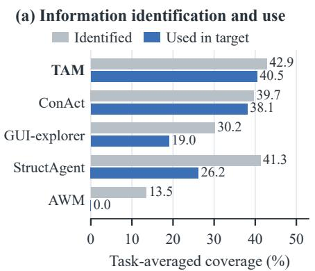

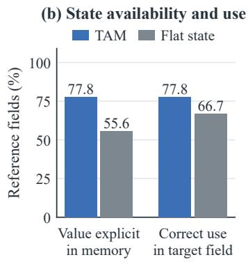

(c) Local credit scope  
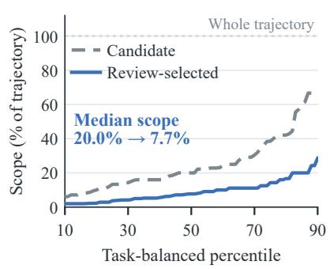  
Figure 3: Mechanism analysis. (a) Task-averaged information identification and target use over 52 values from 21 tasks. (b) State availability and target use on 18 field instances with source inputs observed in both conditions. (c) Candidate and retained step counts, normalized by source-trajectory length.

## 5 Conclusion

Task Advancement Memory makes established results useful at two timescales. During execution, task reduction supplies acquired information to pending requirements and removes completed requirements. During learning, the interactions yield reusable operations whose entry inputs, outcome, and verification target remain aligned after abstraction. Across MobileWorld and SPA-Bench, TAM improves task completion, with ablations establishing the independent value of Advancement State and further gains from persistent operators. These findings support a task-centered foundation for GUI memory: accumulated progress makes the current problem more concrete, while productive interaction builds capabilities for future workflows.

## Limitations

TAM builds task state and reusable operators from observed results. The accuracy of this process depends on model-based interpretation of task requirements and GUI evidence, especially when outcome cues are ambiguous. Improving visual grounding and outcome verification can strengthen both online execution and experience learning.

Our evaluation focuses on MobileWorld GUIonly tasks and the English Level 3 subset of SPA-Bench, covering cross-application workflows and difficult single-application tasks on mobile devices. Extending this evaluation to web and desktop workflows would assess transfer across interface types.

TAM’s persistent operators accumulate across the benchmark task sequences studied here. Longer task streams and repeated application updates introduce further requirements for maintaining relevant experience. The separation between an operation’s intended result and its GUI realizations provides a basis for studying adaptation as interfaces change. Future work can examine operator revision and retirement, together with their effects on retrieval quality and memory-maintenance cost.

## References

AI Agents 2030. 2024. SPA-Bench. GitHub repository. English single-app task metadata: data/single-app-ENG.csv. Accessed 12 October 2026.

Hao Bai, Yifei Zhou, Mert Cemri, Jiayi Pan, Alane Suhr, Sergey Levine, and Aviral Kumar. 2024. DigiRL: Training in-the-wild device-control agents with autonomous reinforcement learning. In Advances in Neural Information Processing Systems, volume 37, pages 12461–12495.

Shuai Bai, Yuxuan Cai, Ruizhe Chen, Keqin Chen, Xionghui Chen, Zesen Cheng, Lianghao Deng, Wei Ding, Chang Gao, Chunjiang Ge, Wenbin Ge, Zhifang Guo, Qidong Huang, Jie Huang, Fei Huang, Binyuan Hui, Shutong Jiang, Zhaohai Li, Mingsheng Li, and 45 others. 2025. Qwen3-VL technical report. Preprint, arXiv:2511.21631.

Jingxuan Chen, Derek Yuen, Bin Xie, Yuhao Yang, Gongwei Chen, Zhihao Wu, Yixing Li, Xurui Zhou, Weiwen Liu, Shuai Wang, Kaiwen Zhou, Rui Shao, Liqiang Nie, Yasheng Wang, Jianye Hao, Jun Wang, and Kun Shao. 2025. SPA-Bench: A comprehensive benchmark for smartphone agent evaluation. In The Thirteenth International Conference on Learning Representations.

Weihua Cheng, Junming Liu, Yifei Sun, Botian Shi, Yirong Chen, and Ding Wang. 2025. MGA: Memory-

driven GUI agent for observation-centric interaction. Preprint, arXiv:2510.24168.

Wenyi Hong, Weihan Wang, Qingsong Lv, Jiazheng Xu, Wenmeng Yu, Junhui Ji, Yan Wang, Zihan Wang, Yuxiao Dong, Ming Ding, and Jie Tang. 2024. CogAgent: A visual language model for GUI agents. In Proceedings ofthe IEEE/CVF Conference on Computer Vision and Pattern Recognition (CVPR), pages 14281–14290.

Quyu Kong, Xu Zhang, Zhenyu Yang, Nolan Gao, Chen Liu, Panrong Tong, Chenglin Cai, Hanzhang Zhou, Jianan Zhang, Liangyu Chen, Zhidan Liu, Steven Hoi, and Yue Wang. 2026. MobileWorld: Benchmarking autonomous mobile agents in agent-user interactive and MCP-augmented environments. In Proceedings of the 64th Annual Meeting of the Association for Computational Linguistics (Volume 1: Long Papers), pages 6142–6167. Association for Computational Linguistics.

Chen Liu, Ling Chen, Hanzhang Zhou, Xu Zhang, Quyu Kong, Panrong Tong, Wenhao Wang, Xin Yu, Steven Hoi, and Yue Wang. 2026a. What memory do GUI agents really need? From passive records to active task-driving states. Preprint, arXiv:2606.31612.

Guangyi Liu, Gao Wu, Congxiao Liu, Pengxiang Zhao, Liang Liu, Mading Li, Qi Zhang, Mengyan Wang, Liang Guo, and Yong Liu. 2026b. MemGUI-Agent: An end-to-end long-horizon mobile GUI agent with proactive context management. Preprint, arXiv:2606.19926.

Yuchen Ma, Yue Huang, Han Bao, Haomin Zhuang, Swadheen Shukla, Michel Galley, Xiangliang Zhang, and Stefan Feuerriegel. 2026. SkillGen: Verified inference-time agent skill synthesis. Preprint, arXiv:2605.10999.

OpenAI. 2024. GPT-4o system card. OpenAI Technical Report.

Siru Ouyang, Jun Yan, I-Hung Hsu, Yanfei Chen, Ke Jiang, Zifeng Wang, Rujun Han, Long T. Le, Samira Daruki, Xiangru Tang, Vishy Tirumalashetty, George Lee, Mahsan Rofouei, Hangfei Lin, Jiawei Han, Chen-Yu Lee, and Tomas Pfister. 2026. ReasoningBank: Scaling agent self-evolving with reasoning memory. In The Fourteenth International Conference on Learning Representations.

Zerui Qin, Sheng Yue, Xingyuan Hua, Yongjian Fu, and Ju Ren. 2026. Executable agentic memory for GUI agent. Preprint, arXiv:2605.12294.

Christopher Rawles, Sarah Clinckemaillie, Yifan Chang, Jonathan Waltz, Gabrielle Lau, Marybeth Fair, Alice Li, William Bishop, Wei Li, Folawiyo Campbell-Ajala, Daniel Toyama, Robert Berry, Divya Tyamagundlu, Timothy Lillicrap, and Oriana Riva. 2025. AndroidWorld: A dynamic benchmarking environment for autonomous agents. In The Thirteenth International Conference on Learning Representations.

Yuchen Sun, Shanhui Zhao, Tao Yu, Hao Wen, Samith Va, Mengwei Xu, Yuanchun Li, and Chongyang Zhang. 2025. GUI-Xplore: Empowering generalizable GUI agents with one exploration. In Proceedings ofthe IEEE/CVF Conference on Computer Vision and Pattern Recognition (CVPR), pages 19477– 19486.

Shizuo Tian, Hao Wen, Yuxuan Chen, Jiacheng Liu, Shanhui Zhao, Guohong Liu, Ju Ren, Yunxin Liu, and Yuanchun Li. 2026. AgentProg: Empowering long-horizon GUI agents with program-guided context management. In Proceedings of the 24th Annual International Conference on Mobile Systems, Applications and Services, pages 883–910. Association for Computing Machinery.

Tongyi-MAI. 2025. MobileWorld. Hugging Face dataset repository. Task metadata: task\_info.csv. Accessed 12 October 2026.

Junyang Wang, Haiyang Xu, Haitao Jia, Xi Zhang, Ming Yan, Weizhou Shen, Ji Zhang, Fei Huang, and Jitao Sang. 2024. Mobile-Agent-v2: Mobile device operation assistant with effective navigation via multiagent collaboration. In Advances in Neural Information Processing Systems, volume 37, pages 2686– 2710.

Xuehui Wang, Zhenyu Wu, JingJing Xie, Zichen Ding, Bowen Yang, Zehao Li, Zhaoyang Liu, Qingyun Li, Xuan Dong, Zhe Chen, Weiyun Wang, Xiangyu Zhao, Jixuan Chen, Haodong Duan, Tianbao Xie, Chenyu Yang, Shiqian Su, Yue Yu, Yanting Zhang, and 6 others. 2026. MMBench-GUI: A unified hierarchical evaluation framework for multi-platform GUI agents. In Proceedings ofthe IEEE/CVF Conference on Computer Vision and Pattern Recognition (CVPR), pages 6239–6248.

Zhenhailong Wang, Haiyang Xu, Junyang Wang, Xi Zhang, Ming Yan, Ji Zhang, Fei Huang, and Heng Ji. 2025a. Mobile-Agent-E: Self-evolving mobile assistant for complex tasks. Preprint, arXiv:2501.11733.

Zora Zhiruo Wang, Jiayuan Mao, Daniel Fried, and Graham Neubig. 2025b. Agent workflow memory. In Proceedings ofthe 42nd International Conference on Machine Learning, volume 267 of Proceedings of Machine Learning Research, pages 63897–63911. PMLR.

Hao Wen, Yuanchun Li, Guohong Liu, Shanhui Zhao, Tao Yu, Toby Jia-Jun Li, Shiqi Jiang, Yunhao Liu, Yaqin Zhang, and Yunxin Liu. 2024. AutoDroid: LLM-powered task automation in Android. In Proceedings ofthe 30th Annual International Conference on Mobile Computing and Networking, pages 543– 557. Association for Computing Machinery.

Wenyi Wu, Sibo Zhu, Kun Zhou, Aayush Salvi, Zixuan Song, and Biwei Huang. 2026. StructAgent: Harness long-horizon digital agents with unified causal structure. Preprint, arXiv:2607.11388.

Han Xiao, Guozhi Wang, Hao Wang, Shilong Liu, Yuxiang Chai, Yue Pan, Yufeng Zhou, Xiaoxin Chen, Yafei Wen, and Hongsheng Li. 2026. UI-Mem: Self-evolving experience memory for online reinforcement learning in mobile GUI agents. Preprint, arXiv:2602.05832.

Bin Xie, Rui Shao, Gongwei Chen, Kaiwen Zhou, Yinchuan Li, Jie Liu, Min Zhang, and Liqiang Nie. 2025. GUI-explorer: Autonomous exploration and mining of transition-aware knowledge for GUI agent. In Proceedings of the 63rd Annual Meeting of the Associationfor Computational Linguistics (Volume 1: Long Papers), pages 5650–5667. Association for Computational Linguistics.

Ke Yang, Yao Liu, Sapana Chaudhary, Rasool Fakoor, Pratik A. Chaudhari, George Karypis, and Huzefa Rangwala. 2025. AgentOccam: A simple yet strong baseline for LLM-based web agents. In The Thirteenth International Conference on Learning Representations.

Chi Zhang, Zhao Yang, Jiaxuan Liu, Yanda Li, Yucheng Han, Xin Chen, Zebiao Huang, Bin Fu, and Gang Yu. 2025. AppAgent: Multimodal agents as smartphone users. In Proceedings ofthe 2025 CHI Conference on Human Factors in Computing Systems, pages 1–20. Association for Computing Machinery. Article 70.

Boyuan Zheng, Boyu Gou, Jihyung Kil, Huan Sun, and Yu Su. 2024a. GPT-4V(ision) is a generalist web agent, if grounded. In Proceedings ofthe 41st International Conference on Machine Learning, volume 235 of Proceedings ofMachine Learning Research, pages 61349–61385. PMLR.

Longtao Zheng, Rundong Wang, Xinrun Wang, and Bo An. 2024b. Synapse: Trajectory-as-exemplar prompting with memory for computer control. In The Twelfth International Conference on Learning Representations.

Yujie Zheng, Zikang Liu, Xin Zhao, and Ji-Rong Wen. 2026. A task-state representation for long-horizon mobile GUI agents. Preprint, arXiv:2607.00502.

Hongbin Zhong, Fazle Faisal, Luis França, Tanakorn Leesatapornwongsa, Adriana Szekeres, Kexin Rong, and Suman Nath. 2026. ActionEngine: From reactive to programmatic GUI agents via state machine memory. Preprint, arXiv:2602.20502v1.

## A Method and Implementation Details

This appendix describes how TAM connects the requirements of a task to observed progress and reusable operations. We follow the execution order in Algorithm 1: compile the requirements, maintain task advancement state, retrieve relevant evidence and operators, and review supported local operations for reuse. The same requirement and object identifiers connect these stages.

## A.1 Requirements and memory records

A requirement in Q describes either information to acquire or an outcome to achieve. Its record contains a relation name, value type, object roles, prerequisite requirements $R _ { q }$ , and a verification condition $V _ { q }$ . Structured values also specify their required fields. An optional condition $\gamma _ { q }$ identifies the branch in which the requirement applies. For example, an event record can contain its title, date, and time, while a notification requirement depends on that record and the recipient’s contact information. Dependencies describe the information consumed by an operation; the GUI route is chosen during execution.

The state $S _ { t }$ associates each requirement with its status, current bindings, and evidence references, as described in Section 3.1. Bindings preserve the relation between a value and its object: an event time belongs to the specified event, and an address belongs to the specified recipient. Evidence references identify the observation step and saved source artifact. The implementation also records artifact digests so that a reused image retains its original identity.

The Evidence Cache $\mathcal { E }$ stores visual support for task-local facts. The persistent graph G stores operators and their GUI realizations. An operator records its entry inputs, expected advancement, verification condition, object roles, and applicability conditions. Its realizations retain the corresponding action sequences and interface contexts. This separates the result an operation provides from the route used to obtain it. Task state and cached evidence reset at the task boundary; reviewed operators remain available to subsequent tasks.

## A.2 Compiling the task requirements

At task start, the LLM-based compiler receives the natural-language instruction and proposes information and outcome requirements in JSON. It assigns types, names the necessary fields, and specifies which requirements supply inputs to each outcome. For a conditional request, it also represents the condition and its dependent requirement. Compilation operates on the instruction; it does not require advance access to the applications or their taskspecific contents.

The implementation combines the proposal with schema normalization. This resolves requirement references, checks field types, and preserves prerequisite relations when bounding the graph size.

The default target is 12 requirements; dependencies needed by a retained requirement are preserved. Explicit instruction values, such as a requested recipient, subject, or message, are kept as constraints on the corresponding outcome. They specify what the agent must achieve and are kept separate from observations of what it has achieved.

Consider the request to read an event’s details and notify a contact. The compiler separates the event information, the contact endpoint, and the notification outcome. If the task also asks for an independent numerical answer, that calculation is connected only to the outputs that use it. The resulting graph therefore preserves independent branches of the request instead of requiring every intermediate result before any outcome can be pursued.

## A.3 Updating and reading task advancement state

The actor reports task-relevant observations alongside its action. Each observation update identifies a requirement, a value or structured fields, and the evidence that supports it. The update format distinguishes source information, derived values, visible drafts, collection coverage, and observed effects. These roles retain the difference between reading an event’s time, entering that time into a form, and observing a saved event. The runtime associates the proposed update with its requirement and source observation, checks the field structure, and updates the corresponding binding. Model-based extraction interprets the observed content; reference and schema checks preserve its association with the task and artifact.

Source information can be established from the current observation. Relevant outcomes are assessed from the observation returned after an action, using the requirement’s verification condition. For instance, text visible in a message composer describes a draft; the sent-message view provides evidence about the resulting message. Both the content and its recipient matter when the task specifies them. The two updates in Eq. 3 thus use the observations already produced by the interaction loop.

Structured requirements retain missing fields until they are supplied. Collections preserve observed members separately from evidence that the requested scope has been covered. Similarly, an absence claim refers to a particular source and search scope. Contradictory observations leave the affected requirement conflicted until further evidence resolves it. This keeps later inputs tied to the information that has been established.

Presenting the remaining work. The actor receives the established bindings and a requirement readout that distinguishes available inputs from missing inputs. An input shared by several requirements is referenced from the same state record. This is the implementation of the residual-task representation described in Section 3.2: completed requirements no longer constitute pending work, while their values remain available to their consumers. The frontier $F _ { t }$ identifies unresolved requirements whose dependencies and branch conditions are satisfied.

In the event example, reading the event details supplies the notification’s content. After the contact endpoint is established, the notification has its required inputs. The actor can proceed using those values even after leaving the source applications. The readout organizes the next decision; it does not issue an action or replace the original task instruction. TAM’s full-method configuration leaves primitive action selection to the base policy.

## A.4 Recalling visual evidence

A cache entry links a saved screenshot or crop to the accepted relation, object binding, and source step. The cache is queried when a current requirement needs information whose source is no longer represented in the actor’s recent visual context. Selection follows the requirement’s input dependencies and matches the corresponding bindings. If several facts come from the same image, that image is attached once.

The implementation forms a packet covering the required source evidence within a limit of three recalled images. Evidence already present in the actor context contributes to that coverage. Each recalled image is marked as a past observation and supplied with a reference identifier. When the actor reads a value from it, the observation update cites that identifier. The resulting value follows the ordinary state-update path. Current control locations and coordinates are grounded in the live observation.

Cache selection does not invoke another model. The selected images enter the ordinary actor call, where their visual tokens are included in the cost. If no matching packet is available, execution proceeds with the current observation, recent history, and task state.

## A.5 Reviewing local operations and abstracting their inputs

An accepted advancement records the affected requirement, its bindings, supporting evidence, and the preceding interaction segment. This initial segment retains context before the use of relevant inputs. It is a candidate for review: some of its interactions may be navigation, repeated attempts, or work unrelated to the established result.

At task end, the reviewer receives the candidates, their recorded actions, the result observations, and available later evidence. It decides whether each local result is supported, selects the steps to retain, and cites the supporting artifacts. Later observations can confirm the result or reveal a reversal or object mismatch. Terminal success can nominate an outcome candidate for review, it does not replace the local evidence judgment. The independent outcome-quality audit excludes such evaluatornominated candidates (Appendix D.5). Correctly reading an event remains a useful operation when a later notification fails; a successful task can likewise contain unproductive attempts that need not enter its reusable operation.

Identifying the entry inputs. TAM saves the accepted task facts available before each step. Once the reviewer selects a segment, the snapshot at its retained start identifies which inputs were already available. Changes within the segment identify information acquired by the operation itself. This distinction determines $R _ { \kappa } \colon$ a value first obtained inside the retained segment is an internal result, rather than an input required before the operation starts. If review chooses a later start, the corresponding later snapshot supplies its entry state. The implementation preserves the navigation and informationacquisition steps needed to support the selected local result.

For example, a segment that opens a calendar and reads an event can learn an operation for acquiring event details. A subsequent segment that starts with those details and sends a notification can learn an operation that consumes them. The second operation’s inputs should not be assigned to the first merely because both appear in the same completed workflow. Conversely, reviewing a segment from a later starting point must use the information available at that point, rather than the task’s final state.

Consolidating an operation. For a supported segment, the reviewer provides a short description of the entry inputs, local result, and reusable method. It replaces task-specific values with object roles and compares the input–result relation with nearby stored operators. Compatible samples refine one operator while preserving their individual GUI realizations. Materially different inputs or outcomes produce separate operators. Different names, dates, or layouts alone do not require a separate semantic operation.

For the route query in Figure 2, the entry snapshot contains Orlando and Miami as the origin and destination. The driving duration is absent at entry and is obtained from the route-result screen. Abstraction replaces the two locations with origin and destination roles. The operator requires those roles, returns their driving duration, and checks that the displayed route uses the requested transportation type. Its recorded realization is Maps → route query → route result. The duration remains the result to obtain in a new task, rather than a prerequisite copied from the completed source trajectory.

The stored record links this description to the retained steps and evidence. The expected result and verification condition refer to the same object roles as the inputs. The graph can therefore preserve an operation such as creating an event from given details while retaining different observed routes through the calendar interface. New evidence refines the shared description while preserving each observed route.

## A.6 Retrieval and actor readout

Retrieval begins with the remaining requirements and their available inputs. TAM compares candidate operators with the needed result and checks whether their input roles and applicability conditions fit the current task. It then assesses each stored realization against the current application and interface context. These are the task-relevance and GUI-compatibility questions introduced in Section 3.4.

The readout includes the operation’s required inputs, expected advancement, and verification cue. When a realization fits the live interface, it also includes the corresponding route. Otherwise, the semantic operation still describes a useful result and how to recognize it, while the actor chooses a route from the current screen. Candidate selection retains a bounded set of relevant operations and avoids filling the context with equivalent routes. The retrieved-memory budget applies to this operator readout; task state and recent observations have their own context limits.

<table><tr><td>Call</td><td>Inputs</td><td>Outputs</td></tr><tr><td>Compiler</td><td>Instruction and requirement schema</td><td>Requirements, types, dependencies, and conditions</td></tr><tr><td>Actor</td><td>Instruction, live observation, recent context, and TAM readout</td><td>Observation updates, execution summary, and one primitive action</td></tr><tr><td>Outcome extraction</td><td>Relevant unresolved outcome and observed action result</td><td>Proposed relation, bound values, and supporting evidence</td></tr><tr><td>Task-end review</td><td>Candidate segments, entry snapshots, result evidence, and nearby operators</td><td>Local support judgment, retained steps, citations, and operator description</td></tr></table>

Table 5: Inputs and outputs of TAM’s model calls. Outcome extraction is triggered for relevant unresolved outcomes; task-end review processes recorded candidates.

Applying an operator uses the current task’s bindings. Historical task values remain part of the source record, while the actor grounds the present action on the live interface. The expected advancement becomes an established requirement only when current observations support it. The same state-update process therefore connects learning from one task with verification in the next.

## A.7 Model interfaces and call accounting

Table 5 summarizes the inputs and outputs of the implementation’s model calls. Requirements, observation references, and retained step identifiers provide the common structure across calls. The actor also maintains a concise execution summary containing findings, attempted routes, and remaining work alongside the structured task state.

Task compilation occurs at initialization, acting follows the environment’s decision loop, and retrospective review occurs after termination. The cache and the organization of available and missing inputs introduce no separate model calls. Model-cost accounting includes compilation, acting, triggered extraction, format repair, and retrospective review, together with the input tokens of recalled images. The benchmark settings and context budgets are reported in Appendix B; Appendix D.8 analyzes the observed allocation of inference and actor context.

## A.8 Structured interfaces and representative prompts

The compiler returns a JSON object with a goal\_slots list. Each requirement has a stable schema name and a goal\_kind: resource denotes information to obtain, and done denotes an observable GUI effect. The optional type and required\_fields specify its value structure; requires names prerequisite requirements. consumption\_role distinguishes a target endpoint, rendered content, decision input, lookup key, attachment, or verification target. entity\_pattern and retrieval\_cues describe the object and where to seek it. A conditional requirement names its branch\_predicate; alternative decision requirements can also name one another through alternative\_to and specify condition\_polarity. effect\_constraints preserves the task’s required recipient, content, attachments, and fields to be checked at completion.

For example, the compiler prompt contains the following complete small output example. The date requirement provides content to the message effect; a concrete task can add its recipient and other required inputs.

```jsonl
{"goal_slots": [
{"schema": "arrival_date",
"goal_kind": "resource",
"type": "date"},
{"schema": "sms_sent",
"goal_kind": "done",
"type": "done",
"requires": ["arrival_date"],
"effect_constraints": {
"expected_render_schemas":
["arrival_date"]}}
]}
```

A stored binding records schema, type, value\_norm, and state; entity\_key identifies its object, while evidence\_ref and source\_step\_id retain the supporting artifact and source step.

Each update names an op, the displayed schema, a scalar value or structured fields, an evidence\_role, and a short evidence\_text. The roles are source, derived, draft, coverage, and effect. A recalled-image update additionally cites the displayed reference\_evidence\_id. These are proposals: the runtime associates them with the task requirement and recorded observation. An outcome-extraction call returns an observations list with schema, evidence\_ref, evidence, and fields. Its parser admits only listed requirement names, the current post-action reference, and a nonempty visible witness.

The following excerpts are taken verbatim from the prompts used in our implementation; the taskspecific JSON packet and images follow the instructions.

## Task compilation.

“Infer the smallest set of goal slots required to determine task completion.” “Use requires only for other goal-slot schemas that are semantic prerequisites for this claim; do not include app names, actions, or concrete values.”

## Outcome extraction.

“Report only the listed outcomes whose verification conditions are visibly satisfied for the correct object and values. A draft, an attempt, or disappearance of a form alone is not confirmation.” “Use observations: [] when nothing is confirmed.”

## Retrospective review and abstraction.

“Task success is not a local-evidence label. Keep supplied anchor/effect/step/evidence IDs.” “Use inputs available at the retained start. Information acquired inside the trace is internal work, not a prerequisite.” “Compare that local input-tooutcome relation with nearby\_operators.” “Use task roles, not instance values. The host retains each real route; do not average routes.”

The reviewer returns one decision per candidate, containing its anchor\_id, effect\_schema, source\_validity (supported, ambiguous, or contradicted), retained\_step\_ids, cited\_evidence\_ids, and rationale. For a supported result, an optional operator\_update contains same\_operator\_id and short descriptions of its inputs, outcome, and method.

## A.9 Candidate boundaries and retained interactions

An accepted local result supplies the candidate endpoint e. For resource alignment, the implementation ranks recorded transitions up to the detected endpoint by $H _ { i } = 4 x _ { i } + 3 n _ { i } + 2 \operatorname* { m a x } ( 0 , z _ { i } - y _ { i } )$ Here $x _ { i } , y _ { i } , z _ { i }$ are the fractions of claim tokens appearing in the action target, pre-action UI, and postaction UI, respectively; $n _ { i }$ is the fraction newly visible after the action. Claim tokens come from the proposed values, fields, and evidence text, with generic stop words removed. The highest-scoring transition is used, with later steps breaking ties, only if $H _ { i } \geq 0 . 3 5$ ; backdating additionally requires an exact claimed value in that transition’s visible post-action UI. Otherwise the detected endpoint is retained. Let r be the earliest recorded availability step, before $e ,$ among the candidate’s required inputs, and let p be the previous captured advancement step strictly before e. If a backdated endpoint is at or before the most recent advancement, that advancement does not constrain the start. The initial start is max(r, p+1) when both exist, r or p+1 when only one exists, and the episode start otherwise. The candidate contains the bounded suffix of this interval through e; the default setting retains at most eight steps. An empty recorded slice falls back to the detected transition as a single-step candidate. Thus the reviewer receives a local candidate rather than choosing an unrestricted interval from the full episode.

The reviewer chooses a nonempty subset of supplied step identifiers that includes e, and cites evidence identifiers from the supplied packet. The host validates both sets. It then closes the selection over observed input support: input-entry steps not marked as making no progress, or selections of a result or recipient bound to a required input, identify the earliest supporting step. The retained route includes the nonempty, non-wait actions from there through e. For acquisition without entry inputs, it also retains the navigation/read prefix from the latest recorded app opening, or the bounded prefix if no app opening is present. If required inputs have no identified support step, the validated reviewer selection is retained.

Entry inputs are determined after this closure. The snapshot immediately before the retained start supplies the available facts; subsequent snapshots through the endpoint identify acquired or updated facts. An input requirement is removed only if it was first acquired inside the retained interaction and was absent at entry. A later retained start therefore uses its own earlier-state snapshot. Missing history remains unknown. When its application and activity are recorded, the GUI realization’s entry condition is taken from the first retained step’s observed pre-state; otherwise the original entry scope is retained.

## A.10 Operator identity, matching, and GUI readout

Retrieval compares operators learned from reviewed interactions with requirements compiled from the current instruction. It checks the required result and input roles before considering a recorded GUI route. Our MobileWorld and SPA-Bench configurations share the reference settings specified below. Task bindings and GUI context are recomputed for each retrieval; execution evidence updates the reliability of each operation and route.

The stored semantic record names its operator\_kind and operator\_family, entry requires, expected effects, and verifies. Its input profiles bind requirement schemas to parameter roles; guard variants preserve optional conditions. The verification\_contract names the result schema, the required result fields, and the evidence relation. Separate GUI records link to this semantic identifier and retain the entry context, typed route, retained source steps, required/capability roles, and evidence provenance.

Consolidation. The reviewer compares the retained operation’s input-to-result relation with the supplied nearby operators. It proposes an existing identifier only when that relation is compatible; otherwise it returns null. The host accepts a proposed merge only if the identifier occurs among the supplied operators, the description is nonempty, and the result’s canonical family matches. Otherwise it stores the supported sample separately. A merge updates the description and retains observed input profiles, guards, and individual GUI realizations. The host does not average their action sequences.

Schema canonicalization. Compiler names are lowercased and normalized with underscores. Marker-based alias maps assign canonical result families and input roles. Effect families encode domain and operation; resource families retain recognized role/domain and positional qualifiers. Thus SMS-Sent and text\_message\_sent map to text\_send, while meeting\_time and event\_time map to resource:event\_time. Input profiles additionally normalize declared roles, such as render to content. Unrecognized effects use predicate:<schema>; resources lacking a recognized role retain resource:<schema>. In fallback schema comparison, qualifier conflicts mean opposing marker groups (e.g., start/end, source/destination, departure/arrival) or aggregate versus nonaggregate markers; these receive zero similarity.

Semantic matching. Semantic matching tests whether an operator can supply the result of a pending requirement. Result types and input roles constrain eligibility; normalized schema comparison supports records with incomplete type metadata. An explicitly typed source must match the target’s resource-acquisition or effect-realization kind and canonical result family. For records without an explicit family, TAM first derives a canonical family from the schema name. Agreement with the target family gives a match score of 1. Otherwise, normalized schema comparison checks exact identity, qualifier conflicts, effect-family or resource-role agreement, and finally substring or token overlap. The corresponding reference scores are 1 for exact identity, 0 for qualifier conflicts, 0.94 for a shared effect family, 0.86 for a shared resource role, 0.82 for a substring match, and token Jaccard otherwise. The reference fallback threshold is $\tau _ { m , 0 } = 0 . 8 0$ . Incompatible effect families and effect–resource pairs are capped at 0.59 and excluded from feedbackcalibrated matching, so name overlap cannot override a type conflict. Compatible input profiles must agree on whether the operation consumes inputs. When both profiles have role metadata, the source profile must cover the target’s required roles. The matched operation is rebound to the current requirement and its inputs. Reuse preserves the input– result relation while substituting the new task values; historical values remain provenance. Profiles lacking role metadata retain the coarser check on whether inputs are consumed.

GUI compatibility and reliability. GUI compatibility tests a recorded route against the live interface. Each realization retains its own entry conditions, so a shared semantic operation can support different interface-specific routes. A route needs a supported semantic source, an eligible stored lifecycle, a valid typed route identity, available target inputs, and the capability roles required by those inputs. Typed actions must specify meaningful roles: typing requires both target and value roles, opening an app a value role, and clicking a target role. Known application or page-role conflicts reject a route. An activity conflict also rejects it unless the page role agrees. Otherwise applicability uses application/activity agreement and token overlap with the entry context; matching layout fingerprints provide additional support.

The GUI context records the application, activity, page role, and a layout fingerprint. The fingerprint hashes the UI tree after masking displayed text, content descriptions, and digits; without a UI tree, it hashes the application, activity, and orientation. The first 16 hexadecimal characters of SHA-256 identify the normalized layout. After the conflict checks, the reference implementation scores the available entry-context evidence:

$$
\begin{array} { r } { a = \operatorname* { m i n } \big ( a _ { \mathrm { m a x } } , b + w _ { J } J + w _ { A } A } \\ { + w _ { V } V + w _ { h } h \big ) . } \end{array}
$$

Here J is token Jaccard between live and stored entry descriptions; A, $V \in \{ 0 , 1 \}$ indicate application and activity compatibility; and h counts matching known page-role and layout features. The reference settings use $b = 0 . 0 8 , ( w _ { J } , w _ { A } , w _ { V } , w _ { h } ) =$ $( 0 . 4 2 , 0 . 2 8 , 0 . 1 8 , 0 . 0 8 )$ , and $a _ { \mathrm { m a x } } = 0 . 7 2$ . Application and activity compatibility test normalized name equality or containment, followed by overlap or shared prefixes among informative name tokens. Missing both an informative entry description and an application pair gives $a = 0$

TAM maintains semantic and route reliability separately. Reuse trials are assessed during execution, and reviewed outcomes update persistent counts at task end. An observed target advancement supports the semantic operation, including when the actor adapts its actions. Route success additionally requires following and completing the stored route and reaching its destination. Reviewed counterexamples update the corresponding semantic or route failure count. Ambiguous or unattributed outcomes are censored; repeated observation identifiers are counted once. For countbacked records, both estimates use additive smoothing:

$$
r _ { j } = \frac { s _ { j } + \alpha _ { j } } { s _ { j } + f _ { j } + \alpha _ { j } + \beta _ { j } } , \quad j \in \{ \mathrm { s e m , g u i } \} .
$$

Here $s _ { j } , f _ { j }$ are the corresponding positive and negative evidence counts. The constants $\alpha _ { j } , \beta _ { j }$ are smoothing pseudocounts that stabilize estimates from sparse observations. Their reference values are $( \alpha _ { \mathrm { s e m } } , \beta _ { \mathrm { s e m } } ) = ( 2 , 1 )$ and $( \alpha _ { \mathrm { g u i } } , \beta _ { \mathrm { g u i } } ) =$ (1, 1).

A semantic source must pass its reliability gate. Recorded-route guidance additionally requires sufficient route reliability and GUI applicability, together with the compatibility checks above. The reference thresholds are $\tau _ { \mathrm { s e m , 0 } } = 0 . 5 5 , \tau _ { \mathrm { g u i , 0 } } =$ 0.45, and $\tau _ { a , 0 } = 0 . 3 8$ . As observations accumulate, changes in reliability can enable or suppress route guidance. This adapts reuse to experience with each stored operation and route.

For feedback-calibrated retrieval, the four admission thresholds use the reviewed local reuse outcomes accumulated within the same memory sequence. Between tasks, each threshold is set to the midpoint of the positive and negative mean preexecution scores, with its reference value contributing one fixed pseudo-observation to each mean. Semantic outcomes calibrate the matching and semantic gates; outcomes of attempted routes calibrate the route and applicability gates. The reference value is used when either outcome class is absent or the positive mean is not higher. Type, input-role, and interface conflicts remain hard rejections.

If no route passes, a supported semantic operation can still provide its inputs, result, and verification cue, with missing inputs marked explicitly. This preserves task-level guidance when a recorded GUI implementation is unsuitable. Scoped negative evidence remains a rejection in either mode.

Eligible alternatives undergo two-axis ϵ-Pareto selection, followed by a bound that first favors new requirement coverage and then distinct route families. For persistent graph retrieval, the two axes measure requirement coverage and execution support:

$$
\begin{array} { l } { { \displaystyle C = \lambda \sum _ { q \in U _ { t } } m _ { q } { \bf 1 } [ m _ { q } \geq \tau _ { C } ] } , } \\ { { \displaystyle E = \eta a + ( 1 - \eta ) r _ { \mathrm { g u i } } . } } \end{array}
$$

Here $U _ { t }$ contains the remaining requirements, and $m _ { q }$ is the largest schema-match score between q and the candidate’s target-bound results. The reference settings use $\lambda = 1 . 2 5 , \tau _ { C } = 0 . 6 6 , \eta = 0 . 6 2$ and $\epsilon = 0 . 0 5$ , retaining at most two alternatives. The result and verification sets coincide on this path. Semantic-only advice has $E = 0 ;$ a persistent candidate without typed requirement coverage is rejected. A candidate is removed when another is at least as good minus ϵ on both axes and better by more than ϵ on either.

Conflicting upstream evidence. The readout excludes unresolved or conflicted facts from available inputs, so dependent requirements identify those inputs as missing. In the typed state kernel, a pending effect whose inputs cease to be established becomes unprepared; an attempted effect with a newly conflicted input becomes ambiguous and calls for further evidence. A separately confirmed effect retains its own observation-backed status when an upstream input becomes conflicted.

## A.11 A complete illustrative operator for Figure 2

The following instantiates every component of the route-query operator in Figure 2. Its role names and route description are schematic, not an additional measured trajectory. Let o and d denote the origin and destination and $\tau$ the observed driving duration.

Entry requirements $R _ { \kappa }$ . Origin and destination are available as the two route endpoints. The driving duration is not an entry input.

Expected advancement $\Delta _ { \kappa } .$ . Acquire driving\_duration $\begin{array} { r l r } { ( o , d ) } & { { } = { } } & { \tau } \end{array}$ for the specified route.

Verification $V _ { \kappa } .$ . A route-result observation shows driving mode, the bound origin and destination, and the reported duration for that route.

Object roles $B _ { \kappa }$ . The query’s origin and destination and the verified route’s endpoints share the bindings $o , d ;$ the result binds $\tau .$

Applicability $\Gamma _ { \kappa } .$ The requested result is a driving-route duration. This example has no additional task branch guard; application and page conditions belong to each realization.

GUI realizations $\boldsymbol { \mathcal { A } } _ { \kappa }$ . Each realization records its observed entry application/page, retained interaction steps, and cited route-result evidence. A schematic route opens the route query, enters $o , d ,$ selects driving mode, and inspects the result. Different observed routes remain separate records.

The arrival-time calculation consumes the acquired duration and the departure time; notifying Susan consumes that calculated time and the recipient binding. These later results are outside the routequery operator. On reuse, new endpoints replace o, d, and a new observation must establish the new duration before it enters task state.

## B Experimental Setup

## B.1 Benchmarks and Observations

MobileWorld. We evaluate the GUI-only partition of MobileWorld (Kong et al., 2026). Based on the released task metadata (Tongyi-MAI, 2025), this partition contains 117 tasks across 15 GUI applications, with 105 English and 12 Chinese instructions. The application counts in the task metadata divide these tasks into 55 single-app, 48 two-app, and 14 three-app workflows. Tasks include communication, scheduling, document handling, file management, and shopping. The GUI-only setting uses touch, text entry, scrolling, navigation, application launch, waiting, and termination. It excludes MCP tools and simulated-user clarification.

The observation interface supplies the current screenshot and the available Android UI tree. Each method constructs its own history and memory context from these observations. MobileWorld initializes the device and application data for each task. Its native evaluators check the requested result through task-specific answer checks, backend state, device-local files, or application callbacks. Evaluation data are kept separate from actor observations.

SPA-Bench. We use the English single-app Level 3 setting of SPA-Bench (Chen et al., 2025). Based on the released task metadata (AI Agents 2030, 2024), this split contains 50 tasks across 36 applications, with reference human trajectories comprising 9–18 annotated actions. These multi-stage single-app workflows complement the cross-app demands of MobileWorld. The split is identified by the English single-app task file and its Level 3 difficulty annotations; task instructions are used as released. As specified in Section 4.1, TAM uses GPT-4o with Set-of-Mark observations. Appendix B.3 describes initialization, action execution, final evaluation, and memory continuity for this setting.

## B.2 MobileWorld Implementation and Evaluation

Interaction budget. All MobileWorld methods use Qwen3-VL-32B-Instruct and a budget of 50 controller rounds. A round is an externally counted action decision, including a wait or contextmanagement action. Some baseline decisions expand into several primitive actions; these actions are recorded separately while the decision contributes one controller round. Internal memory operations that make no environment action do not consume a round. Their model calls contribute to token expenditure.

All MobileWorld methods follow the same evaluation and stopping protocol. The native evaluator checks the task after each executed GUI action, and execution stops immediately when it confirms success. For decisions containing multiple primitive actions, this check occurs after each primitive action. Otherwise, execution ends when the agent terminates or reaches the 50-round budget, and the final state is evaluated. Any terminal answer is submitted before evaluation. The evaluator’s reference answers and internal state are not supplied to the actor. SPA-Bench uses its own task-specific budget and post-execution evaluation procedure, detailed in Appendix B.3.

<table><tr><td>Setting</td><td>MobileWorld</td><td>SPA-Bench</td></tr><tr><td>Temperature</td><td>0</td><td>0</td></tr><tr><td>Actor output limit (tokens)</td><td>8,192</td><td>1,024</td></tr><tr><td>Recent action records</td><td>6</td><td>5</td></tr><tr><td>Operator context (tokens)</td><td>900</td><td>900</td></tr><tr><td>Persistent operator capacity</td><td>512</td><td>512</td></tr></table>

Table 6: TAM reference implementation defaults. Baseline controllers retain their own history management and role-specific output limits.

Model and context settings. TAM uses temperature zero. Table 6 records the reference implementation’s actor settings for both benchmarks. The actor receives the live screenshot, task state, and recent action history. The Evidence Cache can additionally supply the source images selected for a current requirement, as described in Appendix A.4. Task compilation and operator review use the model interfaces summarized in Appendix A.7.

Persistent memory. The following memory lifecycle applies to both benchmarks. TAM builds its operator library from the task sequence without a separate application-exploration stage. Task Advancement State and the Evidence Cache are cleared at every task boundary. Reviewed operators persist within the evaluation sequence and become available after the source task ends. Thus a task uses the library available at its start; its own retrospective review contributes to later tasks. The task manifest fixes the sequence, and the library is maintained across execution batches. Memory stores are separate for different methods and ablation configurations. Methods with a preconstructed knowledge bank load that bank before execution and retain their own retrieval mechanism.

Task outcomes and retries. Native evaluation determines task success: MobileWorld uses the peraction and final checks described above, whereas SPA-Bench scores the recorded trajectory after execution. A transport retry resends the model request within the same decision and does not add a GUI action. Interrupted attempts caused by unavailable services or an invalid environment initialization are retained separately from completed task outcomes.

A task is retried only when its initial conditions and memory boundary can be restored without duplicating side effects or committed memory. The experiment ledger preserves the original attempt, reported model usage, and reason for retry. Ordinary task failures are not rerun to select a better outcome.

## B.3 SPA-Bench Implementation and Evaluation

Environment and action interface. SPA-Bench tasks run in an Android emulator controlled through Android Debug Bridge (ADB). Before each task, the adapter restores the device snapshot, performs the benchmark’s task initialization, and captures a fresh observation of the target application. Device and capture-service preparation occurs before policy execution. Snapshot restoration resets device-local state, external account state is a separate task prerequisite. The adapter supports touch, long press, dragging, text entry, scrolling, navigation, application launch, waiting, and termination. These operations act on the live interface. The actor receives the released instruction, current SoM observation, and its method’s history and memory, without access to reference trajectories or evaluator key components.

Interaction budget and stopping. Following the released runner’s default convention (AI Agents 2030, 2024), task i has a budget of $B _ { i } = 2 g _ { i } + 1$ rounds, where $g _ { i }$ is its annotated human action count. Our controller reserves the final round for termination, allowing at most $2 g _ { i }$ GUI interactions. Waiting and context-management decisions that issue an environment action consume a round; internal memory computations and request retries do not create additional GUI interactions. Execution ends when the policy terminates or the budget is exhausted. An agent’s completion declaration closes the trajectory but does not establish benchmark success.

Official evaluation. We use SPA-Bench’s singleapp evaluator with its result\_only reasoning mode and with\_action trajectory representation (AI Agents 2030, 2024). The evaluator first searches the recorded screenshots for the task’s textual key components using OCR. If this screening stage passes, GPT-4o assesses the instruction and screenshot trajectory with action annotations. The resulting official success decision determines the binary task outcome. Evaluation is performed after execution rather than after each action, and its annotations and judgments are not fed back into online action selection.

Memory across tasks. The persistent-memory protocol in Appendix B.2 also applies to SPA-Bench: TAM begins with an empty operator library and retains reviewed operators in task order across execution batches. Learning uses observed local results and retrospective review, without using official evaluator annotations as memory content. For the SPA-Bench ConAct baseline, we carry its model-maintained explicit UI-memory dictionary across tasks as a declared lifecycle extension to the released controller. Native memory add, update, and delete operations are preserved, while folded action history and step indices reset for each task. This extension adds no separate summarization, retrieval, or learning call. Each method maintains its own store over the declared sequence.

Comparison protocol. Our TAM and ConAct evaluations use the same GPT-4o backbone, task instructions, observation interface, initialization procedure, and task-specific interaction budgets. Each method retains its own memory representation and context management. Table 2 also includes the first seven baselines and GUI-explorer as published reference results from Xie et al. (2025). Their reported inputs and backbones are retained; the shared execution protocol applies to our implementations rather than retroactively to those published runs. The MobileWorld baseline adaptations in Appendix C concern Table 1.

Evaluation sequences and aggregation. The design uses all 50 official English single-app Level 3 tasks in two complete evaluation sequences. Each task receives one scored attempt per sequence. TAM and ConAct share the task orders, generated from the lexicographically sorted task identifiers with order seeds 0 and 1. These seeds determine task order, they do not control model sampling. Each method starts each sequence with an empty persistent store. Task-local state and the environment reset between tasks, while persistent memory accumulates within the sequence. For method m, let $y _ { m r i } \in \{ 0 , 1 \}$ be the official outcome for task i in sequence r. The reporting rule is

$$
\begin{array} { c l c r } { { \displaystyle S _ { m r } = \frac { 1 0 0 } { 5 0 } \sum _ { i = 1 } ^ { 5 0 } y _ { m r i } , } } \\ { { \displaystyle \bar { S } _ { m } = \frac { 1 } { 2 } \sum _ { r = 1 } ^ { 2 } S _ { m r } , } } \\ { { \displaystyle s _ { m } = \sqrt { \frac { 1 } { 2 } \sum _ { r = 1 } ^ { 2 } ( S _ { m r } - \bar { S } _ { m } ) ^ { 2 } } . } } \end{array}\tag{5}
$$

Each of TAM and ConAct contributes 100 scored task episodes (50 tasks in each of two complete sequences), giving 200 scored episodes across the two methods. All tasks have equal weight, and percentages are rounded only after aggregation. Variation across the two sequences describes the combined effects of task order and execution variability.

Memory updates and interrupted attempts. Under this design, task-end learning runs after every valid episode, including failures, using the review and storage rules in Section 3.3. The terminal binary verdict can participate in the disclosed taskend review, hidden reference answers and evaluator annotations are not stored as task knowledge. Operators become available after the source task ends. Task failures, premature termination, and exhausted action budgets count as zero and retain their place in the sequence. Only external infrastructure faults that prevent valid execution or scoring permit a replacement attempt. If that state cannot be restored, the sequence restarts from empty memory in the same order. Persistent infrastructure failure is reported as an incomplete sequence rather than a reduced task denominator.

## B.4 Component Ablations

The component study in Table 4 varies the enabled memory components while retaining the base policy, decoding settings, observation adapter, action interface, recent-history window, and interaction budget. All configurations with Task Advancement State use the same task compiler and state-update procedure. Table 7 specifies the interventions.

Disabling the Evidence Cache removes recalled source images while retaining established bindings and ordinary history. Disabling the Advancement Operator Graph removes persistent retrieval and task-end operator learning while retaining online state updates. Each configuration maintains a separate library over the same task sequence. The flat-state comparison in Appendix D.3 is a separate intervention on the organization of task-local information.

<table><tr><td>Configuration</td><td>State Cache Graph</td><td></td></tr><tr><td>Base agent</td><td>一 一</td><td>一</td></tr><tr><td>Advancement State</td><td>√ 一</td><td>一</td></tr><tr><td>State + Evidence Cache</td><td>√ √</td><td>一</td></tr><tr><td>State + Operator Graph</td><td>√ 一</td><td>√</td></tr><tr><td>Full TAM</td><td>√ V</td><td>√</td></tr></table>

Table 7: Component ablations. State includes task compilation and advancement updates. Graph includes both retrieval and task-end learning.

## B.5 Metric Definitions

Let N be the number of evaluated task instances, $s _ { i } \in \{ 0 , 1 \}$ the native-evaluator outcome, and $a _ { i }$ the number of controller rounds up to the stopping point. Under the common MobileWorld protocol, a successful trajectory ends at the first evaluatorconfirmed success; an unsuccessful trajectory ends at agent termination or the round budget. We report

$$
\begin{array} { c } { { \displaystyle \mathrm { S u c c e s s } = \frac { 1 0 0 } { N } \sum _ { i = 1 } ^ { N } s _ { i } , } } \\ { { \displaystyle \mathrm { S t e p s } = \frac { 1 } { N } \sum _ { i = 1 } ^ { N } a _ { i } . } } \end{array}\tag{6}
$$

Steps includes both successful and unsuccessful tasks and is read alongside Success.

Efficiency–Quality Area. Following the fixedbudget formulation of MMBench-GUI (Wang et al., 2026), we compute

$$
\mathrm { E Q A @ } = \frac { 1 0 0 } { N } \sum _ { i = 1 } ^ { N } s _ { i } \operatorname* { m a x } \Bigl ( 0 , 1 - \frac { a _ { i } } { B } \Bigr ) ,\tag{7}
$$

with $B = 5 0$ for MobileWorld. EQA@50 uses the same stopping point as Steps. Each successful trajectory contributes according to its completion length; a failed trajectory contributes zero. EQA@50 therefore rewards success achieved with fewer decisions.

Lifecycle Tokens per Solved Task. Let $T _ { \mathrm { b u i l d } }$ be the model-token expenditure for constructing memory before evaluation, and $T _ { \mathrm { o n l i n e } }$ the expenditure during the task sequence, including actor, state-update, retrieval, reflection, review, and repair calls. Then

$$
\mathrm { L T S } = \frac { T _ { \mathrm { b u i l d } } + T _ { \mathrm { o n l i n e } } } { \sum _ { i } s _ { i } } .\tag{8}
$$

The numerator includes input and output tokens from successful and failed attempts. Execution calls are counted through the stopping point. Subsequent task-end reflection, review, and memory updates are also included. Vision and cached-input tokens follow the provider’s reported usage. Construction shared across tasks is counted once in the numerator and amortized over the solved tasks. We report LTS in millions of tokens. As indicated in Table 1, StructAgent and GUI-explorer have lowerbound LTS values because the available ledgers exclude their original knowledge-bank construction.

The mechanism analyses use the task, field, operation, or episode units defined in the Analysis Protocols and Sample Definitions in Appendix D. Those diagnostic populations are separate from the benchmark-level denominators above.

## C Baseline Adaptations

All MobileWorld methods use the evaluation and stopping protocol in Appendix B.2. The integrations retain each method’s memory representation, update procedure, and internal model roles. Adapters translate their actions to the common mobile interface and expose the current screenshot, available UI-tree information, and applicationlaunch operation. Internal calls contribute to the lifecycle accounting in Appendix B.5.

AWM (Wang et al., 2025b). AWM induces workflow descriptions from successful trajectories and replaces task-specific arguments with variables. The online adapter updates the workflow library at task boundaries and includes its text in the actor prompt in source order, up to 12,000 characters. Induction requires at least two actionable steps and has a 2,048-token output limit. The actor retains the task’s previous action history and uses a 1,024- token output limit. Workflow descriptions preserve application and affordance names while abstracting instance values and omitting absolute coordinates.

Mobile-Agent-E (Wang et al., 2025a). The integration retains the Manager, Operator, Action Reflector, Notetaker, and the experience reflectors for tips and shortcuts. Its perception pipeline combines OCR and icon descriptions with available UI-tree controls. After an action, the agent observes the result, reflects on the action, and updates its notes. In the evolution setting, tips and shortcuts persist across tasks, while working notes reset. The optional experience selector is disabled, so available tips and shortcuts are supplied directly. Role responses have a 2,048-token limit. Shortcut expansion is preserved, with its atomic actions logged separately from the controller decision.

StructAgent (Wu et al., 2026). The adapter retains structured task state, planning, perception, milestone verification, completion auditing, and recovery. It uses the released fixed experience bank with up to ten retrieved items and at most five planner images. The action adapter translates supported operations to Android interactions; desktop shell, browser-control, and office tools are unavailable in the GUI-only environment. The default role output limit is 1,500 tokens, with role-specific requests capped at 8,192. The original experience bank remains fixed during the task sequence.

GUI-explorer (Xie et al., 2025). The adapter preserves exploration-derived knowledge, multimodal retrieval, model-based ranking, action selection, and step summarization. The live screen queries the knowledge base through its embedding and FAISS pipeline. Retrieval requests one candidate per image query at a similarity threshold of 0.9. The ranker selects knowledge relevant to the current instruction, and step summaries retain execution history. Action selection and summarization use a 1,000-token response limit. The Device interface maps selected actions to MobileWorld while retaining this retrieval and execution loop.

MemGUI-Agent (ConAct) (Liu et al., 2026b). We adapt the MemGUI-Agent implementation released with MobileWorld. It retains the five-part tagged response format, structured context, history folding, and explicit context-management operations. The actor receives one current screenshot with the shared UI-tree and application-launch extensions; its own context operations manage earlier information. A context-management operation executes a wait and consumes one controller round. Context resets at each task boundary. The response limit is 8,192 tokens to accommodate the tagged sections and rewritten context. Parsing permits up to three attempts on unchanged messages; these attempts are distinct from transport retries and do not introduce extra environment actions.

## D Additional Results and Analysis

The following analyses examine information retention, input preparation, operator learning and reuse, and resource allocation. They draw on benchmark metadata, historical execution archives, paired state controls, and readout tests at fixed checkpoints. The benchmark comparisons measure end-to-end completion, these diagnostics examine the specific behaviors that task advancement is designed to support.

## D.1 Benchmark Coverage of the Diagnostics

Field-level diagnostics require both an acquired value and an identifiable destination for its later use. We classify all 117 MobileWorld GUI-only tasks by the principal information requirement in their instructions and official definitions (Figure 4). The classification identifies which tasks support this diagnostic.

The census identifies 52 tasks whose principal requirement is to transfer acquired text or numerical content to a later GUI operation, comprising 47 multi-app tasks and five single-app tasks. Tasks involving final answers, decisions based on source information, file transfers, or navigation require different evaluation criteria. A source-to-target field test therefore applies to a particular information requirement, rather than to every multi-app task.

These 52 tasks define the benchmark scope of source-to-target field scoring. The main-text audit uses a reference catalogue covering 21 of them, comprising 14 fixed-role and seven collection tasks. Its 52 shared values provide identical field references across the five methods. The catalogue covers a subset of the applicable tasks.

## D.2 Preserving Information beyond Its Source

We measure retention after information has entered state. This requires an identifiable acquisition followed by an opportunity to retain the value. We therefore track values that match both their cited read-only UI source and the state supplied to the actor. Instruction constants and echoes of the agent’s own input are excluded. This defines a diagnostic of acquired information with a verifiable textual source.

Scanning all 756 valid archived TAM-family episodes yields 202 bindings across 32 tasks, where a binding associates a task role with a value. These 32 tasks contribute every acquisition satisfying the above rule. The 198 bindings with subsequent decisions yield 3,751 value–decision pairs. Every later decision is scored, including those where the value has disappeared, regardless of episode success. Availability is the fraction of these pairs in which the value remains in state, averaged equally across tasks. It reaches 92.3% overall, 93.1% in an application different from the source, and 89.6% when the value is absent from both current XML and recent text (Figure 5).

For the temporal comparison, we require ten subsequent recorded decisions per binding so that every point follows the same values. Otherwise, episodes ending earlier would change the composition of the curve. All 106 bindings meeting this duration requirement enter the analysis, covering 24 tasks. Values remain in the denominator even when they disappear. After ten steps, 95.1% remain in state, compared with 57.6% present in current XML or recent text (Figure 6). These results show that TAM preserves acquired information across application changes and extended action sequences. Advancement State keeps earlier results available to later decisions even when they are absent from the current XML and recent text.

Scores measure literal retention in primary state, excluding quoted evidence. Observation ends with the episode. A value may disappear after replacement or completed work. The shared protocol specifies matching rules and longer follow-up windows.

## D.3 Preparing Inputs for an Operation

We test whether state organization brings an operation’s source-derived inputs together before entry. The ten-task panel was chosen by task structure to cover cross-application dependencies, one-to-many coordination, document grounding, and terminal effects. Flat state retains facts and unfinished requirements while removing prerequisite links and associated action guidance. Both conditions disable persistent retrieval and learning. We examine all catalogued destination operations in this panel. Nine tasks contribute 23 fields grouped into ten operations. The remaining task requires a decision without field entry. Two saved revisions provide 20 operation instances.

An operation is prepared when all its audited, environment-derived target values appear together in state before the first entry attempt. TAM prepares 40% of operations versus 20% for flat state. Correct first entry requires all audited fields to be correct on their initial entry. Final accuracy allows repairs, reaching 40% and 35%, respectively (Figure 7(a)).

The shared-source comparison examines input organization in workflows where both agents encounter the required source information. All operations meeting this condition are included, yielding ten instances from five tasks across the two revisions, including invoice cases that both agents fail. TAM prepares 80% versus 40% for flat state and achieves correct first entry for 80% versus 50% (Figure 7(b)).

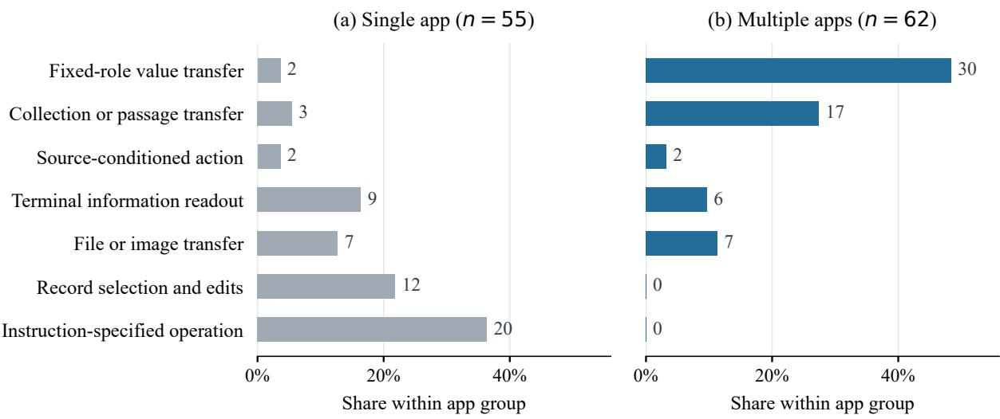  
Figure 4: Information requirements in the MobileWorld GUI-only inventory. Bars show within-group percentages and labels give task counts. Categories describe each task’s principal requirement. Application counts follow benchmark metadata.

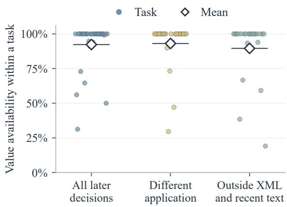  
Figure 5: Availability after acquisition. Tasks contribute when they have qualifying later decisions: 32 overall, 24 in a different application from the source, and 22 outside current XML and recent text. Points show task rates and diamonds their means. Horizontal jitter separates overlapping points.

These ten instances contain the 18 field instances in the main-text paired analysis. Using the first entry after complete source exposure as the checkpoint gives the same results. Across the six multiinput instances, TAM prepares 66.7% versus 33.3% for flat state, while final correctness is 66.7% for both. The paired comparisons show the value of organizing facts around the operations that need them. TAM more often assembles inputs before entry and achieves more correct first attempts when both agents have encountered the source information.

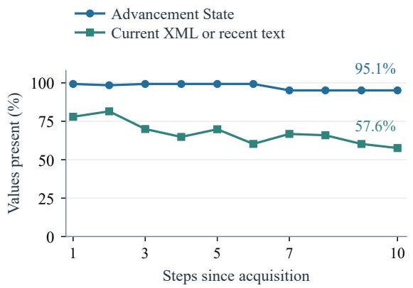  
Figure 6: Ten-decision follow-up of every binding with a complete observation window, yielding 106 bindings from 24 tasks. Both curves use these same values throughout, with equal task weights, and compare text locations within TAM executions.

## D.4 Access to Captured Cross-Application Information

We test access to information already recorded in TAM’s state after an application change. The same questions compare reading this information from memory with recovering it from the interaction history.

A readout question requires a source-linked fact in state at a checkpoint in a different application from its source. This tests access to captured information after a context change. The archive yields 26 distinct eligible claims. A fixed-seed selector retains at most two per task to limit repeated contributions from one workflow, yielding 23 claims. We score all 20 with resolvable source references, spanning 13 tasks and 14 checkpoints, including an incorrect stored value. The claim selector does not inspect episode success or probe answers. Three claims have unresolved object, quantity, or temporal references. The shared protocol details the selection.

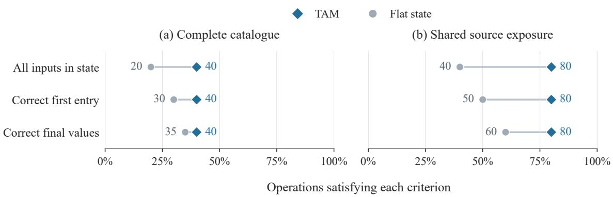  
Figure 7: Operation preparation and use in (a) the full diagnostic panel and (b) the shared-source subset of ten instances. The 20 full-panel instances comprise ten operations evaluated in two saved revisions. Each line joins TAM and flat-state percentages on the same set of operations. A criterion requires every audited parameter to satisfy it.

In each readout test, the same model answers the same question from the same current observation under five context conditions: TAM state, ordinary notes, full XML/action history, history with sampled images, and recent context. Notes are generated from the interaction prefix before the query is supplied, without access to TAM state or the reference answer. A query is correct only when every requested field matches its source-checked reference after format normalization. We average queries within each task before averaging across tasks, and also report the query mean.

<table><tr><td>Context</td><td>Task mean Query mean</td><td></td><td>Tokens</td></tr><tr><td>TAM state</td><td>96.2</td><td>95.0</td><td>4,040</td></tr><tr><td>Ordinary notes</td><td>80.8</td><td>80.0</td><td>4,003</td></tr><tr><td>Full XML/actions</td><td>92.3</td><td>90.0</td><td>6,439</td></tr><tr><td>XML + sampled images</td><td>88.5</td><td>85.0</td><td>19,347</td></tr><tr><td>Recent context</td><td>26.9</td><td>25.0</td><td>3,883</td></tr></table>

Table 8: Readout accuracy (%) on the same 20 queries and mean input tokens per readout. Task means give equal weight to each of the 13 tasks. Query means give equal weight to each query.

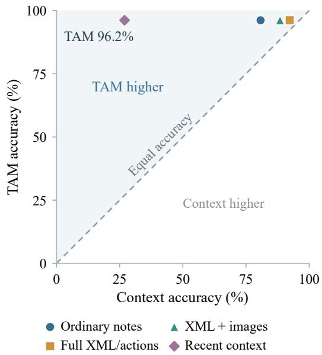  
Figure 8: Readout accuracy by context. Each point compares an alternative context with the same TAM state condition. Axes give task-averaged accuracy on identical questions. Points above the dashed diagonal favor TAM.

TAM achieves the highest observed accuracy under both weightings (Table 8), with input size close to ordinary notes and 37.3% fewer input tokens than full textual history. Under the same task weighting, TAM state reduces readout error by 80.0% relative to notes, 50.0% relative to full textual history, and 66.7% relative to visual history. These are relative error reductions. TAM’s accuracy advantage is largest over recent context and ordinary notes (Figure 8).

The field-level breakdown distinguishes incomplete answers from incorrect derived values (Table 9). TAM, full textual history, and visual history achieve 100% field accuracy on multi-field queries, compared with 76.9% for notes. The additional errors under full and visual history concern derived times. All five contexts repeat one incorrect amount already present in the interaction prefix.

<table><tr><td>Context</td><td>Incomplete</td><td>Time Amount</td></tr><tr><td>TAM state</td><td>0</td><td>0</td></tr><tr><td>Ordinary notes</td><td>3</td><td>1 1</td></tr><tr><td>Full XML/actions</td><td>0</td><td>1</td></tr><tr><td>XML + sampled images</td><td>0</td><td>2 1</td></tr><tr><td>Recent context</td><td>22</td><td>0 1</td></tr></table>

Table 9: Errors among the same 28 requested fields per context. Incomplete fields contain missing or partial answers. Time and amount errors concern derived values. All observed field errors are included.
<table><tr><td>Weighting</td><td>Selection</td><td>Correctness</td><td>Coverage</td></tr><tr><td rowspan="3">Task</td><td>All</td><td>88.0</td><td>100.0</td></tr><tr><td>Success-only</td><td>99.4</td><td>64.3</td></tr><tr><td>TAM storage</td><td>93.8</td><td>88.3</td></tr><tr><td rowspan="3">Reference</td><td>All</td><td>84.2</td><td>100.0</td></tr><tr><td>Success-only</td><td>99.0</td><td>63.6</td></tr><tr><td>TAM storage</td><td>92.3</td><td>81.6</td></tr></table>

Table 10: Correctness and coverage (%) under fixed weights on the same 234 complete fields. Weights are the inverse of each group’s size in the full candidate pool. Supported values remain in the coverage denominator when their group retains none.

TAM combines accurate access to captured information with compact context. Its state supports more reliable cross-application readout than ordinary notes at a similar input size, while using substantially fewer input tokens than full textual history.

## D.5 Quality of Local Learning Signals

We apply three policies to the same recorded candidate pools, retaining all candidates, retaining only candidates from successful episodes, or following TAM’s storage decisions. A candidate pairs a claimed local result with its interaction evidence. Tasks contribute through the learning candidates they produce. Each test includes all candidates meeting its reference conditions below. Correctness measures the quality of retained material, while coverage measures how much correct material is retained.

Local outcomes. To assess local outcome judgments independently of terminal success, we include all 20 admitted proposals made without terminal evaluator feedback. Proposals nominated by the evaluator already use the terminal signal being compared and are accounted for separately. TAM’s retained outcomes are 100% supported and cover 83.3% of the supported pool (Figure 9(a)). Successonly selection gives 85.7% correctness. It admits premature completion claims from a workflow that succeeds later. TAM excludes these contradicted claims. Missing supported outcomes result from review-output processing failures, which remain included in the coverage calculation. Local verification thus improves the reliability of outcome evidence selected for operator learning.

Acquired values. Value-level scoring compares a specified resource field with an external reference. Within the source-reference catalogue, we include every admitted field with a complete, unambiguous value claim and a determinate reference in benchmark fixtures, injected messages, or source documents. This yields 234 fields across 20 tasks, including correct and incorrect values. Incomplete claims and roles without resolved references remain in the full candidate accounting (Table 13).

To prevent candidate-rich tasks from dominating the comparison, we fix weights before selection so that each task contributes equally to the common pool. TAM retains 88.3% of correct material, compared with 64.3% for success-only selection. Correctness among retained values is 93.8% and 99.4%, respectively (Figure 9(b)). TAM combines higher retained-value correctness than keeping all candidates with broader coverage of correct material than success-only selection. This expands the evidence available for operator learning, including supported progress from unsuccessful workflows.

Sensitivity to repeated values. Table 10 also gives equal weight to reference groups defined by task, resource role, and reference value. Correctness and coverage are ratios of weighted counts. Supported values remain in the coverage denominator even when their group retains none. TAM’s coverage advantage persists under both weightings, showing that the gain holds when either tasks or repeated source values receive equal weight. The shared protocol also reports the unweighted comparison.

## D.6 Learning from Incomplete Workflows

We examine when correct local information first appears in workflows that ultimately fail. This timing question requires at least one source-checked correct record. We include every failed execution meeting this condition in the source-value audit, yielding 29 executions across 16 tasks. Records contribute whether or not they are retained for learning. Positions are normalized by the number of executed decisions, and tasks receive equal weight.

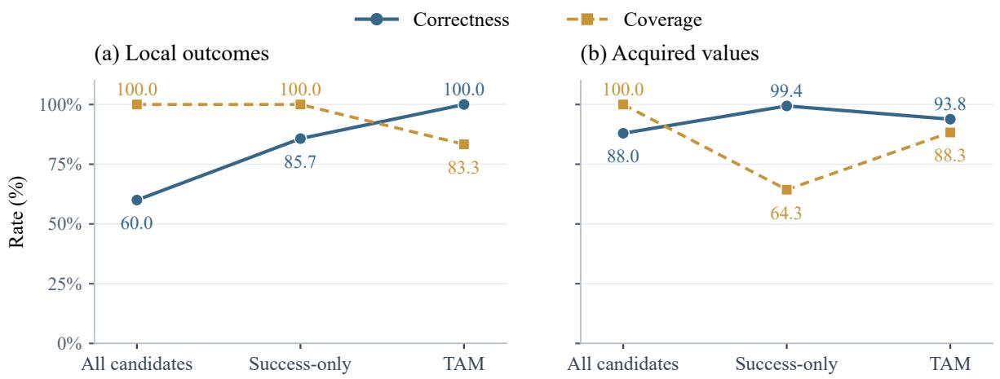  
Figure 9: Correctness and coverage of retained learning material. Correctness is the supported fraction of retained items. Coverage is the retained fraction of all supported items. Policies share the same pool within each panel. Source-value weights give tasks equal representation before selection.

The median first-record position is 28.6% of execution, and 72.9% of audited executions contain a correct record by their midpoint (Figure 10). Correct material from 74.8% of these executions is eventually retained for learning. The dashed curve locates those retained records within their source workflows. The timing results show that useful learning material can arise early in a workflow that ultimately fails. TAM retains this partial progress for operator learning, extending the value of an execution beyond its terminal outcome. Table 11 breaks down retention and timing by information type.

Operators linked to 15 retained candidates subsequently appear in other tasks’ actor prompts. Their recorded lineage connects these deliveries to ten correct destination uses. The shared protocol accounts for all delivered cases. These traces document delivery and subsequent behavior, while the main-paper ablation evaluates persistent operators as a whole.

Figure 11 illustrates one such chain. The source correctly reads a sender’s number from a lunch invitation but fails to create the calendar event. Its operator is recalled for an interview invitation, where the actor reads a different number from a resume, enters it as the recipient, and completes the task.

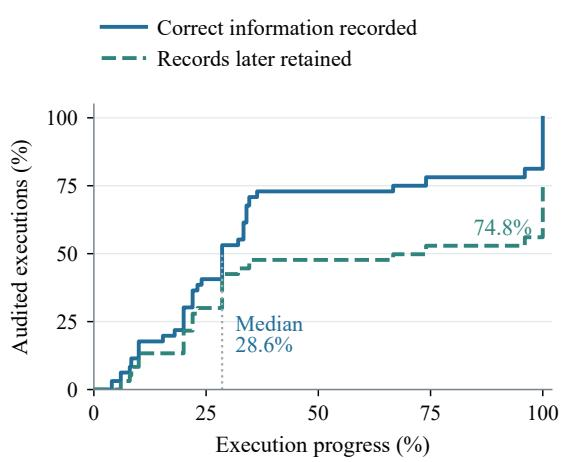  
Figure 10: Timing within failed workflows containing a source-checked correct candidate, with tasks weighted equally. Both curves use the original recording time. The dashed curve tracks records subsequently retained for learning, with the same execution denominator.

This chain demonstrates how supported progress from an incomplete workflow enters memory and becomes guidance for a different task.

## D.7 Using Recalled Experience with New Inputs

We examine how recalled acquisition experience is used in a later task. A reuse opportunity begins when an operator reaches the actor. Scanning all 756 archived executions yields 206 such cases across 60 tasks, counting each operator once per execution. Of these, 165 concern information acquisition. We follow the first subsequent binding for the recalled resource, including incorrect and unresolved values. All 66 deliveries with such a binding enter the value audit, yielding 86 fields across 21 tasks. The other 99 deliveries remain in the coverage account. Task references support 65 of the 86 fields, contradict two, and leave 19 unresolved.

<table><tr><td>Information type</td><td>Correct material retained</td><td>Executions yielding retained material</td><td>Correct record by midpoint</td><td>Median first-record position</td></tr><tr><td>Amounts and quantities</td><td>100.0</td><td>100.0</td><td>50.0</td><td>34.6</td></tr><tr><td>Contact and address details</td><td>66.7</td><td>66.7</td><td>62.5</td><td>33.3</td></tr><tr><td>Dates and times</td><td>79.4</td><td>77.9</td><td>87.5</td><td>20.0</td></tr><tr><td>All (deduplicated)</td><td>74.7</td><td>74.8</td><td>72.9</td><td>28.6</td></tr></table>

Table 11: Retention and timing in failed workflows containing correct candidates (%). Rates give equal weight to tasks within each information type. Positions are fractions of executed decisions, and the median uses the task-weighted timing distribution. Types may share executions, and the overall row uses their deduplicated union.

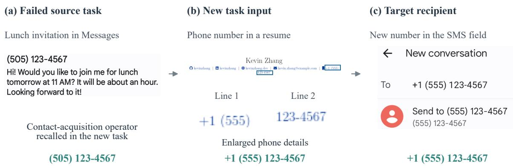  
Figure 11: A recorded source-to-target chain. The failed source workflow correctly obtains a phone number. Its contact-acquisition operator is later recalled without the old number or GUI route. The target actor reads a different number from a resume and enters it as the SMS recipient. Panels use cropped recorded screenshots. Enlarged details in (b) show the phone number wrapped across two lines.

Adapting to changed values. We test inputs that the target task requires the agent to obtain from the environment. Source and target must refer to the same information requirement and semantic field, with comparable value types. For example, a phone number is compared with a phone number, and an event’s start time with another start time. A changed reference distinguishes adaptation to the target task from repeating a source value. We include every field whose target reference differs from all comparable source values. Of the 24 qualifying fields, 20 match the new reference, one is incorrect, and three remain unresolved (Figure 12(a)).

From a binding to a destination. Literal text entry links a recorded value to a destination control. We inspect every bound value matched to an executed text-entry action and check its destination in subsequent XML or screenshots. Of 29 matched fields, 23 (79.3%) reach the intended destination with the correct value (Figure 12(b)). One enters an incorrect value, one occurs only in an unrelated message-search field, and four lack a resolved reference. The correct uses span 22 actions in 22 episodes across seven tasks. Of the 23 correct field uses, 21 follow semantic guidance without an executable GUI route. The other 57 fields have no matching text-entry action and are outside this destination test, which does not cover other input modes such as time pickers. The two tests examine overlapping subsets of the same 86 fields. Together, the tests show that TAM combines reusable acquisition guidance with information obtained for the current task. The transfer traces demonstrate correct binding and destination use with new task values, supporting the reuse of experience across changing inputs.

## D.8 Inference and Context Allocation

We examine how recorded inference is divided between the actor and additional model calls, and how much actor text is devoted to state and operator guidance. A shared actor prompt format gives the state-and-guidance block consistent boundaries, making its text share comparable across executions. We include every valid archived execution using this format, yielding 250 episodes across 96 tasks. Repeated executions are averaged within each task. The records include five archived memory settings, detailed in the shared protocol.

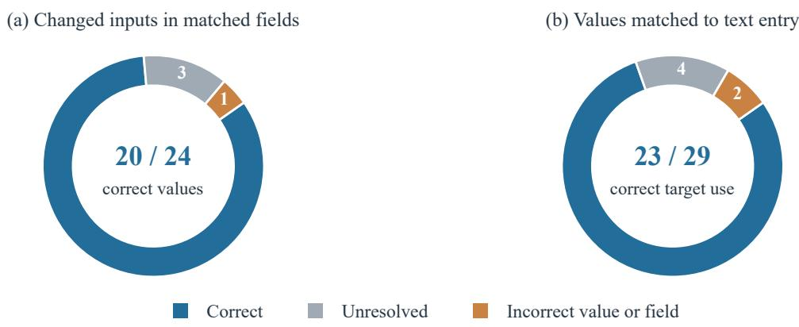  
Figure 12: Two diagnostic subsets of the full 86-field target audit. (a) The 24 newly acquired inputs with a changed reference and comparable source and target fields. (b) The 29 fields matched to executed text entry. The two orange cases in (b) comprise one incorrect value and one correct value entered only in an unrelated field. Unresolved cases remain visible.

For each task, we average the fraction of recorded tokens used by additional model calls across its executions. Across tasks, the median is 1.7% (interquartile range 0.4–6.8%). For actor context, we first take the median fraction of prompt characters devoted to state and operator guidance within each execution, then average these episode medians within each task. The median across tasks is 5.7% (4.3–7.8%), as shown in Figure 13. This measure covers 7,107 saved actor prompts.

Across configurations, the median token share of additional model calls ranges from 0.5% to 13.4%, and the median text share from 4.1% to 6.3%.

These profiles show that TAM provides explicit task state and reusable guidance through a compact addition to actor context. The small median share of tokens used by additional calls complements this representation, supporting the practicality of integrating memory into ongoing execution.

## Analysis Protocols and Sample Definitions

Sources and links to the main results. The source labels in Table 12 distinguish benchmark metadata (B), historical executions (H), paired state controls (P), and fixed-checkpoint readout tests (Q). Historical executions cover multiple prompt and memory configurations. They document observed behavior under the recorded configuration of each episode. The paired state study holds its two arms within each saved revision, with persistent retrieval and learning disabled. The readout study holds questions and checkpoints fixed while varying the supplied context. Baselines use their fixed recorded trajectories. This panel measures attained information identification and use on common field references. These records are separate from the benchmark-level aggregation protocol.

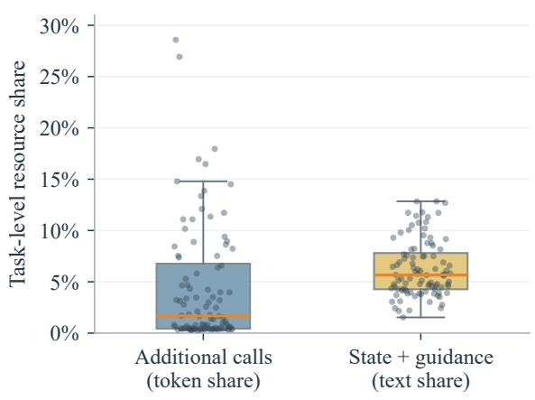  
Figure 13: Resource allocation for all 96 tasks with valid archived executions using the shared actor prompt format. Shares refer to tokens used by additional calls and actor text devoted to state and operator guidance. All task values are shown. Boxes span the interquartile range, orange lines mark medians, and whiskers extend to observations within 1.5 interquartile ranges of the box.

Benchmark result identities. The MobileWorld app-count table is a grouped view of the main-result register, and the Full TAM row in the ablation table uses the same Full TAM register. Diagnostic records retain their own source identities. Links to the main registers are made by exact episode identity, not merely by shared task identifiers. This structure connects the reported comparisons without conflating historical configurations.

References and units. Field judgments combine benchmark definitions, source observations, executed actions, and destination observations. Audits are model-assisted and accompanied by their evidence. Unresolved judgments remain separate. Table 12 distinguishes tasks, episodes, operations, fields, and repeated observations within tasks.

Persistence and controlled state execution. The fixed archive contains 756 valid full-memory executions across 115 tasks. Inclusion requires a value in its cited read-only UI source and in the actual actor state. This defines the 32-task acquisition cohort. Instruction constants and echoes of the agent’s own input are excluded. Typed matching covers email addresses, URLs, dates, times, phone numbers, and identifiers with at least seven digits. Other text requires eight alphanumeric characters. Every later prompt enters the score, including those missing the value. Cross-app decisions yield 2,509 pairs from 24 tasks. Absence from current XML and recent text yields 1,024 pairs from 22 tasks. Each condition includes all matching decisions. These are literal-presence measurements. Images and other prompt blocks are outside the immediate-text comparison. The temporal plot instead requires ten complete subsequent decisions per binding, yielding 106 bindings across 24 tasks. This duration criterion keeps the same values at every step and uses neither episode success nor subsequent retention. Longer follow-up requirements define separate cohorts. At 15 decisions, state and current XML/recent text contain 98.8% and 34.3% of tracked values (88 bindings, 20 tasks). At 20 decisions, the corresponding figures are 81.5% and 60.6% (67 bindings, 18 tasks). These endpoints use equal task weights within each cohort.

The paired state panel uses Qwen3-VL-32B-Instruct, temperature 0, and a 50-action limit. Both saved revisions use seed 7. The flat-state intervention includes associated guidance and output examples. Both arms disable persistent retrieval, writes, and learning. Section D.3 extends the main-text paired runs. Shared source exposure is determined after execution. Full-panel results accompany this conditional comparison.

Readout selection and inputs. The selector scans 117 historical task records. The 53 first occurrences of a stored claim in a later application yield 32 occurrences with valid source and destination apps in declared multi-app tasks, or 26 distinct claims across tasks. Seed 20261003 and a cap of two claims per task select 23. Source review resolves 20, including one incorrect stored claim. Three have unresolved source-object, quantity, or temporal references. Thus the test concerns access to facts previously captured in TAM state.

All conditions use Qwen3-VL-32B-Instruct at temperature 0. They share the current screenshot, XML, recent actions, task, and environment policy. An initial probe omitted the environment policy, including the device date. Corrected inputs were then applied to every condition with questions, references, and checkpoints unchanged. Only corrected responses enter this exploratory comparison. Visual history adds up to seven earlier screenshots. Query-blind notes use the full prefix and the same image sample, with a 128-word target. Reported tokens cover readout, excluding memory and note construction. Source-to-query gaps range from one to 11 steps, with median two.

Omitting each task in turn leaves an 8.3–16.7 percentage-point TAM advantage over notes and a 0–4.2 point difference from full history. These ranges measure sensitivity, not confidence intervals. Paired and field-error analyses reuse all 100 responses. The 28 requested fields are nested within 20 queries. The five multi-field queries contain 13 requested fields. Error categories describe returned values, not internal causes. For context c, relative error reduction is $1 0 0 ( E _ { c } - E _ { \mathrm { T A M } } ) / E _ { c } ,$ where E averages query errors within tasks and then equally across tasks. All contexts use the same questions and fixed weights. Error rates are 3.85% for TAM, 19.23% for notes, 7.69% for full history, 11.54% for visual history, and 73.08% for recent context. Relative reductions differ from percentage-point accuracy gains.

Candidate census and source references. Of 756 valid executions, 751 match a retrospective review record by namespace and episode identifier. The 430 executions without candidates remain in the inventory. The other 321 produce 582 proposals across 48 tasks, including 120 outcomes and 462 resources.

<table><tr><td>Analysis</td><td></td><td>Source Inclusion rule and purpose</td><td>Evaluated units</td></tr><tr><td>Diagnostic scope</td><td>B</td><td>Every official GUI-only task. Task definitions identify the acquired-content transfers to which field scoring applies.</td><td>117 tasks; 52 transfer tasks</td></tr><tr><td>Information use</td><td>H</td><td>Common references with a source and a downstream destination. 21 tasks; 52 values The same fields are scored for all five methods.</td><td></td></tr><tr><td>Value persistence</td><td>H</td><td>Source-verifiable acquisitions followed at every later decision. The temporal comparison requires ten subsequent decisions to keep the same values throughout.</td><td>202 bindings in 32 tasks; ten-step subset: 106 in 24 tasks</td></tr><tr><td>Operation preparation</td><td>P</td><td>Structurally selected diagnostic tasks. All catalogued operations enter the full panel. Shared-source cases test organization when both runs encounter the required inputs.</td><td>20 operation instances; 10 shared-source instances containing 18 fields</td></tr><tr><td>Readout</td><td>Q</td><td>Cross-app access to captured facts, with at most two claims per task, then all source-resolvable queries across the same five contexts.</td><td>20 queries; 13 tasks; 100 responses</td></tr><tr><td>Supervision scope</td><td>H</td><td>Supported candidates with confirmed persistent writes, paired before and after review; equal task weights.</td><td>335 segments; 215 episodes; 36 tasks</td></tr><tr><td>Learning material</td><td>H</td><td>Outcome candidates not nominated by terminal evaluator success. Complete source-value claims with external references</td><td>20 outcomes; 372 resource candidates; 234 complete</td></tr><tr><td>Partial-result timing</td><td>H</td><td>support value-level scoring. Every failed execution with a source-checked correct candidate, 29 executions; 16 tasks; 41 providing an observed onset for timing.</td><td>values candidates</td></tr><tr><td>New-input use</td><td>H</td><td>Actual deliveries define reuse opportunities. First subsequent bindings and traceable text entries define the value and</td><td>206 deliveries; 86 binding fields; 29 text-entry fields</td></tr><tr><td>Computation</td><td>H</td><td>destination tests. Every valid archived execution using a shared prompt format, so the measured context block has consistent boundaries.</td><td>250 episodes; 96 tasks; 7,107 actor prompts</td></tr></table>

Table 12: Sources and statistical units of the diagnostic analyses. B: benchmark metadata; H: historical executions; P: paired state control; Q: fixed-checkpoint readout.

Of 105 admitted outcomes, 85 nominated by native evaluation are excluded from the independent outcome test. All 20 remaining proposals are included. Two supported proposals fail sourcevalidity normalization and three unresolved proposals have malformed review JSON. Among the 15 with usable review decisions, TAM stores ten supported outcomes and none of the five contradicted outcomes.

All 372 admitted resource candidates enter Table 13. Official task roles define 297 reference slots in 266 candidates. The 234 complete slots span 210 candidates and 146 executions. The 63 unresolved slots include missing dates, partial claims, and ambiguous source roles. Another 106 candidates lack static acquired-value references or concern instruction-given content. Unassessed items receive no correctness label. Field judgments assess recorded values, not every statement in an operator. The local-outcome panel uses all 20 eligible proposals. Unresolved retained items remain in its correctness denominator, and processing failures do not remove supported items from coverage. The source-value panel uses all 234 complete fields across 20 tasks. A field from task t receives weight $1 / n _ { t } ,$ with $n _ { t }$ fixed from that task’s complete fields before selection. Correctness divides retained supported weight by all retained weight. Coverage divides retained supported weight by all supported weight in the pool. Without weighting, TAM has 94.9% correctness and 78.2% coverage, versus 98.8% and 76.4% for success-only selection.

<table><tr><td>Selection</td><td>Supported Contradicted</td><td>Unassessed</td></tr><tr><td>All admitted</td><td>189</td><td>16 167</td></tr><tr><td>Success-only</td><td>148</td><td>2 87</td></tr><tr><td>TAM storage</td><td>150</td><td>7 108</td></tr></table>

Table 13: Accounting for all 372 admitted resource candidates. A candidate is supported when all its specified reference slots agree, contradicted when any disagrees, and otherwise unassessed. This candidate-level table complements the value-level quality comparison.

Timing and reuse of partial results. All 41 reference-correct failed-source candidates have original proposal indices and complete logs, covering 29 executions across 16 tasks. Each task receives weight 1/16, divided equally among its qualifying executions. Execution progress is the one-based record position divided by the number of logged decisions. The median is the smallest observed fraction whose cumulative task weight reaches 50%. Final-decision records remain included.

Both curves use the same execution weights. The second curve uses the first correct record that is eventually retained, located at its original recording position. Executions without retained records contribute zero throughout. This curve describes the origin of retained material rather than the time of retrospective storage. Local correctness covers specified source values, not every claim in a learned operator.

Table 11 uses equal task weights within each information type. Material retention averages each task’s retained fraction of correct records. Execution retention and midpoint coverage average within-task execution fractions. Timing uses each execution’s first record of the relevant type. The overall row deduplicates executions. All eligibility rules are unchanged from the original source-value audit.

Of the 29 stored failed-source candidates, operators linked to 15 appear in 56 later episode–operator pairs across 26 tasks. Twenty pairs have a subsequent new binding, yielding 25 fields with 18 correct, two incorrect, and five unresolved values. Ten correct destination uses occur in ten executions. Each target unit is counted once despite multiple source contributions. This accounting connects checked source values, operator delivery, and subsequent behavior.

Reuse and computation. Chronological reuse is checked within namespaces by matching retrieved operator identifiers to saved actor prompts. Across all 756 valid runs, 206 first episode–operator deliveries occur in 168 executions across 60 tasks. They comprise 165 acquisitions, 34 interface outcomes, and seven unresolved types. The first subsequent binding is fixed before scoring, preventing later repairs from replacing an incorrect initial value.

Changed-input eligibility uses target references, independently of target correctness. Comparisons require the same schema, semantic field, and value type. Compound source records are resolved to the matching field. The 86 target fields include 24 changed inputs, eight unchanged references, six inputs not newly acquired, and 48 without determinate comparisons. Destination scoring checks every literal-entry match against subsequent observations and permits repairs. The 57 unmatched fields receive no destination judgment. Other GUI input modes lie outside this test. Delivery and subsequent behavior are observed. Establishing the incremental benefit of a particular source contribution requires controlled memory-bank comparisons.

Of 784 valid archived executions, 250 from 96 tasks share the actor prompt format. All qualifying episodes contribute within-task averages. Token shares include repair calls. Character shares cover the state-and-guidance block, excluding earlier execution recall. The ledger also retains 214 infrastructure-invalid attempts and covers all 117 task identifiers.