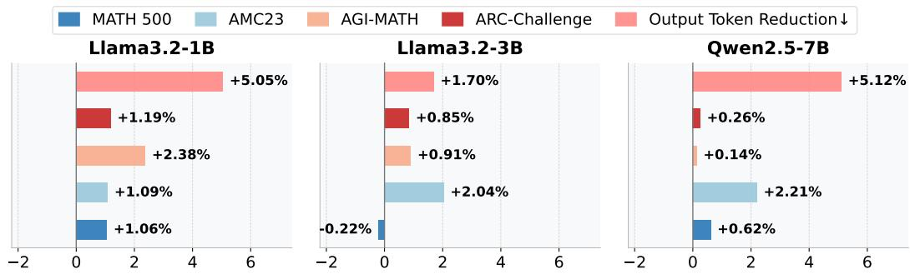
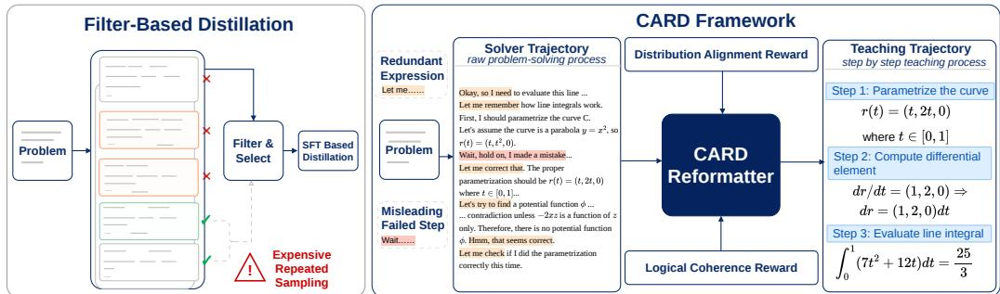
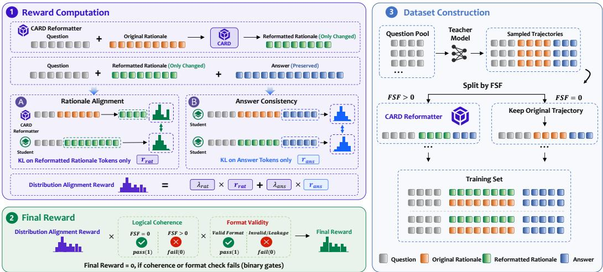
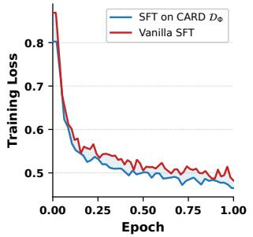
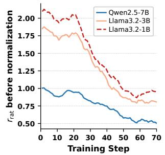
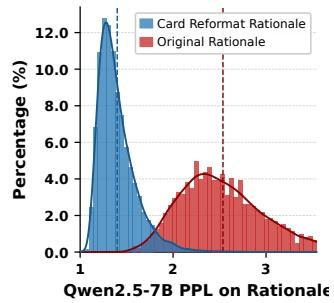
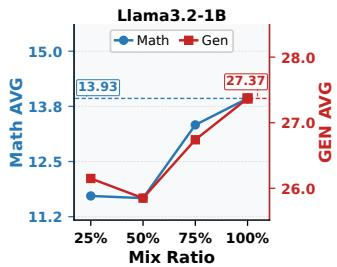
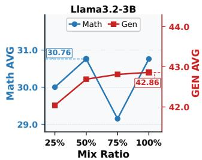
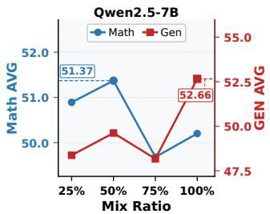

# From Solver Trajectories to Teaching Trajectories: Cognition-Aligned Reasoning Distillation

Yashuo Luo<sup>1</sup> Qianren Mao<sup>2,†</sup> Ziqi Qin<sup>3</sup> Junnan Liu<sup>4</sup> Haitao Li<sup>5</sup> Qili Zhang<sup>2,3</sup> Yuan Gao<sup>1</sup> Zhijun Chen<sup>6</sup> Xu Wang<sup>3,†</sup>

<sup>1</sup> National College for Excellent Engineers, Beihang University <sup>2</sup> Zhongguancun Laboratory   
<sup>4</sup> Department of Data Science & AI, Faculty of Information Technology, Monash University <sup>3</sup> Beihang University <sup>5</sup> Tsinghua University <sup>6</sup> Hong Kong Polytechnic University luoyashuo@buaa.edu.cn; maoqr@zgclab.edu.cn; xuwang@buaa.edu.cn

## Abstract

Knowledge distillation from large reasoning models (LRMs) often uses raw teacher trajectories as supervision. However, this practice creates a mismatch between the goal of distillation and the nature of teacher trajectories. Advanced LRMs typically improve their reasoning capabilities through reward-driven post-training, such as RLHF. This training optimizes them as strong solvers, rather than as teachers that produce reasoning processes smaller models can easily learn. Since smaller models have different "cognitive capacities" compared to their larger teachers, directly imitating raw teacher trajectories can sometimes be ineffective and often requires a substantial number of high-quality samples. To bridge this mismatch, we propose Cognition-Aligned Reasoning Distillation (CARD), an RL-based framework that transforms solver trajectories into teaching trajectories aligned with the student’s cognition. Avoiding expensive resampling, our framework directly transforms existing trajectories. We optimize CARD with two reward signals: (1) a Distribution Alignment Reward that matches the student’s predictive distribution, and (2) a Logical Coherence Reward that reduces misleading failed reasoning steps. Comprehensive evaluations across multiple student models and settings demonstrate that CARD outperforms distillation from raw teacher trajectories in in-domain settings while achieving substantial gains in out-of-distribution performance. Code is available at <sup>§</sup> https://github.com/LiteSSLHub/CARD.

## 1 Introduction

Large reasoning models (LRMs), such as DeepSeek-R1 DeepSeek-AI [2025], OpenAI o1 OpenAI [2024], Kimi K2.5 Team [2026], and Gemini 3 Pro Google DeepMind [2025], have demonstrated strong performance on complex reasoning tasks in mathematics, science, and code. These models solve complex problems by generating chains of reasoning steps during inference, commonly known as chain-of-thought (CoT) reasoning Wei et al. [2022]. However, limited model capacity can make it difficult for small language models (SLMs) to acquire such advanced reasoning behaviors through reinforcement learning alone DeepSeek-AI [2025]. <sup>1</sup> To bridge this gap, reasoning distillation transfers reasoning capability from large models to SLMs, and existing approaches have demonstrated competitive performance across reasoning benchmarks Shao et al. [2024], DeepSeek-AI [2025], Wen et al. [2025].

Existing reasoning distillation approaches typically fall into two broad categories, logits-based and trajectory-based. Logits-based methods Gu et al. [2024], Ko et al. [2024, 2025] leverage token-level probability distributions from the teacher, either by supervising the student on teacher-generated trajectories at the logit level or by on-policy distillation where the student generates trajectories and the teacher provides logit-level supervision Lu and Thinking Machines Lab [2025]. These methods require access to the teacher’s output logits and further assume a shared vocabulary between teacher and student. Trajectory-based methods instead train the student directly on teacher-generated rationales via supervised fine-tuning (SFT) or its variants Gu et al. [2024], Ko et al. [2024], Li et al. [2025]. <sup>2</sup> To improve trajectory quality, filter-based distillation methods sample multiple trajectories per question and select the best ones Chen et al. [2023], Yan et al. [2025]. As shown in Figure 2, this requires repeated teacher sampling and can be expensive for LRMs with large parameters. More critically, filtering only selects among existing teacher-generated trajectories and does not adapt them to the student. Beyond trajectory quality, direct SFT on task-specific trajectories shifts the student toward the downstream distribution, causing catastrophic forgetting of broader general capabilities Kotha et al. [2023], Luo et al. [2023].

  
Figure 1: Motivating analysis of failed steps in trajectory-based reasoning distillation. Using DeepSeek-R1-generated DeepMath trajectories, we distill three student models on two 10,000- trajectory subsets under identical settings, where one subset consists entirely of trajectories with detected failed steps and the other consists entirely of trajectories without. Bars report the difference between the no-failed-step subset and the failed-step subset. Accuracy gains are reported in absolute points, while output-length reductions are reported as (Token<sub>failed</sub> − $\mathrm { T o k e n } _ { \mathrm { n o - f a i l e d } } ) / \mathrm { T o k e n } _ { \mathrm { f a i l e d } } \times 1 0 0 \%$ . Evaluation includes math benchmarks and ARC-Challenge for out-of-distribution generalization, and each panel corresponds to a different student model.

However, raw teacher-generated rationales may not always serve as optimal supervision for student models. Recent advanced LRMs primarily improve their reasoning capabilities through reinforcement learning with verifiable rewards DeepSeek-AI [2025], which optimizes them as strong problem solvers rather than as teachers whose trajectories SLMs can readily learn from. We define the Cognition Gap as the mismatch between what teacher-generated solver trajectories provide and what would better serve as supervision for student learning. Prior work and our analysis suggest that the Cognition Gap may surface in two ways: (1) Trajectories containing failed steps reduce learning efficiency for SLMs. As shown in Figure 2, teacher trajectories may include abandoned exploratory paths during reasoning, which we denote as failed steps Feng et al. [2025]. During teacher inference,failed steps bias subsequent reasoning by leaving residual misleading context that the model does not fully discard after backtracking. To assess howfailed steps in teacher trajectories affect student learning, Figure 1 compares SFT on trajectories with detected failed steps against SFT on trajectories without them under identical training conditions. Across both in-domain and out-of-domain (OOD) benchmarks, the no-failed-step subsets generally outperform the failed-step subsets and also produce shorter average outputs, demonstrating that failed steps degrade student learning efficiency in trajectory-based knowledge distillation. (2) Even a correct teacher trajectory may be difficult for SLMs to learn from. This relates to the Small Model Learnability Gap Li et al. [2025], where small models do not consistently benefit from long CoT reasoning or distillation from larger teachers, and may instead learn more effectively from shorter, simpler reasoning chains that better match their capacity.

Intuitively, trajectories with rationales that match the student’s cognitive capacity should provide better teaching supervision than raw teacher-generated solver trajectories. Based on this idea, we propose CARD (Cognition-Aligned Reasoning Distillation), a framework that reformats teachergenerated solver trajectories into cognition-aligned teaching trajectories without access to teacher model parameters. As shown in Figure 2, a solver trajectory records the teacher’s problem-solving process and may include redundant low-importance expressions orfailed steps. A teaching trajectory preserves the core reasoning process but presents it in clearer steps that the student can follow.

  
Figure 2: Illustration offilter-based distillation methods and CARD. Left: filter-based distillation methods sample multiple teacher trajectories before selection and SFT, incurring expensive repeated teacher sampling. Right: CARD selectively reformats solver trajectories into cognition-aligned teaching trajectories without repeated teacher sampling. Highlights in the solver trajectory indicate detected failed steps and redundant expressions that hinder student learning.

To convert teacher-generated solver trajectories into teaching trajectories, CARD trains a lightweight Reformatter guided by two rewards. (1) The Distribution Alignment Reward aligns each reformatted rationale with the student’s predictive distribution while preserving the answer behavior induced by the original trajectory. (2) The Logical Coherence Reward penalizes reformatted rationales that still contain detected failed steps, thereby encouraging the Reformatter to output coherent rationales. Unlike filter-based distillation methods, CARD does not rely on repeated teacher sampling. Instead, it leverages existing trajectories by selectively reformatting those with detected failed steps while keeping other trajectories unchanged.

Our major contributions are: (1) We propose CARD, a Cognition-Aligned Reasoning Distillation framework that converts teacher-generated solver trajectories into teaching trajectories. CARD mitigates the Cognition Gap by aligning reformatted rationales with the student’s predictive distribution and reducing misleading supervision from detected failed steps. (2) CARD offers a practical alternative to trajectory-based knowledge distillation. Without expensive repeated teacher sampling, CARD selectively reformats existing solver trajectories containing detectedfailed steps while keeping other trajectories unchanged. (3) We conduct extensive experiments across multiple student models, benchmarks, and evaluation settings. CARD-reformatted teaching trajectories consistently outperform distillation from raw teacher-generated solver trajectories in in-domain settings while achieving substantial gains in OOD generalization.

## 2 Related Work

Trajectory-Based Knowledge Distillation. Trajectory-based knowledge distillation trains the student on teacher-generated rationales via SFT Ho et al. [2023], Li et al. [2024]. Filter-based methods improve the training corpus by selecting among existing teacher-generated rationales. MCC-KD Chen et al. [2023] samples multiple rationales per question and enforces consistency by minimizing the bidirectional KL divergence between their answer distributions. MoRSD Yan et al. [2025] selects a compact subset by jointly controlling accuracy, diversity, and rationale difficulty via a student perplexity-based Rationale Difficulty metric. Beyond selection, Li et al. [2025] find that SLMs do not consistently benefit from distilling long CoT rationales from strong teachers, and fine-tuning on shorter, simpler chains can outperform direct imitation of frontier LRMs. Similarly, LS-Mixture SFT Yu et al. [2025] pairs original long CoT with structure-preserving short rewrites to mitigate overthinking inherited from teacher models. These methods generally operate on raw teacher-generated rationales without adapting their content to the student.

Quality of Chain-of-Thought. Muennighoff et al. [2025] introduce budget forcing, which appends a “Wait” token when the model would otherwise stop early, to encourage longer reasoning and self-review, assuming that longer rationales are inherently beneficial. TokenSkip Xia et al. [2025] challenges this by showing that long CoT rationales contain redundant low-importance tokens, and trains the model to skip them at inference time via token-level importance scores. Feng et al. [2025] go further and find that the core issue is not redundancy but failed steps, defined as steps belonging to abandoned exploratory branches in the CoT graph. They define the Failed-Step Fraction (FSF) as the proportion of failed steps in a trajectory, and causal experiments show that FSF predicts reasoning accuracy more reliably than length or review ratio, and that removingfailed steps improves subsequent reasoning accuracy.

## 3 Preliminaries

We consider trajectory-based reasoning distillation from a teacher LRM $\mathcal { M } _ { T }$ to a student SLM $\mathcal { M } _ { S } ( \theta )$ . Since $\mathcal { M } _ { T }$ is accessible only through sampled outputs, distillation is typically implemented via SFT or closely related variants. Given an unlabeled problem set $\mathcal { P } = \{ q _ { i } \} _ { i = 1 } ^ { N }$ , for each $q \in \mathcal { P }$ we draw a set of teacher-generated samples

$$
y _ { T } ( q ) = \{ y _ { j } \} _ { j = 1 } ^ { K } , \qquad y _ { j } \sim \mathcal { M } _ { T } ( \cdot \mid q ) ,\tag{1}
$$

where each sample $y _ { j } = ( c _ { j } , a _ { j } )$ pairs a rationale $c _ { j }$ with an answer $a _ { j }$ . A processing operator Φ constructs the distillation dataset

$$
\mathcal { D } _ { \Phi } = \{ ( q , \Phi ( q , \mathcal { V } _ { T } ( q ) ) ) \mid q \in \mathcal { P } \} ,\tag{2}
$$

and the student is trained on $\mathcal { D } _ { \Phi }$ via

$$
\mathcal { L } ( \theta ) = \mathbb { E } _ { ( q , y ) \in \mathcal { D } _ { \Phi } } \left[ - \sum _ { t = 1 } ^ { | y | } \log P _ { \mathcal { M } _ { S } } ( y _ { t } \mid q , y _ { < t } ; \theta ) \right] .\tag{3}
$$

Methods differ primarily in how Φ is designed. Filter-based methods select a subset of teacher samples based on answer distributions or difficulty metrics Chen et al. [2023], Yan et al. [2025].

## 4 Method

CARD instantiates Φ $( \operatorname { E q } . 2 )$ as a rationale Reformatter $\mathcal { R } _ { \phi }$ that converts solver trajectories into cognition-aligned teaching trajectories better suited for student imitation. Figure 3 provides an overview of the framework. The Reformatter is optimized via a reward signal composed of two complementary terms, namely a Distribution Alignment Reward that measures how accessible the reformatted rationale is to the student and a Logical Coherence Reward that penalizes reformatted rationales containing detected failed steps. When constructing $\mathcal { D } _ { \Phi }$ (Eq. 2), $\mathcal { R } _ { \phi }$ is applied selectively so that only trajectories whose rationales contain failed steps are reformatted, while the remaining trajectories are retained directly. The student model is then trained on $\mathcal { D } _ { \Phi }$ via $\mathcal { L } ( \theta ) \left( \mathrm { E q . ~ } 3 \right)$ . We describe each component in detail below.

## 4.1 CARD Reformatter

Even when a teacher rationale leads to a correct answer, it may not be suitable for student imitation. As argued in Section 1, solver trajectories are optimized for exploration and reward maximization, not for teaching. CARD addresses this by training a rationale Reformatter $\mathcal { R } _ { \phi }$ that maps each solver trajectory to a cognition-aligned rationale better suited for trajectory-based knowledge distillation.

Specifically, given a training corpus $\mathcal { D } = \{ ( q _ { i } , c _ { i } ^ { \mathrm { o r i g } } , a _ { i } ) \}$ of (question, original rationale, answer) triples, $^ 3 \mathcal { R } _ { \phi }$ takes a question q and its original rationale $c ^ { \mathrm { o r i g } }$ as input and produces a cognition-aligned rationale $c ^ { \mathrm { r e f } } = \mathcal { R } _ { \phi } ( q , c ^ { \mathrm { o r i g } } )$ , while leaving the answer a unchanged. To preserve the teacher’s final answer exactly and focus restructuring where it matters most, we restrict reformatting to the rationale c. Complex reasoning is concentrated in the rationale rather than the answer; reformatting only this component retains the substantive instructional content of the teacher trajectory while restructuring it for student accessibility. The Reformatter is trained via a GRPO-based objective with the reward design described below.

  
Figure 3: Overview of CARD. (1) Reward Computation. The CARD Reformatter takes a question and its original rationale as input and produces a reformatted rationale, leaving the answer unchanged. Rationale Alignment $( r _ { \mathrm { r a t } } )$ and Answer Consistency $( r _ { \mathrm { a n s } } )$ are combined into the Distribution Alignment Reward via a weighted sum. (2) Final Reward. The Distribution Alignment Reward is gated by a Logical Coherence check (no failed steps) and a Format Validity check (no leakage); any candidate failing either gate receives a reward of zero. (3) Dataset Construction. Teacher trajectories are split by their Failed-Step Fraction (FSF): those with $\mathrm { F S F } > 0$ are reformatted by CARD, while structurally clean trajectories with $\mathrm { F S F } = 0$ are retained directly to form the final training set.

## 4.2 Reward Design

To achieve cognition alignment, we design two complementary rewards targeting the two sources of mismatch identified in Section 1. A Distribution Alignment Reward targets the Cognition Gap by encouraging cognition-aligned rationales that fall within the student’s cognitively accessible range. A Logical Coherence Reward targets high Failed-Step Fraction by rewarding reformatted rationales that eliminate abandoned exploratory branches.

Distribution Alignment Reward. The goal of the rationale Reformatter is not merely to paraphrase the teacher’s reasoning, but to restructure it so the student can follow the reasoning process more easily. We measure cognition alignment through two KL-based terms, both of which should be minimized: lower values indicate that the reformatted rationale is more accessible to the student.

The first term, $r _ { \mathrm { r a t } } ,$ , measures how much the student’s predictive distribution over the reformatted rationale differs from the Reformatter’s distribution conditioned on the original solver trajectory:

$$
r _ { \mathrm { r a t } } = D _ { \mathrm { K L } } \Big ( \pi _ { \phi } ( c _ { t } ^ { \mathrm { r e f } } \mid q , c ^ { \mathrm { o r i g } } , c _ { < t } ^ { \mathrm { r e f } } ) \Big \| \pi _ { \mathrm { s t u d e n t } } ( c _ { t } ^ { \mathrm { r e f } } \mid q , c _ { < t } ^ { \mathrm { r e f } } ) \Big ) .\tag{4}
$$

A small $r _ { \mathrm { r a t } }$ indicates that the student can anticipate the cognition-aligned rationale without the original solver trajectory, reflecting genuine cognitive accessibility. The second term, $r _ { \mathrm { a n s } } .$ , compares the student’s answer distributions conditioned on the cognition-aligned rationale versus the original solver trajectory:

$$
\begin{array} { r } { r _ { \mathrm { a n s } } = D _ { \mathrm { K L } } \Big ( \pi _ { \mathrm { s t u d e n t } } ( a _ { t } \mid q , c ^ { \mathrm { r e f } } , a _ { < t } ) \Big \| \pi _ { \mathrm { s t u d e n t } } ( a _ { t } \mid q , c ^ { \mathrm { o r i g } } , a _ { < t } ) \Big ) . } \end{array}\tag{5}
$$

A small $r _ { \mathrm { a n s } }$ means that the answer distribution induced by the cognition-aligned rationale stays close to that induced by the original solver trajectory, indicating that the reformatted rationale remains semantically coherent with the model’s answer-generation process. This avoids semantic discontinuity between the rewritten rationale and the answer portion of the original trajectory.

To mitigate reward instability caused by extreme values in the two KL terms, we normalize each term and apply a sigmoid before taking their weighted sum. As both KL terms should be minimized, we negate them before normalization so that higher reward corresponds to smaller divergence. Concretely, let $\boldsymbol { \hat { r } } _ { \cdot , i } = - \boldsymbol { r } _ { \cdot , i }$ for each candidate i in a GRPO group of size G. We apply group-wise

z-score normalization:

$$
\tilde { r } . , i = \frac { \hat { r } . , i - \hat { \mu } } { \hat { \sigma } + \epsilon } , \qquad i \in \{ 1 , . . . , G \} ,
$$

where $\hat { \mu }$ and $\hat { \sigma }$ are the mean and standard deviation of rˆ<sub>·</sub> within the group, and ϵ is a small constant for numerical stability. This normalization preserves the within-group ordering of candidates and improves the stability of GRPO optimization DeepSeek-AI [2025]. Each normalized term is then mapped to (0, 1) via sigmoid, yielding the Distribution Alignment Reward for candidate i:

$$
r _ { \mathrm { c o g } , i } = \lambda _ { \mathrm { r a t } } \cdot \sigma ( \tilde { r } _ { \mathrm { r a t } , i } ) + \lambda _ { \mathrm { a n s } } \cdot \sigma ( \tilde { r } _ { \mathrm { a n s } , i } ) .\tag{6}
$$

Logical Coherence Reward. To mitigate the influence of misleadingfailed steps, we introduce a reward that encourages the Reformatter to produce structurally clean rationales. Following Feng et al. [2025], we quantify structural quality using the Failed-Step Fraction $\mathrm { F S F } ( c ) \in [ 0 , 1 ]$ , which measures the proportion of failed steps in c. $\mathrm { F S F } ( c ) = 0$ indicates a structurally clean reasoning chain free of any detected failed steps. We compute FSF with an LLM-as-a-Judge pipeline, and defer the implementation details to Appendix A.2.3. We define the Logical Coherence Reward as

$$
r _ { \mathrm { c o h } , i } = \mathbb { I } \big [ \mathrm { F S F } ( c _ { i } ^ { \mathrm { r e f } } ) = 0 \big ] , \qquad i \in \{ 1 , \dots , G \} ,\tag{7}
$$

which rewards cognition-aligned rationales only when they contain no detectedfailed steps, thereby encouraging structurally continuous teaching trajectories.

Final Reward. During RL training, rollout outputs may exhibit reasoning information leakage, where the Reformatter mentions modifying the original reasoning rather than producing a clean cognition-aligned rationale. Appendix A.2.1 provides concrete examples. We detect such leakage with lightweight rule-based pattern matching, detailed in Appendix A.2.2. Let $\mathbb { I } _ { \mathrm { l e a k } , i }$ denote whether candidate i exhibits reasoning information leakage. The final reward is

$$
R _ { i } = \left( 1 - \mathbb { I } _ { \mathrm { l e a k } , i } \right) \cdot r _ { \mathrm { c o h } , i } \cdot r _ { \mathrm { c o g } , i } , \qquad i \in \{ 1 , \dots , G \} ,\tag{8}
$$

where $r _ { \mathrm { c o g } , i }$ measures how well the reformatted rationale aligns with the student’s predictive distribution, while $r _ { \mathrm { c o h } , i }$ and $\mathbb { I } _ { \mathrm { l e a k } , i }$ act as binary gates: a rationale containing a detected failed step or leakage receives zero reward.

## 4.3 Reformatter Training and Dataset Construction

We train the CARD Reformatter via GRPO using the reward defined in Eq. 8, optimizing $\mathcal { R } _ { \phi }$ to produce cognition-aligned rationales that are both logically coherent and accessible to the student.

Once training converges, we instantiate the processing operator Φ (defined in Eq. 2) using the trained CARD Reformatter. Specifically, Φ applies $\mathcal { R } _ { \phi }$ selectively: trajectories whose rationales satisfy $\mathrm { F S F } = 0$ are structurally clean and retained directly, while those whose rationales satisfy $\mathrm { F S F > 0 }$ are reformatted before inclusion. This yields the distillation dataset $\mathcal { D } _ { \Phi }$

$$
\mathcal { D } _ { \Phi } = \mathcal { D } ^ { \mathrm { F S F } = 0 } \cup \big \{ ( q _ { j } , \mathcal { R } _ { \phi } ( q _ { j } , c _ { j } ^ { \mathrm { o r i g } } ) , a _ { j } ) \mid ( q _ { j } , c _ { j } ^ { \mathrm { o r i g } } , a _ { j } ) \in \mathcal { D } ^ { \mathrm { F S F } > 0 } \big \} ,\tag{9}
$$

where $\mathcal { D } ^ { \mathrm { F S F = 0 } }$ and $\mathcal { D } ^ { \mathrm { F S F > 0 } }$ denote the subsets of D whose rationales have zero and positive FSF, respectively. The student model $\mathcal { M } _ { S }$ is then trained on $\mathcal { D } _ { \Phi }$ via the standard SFT objective in Eq. 3. This selective strategy preserves structurally sound solver trajectories while replacing fragmented ones with cognition-aligned rationales that are logically coherent and accessible to the student.

## 5 Experiments

## 5.1 Experimental Setup

Training Data and Benchmarks DeepMath-103K provides three solver trajectories per question, generated by DeepSeek-R1-671B. We partition the dataset into two disjoint splits: 5,000 questions to train the CARD Reformatter via GRPO, and 30,000 questions for student SFT, yielding 90,000 candidate trajectories (three per question). Unless otherwise specified, each SFT method constructs a 30,000-example training set from this pool. We discard trajectories whose rationales exceed 8,192 tokens in either training stage (Reformatter training and student SFT). We evaluate mathematical reasoning on six benchmarks: GSM8K, MATH-500, AGI-MATH, AMC 2023, AIME 2024, and AIME 2025, reporting average@8 for the first three and average@16 for the latter three to reduce variance on harder problems. The macro-average across all six serves as the combined math score. For out-of-domain (OOD) generalization, we additionally evaluate on ARC-Challenge and MMLU-Pro (math questions excluded) with average@8. Further benchmark details appear in Appendix B.

Table 1: Main results on math and OOD generalization benchmarks. Best results within each student block are highlighted. ↑ denotes improvement of CARD over Vanilla SFT.
<table><tr><td rowspan="2">Model</td><td rowspan="2">Method</td><td colspan="6">Math</td><td rowspan="2"></td><td colspan="2">General (OOD)</td><td rowspan="2">Avg</td></tr><tr><td>AIME24</td><td>AIME25</td><td>GSM8K</td><td>MATH500</td><td>AMC23</td><td>AGI-Math</td><td>MMLU-Pro</td><td>ARC-C</td></tr><tr><td rowspan="7">Qwen2.5-7B</td><td>Base</td><td>10.42</td><td>5.83</td><td>90.17</td><td>73.80</td><td>41.30</td><td>70.60</td><td>48.69</td><td>52.53</td><td>87.37</td><td>69.95</td></tr><tr><td>+ Vanilla SFT</td><td>13.89</td><td>11.25</td><td>90.58</td><td>75.80</td><td>45.40</td><td>73.90</td><td>51.80</td><td>45.60</td><td>67.07</td><td>56.34</td></tr><tr><td>+ MCC-KD</td><td>12.50</td><td>9.50</td><td>90.10</td><td>74.70</td><td>44.00</td><td>72.50</td><td>50.55</td><td>46.04</td><td>67.41</td><td>56.73</td></tr><tr><td>+ MoRSD</td><td>13.05</td><td>10.83</td><td>89.89</td><td>74.30</td><td>44.56</td><td>71.72</td><td>50.73</td><td>45.58</td><td>68.60</td><td>57.09</td></tr><tr><td>+ Mix TokenSkip</td><td>12.50</td><td>10.00</td><td>88.62</td><td>68.60</td><td>42.80</td><td>69.90</td><td>48.74</td><td>44.37</td><td>71.16</td><td>57.77</td></tr><tr><td>+ Mix Small Teacher</td><td>12.22</td><td>8.33</td><td>91.36</td><td>76.42</td><td>47.01</td><td>73.37</td><td>51.45</td><td>53.54</td><td>87.46</td><td>70.50</td></tr><tr><td>+ CARD (ours)</td><td>16.39↑2.50</td><td>14.16↑2.91</td><td>91.87↑1.29</td><td>77.50↑1.70</td><td>48.50↑3.10</td><td>76.87↑2.97</td><td>54.22↑2.42</td><td>54.00↑8.40</td><td>88.14↑21.07</td><td>71.07↑14.73</td></tr><tr><td rowspan="7">Llama3.2-1B</td><td>Base</td><td>0.14</td><td>0.00</td><td>26.91</td><td>14.40</td><td>4.07</td><td>17.03</td><td>10.43</td><td>15.01</td><td>41.97</td><td>28.49</td></tr><tr><td>+ Vanilla SFT</td><td>0.28</td><td>0.14</td><td>27.45</td><td>15.93</td><td>6.25</td><td>18.39</td><td>11.41</td><td>16.20</td><td>38.74</td><td>27.47</td></tr><tr><td>+ MCC-KD</td><td>0.28</td><td>0.00</td><td>31.16</td><td>18.75</td><td>7.74</td><td>17.90</td><td>12.64</td><td>15.15</td><td>36.06</td><td>25.61</td></tr><tr><td>+ MoRSD</td><td>1.25</td><td>0.28</td><td>31.20</td><td>17.55</td><td>6.52</td><td>18.13</td><td>12.49</td><td>16.18</td><td>36.58</td><td>26.38</td></tr><tr><td>+ Mix TokenSkip</td><td>0.28</td><td>0.00</td><td>30.23</td><td>17.02</td><td>7.61</td><td>18.18</td><td>12.22</td><td>15.68</td><td>33.85</td><td>24.77</td></tr><tr><td>+ Mix Small Teacher</td><td>0.00</td><td>0.00</td><td>32.48</td><td>15.35</td><td>6.38</td><td>16.85</td><td>11.84</td><td>17.57</td><td>42.41</td><td>29.99</td></tr><tr><td>+ CARD (ours)</td><td>1.38↑1.10</td><td>0.40↑0.26</td><td>33.97↑6.52</td><td>19.40↑3.47</td><td>8.97↑2.72</td><td>18.50↑0.11</td><td>13.77↑2.36</td><td>18.88↑2.68</td><td>43.14↑4.40</td><td>31.01↑3.54</td></tr><tr><td rowspan="8">Llama3.2-3B</td><td>Base</td><td>0.28</td><td>0.83</td><td>63.08</td><td>31.03</td><td>10.87</td><td>35.40</td><td>23.58</td><td>36.77</td><td>72.41</td><td>54.59</td></tr><tr><td>+ Vanilla SFT</td><td></td><td></td><td></td><td></td><td>18.48</td><td></td><td></td><td></td><td>72.53</td><td>54.48</td></tr><tr><td>+ MCC-KD</td><td>1.67 2.50</td><td>0.42 0.97</td><td>75.63 75.07</td><td>47.20 47.47</td><td>22.01</td><td>45.30 43.30</td><td>31.45 31.89</td><td>36.43 34.27</td><td>70.56</td><td>52.42</td></tr><tr><td>+ MoRSD</td><td>2.35</td><td>0.83</td><td>76.42</td><td>47.70</td><td>21.74</td><td>45.40</td><td>32.41</td><td>36.17</td><td>72.95</td><td>54.56</td></tr><tr><td>+ Mix TokenSkip</td><td>1.94</td><td>0.14</td><td>73.84</td><td>40.38</td><td>17.26</td><td>42.62</td><td>29.36</td><td>36.37</td><td>73.18</td><td>54.78</td></tr><tr><td>+ Mix Small Teacher</td><td>3.33</td><td>0.41</td><td>66.96</td><td>35.32</td><td>11.41</td><td>35.17</td><td>25.43</td><td>31.55</td><td>72.10</td><td>51.83</td></tr><tr><td>+ CARD (ours)</td><td>3.74↑2.07</td><td>1.38↑0.96</td><td>77.26↑1.63</td><td>49.40↑2.20</td><td>23.13†4.65</td><td>48.60↑3.30</td><td>33.92↑2.47</td><td>36.91↑0.48</td><td>74.74↑2.21</td><td>55.83↑1.35</td></tr></table>

Models and Baselines We evaluate CARD on three student models: Llama-3.2-1B-Instruct, Llama-3.2-3B-Instruct Team [2024], and Qwen2.5-7B Yang et al. [2024], against five baselines. All distillation baselines use the same DeepSeek-R1-671B trajectory pool. Base is the original instruct model; Vanilla SFT trains directly on one trajectory randomly selected from each question’s three candidates. CARD uses the same training set as Vanilla SFT, applying the trained CARD Reformatter to the 8,819 trajectories with FSF > 0. The student is then fine-tuned on $\mathcal { D } _ { \Phi }$ via Eq. 3. The filter-based baselines are MCC-KD Chen et al. [2023] and MoRSD Yan et al. [2025]. MCC-KD selects 15,000 questions with two trajectories per question, choosing among them by cross-rationale answer consistency. MoRSD selects 30,000 questions and picks one trajectory per question from three candidates according to a rationale difficulty metric based on student perplexity. To compare against mix strategies, we include Mix TokenSkip and Mix Small Teacher, both sharing the same configuration as CARD and replacing the rationales of the FSF > 0 subset. Mix TokenSkip Xia et al. [2025] replaces each such rationale with a TokenSkip rewrite. Mix Small Teacher samples replacement trajectories from the Reformatter’s initial model. Appendix B.2 provides implementation details for all baselines.

Training Details Reformatter training uses rank-64, alpha-128 LoRA on Llama-3.1-8B-Instruct and Qwen2.5-7B-Instruct for the Llama and Qwen students, respectively. For student SFT, we fully fine-tune Llama3.2-1B/3B and use rank-128, alpha-256 LoRA for Qwen2.5-7B. Mix TokenSkip removes the 30% least important rationale tokens using LLMLingua-2 (keep rate 0.7). Full settings are in Appendix C.

## 5.2 Main Results

Table 1 compares CARD against Vanilla SFT and four other baselines trained on the same DeepSeek-R1-671B trajectory pool. Across all three student models, CARD achieves the strongest aggregate performance among the distillation methods, improving both in-domain (ID) math performance and OOD generalization over Vanilla SFT. Compared with trajectory-based distillation methods, CARD improves Math Avg by $+ 2 . 3 6 / + 2 . 4 7 / + 2 . 4 2$ points on Llama3.2-1B, Llama3.2-3B, and Qwen2.5-7B, respectively, while improving General Avg by +3.54/+1.35/+14.73 points, where the reported improvements are measured against the Vanilla SFT baseline. The consistent ID gains suggest that reformatting rationales into cognition-aligned teaching trajectories provides stronger supervision than passively selecting among raw teacher-generated trajectories, effectively reducing the Cognition Gap described in Section 1. All three students also show consistent OOD improvements, with Qwen2.5-7B achieving the most substantial gain of +14.73 points on General Avg. This indicates that CARD’s cognition-aligned rationales effectively mitigate catastrophic forgetting induced by direct SFT on task-specific teacher trajectories Kotha et al. [2023], Luo et al. [2023]. In contrast,filter-based methods suffer from this limitation because they directly leverage raw teachergenerated trajectories. Compared with Mix Small Teacher, CARD outperforms it on Math Avg by +1.93/+8.49/+2.77 points, suggesting the gains stem from the cognition-aligned training signal rather than additional model capacity. Compared with Mix TokenSkip, CARD outperforms it on Math Avg by $+ 1 . 5 5 / + 4 . 5 6 / + 5 . 4 8$ points, indicating that cognition alignment requires restructuring the teacher’s core reasoning logic rather than merely compressing low-importance tokens.

## 5.3 Comparison with FSF Filtering

We compare CARD with Drop-FSF, which discards trajectories with detected failed steps, and Replace-FSF, which replaces them with trajectories containing no detected failed steps at the original example budget. On Qwen2.5-7B, CARD exceeds Replace-FSF by 1.48 Math Avg and 13.52 Gen Avg points (Table 2), supporting a benefit beyond passive filtering. Full per-benchmark scores are provided in Appendix C.4.

## 5.4 Robustness across Random Seeds

Table 3 reports mean ± sample standard deviation across three training seeds on Qwen2.5-7B. CARD improves both aggregates in every run, with paired gains of 2.60 ± 0.22 Math Avg and $1 4 . 1 6 \pm 0 . 9 4$ Gen Avg points. These error bars capture training-run variability. Full per-seed results are provided in Appendix C.4.

Table 2: FSF filtering on student Qwen2.5-7B.
<table><tr><td>Method</td><td>Math Avg</td><td>Gen Avg</td></tr><tr><td>Vanilla SFT</td><td>51.80</td><td>56.34</td></tr><tr><td>Drop-FSF</td><td>50.93</td><td>56.44</td></tr><tr><td>Replace-FSF</td><td>52.74</td><td>57.55</td></tr><tr><td>CARD</td><td>54.22</td><td>71.07</td></tr></table>

Table 3: Training-seed robustness on Qwen2.5-7B.
<table><tr><td>Method</td><td>Math Avg</td><td>Gen Avg</td></tr><tr><td>Vanilla SFT</td><td> $5 2 . 3 4 \pm 0 . 6 4$ </td><td> $5 6 . 6 2 \pm 0 . 2 6$ </td></tr><tr><td>CARD</td><td> ${ \bf 5 4 . 9 4 \pm 0 . 6 9 }$ </td><td> ${ \bf 7 0 . 7 8 \pm 0 . 9 3 }$ </td></tr></table>

## 5.5 Cross-Model Transferability of CARD

To test transfer across reward students, we use Llama3.2- 3B as the downstream student and vary only the model used to compute rewards during Reformatter training. As shown in Table 4, where Reward Student denotes the student model used to compute rewards during Reformatter training, the matched Llama3.2-3B reformatter achieves the best performance across all benchmarks. Notably, reformatters trained with mismatched students remain competitive. The Qwen2.5-7B-trained reformatter reaches 33.02 Math Avg and 55.24 General Avg, closing within 0.90 and 0.59 points of the matched Llama3.2-3B reformatter. These results suggest that CARD learns rationale transformations that generalize across student models, rather than overfitting to a single reward student. Full per-benchmark results are provided in Appendix C.4.

Table 4: Cross-model transferability on student Llama3.2-3B.
<table><tr><td>Reward Student</td><td>Math Avg</td><td>Gen Avg</td></tr><tr><td>Llama3.2-1B</td><td>32.26</td><td>55.13</td></tr><tr><td>Llama3.2-3B</td><td>33.92</td><td>55.83</td></tr><tr><td>Qwen2.5-7B</td><td>33.02</td><td>55.24</td></tr></table>

## 5.6 Analysis: Dynamics, Ablation and Robustness

Training Dynamics We analyze training dynamics to verify that CARD drives the reformatted rationales closer to the student distribution. As shown in Figure 4, CARD-reformatted rationale yield lower SFT loss than Vanilla SFT on student Llama3.2-3B, suggesting that the reformatted rationales provide a more learnable supervised signal. Moreover, the steady decrease of $r _ { \mathrm { r a t } }$ during GRPO training further supports that the Reformatter is effectively optimized toward the KL-based Distribution Alignment Reward. To directly quantify this distributional shift, we compute the PPL of Qwen2.5-7B on 5,000 trajectories before and after CARD reformatting. We find that the PPL distribution shifts toward lower values after reformatting, confirming that CARD brings the training data closer to the student distribution.





  
Figure 4: Training dynamics of CARD. Left: SFT loss on Llama3.2-3B. Middle: $r _ { \mathrm { r a t } }$ during GRPO training. Right: PPL distribution.

Ablation on Reformatting Selection Criterion CARD applies $\mathcal { R } _ { \phi }$ via FSF-guided selection, where only trajectories in $\mathcal { D } ^ { \mathrm { F S F > 0 } }$ are reformatted while $\mathcal { D } ^ { \mathrm { F S F = 0 } }$ trajectories are retained directly. To investigate the effect of replacing it with random selection, we vary the proportion of randomly selected trajectories from the full training set submitted to $\mathcal { R } _ { \phi } \colon$ 25%/50%/75%/100%. As shown in Figure 5, random reformatting generally degrades OOD generalization, with Gen Avg peaking at only 27.37/42.86/52.66 for Llama3.2-1B/Llama3.2-3B/Qwen2.5-7B, compared with 31.01/55.83/71.07 under FSF-guided selection. ID performance follows the same trend for Llama3.2-3B and Qwen2.5- 7B (30.76 vs. 33.92 and 51.37 vs. 54.22), while the Math Avg gap for Llama3.2-1B remains marginal, suggesting FSF-guided selection provides a more consistent advantage with larger models.





  
Figure 5: Effect of reformatting selection criterion on student performance under random selection across different fractions of the full training set. Peak Math Avg and Gen Avg are annotated.

Ablation on CARD Components We ablate the reward terms in Eq. 8 on Qwen2.5-7B; full per-benchmark results are in Table 10. Removing any component degrades both ID and OOD performance, confirming that every component is necessary. For ID performance, removing $r _ { \mathrm { a n s } }$ causes the largest Math Avg drop (54.22 vs. 52.07), suggesting that preserving the answer behavior induced by the original trajectory is most critical for in-domain tasks. For OOD generalization, removing $r _ { \mathrm { c o h } }$ causes the largest Gen Avg drop (71.07 vs. 66.31), indicating that penalizing failed steps

Table 5: CARD component ablations on Qwen2.5-7B.
<table><tr><td>Method</td><td>Math Avg</td><td>Gen Avg</td></tr><tr><td>CARD</td><td>54.22</td><td>71.07</td></tr><tr><td> $\mathrm { w } / \mathrm { o } \ r _ { \mathrm { c o h } }$ </td><td> $5 2 . 5 4 \downarrow 1 . 6 8 $ </td><td>66.31 ↓4.76</td></tr><tr><td> $\mathrm { w } / \mathrm { o } r _ { \mathrm { r a t } }$ </td><td> $5 2 . 2 3 \downarrow 1 . 9 9 $ </td><td> $6 8 . 3 2 \downarrow 2 . 7 5$ </td></tr><tr><td> $\mathrm { w } / \mathrm { o } r _ { \mathrm { a n s } }$ </td><td> $5 2 . 0 7 \downarrow 2 . 1 5$ </td><td> $6 8 . 6 3 \downarrow 2 . 4 4 $ </td></tr><tr><td> $\mathrm { w } / \mathrm { o } \mathbb { I } _ { \mathrm { l e a k } }$ </td><td> $\underline { { 5 2 . 6 6 \downarrow 1 . 5 6 } }$ </td><td> $\underline { { 6 9 . 1 7 \downarrow 1 . 9 0 } }$ </td></tr></table>

Robustness to FSF Judge CARD relies on the FSF judge to provide correctness signals at two points: the Logical Coherence Reward (Eq. 7) and the selective dataset construction (Eq. 9), both of which hinge on the binary judgment $\mathbb { I } [ \mathrm { F S F } ( \cdot ) = 0 ]$ To assess robustness to potential biases in this judge, we simulate degraded judgment by independently flipping each binary FSF decision with probability $p \in$ {5%, 10%, 20%} at both locations above, and evaluate on Qwen2.5-7B. Full per-benchmark results appear in Table 11. As shown in Table 6, injecting FSF judge bias consistently in reformatted rationales is most critical for generalization. Removing $r _ { \mathrm { r a t } }$ or $\mathbb { I } _ { \mathrm { l e a k } }$ also degrades performance, confirming that student-accessible rationales and leakage-free outputs both contribute to effective distillation.

Table 6: Robustness to FSF judge bias on student Qwen2.5-7B.
<table><tr><td>Method</td><td>Math Avg</td><td>Gen Avg</td></tr><tr><td>CARD</td><td>54.22</td><td>71.07</td></tr><tr><td>w/ 5% bias</td><td>52.88↓1.34</td><td>68.70↓2.37</td></tr><tr><td>w/ 10% bias</td><td>53.37↓0.85</td><td>68.94↓2.13</td></tr><tr><td>w/ 20% bias</td><td>52.91↓1.31</td><td>66.42↓4.65</td></tr></table>

degrades both ID and OOD performance, yet Math Avg remains within 1.5 points of the unperturbed baseline even under 20% random flipping (52.91 vs. 54.22). The degradation is markedly larger on OOD benchmarks (Gen Avg), ranging from 2.13 to 4.65 points across bias levels, consistent with our finding that cognition-aligned rationales are particularly important for OOD generalization.

## 6 Conclusion and Limitations

Conclusion. In this paper, we presented Cognition-Aligned Reasoning Distillation (CARD), which addresses the Cognition Gap in trajectory-based knowledge distillation by reformatting raw solver trajectories into teaching trajectories better aligned with student cognition. The GRPO-trained Reformatter is guided by a Distribution Alignment Reward that matches reformatted rationales to the student’s predictive distribution, and a Logical Coherence Reward that reduces misleading supervision from failed steps. Across three student models and eight benchmarks, CARD consistently outperforms distillation from raw solver trajectories on in-domain mathematical reasoning, while achieving even larger gains in out-of-domain generalization, where cognition-aligned rationales mitigate catastrophic forgetting induced by task-specific SFT.

Limitations. Our evaluation focuses on mathematical reasoning with student models up to 7B parameters. Due to limited computational resources, we have not evaluated CARD with larger students or on multi-turn agentic tasks. Studying its scaling behavior and extending cognition-aligned reasoning distillation to these interactive settings remain directions for future work.

## Acknowledgments

This work was supported by Zhongguancun Laboratory and the National Cyber Security-National Science and Technology Major Project (Grant No. 2025ZD1503000). We thank the anonymous reviewers and the area chair for their careful reading and constructive feedback. Their detailed comments helped us clarify the methodological explanations, strengthen the experimental analysis, and improve the presentation of this work. We are grateful for their suggestions on the reliability and interpretation of the results.

## References

W. Cai, C. Wang, J. Yan, J. Huang, and X. Fang. Reasoning with omnithought: A large cot dataset with verbosity and cognitive difficulty annotations. CoRR, abs/2505.10937, 2025. doi: 10.48550/ARXIV.2505.10937. URL https://doi.org/10.48550/arXiv.2505.10937.

H. Chen, S. Wu, X. Quan, R. Wang, M. Yan, and J. Zhang. Mcc-kd: Multi-cot consistent knowledge distillation. In Conference on Empirical Methods in Natural Language Processing, 2023. URL https://api.semanticscholar.org/CorpusID:264436620.

P. Clark, I. Cowhey, O. Etzioni, T. Khot, A. Sabharwal, C. Schoenick, and O. Tafjord. Think you have solved question answering? try arc, the AI2 reasoning challenge. CoRR, abs/1803.05457, 2018. URL http://arxiv.org/abs/1803.05457.

K. Cobbe, V. Kosaraju, M. Bavarian, M. Chen, H. Jun, L. Kaiser, M. Plappert, J. Tworek, J. Hilton, R. Nakano, C. Hesse, and J. Schulman. Training verifiers to solve math word problems. CoRR, abs/2110.14168, 2021. URL https://arxiv.org/abs/2110.14168.

DeepSeek-AI. Deepseek-r1: Incentivizing reasoning capability in llms via reinforcement learning. CoRR, abs/2501.12948, 2025. doi: 10.48550/ARXIV.2501.12948. URL https://doi.org/10. 48550/arXiv.2501.12948.

Y. Feng, J. Kempe, C. Zhang, P. Jain, and A. Hartshorn. What characterizes effective reasoning? revisiting length, review, and structure of cot. CoRR, abs/2509.19284, 2025. doi: 10.48550/ARXIV. 2509.19284. URL https://doi.org/10.48550/arXiv.2509.19284.

Google DeepMind. Model evaluation – approach, methodology & results: Gemini 3 pro. https://storage.googleapis.com/deepmind-media/gemini/gemini\_3\_pro\_ model\_evaluation.pdf, Nov. 2025. Accessed: 2026-05-04.

Y. Gu, L. Dong, F. Wei, and M. Huang. Minillm: Knowledge distillation of large language models. In The Twelfth International Conference on Learning Representations, ICLR 2024, Vienna, Austria, May 7-11, 2024. OpenReview.net, 2024. URL https://openreview.net/ forum?id=5h0qf7IBZZ.

D. Hendrycks, C. Burns, S. Basart, A. Zou, M. Mazeika, D. Song, and J. Steinhardt. Measuring massive multitask language understanding. In 9th International Conference on Learning Representations, ICLR 2021, Virtual Event, Austria, May 3-7, 2021. OpenReview.net, 2021. URL https://openreview.net/forum?id=d7KBjmI3GmQ.

N. Ho, L. Schmid, and S. Yun. Large language models are reasoning teachers. In A. Rogers, J. L. Boyd-Graber, and N. Okazaki, editors, Proceedings ofthe 61st Annual Meeting ofthe Association for Computational Linguistics (Volume 1: Long Papers), ACL 2023, Toronto, Canada, July 9-14, 2023, pages 14852–14882. Association for Computational Linguistics, 2023. doi: 10.18653/V1/ 2023.ACL-LONG.830. URL https://doi.org/10.18653/v1/2023.acl-long.830.

J. Ko, S. Kim, T. Chen, and S. Yun. Distillm: Towards streamlined distillation for large language models. In R. Salakhutdinov, Z. Kolter, K. A. Heller, A. Weller, N. Oliver, J. Scarlett, and F. Berkenkamp, editors, Forty-first International Conference on Machine Learning, ICML 2024, Vienna, Austria, July 21-27, 2024, Proceedings of Machine Learning Research, pages 24872–24895. PMLR / OpenReview.net, 2024. URL https://proceedings.mlr.press/v235/ko24c.html.

J. Ko, T. Chen, S. Kim, T. Ding, L. Liang, I. Zharkov, and S. Yun. Distillm-2: A contrastive approach boosts the distillation of llms. In A. Singh, M. Fazel, D. Hsu, S. Lacoste-Julien, F. Berkenkamp, T. Maharaj, K. Wagstaff, and J. Zhu, editors, Forty-second International Conference on Machine Learning, ICML 2025, Vancouver, BC, Canada, July 13-19, 2025, Proceedings of Machine Learning Research. PMLR / OpenReview.net, 2025. URL https://proceedings.mlr.press/v267/ ko25a.html.

S. Kotha, J. M. Springer, and A. Raghunathan. Understanding catastrophic forgetting in language models via implicit inference. ArXiv, abs/2309.10105, 2023. URL https://api. semanticscholar.org/CorpusID:262054014.

X. Li, S. He, F. Lei, J. JunYang, T. Su, K. Liu, and J. Zhao. Teaching small language models to reason for knowledge-intensive multi-hop question answering. In L. Ku, A. Martins, and V. Srikumar, editors, Findings of the Association for Computational Linguistics, ACL 2024, Bangkok, Thailand and virtual meeting, August 11-16, 2024, Findings of ACL, pages 7804–7816. Association for Computational Linguistics, 2024. doi: 10.18653/V1/2024.FINDINGS-ACL.464. URL https://doi.org/10.18653/v1/2024.findings-acl.464.

Y. Li, X. Yue, Z. Xu, F. Jiang, L. Niu, B. Y. Lin, B. Ramasubramanian, and R. Poovendran. Small models struggle to learn from strong reasoners. In Annual Meeting of the Association for Computational Linguistics, 2025. URL https://api.semanticscholar.org/CorpusID: 276422318.

H. Lightman, V. Kosaraju, Y. Burda, H. Edwards, B. Baker, T. Lee, J. Leike, J. Schulman, I. Sutskever, and K. Cobbe. Let’s verify step by step. In The Twelfth International Conference on Learning Representations, ICLR 2024, Vienna, Austria, May 7-11, 2024. OpenReview.net, 2024. URL https://openreview.net/forum?id=v8L0pN6EOi.

K. Lu and Thinking Machines Lab. On-policy distillation. Thinking Machines Lab: Connectionism, 2025. doi: 10.64434/tml.20251026. URL https://thinkingmachines.ai/blog/ on-policy-distillation. Published October 26, 2025.

Y. Luo, Z. Yang, F. Meng, Y. Li, J. Zhou, and Y. Zhang. An empirical study of catastrophic forgetting in large language models during continual fine-tuning. IEEE Transactions on Audio, Speech and Language Processing, 33:3776–3786, 2023. URL https://api.semanticscholar.org/ CorpusID:261031244.

N. Muennighoff, Z. Yang, W. Shi, X. L. Li, F.-F. Li, H. Hajishirzi, L. S. Zettlemoyer, P. Liang, E. J. Candès, and T. Hashimoto. s1: Simple test-time scaling. In Conference on Empirical Methods in Natural Language Processing, 2025. URL https://api.semanticscholar.org/CorpusID: 276079693.

OpenAI. Introducing openai o1. https://openai.com/o1/, 2024. Accessed: 2026-05-04.

OpenAI. gpt-oss-120b & gpt-oss-20b model card. CoRR, abs/2508.10925, 2025. doi: 10.48550/ ARXIV.2508.10925. URL https://doi.org/10.48550/arXiv.2508.10925.

Z. Shao, P. Wang, Q. Zhu, R. Xu, J. Song, M. Zhang, Y. K. Li, Y. Wu, and D. Guo. Deepseekmath: Pushing the limits of mathematical reasoning in open language models. CoRR, abs/2402.03300, 2024. doi: 10.48550/ARXIV.2402.03300. URL https://doi.org/10.48550/arXiv.2402. 03300.

K. Team. Kimi K2.5: visual agentic intelligence. CoRR, abs/2602.02276, 2026. doi: 10.48550/ ARXIV.2602.02276. URL https://doi.org/10.48550/arXiv.2602.02276.

L. Team. The llama 3 herd of models. CoRR, abs/2407.21783, 2024. doi: 10.48550/ARXIV.2407. 21783. URL https://doi.org/10.48550/arXiv.2407.21783.

Y. Wang, X. Ma, G. Zhang, Y. Ni, A. Chandra, S. Guo, W. Ren, A. Arulraj, X. He, Z. Jiang, T. Li, M. Ku, K. Wang, A. Zhuang, R. Fan, X. Yue, and W. Chen. Mmlu-pro: A more robust and challenging multi-task language understanding benchmark. In A. Globersons, L. Mackey, D. Belgrave, A. Fan, U. Paquet, J. M. Tomczak, and C. Zhang, editors, Advances in Neural Information Processing Systems 38: Annual Conference on Neural Information Processing Systems 2024, NeurIPS 2024, Vancouver, BC, Canada, December 10 - 15, 2024, 2024. URL http://papers.nips.cc/paper\_files/paper/2024/hash/ ad236edc564f3e3156e1b2feafb99a24-Abstract-Datasets\_and\_Benchmarks\_Track. html.

J. Wei, X. Wang, D. Schuurmans, M. Bosma, B. Ichter, F. Xia, E. H. Chi, Q. V. Le, and D. Zhou. Chain-of-thought prompting elicits reasoning in large language models. In S. Koyejo, S. Mohamed, A. Agarwal, D. Belgrave, K. Cho, and A. Oh, editors, Advances in Neural Information Processing Systems 35: Annual Conference on Neural Information Processing Systems 2022, NeurIPS 2022, New Orleans, LA, USA, November 28 - December 9, 2022, 2022. URL http://papers.nips.cc/paper\_files/paper/2022/hash/ 9d5609613524ecf4f15af0f7b31abca4-Abstract-Conference.html.

L. Wen, Y. Cai, F. Xiao, X. He, Q. An, Z. Duan, Y. Du, J. Liu, L. Tang, X. Lv, H. Zou, Y. Deng, S. Jia, and X. Zhang. Light-r1: Curriculum SFT, DPO and RL for long COT from scratch and beyond. In G. Rehm and Y. Li, editors, Proceedings ofthe 63rd Annual Meeting ofthe Association for Computational Linguistics (Volume 6: Industry Track), pages 318–327, Vienna, Austria, July 2025. Association for Computational Linguistics. ISBN 979-8-89176-288-6. doi: 10.18653/v1/ 2025.acl-industry.24. URL https://aclanthology.org/2025.acl-industry.24/.

H. Xia, C. T. Leong, W. Wang, Y. Li, and W. Li. TokenSkip: Controllable chain-of-thought compression in LLMs. In C. Christodoulopoulos, T. Chakraborty, C. Rose, and V. Peng, editors, Proceedings of the 2025 Conference on Empirical Methods in Natural Language Processing, pages 3351–3363, Suzhou, China, Nov. 2025. Association for Computational Linguistics. ISBN 979-8-89176-332-6. doi: 10.18653/v1/2025.emnlp-main.165. URL https://aclanthology. org/2025.emnlp-main.165/.

J. Yan, L. Liu, Y. Pan, S. Chen, Y. Xiang, and B. Tang. Towards efficient cot distillation: Self-guided rationale selector for better performance with fewer rationales. ArXiv, abs/2509.23574, 2025. URL https://api.semanticscholar.org/CorpusID:281675573.

A. Yang, B. Yang, B. Zhang, B. Hui, B. Zheng, B. Yu, C. Li, D. Liu, F. Huang, H. Wei, H. Lin, J. Yang, J. Tu, J. Zhang, J. Yang, J. Yang, J. Zhou, J. Lin, K. Dang, K. Lu, K. Bao, K. Yang, L. Yu, M. Li, M. Xue, P. Zhang, Q. Zhu, R. Men, R. Lin, T. Li, T. Xia, X. Ren, X. Ren, Y. Fan, Y. Su, Y. Zhang, Y. Wan, Y. Liu, Z. Cui, Z. Zhang, and Z. Qiu. Qwen2.5 technical report. CoRR, abs/2412.15115, 2024. doi: 10.48550/ARXIV.2412.15115. URL https://doi.org/10.48550/ arXiv.2412.15115.

B. Yu, H. Yuan, H. Li, X. Xu, Y. Wei, B. Wang, W. Qi, and K. Chen. Long-short chain-of-thought mixture supervised fine-tuning eliciting efficient reasoning in large language models. ArXiv, abs/2505.03469, 2025. URL https://api.semanticscholar.org/CorpusID:278339126.

W. Zhong, R. Cui, Y. Guo, Y. Liang, S. Lu, Y. Wang, A. Saied, W. Chen, and N. Duan. Agieval: A human-centric benchmark for evaluating foundation models. In K. Duh, H. Gómez-Adorno, and S. Bethard, editors, Findings of the Association for Computational Linguistics: NAACL 2024, Mexico City, Mexico, June 16-21, 2024, Findings of ACL, pages 2299–2314. Association for Computational Linguistics, 2024. doi: 10.18653/V1/2024.FINDINGS-NAACL.149. URL https://doi.org/10.18653/v1/2024.findings-naacl.149.

## A Implementation Details

## A.1 Rationale Reformatter

The rationale reformatter $\mathcal { R } _ { \phi }$ is trained on rollouts produced by the following prompt template. The system prompt defines the reformatting task and its constraints; the user prompt supplies the concrete question and solver trajectory for each instance.

System Prompt for the Rationale Reformatter   
You are an expert in math and code. The ’Original Reasoning Process’ provides   
a raw derivation that leads to a correct solution. Your task is to extract   
the correct path and present it clearly.   
Follow these guidelines:   
1. Refine and Bridge: Retain the core logic, including essential   
self-reflections and verification steps. Supplement logical leaps and clarify   
complex steps to ensure a smooth, coherent flow.   
2. Filter Invalid Paths: Remove derivation branches within the ‘Original   
Reasoning’ that do not lead to the final answer (e.g., failed attempts,   
incorrect directions, or dead ends). Keep only the effective reasoning path.   
3. Avoid Literal Repetition: Rephrase the content in your own words rather   
than simply duplicating the text of the original process.   
Output Rules:   
- Directly output the rewritten reasoning process.   
- Do NOT mention that you are rewriting another reasoning process.

## User Prompt Template for the Rationale Reformatter

## Problem   
{question}   
## Original Reasoning Process   
{thought}   
## Rewritten Reasoning Process

## A.2 Reward Design

## A.2.1 Reasoning Information Leakage

During RL training of the CARD Reformatter, we observe that the reformatter occasionally produces outputs that reveal an awareness of the reformatting task, rather than presenting clean teaching trajectories. We refer to this failure mode as reasoning information leakage and mitigate it using the format penalty described in Section A.2.2. Representative examples are shown below.

Reasoning Information Leakage   
Let’s refine and bridge the original reasoning process to provide a clear path   
to the solution ...   
## Problem Let X and Y have the joint probability density function ...   
...This result is consistent with the original reasoning process, and it   
provides a clear and concise derivation.   
We start by rewriting the product of square roots as a product of powers of 2

## A.2.2 Format Penalty

To suppress reasoning information leakage, we apply a lightweight binary format check to each rollout output before reward computation. The complete implementation is shown below.

```python
def check_format(text):
"""Format check: returns (True, "ok") if the output passes,
or (False, <label>) identifying the first violation found."""
if text == "":
return False, "empty"
if "## " in text:
return False, "problem_marker"
prefix = text.strip()[:60].lower()
if "rewrit" in prefix:
return False, "mention_rewrite"
if "process" in prefix or "reasoning" in prefix:
return False, "mention_reasoning"
if ("bridge" in prefix or "clari" in prefix
or "deriv" in prefix or "refin" in prefix):
return False, "mention_meta"
return True, "ok"
```

## A.2.3 FSF Judge

We compute FSF using an LLM-as-a-Judge approach following Feng et al. [2025], which parses each rationale into a Graphviz DOT graph and defines FSF as the fraction of failed nodes among all nodes. Because querying a large judge model at every GRPO rollout is prohibitively expensive, we distill this judgment procedure into a lightweight judge via supervised fine-tuning. Specifically, we sample rationales from OmniThought Cai et al. [2025]<sup>4</sup>, annotate them with GPT-OSS-120B OpenAI [2025] to construct 49,000 DOT-labeled examples, and fine-tune Qwen3-4B on the resulting FSF judge training set.<sup>5</sup> The fine-tuning configuration is summarized below. The prompt template used for both teacher annotation and judge inference is shown afterward.

Ô Fine-tuning Configuration for the Lightweight FSF Judge   
fsf\_judge:   
base\_model: Qwen3-4B   
objective: DOT-graph failure-node judgment   
training:   
learning\_rate: 2e-05   
num\_epochs: 2.0   
seed: 42   
batching:   
train\_batch\_size\_per\_device: 2   
eval\_batch\_size\_per\_device: 1   
num\_devices: 4   
total\_train\_batch\_size: 8   
total\_eval\_batch\_size: 4   
distributed\_type: multi-GPU   
optimization:   
optimizer: AdamW   
betas: [0.9, 0.999]   
epsilon: 1e-08   
lr\_scheduler\_type: cosine   
lr\_scheduler\_warmup\_ratio: 0.1   
framework\_versions:   
transformers: 4.55.0   
pytorch: 2.8.0+cu128   
datasets: 3.6.0   
tokenizers: 0.21.4

FSF Judge Prompt Template   
Parse the reasoning trajectory into a Graphviz diagram. Focus on these   
essentials.   
Node Rules   
- One node per distinct reasoning step.   
- fillcolor=lightblue: Successful reasoning steps.   
- fillcolor=lightpink: Failed attempts.   
Edge Rules   
- Connect node A -> node B if the information or insight from A is   
actually used to construct the reasoning in B.   
- Branch new attempts from their starting ancestor, not from dead ends.   
Requirements   
- Use rankdir=TB.   
- Include all attempts, including failures.   
- Always start with a problem statement node.   
- Always end with a final answer node.   
- Do not reorder or reorganize the reasoning flow.   
Output Format   
- Generate complete Graphviz DOT code in dot blocks.

## A.3 Training Environment and Code Structure

CARD is implemented in Python 3.12 with PyTorch 2.6.0 and CUDA 12.4, and builds on the VERL reinforcement learning framework <sup>6</sup>. The codebase is organized around two main stages.

The first stage performs CoT rewriting: a Reformatter is trained with GRPO using the distribution alignment and logical coherence rewards, then rewrites teacher-generated reasoning chains into training trajectories. The second stage performs supervised fine-tuning (SFT), where the student model is trained on the reformatted trajectories.

## g Codebase Structure

```diff
CARD/
+– eval/ # Evaluation toolkit
+– eval.py # Cross-benchmark streaming eval engine
+– collect_results.py # Result aggregation across checkpoints
+– eval_configs/ # Per-benchmark YAML configs
+– launch_scripts/ # Batch evaluation shell scripts
cot_rewriter_grpo/ # Core training & inference
+– verl/ # VERL framework (forked & extended)
+– verl/trainer/ # PPO / GRPO trainer entry points
+– verl/workers/ # FSDP / vLLM / SGLang workers
+– verl/experimental/ # Custom CoT-rewriter reward functions
+– inference/ # Rollout & dataset construction pipeline
+– pipeline.py # Steps 1–4: load, rollout, judge, FSF tag
+– build_sharegpt.py # Convert rollouts to ShareGPT format
+– configs/ # Inference YAML configs per experiment
+– scripts/ # Training launch scripts
+– grpo/run_train.sh # Main GRPO training script (Hydra)
+– setup_env.sh # Environment variable setup
+– utils/ # Model preparation & tokenizer utilities
+– examples/ # Training config YAMLs (per model / GPU)
+– requirements.txt # Unified dependency list
```

## B Benchmarks and Baselines

## B.1 Benchmark Descriptions

## In-Domain Benchmarks.

MATH-500 Lightman et al. [2024] is a 500-problem representative subset of the MATH benchmark, spanning seven mathematical subjects (prealgebra, algebra, number theory, counting and probability, geometry, intermediate algebra, and precalculus) at competition difficulty; we report accuracy using exact-match answer normalization.

GSM8K Cobbe et al. [2021] comprises 8,500 grade-school mathematics problems requiring multistep arithmetic reasoning and basic algebra, and serves as a standard probe for elementary mathematical reasoning.

AGI-MATH Zhong et al. [2024] is the mathematical subset of the AGIEval benchmark, which sources problems from human-centric standardized exams; the math-relevant tasks include SAT Math, AQuA-RAT quantitative reasoning, and Gaokao math in both multiple-choice and cloze formats.

AIME 2024 and AIME 2025 AIME 2024<sup>7</sup> and AIME 2025<sup>8</sup> each consist of 30 problems from the American Invitational Mathematics Examination in the corresponding year. These benchmarks evaluate performance on high-difficulty mathematical reasoning tasks, where models are required to carry out sustained multi-step problem solving.

AMC 2023 AMC (American Mathematics Competitions) is a benchmark based on problems from the AMC 10/12 competitions from 2023. These multiple-choice problems test mathematical problem-solving skills at the high school level and serve as qualifiers for the AIME competition. <sup>9</sup>

## Out-of-Domain Benchmarks.

MMLU-Pro (No Math) Wang et al. [2024] builds on MMLU Hendrycks et al. [2021], a widely used benchmark that covers 57 academic subjects with four-choice questions. It introduces more reasoning-focused questions and expands each question to ten answer choices, which substantially raises difficulty over the original format. We exclude all mathematics subcategories to isolate generalization to non-mathematical knowledge and reasoning.

ARC-Challenge Clark et al. [2018] is the challenging split of the AI2 Reasoning Challenge, comprising 2,590 natural science questions that both retrieval-based and co-occurrence methods fail to answer correctly; we use it as a lightweight probe for catastrophic forgetting of general scientific reasoning induced by math-focused SFT.

## B.2 Baseline Descriptions

All baselines are constructed from the same candidate trajectory pool and matched to a 30,000- example training budget where applicable.

Vanilla SFT trains the student directly on raw DeepSeek-R1-671B solver trajectories without any filtering or reformatting, establishing the performance achievable by vanilla trajectory-based knowledge distillation under the same data budget.

MCC-KD Chen et al. [2023] generates multiple rationales per question and retains those that maximize cross-rationale answer consistency by minimizing the bidirectional KL divergence between the induced answer distributions.

MoRSD Yan et al. [2025] computes a Rationale Difficulty score for each trajectory, measured by the student’s perplexity on the correct answer given the rationale, and selects a compact subset that jointly balances accuracy, diversity, and difficulty.

Mix Small Teacher DeepSeek-AI [2025] replaces the 8,819 trajectories whose rationales satisfy FSF > 0 with trajectories sampled from a small teacher model, using the same model that initializes the CARD Reformatter before training. Specifically, we use Llama-3.1- 8B-Instruct as the small teacher for Llama student models, and Qwen2.5-7B-Instruct for the Qwen2.5-7B-Instruct student (i.e., the student itself serves as the small teacher). For each such question, we sample from the small teacher and retain only trajectories that yield a correct answer, substituting them into the 30,000-example training set. Sampling uses temperature 0.6, top-p 0.95, top-k 25, a maximum of 28,000 tokens, and no few-shot examples.

Mix TokenSkip Xia et al. [2025] applies the same substitution logic as Mix Small Teacher, but replaces the rationales of the FSF > 0 subset using TokenSkip, which removes redundant low-importance tokens from the rationale while preserving its structure. Token importance scores are computed with LLMLingua-2 <sup>10</sup> with a target keep rate of 0.7, retaining the 70% most important rationale tokens.

## C Experimental Details

This section summarizes the implementation details of CARD training. We separate the experimental setup into three parts: GRPO training for the CARD Reformatter, supervised fine-tuning for knowledge distillation, and the computational cost of the full pipeline.

## C.1 CARD Reformatter Training via GRPO

The CARD Reformatter is optimized with GRPO on rewriting instances. The training configuration includes the rollout setup, actor adaptation strategy, reward composition, and FSF judge inference settings, as summarized below.

```yaml
sft_common:
framework: LlamaFactory
num_epochs: 2
lr_scheduler_type: cosine
warmup_ratio: 0.1
batch_size: 16
max_sequence_length: 9000
precision: bf16
models_up_to_3b:
tuning_method: full fine-tuning
learning_rate: 2e-05
models_7b:
tuning_method: LoRA
learning_rate: 2e-04
lora_rank: 128
lora_alpha: 256
lora_dropout: 0.05
target_modules: all-linear
```

## Ô GRPO Configuration for the CARD Reformatter

```yaml
grpo_training:
num_rewriting_instances: 5000
num_optimization_steps: 70
global_batch_size: 64
group_size: 8
sequence_lengths:
max_prompt_length: 9000
max_response_length: 8192
actor_lora:
enabled: true
rank: 64
alpha: 128
dropout: 0.05
target_modules: all-linear
learning_rate: 5e-05
reward:
rationale_alignment_weight: 0.75
answer_alignment_weight: 0.25
fsf_judge_inference:
temperature: 0.4
top_k: 20
top_p: 0.95
max_new_tokens: 3000
context_window: 12000
```

## C.2 Knowledge Distillation via SFT

We warm-start the student models through supervised fine-tuning. The setup uses different adaptation strategies for smaller and larger student models while keeping the main training schedule consistent across settings.

## ‡ SFT Configuration for Knowledge Distillation

## C.3 Computational Cost

We report the hardware setup, training frameworks, stage-wise runtime, and resulting GPU-hour estimate for the full CARD pipeline under the Qwen2.5-7B student setting. GPU-hours are computed as the product of the number of GPUs and wall-clock runtime. The cost summary below corresponds to this Qwen2.5-7B setting.

```yaml
Computational Cost Summary
hardware:
node_count: 1
gpu_type: NVIDIA A100-PCIE-40GB
num_gpus: 8
software:
grpo_framework: VERL
sft_framework: LlamaFactory
runtime_qwen2_5_7b:
lora_sft_hours: 4
card_optimization_hours: 36
benchmark_evaluation_hours: 12
total_wall_clock_hours: 52
gpu_hours:
formula: num_gpus * total_wall_clock_hours
calculation: 8 * 52
total_a100_gpu_hours: 416
```

## C.4 Full Experiment Results

This section presents the complete per-benchmark results for FSF filtering controls (Section 5.3, Table 7), random-seed evaluation (Section 5.4, Table 8), cross-model transferability (Section 5.5, Table 9), CARD component ablations (Section 5.6, Table 10), and FSF judge robustness (Section 5.6, Table 11).

Table 7: Full FSF filtering comparison on Qwen2.5-7B. Math Avg and Gen Avg are macro-averages over the six math and two OOD benchmarks, respectively. ↑ / ↓ denote changes from Vanilla SFT.
<table><tr><td>Method</td><td>#Train</td><td>AIME24</td><td>AIME25</td><td>GSM8K</td><td>MATH500</td><td>AMC23</td><td>AGI-Math</td><td>Math Avg</td><td>MMLU-Pro</td><td>ARC-C</td><td>Gen Avg</td></tr><tr><td>Vanilla SFT</td><td>30,000</td><td>13.89</td><td>11.25</td><td>90.58</td><td>75.80</td><td>45.40</td><td>73.90</td><td>51.80</td><td>45.60</td><td>67.07</td><td>56.34</td></tr><tr><td>Drop-FSF</td><td>21,181</td><td>13.16</td><td>10.40</td><td>90.20</td><td>74.30</td><td>44.49</td><td>73.03</td><td>50.93 ↓0.87</td><td>52.90</td><td>59.98</td><td>56.44 ↑0.10</td></tr><tr><td>Replace-FSF</td><td>30,000</td><td>14.87</td><td>12.39</td><td>91.09</td><td>76.42</td><td>46.61</td><td>75.06</td><td>52.74 ↑0.94</td><td>53.50</td><td>61.60</td><td>57.55↑1.21</td></tr><tr><td>CARD</td><td>30,000</td><td>16.39</td><td>14.16</td><td>91.87</td><td>77.50</td><td>48.50</td><td>76.87</td><td>54.22↑2.42</td><td>54.00</td><td>88.14</td><td>71.07↑14.73</td></tr></table>

Table 8: Full per-seed comparison of Vanilla SFT and CARD on Qwen2.5-7B across three training seeds. ↑ denotes improvement over Vanilla SFT with the same seed.
<table><tr><td>Method</td><td>Seed</td><td>AIME24</td><td>AIME25</td><td>GSM8K</td><td>MATH500</td><td>AMC23</td><td>AGI-Math</td><td>Math Avg</td><td>MMLU-Pro</td><td>ARC-C</td><td>Gen Avg</td></tr><tr><td>Vanilla SFT</td><td>42</td><td>13.89</td><td>11.25</td><td>90.58</td><td>75.80</td><td>45.40</td><td>73.90</td><td>51.80</td><td>45.60</td><td>67.07</td><td>56.34</td></tr><tr><td>CARD</td><td>42</td><td>16.39</td><td>14.16</td><td>91.87</td><td>77.50</td><td>48.50</td><td>76.87</td><td>54.22 ↑2.42</td><td>54.00</td><td>88.14</td><td>71.07 ↑14.73</td></tr><tr><td>Vanilla SFT</td><td>307</td><td>15.70</td><td>13.17</td><td>90.25</td><td>75.36</td><td>48.47</td><td>75.27</td><td>53.04</td><td>45.98</td><td>67.33</td><td>56.66</td></tr><tr><td>CARD</td><td>307</td><td>17.28</td><td>17.70</td><td>92.23</td><td>79.51</td><td>48.90</td><td>77.90</td><td>55.59 ↑2.55</td><td>53.38</td><td>86.10</td><td>69.74↑13.08</td></tr><tr><td>Vanilla SFT</td><td>1234</td><td>14.15</td><td>13.62</td><td>90.06</td><td>77.19</td><td>43.51</td><td>74.51</td><td>52.17</td><td>44.85</td><td>68.86</td><td>56.86</td></tr><tr><td>CARD</td><td>1234</td><td>17.28</td><td>16.31</td><td>91.65</td><td>78.11</td><td>50.78</td><td>75.93</td><td>55.01 ↑2.84</td><td>54.22</td><td>88.84</td><td>71.53 ↑14.67</td></tr></table>

Table 9: Full cross-model transferability of the CARD Reformatter on Llama3.2-3B. CARD Train By denotes the student model used to compute rewards during Reformatter training.
<table><tr><td>Reward Student</td><td>AIME24</td><td>AIME25</td><td>GSM8K</td><td>MATH500</td><td>AMC23</td><td>AGI-MATH</td><td>Math Avg</td><td>MMLU-Pro</td><td>ARC-C</td><td>Gen Avg</td></tr><tr><td>Llama3.2-1B</td><td>2.64</td><td>0.28</td><td>76.23</td><td>46.40</td><td>21.33</td><td>46.68</td><td>32.26</td><td>36.02</td><td>74.23</td><td>55.13</td></tr><tr><td>Llama3.2-3B</td><td>3.74</td><td>1.38</td><td>77.26</td><td>49.40</td><td>23.13</td><td>48.60</td><td>33.92</td><td>36.91</td><td>74.74</td><td>55.83</td></tr><tr><td>Qwen2.5-7B</td><td>2.78</td><td>0.56</td><td>77.05</td><td>46.15</td><td>23.37</td><td>48.22</td><td>33.02</td><td>37.23</td><td>73.24</td><td>55.24</td></tr></table>

Table 10: Full ablation on CARD components using Qwen2.5-7B with LoRA. ↓ denotes the drop compared with full CARD.
<table><tr><td>Method</td><td>AIME24</td><td>AIME25</td><td>GSM8K</td><td>MATH500</td><td>AMC23</td><td>AGI-MATH</td><td>Math Avg</td><td>MMLU-Pro</td><td>ARC-C</td><td>Gen Avg</td></tr><tr><td>CARD</td><td>16.39</td><td>14.16</td><td>91.87</td><td>77.50</td><td>48.50</td><td>76.87</td><td>54.22</td><td>54.00</td><td>88.14</td><td>71.07</td></tr><tr><td>CARD w/o  $r _ { \mathrm { c o h } }$ </td><td>15.00</td><td>13.61</td><td>90.07</td><td>74.57</td><td>46.46</td><td>75.50</td><td> $5 2 . 5 4 \downarrow 1 . 6 8$ </td><td>52.82</td><td>79.80</td><td> $6 6 . 3 1 \downarrow 4 . 7 6$ </td></tr><tr><td>CARD w/o  $r _ { \mathrm { r a t } }$ </td><td>15.13</td><td>12.36</td><td>89.50</td><td>73.42</td><td>46.46</td><td>76.50</td><td> $5 2 . 2 3 \downarrow 1 . 9 9$ </td><td>54.14</td><td>82.50</td><td>68.32↓2.75</td></tr><tr><td>CARD w/o  $r _ { \mathrm { a n s } }$ </td><td>14.02</td><td>12.36</td><td>89.61</td><td>73.90</td><td>46.60</td><td>75.90</td><td> $5 2 . 0 7 \downarrow 2 . 1 5$ </td><td>53.90</td><td>83.35</td><td>68.63 ↓2.44</td></tr><tr><td>CARD w/o  $\mathbb { I } _ { \mathrm { l e a k } }$ </td><td>14.86</td><td>13.19</td><td>89.54</td><td>74.77</td><td>46.60</td><td>77.00</td><td> $\underline { { 5 2 . 6 6 \downarrow 1 . 5 6 } }$ </td><td>52.81</td><td>85.52</td><td> $\underline { { 6 9 . 1 7 } } \downarrow 1 . 9 0 $ </td></tr></table>

Table 11: Full Robustness to FSF judge accuracy using Qwen2.5-7B with LoRA. ↓ denotes the drop compared with full CARD.
<table><tr><td>Method</td><td>AIME24</td><td>AIME25</td><td></td><td>GSM8K MATH500</td><td>AMC23</td><td>AGI-MATH Math Avg</td><td></td><td>MMLU-Pro (w/o math)</td><td>ARC-C</td><td>Gen Avg</td></tr><tr><td>CARD</td><td>16.39</td><td>14.16</td><td>91.87</td><td>77.50</td><td>48.50</td><td>76.87</td><td>54.22</td><td>54.00</td><td>88.14</td><td>71.07</td></tr><tr><td>CARD w/ 5% judge bias</td><td>13.05</td><td>13.88</td><td>89.78</td><td>76.60</td><td>47.83</td><td>76.15</td><td>52.88↓1.34</td><td>55.22</td><td>82.17</td><td>68.70↓2.37</td></tr><tr><td>CARD w/ 10% judge bias</td><td>14.86</td><td>12.78</td><td>90.47</td><td>77.58</td><td>47.28</td><td>77.27</td><td>53.37↓0.85</td><td>53.13</td><td>84.75</td><td>68.94 ↓2.13</td></tr><tr><td>CARD w/ 20% judge bias</td><td>14.72</td><td>13.05</td><td>90.33</td><td>75.40</td><td>47.14</td><td>76.80</td><td>52.91↓1.31</td><td>51.78</td><td>81.06</td><td>66.42↓4.65</td></tr></table>

## D Case Study

This section presents a case study showing how CARD reformatter transforms the original rationale of a given question into a cognition-aligned rationale. For readability, we keep only the beginning, ending, and key intermediate parts of the original rationale when it is long.

## Question

The expression $3 y ^ { 2 } - y - 2 4$ can be written as $( 3 y + a ) ( y + b )$ , where a and b are integers. What is $a - b \mathrm { ? }$

## Original Rationale (excerpt) Ratlonale (excerpt

## Reformatted Rationale rmatted Rationale

Okay, so I have this algebra problem here: I need To factor the quadratic expression $3 y ^ { 2 } - y - 2 4$   
to factor the quadratic expression $3 y ^ { 2 } - y - 2 4$ into the form $( { \bar { 3 } } y + a ) ( y { \bar { + } } b ) .$ , where a and b are   
into the form $( 3 y + a ) ( { \bar { y } } + b )$ , where a and b integers, we need to find a and b such that the   
are integers. Then, I have to find the value of expanded form matches the original expression.   
$a - b .$ Since the problem already tells us the form First, expand $( 3 y + a ) ( y + b ) \colon$   
it should take, which is $( 3 y + a ) ( y + b )$ , that might   
help. $\begin{array} { c } { { ( 3 y + a ) ( y + b ) } } \\ { { = 3 y ^ { 2 } + ( 3 b + a ) y + a b . } } \end{array}$   
First, let me recall that when you multiply two   
binomials, you use the FOIL method. If I expand   
$( 3 y + a ) ( y + b )$ , I get Comparing this with $3 y ^ { 2 } - y - 2 4 ,$ we obtain   
$\begin{array} { c } { { ( 3 y + a ) ( y + b ) } } \\ { { = 3 y ^ { 2 } + 3 b y + a y + a b } } \\ { { = 3 y ^ { 2 } + ( 3 b + a ) y + a b . } } \end{array}$ We need to solve these equations for integers a $3 b + a = - 1 , \qquad a b = - 2 4 .$   
and b. From $a b = - 2 4 .$ list the integer factor   
pairs and check which one satisfies $3 b + a = - 1 \colon$   
Now, the original quadratic is Comparing coefficients, we can set up equations: $3 y ^ { 2 } \mathrm { ~ - ~ } y \mathrm { ~ - ~ } 2 4 .$ $\begin{array} { r l } { ( 1 , - 2 4 ) : } & { 3 ( - 2 4 ) + 1 = - 7 1 , } \\ { ( 2 , - 1 2 ) : } & { 3 ( - 1 2 ) + 2 = - 3 4 , } \\ { ( 3 , - 8 ) : } & { 3 ( - 8 ) + 3 = - 2 1 , } \\ { ( 4 , - 6 ) : } & { 3 ( - 6 ) + 4 = - 1 4 , } \\ { ( 6 , - 4 ) : } & { 3 ( - 4 ) + 6 = - 6 , } \\ { ( 8 , - 3 ) : } & { 3 ( - 3 ) + 8 = - 1 . } \end{array}$   
3b + a = −1, ab = −24.   
Solving the resulting equations gives $b = - 3$ and   
$a = 8 .$   
Thus, the only pair that works is $( a , b ) = ( 8 , - 3 )$   
Multiply it out: Finally,   
3y · y = 3y<sup>2</sup>, 3y · (−3) = −9y, a − b = 8 − (−3) = 8 + 3 = 11.   
8 · y = 8y, 8 · (−3) = −24. Therefore, the answer is   
Combine: 11 .

$$
3 y ^ { 2 } - 9 y + 8 y - 2 4 = 3 y ^ { 2 } - y - 2 4 .
$$

Yes, that’s exactly the original expression. ${ \mathrm { S o } } ,$   
correct.

$$
a - b = 8 - ( - 3 ) = 1 1 .
$$

Therefore, the values of a and b are correct. Hence,

$$
\mathrm { F i n a l \ A n s w e r : \boxed { 1 1 } }
$$

${ \bf { S o } } ,$ the answer is 11.

## NeurIPS Paper Checklist

## 1. Claims

Question: Do the main claims made in the abstract and introduction accurately reflect the paper’s contributions and scope?

Answer: [Yes]

Justification: The abstract and Section 1 state the paper’s contributions and scope: CARD reformats solver trajectories into cognition-aligned teaching trajectories without teacher weights or repeated sampling. The claims are supported by the method in Section 4 and the empirical results in Section 5 and Appendix C.4.

Guidelines:

• The answer [N/A] means that the abstract and introduction do not include the claims made in the paper.

• The abstract and/or introduction should clearly state the claims made, including the contributions made in the paper and important assumptions and limitations. A [No] or [N/A] answer to this question will not be perceived well by the reviewers.

• The claims made should match theoretical and experimental results, and reflect how much the results can be expected to generalize to other settings.

• It is fine to include aspirational goals as motivation as long as it is clear that these goals are not attained by the paper.

## 2. Limitations

Question: Does the paper discuss the limitations of the work performed by the authors?

Answer: [Yes]

Justification: Section 6 explicitly identifies two scope boundaries: (i) the experiments focus on mathematical reasoning, so the conclusions may not directly generalize to code, dialogue, or open-ended instruction following; and (ii) the evaluation is limited to student models up to 7B parameters, so scaling CARD to larger students may require additional compute and engineering effort. The paper also analyzes the robustness of CARD to FSF judge bias in Section 5.6, while the computational cost of the representative Qwen2.5-7B setting is reported in Appendix C.3.

Guidelines:

• The answer [N/A] means that the paper has no limitation while the answer [No] means that the paper has limitations, but those are not discussed in the paper.

• The authors are encouraged to create a separate “Limitations” section in their paper.

• The paper should point out any strong assumptions and how robust the results are to violations of these assumptions (e.g., independence assumptions, noiseless settings, model well-specification, asymptotic approximations only holding locally). The authors should reflect on how these assumptions might be violated in practice and what the implications would be.

• The authors should reflect on the scope of the claims made, e.g., if the approach was only tested on a few datasets or with a few runs. In general, empirical results often depend on implicit assumptions, which should be articulated.

• The authors should reflect on the factors that influence the performance of the approach. For example, a facial recognition algorithm may perform poorly when image resolution is low or images are taken in low lighting. Or a speech-to-text system might not be used reliably to provide closed captions for online lectures because it fails to handle technical jargon.

• The authors should discuss the computational efficiency of the proposed algorithms and how they scale with dataset size.

• If applicable, the authors should discuss possible limitations of their approach to address problems of privacy and fairness.

• While the authors might fear that complete honesty about limitations might be used by reviewers as grounds for rejection, a worse outcome might be that reviewers discover limitations that aren’t acknowledged in the paper. The authors should use their best judgment and recognize that individual actions in favor of transparency play an important role in developing norms that preserve the integrity of the community. Reviewers will be specifically instructed to not penalize honesty concerning limitations.

## 3. Theory assumptions and proofs

Question: For each theoretical result, does the paper provide the full set of assumptions and a complete (and correct) proof?

Answer: [N/A]

Justification: The paper proposes an empirical distillation framework and optimization objective, but does not present formal theoretical results, theorems, or proofs.

Guidelines:

• The answer [N/A] means that the paper does not include theoretical results.

• All the theorems, formulas, and proofs in the paper should be numbered and crossreferenced.

• All assumptions should be clearly stated or referenced in the statement of any theorems.

• The proofs can either appear in the main paper or the supplemental material, but if they appear in the supplemental material, the authors are encouraged to provide a short proof sketch to provide intuition.

• Inversely, any informal proof provided in the core of the paper should be complemented by formal proofs provided in appendix or supplemental material.

• Theorems and Lemmas that the proof relies upon should be properly referenced.

## 4. Experimental result reproducibility

Question: Does the paper fully disclose all the information needed to reproduce the main experimental results of the paper to the extent that it affects the main claims and/or conclusions of the paper (regardless of whether the code and data are provided or not)?

Answer: [Yes]

Justification: Section 5 specifies the training data and splits, teacher trajectory pool, student models, baselines, and evaluation protocol across the math and out-of-domain benchmarks. Appendix A.1 provides the rationale Reformatter prompt, Appendix A.2.3 documents the reward computation and FSF judging procedure, and Appendix A.3 describes the codebase structure. Appendix C further reports the GRPO and SFT configurations, evaluation setup, computational cost, and checkpoint/output organization needed to reproduce the main pipeline. The anonymized supplementary release includes the CARD training framework code and an accompanying README with environment setup and running instructions.

## Guidelines:

• The answer [N/A] means that the paper does not include experiments.

• If the paper includes experiments, a [No] answer to this question will not be perceived well by the reviewers: Making the paper reproducible is important, regardless of whether the code and data are provided or not.

• If the contribution is a dataset and/or model, the authors should describe the steps taken to make their results reproducible or verifiable.

• Depending on the contribution, reproducibility can be accomplished in various ways. For example, if the contribution is a novel architecture, describing the architecture fully might suffice, or if the contribution is a specific model and empirical evaluation, it may be necessary to either make it possible for others to replicate the model with the same dataset, or provide access to the model. In general. releasing code and data is often one good way to accomplish this, but reproducibility can also be provided via detailed instructions for how to replicate the results, access to a hosted model (e.g., in the case of a large language model), releasing of a model checkpoint, or other means that are appropriate to the research performed.

• While NeurIPS does not require releasing code, the conference does require all submissions to provide some reasonable avenue for reproducibility, which may depend on the nature of the contribution. For example

(a) If the contribution is primarily a new algorithm, the paper should make it clear how to reproduce that algorithm.

(b) If the contribution is primarily a new model architecture, the paper should describe the architecture clearly and fully.

(c) If the contribution is a new model (e.g., a large language model), then there should either be a way to access this model for reproducing the results or a way to reproduce the model (e.g., with an open-source dataset or instructions for how to construct the dataset).

(d) We recognize that reproducibility may be tricky in some cases, in which case authors are welcome to describe the particular way they provide for reproducibility. In the case of closed-source models, it may be that access to the model is limited in some way (e.g., to registered users), but it should be possible for other researchers to have some path to reproducing or verifying the results.

## 5. Open access to data and code

Question: Does the paper provide open access to the data and code, with sufficient instructions to faithfully reproduce the main experimental results, as described in supplemental material?

Answer: [Yes]

Justification: An anonymized version of the code is provided in the supplementary material, including CARD training scripts, configuration files, evaluation scripts, and an accompanying README with instructions for reproducing the main pipeline. All datasets and benchmarks used in this work are publicly available, including DeepMath-103K, OmniThought, GSM8K, MATH-500, AGI-MATH, AIME 2024/2025, AMC 2023, MMLU-Pro, and ARC-Challenge. Section 5 specifies the training splits, sample sizes, baselines, and evaluation protocol, and Appendix C reports the GRPO/SFT configurations and computational details. Model checkpoints are publicly released by their original providers, including DeepSeek-R1-671B, Llama-3.2, Qwen2.5, Qwen3-4B, and GPT-OSS-120B.

Guidelines:

• The answer [N/A] means that paper does not include experiments requiring code.

• Please see the NeurIPS code and data submission guidelines (https://neurips.cc/ public/guides/CodeSubmissionPolicy) for more details.

• While we encourage the release of code and data, we understand that this might not be possible, so [No] is an acceptable answer. Papers cannot be rejected simply for not including code, unless this is central to the contribution (e.g., for a new open-source benchmark).

• The instructions should contain the exact command and environment needed to run to reproduce the results. See the NeurIPS code and data submission guidelines (https: //neurips.cc/public/guides/CodeSubmissionPolicy) for more details.

• The authors should provide instructions on data access and preparation, including how to access the raw data, preprocessed data, intermediate data, and generated data, etc.

• The authors should provide scripts to reproduce all experimental results for the new proposed method and baselines. If only a subset of experiments are reproducible, they should state which ones are omitted from the script and why.

• At submission time, to preserve anonymity, the authors should release anonymized versions (if applicable).

• Providing as much information as possible in supplemental material (appended to the paper) is recommended, but including URLs to data and code is permitted.

## 6. Experimental setting/details

Question: Does the paper specify all the training and test details (e.g., data splits, hyperparameters, how they were chosen, type of optimizer) necessary to understand the results?

Answer: [Yes]

Justification: Section 5.1 specifies the training data, data splits, benchmark groups, student models, baselines, and evaluation protocols. Appendix C further reports GRPO/SFT hyperparameters, LoRA settings, context lengths, precision, and implementation frameworks.

Guidelines:

• The answer [N/A] means that the paper does not include experiments.

• The experimental setting should be presented in the core of the paper to a level of detail that is necessary to appreciate the results and make sense of them.

• The full details can be provided either with the code, in appendix, or as supplemental material.

## 7. Experiment statistical significance

Question: Does the paper report error bars suitably and correctly defined or other appropriate information about the statistical significance of the experiments?

Answer: [No]

Justification: Due to the computational cost of training large language models, we performed training of each of our models only once, in line with the prior work. Thus, we could not report error bars for our main experiments.

## Guidelines:

• The answer [N/A] means that the paper does not include experiments.

• The authors should answer [Yes] if the results are accompanied by error bars, confidence intervals, or statistical significance tests, at least for the experiments that support the main claims of the paper.

• The factors of variability that the error bars are capturing should be clearly stated (for example, train/test split, initialization, random drawing of some parameter, or overall run with given experimental conditions).

• The method for calculating the error bars should be explained (closed form formula, call to a library function, bootstrap, etc.)

• The assumptions made should be given (e.g., Normally distributed errors).

• It should be clear whether the error bar is the standard deviation or the standard error of the mean.

• It is OK to report 1-sigma error bars, but one should state it. The authors should preferably report a 2-sigma error bar than state that they have a 96% CI, if the hypothesis of Normality of errors is not verified.

• For asymmetric distributions, the authors should be careful not to show in tables or figures symmetric error bars that would yield results that are out of range (e.g., negative error rates).

• If error bars are reported in tables or plots, the authors should explain in the text how they were calculated and reference the corresponding figures or tables in the text.

## 8. Experiments compute resources

Question: For each experiment, does the paper provide sufficient information on the computer resources (type of compute workers, memory, time of execution) needed to reproduce the experiments?

Answer: [Yes]

Justification: Appendix C.3 reports the compute hardware, training frameworks, wallclock runtime, and GPU-hour estimate for the representative Qwen2.5-7B student setting. Specifically, the reported configuration uses one node with 8 NVIDIA A100 PCIe 40GB GPUs, VERL for CARD/GRPO optimization, and LlamaFactory for student SFT. The appendix further reports the stage-wise runtime: 4 hours for LoRA SFT, 36 hours for CARD optimization, and 12 hours for benchmark evaluation, for a total of 52 wall-clock hours and 416 A100 GPU-hours.

Guidelines:

• The answer [N/A] means that the paper does not include experiments.

• The paper should indicate the type of compute workers CPU or GPU, internal cluster, or cloud provider, including relevant memory and storage.

• The paper should provide the amount of compute required for each of the individual experimental runs as well as estimate the total compute.

• The paper should disclose whether the full research project required more compute than the experiments reported in the paper (e.g., preliminary or failed experiments that didn’t make it into the paper).

## 9. Code of ethics

Question: Does the research conducted in the paper conform, in every respect, with the NeurIPS Code of Ethics https://neurips.cc/public/EthicsGuidelines?

Answer: [Yes]

Justification: The authors have reviewed the NeurIPS Code of Ethics and the research conforms to it in every respect. The work uses publicly released model checkpoints, trajectory datasets, and evaluation benchmarks in their intended research roles, involves no human subjects or personally identifiable information, and preserves anonymity in the submitted version, including the anonymized supplementary code release. The proposed CARD framework is evaluated as a reasoning-distillation method and does not introduce deployments or applications involving safety-critical decisions.

Guidelines:

• The answer [N/A] means that the authors have not reviewed the NeurIPS Code of Ethics.

• If the authors answer [No], they should explain the special circumstances that require a deviation from the Code of Ethics.

• The authors should make sure to preserve anonymity (e.g., if there is a special consideration due to laws or regulations in their jurisdiction).

## 10. Broader impacts

Question: Does the paper discuss both potential positive societal impacts and negative societal impacts of the work performed?

Answer: [Yes]

Justification: On the positive side, CARD can reduce the cost of deploying reasoningcapable language models by enabling smaller student models to learn more effectively from teacher-generated solver trajectories, improving accessibility and energy efficiency. On the negative side, more efficient reasoning distillation could in principle make capable models easier to deploy in unintended settings, and the resulting students may inherit errors or biases from the teacher trajectories or automatic failed-step judgments. However, CARD operates on top of existing model checkpoints and trajectory datasets, and does not introduce or release a new high-risk pretrained model, so the marginal additional risk over existing distillation methods is limited.

Guidelines:

• The answer [N/A] means that there is no societal impact of the work performed.

• If the authors answer [N/A] or [No], they should explain why their work has no societal impact or why the paper does not address societal impact.

• Examples of negative societal impacts include potential malicious or unintended uses (e.g., disinformation, generating fake profiles, surveillance), fairness considerations (e.g., deployment of technologies that could make decisions that unfairly impact specific groups), privacy considerations, and security considerations.

• The conference expects that many papers will be foundational research and not tied to particular applications, let alone deployments. However, if there is a direct path to any negative applications, the authors should point it out. For example, it is legitimate to point out that an improvement in the quality of generative models could be used to generate Deepfakes for disinformation. On the other hand, it is not needed to point out that a generic algorithm for optimizing neural networks could enable people to train models that generate Deepfakes faster.

• The authors should consider possible harms that could arise when the technology is being used as intended and functioning correctly, harms that could arise when the technology is being used as intended but gives incorrect results, and harms following from (intentional or unintentional) misuse of the technology.

• If there are negative societal impacts, the authors could also discuss possible mitigation strategies (e.g., gated release of models, providing defenses in addition to attacks, mechanisms for monitoring misuse, mechanisms to monitor how a system learns from feedback over time, improving the efficiency and accessibility of ML).

## 11. Safeguards

Question: Does the paper describe safeguards that have been put in place for responsible release of data or models that have a high risk for misuse (e.g., pre-trained language models, image generators, or scraped datasets)?

## Answer: [N/A]

Justification: The paper does not release new pre-trained language models, generative models, scraped datasets, or other assets with a high risk for misuse. It releases only the CARD training/evaluation code and a methodology that operates on top of already publicly released teacher, student, and judge-model checkpoints (DeepSeek-R1-671B, Llama-3.2, Qwen2.5, Qwen3-4B, and GPT-OSS-120B) and publicly released datasets or benchmarks (DeepMath-103K, OmniThought, GSM8K, MATH-500, AGI-MATH, AIME 2024/2025, AMC 2023, MMLU-Pro, and ARC-Challenge), which are governed by their respective providers’ licenses and usage policies.

## Guidelines:

• The answer [N/A] means that the paper poses no such risks.

• Released models that have a high risk for misuse or dual-use should be released with necessary safeguards to allow for controlled use of the model, for example by requiring that users adhere to usage guidelines or restrictions to access the model or implementing safety filters.

• Datasets that have been scraped from the Internet could pose safety risks. The authors should describe how they avoided releasing unsafe images.

• We recognize that providing effective safeguards is challenging, and many papers do not require this, but we encourage authors to take this into account and make a best faith effort.

## 12. Licenses for existing assets

Question: Are the creators or original owners of assets (e.g., code, data, models), used in the paper, properly credited and are the license and terms of use explicitly mentioned and properly respected?

Answer: [Yes]

Justification: All existing assets used are properly credited at first mention: model checkpoints and APIs (DeepSeek-R1-671B, Llama-3.2, Qwen2.5, Qwen3-4B, GPT-OSS-120B), datasets and benchmarks (DeepMath-103K, OmniThought, GSM8K, MATH-500, AGI-MATH, AIME 2024/2025, AMC 2023, MMLU-Pro, and ARC-Challenge), and software libraries or frameworks (VERL, LlamaFactory, LLMLingua-2, PyTorch, Transformers, datasets, and tokenizers). All assets are used in their intended research roles under their published licenses and terms of use; no terms of use have been violated.

## Guidelines:

• The answer [N/A] means that the paper does not use existing assets.

• The authors should cite the original paper that produced the code package or dataset.

• The authors should state which version of the asset is used and, if possible, include a URL.

• The name of the license (e.g., CC-BY 4.0) should be included for each asset.

• For scraped data from a particular source (e.g., website), the copyright and terms of service of that source should be provided.

• If assets are released, the license, copyright information, and terms of use in the package should be provided. For popular datasets, paperswithcode.com/datasets has curated licenses for some datasets. Their licensing guide can help determine the license of a dataset.

• For existing datasets that are re-packaged, both the original license and the license of the derived asset (if it has changed) should be provided.

• If this information is not available online, the authors are encouraged to reach out to the asset’s creators.

## 13. New assets

Question: Are new assets introduced in the paper well documented and is the documentation provided alongside the assets?

Answer: [Yes]

Justification: The new assets introduced in this work are the CARD training framework code and the FSF judge training set. The FSF judge training set is released in anonymized form via an accompanying artifact link (see Appendix A.2.3), and is documented through its data source (OmniThought), annotation pipeline (GPT-OSS-120B), target DOT-graph format, and the fine-tuning configuration for the lightweight FSF judge. The CARD codebase is documented through: (1) a structural overview of the repository in Appendix A.3; (2) full training and reproducibility details in Appendix C, covering GRPO and SFT configurations, FSF-guided trajectory selection, the evaluation pipeline, computational cost, and checkpoint/output organization; and (3) an accompanying README with setup and usage instructions. The Reformatter prompt and reward design are further detailed in Appendix A.1 and Appendix A.2.3, respectively, to clarify how these components are integrated within the CARD pipeline.

Guidelines:

• The answer [N/A] means that the paper does not release new assets.

• Researchers should communicate the details of the dataset/code/model as part of their submissions via structured templates. This includes details about training, license, limitations, etc.

• The paper should discuss whether and how consent was obtained from people whose asset is used.

• At submission time, remember to anonymize your assets (if applicable). You can either create an anonymized URL or include an anonymized zip file.

## 14. Crowdsourcing and research with human subjects

Question: For crowdsourcing experiments and research with human subjects, does the paper include the full text of instructions given to participants and screenshots, if applicable, as well as details about compensation (if any)?

Answer: [N/A]

Justification: The paper does not involve crowdsourcing experiments or research with human subjects. All evaluations are conducted automatically using publicly released benchmarks and rule-based judging or answer-extraction procedures where applicable, with no human annotators recruited for this work.

Guidelines:

• The answer [N/A] means that the paper does not involve crowdsourcing nor research with human subjects.

• Including this information in the supplemental material is fine, but if the main contribution of the paper involves human subjects, then as much detail as possible should be included in the main paper.

• According to the NeurIPS Code of Ethics, workers involved in data collection, curation, or other labor should be paid at least the minimum wage in the country of the data collector.

## 15. Institutional review board (IRB) approvals or equivalent for research with human subjects

Question: Does the paper describe potential risks incurred by study participants, whether such risks were disclosed to the subjects, and whether Institutional Review Board (IRB) approvals (or an equivalent approval/review based on the requirements of your country or institution) were obtained?

Answer: [N/A]

Justification: The paper does not involve crowdsourcing or research with human subjects, so IRB approval is not applicable.

Guidelines:

• The answer [N/A] means that the paper does not involve crowdsourcing nor research with human subjects.

• Depending on the country in which research is conducted, IRB approval (or equivalent) may be required for any human subjects research. If you obtained IRB approval, you should clearly state this in the paper.

• We recognize that the procedures for this may vary significantly between institutions and locations, and we expect authors to adhere to the NeurIPS Code of Ethics and the guidelines for their institution.

• For initial submissions, do not include any information that would break anonymity (if applicable), such as the institution conducting the review.

## 16. Declaration of LLM usage

Question: Does the paper describe the usage of LLMs if it is an important, original, or non-standard component of the core methods in this research? Note that if the LLM is used only for writing, editing, or formatting purposes and does not impact the core methodology, scientific rigor, or originality of the research, declaration is not required.

Answer: [Yes]

Justification: LLMs are central to the experimental subjects and methodological components of this paper. They serve as the models being distilled and evaluated (the teacher and student models), and also instantiate the main modules of CARD (the CARD Reformatter and the lightweight FSF judge). These uses are part of the proposed research framework itself, rather than external assistance for writing, editing, or formatting. The relevant details are documented in the paper and appendix (teacher-generated trajectories and student distillation in Sections 3–5; the Reformatter prompt in Appendix A.1; the reward design and FSF-judge procedure in Appendix A.2.3; and training configurations in Appendix C). We do not use any additional undisclosed LLM assistance that affects the methodology, scientific claims, experimental results, figures, tables, or references.

## Guidelines:

• The answer [N/A] means that the core method development in this research does not involve LLMs as any important, original, or non-standard components.

• Please refer to our LLM policy in the NeurIPS handbook for what should or should not be described.