# Bridging Semantics and Structure: A Theoretically Grounded Framework for Link Prediction on TAGs

CHEN SHAO, Karlsruhe Institute of Technology (KIT), Germany

RUIRUI WANG, University of Zurich, Switzerland

TOBIAS KÄFER, Karlsruhe Institute of Technology (KIT), Germany

DANAI KOUTRA, University of Michigan, USA

Link prediction on text-attributed graphs (TAGs) is a fundamental problem with applications in knowledge discovery, recommendation and beyond. Recent progress has highlighted the promise of combining Graph Neural Networks (GNNs) with Language Models (LMs) in order to leverage the complementary structural and semantic signals. However, due to the distinct inductive biases of GNNs and LMs, the design of an optimal fusion strategy remains an open research question. In this work, we present Bridge-LP, an intuitive, simple, eficient and theoretically grounded framework that unifies graph and language representations. It is built around three theoretically-justified design components: (D1) jumping connection of textual proximity, which enables robust LM training; (D2) compressed embedding, which encodes neighborhood information long exploited by classical link prediction heuristics, thereby enriching structural signals in a learnable way; and (D3) cache embedding training strategy, which reduces computational complexity. Together, these mechanisms establish an end-to-end cross-modal framework that scales to large graphs while capturing richer graph–text interactions. We conduct an extensive empirical evaluation, comparing against 40 existing models across 9 diverse datasets. Experiments show that Bridge-LP consistently outperforms state-of-the-art approaches, delivering up to a 43.06% improvement in Mean Reciprocal Rank (MRR) and setting a new benchmark for language–graph integration.

CCS Concepts: • Computing methodologies → Machine learning algorithms.

Additional Key Words and Phrases: Link Prediction, Graph Neural Networks, Hybrid graph-language mode

## ACM Reference Format:

Chen Shao, Ruirui Wang, Tobias Käfer, and Danai Koutra. 2026. Bridging Semantics and Structure: A Theoretically Grounded Framework for Link Prediction on TAGs. ACM Trans. Knowl. Discov. Data 1, 1 (October 2026), 33 pages.

## 1 Introduction

Link Prediction (LP), which estimates the likelihood of an edge between two nodes in a graph, underpins applications such as protein-protein interaction prediction [43], recommendation systems [19] and knowledge graph completion [18] Formally, LP is often cast as a ranking problem: given a candidate edge $e _ { i j }$ between nodes � and � in a graph with adjacency matrix A, the objective is to assign a score reflecting how likely it is that � and � are connected. The dominant paradigm follows an encoder-decoder design: vector representations of nodes � and � are learned first and then a decoder (e.g., dot product) is used to score candidate links. Early approaches for LP relied on heuristic measures such as common neighbors and shortest paths [1, 71]. Modern methods are dominated by GNNs, which aggregate node features across graph topology to produce embeddings in an end-to-end manner. A vanilla GNN approach to LP employs a GNN backbone for node embeddings, followed by a decoder applied to embedding pairs, such as dot product or hyperbolic distance [26, 72]. To capture richer pairwise structural dependencies, SEAL [67] and BUDDY [2] introduce techniques for aggregating local structural embeddings, including relative distance and Jaccard similarity

In many real-world graphs, nodes are attributed with textual information, forming text-attributed graphs (TAGs), which provide complementary semantics beyond structural properties. For example, in e-commerce graphs, user reviews or product descriptions serve as textual attributes, while edges may indicate co-purchase, co-viewed or other relations [30, 59]. Yet standard GNN pipelines underutilize such textual information by simply representing it as a histogram of keywords or shallow semantic embeddings [29].

To better exploit the semantic potential of TAGs, recent studies have started to fuse GNNs with advanced language models (LMs) to integrate graph topology and semantics for link prediction. For instance, abstracts and titles in academic citation networks can be better embedded by sentence-embedding models such as MiniLM-L6-v2 [34], yielding more discriminative, robust and context-sensitive sentence representations than traditional static encoders [29].

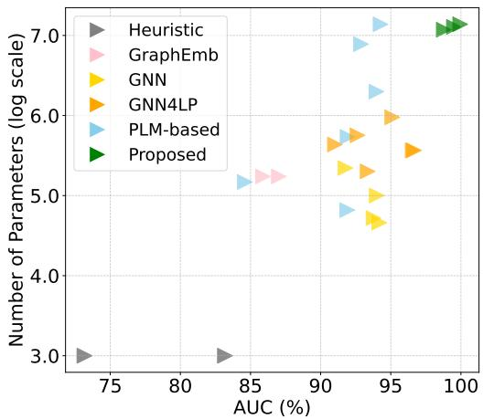  
Fig. 1. Bridge-LP maintains accuracy (x-axis) while improving eficiency (y-axis) by 5% over our most competitive baseline on GNN4LP and PLM-based baselines. §Sec. 4

This research suggests the promise of a cross-modal framework, but the results are generally inconclusive due to two challenges. First, the performance gains rely on impractically expensive models that require jointly encoding pairs of texts with deep LMs and GCNs, greatly increasing the computational cost of inference. For instance, it could range from a few seconds to several hours and scaling from $1 0 ^ { 3 }$ to $1 0 ^ { 7 }$ parameters on the same dataset [6, 8] ( Fig. 1). Second, recent studies consistently demonstrate that the cross-modal framework relying on a large LM does not necessarily improve performance over GNN alone; some preliminary studies also fail to outperform the current state-of-the-art technologies such as BUDDY and NCNC [5, 59, 70].

In this work, we introduce Bridge-LP, a novel cross-modal architecture for link prediction that simultaneously maximizes prediction accuracy (e.g., MRR, AUC, Hits@k) and maintains parameter eficiency and robustness (Fig. 1 and Tabs. 3 to 5). Our approach fuses three complementary graph signals through an MLP: (1) Structural proximity, capturing pairwise neighborhood connectivity; (2) Semantic proximity, encoding edge-level textual or feature semantics; and (3) Propagated proximity, reflecting information aggregated from multi-hop neighbors through message passing. We fuse them through an MLP for link likelihood prediction and further propose three key designs that not only enhance cross-modal learning but also improve model expressiveness: (Design 1) Jumping Connection of Textual Proximity for robust cross-modal training; (Design 2) Compressed Embedding for compressing hidden embeddings; and (Design 3) Cache Embedding Training Strategy for reducing training memory requirements. While variants of these components have been integrated in prior frameworks [3, 54, 56], we are the first to theoretically justify their joint necessity within cross-modal iterative frameworks and validate their efectiveness empirically across diverse datasets.

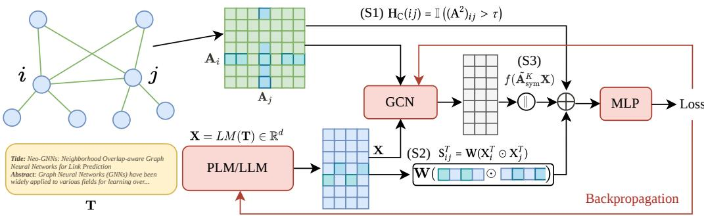  
Fig. 2. Overview of Bridge-LP. The framework consists of three graph signals: S1 Structural proximity from the graph structure (common neighbors, Eq. 1); S2 Semantic proximity from PLM text embeddings; S3 Propagated proximity from GCNs; and the final ste concatenates S1-3 throu h an MLP to erform link rediction.

By leveraging these designs, Bridge-LP is (i) efective, seamlessly integrating text encoders and structural representations end-to-end; (ii) principled, with theoretical guarantees supporting its design principles (D1–D3); and (iii) general, functioning as a plug-and-play alternative to GCNs that integrates trivially with any PLM at no additional computational cost. Our contributions are as follows:

(1) Bridge-LP: An End-to-End Cross-Modal Framework. We propose Bridge-LP, a theoretically motivated and computationally eficient framework that integrates graph and text modalities. Our method integrates three key design components, which together enable richer cross-modal representation learning than existing fusion strategies. (§Sec. 3, Fig. 2)

(2) Theoretical Justification. We provide theoretical justification for the efectiveness of our designs, which collectively enhance learning stability and eficiency, leading to more efective cross-modal representations. Furthermore, we show that they not only improve the performance of Bridge-LP, but also serve as plug-in modules that consistently enhance existing GCN and PLM architectures. (§ Thm. 3.2, Thm. 3.3, Thm. 3.4)

(3) Comprehensive Evaluation and Insights. We empirically evaluate Bridge-LP against over 40 baselines on 9 TAG datasets under consistent experimental settings, establishing a standardized benchmark for link prediction. Bridge-LP achieves state-of-the-art performance across all datasets, yielding up to 43.06% improvement in MRR. Our results highlight the generalization limits of GCNs and demonstrate the benefits of incorporating PLMs. All code, data and benchmarks are publicly available at [TAG4LP]. (§Sec. 4, Tab. 3, Tab. 4)

## 2 Related Work

Our work is related to approaches that fuse LLMs and GNNs for text-attributed graphs, as well as methods for link prediction. We will review these directions next.

LLM-GCN Fusion Approaches for TAGs. Recent research on TAGs has increasingly focused on bridging the gap between the semantic richness of LLMs and the structural modeling capabilities of GCNs. We categorize current approaches based on their text encoders, decoders (e.g., MLP, GCN) and optimization frameworks (e.g., Zero-Shot, Fine-Tune), as summarized in Tab. 1.

Text encoders fall into two broad categories based on parameter scale: (1) Shallow text embeddings: Early preprocessing methods transformed text attributes into statistical features and shallow representations [12, 29]. (2) PLM-based Encoders: These models capture higher-order semantics and generate sentence-level node embeddings. They are typically optimized using robust objectives such as contrastive fine-tuning with hard negatives and domain-adaptive pretraining, which allows for reliable transfer to specialized corpora with minimal supervision.

PLM-based approaches can be grouped into three categories based on their optimization strategy: (a) Zero-Shot (ZS): The PLM is frozen and its pre-generated text embeddings are used as fixed inputs for graph aggregation (e.g., SimTeG [8], GAINT [6], TAPE [13]). (b) Fine-Tuned (FT): The PLM is integrated with the GCN and optimized end-to-end on a specific dataset, as seen in Graphformer [61] and Engine [73]. (c) Instruction-Tuned: Structural knowledge is incorporated into LLMs via prompt- or instruction-based tuning, as in GraphGPT [45] and LinkGPT [14]. A recent line of work also explores injecting graph structure into LLMs at the tokenizer level rather than through prompt/instruction tuning, e.g., the anchor-based node tokenizer of Ji et al. [20]. Additionally, Chen et al. [5] observed that naively combining LLMs and GCNs in an iterative architecture without task-specific design fails to yield meaningful performance gains. We address this gap with Bridge-LP, the first framework to theoretically unify PLM-based semantics with multi-level structural signals, providing a principled and computationally eficient solution. A related but distinct line of work targets dynamic text-atributed graphs, where node/edge structure and text evolve over time: Yu et al. [63] propose a unified architecture and library for dynamic graph learning, Zhang et al. [65] introduce DTGB, a benchmark specifically for dynamic TAGs, and Xu et al. [57] study multi-modal representation learning on dynamic TAGs. Bridge-LP targets the static seting; we discuss how our three signals could be extended to this dynamic seting in §5.

Message Passing in Link Prediction. GCNs are traditionally used to generate initial node embeddings for link prediction, followed by a dot-product decoder [24, 39, 54]. They operate via a message-passing mechanism, in which node representations are iteratively refined by aggregating features from local neighborhoods. However, GCNs have inherent theoretical limitations in distinguishing structurally identical nodes and exhibit limited expressivity in capturing critical pairwise relationships [41, 68]. Methods such as SEAL and NBFNet enable message passing to learn pairwise information specific to each target link [2, 68]. Nevertheless, these approaches incur high training costs, as they require constructing a separate local subgraph and extracting features for every target link. To address this issue,

Table 1. Comparison with existing methods. ✓: public benchmark, ✓: benchmarked model, Zero-Shot: ZS, Fine-Tune: FT
<table><tr><td rowspan="2">Works</td><td colspan="2">ZS</td><td colspan="2">FT</td></tr><tr><td>MLP</td><td>GCN</td><td>MLP</td><td>GCN</td></tr><tr><td>Graphformer [61]</td><td></td><td></td><td></td><td>√</td></tr><tr><td>GAINT [6]</td><td>√</td><td>√</td><td></td><td></td></tr><tr><td>SimTeG [8]</td><td>√</td><td>√</td><td></td><td></td></tr><tr><td>TAPE [13]</td><td></td><td>√</td><td></td><td></td></tr><tr><td>LEADING [58]</td><td></td><td>√</td><td></td><td></td></tr><tr><td>ENGINE [73]</td><td></td><td></td><td></td><td>√</td></tr><tr><td>TEG-DB [25]</td><td>√</td><td>√</td><td></td><td></td></tr><tr><td>Ours</td><td>√</td><td>L</td><td>L</td><td>1</td></tr></table>

recent methods decouple message passing from pairwise information modeling. Representative examples include NCNC [54], which exploits common-neighbor information, as well as BUDDY [2], HL-GNN [66] and Neo-GNN [64], which incorporate heuristic global structural information. Beyond text-atributed benchmarks, link prediction has also been extended to modality-rich recommendation setings, e.g., Wang et al. [52] recently proposed a modality-aware friend-recommendation framework that couples user preferences with heterogeneous signals. Our work aims to enhance the eficiency offeature learning between textual and structural information, without increasing the overall expressivity of existing link prediction frameworks.

## 3 Bridge-LP: A New Eficient, Simple and Theoretically Justified Model

In this section, we present our framework, Bridge-LP. We begin by introducing the three core data signals that underpin Bridge-LP: Structural proximity, Semantic proximity, and Propagated proximity (Sec. 3.1). Next, in Sec. 3.2, we describe our eficient iterative architecture and its three complementary design mechanisms (Fig. 2), which we justify both theoretically and empirically. Finally, in Sec. 3.3, we analyze the computational complexity of Bridge-LP and highlight its eficiency advantages over existing approaches.

## 3.1 Data Signals in Bridge-LP

The data signals in our framework are motivated by the latent space model, a foundational paradigm that has been widely adopted across disciplines such as sociology and statistics [15]. The latent space model provides a principled interpretation of graph formation, where edge probabilities are governed by distances between nodes embedded in an unobserved metric space. Within this framework, prior work establishes quantitative links between observable graph signals and latent distances. In particular, Hof et al. [15] shows that the number of common neighbors between two nodes tightly bounds their latent distance. More recently, Mao et al. [27] demonstrates that when higher- and lower-order structural signals are absent, node feature similarity, quantified by feature dot products, dominates latent distance estimation. In this regime, they further prove that the common-neighbor count becomes, with high probability, negatively correlated with feature proximity, revealing an intrinsic tension between structural and feature-based signals in latent graph models.

Guided by these theoretical connections, we define three complementary data signals that serve as proxies for latent relationships: Our approach fuses three complementary graph signals through an MLP: (S1) Structural proximity, capturing local graph structure; (S2) Semantic proximity, encoding node-level textual semantics; and (S3) Propagated proximity, which goes beyond 1-hop neighborhoods and measures how similarity difuses through multi-hop connections. We present each one in more detail below.

(S1) Structural proximity We utilize a thresholded indicator of Common Neighbors, a first-order structural feature that solely utilizes graph topology:

$$
\begin{array} { r } { \mathbf { H } _ { \mathrm { C } } ( i j ) = \mathbb { I } \left( ( \mathbf { A } ^ { 2 } ) _ { i j } > \tau \right) , } \end{array}\tag{1}
$$

where $\mathbf { A } \in \{ 0 , 1 \} ^ { n \times n }$ is the binary adjacency matrix, I is the indication function, and � is a hard threshold to retain stronger connections [31, 54]. � denotes the CN threshold introduced. We follow Wang et al. [54] in adopting the thresholded indicator form. Thresholding to a binary indicator (i) helps remove noisy edges introduced by spurious connections, and (ii) removes the hub bias that arises when two nodes are connected only through a shared global hub, which would otherwise mislead the prediction. We report its sensitivity in Sec. 4.4.

(S2) Semantic proximity. The second signal captures the semantic proximity between nodes based on their textual content alone. The intuition is that similar nodes exhibit high similarity in their language representations, even without explicitly considering the graph structure. Let T, $\mathbf { X } ^ { T } = \operatorname { P L M } ( \mathbf { T } )$ represent the raw text and embedded text features from a pretrained language model. PLM utilizes Transformer backbone to extract deep linguistic features by modeling intra-node dependencies. The intuition is that similar nodes exhibit high similarity in their language representations, even without explicitly considering the graph structure. The semantic proximity between node pair (�, �) is defined as:

$$
\mathbf { S } _ { i j } ^ { T } = \mathbf { W } ( \mathbf { X } _ { i } ^ { T } \odot \mathbf { X } _ { j } ^ { T } ) ,\tag{2}
$$

where W is a learned weight matrix and the operator ⊙ denotes the Hadamard product. Compared to fixed similarity measures such as cosine similarity [62], this learnable formulation allows the model to adaptively weight semantic dimensions that are most predictive of latent relationships[53].

(S3) Propagated proximity. While structural and semantic (feature) proximity primarily capture local or pairwise relationships, they may overlook higher-order dependencies that emerge through multi-hop interactions. To address this, we introduce the propagated proximity signal, which captures how node similarity evolves as information difuses through the graph. This signal reflects the intuition that even if two nodes are not directly connected, their embeddings may become more aligned after several rounds of message passing, analogous to reduced latent distances through indirect ties. It is especially useful in capturing the information of similar neighbors when the structure exhibits homophily [21, 23].

Empirically, S3 remains consistently beneficial across all our TAG benchmarks — every Hits@50 / MRR / AUC cell in Tab. 6 improves when S3 is included; see §4.4 for the full comparison of Bridge-LP with and without S3 across all nine metrics. Formally, we propagate the input features over � steps using a symmetrically normalized adjacency matrix with self-loops:

$$
\mathbf { H } ^ { K } = f ( \tilde { \mathbf { A } } _ { \mathrm { s y m } } ^ { K } \mathbf { X } ) ,\tag{3}
$$

where $\mathbf { H } ^ { K }$ represents the final embedding from GCN in iteration �, $\tilde { \mathbf { A } } _ { s y m } = ( \mathbf { D } + \mathbf { I } ) ^ { - \frac { 1 } { 2 } } ( \mathbf { A } + \mathbf { I } ) ( \mathbf { D } + \mathbf { I } ) ^ { - \frac { 1 } { 2 } }$ is the symmetrically normalized adjacency matrix with self-loops, I is the identity matrix and D is diagonal degree matrix.

## 3.2 Bridge-LP: Eficient Iterative Architecture

Bridge-LP is a lightweight iterative architecture that integrates the three complementary signals introduced in the previous section through a unified cross-modal framework. To efectively exploit these signals while maintaining eficiency, Bridge-LP incorporates three design mechanisms (D1-D3) that enhance the base architecture. We first present the vanilla framework that forms the backbone of the model, and subsequently describe how these designs further improve its efectiveness and eficiency.

The vanilla Bridge-LP framework combines the three data signals using simple linear transformations followed by component-wise nonlinearities, avoiding heavy fusion mechanisms. Concretely, the final prediction is computed as

$$
{ \displaystyle { \bf Y } = { \bf M } { \bf L } { \bf P } \left( [ { \bf H } ^ { K } ; \beta { \bf H } _ { C } ; { \bf S } _ { T } ] \right) } ,\tag{4}
$$

where [ · ; · ] denotes concatenation and Y represents the model output, $\beta$ is the weight for threshold common neighbor. Figure 2 provides a high-level illustration of the overall architecture, while Algorithm 1 summarizes the corresponding inference procedure. Notably, the architecture is intentionally simple: each signal is computed independently and fused only at the final stage, which avoids expensive intermediate interactions and enables eficient deployment. Building upon this backbone, we introduce three complementary designs (D1-D3) that further improve robustness across diverse settings while substantially reducing memory overhead.

3.2.1 D1: Jumping Connection of Textual Proximity. We propose design D1, a bypass connection that routes textual information directly to the final embeddings, as illustrated in Fig. 2. By acting as a semantic highway, D1 preserves the raw nuances of the PLM and ensures that the supervision signal from the loss function is efectively backpropagated to the language model. This design enables the PLM to be optimized more robustly and eficiently within the cross-modal framework by maintaining a direct gradient flow from the loss objective to the textual representations.

To justify this design theoretically, we utilize a quantitative measure, the influence score (Thm. 3.1), which characterizes how the PLM parameters afect the final likelihood objective. This notion is inspired by influence functions in statistics [22]. Using this metric, we analyze the sensitivity of the link likelihood objective with respect to the PLM parameters, and show that D1 systematically strengthens this sensitivity.

Definition 3.1 (Influence Score). Let x denote the input text feature, z the hidden representation at an intermediate layer and $\mathbf { y } \in \mathbb { R } ^ { | \mathcal { V } | \times d }$ the final node embeddings before the decoder. Let $\mathbf { h } ^ { ( 0 ) }$ and $\mathbf { h } ^ { ( k ) }$ denote the node representations at the input and the �-th layer, respectively. We define the influence score of the initial text embedding of node � on the final embedding of node � as

$$
I _ { x } ( y ) = \frac {  \mathbf { e } ^ { \top } | \frac { \partial \mathbf { h } _ { y } ^ { ( k ) } } { \partial \mathbf { h } _ { x } ^ { ( 0 ) } } | \mathbf { e } } { \sum _ { z \in \mathcal { V } } \mathbf { e } ^ { \top } | \frac { \partial \mathbf { h } _ { z } ^ { ( k ) } } { \partial \mathbf { h } _ { x } ^ { ( 0 ) } } | \mathbf { e } } ,
$$

where |·| denotes element-wise absolute value and e is the all-ones vector of compatible dimension.

Theoretical Justification. We show that integrating D1: jumping connection of textual proximity in the cross-modal framework, which directly links PLM text embeddings to the final loss, leads to a higher influence score compared to a configuration without it. We analytically compare the influence scores of the PLM parameters with and without D1 in Thm. 3.2. The complete proof is provided in Sec. A.

Theorem 3.2 (Influence Enhancement). Let $\mathbf { h } _ { v } ^ { ( 0 ) } \in \mathbb { R } ^ { d }$ denote the initial embedding ofnode � produced by the PLM, and ${ \bf h } ^ { ( k ) } = f ( { \bf h } ^ { ( 0 ) } , \mathcal { G } )$ denote the output of a �-layer GCN, where � is continuously diferentiable. Then, for any nodes �, $y \in \mathcal { V } ,$ , the influence score defined in Thm. 3.1 satisfies $I _ { \mathrm { w i t h } \ : D _ { 1 } } ( x , y ) = I _ { \mathrm { w i t h o u t } \ : D _ { 1 } } ( x , y ) f o r y \neq x ,$ while on the PLM-direct (self) path

$$
I _ { \mathrm { w i t h } D _ { 1 } } ( x , x ) \geq I _ { \mathrm { w i t h o u t } D _ { 1 } } ( x , x )
$$

, with a strict increase of $\| B \| _ { 1 } > ~ 0$ whenever $B \neq 0$ and the bypass does not cancel the existing self-path (entrywise sign-compatibility $J _ { i } B _ { i } \ge 0$ , where $J = \partial \mathbf { h } _ { x } ^ { ( k ) } / \partial \mathbf { h } _ { x } ^ { ( 0 ) }$ and � is the trainable bypass matrix ofdesign D1). See Thm. A.1 in Appendix A.

We show that incorporating D1, bypass connection strictly increases the influence term � of the final link prediction loss on the PLM embeddings. The increased influence score ensures that the PLM receives suficiently strong gradients to adapt its semantic knowledge specifically for the link prediction task.

Observations. To empirically validate the efectiveness of design D1, we conduct an ablation study of Bridge-LP with and without D1, as illustrated in Fig. 3. We observe that Bridge-LP (i.e., models equipped with design D1) consistently achieves higher link prediction performance than those without it. It increases the AUC by up to 6% on Cora and by 4% and 6.8% on Pubmed and Arxiv\_2023 respectively. Although Thm. 3.2 is derived under specific assumptions, our empirical results demonstrate that its conclusions hold broadly in practice.

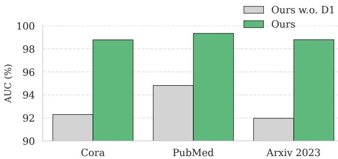  
Fig. 3. Ablation study of D1. Comparison of link prediction performance (AUC) with and without the proposed bypass connection. Across three benchmark datasets, the absence of D1 results in a performance degradation of 4%–6.8%, validating its role in facilitating efective radient flow and preservin PLM semantic nuances.

3.2.2 D2: Compressed Embedding. The core objective of design D2 is to mitigate the high-dimensionality requirement inherent in the vanilla framework (Sec. 3.2), where the hidden dimension � scales linearly with the number of vertices (|V|). The underlying principle of D2 lies in the near-orthogonality between the structural proximity signal S1 $\left( \mathbf { H } _ { C } \right)$ and the semantic proximity signal S2 $( \mathsf { S } _ { T } )$ , where their non-zero elements exhibit minimal overlap [27]. Given that the non-zero entries of $\mathbf { H } _ { C }$ and ${ \bf S } _ { T }$ are largely disjoint, transitioning from the high-dimensional concatenation used in the vanilla framework to an additive form is efectively lossless. D2 reduces the hidden dimension from $d = \vert \mathbf { H } ^ { K } \vert + \vert \mathcal { T } \vert + \vert \mathcal { V } \vert$ (as introduced in vanilla framework Sec. 3.3) to $d = \vert \mathbf { H } ^ { K } \vert + 1$ . Summing these signals is approximately equivalent to blending information from separate channels into a single dense tensor without significant signal interference.

Theoretical Justification. We provide a theoretical explanation for why the structural signal H� and the semantic signal ${ \bf s } _ { T }$ can be compressed into a substantially lower-dimensional representation while preserving the information relevant for link prediction. Our analysis is conducted under a standard latent space model [36], where each of the $N$ nodes is associated with an �-dimensional latent position. We assume that link formation is governed by two complementary mechanisms. If two nodes are suficiently close in the latent structural space, their connection probability is primarily determined by structural proximity, resulting in similar common-neighbor paterns. Otherwise, when structural proximity is weak, semantic proximity becomes the dominant factor, allowing structurally distant but semantically similar nodes to form links. This assumption is consistent with empirical observations on widely used benchmark graphs [27]. Under this seting, we show that the joint structural-semantic signal admits a compac representation with negligible information loss.

Proposition 3.3 (Lossless Additive Compression of $\mathbf { H } _ { C }$ and ${ \sf S } _ { T } )$ . For each node pair $^ { a , }$ let ${ \bf h } ^ { a } \ = \ [ { \bf H } _ { C } ] _ { a }$ and $\mathbf { s } ^ { \alpha } = [ \mathsf { S } _ { T } ] _ { \alpha }$ , with $z _ { \mathrm { c a t } } ^ { a } = ( \mathbf { h } ^ { a } , \mathbf { s } ^ { a } )$ and $z _ { \mathrm { s u m } } ^ { \alpha } = \mathbf { h } ^ { \alpha } + \mathbf { s } ^ { \alpha }$ . For any node pairs �, $b ,$

$$
| \langle z _ { \mathrm { s u m } } ^ { a } , z _ { \mathrm { s u m } } ^ { b } \rangle - \langle z _ { \mathrm { c a t } } ^ { a } , z _ { \mathrm { c a t } } ^ { b } \rangle | ~ \leq ~ | \langle { \bf h } ^ { a } , { \bf s } ^ { b } \rangle | + | \langle { \bf s } ^ { a } , { \bf h } ^ { b } \rangle | .
$$

Thus, the Gram matrices induced by summation and concatenation coincide when the structural and semantic signals have disjoint supports, making the compression lossless for inner-product-based predictors. More generally, the distortion is controlled by their cross-signal overlap. Since structural and semantic proximity rarely co-occur strongly [27, 36], this overlap is typically small in practice (Fig. 4), motivating additive compression with negligible information loss.

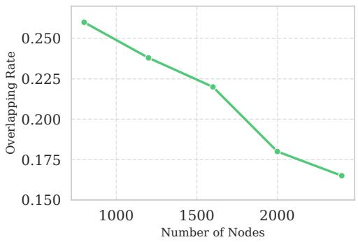

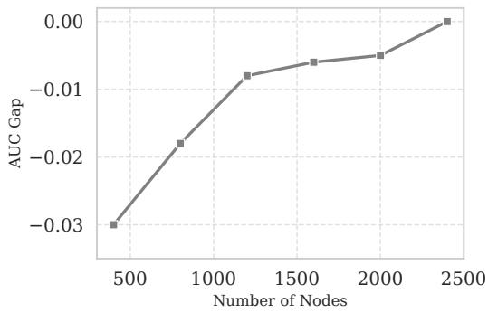  
Fig. 4. Left: Overlapping rate between $\mathbf { H } _ { C }$ and $\mathsf { s } _ { T } ;$ Right: AUC gap between models with and without compression. The results show that $\mathbf { H } _ { C }$ and S� are approximately compressive and that the framework equipped with D2 converges to a similar performance level as the non-compressed variant.

Observations. In our empirical analysis, we define the overlapping rate to quantify the overlap of non-zero elements. As illustrated in Fig. 4 (left), overlapping rate decays approximately linearly as a function of the number of sampled vertices |V |. Furthermore, we evaluate the performance gain of the D2 component by defining the $A U C \ g a p \colon \Delta _ { \mathrm { A U C } } =$ $\mathrm { A U C } ( M _ { \mathrm { w i t h { D 2 } } } ) - \mathrm { A U C } ( M _ { \mathrm { w i t h o u t { D 2 } } } )$ . As shown in Fig. $4 ( \mathrm { r i g h t } ) , \Delta _ { \mathrm { A U C } }$ converges toward zero as $| \mathcal { V } _ { s } |$ increases. This indicates that the proposed summation achieves equivalent predictive performance as the vanilla framework, but with substantially reduced computational complexity.

3.2.3 D3: Cache Embedding Training Strategy. The third design, D3, addresses the significant computational and memory overhead inherent in generating initial node features for GCN-based architectures. In a joint training setting, these features act as a critical representational bridge between the PLM and the GCN. As established in our complexity analysis, encoding these features requires $O ( | \mathcal { V } | \times | \mathcal { T } | \times d )$ per training step. Unlike traditional approaches that keep the PLM frozen to bypass this cost, our method maintains the trainability of both components, necessitating a more eficient integration strategy. In D3, we adopt a dynamic cache-embedding strategy. For each minibatch of edges, we utilize the PLM to encode only the vertices involved in those specific edges, while replacing the features of all other nodes with cached embeddings. Mechanically, we first initialize a global feature matrix $\mathbf { X } \in \mathbb { R } ^ { | \mathcal { V } | \times d }$ by pre-computing all node embeddings via the PLM and storing them in a persistent cache. During each training iteration, we perform a live re-encoding only for the textual descriptions of the active nodes (�, �) in the current mini-batch. The input feature matrix for the GCN is then constructed by substituting the stale cached vectors with these fresh, gradient-carrying embeddings:

$$
{ \bf X } _ { i n } = \mathrm { C o n c a t } ( { \bf X } _ { c a c h e \backslash \{ i , j \} } , { \bf h } _ { i } , { \bf h } _ { j } )\tag{5}
$$

where h and ${ \bf h } _ { j }$ represent the real-time PLM outputs. This strategy reduces the per-batch encoding complexity from $O ( | \mathcal { V } | | \mathcal { T } | d )$ to $O ( b | \mathcal { T } | d )$ (where � is the batch size), efectively decoupling the PLM’s computational load from the total graph size. While cached embeddings have been explored in general GNN contexts [10, 54], our implementation specifically optimizes this mechanism within the D3 architecture to facilitate scalable, end-to-end PLM-GCN integration. Theoretical Justification. The validity of D3 rests on the fact that while cached embeddings are technically "stale" $( \mathrm { i . e . } ,$ computed using PLM parameters from previous iterations), they remain a high-fidelity approximation of the current PLM state. We show that D3 provides a provably controlled approximation to full-parameter PLM updates by bounding the staleness error. Specifically, for any node pair (�, �), the discrepancy between the true gradient (obtained via full re-encoding) and the D3 gradient depends on how recently the nodes in $\mathcal { V } \setminus \{ i , j \}$ were updated in the cache. The resulting cache error is governed by how far the PLM parameters have drifted since each node was last refreshed; it stays small when late-training updates are small or the cache is periodically refreshed, so the cached feature matrix X closely tracks the representation that the current PLM parameters would produce. We theoretically justify this in Thm. 3.4.

Theorem 3.4 (Gradient Staleness Bound for D3). Let ${ \boldsymbol g } _ { t } ^ { \mathrm { f u l l } }$ and $g _ { t } ^ { \mathrm { c a c h e } }$ denote the gradients with respect to the GCN/predictor parameters $\phi$ underfull PLM re-encoding and the D3 cache-embedding scheme at iteration �. Under a Lipschitz PLM encoder and a standard smoothness assumption on the feature-to-gradient map (assumptions $( A 1 ) - ( A 2 )$ in Appendix C),

$$
\lVert g _ { t } ^ { \mathrm { f u l l } } - g _ { t } ^ { \mathrm { c a c h e } } \rVert \leq C \sum _ { v \in \mathcal { V } } \lVert \theta _ { t } - \theta _ { r _ { v } ( t ) } \rVert ,
$$

where $r _ { v } ( t )$ is the last iteration at which node � was refreshed and� is a constant. Hence the error is uniformly bounded under a bounded step size with periodic refresh, and vanishes as training converges (summable updates) provided every node keeps being refreshed. See Thm. C.1 in Appendix C

Remark. The discrepancy is governed by cache staleness, the parameter drift since each node’s last refres, rather than by node coverage alone: it stays controlled when late-training updates shrink or the cache is periodically refreshed, so after suficient training the D3 gradient is practically indistinguishable from the full re-encoding gradient and the optimization trajectory remains stable despite stale embeddings.

## 3.3 Time Complexity of Bridge-LP

The overall computational complexity of Bridge-LP is determined by two components: the Transformer backbone (detailed in S2) and the graph message-passing module. For the Transformer, each of the � layers consists of a feedforward sub-layer with cost $O ( | \mathcal { T } | d ^ { 2 } )$ and a self-attention sub-layer with cost $O ( | \mathcal { T } | ^ { 2 } d )$ , where $| \mathcal T |$ is the token length per node and � is the hidden dimension, giving a total of� � $( | \mathcal { T } | d ^ { 2 } + | \mathcal { T } | ^ { 2 } d ) )$ . The graph message passing adds $O ( d | \mathcal { E } | )$ where |E | is the number of edges. Thus, the overall runtime complexity is

$$
O ( d ^ { 2 } | \mathcal { T } | + d | \mathcal { T } | ^ { 2 } + d | \mathcal { E } | ) .
$$

The memory footprint follows a similar decomposition: storing feed-forward activations requires $O ( l | { \mathcal { T } } | d ) .$ attention matrices require $O ( l ( | \mathcal { T } | ^ { 2 } + | \mathcal { T } | d ) )$ and message passing requires �(�|E |), leading to a total memory complexity of

$$
O \big ( l \big ( | \mathcal { T } | d + | \mathcal { T } | ^ { 2 } \big ) + d | \mathcal { E } | \big ) .
$$

In both cases, the dominant terms depend on the trade-of between token length and graph sparsity: the quadratic attention term dominates for long token sequences, whereas the message-passing term dominates for dense graphs.

## 4 Empirical Evaluation

In our empirical analysis, we evaluate the performance of Bridge-LP on nine text-attributed graphs to address the following research questions:

RQ1: On widely-used TAG benchmarks, where all existing GCN-based approaches are fairly compared, does Bridge-LP with integrated text modality improve link prediction performance?

Manuscript submitted to ACM

RQ2: Compared with existing PLM-based approaches, does Bridge-LP equipped with D1–D3 enhance graph structure learning?

RQ3: Does Bridge-LP scale eficiently while consistently improving performance?

RQ4: What is the impact of three data signals, LLM choices and LLM scales?  
Table 2. Graph statistics of the benchmark datasets across diferent scales. We use commonly used datasets Cora, Pubmed and Arxiv\_2023 for RQ1-3, and larger datasets for RQ4. The last two rows show the minimum and maximum text lengths (in tokens) and the total number of data points (in millions) for each dataset.
<table><tr><td></td><td>Pwc_small</td><td>Cora</td><td>PubMed</td><td>Arxiv_2023</td><td>History</td><td>Photo</td><td>Pwc medium</td><td>Ogbn_arxiv</td><td>Citationv8</td></tr><tr><td>#Nodes |V|</td><td>140</td><td>2708</td><td>19717</td><td>46198</td><td>36655</td><td>47420</td><td>86795</td><td>169343</td><td>1106759</td></tr><tr><td>#Edges |ε|</td><td>798</td><td>10858</td><td>88648</td><td>77726</td><td>496248</td><td>872602</td><td>933411</td><td>2315598</td><td>12227452</td></tr><tr><td>File Size (Mb)</td><td>0.139</td><td>2.57</td><td>31.01</td><td>57.26</td><td>57.12</td><td>37.44</td><td>99.58</td><td>190.27</td><td>1034.18</td></tr><tr><td>#Split</td><td>R</td><td>R</td><td>R</td><td>R</td><td>R</td><td>R</td><td>R</td><td>R</td><td>R</td></tr><tr><td>Min-Max Length</td><td>79-293</td><td>8-929</td><td>4-994</td><td>7-1617</td><td>42-329</td><td>4-7281</td><td>16-610</td><td>20-2214</td><td>4-774</td></tr><tr><td>Data Points (M)</td><td>0.139</td><td>2.57</td><td>31.01</td><td>57.26</td><td>42.16</td><td>37.44</td><td>99.58</td><td>190.27</td><td>1034.18</td></tr></table>

## 4.1 RQ1: Comparison with GCN-based Approaches

First, we assess the performance of Bridge-LP and compare it to strong baselines of structure-agnostic approaches on three widely-used text-attributed graphs.

4.1.1 Empirical Setup for RQ1. Datasets. We begin with a thorough benchmark on Cora, Pubmed and Arxiv\_2023 [16] (see Tab. 3) to provide a fair comparison with existing GCN-based approaches.

Benchmarked Approaches. We consider all methods listed in Tab. 3, which encompass five major categories: 1) Graph Heuristics: Local heuristics leverage shared neighborhood information, including Common Neighbor (CN), Adamic-Adar (AA) and Resource Allocation (RA), while global heuristics consider all paths between connected nodes, such as Katz, Shortest Path and symmetric PageRank [1, 32]. 2) Knowledge Graph Embeddings: Approaches such as RotatE [42], TransE [69], ComplEx [48] and DistMult [60] represent entities and relations as embeddings in a continuous vector space, where relational reasoning is performed through translation or bilinear transformations. 3) Structure-based Methods: These focus on proximity-preserving embeddings that model neighborhood contexts via random walks, including DeepWalk, Node2Vec and LINE [9, 33, 44]. 4) Aggregation-based Methods: Under the GCN paradigm, we consider GCN [21], GAT [49], SAGE [11] and GIN [55]. 5) GCN4LP: SEAL, BUDDY and ELPH are specifically designed for link prediction, enhancing GCNs’ ability to capture pairwise local structures through various labeling techniques and structural embeddings as auxiliary node features [2, 67, 68]. NCNC further leverages triadic closure to mitigate distribution shifts introduced by feature-specific data splitting methods [54].

Hyperparameter Settings. We conduct an extensive hyperparameter tuning based on hierarchical grid search across all models listed in Tab. 3. Tuning parameters include all existing parameters in the optimizer and GCN, namely learning rate, weight decay, the number of convolution layers, MLP layers, the number of heads in GAT, hidden neurons and beyond. We provide more details about hyperparameter tuning in the Sec. F.

Metrics & Dataset Split. We utilize structure-sensitive metrics including Hits@50, Hits@100 and MRR (Mean Reciprocal Rank). Hits@K quantifies the ratio of positive edges ranked within the top K positions, while MRR evaluates the model’s ability to rank positive above negative ones. We apply a uniform random split of 80%, 15% and 5% across all graphs. All metrics are reported as the mean and standard deviation, averaged over five random seeds. We exclude the target link (link to be predicted) in each mini-batch.

4.1.2 Results. In Tab. 3, Bridge-LP significantly outperforms established baselines, including the competitive NCNC method, with improvements of up to 5.72% on Arxiv 2023 (Hits@100). On Pubmed, Bridge-LP achieves a 4.75% improvement in Hits@50 over the strongest prior model, GIN. On Cora, our method outperforms the second-best PageRank by 9.57% in MRR. Across nine comparative experiments, Bridge-LP surpasses eight diferent state-of-the-art approaches. These results afirm the efectiveness of fusing text modalities with GCN within an iterative architecture. Although other GCN-based methods also show a certain level of competitiveness (NCNC, NCN, PageRank, SEAL), Bridge-LP consistently provides performance improvements across all datasets. This demonstrates the necessity of integrating language embeddings with graph structure.

## 4.2 RQ2: Comparison with PLM-based Approaches

Next, we compare Bridge-LP ’s performance with PLM-based approaches on the link prediction task, where the objective is to retrieve relevant conceptual embedding that enhances structural learning in TAGs

4.2.1 Empirical Setup for RQ2. Datasets & Metrics. We use the same datasets, data splits and evaluation metrics as described in Sec. 4.2.

Benchmarked Approaches. We consider two common frameworks for PLMs: Zero-Shot and Fine-Tuning. In the Zero-Shot setting, the PLM is directly applied to downstream tasks without additional training, relying on its pretrained knowledge to generalize across domains. In contrast, Fine-Tuning adapts the PLM to a specific task through gradientbased optimization on labeled data.

We group the methods into four categories based on their choice of decoder (�∗) and training framework (�∗) in Tab. 4: 1) ZS-MLP treats the PLM as a frozen feature extractor, using the generated text embeddings as input for binary link prediction. 2) FT-MLP fine-tunes the final encoder layers of the PLM jointly with the MLP [4]. 3) ZS-GCN leverages PLM-generated text embeddings as node features for a GCN, while keeping the PLM parameters frozen during training [8, 25]. 4) FT-GCN jointly optimizes both the PLM and GCN parameters within a cross-modal framework, following approaches similar to [58, 73].

Table 3. Comparison with GCN-agnostic approaches. Mean ± Standard deviation of Bridge-LP for Hits@50, Hits@100, and MRR metrics across 5 random splits on three commonly used datasets. The top 1-2 ranked models are highlighted in emerald. For more results, please refer to the Sec. G.
<table><tr><td rowspan="2">Category</td><td rowspan="2">Models</td><td colspan="3">Cora</td><td colspan="3">PubMed</td><td colspan="3">Arxiv 2023</td><td></td></tr><tr><td>Hits@50</td><td>Hits@100</td><td>MRR</td><td>Hits@50</td><td>Hits@100</td><td>MRR</td><td>Hits@50</td><td>Hits@100</td><td>MRR</td><td>Rank</td></tr><tr><td rowspan="4">Embedding</td><td>RotatE</td><td>27.51±6.39</td><td>56.60±6.29</td><td>2.98±0.41</td><td>26.10±2.89</td><td>38.58±2.59</td><td>4.41±1.24</td><td>24.76±1.31</td><td>34.57±0.84</td><td>5.65±1.20</td><td>23</td></tr><tr><td>TransE</td><td>32.17±6.52</td><td>57.00±7.06</td><td>3.97±0.90</td><td>38.58±3.64</td><td>50.04±2.63</td><td>7.74±1.71</td><td>21.27±1.81</td><td>30.22±1.96</td><td>5.11±1.16</td><td>22</td></tr><tr><td>ComplEx</td><td>62.53±1.71</td><td>73.59±0.90</td><td>17.82±2.58</td><td>38.14±3.55</td><td>53.87±3.09</td><td>6.50±2.48</td><td>22.33±1.05</td><td>32.17±2.38</td><td>5.16±1.07</td><td>19</td></tr><tr><td>DistMult</td><td>64.90±1.59</td><td>73.12±0.28</td><td>19.28±2.11</td><td>39.09±3.93</td><td>54.82±2.95</td><td>6.90±2.50</td><td>21.32±0.45</td><td>32.37±1.62</td><td>5.02±1.24</td><td>17</td></tr><tr><td rowspan="3">Heuristic</td><td>CN</td><td>50.36±0.03</td><td>50.36±0.03</td><td>32.88±0.09</td><td>33.32±0.02</td><td>33.32±0.02</td><td>21.13±0.02</td><td>27.20±0.01</td><td>27.20±0.01</td><td>14.66±0.06</td><td>21</td></tr><tr><td>AA</td><td>50.36±0.03</td><td>50.36±0.03</td><td>47.33±0.09</td><td>33.32±0.02</td><td>33.32±0.02</td><td>24.61±0.11</td><td>27.20±0.01</td><td>27.20±0.01</td><td>19.87±0.30</td><td>18</td></tr><tr><td>RA</td><td>50.36±0.03</td><td>50.36±0.03</td><td>47.17±0.11</td><td>33.32±0.02</td><td>33.32±0.02</td><td>23.94±0.16</td><td>27.20±0.01</td><td>27.20±0.01</td><td>19.16±0.27</td><td>20</td></tr><tr><td rowspan="4">Structure</td><td>PPR/sym</td><td>84.74±0.00</td><td>88.93±0.00</td><td>58.86±0.98</td><td>69.81±0.02</td><td>72.95±0.01</td><td>28.04±0.91</td><td>65.68±0.02</td><td>67.86± 0.02</td><td>26.57±0.82</td><td>6</td></tr><tr><td>Katz</td><td>69.25±0.02</td><td>69.25±0.02</td><td>38.17±0.12</td><td>66.02±0.02</td><td>66.02±0.02</td><td>30.94±0.08</td><td>55.39±0.01</td><td>55.39± 0.01</td><td>21.76±0.21</td><td>14</td></tr><tr><td>DeepWalk Node2Vec</td><td>84.00±0.07</td><td>89.31±0.03</td><td>44.39±0.96</td><td>64.35±0.01</td><td>71.78±0.01</td><td>19.66±1.00</td><td>21.37±0.11</td><td>33.80± 0.10</td><td>4.47±0.03</td><td>16</td></tr><tr><td></td><td>83.08±0.05</td><td>88.38±0.03</td><td>39.94±1.10</td><td>63.95±0.02</td><td>70.95±0.01</td><td>20.68±0.24</td><td>30.19±0.18</td><td>40.81± 0.20</td><td>5.60±0.03</td><td>15</td></tr><tr><td rowspan="4">GCNs</td><td>GCN</td><td>91.46±2.36</td><td>96.20±1.71</td><td>45.84±8.40</td><td>83.11±2.19</td><td>89.59±1.73</td><td>24.55±4.02</td><td>45.07±0.87</td><td>52.46± 1.44</td><td>17.62±3.34</td><td>10</td></tr><tr><td>GAT</td><td>89.80±2.00</td><td>95.34±1.61</td><td>49.82±10.04</td><td>74.23±2.54</td><td>84.03±1.59</td><td>18.13±5.81</td><td>43.09±1.22</td><td>53.49± 1.06</td><td>13.58±4.33</td><td>13</td></tr><tr><td>SAGE GIN</td><td>86.40±3.73</td><td>95.10±1.57</td><td>46.03±6.70</td><td>86.55±0.55</td><td>93.36±0.70</td><td>31.66±5.33</td><td>45.42±3.12</td><td>56.69± 3.13</td><td>11.52±1.67</td><td>8</td></tr><tr><td></td><td>91.54±2.91</td><td>96.05±2.13</td><td>51.90±6.65</td><td>86.92±1.68</td><td>92.02±0.91</td><td>24.63±2.24</td><td>45.35±2.58</td><td>53.22± 2.05</td><td>14.79±4.53</td><td>9</td></tr><tr><td rowspan="8">GCN4LP</td><td>SEAL</td><td>87.38±3.06</td><td>92.03±2.96</td><td>37.81±9.93</td><td>84.62±3.53</td><td>89.52±1.27</td><td>49.02±13.91</td><td>56.98±1.89</td><td>67.34± 3.74</td><td>22.47±3.69</td><td>5</td></tr><tr><td>NeoGNN</td><td>81.03±3.11</td><td>90.04±2.02</td><td>41.48±5.11</td><td>73.17±5.29</td><td>81.25±8.14</td><td>31.44±3.85</td><td>64.54±11.14</td><td>69.34± 8.56</td><td>28.07±15.62</td><td>7</td></tr><tr><td>ELPH</td><td>87.30±4.94</td><td>94.91±2.17</td><td>39.86±10.20</td><td>59.19±5.58</td><td>74.62±1.64</td><td>24.61±3.17</td><td>57.66±1.55</td><td>66.95± 3.62</td><td>29.22±5.95</td><td>11</td></tr><tr><td>BUDDY</td><td>87.82±3.14</td><td>95.42±2.26</td><td>30.78±5.55</td><td>76.14±3.46</td><td>89.25±2.27</td><td>19.46±2.42</td><td>52.25±2.01</td><td>60.49± 0.94</td><td>18.75±3.71</td><td>12</td></tr><tr><td>HL-GNN</td><td>90.59±3.41</td><td>94.62±1.87</td><td>50.35±10.07</td><td>85.14±1.83</td><td>91.87±1.36</td><td>31.49±7.84</td><td>76.51±1.68</td><td>84.23±0.82</td><td>24.21±7.69</td><td>4</td></tr><tr><td>NCN</td><td>96.16±1.62</td><td>98.74±0.96</td><td>45.76±16.39</td><td>86.44±2.03</td><td>93.21±1.10</td><td>25.92±4.33</td><td>82.34±2.45</td><td>88.83± 1.43</td><td>37.92±13.21</td><td>2</td></tr><tr><td>NCNC</td><td>95.42±2.41</td><td>98.67±0.76</td><td>48.68±18.60</td><td>86.49±0.99</td><td>93.74±0.25</td><td>20.31±6.51</td><td>81.86±1.64</td><td>89.13± 2.08</td><td>35.67±12.30</td><td>3</td></tr><tr><td></td><td>mpnet-BRIDGE-LP 99.92±0.18</td><td>99.92±0.18</td><td>68.43±14.23</td><td>91.67±4.96</td><td>97.13± 1.74</td><td>35.63±5.75</td><td>89.17±5.45</td><td>94.85±3.15</td><td>45.70±3.88</td><td>1</td></tr></table>

Manuscript submitted to ACM

Choices and Implementation of PLM. Our study incorporates a diverse set of PLM architectures, including encoderonly models BERT [7] and sentence transformers such as MPNet [40], e5-large-v2 [51] and MiniLM-L6-v2 [34]. Additionally, we include Meta-LLaMA-3-8B [47] as a case study for large-scale text embedding. These five backbones are chosen to s an the three dominant PLM architecture families (encoder-onl , sentence-transformer, decoder-onl ) across two orders of magnitude in parameter count, rather than to exhaustively benchmark the latest embedding models; Fig. 6b confirms erformance scales consistentl with size within each famil isolatin architecture-famil efects from raw scale. For consistency and comparability with prior work, we also evaluate shallow embedding methods, including bag-of-words [12] and Word2Vec [29]. We leverage the [EOS] token in LLaMA3 and the [CLS] token in sentence embedding models (MPNet [40], e5-large-v2 [51] and MiniLM-L6-v2 [34]) as node features. We froze the layer up to the 6-th encoder layer in MiniLM [34]; up to the 32-nd layer in Llama3 [47]; up to the 12-th encoder layer in BERT and up to the 23rd encoder layer in e5-large [51].

Hyperparameter Tuning. We utilize hierarchical grid search for learning rate, weight decay, feature dimensions and MLP layers for the model listed in Tab. 4. We provide more details about hyperparameter tuning in the Sec. F.

4.2.2 Results. Bridge-LP consistently outperforms all benchmarked approaches. On Cora, under the MRR metric, Bridge-LP outperforms the best baseline, MiniLM-NCNC, by up to 43.06%. For the Hits@K metric, Mpnet-Bridge-LP surpasses the strongest baseline, ZS-GCN, by a maximum margin of 2%. Furthermore, our Bridge-LP consistently achieves state-of-the-art results, reaching nearly perfect Hits@50/100 on Cora and PubMed, and achieving substantially higher MRR on the large-scale Arxiv 2023 benchmark. We observe that existing zero-shot PLM-MLP baselines have lower MRR but high Hits@K across the three datasets, indicating that they fail to capture crucial structural properties.

Table 4. Comparison with PLM-agnostic approaches. Results of Bridge-LP (mean ± standard deviation) on Hits@50, Hits@100, and MRR across five random splits of the Cora, PubMed, and Arxiv\_2023 datasets. The top 1–2 models are highlighted in emerald. T: Trainin framework — Zero-Shot (ZS) or Fine-Tune (FT). D: Decoder choice — GCN or MLP. Additional results are rovided in Sec. G.
<table><tr><td rowspan="2">D*</td><td rowspan="2">T*</td><td rowspan="2">Models</td><td colspan="3">Cora</td><td colspan="3">PubMed</td><td colspan="3">Arxiv 2023</td><td rowspan="2">Rank</td></tr><tr><td>Hits@50</td><td>Hits@100</td><td>MRR</td><td>Hits@50</td><td>Hits@100</td><td>MRR</td><td>Hits@50</td><td>Hits@100</td><td>MRR</td></tr><tr><td rowspan="8">MLP</td><td rowspan="5">ZS</td><td>BERT</td><td>35.79±2.50</td><td>56.90±3.26</td><td>3.42±0.47</td><td>36.12±0.37</td><td>48.73± 1.43</td><td>6.56±0.70</td><td>37.66±1.57</td><td>48.74± 1.15</td><td>10.04±0.85</td><td>17</td></tr><tr><td>MiniLM</td><td>83.39±0.00</td><td>92.99±0.00</td><td>34.29±4.10</td><td>66.35±0.29</td><td>81.90± 0.03</td><td>21.54±0.11</td><td>68.15±0.09</td><td>77.62± 0.03</td><td>16.91±0.18</td><td>10</td></tr><tr><td>e5-large-v2</td><td>64.35±1.56</td><td>83.10±0.80</td><td>24.40±2.48</td><td>71.32±0.86</td><td>82.59± 0.26</td><td>21.79±1.58</td><td>75.03±0.28</td><td>84.09± 0.24</td><td>21.69±0.03</td><td>11</td></tr><tr><td>Llama-3-8B</td><td>89.15±0.72</td><td>95.64±0.41</td><td>31.19±3.49</td><td>79.87±1.19</td><td>89.01± 0.53</td><td>22.87±4.47</td><td>83.18±1.19</td><td>89.91± 0.19</td><td>22.85±1.12</td><td>7</td></tr><tr><td>BERT e5-large</td><td>89.17±2.86</td><td>96.99±1.36</td><td>30.90±4.33</td><td>73.70±4.01</td><td>84.45± 2.92</td><td>17.11±3.90</td><td>77.75±3.46</td><td>87.56± 2.05</td><td>29.54±3.98</td><td>8</td></tr><tr><td>FT</td><td></td><td>92.09±1.70 96.92±1.35</td><td>38.63±9.39</td><td>76.26±2.55</td><td>87.23± 1.60</td><td>19.75±5.81</td><td>80.48±2.52</td><td>89.35±1.33</td><td>31.73±6.62</td><td>4</td></tr><tr><td rowspan="3"></td><td>MiniLM</td><td>92.49±2.13</td><td>96.68±1.69</td><td>35.55±5.82</td><td>75.87±3.72</td><td>86.80± 1.98</td><td>20.79±6.32</td><td>80.20±2.62</td><td>88.38±1.06</td><td>29.86±5.82</td><td>6</td></tr><tr><td>mpnet</td><td>93.44±1.64</td><td>97.78±0.66</td><td>22.55±10.71</td><td>63.27±31.76</td><td>90.69±2.49</td><td>9.38±3.12</td><td>82.72±1.28</td><td>91.44±0.75</td><td>8.42±6.49</td><td>9</td></tr><tr><td>BERT-BUDDY</td><td>63.32±5.74</td><td>81.42±2.86</td><td>14.64±3.70</td><td>62.03±3.16</td><td>78.54±1.26</td><td>13.15±2.84</td><td>35.19±1.54</td><td>43.30±1.65</td><td>10.20±2.88</td><td>15</td></tr><tr><td rowspan="5">ZS GCN</td><td>Llama-BUDDY</td><td>91.23±1.66</td><td>97.47±1.44</td><td>29.10±5.72</td><td>88.10±2.08</td><td>94.60±0.98</td><td>24.57±3.66</td><td>75.15±3.55</td><td>84.93±1.68</td><td>28.74±5.29</td><td>3</td></tr><tr><td>MiniLM-NCNC</td><td>96.13±1.20</td><td>98.81±0.49</td><td>38.96±13.20</td><td>90.32±1.52</td><td>96.11± 0.60</td><td>22.56±3.30</td><td>65.65±1.80</td><td>70.61±2.24</td><td>29.10±3.83</td><td>5</td></tr><tr><td>Llama-NCNC</td><td>95.57±1.02</td><td>98.73±0.65</td><td>27.45±7.86</td><td>84.65±1.95</td><td>92.39± 1.46</td><td>20.51±9.80</td><td>84.68±1.72</td><td>91.90±1.33</td><td>27.16±11.48</td><td>2</td></tr><tr><td>BERT-GIN</td><td>84.23±4.08</td><td>86.99±6.58</td><td>33.74±4.12</td><td>29.44±2.84</td><td>43.75±5.46</td><td>24.26±1.75</td><td>13.76±2.22</td><td>25.18±4.17</td><td>12.62±0.55</td><td>16</td></tr><tr><td>MiniLM-GIN</td><td>93.04±3.54</td><td>92.01±3.28</td><td>25.09±0.47</td><td>45.31±3.83</td><td>63.18±1.34</td><td>26.70±3.61</td><td>49.11±4.22</td><td>66.06±2.60</td><td>21.48±5.10</td><td>14</td></tr><tr><td rowspan="3">FT Ours</td><td>mpnet-GIN</td><td>92.13±4.12</td><td>97.55±1.86</td><td>29.06±7.96</td><td>46.82±4.22</td><td>63.42±2.77</td><td>21.86±3.68</td><td>55.11±3.70</td><td>64.38±3.22</td><td>28.88±5.89</td><td>12</td></tr><tr><td>mpnet-SAGE</td><td>82.01±4.19</td><td>93.88±0.28</td><td>25.34±8.06</td><td>57.58±3.78</td><td>71.62±2.78</td><td>21.91±3.58</td><td>52.97±5.05</td><td>66.28±5.98</td><td>24.51±4.54</td><td>13</td></tr><tr><td>mpnet-BRIDGE-LP</td><td>99.92±0.18</td><td>99.92±0.18</td><td>68.43±14.23</td><td>91.67±4.96</td><td>97.13± 1.74</td><td>31.66±5.33</td><td>89.17±5.45</td><td>94.85±3.15</td><td>45.70±3.88</td><td>1</td></tr></table>

Manuscript submitted to ACM

However, after fine-tuning, FT-MLP generally performs better, with BERT reaching 54.17% on Cora. We also find that combining PLMs with GCNs (FT-GCN) does not yield stable or significant improvements over FT-MLP. This finding aligns with other benchmarks [5], suggesting that simply combining PLMs and GNNs does not necessarily lead to improved performance. Our method, enhanced by three robust designs, underscores the efectiveness of integrating semantic understanding with structural reasoning, proving to be both principled and scalable for text-attributed link prediction.

Impact of the LLM Scale. Within the Zero-Shot - MLP category, we examine the efects ofscaling the text encoder, from BERT embeddings to larger decoder-only models such as LLaMA-3-8B. Our findings reveal a clear correlation between PLM size and link prediction performance. Specifically, increasing the scale of the PLM backbone leads to a consistent improvement in average rank, advancing from 17th to seventh place. To further generalize this observation, we extend our evaluation across broader model categories, as shown in Fig. 6b. The observed trend remains consistent within specific model families, including E5 [51], BERT [7] and Sentence-Transformers [34, 40]. These results provide strong empirical evidence that the expressive capacity of PLMs directly influences link prediction performance, reinforcing the critical role of language modeling in enhancing structural learning.

## 4.3 RQ3: Evaluation on Extended-Scale PLMs

Building on the strong results obtained on three commonly used link prediction datasets, we further evaluate Bridge-LP on a scaled dataset. The objective of this experiment is to assess Bridge-LP ’s ability to generalize beyond small-scale graphs and demonstrate its scalability for industrial-scale link prediction embedding tasks

4.3.1 Empirical Setup for RQ3. Dataset Setting. We collect nine datasets, including two generated TAGs from the PaperswithCode API [35] pwc small and pwc medium for link prediction. It has an expanded scale with a continuous spectrum of node sizes ranging from 102 to 106. We include Citationv8 [59] and pwc medium to enable the study of large-scale settings. For all experiments, the results are reported on randomly sampled test edges for datasets larger than pwc\_medium in Tab. 5. We utilize metrics AUC due to its desirable property of scale invariance. AUC assesses the model’s ability to score positives higher than negatives, ofering numerical stability and scale invariance. We apply a uniform random split of 80%, 15% and 5% across all graphs. All results are averaged over five random seeds. We exclude the target link (link to be predicted) in each mini-batch.

Hyperparameter Ranges. Due to the limited computation budget, we use the tuned parameters of GCN and PLM from the Sec. 4.2. We only tune the optimizer-related parameters such as learning rate, batch size and weight decay to adapt to our GPU. Further details on parameter tuning and experimental settings are provided in Sec. F.

Benchmarked Approaches. We compare Bridge-LP against the strongest baselines summarized in each category, as reported in Tab. 3, Tab. 4 and Tab. 5, namely Llama3-MLP, NCNC and MiniLM-NCN.

4.3.2 Results. As shown in Tab. 5, Bridge-LP significantly outperforms all baseline models by at least 4.72%, achieving a test accuracy of 89.36% and consistently exceeding 99% accuracy on large-scale graphs, thereby establishing new state-of-the-art results. While models such as MiniLM-NCN and MiniLM-NCNC perform competitively by incorporating pairwise structural embeddings, they lack an eficient design to fuse deeper contextual representations for link prediction

We further investigate the impact of language models (LMs) across diferent graph scales, reporting results for shallow embeddings, PLMs, graph baselines, and our proposed methods across all datasets. Shallow embeddings, namely TF-IDF and Word2Vec [29], exhibit the weakest performance, highlighting their inability to capture complex semantic information. Local sentence embedding models (e.g., MiniLM, e5-large-v2) and fine-tuned PLMs substantially improve Manuscript submitted to ACM

Table 5. Evaluation on large-scale graphs. We compare Bridge-LP against the strongest baseline in each category using AUC. Reported values are mean accuracy ± standard deviation across five random data splits. The top 1–2 models are highlighted in emerald.
<table><tr><td rowspan="2"></td><td colspan="3">SMALL</td><td colspan="4">MEDIUM</td><td colspan="2">LARGE</td><td rowspan="2">Rank</td></tr><tr><td>PwC small</td><td>Cora</td><td>Arxiv 2023</td><td>PubMed</td><td>PwC_medium</td><td>History</td><td>Photo</td><td>Ogbn-arxiv</td><td>Citationv8</td></tr><tr><td colspan="10">Embedding-MLP: Non-contextualized Shallow Embeddings</td></tr><tr><td>TF-IDF</td><td> $6 3 . 5 0 \pm 8 . 5 9$ </td><td> $6 8 . 2 7 \pm 2 . 5 2 $ </td><td> $7 6 . 6 5 \pm 1 . 9 5$ </td><td> $6 7 . 0 6 \pm 2 . 3 4$ </td><td> $7 0 . 9 4 \pm 0 . 9 4$ </td><td> $6 0 . 9 4 \pm 0 . 4 8$ </td><td> $6 2 . 8 0 \pm 0 . 6 2$ </td><td> $6 2 . 6 3 \pm 2 . 8 8$ </td><td> $5 7 . 1 8 \pm 1 . 1 9$ </td><td>14</td></tr><tr><td>Word2Vec</td><td>51.00 ± 2.24</td><td>60.15 ± 1.77 85.22 ± 0.92</td><td></td><td> $8 3 . 8 8 \pm 0 . 9 1$ </td><td> $8 1 . 7 9 \pm 0 . 5 5$ </td><td> $6 5 . 5 4 \pm 0 . 2 1$ </td><td> $6 4 . 7 1 \pm 0 . 1 2$ </td><td>85.57 ± 0.28</td><td> $8 0 . 5 0 \pm 0 . 3 5$ </td><td>13</td></tr><tr><td colspan="10">ZS-MLP: Local Sentence Embedding Models</td></tr><tr><td>MiniLM-L6-v2</td><td> $5 1 . 9 0 \pm 1 1 . 5 4$ </td><td></td><td>91.22 ± 0.04 95.22 ± 0.00</td><td> $9 6 . 2 0 \pm 0 . 0 0$ </td><td> $9 8 . 3 9 \pm 0 . 0 4$ </td><td> $9 4 . 6 4 \pm 0 . 0 1$ </td><td> $8 4 . 1 4 \pm 0 . 0 3$ </td><td> $9 8 . 2 2 \pm 0 . 0 1$ </td><td> $9 7 . 8 6 \pm 0 . 0 1$ </td><td>11</td></tr><tr><td>e5-large-v2</td><td> $8 0 . 6 0 \pm 2 . 5 7$ </td><td> $8 3 . 8 7 \pm 0 . 2 3$ </td><td> $9 5 . 7 2 \pm 0 . 0 1$ </td><td> $9 6 . 7 3 \pm 0 . 0 3$ </td><td> $9 7 . 8 3 \pm 0 . 0 1$ </td><td> $9 5 . 9 7 \pm 0 . 0 0$ </td><td> $8 5 . 0 4 \pm 0 . 4 4$ </td><td> $9 7 . 9 2 \pm 0 . 0 1$ </td><td> $9 8 . 0 5 \pm 0 . 0 1$ </td><td>10</td></tr><tr><td>BERT</td><td>69.85 ± 2.40</td><td>65.09 ± 1.41 86.37 ± 0.27</td><td></td><td> $8 8 . 9 6 \pm 0 . 3 1$ </td><td> $8 3 . 8 5 \pm 0 . 3 3$ </td><td> $9 0 . 2 6 \pm 0 . 3 6$ </td><td> $7 3 . 1 2 \pm 0 . 7 6$ </td><td> $8 6 . 8 9 \pm 0 . 2 6$ </td><td>86.22 ± 0.48</td><td>12</td></tr><tr><td colspan="10">FT-MLP</td></tr><tr><td>mpnet-FT</td><td>85.93 ± 5.86</td><td> $9 4 . 7 1 \pm 1 . 1 6$ </td><td>97.36 ± 0.33</td><td> $9 8 . 0 6 \pm 0 . 1 9$ </td><td> $9 7 . 7 2 \pm 0 . 5 4$ </td><td> $9 3 . 9 1 \pm 0 . 6 4$ </td><td> $8 2 . 2 6 \pm 0 . 9 2$ </td><td> $9 8 . 2 1 \pm 0 . 2 6$ </td><td> $9 8 . 1 7 \pm 0 . 8 1$ </td><td>8</td></tr><tr><td>e5-large-v2-FT</td><td> $8 6 . 9 5 \pm 4 . 9 3$ </td><td>94.27 ± 0.85 97.39 ± 0.33</td><td></td><td> $9 7 . 6 4 \pm 0 . 3 6$ </td><td> $9 4 . 0 6 \pm 0 . 8 4$ </td><td> $9 4 . 8 2 \pm 1 . 1 8$ </td><td> $8 6 . 2 6 \pm 1 . 1 6$ </td><td> $9 7 . 6 8 \pm 0 . 1 7$ </td><td> $9 7 . 0 8 \pm 1 . 4 2 $ </td><td>9</td></tr><tr><td>MiniLM-L6-v2-FT</td><td> $8 7 . 0 9 \pm 2 . 5 1 $ </td><td> $9 3 . 9 8 \pm 0 . 8 5$ </td><td> $9 7 . 2 5 \pm 0 . 3 6$ </td><td> $9 7 . 7 9 \pm 0 . 1 4$ </td><td> $9 7 . 9 5 \pm 0 . 4 4$ </td><td> $9 5 . 5 8 \pm 0 . 5 1$ </td><td> $8 8 . 3 4 \pm 0 . 7 5$ </td><td> $9 8 . 8 0 \pm 0 . 1 6$ </td><td> $9 7 . 8 5 \pm 1 . 8 3 $ </td><td>7</td></tr><tr><td colspan="10">ZS-MLP</td></tr><tr><td>Llama-3-8B</td><td>94.65±1.23</td><td></td><td>92.60 ± 0.12 97.62 ± 0.03</td><td>98.09 ± 0.10</td><td> $9 7 . 7 4 \pm 0 . 0 3$ </td><td>97.28 ± 0.08</td><td>88.62 ± 0.26</td><td>99.06 ± 0.05</td><td>99.05 ± 0.01</td><td>6</td></tr><tr><td colspan="10">Pairwise GCN baseline</td></tr><tr><td>NCN</td><td> $8 6 . 6 5 \pm 5 . 3 7$ </td><td> $9 6 . 6 6 \pm 1 . 1 4$ </td><td>97.30 ± 0.26</td><td> $9 8 . 6 6 \pm 0 . 1 8$ </td><td> $9 8 . 4 6 \pm 0 . 1 9$ </td><td> $9 7 . 7 7 \pm 0 . 3 0$ </td><td> $9 6 . 5 8 \pm 0 . 2$ </td><td> $9 8 . 9 6 \pm 0 . 0 7$ </td><td> $9 8 . 1 8 \pm 0 . 2 0$ </td><td>5</td></tr><tr><td>NCNC</td><td> $8 6 . 8 7 \pm 7 . 9 9$ </td><td> $9 6 . 5 6 \pm 1 . 0 4$ </td><td>97.42 ± 0.37</td><td> $9 8 . 6 6 \pm 0 . 1 2$ </td><td> $9 8 . 4 5 \pm 0 . 2 1$ </td><td>97.79 ± 0.25</td><td>96.79 ± 0.25</td><td> $9 8 . 9 3 \pm 0 . 1 3$ </td><td>98.68 ± 0.06</td><td>4</td></tr><tr><td colspan="10">ZS-GCN</td></tr><tr><td>MiniLM-NCN</td><td> $8 7 . 1 5 \pm 6 . 8 4$ </td><td> $9 6 . 9 3 \pm 0 . 5 4$ </td><td>86.69 ± 0.28</td><td>98.97 ± 0.10</td><td> $9 8 . 9 9 \pm 0 . 1 6$ </td><td> $9 9 . 1 2 \pm 0 . 1 1$ </td><td> $9 9 . 5 7 \pm 0 . 0 3$ </td><td> $9 9 . 5 8 \pm 0 . 0 7$ </td><td> $9 8 . 1 7 \pm 0 . 4 2$ </td><td>3</td></tr><tr><td>mpnet-NCN</td><td> $8 8 . 3 1 \pm 4 . 9 9$ </td><td> $9 6 . 7 2 \pm 0 . 6 7$ </td><td>97.82 ± 0.22</td><td> $9 7 . 2 4 \pm 0 . 2 0$ </td><td>99.03 ± 0.18</td><td>99.50 ± 0.13</td><td>99.56 ± 0.04</td><td> $9 9 . 5 2 \pm 0 . 0 7$ </td><td> $9 8 . 1 5 \pm 0 . 4 2 $ </td><td>2</td></tr><tr><td colspan="10">Ours</td></tr><tr><td>mpnet-BRIDGE-LP</td><td></td><td>89.36±5.37 98.78±1.02 98.79±0.49</td><td></td><td>99.34 ± 0.22</td><td>99.34± 0.09</td><td>99.54 ± 0.01</td><td></td><td></td><td>99.63±0.02 99.72±0.04 99.76±0.09</td><td>1</td></tr></table>

performance, particularly on smaller datasets; however, their performance gains tend to saturate on medium and large graphs. While Llama-3-8B achieves competitive results in the zero-shot setting on smaller datasets, it lags behind graph-based approaches as the graph scale increases.

Pairwise GCN baselines (NCN, NCNC) remain robust, consistently surpassing most PLM-based models. Notably, hybrid models (e.g., ZS-GCN) further boost accuracy, demonstrating the clear benefit of integrating PLM-derived representations with GCN-based structural reasoning. Our proposed Bridge-LP (LMGJoint) achieves the best overall performance, ranking first on average across all datasets. This confirms the efectiveness of unifying semantic signals from PLMs with structural signals from GCNs in a joint framework.

## 4.4 RQ4: Ablations on Graph Signals, Language Model Choice and Scale

Next, we present our ablation studies that aim to investigate the impact of the data signals, the LM choice and scale, as well as the number of GCN layers

4.4.1 Impact ofthe Graph Signals. First, we analyze the necessity of individual components via the ablation study in our proposed method (MiniLM-Bridge-LP) on the Cora, Pubmed and Arxiv\_2013 datasets. Overall, the results, presented in Tab. 6, highlight the impact of key components on overall performance.

• Efect of Common Neighbor Embedding (S1). Removing Common Neighbor Embedding from Bridge-LP leads to a substantial performance drop, with AUC falling to 75.27% on Cora and 67.39% on Pubmed. This sharp decline highlights the essential role of structural proximity in enabling the model to identify strongly connected node pairs via shared neighborhood information. It also shows that Common Neighbor Embedding alone is suficient to improve

Table 6. Efect of three graph signals on Hits@50, MRR and AUC for three graphs. S1: Structural Proximity (Thresholded Common Neighbor Indicator, TCN, Eq. 1); S2: Semantic Proximity (PLM text embeddings); S3: Propagated Proximity (GCN)
<table><tr><td rowspan="2">Method</td><td colspan="3">Cora</td><td colspan="3">PubMed</td><td colspan="3">Arxiv 2013</td><td rowspan="2">Rank</td></tr><tr><td>Hits@50</td><td>MRR</td><td>AUC</td><td>Hits@50</td><td>MRR</td><td>AUC</td><td>Hits@50</td><td>MRR</td><td>AUC</td></tr><tr><td>BRIDGE-LP w/o S1</td><td> $5 0 . 9 8 { \pm } 0 . 3 2 $ </td><td> $4 8 . 5 2 { \pm } 7 . 8 8 $ </td><td> $7 5 . 2 7 { \pm } 0 . 5 2 $ </td><td> $3 5 . 0 6 { \pm } 0 . 0 8$ </td><td> $1 5 . 0 4 { \pm } 2 . 8 8 $ </td><td> $6 7 . 3 9 { \pm } 0 . 3 4$ </td><td> $5 5 . 1 1 \pm 3 . 7 0$ </td><td> $1 8 . 8 8 { \pm } 5 . 8 9$ </td><td> $9 2 . 6 3 { \pm } 0 . 8 7 $ </td><td>4</td></tr><tr><td>BRIDGE-LP w/o S2</td><td> $9 5 . 2 6 { \pm } 0 . 1 9$ </td><td> $3 9 . 1 7 { \pm } 3 . 8 8 $  _</td><td> $9 6 . 1 6 { \pm } 0 . 0 4$ </td><td> $7 2 . 1 6 { \pm } 4 . 2 9$ </td><td> $1 4 . 1 2 { \pm } 4 . 2 8 $ </td><td>97.93±0.20</td><td> $6 5 . 6 5 { \pm } 1 . 8 0 $ </td><td> $2 9 . 1 0 { \pm } 3 . 8 3 $ </td><td> $9 1 . 7 5 { \pm } 1 . 4 7 $ </td><td>3</td></tr><tr><td>BRIDGE-LP w/o S3</td><td> $8 8 . 1 4 { \pm } 0 . 1 3 $ </td><td> $3 8 . 5 3 { \pm } 5 . 7 9$ </td><td> $9 2 . 3 5 { \pm } 0 . 2 3 $ </td><td> $7 8 . 2 0 { \pm } 1 . 3 3 $ </td><td> $2 3 . 3 6 { \pm } 2 . 7 9$ </td><td> $9 7 . 3 6 { \pm } 0 . 1 2 $ </td><td> $8 6 . 4 7 { \pm } 3 . 4 0 $ </td><td> $2 7 . 7 6 { \pm } 7 . 5 3 $  </td><td> $9 2 . 5 0 { \pm } 3 . 2 8 $ </td><td>2</td></tr><tr><td>BRIDGE-LP</td><td>96.44±0.18 65.99±4.38</td><td></td><td>97.38±0.69</td><td>78.84±1.38</td><td>26.56±5.38</td><td>98.26±0.49</td><td> $9 0 . 6 1 { \pm } 2 . 2 5 $ </td><td>35.47±10.91</td><td>99.05±0.25</td><td>1</td></tr></table>

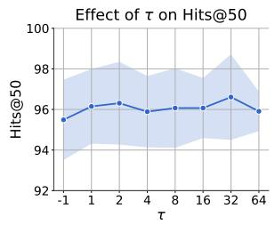

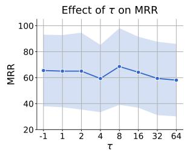

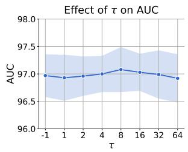

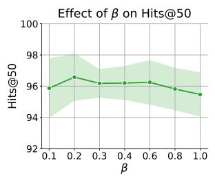

(a)  
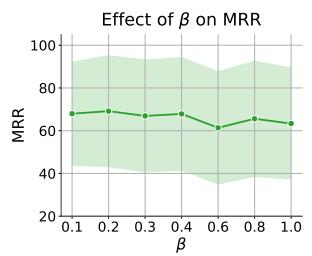  
(b)

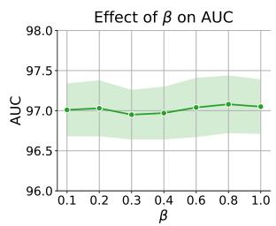  
Fig. 5. (a) Sensitivity of Bridge-LP to the common-neighbor degree cutof � used in the TCN threshold, on Hits@50, MRR, and AUC. (b) Sensitivity of Bridge-LP to the structural-proximity mixing weight � used in D2, on Hits@50, MRR, and AUC. Both sweeps are on Cora, averaged over five seeds; shaded bands show standard deviation.

AUC by efectively distinguishing structurally dissimilar samples. Such randomly generated negative samples exhibit large contrasts in common-neighbor overlap and occur in considerable quantities. Therefore, incorporating Common Neighbor Embedding into the full model yields a significant performance improvement, particularly in terms of AUC. • Efect of Semantic Feature Proximity (S2). Eliminating Semantic Feature Proximity leads to severe MRR drops, reaching 39.17% on Cora and 14.12% on Pubmed, as well as broader declines across other metrics. This sharp decline reinforces our earlier observation that semantic/textual features are critical for uncovering strong ties governed by shared topical or contextual meaning. By incorporating rich PLM-derived textual knowledge, Semantic Feature Proximity complements structural similarity with insights into node content. This is especially beneficial for node pairs whose relatedness depends more on topic similarity than on adjacency-driven connectivity.

Additional Discussion of S2. We additionally study how Bridge-LP’s performance depends on the common-neighbor degree cutof � used to threshold S1 $\left( \operatorname { E q . } \left( 1 \right) \right)$ and the mixing weight � applied to S1 when it is additively combined with S2 in D2. Sec. 4.4.1 reports Hits@50, MRR, and AUC on Cora across $\tau \in \{ - 1 , 1 , 2 , 4 , 8 , 1 6 , 3 2 , 6 4 \}$ (� = −1 denotes the unthresholded raw CN count) and $\beta \in \{ 0 . 1 , 0 . 2 , 0 . 3 , 0 . 4 , 0 . 6 , 0 . 8 , 1 . 0 \}$ , each averaged over five seeds. Hits@50 is remarkably stable across both sweeps (within 1.1 points), indicating that Bridge-LP does not require careful tuning of either hyperparameter to remain competitive. MRR is more sensitive (up to 10.5 points across the � sweep and 7.8 points across the $\beta$ sweep) but varies non-monotonically with both parameters. AUC is essentially insensitive to either hyperparameter, varying by at most 0.16 points across the � sweep and 0.13 points across the $\beta$ sweep, consistent with its role as a coarser ranking metric relative to Hits@50 and MRR. In the � sweep, Hits@50 peaks at $\tau = 3 2$ while MRR peaks at $\tau = 8 ;$ in the $\beta$ sweep, both Hits@50 and MRR peak at $\beta = 0 . 2 .$ . In our main experiments we fix � = 2 and $\beta = 0 . 1$ for all datasets; although the per-metric sweep optima above difer slightly, Hits@50 (our primary ranking metric) and AUC remain within roughly one point across the entire swept range, so this single global seting is suficient while keeping the protocol simple and reproducible

Table 7. Efect of D1 on Cora and PubMed, Full (Bridge-LP) matches the Bridge-LP row of Tab. 6.
<table><tr><td rowspan="2">Method</td><td colspan="3">Cora</td><td colspan="3">PubMed</td></tr><tr><td>Hits@50</td><td>MRR</td><td>AUC</td><td>Hits@50</td><td>MRR</td><td>AUC</td></tr><tr><td>Base</td><td> $7 2 . 6 4 \substack { \pm 6 . 4 5 }$ </td><td> $2 1 . 2 8 { \scriptstyle \pm 6 . 7 4 }$ </td><td> $8 4 . 9 6 { \scriptstyle \pm 3 . 1 5 }$ </td><td> $4 2 . 9 9 _ { \pm 3 . 7 0 }$ </td><td> $8 . 0 2 { \scriptstyle \pm 2 . 8 6 }$ </td><td> $9 3 . 0 8 { \scriptstyle \pm 0 . 7 8 }$ </td></tr><tr><td> $\mathrm { B a s e } + \mathrm { D } 1$ </td><td> $7 8 . 0 5 { \scriptstyle \pm 1 . 9 3 }$ </td><td> $2 1 . 2 5 { \scriptstyle \pm 9 . 7 6 }$ </td><td> $9 1 . 9 0 { \scriptstyle \pm 1 . 2 5 }$ </td><td> $4 2 . 8 5 { \scriptstyle \pm 1 . 7 8 }$ </td><td> $1 1 . 4 6 { \scriptstyle \pm 4 . 9 2 }$ </td><td> $9 5 . 3 2 { \scriptstyle \pm 0 . 1 3 }$ </td></tr><tr><td> $\mathrm { B a s e } + \mathrm { D } 2$ </td><td> $9 2 . 1 3 { \scriptstyle \pm 1 . 1 2 }$ </td><td> $5 0 . 0 0 { \scriptstyle \pm 3 . 4 5 }$ </td><td> $9 2 . 0 2 { \scriptstyle \pm 0 . 8 8 }$ </td><td> $7 6 . 2 3 { \scriptstyle \pm 2 . 1 1 }$ </td><td> $2 5 . 7 5 { \scriptstyle \pm 3 . 2 1 }$ </td><td>97.48±0.32</td></tr><tr><td> $\mathrm { F u l l \ ( B R I D G E { \mathrm { - } } L P ) }$ </td><td>96.44±0.18</td><td> $6 5 . 9 9 _ { \pm 4 . 3 8 }$ </td><td> $9 7 . 3 8 { \scriptstyle \pm 0 . 6 9 }$ </td><td> $7 8 . 8 4 { \scriptstyle \pm 1 . 3 8 }$ </td><td> $2 6 . 5 6 { \scriptstyle \pm 5 . 3 8 }$ </td><td> $9 8 . 2 6 { \scriptstyle \pm 0 . 4 9 }$ </td></tr></table>

• Efect of Aggregated Proximity Feature (S3). The impact of removing GCN (Aggregated Proximity Feature ) from Bridge-LP varies by dataset. On Cora, omitting GCN drives Hits@50 down to 88.14% and MRR to 38.53%. Since Cora is homophilic (clustering coeficient: 0.51, edge homophily: 0.24), GCN plays a crucial role by fusing both semantic and structural information to enhance representation learning. On Pubmed, which has a low clustering coeficient (0.06), the drop is less visible, though MRR still declines by 3.2%. These findings align with Tab. 3, showing that networks with lower clustering reduce GCN’s impact. Nevertheless, S3 remains consistently beneficial across all datasets in Tab. 6, every Hits@50 / MRR / AUC cell improves when S3 is included, so we recommend it by default. A rigorous characterization of when propagated proximity helps most is dificult to establish empirically within this work, as few publicly available TAG benchmarks with rich text features exhibit strong heterophily; we point readers to Zhu et al. [72] for a broader empirical study of how feature heterophily afects GNN-based link prediction.

4.4.2 Impact ofthe Design Components (D1–D3). To assess the individual contributions of our designs and their efects on both predictive performance and computational complexity, we conduct three ablation studies. First, we compare the Base model, defined in Eq. (4), with Base+D1. We then compare the Base model with Base+D2, i.e., adjacency matrix as feature embedding vs. thresholded common-neighbor embedding for link prediction. Finally, since D3 is designed to reduce the memory consumption and training cost associated with the LLM component, we compare memory usage and training time with and without D3 (Full vs. Full w/o D3), providing empirical evidence that the cache-embedding strategy reduces computational complexity while maintaining competitive performance.

Impact of Jump Connection (D1). The results in Sec. 4.4.1 demonstrate the contribution of the proposed jump- connection design to link-prediction performance. We show that D1 yields a modest, metric-dependent improvement over Base rather than a uniform gain: AUC improves from 84.96% to 91.90% on Cora and from 93.08% to 95.32% on PubMed, while Hits@50 moves only marginally (72.64%→78.05% on Cora, 42.99%→42.85% on PubMed) and MRR is essentially unchanged on Cora (21.28%→21.25%) though it improves on PubMed (8.02%→11.46%). These gains are consistent with D1’s bypass connection strengthening gradient flow to the PLM text embeddings, which most directly afects AUC’s pairwise ranking, while Hits@50 and MRR benefit more from the structural and compression refinements introduced by D2 and D3.

Table 8. Training time and memory footprint of Bridge-LP without D3 (Bridge-LP w.o. D3) compared to Full Bridge-LP, on Cora and PubMed. Trainin time is sec/e och; Mem is total memor foot rint (GB); vRAM is GPU memor foot rint (GB).
<table><tr><td rowspan="2">Category</td><td colspan="3">Cora</td><td colspan="3">PubMed</td></tr><tr><td>Training</td><td>Mem</td><td>vRAM</td><td>Training</td><td>Mem</td><td>vRAM</td></tr><tr><td>BRIDGE-LP w.o. D3</td><td>17.4</td><td>57</td><td>40</td><td>139.2</td><td>76</td><td>64</td></tr><tr><td>BRIDGE-LP-Full</td><td>4.7</td><td>25</td><td>25</td><td>37.6</td><td>35</td><td>37</td></tr><tr><td></td><td>Hits@50</td><td>MRR</td><td>AUC</td><td>Hits@50</td><td>MRR</td><td>AUC</td></tr><tr><td>BRIDGE-LP w.O. D3</td><td>96.44±0.18</td><td>65.99±4.38</td><td>97.38±0.69</td><td>98.84±1.38</td><td>29.56±5.38</td><td>99.06±0.49</td></tr><tr><td>BRIDGE-LP- Full</td><td>99.92±0.18</td><td>68.43±4.23</td><td>98.78±0.22</td><td>97.13±1.74</td><td>31.66±5.33</td><td>99.09±1.74</td></tr></table>

Impact of Compressed Embedding (D2). As Sec. 4.4.1 shows, this compression is not merely dimension-neutral: Base+D2 improves Hits@50 from 72.64% to 92.13% on Cora and from 42.99% to 76.23% on PubMed, with MRR improving similarly (21.28%→50.00% and 8.02%→25.75%, respectively). AUC improves too, but far less sharply (84.96%→92.02% and 93.08%→97.48%), consistent with AUC’s known insensitivity once ranking quality is already high, Hits@50 and MRR are the more discriminative metrics for this comparison. This is because the thresholded common-neighbo indicator compresses the embeddings of node pairs with no shared neighbors to a zero vector, which not only reduces the feature dimensionality but also suppresses interference from these uninformative negative pairs, thereby improving MRR and Hits@50.

Impact of Cache Embedding Strategy (D3). Finally, we evaluate the impact of the cache-embedding strategy D3 by comparing the full model with its variant without D3 on Cora and PubMed. As shown in Tab. 8, D3 substantially improves training eficiency: the full model is approximately 3.7× faster on both datasets, reducing the per-epoch training time from 17.4 to 4.7 seconds on Cora and from 139.2 to 37.6 seconds on PubMed. It also reduces the tota memory footprint by 56.1% on Cora and 53.9% on PubMed, while lowering GPU memory usage by 37.5% and 42.2%, respectively. Importantly, these eficiency gains do not compromise predictive performance. The full model consistently matches or outperforms the variant without D3 across Hits@50, MRR, and AUC, including a slight degradation in Hits@50 on PubMed. These results demonstrate that D3 efectively removes the repeated computational and memory overhead associated with the language-model component while preserving, and in several cases improving, the quality of the learned representations.

4.4.3 Efect ofGCN layers. Fig. 6a depicts the test AUC and standard deviation (shaded regions) for diferent GCN depths (1 to 5 layers). We observe that in both datasets, test AUC exhibits slight fluctuations as the number of GCN layers increases from 1 to 5. For Pubmed, AUC remains relatively stable across diferent GCN depths, hovering around 98%, with slight drops at four layers. These observations suggest that Bridge-LP is generally robust to changes in GCN depth, tolerating moderate architectural adjustments without major performance losses.

4.4.4 Impact ofthe LLM Choices and Scale. Bridge-LP exhibits flexibility in adopting diferent LLMs as its backbone. To assess the impact of backbone choice, we compare three series of models: the E5 series [51], BERT [7] and Sentence-Bert [47]. As shown in Fig. 6b, increasing the model size within each series consistently improves performance. This trend suggests that larger models, with more parameters, beter capture complex relationships in multi-modal data. For instance, E5-large substantially outperforms E5-small and the performance of mpnet (a sentence transformer) is comparable to that of E5-large. While mpnet-based models generally yield higher MRR, MiniLM and E5-large variants demonstrate stronger stability on Hits@K. These findings indicate that the choice of LLM backbone is not only task-dependent but also metric-sensitive.

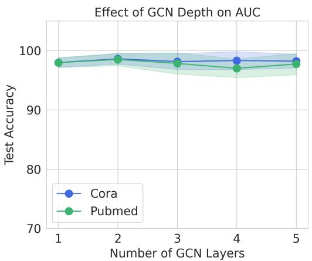  
(a)

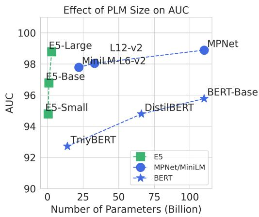  
(b)  
Fig. 6. (a) The efect of graph encoder depth (number of GNN layers) on test AUC for Cora and PubMed datasets. The shaded areas represent the standard deviation, indicating the variance in performance across diferent trials. (b) The efect of LLM backbone choice on AUC for the Cora dataset. The fi ure shows three series: E5, BERT alon with Sentence-Transformers

## 5 Conclusion

In this paper, we systematically addressed the challenge of leveraging textual and structural information for link prediction on TAGs. We propose Bridge-LP, a lightweight yet powerful framework that integrates PLMs as learnable text encoders within an end-to-end GCN architecture. It consists of necessary graph signals, spanning the predominant formalisms of links from latent graph theory. We concatenated these three signals into a baseline framework and then introduced three designs to further optimize gradient flow while reducing signal redundancy as well as the associated computational and memory costs. Bridge-LP achieves significant performance gains. We evaluated the proposed method against 40 existing link prediction models across 9 diverse TAG datasets, ranging from small academic networks to billion-scale graphs. Empirically, our method outperforms both GCN- and PLM-based baselines by up to 20% in MRR. Beyond link prediction, our approach opens new avenues for tackling other graph-related tasks, such as node classification and regression, where fully end-to-end methods can capitalize on the complementary strengths of language models and structural learners.

Limitations and Future Work. Bridge-LP is designed for static TAGs, and we make this scope explicit here. Extending it to dynamic TAGs, where node text and graph structure evolve over time [57, 63, 65], would require revisiting each of its three signals: (i) S1 Threshold Common Neighbor currently assumes a fixed adjacency matrix A and would need incremental maintenance of the thresholded common-neighbor indicator as edges arrive or expire; (ii) S3 Propagated proximity currently aggregates over a static �-hop neighborhood and would require a graph-time-aware aggregation scheme that respects the chronological order of edges, e.g., only propagating through edges that existed at or before the timestamp of the target link; (iii) by contrast, D3’s cache-embedding strategy is the design most naturally compatible with a dynamic setting, since it already amortizes PLM encoding cost across training steps and would extend to streaming updates by re-encoding only nodes whose text changes rather than the full graph. We leave a full dynamic-TAG instantiation and evaluation of Bridge-LP to future work.

## Acknowledgments

This work was supported in part by the National Science Foundation under Grants No. IIS-2212143 and IIS-2504090, and in part by the Federal Ministry of Research, Technology and Space (BMFTR), Germany, under award number 01IS23066. Any opinions, findings, and conclusions or recommendations expressed in this material are those of the author(s) and do not necessarily reflect the views of the National Science Foundation.

## References

[1] Lada A. Adamic and Eytan Adar. 2003. Friends and neighbors on the Web. Soc. Networks 25, 3 (2003), 211–230. doi:10.1016/S0378-8733(03)00009-

[2] Benjamin Paul Chamberlain, Sergey Shirobokov, Emanuele Rossi, Fabrizio Frasca, Thomas Markovich, Nils Yannick Hammerla, Michael M. Bronstein, and Max Hansmire. 2023. Graph Neural Networks for Link Prediction with Subgraph Sketching. In The Eleventh International Conference on Learning Representations, ICLR 2023, Kigali, Rwanda, May 1-5, 2023. OpenReview.net. https://openreview.net/forum?id=m1oqEOAozQU

[3] Jin Chen, Defu Lian, Yucheng Li, Baoyun Wang, Kai Zheng, and Enhong Chen. 2022. Cache-Augmented Inbatch Importance Resampling for Training Recommender Retriever. In Advances in Neural Information Processing Systems 35: Annual Conference on Neural Information Processing Systems 2022, NeurIPS 2022, New Orleans, LA, USA, November 28 - December 9, 2022, Sanmi Koyejo, S. Mohamed, A. Agarwal, Danielle Belgrave, K. Cho, and A. Oh (Eds.). http://papers.nips.cc/paper\_files/paper/2022/hash/e1194b07221de8783a02087bb899d69f-Abstract-Conference.htm

[4] Zhikai Chen, Haitao Mao, Hang Li, Wei Jin, Hongzhi Wen, Xiaochi Wei, Shuaiqiang Wang, Dawei Yin, Wenqi Fan, Hui Liu, and Jiliang Tang. 2023 Exploring the Potential of Large Language Models (LLMs)in Learning on Graphs. SIGKDD Explor. 25, 2 (2023), 42–61. doi:10.1145/3655103.3655110

[5] Zhikai Chen, Haitao Mao, Jingzhe Liu, Yu Song, Bingheng Li, Wei Jin, Bahare Fatemi, Anton Tsitsulin, Bryan Perozzi, Hui Liu, and Jiliang Tang. 2024. Text-space Graph Foundation Models: Comprehensive Benchmarks and New Insights. In Advances in Neural Information Processing Systems 37: Annual Conference on Neural Information Processing Systems 2024, NeurIPS 2024, Vancouver, BC, Canada, December 10 - 15, 2024, Amir Globersons, Lester Mackey, Danielle Belgrave, Angela Fan, Ulrich Paquet, Jakub M. Tomczak, and Cheng Zhang (Eds.). http://papers.nips.cc/paper\_files/paper/ 2024/hash/0e0b39c69663e9c073739adf547ed778-Abstract-Datasets\_and\_Benchmarks\_Track.html

[6] Eli Chien, Wei-Cheng Chang, Cho-Jui Hsieh, Hsiang-Fu Yu, Jiong Zhang, Olgica Milenkovic, and Inderjit S. Dhillon. 2022. Node Feature Extraction by Self-Supervised Multi-scale Neighborhood Prediction. In The Tenth International Conference on Learning Representations, ICLR 2022, Virtual Event, April 25-29, 2022. OpenReview.net. https://openreview.net/forum?id=KJggliHbs8

[7] Jacob Devlin, Ming-Wei Chang, Kenton Lee, and Kristina Toutanova. 2019. BERT: Pre-training of Deep Bidirectional Transformers for Language Understanding. In Proceedings of the 2019 Conference of the North American Chapter of the Association for Computational Linguistics: Human Language Technologies, NAACL-HLT 2019, Minneapolis, MN, USA, June 2-7, 2019, Volume 1 (Long and Short Papers), Jill Burstein, Christy Doran, and Thamar Solorio (Eds.). Association for Computational Linguistics, 4171–4186. doi:10.18653/V1/N19-1423

[8] Keyu Duan, Qian Liu, Tat-Seng Chua, Shuicheng Yan, Wei Tsang Ooi, Qizhe Xie, and Junxian He. 2023. SimTeG: A Frustratingly Simple Approach Improves Textual Graph Learning. CoRR abs/2308.02565 (2023). arXiv:2308.02565 doi:10.48550/ARXIV.2308.02565

[9] Aditya Grover and Jure Leskovec. 2016. node2vec: Scalable Feature Learning for Networks. In Proceedings ofthe 22nd ACM SIGKDD International Conference on Knowledge Discovery and Data Mining, San Francisco, CA, USA, August 13-17, 2016, Balaji Krishnapuram, Mohak Shah, Alexander J. Smola, Charu C. Aggarwal, Dou Shen, and Rajeev Rastogi (Eds.). ACM, 855–864. doi:10.1145/2939672.2939754

[10] Jingwei Guo, Kaizhu Huang, Rui Zhang, and Xinping Yi. 2024. ES-GNN: Generalizing Graph Neural Networks Beyond Homophily With Edge Splitting. IEEE Trans. Pattern Anal. Mach. Intell. 46, 12 (2024), 11345–11360. doi:10.1109/TPAMI.2024.3459932

[11] William L. Hamilton, Zhitao Ying, and Jure Leskovec. 2017. Inductive Representation Learning on Large Graphs. In Advances in Neural Information Processing Systems 30: Annual Conference on Neural Information Processing Systems 2017, December 4-9, 2017, Long Beach, CA, USA, Isabelle Guyon, Ulrike von Luxburg, Samy Bengio, Hanna M. Wallach, Rob Fergus, S. V. N. Vishwanathan, and Roman Garnett (Eds.). 1024–1034. https: //proceedings.neurips.cc/paper/2017/hash/5dd9db5e033da9c6fb5ba83c7a7ebea9-Abstract.htm

[12] Zellig S. Harris. 1954. Distributional Structure. WORD 10, 2-3 (1954), 146–162. doi:10.1080/00437956.1954.11659520

[13] Xiaoxin He, Xavier Bresson, Thomas Laurent, Adam Perold, Yann LeCun, and Bryan Hooi. 2024. Harnessing Explanations: LLM-to-LM Interpreter for Enhanced Text-Attributed Graph Representation Learning. In The Twelfth International Conference on Learnin Re resentations. https://openreview. net/forum?id=RXFVcynVe

[14] Zhongmou He, Jing Zhu, Shengyi Qian, Joyce Chai, and Danai Koutra. 2025. LinkGPT: Leveraging Large Language Models for Enhanced Link Prediction in Text-Attributed Graphs. In Proceedin s ofthe 34th ACM International Conference on Information and Knowled e Mana ement (Seoul, Republic of Korea) (CIKM ’25). Association for Computing Machinery, New York, NY, USA, 843–853. doi:10.1145/3746252.3761287

[15] Peter D. Hof, Adrian E. Raftery, and Mark S. Handcock. 2002. Latent Space Approaches to Social Network Analysis. J. Amer. Statist. Assoc. 97, 460 (2002), 1090–1098. doi:10.1198/016214502388618906

[16] Weihua Hu, Matthias Fey, Hongyu Ren, Maho Nakata, Yuxiao Dong, and Jure Leskovec. 2021. OGB-LSC: A Large-Scale Challenge for Machine Learning on Graphs. (2021). doi:10.48550/arXiv.2103.09430

[17] Weihua Hu, Matthias Fey, Marinka Zitnik, Yuxiao Dong, Hongyu Ren, Bowen Liu, Michele Catasta, and Jure Leskovec. 2020. Open graph benchmark: datasets for machine learning on graphs. In Proceedings of the 34th International Conference on Neural Information Processing Systems (Vancouver, BC, Canada) (NIPS ’20). Curran Associates Inc., Red Hook, NY, USA, Article 1855, 16 pages.

[18] Ziniu Hu, Yuxiao Dong, Kuansan Wang, and Yizhou Sun. 2020. Heterogeneous Graph Transformer. In Proceedings ofThe Web Conference 2020 (Taipei, Taiwan) (WWW ’20). Association for Computing Machinery, New York, NY, USA, 2704–2710. doi:10.1145/3366423.338002

[19] Zan Huang, Xin Li, and Hsinchun Chen. 2005. Link prediction approach to collaborative filtering. In Proceedings ofthe 5th ACM/IEEE-CS Joint Conference on Digital Libraries (Denver, CO, USA) (JCDL ’05). Association for Computing Machinery, New York, NY, USA, 141–142. doi:10.1145/ 1065385.1065415

[20] Yanbiao Ji, Chang Liu, Xin Chen, Dan Luo, Mei Li, Yue Ding, Wenqing Lin, and Hongtao Lu. 2025. From Anchors to Answers: A Novel Node Tokenizer for Integrating Graph Structure into Large Language Models. In Proceedings ofthe 34th ACM International Conference on Information and Knowledge Management (Seoul, Republic of Korea) (CIKM ’25). Association for Computing Machinery, New York, NY, USA, 1124–1134. doi:10.1145/3746252.376116

[21] Thomas N. Kipf and Max Welling. 2017. Semi-Supervised Classification with Graph Convolutional Networks. In International Conference on Learning Re resentations (ICLR). https://openreview.net/forum?id=SJU4ayYg

[22] Pang Wei Koh and Percy Liang. 2017. Understanding black-box predictions via influence functions (ICML’17). JMLR.org, 1885–1894. doi:10.5555 3305381.3305576

[23] Meng-Chieh Lee, Haiyang Yu, Jian Zhang, Vassilis N. Ioannidis, Xiang song, Soji Adeshina, Da Zheng, and Christos Faloutsos. 2024. NetInfoF Framework: Measuring and Exploiting Network Usable Information. In The Twelfth International Conference on Learning Representations. doi:10. 48550/arXiv.2402.07999

[24] Juanhui Li, Harry Shomer, Haitao Mao, Shenglai Zeng, Yao Ma, Neil Shah, Jiliang Tang, and Dawei Yin. 2023. Evaluating Graph Neural Networks for Link Prediction: Current Pitfalls and New Benchmarking. In Advances in Neural Information Processing Systems 36: Annual Conference on Neural Information Processing Systems 2023, NeurIPS 2023, New Orleans, LA, USA, December 10 - 16, 2023, Alice Oh, Tristan Naumann, Amir Globerson, Kate Saenko, Moritz Hardt, and Sergey Levine (Eds.). doi:10.48550/arXiv.2306.10453

[25] Zhuofeng Li, Zixing Gou, Xiangnan Zhang, Zhongyuan Liu, Sirui Li, Yuntong Hu, Chen Ling, Zheng Zhang, and Liang Zhao. 2024. TEG-DB: a comprehensive dataset and benchmark of textual-edge graphs. In Proceedings of the 38th International Conference on Neural Information Processing Systems (Vancouver, BC, Canada) (NIPS ’24). Curran Associates Inc., Red Hook, NY, USA, Article 1949, 19 pages. doi:10.48550/arXiv.2406.10310

[26] Qi Liu, Maximilian Nickel, and Douwe Kiela. 2019. Hyperbolic Graph Neural Networks. In Neural Information Processing Systems. doi:10.48550 arXiv.1910.12892

[27] Haitao Mao, Juanhui Li, Harry Shomer, Bingheng Li, Wenqi Fan, Yao Ma, Tong Zhao, Neil Shah, and Jiliang Tang. 2024. Revisiting Link Prediction: a data perspective. In The Twelfth International Conference on Learning Representations, ICLR 2024, Vienna, Austria, May 7-11, 2024. OpenReview.net. doi:10.48550/arXiv.2310.00793

[28] Andrew Kachites McCallum, Kamal Nigam, Jason Rennie, and Kristie Seymore. 2000. Automating the Construction of Internet Portals with Machine Learning. Information Retrieval 3, 2 (2000), 127–163. doi:10.1023/A:1009953814988

[29] Tomas Mikolov, Kai Chen, Greg Corrado, and Jefrey Dean. 2013. Eficient Estimation of Word Representations in Vector Space. In International Conference on Learning Representations. arXiv:1301.3781 [cs.CL] doi:10.48550/arXiv.1301.378

[30] Favour Nerrise, Edward W Huang, Xiaonan Ji, Karthik Subbian, and Danai Koutra. 2025. GraFS: An Integrated GNN-LLM Approach for Inferring Best Functional Substitute Products. In Proceedings ofthe 34th ACM International Conference on Information and Knowledge Management (Seoul, Republic of Korea) (CIKM ’25). Association for Computing Machinery, New York, NY, USA, 5047–5051. doi:10.1145/3746252.3760961

[31] M. E. J. Newman. 2001. Clustering and preferential attachment in growing networks. Physical Review E 64 (2001). doi:10.1103/physreve.64.025102 [32] Lawrence Page, Sergey Brin, Rajeev Motwani, and Terry Winograd. 1999. The PageRank Citation Ranking: Bringing Order to the Web. Technical Report 1999-66. Stanford InfoLab. http://ilpubs.stanford.edu:8090/422/ Previous number = SIDL-WP-1999-0120.

[33] Bryan Perozzi, Rami Al-Rfou, and Steven Skiena. 2014. DeepWalk: Online Learning of Social Representations. In Proceedings ofthe 20th ACM SIGKDD international conference on Knowledge discovery and data mining. 701–710. doi:10.1145/2623330.2623732 arXiv:1403.6652 [cs].

[34] Nils Reimers and Iryna Gurevych. 2019. Sentence-BERT: Sentence Embeddings using Siamese BERT-Networks. In Proceedin s ofthe 2019 Conference on Empirical Methods in Natural Language Processing and the 9th International Joint Conference on Natural Language Processing, EMNLP-IJCNLP 2019, Hong Kong, China, November 3-7, 2019, Kentaro Inui, Jing Jiang, Vincent Ng, and Xiaojun Wan (Eds.). Association for Computational Linguistics,

3980–3990. doi:10.18653/V1/D19-1410

[35] Tarek Saier, Youxiang Dong, and Michael Färber. 2023. CoCon: A Data Set on Combined Contextualized Research Artifact Use. 2023 ACM/IEEE Joint Conference on Digital Libraries (JCDL) (2023), 47–50. https://api.semanticscholar.org/CorpusID:25776654

[36] Purnamrita Sarkar, Deepayan Chakrabarti, and Andrew W. Moore. 2011. Theoretical Justification of Popular Link Prediction Heuristics. In Proceedings ofthe Twent -Second International Joint Conference on Artificial Intelli ence (IJCAI).

[37] Prithviraj Sen, Galileo Namata, Mustafa Bilgic, Lise Getoor, Brian Gallagher, and Tina Eliassi-Rad. 2008. Collective Classification in Network Data AI Mag. 29, 3 (Sept. 2008), 93–106. doi:10.1609/aimag.v29i3.2157

[38] Oleksandr Shchur, Maximilian Mumme, Aleksandar Bojchevski, and Stephan Günnemann. 2019. Pitfalls of Graph Neural Network Evaluation. arXiv:1811.05868 [cs.LG] https://arxiv.org/abs/1811.05868

[39] Harry Shomer, Yao Ma, Haitao Mao, Juanhui Li, Bo Wu, and Jiliang Tang. 2024. LPFormer: An Adaptive Graph Transformer for Link Prediction Association for Computing Machinery, New York, NY, USA. doi:10.1145/3637528.3672025

[40] Kaitao Song, Xu Tan, Tao Qin, Jianfeng Lu, and Tie-Yan Liu. 2020. MPNet: Masked and Permuted Pre-training for Language Understanding. In Advances in Neural Information Processing Systems 33: Annual Conference on Neural Information Processing Systems 2020, NeurIPS 2020, December 6-12, 2020, virtual, Hugo Larochelle, Marc’Aurelio Ranzato, Raia Hadsell, Maria-Florina Balcan, and Hsuan-Tien Lin (Eds.). https://proceedings.neurips. cc/paper/2020/hash/c3a690be93aa602ee2dc0ccab5b7b67e-Abstract.htm

[41] Balasubramaniam Srinivasan and Bruno Ribeiro. 2020. On the Equivalence between Positional Node Embeddings and Structural Graph Representations. In International Conference on Learnin Re resentations. https://openreview.net/forum?id=SJxzFySKwH

[42] Zhiqing Sun, Zhi-Hong Deng, Jian-Yun Nie, and Jian Tang. 2019. RotatE: Knowledge Graph Embedding by Relational Rotation in Complex Space. In 7th International Conference on Learning Representations, ICLR 2019, New Orleans, LA, USA, May 6-9, 2019. OpenReview.net. https: //openreview.net/forum?id=HkgEQnRqYQ

[43] Damian Szklarczyk, Annika L. Gable, David Lyon, Alexander Junge, Stefan Wyder, Jaime Huerta-Cepas, Milan Simonovic, Nadezhda T. Doncheva, John H. Morris, Peer Bork, Lars Juhl Jensen, and Christian von Mering. 2019. STRING v11: protein-protein association networks with increased coverage, supporting functional discovery in genome-wide experimental datasets. Nucleic Acids Res. 47, Database-Issue (2019), D607–D613. doi:10.1093/NAR/GKY1131

[44] Jian Tang, Meng Qu, Mingzhe Wang, Ming Zhang, Jun Yan, and Qiaozhu Mei. 2015. LINE: Large-scale Information Network Embedding. In Proceedings ofthe 24th International Conference on World Wide Web. 1067–1077. doi:10.1145/2736277.2741093 arXiv:1503.03578 [cs].

[45] Jiabin Tang, Yuhao Yang, Wei Wei, Lei Shi, Lixin Su, Suqi Cheng, Dawei Yin, and Chao Huang. 2023. GraphGPT: Graph Instruction Tuning for Large Language Models. ArXiv abs/2310.13023 (2023). doi:10.48550/arXiv.2310.13023

[46] Jie Tang, Jing Zhang, Limin Yao, Juanzi Li, Li Zhang, and Zhong Su. 2008. ArnetMiner: extraction and mining of academic social networks. In Proceedings ofthe 14th ACM SIGKDD International Conference on Knowledge Discovery and Data Mining (Las Vegas, Nevada, USA) (KDD ’08) Association for Computing Machinery, New York, NY, USA, 990–998. doi:10.1145/1401890.1402008

[47] Llama Team. 2024. The Llama 3 Herd of Models. CoRR abs/2407.21783 (2024). arXiv:2407.21783 doi:10.48550/ARXIV.2407.21783

[48] Théo Trouillon, Johannes Welbl, Sebastian Riedel, Éric Gaussier, and Guillaume Bouchard. 2016. Complex Embeddings for Simple Link Prediction. In Proceedings of the 33nd International Conference on Machine Learning, ICML 2016 (JMLR Workshop and Conference Proceedings, Vol. 48). JMLR.org, 2071–2080. doi:10.48550/arXiv.1606.06357

[49] Petar Veličković, Guillem Cucurull, Arantxa Casanova, Adriana Romero, Pietro Liò, and Yoshua Bengio. 2018. Graph Attention Networks. In International Conference on Learning Representations. https://openreview.net/forum?id=rJXMpikCZ

[50] Kuansan Wang, Zhihong Shen, Chiyuan Huang, Chieh-Han Wu, Yuxiao Dong, and Anshul Kanakia. 2020. Microsoft Academic Graph: When experts are not enough. Quantitative Science Studies 1, 1 (02 2020), 396–413. arXiv:https://direct.mit.edu/qss/article-pdf/1/1/396/1760880/qss\_a\_00021.pdf doi:10.1162/qss\_a\_00021

[51] Liang Wang, Nan Yang, Xiaolong Huang, Binxing Jiao, Linjun Yang, Daxin Jiang, Rangan Majumder, and Furu Wei. 2022. Text Embeddings by Weakly-Supervised Contrastive Pre-training. ArXiv abs/2212.03533 (2022). https://api.semanticscholar.org/CorpusID:254366618

[52] Qiwei Wang, Dandan Lin, Wenqing Lin, and Ziming Wu. 2025. FROG: Efective Friend Recommendation in Online Games via Modality-aware User Preferences. In Proceedings ofthe 48th International ACM SIGIR Conference on Research and Development in Information Retrieval (Padua, Italy) (SIGIR ’25). Association for Computing Machinery, New York, NY, USA, 2822–2826. doi:10.1145/3726302.3730198

[53] Xiao Wang, Houye Ji, Chuan Shi, Bai Wang, Peng Cui, P. Yu, and Yanfang Ye. 2021. Heterogeneous Graph Attention Network. arXiv:1903.07293 [cs.SI] doi:10.48550/arXiv.1903.07293

[54] Xiyuan Wang, Haotong Yang, and Muhan Zhang. 2023. Neural Common Neighbor with Completion for Link Prediction. arXiv preprint arXiv:2302.00890 (2023). doi:10.48550/arXiv.2302.00890

[55] Keyulu Xu, Weihua Hu, Jure Leskovec, and Stefanie Jegelka. 2019. How Powerful are Graph Neural Networks?. In International Conference on Learning Representations. https://openreview.net/forum?id=ryGs6iA5Km

[56] Keyulu Xu, Chengtao Li, Yonglong Tian, Tomohiro Sonobe, Ken ichi Kawarabayashi, and Stefanie Jegelka. 2018. Representation Learning on Graphs with Jumping Knowledge Networks. ArXiv abs/1806.03536 (2018). doi:10.48550/arXiv.1806.03536

[57] Yuanyuan Xu, Wenjie Zhang, Ying Zhang, Xuemin Lin, and Xiwei Xu. 2026. Unlocking Multi-Modal Potentials for Link Prediction on Dynamic Text-Attributed Graphs. Proceedings ofthe AAAI Conference on Artificial Intelligence 40, 32 (2026), 27386–27394. doi:10.1609/aaai.v40i32.39956

[58] Rui Xue, Xipeng Shen, Ruozhou Yu, and Xiaorui Liu. 2023. Eficient End-to-end Language Model Fine-tuning on Graphs. doi:10.48550/arXiv.2312.04737 Manuscript submitted to ACM

[59] Hao Yan, Chaozhuo Li, Ruosong Long, Chao Yan, Jianan Zhao, Wenwen Zhuang, Jun Yin, Peiyan Zhang, Weihao Han, Hao Sun, Weiwei Deng, Qi Zhang, Lichao Sun, Xing Xie, and Senzhang Wang. 2023. A Comprehensive Study on Text-attributed Graphs: Benchmarking and Rethinking. In Advances in Neural Information Processing Systems, A. Oh, T. Naumann, A. Globerson, K. Saenko, M. Hardt, and S. Levine (Eds.), Vol. 36. Curran Associates, Inc., 17238–17264. doi:10.52202/075280-0755

[60] Bishan Yang, Wen-tau Yih, Xiaodong He, Jianfeng Gao, and Li Deng. 2015. Embedding Entities and Relations for Learning and Inference in Knowledge Bases. In 3rd International Conference on Learnin Representations, ICLR 2015, San Die o, CA, USA, Ma 7-9, 2015, Conference Track Proceedings, Yoshua Bengio and Yann LeCun (Eds.). http://arxiv.org/abs/1412.6575

[61] Junhan Yang, Zheng Liu, Shitao Xiao, Chaozhuo Li, Defu Lian, Sanjay Agrawal, Amit Singh, Guangzhong Sun, and Xing Xie. 2021. GraphFormers: GNN-nested Transformers for Representation Learning on Textual Graph. In Neural Information Processing Systems. doi:10.48550/arXiv.2105.02605

[62] Zhilin Yang, William W. Cohen, and Ruslan Salakhutdinov. 2016. Revisiting Semi-Supervised Learning with Graph Embeddings. arXiv:1603.08861 [cs.LG] doi:10.48550/arXiv.1603.0886

[63] Le Yu, Leilei Sun, Bowen Du, and Weifeng Lv. 2023. Towards Better Dynamic Graph Learning: New Architecture and Unified Library. CoRR abs/2303.13047 (2023). arXiv:2303.13047 doi:10.48550/ARXIV.2303.13047

[64] Seongjun Yun, Seoyoon Kim, Junhyun Lee, Jaewoo Kang, and Hyunwoo J. Kim. 2021. Neo-GNNs: Neighborhood Overlap-aware Graph Neural Networks for Link Prediction. In Advances in Neural Information Processing Systems, A. Beygelzimer, Y. Dauphin, P. Liang, and J. Wortman Vaughan (Eds.). https://openreview.net/forum?id=Ic9vRN3VpZ

[65] Jiasheng Zhang, Jialin Chen, Menglin Yang, Aosong Feng, Shuang Liang, Jie Shao, and Rex Ying. 2024. DTGB: a comprehensive benchmark for dynamic text-attributed graphs. In Proceedings ofthe 38th International Conference on Neural Information Processing Systems (Vancouver, BC, Canada) (NIPS ’24). Curran Associates Inc., Red Hook, NY, USA, Article 2901, 25 pages.

[66] Juzheng Zhang, Lanning Wei, Zhen Xu, and Quanming Yao. 2024. Heuristic Learning with Graph Neural Networks: A Unified Framework for Link Prediction. arXiv:2406.07979 [cs.LG] https://arxiv.org/abs/2406.07979

[67] Muhan Zhang and Yixin Chen. 2018. Link prediction based on graph neural networks. In Proceedings ofthe 32nd International Conference on Neural Information Processing Systems (Montréal, Canada) (NIPS’18). Curran Associates Inc., Red Hook, NY, USA, 5171–5181. doi:10.48550/arXiv.1802.09691

[68] Muhan Zhang, Pan Li, Yinglong Xia, Kai Wang, and Long Jin. 2022. Labeling Trick: A Theory of Using Graph Neural Networks for Multi-Node Representation Learning. arXiv:2010.16103 [cs.LG] doi:10.48550/arXiv.2010.1610

[69] Xuanyu Zhang, Qing Yang, and Dongliang Xu. 2022. TranS: Transition-based Knowledge Graph Embedding with Synthetic Relation Representation. In Findings ofthe Association for Computational Linguistics: EMNLP 2022 (Findings ofACL, Vol. EMNLP 2022). Association for Computational Linguistics, 1202–1208. doi:10.18653/V1/2022.FINDINGS-EMNLP.86

[70] Zhengwu Zhang, Yuntong Hu, Bo Pan, Chen Ling, and Liang Zhao. 2024. TAGA: Text-Attributed Graph Self-Supervised Learning by Synergizing Graph and Text Mutual Transformations. doi:10.48550/arXiv.2405.16800

[71] Tao Zhou, Linyuan Lü, and Yi-Cheng Zhang. 2009. Predicting missing links via local information. The European Physical Journal B 71, 4 (Oct. 2009), 623–630. doi:10.1140/epjb/e2009-00335-8

[72] Jiong Zhu, Gao Li, Yao-An Yang, Jinghua Zhu, Xuehao Cui, and Danai Koutra. 2024. On the Impact of Feature Heterophily on Link Prediction with Graph Neural Networks. ArXiv abs/2409.17475 (2024). https://api.semanticscholar.org/CorpusID:272910629

[73] Yun Zhu, Yaoke Wang, Haizhou Shi, and Siliang Tang. 2024. Eficient Tuning and Inference for Large Language Models on Textual Graphs. ArXiv abs/2401.15569 (2024). doi:10.48550/arXiv.2401.15569

## A Proof of Thm. 3.2

Influence score (setup, without D1). Adopted from [56], the influence score $I ( x , y )$ of node � for any final embedding $y \in \mathbb { R } ^ { | \mathcal { V } | \times d }$ is defined as the sum of the absolute values of the entries of the Jacobian matrix $\frac { \partial h _ { x } ^ { ( k ) } } { \partial h _ { y } ^ { ( 0 ) } }$ . We define the influence distribution $I _ { x } \operatorname { o f } x \in V$ by normalizing the influence scores:

$$
I _ { x } ( y ) = \frac { I ( x , y ) } { \sum _ { z } I ( x , z ) } ,
$$

or equivalently,

$$
I _ { x } ( y ) = \frac { e ^ { T } \left| \frac { \partial h _ { x } ^ { ( k ) } } { \partial h _ { y } ^ { ( 0 ) } } \right| e } { \sum _ { z \in V } e ^ { T } \left| \frac { \partial h _ { x } ^ { ( k ) } } { \partial h _ { z } ^ { ( 0 ) } } \right| e } ,
$$

where � is the all-ones vector. We calculate the influence score in Bridge-LP without D1:

Denote by $f _ { x } ^ { ( l ) }$ the pre-activated feature of $h _ { x } ^ { ( l ) }$ , i.e.,

$$
f _ { x } ^ { ( l ) } = \frac { 1 } { \deg _ { f } ( x ) } \sum _ { z \in \mathrm { N e } ( x ) } W _ { l } h _ { z } ^ { ( l - 1 ) } .
$$

For any $l = 1 , \ldots , k .$ we have

$$
\frac { \partial h _ { x } ^ { ( l ) } } { \partial h _ { y } ^ { ( 0 ) } } = \frac { 1 } { \deg _ { f } ( x ) } \cdot \mathrm { d i a g } \left( 1 _ { f _ { x } ^ { ( l ) } > 0 } \right) \cdot W _ { l } \cdot \sum _ { z \in \mathrm { N e } ( x ) } \frac { \partial h _ { z } ^ { ( l - 1 ) } } { \partial h _ { y } ^ { ( 0 ) } } .
$$

By the chain rule, we obtain

$$
\frac { \partial h _ { x } ^ { ( k ) } } { \partial h _ { y } ^ { ( 0 ) } } = \sum _ { \Psi } \left[ \frac { \partial h _ { x } ^ { ( k ) } } { \partial h _ { y } ^ { ( 0 ) } } \right] _ { \boldsymbol { p } } = \sum _ { \Psi } \prod _ { l = 1 } ^ { k } \frac { 1 } { \deg _ { f } ( v _ { \boldsymbol { p } } ^ { l } ) } \cdot \mathrm { d i a g } \left( 1 _ { f _ { v _ { p } ^ { l } } ^ { ( l ) } > 0 } \right) \cdot W _ { l } .
$$

Here, Ψ is the set of all random walks $v _ { p } ^ { k } , v _ { p } ^ { k - 1 } , \ldots , v _ { p } ^ { 1 } , v _ { p } ^ { 0 }$ of length $k + 1$ from node � to node �. For any path $p , v _ { p } ^ { k } = x ,$ $v _ { p } ^ { 0 } = y ,$ and for $l = 1 , \ldots , k - 1 , v _ { \boldsymbol { p } } ^ { l - 1 } \in \mathrm { N e } ( v _ { \boldsymbol { p } } ^ { l } )$

For each path ${ \boldsymbol { \mathit { p } } } ,$ an entry of the derivative can be expressed as

$$
\left[ \frac { \partial h _ { x } ^ { ( k ) } } { \partial h _ { y } ^ { ( 0 ) } } \right] _ { \boldsymbol { \rho } } ^ { ( i , j ) } = \prod _ { l = 1 } ^ { k } \frac { 1 } { \deg _ { f } ( v _ { \boldsymbol { \rho } } ^ { l } ) } \sum _ { \Phi } Z _ { q } \prod _ { l = 1 } ^ { k } w _ { q } ^ { ( l ) } ,
$$

where Φ is the set of paths � from the input neurons to the output neuron $( i , j )$ in the computation graph of $\begin{array} { r } { \frac { \partial h _ { x } ^ { ( k ) } } { \partial h _ { y } ^ { ( 0 ) } } _ { p } } \end{array}$ . For each layer $l , w _ { q } ^ { ( l ) }$ is the entry of $W _ { l }$ used in the �-th path. Finally, $Z _ { q } \in \{ 0 , 1 \}$ indicates whether the �-th path is active $( Z _ { q } = 1 )$ or not $( Z _ { q } = 0 )$ due to the ReLU activation of entries in $f _ { v _ { p } ^ { l } } ^ { ( l ) }$ along the �-th path. ReLU is not diferentiable at $0 ;$ for simplicity, we assume the (sub)gradient at 0 is 0.

Efect of the D1 bypass. Design D1 adds a bypass that routes the PLM embedding $\mathbf { h } _ { x } ^ { ( 0 ) }$ directly to the final representation, $\tilde { \mathbf { h } } _ { x } ^ { ( k ) } = \mathbf { h } _ { x } ^ { ( k ) } + B \mathbf { h } _ { x } ^ { ( 0 ) }$ , with a trainable bypass matrix �. Since the bypass is linear, diferentiating with respect to $\mathbf { h } _ { y } ^ { ( 0 ) }$ requires no product rule:

$$
\frac { \partial \tilde { \mathbf { h } } _ { x } ^ { ( k ) } } { \partial \mathbf { h } _ { y } ^ { ( 0 ) } } = \frac { \partial \mathbf { h } _ { x } ^ { ( k ) } } { \partial \mathbf { h } _ { y } ^ { ( 0 ) } } + B \mathbf { \mathbb { k } } [ x = y ] .
$$

Manuscript submitted to ACM

The bypass leaves every of-diagonal block $( y \neq x )$ unchanged and adds the block � to the self term $( y = x )$ . Writing the influence score as the entrywise $\ell _ { 1 }$ norm of the Jacobian block, and flattening $J : = \partial \mathbf { h } _ { x } ^ { ( k ) } / \partial \mathbf { h } _ { x } ^ { ( 0 ) }$ and � to vectors, we obtain the following.

Proposition A.1 (Influence non-decrease under D1). For $y \neq x , I _ { \mathrm { w i t h } D _ { 1 } } ( x , y ) = I _ { \mathrm { w i t h o u t } D _ { 1 } } ( x , y )$ . For the self term, $i f$ � and � are entrywise sign-compatible i.e. $J _ { i } B _ { i } \ge 0$ for every coordinate �, then

$$
I _ { \mathrm { w i t h } D _ { 1 } } ( { \boldsymbol { x } } , { \boldsymbol { x } } ) = \| { \boldsymbol { J } } + { \boldsymbol { B } } \| _ { 1 } = \| { \boldsymbol { J } } \| _ { 1 } + \| { \boldsymbol { B } } \| _ { 1 } = I _ { \mathrm { w i t h o u t } D _ { 1 } } ( { \boldsymbol { x } } , { \boldsymbol { x } } ) + \| { \boldsymbol { B } } \| _ { 1 } .
$$

Hence $I _ { \mathrm { w i t h } D _ { 1 } } ( x , y ) \geq I _ { \mathrm { w i t h o u t } D _ { 1 } } ( x , y )$ for all �, �, with a strict increase of $\| B \| _ { 1 } > 0$ on the PLM-direct (self) path whenever $B \neq 0$

Proof. The of-diagonal equality is immediate from the Jacobian identity above. For the self term, $\left| J _ { i } + B _ { i } \right| = \left| J _ { i } \right| + \left| B _ { i } \right|$ whenever $J _ { i } B _ { i } \geq 0 ;$ summing over coordinates gives $\| J + B \| _ { 1 } = \| J \| _ { 1 } + \| B \| _ { 1 }$ , and $\| B \| _ { 1 } \geq 0 ;$ , with equality if $ { \boldsymbol { B } } = 0 , \qquad { \boldsymbol { \mathbf { \Sigma } } } \triangleq$

Scope ofthe claim. The proposition concerns the unnormalized influence. Under the normalization $I _ { x } ( y ) = I ( x , y ) / \sum _ { z } I ( x , z )$ the bypass raises both the self numerator and the denominator by $\| B \| _ { 1 }$ , so the self (PLM-direct) normalized influence still increases, since ${ \frac { a + c } { b + c } } \geq { \frac { a } { b } } { \mathrm { ~ f o r ~ } } 0 \leq a \leq b$ and $c \geq 0$ , while the of-diagonal normalized influence correspondingly decreases. Thus D1 concentrates influence on the PLM-direct path, which is the intended efect.

## B Proof of Thm. 3.3

We justify design D2, replacing the concatenation $[ \mathrm { H } _ { C } ; \mathsf { S } _ { T } ]$ by the sum ${ \mathrm { H } } _ { C } + { \mathbf { S } } _ { T }$ , by bounding the distortion this introduces in the inner-product geometry used for link prediction, and then showing that the quantity controlling this distortion, the overlap between the two signals, is small in practice.

Proposition B.1 (Lossless additive compression). For a node pair �, write $\mathbf { h } ^ { a } : = [ \mathbf { H } _ { C } ] _ { a }$ and $\mathbf { s } ^ { a } : = [ \mathsf { S } _ { T } ] _ { a }$ in $\mathbb { R } ^ { d }$ , with concatenated representation $z _ { \mathrm { c a t } } ^ { a } = \left( \mathbf { h } ^ { a } , s ^ { a } \right)$ and additive representation $z _ { \mathrm { s u m } } ^ { a } = \mathbf { h } ^ { a } + \pmb { s } ^ { a }$ , so that $\langle z _ { \mathrm { c a t } } ^ { a } , z _ { \mathrm { c a t } } ^ { b } \rangle = \langle \mathbf { h } ^ { a } , \mathbf { h } ^ { b } \rangle + \langle \mathbf { s } ^ { a } , \mathbf { s } ^ { b } \rangle$ Then for all node pairs �, $b ,$

$$
| \langle z _ { \mathrm { s u m } } ^ { a } , z _ { \mathrm { s u m } } ^ { b } \rangle - \langle z _ { \mathrm { c a t } } ^ { a } , z _ { \mathrm { c a t } } ^ { b } \rangle | ~ \leq ~ | \langle { \bf h } ^ { a } , { \bf s } ^ { b } \rangle | + | \langle { \bf s } ^ { a } , { \bf h } ^ { b } \rangle | .
$$

In particular, $i f \mathbf { H } _ { C } $ and ${ \bf S } _ { T }$ have disjoint coordinate support the cross terms vanish and $\langle z _ { \mathrm { s u m } } ^ { a } , z _ { \mathrm { s u m } } ^ { b } \rangle = \langle z _ { \mathrm { c a t } } ^ { a } , z _ { \mathrm { c a t } } ^ { b } \rangle$ for all �, �: the additive and concatenated representations induce identical Gram matrices, so summation is lossless for any inner-product- or distance-based link predictor.

Proof. By bilinearity of the inner product,

$$
\langle \mathbf { h } ^ { a } + \mathbf { s } ^ { a } , \ \mathbf { h } ^ { b } + \mathbf { s } ^ { b } \rangle = ( \langle \mathbf { h } ^ { a } , \mathbf { h } ^ { b } \rangle + \langle \mathbf { s } ^ { a } , \mathbf { s } ^ { b } \rangle ) + \langle \mathbf { h } ^ { a } , \mathbf { s } ^ { b } \rangle + \langle \mathbf { s } ^ { a } , \mathbf { h } ^ { b } \rangle .
$$

The parenthesised term equals $\langle z _ { \mathrm { c a t } } ^ { a } , z _ { \mathrm { c a t } } ^ { b } \rangle$ ; subtracting it and applying the triangle inequality gives the stated bound. If the supports are disjoint then $\begin{array} { r } { \langle { \bf h } ^ { a } , { \bf s } ^ { b } \rangle = \sum _ { k } { h } _ { k } ^ { a } s _ { k } ^ { b } = 0 } \end{array}$ , since every coordinate annihilates at least one factor, and likewise $\begin{array} { r } { \langle s ^ { a } , \mathbf { h } ^ { b } \rangle = 0 ; } \end{array}$ hence the two Gram entries coincide □

Small overlap (empirical). Thm. B.1 reduces the validity of D2 to a single quantity, the overlap (cross inner products) of $\mathbf { H } _ { C }$ and ${ \bf s } _ { T }$ ,which is small in practice. Fig. 4 (left) shows the overlapping rate between the non-zero supports of $\mathbf { H } _ { C }$ and ${ \bf s } _ { T }$ decays toward zero as $| \mathcal { V } _ { s } |$ grows, and $( \mathrm { r i g h t } )$ the AUC gap between the additive and concatenated variants vanishes accordingly. This complementarity is consistent with the latent-space view of Mao et al. [27], Sarkar et al. [36], in which structural and semantic proximity act as complementary link-formation mechanisms.

Manuscript submitted to ACM

## C Proof of Thm. 3.4

Let $\mathcal { G } = ( \mathcal { V } , \mathcal { E } )$ be a fixed graph and $G _ { \phi } :$ a �-layer GCN whose per-layer propagation operator has norm at most $\rho < \infty$ We make two Lipschitz assumptions: (A1) the PLM encoder $E _ { \theta }$ is $L _ { E } ,$ -Lipschitz in its parameters $\theta ,$ producing node features $\mathbf { X } ^ { ( t ) } = E _ { \theta _ { t } }$ (text); and (A2) the feature-to-gradient map $\mathbf { X } \mapsto \nabla _ { \phi } \ell ( G _ { \phi } ( \mathbf { X } ) ; ( i , j ) )$ is $L _ { J ^ { - } } \mathrm { L i p s c h i t z } ,$ uniformly over training pairs $( i , j )$ . Assumption (A2) is a standard smoothness hypothesis; it is implied, for instance, by an �ℓ-Lipschitz loss with $L _ { g ^ { - } }$ -Lipschitz gradient composed with the �-layer GCN, which yields $L _ { J } \le L _ { g } L _ { \ell } \rho ^ { K }$ , but we do not derive this constant and simply assume (A2). In D3 a node � is re-encoded only when sampled as an endpoint; let $r _ { v } ( t ) \leq t$ be the most recent such iteration (its last-refresh time) and $a _ { v } ( t ) : = t - r _ { v } ( t )$ its staleness age. The cache thus holds $\widehat { \mathbf { X } } _ { v } ^ { ( t ) } = E _ { \theta _ { r _ { v } ( t ) } } ( \mathrm { t e x t } _ { v } )$ , which difers from the fresh feature $\mathbf { X } _ { v } ^ { ( t ) } = E _ { \theta _ { t } } ( \mathrm { t e x t } _ { v } )$ by the parameter drift accumulated since $r _ { v } ( t ) \colon$

$$
\| \mathbf { X } _ { v } ^ { ( t ) } - \widehat { \mathbf { X } } _ { v } ^ { ( t ) } \| = \| E _ { \theta _ { t } } ( \mathrm { t e x t } _ { v } ) - E _ { \theta _ { r _ { v } ( t ) } } ( \mathrm { t e x t } _ { v } ) \| \leq L _ { E } \| \theta _ { t } - \theta _ { r _ { v } ( t ) } \| .
$$

We bound the gradient with respect to the GCN/predictor parameters $\phi ;$ the freshly re-encoded endpoints are exact, so error enters only through the stale rows. (Caching non-endpoint features also perturbs the PLM gradient $\nabla _ { \boldsymbol { \theta } } ;$ controlling that approximation is a deliberate design choice of D3 and lies outside the scope of the present bound.)

Theorem C.1 (Cache-staleness bound for D3). Let $: \boldsymbol { g } _ { t } ^ { \mathrm { f u l l } } : = \nabla _ { \boldsymbol { \phi } } \ell ( G _ { \boldsymbol { \phi } } ( \mathbf { X } ^ { ( t ) } ) ; ( i _ { t } , j _ { t } ) )$ and $g _ { t } ^ { \mathrm { c a c h e } } : = \nabla _ { \phi } \ell \bigl ( G _ { \phi } ( \widehat { \mathbf { X } } ^ { ( t ) } ) ; ( i _ { t } , j _ { t } ) \bigr )$ Then

$$
\| g _ { t } ^ { \mathrm { f u l l } } - g _ { t } ^ { \mathrm { c a c h e } } \| \leq C \sum _ { v \in \mathcal { V } } \| \theta _ { t } - \theta _ { r v ( t ) } \| , \qquad C : = L _ { J } L _ { E } .
$$

Consequently: (i) if every PLM update satisfies $\lVert \theta _ { s + 1 } - \theta _ { s } \rVert \leq \eta ,$ , then $\lVert { \boldsymbol { \theta } } _ { t } - { \boldsymbol { \theta } } _ { { \boldsymbol { r } } _ { v } ( t ) } \rVert \leq a _ { v } ( t ) \eta$ , so $\begin{array} { r } { \| g _ { t } ^ { \mathrm { f u l l } } - g _ { t } ^ { \mathrm { c a c h e } } \| \leq C \eta \sum _ { v } a _ { v } ( t ) ; } \end{array}$ with a periodic full refresh every � iterations $( a _ { v } ( t ) \leq T )$ this is at most $C \eta \left| \mathcal { V } \right| T ,$ i.e. uniformly bounded. (ii) if the updates are summable $\begin{array} { r } { ( \sum _ { s } \lVert \theta _ { s + 1 } - \theta _ { s } \rVert < \infty _ { : } } \end{array}$ , as under a convergent training schedule) and every node is refreshed infinitely often $( r _ { v } ( t ) \to \mathrm { ~ } \mathfrak { c }$ ∞ as $t  \infty ,$ which holds, $e . g .$ , almost surely whenever each node has sampling probability bounded below by some $\pi _ { \operatorname* { m i n } } > 0 )$ , then $\lVert \theta _ { t } - \theta _ { r _ { v } ( t ) } \rVert \to 0$ for every � and the cache error vanishes as $t \to \infty$

Proof. By assumption (A2), the $L _ { J }$ -Lipschitzness of the feature-to-gradient map,

$$
\| g _ { t } ^ { \mathrm { f u l l } } - g _ { t } ^ { \mathrm { c a c h e } } \| { \leq { L _ { J } } \| { \mathbf { X } } ^ { ( t ) } - \widehat { \mathbf { X } } ^ { ( t ) } \| } { \leq { L _ { J } } \sum _ { v \in \mathcal { V } } \| { \mathbf { X } } _ { v } ^ { ( t ) } - \widehat { \mathbf { X } } _ { v } ^ { ( t ) } \| } ,
$$

the last step bounding the matrix norm (Frobenius, or any $\ell _ { 2 , \cdot }$ -type norm) by the sum of its row norms. Applying the per-node encoder-drift bound $\| \mathbf { X } _ { v } ^ { ( t ) } - \widehat { \mathbf { X } } _ { v } ^ { ( t ) } \| \leq L _ { E } \| \theta _ { t } - \theta _ { r _ { v } ( t ) } \|$ from (A1) gives the stated inequality with $C = L _ { J } L _ { E } .$ For $( \mathrm { i } ) ,$ the telescoping identity $\begin{array} { r } { \theta _ { t } - \theta _ { r _ { v } } = \sum _ { s = r _ { v } } ^ { t - 1 } ( \theta _ { s + 1 } - \theta _ { s } ) } \end{array}$ with the triangle inequality gives $\begin{array} { r } { \lVert \theta _ { t } - \theta _ { r _ { v } } \rVert \leq \sum _ { s = r _ { v } } ^ { t - 1 } \lVert \theta _ { s + 1 } - \theta _ { s } \rVert \leq a _ { v } ( t ) \iota } \end{array}$ �; summing over � and using $a _ { v } ( t ) \leq T$ yields the uniform bound. For $\begin{array} { r } { \mathrm { ( i i ) } , \| \theta _ { t } - \theta _ { r _ { v } ( t ) } \| \leq \sum _ { s = r _ { v } ( t ) } ^ { t - 1 } \| \theta _ { s + 1 } - \theta _ { s } \| \leq \sum _ { s \geq r _ { v } ( t ) } \| \theta _ { s + 1 } - } \end{array}$ $\theta _ { s }$ ∥, the tail of a convergent series; since $r _ { v } ( t ) \to$ ∞ its starting index diverges, so the tail,and hence the drift, tends to 0. □

Relation to coverage. This bound does not vanish merely because every node has been seen once: it is governed by the staleness age $a _ { o } ( t )$ and the step size. It is controlled precisely when training stabilizes (shrinking updates) or the cache is periodically refreshed, matching practice, where late-training updates are small and refreshes are inexpensive.

## D Complexity Analysis: Details

LLM Complexity Analysis Transformer-based LLM’s time complexity is $O ( l ( | \mathcal { T } | d ^ { 2 } + | \mathcal { T } | ^ { 2 } d ) )$ , where $| { \mathcal { T } } | , h ,$ � denotes token length per node, token hidden dimension, number of transformer layers.

Manuscript submitted to ACM

GNN Complexity Analysis: Let $\mathbf { A } \in \mathbb { R } ^ { N \times N }$ be the sparse adjacency matrix of a graph $\mathcal { G } = ( \mathcal { V } , \mathcal { E } )$ , where $N = | \mathcal { V } |$ is the number of nodes and � = |E| is the number of edges. Let $\mathbf { X } \in \mathbb { R } ^ { N \times F }$ be a dense feature matrix with d-dimensional node embeddings. The total computational complexity is given by �(�|E |). Thus overall complexity is $O ( d ^ { 2 } | \mathcal { T } | + d | \mathcal { T } | ^ { 2 } + d | \mathcal { E } | )$

## E Hardware Specification

We run experiments on our benchmarks with a Horeka Cluster, which features a 20-core CPU, 140 GB Memory and a Nvidia A100 GPU with 40 GB GPU Memory.

## F Experiment Seting & Hyper parameter Range

## F.1 LLM Fine-Tune details

We leverage the [EOS] token in LLaMA3 and the [CLS] token in sentence embedding models as node features. We have frozen the layer up to 6-th encoder layer in MiniLM [34]; up to 32-th layer in Llama3 [47]; up to 12-th encoder layer in BERT and up to 23-th encoder layer in e5-large [51]. We utilize full parameter fine-tuning in the proposed design. In summary, the proposed design ensures that the method is both memory-eficient, enabling training on a single A100 GPU with 40GB VRAM across all proposed datasets.

## F.2 GCN Fine-Tune Details

We present the hyperparameter searching range in Tab. 3, Tab. 4 and Tab. 5.

For the smaller graphs, Cora, Pubmed and Arxiv\_2023, we utilize the following hyper-parameter search space. However, it’s not feasible to tune over such large space for larger datasets. We utilize the average value of each optimized value from Cora, Pubmed, Arxiv\_2023.

GCN [21], GAT [49], and GraphSAGE [11]: The search space for these models includes learning rate: $\{ 1 0 ^ { - 2 } , 1 0 ^ { - 3 } , 1 0 ^ { - 4 } \}$ batch size: $\{ 2 ^ { 7 } , 2 ^ { 8 } , 2 ^ { 9 } , 2 ^ { 1 0 } \}$ , hidden layer dropout: {0.1, 0.3}, weight decay: $\lbrace 1 0 ^ { - 4 } , 1 0 ^ { - 6 } \rbrace$ , number of GCN layers: {1, 2, 3}, number of MLP layers: {1, 2, 3}, hidden dimension: $\{ 2 ^ { 6 } , 2 ^ { 7 } , 2 ^ { 8 } \}$ , and GCN output dimension: $\{ 2 ^ { 6 } , 2 ^ { 7 } , 2 ^ { 8 } \}$ . Following Chamberlain et al. [2], we utilize a full adjacency matrix and remove the target link during training.

NCNC [54]: The hyperparameters for NCNC are configured as follows: feature dropout: {0.0, 0.3, 0.7}, GNN learning rate: $\lbrace 1 0 ^ { - 3 } , 1 0 ^ { - 4 } \rbrace$ , predictor learning rate: $\lbrace 1 0 ^ { - 3 } , 1 0 ^ { - 4 } \rbrace$ , hidden dimension: {64, 256}, GNN dropout: {0.0, 0.2, 0.5}, and batch size: $\{ 2 ^ { 7 } , 2 ^ { 8 } , 2 ^ { 9 } , 2 ^ { 1 0 } \}$ . We adopted the experimental settings from Wang et al. [54], including the removal of validation edges during training, jumping knowledge (JK) connections, and default settings for all remaining parameters. NeoGNN [64]: hidden channels: [64, 128, 256, 512, 1024, 2048, 4096, 8192], num of layers: [1, 2, 3, 4], number of mlp layers: [1, 2, 3, 4], dropout’: [0, 0.1, 0.2, 0.3, 0.4, 0.5], batch size: [128, 256, 512, 1024], learning rate: [0.01, 0.001, 0.0001]. We transferred the experiment setting from the original paper.

SEAL [68]: hidden channels: [32, 64, 128, 256], batch size: [32, 64, 128, 256], lr: [0.001, 0.0001]. We transferred the experiment setting from the original paper, including text, structure embedding and

BUDDY [2]: hidden channels: [128, 256, 512], batch size: [512, 1024], learning rate: [0.01, 0.001, 0.0001], maximum of hash hops: [1, 2, 3], dropout for label: [0.1, 0.5], dropout for feature: [0.1, 0.3, 0.5], dropout of sign: [0.1, 0.3, 0.5, 0.7]. We transferred the experiment setting from the original paper, including text, structure embedding, and utilizing valid edge during training.

HLGNN [66]: The hyperparameter search space includes hidden channels: {128, 256, . . . , 8192}, batch size: {128, 256, 512, 1024}, and learning rate: $\{ 1 0 ^ { - 2 } , 1 0 ^ { - 3 } , 1 0 ^ { - 4 } \}$ . The initial parameter is selected from {0.1, 0.2, 0.3, 0.4, 0.5}, � initialization from {���, ��}, number of MLP layers from {2, 3, 4}, and dropout from $\left. 0 . 1 , \dots , 0 . 6 \right.$ . Most experimental settings are adopted from the original work, with the exception of the data split strategy. While the original paper splits edges based on local structure using a 5%/10%/85% (test/valid/train) ratio, we employ a random split with a 5%/15%/80% ratio.

## F.3 LLM Fine-Tune Details

MiniLM [34]: We utilize the [EOS] token for Llama-3 and the [CLS] token for sentence embedding models to extract node features. We froze the first six encoder layers of MiniLM-L6-v2 [34] and set the feature dimension (feat\_shrink) to 768. Training hyperparameters include an attention dropout of 0.1, a batch size of 128, and a learning rate of $1 0 ^ { - 4 }$ . The model is trained for 250 epochs with a warmup period of 0.6 epochs and a weight decay of 0.0. Evaluation patience is set to 1, and gradient accumulation is fixed at 1 step.

e5-large [51]: We froze the first 23 encoder layers of e5-large and fine-tuned the remaining layers. The feature dimension (feat\_shrink) is configured to 768. Training parameters include an attention dropout of 0.1, a batch size of 128, a classification dropout of 0.4, and a general dropout of 0.3. The model is trained for 250 epochs with a learning rate of 10−4 $1 0 ^ { - 4 }$ and a warmup period of 0.6 epochs. Weight decay is set to 0.0, and evaluation patience is set to a suficiently large value to efectively disable early stopping.

MPNet [40]: Same as Minilm, we use CLS token embedding, we frozen up to 32-th layer in Mpnet and fine-tune the res layers. Feat shrink, is 768. The model name is ‘sentence-transformers/all-mpnet-base-v2‘ from Reimers and Gurevych [34]. For training, the parameters include an attention dropout rate of 0.1, a batch size of 256, a classification dropou rate of 0.4, and a general dropout rate of 0.3. The model is trained for 250 epochs, with evaluation patience set to a very large number, efectively disabling early stopping. Gradient accumulation steps are set to 4, and the learning rate is 0.0001. The warmup period is set to 0.6 epochs, and weight decay is set to 0.0.

ZO-MLP: We utilize BERT, MiniLM, e5-large and Llama 3 8B as inference models to only embed text without training.   
FT-MLP: We use the above parameters to find these sentence transformers followed by an MLP.

ZO-GCN: This setting requires two separate steps. First, we embed the raw text with the above sentence transformers with given parameters and save the embedded text as original node features. In the second step, we load this embedded text as node features to aggregated features using diferent GCNs with the same setting as above.

FT-GCN: We leverage the same fine-tuned setting, the same parameters of sentence transformers and GCNs as above. We use the same split and full adjacency matrix during the training as category GCNs

Bridge-LP: We utilize the same fine-tuned setting of Mpnet, Minilm, and e5-large in our proposed method without any additional parameter tuning, We leverage the same data split and full adjacency matrix for common neighbor and GCN, validation edge during training. In addition, the same parameters for optimizer and GCNs from [21]. The parameters for GCN are listed below: an input channel size of 1433, a hidden channel size of 256, and an output channel size of 32. It consists of 1 multi-layer perceptron (MLP) layer and 3 such graph convolution layers. We only tune the parameters for the optimizer including learning rate, batch size and weight decay. The common-neighbor threshold is fixed to � = 2 and the mixing weight of the thresholded common neighbor to $\beta = 0 . 1$ ; both are held constant across all datasets rather than tuned per-dataset.

## G Benchmark Result of all Models

Table 9. Benchmark result of local and global heuristic, graph embedding, vanilla GCNs, GCN2LPs, LLM-Inf, LLM-FT.
<table><tr><td rowspan=2 colspan=5>Models                   Cora                     PubMedHits@100     AUC     Hits@100</td><td rowspan=1 colspan=3>Arxiv 2023</td></tr><tr><td rowspan=1 colspan=1></td><td rowspan=1 colspan=3>Hits@100     AUC</td></tr><tr><td rowspan=1 colspan=2>RotatE                 56.60 ± 6.29</td><td rowspan=1 colspan=1>61.57 ± 3.88</td><td rowspan=1 colspan=1>38.58 ± 2.59</td><td rowspan=1 colspan=1>80.89 ± 0.40</td><td rowspan=1 colspan=2>34.57 ± 0.84</td><td rowspan=1 colspan=1>76.73 ± 0.44</td></tr><tr><td rowspan=1 colspan=2>TransE                57.00 ± 7.06</td><td rowspan=1 colspan=1>64.19 ± 3.83</td><td rowspan=1 colspan=1>50.04 ± 2.63</td><td rowspan=1 colspan=1>85.29 ± 0.97</td><td rowspan=1 colspan=2>30.22 ± 1.96</td><td rowspan=1 colspan=1>73.03 ± 1.04</td></tr><tr><td rowspan=1 colspan=2>ComplEx              73.59 ± 0.90</td><td rowspan=1 colspan=1>75.71 ± 1.09</td><td rowspan=1 colspan=1>53.87 ± 3.09</td><td rowspan=1 colspan=1>89.60 ± 0.51</td><td rowspan=1 colspan=2>32.17 ± 2.38</td><td rowspan=1 colspan=1>73.31 ± 0.61</td></tr><tr><td rowspan=1 colspan=2>DistMult               73.12 ± 0.28</td><td rowspan=1 colspan=1>76.53 ± 0.80</td><td rowspan=1 colspan=1>54.82 ± 2.95</td><td rowspan=1 colspan=1>89.91 ± 0.53</td><td rowspan=1 colspan=2>32.37 ± 1.62</td><td rowspan=1 colspan=1>73.25 ± 0.39</td></tr><tr><td rowspan=1 colspan=2>BERT-Inf              56.90 ± 3.26</td><td rowspan=1 colspan=1>65.09 ± 1.41</td><td rowspan=1 colspan=1>48.73 ± 1.43</td><td rowspan=1 colspan=1>88.96 ± 0.31</td><td rowspan=1 colspan=2>48.74 ± 1.15</td><td rowspan=1 colspan=1>86.37 ± 0.27</td></tr><tr><td rowspan=1 colspan=2>e5-large-v2            83.10 ± 0.80</td><td rowspan=1 colspan=1>83.87 ± 0.23</td><td rowspan=1 colspan=1>82.59 ± 0.26</td><td rowspan=1 colspan=1>96.73 ± 0.03</td><td rowspan=1 colspan=2>84.09 ± 0.24</td><td rowspan=1 colspan=1>95.72 ± 0.01</td></tr><tr><td rowspan=1 colspan=2>MiniLM-L6-v2         92.99 ± 0.00</td><td rowspan=1 colspan=1>91.22 ± 0.04</td><td rowspan=1 colspan=1>81.90 ± 0.03</td><td rowspan=1 colspan=1>96.20 ± 0.00</td><td rowspan=1 colspan=2>77.62 ± 0.03</td><td rowspan=1 colspan=1>95.22 ± 0.00</td></tr><tr><td rowspan=1 colspan=2>Llama-3-8B            95.64 ± 0.41</td><td rowspan=1 colspan=1>92.60 ± 0.12</td><td rowspan=1 colspan=1>89.01 ± 0.53</td><td rowspan=1 colspan=1>98.09 ± 0.10</td><td rowspan=1 colspan=2>89.91 ± 0.19</td><td rowspan=1 colspan=1>97.62 ± 0.04</td></tr><tr><td rowspan=1 colspan=2>Llama-BUDDY        97.47 ± 1.44</td><td rowspan=1 colspan=1>93.97 ± 0.88</td><td rowspan=1 colspan=1>94.60 ± 0.98</td><td rowspan=1 colspan=1>98.75 ± 0.18</td><td rowspan=1 colspan=2>84.93 ± 1.68</td><td rowspan=1 colspan=1>96.67 ± 0.38</td></tr><tr><td rowspan=1 colspan=2>e5-large-BUDDY       97.86 ± 0.66</td><td rowspan=1 colspan=1>94.03 ± 0.77</td><td rowspan=1 colspan=1>93.95 ± 0.34</td><td rowspan=1 colspan=1>98.72 ± 0.06</td><td rowspan=1 colspan=2>77.43 ± 3.01</td><td rowspan=1 colspan=1>95.27 ± 0.31</td></tr><tr><td rowspan=1 colspan=2>BERT-BUDDY         81.42 ± 2.86</td><td rowspan=1 colspan=1>79.62 ± 2.44</td><td rowspan=1 colspan=1>78.54 ± 1.26</td><td rowspan=1 colspan=1>96.25 ± 0.17</td><td rowspan=1 colspan=2>43.30 ± 1.65</td><td rowspan=1 colspan=1>77.93 ± 0.62</td></tr><tr><td rowspan=1 colspan=1>MiniLM-BUDDY</td><td rowspan=1 colspan=1>97.55 ± 1.32</td><td rowspan=1 colspan=1>94.74 ± 0.99</td><td rowspan=1 colspan=1>93.56 ± 0.66</td><td rowspan=1 colspan=1>98.68 ± 0.07</td><td rowspan=1 colspan=2>47.12 ± 2.93</td><td rowspan=1 colspan=1>77.59 ± 0.35</td></tr><tr><td rowspan=1 colspan=1>Llama-NCN</td><td rowspan=1 colspan=1>98.26 ± 0.77</td><td rowspan=1 colspan=1>96.23 ± 0.28</td><td rowspan=1 colspan=1>96.30 ± 0.62</td><td rowspan=1 colspan=1>99.11 ± 0.07</td><td rowspan=1 colspan=2>92.64 ± 0.52</td><td rowspan=1 colspan=1>98.24 ± 0.17</td></tr><tr><td rowspan=1 colspan=1>e5-large-NCN</td><td rowspan=1 colspan=1>98.81 ± 0.62</td><td rowspan=1 colspan=1>96.72 ± 0.67</td><td rowspan=1 colspan=1>96.33 ± 0.70</td><td rowspan=1 colspan=1>99.10 ± 0.09</td><td rowspan=1 colspan=2>90.79 ± 1.38</td><td rowspan=1 colspan=1>97.82 ± 0.22</td></tr><tr><td rowspan=1 colspan=1>BERT-NCN</td><td rowspan=1 colspan=1>82.93 ± 3.65</td><td rowspan=1 colspan=1>84.91 ± 2.53</td><td rowspan=1 colspan=1>81.09 ± 2.46</td><td rowspan=1 colspan=1>97.24 ± 0.20</td><td rowspan=1 colspan=2>66.20 ± 0.62</td><td rowspan=1 colspan=1>86.94 ± 0.27</td></tr><tr><td rowspan=1 colspan=1>MiniLM-NCN</td><td rowspan=1 colspan=1>98.58 ± 0.60</td><td rowspan=1 colspan=1>96.93 ± 0.54</td><td rowspan=1 colspan=1>95.49 ± 0.66</td><td rowspan=1 colspan=1>98.97 ± 0.10</td><td rowspan=1 colspan=2>66.47 ± 0.84</td><td rowspan=1 colspan=1>86.69 ± 0.28</td></tr><tr><td rowspan=1 colspan=1>Llama-NCNC</td><td rowspan=1 colspan=1>98.73 ± 0.65</td><td rowspan=1 colspan=1>95.63 ± 0.77</td><td rowspan=1 colspan=1>92.39 ± 1.46</td><td rowspan=1 colspan=1>98.54 ± 0.18</td><td rowspan=1 colspan=2>91.90 ± 1.33</td><td rowspan=1 colspan=1>97.97 ± 0.36</td></tr><tr><td rowspan=1 colspan=1>e5-large-NCNC</td><td rowspan=1 colspan=1>98.81 ± 0.74</td><td rowspan=1 colspan=1>96.31 ± 0.68</td><td rowspan=1 colspan=1>96.69 ± 0.56</td><td rowspan=1 colspan=1>99.14 ± 0.10</td><td rowspan=1 colspan=2>90.46 ± 1.14</td><td rowspan=1 colspan=1>97.72 ± 0.16</td></tr><tr><td rowspan=1 colspan=1>BERT-NCNC</td><td rowspan=1 colspan=1>84.11 ± 2.70</td><td rowspan=1 colspan=1>84.05 ± 2.85</td><td rowspan=1 colspan=1>82.48 ± 1.43</td><td rowspan=1 colspan=1>97.40 ± 0.20</td><td rowspan=1 colspan=2>68.50 ± 3.49</td><td rowspan=1 colspan=1>89.20 ± 0.30</td></tr><tr><td rowspan=1 colspan=1>MiniLM-NCNC</td><td rowspan=1 colspan=1>98.81 ± 0.49</td><td rowspan=1 colspan=1>96.82 ± 0.62</td><td rowspan=1 colspan=1>96.11 ± 0.60</td><td rowspan=1 colspan=1>99.07 ± 0.07</td><td rowspan=1 colspan=2>70.61 ± 2.24</td><td rowspan=1 colspan=1>88.42 ± 0.72</td></tr><tr><td rowspan=1 colspan=1>Llama-NeoGNN</td><td rowspan=1 colspan=1>83.00 ± 8.24</td><td rowspan=1 colspan=1>87.08 ± 3.07</td><td rowspan=1 colspan=1>69.42 ± 3.09</td><td rowspan=1 colspan=1>94.90 ± 0.52</td><td rowspan=1 colspan=2>63.67 ± 8.29</td><td rowspan=1 colspan=1>86.94 ± 1.22</td></tr><tr><td rowspan=1 colspan=1>e5-large-NeoGNN</td><td rowspan=1 colspan=1>82.06 ± 4.54</td><td rowspan=1 colspan=1>87.06 ± 1.69</td><td rowspan=1 colspan=1>71.13 ± 2.19</td><td rowspan=1 colspan=1>92.21 ± 5.85</td><td rowspan=1 colspan=1>69.09</td><td rowspan=1 colspan=1>± 9.97</td><td rowspan=1 colspan=1>88.32 ± 1.81</td></tr><tr><td rowspan=1 colspan=1>BERT-NeoGNN</td><td rowspan=1 colspan=1>87.59 ± 3.79</td><td rowspan=1 colspan=1>87.77 ± 2.30</td><td rowspan=1 colspan=1>70.85 ± 1.71</td><td rowspan=1 colspan=1>95.08 ± 0.38</td><td rowspan=1 colspan=2>65.43 ± 8.49</td><td rowspan=1 colspan=1>86.22 ± 1.93</td></tr><tr><td rowspan=1 colspan=1>MiniLM-NeoGNN</td><td rowspan=1 colspan=1>87.59 ± 6.28</td><td rowspan=1 colspan=1>88.66 ± 2.63</td><td rowspan=1 colspan=1>70.62 ± 1.71</td><td rowspan=1 colspan=1>95.08 ± 0.38</td><td rowspan=1 colspan=2>68.60 ± 11.86</td><td rowspan=1 colspan=1>86.10 ± 0.75</td></tr><tr><td rowspan=1 colspan=1>BERT-FT</td><td rowspan=1 colspan=1>96.99 ± 1.36</td><td rowspan=1 colspan=1>92.88 ± 0.99</td><td rowspan=1 colspan=1>84.45 ± 2.92</td><td rowspan=1 colspan=1>97.32 ± 0.44</td><td rowspan=1 colspan=2>87.56 ± 2.05</td><td rowspan=1 colspan=1>96.98 ± 0.31</td></tr><tr><td rowspan=1 colspan=1>e5-large-v2-FT</td><td rowspan=1 colspan=1>96.92 ± 1.35</td><td rowspan=1 colspan=1>94.27 ± 0.85</td><td rowspan=1 colspan=1>87.23 ± 1.60</td><td rowspan=1 colspan=1>97.79 ± 0.14</td><td rowspan=1 colspan=1>89.35</td><td rowspan=1 colspan=1>± 1.33</td><td rowspan=1 colspan=1>97.39 ± 0.33</td></tr><tr><td rowspan=1 colspan=1>MiniLM-L6-v2-FT</td><td rowspan=1 colspan=1>96.68 ± 1.69</td><td rowspan=1 colspan=1>93.98 ± 0.85</td><td rowspan=1 colspan=1>86.80 ± 1.98</td><td rowspan=1 colspan=1>97.64 ± 0.36</td><td rowspan=1 colspan=1>88.38</td><td rowspan=1 colspan=1>± 1.06</td><td rowspan=1 colspan=1>97.25 ± 0.36</td></tr><tr><td rowspan=1 colspan=1>all-mpnet-base-v2</td><td rowspan=1 colspan=1>97.78 ± 0.66</td><td rowspan=1 colspan=1>94.71 ± 1.16</td><td rowspan=1 colspan=1>90.69 ± 2.49</td><td rowspan=1 colspan=1>98.06 ± 0.19</td><td rowspan=1 colspan=2>91.44 ± 0.75</td><td rowspan=1 colspan=1>97.36 ± 0.33</td></tr><tr><td rowspan=1 colspan=1>MiniLM-GAT-CT</td><td rowspan=1 colspan=1>76.99 ± 6.58</td><td rowspan=1 colspan=1>76.09 ± 4.18</td><td rowspan=1 colspan=1>43.75 ± 5.46</td><td rowspan=1 colspan=1>90.11 ± 1.81</td><td rowspan=1 colspan=2>25.18 ± 4.17</td><td rowspan=1 colspan=1>80.31 ± 3.08</td></tr><tr><td rowspan=1 colspan=1>MiniLM-SAGE-CT</td><td rowspan=1 colspan=1>82.01 ± 4.19</td><td rowspan=1 colspan=1>80.15 ± 2.74</td><td rowspan=1 colspan=1>63.18 ± 1.34</td><td rowspan=1 colspan=1>94.10 ± 0.21</td><td rowspan=1 colspan=2>66.06 ± 2.60</td><td rowspan=1 colspan=1>92.63 ± 0.51</td></tr><tr><td rowspan=1 colspan=1>mpnet-GIN-CT</td><td rowspan=1 colspan=1>97.55 ± 1.86</td><td rowspan=1 colspan=1>92.30 ± 2.28</td><td rowspan=1 colspan=1>63.42 ± 2.77</td><td rowspan=1 colspan=1>94.82 ± 0.42</td><td rowspan=1 colspan=2>64.38 ± 3.22</td><td rowspan=1 colspan=1>91.97 ± 1.07</td></tr><tr><td rowspan=1 colspan=1>mpnet-GAT-CT</td><td rowspan=1 colspan=1>86.96 ± 6.71</td><td rowspan=1 colspan=1>86.64± 5.61</td><td rowspan=1 colspan=1>52.43 ± 4.18</td><td rowspan=1 colspan=1>91.75 ± 0.86</td><td rowspan=1 colspan=2>29.43 ± 3.60</td><td rowspan=1 colspan=1>82.50 ± 3.28</td></tr><tr><td rowspan=1 colspan=1>mpnet-SAGE-CT</td><td rowspan=1 colspan=1>93.88 ± 0.28</td><td rowspan=1 colspan=1>89.64 ± 0.96</td><td rowspan=1 colspan=1>71.62 ± 2.78</td><td rowspan=1 colspan=1>94.60 ± 0.58</td><td rowspan=1 colspan=2>66.28±4.50</td><td rowspan=1 colspan=1>92.63 ± 0.87</td></tr><tr><td rowspan=1 colspan=1>MiniLM-BRIDGE-LP-C</td><td rowspan=1 colspan=1>99.92 ± 0.18</td><td rowspan=1 colspan=1>98.24±0.95</td><td rowspan=1 colspan=1>99.94± 0.08</td><td rowspan=1 colspan=1>99.73 ± 0.03</td><td rowspan=1 colspan=2>98.16 ± 1.73</td><td rowspan=1 colspan=1>99.05 ± 0.25</td></tr><tr><td rowspan=1 colspan=1>MiniLM-BRIDGE-LP</td><td rowspan=1 colspan=1>99.84± 0.35</td><td rowspan=1 colspan=1>97.79 ± 0.66</td><td rowspan=1 colspan=1>89.22±4.96</td><td rowspan=1 colspan=1>98.30 ± 0.51</td><td rowspan=1 colspan=2>91.44 ± 1.34</td><td rowspan=1 colspan=1>98.22 ± 0.30</td></tr><tr><td rowspan=1 colspan=1>mpnet-BRIDGE-LP-C</td><td rowspan=1 colspan=1>96.28 ± 8.31</td><td rowspan=1 colspan=1>94.68±6.81</td><td rowspan=1 colspan=1>99.95 ± 0.08</td><td rowspan=1 colspan=1>99.42 ± 0.38</td><td rowspan=1 colspan=2>77.99 ± 17.20</td><td rowspan=1 colspan=1>92.88±6.53</td></tr><tr><td rowspan=1 colspan=1>mpnet-BRIDGE-LP</td><td rowspan=1 colspan=1>100.00 ± 0.00</td><td rowspan=1 colspan=1>98.78 ± 1.02</td><td rowspan=1 colspan=1>97.13 ± 1.74</td><td rowspan=1 colspan=1>99.34± 0.22</td><td rowspan=1 colspan=2>94.85 ± 3.15</td><td rowspan=1 colspan=1>98.79 ± 0.49</td></tr><tr><td rowspan=1 colspan=1>e5-large-BRIDGE-LP-C</td><td rowspan=1 colspan=1>99.92± 0.18</td><td rowspan=1 colspan=1>98.36±1.15</td><td rowspan=1 colspan=1>100.00 ± 0.00</td><td rowspan=1 colspan=1>99.49 ± 0.18</td><td rowspan=1 colspan=2>98.01 ± 0.72</td><td rowspan=1 colspan=1>98.51 ± 0.12</td></tr><tr><td rowspan=1 colspan=1>e5-large-BRIDGE-LP</td><td rowspan=1 colspan=2>98.89 ± 1.0297.13 ± 1.22</td><td rowspan=1 colspan=1>88.41 ± 1.14</td><td rowspan=1 colspan=4>98.18 ± 0.1287.71 ± 1.4897.51 ± 0.29</td></tr></table>

Table 10. Benchmark result of local and global heuristic, graph embedding, vanilla GCNs, GCN2LPs, ZO, FT.
<table><tr><td rowspan="2">Models</td><td colspan="2">Cora</td><td colspan="2">PubMed</td><td colspan="2">Arxiv 2023</td></tr><tr><td>Hits@50</td><td>MRR</td><td>Hits@50</td><td>MRR</td><td>Hits@50</td><td>MRR</td></tr><tr><td>MiniLM-GAT-CT</td><td> $5 4 . 2 3 \pm 4 . 0 8$ </td><td> $1 3 . 7 4 \pm 5 . 2 1$ </td><td> $2 9 . 4 4 \pm 2 . 8 4$ </td><td> $4 . 2 6 \pm 1 . 7 5$ </td><td> $1 3 . 7 6 \pm 2 . 2 2$ </td><td> $2 . 6 2 \pm 0 . 5 5$ </td></tr><tr><td>MiniLM-SAGE-CT</td><td> $6 3 . 0 4 \pm 9 . 2 3$ </td><td> $1 5 . 0 9 \pm 1 . 3 5$ </td><td> $4 5 . 3 1 \pm 3 . 8 3$ </td><td> $6 . 7 0 \pm 3 . 6 1$ </td><td> $4 9 . 1 1 \pm 4 . 2 2$ </td><td> $1 1 . 4 8 \pm 3 . 4 1$ </td></tr><tr><td>mpnet-GIN-CT</td><td> $8 9 . 0 1 \pm 5 . 5 4$ </td><td> $2 9 . 0 6 \pm 7 . 9 6$ </td><td> $4 6 . 8 2 \pm 4 . 2 2$ </td><td> $1 1 . 8 6 \pm 3 . 6 8$ </td><td> $5 5 . 1 1 \pm 3 . 7 0$ </td><td> $1 8 . 8 8 \pm 5 . 8 9$ </td></tr><tr><td>mpnet-GAT-CT</td><td> $7 4 . 9 0 \pm 9 . 2 2$ </td><td> $2 3 . 1 6 \pm 1 1 . 1 0$ </td><td> $3 5 . 8 2 \pm 3 . 8 1$ </td><td> $5 . 3 6 \pm 1 . 6 9$ </td><td> $1 9 . 5 0 \pm 1 . 9 1 $ </td><td> $4 . 4 9 \pm 0 . 9 1$ </td></tr><tr><td>mpnet-SAGE-CT</td><td> $8 2 . 0 1 \pm 4 . 1 9$ </td><td> $2 5 . 3 4 \pm 8 . 0 6$ </td><td> $5 7 . 5 8 \pm 3 . 7 8$ </td><td> $1 1 . 9 1 \pm 3 . 5 8$ </td><td> $5 2 . 9 7 \pm 5 . 0 5$ </td><td> $1 4 . 5 1 \pm 3 . 3 7$ </td></tr><tr><td>RotatE</td><td> $2 7 . 5 1 \pm 6 . 3 9$ </td><td> $2 . 9 8 \pm 0 . 4 1$ </td><td> $2 6 . 1 0 \pm 2 . 8 9$ </td><td> $4 . 4 1 \pm 1 . 2 4$ </td><td> $2 4 . 7 6 \pm 1 . 3 1$ </td><td> $5 . 6 5 \pm 1 . 2 0$ </td></tr><tr><td>TransE</td><td> $3 2 . 1 7 \pm 6 . 5 2$ </td><td> $3 . 9 7 \pm 0 . 9 0$ </td><td> $3 8 . 5 8 \pm 3 . 6 4$ </td><td> $7 . 7 4 \pm 1 . 7 1$ </td><td> $2 1 . 2 7 \pm 1 . 8 1$ </td><td> $5 . 1 1 \pm 1 . 1 6$ </td></tr><tr><td>ComplEx</td><td> $6 2 . 5 3 \pm 1 . 7 1 $ </td><td> $1 7 . 8 2 \pm 2 . 5 8$ </td><td> $3 8 . 1 4 \pm 3 . 5 5$ </td><td> $6 . 5 0 \pm 2 . 4 8$ </td><td> $2 2 . 3 3 \pm 1 . 0 5$ </td><td> $5 . 1 6 \pm 1 . 0 7$ </td></tr><tr><td>DistMult</td><td> $6 4 . 9 0 \pm 1 . 5 9$ </td><td> $1 9 . 2 8 \pm 2 . 1 1$ </td><td> $3 9 . 0 9 \pm 3 . 9 3 $ </td><td> $6 . 9 0 \pm 2 . 5 0$ </td><td> $2 1 . 3 2 \pm 0 . 4 5$ </td><td> $5 . 0 2 \pm 1 . 2 4$ </td></tr><tr><td>Bert</td><td>35.79±2.50</td><td>3.42±0.47</td><td>36.12±0.37</td><td>6.56±0.70</td><td>37.66±1.57</td><td>10.04±0.85</td></tr><tr><td>MiniLM</td><td>83.39±0.00</td><td>34.29±4.10</td><td>66.35±0.29</td><td>21.54±0.11</td><td>68.15±0.09</td><td>16.91±0.18</td></tr><tr><td>e5-large-v2</td><td>64.35±1.56</td><td>24.40±2.48</td><td> $7 1 . 3 2 { \pm } 0 . 8 6$ </td><td>21.79±1.58</td><td>75.03±0.28</td><td>21.69±0.03</td></tr><tr><td>Llama-3-8B</td><td>89.15±0.72</td><td>31.19±3.49</td><td>79.87±1.19</td><td>22.87±4.47</td><td>83.18±1.19</td><td>22.85±1.12</td></tr><tr><td>Llama-BUDDY</td><td>91.23 ± 1.66</td><td>29.10 ± 5.72</td><td> $8 8 . 1 0 \pm 2 . 0 8$ </td><td> $2 4 . 5 7 \pm 3 . 6 6$ </td><td>75.15 ± 3.55</td><td>28.74 ± 5.29</td></tr><tr><td>e5-large-BUDDY</td><td>92.17 ± 1.32</td><td>34.19 ± 10.77</td><td>88.07 ± 0.57</td><td>22.90 ± 5.86</td><td>64.52 ± 3.00</td><td>20.79 ± 4.67</td></tr><tr><td>BERT-BUDDY</td><td>63.32 ± 5.74</td><td>14.64 ± 3.70</td><td>62.03 ± 3.16</td><td>13.15 ± 2.84</td><td>35.19 ± 1.54</td><td>10.20 ± 2.88</td></tr><tr><td>MiniLM-BUDDY</td><td>92.41 ± 1.62</td><td>41.05 ± 11.41</td><td>85.98 ± 1.19</td><td>25.45 ± 4.86</td><td>38.33 ± 2.89</td><td>11.31 ± 1.78</td></tr><tr><td>Llama-NCN</td><td>94.94 ± 0.85</td><td>49.62 ± 10.03</td><td>90.05 ± 1.66</td><td>30.73 ± 10.11</td><td>86.43 ± 0.24</td><td>32.48 ± 12.29</td></tr><tr><td>e5-large-NCN</td><td>95.57 ± 1.02</td><td>49.65 ± 14.61</td><td>90.97 ± 1.77</td><td>32.19 ± 4.80</td><td>84.36 ± 0.56</td><td>32.23 ± 14.04</td></tr><tr><td>BERT-NCN</td><td>73.04 ± 4.08</td><td>43.37 ± 8.81</td><td>67.95 ± 3.42</td><td>23.16 ± 6.75</td><td>61.93 ± 0.78</td><td>37.05 ± 8.86</td></tr><tr><td>MiniLM-NCN</td><td>98.58 ± 0.60</td><td>46.59 ± 11.01</td><td>88.85 ± 0.89</td><td>33.60 ± 7.51</td><td>61.95 ± 0.54</td><td>31.86 ± 13.16</td></tr><tr><td>Llama-NCNC</td><td>95.57 ± 1.02</td><td>27.45 ± 7.86</td><td> $8 4 . 6 5 \pm 1 . 9 5$ </td><td> $2 0 . 5 1 \pm 9 . 8 0$ </td><td>84.68± 1.72</td><td>27.16 ± 11.48</td></tr><tr><td>e5-large-NCNC</td><td>96.13 ± 1.13</td><td>39.23 ± 12.99</td><td> $9 0 . 8 6 \pm 1 . 9 5$ </td><td>27.02 ± 5.96</td><td>83.24 ± 1.20</td><td>25.14 ± 9.39</td></tr><tr><td>BERT-NCNC</td><td>77.47 ± 1.77</td><td>25.39 ± 12.42</td><td> $7 2 . 8 0 \pm 1 . 7 8$ </td><td> $2 3 . 4 9 \pm 3 . 0 7$ </td><td>58.83 ± 3.91</td><td>22.80 ± 2.55</td></tr><tr><td>MiniLM-NCNC</td><td>96.13 ± 1.20</td><td>38.96 ± 13.20</td><td> $9 0 . 3 2 \pm 1 . 5 2$ </td><td> $2 2 . 5 6 \pm 3 . 3 0$ </td><td>65.65 ± 1.80</td><td>29.10 ± 3.83</td></tr><tr><td>Llama-NeoGNN</td><td>77.63 ± 4.33</td><td>47.11 ± 8.51</td><td> $6 4 . 0 0 \pm 0 . 8 7$ </td><td> $3 3 . 8 2 \pm 3 . 8 1$ </td><td>56.20 ± 10.94</td><td>22.39 ± 13.38</td></tr><tr><td>e5-large-NeoGNN</td><td>78.91 ± 2.49</td><td>47.04 ± 8.63</td><td> $6 4 . 7 4 \pm 2 . 0 3$ </td><td>32.65 ± 5.49</td><td>63.56 ± 11.23</td><td> $2 4 . 7 0 \pm 1 1 . 0 8$ </td></tr><tr><td>BERT-NeoGNN</td><td>80.08 ± 4.22</td><td>45.50 ± 8.99</td><td> $6 4 . 1 0 \pm 1 . 5 0$ </td><td> $3 3 . 0 1 \pm 5 . 4 9$ </td><td>57.40 ± 9.79</td><td> $2 3 . 9 2 \pm 8 . 6 3$ </td></tr><tr><td>MiniLM-NeoGNN</td><td>81.35 ± 5.27</td><td> $4 3 . 8 3 \pm 6 . 8 2$ </td><td> $6 5 . 1 3 \pm 0 . 2 6$ </td><td> $3 3 . 8 9 \pm 6 . 1 8$ </td><td>62.53 ± 14.04</td><td> $2 1 . 4 9 \pm 1 8 . 9 9$ </td></tr><tr><td>BERT-FT</td><td>89.17±2.86</td><td>30.90±4.33</td><td>73.70±4.01</td><td>17.11±3.90</td><td>77.75±3.46</td><td>29.54±3.98</td></tr><tr><td>e5-large-v2-FT</td><td>92.09±1.70</td><td>38.63±9.39</td><td>76.26±2.55</td><td>19.75±5.81</td><td>80.48±2.52</td><td>31.73±6.62</td></tr><tr><td>MiniLM-FT</td><td>92.49±2.13</td><td>35.55±5.82</td><td>75.87±3.72</td><td>20.79±6.32</td><td>80.20±2.62</td><td>29.86±5.82</td></tr><tr><td>Mpnet-FT</td><td>93.44 ± 1.64</td><td>22.55 ± 10.71</td><td>63.27 ± 31.76</td><td>9.38 ± 3.12</td><td>82.72 ± 1.28</td><td>8.42 ± 6.49</td></tr><tr><td>MiniLM-BRIDGE-LP-C</td><td>99.92±0.18</td><td>41.52±19.50</td><td>99.91 ± 0.09</td><td>44.99 ± 10.82</td><td>90.61 ± 2.25</td><td>35.47 ± 10.91</td></tr><tr><td>MiniLM-BRIDGE-LP</td><td>98.34±0.59</td><td>60.84±7.75</td><td>78.56 ± 6.32</td><td>22.72 ± 1.51</td><td>84.57 ± 1.93</td><td>40.27 ± 11.91</td></tr><tr><td>mpnet-BRIDGE-LP-C</td><td>93.28±14.16</td><td>28.92±7.14</td><td>99.27 ± 1.19</td><td>23.99 ± 11.63</td><td>73.09 ± 16.32</td><td>14.68 ± 6.17</td></tr><tr><td>mpnet-BRIDGE-LP</td><td>100.00±0.00</td><td>68.43±14.23</td><td>91.67 ± 4.96</td><td>31.66 ± 5.33</td><td>89.17 ± 5.45</td><td>45.70 ± 3.88</td></tr><tr><td>e5-large-BRIDGE-LP-C</td><td>99.92±0.18</td><td>41.46±25.49</td><td>99.11 ± 1.54</td><td>21.66 ± 9.66</td><td>83.97 ± 4.23</td><td>12.66 ± 2.66</td></tr><tr><td>e5-large-BRIDGE-LP</td><td>96.29±2.08</td><td>65.26±11.52</td><td>77.34 ± 2.19</td><td>23.80 ± 3.29</td><td>80.01 ± 2.53</td><td>42.02 ± 5.56</td></tr></table>

## H Pseudocode & Pipeline

Al orithm 1: method: Framework for Link Prediction in Text Attributed Graph   
Input: $( \mathbf { A } , \mathbf { X } , \mathbf { T } , \mathbf { \mathcal { Y } } , \mathbf { \mathcal { E } } _ { \mathrm { t r a i n } } )$   
Graph Adjacency Matrix $\mathbf { A } \in \{ 0 , 1 \} ^ { n \times n }$ , Init Node Feature X;   
Node Feature In Raw Text T;   
Set of positive and negative edge Labels $y \in \{ 1 , 0 \} ;$   
Labeled positive and negative Edges $\mathcal { E } _ { \mathrm { t r a i n } } ^ { + } , \mathcal { E } _ { \mathrm { t r a i n } } ^ { - } \in \mathcal { E } = \{ ( v _ { i } , v _ { j } ) \subseteq ( \mathcal { V } \times \mathcal { V } ) \}$   
Hyper-parameters: Dropout Rate; Dimension of Feature Embedding �;   
Model Parameters: PLM: $\mathbf { W _ { \mathcal { L } } } \in \mathbb { R } ^ { F \times p } ;$ GCN: $\mathbf { W } _ { \mathcal { G } } \in \mathbb { R } ^ { p \times | \boldsymbol { y } | }$   
Output: Edge class label vector $\Upsilon _ { i , j }$   
begin   
/\* All new variables defined below are initialized as zero \*/   
/\* Step 1: Text Embedding → Semantic Proximity $( 5 2 ) ~ \star /$   
for $( i , j ) \in \mathscr { E } _ { \mathrm { t r a i n } } ^ { + } \cup \mathscr { E } _ { \mathrm { t r a i n } } ^ { - }  { \mathbf { d o } }$   
$\mathbf { x } _ { i } ^ { T }  \sigma ( \mathbf { \check { W } } _ { \mathcal { L } } \mathbf { t } _ { i } ) \mathbf { x } _ { j } ^ { T }  \sigma ( \mathbf { W } _ { \mathcal { L } } \mathbf { t } _ { j } ) / \star$ Textual Embeddings are stored in the matrix $\mathbf { X } ^ { T } \star /$   
/\* Step 2: Neighborhood Aggregation → Propagated Proximity (S3) \*/   
/\* Calculate Embedding for � and � and their Structural Proximity \*/   
x $\mathbf { \Psi }  \mathbf { x } _ { i } ^ { T }$ $\mathbf { x } _ { j } \gets \mathbf { x } _ { j } ^ { T }$ /\* Replace $\mathbf { x } _ { i } , \mathbf { x } _ { j }$ of current link with Textual Embedding $\mathbf { x } _ { i } ^ { T } , \mathbf { x } _ { j } ^ { T } \mathbf { \Sigma } \star /$   
for $k \gets 1$ to � do   
/\* symmetric degree-normalization of matrices $\mathbf { S } = \tilde { \mathbf { D } } ^ { - \frac { 1 } { 2 } } \tilde { \mathbf { A } } \tilde { \mathbf { D } } ^ { - \frac { 1 } { 2 } }$ \*/   
$\mathbf { H } ^ { k } \gets \mathbf { S } \mathbf { H } ^ { k - 1 } \mathbf { W } _ { \mathcal { G } }$ /\* Final node embedding is $\mathbf { H } ^ { K } \star /$   
$\mathbf { H } ^ { K } = f \left( \tilde { \mathbf { A } } _ { \mathrm { s y m } } ^ { K } \mathbf { X } \mathbf { W } _ { \mathcal { G } } \right)$   
/\* Step 3: Structural Feature Embedding → Structural Proximity $( 5 1 ) \ \star /$   
A ← dropout(A)   
/\* Calculate Common Neighbor for � and ${ { v } _ { j } } \star /$   
$\mathbf { H } _ { C } \gets \mathbb { I } \left[ \mathsf { S U M } ( \mathbf { A } _ { i } \odot \mathbf { A } _ { j } ) > \tau \right] > 0$   
$/ \star \texttt { I i s a }$ element-wise indicator function for matrix \*/   
/\* Pairwise Text Feature Proximity in Dot Product \*   
$\mathbf { S } _ { T } = \mathbf { W } ( \mathbf { X } _ { i } ^ { T } \odot \mathbf { X } _ { j } ^ { T } )$   
/\* Structural and Textual Feature Concatenation \*/   
$\mathbf { R }  ( \mathbf { H } ^ { K } \parallel \mathbf { S } _ { T } + \beta \mathbf { H } _ { C } )$ /\* �: weight of Structural Proximity \*/   
$\mathbf { R } \gets ( \mathbf { R } _ { - } , \mathbf { R } _ { + } )$   
/\* Step 4: Binary Classification \*/   
R ← dropout(R)   
for $( i , j ) \mathsf { \bar { \Pi } } \in \mathcal { E } _ { \mathsf { t e s t } }$ do   
p�� ← softmax( $\mathbf { r } _ { i j } \mathbf { W } ) ;$   
Y�,� ← arg max(p�� ) /\* edge label \*/

## I Proposed Dataset: Details

## I.1 Structure Statistics

Considerable work has demonstrated that local and global structural characterizations are more efective for LP. To translate the homophily assumption, local and global graph heuristics, small-world phenomenon, and scale-free network properties into task-specific statistics, we provided the following graph metrics. Text length and diversity are critical factors influencing the performance of a model. In this context, we present the distribution of text lengths (Min-Max Length row) and per-dataset data volume (Data Points row) within our dataset in Table 11.

Table 11. Graph statistics of the benchmark datasets across diferent scales. We report dataset size and density, connectivity and hierarchy, scale-free characteristics. We additionally include the mean and minimum–maximum lengths of the textual descriptors associated with each node, to ether with the total number of textual data oints.
<table><tr><td></td><td>Pwc_small</td><td>Cora</td><td>PubMed</td><td>Arxiv_2023</td><td>History</td><td>Photo</td><td>Pwc_medium Ogbn_arxiv</td><td></td><td>Citationv8</td></tr><tr><td>#Nodes |V|</td><td>140</td><td>2708</td><td>19717</td><td>46198</td><td>36655</td><td>47420</td><td>86795</td><td>169343</td><td>1106759</td></tr><tr><td>#Edges |ε|</td><td>798</td><td>10858</td><td>88648</td><td>77726</td><td>496248</td><td>872602</td><td>933411</td><td>2315598</td><td>12227452</td></tr><tr><td>File Size (Mb)</td><td>0.139</td><td>2.57</td><td>31.01</td><td>57.26</td><td>57.12</td><td>37.44</td><td>99.58</td><td>190.27</td><td>1034.18</td></tr><tr><td>#Split</td><td>R</td><td>R</td><td>R</td><td>R</td><td>R</td><td>R</td><td>R</td><td>R</td><td>R</td></tr><tr><td>Avg Deg (G)</td><td>8.51</td><td>11.63</td><td>19.27</td><td>44.38</td><td>47.26</td><td>108.95</td><td>614.64</td><td>330.02</td><td>74.28</td></tr><tr><td>Avg Deg (G2)</td><td>8.01</td><td>8.15</td><td>10.56</td><td>26.33</td><td>43.83</td><td>66.13</td><td>206.03</td><td>153.62</td><td>51.49</td></tr><tr><td>Clustering</td><td>0.22</td><td>0.24</td><td>0.06</td><td>0.13</td><td>0.28</td><td>0.38</td><td>0.13</td><td>0.20</td><td>0.13</td></tr><tr><td>Shortest Paths</td><td>3.47</td><td>6.31</td><td>6.34</td><td>6.06</td><td>5.38</td><td>4.76</td><td>4.23</td><td>5.58</td><td>5.92</td></tr><tr><td>Transitivity</td><td>0.22</td><td>0.09</td><td>0.05</td><td>0.04</td><td>0.17</td><td>0.12</td><td>0.01</td><td>0.02</td><td>0.03</td></tr><tr><td>Deg Gini</td><td>0.41</td><td>0.41</td><td>0.60</td><td>0.82</td><td>0.70</td><td>0.64</td><td>0.62</td><td>0.63</td><td>0.58</td></tr><tr><td>Coreness Gini</td><td>0.26</td><td>0.21</td><td>0.39</td><td>0.75</td><td>0.60</td><td>0.47</td><td>0.40</td><td>0.48</td><td>0.40</td></tr><tr><td>Heterogeneity</td><td>-0.08</td><td>0.13</td><td>0.22</td><td>0.70</td><td>0.38</td><td>0.30</td><td>0.78</td><td>0.70</td><td>0.36</td></tr><tr><td>Power Law α</td><td>1.99</td><td>2.39</td><td>2.66</td><td>2.90</td><td>1.83</td><td>1.64</td><td>1.83</td><td>1.73</td><td>1.77</td></tr><tr><td>Edge Homophily</td><td>0.61</td><td>0.51</td><td>0.27</td><td>0.88</td><td>0.44</td><td>0.36</td><td>0.59</td><td>0.50</td><td>0.64</td></tr><tr><td>Jensen-Shannon</td><td>0.27</td><td>0.23</td><td>0.18</td><td>0.30</td><td>0.18</td><td>0.24</td><td>0.29</td><td>0.30</td><td>0.27</td></tr><tr><td>Mean Length</td><td>162</td><td>165</td><td>282</td><td>209</td><td>264</td><td>168</td><td>190</td><td>198</td><td>161</td></tr><tr><td>Min-Max Length</td><td>79-293</td><td>8-929</td><td>4-994</td><td>7-1617</td><td>42-329</td><td>4-7281</td><td>16-610</td><td>20-2214</td><td>4-774</td></tr><tr><td>Data Points (M)</td><td>0.139</td><td>2.57</td><td>31.01</td><td>57.26</td><td>42.16</td><td>37.44</td><td>99.58</td><td>190.27</td><td>1034.18</td></tr></table>

(1) Graph Density: Number of Nodes, Edges, Arithmetic Deg are used to measure the graph’s size, density and sparsity. Average degree of each central node � $. \in \mathcal { N }$ and its of 2-order neighborhood ${ \cal N } _ { v } ^ { \mathrm { ~ , ~ } }$ average degree measures the graph’s local connectivity.

(2) Graph Connectivity: Clustering refers to fraction of possible triangles through one node exists:

$$
C _ { i } = { \frac { 2 \times T ( i ) } { \deg ( i ) ( \deg ( i ) - 1 ) } } T = { \frac { 3 \times \# \mathrm { t r i a n g l e s } } { \# \mathrm { t r i a d s } } }\tag{6}
$$

where � (�) is the number of triangles through node ���(�) and $d e g ( i )$ is the degree of node �. Transitivity measures the fraction of all possible triangles in the graph.

(3) Hierarchical level: We leverage k-Core graph’s fraction and degree distribution to calculate Gini and Coreness Gini.

(4) Scale-free: If its node degree distribution $P ( d )$ follows a power law $P ( d ) \sim d ^ { - \gamma }$ , where � typically lies within the range $2 < \gamma < 3 .$ . We approximate the power law � based on the following estimator. The datasets pwc\_small, cora, pubmed, arxiv\_2023, and pwc\_large are scale-free networks.

$$
\hat { \alpha } = 1 + N \left( \sum _ { i = 1 } ^ { n } \log \left( \frac { d _ { i } + 1 } { d _ { \operatorname* { m i n } } + 1 } \right) \right) ^ { - 1 }\tag{7}
$$

## I.2 Detailed Information about Datasets

In this work, we evaluate the performance of the models on the Link Prediction task using a diverse collection of reference datasets. Our analysis includes nine datasets obtained from three main sources: Planetoid [37], Amazon [38] and OGB [17]. The Planetoid datasets include Cora and PubMed. The Amazon datasets include Photo. The OGB datasets include ogbn-arxiv, Citationv8 and Arxiv\_2023. And datasets without a group are Pwc\_small, Pwc\_medium and History. The detailed statistics for each dataset are presented in Table 11. Below are descriptions of each dataset that were used in the experiments:

• Cora [28]: It consists of 2,708 scientific publications, it contains 5,429 links and each paper is either cited or referenced by at least one other paper. Each publication in the dataset is described by a 0/1-value vector indicating the absence/presence of the corresponding word in the dictionary. The dictionary consists of 1,433 unique words.

• Pubmed [37]: It contains 19,717 scientific publications from the PubMed database about diabetes research. It includes a citation network with 44,338 links, where nodes represent publications and edges denote citation relationships. Each publication is characterized by a TF/IDF weighted word vector derived from a dictionary of 500 unique terms.

• Photo [38]: The Amazon Photos dataset represents a collaborative shopping network, where nodes correspond to one of eight product categories, and edges indicate co-purchase relationships between products. Each node is characterized by a fixed-size object vector with 745 dimensions, which captures the relevant attributes of the corresponding product.

• Ogbn-arxiv [17]: The ogbn-arxiv dataset is a directed graph representing a network of citations of computer science articles from arXiv indexed by MAG [50]. The nodes correspond to individual papers, each of which is described by a 128-dimensional vector of characteristics obtained from the embeddings of words in their titles and annotations, while the directed edges indicate the citation ratio.

• Arxiv 2023 [13]: The Arxiv 2023 dataset is a citation network in computer science from arXiv, in particular those published in 2023 or later. The nodes correspond to individual papers, and the edges represent citation relationships.

• Pwc Medium [35]: The Papers With Code (PWC) medium dataset is a comprehensive resource for exploring the use of research artifacts such as datasets, methods, models, and tasks. It includes rich meta-information, such as paper descriptions, categories, and links to the corresponding code and articles. In this work, we only utilize the title and abstract as node features.

• Pwc Small: In order to fill the dataset scale gap in a hundred nodes, we extracted one connected component from PWC medium dataset as a small graph.

• History [25]: The Goodreads-History is a dataset in book recommendations. The Goodreads datasets are the main source. Nodes represent meta information of nodes such as types of books and reviewers, while edges indicate book reviews. Node labels are assigned based on the book categories. The descriptions of books and user information are used as book and user node textual information. The task is to predict the preference of users for products.

• Citationv8 [59]: The CitationV8 dataset is an extracted graph extracted from DBLP [46]. Node textual attributes in CitationV8 are derived from the titles and abstracts. Each edge represents a citation relationship between two papers.