# ATLAS-Bench: An Agentic Tool-Use Benchmark for Local Area Search

Keyun Zhang∗ AMAP, Alibaba Group Beijing, China zhangkeyun.zky@alibaba-inc.com

Shuang Lang AMAP, Alibaba Group Beijing, China langshuang.ls@alibaba-inc.com

Dapeng Yin AMAP, Alibaba Group Beijing, China yindapeng.ydp@alibaba-inc.com

Zhenyu Zhu AMAP, Alibaba Group Beijing, China hanyue.zzy@alibaba-inc.com

Chong Yang†   
AMAP, Alibaba Group   
Beijing, China   
hanli.yc@alibaba-inc.com

Fanfu Wang∗ AMAP, Alibaba Group Beijing, China wangfanfu.wf@alibaba-inc.com

Yulin Huang AMAP, Alibaba Group Beijing, China huangyulin.hyl@alibaba-inc.com

Pengjie Wang AMAP, Alibaba Group Beijing, China pengjie.wpj@alibaba-inc.com

## Abstract

Reliable local search is essential for LLM agents to support everyday decisions and longer plans by finding places that meet users’ needs at given times and locations. Yet existing benchmarks provide limited coverage of whether search results satisfy mandatory requirements, account for preferences, and ground factual and experiential judgments in place attributes and reviews. We introduce ATLAS-Bench, a benchmark of 1,200 queries across three regions, expanded from real search events using place attributes, reviews, and existing user profiles from the platform. Each query distinguishes mandatory requirements from preferences and factual conditions from subjective judgments, with supporting evidence and criteria for checking each requirement. Queries are validated through iterative assertion checks and cross-model review. We also introduce AT LASBox, a standardized evaluation environment with search tools and a fixed point-of-interest (POI) knowledge base. Given a query, timestamp, and location, an agent searches place attributes and reviews to recommend evidence-supported options or report that no place meets all mandatory requirements. We evaluate answer quality, trajectory quality, and execution cost. Across 14 configu rations of 11 models, GPT-6-Luna achieves the highest constraint satisfaction rate among returned recommendations (71.5%) and factual accuracy (95.6%). However, it returns at least one acceptable recommendation for fewer satisfiable queries than GLM-5.3 (67.3% versus 85.3%). These results highlight the challenge of satisfying individual requirements while providing usable recommendations across queries.

## CCS Concepts

• Computing methodologies → Intelligent agents.

Keywords Benchmark, Agentic Search, Location-based services

## 1 Introduction

LLM-based search agents handle complex information needs on the Web by retrieving iteratively, calling Web APIs and tools, and combining evidence from multiple online sources [14, 15, 26]. Unlike conventional Web retrieval, they must interpret user intent and decide whether the evidence sufices for an answer, which matters most for requests that combine multiple constraints and preferences [18, 19, 28, 32]. Evaluating such agents requires tasks grounded in real user needs and their context, together with criteria for judging whether an answer meets them.

Local area search on navigation Web platforms ofers such a setting [7, 13]. Consider the query Nearby restaurant, open now, with parking. Must be quiet. Prefer family-friendly, around ¥60/person. Given the time and location needed to resolve “nearby” and “open now” (Figure 1(a)), an agent must search candidate restaurants, inspect their attributes and user-generated reviews, and recommend options with supporting evidence or report that none qualifies. The requirements difer in two independent ways: hard constraints must hold while soft preferences allow trade-ofs, and objective ones are checked against attributes while subjective ones are judged from reviews. An acceptable recommendation must support every hard constraint with evidence, such as reviews for the subjective constraint ofquietness, and disclose any unmet soft preference, such as the price target (Figure 1(b)). Such a request is often one stage of a longer plan, such as lunch during a family day out, making reliable local search a building block of long-horizon planning (Figure 1(c)).

Existing benchmarks evaluate several aspects of this setting (Table 1): MapEval [6] and LocalSearchBench [10] use manually constructed queries for geospatial reasoning and multi-hop merchant search, whereas MapSatisfyBench [2] and MobilityBench [27] ground tasks in real map or mobility logs. However, none estab lishes a systematic constraint taxonomy with evidence-grounded verification to handle heterogeneous user needs. In the restaurant example, recommending a noisy restaurant and recommending a quiet one at ¥80/person with the price disclosed each meet five of six requirements, yet only the latter is acceptable. Distinguishing such cases requires checking each requirement according to its type and evidence.

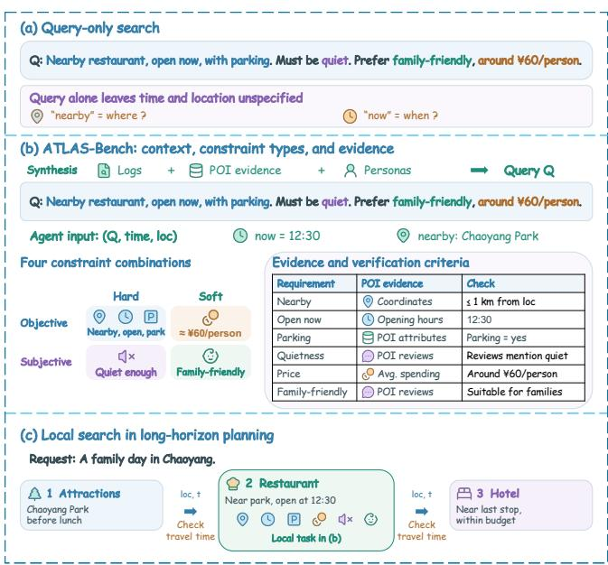  
Figure 1: Overview of ATLAS-Bench. (a) Query-only search lacks context and treats all constraints alike. (b) ATLAS-Bench adds context, constraint types, and evidence. (c) Local search within a longer plan.

To address this gap, we introduce ATLAS-Bench, an Agentic Tool-Use Benchmark for Local Area Search comprising 1,200 queries across three regions with contrasting POI densities: Chaoyang (Beijing), Huangpu (Shanghai), and Dabancheng (Urumqi). Each query preserves a logged search intent while incorporating personaguided requirements grounded in the attributes and reviews of an engaged reference POI; however, any POI satisfying the stated constraints counts as a valid answer, and all preferences are explicitly expressed so evaluation requires only the query, timestamp, and location. A recursive self-improving (RSI) pipeline validates queries via assertion checks and cross-model review, converting detected failures into new assertions for subsequent batches and yielding fine-grained annotations of constraint hardness, subjectivity, relations, and verification evidence.

Table 1: Comparison of local search and mobility benchmarks. ✓: supported; △: partial or limited; ✗: not supported.
<table><tr><td>Dimension</td><td>MapEval LocalSearch Mobility</td><td></td><td></td><td>MapSatisfy</td><td>ATLAS</td></tr><tr><td>Query source</td><td>Manual</td><td>Manual</td><td>Trajectory</td><td>Map logs Decision</td><td>Log-grounded</td></tr><tr><td>Reference target</td><td>Manual</td><td>Manual</td><td>Destination</td><td>rubrics</td><td>Clicked POI</td></tr><tr><td>Context</td><td>x</td><td>∆</td><td>√</td><td>√</td><td>√</td></tr><tr><td>Constraint taxonomy</td><td>x</td><td>∆</td><td>x</td><td>Δ</td><td>✓</td></tr><tr><td>Constraint conflicts</td><td>x</td><td>x</td><td>x</td><td>x</td><td>√</td></tr><tr><td>Implicit needs</td><td>x</td><td>∆</td><td>x</td><td>√</td><td>√</td></tr><tr><td>Quality control</td><td>Manual</td><td>Manual</td><td>Static rules</td><td>LLM judges</td><td>Rules + Agent</td></tr></table>

Building on ATLAS-Bench, we develop ATLASBox, a reproducible evaluation sandbox that avoids temporal drift in live map services by serving a fixed POI knowledge base through standardized tools for POI retrieval, nearby search, and review inspection. ATLASBox logs all tool interactions to evaluate final answers and trajectories across constraint satisfaction, factual accuracy, trajectory quality, and execution cost. Our contributions are threefold:

• Taxonomized Benchmark and Reproducible Sandbox. We introduce ATLAS-Bench (1,200 log-grounded queries refined via recursive self-improvement) and the ATLASBox sandbox, jointly modeling constraint hardness, subjectivity, and conflicts with traceable POI evidence for rigorous agent evaluation.

• Comprehensive Benchmarking and Trade-of Analysis. Evaluating 14 model configurations, we reveal a critical tradeof between task coverage and constraint satisfaction across exploratory and conservative search strategies.

• Local Search Challenges. Analyzing regional settings, constraint types, and a long-horizon case, we highlight challenges in filtering dense candidate spaces and verifying complex, subjective requirements, underscoring the importance of reliable local search for long-horizon planning.

## 2 Related Work

## 2.1 Search Agents and Their Evaluation

Web search agents interleave retrieval with reasoning, as in Searcho1 and WebThinker [14, 15], and combine task decomposition with online evidence synthesis [3, 33, 37], while Search-R1 and R1-Searcher optimize search decisions via reinforcement learning [11, 26].

Existing benchmarks evaluate related capabilities: QUEST tests entity-seeking queries with implicit set operations [18], InstructIR and FollowIR assess instruction-following retrieval [19, 32], and BRIGHT targets reasoning-intensive retrieval [28]. HotpotQA [35], MuSiQue [30], and BrowseComp [31] evaluate multi-hop QA and persistent web browsing. While these tasks target document relevance or factual QA, ATLAS-Bench evaluates spatiotemporal local search, requiring agents to verify heterogeneous constraints against POI attributes and user reviews.

## 2.2 Geospatial and Local Search Benchmarks

MapEval and MapQA evaluate geospatial reasoning [6, 17], while LocalEval tests local-service knowledge and user–service interactions [13]. LocalSearchBench evaluates multi-hop merchant and web search [10], and MapSatisfyBench focuses on inferring unspoken user needs from behavioral histories and multi-turn clarification [2].

However, these benchmarks do not jointly model constraint hardness, subjectivity, and conflicts, nor do they verify experiential requirements against POI reviews. ATLAS-Bench annotates both hard/soft and objective/subjective dimensions, linking each requirement to POI attributes or reviews under spatiotemporal context to evaluate evidence-backed recommendations and preference trade-ofs.

## 2.3 Long-Horizon Planning and Executable Constraint Evaluation

TravelPlanner checks itinerary constraints against travel records [34], while ChinaTravel evaluates compositional constraints and soft preferences through an executable domain-specific language over activity attributes [25]. MobilityBench evaluates route planning using real mobility queries and a frozen API replay environment [27].

TravelPlanner and ChinaTravel mainly use structured attributes and programmatic checks to verify constraints. ATLAS-Bench also evaluates subjective requirements supported by review evidence, such as quietness and atmosphere. It focuses on contextual place selection as a constituent capability of longer plans, complementing itinerary-level feasibility evaluation.

## 3 Construction of ATLAS

Figure 3 outlines the construction pipeline of ATLAS. This section describes the task formulation (§3.1), POI knowledge base construction (§3.2), the recursive self-improving data synthesis pipeline (§3.3), dataset statistics and comparative analysis (§3.4), and the integration of the ATLASBox evaluation sandbox (§3.5).

## 3.1 Problem Statement

3.1.1 Formulation of ATLAS. ATLAS-Bench focuses on agentic local area search characterized by incomplete information and multi-faceted constraints across temporal, spatial, and user-centric dimensions. Unlike plain retrieval or routing tasks, agents must infer implicit intents, invoke tools to gather evidence, and arbitrate between competing constraints.

Local search also forms a constituent decision problem in longer planning workflows. For example, arranging dinner after a movie translates the cinema location, expected finishing time, and subsequent activities into spatial, opening-hour, and dining-duration constraints. ATLAS-Bench abstracts this step as multi-constraint POI search conditioned on a query and its context, evaluating whether an agent retrieves suitable candidates supported by evidence. These candidates can inform subsequent planning decisions, while complete plans additionally require coordination of cross-step dependencies, cumulative budgets, and schedule feasibility. Performance on ATLAS-Bench therefore characterizes a component capability rather than establishing end-to-end planning competence. To support this task, ATLAS-Bench follows three key design principles:

Behavioral Grounding: Each instance originates from a logged search event, retaining its query, timestamp, privacy-processed user coordinates, and associated POI interactions. POIs associated with navigation initiation or detail-page viewing longer than five seconds serve as candidate reference targets rather than unique ground-truth answers.

Verifiability: Every synthesized constraint is grounded in observable evidence, such as structured POI attributes or verified reviews. Our target-conditioned inverse synthesis pipeline extracts this evidence before generating natural-language constraints, so each query remains traceable and verifiable.

Systematic Coverage: Constraints are characterized by subjec tivity (objective versus subjective) and hardness (hard versus soft), together with relations among requirements, to support sampling and diagnosis.

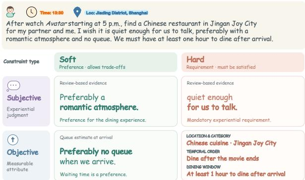  
Figure 2: Four constraint combinations for a shared restaurant-search intent.

3.1.2 ConstraintTaxonomy. ATLAS-Bench organizes requirements into atomic constraints and their relations. Atomic constraints have two independent dimensions: subjectivity, distinguishing factual conditions from experiential judgments, and hardness, distinguishing mandatory requirements from preferences that allow trade-ofs. Figure 2 illustrates the four combinations of subjectivity and hardness within a single restaurant-search request. Each constraint is paired with an evidence source and a check predicate. Constraints may be compatible, trade of against each other, conflict as hard requirements, or depend on one another. Hard conflicts make a query unsatisfiable by design, in which case the expected behavior is to report that no candidate meets all hard constraints. Task POIs serve as spatial anchors, excluded candidates, or candidate reference targets; reference-target names never appear in the query, avoiding answer leakage.

## 3.2 POI Knowledge Base Construction

The source data comprise search logs from a major commercial navigation platform and online POI snapshots of the three target regions. Each search event records the query, timestamp, user coordinates, and subsequent POI interactions, including navigation initiation and detail-page viewing duration. The POI knowledge base indexes all filtered online POIs across each region, not just those appearing in the search logs. For each POI, we collect structured attributes (category, address, rating, average spending, opening hours, facilities, and operating status) and link its reviews and place-related notes. Attributes and reviews are stored separately but linked by POI identifiers, with dedicated tools for review retrieval.

User profiles originate from existing platform records and, after privacy processing, are used only for query synthesis. The generation agent adopts the supplied persona to formulate requests reflecting its preferences and needs. For example, a persona traveling by car may motivate a parking requirement in the generated query. At evaluation time, the search agent receives only the query, timestamp, and user location, without separate profile fields. Any profile-derived requirement used for scoring must therefore be recoverable from these visible inputs, rather than imposed solely through hidden profile attributes.

For query synthesis, we retain search events with the interactions. The associated POI serves as a candidate reference target, whose compatibility with the expanded query is subsequently checked against POI attributes and textual evidence. Other POIs in the knowledge base that satisfy the query constraints remain valid answers.

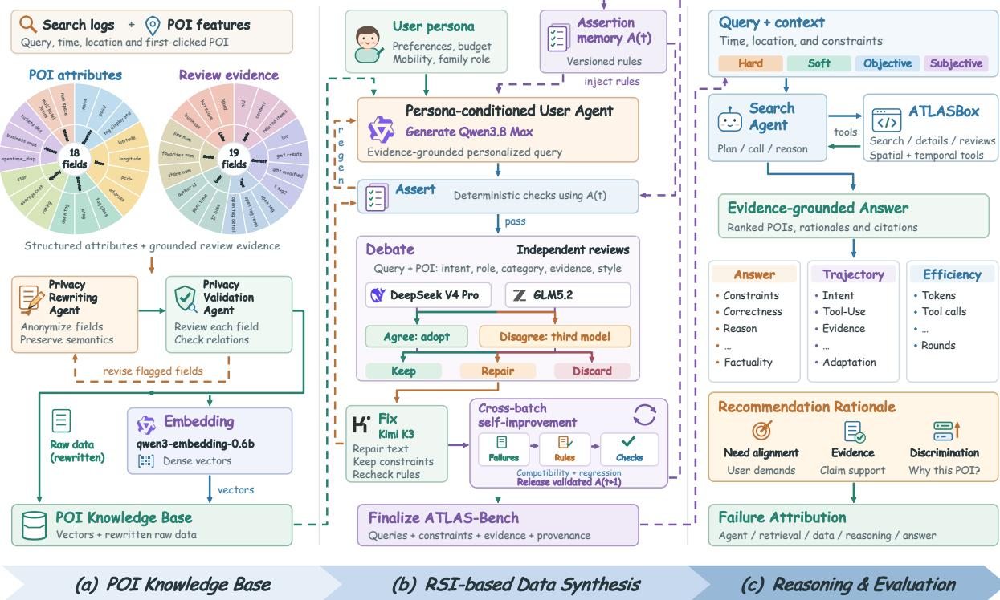  
Figure 3: Overview of ATLAS. (a) Search logs are linked to POI attributes and reviews, privacy-rewritten and validated, and stored as vectors and raw records. (b) Persona-aware queries pass through assertions, cross-model debate, repair, and finalization; failures update the assertion memory from $\mathcal { A } ^ { ( t ) } \mathbf { \widehat t o } \mathcal { A } ^ { ( t + 1 ) }$ . (c) Agents solve the tasks in ATLASBox and are evaluated on answer quality, trajectory quality, and eficiency.

Before use, a Privacy Rewriting Agent transforms identifying fields in query contexts, user profiles, and POI records, followed by review by a Privacy Validation Agent. User profiles retain abstract attributes relevant to search, such as spending ranges, travel modes, and family roles. Identifiers, contact information, and address details are rewritten or replaced, and user coordinates are perturbed, with checks for preservation of search intent, spatiotemporal relations, and POI characteristics. Anonymized data use for this benchmark was authorized by the data provider. The processed textual content is encoded using Qwen3-Embedding-0.6B [36]. The knowledge base stores both embeddings and rewritten records to support retrieval and evidence inspection, as illustrated in Figure 3(a).

## 3.3 RSI-based Data Synthesis

ATLAS-Bench synthesizes queries with a recursive self-improving (RSI) pipeline comprising Prepare, Generate, Assert, Debate, Fix, and Finalize (Figure 3(b)). Self-improvement accumulates checking rules in an external assertion memory, without updating model parameters.

3.3.1 Evidence-Grounded Generation. Prepare groups candidate records by POI category and assigns expression styles, anchor types, and target dificulty levels. Qwen3.8-Max [24] serves as the main agent: it generates queries, arbitrates review disagreements (Section 3.3.2), and maintains the assertion memory (Section 3.3.3). In Generate, it acts as a persona-conditioned user agent (Section 3.2) that preserves the logged query’s core intent and spatiotemporal context, retrieves attributes or reviews of the candidate reference POI, and adds only evidence-supported constraints, which are synthesized rather than observed in the original query. Each query is annotated with subjectivity, hardness, evidence sources, and expected predicates.

3.3.2 Assertion Checking and Cross-Model Review. Assert checks each query against the current assertion memory, covering POI roles, target-name leakage, geographic validity, retrieval intent, category compatibility, text integrity, target status, and support for annotated conflicts; deterministic conditions are checked directly, and semantic ones follow the criteria in memory. Passing queries enter Debate, where DeepSeek-V4-Pro [4] and GLM-5.2 [8] independently assess the query, reference target, and evidence for consistency and naturalness. Joint acceptance retains a query, joint rejection routes it to repair or removal, and disagreement is arbitrated by the main agent in a separate context. Fix uses Kimi-K3 [12] to repair wording while preserving constraints, evidence links, and target semantics; substantive defects require regeneration or removal. Repaired and regenerated queries restart from Assert until a retry limit. Finalize derives constraint labels, removes duplicates, and retains context, reference targets, evidence links, and provenance (Appendix A).

3.3.3 Assertion-Memory Self-Improvement. After each batch, the main agent summarizes the failure patterns behind joint rejections and evaluator disagreements and formulates candidate assertions. For disagreements, it uses the evaluators’ explanations and arbitration outcomes to clarify the underlying criterion, rather than rejecting similar queries merely because evaluators disagreed. Each candidate is compared with existing assertions in scope and requirements; conflicting candidates are revised or withheld, and compatible ones are added to the memory:

$$
\boldsymbol { \mathcal { A } } ^ { ( t + 1 ) } = \mathrm { U p d a t e } _ { \operatorname* { m a i n } } \left( \boldsymbol { \mathcal { A } } ^ { ( t ) } , \boldsymbol { \mathcal { D } } ^ { ( t ) } , \boldsymbol { \mathcal { T } } ^ { ( t ) } \right) ,\tag{1}
$$

where $\mathcal { A } ^ { ( t ) }$ is the assertion memory at round $t ,$ and $\mathcal { D } ^ { ( t ) }$ and $\mathcal { T } ^ { ( t ) }$ collect evaluator disagreements and joint rejections, respectively, together with their feedback. The operator $\mathrm { U p d a t e } _ { \mathrm { m a i n } }$ denotes failure summarization, assertion formulation, and compatibility assessment by the main agent.

Subsequent queries are checked against the updated memory, so recurring defects are caught before finalization without passing the full assertion history to the generator. Before release, all retained queries, including those accepted in early rounds, are rechecked against the final memory $\mathcal { A } ^ { ( T ) } \colon$ ; queries that fail are repaired or removed.

## 3.4 Dataset Composition and Synthesis Quality

3.4.1 Regional composition. Table 2(a) summarizes each region’s knowledge base and queries. The regions difer sharply in POI density: Chaoyang contains over 150 times as many active POIs as Dabancheng. Huangpu has the most constraints per query and the highest constraint-combination entropy, while Chaoyang leads in intent entropy and semantic distance. The regions thus pose complementary challenges: Huangpu stresses compositional constraint satisfaction, whereas Chaoyang stresses coverage of diverse intents.

3.4.2 Constraint coverage. The benchmark contains 1,200 queries with 3,049 atomic constraint annotations across 20 dimensions; 75% of queries involve multiple constraints, and 196 (16.3%) are unsatisfiable. These unsatisfiable queries contain conflicting hard constraints and test whether an agent reports that no candidate meets all hard constraints, rather than returning an unsuitable POI. Table 2(b) reports, for each region, the share of queries containing each constraint type; since a query may combine several types, the shares do not sum to 100%. Appendices A.2 and B report dimensionlevel distributions, diversity-metric definitions, and a comparison with LocalSearchBench.

3.4.3 Synthesis quality across RSI rounds. Figure 4 tracks synthesis quality across ten recursive improvement rounds. Disagreements and joint rejections from Debate informed assertion-memory updates, which the main agent assessed for compatibility before sub sequent use at Assert. Recorded revisions include corrections to evidence linkage, refinements to constraint checks, and relaxation of over-restrictive rejection rules (Appendix D). From the first to the tenth round, intent compliance increased from 0.844 to 0.965, linguistic naturalness from 0.765 to 0.986, and reference-target traceability from 0.143 to 0.897. Uniqueness remained at or above 0.967 and reached 1.000 in the final round. Intermediate declines indicate that improvement was not monotonic.

Table 2: Regional statistics and constraint coverage. A query may contain multiple constraint types.
<table><tr><td>Metric</td><td>Chaoyang</td><td>Huangpu</td><td>Dabancheng</td></tr><tr><td colspan="4">(a) Corpus statistics</td></tr><tr><td>Queries</td><td>400</td><td>400</td><td>400</td></tr><tr><td>Active POIs</td><td>343,916</td><td>79,058</td><td>2,270</td></tr><tr><td>Mean constraints/query</td><td>2.17</td><td>3.09</td><td>2.37</td></tr><tr><td>Intent entropy</td><td>0.8329</td><td>0.6264</td><td>0.6750</td></tr><tr><td>Constraint combination entropy</td><td>0.6608</td><td>0.8130</td><td>0.5788</td></tr><tr><td>Surface diversity</td><td>0.4067</td><td>0.4327</td><td>0.2854</td></tr><tr><td>Mean cosine distance</td><td>0.5898</td><td>0.5630</td><td>0.5338</td></tr><tr><td>Inter-annotator agreement</td><td>0.924</td><td>0.925</td><td>0.917</td></tr><tr><td colspan="4">(b) Query coverage by constraint type (%)</td></tr><tr><td>Hard objective</td><td>64.3</td><td>82.5</td><td>71.3</td></tr><tr><td>Hard subjective</td><td>12.8</td><td>13.5</td><td>26.3</td></tr><tr><td>Soft objective</td><td>16.5</td><td>52.0</td><td>27.0</td></tr><tr><td>Soft subjective</td><td>53.0</td><td>25.0</td><td>41.8</td></tr></table>

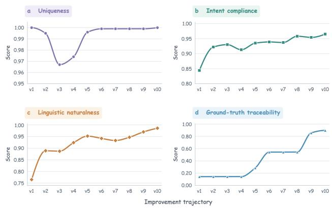  
Figure 4: Observed synthesis-quality trajectories across ten RSI rounds.

## 3.5 Integration of ATLASBox

ATLASBox turns each benchmark record into an executable localsearch task in a standardized environment. The agent receives only the query, timestamp, and user coordinates; persona fields and reference-target annotations are withheld to prevent information leakage. It can call four tools for POI search, review search, POI-specific review lookup, and radius-constrained retrieval (Appendix E), all served from fixed regional knowledge bases so that every agent accesses the same information. Each returned record carries an evidence identifier, so claims and recommendations can be traced back to the retrieved attributes or reviews.

The sandbox logs tool arguments, observations, parallel calls, final recommendations, latency, and token usage. Answer evaluation checks whether returned POIs satisfy the annotated constraints and whether supporting claims are grounded in retrieved evidence, without treating the clicked POI as the only correct answer. Trajectory evaluation examines request interpretation, tool selection, evidence verification, and adaptation to intermediate observations. Together, these enable comparable model runs and fine-grained diagnosis of failures in retrieval, reasoning, tool use, and final decisions.

Table 3: Overall performance on ATLAS-Bench. The best and second-best values are highlighted, excluding eficiency.
<table><tr><td></td><td colspan="5">Answer Quality</td><td colspan="4">Trajectory Quality</td><td colspan="3">Efficiency</td></tr><tr><td>Model</td><td>CSR</td><td>CR</td><td>Success@k Recs/q</td><td></td><td>Factual</td><td>Intent</td><td>Approp.</td><td>Evidence</td><td>Strategy</td><td>Tokens/q</td><td>Calls/q</td><td>Rounds/q</td></tr><tr><td>Qwen3.5-4B</td><td></td><td></td><td></td><td></td><td></td><td></td><td></td><td></td><td></td><td></td><td></td><td></td></tr><tr><td>w/o Think</td><td>37.3</td><td>65.8</td><td>54.0</td><td>2.24</td><td>40.25</td><td>3.53</td><td>3.70</td><td>1.99</td><td>2.96</td><td>36.8K</td><td>3.79</td><td>1.92</td></tr><tr><td>w/ Think</td><td>44.0</td><td>71.4</td><td>57.7</td><td>1.81</td><td>54.33</td><td>3.17</td><td>3.84</td><td>2.11</td><td>3.19</td><td>50.3K</td><td>4.74</td><td>2.73</td></tr><tr><td>Qwen3.6-35B-A3B</td><td></td><td></td><td></td><td></td><td></td><td></td><td></td><td></td><td></td><td></td><td></td><td></td></tr><tr><td>w/o Think</td><td>46.5</td><td>70.9</td><td>73.1</td><td>2.43</td><td>49.83</td><td>3.93</td><td>3.99</td><td>2.27</td><td>3.50</td><td>57.6K</td><td>6.07</td><td>3.33</td></tr><tr><td>w/ Think</td><td>54.3</td><td>77.0</td><td>73.9</td><td>2.05</td><td>67.25</td><td>3.62</td><td>4.03</td><td>2.37</td><td>3.36</td><td>56.3K</td><td>5.15</td><td>2.97</td></tr><tr><td>Qwen3.8-27B</td><td></td><td></td><td></td><td></td><td></td><td></td><td></td><td></td><td></td><td></td><td></td><td></td></tr><tr><td>w/o Think</td><td>55.0</td><td>73.9</td><td>75.4</td><td>2.74</td><td>77.83</td><td>4.19</td><td>4.16</td><td>2.40</td><td>3.43</td><td>46.8K</td><td>4.28</td><td>2.27</td></tr><tr><td>w/ Think</td><td>61.2</td><td>77.9</td><td>82.9</td><td>2.98</td><td>78.42</td><td>4.10</td><td>4.26</td><td>2.61</td><td>3.71</td><td>73.3K</td><td>5.79</td><td>3.11</td></tr><tr><td>Gemini-3.8-Flash (Hidden Think)</td><td>68.3</td><td>85.2</td><td>76.2</td><td>1.88</td><td>79.08</td><td>4.04</td><td>4.19</td><td>2.50</td><td>3.37</td><td>45.9K</td><td>4.73</td><td>2.48</td></tr><tr><td>Claude-5-Sonnet (Adaptive)</td><td>62.2</td><td>78.5</td><td>80.8</td><td>1.82</td><td>77.67</td><td>3.64</td><td>4.22</td><td>2.57</td><td>3.50</td><td>65.4K</td><td>4.56</td><td>2.84</td></tr><tr><td>Kimi-K3 (Max)</td><td>55.9</td><td>74.3</td><td>82.4</td><td>2.83</td><td>79.33</td><td>3.74</td><td>4.25</td><td>2.56</td><td>3.63</td><td>56.0K</td><td>5.49</td><td>3.04</td></tr><tr><td>GPT-5.6-Luna (Medium)</td><td>67.7</td><td>81.2</td><td>69.0</td><td>1.61</td><td>90.42</td><td>4.01</td><td>4.17</td><td>2.40</td><td>3.44</td><td>53.7K</td><td>4.20</td><td>2.56</td></tr><tr><td>GPT-6-Luna (XHigh)</td><td>71.5</td><td>84.3</td><td>67.3</td><td>1.25</td><td>95.58</td><td>4.23</td><td>4.16</td><td>2.41</td><td>3.31</td><td>74.8K</td><td>5.11</td><td>3.21</td></tr><tr><td>Qwen3.8-Max (Max)</td><td>58.3</td><td>76.1</td><td>84.0</td><td>3.09</td><td>83.00</td><td>4.30</td><td>4.26</td><td>2.57</td><td>3.90</td><td>79.2K</td><td>6.47</td><td>3.46</td></tr><tr><td>DeepSeek-V4.1-Flash (Thinking)</td><td>55.9</td><td>74.2</td><td>84.7</td><td>3.38</td><td>80.83</td><td>4.28</td><td>4.20</td><td>2.62</td><td>3.94</td><td>94.7K</td><td>7.39</td><td>3.82</td></tr><tr><td>GLM-5.3 (Max)</td><td>56.9</td><td>75.1</td><td>85.3</td><td>3.07</td><td>83.67</td><td>4.25</td><td>4.35</td><td>2.61</td><td>4.05</td><td>90.8K</td><td>7.04</td><td>3.64</td></tr></table>

## 4 Experiment

## 4.1 Metrics

Using evidence from the recommended POI, we classify each recommendation as qualified if all hard constraints and soft preferences are supported; acceptable if all hard constraints are satisfied and any unmet or unverifiable soft preferences are explicitly disclosed; or unacceptable if a hard constraint is violated or unsupported, a softpreference gap is undisclosed, or evidence is fabricated, distorted, or drawn from another POI.

1. Answer Quality. Based on these verdicts, we report five com plementary metrics, formally defined in Appendix C. CSR strictly measures constraint satisfaction at the recommendation level, cred iting satisfied constraints only in qualified or acceptable recommendations. CR measures constraint recall: it credits every evidencesupported constraint, including those in unacceptable recommendations, which thus receive partial credit. Success@k is the proportion of should-answer queries with at least one qualified or acceptable recommendation, and Recs/query is the average number of recommendations over the same queries. Empty answers count as zero in both, so over-refusal is penalized. Factual accuracy requires passing both a deterministic grounding check and an LLM-based factuality check. 2. Trajectory Quality. We assess intent understanding, tool-use appropriateness, evidence sufficiency and strategy adaptation. 3. Execution Cost. We report token consumption, tool calls, and execution rounds per query to characterize the resources required by each model.

## 4.2 Experimental Setup

Models. We evaluate 14 configurations of 11 models: Qwen3.5- 4B [29], Qwen3.6-35B-A3B [23], Qwen3.8-27B and Qwen3.8-Max [24], Claude-5-Sonnet [1], GPT-5.6-Luna [20], GPT-6-Luna [21], GLM-5.3 [8], Kimi-K3 [12], DeepSeek-V4.1-Flash [5], and Gemini-3.8- Flash [9]. The first three Qwen models are tested with and without thinking. Settings. All models share ATLASBox’s knowledge bases and tools (Appendix E). Retrieval uses Qwen3-Embedding-0.6B to retrieve 100 candidates, followed by Qwen3-Reranker-0.6B with adaptive top-� (default 10, maximum 20). Agents are limited to � = 5 tool-use rounds. Local computation uses two NVIDIA H20 GPUs. Judge. All LLM-based judgments use DeepSeek-V4-Pro [4]. Since computing CSR and CR requires checking each recommended POI against the query constraints and its supporting evidence, we adopt the Agent-as-a-Judge paradigm [38]: the judge uses tools to locate, retrieve, and inspect evidence and verifies each constraint individually, reducing grounding and verification errors. We implement this workflow in Qoder [22], a coding-agent environment that, like Claude Code and Codex, supports tool use and iterative evidence inspection. With DeepSeek-V4-Pro as the backbone, we package the evaluation protocol as reusable agent skills [16] and parallelize checks across subagents. Other LLM-based evaluations call DeepSeek-V4-Pro directly via API.

## 4.3 Overall Performance and Analysis

4.3.1 Answer Quality Analysis. As shown in Table 3, GPT-6-Luna achieves the highest CSR (71.5%) and factual accuracy (95.58%) with a high CR (84.3%), indicating precise, well-grounded recommendations. However, its reluctance to relax soft preferences yields only 1.25 recommendations per query and a Success@k of just

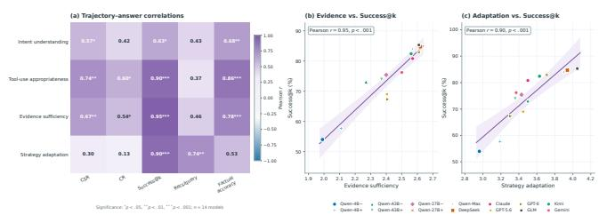  
Figure 5: Correlations between trajectory and answer quality.

67.3%. In contrast, GLM-5.3 and DeepSeek-V4.1-Flash return about three recommendations per query and reach higher Success@k (85.3% and 84.7%), but trail in CSR, CR, and factual accuracy. This reveals a trade-of: conservative models ofer higher precision and factual reliability but lower coverage, whereas more exploratory models improve answer coverage and recommendation breadth at the cost of including more imperfect candidates. The five metrics should therefore be interpreted jointly. Among open-source models, Qwen3.8-27B with thinking best balances constraint satisfaction and answer coverage, and thinking improves all five answerquality metrics over its non-thinking variant. Although compact or sparsely activated models are important for local-service applications with stringent latency requirements, the weaker performance of Qwen3.5-4B and Qwen3.6-35B-A3B suggests that targeted posttraining may be needed to improve their constraint satisfaction and evidence grounding. Across 201 sampled recommended POIs, the judge labels (qualified, acceptable, or unacceptable) underlying CSR, CR, and Success@k match human expert annotations with 93.03% exact agreement (Cohen’s � = 0.891).

4.3.2 Trajectory Quality Analysis. Strong answer quality does not imply uniformly strong trajectory quality, as diferent models exhibit distinct strengths. Qwen3.8-Max leads in intent understanding (4.30), GLM-5.3 in tool-use appropriateness (4.35) and strategy adaptation (4.05), and DeepSeek-V4.1-Flash in evidence suficiency (2.62), while Qwen3.8-27B with thinking remains competitive across all four dimensions among open-source models. GPT-6-Luna pairs strong intent understanding (4.23) with the highest factual accuracy, but scores lower in evidence suficiency (2.41) and strategy adaptation (3.31), suggesting that it gathers limited evidence and rarely explores alternative strategies. This may explain its high refusal rate and low Success@k: its answers are accurate, but more queries go unresolved. Trajectory and answer metrics thus ofer complementary views of model behavior. To validate these automated trajectory scores, we compared them with human expert ratings on a stratified sample of 100 trajectories: linearly weighted Cohen’s � was 0.837 for intent understanding, 0.729 for tool-use ap propriateness, 0.891 for evidence suficiency, and 0.832 for strategy adaptation, with exact agreement ranging from 81% to 88%.

As shown in Figure 5, tool-use appropriateness, evidence suficiency, and strategy adaptation correlate strongly with Success@k across the 14 configurations $( r = 0 . 9 0 , 0 . 9 5 ,$ , and 0.90). Strategy adaptation also correlates with Recs/query (� = 0.74), while intent understanding aligns with factual accuracy (� = 0.68). However, excluding the Qwen series (where scaling lifts all metrics), evidence suficiency and strategy adaptation correlate negatively with CSR across the remaining seven models (� = −0.89 and −0.86), showing that broader exploration finds more answers but admits more constraint violations.

4.3.3 Eficiency. Qwen3.5-4B without thinking uses the fewest tokens (36.8K), tool calls (3.79), and rounds (1.92) per query. DeepSeek-V4.1-Flash consumes the most resources, averaging 94.7K tokens, 7.39 tool calls, and 3.82 rounds. Its high Success@k comes with greater execution cost, highlighting a trade-of between query success and eficiency.

## 4.4 Regional Analysis

Figure 6 illustrates the contrasting POI distributions in Chaoyang, Huangpu, and Dabancheng, providing settings for examining how spatial density relates to agentic search performance. Model rankings are consistent across regions, with Spearman correlations of 0.88 to 0.90 for Success@k and 0.82 to 0.91 for evidence suficiency. Despite this ranking stability, regional averages reveal substantial diferences in performance and cost (Table 4). Huangpu has the lowest CSR (41.4%) and Success@k (63.7%), while requiring the most tool calls (6.12) and tokens (75.4K) per query. Its evidence suf-

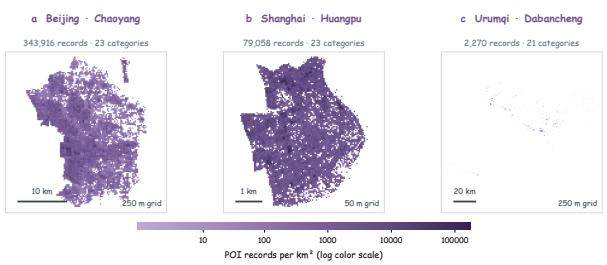  
Figure 6: POI distributions, colored by area-normalized density on a shared log scale.

ficiency also remains lowest (1.90), suggesting that greater search efort does not necessarily produce adequate supporting evidence. The combination of dense candidates and more complex queries may make candidate selection and evidence verification particularly demanding. Dabancheng achieves a higher Success@k (80.8%) with only 3.88 tool calls and 43.0K tokens per query, consistent with a smaller candidate pool reducing search efort. However, its correctrefusal rate on unsatisfiable queries is lower than Chaoyang’s (75.6% versus 87.5%). Sparse candidate availability may therefore pose a diferent challenge: agents may retrieve fewer POIs but still select an unsuitable candidate to provide an answer, rather than recognize that none satisfies the constraints. This suggests that eficient retrieval and reliable recognition of unsatisfiable queries remain distinct capabilities.

## 4.5 Ablation Analysis

Table 5 shows that, at � = 100, increasing the fixed return count from 20 to 30 raises Success@k from 77.9% to 82.6%, but reduces factual accuracy from 76.0% to 72.0% and increases tokens per query from 49.4K to 61.0K. More results may help uncover feasible candidates but also introduce distracting evidence, making factual verification harder. We therefore retain an adaptive return count capped at 20 results per call to balance recommendation success, factual reliability, and cost.

Table 4: Regional performance across 14 configurations.
<table><tr><td></td><td colspan="5">Answer Quality</td><td>Trajectory</td><td colspan="2">Efficiency</td></tr><tr><td>Region</td><td>CSR</td><td>CR</td><td>Success@k</td><td>Recs (/query)</td><td>Factual accuracy</td><td>Evidence sufficiency</td><td>Tool calls</td><td>Tokens</td></tr><tr><td>Chaoyang</td><td>62.9</td><td>77.1</td><td>80.0</td><td>2.81</td><td>72.6</td><td>2.46</td><td>6.04</td><td>70.5K</td></tr><tr><td>Huangpu</td><td>41.4</td><td>68.8</td><td>63.7</td><td>2.08</td><td>68.6</td><td>1.90</td><td>6.12</td><td>75.4K</td></tr><tr><td>Dabancheng</td><td>68.7 84.0</td><td></td><td>80.8</td><td>2.22</td><td>81.2</td><td>2.91</td><td>3.88</td><td>43.0K</td></tr></table>

For the round budget, increasing � from 2 to 5 raises Success@k from 73.3% to 80.2%. Further increases to $N = 6 , 7 , 8$ yield Success@k of 80.2%, 81.4%, and 77.9%, respectively, while consuming 17–27% more tokens than � = 5. We therefore retain � = 5 as a practical balance between recommendation success and execution cost.

Table 6 shows that reranking improves retrieval, but enlarging the candidate pool from � = 100 to 200 barely raises NDCG@10 (0.745 to 0.747) while nearly doubling median latency (0.568 to 1.078 s).

## 4.6 Further Analysis

4.6.1 Gains and Costs of Thinking. Enabling thinking improves CSR by approximately 6–8 percentage points across the three paired Qwen models, potentially reflecting more thorough constraint verification, but it typically increases token consumption and latency.

4.6.2 Recommendation Richness. Figure 7 characterizes this aspect from two perspectives. As shown in Figure 7(a), DeepSeek-V4.1- Flash, GLM-5.3, and Qwen3.8-Max more often return multiple alternatives, whereas GPT-6-Luna often returns zero or one, reflecting its conservative policy. Figure 7(b) relates recommendation count to intra-list diversity (ILD): Qwen3.8-Max and GLM-5.3 achieve both, while DeepSeek-V4.1-Flash returns the most recommendations (3.38 per query) with slightly lower ILD. Quantity does not imply diversity: models returning more POIs do not necessarily achieve higher ILD, as their lists may be largely homogeneous.

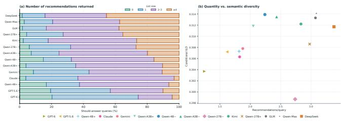  
Figure 7: Recommendation richness: (a) list-size distributions and (b) quantity versus conditional intra-list diversity.

4.6.3 Case Study and Failure Atribution. Figure 8 contrasts two multi-round tool-use trajectories to examine how agents use retrieved evidence to revise their search. In the high-scoring case, filtering by category, distance, and reviews progressively narrows the candidate set. Each refinement addresses a requirement of the query, linking retrieval decisions to the evidence needed for recommendation. The trajectory illustrates how successive tool calls can contribute to a more focused search when their results inform the next action.

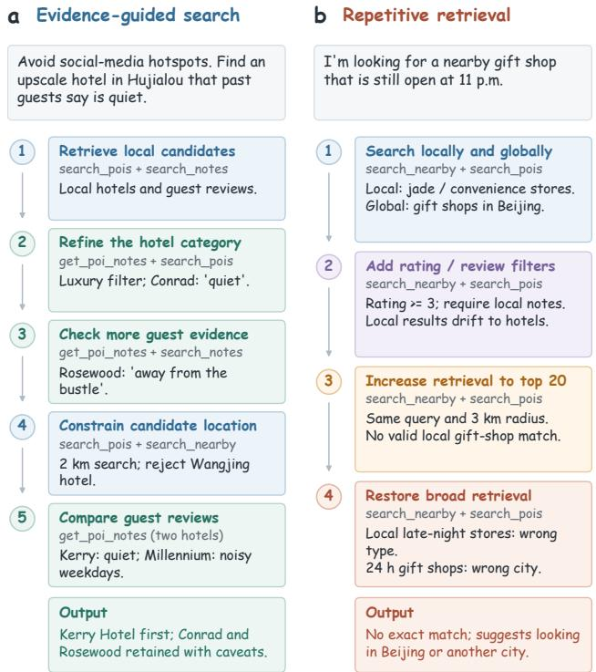  
Figure 8: Contrasting tool-use trajectories: (a) evidenceguided candidate refinement in a high-scoring case; (b) repetitive, of-target retrieval in a failure case.

In the failure case, the agent adjusts filters without resolving the mismatch between the requested category and locality. Retrieval consequently remains repetitive and of target, and the final recommendations violate constraints. The contrast concerns how the search changes in response to evidence: modifying a filter does not constitute efective adaptation if the underlying mismatch persists. These two cases illustrate this distinction; they do not establish its prevalence across all evaluated models.

Across 1,826 agent-side failures, the reported attribution assigns 33.7% to intent understanding, 26.2% to tool use, 22.6% to evidence grounding, and 17.5% to strategy adaptation. Tool-use errors account for 35.3% of failures among weaker models, making them the largest category in that group. Intent understanding is the largest category overall, indicating that failure analysis must consider the interpretation of requirements alongside tool execution and evidence use. These percentages describe the attributed failures, rather than failure rates over all queries.

The cases also help interpret the round-budget results in Table 5: additional rounds provide opportunities to inspect evidence, but do not guarantee that an agent will correct its search. Efective use of the budget requires identifying which requirement remains unresolved and choosing a subsequent action that addresses it. This qualitative interpretation is consistent with the non-monotonic Success@k observed as the round limit increases beyond five.

Table 5: Budget sensitivity of Qwen3.8-27B (w/o thinking). �: candidate-pool size; � : results per call; �: maximum rounds.
<table><tr><td></td><td colspan="3"> $C = 1 0 0$ </td><td colspan="3">C = 200</td><td colspan="6">N</td></tr><tr><td>Metric</td><td> $T = 1 0$ </td><td> $T = 2 0$ </td><td> $\overline { { T = 3 0 } }$ </td><td> $\stackrel { \_ } { T } = 1 0$ </td><td> $T = 2 0$ </td><td> $\overline { { T = 3 0 } }$ </td><td>2</td><td>3</td><td>4</td><td>5</td><td>6</td><td></td></tr><tr><td>CSR (%)</td><td>56.4</td><td>60.4</td><td>56.4</td><td>59.0</td><td>59.3</td><td>53.3</td><td>55.9</td><td>52.8</td><td>55.8</td><td>55.0</td><td>58.3</td><td>56.8</td></tr><tr><td>CR (%)</td><td>75.5</td><td>74.4</td><td>74.0</td><td>76.7</td><td>77.5</td><td>73.6</td><td>77.2</td><td>73.5</td><td>75.5 79.1</td><td>74.0</td><td>74.1</td><td>73.6</td></tr><tr><td>Success@k (%)</td><td>74.4</td><td>77.9</td><td>82.6</td><td>76.7</td><td>79.1</td><td>76.7</td><td>73.3</td><td>75.6 2.44</td><td></td><td>80.2</td><td>80.2 2.56</td><td>77.9</td></tr><tr><td>Recs/q</td><td>2.24</td><td>2.47</td><td>2.73</td><td>2.34</td><td>2.48</td><td>2.71</td><td>2.45</td><td>2.74</td><td>2.52</td><td></td><td>76.00</td><td>2.60</td></tr><tr><td>Factual (%)</td><td>81.00</td><td>76.00</td><td>72.00</td><td>80.00</td><td>72.00</td><td>77.00</td><td>79.00 73.00</td><td>79.00</td><td>77.00</td><td></td><td></td><td>76.00</td></tr><tr><td>Intent</td><td>4.34</td><td>4.28</td><td>4.54</td><td>4.43</td><td>4.45</td><td>4.49</td><td>4.30</td><td>4.27</td><td>4.29</td><td></td><td></td><td>4.39</td></tr><tr><td>Approp.</td><td>4.20</td><td>4.34</td><td>4.36</td><td>4.34</td><td>4.33</td><td>4.40</td><td>4.29</td><td>4.42 4.40</td><td>4.31</td><td></td><td></td><td>4.42</td></tr><tr><td>Evidence</td><td>2.59</td><td>2.68</td><td>2.91</td><td>2.75</td><td>2.76</td><td>2.59</td><td>2.66</td><td>4.29</td><td>2.64</td><td></td><td></td><td>2.60</td></tr><tr><td>Strategy</td><td>3.34</td><td>3.30</td><td>3.58</td><td>3.42</td><td>3.21</td><td>3.57</td><td>2.62 3.17 3.41</td><td>2.61 3.44</td><td>3.45</td><td>2.76 3.53</td><td></td><td>3.57</td></tr><tr><td>Tokens/q</td><td>35.9K</td><td>49.4K</td><td>61.0K</td><td>34.3K</td><td>47.9K</td><td>60.0K</td><td>29.8K 34.0K</td><td>40.2K</td><td>42.2K</td><td>49.4K</td><td>3.52 49.7K</td><td>53.6K</td></tr><tr><td>Calls/q</td><td>3.87</td><td>3.86</td><td>3.99</td><td>3.78</td><td>3.72</td><td>3.96</td><td>2.95</td><td>3.78</td><td>3.92</td><td>4.41</td><td>4.38</td><td>4.60</td></tr><tr><td>Rounds/q</td><td>2.07</td><td>2.03</td><td>2.13</td><td>2.02</td><td>2.00</td><td>2.10</td><td>1.55 1.71</td><td>1.99</td><td>2.08</td><td>2.31</td><td>2.31</td><td>2.42</td></tr></table>

Table 6: Retrieval comparison across candidate-pool sizes �. Shading marks the default; bold indicates the best value.
<table><tr><td>Method</td><td>k</td><td>NDCG@10</td><td>Hit@10</td><td>Recall@20</td><td>MRR@20</td><td>P50 (s)</td></tr><tr><td>BM25</td><td>一</td><td>0.606</td><td>0.813</td><td>0.632</td><td>0.689</td><td>0.059</td></tr><tr><td>Vector</td><td>100</td><td>0.664</td><td>0.881</td><td>0.675</td><td>0.771</td><td>0.057</td></tr><tr><td>BM25 + rerank</td><td>100</td><td>0.726</td><td>0.884</td><td>0.713</td><td>0.820</td><td>0.564</td></tr><tr><td>Vector + rerank</td><td>20</td><td>0.716</td><td>0.899</td><td>0.675</td><td>0.817</td><td>0.160</td></tr><tr><td>Vector + rerank</td><td>100</td><td>0.745</td><td>0.927</td><td>0.745</td><td>0.833</td><td>0.568</td></tr><tr><td>Vector + rerank</td><td>200</td><td>0.747</td><td>0.935</td><td>0.757</td><td>0.831</td><td>1.078</td></tr></table>

4.6.4 Constraint Breakdown. Across all configurations, Success@k on satisfiable queries with hard objective, hard subjective, soft objective, and soft subjective constraints averages 72.8%, 60.4%, 75.9%, and 69.7%, likely because subjective constraints are harder to verify than facts while soft preferences allow greater relaxation.

## 4.7 Local Search in Long-Horizon Tasks

We examine a couple’s day-trip request in Beijing’s Chaoyang District with Qwen3.8-Max, comparing a single whole-itinerary execution against seven merged stage-specific requests. Figure 9 shows the first recommendation at each stage and the evaluation scores of both trajectories. While single-pass execution produces a brief, high-level overview with relatively few errors and a CSR of 77.8%, it ofers limited actionable detail and practical guidance for users. Decomposing the request into stage-wise subqueries yields a much richer, more actionable itinerary with greater practical value for users, but CSR drops to 57.8% and the factuality check fails due to evidence-grounding errors in the subquery outputs.

This case illustrates why local constraint verification deserves dedicated evaluation in long-horizon planning: despite more errors, the subquery-based responses provide more concrete guidance and greater practical value for users than direct execution. This further highlights the importance of our research on reliably solving individual local-search subqueries, ensuring that richer recommendations are evidence-grounded and satisfy users’ constraints.

## 5 Conclusion

We introduce ATLAS-Bench and ATLASBox for evaluating agentic local search under diverse user constraints. Our synthesis pipeline combines privacy rewriting, persona-aware generation, and iterative validation to ground queries in POI evidence. Experiments across 11 models with 14 configurations reveal trade-ofs between recommendation coverage and reliability: higher query success can come with weaker constraint satisfaction and evidence grounding. Providing useful options across queries while reliably meeting users’ requirements remains a key challenge.

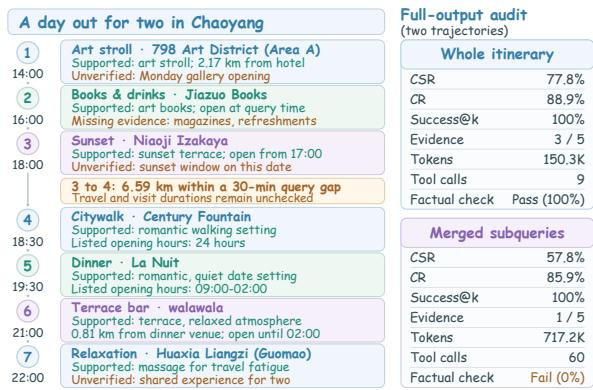  
Figure 9: Long-horizon case with stage choices and evidence.

## References

[1] Anthropic. 2026. Claude Sonnet 5. https://www.anthropic.com/news/claudesonnet-5. Accessed: 2026-09-20.

[2] Lubin Bai, Mengyu Cao, Sixue Wang, Zhongwei Wan, Yue Pan, Jiale Hou, Xiang Li, and Xiuyuan Zhang. 2026. MapSatisfyBench: Benchmarking Satisfaction-Aware Map Agents through Behavior-Grounded Implicit Decision Factors. arXiv:2606.17453 [cs.AI] https://arxiv.org/abs/2606.17453

[3] Zehui Chen, Kuikun Liu, Qiuchen Wang, Jiangning Liu, Wenwei Zhang, Kai Chen, and Feng Zhao. 2025. Mindsearch: Mimicking human minds elicits deep ai searcher. In International Conference On Learning Representations, Vol. 2025. 90007–90029.

[4] DeepSeek-AI. 2026. DeepSeek-V4: Towards Highly Eficient Million-Token Context Intelligence.

[5] DeepSeek-AI. 2026. DeepSeek-V4.1-Flash: Pushing the Limits of KV Cache Compression. arXiv:2609.19969 [cs.CL] https://arxiv.org/abs/2609.19969

[6] Mahir Labib Dihan, Md Tanvir Hassan, Md Tanvir Parvez, Md Hasebul Hasan, Md Almash Alam, Muhammad Aamir Cheema, Mohammed Eunus Ali, and Md Rizwan Parvez. 2025. MapEval: a map-based evaluation of geo-spatial reasoning in foundation models. In Proceedings ofthe 42nd International Conference on Machine Learning (Vancouver, Canada) (ICML’25). JMLR.org, Article 526, 40 pages.

[7] Zhichao Feng, JunJie Xie, Kaiyuan Li, Yu Qin, Pengfei Wang, Qianzhong Li, Bin Yin, Xiang Li, Wei Lin, and Shangguang Wang. 2024. Context-based Fast Recommendation Strategy for Long User Behavior Sequence in Meituan Waimai. In Companion Proceedings of the ACM Web Conference 2024 (Singapore, Singapore) (WWW’24). Association for Computing Machinery, New York, NY, USA, 355–363. doi:10.1145/3589335.3648334

[8] GLM-5-Team. 2026. GLM-5: from Vibe Coding to Agentic Engineering. arXiv:2602.15763 [cs.LG] https://arxiv.org/abs/2602.15763

[9] Google DeepMind. 2026. Gemini 3.8 Flash. https://blog.google/innovation-and-ai/ models-and-research/gemini-models/3-8-flash-and-3-8-flash-cyber/. Accessed: 2026-09-20.

[10] Hang He, Chuhuai Yue, Chengqi Dong, Mingxue Tian, Hao Chen, Zhenfeng Liu, Jiajun Chai, Xiaohan Wang, Yufei Zhang, Qun Liao, Guojun Yin, Wei Lin, Chengcheng Wan, Haiying Sun, and Ting Su. 2026. LocalSearchBench: Bench marking Agentic Search in Real-World Local Life Services. In Proceedings ofthe 32nd ACM SIGKDD Conference on Knowledge Discovery and Data Mining V.2 (Republic of Korea) (KDD ’26). Association for Computing Machinery, New York, NY, USA, 8989–9000. doi:10.1145/3770855.3817466

[11] Bowen Jin, Hansi Zeng, Zhenrui Yue, Jinsung Yoon, Sercan Arik, Dong Wang, Hamed Zamani, and Jiawei Han. 2025. Search-r1: Training llms to reason and leverage search engines with reinforcement learning. arXiv preprint arXiv:2503.09516 (2025).

[12] Kimi Team. 2026. Kimi K3: Open Frontier Intelligence. arXiv:2607.24653 [cs.CL] https://arxiv.org/abs/2607.24653

[13] Xiaochong Lan, Jie Feng, Jiahuan Lei, Xinlei Shi, and Yong Li. 2025. Benchmarking and Advancing Large Language Models for Local Life Services. In Proceedings of the 31st ACM SIGKDD Conference on Knowledge Discovery and Data Mining V.2 (Toronto ON, Canada) (KDD ’25). Association for Computing Machinery, New York, NY, USA, 4566–4577. doi:10.1145/3711896.3737196

[14] Xiaoxi Li, Guanting Dong, Jiajie Jin, Yuyao Zhang, Yujia Zhou, Yutao Zhu, Peitian Zhang, and Zhicheng Dou. 2025. Search-o1: Agentic search-enhanced large reasoning models. arXiv preprint arXiv:2501.05366 (2025).

[15] Xiaoxi Li, Jiajie Jin, Guanting Dong, Hongjin Qian, Yongkang Wu, Ji-Rong Wen, Yutao Zhu, and Zhicheng Dou. 2026. Webthinker: Empowering large reasoning models with deep research capability. Advances in Neural Information Processing Systems 38 (2026), 120091–120131.

[16] Xiangyi Li, Yimin Liu, Wenbo Chen, Bingran You, Zonglin Di, Yifeng He, Shenghan Zheng, Kyoung Whan Choe, Jiankai Sun, Shuyi Wang, et al. 2026. SkillsBench: Benchmarking how well agent skills work across diverse tasks. arXiv preprint arXiv:2602.12670 (2026).

[17] Zekun Li, Malcolm Grossman, Ehsan Qasemi, Mihir Kulkarni, Muhao Chen, and Yao-Yi Chiang. 2025. Benchmarking Geospatial Question Answering with MapQA. In Proceedings ofthe 33rd ACM International Conference on Advances in Geographic Information Systems (The Graduate Hotel Minneapolis, Minneapolis, MN, USA) (SIGSPATIAL ’25). Association for Computing Machinery, New York, NY, USA, 1042–1045. doi:10.1145/3748636.3764174

[18] Chaitanya Malaviya, Peter Shaw, Ming-Wei Chang, Kenton Lee, and Kristina Toutanova. 2023. QUEST: A Retrieval Dataset of Entity-Seeking Queries with Implicit Set Operations. In Proceedings of the 61st Annual Meeting of the Association for Computational Linguistics (Volume 1: Long Papers), Anna Rogers, Jordan Boyd Graber, and Naoaki Okazaki (Eds.). Association for Computational Linguistics, Toronto, Canada, 14032–14047. doi:10.18653/v1/2023.acl-long.784

[19] Hanseok Oh, Hyunji Lee, Seonghyeon Ye, Haebin Shin, Hansol Jang, Changwook Jun, and Minjoon Seo. 2024. INSTRUCTIR: A Benchmark for Instruction Following of Information Retrieval Models. arXiv:2402.14334 [cs.CL] https://arxiv.org/abs/ 2402.14334

[20] OpenAI. 2026. GPT-5.6: Frontier intelligence that scales with your ambition. https://openai.com/index/gpt-5-6/. Accessed: 2026-09-20.

[21] OpenAI. 2026. Introducing GPT-6 Sol and Luna. https://openai.com/index/ introducing-gpt-6-sol-and-luna/

[22] Qoder. 2025. Qoder Introduction. https://qoder.com/en/blog/qoder-introduction

[23] Qwen Team. 2026. Qwen3.6-35B-A3B: Agentic Coding Power, Now Open to All. https://qwen.ai/blog?id=qwen3.6-35b-a3b

[24] Qwen Team. 2026. Qwen3.8-Max: A New Bar for Coding and Cowork. https: //qwen.ai/blog?id=qwen3.8

[25] Jie-Jing Shao, Bo-Wen Zhang, Xiao-Wen Yang, Bai-Zhi Chen, Si-Yu Han, Jing-Hao Pang, Wen-Da Wei, Guohao Cai, Zhenhua Dong, Lan-Zhe Guo, and Yu feng Li. 2026. ChinaTravel: An Open-Ended Travel Planning Benchmark with Compositional Constraint Validation for Language Agents. In The Fourteenth International Conference on Learning Representations. https://openreview.net/ forum?id=0YRVlxY9BH

[26] Huatong Song, Jinhao Jiang, Yingqian Min, Jie Chen, Zhipeng Chen, Wayne Xin Zhao, Lei Fang, and Ji-Rong Wen. 2025. R1-Searcher: Incentivizing the Search Capability in LLMs via Reinforcement Learning. arXiv:2503.05592 [cs.AI] https: //arxiv.org/abs/2503.05592

[27] Zhiheng Song, Jingshuai Zhang, Chuan Qin, Chao Wang, Chao Chen, Longfei Xu, Kaikui Liu, Xiangxiang Chu, and Hengshu Zhu. 2026. MobilityBench: A Benchmark for Evaluating Route-Planning Agents in Real-World Mobility Scenarios. In Proceedings ofthe 32nd ACM SIGKDD Conference on Knowledge Discovery and Data Mining V.2 (Republic of Korea) (KDD ’26). Association for Computing Machinery, New York, NY, USA, 9801–9812. doi:10.1145/3770855.3817498

[28] Hongjin Su, Howard Yen, Mengzhou Xia, Weijia Shi, Niklas Muennighof, Han yu Wang, Haisu Liu, Quan Shi, Zachary S. Siegel, Michael Tang, Ruoxi Sun, Jinsung Yoon, Sercan O. Arik, Danqi Chen, and Tao Yu. 2025. BRIGHT: A Realistic and Challenging Benchmark for Reasoning-Intensive Retrieval. arXiv:2407.12883 [cs.CL] https://arxiv.org/abs/2407.12883

[29] Qwen Team. 2026. Qwen3.5: Towards Native Multimodal Agents. https://qwen. ai/blog?id=qwen3.5

[30] Harsh Trivedi, Niranjan Balasubramanian, Tushar Khot, and Ashish Sabharwal. 2022. MuSiQue: Multihop Questions via Single-hop Question Composition. Transactions of the Association for Computational Linguistics 10 (2022), 539–554. doi:10.1162/tacl\_a\_00475

[31] Jason Wei, Zhiqing Sun, Spencer Papay, Scott McKinney, Jefrey Han, Isa Fulford, Hyung Won Chung, Alex Tachard Passos, William Fedus, and Amelia Glaese. 2025. BrowseComp: A Simple Yet Challenging Benchmark for Browsing Agents. arXiv:2504.12516 [cs.CL] https://arxiv.org/abs/2504.12516

[32] Orion Weller, Benjamin Chang, Sean MacAvaney, Kyle Lo, Arman Cohan, Benjamin Van Durme, Dawn Lawrie, and Luca Soldaini. 2025. FollowIR: Evaluating and Teaching Information Retrieval Models to Follow Instructions. In Proceedings of the 2025 Conference of the Nations of the Americas Chapter of the Association for Computational Linguistics: Human Language Technologies (Volume 1: Long Papers), Luis Chiruzzo, Alan Ritter, and Lu Wang (Eds.). Association for Computational Linguistics, Albuquerque, New Mexico, 11926–11942. doi:10.18653/v1/2025.naacl-long.597

[33] Jialong Wu, Baixuan Li, Runnan Fang, Wenbiao Yin, Liwen Zhang, Zhenglin Wang, Zhengwei Tao, Ding-Chu Zhang, Zekun Xi, Robert Tang, et al. 2026. Webdancer: Towards autonomous information seeking agency. Advances in Neural Information Processing Systems 38 (2026), 120957–120985.

[34] Jian Xie, Kai Zhang, Jiangjie Chen, Tinghui Zhu, Renze Lou, Yuandong Tian, Yanghua Xiao, and Yu Su. 2024. TravelPlanner: a benchmark for real-world planning with language agents. In Proceedings ofthe 41st International Conference on Machine Learning (Vienna, Austria) (ICML’24). JMLR.org, Article 2246, 24 pages.

[35] Zhilin Yang, Peng Qi, Saizheng Zhang, Yoshua Bengio, William Cohen, Ruslan Salakhutdinov, and Christopher D. Manning. 2018. HotpotQA: A Dataset for Diverse, Explainable Multi-hop Question Answering. In Proceedings ofthe 2018 Conference on Empirical Methods in Natural Language Processing, Ellen Rilof, David Chiang, Julia Hockenmaier, and Jun’ichi Tsujii (Eds.). Association for Computational Linguistics, Brussels, Belgium, 2369–2380. doi:10.18653/v1/D18- 1259

[36] Yanzhao Zhang, Mingxin Li, Dingkun Long, Xin Zhang, Huan Lin, Baosong Yang, Pengjun Xie, An Yang, Dayiheng Liu, Junyang Lin, Fei Huang, and Jingren Zhou. 2025. Qwen3 Embedding: Advancing Text Embedding and Reranking Through Foundation Models. arXiv preprint arXiv:2506.05176 (2025).

[37] Yuxiang Zheng, Dayuan Fu, Xiangkun Hu, Xiaojie Cai, Lyumanshan Ye, Pengrui Lu, and Pengfei Liu. 2025. DeepResearcher: Scaling Deep Research via Reinforcement Learning in Real-world Environments. arXiv:2504.03160 [cs.AI] https://arxiv.org/abs/2504.03160

[38] Mingchen Zhuge, Changsheng Zhao, Dylan Ashley, Wenyi Wang, Dmitrii Khizbullin, Yunyang Xiong, Zechun Liu, Ernie Chang, Raghuraman Krishnamoorthi, Yuandong Tian, et al. 2024. Agent-as-a-judge: Evaluate agents with agents. arXiv preprint arXiv:2410.10934 (2024).

## A Data Synthesis Implementation Details

Prepare uses shards of approximately 115 candidate records and a 1.8-fold sampling factor to compensate for filtering. At Assert, target-name leakage checks exclude queries containing the normalized reference-target name or a continuous substring of at least four Chinese characters shared with that name. Finalize removes exact duplicates and filters near duplicates using character-level 3-gram Jaccard similarity with a threshold of 0.8. Records retain the query, spatiotemporal and optional user context, POI roles, constraints and evidence links, constraint relations, reference target, satisfiability annotation, and synthesis provenance.

Figure 11 presents condensed English adaptations of the Generate, Debate, and Fix prompts, covering persona-conditioned syn thesis, independent review with arbitration, and query rewriting that preserves constraints and evidence links.

## A.1 Regional POI Category Distributions

The source POI collections difer in category composition and spatial concentration. Figure 10 shows the eight most frequent POI categories in each region, complementing the aggregate regional statistics in Table 2.

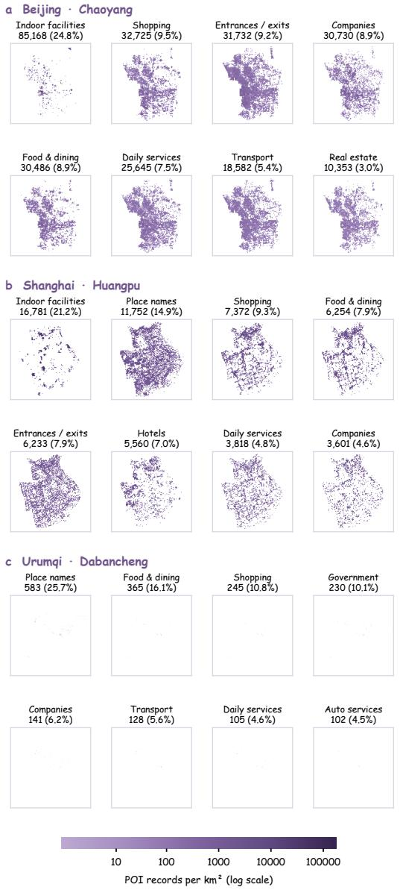  
Figure 10: Spatial distributions ofthe eight most frequent POI categories in Chaoyang, Huangpu, and Dabancheng. Each panel reports a category’s POI count and share of the regional collection.

## A.2 Constraint and Query-Type Distributions

Figure 12 summarizes 3,049 atomic constraint annotations across 20 observed dimensions and 1,200 queries. Location, category, and UGC reputation account for 48.9% of annotations. Single-constraint queries (S1–S8) comprise 25% of the benchmark (100 per region), spanning hard/soft and attribute/review-verified requirements under direct or implicit phrasing. Multi-constraint queries (M1–M5, 75%) cover five regimes: compatible multi-dimensional constraints (M1), hard–soft tension (M2), soft–soft trade-ofs (M3), mutually exclusive hard conflicts that are unsatisfiable by design (M4), and external-fact-dependent retrieval (M5). On 133 atomic constraints from 50 sampled queries, human review agrees with the pipeline’s labels on 89.47% of hard–soft and 97.74% of subjective–objective annotations.

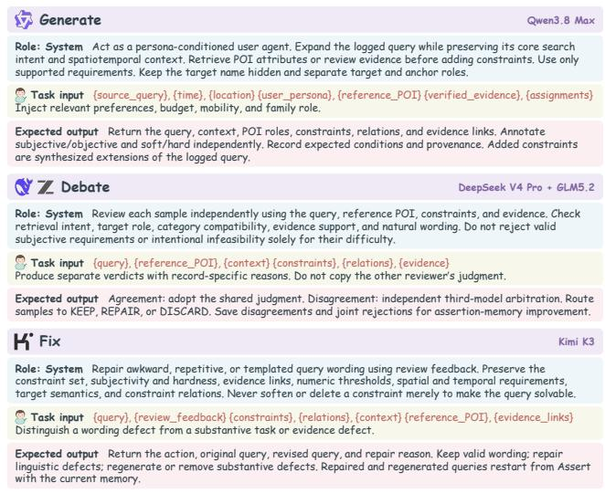  
Figure 11: Condensed prompts for Generate, Debate, and Fix, showing instructions, runtime inputs, and expected outputs.

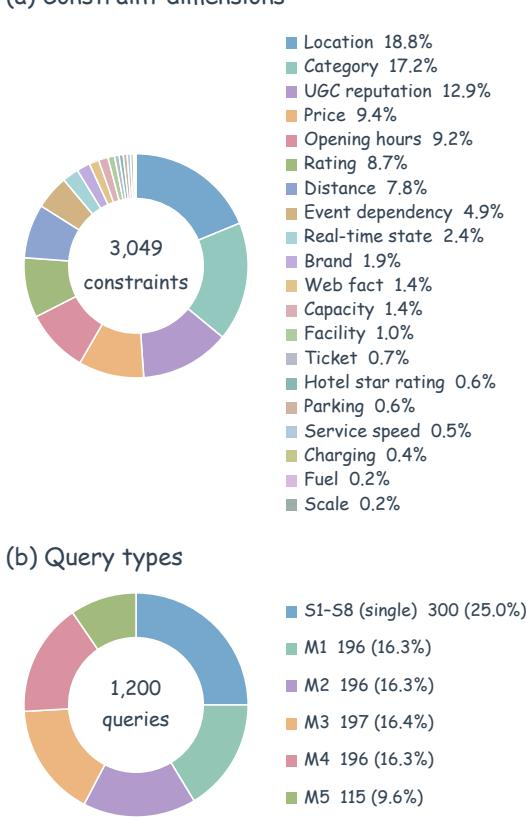  
Figure 12: ATLAS-Bench composition. (a) Shares of 3,049 atomic constraint annotations by dimension. (b) Shares of 1,200 queries by task type, with S1–S8 aggregated.

## B Metric Formulations and Benchmark Comparisons

## B.1 Formal Computation of Evaluation Metrics

Intent and Constraint Combination Diversity. We use the mapping platform’s standardized primary category tag as the discrete intent label across a unified vocabulary of $K = 2 3$ categories. Similarly, each atomic requirement is mapped to our 20-type constraint ontology, and each query’s sorted, deduplicated constraint types form a unique signature across an invariant empirical space of $M = 1 8 0$ signatures. Let $\scriptstyle { \mathcal { P } } k$ and $\phi _ { m }$ denote the regional proportions of intent � and signature �, respectively. Both diversities are quantified via normalized Shannon entropy:

$$
D _ { \mathrm { i n t e n t } } = - \frac { \sum _ { k = 1 } ^ { K } \hat { p } _ { k } \log \hat { p } _ { k } } { \log K } , \quad D _ { \mathrm { c o n s t r a i n t } } = - \frac { \sum _ { m = 1 } ^ { M } \hat { p } _ { m } \log \hat { p } _ { m } } { \log M } .\tag{2}
$$

Fixing � across regions prevents sparse collections with few combinations from obtaining artificially inflated scores. Higher values in [0, 1] indicate richer, more balanced distributions.

Surface Expression Diversity. We measure lexical and syntactic variety by inverting leave-one-out character-level $\mathrm { S e l f B L E U _ { 4 } }$ with add-one smoothing. Treating each query $q _ { i }$ as the hypothesis against the remaining $N - 1$ queries $R _ { i } \ = \ \{ q _ { j } \ | \ j \neq i \}$ , surface diversity is defined as:

$$
D _ { \mathrm { s u r f a c e } } = 1 - \mathrm { S e l f B L E U 4 } = 1 - \frac { 1 } { N } \sum _ { i = 1 } ^ { N } \mathrm { B L E U } _ { 4 } ( q _ { i } ; R _ { i } ) .\tag{3}
$$

Semantic Diversity. We encode each query into an $\ell _ { 2 } \cdot$ -normalized 1,024-dimensional vector $e _ { i }$ using Qwen3-Embedding-0.6B under identical pooling and normalization protocols. Semantic diversity is the mean pairwise cosine distance within a region:

$$
D _ { \mathrm { s e m a n t i c } } = { \frac { 2 } { N ( N - 1 ) } } \sum _ { i < j } ( 1 - e _ { i } ^ { \top } e _ { j } ) .\tag{4}
$$

Human Authenticity Validation. We draw a stratified random sample of 200 queries across regions for double-blind inspection. Two annotators independently judge whether each query reflects a plausible real-world user request $( y _ { i } ^ { ( 1 ) } , y _ { i } ^ { ( 2 ) } \in \{ 0 , \bar { 1 \} } )$ . For $N _ { r }$ regional pairs, inter-annotator agreement is $\begin{array} { r } { A _ { r } = \frac { 1 } { N _ { r } } \sum _ { i = 1 } ^ { N _ { r } } \mathbb { I } ( y _ { i } ^ { ( 1 ) } = } \end{array}$ $y _ { i } ^ { ( 2 ) } )$ , reported alongside the overall proportion of judgments afirming authentic intent. All human annotators participated voluntarily with informed consent.

## B.2 Evaluation Setup Against LocalSearchBench

Table 7 compares ATLAS-Bench with LocalSearchBench across two label-free metrics: semantic diversity via Qwen3-Embedding-0.6B mean pairwise cosine distance, and surface diversity via character level inverted Self-BLEU-4 with add one smoothing. Both measures assign higher values to greater diversity. To ensure comparability, subsets are calibrated to 400 instances through repeated stratified sampling. For LocalSearchBench, we report user questions, generated hop queries, and deduplicated hop queries.

Table 7: Comparison of semantic and surface diversity at 400 instances.
<table><tr><td>Benchmark View</td><td>Semantic Dist ↑</td><td></td><td>Surface Div ↑</td></tr><tr><td>ATLAS-Bench Pooled</td><td>0.5844</td><td></td><td>0.4622</td></tr><tr><td>ATLAS-Bench Beijing</td><td>0.5898</td><td></td><td>0.4067</td></tr><tr><td>ATLAS-Bench Shanghai</td><td>0.5630</td><td></td><td>0.4327</td></tr><tr><td>ATLAS-Bench Urumqi</td><td>0.5338</td><td></td><td>0.2854</td></tr><tr><td>LocalSearchBench Question</td><td>0.4946</td><td></td><td>0.0629</td></tr><tr><td>LocalSearchBench Hop</td><td>0.5830</td><td></td><td>0.1697</td></tr><tr><td>LocalSearchBench Dedup Hop</td><td>0.6028</td><td></td><td>0.1926</td></tr></table>

## C Evaluation Metrics

We detail the computation of the five answer-quality metrics reported in Table 3. Although valid answers are not restricted to the logged POI, reference-target hit rate on satisfiable queries correlates strongly with Success@k at Spearman $\rho = 0 . 9 3$ , confirming that our open-ended constraint evaluation aligns closely with real user selections.

Notation. Let Q denote all 1,200 queries and $s \subset Q$ the 1,004 queries labeled satisfiable, excluding the 196 unsatisfiable queries. For each query $q ,$ let $R _ { q }$ be the returned recommendation list, with $0 \leq | R _ { q } | \leq 1 0$ , and let $n _ { q }$ be the number of annotated hard constraints and soft preferences. For recommendation $r \in R _ { q } ,$ let $m _ { q r }$ count the distinct constraints fully satisfied by evidence belonging to the recommended POI. Disclosing an unmet or unverifiable soft preference does not count as satisfying it. We define $g _ { q r } = 1 { \mathrm { i f } } r$ is qualified or acceptable, and $g _ { q r } = 0$ otherwise.

CSR and CR. Both metrics are micro-averaged over constraint instances across all returned recommendations. Let $\begin{array} { r } { D = \sum _ { q \in Q } | R _ { q } | n _ { q } } \end{array}$ be their shared denominator:

$$
\mathrm { C S R } = \frac { 1 0 0 } { D } \sum _ { q \in Q } \sum _ { r \in R _ { q } } g _ { q r } m _ { q r } , \quad \mathrm { C R } = \frac { 1 0 0 } { D } \sum _ { q \in Q } \sum _ { r \in R _ { q } } m _ { q r } .
$$

CSR credits satisfied constraints only in qualified or acceptable recommendations, whereas CR also credits those in unacceptable recommendations. Thus, $\mathrm { C S R } \ \leq \ \mathrm { C R } .$ Empty answers contribute neither to the numerators nor to the shared denominator.

Success@k and Recs/query. These metrics are averaged over the fixed should-answer set S:

$$
\begin{array} { r l } & { \mathrm { S u c c e s s } @ k = \displaystyle \frac { 1 0 0 } { | { \cal S } | } \sum _ { q \in { \cal S } } { \bf 1 } \left[ \displaystyle \sum _ { r \in { \cal R } _ { q } } { g _ { q r } } > 0 \right] , } \\ & { \mathrm { R e c s } / \mathrm { q u e r y } = \displaystyle \frac { 1 } { | { \cal S } | } \sum _ { q \in { \cal S } } | { \cal R } _ { q } | . } \end{array}
$$

Success@k evaluates the full returned list, containing at most 10 recommendations, and requires at least one qualified or acceptable recommendation. Recs/query counts all returned recommendations, regardless of their verdicts. Empty answers contribute zero to both metrics while remaining in the denominator, so unanswered satisfiable queries are explicitly accounted for.

Factual accuracy. For each query $q ,$ let $b _ { q }$ and $f _ { q }$ be binary indicators for passing the deterministic grounding check and the LLM factuality check, respectively. The grounding check requires the answer’s no\_exact\_match flag to be consistent with its returned recommendations, and every cited evidence ID to exist in the observed tool results and belong to the recommended POI. The DeepSeek-V4-Pro factuality judge sets $f _ { q } = 1$ only when the answer contains no factual errors or unsupported claims relative to the observed evidence. This metric is computed over all 1,200 queries. An answer receives credit only if both checks pass:

$$
\mathrm { F a c t u a l a c c u r a c y } = \frac { 1 0 0 } { \vert Q \vert } \sum _ { q \in Q } b _ { q } f _ { q } .
$$

Trajectory quality and eficiency. Each trajectory dimension is scored out of 5 and averaged over Q. Eficiency metrics directly average the per-query execution statistics logged by ATLASBox.

## D Revisions to the Assertion Layer

Table 8 summarizes anonymized updates to the assertion memory and validation logic. These updates document implementation changes, rather than verified improvements to all released samples.

Table 8: Representative assertion and validation revisions.
<table><tr><td>Check</td><td>Observed issue</td><td>Revision</td></tr><tr><td>Name leakage</td><td>Geographic anchors falsely flagged.</td><td>Exempt geographic terms; fix whitespace matching.</td></tr><tr><td>Evidence linkage</td><td>POI-based joins mixed search events.</td><td>Join evidence by source-record ID.</td></tr><tr><td>Semantic rejection</td><td>Lexical rules rejected valid queries.</td><td>Broaden matching; make the check advisory.</td></tr><tr><td>Conflict references</td><td>Mixed indexing linked wrong constraints.</td><td>Normalize index conventions.</td></tr><tr><td>Constraint types</td><td>Overlapping fields conflated dimensions.</td><td>Refine matching; separate semantic dimensions.</td></tr><tr><td>Satisfiability</td><td>Default labels masked conflicts.</td><td>Remove positive defaults; repair conflict logic.</td></tr><tr><td>Check scope</td><td>Conflict checks affected unrelated cases.</td><td>Restrict checks to relevant conflict decisions.</td></tr><tr><td>Input coverage</td><td>Missing shards and unrelated files.</td><td>Load all shards using explicit file patterns.</td></tr><tr><td>Consistency</td><td>Duplicate checks and fixed vocabularies drifted.</td><td>Share detectors; configure regional vocabularies.</td></tr><tr><td>Operating status</td><td>Closure evidence was missed.</td><td>Check both source name fields.</td></tr></table>

## E Available Tools

Table 9 summarizes the tools available in ATLASBox. Returned records include evidence identifiers for citation in the final answer.

Table 9: ATLASBox search tools and required inputs. Optional arguments control result limits and filters.
<table><tr><td>Tool</td><td>Purpose</td><td>Inputs</td></tr><tr><td>search_pois</td><td>Retrieve POIs and structured attributes; resolve landmark coordinates.</td><td>query</td></tr><tr><td>search_notes</td><td>Retrieve review evidence for experiential requirements.</td><td>query</td></tr><tr><td>get_poi_notes</td><td>Inspect reviews linked to a specific POI.</td><td>poiid</td></tr><tr><td>search_nearby</td><td>Find POIs within a radius of the given coordinates.</td><td>query, loc, distance_m</td></tr></table>