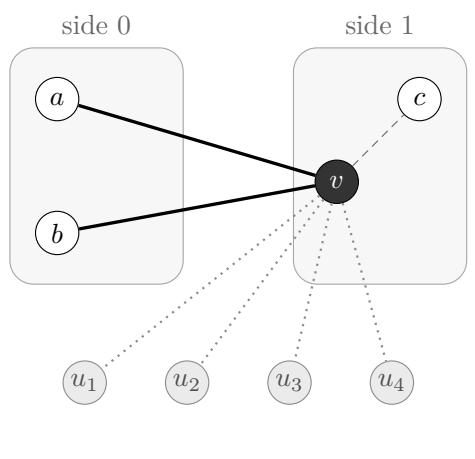
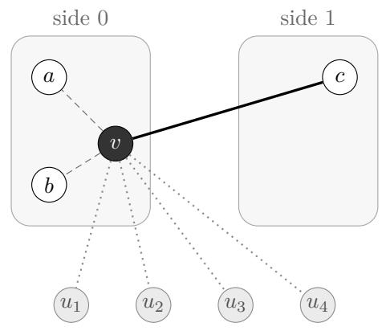

# Accumulating Pruning Constraints: New Exact Polynomial-Space Algorithms for Max 2-SAT

Konstantin Kutzkov kutzkov@gmail.com

## Abstract

We present deterministic polynomial-space algorithms that solve Max 2-SAT on n variables exactly in time $O ^ { * } ( 2 ^ { ( 1 - \gamma ) n } )$ , for a fixed $\gamma > 0 ,$ on several classes of instances whose clause density may grow with n. Our main tool extends the classic DPLL branching algorithm. When the search gives a variable its less promising value, comparing the two values of the variable yields a pruning constraint that is satisfied by some optimal assignment. Accumulating these constraints along each branch prunes all but an exponentially small fraction of the assignments. The classes are formulas with many biased variables, semirandom 2-CNF formulas, and Max-Cut on regular expander graphs and on graphs generated by a stochastic block model. In a semirandom formula, the pairs of variables that may share a clause are arbitrary, and the clauses on these pairs are random. For semirandom formulas and block-model graphs, the algorithms are still exact on every input, and the time bound holds with high probability over the input. To our knowledge, these are the first polynomial-space algorithms with such a running time for nontrivial classes of dense Max 2-SAT instances. Beyond these classes, the pruning constraints can be added to any branching algorithm for Max 2-SAT, and we expect them to be of practical relevance for general formulas, in particular for sparse ones, where each constraint involves only a few variables.

## 1 Introduction

Max-SAT is the optimization version of the fundamental NP-complete SAT problem. Instead of checking whether a Boolean formula over n variables in conjunctive normal form (CNF) is satisfiable, that is, whether some assignment satisfies all its clauses, Max-SAT asks for an assignment satisfying the largest number of clauses. Exhaustive search solves both problems in time $O ^ { * } ( 2 ^ { n } )$ , where the notation $O ^ { * }$ suppresses factors polynomial in the input size. For formulas whose clauses may be arbitrarily long, no algorithm with running time $O ^ { * } ( 2 ^ { ( 1 - \gamma ) n } )$ for a constant $\gamma > 0$ , is known for either problem. The k-SAT problem, where each clause has at most k literals, is easily solved in time $O ^ { * } ( c _ { k } ^ { n } )$ for a constant $c _ { k } < 2$ . For Max-SAT, no comparable polynomial-space result is known even for $k = 2 ;$ note that Max 2-SAT is NP-hard, although 2-SAT is solvable in polynomial time. The only known algorithm that improves on the $O ^ { * } ( 2 ^ { n } )$ bound on all Max 2-SAT instances is the elegant algorithm of Williams [33], with running time $O ^ { * } ( 2 ^ { \omega n / 3 } )$ , where ω is the matrix multiplication exponent. However, it uses space $O ^ { * } ( 2 ^ { 2 n / 3 } )$ , which makes it only of theoretical interest. Designing an algorithm with running time $O ^ { * } ( 2 ^ { ( 1 - \gamma ) n } )$ that uses only polynomial space has been an open problem since 2004 [33, 34].

## 1.1 Previous work

Exact algorithms for Max 2-SAT, which contains the Max-Cut problem on graphs as a special case, have been analyzed in two ways:

• In terms of the number m of clauses, with running time $O ^ { * } ( 2 ^ { m / c } )$ for a constant c. Such bounds improve on $O ^ { * } ( 2 ^ { n } )$ only for sparse instances with $m < c n$ . There is a long list of incremental improvements [30, 23, 14, 17]; the currently best known bound is $O ^ { * } ( 2 ^ { m / 6 . 3 2 1 } )$ [16].

• In terms of the maximum or average degree d of the formula, with running time $O ^ { * } ( 2 ^ { ( 1 - f ( d ) ) n } )$ , where $f ( d ) \in ( 0 , 1 )$ and $f ( d ) \to 0$ as $d \to \infty$ . Several works give $f ( d ) =$ $c / d$ for a small constant c [30, 13, 8], and Golovnev and Kutzkov [18] and Hastings [19] give the asymptotically better $f ( d ) = \log d / d .$ These bounds yield $O ^ { * } ( 2 ^ { ( 1 - \gamma ) n } )$ for a fixed $\gamma > 0$ only when the number of clauses is linear in $n .$

The exponential time hypothesis. The exponential time hypothesis (ETH) and its strong version (SETH) [21, 7] assert that 3-SAT requires time $2 ^ { \Omega ( n ) }$ and that the savings for $k { \mathrm { - S A T } }$ vanish as k grows. Two recent preprints from frontier AI labs [9, 27] claim to refute both hypotheses with a polynomial-space algorithm that solves $k { \mathrm { - S A T } }$ in subexponential time for every fixed k. If confirmed, this is a theoretical breakthrough, but it has little bearing on the results of this paper. Applied to Max 2-SAT through standard reductions, the algorithm improves on exhaustive search only at very low density, when a variable occurs on average in $O ( { \sqrt { \log n } } )$ clauses, and the dense instances in our classes are not afected. Moreover, the current version of the algorithm has no practical value, because of astronomical constants hidden in the big-Oh notation which make the new upper bound purely asymptotic.

## 1.2 Our contribution

We present a technique that extends the classic DPLL branching algorithm of Davis, Putnam, Logemann, and Loveland [11, 12]. Consider a branching variable v, and suppose that we first explore $v = 1$ and then backtrack to $v = 0$ . Setting v afects only the clauses containing $v ,$ so for a given assignment of the other variables, which of the two values is better depends only on the values of the neighbors of v. After backtracking, the branch $v = 0$ therefore only needs the assignments of the neighbors for which $v = 0$ is strictly better. We describe them by a linear inequality over the literals of the neighbors, a hard pruning constraint. Since the constraint depends only on the neighborhood of $v ,$ we can eficiently decide which of the two branches would receive the more restrictive constraint. Along a branch, the search creates many such constraints. Each of them alone prunes only part of the search space, but for each of our classes, only an exponentially small fraction of all assignments satisfies the sum of the constraints of its own branch, and listing only these assignments yields the saving.

Our contributions are of two kinds:

1. We present new algorithms for several classes of instances, including dense ones with clause density $m / n = \omega ( 1 )$ , that run in time $O ^ { * } ( 2 ^ { ( 1 - \gamma ) n } )$ using only polynomial space. To the best of our knowledge these are the first results that show such running time bounds for nontrivial classes of dense Max 2-SAT instances, thus making an important step towards resolving the open problem from [33, 34].

2. The key idea of creating pruning constraints during search is easy to implement and likely to find practical applications. Some of our classes model practical inputs; for example, the stochastic block model is the standard model of networks with communities. The savings that we prove are small, since they result from a conservative analysis of a deliberately simple version of the algorithm. On practical instances we expect much larger savings: after some branching steps, the remaining variables have lower degrees and, relative to their degrees, larger diferences between their positive and negative occurrences, which yields more restrictive constraints. Similarly, SAT solvers routinely solve instances with thousands of variables, although their worst-case running time is exponential. In future work, we plan to obtain such practical gains with heuristics based on our constraints and to evaluate them experimentally. The present paper focuses on the theoretical results.

## 1.3 Main results

We give polynomial-space algorithms with running time $O ^ { * } ( 2 ^ { ( 1 - \gamma ) n } )$ , for a constant $\gamma > 0$ , on four classes of instances. In every class the number of clauses may grow faster than linearly in n, and every class contains instances with a clause on a constant fraction of all pairs of variables. To our knowledge, no polynomial-space algorithm with such a running time was previously known for any of these classes once the density grows with n.

All our algorithms are deterministic and return an optimal assignment on every input. They do not check the conditions that define a class; these conditions are used only to bound the running time. (The two Max-Cut algorithms take the constants of their class as parameters.) Two of the classes consist of semirandom or random instances. For them, the randomness lies in the input, and the time bound holds in expectation over the input or with high probability (w.h.p.), that is, with probability tending to 1 as n grows. As in the average-case analysis of QuickSort with a fixed pivot rule, the algorithm is always correct and fast on most inputs.

1. Formulas with linearly many biased variables. A variable is biased if the numbers of its positive and negative occurrences difer by at least a constant fraction of its number of occurrences, for example if it occurs positively in $3 / 4$ of its clauses. Making its more frequent literal true satisfies more clauses on average over the values of the other variables, although an optimal assignment may still choose the other value. In the branch where a biased variable takes its other value, the pruning constraint requires its neighbors to deviate from their typical values by a constant fraction of its degree.

Our first result applies when a constant fraction of the variables are biased. Its simplest form is Corollary 3.5. Consider a formula in which no clause occurs twice and no clause contains a variable twice. If, for some constants $\varepsilon , \eta > 0$ , at least ηn of its variables each occur at least εn more often with one sign than with the other, then an optimal assignment can be found in time $O ^ { * } ( 2 ^ { ( 1 - \gamma ) n } )$ for a constant $\gamma > 0$ . Theorem 3.2 covers formulas of every density. It requires linearly many biased variables and, in addition, a bound on the sum of the squared numbers of occurrences, so that a few variables cannot occur much more often than the others.

2. Semirandom formulas. In a semirandom formula, the pairs of variables that may share a clause are arbitrary, and the clauses on these pairs are random. Such formulas lie between worst-case and fully random instances; Feige [15] formalized this model for 3-SAT. We use two semirandom models. Fix any graph G whose vertices are the variables. In the first model, every edge $\{ u , v \}$ of $G$ receives one of the four clauses $( u \lor v ) , ( u \lor \neg v ) , ( \neg u \lor v ) , ( \neg u \lor \neg v )$ , chosen uniformly at random, independently for diferent edges. In the second model, each of these four clauses is included independently with probability $1 / 4$ . In both models, unit clauses may be added arbitrarily, as long as they do not depend on the random choices.

Theorem 4.2 shows that on such formulas our algorithm runs in expected time $O ^ { * } ( 2 ^ { ( 1 - \gamma ) n } )$ and within a bound of the same form with high probability, for a constant $\gamma > 0$ that does not depend on G. If G is itself random, with each pair of variables joined independently with probability $p ,$ we obtain random 2-CNF formulas with about $p n ^ { 2 } / 2$ clauses, for every p. Random formulas are the standard test case for the average-case behavior of satisfiability algorithms, and this result covers all densities at once. With random signs, no variable is biased and each pruning constraint is weak. The algorithm adds up many weak constraints after scaling them to a common size, and the random signs keep a few shared variables from satisfying many constraints at once.

3. Max-Cut on regular expander graphs. The Max-Cut problem asks to divide the vertices of a graph into two sides so that as many edges as possible join vertices on diferent sides. It is a special case of Max 2-SAT: introduce a variable for each vertex, indicating its side, and the two clauses $( u \vee v )$ and $( \neg u \lor \neg v )$ for each edge $\{ u , v \}$ . Both clauses are satisfied if u and v are on diferent sides; otherwise exactly one is. A graph is d-regular if every vertex has exactly d neighbors. Its adjacency matrix A is the symmetric $n \times n$ matrix with $A _ { u v } = 1 \mathrm { i f } \{ u , v \}$ is an edge and $A _ { u v } = 0$ otherwise. For a d-regular graph, the largest eigenvalue of A is d. We consider graphs in which all other eigenvalues have absolute value at most $\lambda _ { 0 } { \sqrt { d } } ,$ for a constant $\lambda _ { 0 }$ . Such graphs are called spectral expanders. Informally, they look random: any two large sets of vertices are joined by roughly as many edges as in a random graph with the same number of edges.

Corollary 5.3 shows that if, in addition, $d \leq ( 1 - \varepsilon ) n$ for a constant $\varepsilon > 0 .$ , then Max-Cut can be solved in polynomial space and time $O ^ { * } ( 2 ^ { ( 1 - \gamma ) n } )$ for a constant $\gamma > 0$ . This is a worst-case guarantee: it holds for every graph with these properties. Explicit examples are the Paley graphs, in which every vertex is adjacent to half of the other vertices, and non-bipartite Ramanujan graphs with $d \leq ( 1 - \varepsilon ) n$ . Random regular graphs qualify as well: by known spectral-gap theorems, a uniformly random d-regular graph satisfies the eigenvalue condition with high probability for every $d \leq ( 1 - \varepsilon ) n$ (Corollary 5.7). In Max-Cut, no variable is biased and no sign is random. Instead, all pruning constraints depend on one global number, the number of vertices on one side. The algorithm guesses this number, and the expander property makes the remaining parts of the constraints nearly independent.

4. Max-Cut on random graphs with communities. The stochastic block model is the most widely studied random model of networks with community structure [1]. The vertices are divided into k groups, called communities. Every pair of vertices is joined by an edge independently, with a probability $\pi _ { a b }$ that depends only on the communities a and b of its endpoints. For $k = 1$ this is the Erdős–Rényi random graph $G ( n , p )$ , in which every edge is present independently with probability $p .$

Theorem 6.2 assumes that the number k of communities is a constant, that the variances $\pi _ { a b } ( 1 - \pi _ { a b } )$ of the edge indicators difer by at most a constant factor $\chi ,$ and that $n \pi _ { a b } ( 1 - \pi _ { a b } ) \geq C$ log n for a suficiently large constant $C .$ . Under these assumptions, with high probability over the random graph, our algorithm solves Max-Cut in polynomial space and time $O ^ { * } ( 2 ^ { ( 1 - \gamma ) n } )$ , for a constant $\gamma > 0$ . The algorithm needs to know only the constants $k$ and $\chi ,$ not the communities or the edge probabilities. For $G ( n , p )$ the condition is $n p ( 1 - p ) \geq C$ log n; roughly, both the graph and its complement must have expected degree at least a large multiple of log n. This includes dense random graphs such as $G ( n , 1 / 2 )$ . Instead of one number, the algorithm guesses the projections of the assignment onto a few approximate eigenvectors of the graph. It never needs to find the communities, which need not be easy to detect: the probabilities inside and between communities may even be equal.

Both Max-Cut results remain valid with arbitrary additional unit clauses, which give each vertex an integer bonus for one of the two sides. In the stochastic block model, the unit clauses may even be chosen after the graph is drawn. In the language of statistical physics, this is the problem of finding a ground state of an antiferromagnetic Ising model on the graph, with an external field at every vertex. Table 1 summarizes the four results.

<table><tr><td>Instances</td><td>Density</td><td>Time bound holds</td><td>Result</td></tr><tr><td>Many biased variables</td><td>any</td><td>for every instance</td><td>Thm. 3.2, Cor. 3.5</td></tr><tr><td>Semirandom 2-CNF</td><td>any</td><td>in expectation and w.h.p.</td><td>Thm. 4.2</td></tr><tr><td>Max-Cut, regular expanders</td><td> $d \leq ( 1 - \varepsilon ) n$ </td><td>for every instance</td><td>Cor. 5.3</td></tr><tr><td>Max-Cut, block model</td><td> $n \pi _ { a b } ( 1 - \pi _ { a b } ) \geq C \log n$ </td><td>w.h.p. over the graph</td><td>Thm. 6.2</td></tr></table>

Table 1: The four classes on which our algorithms run in polynomial space and time $O ^ { * } ( 2 ^ { ( 1 - \gamma ) n } )$

Organization. Section 2 introduces the notation and the simplification rules, and it explains how pruning constraints arise during branching and how our algorithms accumulate them. Sections 3–6 treat the four classes in the order above. Each of these sections starts with an informal overview, followed by the algorithm, its correctness proof, and its running-time analysis. Section 7 summarizes a Lean 4 formalization of the main arguments <sup>1</sup>. The appendices contain the longer proofs and estimates, the spectral preprocessing used when the communities are unknown, additional simplification rules, details of the formal verification, and a proposed extension of the first result.

## 1.4 Relation to earlier methods

Our pruning constraints continue the clause learning approach of Kulikov and Kutzkov [23], which rests on the same observation: one of the two branches on a variable only needs to keep the assignments that are strictly better than their counterparts in the other branch. Kulikov and Kutzkov derived new clauses from this observation and used them to simplify the formula. This gave polynomial-space algorithms with a fixed exponential saving for every fixed clause density, a saving that tends to 0 as the density grows. We keep the comparisons as linear constraints, add up the constraints created along a branch, and enumerate only the completions that satisfy the sum. For the classes of Section 1.3, only an exponentially small fraction of all assignments satisfies the sum of its own branch, whatever the density.

Hastings [19] bounded the number of local maxima of Max 2-SAT instances, that is, of assignments that no single flip improves. He used the technique behind these bounds to obtain a faster polynomial-space algorithm for formulas of large degree. Our approach is related to his only in spirit. Every optimal assignment is a local maximum, and our pruning constraints express local optimality at some of the branching variables. However, we do not count local maxima, and we use the local conditions only through their sum. Local optimality alone cannot give an exponential saving on all dense instances: for Max-Cut on the complete graph, every balanced cut is a local maximum, and there are about $2 ^ { n } / { \sqrt { n } }$ of them.

Our running-time analyses follow the path of a uniformly random assignment through the branching tree of a deterministic algorithm. The number of enumerated assignments equals 2<sup>n</sup> times the probability that a random assignment satisfies the summed constraint of its own branch. Arguments of this type were used by Santhanam [29] for the satisfiability of de Morgan formulas, and for sparse Max-SAT by Sakai, Seto, and Tamaki [28] and by Chen and Santhanam [8]. There, a concentration argument along the random path shows that greedily restricting variables shrinks the instance with high probability. In our setting, the random path determines which pruning constraints are created, and a concentration argument shows that the random assignment satisfies their sum only with exponentially small probability.

## 2 Branching with pruning constraints

Let F be a Max 2-SAT formula on a set V of n variables. In this section and in Section 3, the formula is simple: no clause occurs twice, and no variable occurs twice in a clause. We write v for a variable and $v , \lnot v$ for its two literals. The degree $d ^ { F } ( v )$ of a literal v is the number of clauses containing v; it is the sum of the numbers $d _ { 1 } ^ { F } ( v )$ and $d _ { 2 } ^ { F } ( v )$ of unit and binary clauses containing v. We omit the superscript when the formula is clear. The neighbors of a literal v are the literals x with $( v \lor x ) \in F$ ; they form the multiset $N ( v )$ , of size $d _ { 2 } ( v )$ . Two variables are neighbors if some binary clause contains both. The degree of a variable v is $d ( v ) + d ( \neg v )$ and its binary degree is $d _ { 2 } ( v ) + d _ { 2 } ( \lnot v )$ . The number of binary clauses is $m _ { 2 }$ , and their density is $m _ { 2 } / n$ . The notation $O ^ { * }$ suppresses factors polynomial in the input size.

A partial assignment α assigns values to a subset of V. A complete assignment assigns all variables, and a complete assignment extending α is a completion of α. The score $F ( x )$ of a complete assignment x is its number of satisfied clauses, and $\operatorname { O P T } ( F ) = \operatorname* { m a x } _ { x } F ( x )$ . Setting a literal v to 1 satisfies the $d ( v )$ clauses containing v and removes ¬v from the clauses containing it: a binary clause $( \neg v \lor y )$ becomes the unit clause $( y )$ , and a unit clause $( \neg v )$ becomes empty and stays unsatisfied. We write $F [ v = 1 ]$ for the resulting formula and include the $d ( v )$ satisfied clauses in its score; $F [ v = 0 ]$ is defined in the same way, with ¬v set to 1. Then

$$
\mathrm { O P T } ( F ) = \operatorname* { m a x } \bigl ( \mathrm { O P T } ( F [ v = 0 ] ) , \mathrm { O P T } ( F [ v = 1 ] ) \bigr ) .
$$

More generally, the residual formula $F | _ { \alpha }$ of a partial assignment α results from setting all its literals. We record the number of clauses satisfied by α in a separate score s, so that the score of every completion is s plus its score in $F | _ { \alpha } .$ . The residual formula keeps all unassigned variables, including those that no longer occur in any clause. Later sections allow repeated unit clauses, and Appendix B boundedly many binary clauses on a pair; all statements below hold for each copy.

Soft clauses and hard pruning constraints. Our algorithms are DPLL branching algorithms [12, 11]: they select a variable v and recursively solve $F [ v = 0 ]$ and $F [ v = 1 ]$ The clauses of F are soft constraints: an optimal assignment need not satisfy all of them. In addition, a branch may carry pruning constraints, linear inequalities $\textstyle \sum _ { i } \ell _ { i } \leq b$ over literals $\ell _ { i } .$ with repeated occurrences counted separately. They are hard: the branch considers only assignments that satisfy all of its pruning constraints, and this prunes the search space. We write C for a collection of pruning constraints. (Sections 5 and 6 also use inequalities with rational coeficients.)

## 2.1 Simplification rules and preprocessing

The first two rules below preserve the score of every assignment up to a recorded constant; our algorithms apply them once, before branching. The third rule, unit clause domination, is the starting point of our pruning constraints. Appendix G shows how such rules can be combined with pruning constraints; our algorithms do not need this.

Lemma 2.1 (Unit clause cancellation). Removing one copy of (v) and one copy of $( \neg v )$ decreases the score of every complete assignment by exactly 1.

Proof. Exactly one of the two unit clauses is satisfied by every assignment.

Lemma 2.2 (Simplifying two clauses on the same variable pair). Let a, b be literals on distinct variables. Replacing $( a \lor b ) , ( a \lor \neg b )$ by the unit clause (a) decreases the score of every complete assignment by exactly 1.

Algorithm 1 Preprocess(F)   
1: s ← 0; retain the clauses of F in their input order.   
2: while an eligible pair of clauses exists do   
3: Select the first eligible pair in the order described above.   
4: if the pair is (v), (¬v) then   
5: Remove both clauses using Lemma 2.1.   
6: else   
7: Replace (a ∨ b), (a ∨ ¬b) by (a) using Lemma 2.2.   
8: end if   
9: $s \gets s + 1$   
10: end while   
11: return $( F , s )$

Proof. If $a = 1$ , the two original clauses contribute 2 and the new unit contributes 1. If $a = 0 .$ exactly one original clause is satisfied and the new unit contributes 0. In both cases the diference is 1. □

The initial procedure Preprocess makes no assignments. A pair of clauses is eligible if one of the two reductions applies to it: two opposite units, or two binary clauses that share one literal and are opposite in the other. As long as an eligible pair exists, the procedure cancels the two opposite units or replaces the two binary clauses by their shared unit. Each reduction lowers the score of every assignment by 1, which is recorded in s. The procedure returns the reduced formula and s. It applies the reductions in a fixed order, so its output is deterministic; the order does not afect the score identities.<sup>2</sup>

The score identities justify Preprocess for every assignment, not only for an optimum. For distinct input binary clauses, after it terminates a variable pair occurs in at most two binary clauses. If there are two, their literals are complementary in both positions: otherwise the two clauses would share a literal and the loop could apply again. We call this form canonical. Assigning variables creates only units, so the binary clauses do not need to be preprocessed again at later nodes.

Lemma 2.3 (Unit clause domination). Suppose $d _ { 1 } ( \lnot v ) = 0$ and $d _ { 1 } ( v ) \geq d _ { 2 } ( \lnot v )$ . For every fixed assignment of the other variables, setting v = 1 satisfies at least as many clauses as setting $v = 0$

Proof. Changing v from 0 to 1 gains all $d _ { 1 } ( v )$ positive units. Clauses containing v cannot lose satisfaction. The only possible losses are among the $d _ { 2 } ( \lnot v )$ binary clauses containing ¬v, since there are no units (¬v). The net gain is therefore at least $d _ { 1 } ( v ) - d _ { 2 } ( \lnot v ) \geq 0$ □

Under the assumptions of the lemma, OPT $\begin{array} { r } { { \bf \Pi } ^ { * } ( F ) = \mathrm { O P T } ( F [ v = 1 ] ) } \end{array}$ . In particular, a pure literal v, whose negation does not occur, can be set to 1.

## 2.2 Pruning constraints

What we learn when backtracking. Suppose the algorithm branches on v, explores the branch v = 1 first, and then backtracks to the branch $v = 0$ . Setting v changes only the clauses that contain v; all other clauses are the same in both branches. Fix the values of all other variables. A clause $( v \vee u )$ with u true, or $( \neg v \lor w )$ with w true, is then satisfied whatever value v takes. Every other clause containing v acts as a unit clause: $( v \vee u )$ with u false acts as (v), and $( \neg v \lor w )$ with w false acts as $( \neg v )$ . The two branches therefore difer only by a contest between these units and the original unit clauses on v. If the units (v) are at least as many as the units $( \neg v )$ , the value $v = 1$ is at least as good, as in unit clause domination (Lemma 2.3), and the branch $v = 1$ already covers this assignment. After backtracking, the branch $v = 0$ therefore only needs the assignments for which the units $( \neg v )$ win, and whether they win depends only on the values of the neighbors of v.

For example, let v occur only in the clauses $( v \lor a ) , ( v \lor b ) , ( v \lor c ) , ( \neg v \lor d )$ , and $( \neg v \lor e )$ If a is false and d, e are true, then $( v \vee a )$ acts as (v), while $( \neg v \lor d )$ and $( \neg v \lor e )$ are satisfied anyway. The value $v = 1$ wins whatever b and c are, so the branch $v = 0$ can skip every assignment with $a = 0$ and $d = e = 1$ . In general, the branch $v = 0$ needs only the assignments in which more of $d , e$ than of $a , b , c$ are false.

The pruning lemma. To state this observation precisely, fix the values of all variables other than v. The number of clauses satisfied with $v = 1$ minus the number satisfied with $v = 0$ , the gain of $v ,$ is the number of units (v) minus the number of units $( \neg v )$ in the contest above:

$$
\begin{array} { r } { \mathrm { g a i n } _ { v } = \big ( d _ { 1 } ( v ) + \# \{ u \in N ( v ) : u = 0 \} \big ) - \big ( d _ { 1 } ( \neg v ) + \# \{ w \in N ( \neg v ) : w = 0 \} \big ) . } \end{array}\tag{1}
$$

For a complete assignment x we write $\mathrm { g a i n } _ { v } ( x )$ ; it does not depend on the value of v in x.

Lemma 2.4 (Pruning constraints from almost-domination). Let $v$ be a literal of an unassigned variable of the residual formula $F _ { : }$ and define

$$
C ( v ) : \qquad \sum _ { u \in N ( v ) } \neg u + \sum _ { w \in N ( \neg v ) } w \leq d ( \neg v ) - d _ { 1 } ( v ) - 1 .\tag{2}
$$

Consider an assignment to the variables of the neighbors of v. If it satisfies $C ( v )$ , then setting $v = 0$ satisfies strictly more clauses than setting $v = 1$ , whatever the values of the remaining variables. If it violates $C ( v )$ , then setting $v = 1$ satisfies at least as many clauses. Consequently,

$$
\mathrm { O P T } ( F ) = \operatorname* { m a x } \bigl ( \mathrm { O P T } ( F [ v = 1 ] ) , \mathrm { O P T } ( F [ v = 0 ] \land C ( v ) ) \bigr ) ,
$$

where $F [ v = 0 ] \land C ( v )$ restricts the branch $v = 0$ to the assignments that satisfy $C ( v )$

Proof. $\mathrm { B y ~ ( 1 ) }$ , setting $v = 0$ is strictly better if and only if

$$
d _ { 1 } ( \neg v ) + \# \{ w \in N ( \neg v ) : w = 0 \} \ \geq \ d _ { 1 } ( v ) + \# \{ u \in N ( v ) : u = 0 \} + 1 .
$$

Substituting $\begin{array} { r } { \# \{ w \in N ( \neg v ) : w = 0 \} = d _ { 2 } ( \neg v ) - \sum _ { w \in N ( \neg v ) } w , \# \{ u \in N ( v ) : u = 0 \} = } \end{array}$ $\textstyle \sum _ { u \in N ( v ) } \neg u$ , and $d _ { 1 } ( \lnot v ) + d _ { 2 } ( \lnot v ) = d ( \lnot v )$ turns this inequality into $C ( v )$ . It involves only the neighbors of v, which proves the first two claims. For the identity, every assignment of the branch $v = 0$ that violates $C ( v )$ is matched by the same assignment with $v = 1$ , which is at least as good. □

A compact representation. The lemma says which partial assignments the branch $v = 0$ does not need: the assignments to the neighbors of v that violate $C ( v )$ There can be exponentially many of them, and the single linear inequality $C ( v )$ describes them all; the algorithms store and combine this inequality instead of a list of partial assignments. Its left-hand side counts the neighbors that favor $v = 1$ : a false neighbor u of v turns $( v \vee u )$ into a unit (v), and a true neighbor w $\operatorname { o f } \lnot v$ satisfies $( \neg v \lor w )$ , so this clause cannot become a unit $( \neg v )$ . The constraint allows only few of them. In the example, $C ( v )$ reads

$$
\neg a + \neg b + \neg c + d + e \leq 1 .
$$

The simplification rules are special cases: $\mathrm { i f } \neg v$ does not occur, or if $d _ { 1 } ( \lnot v ) = 0$ and $d _ { 1 } ( v ) \geq$ $d _ { 2 } ( \lnot v )$ , the bound of $C ( v )$ is negative, no assignment satisfies $C ( v )$ , and the branch $v = 0$ can be skipped altogether.

Using the constraint during branching. When the algorithm branches on v, it substitutes into $C ( v )$ the values of the neighbors that are already assigned: a false literal is removed, and a true literal is removed while the bound decreases by 1. A complementary pair $z , \lnot z$ can also be removed while decreasing the bound by 1, since $z + \lnot z = 1$ . The remaining literals belong to unassigned variables, which the algorithm assigns later in the subtree of the branch $v = 0$ , so the constraint restricts these later choices. For example, a negative bound proves that the subtree contains no assignment satisfying the constraint, and a literal that occurs more often than the bound must be false in every such assignment. Our algorithms enforce the constraints of a branch through their sum (Section 2.4).

## 2.3 Which branch receives the constraint

The lemma applies to either literal of the branching variable: $C ( v )$ restricts the branch $v = 0$ and $C ( \neg v )$ restricts the branch $v = 1$ . A constraint prunes much if the other value is the better one for most assignments of the neighbors. In the example, v occurs three times and ¬v twice. If the neighbors take uniformly random values, the left-hand side of $C ( v )$ has mean $5 / 2$ and must stay at most 1, which only 6 of the 32 assignments to $a , \ldots , e$ achieve. The opposite constraint $C ( \neg v )$ reads $a + b + c + \lnot d + \lnot e \leq 2$ and keeps 16 of them. Since both constraints depend only on the neighborhood of v, the better choice can be computed by counting occurrences.

We call the mean of the left-hand side under uniform values minus the bound the requirement of a constraint: how far the remaining assignment must push the left-hand side below its typical value. For $C ( v )$ it equals $g _ { \mathbf v } ( F ) / 2 + 1$ , and for $C ( \neg v )$ it equals $- g _ { \mathbf { v } } ( F ) / 2 + 1$ , where the efective gap of a variable v in a formula H is

$$
g _ { \mathbf { v } } ( H ) = d _ { 2 } ^ { H } ( v ) - d _ { 2 } ^ { H } ( \lnot v ) + 2 \bigl ( d _ { 1 } ^ { H } ( v ) - d _ { 1 } ^ { H } ( \lnot v ) \bigr ) .\tag{3}
$$

Equivalently, $g _ { \mathbf { v } } ( H ) / 2$ is the expected gain of v when the other variables are uniform: in (1), an original unit clause always counts, and a binary clause counts only if its other literal is false, which happens with probability $1 / 2$ . We call the literal with nonnegative gap,

$$
\ell _ { \mathbf { v } } ( H ) = \left\{ { v , \quad g _ { \mathbf { v } } ( H ) \geq 0 , } \right.\tag{4}
$$

the preferred literal, and the value of v that makes it true the preferred value. Our algorithms add the constraint of the preferred literal to the branch of the nonpreferred value; the order in which the two branches are explored does not matter. We call this constraint the comparison of v, since it compares the two values of v. Computing it takes time linear in the degree of v. The algorithm of Section 4 computes the gaps in its current residual formula, and the algorithm of Section 3 computes them once, in the formula after preprocessing. Sections 5 and 6 use a related rule and a relaxed comparison, defined there.

Max-Cut as a special case. Recall from Section 1.3 that Max-Cut is the special case of Max 2-SAT with the clauses $( u \vee v )$ and $( \neg u \lor \neg v )$ for every edge $\{ u , v \}$ , where the value of a variable indicates the side of its vertex. For this encoding, the pruning constraint of Lemma 2.4 is a statement about the neighbors of a vertex. Moving a vertex v to the other side changes the number of cut edges by the number of its neighbors on its old side minus the number on its new side. With the placed vertices fixed and the unplaced ones uniform, the preferred side of v is therefore the side opposite to most of its already placed neighbors. Placing v on the other side pays of only if, in the end, at most half of its neighbors lie on its own side. Otherwise, moving v back cuts more edges, and that cut is examined in the branch on the preferred side. The branch against the preference therefore keeps only the completions in which most of the unplaced neighbors of v go to the other side. Figure 1 shows an example.

  
(a) v on its preferred side

  
at most one of u<sub>1</sub>, . . . , u<sub>4</sub> may join side 0  
(b) v on the other side  
Figure 1: Branching on a vertex v of degree 7 in Max-Cut. The neighbors $a , b , c$ of v are already placed, and $u _ { 1 } , \ldots , u _ { 4 }$ are not. Thick edges are cut, dashed edges are not, and dotted edges are still open. (a) On side 1, v cuts two of its three placed edges. This is its preferred side, and the branch keeps all placements of $u _ { 1 } , \ldots , u _ { 4 }$ . (b) Placing v on side 0 pays of only if at least four of its seven neighbors end on side 1. Otherwise, moving v to side 1 cuts more edges, and that cut is examined in branch (a). Since a and b are on side 0, at most one of $u _ { 1 } , \ldots , u _ { 4 }$ may join them there, and only 5 of the 16 placements of $u _ { 1 } , \ldots , u _ { 4 }$ remain.

## 2.4 Accumulating constraints

All four algorithms fix an order of the variables and branch on all assignments to the first half of them, the prefix. At every prefix variable, the branch of the nonpreferred value receives the comparison. Along a branch, the comparisons accumulate. Each one alone excludes only a part of the assignments, as in the example, but together they can exclude almost all of them. After the prefix, the algorithm adds up the comparisons of the branch into a single inequality over the remaining variables, lists exactly the assignments that satisfy it, and scores each of them. We call a complete assignment a candidate if it satisfies the summed comparisons of its own branch. Lemma 2.4 justifies each comparison on its own. For a whole branch, the correctness proofs show that some optimal assignment satisfies all comparisons on its own branch, hence also their sum, so it is a candidate. The running time is governed by the number of candidates. For each input class, the analysis shows that only an exponentially small fraction of all assignments are candidates, which gives running time $O ^ { * } ( 2 ^ { ( 1 - \gamma ) n } )$ for a constant $\gamma > 0 ;$ we call γ the saving. The rest of this section provides the tools for adding up constraints and listing the solutions of their sum.

Lemma 2.5 (Infeasibility by summation). Let C consist of constraints $\begin{array} { r } { C : \sum _ { i = 1 } ^ { r _ { C } } \ell _ { i } \le b _ { C } } \end{array}$ , with literal occurrences counted separately. Add the constraints, and repeatedly remove complementary literal pairs from the sum, decreasing its bound by 1 per pair. If the resulting bound is negative, no assignment satisfies all constraints in C.

Proof. An assignment satisfying every constraint also satisfies their sum. Cancelling a pair preserves the inequality because its contribution is exactly one for every assignment. The remaining left-hand side is nonnegative, so it cannot satisfy a negative bound. □

This is a suficient infeasibility test. Passing it does not imply that the collection has a common satisfying assignment. The summed constraint is temporary; it is not added to C.

Several algorithms will branch on a fixed set P and then complete the remaining variables. A prefix assignment α specifies all variables of $P ;$ a sufix assignment y specifies $V \setminus P$ . These names refer to the order that lists P first, not necessarily to consecutive original labels. Within each set we use the original input order. The complete assignment is $\alpha \cup y .$

For a collection C of pruning constraints, its ordinary sum is

$$
C _ { \Sigma } : \qquad \sum _ { C \in \mathcal { C } } \sum _ { i = 1 } ^ { r _ { C } } \ell _ { C , i } \leq \sum _ { C \in \mathcal { C } } b _ { C } .\tag{5}
$$

Every assignment satisfying the individual constraints satisfies this sum. The sum can also admit other assignments; we may enumerate and score them without afecting correctness. An empty collection gives $0 \leq 0$

After substituting a prefix, collect the occurrences of each unassigned variable. If its contribution is $a w + b \lnot w$ , replace it by min $( a , b ) + | a - b | z$ , where $z = w$ when $a \geq b$ and $z = \neg w$ otherwise. Move the constant to the right-hand side. Thus the sum has the form

$$
\sum _ { i = 1 } ^ { k } w _ { i } z _ { i } \leq B , \qquad w _ { i } \geq 0 , \quad z _ { i } \in \{ 0 , 1 \} ,\tag{6}
$$

with one oriented literal $z _ { i }$ for each remaining variable. Include variables of coeficient 0, so every enumerated assignment is complete. For occurrence counts, this is precisely complementary cancellation from Lemma 2.5. The same operation works with nonnegative rational coeficients, which the later sections will use.

For this single inequality, the minimum left-hand side is 0: set all remaining $z _ { i }$ to 0. Hence a negative bound is an exact infeasibility test for the sum. This does not decide joint feasibility of the individual constraints. The distinction matters for the following enumeration bound: every retained partial assignment has a completion satisfying the sum. In the lemma, a node of the depth-first search is active while its subtree is being explored, and the prefix tree is the binary tree of all assignments to the branching variables, in the branching order.

Lemma 2.6 (Enumerating the summed constraint). Let $\textstyle \sum _ { i = 1 } ^ { k } w _ { i } z _ { i } \leq B$ have nonnegative rational weights and N satisfying Boolean assignments. Depth-first enumeration in a fixed order, rejecting a partial assignment as soon as its assigned contribution exceeds B, lists each satisfying assignment once and visits at most $1 + 2 k N$ recursion nodes, including rejected nodes. Its recursion depth is at most $k + 1$ , and its time and space per active node are polynomial in the encoding length of the inequality and the assignment.

Consequently, suppose branching assigns a fixed set of T variables, and $N ( \alpha )$ counts the sufix assignments satisfying the sum for prefix α. If constructing each summed inequality takes polynomial time and its encoding length is polynomial in the input size, the whole search uses polynomial space and time

$$
O ^ { * } ( 2 ^ { T } + W ( F ) ) , \qquad W ( F ) = \sum _ { \alpha \in \{ 0 , 1 \} ^ { T } } N ( \alpha ) .\tag{7}
$$

More precisely, the full prefix tree followed by sufix enumeration visits at most $2 ^ { T + 1 } - 1 +$ $2 k W ( F )$ nodes when k variables remain after each prefix.

Proof. If $B < 0$ , the root is rejected and is the only visited node. Otherwise, every retained partial assignment extends to a solution by setting all unassigned $z _ { i }$ to 0. At a fixed depth, distinct partial assignments have disjoint sets of completions. There are therefore at most N retained nodes at each depth. There are k depths at which children can be created. Apart from the root, every visited node is one of the at most two children of a retained node. This proves the bound $1 + 2 k N$ , including children that are immediately rejected. Each complete assignment follows one path, so no output is repeated.

Each recursive call assigns one variable. The depth is therefore at most $k + 1$ , and the algorithm stores the active path rather than all outputs. Subtraction and comparison of the rational coeficients have polynomial bit cost in the input encoding length.

The full prefix tree has $2 ^ { T } - 1$ internal nodes; its leaves are the roots of the sufix enumerations. Summing their bounds gives

$$
( 2 ^ { T } - 1 ) + \sum _ { \alpha } ( 1 + 2 k N ( \alpha ) ) = 2 ^ { T + 1 } - 1 + 2 k W ( F ) .
$$

Constructing and processing the sums adds polynomial work per prefix and per sufix node. Process prefixes and outputs consecutively to obtain the stated space bound. □

## 3 Formulas with many biased variables

## 3.1 Intuition

One biased variable. Consider a variable v that occurs in D binary clauses, in $3 D / 4$ of them as v and in $D / 4$ as ¬v, and in no unit clause. Its preferred literal is v, and the branch $v = 0$ receives the comparison $C ( v )$ of Lemma 2.4. It allows at most $D / 4 - 1$ of the D neighbor literals to favor $v = 1$ , that is, to be a false neighbor of v or a true neighbor of ¬v. If the neighbors took uniformly random values, about $D / 2$ of these literals would favor $v = 1$ . The comparison therefore asks for a deviation of $D / 4 + 1$ below the typical value, a constant fraction of D. Only a fraction exponentially small in D of the assignments to the neighbors satisfies it. We call a variable biased if, as here, the occurrence counts of its two literals difer by a constant fraction of its degree.

Many biased variables. A single comparison restricts only the neighbors of its variable. A saving on all n variables must come from many comparisons together. The algorithm branches on about half of the variables. On each branch, every branching variable with its nonpreferred value contributes its comparison, and after the branching the algorithm lists only the completions that satisfy the sum of these comparisons. To count the listed assignments, follow a uniformly random complete assignment through the branching. It takes the nonpreferred value at about half of the branching variables. If many of them are biased, the requirements of their comparisons add up to a large total, which the random assignment would have to compensate.

Overlapping neighborhoods. The comparisons are not independent. Biased variables may share many neighbors, and one could fear that a good assignment to a few shared variables satisfies many comparisons at once. This cannot happen as long as no variable occurs much more often than the others. A binary clause on v and w contributes one literal of w to the comparison of v and one literal of v to the comparison of w. Hence w occurs in all comparisons together at most as often as in the formula, however the neighborhoods overlap, and changing the value of w moves the sum of the comparisons by at most about twice its number of occurrences. When these numbers are comparable, a bounded-diferences inequality shows that the random assignment satisfies the summed comparisons only with exponentially small probability.

Fixed preferences. The algorithm computes all preferred values once, in the formula after preprocessing, before any variable is assigned, and it branches on a set of about $n / 2$ variables that carries at least half of the total gap. Fixed preferences make each comparison a fixed function of the assignment, so the analysis needs a single concentration inequality. Section 4 handles preferences that change along the branch.

Formal setup. Let $F _ { 0 }$ be the formula after preprocessing, let $D _ { \mathbf { v } }$ be the binary degree of a variable v in $F _ { 0 }$ , and let $g _ { \mathbf { v } } = g _ { \mathbf { v } } ( F _ { 0 } )$ be its efective gap (3). We call v ε-biased if $| g _ { \mathbf { v } } | \geq \varepsilon D _ { \mathbf { v } } ;$ the binary degree need not be linear in n. The comparison of v has $D _ { \mathbf { v } }$ literals, and by Section 2.3 its requirement is $| g _ { \mathbf { v } } | / 2 + 1$ , at least a fraction $\varepsilon / 2$ of its length. In the example above, $g _ { \mathbf v } = D / 2$ , so v is 1/2-biased.

## 3.2 The algorithm

The literal-gap algorithm, LiteralGap, follows the common scheme of Section 2.

Setup. Apply Preprocess to the input, obtaining $( F _ { 0 } , s _ { 0 } )$ ; a complete assignment x then has original score $s _ { 0 } + F _ { 0 } ( x )$ . The formula $F _ { 0 }$ and its variable set stay fixed during the search. Compute the gaps $g _ { \mathbf { v } } = g _ { \mathbf { v } } ( F _ { 0 } )$ by (3) and the preferred values $p _ { \mathbf { v } }$ , which are 1 exactly when $g _ { \mathbf { v } } \geq 0$ . Let A contain the first $\lfloor n / 2 \rfloor$ variables in the input order, let $A ^ { \prime } = V \setminus A$ , and branch on the half with the larger total gap:

$$
P = { \left\{ \begin{array} { l l } { A ^ { \prime } , } & { \sum _ { \mathbf { v \in A } } | g _ { \mathbf { v } } | \leq \sum _ { \mathbf { v \in A ^ { \prime } } } | g _ { \mathbf { v } } | , } \\ { A , } & { { \mathrm { o t h e r w i s e } } . } \end{array} \right. }\tag{8}
$$

This deterministic choice gives

$$
| P | \leq \lceil n / 2 \rceil , \qquad \sum _ { \mathbf { v } \in P } | g _ { \mathbf { v } } | \geq { \frac { 1 } { 2 } } \sum _ { \mathbf { v } \in V } | g _ { \mathbf { v } } | .\tag{9}
$$

For each $\mathbf { v } \in P$ , let $C _ { \mathbf { v } } = C ( \ell _ { \mathbf { v } } ( F _ { 0 } ) )$ be the comparison of $\mathbf { v } :$ the constraint of Lemma 2.4 for its preferred literal, constructed in $F _ { 0 }$

Search. Enumerate the assignments α to P by depth-first branching in the input order. For each prefix, collect the constraints of the variables that take their nonpreferred values,

$$
{ \mathcal { C } } ( \alpha ) = \{ C _ { \mathbf { v } } : \mathbf { v } \in P , \ \alpha _ { \mathbf { v } } \neq p _ { \mathbf { v } } \} ,
$$

form their ordinary sum (5), substitute α, and cancel complementary occurrences. If the remaining bound is negative, reject the prefix. Otherwise enumerate all sufix assignments satisfying the sum by Lemma 2.6, score each complete assignment, and keep the best one over all prefixes.

The algorithm receives only F; it needs none of the parameters of Theorem 3.2 below.

## 3.3 Correctness

Lemma 3.1 (Correctness of the literal gap algorithm). For every simple input formula, LiteralGap returns its optimum score and an assignment attaining that score.

Proof. Preprocessing subtracts the same constant $s _ { 0 }$ from every assignment’s score, so it preserves the optimal assignments. Among the optimal assignments for $F _ { 0 }$ , choose $x ^ { * }$ with the largest number of variables set to their fixed preferred values. Such an assignment exists because there are finitely many complete assignments.

Suppose $x _ { \mathbf { v } } ^ { * } \neq p _ { \mathbf { v } }$ . Changing this one variable to $p _ { \mathbf { v } }$ cannot increase the score, by optimality. It cannot leave the score unchanged either: it would then give another optimum with one more preferred value. Its score is therefore strictly smaller. By Lemma $2 . 4 , x ^ { * }$ satisfies $C _ { \mathbf { v } }$

In particular, $x ^ { * }$ satisfies every constraint in $\mathcal { C } ( x ^ { * } | _ { P } )$ , and hence their sum. Substitution and complementary cancellation preserve this property. Its prefix is not rejected and its sufix is enumerated. The algorithm evaluates that complete assignment with the ofset $s _ { 0 }$ , so it records the optimum original score. Every other score considered also belongs to a complete assignment of $F$ and cannot exceed the optimum. □

Algorithm 2 Litera $\mathcal { \mathrm { L G A P } } ( F )$   
1: $( F _ { 0 } , s _ { 0 } ) $ Preprocess(F).   
2: For every v, compute $g _ { \mathbf { v } } ( F _ { 0 } ) ;$ set $p _ { \mathbf { v } } \gets 1$ if $g _ { \mathbf { v } } ( F _ { 0 } ) \ge 0$ and $p _ { \mathbf { v } }  0$ otherwise.   
3: Choose the branching set P by (8).   
4: For each $\mathbf { v } \in P ,$ construct $C _ { \mathbf { v } } = C ( \boldsymbol { \ell } _ { \mathbf { v } } ( F _ { 0 } ) )$ in $F _ { 0 }$ by Lemma $2 . 4 .$   
5: $\begin{array} { r } { M \gets - \infty ; \alpha ^ { \star } \gets \emptyset . } \end{array}$   
6: for each assignment α to $P ,$ by depth-first branching in the input order do   
7: ${ \mathcal { C } } \gets \{ C _ { \mathbf { v } } : \mathbf { v } \in P , \ \alpha _ { \mathbf { v } } \neq p _ { \mathbf { v } } \}$   
8: Form $C _ { \Sigma }$ by (5); substitute α and cancel complementary occurrences. $/ /$ The remaining   
inequality concerns exactly the sufix variables.   
9: if the remaining bound is nonnegative then   
10: for each sufix y satisfying $C _ { \Sigma } ,$ by Lemma 2.6 do   
11: $\jmath  s _ { 0 } + F _ { 0 } ( \alpha \cup y )$   
12: If $q > M ,$ set $M \gets q$ and $\alpha ^ { \star }  \alpha \cup y .$   
13: end for   
14: end if   
15: end for   
16: return $( M , \alpha ^ { \star } )$

## 3.4 Running-time guarantee

The theorem requires enough total initial gap and a bound on how strongly a few variables can influence the comparisons. Both conditions concern the formula immediately after preprocessing. The average degree may grow with $n ;$ it does not enter the saving in the exponent.

Theorem 3.2 (Many biased variables). Fix constants ε, $\eta \in ( 0 , 1 ]$ and $R \geq 1$ . Let F be a simple unweighted Max 2-SAT formula on a set V of n variables, and let $( F _ { 0 } , s _ { 0 } ) = \operatorname { P R E P R O C E S S } ( F )$ For each variable v, define

$$
\begin{array} { c } { { D _ { \bf v } = d _ { 2 } ^ { F _ { 0 } } ( v ) + d _ { 2 } ^ { F _ { 0 } } ( \lnot v ) , \qquad u _ { \bf v } = d _ { 1 } ^ { F _ { 0 } } ( v ) + d _ { 1 } ^ { F _ { 0 } } ( \lnot v ) , } } \\ { { g _ { \bf v } = d _ { 2 } ^ { F _ { 0 } } ( v ) - d _ { 2 } ^ { F _ { 0 } } ( \lnot v ) + 2 \bigl ( d _ { 1 } ^ { F _ { 0 } } ( v ) - d _ { 1 } ^ { F _ { 0 } } ( \lnot v ) \bigr ) . } } \end{array}
$$

Suppose there is a set $S \subseteq V$ with $| S | \ge \eta n$ such that $| g _ { \mathbf { v } } | \geq \varepsilon D _ { \mathbf { v } }$ for every $\mathbf { v } \in S$ . Writing $\begin{array} { r } { d = | S | ^ { - 1 } \sum _ { \mathbf { v } \in S } D _ { \mathbf { v } } } \end{array}$ , suppose also that

$$
d \geq 1 , \qquad \sum _ { \mathbf { v } \in V } ( D _ { \mathbf { v } } + u _ { \mathbf { v } } ) ^ { 2 } \leq R n d ^ { 2 } .\tag{10}
$$

Then Literal $\mathrm { \mathrm { G A P } } ( F )$ returns an optimal assignment for F in polynomial space and time $O ^ { * } ( 2 ^ { ( 1 - \gamma ) n } )$ , where $\gamma = \varepsilon ^ { 2 } \eta ^ { 2 } / ( 3 0 0 0 R )$

The first hypothesis asks for at least ηn variables that are ε-biased in the sense of $\mathrm { S e c - }$ tion 3.1. The second hypothesis (10) asks that the occurrence counts are not too uneven. It allows unequal degrees and overlapping neighborhoods, and it holds with $R = c ^ { 2 }$ whenever every variable occurs in at most cd clauses of $F _ { 0 }$ . The proof gives the explicit bound $( 4 + 2 n ) \exp ( ( \log 2 - \varepsilon ^ { 2 } \eta ^ { 2 } / ( 5 1 2 R ) ) n )$ on the number of search nodes; the theorem states a smaller $\gamma$ in a simpler form.

## 3.5 Proof of the running-time bound

By Lemma 2.6, it sufices to bound the number $W ( F _ { 0 } )$ of candidates, and $W ( F _ { 0 } ) / 2 ^ { n }$ is the probability that a uniformly random complete assignment is a candidate. The algorithm itself is deterministic; the random assignment only serves to count. Throughout, scores refer to the preprocessed formula $F _ { 0 }$

The statistic. Let $x [ \mathbf { v }  p _ { \mathbf { v } } ]$ denote the assignment obtained from x by changing only v to its preferred value. Define

$$
H _ { \mathbf { v } } ( x ) = F _ { 0 } ( x [ \mathbf { v }  p _ { \mathbf { v } } ] ) - F _ { 0 } ( x ) , \qquad L _ { P } ( x ) = \sum _ { \mathbf { v } \in P } H _ { \mathbf { v } } ( x ) .\tag{11}
$$

Thus $H _ { \mathbf { v } } ( x )$ is the change in score when v is switched to its preferred value; it is 0 when x already takes that value. If $x _ { \mathbf { v } } \neq p _ { \mathbf { v } }$ , the comparison $C _ { \mathbf { v } }$ is the inequality $H _ { \mathbf { v } } ( x ) \leq - 1$ , written over literals, by Lemma 2.4. We write $B _ { \mathbf { v } } = D _ { \mathbf { v } } + u _ { \mathbf { v } }$ for the total number of occurrences of v in $F _ { 0 }$ . The set P and all preferences are fixed before x is drawn.

Lemma 3.3 (The combined comparison statistic). For any fixed set P and preferences chosen from the gaps of $F _ { 0 }$ ,

$$
\mathbb { E } L _ { P } ( x ) = \frac { 1 } { 4 } \sum _ { { \bf v } \in P } | g _ { \bf v } | .
$$

Changing only variable w changes $L _ { P }$ by at most $B _ { \mathbf { w } } + D _ { \mathbf { w } } \le 2 B _ { \mathbf { w } }$ . If x satisfies the summed constraint associated with its prefix x| , then $L _ { P } ( x ) \leq 0$

The three parts have simple reasons. A variable takes its nonpreferred value with probability $1 / 2 { \mathrm { . } }$ , and switching it to the preferred value then gains $| g _ { \mathbf { v } } | / 2$ on average; this gives the expectation. A binary clause on v and w enters only the comparisons of v and w. Changing w therefore afects $L _ { P }$ only through the occurrences of w, however much the neighborhoods of diferent variables overlap. Finally, the summed constraint of the prefix of x is equivalent to $L _ { P } ( x ) + | I _ { P } ( x ) | \le 0$ , where $I _ { P } ( x )$ is the set of prefix variables with nonpreferred values. Appendix A.1 gives the details.

The lemma reduces the count of candidates to a concentration estimate: $L _ { P }$ has a large mean, no single variable can change it much, and every candidate has $L _ { P } \leq 0$

Lemma 3.4 (Counting candidates from the initial gaps). For the preprocessed formula $F _ { 0 }$ put

$$
G = \sum _ { { \bf v } \in V } | g _ { \bf v } | , \qquad Q = \sum _ { { \bf v } \in V } B _ { \bf v } ^ { 2 } .
$$

Suppose $Q > 0$ , and choose P by (8). Let $W ( { \boldsymbol { F } } _ { 0 } )$ be the total number of complete assignments satisfying their prefix’s summed constraint. Then

$$
W ( F _ { 0 } ) \leq 2 ^ { n } \exp \left( - \frac { G ^ { 2 } } { 5 1 2 Q } \right) .\tag{12}
$$

Proof. Let x be a uniformly random complete assignment. Every candidate satisfies $L _ { P } ( x ) \leq 0$ by Lemma 3.3, so $W ( F _ { 0 } ) \leq 2 ^ { n } \mathbb { P } ( L _ { P } ( x ) \leq 0 )$ . By (9) and Lemma 3.3, the mean $\mu = \mathbb { E } L _ { P } ( x )$ satisfies $\mu \geq G / 8$ , and changing coordinate w changes $L _ { P }$ by at most $c _ { \mathbf { w } } = 2 B _ { \mathbf { w } } .$ , so $\textstyle \sum _ { \mathbf { w } } c _ { \mathbf { w } } ^ { 2 }$ $4 Q > 0$ . The bounded-diferences inequality of Lemma A.1, applied with deviation $a = \mu ,$ gives

$$
\mathbb { P } ( L _ { P } ( x ) \leq 0 ) \leq \exp \left( - \frac { \mu ^ { 2 } } { 8 Q } \right) \leq \exp \left( - \frac { G ^ { 2 } } { 5 1 2 Q } \right) .
$$

Proof of Theorem 3.2. The algorithm is correct by Lemma 3.1; we bound its running time. The empty variable set is trivial, so assume $n \geq 1$ , and put $\theta = \varepsilon \eta$ . The hypotheses give

$$
G \geq \sum _ { \mathbf { v } \in S } | g _ { \mathbf { v } } | \geq \varepsilon \sum _ { \mathbf { v } \in S } D _ { \mathbf { v } } = \varepsilon | S | d \geq \theta n d , \qquad Q = \sum _ { \mathbf { v } \in V } B _ { \mathbf { v } } ^ { 2 } \leq R n d ^ { 2 } ,
$$

and $Q > 0$ because $d \ge 1$ . Lemma 3.4 therefore gives $W ( F _ { 0 } ) \le 2 ^ { n } e ^ { - \theta ^ { 2 } n / ( 5 1 2 R ) }$ . Since $| P | \le \lceil n / 2 \rceil$ , Lemma 2.6 bounds the number of search nodes, including rejected ones, by

$$
\begin{array} { r } { 2 ^ { | P | + 1 } - 1 + 2 n W ( F _ { 0 } ) \leq ( 4 + 2 n ) \exp \bigl ( ( \log 2 - \theta ^ { 2 } / ( 5 1 2 R ) ) n \bigr ) , } \end{array}
$$

where we used $\theta ^ { 2 } / ( 5 1 2 R ) \leq 1 / 5 1 2 < ( \log 2 ) / 2$ . Finally, $\gamma = \theta ^ { 2 } / ( 3 0 0 0 R )$ satisfies $\gamma$ log $2 \leq$ $\theta ^ { 2 } / ( 5 1 2 R )$ , so the bound is at most $( 4 + 2 n ) 2 ^ { ( 1 - \gamma ) n }$ . Each search node takes polynomial time, and the search uses polynomial space; see Appendix A.3. □

## 3.6 Linear gaps in simple formulas

In a simple formula, every occurrence count is $O ( n )$ . Linearly many variables with gaps linear in n therefore sufice, without a condition on the degrees.

Corollary 3.5 (Linear efective gaps in a simple formula). Fix $\varepsilon , \eta \in ( 0 , 1 ]$ . Let $F$ be a simple unweighted Max 2-SAT formula on n variables. Suppose at least ηn variables satisfy

$$
| d _ { 2 } ^ { F } ( v ) - d _ { 2 } ^ { F } ( \neg v ) + 2 ( d _ { 1 } ^ { F } ( v ) - d _ { 1 } ^ { F } ( \neg v ) ) | \geq \varepsilon n .
$$

Then $\mathrm { L I T E R A L G A P } ( F )$ returns an optimal assignment for F in polynomial space and time $O ^ { * } ( 2 ^ { ( 1 - \varepsilon ^ { 2 } \eta ^ { 2 } / 4 8 0 0 0 ) n } )$

The proof applies Lemma 3.4 directly. In a simple formula, every variable has at most $4 ( n - 1 )$ binary and two unit occurrences, so $Q \leq 1 6 n ^ { 3 }$ , while the ηn variables with linear gaps give $G \geq \varepsilon \eta n ^ { 2 }$ . Preprocessing keeps both bounds, because it preserves efective gaps and never increases occurrence counts. In particular, a variable keeps its gap even if preprocessing turns some of its binary clauses into unit clauses. Appendix A.4 gives the details.

Counting unit clauses once instead of twice changes the gap of a simple formula by at most 1, so the corollary also holds for that count with a slightly smaller ε.

## 4 Semirandom formulas

## 4.1 Intuition

In a semirandom formula [15], a set E of pairs of variables and the unit clauses are fixed arbitrarily, and the binary clauses, all on pairs in $E ,$ are random. We use two models. In the first model, each pair in E receives one of its four possible clauses, chosen uniformly and independently. In the second model, each of the four clauses on each pair in E is included independently with probability $1 / 4$ . In both models the signs of the literals are random.

Why Section 3 does not apply. With random signs, a variable is typically not biased. A variable with d binary clauses occurs positively in about $d / 2$ of them, with a deviation of order ${ \sqrt { d } } .$ so its gap is of order $\sqrt { d }$ rather than a constant fraction of d. For instance, a variable with 100 binary clauses may occur 55 times as v and 45 times as ¬v. Its comparison $C ( v )$ then allows at most 44 of its 100 literals to favor $v = 1$ , while about 50 do so on average, with standard deviation 5. About 14% of the assignments to the neighbors still satisfy it. A single comparison now excludes only a constant fraction of these assignments, however large d is, and a fixed saving must come from many such weak comparisons together.

Weighting comparisons of diferent lengths. When weak comparisons are added up, their lengths matter. Consider the two constraints

$$
\sum _ { i = 1 } ^ { 1 0 0 } z _ { i } \leq 4 0 , \qquad \sum _ { i = 1 } ^ { 4 0 0 } z _ { i } \leq 1 8 0 ,
$$

with distinct Boolean variables in each sum. Their requirements are 10 and 20, and the standard deviations of their left-hand sides under uniform values are 5 and 10. Each asks for a deviation of two standard deviations, so the two constraints are about equally restrictive. Adding them unscaled would nevertheless give the second twice the weight of the first. Dividing its two sides by 2 puts both on the same scale without changing its satisfying assignments. The algorithm therefore multiplies the comparison of a variable with d neighbors by $1 / [ \sqrt { d } ]$ before adding it, since with random signs both its requirement and the standard deviation of its left-hand side are typically of order ${ \sqrt { d } } .$ . The weights are fixed from the input, and they are all equal when all variables have the same number of neighbors.

Overlapping neighborhoods. In Section 3, a bound on the occurrence counts kept a few shared variables from satisfying many comparisons at once. Here the degrees are arbitrary, and the random signs take over this role. A shared variable occurs positively in some comparisons and negatively in others, and opposite occurrences cancel in the sum: for sums $S , S ^ { \prime }$ of other literals, the constraints $y + S \le b$ and $\begin{array} { r } { \neg y + S ^ { \prime } \leq } \end{array}$ c add up to $S + S ^ { \prime } \leq b + c - 1$ , so y no longer influences the sum. This holds even when two comparisons contain exactly the same variables.

Preferences along the branch. As in Section 3, the algorithm branches on half of the variables, here the first half in the input order, and records the comparison of every branching variable that takes its nonpreferred value. Unlike there, it computes the preferred value of the next variable in the current residual formula, from the clause counts that remain after the earlier branching variables have been assigned. The reason lies in the analysis. Follow a uniformly random complete assignment. When the search reaches a variable, its requirement is measured against its expected gain given the values already fixed. The later values are still uniform, so they move the gain away from this expectation by a random amount with mean 0. The total compensation supplied by the later values is therefore a sum of terms with conditional mean 0, and a martingale inequality bounds it. The proof reveals the random signs at a variable only when the search reaches it, so it never needs the comparisons to be independent.

The resulting bound. On the branch of a uniformly random assignment, about half of the branching variables take their nonpreferred values. Except with exponentially small probability, their weighted requirements add up to a constant times the number of branching steps, while the later values compensate only a smaller amount. The random assignment then violates the summed comparisons. This holds for all but an exponentially small fraction of formula–assignment pairs, which bounds the expected number of candidates.

## 4.2 The algorithm

The algorithm for semirandom formulas, RandomFormula, follows the common scheme of Section 2. Unlike LiteralGap, it branches on the first half of its variables in the input order, computes preferred values in the current residual formula, and weights the comparisons before adding them.

Weighted sums. Give each constraint $C : \textstyle \sum _ { i } \ell _ { i } \leq b _ { C }$ a positive rational weight $\omega _ { C }$ , fixed when it is created, multiply both sides by it, and add:

$$
C _ { \Sigma } : \qquad \sum _ { C \in { \mathcal C } } \omega _ { C } \sum _ { i } \ell _ { i } \le \sum _ { C \in { \mathcal C } } \omega _ { C } b _ { C } .\tag{13}
$$

Every assignment satisfying all individual constraints satisfies this sum, and with all weights equal to 1 it is the ordinary sum (5). Collecting complementary occurrences as in Section 2.4 brings it to the form (6), so Lemma 2.6 enumerates precisely the completions that satisfy it.

```latex
Algorithm 3 RandomFormula(F)
1: Construct $G _ { F } = ( V _ { F } , E _ { F } )$ from $F$ by (14), before preprocessing.
2: Optimize variables outside $V _ { F } ,$ obtaining $F _ { \mathrm { c o r e } } , s _ { 0 } , \alpha _ { 0 }$ as above.
3: if $V _ { F } = \emptyset$ then
4: return $( s _ { 0 } , \alpha _ { 0 } )$
5: end if
6: Initialize shared $U = ( \mathbf { u } _ { 1 } , \ldots , \mathbf { u } _ { r } )$ in the original input order, where $r = | V _ { F } | .$
7: $T \gets \lceil r / 2 \rceil . ~ / /$ Branch on the first T variables, then enumerate completions.
8: Initialize the shared weights $\omega _ { t }$ from $G _ { F }$ by (15).
9: Initialize shared $M \gets - \infty$ and $\alpha ^ { \star }  \varnothing .$
10: (F, s) ← Preprocess $( F _ { \mathrm { c o r e } } ) .$
11: <sup>R</sup>andom<sup>S</sup>earch $( F , \varnothing , \varnothing , s , T )$
12: return $( M + s _ { 0 } , \alpha ^ { \star } \cup \alpha _ { 0 } ) .$
Setup. The algorithm first constructs the observed graph $G _ { F } = ( V _ { F } , E _ { F } )$ of the binary
clauses, before preprocessing:
$E _ { F } = \{ \{ u , v \} : F$ contains a binary clause on $u , v \}$ (14)
and $V _ { F }$ is the set of endpoints of these edges. A variable outside $V _ { F }$ occurs only in unit clauses.
It is set to the value that satisfies more of its units, with ties broken towards 0, and removed
from the search. We write $\alpha _ { 0 }$ for these assignments, $s _ { 0 }$ for the number of clauses they satisfy,
and $F _ { \mathrm { c o r e } }$ for the clauses on the remaining variables. If $V _ { F }$ is empty, this solves the instance.
Otherwise, let $\mathbf { u } _ { 1 } , \ldots , \mathbf { u } _ { r }$ list the variables of $V _ { F }$ in their input order, write $x _ { t }$ for the value of
$\mathbf { u } _ { t } .$ , put $T = \lceil r / 2 \rceil$ , and record the weights
1
ω<sub>t</sub> = (15)
⌈qdeg<sub>GF</sub> (ut)⌉
Finally, $F _ { \mathrm { c o r e } }$ is preprocessed.
Search. The search branches on $\mathbf { u } _ { 1 } , \ldots , \mathbf { u } _ { T }$ in this order, depth first. Before branching on
${ \bf u } _ { t } ,$ it computes the preferred literal of $\mathbf { u } _ { t }$ in the current residual formula by (4) and constructs
the constraint of Lemma 2.4 for it. This constraint, with weight $\omega _ { t } ,$ is added only in the child
that takes the nonpreferred value. At every node the search forms the weighted sum (13) of
the constraints created so far, brings it to the form (6), and rejects the node if the bound is
negative. At depth $T$ it enumerates the assignments to $\mathbf { u } _ { T + 1 } , \ldots , \mathbf { u } _ { r }$ that satisfy the weighted
sum, using Lemma 2.6. It scores each completion exactly and keeps the best one. Finally, the
best assignment is extended by $\alpha _ { 0 }$ , and $s _ { 0 }$ is added to its score. Appendix B.3 specifies how
the procedures keep track of scores, constraints, and the best solution.
```

## 4.3 Correctness

Since the preferred values now depend on the path, the proof breaks ties between optima by their position in the search tree. It does not use randomness.

Lemma 4.1 (Correctness of weighted enumeration). For every formula $F _ { ; }$ including formulas with repeated clauses, RandomFormula returns an optimum score and an assignment attaining it.

Proof. Variables outside $V _ { F }$ can be optimized independently from their units. It therefore sufices to prove that the recursive search finds an optimum for $F _ { \mathrm { c o r e } }$ . Preprocessing changes the score of every assignment by the same recorded constant. It therefore preserves both optimal assignments and all comparisons between the two values of a variable.

Algorithm 4 RandomSearch $( F , \mathcal { C } , \alpha , s , T )$   
Require: Fixed shared data $U , ( \omega _ { t } ) _ { t = 1 } ^ { r }$ and shared best solution $M , \alpha ^ { \star }$ , initialized above.   
1: $t \gets | \alpha | . \ / /$ The variables $\mathbf { u } _ { 1 } , \ldots , \mathbf { u } _ { t }$ have been assigned.   
2: Form $C _ { \Sigma }$ by (13) and simplify it to (6).   
3: if its bound B is negative then   
4: return   
5: end if   
6: ${ \mathbf i } { \mathbf f } \ { t } = T$ then   
7: for each sufix assignment $y$ satisfying $C _ { \Sigma }$ , by Lemma 2.6 do   
8: Let q be s plus the number of clauses of $F$ satisfied by $y .$   
9: If $q > M ,$ update shared $M  q$ and $\alpha ^ { \star }  \alpha \cup y .$   
10: end for   
11: return   
12: end if   
13: Let u $ \mathbf { u } _ { t + 1 } . \mathbf { \Gamma } / /$ The next variable in the fixed list $U .$   
14: ${ \boldsymbol { \ell } } \gets { \boldsymbol { \ell } } _ { \mathbf { u } } ( F )$ , the preferred literal in the current $F ,$ by $( 4 )$   
15: Construct C from $F$ and ℓ by Lemma 2.4; give it weight $\omega _ { t + 1 }$   
16: for $b = 1 , 0$ do   
17: Make separate copies $( F _ { b } , \mathcal { C } _ { b } , \alpha _ { b } , s _ { b } )$ of the current state.   
18: if $b = 0$ then   
19: ${ \mathcal { C } } _ { b } \gets { \mathcal { C } } _ { b } \cup \{ C \}$   
20: end if   
21: Assign $\ell = b ,$ updating the copied formula, constraints, assignment, and score.   
22: <sup>R</sup>andom<sup>S</sup>earch $( F _ { b } , \mathcal { C } _ { b } , \alpha _ { b } , s _ { b } , T )$   
23: end for

Consider the full decision tree in the fixed variable order, restoring any prefixes rejected by the algorithm. At each of the first T levels, place the preferred child first. Complete the rest of the tree in any fixed order, and choose the earliest optimal complete assignment $x ^ { * }$ . If its path takes a nonpreferred child at variable t, changing only that value to the preferred one produces an earlier assignment. Its score must be strictly smaller: a larger score contradicts optimality, and an equal score contradicts the choice of $x ^ { * }$ . Lemma 2.4 therefore implies that $x ^ { * }$ satisfies the constraint added at that step.

Thus $x ^ { * }$ satisfies every constraint created on its prefix, and hence their positively weighted sum at every earlier depth. The sum test never rejects that prefix, and enumeration at depth $T$ visits its sufix. Every enumerated candidate is scored in $F _ { \mathrm { c o r e } }$ , including the preprocessing and assignment ofsets. Adding the separately optimized score s<sub>0</sub> and extending by $\alpha _ { 0 }$ therefore returns an optimum for $F$ □

## 4.4 Semirandom inputs and the running-time guarantee

The following theorem states the two models of Section 4.1 formally. The set E is arbitrary and is not given to the algorithm. In the second model, a pair in E receives no clause with probability $( 3 / 4 ) ^ { 4 }$ , so the observed graph $G _ { F }$ may be a proper subgraph of (V, E).

Theorem 4.2 (Semirandom formulas). There is an absolute constant $c _ { 0 } \in ( 0 , ( \ln 2 ) / 2 )$ with the following property. Fix n variables and any set E of unordered variable pairs. Generate the binary clauses by either of the following two models:

1. On each pair in $E ,$ choose exactly one of the four possible clauses uniformly, independently across pairs.

2. Include each of the four possible clauses on each pair in E independently with probability 1/4, with all choices independent.

Pairs outside E have no binary clauses. Additional unit clauses may be any multiset fixed independently of these draws.

Then RandomFormula, applied to the resulting formula alone, uses polynomial space and has expected running time $O ^ { * } ( 2 ^ { n } e ^ { - c _ { 0 } n } )$ . With probability at least $1 - 3 e ^ { - c _ { 0 } n / 2 }$ , its running time is $O ^ { * } ( 2 ^ { n } e ^ { - c _ { 0 } n / 2 } )$ . It returns an optimum on every input.

Since $c _ { 0 }$ does not depend on E, the bound holds at every clause density. By averaging, it also holds when E is random and drawn independently of the clauses, for example a blockmodel graph as in Section 6. Max-Cut on such a graph is a diferent problem: its two clauses on each edge are fixed, not random, and Section 6 treats it.

## 4.5 Proof of the running-time bound

We first condition on the observed graph $G _ { F }$ . By Lemma B.3, the clauses on its edges keep the independence and sign symmetry that the proof uses, so the graph can be treated as fixed although the algorithm constructs it from F. The proof then has three steps. Step 1 writes the summed constraint of a uniformly random assignment as the requirements created along its path plus the compensation supplied by the later values. Step 2 shows that the requirements are large and the compensation is small, except with exponentially small probability. Step 3 turns this into a time bound. Appendix B proves the supporting lemmas.

Proof of Theorem $4 . 2 .$ Both models satisfy the assumptions of Definition B.1 in Appendix B with $m _ { 0 } = 4$ and $\kappa = 3 / 4 \mathrm { : }$ a pair carries at most four clauses, and the signed occurrence count at an endpoint has second moment at least $3 / 4$ . We use the constants $c _ { 1 } , c _ { 0 } > 0$ of Theorem B.2 for these values; the end of Appendix B checks the assumptions and shows that $c _ { 0 } < ( \ln 2 ) / 2$

Use RandomFormula on F alone. Correctness is Lemma 4.1. Depth-first search and sufix enumeration use polynomial space. Constructing $G _ { F }$ and optimizing variables outside $V _ { F }$ take polynomial time.

Condition on $G _ { F } = H$ , where H is any possible nonempty observed graph, and write $r ~ = ~ | V ( H ) |$ . By Lemma B.3, its pair laws satisfy the assumptions of Definition B.1 in Appendix B, with the same $m _ { 0 } , \kappa$ . Its vertex order, inherited from the input indices, and its degrees are now fixed. All probabilities in Steps 1 and 2 refer to this conditional model. The weights are rational with polynomial encoding length, and satisfy

$$
\frac { 1 } { 2 \sqrt { \deg _ { H } ( \mathbf { u } _ { t } ) } } \leq \omega _ { t } \leq \frac { 1 } { \sqrt { \deg _ { H } ( \mathbf { u } _ { t } ) } } .\tag{16}
$$

Thus all arithmetic per search state has polynomial cost.

1. Express the summed requirement. Choose a uniform assignment $x \in \{ 0 , 1 \} ^ { r }$ , independently of the remaining random choices in $F$ . For the analysis only, construct its first $T = \lceil r / 2 \rceil$ comparisons even if an earlier sum test would have rejected its prefix. The gain $\mathrm { g a i n } _ { t } ( x )$ of $\mathbf { u } _ { t } ,$ defined in Section 2, does not depend on $x _ { t }$ . Let $\Delta _ { t }$ be its expected value when $x _ { 1 } , \ldots , x _ { t - 1 }$ are fixed and the later values are uniform. Then $p _ { t } = 1$ if $\Delta _ { t } \geq 0$ and $p _ { t } = 0$ otherwise is the preferred value of $\mathbf { u } _ { t }$ computed by the algorithm, by (4) in the current residual formula.

Put $I = \{ t \leq T : x _ { t } \neq p _ { t } \}$ , the indices at which a constraint is created. Lemma 2.4 expresses each such constraint as $( 2 p _ { t } - 1 ) \mathrm { g a i n } _ { t } ( x ) + 1 \leq 0$ . Hence its weighted sum is

$$
A _ { T } + Q _ { T } \leq 0 ,\tag{17}
$$

where

$$
\begin{array} { l } { { \displaystyle A _ { T } = \sum _ { t \in I } \omega _ { t } ( | \Delta _ { t } | + 1 ) , } } \\ { { \displaystyle Q _ { T } = \sum _ { t \in I } \omega _ { t } ( 2 p _ { t } - 1 ) \big ( \mathrm { g a i n } _ { t } ( x ) - \Delta _ { t } \big ) . } } \end{array}
$$

Here $A _ { T }$ records the requirements at creation, while $Q _ { T }$ records the deviation supplied by the subsequent values. The identity follows from $( 2 p _ { t } - 1 ) \Delta _ { t } = | \Delta _ { t } |$ . Preprocessing preserves each score diference, so these expressions computed from the original clauses are exactly the ones used by the search.

2. Bound the fraction that satisfies the sum. Lemma B.7 shows that the requirements are large on most paths: $A _ { T } \geq c _ { 1 } T / 5 2$ except with probability $e ^ { - \Omega ( r ) }$ . Lemma B.8 shows that the later values rarely compensate much: $Q _ { T } \geq - c _ { 1 } T / 1 0 4$ except with probability $e ^ { - \Omega ( r ) }$ . On the remaining event, $A _ { T } + Q _ { T } \geq c _ { 1 } T / 1 0 4 > 0 ,$ so the summed constraint fails. The calculation in Appendix B.2 makes the exceptional probabilities explicit and gives

$$
\mathbb { P } _ { F , x } ( A _ { T } + Q _ { T } \leq 0 \mid G _ { F } = H ) \leq 3 e ^ { - c _ { 0 } r } .
$$

3. Convert the count to running time. Summing over the $2 ^ { r }$ assignments to the searched variables, the expected number of candidates on H is at most $3 \cdot 2 ^ { r } e ^ { - c _ { 0 } r }$ , which is at most $3 \cdot 2 ^ { n } e ^ { - c _ { 0 } n }$ because $r \leq n$ and $c _ { 0 } < \ln { 2 }$ . Lemma 2.6 turns this count into the expected time bound, and Markov’s inequality gives the high-probability bound. Appendix B.2 gives the details. □

## 5 Max-Cut on regular expander graphs

## 5.1 Intuition

Recall from Section 2 that Max-Cut encodes every edge $\{ u , v \}$ of a graph G by $( u \vee v )$ and $( \neg u \lor \neg v )$ . The pair contributes $1 + [ x _ { u } \neq x _ { v } ]$ , so maximizing the number of satisfied clauses maximizes the cut. Without unit clauses, every gap is 0 and no sign is random, so neither Section 3 nor Section 4 applies. Unit clauses only add a constant to each gain; we omit them in this overview. Throughout, G is d-regular.

The comparison of a vertex. An assignment x is a cut. We call the vertices v with $x _ { v } = 1$ the ones; they form side 1. For a vertex t, let $k _ { t } ( x )$ be the number of its neighbors among the ones. Moving t from side 0 to side 1 cuts its $d - k _ { t } ( x )$ edges to side 0 and uncuts its $k _ { t } ( x )$ edges to side 1, so

$$
\mathrm { g a i n } _ { t } ( x ) = d - 2 k _ { t } ( x ) .
$$

When a branch places t on the side opposite to its preferred value, we keep, as in Lemma 2.4 but including ties, only the assignments in which moving t to the preferred side does not increase the score. We call this constraint the standard comparison of t. For t on side 0 it reads $k _ { t } ( x ) \geq d / 2$ , and for t on side 1 it reads $k _ { t } ( x ) \leq d / 2 \colon$ at least half of the neighbors of t lie on the other side. This is the constraint of Figure 1.

One count moves all comparisons. Each standard comparison involves only t and its neighbors, yet all of them depend on one global number, the count of ones. If a completion puts more vertices on side 1 than usual, every vertex sees more neighbors on side 1, and the comparisons of all vertices placed on side 0 become easier at the same time. For example, in a graph of edge density $1 / 2$ , a completion with 20 more ones than average gives every vertex about 10 more neighbors among the ones. In the complete graph, $k _ { t } ( x )$ is the number of ones other than t, so every comparison depends only on this count, just as the size of the cut does, and the comparisons cannot accumulate: one suitable count satisfies all of them.

To separate this global efect, put $p = d / ( n - 1 )$ , the edge density of G, and let $m _ { t } ( x ) =$ $\textstyle \sum _ { w \neq t } x _ { w }$ be the number of ones other than t. On average, $m _ { t }$ other vertices contain $p m _ { t }$ neighbors of t, so we split

$$
k _ { t } ( x ) = p m _ { t } ( x ) + e _ { t } ( x ) , \qquad e _ { t } ( x ) = \sum _ { w \neq t } ( ( A _ { G } ) _ { t w } - p ) x _ { w } ,
$$

where $A _ { G }$ is the adjacency matrix of G. The first term, the common term, rises for all vertices whenever a one is added anywhere. The second term, the excess of t, has coeficients $1 - p$ on the d neighbors of t and $- p$ on the $n - 1 - d$ other vertices, which sum to 0. In the complete graph, $p = 1$ and every excess vanishes. This is why our result assumes $d \leq ( 1 - \varepsilon ) n$ for a constant $\varepsilon > 0$

Why expanders help. Apart from the common term, the comparisons depend on the excesses, and how strongly the excesses are correlated depends on the graph. If the neighborhoods of diferent vertices overlap roughly like random sets, the excesses behave almost independently. We capture this by the eigenvalues of $A _ { G }$ . List them as $d = \lambda _ { 1 } ( A _ { G } ) \geq \lambda _ { 2 } ( A _ { G } ) \geq \cdots \geq \lambda _ { n } ( A _ { G } )$ 2 and let $\lambda ( G ) = \operatorname* { m a x } _ { i \geq 2 } \left| \lambda _ { i } ( A _ { G } ) \right|$ (and $\lambda ( G ) = 0 { \mathrm { ~ i f ~ } } n \leq 1 )$ . Our result assumes the eigenvalue condition $\lambda ( G ) \leq \lambda _ { 0 } { \sqrt { d } }$ for a constant $\lambda _ { 0 }$ . Graphs that satisfy it are called spectral expanders. Under this condition, for every unit vector $^ { c , }$ the variance of $\textstyle \sum _ { t } c _ { t } e _ { t } ( x )$ under a uniformly random assignment is at most $O ( \lambda _ { 0 } ^ { 2 } / \varepsilon )$ times the variance of a single excess: no combination of excesses fluctuates much more than one excess. The common term escapes this control. It corresponds to the all-ones eigenvector of $A _ { G }$ , whose eigenvalue d is excluded from $\lambda ( G )$

Guessing the count of ones. Suppose we knew the number h of ones in some optimal cut. Searching only the slice of assignments with exactly h ones, with the standard comparisons, would be exact: an optimum with h ones lies in the slice and satisfies every standard comparison. We do not know $h ,$ , but it has only $n + 1$ possible values, so the algorithm makes one run for each guess $h \in \{ 0 , \ldots , n \}$ . Runs with a wrong guess need not retain an optimum; they only cost time, which the analysis bounds for every run.

On the slice the common term no longer varies. Once t is placed, $m _ { t } ( x ) = h - x _ { t }$ , and the standard comparison becomes a condition on the excess of t alone, with a threshold fixed by the run:

$$
\begin{array} { r l } & { t \mathrm { ~ o n ~ s i d e ~ } 0 : \qquad k _ { t } ( x ) \geq \frac { d } { 2 } \iff e _ { t } ( x ) \geq \frac { d } { 2 } - p h , } \\ & { t \mathrm { ~ o n ~ s i d e ~ } 1 : \qquad k _ { t } ( x ) \leq \frac { d } { 2 } \iff e _ { t } ( x ) \leq \frac { d } { 2 } - p h + p . } \end{array}
$$

The algorithm uses these count comparisons (Section 5.2), with the first threshold relaxed by an allowance $p \leq 1$

Leaving the slice. The count comparisons are linear inequalities, and the algorithm applies them to all of $\{ 0 , 1 \} ^ { n }$ without checking that a candidate has h ones. This only adds candidates, all of which are scored, and it simplifies the analysis, because the bits of a uniformly random assignment are independent on the whole cube. The rewriting makes this harmless: since the coeficients of the excess sum to 0, the count comparisons are uncorrelated with the number of ones. The standard comparisons $k _ { t } ( x ) \geq d / 2$ on the whole cube would instead bring the common term back.

Rounds and preferences. As in the previous sections, the algorithm branches on the first half of the vertices, the prefix. It processes the prefix in rounds: a first round of about $n / 4$ vertices and a second round with the rest of the prefix. The preferred side of t is given by the sign of the expected adjusted gain $d - 2 ( p h + e _ { t } ( x ) )$ , the gain with the number $m _ { t } ( x )$ of other ones replaced by h, when the values in earlier rounds are fixed and all other values are uniform. Thus the preferences within a round are fixed before the values of that round are examined, which keeps the analysis in terms of a symmetric coeficient matrix. In run $h ,$ the expected adjusted gain estimates the gain of t in a cut with h ones, and a comparison asks the completion to reverse its sign. The expected original gain would instead describe completions in which about half of the remaining vertices are ones; if this disagreed with h, the comparison of t could already hold on average and impose no requirement.

The picture with a guessed count. Compared with Figure 1, a run with guess h changes the preferred side: t prefers side 1 when its expected adjusted gain is nonnegative, not when most of its placed neighbors are on side 0. On cuts with exactly h ones, the recorded constraint is that of the figure, up to the allowance: at least half of the neighbors of t lie on the other side. The algorithm only states it in terms of the excess of t, the number of neighbors of t among the ones minus the average p h. Adding ones at random positions raises the neighbor counts of all vertices together but leaves the excesses unchanged on average, so the constraints of diferent vertices no longer move together.

Accumulating requirements. For a vertex t in the second round, the expected adjusted gain depends on the values in the first round: on how many of its first-round neighbors are ones, compared with an average vertex. The eigenvalue condition gives many edges between the rounds, so these expectations are typically of order ${ \sqrt { d } } .$ When t is placed against its preference, its comparison requires the later values to compensate this amount. The compensation is a linear function of the later values with coeficients $- 2 ( ( A _ { G } ) _ { t w } - p )$ , the deviations of the pair coeficients from their common part (Section 5.2 defines both for general formulas), and the eigenvalue condition bounds the largest absolute eigenvalue of this matrix. A uniformly random completion therefore satisfies the summed comparisons only with exponentially small probability, and enumerating the solutions of the sum turns this into a running-time saving.

## 5.2 Notation and the count adjustment

Expanding the truth indicator of each clause writes the score as

$$
F ( x ) = c + \sum _ { v } a _ { v } x _ { v } + \sum _ { u < v } J _ { u v } x _ { u } x _ { v } , \qquad x \in \{ 0 , 1 \} ^ { n } ,\tag{18}
$$

where $J$ is symmetric with zero diagonal. We call the $J _ { u v }$ the pair coeficients. A binary clause on $u ,$ v with equal literal polarities contributes −1 to $J _ { u v }$ , one with opposite polarities contributes +1, and unit clauses change only c and the $a _ { v }$ . The gain of t is therefore

$$
\mathrm { g a i n } _ { t } ( x ) = a _ { t } + \sum _ { w \neq t } J _ { t w } x _ { w } ,
$$

so $J _ { t w }$ is the change of gain when $x _ { w }$ goes from 0 to 1.

Fix a rational number $\beta ,$ the common part that is subtracted from every pair coeficient; for Max-Cut, $\beta$ is the average pair coeficient. For a guess $h \in \{ 0 , \ldots , n \}$ , define the adjusted gain

$$
H _ { t } ^ { h , \beta } ( x ) = \mathrm { g a i n } _ { t } ( x ) + \beta \left( h - \sum _ { w \neq t } x _ { w } \right) = a _ { t } + \beta h + \sum _ { w \neq t } ( J _ { t w } - \beta ) x _ { w } .\tag{19}
$$

It replaces the term $\beta \textstyle \sum _ { w \neq t } x _ { w }$ of the gain by its value $\beta h$ on assignments with h ones. The remaining coeficients are the deviations $J _ { t w } - \beta$

Lemma 5.1 (Gains on assignments with h ones). Let $x \in \{ 0 , 1 \} ^ { n }$ satisfy $\Sigma _ { w } x _ { w } = h$ . Then for every variable $t ,$

$$
H _ { t } ^ { h , \beta } ( x ) = \mathrm { g a i n } _ { t } ( x ) + \beta x _ { t } .
$$

Consequently, for every variable t and every $p _ { t } \in \{ 0 , 1 \}$ ,

$$
( 2 p _ { t } - 1 ) H _ { t } ^ { h , \beta } ( x ) - | \beta | \leq ( 2 p _ { t } - 1 ) \sin _ { t } ( x ) .
$$

Proof. Substitute $\textstyle \sum _ { w \neq t } x _ { w } = h - x _ { t }$ into the first expression in (19). The inequality follows since $( 2 p _ { t } - 1 ) \beta x _ { t } \leq | \dot { \beta } |$ for $x _ { t } \in \{ 0 , 1 \}$ □

When t is placed against its preferred value $p _ { t }$ , its standard comparison is $( 2 p _ { t } - 1 ) \mathrm { g a i n } _ { t } ( x ) \leq$ 0: moving t to $p _ { t }$ does not increase the score. Algorithm 5 uses instead the count comparison $( 2 p _ { t } - 1 ) H _ { t } ^ { h , \beta } ( x ) \leq | \beta |$ , with allowance |β|. By the lemma, on assignments with exactly h ones, every standard comparison implies the corresponding count comparison, so run $h$ keeps every optimum with h ones (Lemma 5.2).

For the Max-Cut encoding of a d-regular graph without unit clauses, $J _ { u v } = - 2 ( { \cal A } _ { G } ) _ { u v } ,$ and we take $\beta = - 2 p .$ the average pair coeficient, with $p = d / ( n - 1 )$ . In the notation of Section 5.1,

$$
\mathrm { g a i n } _ { t } ( x ) = d - 2 \bigl ( p m _ { t } ( x ) + e _ { t } ( x ) \bigr ) , \qquad H _ { t } ^ { h , \beta } ( x ) = d - 2 \bigl ( p h + e _ { t } ( x ) \bigr ) ,
$$

so the adjusted gain and the count comparisons are those of Section 5.1. The allowance $| \beta | = 2 p$ corresponds to the allowance p on the excess there, since $\mathrm { g a i n } _ { t } = d - 2 k _ { t }$

## 5.3 The algorithm

The procedure CountComparisons follows the common scheme of Section 2, with three changes: it makes one run for every guess h of the number of ones, it uses count comparisons, and it computes preferred values from the expected adjusted gain in rounds, so that the preferred value of a variable depends only on the values in earlier rounds.

Input. The procedure receives $F _ { ; }$ , the rational common part $\beta ,$ and ordered, nonempty rounds $B _ { 1 } , \ldots , B _ { \ell }$ that partition a prefix of $T$ variables in a fixed input order; the remaining variables form the sufix. For Max-Cut on a d-regular graph, Section 5.5 uses $\beta = - 2 d / ( n - 1 )$ and two rounds of sizes $\lfloor n / 4 \rfloor$ and $\lfloor n / 2 \rfloor - \lfloor n / 4 \rfloor$

Setup. Apply Preprocess, record its score ofset $s _ { 0 }$ , and compute the coeficients $a , J$ of the preprocessed formula by (18). Preprocessing changes only the constant part of the objective, so it preserves all gains.

Algorithm 5 CountComparisons $( F , \beta , B _ { 1 } , \ldots , B _ { \ell } )$   
1: $\overline { { { M  - \infty ; \alpha ^ { \star }  \emptyset } } } .$   
2: $( F , s _ { 0 } ) \gets \mathrm { P }$ reprocess $( F )$   
3: Compute $a , J$ from F by (18).   
4: Set ${ \mathcal { H } } \gets \{ 0 , \ldots , n \}$ if $\beta \neq 0$ , and $\mathcal { H }  \{ 0 \}$ otherwise. $/ /$ One run sufices when the comparison   
does not depend on h.   
5: for each $h \in \mathcal H$ do   
6: for each prefix assignment α on $B _ { 1 } \cup \dots \cup B _ { \ell }$ do   
7: $L ( x ) \gets 0 .$   
8: for each round $B _ { j }$ , and each variable $t \in B _ { j }$ do   
9: Compute the average $\Delta _ { t }$ of $H _ { t } ^ { h , \beta }$ with $x _ { B _ { < j } } = \alpha _ { B _ { < j } }$ and all other $x _ { w } = 1 / 2$   
10: Set $p _ { t } \gets 1$ if $\Delta _ { t } \geq 0$ , and $p _ { t } \gets 0$ otherwise.   
11: if $\alpha _ { t } \neq p _ { t }$ then   
12: $L ( \dot { x } ) \dot {  } L ( x ) + ( 2 p _ { t } - 1 ) H _ { t } ^ { h , \beta } ( x ) - | \beta | .$   
13: end if   
14: end for   
15: for each sufix y with $L ( \alpha , y ) \leq 0 ;$ , by Lemma 2.6 do   
16: Let $q  s _ { 0 } + F ( \alpha , y )$   
17: If $q > M ,$ set $M \gets q$ and $\alpha ^ { \star }  \alpha \cup y$   
18: end for   
19: end for   
20: end for   
21: return $( M , \alpha ^ { \star } )$

Search. For each guess $h = 0 , \ldots , n$ , enumerate all assignments α to the prefix and process its rounds in order. (When $\beta = 0$ , the comparisons do not depend on $h ,$ and the single guess $h = 0$ sufices.) For a variable t in round $B _ { j }$ , compute the expected adjusted gain $\Delta _ { t } ,$ that is, $H _ { t } ^ { h , \beta }$ with the variables of $B _ { < j } = B _ { 1 } \cup \dots \cup B _ { j - 1 }$ fixed to α and every other variable replaced by $1 / 2$ in (19). Set $p _ { t } = 1 \mathrm { i f } \Delta _ { t } \geq 0$ and $p _ { t } = 0$ otherwise. If $\alpha _ { t } \neq p _ { t }$ , add the count comparison

$$
( 2 p _ { t } - 1 ) H _ { t } ^ { h , \beta } ( x ) \leq | \beta |
$$

to a running sum $L ,$ which records left-hand sides minus right-hand sides. After the prefix, enumerate the sufix assignments y with $L ( \alpha , y ) \le 0$ by Lemma $2 . 6 ,$ score each candidate in the actual formula, and keep the best one over all guesses and prefixes.

## 5.4 Correctness

Lemma 5.2 (Correctness of count comparisons). For every $F _ { ; }$ , every rational $\beta ,$ and every ordered prefix partition, CountComparisons returns an optimum score and an assignment attaining it.

Proof. Fix an optimal complete assignment $x ^ { * }$ and its correct count $\begin{array} { r } { \boldsymbol { h } = \sum _ { w } \boldsymbol { x } _ { w } ^ { * } . \ \mathrm { H } \boldsymbol { x } _ { t } ^ { * } \neq p _ { t } } \end{array}$ changing just this variable to $p _ { t }$ cannot increase the score, so $( 2 p _ { t } - 1 ) \mathrm { g a i n } _ { t } ( x ^ { * } ) \leq 0$ . For the correct count, (19) therefore gives

$$
\begin{array} { r } { ( 2 p _ { t } - 1 ) H _ { t } ^ { h , \beta } ( x ^ { * } ) = ( 2 p _ { t } - 1 ) \mathrm { g a i n } _ { t } ( x ^ { * } ) + ( 2 p _ { t } - 1 ) \beta x _ { t } ^ { * } \leq | \beta | . } \end{array}
$$

Every comparison on its prefix holds, and hence so does their sum. The corresponding sufix is enumerated in this run. When $\beta = 0$ , the comparisons do not depend on $h ,$ so the single run also retains $x ^ { * }$ . Preprocessing preserves all gains and records its constant score change. Scoring candidates with that constant included proves the claim. □

## 5.5 Running-time guarantee

We use $A _ { G }$ and $\lambda ( G )$ as defined in Section 5.1.

Corollary 5.3 (Max-Cut on regular expanders). Fix $\lambda _ { 0 } \geq 1$ and $0 < \varepsilon \le 1 / 2$ . There are $c = c ( \lambda _ { 0 } , \varepsilon ) < 2$ and a deterministic polynomial-space algorithm that solves Max-Cut exactly on every graph and runs in time $O ^ { * } ( c ^ { n } )$ on every d-regular graph G with

$$
d \leq ( 1 - \varepsilon ) n , \qquad \lambda ( G ) \leq \lambda _ { 0 } { \sqrt { d } } .
$$

The same holds after adding any multiset of unit clauses to the Max 2-SAT encoding with $( u \vee v )$ and $( \neg u \lor \neg v )$ on each edge.

The algorithm is as follows. Fix an integer degree threshold $D \geq 6 4 \lambda _ { 0 } ^ { 2 }$ and an integer size threshold $N _ { 0 } \geq n _ { 0 } ( \varepsilon )$ , where $n _ { 0 } ( \varepsilon )$ is the threshold of Lemma 5.5 below. If $n < N _ { 0 }$ , enumerate all assignments. Otherwise, let d be the maximum degree of the input graph. If $d < D$ , greedily construct an independent set, branch on its complement, and optimize the remaining vertices separately, including any unit clauses. If $d \geq D$ , use Algorithm 5 with $\beta = - 2 d / ( n - 1 )$ , $T = \lfloor n / 2 \rfloor$ , and two prefix rounds of sizes $\lfloor n / 4 \rfloor$ and $T - \lfloor n / 4 \rfloor$ in a fixed arbitrary vertex order. The algorithm computes no spectral quantities; the eigenvalue condition is used only in the analysis.

## 5.6 Proof of the running-time bound

The proof combines three lemmas. Lemma 5.4 gives three conditions on the deviations $J _ { u v } - \beta$ under which CountComparisons lists only an exponentially small fraction of all assignments. It is a special case of the general accumulation theorem proved in Appendix C. Lemma 5.5 shows that the Max-Cut encoding of a regular graph with small nontrivial eigenvalues satisfies these conditions. Lemma 5.6 handles graphs of bounded degree, for which a simpler argument sufices.

For the chosen $\beta ,$ let N be the matrix of deviations, $N _ { u v } = J _ { u v } - \beta$ for $u \ne v$ and $N _ { u u } = 0$ Let $D _ { N }$ be the mean squared row norm of $N ,$ and $W _ { t }$ the squared norm of the part of row t in the first round:

$$
D _ { N } = \frac 1 n \sum _ { u \neq v } N _ { u v } ^ { 2 } , \qquad W _ { t } = \sum _ { w \in B _ { 1 } } N _ { t w } ^ { 2 } \quad ( t \in B _ { 2 } ) .
$$

We write $\begin{array} { r } { \| N \| = \operatorname* { s u p } _ { z \neq 0 } \| N z \| _ { 2 } / \| z \| _ { 2 } } \end{array}$ for the operator norm, and use the same notation for other matrices; for a symmetric matrix it is the largest absolute eigenvalue. We also use the Frobenius norm $\begin{array} { r } { \| \boldsymbol { N } \| _ { F } = ( \sum _ { u , v } N _ { u v } ^ { 2 } ) ^ { 1 / 2 } } \end{array}$ . The symbols 1 and I denote the all-ones vector and the identity matrix, respectively.

Lemma 5.4 (Accumulation with one guessed count). Fix $g , K > 0$ . Use two prefix rounds of sizes $\lfloor n / 4 \rfloor$ and $T - \lfloor n / 4 \rfloor$ , where $T = \lfloor n / 2 \rfloor$ . Suppose $D _ { N } > 0$ and

$$
\| N \| ^ { 2 } \leq K D _ { N } , \qquad \sum _ { t \in B _ { 2 } } \sqrt { W _ { t } } \geq 4 \sqrt { 3 } g n \sqrt { D _ { N } } , \qquad T | \beta | \leq \frac { 1 } { 8 } g n \sqrt { D _ { N } } .
$$

For suficiently large n in terms of $g , K$ , CountComparisons takes polynomial space and $O ^ { * } ( ( n + 1 ) ( 2 ^ { n / 2 } + 2 ^ { n } e ^ { - c n } ) )$ time, for a constant $c = c ( g , K ) > 0$ . The linear coeficients of the objective may be arbitrary.

The three conditions have a direct meaning. The first says that no direction dominates the deviations: $\| \boldsymbol { N } \| \le \sqrt { K D _ { N } }$ , where $\sqrt { D _ { N } }$ is the root-mean-square row norm. A common coeficient shared by all pairs would create such a direction, which is why $\beta$ is removed first.

The second says that the first-round parts of the rows of the second round have total norm $\Omega ( n \sqrt { D _ { N } } )$ . A uniformly random first round then gives the vertices of the second round expected adjusted gains of total absolute value $\Omega ( n \sqrt { D _ { N } } )$ , and hence large requirements whenever they take their nonpreferred values. The third says that the total allowance is a small fraction of this total.

Proof. Apply the two-round case of Theorem C.2 with $\boldsymbol { \tau } = 1 / 2 , P = \beta \mathbf { 1 1 } ^ { \mathsf { T } }$ , and the exact guesses $h \in \{ 0 , \ldots , n \}$ . The comparison allowance there is $s _ { t } = | \beta |$ . For vertices in the first round, the earlier-round quantity $W _ { t }$ is 0, so the sum in that theorem’s gap hypothesis is precisely the sum over $B _ { 2 }$ displayed here. The other two displayed assumptions give its norm and allowance bounds. There are at most $n + 1$ guesses. Its enumeration and space conclusions prove the lemma. □

Lemma 5.5 (Regular expanders satisfy the conditions). Fix $\lambda _ { 0 } \geq 1$ and $0 < \varepsilon \le 1 / 2$ , and put $K = 9 \lambda _ { 0 } ^ { 2 } / ( 2 \varepsilon )$ and $g = \varepsilon / ( 3 2 0 \sqrt { 3 } )$ . There is $n _ { 0 } = n _ { 0 } ( \varepsilon )$ with the following property. Let G be a d-regular graph on $n \geq n _ { 0 }$ vertices with

$$
6 4 \lambda _ { 0 } ^ { 2 } \leq d \leq ( 1 - \varepsilon ) n , \qquad \lambda ( G ) \leq \lambda _ { 0 } \sqrt { d } .
$$

Consider its Max-Cut encoding, possibly with unit clauses, with $\beta = - 2 d / ( n - 1 )$ and any two disjoint prefix rounds of sizes $\lfloor n / 4 \rfloor$ and $\lfloor n / 2 \rfloor - \lfloor n / 4 \rfloor$ . Then $D _ { N } > 0 ;$ , and the three conditions of Lemma 5.4 hold with these K and g.

Each condition reflects a property of G. On vectors orthogonal to 1, the matrix N acts as $- 2 A _ { G }$ shifted by $\beta ,$ , and $N { \bf 1 } = 0$ . The eigenvalue bound on G therefore gives $\lVert N \rVert \leq 3 \lambda _ { 0 } \sqrt { d }$ Every row of $N$ has squared length $D _ { N } = 4 d ( 1 - d / ( n - 1 ) )$ , which the density restriction keeps above 2εd. By the expander mixing inequality, the two rounds are joined by at least $d n / 4 0$ edges, and each such edge contributes to $W _ { t }$ . Finally, the total allowance $T | \beta |$ is at most 2d, which is of lower order than $n \sqrt { D _ { N } }$ . Appendix D.1 gives the details.

Graphs of small degree are excluded by Lemma 5.5, but for them a direct argument gives a fixed saving.

Lemma 5.6 (Graphs of bounded degree). For every graph G of maximum degree at most $d ,$ branching on the complement of a greedy independent set solves Max-Cut on $G ,$ also after adding any multiset of unit clauses to its Max 2-SAT encoding, in polynomial space and time $O ^ { * } ( 2 ^ { \bar { ( 1 - 1 / ( d + 1 ) ) } n } )$

Proof. Greedily choose an independent set S: repeatedly select a vertex and remove it together with its neighbors. Each selection removes at most d + 1 vertices, so $| S | \geq n / ( d + 1 )$ . Branch on all assignments to the vertices outside S. Since S is independent, every remaining clause then contains a single vertex of $S ,$ so each vertex of $S$ can be set optimally on its own. The search has $2 ^ { n - | S | + 1 } - 1$ recursive calls. □

Proof of Corollary 5.3. The algorithm described after the corollary returns an optimum on every input: exhaustive search and the bounded-degree branch are exact, and CountComparisons is exact by Lemma 5.2. Unit clauses change only the linear coeficients, which all three lemmas allow to be arbitrary. It remains to bound the running time. Let $D \geq 6 4 \lambda _ { 0 } ^ { 2 }$ be the degree threshold of the algorithm. If $d < D$ , Lemma 5.6 gives time $O ^ { * } ( 2 ^ { ( 1 - 1 / D ) n } )$ . If $d \geq D$ and $n \geq n _ { 0 } ( \varepsilon )$ , Lemma 5.5 verifies the conditions of Lemma 5.4 with $K = 9 \lambda _ { 0 } ^ { 2 } / ( 2 \varepsilon )$ and $g = \varepsilon / ( 3 2 0 \sqrt { 3 } )$ . For all n above a threshold depending on g and K, that lemma bounds the time by $O ^ { * } ( ( n + 1 ) ( 2 ^ { n / 2 } + 2 ^ { n } e ^ { - c _ { 1 } n } ) )$ for a constant $c _ { 1 } = c _ { 1 } ( \lambda _ { 0 } , \varepsilon ) > 0$ . The finitely many remaining sizes contribute a constant factor. Altogether the running time is $O ^ { * } ( c ^ { n } )$ with $c = \operatorname* { m a x } \{ 2 ^ { 1 - 1 / D } , \sqrt { 2 } , 2 e ^ { - c _ { 1 } } \} < 2$ , which depends only on $\lambda _ { 0 }$ and $\varepsilon ,$ and all procedures use polynomial space. □

## 5.7 Concrete families and the transition to random graphs

Paley graphs on $q \equiv 1$ (mod 4) vertices, for prime powers $q ,$ have degree $( q - 1 ) / 2$ and nontrivial eigenvalues $( - 1 \pm { \sqrt { q } } ) / 2 \ [ 6$ , Section 9.1.2]. Thus $\lambda _ { 0 } = 1 , \varepsilon = 1 / 2$ sufice for all suficiently large $q .$ Connected non-bipartite Ramanujan graphs satisfy $\lambda ( G ) \leq 2 { \sqrt { d - 1 } }$ , so they give another family when the density restriction holds. Bipartite Ramanujan graphs have the additional eigenvalue $- d$ and do not satisfy this hypothesis at growing degree; ordinary Max-Cut on bipartite graphs is of course immediate.

Random regular graphs also satisfy the eigenvalue condition with high probability.

Corollary 5.7 (Max-Cut on random regular graphs). Fix $0 < \varepsilon \le 1 / 2$ . There are $c = c ( \varepsilon ) < 2$ and a deterministic polynomial-space algorithm that solves Max-Cut exactly on every graph, with the following property. Let $d = d ( n )$ satisfy $1 \leq d \leq ( 1 - \varepsilon ) n$ , with dn even, and let G be a uniformly random d-regular graph on n vertices. With probability tending to 1 as $n \to \infty$ the algorithm runs on G in time $O ^ { * } ( c ^ { n } )$ . The same holds after adding any multiset of unit clauses to the Max 2-SAT encoding, even $i f$ they are chosen after G is drawn.

Proof. For $d \leq n / 2$ , the theorems of Cook, Goldstein, and Johnson [10], for $d = O ( n ^ { 2 / 3 } )$ , and of Tikhomirov and Youssef [31], for $n ^ { 1 / 2 } \leq d \leq n / 2$ , give an absolute constant $\lambda _ { * } \geq 1$ such that $\lambda ( G ) \leq \lambda _ { * } { \sqrt { d } }$ with probability tending to 1. If $n / 2 < d \leq ( 1 - \varepsilon ) n$ , the complement $\bar { G }$ is a uniformly random $( n - 1 - d ) – \mathrm { r e g u l a r }$ graph with $n - 1 - d < n / 2$ . Its adjacency matrix is $\mathbf { 1 1 } ^ { \mathsf { T } } - I - A _ { G }$ . Hence every eigenvector of $A _ { G }$ that is orthogonal to 1, with eigenvalue $\mu ,$ is an eigenvector of $A _ { \bar { G } }$ with eigenvalue $- 1 - \mu .$ , and so $\lambda ( G ) \leq \lambda ( { \bar { G } } ) + 1$ . With probability tending to 1, this gives $\lambda ( G ) \leq \lambda _ { * } { \sqrt { n - 1 - d } } + 1 \leq ( \lambda _ { * } + 1 ) { \sqrt { d } }$

In both cases G satisfies the hypotheses of Corollary 5.3 with $\lambda _ { 0 } = \lambda _ { * } + 1$ and the given $\varepsilon .$ We use the algorithm of that corollary for these parameters. It is exact on every input, and on graphs satisfying the hypotheses it runs in time $O ^ { * } ( c ^ { n } )$ with $c = c ( \lambda _ { * } + 1 , \varepsilon )$ □

For the random graph $G ( n , p )$ , in which every pair of vertices is joined independently with probability $p ,$ the pair coeficients $J _ { u v } = - 2 A _ { u v }$ have mean $- 2 p$ . The deviations $- 2 ( A _ { u v } - p )$ of present and absent edges have opposite signs; for $p = 1 / 2$ they are independent uniform signs. Random edges can thus play the role of the random literal signs of Section 4. The next section develops this for graphs with communities, with $G ( n , p )$ as the one-community case.

## 6 Max-Cut on random graphs with communities

## 6.1 Intuition

One count per community. In Section 5, a single number $\beta$ described the common part of all pair coeficients, and the count of ones summarized the common term of all comparisons. With communities, one count is not enough. Consider two communities of equal size, with edge probability 0.6 inside a community and 0.4 between communities. A vertex of the first community has, on average, 0.6 times the number of ones in its own community plus 0.4 times the number of ones in the other community as neighbors among the ones. Moving a one from the second community to the first, without changing the total, raises the expected neighbor count of every vertex of the first community by 0.2 and lowers that of every vertex of the second community by 0.2. In general, the vertices belong to k communities, and the probability $\pi _ { a b }$ of an edge depends on the communities a and b of its endpoints. A vertex t of community a is adjacent, on average, to a fraction $\pi _ { a b }$ of the ones of community $b ,$ so the common term of its neighbors among the ones depends on the $k$ counts of ones in the communities. If the communities were known, we could guess all $k$ counts. There are at most $( n + 1 ) ^ { k }$ guesses, polynomially many for fixed k. In the run with the right guess, each comparison is rewritten with the actual counts replaced by the guessed ones, exactly as in Section 5.

The randomness of the edges. What remains after this rewriting is the deviation of each edge indicator from its expected value. These deviations are independent across pairs, and their signs are random: a present edge deviates upwards and an absent edge downwards. They play the role that random literal signs played in Section 4, and that the eigenvalue condition played in Section 5. With high probability, they satisfy the conditions of the accumulation theorem of Appendix C, the analogues of those of Lemma 5.4: no direction dominates the deviations, and the deviations between the two prefix rounds create large requirements.

Hidden communities. The algorithm is not told the communities, and it does not try to recover them. It only needs to remove the common part of the pair coeficients, their expectation: the matrix with entries $- 2 \pi _ { a b } .$ , which has rank at most k. The matrix J of pair coeficients, which the algorithm computes from the input, is this low-rank matrix plus the random deviations. The algorithm computes approximate eigenvectors $v _ { 1 } , \ldots , v _ { r } .$ , with $r \leq k ,$ for the eigenvalues of J of largest absolute value, and guesses the projections $\langle v _ { i } , x \rangle$ of the assignment on a polynomial grid. These projections play the role of the community counts: the projection of an assignment onto the indicator vector of a community is exactly its count of ones there. The eigenvectors need not reveal the communities. Removing the directions with the largest eigenvalues leaves a remainder whose norm is at most that of the random deviations, up to rounding, whatever the expected matrix is (Appendix F). A part of the expectation that is not removed is therefore no larger than the random deviations and does no harm. This is why the probabilities inside and between communities may even be equal. Each guess gives comparisons with an explicit allowance, which covers the grid error and the variable’s own contribution to the projection, and at least one guess retains an optimum. The search itself is the two-round search of Section 5. Unlike in Section 5, a spectral computation is part of the algorithm, not only a tool in its analysis.

## 6.2 The input model

Fix a partition $V = V _ { 1 } \cup \cdots \cup V _ { k }$ and a symmetric probability matrix $\Pi = ( \pi _ { a b } ) _ { a , b \leq k }$ . Include each unordered pair of distinct vertices independently, with probability $\pi _ { a b }$ when its endpoints belong to $V _ { a } , V _ { b }$ . This is the stochastic block model [1]. The partition can be arbitrary and need not be balanced. Alternatively, it can be drawn first; the result below holds uniformly conditional on it. The number k is fixed, while the probabilities may depend on n.

Define the smallest and largest edge variances by

$$
v _ { \operatorname* { m i n } } = \operatorname* { m i n } _ { a , b } \pi _ { a b } ( 1 - \pi _ { a b } ) , \qquad v _ { \operatorname* { m a x } } = \operatorname* { m a x } _ { a , b } \pi _ { a b } ( 1 - \pi _ { a b } ) .
$$

Our result assumes that $v _ { \operatorname* { m i n } } > 0$ , that $v _ { \mathrm { m a x } } \le \chi v _ { \mathrm { m i n } }$ for a fixed $\chi \geq 1$ , and that $n v _ { \operatorname* { m i n } } \geq C$ log n for a suficiently large constant C. These conditions measure the amount of random variation, not how well the communities can be distinguished.

## 6.3 The algorithm for hidden communities

For a graph input, first form its Max-Cut encoding; additional units, if present, are retained. The following procedure takes that formula $F ,$ a fixed bound k on the number of communities, and a fixed bound $\chi \geq 1$ on the ratio of the largest to the smallest edge variance; χ only sets the grid spacing in Appendix F. The algorithm has three phases.

Spectral step. If $n < 4 .$ , solve the instance by exhaustive search. Otherwise, compute the coeficients of the objective in (18); the matrix $J = - 2 A _ { G }$ records the graph edges, and units afect only the constant and linear coeficients. Compute a rational approximate diagonalization of J (Appendix F), and retain the $r \leq k$ approximate eigenvalues $\lambda _ { i }$ of largest absolute value, with their approximate eigenvectors $v _ { i }$ , which are rational and orthonormal. This gives

$$
P = \sum _ { i = 1 } ^ { r } \lambda _ { i } v _ { i } v _ { i } ^ { \mathsf { T } } , \qquad N = \mathrm { o f f d i a g } ( J - P ) ,
$$

where ofdiag sets the diagonal entries to $0 .$ Compute $\begin{array} { r } { D _ { N } = n ^ { - 1 } \sum _ { u \neq v } N _ { u v } ^ { 2 } } \end{array}$ . If $D _ { N } = 0$ , use exhaustive search.

Projection guesses. Construct rational grids $\mathcal { V } _ { i }$ with spacings $\delta _ { i } \geq n ^ { - 2 }$ (Appendix F) such that every projection $\begin{array} { r } { \langle v _ { i } , x \rangle = \sum _ { t } v _ { i } ( t ) x _ { t } } \end{array}$ of a Boolean assignment is within $\delta _ { i }$ of a point of $\mathcal { V } _ { i }$ The lower bound $n ^ { - 2 }$ on the spacing keeps the number of grid tuples polynomial for fixed $k .$ Compute the comparison allowances

$$
s _ { t } = \sum _ { i = 1 } ^ { r } \left| \lambda _ { i } \right| \left| v _ { i } ( t ) \right| ( \delta _ { i } + \left| v _ { i } ( t ) \right| ) ,\tag{20}
$$

which remain fixed across all guesses.

Comparison search. Let $B _ { 1 }$ contain the first $\lfloor n / 4 \rfloor$ variables in the input order and $B _ { 2 }$ the next $T - \lfloor n / 4 \rfloor$ , where $T = \lfloor n / 2 \rfloor$ ; the remaining variables form the sufix. For each projection tuple $\hat { y } \in \mathcal { V } _ { 1 } \times \cdots \times \mathcal { V } _ { r }$ , use the adjusted gain

$$
H _ { t } ^ { \hat { y } } ( x ) = a _ { t } + \sum _ { i = 1 } ^ { r } \lambda _ { i } \hat { y } _ { i } v _ { i } ( t ) + \sum _ { w \neq t } N _ { t w } x _ { w } ,\tag{21}
$$

the projection counterpart of (19), and run the search of CountComparisons with the rounds $B _ { 1 } , B _ { 2 }$ , the adjusted gain $H _ { t } ^ { \hat { y } }$ , and the allowance $s _ { t }$ in place of $| \beta |$ . Every candidate is scored in the original formula, and the best one over all tuples and prefixes is returned.

The comparisons use the rational directions actually computed, so no exact-real arithmetic is assumed.

## 6.4 Correctness

Lemma 6.1 (Correctness with hidden communities). CommunityComparisons returns an optimum on every input, independently of whether it was generated by the stated model.

Proof. The exhaustive-search cases are exact. Otherwise fix an optimal assignment $x ^ { * }$ and choose a tuple $\hat { y }$ within the grid errors of its projections. For any variable $t ,$ direct subtraction of the original and adjusted gains gives

$$
\mathrm { g a i n } _ { t } ( x ^ { * } ) - H _ { t } ^ { \hat { y } } ( x ^ { * } ) = \sum _ { i } \lambda _ { i } v _ { i } ( t ) \big ( \langle v _ { i } , x ^ { * } \rangle - \hat { y } _ { i } - v _ { i } ( t ) x _ { t } ^ { * } \big ) .
$$

Its absolute value is at most $s _ { t }$ by (20). If the optimum takes the nonpreferred value at $t ,$ changing it to $p _ { t }$ cannot improve its score, so $( 2 p _ { t } - 1 ) \mathrm { g a i n } _ { t } ( x ^ { * } ) \leq 0$ . Therefore $( 2 p _ { t } - 1 ) H _ { t } ^ { \hat { y } } ( x ^ { * } ) \leq$ $s _ { t }$ . Every comparison at its prefix, and hence their sum, is satisfied. The sufix of $x ^ { * }$ is enumerated in this run. Every reported score is evaluated in the original formula, which proves the claim. □

Algorithm 6 CommunityComparisons( $\left( F , k , \chi \right)$   
1: $\overline { { { M  \infty } ; \alpha ^ { \star }  \emptyset } } .$   
2: if $n < 4$ then   
3: return the best score and assignment found by exhaustive search.   
4: end if   
5: Compute $a , J$ in (18).   
6: Construct $P , N$ by the approximate diagonalization in Appendix F. $/ /$ This polynomial   
computation uses only J and k.   
7: Compute $\begin{array} { r } { D _ { N } = n ^ { - 1 } \sum _ { u \ne v } N _ { u v } ^ { 2 } . } \end{array}$   
8: if $D _ { N } = 0$ then   
9: return the best score and assignment found by exhaustive search.   
10: end if   
11: Construct the projection grids and allowances by Appendix F.   
12: Fix the two prefix rounds $B _ { 1 } , B _ { 2 }$ described above.   
13: for each projection tuple $\hat { y } \in \mathcal { V } _ { 1 } \times \cdots \times \mathcal { V } _ { r }$ do   
14: for each prefix assignment α on $B _ { 1 } \cup B _ { 2 }$ do   
15: $L ( x ) \gets 0 .$   
16: for each round $B _ { j }$ and each $t \in B _ { j }$ do   
17: Compute the average $\Delta _ { t }$ of $H _ { t } ^ { \hat { y } }$ using α on earlier rounds and $1 / 2$ for all other   
variables.   
18: Set $p _ { t } \gets 1$ if $\Delta _ { t } \geq 0$ , and $p _ { t } \gets 0$ otherwise.   
19: if $\alpha _ { t } \neq p _ { t }$ then   
20: $L ( x ) \gets L ( x ) + ( 2 p _ { t } - 1 ) H _ { t } ^ { \hat { y } } ( x ) - s _ { t } .$   
21: end if   
22: end for   
23: for each sufix y satisfying $L ( \alpha , y ) \leq 0 ;$ by Lemma 2.6 do   
24: Evaluate $F ( \alpha , y )$ ; update $M , \alpha ^ { \star }$ if this score is larger.   
25: end for   
26: end for   
27: end for   
28: return $( M , \alpha ^ { \star } )$

## 6.5 Running-time guarantee

A binary probability matrix with singleton communities can represent any graph, but it violates the assumptions below: the number of communities must be fixed, and the edge variances must be nonzero and comparable.

Theorem 6.2 (Exact Max-Cut on the stochastic block model). Fix $k \geq 1$ and $\chi \geq 1$ . There are constants $C = C ( k , \chi )$ and $\gamma = \gamma ( k , \chi ) > 0$ and a deterministic polynomial-space algorithm that receives a graph together with k and $\chi ,$ but neither the partition nor the probabilities $\pi _ { a b } ,$ and solves Max-Cut exactly on every graph, with the following property. Whenever

$$
0 < v _ { \operatorname* { m i n } } , \qquad v _ { \operatorname* { m a x } } \leq \chi v _ { \operatorname* { m i n } } , \qquad n v _ { \operatorname* { m i n } } \geq C \log n ,\tag{22}
$$

the algorithm runs on a graph from this model in time $O ^ { * } ( 2 ^ { ( 1 - \gamma ) n } )$ with probability $1 - o ( 1 )$ The same holds with arbitrary additional unit clauses, even chosen after the graph is drawn.

## 6.6 Proof of the running-time bound

The algorithm is exact by Lemma 6.1. Its running time follows from the discovery lemma of Appendix F (Lemma F.1), which concerns independent pair coeficients whose expected values form a matrix of bounded rank. In the Max 2-SAT encoding of a block-model graph, the coeficient of a pair is −2 times its edge indicator. Given the partition, these coeficients are independent, their means $- 2 \pi _ { a b }$ form a matrix of rank at most $k ,$ , and their variances are $4 \pi _ { a b } ( 1 - \pi _ { a b } )$ . Appendix F.2 applies the lemma with $r = k , \nu = 4 v _ { \mathrm { m i n } }$ , and $B = B _ { 0 } = \mu = 2 ;$ condition (22) gives its variance hypotheses. The probability event depends only on the graph, and the bound is uniform over all linear coeficients. This is why additional unit clauses may be chosen after the graph is known.

## 6.7 The usual within-community and between-community probabilities

When $\pi _ { a a } = p$ and $\pi _ { a b } = q$ for $a \neq b ,$ the assumptions reduce to

$$
\operatorname* { m a x } \{ p ( 1 - p ) , q ( 1 - q ) \} \leq \chi \operatorname* { m i n } \{ p ( 1 - p ) , q ( 1 - q ) \} , \qquad \ n \operatorname* { m i n } \{ p ( 1 - p ) , q ( 1 - q ) \} \geq C \log n .
$$

No separation between p and q is required; in particular $p = q$ is allowed. Concrete regimes are:

• Dense blocks: all $\pi _ { a b } \in [ \varepsilon , 1 - \varepsilon ]$ for a fixed $0 < \varepsilon \le 1 / 2$ . The hypotheses hold for suficiently large n, with constants depending only on $k , \varepsilon .$

• Sparse blocks: $\pi _ { a b } = c _ { a b } \rho$ with fixed $0 < c _ { - } \leq c _ { a b } \leq c _ { + } , \rho = o ( 1 )$ , and $n \rho \ge C ^ { \prime }$ log n.

• Almost complete blocks: $\pi _ { a b } = 1 - c _ { a b } \rho$ with the same bounds on $c _ { a b }$ and $\rho .$

In the last two regimes, $c _ { - } \rho / 2 \le \pi _ { a b } ( 1 - \pi _ { a b } ) \le c _ { + } \rho$ for large n, so $\chi = 2 c _ { + } / c$ <sub>−</sub> and $C ^ { \prime } = 2 C / c .$ sufice. The saving is fixed throughout each regime.

## 7 Formal verification

An accompanying Lean 4 artifact formalizes the main arguments of this paper. For all four classes, it checks that the algorithms return an optimum on every input. It also checks the bounds on the number of search nodes behind Theorems 3.2, 4.2, and 6.2 and Corollaries 3.5 and 5.3, together with the supporting lemmas. Two published estimates on random matrices, used in Appendices E and F, enter as explicit hypotheses. The polynomial bounds on arithmetic cost and space are proved on paper only. Corollary 5.7, which combines Corollary 5.3 with published spectral-gap theorems, is not formalized. Appendix H describes the scope of the formalization in detail.

## 8 Conclusions and future directions

All our algorithms use the same mechanism. When the search backtracks over a variable, the second branch only needs the assignments of the neighbors for which its value is strictly better, and these local constraints, weak one by one, add up along a branch. Our four classes show diferent ways in which they accumulate. Biased variables give comparisons with large requirements. In semirandom formulas, the requirements are smaller, but after weighting they still add up, because a shared variable with random signs helps some comparisons and hurts others. In the two Max-Cut classes, guessing the number of ones (Section 5) or the projections of the assignment (Section 6) removes the common part of the pair coeficients, which would otherwise move all comparisons together. In each case, a bound on how much the remaining values can compensate together turns the accumulated requirements into a fixed exponential saving in polynomial space.

Finding a polynomial-space algorithm with running time $O ^ { * } ( 2 ^ { ( 1 - \gamma ) n } )$ for all dense Max 2-SAT instances remains an important open theoretical problem. A natural next case is formulas whose pair coeficients keep a dominant direction even after a few statistics of the assignment have been guessed; the accumulation theorem of Appendix C does not apply to them.

In future work, however, our focus will be on practical applications. The main objective of the paper is to present techniques of practical importance that yield theoretically provable gains. The pruning constraints are local, cheap to compute, and can be added to any branching algorithm for Max 2-SAT. The same reasoning can be extended to yield weaker hard constraints for general Max-SAT, since a longer clause has more literals that need to be falsified in order to create a constraint. However, formulas with many short clauses appear in various applications and should still profit from pruning constraints, the more so as clauses become shorter during branching.

Furthermore, Max-SAT has applications in areas like statistical physics (spin glasses) [4, 25], materials science [20], biology [26], and protein design [2]. Public instances exist for many of these problems [22, 32].

We plan to combine our pruning constraints with suitable heuristics in a branch-and-bound solver and to evaluate them on these instances, where we expect savings much larger than the bounds proven here. These experiments are not restricted to dense instances; spin glasses on two- and three-dimensional grids, for example, have bounded degree. We expect the constraints to be even more useful on sparse instances, where each constraint involves only a few variables.

## Use of AI tools

This paper was developed together with the large language models Claude Opus 5.5 and GPT-6 Astra over several weeks. The author set the research goal and proposed the approach: pruning constraints obtained by comparing the two values of a variable during branching. The author also provided the pruning lemma (Lemma 2.4) and a simpler version of Theorem 3.2, essentially Corollary 3.5, together with its proof. The other results were developed in discussions with both models, which also contributed technical ideas within this approach. Almost all proofs and most of the text were first written by the models; the author directed the work, improved the presentation, added the intuition, and consolidated the results. The models were never asked to design an algorithm for Max 2-SAT from a general prompt. The main arguments are formalized in Lean 4; Section 7 lists what is not formalized. The author takes full responsibility for the paper.

## References

[1] Emmanuel Abbe. Community detection and stochastic block models: recent developments. Journal of Machine Learning Research, 18(177):1–86, 2018.

[2] David Allouche, Isabelle André, Sophie Barbe, Jessica Davies, Simon de Givry, George Katsirelos, Barry O’Sullivan, Steve Prestwich, Thomas Schiex, and Seydou Traoré. Computational protein design as an optimization problem. Artificial Intelligence, 212:59–79, 2014.

[3] Afonso S. Bandeira and Ramon van Handel. Sharp nonasymptotic bounds on the norm of random matrices with independent entries. Annals of Probability, 44(4):2479–2506, 2016.

[4] Francisco Barahona, Martin Grötschel, Michael Jünger, and Gerhard Reinelt. An application of combinatorial optimization to statistical physics and circuit layout design. Operations Research, 36(3):493–513, 1988.

[5] Stéphane Boucheron, Gábor Lugosi, and Pascal Massart. Concentration Inequalities: A Nonasymptotic Theory of Independence. Oxford University Press, 2013.

[6] Andries E. Brouwer and Willem H. Haemers. Spectra of Graphs. Springer, 2012.

[7] Chris Calabro, Russell Impagliazzo, and Ramamohan Paturi. The complexity of satisfiability of small depth circuits. In Parameterized and Exact Computation, 4th International Workshop, IWPEC 2009, volume 5917 of Lecture Notes in Computer Science, pages 75–85, 2009.

[8] Ruiwen Chen and Rahul Santhanam. Improved Algorithms for Sparse MAX-SAT and MAX-k-CSP. In Theory and Applications of Satisfiability Testing – SAT 2015, pages 33–45, 2015.

[9] Claude Anthropic. A 2<sup>o(n)</sup> time algorithm for 3-SAT. Preprint, Anthropic Release, 2026. Dated 26 October 2026, https://github.com/anthropics/formal-math/tree/main/eth.

[10] Nicholas Cook, Larry Goldstein, and Tobias Johnson. Size biased couplings and the spectral gap for random regular graphs. Annals of Probability, 46(1):72–125, 2018.

[11] Martin Davis, George Logemann, and Donald Loveland. A machine program for theorem-proving. Communications of the ACM, 5(7):394–397, 1962.

[12] Martin Davis and Hilary Putnam. A computing procedure for quantification theory. Journal of the ACM, 7(3):201–215, 1960.

[13] Federico Della Croce, Marcin Jakub Kaminski, and Vangelis Th. Paschos. An exact algorithm for MAX-CUT in sparse graphs. Oper. Res. Lett., 35(3):403–408, 2007.

[14] Keith Edwards and Eric McDermid. A general reduction theorem with applications to pathwidth and the complexity of MAX 2-CSP. Algorithmica, 72(4):940–968, 2015.

[15] Uriel Feige. Refuting smoothed 3CNF formulas. In Proceedings of the 48th Annual IEEE Symposium on Foundations of Computer Science, pages 407–417, 2007.

[16] Serge Gaspers and Gregory B. Sorkin. A universally fastest algorithm for Max 2-Sat, Max 2-CSP, and everything in between. J. Comput. Syst. Sci., 78(1):305–335, 2012.

[17] Serge Gaspers and Gregory B. Sorkin. Separate, measure and conquer: Faster polynomial-space algorithms for Max 2-CSP and counting dominating sets. ACM Trans. Algorithms, 13(4):44:1–44:36, 2017.

[18] Alexander Golovnev and Konstantin Kutzkov. New exact algorithms for the 2-constraint satisfaction problem. Theoretical Computer Science, 526:18–27, 2014.

[19] Matthew B. Hastings. Local maxima and improved exact algorithm for MAX-2-SAT. Chic. J. Theor. Comput. Sci., 2018.

[20] Wenxuan Huang, Daniil A. Kitchaev, Stephen Dacek, Ziqin Rong, Alexander Urban, Shan Cao, Chuan Luo, and Gerbrand Ceder. Finding and proving the exact ground state of a generalized Ising model by convex optimization and MAX-SAT. Physical Review B, 94:134424, 2016.

[21] Russell Impagliazzo and Ramamohan Paturi. On the complexity of k-SAT. Journal of Computer and System Sciences, 62(2):367–375, 2001.

[22] Christoph Jabs, Dieter Vandesande, Jeremias Berg, Johannes Fichte, George Katsirelos, Ruben Martins, André Schidler, and Dominik Schreiber. MaxSAT Evaluation: Complete benchmark collection. Dataset on Zenodo, 2026. https://doi.org/10.5281/zenodo.21283148.

[23] Alexander S. Kulikov and Konstantin Kutzkov. New bounds for MAX-SAT by clause learning. In CSR 2007, volume 4649 of Lecture Notes in Computer Science, pages 194–204, 2007.

[24] Michel Ledoux. Concentration of measure and logarithmic Sobolev inequalities. In Séminaire de Probabilités XXXIII, volume 1709 of Lecture Notes in Mathematics, pages 120–216. Springer, 1999.

[25] Frauke Liers, Michael Jünger, Gerhard Reinelt, and Giovanni Rinaldi. Computing exact ground states of hard Ising spin glass problems by branch-and-cut. In Alexander K. Hartmann and Heiko Rieger, editors, New Optimization Algorithms in Physics, pages 47–68. Wiley-VCH, 2004.

[26] Salem Malikic, Farid Rashidi Mehrabadi, Simone Ciccolella, Md Khaledur Rahman, Camir Ricketts, Ehsan Haghshenas, Daniel Seidman, Faraz Hach, Iman Hajirasouliha, and S. Cenk Sahinalp. PhISCS: a combinatorial approach for subperfect tumor phylogeny reconstruction via integrative use of single-cell and bulk sequencing data. Genome Research, 29(11):1860–1877, 2019.

[27] OpenAI. The exponential time hypothesis is false. Preprint, OpenAI Math Release, 2026. Dated 17 October 2026, revised 25 October 2026, https://github.com/openai/math.

[28] Takayuki Sakai, Kazuhisa Seto, and Suguru Tamaki. Solving Sparse Instances of Max SAT via Width Reduction and Greedy Restriction. In Theory and Applications of Satisfiability Testing – SAT 2014, pages 32–47, 2014.

[29] Rahul Santhanam. Fighting Perebor: New and Improved Algorithms for Formula and QBF Satisfiability. In 51th Annual IEEE Symposium on Foundations of Computer Science, FOCS, pages 183–192, 2010.

[30] Alexander D. Scott and Gregory B. Sorkin. Linear-programming design and analysis of fast algorithms for Max 2-CSP. Discrete Optimization, 4(3):260–287, 2007.

[31] Konstantin Tikhomirov and Pierre Youssef. The spectral gap of dense random regular graphs. Annals of Probability, 47(1):362–419, 2019.

[32] Angelika Wiegele. Biq Mac Library – a collection of Max-Cut and quadratic 0-1 programming instances of medium size. Technical report, Alpen-Adria-Universität Klagenfurt, 2007. https://biqmac.aau.at/biqmaclib.html.

[33] Ryan Williams. A new algorithm for optimal 2-constraint satisfaction and its implications. Theoretical Computer Science, 348(2–3):357–365, 2005.

[34] Gerhard J. Woeginger. Open problems around exact algorithms. Discrete Applied Mathematics, 156(3):397–405, 2008.

## A Proofs for the literal-gap analysis

This appendix contains the proofs omitted from Section 3.

## A.1 The combined comparison statistic

Proof of Lemma 3.3. The expectation. Fix v and the values of every other variable. The score gain of its preferred value over its nonpreferred value is independent of $x _ { \mathbf { v } }$ . Averaging over the two equally likely values of $x _ { \mathbf { v } } , H _ { \mathbf { v } }$ is 0 with probability $1 / 2$ and equals that gain with probability $1 / 2$ . Averaging next over the other variables, the expected preferred-overnonpreferred gain is $| g _ { \mathbf { v } } | / 2$ , by (3) and the preference rule. Hence E $H _ { \mathbf { v } } = | g _ { \mathbf { v } } | / 4$ . Add these expectations; no independence between diferent comparisons is needed.

The efect of one variable. Let $x ^ { \prime }$ difer from x only at w. In the summand $H _ { \mathbf { w } }$ , if it is present, the assignments with w reset to its preferred value coincide. Consequently

$$
H _ { \mathbf { w } } ( x ^ { \prime } ) - H _ { \mathbf { w } } ( x ) = F _ { 0 } ( x ) - F _ { 0 } ( x ^ { \prime } ) .
$$

Only clauses containing w can change their satisfaction, each by at most one. The absolute value of this diference is at most $B _ { \mathbf { w } }$

For $\mathbf { v } \neq \mathbf { w }$ , changing w does not change whether $x _ { \mathbf { v } }$ is preferred. If it is preferred, both values of $H _ { \mathbf { v } }$ are zero. Otherwise, the gain identity in Lemma 2.4 shows that only occurrences of literals of w in $C _ { \mathbf { v } }$ can afect $H _ { \mathbf { v } }$ , by at most one per occurrence. Across the comparisons for all variables other than w, these occurrences number exactly $D _ { \mathbf { w } } \colon$ each binary clause containing w contributes once, to its partner’s comparison. Therefore the sum over the subset $P \setminus \{ \mathbf { w } \}$ changes by at most $D _ { \mathbf { w } }$ . The triangle inequality gives the claimed bound. Repeated or overlapping neighborhoods require no separate assumption.

The consequence of satisfying the sum. Write $C _ { \mathbf { v } }$ as $\mathrm { l h s } ( C _ { \mathbf { v } } , x ) \leq b _ { \mathbf { v } }$ , and put $I _ { P } ( x ) = \{ \mathbf { v } \in$ $P : x _ { \mathbf { v } } \neq p _ { \mathbf { v } } \}$ . For every $\mathbf { v } \in I _ { P } ( x )$ , the ofset of minus one in the strict constraint (2) gives

$$
\mathrm { l h s } ( C _ { \bf v } , x ) - b _ { \bf v } = H _ { \bf v } ( x ) + 1 .
$$

All other summands in $L _ { P }$ are zero. Adding the displayed identities yields

$$
\sum _ { { \bf v } \in I _ { P } ( x ) } \left( \mathrm { l h s } ( C _ { \bf v } , x ) - b _ { \bf v } \right) = L _ { P } ( x ) + | I _ { P } ( x ) | .\tag{23}
$$

Satisfaction of the sum makes the left-hand side nonpositive. Thus $L _ { P } ( x ) \leq - | I _ { P } ( x ) | \leq 0$ , as required. Substitution of the prefix does not change this identity on its completions. □

## A.2 A bounded-diferences inequality

The randomness here is a uniform Boolean assignment used to count candidates of a deterministic algorithm; the input formula is fixed. We give a conservative bounded-diferences estimate with a short finite proof. It is the only probability inequality used in Lemma 3.4.

Lemma A.1 (Bounded diferences on uniform Boolean assignments). Let $f : \{ 0 , 1 \} ^ { n } \to \mathbb { R }$ and let $c _ { 1 } , \ldots , c _ { n } \geq 0$ be constants. Suppose that changing only coordinate i changes f by at most $c _ { i }$ . Put $\textstyle V = \sum _ { i = 1 } ^ { n } c _ { i } ^ { 2 }$ , and assume $V > 0$ . For a uniform Boolean assignment x and every $a \geq 0$ ，

$$
\begin{array} { r } { \mathbb { P } ( f ( x ) \le \mathbb { E } f - a ) \le \exp ( - a ^ { 2 } / ( 2 V ) ) . } \end{array}
$$

Proof. We first prove by induction on n that, for every real $t ,$

$$
\mathbb { E } e ^ { t ( f - \mathbb { E } f ) } \le e ^ { t ^ { 2 } V / 2 } .\tag{24}
$$

The claim also permits $V = 0$ at this intermediate step. For $n = 0 , f$ is constant and both sides are one.

For the induction step, write $f _ { 0 } , f _ { 1 }$ for the restrictions obtained by fixing the first bit to 0 and 1. Let $\mu _ { b } = \mathbb { E } f _ { b }$ and $\mu = ( \mu _ { 0 } + \mu _ { 1 } ) / 2 = \mathbb { E } f$ . Since $| f _ { 0 } ( y ) - f _ { 1 } ( y ) | \le c _ { 1 }$ for every assignment y of the remaining bits, averaging gives $| \mu _ { 0 } - \mu _ { 1 } | \leq c _ { 1 }$ . Each restriction satisfies the same coordinate bounds $c _ { 2 } , \ldots , c _ { n } .$ . Applying the induction hypothesis to both gives

$$
\begin{array} { l } { \displaystyle \mathbb E e ^ { t ( f - \mu ) } = \frac 1 2 \sum _ { b \in \{ 0 , 1 \} } e ^ { t ( \mu _ { b } - \mu ) } \mathbb E e ^ { t ( f _ { b } - \mu _ { b } ) } } \\ { \displaystyle \quad \leq \exp \left( \frac { t ^ { 2 } } { 2 } \sum _ { i = 2 } ^ { n } c _ { i } ^ { 2 } \right) \frac { e ^ { t ( \mu _ { 0 } - \mu _ { 1 } ) / 2 } + e ^ { - t ( \mu _ { 0 } - \mu _ { 1 } ) / 2 } } { 2 } } \\ { \displaystyle \quad \leq \exp \left( \frac { t ^ { 2 } } { 2 } \sum _ { i = 2 } ^ { n } c _ { i } ^ { 2 } + \frac { t ^ { 2 } c _ { 1 } ^ { 2 } } { 8 } \right) \leq e ^ { t ^ { 2 } V / 2 } . } \end{array}
$$

For the second inequality we used $( e ^ { z } + e ^ { - z } ) / 2 \le e ^ { z ^ { 2 } / 2 }$ . This follows by comparing their power series, since $( 2 j ) ! \geq 2 ^ { j } j !$ for every integer $j \geq 0$ . This proves (24).

Finally let $t = a / V \geq 0$ . On the event $f \leq \mathbb { E } f - a , \ e ^ { - t ( f - \mathbb { E } f ) } \geq e ^ { t a }$ . Averaging this pointwise bound and applying (24) with −t yields

$$
\mathbb { P } ( f \leq \mathbb { E } f - a ) e ^ { t a } \leq \mathbb { E } e ^ { - t ( f - \mathbb { E } f ) } \leq e ^ { t ^ { 2 } V / 2 } .
$$

Divide by $e ^ { t a }$ and substitute $t = a / V$ to obtain $e ^ { - t a + t ^ { 2 } V / 2 } = e ^ { - a ^ { 2 } / ( 2 V ) }$ . The calculation includes $a = 0$ □

## A.3 Implementation costs

We check that LiteralGap uses polynomial time per search node and polynomial space, as used in the proofs of Theorem 3.2 and Corollary 3.5. Let m be the number of clauses of $F _ { 0 }$ with multiplicity. A pruning constraint has at most m occurrences and bound magnitude at most $m + 1$ . A sum of at most n such constraints therefore has at most nm occurrences and bound magnitude at most $n ( m + 1 )$ . Substitution and complementary cancellation cannot increase the occurrence list. The magnitude of the resulting bound is at most its original magnitude plus twice its original occurrence count. These are polynomial-size integer data, so constructing and testing each sum takes polynomial time. Every candidate score is also computed in polynomial time.

Preprocessing, computing the gaps, and choosing P take polynomial time. The depth-first prefix and sufix traversal has at most $n + 1$ levels; its active states and the cancellation procedure use polynomial space. Only one best complete assignment is retained. Multiplying the node bound by the polynomial work per node proves the stated time bound.

## A.4 Linear gaps in simple formulas

Proof of Corollary 3.5. The case $n = 0$ is trivial. For $n \geq 1$ , each variable initially has at most $4 ( n - 1 )$ binary occurrences and at most two unit occurrences. The pair reduction preserves every efective gap. At its shared literal, two signed binary occurrences are replaced by one unit with coeficient two; at its other variable, opposite signed binary occurrences cancel. Opposite-unit cancellation also preserves the gap. Neither reduction increases a variable’s total number of binary and unit occurrences. Thus, in $F _ { 0 }$

$$
B _ { \bf v } \le 4 ( n - 1 ) + 2 \le 4 n , \qquad Q \le 1 6 n ^ { 3 } , \qquad G \ge \varepsilon \eta n ^ { 2 } > 0 .
$$

In particular $Q > 0$ . Lemma 3.4 gives

$$
W ( F _ { 0 } ) \leq 2 ^ { n } \exp \left( - \frac { \varepsilon ^ { 2 } \eta ^ { 2 } n } { 8 1 9 2 } \right) .
$$

Combining this count with $| P | \le \lceil n / 2 \rceil$ as in the theorem’s proof bounds the nodes by

$$
( 4 + 2 n ) \exp \bigl ( ( \log 2 - \varepsilon ^ { 2 } \eta ^ { 2 } / 8 1 9 2 ) n \bigr ) .
$$

Since log $2 / 4 8 0 0 0 \leq 1 / 8 1 9 2$ , this implies the claimed conservative exponent. The arithmetic and space bounds are the same as for Theorem 3.2; see Appendix A.3. The argument does not require a positive residual binary degree on each biased variable; bias converted to units is included in G. □

## B Proofs for semirandom formulas

The main text states the result for two semirandom models. For the proof, it is convenient to work with a single independent-pair condition encompassing both. The conditioning, moment, and concentration lemmas in Appendix B.1 supply the estimates used in Theorem 4.2, Appendix B.2 completes its proof, and Appendix B.3 gives implementation details of the algorithm.

## B.1 A general pair model and supporting estimates

Definition B.1 (General semirandom model). Fix an integer constant $m _ { 0 } \geq 1$ and a real constant $0 < \kappa \leq m _ { 0 } ^ { 2 }$ , a set of n input variables, and any set E of unordered pairs of distinct input variables. Let $\textstyle V = \bigcup _ { e \in E } e$ and $G = ( V , E )$ . For each edge $e = \{ u , v \}$ draw a multiset $M _ { e }$ of binary clauses on $u , v ,$ independently over the edges. The binary part of F is the multiset union of these $M _ { e } ;$ pairs outside E contribute no binary clauses. A sampled $M _ { e }$ may be empty, so the observed graph $G _ { F }$ in (14) may have fewer edges than G. Assume that

1. $| M _ { e } | \le m _ { 0 } ;$

2. complementing the literal of either endpoint in every clause of $M _ { e }$ leaves its distribution unchanged;

3. for each endpoint u,

$$
\mathbb { E } \left[ \left( \sum _ { c \in M _ { e } } s _ { u } ( c ) \right) ^ { 2 } \right] \geq \kappa ,
$$

where $s _ { u } ( c ) = 1$ if the literal of u in c is positive and $s _ { u } ( c ) = - 1$ otherwise.

Add any multiset of unit clauses on the input variables, fixed independently of these draws.

We call $s _ { u } ( c )$ the endpoint sign of c at u. The last condition requires some variation in the diference between positive and negative occurrences at an endpoint. One uniformly signed clause per edge has $m _ { 0 } = \kappa = 1$ . Including each of the four clauses independently with probability $q \in ( 0 , 1 )$ has $m _ { 0 } = 4$ and $\kappa = 4 q ( 1 - q )$ . In particular, $q = 1 / 4$ gives the second model of Section 4.1.

Theorem B.2 (Semirandom formulas in the general model). Fix an integer $m _ { 0 } \geq 1$ and a real $0 < \kappa \leq m _ { 0 } ^ { 2 }$ . For a formula F on n variables drawn according to Definition B.1 with any fixed generating graph G, RandomFormula, applied to F alone, uses polynomial space and has expected running time

$$
O ^ { * } ( 2 ^ { n / 2 } + 2 ^ { n } e ^ { - c _ { 0 } n } ) , \qquad c _ { 0 } = { \frac { c _ { 1 } ^ { 2 } } { 1 0 8 1 6 m _ { 0 } ^ { 2 } } } , \qquad c _ { 1 } = { \frac { \sqrt { \kappa } } { 2 \sqrt { 1 + 4 m _ { 0 } ^ { 4 } / \kappa ^ { 2 } } } } .
$$

With probability at least $1 - 3 e ^ { - c _ { 0 } n / 2 }$ , its running time is $O ^ { * } ( 2 ^ { n } e ^ { - c _ { 0 } n / 2 } )$ . It returns an optimum on every input; the expectations and probabilities refer only to the random input formula.

Proof. Use the proof of Theorem 4.2 with the present values of $m _ { 0 } , \kappa , c _ { 1 } , c _ { 0 }$ . The lemmas below are stated and proved for this general model. They give the same three exceptional-event estimates and hence $\mathbb { P } ( A _ { T } + Q _ { T } \le 0 \ | \ G _ { F } = H ) \le 3 e ^ { - c _ { 0 } | V ( H ) | }$ . The enumeration count, averaging over the observed graph, and the final Markov bound are unchanged. The prefix work remains $O ^ { * } ( 2 ^ { n / 2 } )$ . All pair-law assumptions used by that argument are precisely the three conditions in Definition B.1. □

The algorithm does not know which pairs were available for sampling. The next lemma justifies analyzing it after fixing the graph it actually observes. Crucially, whether a pair is empty does not distinguish between the literal polarities.

Lemma B.3 (Conditioning on the observed pairs). Suppose F is generated according to Definition B.1. Conditional on any observed graph $G _ { F } = H$ of positive probability, the clause multisets on its edges are independent. Each has its original distribution conditioned on being nonempty, and satisfies all three conditions of that definition with the same $m _ { 0 }$ and κ.

Proof. The event $G _ { F } = H$ requires $M _ { e } \neq \emptyset$ for each edge of H and $M _ { e } = \emptyset$ for every other edge of the generating graph. These events concern separate independent draws. Conditioning on them therefore preserves independence, and conditions each retained pair only on its own nonemptiness. The clause-count bound remains $m _ { 0 }$

Complementing either endpoint does not change whether a multiset is empty. Its conditional distribution is consequently still invariant under either complementation. Finally, put $Z _ { u , e } =$ $\textstyle \sum _ { c \in M _ { e } } s _ { u } ( c )$ and $p _ { e } = \mathbb { P } ( M _ { e } \neq \varnothing )$ . An empty multiset contributes 0 to $Z _ { u , e } ^ { 2 } ,$ so for every retained edge

$$
\mathbb { E } [ Z _ { u , e } ^ { 2 } \mid M _ { e } \neq \varnothing ] = \frac { \mathbb { E } Z _ { u , e } ^ { 2 } } { p _ { e } } \ge \kappa .
$$

The unit clauses were fixed independently of the pair draws and remain fixed under this conditioning. This proves the claim. □

For the probability estimates below, fix a nonempty observed graph $G _ { F } = H = ( V _ { H } , E _ { H } )$ and put $r \ = \ | V _ { H } |$ . All probabilities and expectations refer to the conditional model in Lemma B.3. We identify the variables with their positions $1 , \ldots , r$ in U when writing edges and neighbors, and write $v \sim t$ when $\{ t , v \} \in E _ { H }$

The next lemma identifies the randomness available when a constraint is created and when a later variable is assigned. It is the reason that overlapping constraints can be analyzed without treating them as independent. We use the original sampled clauses in this analysis, since preprocessing preserves all gains.

Let $b _ { t }$ be the number of original units $\left( { x _ { t } } \right)$ minus the number of units $\left( \neg x _ { t } \right)$ . For an edge $\{ t , v \}$ , define its contribution to the gain at t by

$$
G _ { t v } ( x _ { v } ) = \sum _ { \substack { c \in M _ { \left\{ t , v \right\} } } } s _ { t } ( c ) .
$$

A clause contributes its sign at t exactly when its partner literal is false. Thus

$$
\begin{array} { l } { { \displaystyle \mathrm { g a i n } _ { t } ( x ) = b _ { t } + \sum _ { v \sim t } G _ { t v } ( x _ { v } ) } , \ ~ } \\ { { \displaystyle \Delta _ { t } = b _ { t } + \sum _ { v < t } G _ { t v } ( x _ { v } ) + \frac { 1 } { 2 } \sum _ { v > t } \sum _ { c \in M _ { \{ t , v \} } \atop v \sim t } s _ { t } ( c ) } . \ ~ } \end{array}
$$

Write $d _ { t } = \deg _ { H } ( \mathbf { u } _ { t } )$

Lemma B.4 (Revealing the endpoint signs). The random formula and the independent uniform assignment can be exposed in variable order so that, just before the signs at variable t are revealed,

$$
\Delta _ { t } = b _ { t } + \sum _ { v \sim t } \phi _ { t , \{ t , v \} } a _ { t v } , \qquad Y _ { t } = \sum _ { v \sim t } a _ { t v } ^ { 2 } \le m _ { 0 } ^ { 2 } d _ { t } .
$$

The coeficients $a _ { t v }$ are already known, and the signs $\phi _ { t , \{ t , v \} }$ are independent and uniform on $\{ - 1 , 1 \}$ . After they are revealed, $x _ { t }$ is still uniform on $\{ 0 , 1 \}$ and independent of $\Delta _ { t }$ . For each edge $\{ t , v \}$ with $t < v ,$ , the later deviation has the form

$$
G _ { t v } ( x _ { v } ) - \frac { 1 } { 2 } \sum _ { c \in M _ { \{ t v \} } } s _ { t } ( c ) = \phi _ { t , \{ t , v \} } \eta _ { t v } \theta _ { v , \{ t , v \} } , \qquad | \eta _ { t v } | \leq m _ { 0 } / 2 .
$$

Here $\eta _ { t v }$ is known from the start. The signs $\theta _ { v , \{ t , v \} }$ are independent and uniform on $\{ - 1 , 1 \}$ when endpoint v is reached, conditional on all earlier exposed information.

Proof. For each edge $e ,$ first draw an independent base multiset $K _ { e }$ with the prescribed law of $M _ { e }$ . Write $\sigma _ { u } ( c )$ for an endpoint sign in this base multiset. Independently draw a uniform sign $\phi _ { u , e } \in \{ - 1 , 1 \}$ for each endpoint of each edge. Obtain $M _ { e }$ by replacing its endpoint signs by $\phi _ { u , e } \sigma _ { u } ( c )$ . Complementation invariance implies that the result has the required distribution, independently on diferent edges.

Draw the uniform assignment independently and put $\theta _ { u , e } = \phi _ { u , e } ( 2 x _ { u } - 1 )$ . Conditional on any assignment $x ,$ the transformation from the $\phi$ signs to the θ signs preserves their independent uniform distribution. Consequently all the $\theta$ signs are mutually independent and independent of $x$ and of the base multisets. A partner literal on v is false precisely when $\sigma _ { v } ( c ) \theta _ { v , e } = - 1$

Reveal all $K _ { e }$ first. At step t, reveal the signs $\phi _ { t , e }$ on edges incident to $t ,$ followed by $x _ { t }$ Let $\mathcal { H } _ { t }$ be the information after this step. For $e = \{ t , v \}$ set

$$
a _ { t v } = \left\{ \begin{array} { l l } { \displaystyle \sum _ { c \in K _ { e } } \sigma _ { t } ( c ) , } & { v < t , } \\ { \sigma _ { v } ( c ) \theta _ { v , e } = - 1 } \\ { \displaystyle \frac { 1 } { 2 } \sum _ { c \in K _ { e } } \sigma _ { t } ( c ) , } & { v > t . } \end{array} \right.
$$

These coeficients are determined by $\mathcal { H } _ { t - 1 }$ . Multiplying them by $\phi _ { t , e }$ gives precisely the earlierpair contributions or the average later-pair contributions to $\Delta _ { t }$ . This proves its representation. The conditional variance of the signed sum is $Y _ { t }$ , because the new signs are independent and have mean 0. Also $| a _ { t v } | \leq m _ { 0 }$ , proving the upper bound on $Y _ { t }$

For $t < v$ define

$$
\eta _ { t v } = \sum _ { \stackrel { c \in { \cal K } _ { e } } { \sigma _ { v } ( c ) = - 1 } } \sigma _ { t } ( c ) - \frac { 1 } { 2 } \sum _ { c \in { \cal K } _ { e } } \sigma _ { t } ( c ) .
$$

This is half the diference of the signed sums over the two partner polarities, so $| \eta _ { t v } | \le$ $| K _ { e } | / 2 \le m _ { 0 } / 2$ . If $\theta _ { v , e } = 1$ , the first sum selects the false partner literals; if $\theta _ { v , e } = - 1$ , their complementary set is selected. Subtracting the average gives the asserted deviation with opposite signs in these two cases. The θ signs at v are jointly independent and uniform conditional on $\mathcal { H } _ { v - 1 }$ , as required. □

We will apply the following probability estimate both to sequential choices and to functions of the independent edge data. Its interval form gives the constants used in Step 2 of the main proof. All sampling experiments to which we apply it have finite outcome spaces.

Lemma B.5 (Conditional ranges and bounded diferences). On a finite probability space, let $X _ { 1 } , \ldots , X _ { k }$ be exposed in order, and let $\mathcal { H } _ { j }$ denote the information after step j. Conditional on the earlier information, suppose $X _ { j }$ lies in an interval of length $\ell _ { j }$ , where the interval is known before $X _ { j }$ is revealed. $I f \textstyle \sum _ { j } \ell _ { j } ^ { 2 } \leq \dot { B }$ on every path for a deterministic $B > 0$ , then, for $a > 0$

$$
\mathbb { P } \left( \sum _ { j = 1 } ^ { k } ( X _ { j } - \mathbb { E } [ X _ { j } \mid \mathcal { H } _ { j - 1 } ] ) < - a \right) \le e ^ { - 2 a ^ { 2 } / B } .
$$

In particular, $i f f$ is a function of independent inputs and changing input j changes $f$ by at most $c _ { j }$ , with $\textstyle \sum _ { j } c _ { j } ^ { 2 } > 0$ , then

$$
\mathbb { P } ( f < \mathbb { E } f - a ) \le e ^ { - 2 a ^ { 2 } / \sum _ { j } c _ { j } ^ { 2 } } .
$$

If all $c _ { j }$ are 0, f is constant and this probability is $0$

Proof. A centered random variable Z supported on an interval of length ℓ satisfies $\mathbb { E } e ^ { \lambda Z } \le$ $e ^ { \lambda ^ { 2 } \ell ^ { 2 } / 8 }$ . To see this, let $\psi ( \lambda ) = \log \mathbb { E } e ^ { \lambda Z }$ . Then $\psi ( 0 ) = \psi ^ { \prime } ( 0 ) = 0$ , and $\psi ^ { \prime \prime } ( \lambda )$ is the variance under the distribution that reweights each outcome by $e ^ { \lambda Z }$ . This distribution has the same support. Every random variable in an interval of length ℓ has variance at most $\ell ^ { 2 } / 4 \colon$ subtract the midpoint, bound the second moment by $\ell ^ { 2 } / 4$ , and use that variance is no larger than this second moment. Integrating the bound on $\psi ^ { \prime \prime }$ twice proves the exponential estimate.

Write $Z _ { j } = X _ { j } - \mathbb { E } [ X _ { j } \mid { \mathcal { H } } _ { j - 1 } ]$ . The interval length $\ell _ { j }$ may depend on the earlier observations, so we retain its actual value along each path. For a fixed real λ, put

$$
M _ { j } = \exp \left( \lambda \sum _ { i = 1 } ^ { j } Z _ { i } - \frac { \lambda ^ { 2 } } 8 \sum _ { i = 1 } ^ { j } \ell _ { i } ^ { 2 } \right) , \qquad M _ { 0 } = 1 .
$$

Both $M _ { j - 1 }$ and $\ell _ { j }$ are known before step $j .$ Applying the one-step estimate conditionally therefore gives

$$
\mathbb { E } [ M _ { j } \ | \ \mathcal { H } _ { j - 1 } ] = M _ { j - 1 } e ^ { - \lambda ^ { 2 } \ell _ { j } ^ { 2 } / 8 } \mathbb { E } [ e ^ { \lambda Z _ { j } } \ | \ \mathcal { H } _ { j - 1 } ] \le M _ { j - 1 } .
$$

Taking expectations successively yields E $M _ { k } \le 1$ . The pathwise bound $\textstyle \sum _ { j } \ell _ { j } ^ { 2 } \leq B$ now implies

$$
\mathbb { E } \exp \left( \lambda \sum _ { j } Z _ { j } \right) \le e ^ { \lambda ^ { 2 } B / 8 } \mathbb { E } M _ { k } \le e ^ { \lambda ^ { 2 } B / 8 } .
$$

Use this estimate with −λ, where $\lambda > 0$ . Markov’s inequality gives

$$
\mathbb { P } \left( \sum _ { j } Z _ { j } < - a \right) \le \exp ( - \lambda a + \lambda ^ { 2 } B / 8 ) .
$$

Taking $\lambda = 4 a / B$ proves the first assertion. For the second assertion, reveal the independent inputs one at a time and consider the successive conditional expectations of $f .$ Their increments have conditional mean zero and conditional range at most $c _ { j }$ . Indeed, two possible values of input j change f by at most $c _ { j }$ for every fixed choice of the remaining inputs, and hence also after averaging those inputs. The first assertion applies. □

An average gain may include an arbitrary unit-clause contribution. The next lemma shows that such a shift cannot remove the useful absolute fluctuations of a symmetric signed sum. Its second assertion converts a variance estimate into the average gap needed below.

Lemma B.6 (Absolute gains and second moments). Let $\begin{array} { r } { Z = \sum _ { i } a _ { i } \phi _ { i } } \end{array}$ for independent uniform signs $\phi _ { i } \in \{ - 1 , 1 \}$ , and put $\textstyle Y = \sum _ { i } a _ { i } ^ { 2 }$ . For every real b and every $K > 0$

$$
\mathbb { E } \operatorname* { m i n } \{ | b + Z | , K \} \geq { \frac { 1 } { 2 } } \left( { \sqrt { Y / 3 } } - { \frac { Y } { 4 K } } \right) .
$$

For any nonnegative random variable U with $\mathbb { E } U > 0$ and finite second moment,

$$
\mathbb { E } \sqrt { U } \geq \frac { ( \mathbb { E } U ) ^ { 3 / 2 } } { ( \mathbb { E } U ^ { 2 } ) ^ { 1 / 2 } } .
$$

Proof. Independence and zero means give $\mathbb { E } Z ^ { 2 } = Y$ and

$$
\mathbb { E } Z ^ { 4 } = \sum _ { i } a _ { i } ^ { 4 } + 6 \sum _ { i < j } a _ { i } ^ { 2 } a _ { j } ^ { 2 } \le 3 Y ^ { 2 } .
$$

We first explain the moment inequality that will be used twice in this proof. Let V be any nonnegative random variable with finite fourth moment. The Cauchy–Schwarz inequality gives

$$
\begin{array} { r l } & { ( \mathbb { E } V ^ { 2 } ) ^ { 2 } = \left( \mathbb { E } [ \sqrt { V } ( V \sqrt { V } ) ] \right) ^ { 2 } \leq ( \mathbb { E } V ) ( \mathbb { E } V ^ { 3 } ) , } \\ & { ( \mathbb { E } V ^ { 3 } ) ^ { 2 } = \left( \mathbb { E } [ V ^ { 2 } ] \right) ^ { 2 } \leq ( \mathbb { E } V ^ { 2 } ) ( \mathbb { E } V ^ { 4 } ) . } \end{array}
$$

Squaring the first inequality and using the second, we obtain

$$
( \mathbb { E } V ^ { 2 } ) ^ { 4 } \leq ( \mathbb { E } V ) ^ { 2 } ( \mathbb { E } V ^ { 2 } ) ( \mathbb { E } V ^ { 4 } ) .
$$

If $\mathbb { E } V ^ { 2 } > 0 .$ , division by $\mathbb { E } V ^ { 2 }$ gives

$$
( \mathbb { E } V ^ { 2 } ) ^ { 3 } \leq ( \mathbb { E } V ) ^ { 2 } \mathbb { E } V ^ { 4 } .
$$

The same inequality holds when $\mathbb { E } V ^ { 2 } = 0$ , since its right-hand side is nonnegative. Applying it with $V = | Z |$ yields $Y ^ { 3 } \le 3 Y ^ { 2 } ( \mathbb { E } | Z | ) ^ { 2 }$ . Consequently, E $| Z | \ge \sqrt { Y / 3 }$ when $Y > 0 ;$ this conclusion is also immediate when $Y = 0$ . Write $r _ { + } = \operatorname* { m a x } \{ r , 0 \}$ . Then $( z - K ) _ { + } \le z ^ { 2 } / ( 4 K )$ for $z \geq 0$ , because for $z > K$ the inequality is equivalent to $( z - 2 K ) ^ { 2 } \ge 0$ . It follows that

$$
{ \mathbb E } \operatorname* { m i n } \{ | Z | , K \} \ge \sqrt { Y / 3 } - Y / ( 4 K ) .
$$

The triangle inequality gives $| b + z | + | b - z | \geq 2 | z |$ . After truncation this implies min $\{ | b + $ $z | , K \} +$ min $\{ | b - z | , K \} \geq \operatorname* { m i n } \{ | z | , K \}$ . Symmetry of $Z$ makes the two expectations on the left equal, proving the first assertion.

For the second assertion, apply the same moment inequality with $V = { \sqrt { U } }$ . Its fourth moment is $\mathbb { E } U ^ { 2 }$ , which is finite by assumption. We obtain

$$
( \mathbb { E } U ) ^ { 3 } \leq ( \mathbb { E } \sqrt { U } ) ^ { 2 } \mathbb { E } U ^ { 2 } .
$$

Since $\mathbb { E } U > 0$ , this inequality also implies $\mathbb { E } U ^ { 2 } > 0$ . Taking square roots and dividing by $\sqrt { { \mathbb E } U ^ { 2 } }$ proves the claim. □

We can now bound the accumulated requirements $A _ { T }$ in the main proof. There are two sources of variation: the requirement at an individual branching step, and the amount of conditional variance available across the selected variables. The two terms in the following bound account for these separately.

Lemma B.7 (Accumulated requirements). Use $A _ { T } , T ,$ r from the proof of Theorem $4 . 2 ,$ with $c _ { 1 }$ and the pair-law parameters from Theorem B.2. Then for all $a , b > 0$

$$
\mathbb { P } \left( A _ { T } < \frac { c _ { 1 } T } { 2 6 } - a - b \right) \le e ^ { - 2 a ^ { 2 } / ( T m _ { 0 } ^ { 2 } ) } + e ^ { - 1 6 9 b ^ { 2 } / ( m _ { 0 } ^ { 2 } r ) } .
$$

Proof. Use the exposure of Lemma B.4.

1. A lower bound at each step. Put

$$
\widetilde { X } _ { t } = [ t \in I ] \omega _ { t } \operatorname* { m i n } \{ | \Delta _ { t } | , m _ { 0 } \sqrt { d _ { t } } \} .
$$

Here $[ t \in I ]$ is 1 when a constraint is created at step t, and zero otherwise. Thus $0 \leq \tilde { X } _ { t } \leq m _ { 0 }$ and $\begin{array} { r } { \dot { A } _ { T } \geq \dot { \sum } _ { t \leq T } \widetilde { X } _ { t } } \end{array}$ . Conditional on $\mathcal { H } _ { t - 1 }$ , the gain is the fixed shift $b _ { t }$ plus a symmetric signed sum of variance $Y _ { t }$ . The bit $x _ { t }$ is independent of this gain and chooses the nonpreferred value with probability $1 / 2$ . Lemma B.6 gives

$$
\begin{array} { r l r } {  { \mathbb { E } [ \widetilde { X } _ { t } \ | \ \mathcal { H } _ { t - 1 } ] \geq \frac { \omega _ { t } } { 4 } ( \sqrt { Y _ { t } / 3 } - \frac { Y _ { t } } { 4 m _ { 0 } \sqrt { d _ { t } } } ) } } \\ & { } & { \geq \frac { \omega _ { t } \sqrt { Y _ { t } } } { 4 } ( \frac { 1 } { \sqrt { 3 } } - \frac { 1 } { 4 } ) \geq \mu _ { t } : = \frac { \omega _ { t } \sqrt { Y _ { t } } } { 1 3 } . } \end{array}
$$

The middle inequality uses $Y _ { t } \le m _ { 0 } ^ { 2 } d _ { t }$ . Lemma B.5, with interval lengths $m _ { 0 }$ , therefore gives

$$
\mathbb { P } \left( A _ { T } < \sum _ { t \leq T } \mu _ { t } - a \right) \leq e ^ { - 2 a ^ { 2 } / ( T m _ { 0 } ^ { 2 } ) } .
$$

2. The average available variance. For an earlier neighbor $v < t ,$ condition on the base multiset and let $q _ { + }$ and $q _ { - }$ be its signed sums at t over the two polarities at v. The coeficient $a _ { t v }$ takes these two values with equal probabilities. Thus

$$
\mathbb { E } [ a _ { t v } ^ { 2 } \mid K _ { \{ t , v \} } ] = \frac { q _ { + } ^ { 2 } + q _ { - } ^ { 2 } } { 2 } \geq \frac { ( q _ { + } + q _ { - } ) ^ { 2 } } { 4 } .
$$

Averaging and applying the model’s third condition gives $\mathbb { E } a _ { t v } ^ { 2 } \geq \kappa / 4$ . For a later neighbor, $a _ { t v }$ is half the endpoint signed sum, giving the same lower bound directly. Summing these lower bounds gives

$$
\mathbb { E } Y _ { t } \geq \frac { \kappa d _ { t } } { 4 } .
$$

We can now use the deterministic upper bound $Y _ { t } \le m _ { 0 } ^ { 2 } d _ { t }$ from Lemma B.4. Since $d _ { t } \geq 1$ and $m _ { 0 } > 0$

$$
Y _ { t } = ( \sqrt { Y _ { t } } ) ^ { 2 } \leq m _ { 0 } \sqrt { d _ { t } } \sqrt { Y _ { t } } , \sqrt { Y _ { t } } \geq \frac { Y _ { t } } { m _ { 0 } \sqrt { d _ { t } } } .
$$

Taking expectations therefore gives the direct estimate

$$
\mathbb { E } \sqrt { Y _ { t } } \geq \frac { \mathbb { E } Y _ { t } } { m _ { 0 } \sqrt { d _ { t } } } \geq \frac { \kappa } { 4 m _ { 0 } } \sqrt { d _ { t } } \geq c _ { 1 } \sqrt { d _ { t } } .
$$

For the last inequality, the constant already stated in the theorem satisfies

$$
c _ { 1 } ^ { 2 } = \frac { \kappa ^ { 3 } } { 4 ( \kappa ^ { 2 } + 4 m _ { 0 } ^ { 4 } ) } \le \frac { \kappa ^ { 2 } } { 1 6 m _ { 0 } ^ { 2 } } ,
$$

because $( \kappa - 2 m _ { 0 } ^ { 2 } ) ^ { 2 } \geq 0$ . Both sides of the resulting comparison $c _ { 1 } \leq \kappa / ( 4 m _ { 0 } )$ are positive. This argument needs no variance estimate for $Y _ { t }$ and no independence among its summands. The lower weight bound (16) now implies $\textstyle \mathbb { E } \sum _ { t < T } \mu _ { t } \geq c _ { 1 } T / 2 6$

3. Concentration over the edge data. Regard each base multiset and its two θ signs as one independent edge input. Changing the input on $\{ u , v \}$ afects only the terms $\mu _ { u } , \mu _ { v }$ that belong to the prefix. In each afected square root, only one squared coeficient changes, with absolute coeficient in $[ 0 , m _ { 0 } ]$ . For $R \geq 0$ and $a , b \in [ 0 , m _ { 0 } ] , | \sqrt { R + a ^ { 2 } } - \sqrt { R + b ^ { 2 } } | \leq | a - b | \leq m _ { 0 }$ . Thus an edge changes the sum by at most $m _ { 0 } ( \omega _ { u } + \omega _ { v } ) / 1 3$ . The sum of squared change bounds is at most

$$
\frac { m _ { 0 } ^ { 2 } } { 1 6 9 } \sum _ { \substack { \{ u , v \} \in E _ { H } } } ( \omega _ { u } + \omega _ { v } ) ^ { 2 } \leq \frac { 2 m _ { 0 } ^ { 2 } } { 1 6 9 } \sum _ { v } \omega _ { v } ^ { 2 } d _ { v } \leq \frac { 2 m _ { 0 } ^ { 2 } r } { 1 6 9 } .
$$

Lemma B.5 gives

$$
\mathbb { P } \left( \sum _ { t \leq T } \mu _ { t } < c _ { 1 } T / 2 6 - b \right) \leq e ^ { - 1 6 9 b ^ { 2 } / ( m _ { 0 } ^ { 2 } r ) } .
$$

Combining this with the bound from the first step proves the lemma.

The last estimate controls how much the later values can help satisfy the accumulated constraints. A shared variable may afect many constraints, but the relevant endpoint signs on its diferent edges are still independent when that variable is reached. This is the estimate for $Q _ { T }$ used in Step 2 of the main proof.

Lemma B.8 (Favorable contributions from later values). For every $c > 0$

$$
\mathbb { P } ( Q _ { T } < - c ) \le e ^ { - 2 c ^ { 2 } / ( m _ { 0 } ^ { 2 } T ) } .
$$

Proof. By Lemma B.4, the contribution from $\{ t , v \}$ , where $t \leq T$ and $t < v ,$ is

$$
\begin{array} { r } { [ t \in I ] \omega _ { t } ( 2 p _ { t } - 1 ) \phi _ { t , \{ t , v \} } \eta _ { t v } \theta _ { v , \{ t , v \} } . } \end{array}
$$

Group these terms by their later endpoint v. Write

$$
\beta _ { t v } = [ t \in I ] \omega _ { t } ( 2 p _ { t } - 1 ) \phi _ { t , \{ t , v \} } \eta _ { t v } , \qquad R _ { v } = \sum _ { \begin{array} { c } { t \leq T , \ t < v } \\ { \{ t , v \} \in E _ { H } } \end{array} } \beta _ { t v } \theta _ { v , \{ t , v \} } ,
$$

so that $\begin{array} { r } { Q _ { T } = \sum _ { v } R _ { v } } \end{array}$ . Each coeficient $\beta _ { t v }$ is determined by $\mathcal { H } _ { v - 1 } \colon$ the comparison at t has already been made and its endpoint sign has already been exposed. Conditional on this history, the signs $\theta _ { v , \{ t , v \} }$ are jointly independent and uniform.

For a fixed coeficient a, the variable aθ is centered and lies in an interval of length $2 | a |$ The one-step exponential estimate in the proof of Lemma B.5 gives $\mathbb { E } e ^ { \lambda a \theta } \le e ^ { \lambda ^ { 2 } a ^ { 2 } / 2 }$ for every real λ. Multiplying these estimates for the independent signs at v, and using $| \beta _ { t v } | \le \omega _ { t } m _ { 0 } / 2$ yields

$$
\mathbb { E } [ e ^ { \lambda R _ { v } } \mid \mathcal { H } _ { v - 1 } ] \le \exp \left( \frac { \lambda ^ { 2 } } { 2 } \sum _ { t } \beta _ { t v } ^ { 2 } \right) \le e ^ { \lambda ^ { 2 } B _ { v } / 8 } , \qquad B _ { v } = m _ { 0 } ^ { 2 } \sum _ { \stackrel { t \le T , t < v } { \{ t , v \} \in E _ { H } } } \omega _ { t } ^ { 2 } .
$$

The quantities $B _ { v }$ are deterministic after the observed graph is fixed. Every edge in this sum is charged once to its earlier endpoint. Hence

$$
\sum _ { v } B _ { v } = m _ { 0 } ^ { 2 } \sum _ { t \leq T } \omega _ { t } ^ { 2 } | \{ v > t : \{ t , v \} \in E _ { H } \} | \leq m _ { 0 } ^ { 2 } \sum _ { t \leq T } \omega _ { t } ^ { 2 } d _ { t } \leq m _ { 0 } ^ { 2 } T .
$$

Taking conditional expectations successively now gives $\mathbb { E } e ^ { \lambda Q _ { T } } \le e ^ { \lambda ^ { 2 } m _ { 0 } ^ { 2 } T / 8 }$ . For $\lambda > 0$ , Markov’s inequality applied with −λ gives

$$
\begin{array} { r } { \mathbb { P } ( Q _ { T } < - c ) \le e ^ { - \lambda c + \lambda ^ { 2 } m _ { 0 } ^ { 2 } T / 8 } . } \end{array}
$$

Taking $\lambda = 4 c / ( m _ { 0 } ^ { 2 } T )$ proves the claim. The argument does not require independence between $A _ { T }$ and $Q _ { T }$ □

## B.2 Completing the proof for semirandom formulas

This subsection supplies the parts of the proof of Theorem 4.2 that were only summarized in the main text.

The two models and the constants. Both models are covered by the supporting lemmas with $m _ { 0 } = 4$ and $\kappa = 3 / 4$ . Here $m _ { 0 }$ bounds the number of clauses on a pair, and κ bounds below the second moment of the signed occurrence count at either endpoint. One uniformly signed clause has second moment one. For independent inclusion of four clauses with probability $1 / 4$ it is $4 ( 1 / 4 ) ( 3 / 4 ) = 3 / 4$ . Complementing either endpoint preserves each law. Set

$$
c _ { 1 } = \frac { \sqrt \kappa } { 2 \sqrt { 1 + 4 m _ { 0 } ^ { 4 } / \kappa ^ { 2 } } } , \qquad c _ { 0 } = \frac { c _ { 1 } ^ { 2 } } { 1 0 8 1 6 m _ { 0 } ^ { 2 } } .
$$

These are fixed positive constants for the two stated models.

The calculation in Step 2. Lemma B.7 gives, for any $a , b > 0$

$$
\mathbb { P } \left( A _ { T } < \frac { c _ { 1 } T } { 2 6 } - a - b \right) \le e ^ { - 2 a ^ { 2 } / ( T m _ { 0 } ^ { 2 } ) } + e ^ { - 1 6 9 b ^ { 2 } / ( m _ { 0 } ^ { 2 } r ) } .
$$

Lemma B.8 gives, for any $c > 0$

$$
\mathbb { P } ( Q _ { T } < - c ) \le e ^ { - 2 c ^ { 2 } / ( m _ { 0 } ^ { 2 } T ) } .
$$

Take $a = b = c = c _ { 1 } T / 1 0 4$ . Outside these three exceptional events,

$$
A _ { T } + Q _ { T } \geq { \frac { c _ { 1 } T } { 2 6 } } - 3 { \frac { c _ { 1 } T } { 1 0 4 } } = { \frac { c _ { 1 } T } { 1 0 4 } } > 0 .
$$

Thus the summed constraint fails. The first and third exponents equal $c _ { 1 } ^ { 2 } T / ( 5 4 0 8 m _ { 0 } ^ { 2 } ) \geq c _ { 0 } r$ The second is $1 6 9 c _ { 1 } ^ { 2 } T ^ { 2 } / ( 1 0 8 1 6 m _ { 0 } ^ { 2 } r ) \geq c _ { 0 } r ;$ since $T \geq r / 2$ . Consequently

$$
\mathbb { P } _ { F , x } ( A _ { T } + Q _ { T } \le 0 \mid G _ { F } = H ) \le 3 e ^ { - c _ { 0 } r } .
$$

The details of Step 3. For a prefix $\alpha ,$ let $N ( \alpha )$ count sufix assignments satisfying its sum, and put $\begin{array} { r } { W ( F ) = \sum _ { \alpha \in \{ 0 , 1 \} ^ { T } } N ( \alpha ) } \end{array}$ . Here we define the sum by constructing the comparisons along the whole prefix, even if the algorithm would reject that prefix earlier. Every completion actually enumerated satisfies its whole-prefix sum, and distinct search paths produce distinct completions. Thus $W ( { \boldsymbol { F } } )$ is an upper bound on the number enumerated; equality is unnecessary. By Lemma 2.6, the number of recursive calls, including calls that immediately reject their assignment, is at most

$$
\operatorname { N o d e s } ( F ) \leq 2 ^ { T + 1 } - 1 + 2 r W ( F ) .
$$

The inactive variables have already been fixed during initialization. Thus $W ( { \boldsymbol { F } } )$ counts each assignment to the $r$ active variables exactly once. Equivalently, we may keep the original labels and sample all $n$ bits uniformly: the comparisons depend only on the active bits, and their probability of being satisfied is unchanged. The factor converting this probability to the candidate count is still $2 ^ { r }$ , not $2 ^ { n }$ . Consequently

$$
\mathbb { E } [ W ( F ) \mid G _ { F } = H ] = 2 ^ { r } \mathbb { P } _ { F , x } ( A _ { T } + Q _ { T } \leq 0 \mid G _ { F } = H ) \leq 3 \cdot 2 ^ { r } e ^ { - c _ { 0 } r } .
$$

In particular, on this fixed nonempty observed graph,

$$
\begin{array} { r } { \mathbb { E } [ \mathrm { N o d e s } ( F ) \mid G _ { F } = H ] \le 2 ^ { T + 1 } + 6 r 2 ^ { r } e ^ { - c _ { 0 } r } . } \end{array}
$$

If H is empty, the algorithm finishes in polynomial time; define $W ( F ) = 1$ in this case, so the same bound holds with $r = 0$ . Since $\kappa \leq m _ { 0 } ^ { 2 }$ , the definition of $c _ { 1 }$ gives $c _ { 1 } \leq \kappa / ( 4 m _ { 0 } ) \leq m _ { 0 } / 4$ Hence $c _ { 0 } \leq 1 / 1 7 3 0 5 6 < ( \ln 2 ) / 2$ . The quantity $2 ^ { r } e ^ { - c _ { 0 } r }$ is therefore increasing in r. Using $r \leq$ n and averaging over $G _ { F }$ gives

$$
\mathbb { E } W ( F ) \le 3 \cdot 2 ^ { n } e ^ { - c _ { 0 } n } .
$$

Lemma 2.6 bounds the search work by $O ^ { * } ( 2 ^ { T } + W ( F ) )$ . Since $2 ^ { T } \leq 2 ^ { \lceil n / 2 \rceil }$ and $c _ { 0 } < ( \ln 2 ) / 2$ this prefix cost is absorbed by $O ^ { * } ( 2 ^ { n } e ^ { - c _ { 0 } n } )$ , proving the expectation bound. Markov’s inequality applied to the unconditional expectation also gives

$$
\begin{array} { r } { \mathbb { P } _ { F } \left( W ( F ) > 2 ^ { n } e ^ { - c _ { 0 } n / 2 } \right) \le 3 e ^ { - c _ { 0 } n / 2 } . } \end{array}
$$

The prefix cost $2 ^ { T }$ is smaller than the claimed high-probability time bound, up to a constant factor, because $c _ { 0 } <$ < ln 2. This completes the proof.

## B.3 Implementation details of the algorithm

This subsection specifies the bookkeeping of Algorithms 3 and 4, which Section 4.2 describes only in outline. The observed graph $G _ { F }$ has no isolated vertices, since its vertices are exactly the endpoints of its edges, and it remains fixed throughout the search.

The two procedures use the following data. Shared variables are initialized once by RandomFormula and are available to every call of RandomSearch.

Fixed shared data. $U = ( \mathbf { u } _ { 1 } , \ldots , \mathbf { u } _ { r } )$ is the variable order, and $\left( \omega _ { 1 } , \ldots , \omega _ { r } \right)$ contains the constraint weights. Neither changes during the search. All variables remain in $U$ including variables that disappear from the residual formula.

Shared best solution. M is the largest score in $F _ { \mathrm { c o r e } }$ found so far, and $\alpha ^ { \star }$ assigns all variables of $V _ { F }$ and attains that score. The outer procedure adds $s _ { 0 }$ and $\alpha _ { 0 }$ when returning the solution for the original formula. Initially $M = - \infty$ and $\alpha ^ { \star } = \varnothing$ , indicating that no complete assignment has yet been evaluated. Every recursive call may update this same pair. An improvement is retained when the call returns and when the search backtracks to explore another branch.

Parameters of a recursive call. F is the residual soft formula, C is the collection of pruning constraints with their weights, and α is the current partial assignment. The value s is the score ofset accumulated through preprocessing and assignments: for any completion y, its score in the formula $F _ { \mathrm { c o r e } }$ is s plus the number of clauses it satisfies in $F .$ . These four parameters belong to the current node and are copied separately for its children. The parameter $T$ is the stopping depth; it is passed unchanged to every recursive call.

At each call, α assigns exactly the first $| \alpha |$ variables of U. In particular, M and $\alpha ^ { \star }$ are shared across branches, whereas s and α describe only the current branch. The identities used by Preprocess apply to copies of clauses as well. Its score guarantees therefore also apply to the bounded-multiset extension in Appendix B.

After initializing this shared data, apply Preprocess to $F _ { \mathrm { c o r e } }$ and start RandomSearch with the resulting formula and score ofset, an empty assignment, and an empty constraint collection. The recursive search uses substitution, cancellation, and rejection, but does not call the full Simplify procedure of Appendix G or make forced assignments. Thus every call at depth $t = | \alpha |$ has assigned exactly the first t variables of U. Created constraints remain in $\mathcal { C }$ with their updated bounds, even if they have become automatically satisfied.

## C Analysis of accumulated comparisons

This appendix supplies the count and projection analysis used in Sections 5 and 6. The direct argument for semirandom formulas in Section 4 has its own estimates. It also specifies the projection comparison routine used for hidden communities. A few aggregate guesses account for the systematic part of the pair coeficients; the remaining comparisons accumulate enough gap while a norm bound controls their combined fluctuation. The matrix formulation is proof machinery for these input families, rather than an additional class definition required of the reader.

## C.1 One comparison algorithm

The comparison routine receives the objective (18), a rational representation $\begin{array} { r } { P = \sum _ { k = 1 } ^ { r } \lambda _ { k } v _ { k } v _ { k } ^ { \top } } \end{array}$ of polynomial encoding length, and finite rational grids $\mathcal { V } _ { k }$ with stated errors $\delta _ { k } \geq 0$ . Each grid must approximate every $\langle v _ { k } , x \rangle$ to within $\delta _ { k }$ . Fix the variable order and partition its first $T = \lfloor \tau n \rfloor$ variables into consecutive rounds $B _ { 1 } , \ldots , B _ { \ell }$ , where $0 < \tau < 1$ . Treat the sufix as round $\ell + 1$ and write $\operatorname { r d } ( t )$ for the index of the round containing t.

Compute $N = \mathrm { o f f d i a g } ( J - P )$ and the fixed allowances

$$
s _ { t } = \sum _ { k } | \lambda _ { k } | | v _ { k } ( t ) | ( \delta _ { k } + | v _ { k } ( t ) | ) , \qquad \mathcal { V } = \prod _ { k } \mathcal { V } _ { k } .
$$

Initialize the best original score and assignment. Process the tuples $\hat { y } \in \mathcal { V }$ consecutively; the grid description and each point have polynomial size, and the tuples are streamed. For the current tuple, define

$$
a ^ { \hat { y } } = a + \sum _ { k } \lambda _ { k } \hat { y } _ { k } v _ { k } , \qquad F _ { \hat { y } } ^ { \prime } ( x ) = c + \langle a ^ { \hat { y } } , x \rangle + \sum _ { u < v } N _ { u v } x _ { u } x _ { v } .
$$

For each tuple, enumerate all assignments to the prefix and process the rounds of the current prefix in order. For $t \in B _ { j }$ , compute

$$
\Delta _ { t } = a _ { t } ^ { \hat { y } } + \sum _ { w : \mathrm { r d } ( w ) < j } N _ { t w } x _ { w } + \frac { 1 } { 2 } \sum _ { w \neq t : \mathrm { r d } ( w ) \geq j } N _ { t w } .
$$

Set $p _ { t } = 1$ if $\Delta _ { t } \geq 0$ and $p _ { t } = 0$ otherwise. This preference uses only earlier rounds. Call t a creator when $x _ { t } \neq p _ { t }$ , and let $\gamma _ { t } ( x )$ be the gain under $F _ { \hat { y } } ^ { \prime }$ of flipping it to $p _ { t }$ . Accumulate the comparisons $\gamma _ { t } ( x ) \leq s _ { t }$ for the creators of this prefix. After all prefix rounds, enumerate the sufixes satisfying

$$
\sum _ { t \mathrm { ~ c r e a t o r } } ( \gamma _ { t } ( x ) - s _ { t } ) \leq 0 .\tag{25}
$$

This is one afine inequality on the sufix, so Lemma 2.6 applies. Evaluate the original objective on every candidate. Candidates need not have projections near the guessed grid point. Retain the best score and assignment across all prefixes and tuples, and return them after all runs finish.

Lemma C.1 (Sound comparisons with approximate projections). Every optimum is enumerated in a run that approximates its projections. The algorithm is exact for every supplied representation and round partition.

Proof. Fix an optimal complete assignment $x ^ { * }$ , and put $y _ { k } ~ = ~ \langle v _ { k } , x ^ { * } \rangle$ . By the coverage requirement on the grids, there is a tuple $\hat { y }$ with $| y _ { k } - \hat { y } _ { k } | \le \delta _ { k }$ for every k. Consider this run and the prefix of $x ^ { * }$

For a variable t, write $G _ { t } ( x )$ for the original $0  1$ score gain and $H _ { t } ( x )$ for the $0  1$ gain under the auxiliary objective $F _ { \hat { y } } ^ { \prime }$ . Subtracting the two expressions for the gain $\mathrm { g i }$ ves

$$
G _ { t } ( x ^ { * } ) - H _ { t } ( x ^ { * } ) = \sum _ { k } \lambda _ { k } v _ { k } ( t ) ( y _ { k } - \hat { y } _ { k } - v _ { k } ( t ) x _ { t } ^ { * } ) .
$$

The term $v _ { k } ( t ) x _ { t } ^ { * }$ is necessary because a variable’s gain excludes its own contribution to the projection. Since $x _ { t } ^ { * } \in \{ 0 , 1 \}$ , the triangle inequality gives

$$
\begin{array} { r l } {  { \vert G _ { t } ( x ^ { * } ) - H _ { t } ( x ^ { * } ) \vert \le \sum _ { k } \vert \lambda _ { k } \vert \vert v _ { k } ( t ) \vert \big ( \vert y _ { k } - \hat { y } _ { k } \vert + \vert v _ { k } ( t ) \vert x _ { t } ^ { * } \big ) } \quad } & { } \\ & { \le \sum _ { k } \vert \lambda _ { k } \vert \vert v _ { k } ( t ) \vert \big ( \delta _ { k } + \vert v _ { k } ( t ) \vert \big ) = s _ { t } . } \end{array}
$$

If t is a creator, then $x _ { t } ^ { * } \neq p _ { t }$ . Flipping t to $p _ { t }$ has original gain $( 2 p _ { t } - 1 ) G _ { t } ( x ^ { * } )$ , which is at most 0 by optimality. Its auxiliary gain therefore satisfies

$$
\gamma _ { t } ( x ^ { * } ) = ( 2 p _ { t } - 1 ) H _ { t } ( x ^ { * } ) \leq ( 2 p _ { t } - 1 ) G _ { t } ( x ^ { * } ) + | H _ { t } ( x ^ { * } ) - G _ { t } ( x ^ { * } ) | \leq s _ { t } .
$$

Thus every comparison for this prefix holds, and their sum satisfies (25). The sufix enumeration visits $x ^ { * }$ . The argument applies to every optimum, and weak inequalities retain ties. Finally, the algorithm scores each visited assignment in the original objective and keeps a maximum. Since an optimum is visited, the returned assignment and score are optimal. No test that a candidate matches the run’s guessed projections is needed. □

The accumulation proof below uses only nonnegative comparison allowances, their total size, and the fact that an optimum survives in at least one run. Thus a smaller allowance may replace $s _ { t }$ if its validity is proved directly. The same proof allows a joint finite list of aggregate guesses, rather than a Cartesian product of independent grids. This includes guessing the counts of ones in known communities, as sketched in Section 6.1; the running bound uses the number of joint guesses.

## C.2 A general accumulation theorem

Let $\begin{array} { r } { D _ { N } = n ^ { - 1 } \sum _ { u \ne v } N _ { u v } ^ { 2 } > 0 } \end{array}$ and $\begin{array} { r } { W _ { t } = \sum _ { w : \mathrm { r d } ( w ) < \mathrm { r d } ( t ) } N _ { t w } ^ { 2 } } \end{array}$ . The common assumptions are

$$
\sum _ { t \leq T } \sqrt { W _ { t } } \geq 4 \sqrt { 3 } g n \sqrt { D _ { N } } , \qquad \sum _ { t \leq T } s _ { t } \leq \frac { 1 } { 8 } g n \sqrt { D _ { N } } .\tag{26}
$$

We call the first inequality the gap bound and the second the allowance bound. All constants below are independent of $n$

Theorem C.2 (Accumulation after projection guessing). Assume (26), with $0 < \tau < 1$ and $g , K > 0$ . Either of the following conditions gives a deterministic exact algorithm in polynomial space and time

$$
O ^ { * } \big ( | y | ( 2 ^ { \tau n } + 2 ^ { n } e ^ { - c _ { * } n } \big ) \big ) .
$$

1. Sequential comparisons. Each prefix round is a singleton. Let $R _ { t w } = N _ { t w } [ w > t ]$ for $t \leq T$ , and assume $\| \boldsymbol { R } \| ^ { 2 } \le K D _ { N }$ . Set $K _ { L } = K$ and $c _ { * } = g ^ { 2 } / ( 6 4 \tau \alpha ^ { 2 } K )$

2. A fixed number $o f$ rounds. There are $\ell \geq 2$ prefix rounds, with ℓ fixed, and $\| N \| ^ { 2 } \leq$ K $D _ { N }$ . Set $K _ { L } = ( \ell - 1 ) K$ and

$$
c _ { * } = \operatorname* { m i n } \left\{ \frac { g ^ { 2 } } { 3 2 \tau \alpha ^ { 2 } K _ { L } } , \frac { g ^ { 2 } } { 8 1 9 2 \ell ^ { 2 } \tau K } \right\} .
$$

In both cases, $\alpha = \operatorname* { m a x } ( 2 , 9 \tau \sqrt { K _ { L } } / ( 4 g ) )$ and $n \geq 2 5 6 \pi \tau K _ { L } / g ^ { 2 }$ . Linear coeficients and units are arbitrary. For polynomially many grid points this is a fixed base below two.

Exact count guessing is a special case: for $v _ { k } \in \{ - 1 , 0 , 1 \} ^ { n }$ , use all integer counts and $\delta _ { k } = 0$ . Then $| \mathcal { V } | \leq ( 2 n + 1 ) ^ { r }$ and $s _ { t } \leq \sum _ { k } | \lambda _ { k } |$ . Empirical mean centering takes $r = 1 , v _ { 1 } = 1$ $\begin{array} { r } { \lambda _ { 1 } = \binom { n } { 2 } ^ { - 1 } \sum _ { u < v } J _ { u v } } \end{array}$ , and only $n + 1$ counts. If $P = 0$ , there is one run and no comparison allowance.

The next two estimates supply the concentration needed in the proof. They concern uniform assignments to a fixed instance; neither estimate introduces random choices into the algorithm. We include their proofs to make explicit which properties of the constraints are being used.

Lemma C.3 (Two finite-sign concentration estimates). Let X be uniform on $\{ 0 , 1 \} ^ { m }$ , and let $X ^ { ( i ) }$ denote X with coordinate i flipped.

1. $I f \ f : \{ 0 , 1 \} ^ { m } \to \mathbb { R }$ and $B > 0$ satisfy $\begin{array} { r } { \sum _ { i } ( f ( { \boldsymbol x } ) - f ( { \boldsymbol x } ^ { ( i ) } ) ) ^ { 2 } \le B } \end{array}$ for every x, then, for a > 0,

$$
\mathbb { P } ( f ( X ) < \mathbb { E } f ( X ) - a ) \le e ^ { - a ^ { 2 } / ( 2 B ) } .
$$

2. Let W be a real $m \times m$ matrix with zero diagonal, $\| W \| ^ { 2 } \leq V ,$ , and $V \geq 0 . \ I f B > 0$ and m $V \leq B$ , then for independent uniform signs $u _ { i } \in \{ - 1 , 1 \}$ and $e > 0$ 9

$$
\begin{array} { r } { \mathbb { P } \left( - \frac { 1 } { 4 } \boldsymbol { u } ^ { \mathsf { T } } \boldsymbol { W } \boldsymbol { u } < - \boldsymbol { e } \right) \le e ^ { - e ^ { 2 } / ( 2 B ) } . } \end{array}
$$

Proof. A bound from the changes under single-coordinate flips. For a positive function h, write $\operatorname { E n t } ( h ) = \mathbb { E } ( h \log h ) - ( \mathbb { E } h ) \log ( \mathbb { E } h )$ . We first prove

$$
\operatorname { E n t } ( h ^ { 2 } ) \leq \mathbb { E } \sum _ { i } ( h ( X ) - h ( X ^ { ( i ) } ) ) ^ { 2 } .\tag{27}
$$

For one bit, put $a = h ( 0 ) , b = h ( 1 )$ , and $q = ( a ^ { 2 } + b ^ { 2 } ) / 2$ . Using log $z \le z - 1$ in the two terms of the entropy gives

$$
\operatorname { E n t } ( h ^ { 2 } ) \leq { \frac { ( a ^ { 2 } - b ^ { 2 } ) ^ { 2 } } { 4 q } } \leq ( a - b ) ^ { 2 } .
$$

The last inequality follows from $( a + b ) ^ { 2 } \leq 2 ( a ^ { 2 } + b ^ { 2 } ) = 4 q$ . For the induction step, separate the first bit and write $h _ { 0 } ( y ) = h ( 0 , y ) , h _ { 1 } ( y ) = h ( 1 , y )$ , and $r ( y ) = \sqrt { ( h _ { 0 } ( y ) ^ { 2 } + h _ { 1 } ( y ) ^ { 2 } ) / 2 }$ Expanding the entropy gives the exact identity

$$
\begin{array} { r } { \mathrm { E n t } ( h ^ { 2 } ) = \mathrm { E n t } ( r ^ { 2 } ) + \mathbb { E } _ { y } \mathrm { E n t } _ { b \in \{ 0 , 1 \} } ( h _ { b } ( y ) ^ { 2 } ) . } \end{array}
$$

Apply the one-bit bound to the second term and the induction hypothesis to the first. The reverse triangle inequality for the Euclidean norm gives

$$
( r ( y ) - r ( y ^ { ( i ) } ) ) ^ { 2 } \leq \frac { 1 } { 2 } \sum _ { b \in \{ 0 , 1 \} } ( h _ { b } ( y ) - h _ { b } ( y ^ { ( i ) } ) ) ^ { 2 } .
$$

Adding these bounds proves (27) in every dimension.

Apply (27) to $h = e ^ { t f / 2 }$ . The elementary inequality $( e ^ { a } - e ^ { b } ) ^ { 2 } \leq ( a - b ) ^ { 2 } ( e ^ { 2 a } + e ^ { 2 b } )$ , together with invariance of the uniform distribution under each flip, gives

$$
\mathrm { E n t } ( e ^ { t f } ) \le \frac { t ^ { 2 } } { 2 } \mathbb { E } \left[ e ^ { t f ( X ) } \sum _ { i } ( f ( X ) - f ( X ^ { ( i ) } ) ) ^ { 2 } \right] \le \frac { t ^ { 2 } B } { 2 } \mathbb { E } e ^ { t f ( X ) } .
$$

Let $\psi ( t ) = \log \mathbb { E } e ^ { t f ( X ) }$ . These are finite sums, so diferentiation is valid and the preceding inequality says $t \psi ^ { \prime } ( t ) - \psi ( t ) \leq t ^ { 2 } B / 2$ . For $t > 0$ , integrate $( \psi ( t ) / t ) ^ { \prime } \leq B / 2$ from 0, using $\operatorname* { l i m } _ { t \downarrow 0 } \psi ( t ) / t = \mathbb { E } f ( X )$ . It follows that $\mathbb { E } e ^ { t ( f - \mathbb { E } f ) } \le e ^ { t ^ { 2 } B / 2 }$ . Applying this also $\mathrm { t o } \mathrm { ~ - } f$ , followed by the exponential Markov inequality with $t = a / B$ , proves the first assertion.

A quadratic bound from a random partition. Choose a subset $S \subseteq [ m ]$ by including each index independently with probability $1 / 2$ , solely for this proof. For fixed $u ,$ let $\begin{array} { r } { Z _ { S } ( u ) = \sum _ { i \in S , j \notin S } W _ { i j } u _ { i } u _ { j } } \end{array}$ . The zero diagonal ensures $\mathbb { E } _ { S } Z _ { S } ( u ) = u ^ { \mathsf { T } } W u / 4$ . Convexity of the exponential therefore gives

$$
e ^ { t u ^ { \mathsf { T } } W u / 4 } \leq \mathbb { E } _ { S } e ^ { t Z _ { S } ( u ) } .
$$

For fixed S, condition on the signs in S. The remaining expression is a linear sum of independent signs with coeficients $\begin{array} { r } { a _ { j } = \sum _ { i \in S } W _ { i j } u _ { i } } \end{array}$ for $j \not \in S$ . Its squared coeficient sum is at most $\| \boldsymbol { W } ^ { \top } \boldsymbol { z } \| _ { 2 } ^ { 2 } \leq V \| \boldsymbol { z } \| _ { 2 } ^ { 2 } \leq V m$ , where $z _ { i } = u _ { i } [ i \in S ]$ . The usual cosh bound thus gives $\mathbb { E } e ^ { t Z _ { S } ( u ) } \le \ddot { e } ^ { t ^ { 2 } V m / 2 }$ . Average over S and use $V m \leq B$ . Exponential Markov with $t = e / B$ now proves the second assertion. Symmetry of W is not needed. □

We next apply the first estimate to the accumulated gaps. Absolute values have corners, so we replace them temporarily by smooth upper approximations. This modification is only an analysis device: the algorithm still uses the original comparisons and their original gaps.

Lemma C.4 (A common gap estimate). Let L be the $T \times T$ matrix with $L _ { t w } = N _ { t w }$ when $\operatorname { r d } ( w ) < \operatorname { r d } ( t )$ and 0 otherwise. Suppose $\| L \| ^ { 2 } \le K _ { L } D _ { N }$ and (26)’s gap bound holds. With $M = \alpha \sqrt { K _ { L } D _ { N } }$ and the parameters of Theorem C.2,

$$
\mathbb { P } \left( \sum _ { \ell \le T } \operatorname* { m i n } \{ | \Delta _ { t } | , M \} < \frac { 3 } { 4 } g n \sqrt { D _ { N } } \right) \le e ^ { - g ^ { 2 } n / ( 8 \tau \alpha ^ { 2 } K _ { L } ) } .
$$

The probability is over a uniform Boolean assignment, with the formula fixed.

Proof. Put $A = g n \sqrt { D _ { N } } , V = K _ { L } D _ { N } , u = 2 x - 1$ , and $\begin{array} { r } { H _ { t } = a _ { t } ^ { \hat { y } } + \frac { 1 } { 2 } \sum _ { w \neq t } N _ { t w } } \end{array}$ . Write $z = L u$ , with u restricted to the prefix, so $\Delta _ { t } = H _ { t } + z _ { t } / 2$ . The norm bound gives $\begin{array} { r } { \sum _ { t } z _ { t } ^ { 2 } \le V T } \end{array}$ Partition the rows into $S _ { 0 } = \{ t : | H _ { t } | \leq M / 2 \}$ and its complement $S _ { 1 }$ . For $t \in S _ { 0 }$ , the triangle inequality and $( | z _ { t } | - 2 M ) ^ { 2 } \geq 0$ give

$$
| H _ { t } + z _ { t } / 2 | - M \leq | z _ { t } | / 2 - M / 2 \leq z _ { t } ^ { 2 } / ( 8 M ) ,
$$

so clipping at M loses at most $z _ { t } ^ { 2 } / ( 8 M )$ . For $t \in { \mathcal { S } } _ { 1 } , \operatorname { i f } | z _ { t } | \leq M / 2$ then $| \Delta _ { t } | \geq M / 4 ;$ otherwise $M / 4 - z _ { t } ^ { 2 } / M < 0$ . In either case, min $\{ | \Delta _ { t } | , M \} \ge M / 4 - z _ { t } ^ { 2 } / M$ . Consequently, with

$$
G ( u ) = \sum _ { t \in S _ { 0 } } | H _ { t } + z _ { t } / 2 | + \frac { M } { 4 } | S _ { 1 } | ,
$$

we have

$$
\sum _ { t < T } \operatorname* { m i n } \{ | \Delta _ { t } | , M \} \geq G ( u ) - V T / M .\tag{28}
$$

A symmetric sign sum of variance $W _ { t }$ has first absolute moment at least ${ \sqrt { W _ { t } / 3 } } .$ , and a deterministic shift cannot decrease its expected absolute value. Thus $\begin{array} { r } { \mathbb { E } | \Delta _ { t } | \geq \frac { 1 } { 2 } \sqrt { W _ { t } / 3 } } \end{array}$ . Each $W _ { t } \leq V$ , and $\alpha \geq 2$ gives $M / 4 \ge \frac { 1 } { 2 } \sqrt { W _ { t } / 3 }$ . The gap hypothesis therefore implies $\mathbb { E } G \geq 2 A$ Set $\delta = \sqrt { V } / \alpha$ , and define

$$
h _ { \delta } ( z ) = \left\{ \begin{array} { l l } { ( z ^ { 2 } + \delta ^ { 2 } ) / ( 2 \delta ) , } & { | z | \leq \delta , } \\ { | z | , } & { | z | > \delta . } \end{array} \right.
$$

Its derivative lies in $[ - 1 , 1 ]$ , is $1 / \delta \mathrm { - I }$ ipschitz, and satisfies

$$
| z | \leq h _ { \delta } ( z ) \leq | z | + \delta / 2 , \qquad 0 \leq h _ { \delta } ( y ) - h _ { \delta } ( z ) - h _ { \delta } ^ { \prime } ( z ) ( y - z ) \leq ( y - z ) ^ { 2 } / ( 2 \delta ) .
$$

Replace the absolute values in $G$ by $h _ { \delta }$ , obtaining a function $f .$ Then $G \le f \le G + T \delta / 2$ and $\mathbb { E } f \geq 2 A$

We bound the total squared change of f when individual bits are flipped. At a fixed assignment, let $d _ { t } = h _ { \delta } ^ { \prime } ( \Delta _ { t } )$ for $t \in S _ { 0 }$ and $d _ { t } = 0$ otherwise, and put $\begin{array} { r } { C _ { i } = \sum _ { t } L _ { t i } ^ { 2 } } \end{array}$ . Flipping bit i changes $\Delta _ { t } \ \mathrm { b y } \ - u _ { i } L _ { t i }$ , so the preceding remainder bound gives

$$
\begin{array} { r } { f ( \boldsymbol x ^ { ( i ) } ) - f ( \boldsymbol x ) = - u _ { i } ( L ^ { \top } d ) _ { i } + r _ { i } , \qquad 0 \leq r _ { i } \leq C _ { i } / ( 2 \delta ) . } \end{array}
$$

Since $\textstyle \sum _ { t } d _ { t } ^ { 2 } \leq T$ , we have $\| L ^ { \mathsf { T } } d \| _ { 2 } ^ { 2 } \leq V T$ . Also $C _ { i } \leq V$ and $\Sigma _ { i } C _ { i } \leq T V$ , so $\begin{array} { r } { \sum _ { i } C _ { i } ^ { 2 } \le T V ^ { 2 } } \end{array}$ Using $( a + b ) ^ { 2 } \leq 2 a ^ { 2 } + 2 b ^ { 2 }$ now gives

$$
\sum _ { i } ( f ( x ^ { ( i ) } ) - f ( x ) ) ^ { 2 } \leq 2 T V + \frac { T V ^ { 2 } } { 2 \delta ^ { 2 } } = T V ( 2 + \alpha ^ { 2 } / 2 ) \leq \alpha ^ { 2 } T V .
$$

The definition of α and $T \leq \tau n$ imply $2 T \sqrt { V } \leq \alpha A$ . Hence $V T / M \leq A / 2$ and $T \delta / 2 \leq A / 4$ By (28), an assignment with clipped gap below $3 A / 4$ has $f < 3 A / 2 \le \mathbb { E } f - A / 2$ . The first part of Lemma C.3 therefore bounds its probability by

$$
\exp \left( - \frac { A ^ { 2 } } { 8 \alpha ^ { 2 } T V } \right) \leq \exp \left( - \frac { g ^ { 2 } n } { 8 \tau \alpha ^ { 2 } K _ { L } } \right) ,
$$

as required.

Proof of Theorem C.2. Correctness is Lemma C.1. Fix a run and a uniform $x ,$ and write $u = 2 x - 1$ and I for its creators. In the sequential case, L is the transpose of the leading square block of R, so $\| L \| \leq \| R \|$ . In the round case, each row block is $N _ { B _ { j } \times B _ { < j } }$ , whence $\| L \| ^ { 2 } \leq ( \ell - 1 ) \| N \| ^ { 2 }$ . The common gap estimate applies in both cases.

Accumulated gap. Given the earlier variables, each creator indicator is uniform on $\{ 0 , 1 \}$ and $\Delta _ { t }$ is fixed; within a round all preferences were fixed before it started. For $Y _ { t } = [ t \in$ $I ] \operatorname* { m i n } ( | \Delta _ { t } | , M )$ , Azuma–Hoefding gives

$$
\mathbb { P } \left( \sum _ { t } Y _ { t } < \frac { 1 } { 2 } \sum _ { t \leq T } \operatorname* { m i n } ( | \Delta _ { t } | , M ) - a \right) \leq e ^ { - 2 a ^ { 2 } / ( T M ^ { 2 } ) } .
$$

Use $a = g n \sqrt { D _ { N } } / 8$ . The gap lemma and the allowance bound imply $\begin{array} { r } { S ^ { \prime } = \sum _ { t \in I } ( | \Delta _ { t } | - s _ { t } ) \geq } \end{array}$ $g n \sqrt { D _ { N } } / 8$ outside these two exceptional events.

Sequential comparisons. Here the sum tested by the algorithm is

$$
S ^ { \prime } + Q , \qquad Q = - \frac { 1 } { 2 } \sum _ { w } u _ { w } \sum _ { t \in I , t < w } u _ { t } N _ { t w } .\tag{29}
$$

The inner coeficient is predictable, and its squared sum is at most $\| R ^ { \mathsf { T } } ( u _ { t } [ t \in I ] ) _ { t \leq T } \| ^ { 2 } \leq$ $K D _ { N } T$ . The conditional cosh bound gives $\mathbb { P } ( Q \leq - b ) \leq e ^ { - 2 b ^ { 2 } / ( K D _ { N } T ) }$ . For $b = g n \sqrt { D _ { N } } / 1 6 .$ a passing assignment belongs to an exceptional event. Their total probability is at most $3 e ^ { - c _ { * } n }$ with the stated sequential constant.

Comparisons within rounds. The tested sum is $\begin{array} { r } { S ^ { \prime } + Q _ { \mathrm { l a t e r } } + \sum _ { j \leq \ell } Q _ { j } } \end{array}$ , where

$$
Q _ { \mathrm { l a t e r } } = - \frac { 1 } { 2 } \sum _ { w } u _ { w } \sum _ { \substack { t \in I \colon \mathrm { r d } ( t ) < \mathrm { r d } ( w ) } } u _ { t } N _ { t w } , \qquad Q _ { j } = - \frac { 1 } { 2 } \sum _ { \substack { t \in I \cap B _ { j } } } \sum _ { w \in B _ { j } \backslash \{ t \} } u _ { t } N _ { t w } u _ { w } .
$$

To bound $Q _ { \mathrm { l a t e r } } ,$ , expose the variables one at a time in their fixed order. Before exposing $u _ { w } .$ its inner coeficient is already known: it involves only creators in strictly earlier rounds, whose preferences were fixed before those rounds began. Thus the same predictable-sign estimate used for sequential comparisons applies. For a destination block $B _ { j }$ , let $z _ { t } = u _ { t }$ when t is a creator in an earlier round, and let $z _ { t } = 0$ otherwise. Its vector of incoming coeficients is the restriction of $N ^ { \mathsf { T } } z$ to $B _ { j }$ . Since $\| z \| ^ { 2 } \leq T$ , its squared norm is at most $K D _ { N } T$ , even though z depends on the assignment. The first prefix round has no incoming coeficients. There are therefore at most ℓ nonzero blocks of coeficients, including the sufix, and the total squared coeficient budget is at most $\ell K D _ { N } T$ . The conditional cosh estimate gives

$$
\mathbb { P } ( Q _ { \mathrm { l a t e r } } \le - b ) \le e ^ { - 2 b ^ { 2 } / ( \ell K D _ { N } T ) } .
$$

Take $b = g n \sqrt { D _ { N } } / 3 2$

Condition on the rounds preceding $B _ { j }$ . Put $c _ { t } = 2 p _ { t } - 1$ and $\beta _ { t } = - c _ { t } u _ { t }$ . These are independent and uniform on $\{ - 1 , 1 \}$ , and $t \in I$ precisely when $\beta _ { t } = 1$ . The matrix $M _ { t w } ^ { ( j ) } =$ $c _ { t } c _ { w } N _ { t w }$ on $B _ { j }$ has zero diagonal and norm at most $\sqrt { K D _ { N } }$ . Direct expansion gives

$$
\begin{array} { r } { Q _ { j } = - \frac { 1 } { 4 } \beta ^ { \mathsf { T } } M ^ { ( j ) } \beta - \frac { 1 } { 4 } \langle M ^ { ( j ) } \mathbf { 1 } , \beta \rangle . } \end{array}
$$

The vector $M ^ { ( j ) } \mathbf { 1 }$ has squared norm at most $| B _ { j } | K D _ { N }$ . Put $B = T K D _ { N } > 0$ to use a common bound for every block, including empty blocks. For $e = g n \sqrt { D _ { N } } / ( 6 4 \ell )$ , the linear term is below −e with probability at most e $, - \bar { 8 } e ^ { 2 } / B$ . The second part of Lemma C.3 bounds the corresponding quadratic probability by $e ^ { - e ^ { 2 } / ( 2 B ) }$ . These bounds are uniform over the fixed preferences, so averaging over the earlier-round history preserves them. A union bound therefore gives $\textstyle \sum _ { j } Q _ { j } \geq - g n { \sqrt { D _ { N } } } / 3 2$ outside these events. On the remaining assignments the tested sum is at least $( 1 / 8 - 1 / 3 2 - 1 / 3 2 ) g n \sqrt { D _ { N } } > 0$ . Using $| B _ { j } | \le T \le \tau n$ , the total passing probability is at most $( 3 + 2 \ell ) e ^ { - c _ { * } n }$ . Lemma 2.6 finishes both time bounds. Runs and candidates are streamed, so space is polynomial. □

## C.3 Projection grids and discovering the low-rank part

Corollary C.5 (Polynomial projection grids). Suppose $\| v _ { k } \| _ { 2 } \le 1$ and use $\mathcal { V } _ { k } = \delta \mathbb { Z } \cap [ - \| v _ { k } \| _ { 1 } -$ $\delta , \| v _ { k } \| _ { 1 } + \delta ]$ , where $\delta > 0$ is rational. Then

$$
| \mathcal { V } | \leq ( 2 \sqrt { n } / \delta + 3 ) ^ { r } , \qquad \sum _ { t \leq T } s _ { t } \leq \sum _ { k } | \lambda _ { k } | ( \delta \sqrt { n } + 1 ) .
$$

Thus Theorem C.2 applies whenever its norm and gap conditions hold and the last expression is at most $g n \sqrt { D _ { N } } / 8$

Proof. The Cauchy–Schwarz inequality gives $\begin{array} { r } { \| v _ { k } \| _ { 1 } = \sum _ { t } | v _ { k } ( t ) | \leq \sqrt { \sum _ { t } 1 ^ { 2 } } \sqrt { \sum _ { t } v _ { k } ( t ) ^ { 2 } } \leq \sqrt { n } . } \end{array}$ Also $\begin{array} { r } { \sum _ { t } s _ { t } = \sum _ { k } | \lambda _ { k } | ( \delta \| v _ { k } \| _ { 1 } + \| v _ { k } \| _ { 2 } ^ { 2 } ) } \end{array}$ □

The vectors need not be exact eigenvectors. One deterministic construction uses a rational, approximately diagonalizing orthogonal matrix, takes its r largest diagonal entries in absolute value, and uses the corresponding columns. Appendix F gives a polynomial-bit construction and a random-model guarantee. All pruning comparisons use the rational vectors actually computed, so numerical approximation afects the running bound, not exactness.

## D Proofs for the Max-Cut analysis

This appendix contains the proof omitted from Section 5.

## D.1 Regular expanders satisfy the accumulation conditions

Proof of Lemma 5.5. Choose an integer $n _ { 0 }$ with

$$
n _ { 0 } \geq 8 0 , \qquad \varepsilon n _ { 0 } \geq 2 , \qquad g ^ { 2 } \varepsilon n _ { 0 } \geq 1 2 8 ;
$$

it depends only on $\varepsilon ,$ since $g = \varepsilon / ( 3 2 0 \sqrt { 3 } )$ . Let $n \geq n _ { 0 }$ , and put $p = d / ( n - 1 )$ , so that $\beta = - 2 p$

The norm condition. The Max-Cut encoding has $J = - 2 A _ { G } ;$ unit clauses change only the linear coeficients. Hence

$$
\begin{array} { r } { N = - 2 A _ { G } - \beta ( \mathbf { 1 1 } ^ { \mathsf { T } } - I ) . } \end{array}
$$

The matrix N annihilates 1, and its other eigenvalues are $- 2 \lambda _ { i } ( A _ { G } ) + \beta$ for $i \geq 2$ . Since $| \beta | \le 2$ , and $2 \leq \lambda _ { 0 } \sqrt { d } / 4$ because d $l \ge 6 4 \lambda _ { 0 } ^ { 2 }$ 2

$$
\| N \| \leq 2 \lambda _ { 0 } \sqrt { d } + 2 \leq 3 \lambda _ { 0 } \sqrt { d } .
$$

A row of N has d entries $- 2 ( 1 - p )$ and $n - 1 - d$ entries $2 p .$ . Its squared Euclidean length is therefore $4 d ( 1 - p )$ for every row, and this also equals their average $D _ { N }$ . Since $n \geq 2 / \varepsilon$ and $d \leq ( 1 - \varepsilon ) n$ , we have $1 - p \ge \varepsilon / 2$ , and so

$$
D _ { N } = 4 d ( 1 - p ) \geq 2 \varepsilon d > 0 , \qquad \| N \| ^ { 2 } \leq 9 \lambda _ { 0 } ^ { 2 } d \leq \frac { 9 \lambda _ { 0 } ^ { 2 } } { 2 \varepsilon } D _ { N } = K D _ { N } .
$$

The deviations between the rounds. An edge between the two prefix rounds contributes at least $\varepsilon ^ { 2 }$ to $W _ { t }$ . Indeed, its coeficient has absolute value $2 ( 1 - d / ( n - 1 ) ) \geq \varepsilon$ when $n \geq 2 / \varepsilon$ Write $e ( B _ { 1 } , B _ { 2 } )$ for the number of edges between the rounds, and $\deg _ { B _ { 1 } } ( t )$ for the number of neighbors of t in $B _ { 1 }$ . The expander mixing inequality gives, for $n \geq 8 0$

$$
e ( B _ { 1 } , B _ { 2 } ) \geq \frac { d | B _ { 1 } | | B _ { 2 } | } { n } - \lambda ( G ) \sqrt { | B _ { 1 } | | B _ { 2 } | } \geq \frac { d n } { 3 2 } - \frac { d } { 2 } \geq \frac { d n } { 4 0 } .
$$

Indeed $| B _ { 1 } | | B _ { 2 } | \geq ( n / 4 - 1 ) ^ { 2 } , \sqrt { | B _ { 1 } | | B _ { 2 } | } \leq n / 4$ , and $\lambda ( G ) \leq d / 8$ . The mixing inequality itself follows by writing each indicator vector as its constant component plus a vector perpendicular to 1. Specifically, if $z _ { i } = \mathbf { 1 } _ { B _ { i } } - ( | B _ { i } | / n ) \mathbf { 1 }$ , then

$$
e ( B _ { 1 } , B _ { 2 } ) - \frac { d | B _ { 1 } | | B _ { 2 } | } { n } = z _ { 1 } ^ { \mathsf T } A _ { G } z _ { 2 } , \qquad | z _ { 1 } ^ { \mathsf T } A _ { G } z _ { 2 } | \leq \lambda ( G ) \| z _ { 1 } \| _ { 2 } \| z _ { 2 } \| _ { 2 } \leq \lambda ( G ) \sqrt { | B _ { 1 } | | B _ { 2 } | } .
$$

The middle inequality uses the spectral bound on the subspace perpendicular to 1 and the Cauchy–Schwarz inequality. Consequently

$$
\sum _ { t \in B _ { 2 } } \sqrt { W _ { t } } \ge \varepsilon \sum _ { t \in B _ { 2 } } \sqrt { \deg _ { B _ { 1 } } ( t ) } \ge \frac { \varepsilon e ( B _ { 1 } , B _ { 2 } ) } { \sqrt { d } } \ge \frac { \varepsilon n \sqrt { d } } { 4 0 } .
$$

The middle step uses ${ \sqrt { a } } \geq a / { \sqrt { d } }$ for $0 \leq a \leq d$ and $\begin{array} { r } { \sum _ { t \in B _ { 2 } } \deg _ { B _ { 1 } } ( t ) = e ( B _ { 1 } , B _ { 2 } ) } \end{array}$ . Since $\sqrt { D _ { N } } \leq 2 \sqrt { d }$ , this gives $\begin{array} { r } { \sum _ { t \in B _ { 2 } } \sqrt { W _ { t } } \ge 4 \sqrt { 3 } g n \sqrt { D _ { N } } } \end{array}$ for $g = \varepsilon / ( 3 2 0 \sqrt { 3 } )$

The allowance. There are $\bar { T } = \lfloor n / 2 \rfloor$ comparisons, each with allowance $| \beta |$ , and $T | \beta | \leq 2 d .$ For $n \geq n _ { 0 }$ , the inequalities $D _ { N } \geq 2 \varepsilon d$ and $d \leq n$ give

$$
( 1 6 d ) ^ { 2 } \leq 2 5 6 n d \leq 2 g ^ { 2 } \varepsilon n ^ { 2 } d \leq g ^ { 2 } n ^ { 2 } D _ { N } .
$$

Taking square roots yields $T | \beta | \le 2 d \le g n \sqrt { D _ { N } } / 8$ , the third condition.

## E Estimates for independent pair coeficients

For this appendix, $\begin{array} { r } { P _ { u v } = \sum _ { k } \beta _ { k } t _ { k } ( u ) t _ { k } ( v ) } \end{array}$ with vectors $t _ { k } \in \{ - 1 , 0 , 1 \} ^ { n } , N = \mathrm { o f f i a g } ( J - P )$ $\begin{array} { r } { \sigma = \sum _ { k } | \beta _ { k } | , T = \lfloor \tau n \rfloor , R _ { t w } = N _ { t w } [ w > t ] } \end{array}$ for $t \leq T$ , and $\begin{array} { r } { W _ { t } = \sum _ { j < t } N _ { t j } ^ { 2 } } \end{array}$ . Exact count grids have $s _ { t } \le \sigma$ . Thus the following imply the sequential case of Theorem C.2:

$$
\| R \| ^ { 2 } \leq K D _ { N } , \qquad \sum _ { t \leq T } \sqrt { W _ { t } } \geq 4 \sqrt { 3 } g n \sqrt { D _ { N } } , \qquad \sigma \leq g \sqrt { D _ { N } } / ( 8 \tau ) .\tag{30}
$$

The following criterion verifies the sequential accumulation conditions for independent pair coeficients. We state it for integer coeficients, as they arise from Max 2-SAT formulas; the marginal probabilities may be arbitrary real numbers. Its random-matrix estimate and its estimates for sums of squared entries are also used in Appendix F. We write $\chi$ for the variance ratio to distinguish it from clause density. The probability event concerns J alone, which is why the linear coeficients and unit clauses can be arbitrary.

Proposition E.1 (Independent-pair membership). Fix $0 < \tau < 1 , \chi \geq 1 , C _ { 0 } = 1 0 ^ { 9 } \chi / \tau ,$ and $n \geq 1 0 ^ { 9 } \chi ^ { 2 } / \tau ^ { 2 }$ . Suppose the integer coeficients $J _ { u v } , u < v ,$ are independent random variables on a probability space, with

$$
| J _ { u v } - \mathbb { E } J _ { u v } | \leq B , \qquad 0 < \nu \leq \mathrm { V a r } J _ { u v } \leq \chi \nu .
$$

Choose either of the following decompositions:

1. All means equal $\mu ,$ and $P _ { u v } = \beta$ , where $\beta$ is the empirical mean over pairs. Put $\sigma _ { 0 } = | \mu |$

2. A fixed supplied decomposition of the form above has $P _ { u v } = \mathbb { E } J _ { u v }$ for u $\neq v$ . Put $\sigma _ { 0 } = \textstyle \sum _ { k } | \beta _ { k } |$ . In particular, if all means vanish, take $P = 0$ and $\sigma _ { 0 } = 0$

If nν $\geq C _ { 0 } ( B ^ { 2 } \log n + \chi \sigma _ { 0 } ^ { 2 } )$ , then with probability at least $1 - 1 / n$ , conditions (30) hold with $K = 9 \chi$ and $g = \tau ^ { 3 / 2 } / ( 1 2 \sqrt { \chi } )$ . The lower bound on n in Theorem C.2 also holds.

Proof. Each bounded integer coeficient takes only finitely many values with probability one. Independence identifies their joint distribution with the product of their marginal distributions. We may therefore compute events and moments using this finite product, even when the original probability space is infinite. This replacement preserves the original expectations and variances exactly.

Put $X _ { u v } = J _ { u v } - \mathbb { E } J _ { u v }$ , and let $\delta = \beta - \mu$ in the first case and $\delta = 0$ in the second. Then $N _ { u v } = X _ { u v } - \delta$ of the diagonal. Set $\eta = 1 / 1 0 0$

The scalar concentration steps use the elementary variance-sensitive estimate proved after this proof; it is a suficient form of Bernstein concentration [5]. For the matrix norm we use the Rademacher extension of Bandeira and van Handel’s rectangular expectation estimate $[ 3 ,$ Theorem 3.1, Corollary 3.2, and the paragraph following it], and the upper-tail inequality for convex Lipschitz functions in [24, Corollary 3.3 and its interval rescaling, pp. 165–166]. The last estimate, for independent random signs $\xi _ { t w }$ and a fixed coeficient array $^ { a , }$ is

$$
\mathbb { E } \| ( \xi _ { t w } a _ { t w } ) \| \leq ( 1 + \vartheta ) \left( \sigma _ { 1 } + \sigma _ { 2 } + \frac { 5 \operatorname* { m a x } _ { t , w } | a _ { t w } | \sqrt { \log n } } { \sqrt { \log ( 1 + \vartheta ) } } \right) , \quad 0 < \vartheta \leq 1 / 2 ,
$$

where $\sigma _ { 1 } , \sigma _ { 2 }$ are the largest row and column Euclidean norms. The published logarithmic factor is $\sqrt { \log ( \operatorname* { m i n } \{ T , n \} ) }$ for a $T \times n$ array. We may instead pad the array with zero rows and use the $n \times n$ version displayed above; padding does not change its operator norm. The cited expectation estimate applies to independent random signs multiplying fixed entries. We will apply it only after symmetrization.

For a convex function f that is 1-Lipschitz in Euclidean distance, Ledoux’s inequality, applied to independent coordinates in $[ - B , B ]$ , gives

$$
\mathbb { P } ( f > \mathbb { E } f + r ) \le \exp \left( - \frac { r ^ { 2 } } { 8 B ^ { 2 } } \right) , \qquad r > 0 .
$$

This is an upper tail around the expectation, so no conversion from a median is needed. In our application f is the operator norm of the upper-triangular array. It is convex, and changing the independent pair coordinates changes this array’s Frobenius norm by at most their Euclidean distance: each coordinate is used at most once. The triangle inequality for the operator norm, together with its bound by the Frobenius norm, therefore gives the required Lipschitz constant.

Centering and total variance. First observe that $\nu \leq B ^ { 2 } ;$ the variance of each centered entry is its second moment, and its square is always at most $B ^ { 2 }$ . The assumption $n \nu \geq$ $C _ { 0 } ( B ^ { 2 } \log n + \chi \sigma _ { 0 } ^ { 2 } )$ therefore gives the following useful budgets:

$$
1 0 ^ { 9 } \chi \log n \leq \tau n , \qquad 1 0 ^ { 9 } \chi B ^ { 2 } \log n \leq \tau n \nu , \qquad 1 0 ^ { 9 } \chi ^ { 2 } \sigma _ { 0 } ^ { 2 } \leq \tau n \nu .\tag{31}
$$

The size assumption implies $n \geq 1 0 0 , \tau n \geq 1 0 0 0$ , and $\chi \leq n$ . These deliberately loose consequences sufice for all rounding and constant estimates below.

Set $\delta _ { 0 } = 6 \sqrt { \chi \nu \log n } / n$ . The scalar estimate applies because $\delta _ { 0 } B \leq 2 \chi \nu ,$ as follows from the second budget. In the empirical case it gives $| \delta | \leq \delta _ { 0 }$ except with probability at most $n ^ { - 3 }$ . Indeed, its two-sided bound is $2 \exp [ - 4 . 5 ( 1 - 1 / n ) \log n ] \leq 2 n ^ { - 4 } \leq n ^ { - 3 }$ for $n \geq 1 0 0$ . The identity

$$
n ^ { 2 } \delta _ { 0 } ^ { 2 } = 3 6 \chi \nu \log n
$$

and the first budget imply $\delta _ { 0 } \leq 1 0 ^ { - 3 } \sqrt { \nu }$ and $n \delta _ { 0 } \leq 0 . 0 0 2 \sqrt { n \chi \nu }$ . In the supplied-mean case $\delta = 0$ , so both conclusions hold directly.

Applying the squared-entry estimate separately to the lower and upper tails gives

$$
( 1 - \eta ) n ( n - 1 ) \nu \leq \sum _ { u \neq v } X _ { u v } ^ { 2 } \leq ( 1 + \eta ) n ( n - 1 ) \chi \nu .
$$

We call $\textstyle \sum _ { u \neq v } X _ { u v } ^ { 2 }$ the total energy. Each tail has probability at most $n ^ { - 3 }$ under the second budget. In the empirical case, $\begin{array} { r } { D _ { N } = n ^ { - 1 } \sum _ { u \neq v } X _ { u v } ^ { 2 } - ( n - 1 ) \delta ^ { 2 } ; } \end{array}$ in the supplied-mean case, $\begin{array} { r } { D _ { N } = n ^ { - 1 } \sum _ { u \neq v } X _ { u v } ^ { 2 } } \end{array}$ . Consequently, whenever the mean and energy bounds hold,

$$
( 1 - 2 \eta ) ( n - 1 ) \nu \leq D _ { N } \leq ( 1 + \eta ) ( n - 1 ) \chi \nu .\tag{32}
$$

The operator norm. Let $R _ { X }$ have entries $X _ { t w }$ for $t \leq T , w > t$ , and 0 otherwise. The entries in this array are independent. Symmetrize with an independent copy $X ^ { \prime }$ and put $\widehat { X } = X - X ^ { \prime }$ . Then $\mathbb { E } \| R _ { X } \| \le \mathbb { E } \| R _ { \widehat { X } } \|$ . Independently changing the sign of any coordinate of $\widehat { X }$ preserves its joint law: exchanging $X _ { u v }$ and $X _ { u v } ^ { \prime }$ negates their diference, and the pairs of copies are independent. We may therefore introduce independent signs, condition on the diferences, and apply the displayed Rademacher estimate with $\vartheta = \eta$ . This yields

$$
\mathbb { E } \Vert R _ { X } \Vert \leq ( 1 + \eta ) ( \mathbb { E } \sigma _ { 1 } ( \widehat { X } ) + \mathbb { E } \sigma _ { 2 } ( \widehat { X } ) ) + 1 0 2 B \sqrt { \log n } .
$$

Here $| \widehat { X } _ { u v } | \leq 2 B$ and $\mathbb { E } \widehat { X } _ { u v } ^ { 2 } = 2 \operatorname { V a r } J _ { u v } \leq 2 \chi \nu$ . To bound both maxima, consider the incident squared mass $\begin{array} { r } { H _ { i } = \sum _ { j \neq i } \widehat { X } _ { i j } ^ { 2 } } \end{array}$ at each vertex. Every row-square sum and every column-square sum of $R _ { \widehat { X } }$ is bounded by the corresponding $H _ { i }$ . The scalar estimate and a union bound give

$$
\mathbb { P } \bigg ( \operatorname* { m a x } _ { i } H _ { i } > 2 ( 1 + \eta ) n \chi \nu \bigg ) \le q _ { n } : = n \exp \left( - \frac { \eta ^ { 2 } n \chi \nu } { 8 B ^ { 2 } } \right) .
$$

Each $H _ { i }$ is always at most 4n $B ^ { 2 }$ . Splitting the expectation according to this exceptional event consequently gives, for $j = 1 , 2 ,$

$$
\mathbb { E } \sigma _ { j } ( \widehat { X } ) ^ { 2 } \leq 2 ( 1 + \eta ) n \chi \nu + 4 n B ^ { 2 } q _ { n } \leq 2 ( 1 + 2 \eta ) n \chi \nu .
$$

For completeness, the suficient budget $n \chi \nu \geq 1 0 ^ { 9 } B ^ { 2 }$ log n, which follows from the proposition’s assumptions, implies both $4 n B ^ { 2 } q _ { n } \le 2 \eta n \chi \nu$ and $1 0 2 B \sqrt { \log n } \leq 0 . 0 0 4 \sqrt { n \chi \nu }$ . The Cauchy– Schwarz inequality gives $\mathbb { E } \sigma _ { j } \le \sqrt { \mathbb { E } \sigma _ { j } ^ { 2 } }$ , so

$$
\mathbb { E } \| R _ { X } \| \le \bigl ( 2 ( 1 . 0 1 ) \sqrt { 2 . 0 4 } + 0 . 0 0 4 \bigr ) \sqrt { n \chi \nu } \le 2 . 8 9 \sqrt { n \chi \nu } .
$$

Ledoux’s upper-tail inequality with $r = \eta \sqrt { n \chi \nu }$ now gives $\| R _ { X } \| \le 2 . 9 0 \sqrt { n \chi \nu }$ except with probability at most exp( $- n \chi \nu / ( 8 0 0 0 0 B ^ { 2 } ) \big ) \dot { \leq } n ^ { - 3 }$ . After empirical centering, the entries need not be independent; instead we use the deterministic perturbation bound $\lVert R \rVert \leq \lVert R _ { X } \rVert + n | \delta |$ On the previously established event for $\delta ,$ this $_ \mathrm { y }$ ields

$$
\| R \| \leq 2 . 9 0 2 \sqrt { n \chi \nu } , \qquad \| R \| ^ { 2 } \leq 8 . 4 3 n \chi \nu \leq 9 \chi D _ { N } .
$$

In the supplied-mean case the same argument applies with $\delta = 0$

The earlier-neighbor mass. Put $a = \lceil \tau n / 1 0 \rceil$ . For $t > a$ , the squared-entry estimate gives $\begin{array} { r } { V _ { t } = \sum _ { j < t } X _ { t j } ^ { 2 } \geq ( 1 - \eta ) ( t - 1 ) \nu } \end{array}$ with failure probability at most $\stackrel { \cdot } { e } ^ { - \eta ^ { 2 } \tau n \nu / ( 4 0 \stackrel {  } { B } ^ { 2 } \chi ) } \leq n ^ { - 3 }$ . On these events and the mean event, the triangle inequality gives

$$
\sqrt { W _ { t } } \ge \sqrt { V _ { t } } - | \delta | \sqrt { t - 1 } \ge 0 . 9 9 3 \sqrt { ( t - 1 ) \nu } .
$$

We give the summation details, including the integer endpoints. Write $H = \tau n , \mathrm { s o } T = \lfloor H \rfloor$ and $a = \lceil H / 1 0 \rceil$ . For every $x \geq 0$ 2

$$
( x + 1 ) { \sqrt { x + 1 } } - x { \sqrt { x } } \leq { \textstyle { \frac { 3 } { 2 } } } { \sqrt { x + 1 } } .
$$

For example, this follows by expanding the nonnegative expression $( { \sqrt { x + 1 } } - { \sqrt { x } } ) ^ { 2 } ( { \sqrt { x + 1 } } \cdotp$ + $2 \sqrt { x } )$ . Telescoping, and then bounding each of the first a summands by ${ \sqrt { a } } ,$ , yields

$$
\sum _ { j = a } ^ { T - 1 } \sqrt { j } \geq \frac { 2 } { 3 } T \sqrt { T } - \sqrt { T } - a \sqrt { a } .
$$

Since $H \geq 1 0 0 0$ , we have $) . 9 9 H \leq T \leq H , \sqrt { T } \geq 0 . 9 9 4 \sqrt { H } , a \leq 0 . 1 0 1 H$ , and $\sqrt { a } \leq 0 . 3 1 8 \sqrt { H }$ Substitution in the preceding display gives

$$
\sum _ { j = a } ^ { T - 1 } \sqrt { j } \ge 0 . 6 2 H \sqrt { H } , \qquad \sum _ { t \le T } \sqrt { W _ { t } } \ge 0 . 6 1 H \sqrt { H } \sqrt { \nu } .
$$

The shift from t to $j = t - 1$ is why the upper summation index is $T - 1$ . To compare with the required bound, square the nonnegative expression $4 \sqrt { 3 } g n \sqrt { D _ { N } }$ and use (32):

$$
( 4 \sqrt { 3 } g n \sqrt { D _ { N } } ) ^ { 2 } = \frac { \tau ^ { 3 } n ^ { 2 } D _ { N } } { 3 \chi } \leq \frac { 1 . 0 1 } { 3 } \tau ^ { 3 } n ^ { 3 } \nu \leq ( 0 . 6 0 H \sqrt { H } \sqrt { \nu } ) ^ { 2 } .
$$

This proves the gap bound in (30) with room to spare.

The comparison allowance. It sufices to prove $1 0 0 0 0 0 \chi \sigma ^ { 2 } \le \tau n \nu$ . Indeed, by (32) and $n \geq 1 0 0$ 2

$$
\left( \frac { g \sqrt { D _ { N } } } { 8 \tau } \right) ^ { 2 } = \frac { \tau D _ { N } } { 9 2 1 6 \chi } \geq \frac { 0 . 9 8 \tau ( n - 1 ) \nu } { 9 2 1 6 \chi } \geq \frac { \tau n \nu } { 1 0 0 0 0 0 \chi } .
$$

The last budget in (31) gives $4 0 0 0 0 0 \chi \sigma _ { 0 } ^ { 2 } \leq \tau n \nu$ . For the empirical error, use the first budget, the identity for $\delta _ { 0 } ^ { 2 }$ , and $\chi \leq n \leq n ^ { 2 }$ to obtain $4 0 0 0 0 0 \chi \delta _ { 0 } ^ { 2 } \leq \tau n \nu$ . In either case $\sigma \le \sigma _ { 0 } + \delta _ { 0 } ;$ hence

$$
1 0 0 0 0 0 \chi \sigma ^ { 2 } \leq 2 0 0 0 0 0 \chi ( \sigma _ { 0 } ^ { 2 } + \delta _ { 0 } ^ { 2 } ) \leq \tau n \nu .
$$

All quantities being compared are nonnegative, so taking square roots establishes the allowance condition.

There are at most $n + 4$ failure events: one for the empirical mean, two for total energy, at most n for the rows, and one for the norm. Their individual bounds are $n ^ { - 3 }$ , so the union bound gives a total failure probability at most $( n + 4 ) n ^ { - 3 } \leq 1 / n$ . No independence among these events is needed. Finally, using $\pi \leq 4$ r，

$$
\frac { 2 5 6 \pi \tau K } { g ^ { 2 } } = 3 3 1 7 7 6 \pi \frac { \chi ^ { 2 } } { \tau ^ { 2 } } \leq 1 0 ^ { 9 } \frac { \chi ^ { 2 } } { \tau ^ { 2 } } \leq n .
$$

Scalar estimates used in the proof. Here is a direct proof of the scalar bounds, separating them from the random-matrix estimate. Let $Z _ { 1 } , \ldots , Z _ { r }$ be independent centered random variables with $| Z _ { i } | \le b$ and $\begin{array} { r } { \sum _ { i } \mathbb { E } Z _ { i } ^ { 2 } \leq v } \end{array}$ , where $v > 0$ . The elementary inequality $e ^ { z } \leq 1 + z + z ^ { 2 }$ for $| z | \le 1$ gives

$$
\mathbb { E } e ^ { s Z _ { i } } \leq 1 + s ^ { 2 } \mathbb { E } Z _ { i } ^ { 2 } \leq e ^ { s ^ { 2 } \mathbb { E } Z _ { i } ^ { 2 } } \qquad \mathrm { w h e n } ~ | s | b \leq 1 .
$$

Independence lets us multiply these inequalities, so $\mathbb { E } e ^ { s \sum _ { i } Z _ { i } } \leq e ^ { s ^ { 2 } v }$ on the same range of $s .$ If $a > 0$ and $a b \leq 2 v$ , exponential Markov inequality with $s = a / ( 2 v )$ gives

$$
\mathbb { P } \Bigg ( \sum _ { i } Z _ { i } \geq a \Bigg ) \leq e ^ { - a ^ { 2 } / ( 4 v ) } , \qquad \mathbb { P } \Bigg ( \sum _ { i } Z _ { i } \leq - a \Bigg ) \leq e ^ { - a ^ { 2 } / ( 4 v ) } .
$$

The second inequality follows by replacing every $Z _ { i } \ \mathrm { b y } \ - Z _ { i }$ . The two-sided bound is at most twice this quantity. For arbitrary $a > 0$ , enlarge the variance budget to $v + b a / 2 ;$ this yields the suficient upper-tail bound $e ^ { - a ^ { 2 } / ( 4 v + 2 b a ) }$

For sums of squared entries, apply this argument to $Y _ { i } = X _ { i } ^ { 2 } - \mathbb { E } X _ { i } ^ { 2 }$ . Since $0 \leq X _ { i } ^ { 2 } \leq B ^ { 2 }$ we have

$$
| Y _ { i } | \leq B ^ { 2 } , \qquad \mathbb { E } Y _ { i } ^ { 2 } = \mathbb { E } X _ { i } ^ { 4 } - ( \mathbb { E } X _ { i } ^ { 2 } ) ^ { 2 } \leq B ^ { 2 } \mathbb { E } X _ { i } ^ { 2 } .
$$

Thus the variance budget depends on the expected squared mass, rather than simply on the number of terms times $B ^ { 4 }$ . In particular, if $\nu \leq \mathbb { E } X _ { i } ^ { 2 } \leq \chi \nu$ and $0 < \eta \leq 2$ , then

$$
\mathbb { P } \Bigg ( \sum _ { i = 1 } ^ { r } X _ { i } ^ { 2 } \le ( 1 - \eta ) r \nu \Bigg ) \le e ^ { - \eta ^ { 2 } r \nu / ( 4 \chi B ^ { 2 } ) } , \qquad \mathbb { P } \Bigg ( \sum _ { i = 1 } ^ { r } X _ { i } ^ { 2 } \ge ( 1 + \eta ) r \chi \nu \Bigg ) \le e ^ { - \eta ^ { 2 } r \chi \nu / ( 4 B ^ { 2 } ) } .
$$

For the lower tail, use deviation $\eta r \nu$ and variance budget $B ^ { 2 } r \chi \nu ;$ the actual expected sum is at least $r \nu .$ . For the upper tail, use deviation $\eta r \chi \nu$ and the same budget; the actual expected sum is at most $r \chi \nu$ . These give the total-energy and earlier-neighbor estimates above. For the independent-copy diferences, use $| X _ { i } - X _ { i } ^ { \prime } | \leq 2 B$ and $\mathbb { E } ( X _ { i } - X _ { i } ^ { \prime } ) ^ { 2 } = 2 \mathbb { E } X _ { i } ^ { 2 }$ . Both row and column deviations of $2 \eta n \chi \nu$ can use the common variance budget $8 B ^ { 2 } n \chi \nu .$ , giving the displayed exponent with denominator $8 B ^ { 2 }$ . The larger constants in the proposition absorb these bounds without changing its input assumptions or conclusion.

All concentration is applied to the original independent variables. Subtracting their empirical mean generally makes them dependent. The subsequent centered-energy identity and row-norm inequality are deterministic, and a union bound combines their required events; no independence between those events is needed.

## F Spectral preprocessing for hidden communities

## F.1 A discovery lemma for the stochastic block model

Lemma F.1 (Discovering a bounded-rank mean). Fix a rank bound r and variance ratio $\chi \geq 1$ . Suppose the integer coeficients $J _ { u v }$ are independent over $u < v ,$

$$
| J _ { u v } - \mathbb { E } J _ { u v } | \leq B , \quad 0 < \nu \leq \mathrm { V a r } J _ { u v } \leq \chi \nu ,
$$

where we take $B \geq 1$ . Suppose their means are the of-diagonal entries of a symmetric matrix $\bar { A }$ with rank $\bar { A } \leq r , | \bar { A } _ { u u } | \leq B _ { 0 }$ and $\| { \bar { A } } \| \leq \mu n$ . For a suficiently large $C = C ( r , \chi )$ , if

$$
n \nu \geq C ( B ^ { 2 } \log n + B _ { 0 } ^ { 2 } + \mu ^ { 2 } ) ,
$$

there is a deterministic exact polynomial-space algorithm, given the fixed class parameters $r , \chi$ but not $\bar { A }$ or $\nu , B , B _ { 0 } , \mu$ , taking $O ^ { * } ( 2 ^ { ( 1 - \gamma ) n } )$ time with probability $1 - o ( 1 )$ , for a fixed $\gamma > 0$ Arbitrary units, even chosen after the binary draw, are allowed.

We give the computational detail separately so that the general theorem requires only rational comparisons, with no exact-real arithmetic oracle.

Rational approximate diagonalization. We only need accuracy $\zeta = n ^ { - 4 }$ for the matrix J of pair coeficients of an explicitly listed formula. The following finite grid construction sufices. Its polynomial factors are deliberately generous; they do not afect the exponential saving in the theorem.

Suppose first that $n \geq 1$ . For the rational symmetric input matrix J, set

$$
S _ { 0 } = \sum _ { u , v } J _ { u v } ^ { 2 } , \qquad M _ { 0 } = \lceil S _ { 0 } \rceil + 1 , \qquad H = 3 2 n ^ { 5 } M _ { 0 } .
$$

Initialize $Q = I$ and $A = J .$ and maintain $A = Q ^ { \mathsf { T } } J Q$ . At each step compute the of-diagonal energy $\begin{array} { r } { E = \sum _ { i \neq j } A _ { i j } ^ { 2 } } \end{array}$ . If $E \le n ^ { - 8 }$ , stop. Otherwise choose a largest of-diagonal entry in absolute value, say $A _ { i j }$ , and write $a = A _ { i i } , b = A _ { i j }$ and $d = A _ { j j }$ . For each $t \in \{ 0 , 1 / H , \ldots , 1 \}$ , consider the plane rotation whose block on coordinates $i , j$ is

$$
R ( t ) = \left( { \begin{array} { c c } { c ( t ) } & { - s ( t ) } \\ { s ( t ) } & { c ( t ) } \end{array} } \right) , \qquad c ( t ) = { \frac { 1 - t ^ { 2 } } { 1 + t ^ { 2 } } } , \quad s ( t ) = { \frac { 2 t } { 1 + t ^ { 2 } } } .
$$

Here and below this block is extended by the identity on all other coordinates. Its entries are rational and $c ( t ) ^ { 2 } + s ( t ) ^ { 2 } = 1$ , so it is exactly orthogonal. The updated pivot in $R ( t ) ^ { \mathsf { T } } A R ( t )$ is

$$
f ( t ) = b \big ( c ( t ) ^ { 2 } - s ( t ) ^ { 2 } \big ) + ( d - a ) c ( t ) s ( t ) .
$$

Choose a grid point minimizing $| f ( t ) |$ , breaking ties by a fixed order, and replace $Q$ by $Q R ( t )$ and A by $R ( t ) ^ { \mathsf { T } } A R ( t )$ . Allow at most $M _ { 0 } n ^ { 1 0 }$ such steps. We next show that this number always sufices to reach the stopping condition.

Orthogonal changes of coordinates preserve the sum of squared entries. Consequently every intermediate matrix has squared Frobenius norm $S _ { 0 }$ , and $| a | , | b | , | d | \leq M _ { 0 }$ , since $S _ { 0 } \leq M _ { 0 } \leq M _ { 0 } ^ { 2 }$ The continuous function f satisfies $f ( 0 ) = b$ and $f ( 1 ) = - b$ . The intermediate value theorem

gives a real $t _ { * } \in [ 0 , 1 ]$ with $f ( t _ { * } ) = 0$ . This real number is used only in the analysis. To see why the rational grid approximates it suficiently well, note that

$$
( c ( t ) - c ( u ) ) ^ { 2 } + ( s ( t ) - s ( u ) ) ^ { 2 } = \frac { 4 ( t - u ) ^ { 2 } } { ( 1 + t ^ { 2 } ) ( 1 + u ^ { 2 } ) } \leq 4 ( t - u ) ^ { 2 } .
$$

Thus each coordinate changes by at most $2 | t - u |$ . Since $| c | , | s | \leq 1$ , the diferences of $c ^ { 2 } , s ^ { 2 }$ and cs are each at most $4 | t - u |$ . Using $| b | \leq M _ { 0 }$ and $| d - a | \leq 2 M _ { 0 }$ , we obtain

$$
| f ( t ) - f ( u ) | \leq 1 6 M _ { 0 } | t - u | .
$$

A grid point lies within $1 / H$ of $t _ { * }$ . Therefore the point selected by the algorithm satisfies

$$
| f ( t ) | \leq \frac { 1 6 M _ { 0 } } { H } = \frac { 1 } { 2 n ^ { 5 } } .
$$

Only two diagonal entries change. A direct calculation in their symmetric 2-by-2 block, together with preservation of the squared Frobenius norm, gives the exact energy identity

$$
E _ { \mathrm { n e w } } = E - 2 b ^ { 2 } + 2 f ( t ) ^ { 2 } .
$$

The largest-pivot choice gives $E \le n ^ { 2 } b ^ { 2 }$ . Hence whenever $E > n ^ { - 8 }$ ，

$$
E - E _ { \mathrm { n e w } } = 2 b ^ { 2 } - 2 f ( t ) ^ { 2 } \geq { \frac { 2 E } { n ^ { 2 } } } - { \frac { 1 } { 2 n ^ { 1 0 } } } > { \frac { 1 } { n ^ { 1 0 } } } .
$$

Initially $E \le S _ { 0 } \le M _ { 0 }$ , and energy is always nonnegative. It follows that at most $M _ { 0 } n ^ { 1 0 }$ updates sufice. At termination, put $D = \mathrm { d i a g } ( A )$ . Orthogonal invariance now gives

$$
\| J - Q D Q ^ { \mathsf { T } } \| _ { F } = \| A - D \| _ { F } = { \sqrt { E } } \leq n ^ { - 4 } = \zeta .
$$

For $n = 0$ the empty identity matrix needs no updates.

For a formula with m explicitly listed clauses, $| J _ { u v } | \le 2 m$ : changing another variable changes a score gain by at most 2m. Thus $M _ { 0 } \leq 4 n ^ { 2 } m ^ { 2 } + 1$ , so both the grid size and the number of updates are polynomial in the input size. Each rotation at $t = j / H$ has common denominator $H ^ { 2 } + j ^ { 2 } \leq 2 H ^ { 2 }$ . An update of A multiplies its common denominator by at most $( H ^ { 2 } + j ^ { 2 } ) ^ { 2 }$ , and an update of $Q$ multiplies its common denominator by at most $H ^ { 2 } + j ^ { 2 }$ Numerator lengths also remain polynomial, since $\| A \| _ { F } ^ { 2 } = S _ { 0 }$ and every entry of $Q$ has absolute value at most 1. The bit lengths therefore grow by only $O ( \log H )$ per update, in addition to the input bit lengths. Evaluating each finite grid and updating the matrices takes polynomial time and space. This establishes the numerical preprocessing bound needed here for explicitly listed unweighted formulas.

Retaining the largest diagonal entries. For $n < r ,$ use the zero representation $P = 0 ;$ these bounded dimensions do not afect the asymptotic estimate for fixed $^ r .$ . Suppose now that $n \geq r$ . Let $P$ retain the r entries of $D$ of largest absolute value and the corresponding columns of $Q$ . It has rank at most r and a rational orthonormal representation. We explain directly why this truncation preserves a good approximation. Let $A _ { 0 }$ be any matrix of rank at most $r ,$ and put $A ^ { \prime } = Q ^ { \mathsf { T } } A _ { 0 } Q$ and $e = \| D - A ^ { \prime } \|$ . There can be at most $r$ diagonal entries of $D$ with absolute value greater than e. Indeed, if there were more, the restriction of the linear map $A ^ { \prime }$ to the span of those coordinates would have rank at most $^ { r , }$ and hence a nonzero vector x with $A ^ { \prime } x = 0$ . Since x is supported on these coordinates, we would have

$$
\| ( D - A ^ { \prime } ) x \| _ { 2 } = \| D x \| _ { 2 } > e \| x \| _ { 2 } ,
$$

contradicting the definition of $e .$ Therefore every discarded entry has absolute value at most e. Orthogonal changes of coordinates preserve the operator norm, and the operator norm is at most the Frobenius norm. Thus

$$
e = \| Q D Q ^ { \mathsf { T } } - A _ { 0 } \| \leq \zeta + \| J - A _ { 0 } \| ,
$$

and the triangle inequality gives

$$
\| J - P \| \leq \| J - A _ { 0 } \| + 2 \zeta \qquad \mathrm { w h e n e v e r ~ r a n k } A _ { 0 } \leq r .\tag{33}
$$

This argument needs no estimate for individual eigenvectors or separation between eigenvalues. The retained coeficients are exactly the selected diagonal entries of $Q ^ { \mathsf { T } } J Q$ , and the retained directions are the corresponding rational unit columns of $Q$

Setup for the comparison search. Given the fixed class parameters $r , \chi .$ , choose a positive rational $g$ between $1 / ( 5 1 2 \sqrt { \chi } )$ and $1 / ( 2 5 6 \sqrt { \chi } )$ . Fix the original variable order and two prefix rounds of sizes $\lfloor n / 4 \rfloor$ and $\lfloor n / 2 \rfloor - \lfloor n / 4 \rfloor$ . If $n < 4$ , use exhaustive search. Otherwise, compute $P$ by the preceding construction with $\zeta = n ^ { - 4 }$ , then form $N = \mathrm { o f f d i a g } ( J - P )$ and $\begin{array} { r } { D _ { N } = n ^ { - 1 } \sum _ { u \neq v } N _ { u v } ^ { 2 } } \end{array}$ . If $D _ { N } = 0$ , use exhaustive search.

When $D _ { N } > 0$ , let $\begin{array} { r } { \Lambda = \sum _ { k < r } | \lambda _ { k } | } \end{array}$ for the retained directions. If $\Lambda = 0$ , take $P = 0$ and use one run with no projection guesses. Otherwise, the required spacing can be computed using only an integer square root. Write the positive rational number

$$
q = \frac { g ^ { 2 } n D _ { N } } { ( 6 4 \Lambda ) ^ { 2 } } = \frac { u } { v } , \qquad u , v \in  { \mathbb { N } } _ { > 0 } ,
$$

and put $\delta = \lfloor { \sqrt { u v } } \rfloor / v$ . For every positive integer $m ,$ we have ${ \sqrt { m } } / 2 \leq \lfloor { \sqrt { m } } \rfloor \leq { \sqrt { m } }$ . Thus

$$
\frac { g \sqrt { n D _ { N } } } { 1 2 8 \Lambda } \leq \delta \leq \frac { g \sqrt { n D _ { N } } } { 6 4 \Lambda } .\tag{34}
$$

Replace $\delta$ by max $\{ \delta , n ^ { - 2 } \}$ . Construct the grids of Corollary C.5 with this spacing and their comparison allowances. Now execute the comparison routine of Appendix C with these grids and rounds. Since each direction has Euclidean norm one, the cap bounds the total number of tuples by $( 2 n ^ { 3 } + 3 ) ^ { r }$ on arbitrary inputs. Each grid still covers every Boolean projection, so the routine remains exact whether or not the input satisfies the probabilistic guarantees.

Proof of Lemma F.1. As in Proposition E.1, bounded integer coeficients can be represented exactly by their finite marginal distributions on any original probability space. All probability estimates below concern only these binary coeficients. Once the resulting event holds, the deterministic node bound holds for every choice of the unit clauses, including choices made after observing the draw.

We verify the running-time guarantee for this construction. We may assume $n \geq \operatorname* { m a x } \{ 4 , r \}$ since the remaining input sizes are bounded in terms of the fixed class parameter r. Put $X = \mathrm { o f f d i a g } ( J - \bar { A } )$ . With $\zeta = n ^ { - 4 }$ , write $E _ { 0 } = \| X \| + B _ { 0 }$ , so $J = \bar { A } + X - \mathrm { d i a g } ( \bar { A } )$ and $\lVert J - \bar { A } \rVert \leq E _ { 0 }$ . Apply (33) with $A _ { 0 } = \bar { A }$ to obtain

$$
\| J - P \| \le E _ { 0 } + 2 \zeta , \qquad \| N \| \le 2 E _ { 0 } + 4 \zeta , \quad N = \mathrm { o f f d i a g } ( J - P ) .
$$

For $H = \bar { A } - P$ , subadditivity of rank gives rank $H \leq 2 r$ , and the triangle inequality gives $\| H \| \le 2 E _ { 0 } + 2 \zeta$ . To pass to the Frobenius norm, let $\theta _ { 1 } , \ldots , \theta _ { n }$ be the eigenvalues of the symmetric matrix H, counted with multiplicity. At most $2 r$ are nonzero, and each has absolute value at most $\| H \|$ . The spectral theorem therefore gives

$$
\| H \| _ { F } ^ { 2 } = \sum _ { i = 1 } ^ { n } \theta _ { i } ^ { 2 } \leq 2 r \| H \| ^ { 2 } , \qquad \| H \| _ { F } \leq \sqrt { 2 r } ( 2 E _ { 0 } + 2 \zeta ) .
$$

We use the already established upper-triangular matrix estimate from Appendix E. If U is the strict upper triangle of X, then $X = U + U ^ { \mathsf { T } }$ , and consequently

$$
\| X \| \leq 2 \| U \| \leq 5 . 8 \sqrt { \chi n \nu }
$$

except with probability at most $n ^ { - 3 }$ , for suficiently large C. This uses the same applications of Bandeira and van Handel and Ledoux as the membership proof. Bernstein’s inequality and a union bound also give, simultaneously with probability $1 - o ( 1 )$

$$
. 9 9 n ( n - 1 ) \nu \leq \| X \| _ { F } ^ { 2 } \leq 1 . 0 1 \chi n ( n - 1 ) \nu , \qquad \sum _ { s \in B _ { 1 } } X _ { t s } ^ { 2 } \geq . 9 9 | B _ { 1 } | \nu \quad ( t \in B _ { 2 } ) .
$$

To make the probability accounting explicit, it sufices to require $n \geq 2 0$ and $n \nu \geq 1 0 ^ { 9 } \chi B ^ { 2 } \log n$ Each cross-round row contains $| B _ { 1 } | \ge n / 5$ distinct independent pair entries. The scalar lowertail bound with relative deviation .01 gives failure probability at most $n ^ { - 3 }$ for each row. Each of the two total-energy tails also costs at most $n ^ { - 3 }$ . Together with the matrix event, a union bound gives at most $( | B _ { 2 } | + 3 ) n ^ { - 3 } \leq 1 / n$ failure probability. No independence between these events is needed. The displayed density requirement is absorbed by the choice of $C = C ( r , \chi )$ Here $B _ { 0 } ^ { 2 } \leq n \nu / C$ , and $B \geq 1$ ensures that the numerical error $\zeta$ is negligible on this scale. In particular, for suficiently large n we can use the convenient bounds

$$
E _ { 0 } \leq 7 \sqrt { \chi n \nu } , \qquad \| N \| \leq 1 8 \sqrt { \chi n \nu } , \qquad \| H \| _ { F } \leq 1 6 \sqrt { 2 r \chi n \nu } .
$$

For $n \ge 5 , 1 2 0 , 0 0 0 r \chi$ , the last quantity is at most $. 0 1 n \sqrt \nu ,$ as follows by squaring both nonnegative sides. This is a fixed size cutof because r and χ are fixed.

We next explain why this error is small enough for the search analysis. Deleting diagonal entries cannot increase the Frobenius norm. Hence N = X + ofdiag H gives

$$
\lvert \lvert N \rvert \rvert _ { F } - \lvert \lvert X \rvert \rvert _ { F } \rvert \le \lvert \lvert H \rvert \rvert _ { F } \le . 0 1 n \sqrt { \nu } .
$$

Squaring the resulting lower and upper bounds, and using $n \geq 1 0 0$ , yields

$$
. 9 n \nu \leq D _ { N } \leq 1 . 1 \chi n \nu , \qquad \| N \| ^ { 2 } \leq 4 0 0 \chi D _ { N } .
$$

The same error estimate controls the sum of cross-round row norms. By the triangle inequality in each row and the Cauchy–Schwarz inequality, its decrease is at most

$$
\sum _ { t \in B _ { 2 } } \left( \sum _ { s \in B _ { 1 } } H _ { t s } ^ { 2 } \right) ^ { 1 / 2 } \leq \sqrt { | B _ { 2 } | } \left( \sum _ { t \in B _ { 2 } } \sum _ { s \in B _ { 1 } } H _ { t s } ^ { 2 } \right) ^ { 1 / 2 } \leq \sqrt { | B _ { 2 } | } \left\| H \right\| _ { F } .
$$

For $n \ \geq \ 2 0$ , both rounds have at least $n / 5$ variables. Their raw row sum is at least $| B _ { 2 } | \sqrt { . 9 9 | B _ { 1 } | \nu } .$ <sub>,</sub> <sub>whereas</sub> <sub>the</sub> <sub>displayed</sub> <sub>loss</sub> <sub>is</sub> <sub>at</sub> <sub>most</sub> <sub>.01n</sub>√<sub>nν.</sub> <sub>Therefore</sub>

$$
\sum _ { t \in B _ { 2 } } \left( \sum _ { s \in B _ { 1 } } N _ { t s } ^ { 2 } \right) ^ { 1 / 2 } \geq . 0 7 n \sqrt { n \nu } \geq 4 \sqrt { 3 } g n \sqrt { D _ { N } } .
$$

The last inequality uses $D _ { N } \leq 1 . 1 \chi n \nu$ and $g \le 1 / ( 2 5 6 \sqrt { \chi } )$ . This is precisely the gap bound in (26) for two rounds: the first round has no earlier-round entries, while the second round sees the first. We can consequently take $K = 4 0 0 \chi$

The retained diagonal entries are Rayleigh quotients of J on unit vectors. The Cauchy– Schwarz inequality gives $| v ^ { \mathsf { T } } J v | \leq \| v \| _ { 2 } \| J v \| _ { 2 } \leq \| J \|$ for each such vector, even if it is not an exact eigenvector. Therefore

$$
\Lambda \leq r \| J \| \leq r ( \mu n + E _ { 0 } ) \leq r ( \mu n + 7 { \sqrt { \chi n \nu } } ) .
$$

For clarity, suficient conditions for the desired budget are

$$
( 2 5 6 r \mu ) ^ { 2 } \leq g ^ { 2 } n \nu , \qquad 1 7 9 2 r \sqrt { \chi } \leq g n .
$$

The first follows by increasing C in the assumed bound on $\mu ^ { 2 } ;$ the second holds for suficiently large $n$ , since $r , \chi , g$ are fixed. They bound each of the two terms in the last display by $g n \sqrt { n \nu } / 2 5 6$ . Using $D _ { N } \geq$ .9nν, we obtain

$$
\Lambda \leq \frac { g n \sqrt { n \nu } } { 1 2 8 } \leq \frac { g n \sqrt { D _ { N } } } { 6 4 } .
$$

If $\Lambda = 0$ , the comparison allowance is 0 and the algorithm executes one unadjusted comparison run. The same two-round norm and gap estimates apply to this run, so the round case of Theorem C.2 bounds its nodes by $( 2 + 1 4 n ) c ^ { n }$ for the same base $c < 2$ used below. Otherwise, before the lower cap is applied, the chosen spacing satisfies $\delta \ge g \sqrt { n D _ { N } } / ( 1 2 8 \Lambda ) \ge 1 / ( 2 \sqrt { n } )$ Thus the cap is inactive for suficiently large n on this event. Corollary C.5 bounds the total comparison allowance by $g n \sqrt { D _ { N } } / 3 2$ and gives

$$
| \mathcal { V } | \leq ( 4 n + 3 ) ^ { r } = n ^ { O ( r ) } .
$$

This proves the promised bound by the round case of Theorem C.2. The constant $K$ can be replaced by a slightly larger rational bound without afecting the conclusion.

We finish by choosing constants that work for the entire family, including bounded input sizes. With the rational $g$ fixed as above, take

$$
C _ { 0 } = 1 0 ^ { 9 } \chi + 1 + ( 2 5 6 r / g ) ^ { 2 }
$$

and choose an integer $N _ { 0 }$ at least

$$
\operatorname* { m a x } \{ 1 0 0 , r , 5 , 1 2 0 , 0 0 0 r \chi , 1 7 9 2 r \sqrt { \chi } / g \} .
$$

Suppose $n \geq N _ { 0 }$ and the lemma’s assumption $n \nu \ge C ( B ^ { 2 } \log n + B _ { 0 } ^ { 2 } + \mu ^ { 2 } )$ holds with $C = C _ { 0 }$ . Since $C _ { 0 } \geq 1 0 ^ { 9 } \chi$ , it implies the required noise density bound. Since $C _ { 0 } \geq 1$ , it gives $B _ { 0 } ^ { 2 } \leq$ nν $\le \chi n \nu$ . Moreover, log $n \geq 1 / 2 , B \geq 1$ , and $C _ { 0 } \geq 2$ imply $n \nu \geq 1 ;$ hence $\zeta = n ^ { - 4 } \leq 1 \leq \sqrt { \chi n \nu }$ . Finally, $C _ { 0 } \geq ( 2 5 6 r / g ) ^ { 2 }$ gives $( 2 5 6 r \mu ) ^ { 2 } \leq g ^ { 2 } n \nu$ . The choice of $N _ { 0 }$ supplies the two remaining size conditions. Thus none of these conditions depends on an additional assumption on the input.

To make the bounded-size argument explicit, put

$$
p _ { r } ( n ) = ( 2 n ^ { 3 } + 4 n + 3 ) ^ { r } ( 2 + 1 4 n ) .
$$

On arbitrary inputs, the capped grids and the enumeration bound give at most $p _ { r } ( n ) 2 ^ { n }$ search nodes, including the exhaustive-search and zero-coeficient branches. On the useful event the stronger bound is $( 4 n + 3 ) ^ { r } ( 2 + 1 4 n ) c ^ { n } \leq p _ { r } ( n ) c ^ { n }$ , where the round analysis supplies one fixed $1 \leq c < 2 . { \mathrm { ~ I f ~ } } n < N _ { 0 }$ , the arbitrary-input bound is at most $2 ^ { N _ { 0 } } p _ { r } ( n ) c ^ { n }$ . Therefore the same constants give

$$
\mathbb { P } \Big ( \mathrm { s e a r c h ~ n o d e s } \le 2 ^ { N _ { 0 } } p _ { r } ( n ) c ^ { n } \Big ) \ge 1 - 1 / n \qquad ( n \ge 1 ) .
$$

The polynomial preprocessing and arithmetic overhead preserve the claimed $O ^ { * } ( c ^ { n } )$ bound, and all phases use polynomial space.

The algorithm uses only J, the fixed class parameters $r , \chi .$ , and its computed $D _ { N } , \Lambda$ . No planted mean, variance parameter, or spectral cutof has to be supplied. □

## F.2 Proof of the block-model theorem

Proof of Theorem 6.2. Use Algorithm 6, which is exact by Lemma 6.1. Its running time follows once we verify the hypotheses of the discovery lemma, Lemma F.1. In the Max 2-SAT encoding, $J _ { u v } = - 2 A _ { u v }$ for the adjacency indicators $A _ { u v }$ . Conditional on the partition, these coeficients are independent, with

$$
\mathbb { E } J _ { u v } = - 2 \pi _ { a b } , \qquad \mathrm { V a r } J _ { u v } = 4 \pi _ { a b } ( 1 - \pi _ { a b } ) , \qquad | J _ { u v } - \mathbb { E } J _ { u v } | \leq 2 .
$$

Let $Z _ { u a } = [ u \in V _ { a } ]$ . The matrix $\bar { A } = - 2 Z \Pi Z ^ { \mathsf { T } }$ agrees with the means of the diagonal, has rank at most k: the map factors through the k columns of $Z .$ . Every entry has absolute value at most 2, including the diagonal. Consequently $\| \bar { A } \| _ { F } ^ { 2 } \le 4 n ^ { 2 }$ and $\| \bar { A } \| \le \| \bar { A } \| _ { F } \le 2 n$ . In Lemma F.1, take

$$
r = k , \quad \nu = 4 v _ { \operatorname* { m i n } } , \quad B = B _ { 0 } = \mu = 2 .
$$

Its threshold becomes $4 n v _ { \operatorname* { m i n } } \geq C _ { 0 } ( 4 \log n + 8 )$ . For $n \geq 1 0 0$ we have log $n \geq 1 / 2$ , so it sufices to take $C = 5 C _ { 0 }$ in (22). The bounded sizes are covered by the uniform multiplier in the discovery proof. The lemma’s algorithm does not use $\bar { A }$ or its probabilistic parameters. Its good event depends only on the pair coeficients and its bound is uniform over linear fields, proving the assertion about units. □

## G Additional simplification rules

The algorithms analyzed in this paper use only preprocessing, substitution, cancellation, and the sum test of Section 2. Branching algorithms for Max-SAT commonly use further rules, such as the domination rule of Lemma 2.3 and values forced by a constraint. We record a procedure that combines them with pruning constraints. None of our results needs it.

When pruning constraints are present, an assignment made by domination must also respect them. The procedure Simplify, defined below, uses domination only when the literal being set to 1 occurs in no current constraint.

The procedure Simplify receives the residual formula F and current constraints C. It records any new assignments in α and their score contribution in s, both local to this call. The instruction assign $v = p$ updates the formula, its unassigned variable set, and $s ,$ substitutes the value in every constraint, and records the corresponding variable value in α.

Each iteration first cancels opposite units and complementary literal pairs in the constraints, then removes constraints that are already satisfied. It checks individual constraints and their sum for infeasibility; an empty collection has sum $0 \leq 0$ . If neither check rejects, it first looks for a value forced by a constraint. If none is found, it looks for a dominating literal whose assignment preserves the constraints, using the condition stated above. After either type of assignment, the procedure repeats these checks on the updated state. When neither assignment rule applies, it returns that state. All choices between eligible assignments follow fixed orders.

The last assignment rule preserves feasibility of the current constraints: setting $v = 1$ cannot increase any left-hand side, because only ¬v can occur there. Lemma 2.3 shows that the soft score does not decrease. Thus this rule preserves the best score subject to the current constraints.

## H Details of the formal verification

This appendix describes the formalization summarized in Section 7.

The accompanying Lean 4 artifact formalizes the common score identities, pruning constraints, their arithmetic checker, and the literal-gap algorithm of Section 3. The paper and the formalization use the same fixed initial preferences and the same choice of the branching set.

```latex
Algorithm 7 Simplify $( F , { \mathcal { C } } )$
1: $s \gets 0 ; \alpha \gets \emptyset$
2: while true do
3: Cancel opposite units by Lemma 2.1, adding their constant to $s .$
4: Cancel complementary literal pairs in each $C \in { \mathcal { C } } ,$ decreasing its bound accordingly.
5: Let $r _ { C }$ be its remaining number of occurrences; remove C if $b _ { C } \geq r _ { C } .$
6: if some $b _ { C } < 0 ,$ or Lemma 2.5 proves infeasibility then
7: return Infeasible
8: end if
9: if some literal v occurs more than $b _ { C }$ times in some $C \in { \mathcal { C } }$ then
10: Assign $v = 0 ,$ updating $F , { \mathcal { C } } , s , \alpha .$
11: else if an unassigned literal v satisfies $d _ { 1 } ( \lnot v ) = 0 , d _ { 1 } ( v ) \geq d _ { 2 } ( \lnot v )$ , and occurs in no
$C \in { \mathcal { C } }$ then
12: Assign $v = 1$ , updating $F , { \mathcal { C } } , s , \alpha .$
13: else
14: return $( F , { \mathcal { C } } , s , \alpha )$
15: end if
16: end while
```

In particular, the verified algorithm enumerates completions of the sum, including completions that violate individual constraints.

The checked results include the simultaneous-optimum argument in Lemma 3.1, the expectation and influence estimates in Lemma 3.3, the candidate count in Lemma 3.4, and the concentration inequality in Appendix A.2. For Theorem 3.2, Lean proves correctness on the original input after preprocessing and the explicit bound $( 4 + 2 n ) 2 ^ { ( 1 - \gamma ) n }$ on the search nodes. It also proves bounds on recursion depth and the sizes of the constraint representations. For Corollary 3.5, the formalization additionally proves that preprocessing preserves efective gaps and does not increase occurrence counts, that simplicity bounds each initial occurrence count by $4 ( n - 1 ) + 2$ , and that these facts imply the stated candidate and search-node bounds. Simplicity identifies binary clauses whose literals are written in opposite orders; repeated units created by preprocessing are permitted in the reduced formula. The final polynomial bit-overhead and space analysis uses the ordinary implementation argument given in the proof; it is not a formal machine-cost or compiler verification.

The deterministic correctness statement in Lemma 4.1 is also formalized. The verified procedure computes its observed graph, variable order, rational weights, and stopping depth from the formula alone. The proof includes independent optimization of variables occurring only in unit clauses, score ofsets under substitution and preprocessing, the earliest-optimum argument with changing preferences, and exact enumeration of the weighted sum. It covers repeated clauses, empty support, and the case of zero variables.

In this formal implementation, a bit vector and a list of unassigned variables represent a partial assignment. Residual formulas are recomputed from the fixed preprocessed formula when needed; inherited constraints retain the bounds they had when created, and assigned values are substituted when the weighted sum is tested. The proved score and minimum identities justify these representations. The executable search streams the candidates and keeps a best assignment; the full decision tree and output lists used in the proofs are not constructed by it.

For the random-input analysis, the artifact defines the finite sampling models and verifies their endpoint symmetries and second moments. It also formalizes Lemma B.3: conditioning on the observed support preserves independence and symmetry and cannot decrease the second moments. The sampled pair multisets are explicitly converted to the formula representation, and their nonempty support is proved to agree with the neighbor relation used by the algorithm. Lemma B.4 is also formalized. The auxiliary experiment has exactly the prescribed joint distribution of the formula’s pair multisets and an independent uniform assignment. The proof identifies $\Delta _ { t }$ both with the average score diference and with half the residual efective gap used by the algorithm, including its initialization and preprocessing. It checks which coeficients are determined by each history, the conditional independence of the fresh signs and assignment bit, the conditional mean and variance, and the bound $Y _ { t } \le m _ { 0 } ^ { 2 } d _ { t }$ using the algorithm’s observed degree. The later-deviation identity and the joint conditional law of its signs are checked as well. These results do not assume independence of the accumulated pruning constraints.

Lemma B.6 is also formalized. The checked proof includes the exact fourth moment of a signed sum, its expected absolute value, the truncation loss, and the symmetry argument for an arbitrary unit-clause shift. The second-moment assertion is proved on an arbitrary probability space, with the stated nonnegativity and integrability assumptions. A proved connection between the finite sampling laws and probability measures makes this result available to the random-input analysis.

Lemma B.5 is formalized on finite probability spaces, which sufice for all applications here. This includes history-dependent interval lengths with a pathwise budget, bounded diferences for independent inputs, and the case in which every influence is 0. The formal proof constructs the conditional expectations from the exact history classes and proves the exponential bound for the entire sum.

Lemmas B.7 and B.8 are also formalized, including their applications over the complete prefix. For accumulated requirements, the checked proof uses the direct bound $\sqrt { Y _ { t } } ~ \geq$ $Y _ { t } / ( m _ { 0 } \sqrt { d _ { t } } )$ , the expected squared coeficients, the exact independent-edge representation, and its coordinate-sensitivity budget. This simpler proof preserves the stated constant $c _ { 1 }$ . For compensation, the actual score-gain diferences are identified with the incoming contributions at each later variable. Their conditional exponential estimates are combined using a checked bound on the total degree budget.

The formalization also combines these lemmas into the joint feasibility bound 3e<sup>−</sup> ${ } ^ { - c _ { 0 } r }$ , proves the identity between the summed comparison and $A _ { T } + Q _ { T }$ , and transfers the event from the auxiliary experiment to the original pair draws and an independent uniform assignment. The expected number of satisfying assignments and its high-probability bound are checked on a fixed observed graph. The formalization also bounds all recursive calls of the initialized search, including rejected calls, by the whole-prefix candidate count. It proves that the rational constraints actually constructed by the algorithm have exactly the score interpretation used in the analysis, including preprocessing, tie choices, and the strict-comparison ofset.

The transfer to arbitrary original labels and the averaging over observed supports are also checked. The formal proof keeps the original labels throughout: inactive variables contribute 0 to the influence budget, and the candidate count fixes their initialized values. Deleting empty pair draws preserves the score comparisons and the candidate count. The conditional product law on the retained pairs is derived from the original input law. This yields the bound in terms of the number $r$ of active variables; the empty support is handled separately with one terminal call. Finally, monotonicity in $r \leq n$ and averaging give

$$
\mathbb { E } [ \mathrm { N o d e s } ( F ) ] \le ( 4 + 6 n ) 2 ^ { n } e ^ { - c _ { 0 } n } ,
$$

and

$$
\begin{array} { r } { \mathbb { P } \Big ( \mathrm { N o d e s } ( F ) > ( 4 + 2 n ) 2 ^ { n } e ^ { - c _ { 0 } n / 2 } \Big ) \leq 3 e ^ { - c _ { 0 } n / 2 } . } \end{array}
$$

These are bounds on the actual initialized search, including rejected calls. No concentration or candidate-count estimate is left as an assumption. Both concrete clause distributions are instantiated with $m _ { 0 } = 4$ and $\kappa = 3 / 4$ . Theorems 4.2 and B.2 therefore have checked correctness and explicit node bounds; polynomial arithmetic overhead and streamed space remain conventional implementation arguments, as for the literal-gap and count-guessing results.

For count guessing, Lemma 5.1 is checked as an exact gain identity and a comparison inequality for either polarity, including its diagonal correction and allowance. Lemmas 5.2 and C.1 are formalized against the actual clause scores. The checked procedures use rational comparisons, retain the original variable labels through preprocessing, and stream sufixes through a common best-assignment accumulator. The proof checks the diagonal correction in both exact counts and approximate projections, the dependence of preferences only on earlier rounds, and the survival of every optimum in an approximating run. The projection grids are constructed explicitly and their coverage is checked.

The accumulation analysis for count and projection guessing is checked through the final explicit recursion-node bound. This includes the actual comparison averages, first absolute moments and clipping, creator concentration, and sequential compensation under the Euclidean operator-norm hypothesis. For fixed rounds, Lean checks the decomposition into later-round and within-round contributions, the conditional joint laws of current-round bits, and the norm bounds under restriction and sign conjugation.

Both concentration estimates in Lemma C.3 have complete Lean proofs. The first is derived from a two-point entropy inequality, induction over the Boolean coordinates, and a finite-sum exponential-moment argument. A smooth approximation to the absolute value then proves Lemma C.4. The second uses a random partition and the linear sign-sum bound. No concentration inequality remains an assumed input of the final count/projection accumulation bound.

Lean checks the norm reductions, parameter substitutions, and exceptional-event bounds in both cases of Theorem C.2. It connects them to the nodes visited by the rational comparison procedures across all guesses and proves that the resulting exponential base is strictly below two. The count specialization includes preprocessing, its at most n + 1 guesses, and the prescribed two-round prefix. The projection specialization includes the constructed grids, their cardinalities, and their total comparison allowances. Thus Lemma 5.4, Theorem C.2, and Corollary C.5 have checked correctness and node bounds; the polynomial arithmetic-cost and space arguments remain the conventional implementation arguments in this paper.

Corollary 5.3 has a checked mathematical proof and an explicit recursion-node bound for the complete regular-graph procedure. The formalization derives its matrix assumptions from the adjacency matrix’s eigenvalues, retaining their multiplicities. It checks the graph’s Max 2-SAT encoding and cut-score identity, the centered operator-norm bound, row energies, the mixing inequality, rounded prefix sizes, the resulting gap bound, and the comparison allowance. The bounded-degree branch includes the greedy independent set, its size guarantee, optimal completion of the remaining unit clauses, and the exact enumeration count. The final theorem chooses integer thresholds once for the family and bounds all three branches by a polynomial factor times $c ^ { n }$ for one $c < 2 .$ , including arbitrary input unit clauses and small graphs. Correctness holds even for graphs outside the stated spectral family. As above, the polynomial bit-cost and space arguments are conventional implementation arguments rather than formal machine-cost certificates. The cited spectral properties of the named Paley and Ramanujan families have not been separately formalized.

Established results used from the literature need not have their proofs formalized in this artifact. We record their precise statements, references, and conventions, and verify our applications to them. In Lean these results appear as explicit theorem hypotheses, not as new axioms or as claims of completed Lean proofs. Accordingly, deductions that use them are verified conditional on the listed external results. The standard-axiom audit alone does not describe these mathematical dependencies; the artifact records them separately in external-results.json.

For finite input distributions, both cases of Proposition E.1 have a checked membership proof, conditional on the two explicitly stated published matrix estimates. Lean proves the scalar concentration, empirical centering, gap-bound summation with integer rounding, comparison allowance, and the final probability of at least $1 - 1 / n$ . The original density and size assumptions imply all intermediate numerical conditions; none of the needed row, allowance, or probability bounds is an extra hypothesis of the final formal membership theorems. The additional size requirement of Theorem C.2 is checked as well.

The formal sampling model uses one independent coordinate per unordered pair and constructs the actual symmetric matrix. The statements for the original sampled coeficients use precisely $J - \beta$ and $| \beta |$ in the empirical case, and $J - P$ with the supplied coeficient sum in the other case. Instantiations cover homogeneous Bernoulli edges with empirical centering and arbitrary independent Bernoulli edges with a supplied mean, including the membership estimates needed for stochastic block models.

For the matrix step, Lean verifies our application of the Rademacher expectation estimate of Bandeira and van Handel and Ledoux’s convex tail bound: symmetrization, independent sign insertion, the Euclidean operator norm, row and column moments, and all parameter substitutions. These two published results remain explicit hypotheses. The formalization also connects an arbitrary original probability space to the finite product law: bounded integer coeficients have finite ranges almost surely, and the encoding preserves independence, event probabilities, expectations, and the usual measure-theoretic variance. Both cases of Proposition E.1, as stated for integer coeficients, therefore have checked proofs under the original size and density assumptions. A statement for arbitrary continuously distributed real coeficients is not claimed here. Membership with a supplied mean is separate from discovery of that mean, which is verified below.

The hidden-community verification includes the exact search wrapper: both exhaustivesearch branches, the zero-coeficient branch, rational grid spacing computed by integer square root, and the spacing cap. For any total routine that returns rational directions and coeficients, the search returns an optimum. Its correctness does not require an accurate approximation. Lean also proves the Frobenius perturbation inequalities for energy and cross-round profiles and the node bounds for both positive and zero coeficient mass. The latter case uses one unadjusted comparison run. The formalization identifies the matrix of coeficients of the adjusted gains used by the search with ofdiag(J − P) and derives the coeficient budget from the retained Rayleigh quotients.

For the original finite product law, the cross-round row estimates, total energy bounds, and symmetric noise estimate hold jointly with checked probability at least $1 - 1 / n$ . The symmetric estimate uses the same two published-result hypotheses as before. Combining this event with explicit guarantees on the numerical approximation gives a checked probability bound for the actual search-node count, including the zero-coeficient case. No gap-bound or coeficient-budget estimate is assumed in this final conditional statement.

The numerical construction is also checked. Lean defines a total rational grid search for each plane rotation and proves exact orthogonality, the energy decrease, termination within $M _ { 0 } n ^ { 1 0 }$ steps, and the final Frobenius residual $n ^ { - 4 }$ . It also bounds the grid and iteration counts polynomially in the explicitly listed formula length. The bit-operation and space bounds use the conventional argument in Appendix F. Rational sorting then selects the largest absolute diagonal entries, with checked unit columns and exact Rayleigh coeficients. The truncation and rank estimates derive all four approximation guarantees. The spectral theorem used in those estimates is already formalized in mathlib.

The formalized algorithm therefore computes its representation directly from the input formula. It returns an optimum on every well-formed input, and its search-node bound holds with checked probability at least $1 - 1 / n$ under explicit density, mean-rank and size conditions. No numerical routine or approximation guarantee remains an assumed input to this result.

Lean also verifies the final parameter substitution and bounded-size running-time argument. For fixed class parameters, one rational $^ { g , }$ one density constant, one multiplicative constant, and one base $c < 2$ work uniformly over every input size and every independent bounded-integer input distribution satisfying the discovery assumptions. The original probability space may be infinite.

For the stochastic block model, the original sampling law is a product of Bernoulli distributions, one per unordered pair. Lean defines the sampled graph and its Max-Cut formula, proves the coeficient identity, factors the mean matrix through the community labels, and bounds its norm and diagonal. The formal minimum and maximum block variances are exactly those in Theorem 6.2. Substitution into the discovery bound proves the actual algorithm’s node bound with probability at least $1 - 1 / n$ . The constants are fixed before the number of vertices, partition, probabilities, or additional units are supplied. Units may be an arbitrary function of the sampled graph. The algorithm receives the resulting formula and the fixed class parameters, with no hidden partition or mean.

Thus Theorem 6.2 has the same verification status as the other main running-time results: exactness and the mathematical node bound are checked, conditional on the two recorded published probability estimates; polynomial bit-operation overhead and space use the conventional paper arguments. For Lemma F.1, the probability-space translation is checked as well. Lean constructs a measurable event, determined by the binary coeficients, of probability at least $1 - 1 / n$ . On this event the node bound holds for every formula with those coeficients. Consequently the units may be chosen after the draw, including using additional randomness; no independence assumption on them is needed. The exactness theorem continues to apply to every well-formed input.

The artifact includes a correspondence record for every numbered result and the proposed theorem, with its precise verification status and Lean declarations where available. Apart from Corollary 5.7, every numbered proved result has checked mathematical content, subject to the two explicitly recorded published results where used. Lemmas 5.5 and 5.6 restate steps of the checked proof of Corollary 5.3. For running-time results, the verified bounds count actual search nodes; the polynomial bit-operation overhead and space arguments remain conventional proofs in the paper. No numbered proved result is recorded as partially formalized. The proposed extension in $\mathrm { A p p e n d i x }$ I has neither a proof in this paper nor a Lean proof. This record distinguishes proved formal statements from future targets; it does not treat a proof of a conditional intermediate statement as a verification of its unproved hypotheses. Supporting Lean lemmas implement or justify statements and procedures retained in this paper. The correspondence record and statement fingerprints track the intended translation; they do not prove semantic equivalence between the prose and Lean statements. Independent review of that correspondence remains separate from checking the formal proofs.

## I Proposed extension: a biased subset with bounded external influence

This appendix records a possible extension of the literal-gap analysis. The statement below is a research target: we do not provide a proof or claim Lean verification. It is not used by any result in the main text.

The global occurrence bound in Theorem 3.2 can be restrictive when a formula contains a dense part whose variables have little bias. One possible extension is to collect pruning constraints only from a linear-sized subset $S$ of biased variables. Clauses involving no variable of $S$ cancel in these comparisons. This suggests bounding the influence of a variable through its connections to $S ,$ rather than through all its occurrences in the formula.

For a preprocessed formula $F _ { 0 }$ , let $B _ { v }$ denote the total number of unit and binary occurrences of variable $v ,$ and let

$$
g _ { v } = d _ { 2 } ^ { F _ { 0 } } ( v ) - d _ { 2 } ^ { F _ { 0 } } ( \lnot v ) + 2 \bigl ( d _ { 1 } ^ { F _ { 0 } } ( v ) - d _ { 1 } ^ { F _ { 0 } } ( \lnot v ) \bigr ) .
$$

For distinct variables $v , w ,$ , let $m _ { v w }$ be the number of binary clauses containing both variables, irrespective of their signs and counting multiplicities. For w $\notin S$ , write $\begin{array} { r } { r _ { S } ( w ) = \sum _ { v \in S } m _ { v w } } \end{array}$

Desired theorem I.1 (A biased subset attached to an arbitrary remainder). Fix constants $\varepsilon , \eta \in ( 0 , 1 ]$ and $C \geq 1$ . Let F be a simple unweighted Max 2-SAT formula on n variables and let $F _ { 0 }$ be its preprocessed formula. Suppose a set S and a number $d \geq 1$ satisfy

$$
| S | \geq \eta n , \qquad B _ { v } \leq d \mathrm { ~ a n d ~ } | g _ { v } | \geq \varepsilon d \quad ( v \in S ) , \qquad r _ { S } ( w ) \leq C d \quad ( w \notin S ) .
$$

Given F and such a set and scale, an optimal assignment can be computed deterministically in polynomial space and time $O ^ { * } ( 2 ^ { ( 1 - \gamma ) n } )$ , for some $\gamma = \gamma ( \varepsilon , \eta , C ) > 0$

Here S need not be a connected component, and its boundary need not be small. Variables in S may have most of their neighbors outside S. The external condition limits how many of their clause occurrences can be concentrated at a single outside variable. Clauses entirely outside S are unrestricted apart from the original simplicity assumption. In particular, that remainder may be much denser than the part incident to S. Clauses with both variables in S are also allowed.

The intended algorithm would fix the preferred values on $S ,$ choose the half of S carrying more total absolute gap, and use the same prefix branching and summed-constraint enumeration as in Section 3. The proposed analysis would count only the occurrences that can afect these selected comparisons. We leave both the proof and its formal verification to subsequent work.

The supplied set in the target separates the counting question from the question of recognizing the structure. An input-only result should also explain how to choose S in polynomial time. A concrete restricted version could take

$$
S _ { d } = \{ v : B _ { v } \leq d , \ | g _ { v } | \geq \varepsilon d \}
$$

and test its size and external occurrence bounds for candidate scales. Such tests need consider only polynomially many distinct sets, since membership changes only at the occurrence and gap thresholds. This does not establish that the tests find every set allowed by the target.

One motivation is an existing system together with a substantial set of new decisions whose pairwise soft requirements create a consistent literal bias. To obtain an application, one would still need a faithful encoding and a justification of the size, bias, and external occurrence conditions. We leave that investigation, including any extension to hard input requirements, to the later work on applications.