# Algebraic World Model: From Exploration to Proofs

Guancheng Pan∗ Zhejiang University 3250101086@zju.edu.cn

Yang Yuan† Tsinghua University Shanghai QiZhi Institute yuanyang@tsinghua.edu.cn

Qixin Tan∗   
Tsinghua University   
tqx23@mails.tsinghua.edu.cn   
Andrew C. Yao†   
Tsinghua University   
Shanghai QiZhi Institute   
andrewcyao@mail.tsinghua.edu.cn

## Abstract

AI has made remarkable progress in mathematics, solving challenging problems with machine-checkable proofs in Lean, yet typically relying on predefined mathematical definitions and formal specifications. This raises a natural question: can it reason rigorously about an unknown world? We introduce the Algebraic World Model (AWM), a framework that turns interaction with unfamiliar environments into explicit mathematical models supporting formal reasoning. AWM explores the environment and develops executable Python hypotheses, continually testing and revising them against observations. It then structures these hypotheses into typed objects and shared rules, simplifies their structure through category-theory-guided transformations, and formalizes the resulting model in Lean 4 to prove reachability and impossibility. AWM can formally prove that a goal is unreachable, even beyond explored trajectories. On two impossible game levels, it constructs closed, kernelchecked Lean proofs excluding every legal winning sequence in all six runs, while Claude Opus 5.5 and GPT-6 Astra, equipped with coding tools, produce none in twelve baseline runs. Four of AWM’s six initial bounds are correct, compared with one for Opus 5.5 and none for GPT-6 Astra; given only feedback that a cheaper win exists, AWM revises its rules and constructs new proofs, reaching six of six correct bounds. Moreover, AWM produces interpretable mathematical models whose rules can be inspected and tested step by step. Across all 25 public ARC-AGI-3 games, these models enable Lean to replay the winning trajectories of all 183 levels and generalize beyond observed play, predicting unseen transitions and detecting changes in game mechanics. With Claude Opus 5, AWM clears all levels with a score of 99.9, while its certified winning trajectories use only 43% of the human baseline’s actions.

## 1 Introduction

AI systems are advancing the frontiers of mathematics, from Lean-verified progress on the Riemann zeta function (Anthropic, 2026) to recently reported resolutions of the Navier–Stokes Millennium Prize problem and the local smoothing conjecture (OpenAI, 2026b;a). Yet these advances typically rely on predefined mathematical definitions and formal specifications. In an unfamiliar environment, however, an agent must first identify the relevant objects, infer how actions change them, and determine what constitutes success. The rules on which its reasoning depends are themselves hypotheses to be learned and revised through interaction. This raises a broader question:

Can an agent reason rigorously about an unknown world?

Euler’s treatment of the Königsberg bridges illustrates the role of mathematical structure (Euler, 1741). Land masses become vertices and bridges become edges. A walk crossing every bridge exactly once pairs arrivals and departures at every vertex other than its endpoints, so at most two vertices can have odd degree. The Königsberg graph has four, ruling out every such walk without enumerating routes. A winning trajectory likewise establishes reachability, but proving that none exists requires reasoning about all legal sequences. When the environment is unfamiliar, the objects and rules needed for that reasoning must themselves be learned.

We introduce the Algebraic World Model (AWM), a framework that learns explicit mathematical models of unfamiliar environments through interaction and uses them for formal reasoning. AWM proceeds through three stages (Figure 1). In Explore & Prototype, the agent actively probes the environment and maintains executable hypotheses, testing and revising them against observed transitions. Structure & Simplify organizes these hypotheses into typed objects and rules, then uses category-theory-guided transformations, each checked in Lean through projective and inductive limits, to identify shared structure and simplify its representation while preserving tested distinctions. In Formalize & Prove, AWM completes the model in Lean 4 (de Moura & Ullrich, 2021) and constructs kernel-checked proofs of reachability, impossibility, and other properties. A winning witness establishes reachability; an invariant or a suitable cost lower bound can exclude every legal winning sequence under the model.

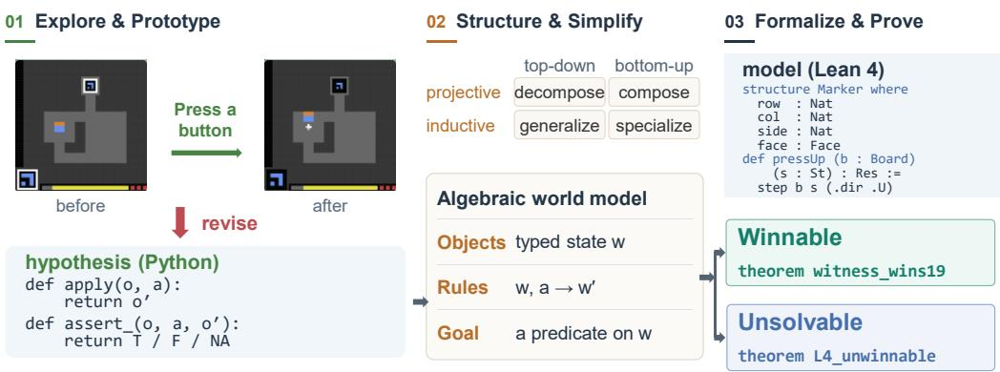  
Figure 1: AWM’s three-stage pipeline: interactive exploration builds a provisional executable model, algebraic transformations reveal and simplify its structure, and Lean 4 formalization enables certified proofs of reachability or impossibility.

We test AWM’s ability to prove impossibility on ARC-AGI-3 (ARC Prize Foundation, 2026b), whose games reveal neither their rules nor their goals. We construct two impossible variants of sc25 levels, preserving their mechanics while setting action budgets just below the minimum winning costs (§4). Across three runs per level, AWM produces closed, kernel-checked Lean proofs excluding all legal winning sequences under its learned models in all six runs. Claude Opus 5.5 and GPT-6 Astra produce no such proofs across twelve baseline runs.

The diference extends beyond proof construction. AWM’s initial bounds match the minimum winning costs in four of six runs, compared with one for Opus 5.5 (without a proof) and none for Astra; other baseline runs report incorrect bounds or remain inconclusive. For example, on level 4 Astra claims impossibility with an unproved minimum winning cost of 22, whereas AWM proves a tight bound of 19 under its learned model, matching the game’s actual minimum winning cost. Given only feedback that a cheaper win exists, AWM revises the rules underlying its remaining two bounds and constructs new closed proofs, bringing its bound accuracy to six of six.

AWM’s learned mechanisms are also explicit and inspectable: typed objects and named rules make their predictions available for step-by-step checking. Across all 25 public ARC-AGI-3 games, AWM builds compact models with a median of six object types and ten rules. These models enable Lean to replay the winning trajectories of all 183 levels, checking represented state transitions and final goal conditions (§3). With Opus 5, AWM clears all 25 games with a score of 99.9, competitive with leading code-executing systems; its certified winning trajectories use 43% of the human baseline’s actions.

We make three contributions.

• A framework from exploration to algebraic structure. AWM turns interaction with an unknown environment into executable hypotheses and organizes them into compact models through category-theory-guided transformations checked in Lean, presenting object types as projective and inductive limits. Shared, parameterized rules express related mechanisms in a common form, allowing their properties to be stated and proved uniformly (§2).

• Formal impossibility reasoning in unknown worlds. AWM constructs closed, kernel-checked Lean proofs that rule out all legal winning sequences under its learned rules and specified constraints, including sequences never explored. This establishes model-relative impossibility rather than inferring it from unsuccessful play (§4).

• Inspectable models and traceable proofs. Typed objects and named rules make learned dynamics understandable and their predictions checkable against observations. Lean replay connects the formal representation to recorded behavior, while explicit proof dependencies identify the rules on which a conclusion rests, supporting targeted empirical examination and revision (§3; §4.3).

## 2 Method

AWM aims to turn interaction with an unknown environment into a mathematical model that supports rigorous reasoning about both reachability and impossibility. This requires more than collecting rules that explain observed transitions: the rules must form a coherent representation of the environment, and that representation must support reasoning about action sequences the agent has never explored.

We first describe the target model (§2.1), then present the three stages that construct and use it (Figure 1): Explore & Prototype develops executable hypotheses through interaction; Structure & Simplify organizes them into a compact algebraic model; and Formalize & Prove completes the model in Lean 4 and establishes machine-checked results.

## 2.1 The Algebraic World Model

An algebraic world model describes an environment through typed objects, rules, and a goal predicate, represented in executable Python and formal Lean 4 to support both empirical testing and mathematical reasoning.

Objects. Object types define the structure and validity of states, providing a common vocabulary for describing the environment. A parser maps observations, together with any required history or auxiliary information, to typed states w.

Rules. Rules describe how actions transform these states. Each Python rule specifies an applicability scope and a checker that reports agreement, contradiction, or non-applicability on observed transitions; efect rules also predict successor states or their components. Together, the rules define legal actions, their efects and costs cost(w, a), while the goal predicate identifies successful states.

Related mechanisms can share a parameterized operation r(θ), with θ determined by the state. This allows common properties to be expressed and proved uniformly across diferent mechanisms.

Formal representation. The same model is formalized in Lean 4, with objects and rules presented as projective and inductive limits whose universal properties the kernel checks, and properties of their dynamics expressed as theorems. Its executable representation supports testing against observations, while its formal representation supports kernel-checked proofs over legal action sequences (§2.4).

## 2.2 Explore & Prototype

Setting. We consider deterministic, goal-directed environments with partial observations, modeled in the POMDP setting (Kaelbling et al., 1998). At step t, the agent observes $o _ { t } ,$ , takes an action $a _ { t }$ and receives $o _ { t + 1 }$ without access to the underlying state or transition function. Its experience forms a corpus $\mathcal { D } _ { t }$ of distinct transitions $x = \left( o , a , o ^ { \prime } \right)$

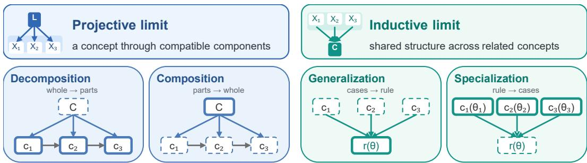  
Figure 2: Four transformations guided by projective and inductive limits, applied to object types and rules. Dashed boxes mark removed components and bold boxes mark introduced components; arrows indicate relationships between components. Generalization uses $r ( \theta )$ , and an instance is written $r ( \theta _ { i } )$ specialization makes distinctions explicit through case-specific types or parameters.

Building and testing hypotheses. AWM actively explores the environment and maintains a provisional executable model as a concept book. Each concept is a Python hypothesis about an environmental mechanism, containing a natural-language claim, an applicability scope, supporting transitions, a checker, and an optional predictor.

For a concept c, its checker returns $v _ { c } ( x )$ : TRUE if the transition agrees with the hypothesis, FALSE if it contradicts it, and NA if it falls outside its scope. The optional predictor specifies expected action efects for comparison with subsequent observations.

After each action batch, AWM rechecks the concept book $\mathcal { C } _ { t }$ against the expanded corpus $\mathcal { D } _ { t } .$ Further interaction is allowed only when

$$
\forall c \in \mathcal { C } _ { t } , \forall x \in \mathcal { D } _ { t } : ~ v _ { c } ( x ) \notin \{ \mathsf { F A L S E } , \mathsf { E R R } \} ,\tag{1}
$$

where ERR denotes checker failure, including exceptions and timeouts.

This recheck ensures that contradicted or failing concepts must be revised or withdrawn before exploration continues. The agent then keeps revising its hypotheses and uses them to plan toward inferred goals or probe competing explanations.

The resulting prototype captures tested mechanisms but may describe related behaviors independently, motivating the next stage.

## 2.3 Structure & Simplify

Structure & Simplify turns the concept book’s fragmented, overlapping descriptions into a compact model by identifying shared structure and reorganizing components through their relationships. AWM first extracts the required object types, constructs a parser from observations to typed states, and rewrites concepts as rules over these objects. It then restructures these components—object types and rules—through four category-theory-guided transformations. A projective limit (limit) assembles compatible descriptions into a coherent whole, while an inductive limit (colimit) glues objects along shared structure (Mac Lane, 1998; Kashiwara & Schapira, 2006). Yuan (2023) proposes representing a concept as such a limit of simpler concepts and verifying the representation at each node; AWM is a concrete implementation of this idea for learned world models, in which the two perspectives guide transformations based on compatibility and shared structure (Figure 2), each with an auxiliary Lean statement about cones, cocones and universal properties checked by the kernel (Appendix A.3).

Following projective limits, decomposition expresses a complex component through simpler components and their compatibility relations; Lean checks that it is the limit of the resulting diagram. Conversely, composition expresses a component as the limit of compatible existing components, which Lean checks, moving the composite into the derived layer when a separate primitive definition is unnecessary.

Following inductive limits, generalization extracts shared structure from multiple components, expressing source rules $c _ { i }$ through a parameterized operation $r ( \theta _ { i } )$ with state-dependent $\theta _ { i } ;$ ; Lean checks that r is the copairing [c ] out of the coproduct of cases. Conversely, specialization refines overly general components into more specific cases or introduces parameters to reduce exceptions and redundancy; Lean checks that the cases form a coproduct.

Preserving tested distinctions. Every transformation must compile its auxiliary Lean statement and preserve verdicts on recorded transitions. For rules, AWM also uses a diagnostic set $\mathcal { N }$ of perturbed recorded transitions to check whether simplification loses previously detected rejections.

Define $\operatorname { R e j } ( c ) = \{ x \in \mathcal { N } : v _ { c } ( x ) = \mathsf { F A L S E } \}$ and $\begin{array} { r } { \operatorname { R e j } ( S ) = \bigcup _ { c \in S } \operatorname { R e j } ( c ) } \end{array}$ . Replacing rules $S$ with $T$ must preserve coverage of recorded transitions and satisfy

$$
\operatorname { R e j } ( T ) \supseteq \operatorname { R e j } ( S ) .\tag{2}
$$

For object types, which have no checkers, transformations are evaluated by distinctions between recorded states, using state pairs as witnesses, and by rule verdicts once rules are available.

AWM applies these transformations and tests to object types, then rules, and finally rechecks object types against the settled rules.

## 2.4 Formalize & Prove

AWM completes the model in Lean 4 from the simplified objects and rules. Both are presented by projective and inductive limits (§2.1); in lp85, a world is a pullback, the goal an equalizer, and a rule defined by cases a copairing out of a coproduct (Appendix $\mathbf { A . } 3 )$ . Rules are def definitions and derived properties theorem statements, with auxiliary proofs from Structure & Simplify kept separate. The transition function dispatches to named rules, while unresolved assumptions remain explicit theorem hypotheses rather than unchecked axiom declarations. Replaying recorded winning trajectories, the Lean model reproduces observed behavior on every component it represents, grounding its formal definitions in the dynamics the agent encountered. This enables theorems about all legal action sequences under the learned model, extending formal reasoning beyond the trajectories actually explored.

Proving reachability and impossibility. A level is winnable in the model if a legal action sequence reaches the goal. AWM proves reachability by constructing a witness checked in Lean. Impossibility can arise because the goal is unreachable, or because reaching it requires more cost than the available budget. AWM proves the former using an invariant that excludes the goal, and the latter using a lower bound on the cost of any winning sequence. For budgeted tasks, a potential V estimates the minimum remaining cost from each state and satisfies

$$
V ( w ) \leq \mathrm { c o s t } ( w , a ) + V ( w ^ { \prime } ) \quad \mathrm { f o r e v e r y ~ l e g a l ~ t r a n s i t i o n } , \qquad V ( w ) \leq 0 \quad \mathrm { o n ~ t h e ~ g o a l } ,\tag{3}
$$

so every winning sequence costs at least $V ( w _ { 0 } )$ , proving impossibility when this exceeds the budget. All proofs are closed and checked by the Lean kernel, without unproved placeholders (sorry) or kernel-bypassing computation (native\_decide), establishing rigorous guarantees under the learned model’s explicit premises. More generally, we have the following definition for proving impossibilities.

Definition 1 (Suficient cover). Given a specific task $T ,$ , a learned model is a suficient cover of $T$ , if every optimal winning sequence in the environment is covered in the model, i.e., the transitions in the winning sequence can be reproduced step by step in the model.

Under suficient cover, impossibility proofs in the model transfer to the environment (Appendix A.4, Theorem A.1).

## 2.5 Example: one rule for four mechanisms

In game lp85, buttons move colored tiles, and a level is won when every slot holds its matching color. During Explore & Prototype, the agent discovers eleven concepts describing four button mechanisms: belts, stars, hubs, and panels (Figure 3a). In Structure & Simplify, AWM applies the generalization transformation to recognize that all four mechanisms permute tile positions, replacing the eleven concepts with a shared operation, press\_permutes, parameterized by the pressed button. On the diagnostic set used for this merge, the shared rule retains all 55 rejections of the source concepts and rejects 21 additional corrupted transitions. The shared rule also shortens reasoning: because one color-count invariant covers every button, proofs that a variant is unsolvable need two to three times fewer lemmas than proofs over the eleven separate concepts (Appendix B.3). A separate check tests whether such a model-level proof also holds for the game: on the level-6 tile-swap variant U, Lean verifies its unsolvability proof against an engine-derived graph covering all 52,500 transitions among 7,500 configurations (Appendix B.4).

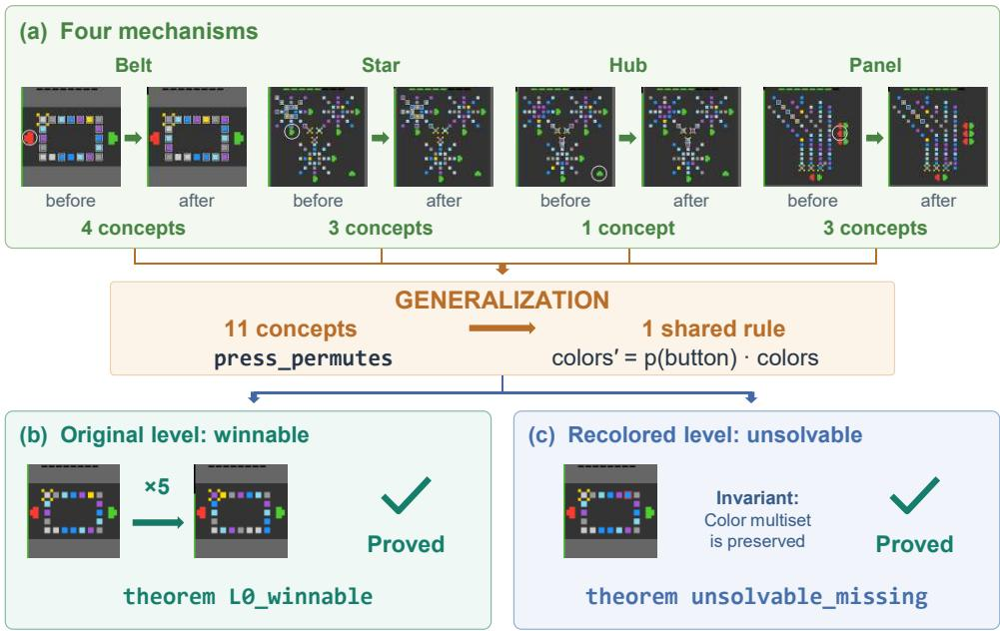  
Figure 3: From shared structure to formal proofs in lp85. (a) Eleven concepts describing four button mechanisms are generalized into a shared permutation rule. Each before/after pair shows a recorded press, with the pressed button circled and changed tiles outlined. (b) A five-click sequence witnesses reachability. (c) Recoloring the only yellow tile makes the goal unreachable, since every press preserves color counts. Both conclusions are formally proved in Lean 4.

In Formalize & Prove, Lean certifies a five-click winning sequence (Figure 3b) and proves a recolored variant unwinnable using the color-count invariant shared by all button permutations (Figure 3c). The final model contains six object types and six rules, and Lean replays all 199 recorded transitions without mismatch.

## 3 Twenty-five public games

ARC-AGI-3 (ARC Prize Foundation, 2026b) scores each level by the squared ratio of a human baseline’s action count to the agent’s, weights later levels more, and gives an uncleared level zero. We run AWM with Claude Opus 5 on all 25 public games (183 levels), starting each game with an empty concept book. AWM clears every level with a score of 99.9 and the fewest certified actions among the systems reporting this metric in Table 1. We further examine whether the resulting models are compact, reproduce observed behavior in Lean, and generalize beyond the trajectories from which they were learned.

Compact models that reproduce observed behavior. Across the 25 games, AWM records 742 executable concepts and withdraws 143 during model revision. The retained concepts are tested against the recorded transitions. Structure & Simplify organizes the rest into 170 object types and 283 rules, a median of 6 types and 10 rules per game. Shared patterns include translations, permutations and goal conditions. Lean replays the winning trajectory of every one of the 183 levels from its initial state and verifies its final state against the modeled goal (Table 2).

Table 1: Oficial scores on the 25 public ARC-AGI-3 games. Claude Opus 5 and GPT-6 Astra run under the oficial standard harness, which provides no code execution; the other systems execute code. AWM’s certified clears follow uncertified sessions of the same run in 22 games. The actions for Rodionov’s agent are from its ARC Prize scorecard and Memento 3’s as reported in (Zhao et al., 2026).
<table><tr><td>System</td><td>Code</td><td>Mean score</td><td>Games at 100</td><td>Certified actions</td><td>Actions / human</td></tr><tr><td>Claude Opus 5</td><td>no</td><td>40.7</td><td>5</td><td></td><td></td></tr><tr><td>GPT-6 Astra</td><td>no</td><td>68.3</td><td>10</td><td></td><td></td></tr><tr><td>GPT-6 Astra (adapter) (ARC Prize Foundation, 2026a)</td><td>yes</td><td>100.0</td><td>25</td><td></td><td></td></tr><tr><td>Rodionov (2026b)</td><td>yes</td><td>99.0</td><td>23</td><td>8,347</td><td>0.49</td></tr><tr><td>Memento 3 (Zhao et al., 2026)</td><td>yes</td><td>100.0</td><td>25</td><td>7,518</td><td>0.44</td></tr><tr><td>AWM (ours)</td><td>yes</td><td>99.9</td><td>23</td><td>7,448</td><td>0.43</td></tr></table>

Table 2: Formalization and verification of the 25 learned world models in Lean 4. Axioms are those Lean’s own logic uses; no proof adds axioms of its own.
<table><tr><td>Levels replayed</td><td>Rules formalized in Lean</td><td>Theorems Axioms</td></tr><tr><td>183 / 183</td><td>220</td><td>1,374 only propext, Classical.choice, Quot.sound</td></tr></table>

Generalization beyond observed transitions. We next test the learned rules on behavior the record never showed. We freeze the models of lp85 and ft09 after exploration and evaluate them on transitions from random play with previously unseen screens (seeds 0–9; Appendix B.2). The final frozen rules accept every valid transition in the new-trajectory sets. On the two modified lp85 layout sets, they predict the next tile layout in all 4,160 cases; on the two changed-mechanic ft09 sets, they reject all 4,031 transitions. On a third game, ls20, the same evaluation accepts 99.47–99.95% of valid transitions on previously unseen screens with the final rules, compared with 67–70% with the concepts before Structure & Simplify (Appendix B.2).

The changed mechanic modifies ft09’s hidden click pattern, causing each click to change 110 or 146 cells instead of 38; rejecting these transitions shows that the rules detect behavior inconsistent with the learned dynamics.

Clearing the games with eficient solutions. The same models are efective for play. AWM with Opus 5 achieves a score of 99.9, compared with 40.7 for Opus 5 under the oficial standard harness without code execution. It scores 100 on 23 games and at least 97.6 on every game, performing competitively with leading code-executing systems (Table 1). Its certified clears require 7,448 actions, only 43% of the human baseline’s 17,135 and the fewest among systems reporting this metric, compared with 7,518 for Memento 3 (Zhao et al., 2026) and 8,347 for Rodionov (2026b). Including exploration and other sessions, AWM uses 24,604 engine actions in total (Appendix B.1). These results show that AWM can construct and use explicit world models while retaining competitive solution eficiency. §4 next examines whether such models also support formal proofs of impossibility.

## 4 Proving impossibility

A winning trajectory establishes reachability; impossibility requires excluding every legal winning sequence within the budget, including those never explored. We test whether AWM’s learned algebraic models enable such exhaustive proofs, and whether those proofs hold for the game itself.

## 4.1 The game, the seal, and the baselines

In sc25, a block moves on a grid and casts spells through a 3 × 3 panel to reach the exit within the level’s budget. Moves and panel clicks cost one unit, completing a spell one more, fuel refunds ten, and the winning move is free. We construct two variants of levels 4 and 5 by rearranging selected elements while preserving the game mechanics, then seal them at budgets of 18 and 35. Exhaustive search on the game engine (the underlying game program), covering all four initial facings and all 13 actions, establishes minimum winning costs of 19 and 36, respectively: neither sealed level can be won, while one additional unit permits a win.

Table 3: Impossibility reasoning across six runs per agent. Bound accuracy is evaluated against the games’ minimum winning costs before and after feedback-guided repair. First claim averages the earliest impossibility claim among runs making one, including later withdrawals; it is not proof-completion time. Per-run results are in Appendix C.3.
<table><tr><td>Agent</td><td>Kernel-checked model proofs</td><td>Runs claiming impossible</td><td>Correct bounds initial → feedback</td><td>First claim (attempt)</td></tr><tr><td>Claude Opus 5.5</td><td>0/6</td><td>3/6</td><td> $1 / 6  1 / 6$ </td><td>5.3</td></tr><tr><td>GPT-6 Astra</td><td>0/6</td><td>2/6</td><td> $0 / 6  2 / 6$ </td><td>8.0</td></tr><tr><td>AWM</td><td>6/6</td><td>6/6</td><td> $4 / 6  6 / 6$ </td><td>2.0</td></tr></table>

Claude Opus 5.5 and GPT-6 Astra receive the game interface and coding tools, including simulator construction and search; AWM uses Opus 5.5 with the procedure of §2 and a generic Lean skeleton. Each condition has three runs per level, with up to eight reset-delimited attempts per run, ending at game over or recorded abandonment. After each attempt, every agent is asked whether the sealed level can be won and to justify its verdict; AWM constructs Lean proofs under its learned model. Impossibility can be established by proving that the minimum winning cost exceeds the budget. We evaluate proof validity under the learned model separately from numerical agreement with the engine.

## 4.2 Certified lower bounds

Proving beyond explored trajectories. All six AWM runs produce closed, kernel-checked Lean proofs of impossibility under their learned models and explicit premises, while none of the twelve baseline runs produces such a proof (Table 3). Crucially, these proofs exclude all legal winning sequences within the budget under the learned models, including those never explored. For example, an AWM run for level 4 proves

$$
\forall B \leq 1 8 , \forall \mathbf { a } , \quad \mathrm { W o n } ( \mathrm { r u n } _ { B } ( w _ { 0 } , \mathbf { a } ) ) = \mathsf { f a l s e } ,\tag{4}
$$

and verifies a winning witness at $B = 1 9$ . Together, the lower bound and witness certify a tight threshold under the model, whereas finding a winning route alone cannot exclude cheaper alternatives.

AWM establishes such bounds through potential or closure certificates over arbitrary legal action lists. Certificate data may come from any search; Lean checks that the certificate proves the stated bound under the formal model, so the proof need not trust the search implementation. We conduct additional tests showing that our Lean-based verification procedure can detect errors such as reversed bounds, Python–Lean mismatches, and vacuous theorem statements (Appendix C.7).

Beyond unproved numerical judgments. Only five of twelve baseline runs claim impossibility, four with incorrect bounds. Even the sole correct Claude Opus 5.5 bound lists “that my hand-counted path lengths are truly minimal” as assumed, not checked. Finding a winning route establishes an upper bound on the minimum cost, not its optimality. AWM instead provides kernel-checked lower-bound proofs under its learned models.

Figure 4 illustrates this distinction on L4. Astra finds a winning route costing 22 and assumes it is optimal without proof, incorrectly ruling out wins at budgets 19–21. In contrast, AWM formally proves a lower bound of 19 under its learned model and verifies a matching winning witness, establishing a tight bound that agrees with the game’s minimum winning cost.

Proof validity and bound accuracy are distinct. Before feedback, four of six AWM bounds are correct, compared with one for Opus 5.5 and none for GPT-6 Astra.

Some runs identify a correct winning sequence but charge the otherwise free winning move, reporting a bound one unit higher. Because this cost cannot be observed on sealed levels, we count such bounds as correct for all agents only when the discrepancy is explicitly attributable to this accounting convention, not to an incorrect route or cost estimate.

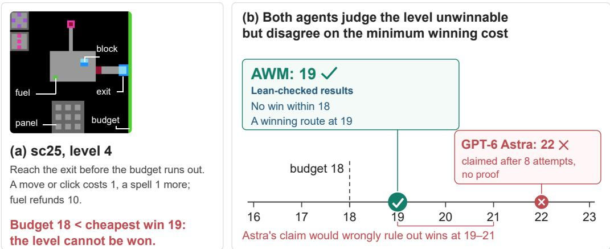

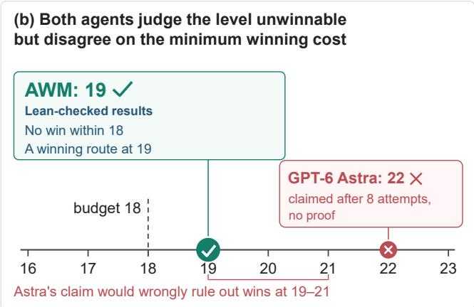  
Figure 4: Sealed sc25 level 4. AWM proves in Lean that the minimum winning cost under its learned model is 19, one unit above the budget, and verifies a route at that cost; GPT-6 Astra claims 22 without a proof.

The remaining two AWM bounds, 20 on L4 and 47 on L5, arise from overly restrictive learned rules that omit transitions used by the game’s cheapest winning routes, violating suficient cover (§2.4). Their proofs remain valid under those models, although their numerical thresholds disagree with the game.

## 4.3 Auditing premises and proving again

After the initial evaluation, the two AWM runs with bounds of 20 and 47 receive feedback only that the game permits a cheaper win, without revealing its cost, route or the faulty rule. AWM revisits its explicit rules, tests alternative formulations through interaction, and constructs new proofs under the refined models (Appendix C.4).

On L4, AWM discovers that growing onto fuel collects it, reducing the bound from 20 to 19. On L5, it identifies terrain rather than limited range as the cause of a failed shot, reducing the bound from 47 to 37 under its convention of charging the winning move, equivalent to the game’s minimum cost of 36. Both refinements succeed within four additional attempts, each yielding a new closed Lean proof. With this feedback, AWM reaches correct bounds in all six runs.

We provide the same discrepancy feedback and additional attempt budget to the four baseline runs with incorrect bounds. Astra corrects both bounds but produces no formal proofs, while Claude Opus 5.5 corrects neither.

Proof dependencies help locate faulty rules. Both repairs corrected rules used by the original proofs. To test whether proof dependencies help locate such errors, we inject a single incorrect rule into a reference model and give Claude Opus 5.5 the faulty model, its Lean proof, and access to the game. The goal is to find a transition where the model’s prediction disagrees with the game. On L4, Claude succeeds in 16 of 42 runs without explicit proof dependencies. Providing the rules used by the proof, without revealing which rule is faulty, increases this to 29 of 42 runs. Even when directly told which rule is faulty, Claude finds a counterexample in only 30 of 42 runs. Thus, proof dependencies substantially improve error discovery, nearly matching the benefit of identifying the faulty rule directly (Appendix C.6).

## 4.4 From model proofs to the engine

Matching the game’s minimum winning cost provides evidence of accurate reasoning, but does not establish that a formal proof under the learned model also holds for the game. To transfer such a proof, the learned model need not cover every game transition; by Definition 1, it sufices that it reproduce the game’s optimal winning sequences. For the budgeted tasks here, we verify suficient certificate-level conditions on engine-derived graphs, which preserve budget feasibility and the proof invariants (Lemmas A.2–A.3).

We exhaustively check the engines’ budget-feasible transitions from the fixed opening against the potential inequalities and invariant conditions used in the model proofs. These checks establish that five of the six model-level impossibility proofs can be extended to the original games. Appendix C.5 gives the per-run transfer arguments, including the completed rules and certificates.

## 5 Related work

Executable world models. Code world models are learned from interaction for planning (Tang et al., 2024), refined by generation, testing and repair (Dainese et al., 2024) or composed from programmatic experts (Piriyakulkij et al., 2025); theory-based agents explore and plan with learned theories (Tsividis et al., 2021), and TheoryCoder-2 learns reusable abstractions for hierarchical planning (Ahmed et al., 2026). Such models are central to recent ARC-AGI-3 agents (Rodionov, 2026a; Courtis et al., 2026; Rodionov, 2026b): Twin does not act until its simulator reproduces every observed transition (Skoutnev et al., 2026), and Tycho finds that a closer match does not by itself yield better play (Lehmann et al., 2026). The closest work, Memento 3, compiles a natural-language rulebook into code and accepts an update only if an LLM judges it faithful and replay is exact (Zhao et al., 2026). Yet a code world model can pass a sampled-transition check at 100% accuracy and still lose because it misses a key rule (Aguilar Martín, 2026). AWM instead abstracts its rules into a shared structure, tests them beyond the record, and proves reachability and impossibility, checking the proofs’ premises against the game.

Certified impossibility. Unsolvability certificates let an independent checker confirm that a planning task has no plan (Eriksson et al., 2017), in the spirit of certifying algorithms (McConnell et al., 2011), and certificate checking has been formally verified for temporal planning (Wang & Abdulaziz, 2025); all start from a supplied model. Impossibility transfers from an abstraction that covers every environment transition, with preserved initialization and goals (Clarke et al., 1994); Definition requires only that the model reproduce the optimal winning sequences; action-model learning gives conditions under which learned models support such transfer (Aineto & Scala, 2024). AWM learns its model from interaction; Lean checks every deduction from that model, and interaction checks the model’s rules against the game.

Formal reasoning. Neural provers produce Lean proofs at olympiad level (Achim et al., 2025; Chen et al., 2025; Hubert et al., 2026; Ren et al., 2025), AI systems have produced Lean proofs of open Erdős problems (Sothanaphan, 2026; Tsoukalas et al., 2026), and autoformalization translates informal statements into formal ones (Wu et al., 2022). There the objects of proof are given mathematics; AWM must first infer the dynamics and costs its proofs quantify over, which makes the fidelity of its formal model an empirical question. Large-scale AI-assisted software verification proves properties of compiled programs relative to machine semantics and theorem statements, and can expose bugs during proof construction (Lucas et al., 2026). That work also studies Claude-generated x86 semantics; AWM learns the objects, action rules and goals of an unfamiliar interactive environment.

## 6 Limitations and conclusion

Limitations. We demonstrate AWM on ARC-like environments with discrete actions and immediate, observable feedback, where learned rules can be checked against recorded transitions; richer hidden state, delayed feedback and stochastic dynamics remain to be tested. Lean guarantees the correctness of proofs under the learned model’s explicit premises, and whether these premises capture the environment is tested by interaction: the explicit rules and kernel-checked proofs separate errors in the learned model from errors in reasoning, so a discrepancy can be traced to its assumption and addressed by further exploration. Broader environments and tasks are the natural next test of such formal reasoning.

Conclusion. Formal reasoning traditionally begins with predefined objects and rules. AWM takes a step toward reasoning rigorously about unknown worlds by discovering these structures through interaction, organizing them into compact algebraic models, and formalizing them in Lean. The resulting models make learned mechanisms explicit and their behavior checkable step by step, while supporting kernel-checked proofs of reachability and impossibility, including claims about action sequences never explored. By making the assumptions behind these proofs explicit, AWM also allows discrepancies with the environment to be traced to learned rules and addressed through further exploration. Together, these capabilities bridge empirical exploration and formal reasoning, extending mathematical proof beyond problems whose definitions are given in advance.

## Reproducibility Statement

Our interactive website presents the models, tests, Lean proofs, and links to oficial replays for all 25 public games: https://ephemeral6.github.io/awm-site/. The Lean model of lp85, our running example, is also included in the supplementary materials (anc/lp85-lean), together with scripts for building the project and auditing its axioms. The website also provides the results and supporting materials for the sealed-level experiments, with per-run results reported in Appendix C.3.

## Statement on AI use

The agents studied in this paper are LLM agents, so AI use is part of the method. Generative AI was also used to draft and edit the text and to write the analysis scripts. All reported numbers come from script outputs over the recorded runs, not from model-generated text. The Lean proofs are checked by the Lean kernel, independently of any model.

## References

Tudor Achim et al. Aristotle: IMO-level automated theorem proving. arXiv preprint arXiv:2510.01346, 2025.

Javier Aguilar Martín. When a verified world model still loses: Play-adequacy vs prediction-accuracy in LLM-synthesized code world models. arXiv preprint arXiv:2607.14169, 2026.

Zergham Ahmed, Kazuki Irie, Joshua B. Tenenbaum, Christopher J. Bates, and Samuel J. Gershman. Learning abstractions for hierarchical planning in program-synthesis agents. arXiv preprint arXiv:2602.00929, 2026.

Diego Aineto and Enrico Scala. Action model learning with guarantees. In Proceedings ofthe 21st International Conference on Principles of Knowledge Representation and Reasoning (KR), pp. 801–811, 2024. doi: 10.24963/kr.2024/75.

Anthropic. Claude has improved on a longstanding lower bound for the fraction of zeros of the Riemann zeta function that satisfy the Riemann hypothesis. Anthropic research report, 2026. URL https://www.anthropic.com/research/riemann-zeta. Accessed 28 October 2026.

ARC Prize Foundation. GPT-6 Astra: ARC-AGI results. https://arcprize.org/results/ope nai-gpt-6-astra, 2026a. Public Demo, 25 environments; accessed 2 October 2026.

ARC Prize Foundation. ARC-AGI-3: A new challenge for frontier agentic intelligence. arXiv preprint arXiv:2603.24621, 2026b.

Luoxin Chen, Jinming Gu, Liankai Huang, Wenhao Huang, Zhicheng Jiang, Allan Jie, Xiaoran Jin, Xing Jin, Chenggang Li, Kaijing Ma, et al. Seed-Prover: Deep and broad reasoning for automated theorem proving. arXiv preprint arXiv:2507.23726, 2025.

Edmund M. Clarke, Orna Grumberg, and David E. Long. Model checking and abstraction. ACM Transactions on Programming Languages and Systems, 16(5):1512–1542, 1994. doi: 10.1145/18 6025.186051.

David Courtis, Wenhao Li, and Scott Sanner. OPINE-World: Programmatic world modeling with ontology-error-prioritized interactive exploration for ARC-AGI-3. arXiv preprint arXiv:2607.01531, 2026.

Nicola Dainese, Matteo Merler, Minttu Alakuijala, and Pekka Marttinen. Generating code world models with large language models guided by Monte Carlo tree search. In Advances in Neural Information Processing Systems 37 (NeurIPS), volume 37, pp. 60429–60474, 2024. doi: 10.52202 /079017-1933.

Leonardo de Moura and Sebastian Ullrich. The Lean 4 theorem prover and programming language. In Automated Deduction – CADE 28, volume 12699 of Lecture Notes in Computer Science, pp. 625–635. Springer, 2021.

Salomé Eriksson, Gabriele Röger, and Malte Helmert. Unsolvability certificates for classical planning. In Proceedings of the 27th International Conference on Automated Planning and Scheduling (ICAPS), pp. 88–97, 2017. doi: 10.1609/icaps.v27i1.13818.

Leonhard Euler. Solutio problematis ad geometriam situs pertinentis. Commentarii academiae scientiarum Petropolitanae, 8:128–140, 1741. Volume dated 1736; Eneström index E53.

Thomas Hubert, Rishi Mehta, Laurent Sartran, Miklós Z. Horváth, Goran Žužić, Eric Wieser, Aja Huang, Julian Schrittwieser, Yannick Schroecker, Hussain Masoom, et al. Olympiad-level formal mathematical reasoning with reinforcement learning. Nature, 651(8106):607–613, 2026. doi: 10.1038/s41586-025-09833-y.

Leslie Pack Kaelbling, Michael L. Littman, and Anthony R. Cassandra. Planning and acting in partially observable stochastic domains. Artificial Intelligence, 101(1–2):99–134, 1998. doi: 10.1016/S0004-3702(98)00023-X.

Masaki Kashiwara and Pierre Schapira. Categories and Sheaves, volume 332 of Grundlehren der mathematischen Wissenschaften. Springer, Berlin, Heidelberg, 2006.

Jens Lehmann, Andrei Aioanei, and Sahar Vahdati. Tycho: Active abstraction with programmatic world models for ARC-AGI-3. arXiv preprint arXiv:2607.28287, 2026.

Keane Lucas, Aengus Lynch, Luna Tong, Luke Champine, Zygi Straznickas, Dino Distefano, Harshikaa Agrawal, Evyatar Ben Asher, Ava Howell, Sami Jawhar, Chris Rohlf, Nickolai Zeldovich, Nicholas Carlini, Rajashree Agrawal, and Jason Gross. LLMs are making formal software verification feasible at a much larger scale. Anthropic research report, October 2026. URL https://www.anthropic.com/research/formal-verification. October 22, 2026.

Saunders Mac Lane. Categories for the Working Mathematician, volume 5 of Graduate Texts in Mathematics. Springer, 2nd edition, 1998.

Ross M. McConnell, Kurt Mehlhorn, Stefan Näher, and Pascal Schweitzer. Certifying algorithms. Computer Science Review, 5(2):119–161, 2011. doi: 10.1016/j.cosrev.2010.09.009.

Eugenio Moggi. Notions of computation and monads. Information and Computation, 93(1):55–92, 1991.

OpenAI. Local smoothing for the euclidean wave equation, October 2026a. URL https://github .com/openai/math/blob/main/preprints/Local-smoothing-for-the-Euclidean-w ave-equation-October-25-2026/paper.pdf.

OpenAI. Finite time blowup for Navier–Stokes. https://cdn.openai.com/pdf/32d9f210-8b7 3-45e0-91bc-82a30aef8a9a/navier-stokes.pdf, 2026b. Announced 8 September 2026.

Wasu Top Piriyakulkij, Yichao Liang, Hao Tang, Adrian Weller, Marta Kryven, and Kevin Ellis. PoE-World: Compositional world modeling with products of programmatic experts. In Advances in Neural Information Processing Systems 38 (NeurIPS), volume 38, 2025. doi: 10.52202/08571 3-0896.

Z. Z. Ren, Zhihong Shao, Junxiao Song, Huajian Xin, Haocheng Wang, Wanjia Zhao, Liyue Zhang, Zhe Fu, Qihao Zhu, Dejian Yang, Z. F. Wu, Zhibin Gou, Shirong Ma, Hongxuan Tang, Yuxuan Liu, Wenjun Gao, Daya Guo, and Chong Ruan. DeepSeek-Prover-V2: Advancing formal mathematical reasoning via reinforcement learning for subgoal decomposition. arXiv preprint arXiv:2504.21801, 2025.

Sergey Rodionov. Executable world models for ARC-AGI-3 in the era of coding agents. In Artificial General Intelligence: 19th International Conference, AGI 2026, Lecture Notes in Computer Science. Springer, 2026a. arXiv:2605.05138.

Sergey Rodionov. Do coding agents need executable world models, simplification, and verification to solve ARC-AGI-3? arXiv preprint arXiv:2607.15439, 2026b.

Alexy Skoutnev, Kirill Acharya, Gaston Longhitano, Madeleine Udell, Kevin Ellis, and Iddo Drori. Twin: Playing an unknown game with a test-time digital twin. arXiv preprint arXiv:2608.14490, 2026.

Nat Sothanaphan. Resolution of Erdős problem #728: a writeup of Aristotle’s Lean proof. arXiv preprint arXiv:2601.07421, 2026.

Hao Tang, Darren Key, and Kevin Ellis. WorldCoder, a model-based LLM agent: Building world models by writing code and interacting with the environment. In Advances in Neural Information Processing Systems 37 (NeurIPS), volume 37, pp. 70148–70212, 2024. doi: 10.52202/079017-2243.

Pedro A. Tsividis, Joao Loula, Jake Burga, Nathan Foss, Andres Campero, Thomas Pouncy, Samuel J. Gershman, and Joshua B. Tenenbaum. Human-level reinforcement learning through theory-based modeling, exploration, and planning. arXiv preprint arXiv:2107.12544, 2021.

George Tsoukalas et al. Advancing mathematics research with AI-driven formal proof search. arXiv preprint arXiv:2605.22763, 2026.

David Wang and Mohammad Abdulaziz. Formally verified certification of unsolvability of temporal planning problems. arXiv preprint arXiv:2510.10189, 2025.

Yuhuai Wu, Albert Q. Jiang, Wenda Li, Markus N. Rabe, Charles Staats, Mateja Jamnik, and Christian Szegedy. Autoformalization with large language models. In Advances in Neural Information Processing Systems 35 (NeurIPS), volume 35, 2022.

Yang Yuan. Succinct representations for concepts. arXiv preprint arXiv:2303.00446, 2023.

Haoyu Zhao, Zhengxu Yu, Zhiyuan He, Meng Fang, Rasul Tutunov, Haitham Bou-Ammar, Weilin Luo, and Jun Wang. Memento 3: Model-based recursive self-improvement through reflective rulebooks. arXiv preprint arXiv:2610.11794, 2026.

## A Method details

This appendix gives the definitions behind §2: concepts and the gate (§2.2), the simplification test (§2.3), and the Lean statements, certificates and their transfer to the environment (§2.4).

A.1 Environment, concepts and the gate. We model an environment as a deterministic, goaldirected special case of a partially observable Markov decision process (Kaelbling et al., 1998): states $s ,$ actions A, observations O, a transition function $T : \mathcal { S } \times \bar { \mathcal { A } }  \mathcal { S }$ , an observation function $\rho : { \mathcal { S } }  { \mathcal { O } }$ and goal states $G \subseteq S .$ . The agent sees $o _ { t } = \rho ( s _ { t } )$ and receives a signal when a level is cleared. A transition is a triple $\boldsymbol { x } = \left( o , a , o ^ { \prime } \right)$ , and a game’s transition corpus $\mathcal { D }$ is the set of distinct transitions across its runs, deduplicated by content hash.

A concept $c = ( \sigma _ { c } , \alpha _ { c } , \gamma _ { c } , E _ { c } )$ has an optional executable scope $\sigma _ { c } ,$ an assertion $\alpha _ { c }$ returning true, false or na, an optional predictor $\gamma _ { c } ,$ and a non-empty evidence set $E _ { c } .$ When the scope rejects x the verdict $v _ { c } ( x )$ is NA, otherwise it is $\alpha _ { c } ( x )$ ; an exception, an invalid return value or a timeout gives ERR. A concept is scored only on transitions outside $E _ { c } .$ The gate of Eq. (1) is enforced on the action command: it refuses the next action while the latest settlement has a FALSE or ERR verdict on any $x \in \mathcal { D }$ , including the concept’s own evidence. Figure 5 shows one concept.

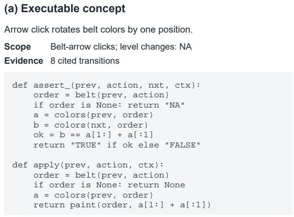

(b) Recorded transition  
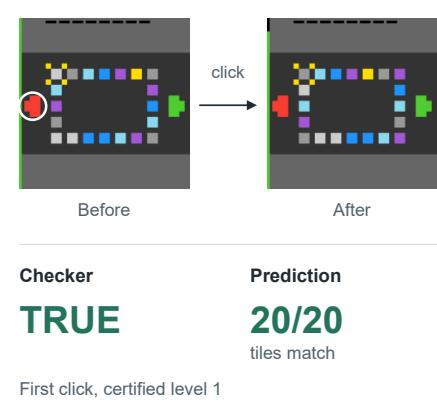  
Figure 5: An executable concept in lp85. (a) Scope, evidence and abridged code for a click on an arrow pointing against its belt’s order; helper names are simplified. (b) On the first click of the certified level-1 run, the checker returns TRUE and the prediction matches all 20 tiles.

A.2 Objects, rules and the simplification test. A partial parser $\pi : \widetilde { \mathcal { O } } \overset { \sim } {  } \mathcal { W }$ maps an observation, augmented by any explicitly supplied history or auxiliary information, to a world of typed objects; π(o) abbreviates parsing with that context. Pixel interpretation is confined to the parser, and parse failures are reported rather than guessed. A rule $r = \left( \sigma _ { r } , \alpha _ { r } \right)$ has a scope and an assertion on $( \pi ( o ) , a , \pi ( o ^ { \prime } ) )$ ). The diagnostic set $\mathcal { N }$ of Eq. (2) contains at most 120 corrupted transitions per game, with a fixed seed. Each replaces part of a recorded transition $( o , a , o ^ { \prime } )$ in one of five ways: the successor is o itself; the successor of the same action on another transition; the predecessor of another transition; $o ^ { \prime }$ with a few cells changed that do vary in the corpus; or another transition’s o. We set

$$
{ \mathrm { R e j } } ( r ) = \{ m \in { \mathcal { N } } : v _ { r } ( m ) = { \mathsf { F A L S E } } \} .\tag{A.1}
$$

The following is an auxiliary diagnostic within the four transformations, not a separate operation or a suficient deletion criterion: rule r has no unique rejection on $\mathcal { N }$ when

$$
\begin{array} { r } { \mathrm { R e j } ( r ) \subseteq \bigcup _ { r ^ { \prime } \neq r } \mathrm { R e j } ( r ^ { \prime } ) . } \end{array}\tag{A.2}
$$

Any removal must preserve model behavior and pass the same before/after checks; an analogous field diagnostic fixes a field to a constant and compares verdicts on $\mathcal { D } \cup \mathcal { N }$ . Figure 6 shows the test on lp85.

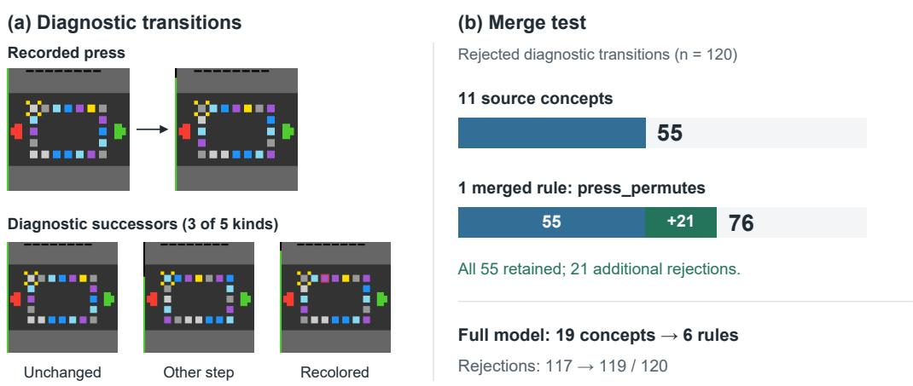  
Figure 6: Testing a merge on lp85. (a) A recorded press and three of the five diagnostic constructions. (b) On the same 120 diagnostic transitions, press\_permutes preserves all 55 rejections of its eleven source concepts and adds 21. Lack of unique rejections alone does not justify deletion: dead\_click, board\_static and bar\_never\_drops are retained based on further tests.

A.3 Concepts as limits: presentations, transformations and their certificates. This paragraph states the definitions behind §2.3. They follow the logic of Yuan (2023): a concept is represented as a projective or inductive limit of simpler concepts; a representation is valid if it gives the same result as the concept on every task; representing the parts in turn yields a hierarchy whose leaves are basic concepts; and each node of the hierarchy is verified. That work uses formal limits in categories of presheaves and a verifier that may be a stronger model or a person. AWM implements the idea concretely: the concepts are the object types and rules of the model, the category is Set (in Lean, types and functions), which is complete and cocomplete, so every representation is an actual limit or colimit; the tasks are the checks on recorded transitions; and the verifier at each node is the Lean kernel. As in Mac Lane (1998) and Kashiwara & Schapira (2006), projective and inductive limits are limits and colimits.

## Limits.

Definition 2 (Diagram, cone, limit). A diagram is a functor $D \colon J  \mathbf { S e t }$ t from a small category J. A cone over D is a set L with maps $\pi _ { j } \colon L \to D ( j ) , j \in J ,$ such that $D ( f ) \circ \pi _ { i } = \pi _ { j }$ for every $f \colon i  j$ . It is a limit (projective limit) if for every cone $( L ^ { \prime } , \pi ^ { \prime } )$ there is a unique u: $L ^ { \prime } \to L$ with $\pi _ { j } \circ u = \pi _ { j } ^ { \prime }$ for all $j .$ . Dually, a cocone is a set C with maps $\iota _ { j } \colon \dot { D } ( j )  C$ such that $\iota _ { j } \circ D ( f ) = \iota _ { i }$ for every ${ \bar { f } } \colon i  j .$ , and it is a colimit (inductive limit) if every cocone $( C ^ { \prime } , \iota ^ { \prime } )$ factors as $\iota _ { j } ^ { \prime } = u \circ \iota _ { j }$ through a unique u: $C  C ^ { \prime }$

In Set, lim D is the set of compatible families $\begin{array} { r } { \{ ( x _ { j } ) \in \prod _ { j } D ( j ) : D ( f ) ( x _ { i } ) = x _ { j } } \end{array}$ for all $f \colon i  j \}$ and colim $D \operatorname { i s } \coprod _ { j } D ( j )$ modulo the equivalence relation generated by $( i , x ) \sim ( j , D ( f ) ( x ) )$ . The shapes used here are those of the standard examples: a product and a coproduct (a discrete diagram); a pullback (a cospan $\bullet \right. \bullet \left. \bullet )$ , which aligns two components on a shared quantity; an equalizer (a parallel pair), such as the subset $\{ x \in X : \chi ( x ) = { \mathrm { t r u e } } \}$ cut out by $\chi \colon X \to$ Bool and the constant map true; and a coequalizer, such as the quotient of X by the equivalence relation generated by a relation $R \subseteq X \times X$ , presented by the two projections $R  X$

Two consequences of the universal properties are used throughout. A map into a limit is the same as a compatible family of maps into its parts, and a map out of a colimit is the same as a compatible family of maps out of its parts. In particular, a rule on a coproduct of cases is determined by its restrictions to the cases, and a map out of a quotient is a map out of X that is constant on R. Moreover, a limit or colimit is unique up to a unique isomorphism compatible with the cone or cocone: the quotient of color lists by permutation and the type of sorted color lists, both shown to be coequalizers of the same pair, are identified by the isomorphism that their universal properties provide.

## Representations.

Definition 3 (Presentation). A presentation of an object type $T$ is a triple $( D _ { T } , C _ { T } , u _ { T } ) ;$ a diagram $D _ { T }$ whose values are previously introduced types, a cone (or cocone) over $D _ { T }$ with vertex $C _ { T }$ , and a witness $u _ { T }$ of its universal property. The vertex $C _ { T }$ is the type used for computation, so the universal property is established for that type itself rather than for a separate copy.

Because a presentation refers only to previously introduced types, the presentations form a hierarchy. Its leaves are base types such as lists of colors, which are limits only trivially, of the one-object diagram on themselves. Every other object type is a limit or colimit of simpler types: a record without constraints is a product, and a type with constraints is an equalizer, a pullback or a quotient. Rules are represented in the same way. A rule defined by cases is a map out of a coproduct of cases, given by its restriction to each case, and the states or transitions that a condition such as the goal accepts form an equalizer. A rule given by a single formula is an ordinary definition, and a rule that the model does not represent stays in Python and is checked only on the corpus.

Definition 4 (Case table). A case table for a rule group with scope $C$ is a finite family of case predicates $( p _ { i } ) _ { i \in I }$ on $C .$ It satisfies the coproduct law if every element of $C$ satisfies exactly one $p _ { i } ;$ then $\begin{array} { r } { C \cong \bigoplus _ { i \in I } \dot { C } _ { i } } \end{array}$ with $C _ { i } = \{ x \in C : p _ { i } ( x ) \}$ . On the corpus we also require every case to occur. $\mathbf { A }$ rule defined case by case is the copairing $\begin{array} { r } { [ r _ { i } ] _ { i \in I } \colon \prod _ { i } C _ { i } \to V } \end{array}$ , the unique map whose restriction to each $C _ { i }$ is $r _ { i } \colon C _ { i } \to V$

Validity under tasks. A representation is valid if replacing a concept by it changes the result of no task. The tasks of AWM are the checks that the model must pass on recorded data: the verdict of every rule on every recorded transition, the rejections on the diagnostic set ${ \mathcal { N } } .$ , and the task contracts, which require that one step commute with the representation map e from old to new states and that goal verdicts, checker verdicts and action costs be unchanged. A transformation is valid under these tasks if all verdicts and contracts are preserved and the rejections satisfy Eq. (2), so that $\mathcal { N }$ may only gain rejections.

Definitions and examples. A projective limit describes a concept by definition, through the components that support it, and an inductive limit describes it by examples, through what the examples share. The four transformations move along these two kinds of limits.

Definition 5 (Category-guided transformation). A transformation replaces components $S$ of the model by components $T ,$ , together with a representation map e from old to new states. It is one of the following.

• Decomposition: a component X is replaced by a diagram D of simpler components together with a limit cone $( X , \pi )$ over $D$

• Composition: a component Y is defined from a product $Z$ of existing components and constraints given by subobjects $\varphi _ { 1 } , \ldots , \varphi _ { k } \subseteq Z$ , as their intersection, i.e. the limit of the inclusions $\varphi _ { i } \hookrightarrow Z$ The composition is proper if no single $\varphi _ { i }$ equals Y.

• Generalization: rules $r _ { i } \colon C _ { i } \to V , i \in I$ , are replaced by the copairing $\begin{array} { r } { [ r _ { i } ] \colon [ \int _ { i } C _ { i }  V . } \end{array}$ , which a parameter $\theta \in I$ indexes as $r ( \theta )$

• Specialization, the converse of generalization: a component $X$ is replaced by components $X _ { i }$ with $\textstyle X \cong \coprod _ { i } X _ { i }$ , or by a family $X ( \theta )$ with a new parameter and the projection that forgets θ.

It is accepted if (i) it is valid under the tasks above and the check of its kind passes, and (ii) the Lean statement of its universal construction compiles when the transformation is made. Deleting a component that is a function of others is recorded separately and is not one of the four transformations.

The checks of each kind are: for decomposition, that $X $ lim $D \to X$ is the identity on recorded states; for composition, that Y agrees with $\Lambda _ { i } \varphi _ { i }$ and that each $\varphi _ { i }$ admits a transition that Y rejects; for generalization, the coproduct law and agreement with each $r _ { i }$ on its case; for specialization, that merging the cases back reproduces the original verdicts and that fixing the new parameter to a constant produces errors.

Verification at each node. Every non-leaf node of the hierarchy is verified by the Lean kernel: every object type with constraints and every case table must come with a proof of its universal property.

The kernel establishes that each node is the limit or colimit of its diagram; whether the representation describes the environment is established by the tasks. The two kinds of evidence therefore answer diferent questions, what the model entails and whether it agrees with the environment, and neither substitutes for the other. A claim for all well-formed states requires a Lean theorem that does not hold by definitional unfolding alone; for example, the equation stating that a rule defined by pattern matching equals the copairing of its branches holds by unfolding and certifies the form of the rule, not its content.

Action sequences. A deterministic step $\delta \colon \mathcal { W } \times \mathcal { A }  \mathcal { W }$ makes the free monoid $\mathcal { A } ^ { \ast }$ act on $\mathcal { W }$ on the right, by $w \cdot \varepsilon = w$ and $w \cdot ( \bar { a } a ) = \delta ( w \cdot \bar { a } , a )$ . With partial legality, each $\delta ( - , a )$ is a morphism $\mathcal { W } \to \mathcal { W }$ in the Kleisli category of the option monad, and words act by partial maps (Moggi, 1991). Facts about action sequences are not limits or colimits; one belongs to the model only if it is checked on every level of the corpus. In lp85, a word of clicks acts by the composite of the clicked buttons’ permutations; Lean proves this for every board.

Lean interface. Diagrams are given over finite quivers, since cones over a quiver coincide with cones over the free category it generates. The names Cone, Cocone, IsLimit, IsColimit follow Mathlib, with an implementation in Lean core. A final check compiles every module, requires the proofs listed under verification, keeps the computational layer independent of these proofs, forbids sorry, admit and native\_decide, and audits the axioms of every constant. For $\mathtt { l p 8 5 }$ , the declarations behind the examples of $\ S 2 . 4$ are in the ancillary files of this paper (anc/lp85-lean): worldIsLimit (the world as a pullback), goalIsLimit (the goal as an equalizer), and onHit\_is\_desc and toPerm\_unique (rules defined by cases as copairings).

A.4 Lean encoding, certificates and transfer. Formalization starts from the consolidated objects and rules. AWM encodes object types as Lean structure, inductive or quotient declarations and primitive rules as executable def definitions. The presentations, case tables and transformation statements written during Structure & Simplify to check each step $( \ S \mathrm { A } . 3 )$ form an auxiliary layer that the model does not import. Consequences derivable from these definitions are proved as theorem statements in the derived layer. The agent assembles the modeled transition and goal rules in Step.lean, whose step function dispatches to the named rule definitions and returns a successor or a terminal outcome for actions admitted by the model’s legality conditions. For example, in lp85, a click either leaves the colors unchanged or applies a button’s permutation, after which the goal rule determines whether the level is won; color conservation is a theorem derived from these definitions. This shared transition function is used both to replay recorded trajectories and to reason about unobserved action sequences. In $\mathtt { l p 8 5 }$ , the two budget-display rules remain in Python; Lean replays the tile dynamics and goal condition, while color conservation follows from the permutation rule (Figure 7).

On this basis, eve $\cdot \mathrm { W o n } ( w , \bar { a } )$ holds when some legal prefix of a¯ reaches a winning outcome. The two statements of $\ S 2 . 4$ are

$$
\operatorname { W i n n a b l e } ( w ) : \Leftrightarrow \exists \bar { a } . \operatorname { e v e r W o n } ( w , \bar { a } ) = \operatorname { t r u e } , \qquad \operatorname { U n s o l v a b l e } ( w ) : \Leftrightarrow \forall \bar { a } . \operatorname { e v e r W o n } ( w , \bar { a } ) = \mathsf { f a l s e } .
$$

For level $\ell ,$ the initial world $w _ { 0 } ^ { \ell }$ is parsed from that level’s first screen in the certified run, and the certified actions are $\bar { a } ^ { \ell } .$ . The reachability proof establishes trace $\mathrm { ) k } ( w _ { 0 } ^ { \ell } , \bar { a } ^ { \ell } )$ , i.e. that every computed state agrees with the recorded frame on the components the formal model represents, and Winna $\mathrm { b l e } ( w _ { 0 } ^ { \ell } )$ with $\bar { a } ^ { \ell }$ as witness. An impossibility proof establishes Unsolvable within a budget through a potential satisfying Eq. (3). Each theorem is closed by kernel reduction, its axioms lie within {propext, Classical.choice, Quot.sound}, and no proof uses native\_decide; compiled with Lean 4.34.0, the published Game.lean of every game compiles and its consistent and faithful theorems depend only on propext.

Definition 1 asks a suficient cover to reproduce only the environment’s optimal winning sequences under a fixed map $h ,$ rather than every transition as in an over-approximation (Aineto & Scala, 2024; Clarke et al., 1994). Let $\widehat { G }$ be the model’s goal set.

Theorem A.1 (Transfer under suficient cover). Suppose $\widehat { \mathcal { M } }$ is a suficient cover of $\cdot \varepsilon$ via $h ,$ and its initial state is $h ( s _ { 0 } )$ . IfUnsolvable $\displaystyle { \widehat { \mathcal { M } } \big ( h ( s _ { 0 } ) \big ) }$ , then no legal action sequencefrom s reaches $G .$

Proof. Suppose some legal sequence from $s _ { 0 }$ reaches $G .$ Then the task can be won, so it has an optimal winning sequence a¯. Since $\widehat { \mathcal { M } }$ is a suficient cover, a¯ is legal in $\widehat { \mathcal { M } }$ from $h ( s _ { 0 } )$ , passes through the images of the real states, and ends in $\widehat { G }$ . This is a model win, contradicting Unsolvable $\hat { \mathcal { M } } ^ { ( h ( s _ { 0 } ) ) }$ ). □

Full transition coverage is a special case: a model that reproduces every legal transition, with preserved goals and budget feasibility, reproduces every optimal winning sequence. For budgeted tasks, the optimal winning sequences are those of least cost, and the lemmas below give suficient conditions that can be checked on engine-derived graphs.

For a fixed budget, let $\operatorname { T r } _ { X } ( B )$ denote legal executions from the specified initial state that respect all budget checks. The model budget $\widehat { B }$ may use explicitly translated cost units.

Lemma A.2 (Budget-local execution transfer). If a map κ : $\mathrm { T r } _ { \mathcal { E } } ( B ) \to \mathrm { T r } _ { \widehat { \mathcal { M } } } ( \widehat { B } )$ preserves winning outcomes, model impossibility at $\widehat { B }$ implies environment impossibility at $B .$

Proof. A real win would map to a budget-feasible model win, contradicting model impossibility.

Unlike full coverage, this condition permits macro actions, stuttering and compressed detours. Goals, one-use resources and intermediate budget guards must still be preserved; final net cost alone is insuficient.

Lemma A.3 (Budget-local invariant transfer). Let $D _ { B }$ contain all real configurations reachable within budget B from the specified initial state, including winning terminals. Ifa certificate predicate $I _ { B }$ holds initially, is preserved by every budget-admissible real transition in $D _ { B } ,$ , and excludes every real goal in $D _ { B }$ , then the environment has no win at budget B.

Proof. Induction establishes $I _ { B }$ at every feasible prefix; a winning prefix contradicts goal exclusion. □

For a potential H, summing its checked transition inequalities and terminal condition gives $H ( q _ { 0 } ) \leq \overline { { C } }$ for any winning execution, where $\overline { { C } }$ is its total in the proof’s cost units. A real budget-B win is excluded once cost accounting gives $\overline { { C } } \leq \widehat { B } < H ( q _ { 0 } )$ . Thus only the certified budget obstruction, not every intermediate modeled state, needs to be preserved.

A partial certificate may be completed, but the required initial bound and all transition and winningboundary inequalities must then be verified, including any revised existing values. Appendix C.5 gives the engine checks.

## B Twenty-five games

This appendix gives the per-game data behind §3, Table 1 and Table 2, the test of frozen rules on unseen transitions, and the lp85 proof sizes of §2.5.

B.1 Per-game results. Table 4 gives AWM’s results and model for each game; Table 5 gives the oficial scores of all systems.

B.2 Frozen rules on unseen transitions. We evaluate whether learned rules generalize to unseen screens and detect changes in game mechanics. For lp85 and ft09, we freeze the concepts recorded during play (19 and 9, respectively) and the rules after Structure & Simplify (6 and 7). We collect transitions from random presses (seeds 0–9), retaining only states whose screens never appeared in the recorded gameplay.

Each game is evaluated on new trajectories from the original levels (T1) and two modified levels, whose winnability is verified by exhaustive search. In lp85, the modifications preserve the mechanics but change the layout: U moves one goal tile, making level 6 unwinnable, while D adds another swap that restores winnability. In ft09, the modifications change the hidden click mechanic: FU replaces level 2’s click pattern with a plus shape, making it unwinnable, while FD adds a one-pixel change that restores winnability.

Table 4: AWM on each game. Score: oficial score of the certified run. Cert.: actions in the certified clears, which the score counts. Sent: every action AWM sent to the engine, including uncertified sessions, failed attempts and resets. Human: actions of the human baseline. Concepts: concepts written during play, with those withdrawn in brackets. Rules (Lean): rules translated into Lean. Replayed: levels whose certified winning run Lean replays from the first screen to the modeled goal.
<table><tr><td>Game</td><td>Lv.</td><td>Score</td><td>Cert.</td><td>Sent</td><td>Human</td><td>Concepts</td><td>Obj. types</td><td>Rules</td><td>Rules (Lean)</td><td>Replayed</td></tr><tr><td>ar25</td><td>8</td><td>100.0</td><td>253</td><td>253</td><td>748</td><td>17 (3)</td><td>6</td><td>8</td><td>5</td><td>8/8</td></tr><tr><td>bp35</td><td>9</td><td>100.0</td><td>374</td><td>374</td><td>651</td><td>26 (4)</td><td>3</td><td>11</td><td>10</td><td>9/9</td></tr><tr><td>cd82</td><td>6</td><td>100.0</td><td>70</td><td>661</td><td>171</td><td>44 (13)</td><td>7</td><td>11</td><td>10</td><td>6/6</td></tr><tr><td>cn04</td><td>6</td><td>100.0</td><td>261</td><td>745</td><td>789</td><td>22 (1)</td><td>4</td><td>9</td><td>8</td><td>6/6</td></tr><tr><td>dc22</td><td>6</td><td>100.0</td><td>1,037</td><td>2,664</td><td>1,228</td><td>48 (6)</td><td>8</td><td>17</td><td>14</td><td>6/6</td></tr><tr><td>ft09</td><td>6</td><td>100.0</td><td>80</td><td>168</td><td>208</td><td>15 (6)</td><td>6</td><td>7</td><td>4</td><td>6/6</td></tr><tr><td>g50t</td><td>7</td><td>100.0</td><td>288</td><td>811</td><td>879</td><td>20 (1)</td><td>10</td><td>13</td><td>11</td><td>7/7</td></tr><tr><td>ka59</td><td>7</td><td>97.6</td><td>421</td><td>4,061</td><td>730</td><td>22 (8)</td><td>9</td><td>11</td><td>10</td><td>7/17</td></tr><tr><td>1f52</td><td>10</td><td>100.0</td><td>905</td><td>905</td><td>1,339</td><td>47 (6)</td><td>12</td><td>11</td><td>10</td><td>10/10</td></tr><tr><td>1p85</td><td>8</td><td>100.0</td><td>79</td><td>200</td><td>388</td><td>23 (4)</td><td>6</td><td>6</td><td>4</td><td>8/8</td></tr><tr><td>1s20</td><td>7</td><td>100.0</td><td>368</td><td>1,467</td><td>776</td><td>22 (3)</td><td>12</td><td>21</td><td>18</td><td>7/7</td></tr><tr><td>m0r0</td><td>6</td><td>100.0</td><td>215</td><td>486</td><td>1,107</td><td>26 (5)</td><td>8</td><td>9</td><td>8</td><td>6/6</td></tr><tr><td>r111</td><td>6</td><td>100.0</td><td>81</td><td>184</td><td>233</td><td>26 (4)</td><td>6</td><td>9</td><td>8</td><td>6/6</td></tr><tr><td>re86</td><td>8</td><td>100.0</td><td>547</td><td>2,153</td><td>1,255</td><td>40 (4)</td><td>7</td><td>12</td><td>8</td><td>8/8</td></tr><tr><td>s5i5</td><td>8</td><td>99.3</td><td>461</td><td>2,618</td><td>638</td><td>49 (9)</td><td>5</td><td>19</td><td>17</td><td>8/8</td></tr><tr><td>sb26</td><td>8</td><td>100.0</td><td>124</td><td>424</td><td>213</td><td>20 (1)</td><td>6</td><td>16</td><td>12</td><td>8/8</td></tr><tr><td>sc25</td><td>6</td><td>100.0</td><td>146</td><td>401</td><td>350</td><td>27 (1)</td><td>5</td><td>18</td><td>11</td><td>6/6</td></tr><tr><td>sk48</td><td>8</td><td>100.0</td><td>263</td><td>1,407</td><td>1,070</td><td>39 (8)</td><td>6</td><td>7</td><td>4</td><td>8/8</td></tr><tr><td>sp80</td><td>6</td><td>100.0</td><td>138</td><td>371</td><td>518</td><td>58 (23)</td><td>3</td><td>10</td><td>6</td><td>6/6</td></tr><tr><td>su15</td><td>9</td><td>100.0</td><td>90</td><td>904</td><td>361</td><td>37 (15)</td><td>5</td><td>16</td><td>12</td><td>9/9</td></tr><tr><td>tn36</td><td>7</td><td>100.0</td><td>125</td><td>292</td><td>317</td><td>33 (9)</td><td>5</td><td>7</td><td>4</td><td>7/17</td></tr><tr><td>tr87</td><td>6</td><td>100.0</td><td>119</td><td>430</td><td>414</td><td>13 (3)</td><td>6</td><td>7</td><td>4</td><td>6/6</td></tr><tr><td>tu93</td><td>9</td><td>100.0</td><td>187</td><td>566</td><td>462</td><td>17 (0)</td><td>8</td><td>10</td><td>8</td><td>9/9</td></tr><tr><td>vc33</td><td>7</td><td>100.0</td><td>167</td><td>538</td><td>447</td><td>14 (0)</td><td>9</td><td>10</td><td>7</td><td>7/7</td></tr><tr><td>wa30</td><td>9</td><td>100.0</td><td>649</td><td>1,521</td><td>1,843</td><td>37 (6)</td><td>8</td><td>8</td><td>7</td><td>9/9</td></tr><tr><td>Total</td><td>183</td><td>99.9</td><td>7,448</td><td>24,604</td><td>17,135</td><td>742 (143)</td><td>170</td><td>283</td><td>220</td><td>183/183</td></tr></table>

A rule set accepts a transition if no rule judges it false, and rejects it if at least one rule judges it false. We also generate invalid transitions using five corruption operators to test whether the rules can detect inconsistencies. Table 6 reports the results before and after Structure & Simplify. The frozen rules generalize to modified layouts in lp85, while detecting all tested transitions as inconsistent after the mechanic changes in ft09.

ls20. On ls20, the concepts written during play accept 67–70% of valid transitions on unseen screens; after Structure & Simplify, the frozen rules accept 99.47–99.95% and reject 99.1–99.3% of corrupted transitions, against 71.8–100% for the concepts (Table 7). The gap comes from wall bumps: the concepts energy\_tick and energy\_cost charge energy for a blocked move only on the two levels where play recorded one, while the rule energy\_cost charges every wall bump the level’s step cost, which holds on screens the agent never saw.

B.3 lp85: the complete model and proof size. Figure 7 shows the complete model of lp85. To evaluate the efect of Structure & Simplify on proof construction, we compare model A, the eleven concepts recorded during play, with model B, the single merged press\_permutes rule. We ask Claude Opus 5.5 to establish the solvability (with a winning click sequence) or unsolvability (with a Lean proof) of 34 tasks under each model. Each task is run three times per model, yielding 204 runs in total, and every verdict is checked against exhaustive search on the engine.

Table 8 reports proof success and complexity. Model B succeeds in all 102 runs, compared with 99 for A, and generally requires fewer auxiliary lemmas, shorter proofs, and less Lean checking time.

No run produces an incorrect verdict: A has two timeouts and one run ending without an answer. On winnable instances, both models establish reachability using a winning click sequence and decide.

B.4 Checking a model-level proof against the engine. This check concerns the level-6 tile-swap variant U of Appendix B.2. We export its engine-derived, budget-independent reachable configuration graph as a Lean table, with 7,500 configurations and 52,500 transitions for the seven nontrivial button actions. A Lean proof checks each transition against the premises of the model-level unsolvability theorem, so the conclusion transfers to the exported graph. The proof uses only Lean’s standard axioms. Extracting the graph from the game engine remains outside the Lean kernel’s guarantee.

Table 5: Oficial scores on the 25 public ARC-AGI-3 games. Baselines are the oficial ARC Prize results: Claude Opus 5 (High) and GPT-6 Astra (Max) under the standard harness, which provides no code execution, and GPT-6 Astra (Max) under its provider-adapter harness. AWM is scored on its certified run. Rodionov’s agent from its ARC Prize scorecard (Rodionov, 2026b); Memento 3 as reported in (Zhao et al., 2026).
<table><tr><td colspan="2"></td><td colspan="6">Official score (max 100)</td></tr><tr><td>Game</td><td></td><td>Claude</td><td>GPT-6 Astra</td><td>GPT-6 Astra</td><td>Rodionov (2026b)</td><td>Memento 3 (Zhao et al., 2026)</td><td>AWM</td></tr><tr><td></td><td>Lv.</td><td>Opus 5</td><td></td><td>(adapter)</td><td></td><td></td><td>(ours)</td></tr><tr><td>ar25</td><td>8</td><td>100.0 0.0</td><td>100.0 2.2</td><td>100.0 100.0</td><td>100.0 100.0</td><td>100.0 100.0</td><td>100.0 100.0</td></tr><tr><td>bp35 cd82</td><td>9 6</td><td>0.6</td><td>82.9</td><td>100.0</td><td>100.0</td><td>100.0</td><td>100.0</td></tr><tr><td>cn04</td><td></td><td>47.6</td><td>100.0</td><td>100.0</td><td>100.0</td><td>100.0</td><td>100.0</td></tr><tr><td>dc22</td><td>6</td><td>44.8</td><td>100.0</td><td>100.0</td><td>100.0</td><td>100.0</td><td>100.0</td></tr><tr><td>ft09</td><td>6 6</td><td>100.0</td><td>100.0</td><td>100.0</td><td>100.0</td><td>100.0</td><td>100.0</td></tr><tr><td>g50t</td><td>7</td><td>0.0</td><td>0.0</td><td>100.0</td><td>100.0</td><td>100.0</td><td>100.0</td></tr><tr><td>ka59</td><td>7</td><td>10.4</td><td>75.0</td><td>100.0</td><td>100.0</td><td>100.0</td><td>97.6</td></tr><tr><td>1f52</td><td>10</td><td>1.8</td><td>10.9</td><td>100.0</td><td>100.0</td><td>100.0</td><td>100.0</td></tr><tr><td>1p85</td><td>8</td><td>100.0</td><td>100.0</td><td>100.0</td><td>100.0</td><td>100.0</td><td>100.0</td></tr><tr><td>1s20</td><td>7</td><td>5.4</td><td>83.5</td><td>100.0</td><td>100.0</td><td>100.0</td><td>100.0</td></tr><tr><td>m0r0</td><td>6</td><td>28.6</td><td>71.4</td><td>100.0</td><td>100.0</td><td>100.0</td><td>100.0</td></tr><tr><td>r111</td><td>6</td><td>100.0</td><td>100.0</td><td>100.0</td><td>100.0</td><td>100.0</td><td>100.0</td></tr><tr><td>re86</td><td>8</td><td>58.3</td><td>77.8</td><td>100.0</td><td>100.0</td><td>100.0</td><td>100.0</td></tr><tr><td>s5i5</td><td>8</td><td>100.0</td><td>100.0</td><td>100.0</td><td>100.0</td><td>100.0</td><td>99.3</td></tr><tr><td>sb26</td><td>8</td><td>77.8</td><td>100.0</td><td>100.0</td><td>100.0</td><td>100.0</td><td>100.0</td></tr><tr><td>sc25</td><td>6</td><td>0.0</td><td>47.6</td><td>100.0</td><td>84.2</td><td>100.0</td><td>100.0</td></tr><tr><td>sk48</td><td>8</td><td>8.3</td><td>19.7</td><td>100.0</td><td>100.0</td><td>100.0</td><td>100.0</td></tr><tr><td>sp80</td><td>6</td><td>56.3</td><td>100.0</td><td>100.0</td><td>100.0</td><td>100.0</td><td>100.0</td></tr><tr><td>su15</td><td>9</td><td>10.4</td><td>27.4</td><td>100.0</td><td>100.0</td><td>100.0</td><td>100.0</td></tr><tr><td>tn36</td><td>7</td><td>6.0</td><td>53.6</td><td>100.0</td><td>90.1</td><td>100.0</td><td>100.0</td></tr><tr><td>tr87</td><td>6</td><td>47.6</td><td>100.0</td><td>100.0</td><td>100.0</td><td>100.0</td><td>100.0</td></tr><tr><td>tu93</td><td>9</td><td>3.6</td><td>3.1</td><td>100.0</td><td>100.0</td><td>100.0</td><td>100.0</td></tr><tr><td>vc33</td><td>7</td><td>98.8</td><td>73.3</td><td>100.0</td><td>100.0</td><td>100.0</td><td>100.0</td></tr><tr><td>wa30</td><td>9</td><td>10.6</td><td>80.0</td><td>100.0</td><td>100.0</td><td>100.0</td><td>100.0</td></tr><tr><td></td><td></td><td></td><td></td><td></td><td></td><td></td><td></td></tr><tr><td>Mean Games at 100</td><td></td><td>40.7 5</td><td>68.3 10</td><td>100.0 25</td><td>99.0 23</td><td>100.0 25</td><td>99.9 23</td></tr></table>

Table 6: Frozen-rule evaluation on unseen transitions, before / after Structure & Simplify (%). lp85 U/D test generalization to modified layouts, while ft09 FU/FD test detection of changed mechanics. “Wrong rejected” reports the range over the four corruption operators for which both rule sets can read both frames. The 0% acceptance on FU/FD indicates that all tested transitions violate the frozen rules: the “nothing else changes” rule detects clicks changing 110 or 146 cells instead of 38.
<table><tr><td>Set</td><td>n</td><td>Transitions accepted</td><td></td><td>Wrong rejected Next frame predicted</td></tr><tr><td>lp85 T1 (new trajectories)</td><td>2,073</td><td>100 / 100</td><td>99.5–100 / 99.5–100</td><td>99.95 / 99.95</td></tr><tr><td>lp85 tile swap U</td><td>2,080</td><td>100 / 100</td><td>100 / 100</td><td>100 / 100</td></tr><tr><td>lp85 tile swap D</td><td>2,080</td><td>100 / 100</td><td>100 / 100</td><td>100 / 100</td></tr><tr><td>ft09 T1 (new trajectories)</td><td>2,026</td><td>99.0 / 100</td><td>99.0–100 / 100</td><td></td></tr><tr><td>ft09 pattern change FU</td><td>2,015</td><td>0/0</td><td></td><td></td></tr><tr><td>ft09 pattern change FD</td><td>2,016</td><td>0/0</td><td></td><td></td></tr></table>

Table 7: Frozen concepts and rules on two ls20 test sets of previously unseen screens (%). T1: new trajectories on the original levels; T2V: level 1 with its switch moved one cell. Corrupted rejected: range over the four corruption operators for which both sides can read both frames.
<table><tr><td colspan="2"></td><td colspan="2">Valid accepted</td><td colspan="2">Corrupted rejected</td></tr><tr><td>Test set</td><td>n</td><td>Concepts</td><td>Rules</td><td>Concepts</td><td>Rules</td></tr><tr><td>T1</td><td>2,017</td><td>67.0</td><td>99.95</td><td>75.3-100</td><td>99.1-99.3</td></tr><tr><td>T2V</td><td>2,074</td><td>70.3</td><td>99.47</td><td>71.8-100</td><td>99.1–99.2</td></tr></table>

(a) lp85, level 1  
(b) The complete model of the game  
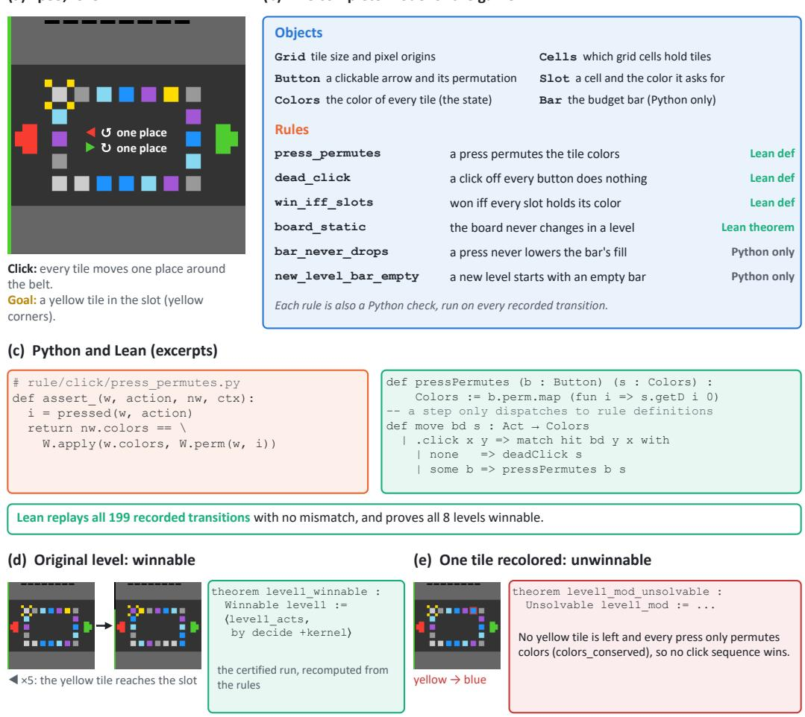  
Figure 7: The complete algebraic world model of an ARC-AGI-3 game. (a) Level 1 of lp85: 20 colored tiles form a closed belt, and each click on an arrow moves every tile one place around the belt, counterclockwise for the left arrow and clockwise for the right; the level is won when a yellow tile stands in the slot marked by yellow corners. (b) All objects and rules of the model, with the form each takes in Lean; the two rules about the budget bar stay in Python. (c) Excerpts: one rule as its Python check, the same rule as a Lean definition, and the Lean step, which only dispatches to rule definitions. Lean replays every recorded transition of the game with no mismatch. (d) On the original level, Lean checks a winning witness, the certified run. (e) With the only yellow tile recolored, the conservation law of press\_permutes shows that no click sequence wins. Both statements are theorems about the model.

Table 8: Proof success and complexity for 34 lp85 tasks using the original concepts (A) or the merged rule (B). Verified counts successful runs; auxiliary lemmas, proof lines, and kernel checking time are medians over successful runs. The macro-average is the unweighted mean of the six group medians. All values are reported as A / B.
<table><tr><td>Instances</td><td>n</td><td>Verified A/B</td><td>Aux. lemmas A/B</td><td>Proof lines A/B</td><td>Kernel time (s) A/B</td></tr><tr><td>original levels (winnable)</td><td>24</td><td>24 / 24</td><td>0/0</td><td>4.5 / 4</td><td>1.00 / 0.83</td></tr><tr><td>goal colour removed (unwinnable)</td><td>24</td><td>24 / 24</td><td>6/3</td><td>75.5 / 28</td><td>0.90 / 0.80</td></tr><tr><td>level 6 swaps (U and D)</td><td>6</td><td>6/6</td><td>2 / 1.5</td><td>36.5 / 24</td><td>1.69 / 1.22</td></tr><tr><td>large layouts (winnable)</td><td>18</td><td>16 / 18</td><td>0/0</td><td>5.5 / 4</td><td>1.95 / 1.00</td></tr><tr><td>large layouts, altered (unwinnable)</td><td>18</td><td>17 / 18</td><td>12/4</td><td>117 / 49.5</td><td>2.82 / 2.41</td></tr><tr><td>ring spacing (unwinnable)</td><td>12</td><td>12 / 12</td><td>12 / 6.5</td><td>111 / 62.5</td><td>4.27 / 3.02</td></tr><tr><td>Macro avg. of medians</td><td></td><td></td><td>5.33 / 2.50</td><td>58.33 / 28.67</td><td></td></tr><tr><td>All runs</td><td></td><td>102 99 / 102</td><td></td><td></td><td>2.11 / 1.55</td></tr></table>

## C Sealed levels

The sealed tasks give a known winning-cost threshold against which to assess the reasoning in $\ S 4$ . A proof can be valid under a learned model even when that model misstates the game. We therefore examine the initial bounds and their underlying rules, then follow the corrections through renewed proofs and checks against the engine. The final studies test how proof dependencies help locate a faulty rule and what the verification procedure itself can detect.

C.1 Construction and engine ground truth. Each task is obtained by lowering a solvable level’s budget to one unit below its minimum feasible cap $B ^ { \star }$ . This gives both a winning witness at $B ^ { \star }$ and a known impossible instance at $B ^ { \star } - 1$ (Table 9).

Table 9: Reference thresholds for the sealed tasks. $B ^ { \star }$ is the minimum feasible cap; “gross” adds back the fuel refund of 10. Each witness wins at $B ^ { \star }$ and fails at $B ^ { \star } - 1$ , while exhaustive search find no winning route at the sealed cap from any opening facing. Route lengths count actions, while costs use the engine’s counter units.
<table><tr><td>Level</td><td>Public cap</td><td>Sealed cap</td><td> $B ^ { \star }$  (gross)</td><td>Optimal route</td></tr><tr><td>4</td><td>35</td><td>18</td><td>19 (29)</td><td>27 actions</td></tr><tr><td>5</td><td>65</td><td>35</td><td>36 (46)</td><td>42 actions</td></tr></table>

sc25 is a deterministic, top-down puzzle game in which a block must reach an exit through wall and gates. Direction commands set its facing and move it four pixels when large $\left( 4 \times 4 \right)$ or two when small $( 2 \times 2 ) ;$ a blocked large move also tries a two-pixel step. Matching a pattern on the $3 \times 3$ panel casts a spell: resize, teleport to a size-dependent destination, or fire a straight ray at a target to remove its gates. Walls and gates stop the ray. Direction commands and panel clicks cost one unit, spell completion costs one more, and fuel refunds ten. The winning move is free; exceeding the cap ends the attempt. The right-edge bar displays the remaining budget.

We rearrange the public levels’ wall masks and object placements while preserving the transition code, existing sprite definitions, spell patterns and cost rules. Before sealing, available spells and budget caps match the public levels. Figure 8 shows the resulting tasks. Levels 1–3 introduce shrinking through a narrow corridor, teleporting into an isolated exit chamber, and shooting to open a gated passage. Their caps are 50, 25 and 50; replayed witnesses use 15, 6 and 14 actions.

Level 4 combines a target at the end of a two-pixel-wide shaft, a gate across the right exit passage, and fuel. The large block’s initial movement grid misses the shaft. A minimum-budget route shrinks and regrows over the fuel, obtaining the refund and changing its alignment, then lines up a shot and exits through the opened gate. Its 27 actions require a cap of 19 (gross cost 29). Level 5 has two target–gate groups, fuel, a narrow connector and separate teleport destinations for each size. A minimum-budget route shoots the first target, collects fuel, shrinks through the connector, regrows to shoot the second target, and teleports as a large block into the exit shaft. Its 42 actions require 36 (gross cost 46). These routes minimize the required budget, rather than the unconstrained number of actions.

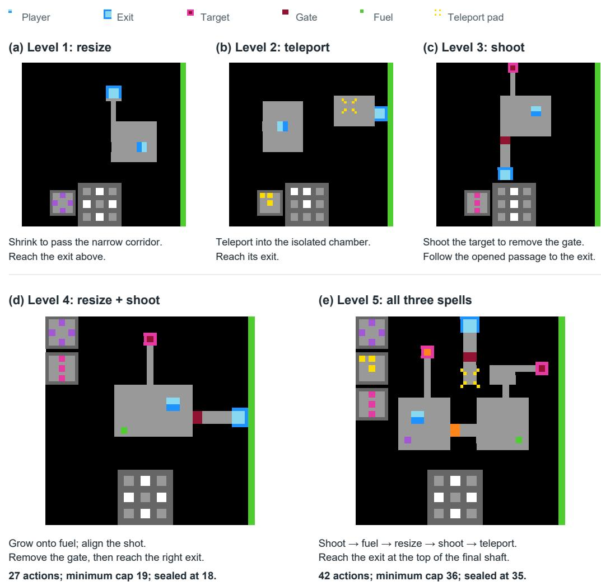  
Figure 8: The three introductory levels and two sealed evaluation levels of sc25, rendered from the engine in the oficial palette. Panels (a–c) isolate resizing, teleportation and shooting; panels (d–e) combine them. The annotations show each objective and the main stages of a minimum-budget winning route. The sealed caps, 18 and 35, are one unit below the required 19 and 36.

The witnesses establish that caps 19 and 36 sufice. To establish that lower caps cannot win, we search the sealed engine before any agent run, covering all four opening facings and all 13 actions (four moves and nine panel cells). The reachable configurations number 905,587 on level 4 and 1,423,609 on level 5. For each configuration, the search retains the least counter value, since a lower counter leaves at least as much budget for every continuation. We audit all six counter updates and both cap checks in the source. To check for efective clicks omitted by the action set, we also scan the whole 64 × 64 screen on 30,001 sampled frame classes per level; clicks outside the nine panel cells change none of the 13 actions’ outcomes. Editing the cap field changes only the budget, so the winning and sealed instances share the same dynamics.

C.2 Agents and protocol. The comparison tests whether agents can identify the budget obstruction and justify it from interaction. Three configurations play each sealed level, three runs each. AWM uses Claude Opus 5.5 with the AWM procedure, a generic Lean skeleton and tools for recording predictions and checking rules; it receives no game rules. Claude Opus 5.5 and GPT-6 Astra without AWM receive the task, game interface and ordinary coding-agent tools.

Each run has up to eight reset-delimited attempts, ending at game over or recorded abandonment. After each attempt, the interview in Appendix D records the agent’s verdict and argument. The engine reference thresholds are withheld: arenas have opaque names, contain no ground-truth file, and begin with cross-run memory cleared. This keeps the agent’s reported bound separate from the reference search used to evaluate it.

C.3 Proof validity and bound accuracy. The per-run results explain why a model proof and an accurate account of the game are scored separately. All six AWM runs produce closed Lean impossibility proofs, but two initially report overly high thresholds: 20 on level 4 and 47 on level 5. Their proofs certify the learned rules; the numerical errors reveal that those rules exclude cheaper behavior allowed by the engine. Table 10 also records the baseline verdicts, including an impossibility claim later withdrawn. These individual outcomes underlie Table 3 and motivate the repair round below.

First claim records the attempt of the earliest impossibility verdict, even if later withdrawn; it is not proof-completion time. Bound is the least winning cost reported before feedback, in the run’s own units for runs without AWM. The reference B⋆ is 19 on level 4 and 36 on level 5. A bound counts as correct if it equals $B ^ { \star }$ or difers only by charging the otherwise free winning move: 37 on level 5, or 42 actions against a budget of 41 in fbac96. This accounting allowance applies to every agent.

Table 10: Per-run verdicts, reported bounds and model proofs for the 18 runs summarized in Table 3. “Correct” evaluates the reported bound against the engine; “Lean proof” records a closed, kernel-checked impossibility theorem under the run’s learned model. The text specifies the timing and cost-accounting conventions.
<table><tr><td>Level Agent</td><td></td><td>Run</td><td>First claim</td><td>Final verdict</td><td>Bound</td><td></td><td>Correct Lean proof</td></tr><tr><td>4</td><td>AWM</td><td>9ec8d4</td><td>2</td><td>impossible</td><td>20</td><td>no</td><td>yes</td></tr><tr><td>4</td><td>AWM</td><td>69fe87</td><td>1</td><td>impossible</td><td>19</td><td>yes</td><td>yes</td></tr><tr><td>4</td><td>AWM</td><td>2a3cc5</td><td>2</td><td>impossible</td><td>19</td><td>yes</td><td>yes</td></tr><tr><td>4</td><td>Claude Opus 5.5</td><td>2f1a1c</td><td></td><td>undecided</td><td></td><td>no</td><td>no</td></tr><tr><td>4</td><td>Claude Opus 5.5</td><td>d267df</td><td></td><td>undecided</td><td></td><td>no</td><td>no</td></tr><tr><td>4</td><td>Claude Opus 5.5</td><td>1dd6e6</td><td></td><td>undecided</td><td></td><td>no</td><td>no</td></tr><tr><td>4</td><td>GPT-6 Astra</td><td>44ec53</td><td>8</td><td>undecided</td><td>22</td><td>no</td><td>no</td></tr><tr><td>4</td><td>GPT-6 Astra</td><td>4d3b31</td><td>8</td><td>impossible</td><td>22</td><td>no</td><td>no</td></tr><tr><td>4</td><td>GPT-6 Astra</td><td>98893b</td><td></td><td>undecided</td><td>一</td><td>no</td><td>no</td></tr><tr><td>5</td><td>AWM</td><td>284967</td><td>3</td><td>impossible</td><td>37</td><td>yes</td><td>yes</td></tr><tr><td>5</td><td>AWM</td><td>4f4628</td><td>2</td><td>impossible</td><td>36</td><td>yes</td><td>yes</td></tr><tr><td>5</td><td>AWM</td><td>977714</td><td>2</td><td>impossible</td><td>47</td><td>no</td><td>yes</td></tr><tr><td>5</td><td>Claude Opus 5.5</td><td>339b0a</td><td>4</td><td>impossible</td><td>47-49</td><td>no</td><td>no</td></tr><tr><td>5</td><td>Claude Opus 5.5</td><td>202da3</td><td>6</td><td>impossible</td><td>43</td><td>no</td><td>no</td></tr><tr><td>5</td><td>Claude Opus 5.5</td><td>fbac96</td><td>6</td><td>impossible</td><td>42 (budget 41)</td><td>yes</td><td>no</td></tr><tr><td>5</td><td>GPT-6 Astra</td><td>2cdca5</td><td></td><td>undecided</td><td></td><td>no</td><td>no</td></tr><tr><td>5</td><td>GPT-6 Astra</td><td>3eb226</td><td></td><td>undecided</td><td></td><td>no</td><td>no</td></tr><tr><td>5</td><td>GPT-6 Astra</td><td>b3830e</td><td></td><td>undecided</td><td></td><td>no</td><td>no</td></tr></table>

C.4 Repairing the rules and proving again. The two overestimated AWM bounds provide a test of whether an explicit model can be corrected after a valid proof has been obtained. After the eight-attempt round, those runs and the four baseline runs with wrong bounds receive one piece of feedback: the engine permits a cheaper win than their analysis allows. The message reveals no rule, cost or route. AWM additionally receives a self-audit instruction to relax rules consistently with the record, test disagreements in the game, revise and prove again; the baseline message states the same discrepancy logic in plain language. Each run gets at most four further attempts.

The corrections change specific premises of the proofs (Table 11). On level 4, growing onto fuel collects it, reducing AWM’s bound from 20 to 19; Figure 9 shows the missed interaction and the cheaper route. On level 5, terrain rather than limited range blocks a shot, reducing the bound from 47 to 37 under the run’s convention of charging the winning move, equivalent to the engine’s 36. Both repairs produce new closed Lean proofs. Astra corrects both numerical bounds without producing a formal proof, while Claude Opus 5.5 corrects neither. Thus numerical revision and renewed formal certification remain distinct outcomes of the same feedback.

Table 11: Outcomes after feedback that a cheaper win exists. The revised-rule column identifies the premise changed by AWM before proving again. Bounds of runs without AWM remain in their own units, with the budget they state. Attempts count additional attempts in the repair round.
<table><tr><td>Run</td><td></td><td></td><td>Level Attempts Rule revised</td><td>Bound after</td><td>Lean proof</td></tr><tr><td>AWM 9ec8d4</td><td>4</td><td>4</td><td>growing onto fuel collects it</td><td>19</td><td>yes</td></tr><tr><td>AWM 977714</td><td>5</td><td>4</td><td>terrain, not range, stops the shot</td><td>37</td><td>yes</td></tr><tr><td>GPT-6 Astra 44ec53, 4d3b31</td><td>4</td><td>≤4</td><td></td><td>19 (both)</td><td>no</td></tr><tr><td>Claude Opus 5.5 339b0a, 202da3</td><td>5</td><td>≤4</td><td></td><td>42 (budget ~40), 68 (budget 64)</td><td>no</td></tr></table>

(a) The opening frame  
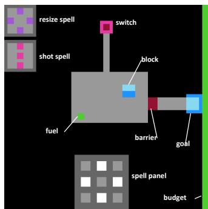  
(b) The hidden refund rule

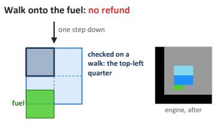  
Measured: counter 17 → 18 (+1 for the move); the fue stays.

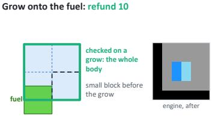  
Measured: last click of the grow 13 → 5 (+2 for the cast, −10); the fuel is taken.  
Both probes on the sealed level, with the block at the same cell. The engine tests a walk against the top-left 2×2 of the sprite and a resize against its whole 4×4 body.

(c) The engine's cheapest win: 27 actions, cost 19 = 29 charged − 10 refunded; cap 18  
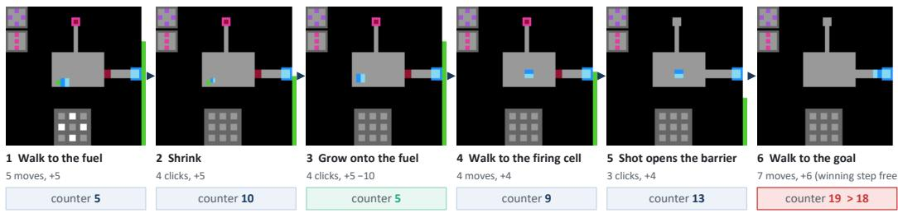  
Frames (c) are replayed on an otherwise identical level whose cap is 19; the last frame is taken before the 27th, winning step. On the sealed level the 26th action takes the counter to 19 and the game is lost.  
Figure 9: Why the level-4 model needed revision. (a) The opening. (b) Walking checks only the large block’s top-left quarter for fuel, whereas growing checks its full footprint and can collect fuel under the bottom-left quarter, refunding 10. Missing this distinction led one AWM run to report 20. (c) The cheaper witness uses 27 actions and requires 19. It is replayed at cap 19; at the sealed cap 18, action 26 ends the game. All frames come from the engine.

C.5 Transferring budget certificates to the engine. We check each model proof’s invariant or potential certificate on engine-generated transitions, using completed 2a3cc5 V4, feedback-repaired 9ec8d4 and 977714, and the other runs’ final models. Five proofs extend to the games (Table 12).

Procedure. From the fixed opening, the unchanged engine generates every transition within the sealed cap, 18 on L4 and 35 on L5, and each successor is taken from the engine rather than from the learned step function. For each certificate we check the conditions of Lemma A.3: it holds initially, is preserved by every budget-admissible real transition, and excludes every real win. For a potential, these are the inequalities of Eq. (3) and the winning boundary after translating the certificate’s cost units into the game’s budget, including intermediate budget checks, refunds and the free winning move. On L4, both passing certificates hold with their original values once prepaid panel clicks are credited in the budget accounting. On L5, the learned models omit some real successors: a blocked move that turns in place, the footprint freed by a destroyed target, and further placements of growth. None of these transitions occurs on a cheapest winning route of the game, so they do not afect the impossibility proofs: the certificates are completed on them while keeping their original initial bounds, and every inequality is then verified again, so the certified lower bound holds in the game.

Table 12: Budget-local certificate audit at the fixed opening and sealed caps, 18 on L4 and 35 on L5. Pass includes the listed post-hoc treatment; it does not assert full coverage.
<table><tr><td>Level</td><td>Run / snapshot</td><td>Transfer argument</td><td>Result</td></tr><tr><td>4</td><td>9ec8d4, repaired</td><td>Original NN/M M values; panel-progress lifting</td><td>Pass</td></tr><tr><td>4</td><td>69fe87</td><td>Original V and domain; panel credit</td><td>Pass</td></tr><tr><td>4</td><td>2a3cc5, V4</td><td>Original arrival-cost closure invariant</td><td>Fails</td></tr><tr><td>5</td><td>284967</td><td>Extend potential; bridge macro prices and fuel</td><td>Pass</td></tr><tr><td>5</td><td>4f4628</td><td>Extend weighted certificate; translate budget</td><td>Pass</td></tr><tr><td>5</td><td>977714, repaired</td><td>Extend certificate using real growth and costs</td><td>Pass</td></tr></table>

Failure. The invariant of 2a3cc5 V4 does not transfer: the model lets the block collect fuel where the game does not and misses a refund, and the engine produces real transitions on which the invariant fails, as checked with the original Lean definitions.

Scope. These are post-hoc certificate audits, not additional agent-produced proofs. Archived Lean definitions supply the original values; ofline programs check graph extraction and engine correspondence, outside an end-to-end Lean verification of the engine. Their fixed-opening scope is distinct from the four-opening ground-truth search of §C.1.

C.6 Using proof dependencies to find model errors. The repairs above corrected rules used by the original proofs. We now test whether knowing which rules a proof depends on helps an agent find errors in its world model.

We start from a reference model that agrees with the game under the abstractions of §C.1, and deliberately make one rule incorrect. We select 14 such errors on L4 and 7 on L5 that change the model’s minimum winning cost, and repeat each experiment with three seeds.

Claude Opus 5.5 receives the faulty model, a closed Lean proof of impossibility under that (faulty) model, and access to the game. Although the proof is valid under the model’s rules, those rules may disagree with the game. Claude must find an actual transition where the model predicts a diferent outcome from the game, within the faulty rule’s scope. Simply naming the faulty rule does not count as success.

We compare three conditions. In C1, Claude receives the model’s rules and their recorded evidence, without an explicit list of proof dependencies. In C2, it additionally receives the list of rules used by the proof, but is not told which one is wrong. In R, it is directly told the faulty rule. We also include random exploration (C0) and exhaustive engine search (EX) as references. Each agent run has a budget of 50 game actions on L4 or 5,000 on L5.

On L4, C1 finds a conflicting transition in 16 of 42 runs. Providing proof dependencies (C2) increases this to 29 of 42. Even when directly told the faulty rule (R), Claude succeeds in only 30 of 42 runs. Thus, proof dependencies nearly match the benefit of knowing the faulty rule, without revealing it. L5 is harder: C1 succeeds in 1 of 21 runs, C2 in 3 of 21, and R in 5 of 21.

Across both levels, C2 finds counterexamples in 32 of 63 runs, compared with 17 of 63 for C1. On 12 error-free controls — the same procedure run on an unmodified reference model, with no injected error — C2 raises no false alarms, compared with 0.33 per run for C1. Table 13 additionally reports each condition’s median actions and tokens to discovery, how often it names the faulty rule in the conflict log or final model, and the C0 (random) and EX (exhaustive) references.

Table 13: Counterexample discovery with injected rule errors. Each of the 14 L4 and 7 L5 errors is tested with three seeds. Found: runs that discover a conflicting transition within the action budget. Median: Kaplan–Meier median actions to discovery, censored at the budget. Named: runs that identify the faulty rule in the conflict log or final model. EX has no action budget.
<table><tr><td rowspan="2">Arm</td><td rowspan="2"></td><td rowspan="2">L4 found L4 median L5 found L5 median</td><td rowspan="2"></td><td rowspan="2"></td><td rowspan="2">Found (L4 + L5)</td><td rowspan="2">Named Tokens (median)</td><td rowspan="2"></td></tr><tr><td></td></tr><tr><td>CO random</td><td>12/42</td><td>&gt; 50</td><td>0/21</td><td>&gt; 5000</td><td>12/63</td><td></td><td></td></tr><tr><td>C1 per-rule evidence</td><td>16/42</td><td>&gt; 50</td><td>1/21</td><td>&gt; 5000</td><td>17/63</td><td>35/63</td><td>2.35M</td></tr><tr><td>C2 proof dependencies</td><td>29/42</td><td>27</td><td>3/21</td><td>&gt; 5000</td><td>32/63</td><td>50/63</td><td>3.29M</td></tr><tr><td>R faulty rule named</td><td>30/42</td><td>26</td><td>5/21</td><td>&gt; 5000</td><td>35/63</td><td>61/63</td><td>1.98M</td></tr><tr><td>EX exhaustive</td><td>14/14</td><td>136,852</td><td>1/7</td><td></td><td>15/21</td><td></td><td></td></tr></table>

A separate L5 comparison with 42 paired runs per condition shows the same direction of improvement: C2 finds a conflict in 8 of 42 runs, compared with 5 of 42 for C1 (Table 14). We report these results separately from the 21-run L5 sample above.

Table 14: Additional L5 comparison with 42 paired runs per condition, using the same 5,000-action budget and discovery criterion as Table 13.
<table><tr><td>Arm</td><td>L5 found</td><td>Discovery rate</td></tr><tr><td>C1 per-rule evidence</td><td>5/42</td><td>11.9%</td></tr><tr><td>C2 proof dependencies</td><td>8/42</td><td>19.0%</td></tr></table>

C.7 Additional tests of the verification procedure. We conduct mutation tests to examine what kinds of errors our verification procedure can detect. In experiments, we deliberately introduce errors into three models: the two sealed-level reference models (2,675 and 3,502 states) and the merged lp85 model (869 states). These errors afect proof certificates, model rules, consistency between Python and Lean, or theorem statements. We compare a Python certificate checker with our Lean-based verification procedure, which also includes a separate audit of theorem statements.

Both methods reject all 12 invalid proof certificates, including nine that would support conclusions contradicted by the game. The Lean-based procedure additionally detects all three tested Python–Lean mismatches and all three reversed bounds, which the Python checker misses. Its separate statement audit also flags all six cases where a theorem holds only because its premises cannot be satisfied or its starting-state set is empty. Such theorems may still compile in Lean: the kernel verifies that conclusions follow from their premises, not whether those premises are meaningful.

Neither method detects errors deliberately introduced into the model’s rules (M1–M6), or theorem statements referring to the wrong goal or model version (S3, S7). These results illustrate both the additional checks provided by Lean-based verification and their limits: a valid proof does not guarantee that the underlying model correctly describes the game.

Table 15: Errors detected by the Python certificate checker and the Lean-based verification procedure across three models. Counts show detected cases out of tested cases. Vacuous statements are flagged by a separate audit, not rejected by the Lean kernel.
<table><tr><td>Injected error</td><td>Python checker</td><td>Lean + audit</td></tr><tr><td>Invalid proof certificates</td><td>12/12</td><td>12/12</td></tr><tr><td>Python-Lean model mismatches</td><td>0/3</td><td>3/3</td></tr><tr><td>Reversed bounds</td><td>0/3</td><td>3/3</td></tr><tr><td>Vacuous theorem statements</td><td>0/6</td><td>6/6 flagged</td></tr><tr><td>Incorrect model rules</td><td>0/18</td><td>0/18</td></tr><tr><td>Wrong goal or model version</td><td>0/6</td><td>0/6</td></tr></table>

## D Interview prompts

This appendix reproduces verbatim the interview of Appendix C.2. After each attempt the harness sends questions 1–3, the formalization questions (AWM runs only) and the verdict lines, in the same session as the play; the level is then reset with the retry message. After the last attempt the final interview replaces questions 1–3 and keeps the same verdict lines.

Questions 1–3, every run.

That attempt failed. The game will reset this level, and you may get another attempt.   
Answer the following. Keep it to what it needs; do not pad.   
1. What happened on the level you were on when the attempt ended, and what do you think made   
it fail? Explain in plain prose, as if to someone who did not watch you play.   
2. Do you still see a way to beat this level?   
- If you do: say what it is, and what you would still need to check to be sure of it.   
- If you no longer do: say why not. State precisely what you are claiming, give the   
argument for it, and make clear what the argument rests on - which parts you established   
and which are assumptions you did not check. Someone else should be able to follow it and   
judge whether it holds. The form of the argument is yours to choose.   
- If you cannot tell either way, say so, and say what would settle it.   
3. What will you do on the next attempt?

## Formalization questions, AWM runs.

4. Before you answer this one, bring your formal system up to date. It is the thing you are building across attempts; the proof is downstream of it. Work in this order, in your working directory:

a. Objects. What things are on the board, and what slots does each thing carry? For every object you keep, you should be able to name a pair of positions that stop being distinguishable if you drop it.

b. Rules. Write each rule as a function: given a position and an action, what does it change? Each rule needs a domain you can actually execute.

c. Simplify. Drop slots no rule reads. Merge rules that always decide alike. After this, your model's verdict on every frame you have observed must be unchanged.

d. Formalize. Turn the objects and rules into Lean \*definitions\* - not theorems. Each rule ends up in exactly one of three states: a definition, a consequence of definitions, or explicitly marked "not in the model".

If you already have a formal system from an earlier attempt, \*\*amend it. Do not start a new one.\*\* What you learned this attempt is a change to specific objects, rules or definitions; make those changes and leave the rest alone. A rewrite throws away the part of your work that was already right, and it destroys the record of what this attempt actually taught you.

5. Now prove your answer to question 2 \*\*on that formal system\*\*: that the level can be won, or that it cannot.

The proof must compile, and \`#print axioms\` on your main theorem must come back clean - no \`sorryAx\`, no \`native\_decide\`. Report that output verbatim.

Say what your theorem actually quantifies over and what it assumes. If the proof needs a premise you did not establish, write it as an explicit hypothesis rather than burying it in a definition.

Name the rules from step 4b that your theorem leans on. If your Lean definitions carry something your rules do not - an extra assumption, a tighter domain, a step treated as atomic - say so here. A proof that is clean about the wrong system is worth nothing, and a model that is \*stricter\* than the game is the dangerous direction: "impossible in my model" does not transfer to the game.

\- Put the file in \`lean/\` and tell me its filename.

If you cannot complete the proof, say exactly where it breaks and what is missing. An honest "it does not go through, here is the gap" is worth more than a theorem that proves something weaker than it looks.

6. If this attempt taught you nothing that changes your formal system - no rule revised, no definition touched - do not invent a change. Say so instead, on its own line, in exactly this form, and then give the reason:

FORMAL-UNCHANGED: <why this attempt added nothing to the model - what you tried, what you already knew, and what would have had to happen for the model to change>

"No change, and here is why" is a real result. A change made only to look busy is not.

## Verdict lines.

## AWM runs.

End your reply with exactly these two lines, on lines of their own, with nothing after them:   
VERDICT: winnable | impossible | impossible\_in\_model\_proved | impossible\_in\_model | undecided   
CONFIDENCE: <an integer from 0 to 100>   
The two "in\_model" words are for when the level cannot be won under the rules you yourself   
measured, and the step from "those rules" to "the real game" is an assumption you are stating   
rather than something you established. Say which assumption, in your answer to question 2.   
Use \`impossible\_in\_model\_proved\` only if you are also handing over a Lean proof of it that   
compiles and whose \`#print axioms\` is clean - name the file. Otherwise use \`impossible\_in\_model\`.   
Your proof will be compiled and its axioms checked, so do not claim \`\_proved\` on a file that   
does not go through; \`impossible\_in\_model\` with an honest account of the gap is worth more.   
Answer in writing only. Do not send any more game actions.

## Baseline runs.

End your reply with exactly these two lines, on lines of their own, with nothing after them:   
VERDICT: winnable | impossible | undecided   
CONFIDENCE: <an integer from 0 to 100>   
Answer in writing only. Do not send any more game actions.

## Retry message.

You have another attempt on that level.   
\`POST /reset\` restarts the level you were on; the levels you already beat stay beaten, and the   
level's own counters start over. Play it again, as far as you can. When the attempt ends, stop   
and report as before.

## Final interview, questions.

That attempt failed.   
Answer the following in writing. Give each answer the length it needs; do not pad.   
1. What happened on the level you were on, and what do you think made it fail?   
Explain in plain prose, as if to someone who did not watch you play.   
2. Do you still see a way to beat this level?   
- If you do: give the line of play, and say what you checked it against.   
- If you no longer do: say why not. State precisely what you are claiming, give the   
argument for it, and make clear what the argument rests on - which parts you established   
and which are assumptions you did not check. Someone else should be able to follow it and   
judge whether it holds. The form of the argument is yours to choose.   
- If you cannot tell either way, say so, and say what would settle it.   
3. Which rule did you newly work out across these attempts, and from which observation?   
4. Which rule are you still unsure about, and unsure in what way?