# BURGER: Benchmarking and Understanding Robotic Generalization via Embodied dRawing

Xiangyu Xu1,∗ Bangshuai Peng1,∗ Ziyi Liu1,∗ Mengjie Zhao1,∗ Chenhao Lu1,2 Zhengyang Fan1 Huazhe Xu1,2,† Kaizhe Hu1,2,†

1Tsinghua University 2Shanghai Qizhi Institute ∗Equal contribution. †Corresponding authors.

## Abstract:

How effectively can vision-language-action (VLA) models learn diverse language-conditioned behaviors as training data scales? Investigating this question requires large and varied robot datasets, whose collection on physical robots remains costly. We introduce BURGER, a language-conditioned robotic drawing benchmark with a scalable, prompt-driven pipeline for generating continuous drawing trajectories, both in simulation and the real world. In BURGER, an agent starts from the same blank canvas and controls a robot arm to draw the object or spatial composition specified by language, while each instruction allows an open-ended variety of valid drawings and stroke orders. Using 28,200 simulated demonstrations spanning 282 drawing tasks, we evaluate five representative VLA models across data scales, language grounding, and multimodal behavior. BURGER supports fine-grained analysis of language grounding, spatial composition, and action generation, revealing distinct failure patterns across VLA models. Our experiments suggest that some VLA models can benefit from greater task diversity and demonstration scale, capture multimodal drawing behaviors, and generalize to unseen compositions of familiar objects. Finally, we deploy a trained policy on a Franka Panda arm, demonstrating the ability to draw reactively under human intervention. Project homepage and code can be found here.

Keywords: Vision-Language-Action Model, Robot Data Generation

## 1 Introduction

Vision-language-action (VLA) models integrate visual perception, language understanding, and action generation into policies for robotic control [1, 2, 3, 4]. As VLA models increasingly benefit from larger and more diverse datasets, an important question is whether current architectures are ready to effectively exploit large-scale language-conditioned robot trajectories. Investigating this question requires robot datasets with controllable scale and diversity, together with evaluations that distinguish different aspects of model behavior [5, 6, 7]. However, collecting diverse demonstrations on physical robots remains costly [8, 9], which motivates a more scalable setting for such studies.

Robotic drawing provides a complementary data regime with several practical advantages for such studies. Starting from the same blank canvas, the agent cannot infer the requested drawing from the initial observation alone, eliminating a potential visual shortcut [10]. Language prompts can be systematically increased in semantic complexity by composing objects, attributes, and spatial relations. The same instruction can admit many valid trajectories that differ in stroke order, starting point, and drawing direction, this intrinsic multimodality forces model to understand the concept, rather than memorizing the action sequence. The resulting canvases and execution trajectories make semantic, spatial, and action-execution failures directly inspectable, supporting fine-grained diagnosis of model behavior. Drawing therefore provides a scalable setting for testing whether VLA architectures can learn complex language-conditioned and multimodal robot trajectories before scaling up costly real-world data collection.

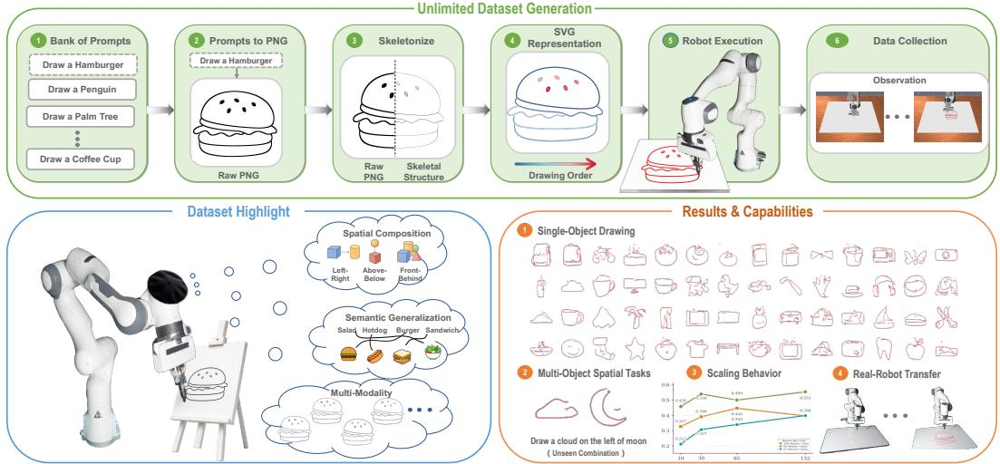  
Figure 1: Overview of BURGER. Top: Prompt-generated PNG images are converted into skeletons, SVG strokes, and robot trajectories. Bottom left: BURGER tests semantic grounding, spatial reasoning, and multimodal action generation in VLA models. Bottom right: We evaluate models on single-object drawing, compositional drawing, data scaling, and real-world deployment.

Motivated by these properties, we introduce BURGER, a scalable benchmark and data-generation pipeline for language-conditioned robotic drawing, shown in Fig. 1. Our pipeline generates target sketches from natural-language prompts and converts them into robot end-effector trajectories executable in simulation and on a real robot. Using this pipeline, we construct 132 single-object tasks and 150 compositional tasks, with 100 demonstrations per task. The dataset spans diverse objects, spatial compositions, and trajectory realizations. As illustrated in Fig. 2, drawing trajectories in BURGER exhibit substantially greater diversity in the plane for a given instruction than manipulation trajectories in LIBERO [11]. We introduce a DINOv3-based metric for scalable evaluation of generated drawings and validate its agreement with human judgments in a single-object user study.

We use BURGER to examine how representative VLA models learn from larger datasets, capture trajectory diversity, and generalize to new compositions. The flow-matching models generally improve as either the number of demonstrations per task or the number of training tasks increases, suggesting that some existing approaches can benefit from scaling robotic drawing data. The π- family models [3, 4] can autonomously produce recognizable drawings after fine-tuning. Beyond visual recognizability, π retains multiple modes of the drawing trajectory distribution, as shown in Fig. 2. We further observe that evaluated policies can generate unseen spatial compositions of familiar objects, but struggle to draw object categories absent from training. Inspecting the resulting drawings and trajectories reveals semantic, spatial, and geometric failure patterns that are difficult to distinguish through task-success metrics alone. We further demonstrate successful real-robot drawing after fine-tuning on 100 real-robot demonstrations alone, as well as sim-to-real transfer of a policy co-trained on 13,200 simulated BURGER demonstrations.

Although robotic drawing simplifies the contact-rich interaction and object dynamics involved in manipulation, it retains important demands on language grounding and action generation. Following a drawing instruction requires translating object descriptions and spatial relations into longhorizon continuous actions, while the range of valid drawings and stroke sequences provides a setting for evaluating multimodal behavior modeling. These capabilities are also central to languageconditioned manipulation, making BURGER a distinctive lens for examining the readiness and limitations of current VLA architectures in learning from larger and more diverse training datasets.

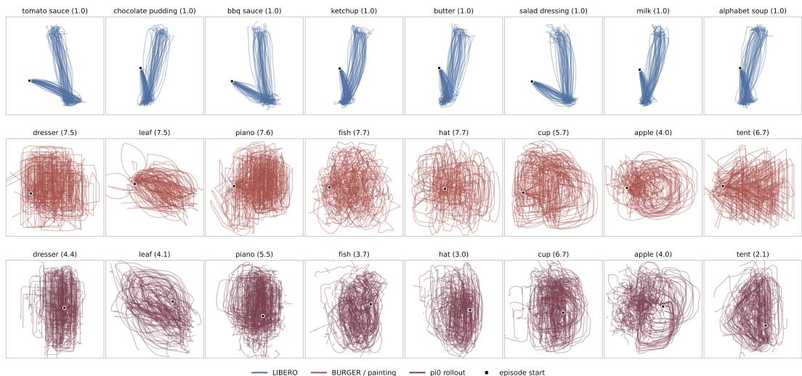  
Figure 2: Instruction-conditioned planar trajectory diversity. The three rows show LIBERO demonstrations, BURGER demonstrations, and π rollouts, respectively. Each subplot overlays trajectories for the same instruction. Different modes correspond to distinct clusters of execution routes.

## 2 Related Work

Vision-language-action (VLA) models map visual observations and language instructions to robot actions. Recent VLAs broadly follow autoregressive or continuous generative paradigms. Autoregressive models, such as OpenVLA [2], predict actions sequentially, with recent variants improving action representations, chunking, and parallel decoding [12, 13, 14, 15, 16]. Continuous generative models produce action chunks using flow matching or diffusion [17]: $\pi _ { 0 }$ and $\pi _ { 0 . 5 }$ use flow matching [3, 4], while RDT-1B and GR00T N1 adopt diffusion-based generation [18, 19]. Hybrid methods such as DiffusionVLA [20] combine autoregressive reasoning with diffusion-based action generation. BURGER evaluates these paradigms under multimodal, long-horizon, and semantically rich drawing data.

Benchmarking of VLA systems has moved beyond measuring binary task success rates toward more diagnostic evaluation. Recent benchmarks evaluate VLA abilities in long-horizon reasoning, spatial and semantic grounding, robustness to scene or language perturbations, structured behavioral metrics, and memory-dependent manipulation [6, 7, 21, 22, 23]. These efforts show that similar success rates can hide different failure modes in grounding, planning, robustness, or temporal consistency. BURGER follows this capability-oriented evaluation direction, but uses languageconditioned drawing as the diagnostic domain. Unlike goal-oriented manipulation, drawing admits many valid stroke orders, geometries, and trajectories for the same prompt. This makes the more dedicated abilities directly observable from the generated canvas and rollout trajectory.

Data scaling in VLA learning has been studied in robot imitation learning and generalist policy training. Prior work analyzes how data quantity and data composition affect manipulation-policy generalization, including object and environment diversity, camera viewpoints, spatial arrangements, and dataset fragmentation [24, 25, 10]. BURGER considers a related scaling question in a controlled language-conditioned drawing domain.

Robotic drawing and painting have been studied primarily as a control and planning problem. For example, Lee et al. [26] formulate robotic sketching as a deep decoupled hierarchical reinforcement learning problem, where separate policies learn stroke-based rendering and motor control from scratch. FRIDA [27] develops a collaborative robot painting system with a differentiable real2sim2real planning environment, enabling a robot to generate paintings from high-level human inputs such as language descriptions or reference images. More recently, IMPASTO [28] studies robotic oil-painting reproduction by integrating learned pixel dynamics models with model-based planning. These works advance robotic drawing by improving stroke planning, motor control, and real-world execution. In contrast, our work studies sketching as a language-conditioned VLA benchmark.

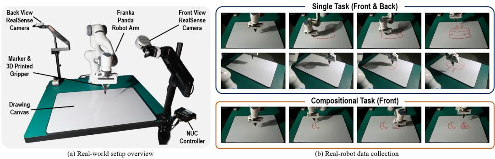  
Figure 3: Real-world deployment of BURGER. Left: The Franka Panda hardware setup equipped with a drawing tool. Right: The real-robot data collection process for a single task “birthday cake” and a compositional task “moon left sailboat”.

## 3 Method

## 3.1 Task Formulation

At time t, a policy receives a language instruction $\ell ,$ a canvas observation $I _ { t } ,$ and robot proprioception $q _ { t } ,$ and predicts an end-effector command $a _ { t }$ (or an action chunk, depending on the model). The task is to produce the requested object or spatial composition through sequential drawing actions. The policy is not given a target sketch at inference. Canvas observations change as strokes accumulate, while pen-lifting transitions separate disconnected strokes. The benchmark therefore involves both drawing geometry and decisions about when to move without marking the canvas.

## 3.2 Prompt-to-Trajectory Data Generation

Figure 1 summarizes our prompt-to-trajectory pipeline. Diffusion-based image generation models have shown strong capabilities in producing diverse visual content from text prompts [29]. We use GPT-Image 2 [30] to generate sketch candidates and convert them into ordered SVG strokes; Appendix A.2 describes the image-processing, skeletonization, and stroke-ordering steps. We replay each SVG in ManiSkill [31] using an endeffector pose controller, lifting the pen between disconnected strokes. We record RGB observa-

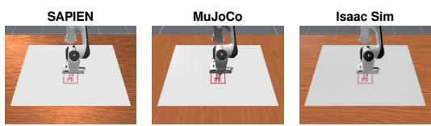  
Figure 4: Cross-simulator deployment of the BURGER trajectory-generation pipeline. The same SVG drawing task is executed in SAPIEN, MuJoCo, and Isaac Sim using corresponding robot-control interfaces.

tions, robot proprioception, and actions as observation-action pairs, then convert the trajectories to the robot-dataset format. Although our main experiments use ManiSkill with the SAPIEN backend, we also implement the pipeline in MuJoCo and Isaac Sim, as shown in Figure 4.

## 3.3 The BURGER Dataset

To collect representative and diverse drawing trajectories, we adopt the setting from the Google Quick, Draw! [32] dataset, which contains 345 object classes and millions of human-drawn sketches. We select 132 classes that are commonly found in the real world and can be easily drawn by a robot arm. We further define 150 compositional classes by pairing two of the 100 base classes with spatial relations. Among them, 100 classes use left-right relations, while the remaining 50 use vertical relations such as “over” and “under”. For each class, we generate 100 trajectories using the pipeline described above, resulting in 15,000 compositional trajectories and 28,200 trajectories in total.

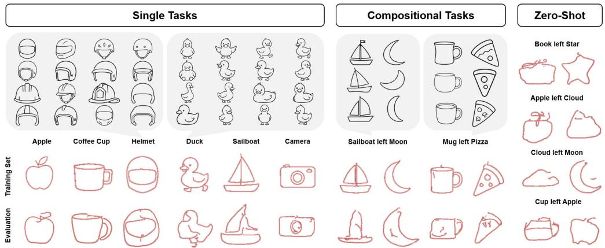  
Figure 5: Dataset diversity and VLA evaluation in BURGER. We show representative single-object and compositional training tasks, along with corresponding VLA rollouts. The rightmost column evaluates generalization to unseen spatial compositions.

To quantitatively characterize the advantage of BURGER in providing multimodal trajectory data, we compare its instruction-conditioned trajectory diversity with LIBERO, as visualized in Figure 2. Since BURGER focuses on drawing rather than full-space manipulation, we cluster planar endeffector trajectories on the drawing plane with a shared codebook and estimate the effective number of modes from the cluster frequencies. We use k = 24 for the reported results and observe consistently higher multimodality for BURGER across different choices of k. Under this setting, LIBERO contains 1.09 effective modes per instruction on average, compared with 7.13 for BURGER, corresponding to a 6.6× increase. The same trajectory representation and clustering procedure is also used to analyze policy rollouts in Sec. 4.3, and more details are provided in Appendix A.4.

We also collect real-robot trajectories to evaluate whether the BURGER data pipeline can support real-world policy learning. The real-robot dataset follows the same data format as the simulated dataset and includes two RealSense camera views from the front and back of the workspace; either view can be used as the visual observation input. Figure 3 shows the hardware setup and realrobot data-collection process. The same pipeline supports both single-object and compositional drawing tasks, as illustrated by the “birthday cake” and “moon left of sailboat” examples. In this work, we collect 10 single-object classes with 10 demonstrations per class for real-robot training and evaluation.

The dataset is, to our knowledge, the first large-scale VLA dataset for language-conditioned drawing, and we hope it can serve as a valuable resource for future research on VLA model generalization.

## 3.4 Quantifying Robot Trajectory Quality

Valid drawings can differ in geometry and stroke order, making drawing quality difficult to evaluate with image-text similarity alone. Contrastive metrics such as CLIPScore [33] measure global image– text alignment, but prior work [34] shows that such metrics can fail to detect fine-grained errors.

To obtain a more human-aligned and fine-grained evaluation metric, we design a contrastive featurebased evaluator trained directly on the BURGER drawing distribution. Our evaluator builds a sketchspecific metric space on top of a frozen DINOv3 backbone [35], which allows us to score each drawing by its similarity to the target-class prototype. For compositional tasks, we separate the two objects at the minimum-connectivity boundary and evaluate their identities and spatial relation. Appendix B.2 provides the metric architecture, training objectives, and scoring procedure. In a user study covering 10 classes, our metric agrees more closely with human judgments than CLIPScore across Spearman correlation, Kendall’s τ , and pairwise agreement. Details are also provided in Appendix B.2.

## 4 Experimental Results

Our experiments evaluate the capabilities and limitations of VLA models on language-conditioned robotic drawing tasks in BURGER. Concretely, we investigate three questions: (1) whether BURGER can serve as a diagnostic benchmark for comparing VLA models across several dimensions, including data scaling, language grounding, spatial-relation understanding, and multimodal behavior modeling; (2) whether the benchmark can expose characteristic failure behaviors and help diagnose differences among VLA formulations; and (3) whether policies trained with BURGER data can transfer to real-world drawing and support closed-loop interaction under human modifications.

Baselines. We evaluate representative VLA models with different action-generation formulations. $\pi _ { 0 }$ [3] uses a separate action expert to generate continuous actions using flow matching. $\pi _ { 0 . 5 }$ [4] extends $\pi _ { 0 }$ with co-training on heterogeneous tasks for broader generalization. $\pi _ { \mathrm { 0 } } { \bf - F } { \bf A } { \bf S } { \bf T }$ is an autoregressive VLA based on the FAST action tokenizer [13]. OpenVLA [2] is an open-source autoregressive VLA model. OpenVLA-OFT [12] is an optimized fine-tuning variant of OpenVLA that predicts continuous action chunks with parallel decoding, rather than predicting step-wise discrete action tokens.

## 4.1 Scaling Behavior of VLA Models

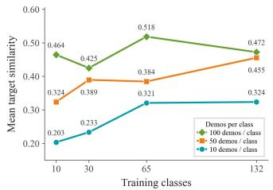  
(a) π0

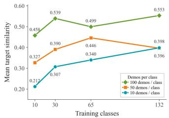  
(b) $\pi _ { 0 . 5 }$

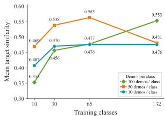  
(c) $\pi _ { 0 } { \mathrm { - F A S T } }$  
Figure 6: Scaling behavior of $\pi _ { 0 } , \pi _ { 0 . 5 } ,$ , and $\pi _ { 0 } { \mathrm { - F A S T } }$ across training data scales. The x-axis denotes the number of training classes, the y-axis shows the mean target similarity, and colors indicate the number of demonstrations per class. Flow-matching models improve more consistently with scale, whereas $\pi _ { 0 } { \mathrm { - F A S T } }$ shows more variable trends.

We evaluate the π-family VLA models across different task scales, varying the number of object classes from $C = 1 0$ to $C = 1 3 2$ and the number of trajectories per class from $T = 1 0 \mathrm { t o } T = 1 0 0$ as shown in Figure 6. Drawing performance is evaluated using the DINOv3-based target similarity metric introduced in Sec. 3.4. Overall, increasing either the number of training classes or the number of trajectories per class generally improves drawing performance, particularly for $\pi _ { 0 }$ and $\pi _ { 0 . 5 }$ However, the scaling behavior is not uniform across models: $\pi _ { 0 } { \mathrm { - F A S T } }$ shows larger fluctuations and does not consistently benefit from increasing data scale. These results suggest that BURGER provides a controlled setting for studying how different VLA formulations respond to increasing task diversity and demonstration scale.

## 4.2 Language-conditioned Generalization

We diagnose language grounding and semantic generalization across the π-family models along two dimensions. First, we evaluate language-conditioned instruction following by varying the object names in the prompts. Starting from the same blank canvas, different language instructions lead the policies to generate different objects corresponding to the requested categories. Across the in-distribution tasks, we observe no evident confusion between objects. In contrast, when the instruction specifies an out-of-distribution object category, the models fail to generate the correspond ing object. This suggests that the learned language grounding is effective for the trained semantic categories but does not directly generalize to unseen object concepts.

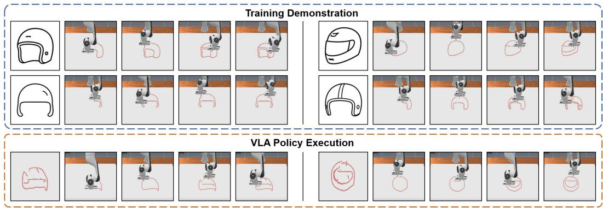  
Figure 7: Learning multimodal drawing behaviors in BURGER. Top: different drawing patterns of “helmet” within the dataset, Bottom: the generated images by $\pi _ { 0 . 5 }$ unseen in the dataset.

Second, we evaluate spatial understanding using compositional drawing tasks with prompts of the form “draw A on the left of B”, “draw A under $\mathbf { B } ^ { \ast }$ , and “draw A over $\mathbf { B } ^ { \ast }$ . Our goal is to study whether VLA models can generalize simple spatial relations beyond memorized object compositions. For this evaluation, policies are trained on these compositional tasks. As shown in the right-most column in Figure 5, VLA models can generate valid left-right and over-under object compositions even for object pairs that are not observed during training. For example, a policy can draw a cup to the left of an apple despite never being trained on this specific composition. We also observe that the policies correctly distinguish different spatial instructions. These results suggest that the policies can generalize beyond memorized object compositions and apply learned spatial relations to unseen object pairs.

## 4.3 VLA Models Capture Multimodal Drawing Behaviors

Sketch generation naturally admits multimodal trajectories for the same language instruction. As quantified in Sec. 3.3 and visualized in Figure 2, BURGER exhibits substantially stronger withininstruction multimodality than LIBERO. We therefore use it to evaluate whether VLA policies can learn and preserve such multimodality after training.

We first evaluate this quantitatively by applying the same trajectory representation and clustering procedure to $\pi _ { 0 }$ rollouts. Across the eight representative tasks shown in Figure 2, the training demonstrations exhibit 4.0–7.7 effective trajectory modes per instruction, while the policy rollouts exhibit 2.1–6.7 modes. These results show that $\pi _ { 0 }$ can preserve multimodality in its rollout distribution after training on BURGER.

We further examine this behavior qualitatively in Figure 7. The first two rows show distinct demonstrations of the same object class, helmet, with variations in geometry, stroke ordering, and execution path. After training on these demonstrations, π0.5 produces multiple valid helmet drawings under the same instruction. Together, the trajectory-level and visual results show that BURGER supports learning a distribution of valid drawing behaviors rather than a single deterministic route.

## 4.4 BURGER Reveals Fine-Grained VLA Failure Modes

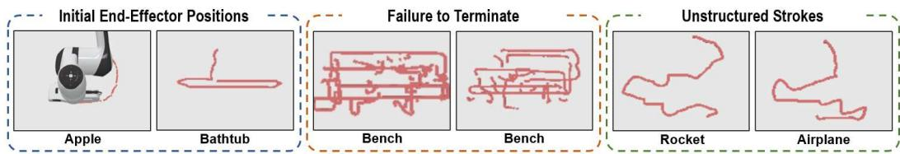  
Figure 8: Representative failure modes in BURGER. Left: OpenVLA and $\pi _ { 0 } { \mathrm { - F A S T } }$ exhibit sensitivity to the initial end-effector position. Middle: $\pi _ { 0 }$ and $\pi _ { 0 . 5 }$ show failure to terminate. Right: π-family models produce generic, unstructured strokes on unseen-object instructions.

Different VLA models exhibit distinct failure patterns, which BURGER can expose through processlevel analysis of generated trajectories and drawings. Figure 8 shows some general failure cases.

Single-Object Tasks. OpenVLA and $\pi _ { 0 } – \mathrm { F A S T }$ are sensitive to the initial end-effector position: OpenVLA may become trapped in a local region, while $\pi _ { 0 } – \mathrm { F A S T }$ can drift away from the intended drawing area. In contrast, flow-matching policies sometimes fail to terminate after completing the object, leading to overdraw. For unseen-object instructions, the policies tend to produce generic, unstructured strokes.

Compositional Tasks. Object quality may degrade under compositional instructions even when the spatial relation is correct. This degradation becomes more evident when the instruction space expands from horizontal to both horizontal and vertical relations, suggesting that relational grounding and object-level geometry become harder to preserve jointly.

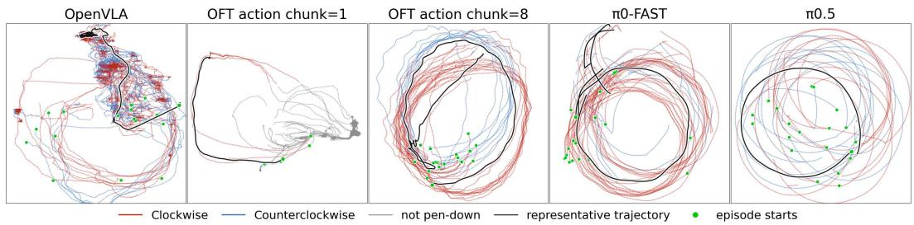  
Figure 9: Controlled circle-drawing results across representative VLA models, revealing distinct failure patterns in contact, trajectory progress, and multimodal behavior.

To further diagnose these differences, we construct a controlled circle-drawing case study with 100 demonstrations sharing the same shape and radius, while varying the circle center, starting point, and drawing direction. Table 1 summarizes contact, clockwise/counterclockwise (CW/CCW) direction, starting-point diversity, and angular sweep. As shown in Figure 9, OpenVLA often maintains contact but stagnates in small local circles, producing excessive angular motion without stable progress along the target trajectory. OpenVLA-OFT with chunk length 1 frequently fails to establish stable contact, while increasing the chunk length to 8 substantially improves contact and trajectory coherence, indicating a clear effect of action chunking on long-horizon execution.

However, coherent execution does not guarantee faithful coverage of the demonstrated behavior distribution. OpenVLA-OFT and $\pi _ { 0 } { \mathrm { - F A S T } }$ tend to concentrate on a subset of starting points or drawing directions, while the flow-matching policies better preserve trajectory diversity. In particular, $\pi _ { 0 } { \mathrm { - F A S T } }$ strongly favors one drawing direction despite maintaining relatively accurate circle geometry. Both OpenVLA-OFT and $\pi _ { 0 } { \mathrm { - F A S T } }$ also exhibit overdraw, continuing beyond the intended single revolution; similar patterns recur across different rollout seeds in Fig. 9, suggesting a small set of stereotyped failure behaviors. Overall, these results indicate that action chunking mainly affects execution coherence, while the action-generation formulation also shapes geometric fidelity and multimodal mode coverage. This case study illustrates how the BURGER pipeline enables controlled diagnosis of model-specific failure patterns.

Table 1: Quantitative results on the controlled circle-drawing task. CW denotes the proportion of clockwise trajectories. Higher start entropy indicates more uniform starting-point coverage, while sweep values closer to 360◦ indicate better completion of a single revolution.
<table><tr><td>Source</td><td>N</td><td>Contact</td><td>CW(%)</td><td>Start Entropy</td><td>Sweep(°)</td></tr><tr><td>Dataset</td><td>100</td><td>100</td><td>56.0</td><td>0.97</td><td>359.8</td></tr><tr><td>OpenVLA</td><td>20</td><td>20</td><td>40.0</td><td>0.82</td><td>874.6</td></tr><tr><td>OFT H = 1</td><td>20</td><td>6</td><td>100.0</td><td>0.35</td><td>129.3</td></tr><tr><td>OFT H = 8</td><td>20</td><td>20</td><td>55.0</td><td>0.58</td><td>586.1</td></tr><tr><td> $\pi _ { 0 } { \mathrm { - F A S T } }$ </td><td>20</td><td>20</td><td>95.0</td><td>0.63</td><td>563.2</td></tr><tr><td>π0.5</td><td>20</td><td>20</td><td>55.0</td><td>0.84</td><td>355.2</td></tr></table>

## 4.5 Real Robot Results

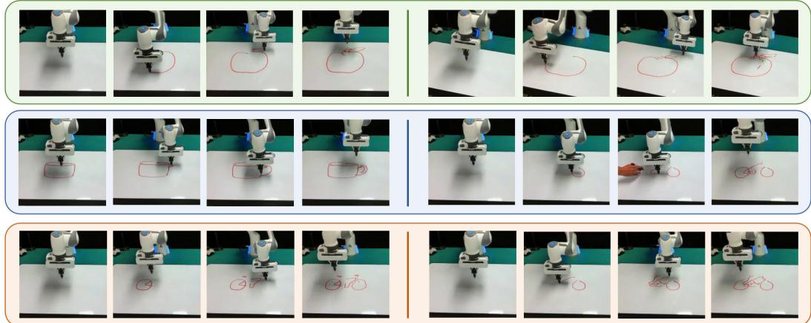  
Figure 10: Real-robot drawing results. The first row shows robustness to camera-angle changes; the second shows visual feedback through object completion and human intervention; the third shows multimodal real-robot behaviors.

Using the real-robot demonstrations introduced in Sec. 3.3, we fine-tune $\pi _ { 0 . 5 }$ directly on data collected with the Franka Panda platform. As shown in Figure 10, the resulting policy can reliably execute real-world drawing tasks, demonstrating that the BURGER data-collection pipeline can directly support real-world policy learning. The first row further shows that the policy remains effective under changes in camera viewpoint, indicating moderate robustness to visual observation variations.

We further examine closed-loop visual feedback through completion and interaction tasks. Given a partially completed cup, the policy can add the missing handle. In the bicycle example, after a human draws the rear wheel, the robot observes the updated canvas, skips the completed component, and continues with the remaining structure. The third row additionally shows that the policy can produce different valid trajectories for the same drawing task, preserving multimodal behavior on the real robot. Together, these results demonstrate visual closed-loop interaction and multimodal real-world execution.

## 5 Conclusion and Limitations

We present BURGER, a language-conditioned robotic drawing benchmark that supports scalable generation of diverse robot trajectories and fine-grained evaluation of semantic grounding, spatial reasoning, multimodal behavior modeling, and action generation. Our experiments reveal how representative VLA models respond to increasing data scale and task diversity, while exposing distinct failure patterns beyond binary task success. Real-robot experiments further demonstrate drawing with visual feedback, including responses to human-added strokes.

Although BURGER provides a scalable and diagnostic testbed for evaluating language-conditioned robotic drawing, several limitations remain in our benchmark. First, our setup abstracts away many physical complexities of painting. Unlike robotic painting systems that model brush dynamics [28, 27], BURGER focuses on sketch-level stroke generation with a drawing tool. This simplification makes the benchmark scalable, but limits its coverage of contact-rich artistic media such as brush painting. Second, the dataset may inherit biases from the automatic generation pipeline. Our strokeorder heuristics may introduce drawing styles that differ from human demonstrations. As a result, the dataset may not fully represent natural human drawing behaviors.

## Acknowledgments

This work is supported by Tsinghua University Initiative Scientific Research Program (Student Academic Research Advancement Program, 20267020002) and Tsinghua University Dushi Program.

## References

[1] B. Zitkovich, T. Yu, S. Xu, P. Xu, T. Xiao, F. Xia, J. Wu, P. Wohlhart, S. Welker, A. Wahid, et al. Rt-2: Vision-language-action models transfer web knowledge to robotic control. In Conference on Robot Learning, pages 2165–2183. PMLR, 2023.

[2] M. J. Kim, K. Pertsch, S. Karamcheti, T. Xiao, A. Balakrishna, S. Nair, R. Rafailov, E. Foster, G. Lam, P. Sanketi, et al. Openvla: An open-source vision-language-action model. arXiv preprint arXiv:2406.09246, 2024.

[3] K. Black, N. Brown, D. Driess, A. Esmail, M. Equi, C. Finn, N. Fusai, L. Groom, K. Hausman, B. Ichter, S. Jakubczak, T. Jones, L. Ke, S. Levine, A. Li-Bell, M. Mothukuri, S. Nair, K. Pertsch, L. X. Shi, J. Tanner, Q. Vuong, A. Walling, H. Wang, and U. Zhilinsky. π0: A vision-language-action flow model for general robot control, 2026. URL https://arxiv. org/abs/2410.24164.

[4] K. Black, N. Brown, J. Darpinian, K. Dhabalia, D. Driess, A. Esmail, M. R. Equi, C. Finn, N. Fusai, M. Y. Galliker, D. Ghosh, L. Groom, K. Hausman, b. ichter, S. Jakubczak, T. Jones, L. Ke, D. LeBlanc, S. Levine, A. Li-Bell, M. Mothukuri, S. Nair, K. Pertsch, A. Z. Ren, L. X. Shi, L. Smith, J. T. Springenberg, K. Stachowicz, J. Tanner, Q. Vuong, H. Walke, A. Walling, H. Wang, L. Yu, and U. Zhilinsky. π : a vision-language-action model with open-world generalization. In J. Lim, S. Song, and H.-W. Park, editors, Proceedings ofThe 9th Conference on Robot Learning, volume 305 of Proceedings of Machine Learning Research, pages 17– 40. PMLR, 27–30 Sep 2025. URL https://proceedings.mlr.press/v305/black25a. html.

[5] O. Mees, L. Hermann, E. Rosete-Beas, and W. Burgard. Calvin: A benchmark for languageconditioned policy learning for long-horizon robot manipulation tasks. IEEE Robotics and Automation Letters, 7(3):7327–7334, 2022.

[6] S. Zhang, Z. Xu, P. Liu, X. Yu, Y. Li, Q. Gao, Z. Fei, Z. Yin, Z. Wu, Y.-G. Jiang, et al. Vlabench: A large-scale benchmark for language-conditioned robotics manipulation with long-horizon reasoning tasks. In Proceedings of the IEEE/CVF International Conference on Computer Vision, pages 11142–11152, 2025.

[7] Z. Wang, Z. Zhou, J. Song, Y. Huang, Z. Shu, and L. Ma. Vlatest: Testing and evaluating vision-language-action models for robotic manipulation. Proceedings of the ACM on Software Engineering, 2(FSE):1615–1638, 2025.

[8] A. Khazatsky, K. Pertsch, S. Nair, A. Balakrishna, S. Dasari, S. Karamcheti, S. Nasiriany, M. K. Srirama, L. Y. Chen, K. Ellis, et al. Droid: A large-scale in-the-wild robot manipulation dataset. arXiv preprint arXiv:2403.12945, 2024.

[9] A. O’Neill, A. Rehman, A. Maddukuri, A. Gupta, A. Padalkar, A. Lee, A. Pooley, A. Gupta, A. Mandlekar, A. Jain, et al. Open x-embodiment: Robotic learning datasets and rt-x models: Open x-embodiment collaboration 0. In 2024 IEEE International Conference on Robotics and Automation (ICRA), pages 6892–6903. IEEE, 2024.

[10] Y. Xing, X. Luo, J. Xie, L. Gao, H. Shen, and J. Song. Shortcut learning in generalist robot policies: The role of dataset diversity and fragmentation. arXiv preprint arXiv:2508.06426, 2025.

[11] B. Liu, Y. Zhu, C. Gao, Y. Feng, Q. Liu, Y. Zhu, and P. Stone. Libero: Benchmarking knowledge transfer for lifelong robot learning. Advances in Neural Information Processing Systems, 36:44776–44791, 2023.

[12] M. J. Kim, C. Finn, and P. Liang. Fine-tuning vision-language-action models: Optimizing speed and success. arXiv preprint arXiv:2502.19645, 2025.

[13] K. Pertsch, K. Stachowicz, B. Ichter, D. Driess, S. Nair, Q. Vuong, O. Mees, C. Finn, and S. Levine. Fast: Efficient action tokenization for vision-language-action models. arXiv preprint arXiv:2501.09747, 2025.

[14] W. Song, J. Chen, P. Ding, H. Zhao, W. Zhao, Z. Zhong, Z. Ge, Z. Li, D. Wang, J. Ma, L. Wang, and H. Li. PD-VLA: Accelerating vision-language-action model integrated with action chunking via parallel decoding. arXiv preprint arXiv:2503.02310, 2025. URL https: //arxiv.org/abs/2503.02310.

[15] Y. Wang, H. Zhu, M. Liu, J. Yang, H.-S. Fang, and T. He. VQ-VLA: Improving visionlanguage-action models via scaling vector-quantized action tokenizers. arXiv preprint arXiv:2507.01016, 2025. URL https://arxiv.org/abs/2507.01016.

[16] Y. Liu, S. Zhang, Z. Dong, B. Ye, T. Yuan, X. Yu, L. Yin, C. Lu, J. Shi, L. J.-T. Yu, L. Zheng, T. Jiang, J. Gong, X. Qiu, and H. Zhao. FASTer: Toward efficient autoregressive visionlanguage-action modeling via neural action tokenization. arXiv preprint arXiv:2512.04952, 2025. URL https://arxiv.org/abs/2512.04952.

[17] Y. Lipman, R. T. Q. Chen, H. Ben-Hamu, M. Nickel, and M. Le. Flow matching for generative modeling. In The Eleventh International Conference on Learning Representations, 2023. URL https://openreview.net/forum?id=PqvMRDCJT9t.

[18] S. Liu, L. Wu, B. Li, H. Tan, H. Chen, Z. Wang, K. Xu, H. Su, and J. Zhu. RDT-1b: a diffusion foundation model for bimanual manipulation. In The Thirteenth International Conference on Learning Representations, 2025. URL https://openreview.net/forum?id= yAzN4tz7oI.

[19] J. Bjorck, F. Castaneda, N. Cherniadev, X. Da, R. Ding, L. Fan, Y. Fang, D. Fox, F. Hu, ˜ S. Huang, et al. Gr00t n1: An open foundation model for generalist humanoid robots. arXiv preprint arXiv:2503.14734, 2025.

[20] J. Wen, Y. Zhu, M. Zhu, Z. Tang, J. Li, Z. Zhou, X. Liu, C. Shen, Y. Peng, and F. Feng. DiffusionVLA: Scaling robot foundation models via unified diffusion and autoregression. In A. Singh, M. Fazel, D. Hsu, S. Lacoste-Julien, F. Berkenkamp, T. Maharaj, K. Wagstaff, and J. Zhu, editors, Proceedings of the 42nd International Conference on Machine Learning, volume 267 of Proceedings of Machine Learning Research, pages 66558–66574. PMLR, 13–19 Jul 2025. URL https://proceedings.mlr.press/v267/wen25g.html.

[21] Y. R. Wang, C. Ung, C. Tan, G. Tannert, J. Duan, J. Li, A. Le, R. Oswal, M. Grotz, W. Pumacay, et al. Roboeval: Where robotic manipulation meets structured and scalable evaluation. arXiv preprint arXiv:2507.00435, 2025.

[22] Y. Dai, H. Fu, J. Lee, Y. Liu, H. Zhang, J. Yang, C. Finn, N. Fazeli, and J. Chai. Robomme: Benchmarking and understanding memory for robotic generalist policies. arXiv preprint arXiv:2603.04639, 2026.

[23] T. Chen, Y. Wang, M. Li, Y. Qin, H. Shi, Z. Li, Y. Hu, Y. Zhang, K. Wang, Y. Chen, et al. Rmbench: Memory-dependent robotic manipulation benchmark with insights into policy design. arXiv preprint arXiv:2603.01229, 2026.

[24] F. Lin, Y. Hu, P. Sheng, C. Wen, J. You, and Y. Gao. Data scaling laws in imitation learning for robotic manipulation. In The Thirteenth International Conference on Learning Representations, 2025. URL https://openreview.net/forum?id=pISLZG7ktL.

[25] V. Saxena, M. Bronars, N. R. Arachchige, K. Wang, W. C. Shin, S. Nasiriany, A. Mandlekar, and D. Xu. What matters in learning from large-scale datasets for robot manipulation. In The Thirteenth International Conference on Learning Representations, 2025. URL https: //openreview.net/forum?id=LqhorpRLIm.

[26] G. Lee, M. Kim, M. Lee, and B.-T. Zhang. From scratch to sketch: Deep decoupled hierarchical reinforcement learning for robotic sketching agent. In 2022 International Conference on Robotics and Automation (ICRA), pages 5553–5559. IEEE, 2022.

[27] P. Schaldenbrand, J. McCann, and J. Oh. Frida: A collaborative robot painter with a differentiable, real2sim2real planning environment. arXiv preprint arXiv:2210.00664, 2022.

[28] Y. Wang, H. Li, Y. Zhu, H.-X. Yu, K. Goldberg, L. Fei-Fei, J. Wu, Y. Li, and R. Zhang. Impasto: Integrating model-based planning with learned dynamics models for robotic oil painting reproduction. arXiv preprint arXiv:2603.29315, 2026.

[29] C. Zhang, C. Zhang, M. Zhang, I. S. Kweon, and J. Kim. Text-to-image diffusion models in generative ai: A survey. arXiv preprint arXiv:2303.07909, 2023.

[30] OpenAI. Gpt-image-2. https://platform.openai.com/docs/models#gpt-image-2, 2026.

[31] S. Tao, F. Xiang, A. Shukla, Y. Qin, X. Hinrichsen, X. Yuan, C. Bao, X. Lin, Y. Liu, T. kai Chan, Y. Gao, X. Li, T. Mu, N. Xiao, A. Gurha, V. N. Rajesh, Y. W. Choi, Y.-R. Chen, Z. Huang, R. Calandra, R. Chen, S. Luo, and H. Su. Maniskill3: Gpu parallelized robotics simulation and rendering for generalizable embodied ai. Robotics: Science and Systems, 2025.

[32] D. Ha and D. Eck. A neural representation of sketch drawings. CoRR, abs/1704.03477, 2017. URL http://arxiv.org/abs/1704.03477.

[33] J. Hessel, A. Holtzman, M. Forbes, R. Le Bras, and Y. Choi. Clipscore: A reference-free evaluation metric for image captioning. In Proceedings of the 2021 conference on empirical methods in natural language processing, pages 7514–7528, 2021.

[34] S. Ahmadi and A. Agrawal. An examination of the robustness of reference-free image cap tioning evaluation metrics. arXiv preprint arXiv:2305.14998, 2023.

[35] O. Simeoni, H. V. Vo, M. Seitzer, F. Baldassarre, M. Oquab, C. Jose, V. Khalidov, ´ M. Szafraniec, S. Yi, M. Ramamonjisoa, et al. Dinov3. arXiv preprint arXiv:2508.10104, 2025.

[36] X. Du, R. Xu, D. Yunis, Y. Vinker, and G. Shakhnarovich. Teaching an agent to sketch one part at a time. arXiv preprint arXiv:2603.19500, 2026.

[37] Y. Vinker, T. R. Shaham, K. Zheng, A. Zhao, J. E Fan, and A. Torralba. Sketchagent: Language-driven sequential sketch generation. In Proceedings of the Computer Vision and Pattern Recognition Conference (CVPR), pages 23355–23368, June 2025.

[38] Google DeepMind. Gemini 3.1 pro model card. https://deepmind.google/models/ model-cards/gemini-3-1-pro/, 2026. Accessed: 2026-06-04.

[39] D. Podell, Z. English, K. Lacey, A. Blattmann, T. Dockhorn, J. Muller, J. Penna, and¨ R. Rombach. Sdxl: Improving latent diffusion models for high-resolution image synthesis. In B. Kim, Y. Yue, S. Chaudhuri, K. Fragkiadaki, M. Khan, and Y. Sun, editors, International Conference on Learning Representations, volume 2024, pages 1862– 1874, 2024. URL https://proceedings.iclr.cc/paper\_files/paper/2024/file/ 081b08068e4733ae3e7ad019fe8d172f-Paper-Conference.pdf.

[40] E. Arar, Y. Frenkel, D. Cohen-Or, A. Shamir, and Y. Vinker. Swiftsketch: A diffusion model for image-to-vector sketch generation. In Proceedings of the Special Interest Group on Computer Graphics and Interactive Techniques Conference Conference Papers, SIGGRAPH Conference Papers ’25, New York, NY, USA, 2025. Association for Computing Machinery. ISBN 9798400715402. doi:10.1145/3721238.3730612. URL https://doi.org/10.1145/ 3721238.3730612.

[41] R. Cadene, S. Alibert, A. Soare, Q. Gallouedec, A. Zouitine, S. Palma, P. Kooijmans, M. Aractingi, M. Shukor, D. Aubakirova, M. Russi, F. Capuano, C. Pascal, J. Choghari, K. Meftah, M. Ellerbach, J. Moss, and T. Wolf. Lerobot: State-of-the-art machine learning for real-world robotics in pytorch. https://github.com/huggingface/lerobot, 2024.

## Appendix

## A Dataset Details

## A.1 Prompting and Sketch Generation

PNG Generation. We use GPT-Image 2 [30] to generate sketch images from language prompts. To improve generation efficiency, each query produces a 4 × 4 grid of subfigures, which is later split into individual PNG sketches. The image-generation prompt is shown in Figure 11. We substitute the object name into a fixed template, while optionally varying the diversity instruction to obtain multiple minimal line-art candidates. The generated grid image is subsequently split into individual PNG sketches.

## A.2 Data-Generation Algorithms

PNG to Skeleton. In Algorithm 1, we binarize and skeletonize the PNG image to obtain a skeleton figure.

Skeleton to SVG. Algorithm 2 summarizes the procedure of skeleton-to-SVG conversion. We first decompose the skeleton into ordered stroke paths and then convert each path into SVG commands.

<table><tr><td>Prompt sent to the image generator: Create one image containing exactly 16 ultra-simple black line-art &lt;object&gt; icons arranged in a clean 4 by 4 grid. Each cell contains one centered icon with generous white space. All icons must be recognizable as the same object category, and their basic outer shape should remain mostly consistent. Every icon should still look slightly different through small pose, size, angle, or detail changes. Important view constraint: regardless of pose or angle, the object&#x27;s front/main recognizable face must be mostly visible. Avoid rear views, back views, extreme side views, hidden fronts, heavy occlusion, or cropped-off main faces. Make diversity come from combining several simple differences, without adding line complexity. Use clear size variation across the grid, but keep every icon isolated and easy to cut out. For animals, combine pose, slight front-facing angle, head direction, tail/ear shape, and body proportion changes. For objects and still lifes, combine front-facing orientation, silhouette, placement, proportion, and one tiny detail change. Use these variation types: small silhouette differences, slightly different sizes, small pose or action changes</td></tr><tr><td>for animals, small orientation or placement changes for objects and still lifes, slight viewing angle changes, and one tiny contour/detail change. Avoid repeating the same design twice. Do not create very different object types, complex shapes, dense internal lines, realistic texture, horizontal compositions, extreme tall shapes, extreme wide shapes, and extra props. Hard line-count constraint: each icon should be composed of only 5 or 6 total simple strokes/lines whenever possible. Use only the outer contour plus at most 1 or 2 tiny internal detail lines. Avoid many details, many small marks, texture, shading, filling, decorations, dense internal lines, or line-heavy patterns. Each icon should be a clean minimal outline, easy to cut out, with a compact simple shape. Black lines only, white background, no color, no shading, no filled areas except tiny solid black dots used only for animal eyes as specified below, no text, no watermark, no extra objects. Each icon should fit comfortably inside an imaginary square cell with similar margins on all sides. Category-specific rules: For animals, always draw the full whole body in each cell—never head-only, face</td></tr><tr><td>crop, or partial-body views; every animal must have clearly visible eyes (never omit eyes). For food, never show bites or eaten/missing chunks; do not draw plates, bowls, or other dishware; if the food has cream, frosting, or similar topping, keep the same topping type and overall shape across every icon (only its scale or amount may vary slightly). For furniture, clothing, or animals, every icon must stay the same specific type within that category (one furniture piece kind, one garment kind, or one animal kind—do not mix different types). For animals whose eyes would normally be a large solid black patch or filled black area, render each eye as a single small black dot instead. For simple symbolic or single-form subjects with only one natural type (for example diamond, envelope, eye, star, or heart), keep that exact same shape and</td></tr><tr><td>meaning in every cell—do not invent alternate variants— and create variety only through slight rotation, tilt, mirroring, or small in-plane skew. Output: one PNG image containing a 4 × 4 grid of minimal sketch icons.</td></tr></table>

Figure 11: Prompt template for PNG sketch generation.

Algorithm 1 PNG-to-Skeleton Conversion   
1: Input: PNG folder $\mathcal { D } _ { \mathrm { p n g } } ,$ output skeleton folder $\mathcal { D } _ { \mathrm { s k e l } }$   
2: for each PNG image I in ${ \mathcal { D } } _ { \mathrm { p n g } }$ do   
3: Load I as a grayscale image.   
4: Binarize the image into foreground strokes and background:   
dark regions as foreground and white regions as background.   
5: Detect connected dark contours in the binary image.   
6: for each detected contour do   
7: Compute its area, perimeter, and circularity.   
8: if the contour has valid area and is approximately circular then   
9: Compute the contour centroid.   
10: Suppress each filled dark region by drawing a small white circle at its centroid.   
11: end if   
12: end for   
13: Apply morphological skeletonization to the cleaned binary foreground.   
14: Convert the skeleton to a binary image format and save to $\mathcal { D } _ { \mathrm { s k e l } }$   
15: end for   
16: Output: Skeletonized binary images saved to $\mathcal { D } _ { \mathrm { s k e l } }$

The resulting SVG representation preserves the stroke structure and ordering, and is subsequently replayed in the robot drawing environment to generate observation–action trajectories.

Algorithm 2 Skeleton-to-SVG Conversion   
1: Input: Skeleton folder $\mathcal { D } _ { \mathrm { s k e l } } ,$ , output SVG folder $\mathcal { D } _ { \mathrm { s v g } } ,$ sampling spacing $\Delta$   
2: for each skeleton image S in $\mathcal { D } _ { \mathrm { s k e l } }$ do   
3: Load S as a binary skeleton image.   
4: Initialize an undirected graph G.   
5: for each foreground pixel $( x , y )$ in S do   
6: for each 8-connected neighboring pixel $( x ^ { \prime } , y ^ { \prime } )$ do   
7: if $( x ^ { \prime } , y ^ { \prime } )$ is also a foreground pixel then   
8: Add an edge between $( x , y )$ and $( x ^ { \prime } , y ^ { \prime } )$ in G.   
9: end if   
10: end for   
11: end for   
12: Extract disjoint raw stroke paths from G by traversing unvisited edges.   
13: for each path P do   
14: Compute its arc length.   
15: Uniformly sample points along P using spacing ∆.   
16: if $P$ is approximately circular then   
17: Smooth the sampled points using spline interpolation.   
18: end if   
19: end for   
20: Sort the sampled paths into a human-like drawing order:   
first draw large outline paths based on size and length;   
then draw smaller detail paths from top to bottom using local nearest-neighbor ordering.   
21: Initialize an SVG canvas with the same width and height as S.   
22: for each ordered path $P = \{ ( x _ { 1 } , y _ { 1 } ) , \dots , ( x _ { n } , y _ { n } ) \}$ do   
23: Convert P into an SVG path command.   
24: end for   
25: Save the SVG file to $\mathcal { D } _ { \mathrm { s v g } } .$   
26: end for   
27: Output: SVG files saved to $\mathcal { D } _ { \mathrm { s v g } }$

## A.3 Dataset Composition and Statistics

The BURGER dataset contains 132 single-object tasks and 150 compositional tasks. The full list of single-object classes is provided in Table 2, and the 100 horizontal compositional tasks are provided in Table 3. The remaining 50 compositional tasks use vertical relations such as “over” and “under.” Each task contains 100 demonstrations generated through the pipeline described in Section A.2, for a total of 28,200 simulated demonstrations.

Table 2: Single-object classes in BURGER.
<table><tr><td>Category</td><td>Classes</td></tr><tr><td>Animals (14)</td><td>butterfly, cat, cow, dog, duck, elephant, fish, frog, horse, owl, penguin, pig, rabbit, zebra</td></tr><tr><td>Food (17)</td><td>apple, banana, birthday_cake, blueberry, donut, grapes, hot_dog, ice_cream, lollipop, mushroom, onion, pear,</td></tr><tr><td>Kitchenware (10)</td><td>pineapple, pizza, popsicle, sandwich, strawberry bottlecap, bucket, coffee_cup, cup, mug, teapot, wine_bottle, fork,knife, spoon,</td></tr><tr><td>Vehicles and transport (11)</td><td>bicycle, bus, car, police_car, sailboat, school_bus, skateboard, traffic_light, train, truck, wheel</td></tr><tr><td>Furniture and home objects (17)</td><td>bathtub, bed, bench, candle, chair, couch, door, dresser, house, mailbox, picture_frame, pillow, sink, table, tent, toilet, vase</td></tr><tr><td>Clothing and accessories (18)</td><td>backpack, belt, bowtie, crown, eyeglasses, hat, headphones, helmet, jacket, necklace, pants, purse, shoe, sock, suitcase, t_shirt, umbrella, wristwatch</td></tr><tr><td>Tools and stationery (11)</td><td>book, crayon, envelope, eraser, hammer, key, paintbrush, paper_clip, pencil, scissors, toothbrush</td></tr><tr><td>Electronics and appliances (11)</td><td>alarm_clock, camera, cell_phone, computer, electrical_fan, laptop, light_bulb, radio, remote_control, television, toaster</td></tr><tr><td>Nature and sky (11)</td><td>cloud, flower, leaf, moon, mountain, palm_tree, rainbow, snowman, star, sun, tree</td></tr><tr><td>Body parts and symbols (7)</td><td>diamond, ear, foot, hand, nose, smiley_face, tooth basketball, baseball, guitar, piano, soccer_ball</td></tr></table>

Figure 12 visualizes 10 representative tasks from the dataset. For each single-object class, the demonstrations exhibit variations in stroke order and object geometry, reflecting the multimodal nature of sketch generation. These single-object sketches can also be combined into compositional tasks that require the agent to draw multiple objects according to language-specified spatial relations.

In addition, Figure 15 shows examples from our real-robot dataset, illustrating the correspondence between simulated trajectories and physical robot executions. To collect real-robot data, we replay the SVG trajectories generated by the pipeline described in Section A.2. This data-collection process follows a planned trajectory and therefore does not require closed-loop visual feedback from the cameras. This open-loop replay procedure makes the real-robot dataset easy to construct: once SVG trajectories are available, additional demonstrations can be collected by directly replaying them on the robot without manual teleoperation or closed-loop policy execution. As shown in Figure 15, the robot can execute representative drawing tasks, such as birthday cake, on the physical canvas. Each sample includes a language instruction, canvas observations from the front and rear cameras, the robot proprioceptive state, and the corresponding expert end-effector action. Either camera view can be used as the visual observation input.

## A.4 Comparison with Other Sketch Sources and LIBERO

In Figure 13, we compare our generated sketches with representative sketch-generation methods and datasets, including Sketch One Part at a Time [36], SketchAgent [37], Gemini 3.1 Pro [38], SDXL [39]+SwiftSketch [40], and Google Quick, Draw! [32]. Compared with these alternatives, our generated sketches provide a favorable balance between visual recognizability and stroke sim plicity: they contain a moderate number of lines, smooth contours, and clear object structure. These properties make them well suited for downstream conversion into robot-executable drawing trajectories. Moreover, because our pipeline is prompt-driven, it can scalably generate diverse sketch data conditioned on different object categories and language instructions.

Table 3: Compositional tasks in BURGER. Each listed task follows the form A left B, corresponding to the language instruction “draw A to the left of B.” The table lists the 100 horizontal tasks by the left object A and the corresponding right-side objects $B ;$ the dataset also contains 50 tasks with vertical relations.
<table><tr><td>Left object A</td><td>Right-side objects B</td><td>#</td></tr><tr><td>leaf</td><td>lollipop, mailbox, moon, mountain, snowman</td><td>5</td></tr><tr><td>light_bulb</td><td>leaf, picture_frame, radio</td><td>3</td></tr><tr><td>lollipop</td><td>leaf, toaster</td><td>2</td></tr><tr><td>mailbox</td><td>leaf, moon, rainbow</td><td>3</td></tr><tr><td>moon</td><td>leaf, mailbox, paintbrush, sailboat</td><td>4</td></tr><tr><td>mountain</td><td>owl</td><td>1</td></tr><tr><td>mug</td><td>piano, pineapple, pizza</td><td>3</td></tr><tr><td>necklace</td><td>scissors, truck</td><td>2</td></tr><tr><td>nose</td><td>shoe</td><td>1</td></tr><tr><td>onion</td><td>purse, snowman</td><td>2</td></tr><tr><td>owl</td><td>mountain</td><td>1</td></tr><tr><td>paintbrush</td><td>moon, pillow, remote_control</td><td>3</td></tr><tr><td>palm_tree</td><td>sink, sun</td><td>2</td></tr><tr><td>paper_clip</td><td>penguin, rainbow, star</td><td>3</td></tr><tr><td>penguin</td><td>paper_clip, sink, sun, vase</td><td>4</td></tr><tr><td>piano</td><td>mug, strawberry, wine_bottle</td><td>3</td></tr><tr><td>picture_frame</td><td>umbrella</td><td>1</td></tr><tr><td>pig</td><td>nose, train</td><td>2</td></tr><tr><td>pillow</td><td>paintbrush, sun, train</td><td>3</td></tr><tr><td>pineapple</td><td>paper_clip</td><td>1</td></tr><tr><td>pizza</td><td>mug, wristwatch</td><td>2</td></tr><tr><td>police_car</td><td>spoon</td><td>1</td></tr><tr><td>purse</td><td>star</td><td>1</td></tr><tr><td>rabbit</td><td>sandwich, sock</td><td>2</td></tr><tr><td>radio</td><td>light_bulb, pineapple, zebra</td><td>3</td></tr><tr><td>rainbow</td><td>mailbox, paper_clip, snowman</td><td>3</td></tr><tr><td>remote_control</td><td>paintbrush, sailboat</td><td>2</td></tr><tr><td>sailboat</td><td>moon, remote_control</td><td>2</td></tr><tr><td>sandwich</td><td>rabbit, soccer_ball, star</td><td>3</td></tr><tr><td>school_bus</td><td>traffic_light</td><td>1</td></tr><tr><td>scissors</td><td>necklace</td><td>1</td></tr><tr><td>shoe</td><td>nose, popsicle</td><td>2</td></tr><tr><td>sink</td><td>palm_tree, penguin, suitcase, sun, television</td><td>5</td></tr><tr><td>skateboard</td><td>mailbox,police_car</td><td>2</td></tr><tr><td>smiley_face</td><td>soccer_ball, suitcase</td><td>2</td></tr><tr><td>snowman</td><td>leaf, onion</td><td>2</td></tr><tr><td>soccer_ball</td><td>smiley_face, television</td><td>2</td></tr><tr><td>sock</td><td>rabbit, soccer_ball, television</td><td>3</td></tr><tr><td>spoon</td><td>rainbow</td><td>1</td></tr><tr><td>star</td><td>paper_clip, sandwich, umbrella</td><td>3</td></tr><tr><td>strawberry</td><td>light_bulb, piano, table, tree, vase, wine_bottle</td><td>6</td></tr><tr><td>suitcase</td><td>rabbit, sink</td><td>2</td></tr><tr><td>Total</td><td>42 unique left objects and 100 horizontal tasks</td><td>100</td></tr></table>

We use a count-matched setting of 40 instructions and approximately 42 episodes per instruction. Each trajectory is resampled to 32 points and represented by its start-relative xy path and step vectors. A shared k-means codebook is fitted on the pooled trajectory descriptors, and the effective number of trajectory modes is defined as

$$
N _ { \mathrm { e f f } } = \exp \left( - \sum _ { j = 1 } ^ { k } p _ { j } \log p _ { j } \right) ,\tag{1}
$$

where $p _ { j }$ denotes the fraction of trajectories assigned to cluster j.

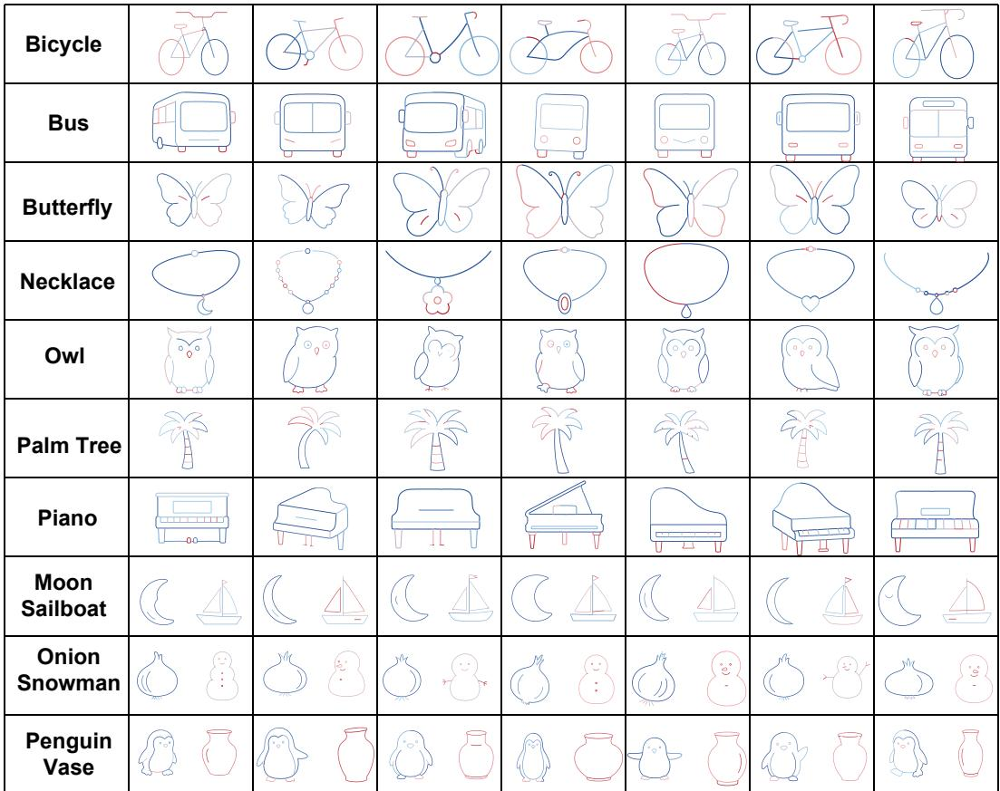  
Figure 12: Stroke-order and geometry diversity in BURGER. Examples show different object shapes and drawing sequences, with colors indicating stroke order from dark blue to light blue, light red, and dark red.

We resample each trajectory to 32 uniformly spaced points in normalized time and concatenate its start-relative planar positions and successive displacements into a 126-dimensional descriptor. After standardization using pooled statistics, we fit a shared k-means codebook with k-means++ initialization. Cluster frequencies are computed within each instruction to obtain $N _ { \mathrm { e f f } } ( \ell ; k )$ , then averaged equally over instructions. Figure 14 shows the results for $k \in \{ 8 , 1 2 , 1 6 , 2 4 , 3 2 , 4 8 \}$ with all other settings fixed. The reference curves show LIBERO remaining at 1.05–1.10 effective modes per instruction, while BURGER increases from 3.63 to 9.22, with a 6.57-fold difference at k = 24. BURGER consistently exceeds LIBERO across ten random initializations, supporting the robustness of its greater instruction-conditioned trajectory diversity across the tested clustering resolutions.

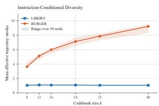  
Figure 14: Codebook-size sensitivity. Solid curves show the reference seed; shaded bands show the min–max across ten initialization seeds on a fixed trajectory sample.

## B Experimental Details

## B.1 VLA Post-Training Protocol

Our dataset is stored in the LeRobot format [41]. Each training sample consists of a language instruction, the current canvas observation, the robot proprioceptive state, and the corresponding expert action. The language instruction follows the task prompt used during data generation, e.g., “draw an apple” for single-object tasks and “draw an apple to the left of a cup” for compositional tasks. For visual input, we use the rendered canvas observation from the simulator. The action target is the robot end-effector command recorded during SVG replay, as described in the SVG-totrajectory pipeline in the main paper.

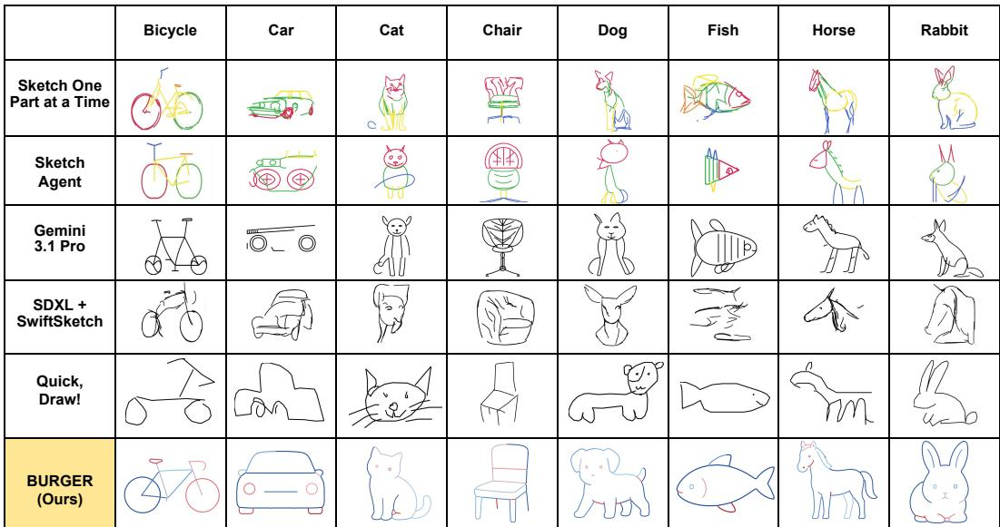  
Figure 13: Data comparison with other sketch generation methods.

We keep the post-training protocol consistent across models whenever possible. For $\pi _ { 0 }$ and $\pi _ { 0 . 5 } ,$ we fine-tune the continuous-action policy using their original flow-matching action objective. For $\pi _ { 0 } -$ FAST, actions are first converted into FAST tokens and the model is trained with the autoregressive action-token prediction objective. We use a batch size of 32 for all models. All models are evaluated without additional task-specific adaptation after post-training.

During evaluation, the policy receives the language prompt, the current canvas observation, and the robot proprioceptive state, and predicts an end-effector command or action chunk. An episode terminates when the robot end-effector is lifted above a predefined height threshold; therefore, the policy must learn both the drawing behavior and the appropriate termination behavior. We use the same initial-state distribution and maximum episode length across models to ensure a fair comparison. For single-object evaluation, we use 10 object classes: alarm clock, apple, backpack, banana, bathtub, bench, bicycle, birthday cake, blueberry, and book. For compositional evaluation, we test on unseen spatial compositions. For each task, we run 10 evaluation episodes and report the average score computed by our evaluation metric. The final canvas is used for visual evaluation, while the full trajectory is used for analyzing failure modes and real-robot transfer.

## B.2 Rollout Evaluation

Latent-based Similarity Metric. We construct a sketch-specific metric space on top of a frozen DI-NOv3 backbone. Given a rendered canvas image I, DINOv3 produces a CLS token, which provides a global image representation, and a sequence of patch embeddings, which preserve local visual details. We concatenate the CLS token with the averaged patch embeddings and pass the resulting feature through a lightweight two-layer MLP projection head with output dimension 256, followed by $\ell _ { 2 }$ normalization. This yields a normalized sketch embedding $z ( I ) \in \mathbb { R } ^ { 2 5 6 }$

The embedding $z ( I )$ is then passed to a cosine classifier. For class $c ,$ the classifier maintains a learnable class weight $w _ { c }$ and computes the logit as a scaled cosine similarity:

$$
\ell _ { i , c } = \gamma z _ { i } ^ { \top } \frac { w _ { c } } { \| w _ { c } \| _ { 2 } } ,
$$

where $z _ { i } = z ( I _ { i } )$ and $\gamma$ is a learnable logit scale.

We train the projection head and cosine classifier using a combination of cross-entropy classification and supervised contrastive learning:

$$
\begin{array} { r } { \mathcal { L } = \mathcal { L } _ { \mathrm { C E } } + \lambda \mathcal { L } _ { \mathrm { S u p C o n } } , } \end{array}\tag{2}
$$

where

$$
\mathcal { L } _ { \mathrm { C E } } = - \frac { 1 } { B } \sum _ { i = 1 } ^ { B } \log \frac { \exp ( \ell _ { i , y _ { i } } ) } { \sum _ { c = 1 } ^ { C } \exp ( \ell _ { i , c } ) } ,\tag{3}
$$

$$
\mathcal { L } _ { \mathrm { S u p C o n } } = - \frac { 1 } { | \mathcal { A } | } \sum _ { i \in \mathcal { A } } \frac { 1 } { | P ( i ) | } \sum _ { p \in P ( i ) } \log \frac { \exp ( z _ { i } ^ { \top } z _ { p } / \tau ) } { \sum _ { a \ne i } \exp ( z _ { i } ^ { \top } z _ { a } / \tau ) } .\tag{4}
$$

Here, B is the batch size, $C$ is the number of object classes, $y _ { i }$ is the ground-truth class label for image $I _ { i } , \tau$ is the contrastive temperature, $P ( i )$ denotes the set of same-class positives for anchor $i ,$ and $\mathcal { A } = \left\{ i : | P ( i ) | > 0 \right\}$ is the set of valid anchors. The cross-entropy term makes the embedding predictive of the object category, while the supervised contrastive term encourages drawings from the same class to cluster together and drawings from different classes to separate in the learned metric space. During training, the DINOv3 backbone is kept frozen, and only the projection head and cosine classifier are optimized.

After training, we compute one class center for each object class using the training split. For class $c$ with training drawings $\mathcal { D } _ { c } ^ { \mathrm { t r a i n } }$ , its class center is

$$
q _ { c } = \frac { \frac { 1 } { | \mathcal { D } _ { c } ^ { \mathrm { t r a i n } } | } \sum _ { I _ { i } \in \mathcal { D } _ { c } ^ { \mathrm { t r a i n } } } \mathcal { z } ( I _ { i } ) } { \left\| \frac { 1 } { | \mathcal { D } _ { c } ^ { \mathrm { t r a i n } } | } \sum _ { I _ { i } \in \mathcal { D } _ { c } ^ { \mathrm { t r a i n } } } \mathcal { z } ( I _ { i } ) \right\| _ { 2 } } .
$$

For a generated drawing with target class $y ,$ we compare its normalized embedding with the corresponding class center:

$$
\begin{array} { r } { s ( I , y ) = z ( I ) ^ { \top } q _ { y } . } \end{array}
$$

We use this target-class similarity as the evaluation signal. A higher similarity indicates that the generated drawing is closer to the target object class in the learned sketch embedding space.

For single-object tasks, we score the final canvas image by its similarity to the class center of the prompted object $( \mathrm { i } . \mathrm { e } . , s ( I , y ) )$ . For compositional tasks, we first split the foreground strokes into object regions using a vertical or horizontal separator with the lowest foreground-pixel density, evaluate each region against its corresponding object class center, and average the two similarities. We further penalize predictions whose detected ordering does not match the prompted spatial relation.

Correlation with Human Judgments. We conduct a user study on 10 single-object classes to evaluate whether our latent-based similarity metric is aligned with human judgments. For each class, 66 participants are shown five drawings: four model-generated drawings produced by two VLA models and one ground-truth drawing from our dataset. Participants are asked to rank the five drawings from best to worst according to how well each drawing depicts the prompted object class. We then evaluate the same drawings using our DINOv3-based [35] similarity metric and CLIPScore [33].

To quantify alignment with human judgments, we compute three complementary measures. First, we use Spearman’s rank correlation coefficient and Kendall $\tau _ { b }$ correlation coefficient to compare the aggregate human ranking with rankings induced by each metric. For each drawing, the aggregate human score is computed as the negative mean human rank, so that larger values correspond to better human preference. Kendall’s $\tau _ { b }$ is used because it accounts for tied ranks, which occur frequently for CLIPScore due to score saturation. Second, we compute pairwise agreement by comparing each participant’s preference over every within-class pair of drawings with the corresponding pairwise preference induced by the metric. Thus, Spearman’s $\rho$ and Kendall’s $\tau _ { b }$ evaluate agreement with the aggregate human ranking, while pairwise agreement measures consistency with individual human judgments.

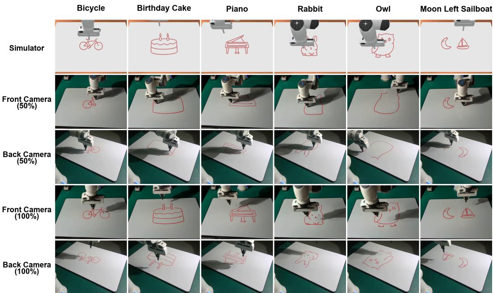  
Figure 15: Visualization of the real-robot dataset. The first row shows the corresponding simulated data. The second and third rows show intermediate stages of real-robot data collection. The last two rows show completed real-robot demonstrations.

As shown in Table 4, our latent-based similarity metric achieves stronger correlation with human judgments than CLIPScore across all three measures. Specifically, our metric achieves a Spearman correlation of 0.834, Kendall’s $\tau _ { b }$ of 0.655, and pairwise agreement of 0.875, outperforming CLIP-Score, which obtains 0.592, 0.433, and 0.803, respectively. These results suggest that the proposed latent-based similarity metric provides a practical and human-aligned proxy for the evaluation of language-conditioned drawing policies.

Table 4: Correlation between metrics and human judgments.
<table><tr><td>Metric</td><td>Spearman  $\rho$ </td><td>Kendall  $\tau _ { b }$ </td><td>Pairwise Agreement</td></tr><tr><td>CLIPScore [33]</td><td>0.592</td><td>0.433</td><td>0.803</td></tr><tr><td>Similarity metric</td><td>0.834</td><td>0.655</td><td>0.875</td></tr></table>

## B.3 Real-Robot Implementation

Inference. For real-robot inference, we first align the real camera observations with the simulated canvas coordinate system. Our setup uses two Intel RealSense cameras, placed at the front and back of the workspace, to reduce occlusion caused by the robot arm. To extract the drawing strokes on the canvas, we use depth observations to segment out the robot arm and then estimate the visible stroke regions from each camera view. The stroke observations from the two views are merged and provided as visual input to the trained VLA policy. The policy outputs target TCP positions, which are executed by the Franka Panda robot arm

Human–Robot Interaction. Our perception pipeline also supports human–robot collaborative drawing. During execution, depth observations are used to detect when a human hand enters the canvas region. When a hand is detected, policy inference is temporarily paused while the user modifies the drawing, either by adding new strokes or erasing existing ones. After the user leaves the workspace, the updated canvas is captured and processed using the same stroke-extraction and multi-view merging pipeline described above. The resulting canvas representation is then provided to the VLA policy as a new observation, and the robot resumes drawing conditioned on the updated canvas state. This procedure enables iterative collaboration between a human user and the robot within a shared drawing workspace.

## C Additional Results

## C.1 Additional Scaling Results

Figure 16 provides additional qualitative results for $\pi _ { 0 . 5 }$ under different data scales, varying both the number of demonstrations per class and the number of training classes. Consistent with the quantitative results in Figure 6, performance improves when either the number of demonstrations or the number of classes increases. We also observe that increasing the number of demonstrations per class has a particularly strong effect on drawing quality, suggesting that sufficient within-class coverage is important for learning reliable stroke-level action generation.

We further compare representative rollouts from different VLA models in Figure 17. For each model and task, we select the rollout with the highest score according to our evaluation metric.

## C.2 Additional Multimodal Rollouts

Figure 18 and Figure 19 provide additional examples of multimodal drawing behaviors in BURGER. The training demonstrations show that the same object can be drawn with different stroke orders and geometric variations, while the model rollouts show that VLA policies can reproduce multiple valid drawing modes after training.

## C.3 Additional Spatial-Composition Results

We further provide additional qualitative examples of spatial-relation learning in Figure 20. Figure 20 shows model rollouts on in-distribution compositional tasks, where the object composition is observed during training, as well as rollouts on unseen object compositions, demonstrating that VLA models can apply learned spatial relations to new object pairs.

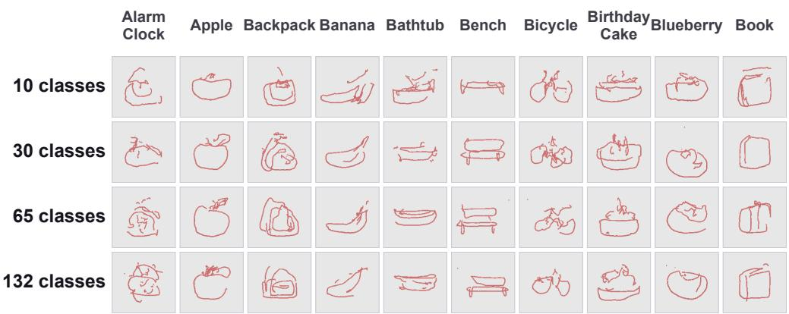

(a) 10 demonstrations per class.  
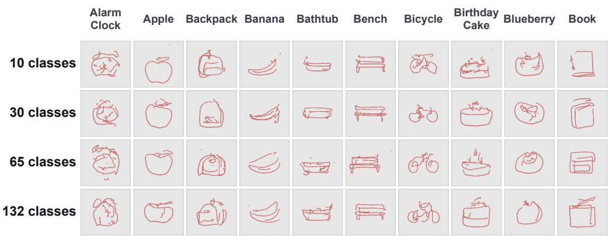

(b) 50 demonstrations per class.  
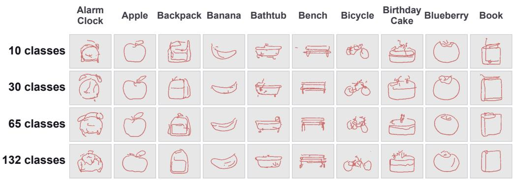  
(c) 100 demonstrations per class.  
Figure 16: Qualitative data-scaling results for $\pi _ { 0 . 5 }$ . Panels (a), (b), and (c) show models trained with 10, 50, and 100 demonstrations per class, respectively. Within each panel, rows correspond to different numbers of training classes. Increasing either the number of demonstrations per class or the number of training classes improves drawing quality.

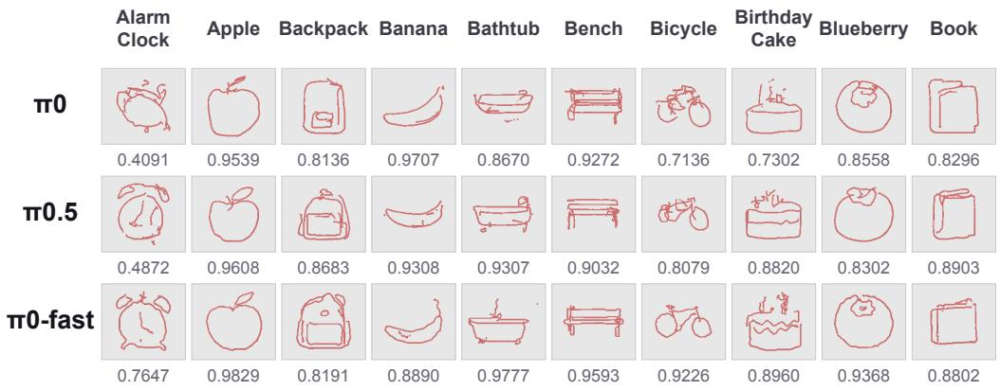  
Figure 17: Qualitative comparison of representative VLA models on BURGER.

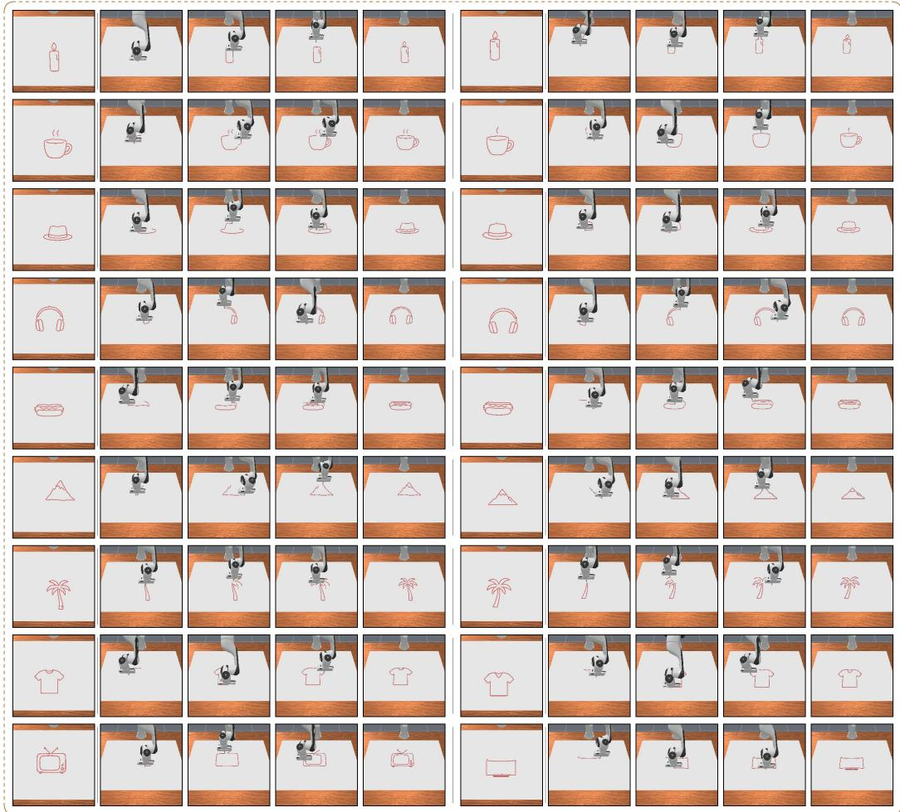  
Figure 18: Multimodal drawing behaviors in the training set. The same object class can be represented by different stroke orders, shapes, and local geometric variations.

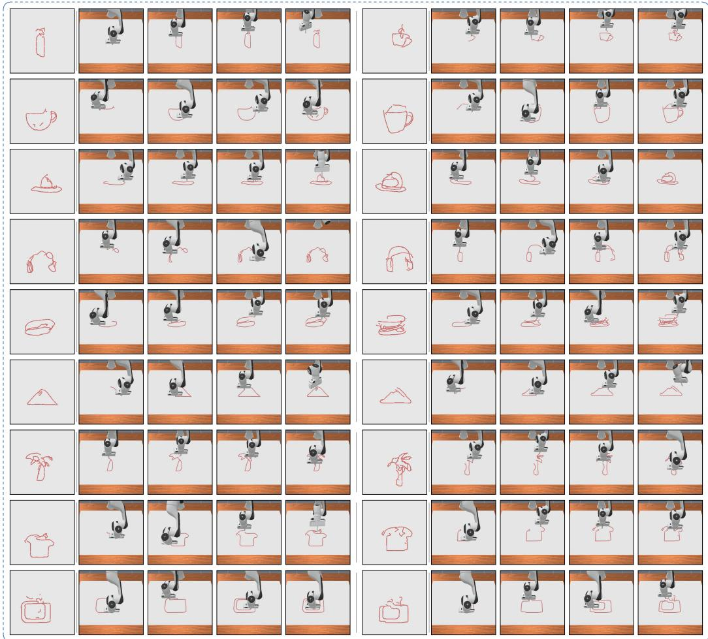  
Figure 19: Multimodal drawing behaviors in VLA rollouts. The generated drawings show that trained VLA models can produce multiple valid realizations for the same language instruction.

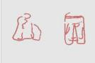

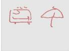  
Train  
Model

## In Training Distribution

TRAIN / MODEL

  
Model

  
leaf left moon

  
mug left pizza

  
nose left shoe

  
purse left star

  
sailboat left moon

  
star left sandwich

  
television left sink

## Beyond Training Distribution

  
apple left blueberry

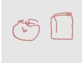  
apple left book

  
apple left camera

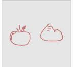

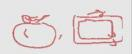  
apple left cloud  
apple left television

  
banana left sandwich

  
book left star  
Model

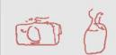  
camera left candle

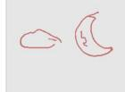  
cloud left moon

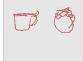  
cup left apple

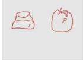  
hat left apple  
jacket left pants  
television left umbrella

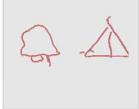  
tree left tent

Figure 20: Above: In-distribution spatial-relation grounding. VLA models learn to generate compositional drawings for object pairs observed during training. Below: Generalization to unseen object compositions. VLA models can apply learned spatial relations to object pairs that are not observed during training.