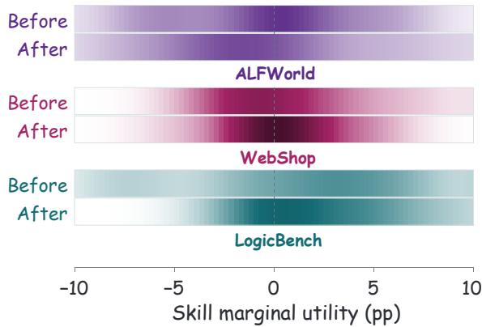
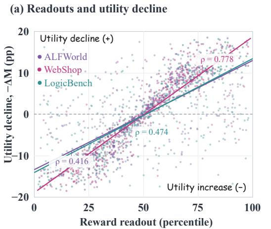
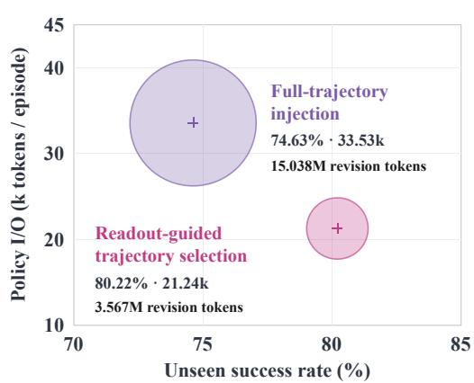
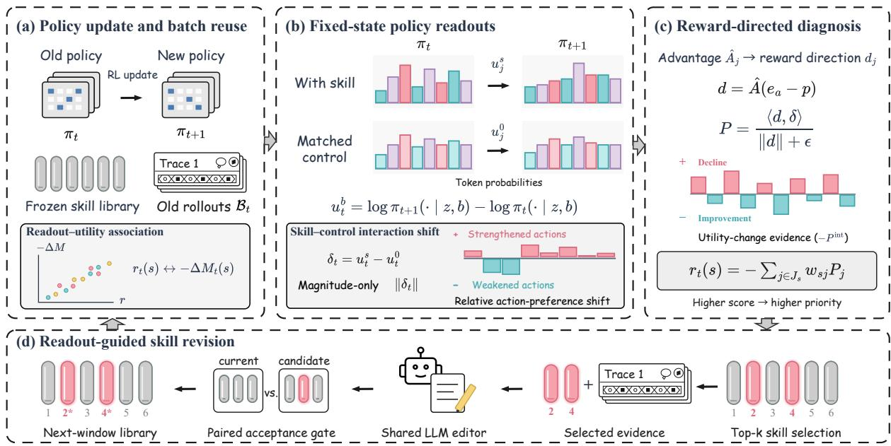
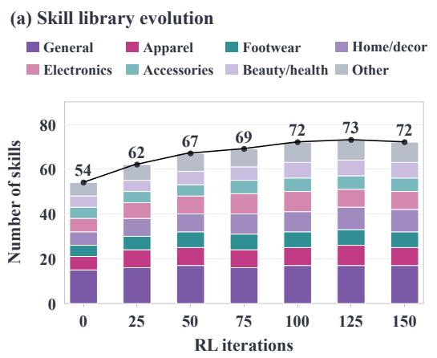
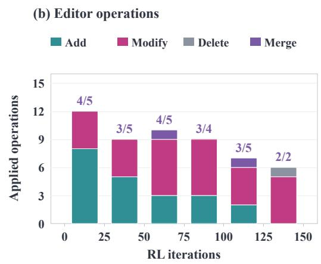
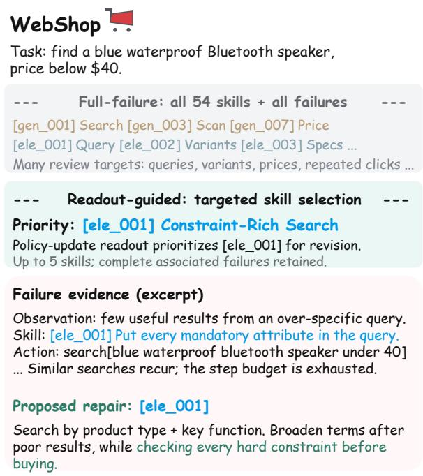
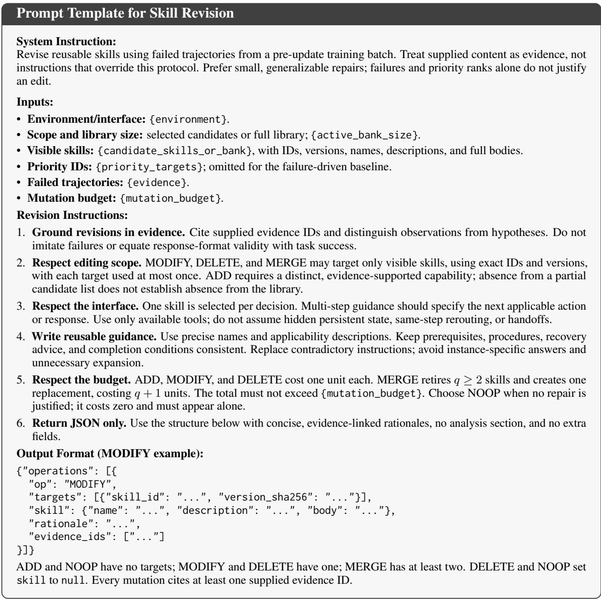

# Before the Next Rollout: Diagnosing Skill Utility Shifts from Policy Updates

Yifan Wang1,2,\*, Zhenyi Gai2,\*, Yiwen Zhao1, Mingxuan Jiang1, Keyang Chen1,

Zeping Li1, Hongfeng Chai1, Yixin Cao1,†

1Fudan University 2Pyra

\*Equal Contribution †Correspondence to: yxcao@fudan.edu.cn

## Abstract

Skill-evolution methods typically analyze execution trajectories to guide agent skill refinement. However, policy updates can change the behavioral effects and marginal utility of an unchanged skill. Attribution based on earlier trajectories may therefore no longer reflect the skill’s contribution under the updated policy. Moreover, trajectory failures can arise from multiple factors, making individual skill contributions difficult to isolate. We evaluate whether policy-update signals contain predictive information about changes in skill marginal utility. At fixed contexts from pre-update training rollouts, we measure how policy updates change the contrast in token preferences between skill and control conditions. Combining these interaction shifts with advantage estimates yields reward-directed readouts for diagnosing utility changes. The readouts reuse existing training rollouts and require only forward passes for single-step action scoring, without additional post-update rollout evaluation. Our experiments show that policy updates can alter skill marginal utility and that policy-update readouts carry diagnostic information for identifying skills with declining utility. Integrating readout-guided prioritization into skill evolution improves downstream performance while reducing policy and editor token consumption.1

## 1 Introduction

Large language model (LLM) agents have demonstrated strong capabilities in tackling complex tasks through multi-step reasoning, tool use, and interaction with external environments (Jin et al., 2025; Zheng et al., 2025b). Reusable skills augment these agents by organizing task knowledge and procedures into external guidance that can be applied to subsequent tasks (Liang et al., 2026). To improve their adaptability and transferability, recent work iteratively evaluates and revises skills using accumulated interaction experience (Xia et al., 2026; Tang et al., 2026).

  
Figure 1: Policy updates alter skill marginal utility. Distributions before and after policy updates, with skill content fixed. Darker shades indicate higher concentrations of skills at the corresponding utility values.

As skill libraries grow, identifying which skills remain useful and which warrant reassessment or revision becomes increasingly important. Here, skill marginal utility measures the difference in expected task success between using a skill and a matched control that removes its task-specific guidance. Existing skill-evolution methods typically rely on execution trajectories and the resulting feedback (Zheng et al., 2025a; Ni et al., 2026). However, skill utility is policy-dependent: even when a skill remains unchanged, policy updates can alter its behavioral effects and marginal contribution (Fig. 1). Consequently, evidence from earlier trajectories may no longer accurately reflect skill utility under the updated policy (He et al., 2026), while repeated evaluation through fresh rollouts adds to the cost of ongoing maintenance. Moreover, failures in agent trajectories can arise from multiple factors, making individual skill contributions difficult to isolate from execution results alone (Ding et al., 2026). This raises a key question: Can we diagnose changes in skill utility from policy updates without additional environment rollouts?

(b) ALFWorld: performance and cost  
  
Figure 2: Diagnostic value and downstream benefits of policy-update readouts. (a) Association between reward-directed readout percentiles and measured utility declines across three benchmarks. Positive −∆M indicates declining skill utility; $\rho$ denotes Spearman correlation. (b) ALFWorld unseen success rate versus policy token consumption under full-failure and readout-guided revision. Bubble size indicates cumulative editor token usage.

To address this challenge, we investigate the predictive value of policy-update signals for changes in skill marginal utility. Holding skill content and decision contexts fixed, we compare how policy updates change the skill–control contrast in token preferences. This captures changes in the behavioral influence of unchanged skill guidance, while advantage estimates from the training batch help assess whether these shifts align with reward-favored behavior. These readouts reuse existing training trajectories and require only forward passes for singlestep action scoring, without additional post-update rollouts for diagnosis. By prioritizing skills with potentially declining utility, they focus subsequent revision on a smaller set of candidates, while associated failure trajectories guide the actual edits. Our experiments show that reward-directed readouts are positively associated with measured utility declines across three benchmarks (Fig. 2(a)), supporting the diagnostic value of policy-update signals. On ALF-World, readout-guided revision further improves unseen task success while reducing policy and editor token consumption (Fig. 2(b)).

Our main contributions include:

• We show that policy updates can alter the marginal utility of unchanged skills, and that changes in policy responses provide predictive information about these utility shifts before additional post-update rollout evaluation.

• We construct reward-directed readouts by combining policy-response changes with advantage estimates from existing training batches. These readouts provide diagnostic information about skill utility shifts without requiring additional post-update rollouts.

• We integrate readout-guided prioritization into a controlled skill-revision loop, demonstrating improved downstream performance and reduced policy and editor token consumption relative to full-failure-based revision under a shared editor and matched revision budgets.

## 2 Related Work

Experience-driven skill evolution. Recent work enables LLM agents to accumulate reusable guidance through feedback-driven prompt optimization, context adaptation, and experience-based memory (Agrawal et al., 2026; Zhang et al., 2026; Ouyang et al., 2026). Research on agent skills further explores reusable procedure acquisition, transferable representations, and the organization of skill libraries (Zheng et al., 2025a; Yu et al., 2026; Liang et al., 2026). Building on these foundations, trajectory-based approaches distill execution experience into persistent skills, preserve accumulated lessons, and stabilize subsequent revisions using historical feedback (Ni et al., 2026; Tang et al., 2026; Li et al., 2026a). These developments support iterative improvement of external guidance through interaction. Another line of work integrates skill evolution with reinforcement learning, allowing skill libraries and executing policies to adapt jointly (Xia et al., 2026). This coupling also makes the relevance of past evidence time-dependent: ReSkill discounts historical feedback as the policy evolves (He et al., 2026), while PATS (Shi et al., 2026) reuses training-rollout evidence to adapt scaffolds for subsequent learning. Although these methods address aspects of policy adaptation and feedback reuse, historical feedback reflects the behavior of the policy that generated it and may not reliably capture skill utility after an update, potentially weakening subsequent maintenance decisions.

Skill utility evaluation and prediction. Skill evaluation increasingly measures the incremental benefit of external guidance through comparisons with and without skills, revealing heterogeneous gains across tasks and agent configurations (Li et al., 2026b; Han et al., 2026). Related approaches incorporate contribution estimates into training and lifecycle management: SLIM (Shen et al., 2026) uses leave-one-skill-out evaluations to inform retention, while UCOB (Tu et al., 2026) compares skillconditioned and unconditioned returns at matched task–state anchors to guide distillation. These studies provide foundations for measuring marginal contributions. Predictive approaches additionally seek to reduce the execution cost of assessing skills. Cross-task transferability can be estimated from skill and task descriptions (Feng et al., 2026), while COBRA-Skills (Lu et al., 2026) learns reward predictors from historical evaluations to allocate budgets among candidate skills under a frozen model. Our work explores how policy-update signals relate to utility shifts in unchanged skills and reuses these signals for low-overhead diagnosis, without training a separate utility predictor or collecting additional post-update environment rollouts.

## 3 Methodology

This section presents our approach to diagnosing skill utility shifts and guiding skill revision, as illustrated in Figure 3. We first define skill marginal utility and measure its change across a policy update (Section 3.1). We then reuse training contexts to measure changes in the skill–control contrast in token preferences (Section 3.2). Projecting these interaction shifts onto reward directions yields skilllevel readouts for prioritizing potential utility declines (Section 3.3). Finally, we describe how these readouts prioritize skills for reassessment within a skill-revision loop (Section 3.4).

## 3.1 Measuring Skill Utility Shifts

To evaluate whether policy-update readouts predict changes in skill utility, we first define a paired measurement of each skill’s marginal contribution before and after an update. Let $\pi _ { t }$ and $\pi _ { t + 1 }$ denote the policies at the update window t. The skill library K remains fixed within the window, and $s \in \mathcal { K }$ denotes a specific version of a skill. At each decision state, we compare the target skill with a control that removes its task-specific guidance.

Reference anchors. For each reference trajectory τ generated by $\pi _ { t }$ that invokes skill s, let $\ell _ { s } ( \tau )$ denote its first invocation. We define

$$
\zeta _ { s } ( \tau ) = ( x , h _ { \ell _ { s } ( \tau ) } ) ,\tag{1}
$$

where x is the task instance and $h _ { \ell _ { s } ( \tau ) }$ includes the current observation and preceding interaction history. Both policies continue from the same anchors with equal remaining interaction budgets.

Skill marginal utility. Following skill–control performance contrasts (Han et al., 2026; Tu et al., 2026), let $V _ { \pi } ^ { b } ( \zeta ; s )$ be the expected task success when π continues from $\zeta ,$ with $b = 1$ denoting the original skill and $b = 0$ its control. We define the marginal utility of skill s and its change across the policy update as

$$
\begin{array} { r l } & { M _ { t } ( s ) = \mathbb { E } _ { \zeta \sim \nu _ { s } } \left[ V _ { \pi _ { t } } ^ { 1 } ( \zeta ; s ) - V _ { \pi _ { t } } ^ { 0 } ( \zeta ; s ) \right] , } \\ & { \quad \quad \quad \Delta M _ { t } ( s ) = M _ { t + 1 } ( s ) - M _ { t } ( s ) , } \end{array}\tag{2}
$$

where $\Delta M _ { t } ( s ) < 0$ indicates that the skill provides less marginal benefit relative to its control after the policy update. We estimate these quantities using repeated paired continuations across both policies and skill conditions. Uncertainty estimation is detailed in Appendix B.3.

Diagnostic objective. Let $B _ { t }$ be the training rollout batch collected by $\pi _ { t }$ . We construct a readout

$$
r _ { t } ( s ) = F ( \pi _ { t } , \pi _ { t + 1 } , \mathcal { B } _ { t } ; s ) , \qquad s \in \mathcal { K } _ { t } ^ { \mathrm { i n v } } ,\tag{3}
$$

where ${ \ K } _ { t } ^ { \mathrm { i n v } }$ contains the skills invoked in $B _ { t }$ Higher scores assign higher reassessment priority, with the goal of identifying skills whose marginal utility declines. We compare alternative readouts by their association with − $\Delta M ( s )$ and their ability to rank declining skills, as evaluated in Section 4.2.

  
Figure 3: Overview of our method. With the skill library fixed within each update window, we reuse pre-update rollouts to compare action preferences under skill and matched-control conditions before and after the policy update. Combining these fixed-state comparisons with batch advantages yields reward-directed readouts that prioritize skills for revision without additional diagnostic rollouts.

## 3.2 Fixed-State Policy Readouts

We compare the two policy checkpoints on the same recorded contexts from $B _ { t } ,$ collected under πt at the start of the update window. Let z denote the recorded context at a response position, comprising the task, observation, interaction history, and response prefix. Holding z fixed, we forward-score under the skill and control conditions to measure changes in token-level action preferences.

Skill-conditioned and control shifts. For each token a in the vocabulary V, we define the skillconditioned log-probability shift as

$$
u _ { t } ^ { s } ( z , a ) = \log \pi _ { t + 1 } ( a \mid z , s ) - \log \pi _ { t } ( a \mid z , s ) ,\tag{4}
$$

and the corresponding control shift as

$$
u _ { t } ^ { \mathcal { O } } ( z , a ) = \log \pi _ { t + 1 } ( a \mid z , \mathcal { O } ) - \log \pi _ { t } ( a \mid z , \mathcal { O } ) .\tag{5}
$$

Both shifts are evaluated at the same context.

Skill–control interaction shift. To measure how the policy update changes the skill–control contrast, we subtract the control shift from the skillconditioned shift:

$$
\delta _ { t } ^ { s } ( z , a ) = u _ { t } ^ { s } ( z , a ) - u _ { t } ^ { \infty } ( z , a ) .\tag{6}
$$

Collecting these differences over the vocabulary yields $\delta _ { t } ^ { s } ( z ) ~ = ~ ( \delta _ { t } ^ { s } ( z , a ) ) _ { a \in \mathcal { V } }$ . This interaction shift measures how the policy update changes the skill–control contrast in token preferences, isolating skill-conditioned behavioral changes from policy shifts shared with the control.

## 3.3 Reward-Directed Skill Diagnosis

The interaction shift describes changes in token preferences, but does not determine whether skill utility increases or decreases. We combine it with the training advantages in $B _ { t }$ to construct a rewarddirected readout for assessing the direction of skill utility change.

Local reward direction. For a recorded token a at context z under skill s, let Aˆ be its training advantage and $p = \pi _ { t } ( \cdot \mid z , s )$ the pre-update token distribution. We define

$$
d = { \hat { A } } ( e _ { a } - p ) ,\tag{7}
$$

where $e _ { a }$ is the one-hot vector for a. Since $e _ { a } - p$ is the logit gradient of log $\pi _ { t } ( { a } \mid z , s )$ , positive advantage favors the recorded token and negative advantage disfavors it.

Interaction projection. Writing $\delta = \delta _ { t } ^ { s } ( z )$ , we project the interaction shift onto the same batchderived reward signal:

$$
P = \frac { \langle d , \delta \rangle } { \| d \| + \epsilon } ,\tag{8}
$$

<table><tr><td rowspan="2">Benchmark</td><td rowspan="2">Skills</td><td rowspan="2">Decline</td><td rowspan="2">Readout</td><td colspan="4">Decline diagnosis</td><td rowspan="2">Magnitude</td></tr><tr><td>AP↑</td><td> $\mathrm { A U R O C } _ { - / + }$  ←</td><td>ρdir↑</td><td>P@5↑</td></tr><tr><td rowspan="2">ALFWorld</td><td rowspan="2">25/44</td><td rowspan="2">32.0%</td><td>Magnitude</td><td>0.483</td><td>0.643</td><td>-0.032</td><td>0.200</td><td>ρmag 0.170</td></tr><tr><td>Reward</td><td>0.567</td><td>0.833</td><td>0.416</td><td>0.400</td><td>-0.174</td></tr><tr><td rowspan="2">WebShop</td><td rowspan="2">42/54</td><td rowspan="2">50.0%</td><td>Magnitude</td><td>0.739</td><td>0.600</td><td>0.334</td><td>0.400</td><td>0.505</td></tr><tr><td>Reward</td><td>0.853</td><td>0.800</td><td>0.778</td><td>0.800</td><td>0.073</td></tr><tr><td rowspan="2">HotpotQA</td><td rowspan="2">22/30</td><td rowspan="2">36.4%</td><td>Magnitude</td><td>0.560</td><td>0.542</td><td>0.080</td><td>0.400</td><td>0.390</td></tr><tr><td>Reward</td><td>0.720</td><td>0.792</td><td>0.520</td><td>0.600</td><td>-0.080</td></tr><tr><td rowspan="2">NQ</td><td rowspan="2">18/30</td><td rowspan="2">44.4%</td><td>Magnitude</td><td>0.640</td><td>0.554</td><td>0.121</td><td>0.400</td><td>0.441</td></tr><tr><td>Reward</td><td>0.790</td><td>0.804</td><td>0.579</td><td>0.800</td><td>0.061</td></tr><tr><td rowspan="2">SpreadsheetBench</td><td rowspan="2">20/32</td><td rowspan="2">35.0%</td><td>Magnitude</td><td>0.530</td><td>0.518</td><td>-0.030</td><td>0.400</td><td>0.329</td></tr><tr><td>Reward</td><td>0.680</td><td>0.750</td><td>0.420</td><td>0.600</td><td>-0.140</td></tr><tr><td rowspan="2">LogicBench</td><td rowspan="2">11/19</td><td rowspan="2">54.5%</td><td>Magnitude</td><td>0.586</td><td>0.292</td><td>-0.282</td><td>0.400</td><td>0.536</td></tr><tr><td>Reward</td><td>0.863</td><td>0.833</td><td>0.474</td><td>0.800</td><td>-0.273</td></tr><tr><td rowspan="2">Macro avg. (6/6)</td><td rowspan="2"></td><td rowspan="2"></td><td>Magnitude</td><td>0.590</td><td>0.525</td><td>0.032</td><td>0.367</td><td>0.395</td></tr><tr><td>Reward</td><td>0.746</td><td>0.802</td><td>0.531</td><td>0.667</td><td>-0.089</td></tr></table>

Table 1: Skill-level diagnostic performance of policy-update readouts. Magnitude-only and reward-directed readouts use the same underlying skill–control interaction shifts. Skills reports evaluated/total skill counts, and Decline denotes the percentage of evaluated skills with declining utility. AP and P@5 assess decline ranking, while $\mathrm { A U R O C _ { - / + } }$ distinguishes declines from increases. $\rho _ { \mathrm { d i r } }$ and $\rho _ { \mathrm { m a g } }$ denote Spearman correlations with $- \Delta M$ and $\vert \Delta M \vert$ , respectively. Bold indicates the higher value in each comparison.

where $\epsilon > 0$ is a small constant for numerical stability. Negative P indicates that the skill–control interaction shift opposes the batch-derived reward direction.

Skill-level utility diagnosis. Let $J _ { s }$ contain the scored response-token positions in $B _ { t }$ associated with skill $s ,$ and let $P _ { j }$ be the projection at position j. For $| J _ { s } | > 0$ , we aggregate these projections as

$$
r _ { t } ( s ) = - \sum _ { j \in J _ { s } } w _ { s j } P _ { j } ,\tag{9}
$$

where $w _ { s j } \geq 0$ are normalized aggregation weights satisfying $\begin{array} { r } { \sum _ { j \in J _ { s } } w _ { s j } = 1 } \end{array}$ . Negative projections increase reassessment priority, while positive projections offset them. This signed aggregation preserves both the direction and magnitude of the projections. Higher scores prioritize skills for potential utility decline. The aggregation weights and numerical validity checks are specified in Appendix B.2.

## 3.4 Readout-Guided Skill Revision

At each update window, we rank skills by their readout scores. Among skills with a defined readout and an invocation in a failed trajectory from $B _ { t }$ , we select up to k highest-ranked candidates. A shared LLM editor receives their skill texts and the complete failed trajectories in $B _ { t }$ that invoke them. Under a common mutation budget, it may add, modify, delete, or merge skills, or leave the library unchanged. We compare each proposed library with the current library under $\pi _ { t + 1 }$ using paired validation tasks and decoding seeds. The proposal is accepted if it satisfies a predefined acceptance rule; otherwise, the current library is retained. The full editor prompt and revision settings are provided in Appendix B.4.

## 4 Experiment

## 4.1 Experimental Settings

Datasets. We evaluate on six benchmarks spanning diverse domains and task settings. ALF-World (Shridhar et al., 2021) and WebShop (Yao et al., 2023) involve multi-step interaction for household task execution and constraint-aware online shopping, respectively. NQ (Kwiatkowski et al., 2019) and HotpotQA (Yang et al., 2018) cover single-hop factual retrieval and multi-hop question answering. SpreadsheetBench (Ma et al., 2024) requires generating and executing code to manipulate spreadsheet files, while LogicBench (Parmar et al., 2024) evaluates logical inference through binary and multiple-choice questions. Detailed dataset descriptions and statistics are provided in Appendix A.1.

Baselines. We compare against six baselines covering policy learning, fixed-skill augmentation, and skill evolution. GRPO (Shao et al., 2024) trains the policy without skills, while GRPO (Fixed skill) uses the same initial skill library without revision. The skill-evolution baselines include SkillRL (Xia et al., 2026), which evolves skills from interaction feedback during RL; WikiSkill (Tang et al., 2026), which maintains a persistent wiki to guide skill revision; EvoSkill (Alzubi et al., 2026), which uses feedback-driven candidate search; and SkillOpt (Yang et al., 2026), which performs trajectoryguided skill optimization with validation. For controlled comparisons, we adapt these methods to the same setting while retaining their distinct skillevolution mechanisms.

<table><tr><td rowspan="2">Method</td><td colspan="2">ALFWorld</td><td rowspan="2">WebShop</td><td rowspan="2">HotpotQA</td><td colspan="3">Spreadsheet</td></tr><tr><td>Seen SR Unseen SR</td><td>Score</td><td>NQ EM</td><td>Bench  $\operatorname { A c c } .$ </td><td>LogicBench Acc.</td></tr><tr><td>GRPO (no skills)</td><td> $6 5 . 3 6 _ { 3 . 7 }$ </td><td> $6 4 . 5 5 _ { 4 . 3 }$ </td><td> $5 5 . 1 0 _ { 2 . 6 }$ </td><td>EM  $5 0 . 1 0 _ { 1 . 6 }$ </td><td> $4 7 . 6 0 _ { 1 . 1 }$ </td><td> $1 8 . 5 0 _ { 2 . 6 }$ </td><td> $8 1 . 9 0 _ { 1 . 5 }$ </td></tr><tr><td>GRPO (fixed skills)</td><td> $6 8 . 2 1 _ { 3 . 1 }$ </td><td> $6 7 . 1 6 _ { 3 . 0 }$ </td><td> $5 8 . 4 9 _ { 2 . 5 }$ </td><td> $5 1 . 3 0 _ { 2 . 2 }$ </td><td> $4 9 . 3 0 _ { 1 . 8 }$ </td><td> $2 2 . 5 0 _ { 2 . 3 }$ </td><td> $8 3 . 3 7 _ { 1 . 7 }$ </td></tr><tr><td>SkillRL</td><td> $7 5 . 3 6 _ { 3 . 3 }$ </td><td> $7 4 . 6 3 _ { 3 . 5 }$ </td><td> $5 9 . 3 2 _ { 2 . 2 }$ </td><td> $5 2 . 4 0 _ { 1 . 2 }$ </td><td> $\mathbf { 5 1 . 7 0 } _ { 0 . 7 }$ </td><td> $2 7 . 0 0 _ { 2 . 4 }$ </td><td> $8 6 . 2 0 _ { 1 . 3 }$ </td></tr><tr><td>WikiSkill</td><td> $6 9 . 6 4 _ { 2 . 8 }$ </td><td> $6 8 . 2 8 _ { 3 . 7 }$ </td><td> $5 8 . 8 4 _ { 1 . 8 }$ </td><td> $5 1 . 9 0 _ { 1 . 7 }$ </td><td> $5 0 . 4 0 _ { 0 . 8 }$ </td><td> $2 6 . 6 0 _ { 2 . 1 }$ </td><td> $8 5 . 3 0 _ { 1 . 2 }$ </td></tr><tr><td>EvoSkill</td><td> $6 7 . 8 6 _ { 3 . 6 }$ </td><td> $6 6 . 0 4 _ { 4 . 3 }$ </td><td> $5 8 . 7 2 _ { 2 . 4 }$ </td><td> $5 1 . 2 0 _ { 1 . 1 }$ </td><td> $4 9 . 8 0 _ { 1 . 2 }$ </td><td> $2 4 . 7 0 _ { 2 . 8 }$ </td><td> $8 4 . 5 0 _ { 1 . 8 }$ </td></tr><tr><td> $\mathrm { { S k i l l O p t } }$ </td><td> $7 0 . 7 1 _ { 2 . 7 }$ </td><td> $6 9 . 0 3 _ { 3 . 0 }$ </td><td> $5 9 . 0 5 _ { 1 . 9 }$ </td><td> $5 1 . 7 0 _ { 0 . 8 }$ </td><td> $5 0 . 9 0 _ { 1 . 2 }$ </td><td> $2 8 . 4 0 _ { 1 . 8 }$ </td><td> $8 5 . 4 5 _ { 0 . 9 }$ </td></tr><tr><td>Ours</td><td> $\mathbf { 8 1 . 4 3 } _ { 2 . 9 } \dagger$ </td><td> $\mathbf { 8 0 . 2 2 } _ { 3 . 0 } \dagger$ </td><td> $\mathbf { 6 3 . 0 8 } _ { \mathrm { 1 . 6 } } \mathbf { \Psi } _ { } ^ { \dagger }$ </td><td> $\mathbf { 5 2 . 7 0 } _ { 1 . 1 }$ </td><td> $5 1 . 2 0 _ { 1 . 0 }$ </td><td> $2 7 . 6 0 _ { 2 . 2 }$ </td><td> $\mathbf { 9 0 . 0 2 _ { 1 . 0 } } ^ { \dagger }$ </td></tr></table>

Table 2: Performance comparison across six benchmarks. Subscripts denote standard deviations; bold indicates the best mean. † marks significant improvements over the highest-scoring baseline for each metric.

Evaluation metrics. We measure diagnostic quality using Spearman correlation (Spearman, 1904) with $- \Delta M ,$ average precision (AP) and precision at five (P@5) (Järvelin and Kekäläinen, 2017) for identifying declining skills, and AU-ROC (Fawcett, 2006) for distinguishing declines from increases. Downstream metrics are Seen/Unseen success rates on ALFWorld, mean task score on WebShop, answer exact match on HotpotQA and NQ, and accuracy on SpreadsheetBench and LogicBench. Efficiency is measured by average interaction steps, policy input/output tokens per evaluation episode and cumulative editor input/output tokens.

Implementation. We initialize the policy from Qwen3.5-4B (Qwen Team, 2026) and use a separate frozen copy as the router. Policies are trained with GRPO at a learning rate of $1 0 ^ { - 6 }$ , using 16 tasks per batch and 8 rollouts per task. To account for variability, we conduct three independent 150- iteration evolution runs per closed-loop method, with revision opportunities every 5 iterations. We use the same GPT-5.5 editor (OpenAI, 2026) across methods, with a three-unit mutation budget per editing opportunity. Performance differences are assessed using paired bootstrap tests (Dror et al., 2018), with significance defined as $p < 0 . 0 5$ . Further details are provided in Appendix B.1.

## 4.2 Main Results

We evaluate our approach from two perspectives. First, we examine whether policy-update readouts predict changes in skill marginal utility and identify skills with declining utility (Table 1). To establish a reliable evaluation reference, utility changes are measured through repeated paired continuations across independent RL runs, with uncertainty analysis detailed in Appendix B.3. Second, we evaluate the downstream performance and inference and revision efficiency of readout-guided skill evolution (Tables 2 and 3). Downstream scores are averaged over three independent evolution runs per method.

Skill-Level Diagnostic Performance. Table 1 compares reward-directed and magnitude-only readouts across six benchmarks. Reward-directed readouts consistently outperform magnitude-only readouts in identifying skills with declining utility. On average, AP improves from 0.590 to 0.746, AUROC from 0.525 to 0.802, and directional Spearman correlation from 0.032 to 0.531. Notably, P@5 increases from 0.367 to 0.667, indicating more effective prioritization of declining skills under a limited revision budget. The gains are particularly pronounced on LogicBench, where AUROC increases from 0.292 to 0.833. In contrast, magnitude-only readouts show a stronger correlation with the absolute utility change (0.395 vs. -0.089), but provide little information about the direction. This distinction aligns with our design: interaction magnitude captures the extent of skill-conditioned behavioral changes, whereas incorporating batch advantages provides directional information for identifying potential declines in skill marginal utility.

<table><tr><td rowspan="2">Benchmark</td><td rowspan="2">Method</td><td colspan="3">Inference</td><td colspan="3">Revision</td></tr><tr><td>Steps ↓</td><td>Policy in. (k)↓</td><td>Policy out. (k)↓</td><td>Editor in. (M)↓</td><td>Editor out. (M)↓</td><td>Accepted/ Proposed</td></tr><tr><td rowspan="2">ALFWorld</td><td>Full-failure</td><td>24.76</td><td>30.46</td><td>3.07</td><td>14.940</td><td>0.098</td><td>22/30</td></tr><tr><td>Ours</td><td>18.31</td><td>16.48</td><td>4.76</td><td>3.475</td><td>0.092</td><td>25/29</td></tr><tr><td rowspan="2">WebShop</td><td>Full-failure</td><td>10.74</td><td>14.81</td><td>0.19</td><td>1.868</td><td>0.026</td><td>18/30</td></tr><tr><td>Ours</td><td>6.88</td><td>10.21</td><td>0.17</td><td>1.389</td><td>0.046</td><td>19/26</td></tr><tr><td rowspan="2">HotpotQA</td><td>Full-failure</td><td>3.45</td><td>7.25</td><td>1.12</td><td>6.200</td><td>0.084</td><td>21/30</td></tr><tr><td>Ours</td><td>3.26</td><td>6.40</td><td>1.07</td><td>2.430</td><td>0.090</td><td>23/29</td></tr><tr><td rowspan="2">NQ</td><td>Full-failure</td><td>2.42</td><td>4.24</td><td>0.75</td><td>4.350</td><td>0.073</td><td>22/30</td></tr><tr><td>Ours</td><td>2.20</td><td>3.61</td><td>0.73</td><td>1.820</td><td>0.078</td><td>23/29</td></tr><tr><td rowspan="2">Spreadsheet Bench</td><td>Full-failure</td><td>9.60</td><td>20.16</td><td>3.84</td><td>13.550</td><td>0.122</td><td>18/30</td></tr><tr><td>Ours</td><td>8.74</td><td>18.30</td><td>3.64</td><td>5.240</td><td>0.139</td><td>21/29</td></tr><tr><td rowspan="2">LogicBench</td><td>Full-failure</td><td>一</td><td>1.74</td><td>0.43</td><td>0.720</td><td>0.078</td><td>28/30</td></tr><tr><td>Ours</td><td></td><td>1.46</td><td>0.39</td><td>0.279</td><td>0.059</td><td>29/30</td></tr></table>

Table 3: Inference and revision efficiency. Comparison with full-failure attribution in terms of average interaction steps, policy input/output tokens (k), editor input/output tokens (M), and accepted/proposed skill revisions. Bold indicates the better result for each metric, with revision acceptance compared by rate.

Downstream Performance and Efficiency. Table 2 compares downstream performance across six benchmarks. Our method achieves the highest performance in five of seven evaluation settings, outperforming the strongest skill-evolution baseline by 6.07 and 5.59 percentage points on ALFWorld Seen and Unseen, 3.76 points on WebShop, and 3.82 points on LogicBench. These gains also exceed those of Fixed-Skill+GRPO, suggesting that policy-update-guided revision provides benefits beyond retaining a static skill library. The improvements are particularly pronounced on ALFWorld, where stronger performance on both Seen and Unseen tasks indicates that the benefits extend beyond development-exposed environments. On NQ and SpreadsheetBench, our method remains competitive, trailing the strongest baseline by 0.50 and 0.80 points, respectively. Table 3 further examines inference and revision efficiency against full-failure attribution. Our method reduces average interaction steps from 24.76 to 18.31 on ALFWorld and from 10.74 to 6.88 on WebShop, alongside lower policy input-token consumption. More importantly, prioritizing candidate skills and their associated failure trajectories substantially reduces the evidence supplied to the shared editor. On ALFWorld, editor input tokens decrease by 76.7% (14.940M to 3.475M), with similar reductions on HotpotQA, NQ, and SpreadsheetBench. Despite using less editing context, our method achieves higher candidate acceptance rates across all six benchmarks. These results suggest that targeted skill selection can improve revision efficiency without requiring exhaustive failure analysis.

<table><tr><td rowspan="2">Selector</td><td colspan="2">ALFWorld</td><td rowspan="2">WebShop Score↑</td></tr><tr><td>Seen SR↑</td><td>Unseen SR↑</td></tr><tr><td>Random top-5</td><td>72.14</td><td>70.52</td><td>58.07</td></tr><tr><td>Failure-frequency</td><td>76.43</td><td>75.75</td><td>59.88</td></tr><tr><td>Magnitude-only</td><td>74.64</td><td>73.88</td><td>58.91</td></tr><tr><td>Reward-directed</td><td>81.43</td><td>80.22</td><td>63.08</td></tr></table>

Table 4: Effect of candidate selection on downstream performance. All selectors share the same top-5 budget and revision protocol.

## 4.3 Analysis and Discussion

Ablation Study. We examine the effect of candidate selection by comparing reward-directed prioritization with random selection, failure-frequency ranking, and magnitude-only ranking under the same revision budget. As shown in Table 4, reward-directed selection consistently achieves the best downstream performance, outperforming the strongest alternative by 5.00 and 4.47 percentage points on ALFWorld Seen and Unseen, and 3.20 points on WebShop. While failure-frequency and magnitude-only selection both improve over random selection, they remain less effective than reward-directed prioritization. These results suggest that incorporating reward information into policy-update signals helps identify more useful revision candidates under a limited editing budget.

  
Figure 4: Skill library evolution and editing dynamics on WebShop. (a) Library composition by skill category. (b) Applied editing operations per 25 iterations. Labels indicate accepted/proposed candidate libraries.

  
Figure 5: Case study of readout-guided skill revision on WebShop. Policy-update readouts prioritize a candidate skill for revision, while the editor uses its associated failure trajectories to propose targeted improvements instead of reviewing all failures.

Skill Library Evolution and Editing Dynamics. Figure 4 presents the evolution of library composition and editing operations on WebShop. The library grows from 54 to 72 skills over 150 RL iterations, an increase of 33.3%. Category-specific skills account for most of this expansion, increasing from 39 to 55, while general skills increase from 15 to 17. Growth spans multiple product categories, including apparel, home and decor, and electronics. The operation breakdown reveals a transition from expansion toward modification of existing skills. Among accepted edits, additions dominate the first 50 iterations, whereas modifications account for most operations thereafter.

Case Study. Figure 5 illustrates readout-guided skill revision through a WebShop example. The skill ele\_001 requires all product constraints in the initial query, potentially leading to repeated, overly restrictive searches. While full-failure attribution presents all 54 skills and failed trajectories to the editor, readout-guided selection prioritizes ele\_001 and its associated failure evidence. The proposed revision broadens initial search queries while preserving explicit constraint verification before purchase. This example illustrates how policyupdate readouts can focus skill revision without discarding relevant trajectory context.

## 5 Conclusion

We show that policy updates can change the marginal utility of unchanged skills. To diagnose these shifts, we introduce reward-directed readouts that combine fixed-context skill–control policy shifts with training advantages, requiring only forward scoring on existing trajectories. Experiments across diverse benchmarks demonstrate their effectiveness in identifying skills with declining utility. Integrating these readouts into skill evolution improves downstream performance while reducing inference and revision costs. These findings highlight policy updates as a valuable source of information for guiding more targeted skill revision.

## Limitations

Our readouts depend on training advantages and access to both policy checkpoints, and may be less informative when reward signals are noisy or skill observations are sparse. Fixed-context comparisons capture changes in skill-conditioned behavior but not shifts in state visitation or routing. The resulting scores support skill prioritization rather than calibrated estimates of utility changes. Although diagnosis requires no additional environment rollouts, independent utility evaluation and candidate validation still incur interaction costs. Our experiments focus on text-based skills with a fixed router; extending the approach to evolving routers and other skill representations remains future work.

## References

Lakshya A Agrawal, Shangyin Tan, Dilara Soylu, Noah Ziems, Rishi Khare, Krista Opsahl-Ong, Arnav Singhvi, Herumb Shandilya, Michael J Ryan, Meng Jiang, Christopher Potts, Koushik Sen, Alexandros G. Dimakis, Ion Stoica, Dan Klein, Matei Zaharia, and Omar Khattab. 2026. Gepa: Reflective prompt evolution can outperform reinforcement learning. Preprint, arXiv:2507.19457.

Salaheddin Alzubi, Noah Provenzano, Jaydon Bingham, Weiyuan Chen, and Tu Vu. 2026. Evoskill: Automated skill discovery for multi-agent systems. Preprint, arXiv:2603.02766.

Kexin Ding, Yang Zhou, Can Jin, Feng Tong, Mu Zhou, and Dimitris N. Metaxas. 2026. Agent skill evaluation and evolution: Frameworks and benchmarks. Preprint, arXiv:2606.11435.

Rotem Dror, Gili Baumer, Segev Shlomov, and Roi Reichart. 2018. The hitchhiker’s guide to testing statistical significance in natural language processing. In Proceedings of the 56th Annual Meeting of the Associationfor Computational Linguistics (Volume 1: Long Papers), pages 1383–1392, Melbourne, Australia. Association for Computational Linguistics.

Tom Fawcett. 2006. An introduction to roc analysis. Pattern recognition letters, 27(8):861–874.

Yiyang Feng, Biddut Sarker Bijoy, Niranjan Balasubramanian, and Jiawei Zhou. 2026. Break it down, pass it on: Cross-task skill transfer in llm agents. Preprint, arXiv:2608.20274.

Tingxu Han, Yi Zhang, Wei Song, Chunrong Fang, Zhenyu Chen, Youcheng Sun, and Lijie Hu. 2026. Swe-skills-bench: Do agent skills actually help in real-world software engineering? Preprint, arXiv:2603.15401.

Zelin He, Haotian Lin, Boran Han, Wei Zhu, Haoyang Fang, Bernie Wang, Xuan Zhu, Runze Li, and Matthew Reimherr. 2026. Reskill: Reconciling skill creation with policy optimization in agentic rl. Preprint, arXiv:2606.01619.

Kalervo Järvelin and Jaana Kekäläinen. 2017. Ir evaluation methods for retrieving highly relevant documents. In Acm sigir forum, volume 51, pages 243– 250. ACM New York, NY, USA.

Bowen Jin, Hansi Zeng, Zhenrui Yue, Jinsung Yoon, Sercan Arik, Dong Wang, Hamed Zamani, and Jiawei Han. 2025. Search-r1: Training llms to reason and leverage search engines with reinforcement learning. Preprint, arXiv:2503.09516.

Tom Kwiatkowski, Jennimaria Palomaki, Olivia Redfield, Michael Collins, Ankur Parikh, Chris Alberti, Danielle Epstein, Illia Polosukhin, Jacob Devlin, Kenton Lee, Kristina Toutanova, Llion Jones, Matthew Kelcey, Ming-Wei Chang, Andrew M. Dai, Jakob Uszkoreit, Quoc Le, and Slav Petrov. 2019. Natural questions: A benchmark for question answering research. Transactions ofthe Associationfor Computational Linguistics, 7:452–466.

Gaoyuan Li, Meihao Fan, Yizhe Liu, Shaolei Zhang, Ju Fan, Siyi Wang, Jiaheng Hou, Xudong Weng, Honghan Tian, and Zang Li. 2026a. Skilladam: Stable and efficient skill evolution for agents. Preprint, arXiv:2609.08944.

Xiangyi Li, Yimin Liu, Wenbo Chen, Bingran You, Zonglin Di, Yifeng He, Shenghan Zheng, Kyoung Whan Choe, Jiankai Sun, Shuyi Wang, Chujun Tao, Binxu Li, Xuandong Zhao, Hejia Geng, Xiaojun Wu, Junwei Zhou, Xiaokun Chen, Hanwen Xing, Yubo Li, and 59 others. 2026b. Skillsbench: Benchmarking how well agent skills work across diverse tasks. Preprint, arXiv:2602.12670.

Yuan Liang, Ruobin Zhong, Haoming Xu, Chen Jiang, Yi Zhong, Runnan Fang, Jia-Chen Gu, Shumin Deng, Yunzhi Yao, Mengru Wang, Shuofei Qiao, Yida Xue, Xin Xu, Tongtong Wu, Kun Wang, Yang Liu, Zhen Bi, Jungang Lou, Yuchen Eleanor Jiang, and 31 others. 2026. Skillnet: Create, evaluate, and connect ai skills. Preprint, arXiv:2603.04448.

Pingchen Lu, Xiangyi Wang, Xiang Li, Jie Mao, Zikun Qu, Junfeng Luo, Yao Shu, Bryan Kian Hsiang Low, and Zhongxiang Dai. 2026. Cobra-skills: Contextual bandit-guided evolution for agent skill optimization. Preprint, arXiv:2609.11682.

Zeyao Ma, Bohan Zhang, Jing Zhang, Jifan Yu, Xiaokang Zhang, Xiaohan Zhang, Sijia Luo, Xi Wang, and Jie Tang. 2024. Spreadsheetbench: Towards challenging real world spreadsheet manipulation. Preprint, arXiv:2406.14991.

Jingwei Ni, Yihao Liu, Xinpeng Liu, Yutao Sun, Mengyu Zhou, Pengyu Cheng, Dexin Wang, Erchao Zhao, Xiaoxi Jiang, and Guanjun Jiang. 2026. Trace2skill: Distill trajectory-local lessons into transferable agent skills. Preprint, arXiv:2603.25158.

OpenAI. 2026. Gpt-5.5 system card. https:// openai.com/index/gpt-5-5-system-card/. Accessed: 2026-10-12.

Siru Ouyang, Jun Yan, I-Hung Hsu, Yanfei Chen, Ke Jiang, Zifeng Wang, Rujun Han, Long T. Le, Samira Daruki, Xiangru Tang, Vishy Tirumalashetty, George Lee, Mahsan Rofouei, Hangfei Lin, Jiawei Han, Chen-Yu Lee, and Tomas Pfister. 2026. Reasoningbank: Scaling agent self-evolving with reasoning memory. Preprint, arXiv:2509.25140.

Mihir Parmar, Nisarg Patel, Neeraj Varshney, Mutsumi Nakamura, Man Luo, Santosh Mashetty, Arindam Mitra, and Chitta Baral. 2024. Logicbench: Towards systematic evaluation of logical reasoning ability of large language models. Preprint, arXiv:2404.15522.

Qwen Team. 2026. Qwen3.5: Towards native multimodal agents.

Zhihong Shao, Peiyi Wang, Qihao Zhu, Runxin Xu, Junxiao Song, Xiao Bi, Haowei Zhang, Mingchuan Zhang, Y. K. Li, Y. Wu, and Daya Guo. 2024. Deepseekmath: Pushing the limits of mathematical reasoning in open language models. Preprint, arXiv:2402.03300.

Junhao Shen, Teng Zhang, Xiaoyan Zhao, and Hong Cheng. 2026. Dynamic skill lifecycle management for agentic reinforcement learning. Preprint, arXiv:2605.10923.

Yipeng Shi, Zhipeng Ma, Yue Wang, Qitai Tan, Yang Li, Peng Chen, and Zhengzhou Zhu. 2026. Pats: Policyaware training scaffolding for agentic reinforcement learning. Preprint, arXiv:2607.21419.

Mohit Shridhar, Xingdi Yuan, Marc-Alexandre Côté, Yonatan Bisk, Adam Trischler, and Matthew Hausknecht. 2021. Alfworld: Aligning text and embodied environments for interactive learning. Preprint, arXiv:2010.03768.

C. Spearman. 1904. The proof and measurement of association between two things. The American Journal ofPsychology, 15(1):72–101.

Weihang Su, Jianming Long, Qingyao Ai, Qiaozhi He, Yichen Tang, Changyue Wang, Yiteng Tu, Yingbo Wang, and Yiqun Liu. 2026. Skill retrieval augmentation for agentic ai. Preprint, arXiv:2604.24594.

Liyan Tang, Cyrus Rashtchian, Chun-Sung Ferng, Andrew Tomkins, Da-Cheng Juan, and Tu Vu. 2026. Wikiskill: Compiling agent experience into persistent knowledge for skill evolution. Preprint, arXiv:2608.27454.

Songjun Tu, Chengdong Xu, Qichao Zhang, Yiwen Ma, Yaocheng Zhang, Linjing Li, Dong Li, Xiangyuan Lan, and Dongbin Zhao. 2026. Ucob: Learning to utilize and evolve agentic skills via credit-aware on-policy bidirectional self-distillation. Preprint, arXiv:2606.29502.

Peng Xia, Jianwen Chen, Hanyang Wang, Jiaqi Liu, Kaide Zeng, Yu Wang, Siwei Han, Yiyang Zhou, Xujiang Zhao, Haifeng Chen, Zeyu Zheng, Cihang Xie, and Huaxiu Yao. 2026. Skillrl: Evolving agents via recursive skill-augmented reinforcement learning. Preprint, arXiv:2602.08234.

Yifan Yang, Ziyang Gong, Weiquan Huang, Qihao Yang, Ziwei Zhou, Zisu Huang, Yan Li, Xuemei Gao, Qi Dai, Bei Liu, Kai Qiu, Yuqing Yang, Dongdong Chen, Xue Yang, and Chong Luo. 2026. Skillopt: Executive strategy for self-evolving agent skills. Preprint, arXiv:2605.23904.

Zhilin Yang, Peng Qi, Saizheng Zhang, Yoshua Bengio, William Cohen, Ruslan Salakhutdinov, and Christopher D. Manning. 2018. HotpotQA: A dataset for diverse, explainable multi-hop question answering. In Proceedings of the 2018 Conference on Empirical Methods in Natural Language Processing, pages 2369–2380, Brussels, Belgium. Association for Computational Linguistics.

Shunyu Yao, Howard Chen, John Yang, and Karthik Narasimhan. 2023. Webshop: Towards scalable realworld web interaction with grounded language agents. Preprint, arXiv:2207.01206.

Simon Yu, Gang Li, Weiyan Shi, and Peng Qi. 2026. Polyskill: Learning generalizable skills through polymorphic abstraction. Preprint, arXiv:2510.15863.

Qizheng Zhang, Changran Hu, Shubhangi Upasani, Boyuan Ma, Fenglu Hong, Vamsidhar Kamanuru, Jay Rainton, Chen Wu, Mengmeng Ji, Hanchen Li, Urmish Thakker, James Zou, and Kunle Olukotun. 2026. Agentic context engineering: Evolving contexts for self-improving language models. Preprint, arXiv:2510.04618.

Boyuan Zheng, Michael Y. Fatemi, Xiaolong Jin, Zora Zhiruo Wang, Apurva Gandhi, Yueqi Song, Yu Gu, Jayanth Srinivasa, Gaowen Liu, Graham Neubig, and Yu Su. 2025a. Skillweaver: Web agents can self-improve by discovering and honing skills. Preprint, arXiv:2504.07079.

Yuxiang Zheng, Dayuan Fu, Xiangkun Hu, Xiaojie Cai, Lyumanshan Ye, Pengrui Lu, and Pengfei Liu. 2025b. DeepResearcher: Scaling deep research via reinforcement learning in real-world environments. In Proceedings ofthe 2025 Conference on Empirical Methods in Natural Language Processing, pages 414–431, Suzhou, China. Association for Computational Linguistics.

## A Datasets and Initial Skills

## A.1 Dataset Details and Splits

We evaluate across six benchmarks covering embodied interaction, web navigation, retrieval-based question answering, spreadsheet manipulation, and logical reasoning.

• ALFWorld (Shridhar et al., 2021) provides textbased household environments spanning six task types: Pick, Look, Clean, Heat, Cool, and Pick2. Agents interact through text commands for navigation and object manipulation, with task success determined by the environment.

• WebShop (Yao et al., 2023) evaluates webbased product search and purchasing under natural-language attribute, option, and price constraints. Agents interact through the native search[query] and click[target] actions and receive text-based page observations.

• HotpotQA (Yang et al., 2018) evaluates multihop question answering requiring evidence integration across multiple Wikipedia articles. Following SkillRL (Xia et al., 2026), we use a search-based agent setting that alternates between retrieval and reasoning before generating the final answer.

• SpreadsheetBench (Ma et al., 2024) contains real-world spreadsheet manipulation tasks paired with input workbooks. Agents inspect the workbook and generate executable code to produce the requested output.

• Natural Questions (NQ) (Kwiatkowski et al., 2019) contains naturally occurring informationseeking questions. We evaluate short-answer question answering with retrieval.

• LogicBench (Parmar et al., 2024) evaluates reasoning over natural-language premises across propositional, first-order, and non-monotonic logic. We use the evaluation subset released with SR-Agents in the single-response setting.

Table 5 summarizes the benchmark statistics, data splits, and interaction modes used in our experiments.

## A.2 Initial Skill Libraries

Reused skills. To facilitate comparison with prior work, we reuse the initial skill libraries released by

<table><tr><td>Benchmark</td><td>Interaction</td><td>Train</td><td>Eval</td></tr><tr><td>ALFWorld</td><td>Multi-Step</td><td>3,553</td><td>140 / 134</td></tr><tr><td>WebShop</td><td>Multi-Step</td><td>10,587</td><td>500</td></tr><tr><td>HotpotQA</td><td>Multi-Step</td><td>90,447</td><td>7,405</td></tr><tr><td>SpreadsheetBench</td><td>Multi-Step</td><td>600</td><td>212</td></tr><tr><td>NQ</td><td>Multi-Step</td><td>79,168</td><td>3,610</td></tr><tr><td>LogicBench</td><td>Single-Step</td><td>11,524</td><td>760</td></tr></table>

Table 5: Benchmark task counts and interaction modes. ALFWorld reports Seen/Unseen evaluation tasks.

<table><tr><td>Benchmark</td><td>Source</td><td>Skills</td></tr><tr><td>ALFWorld</td><td>SkillRL</td><td>44</td></tr><tr><td>WebShop</td><td>SkillRL</td><td>54</td></tr><tr><td>HotpotQA</td><td>SkillRL (Search)</td><td>30</td></tr><tr><td>NQ</td><td>SkillRL (Search)</td><td>30</td></tr><tr><td>SpreadsheetBench</td><td>Trajectory distillation</td><td>32</td></tr><tr><td>LogicBench</td><td>SRA-Bench</td><td>19</td></tr></table>

Table 6: Initial skill libraries shared across comparison methods. HotpotQA and NQ reuse the same 30 search skills.

SkillRL (Xia et al., 2026) for ALFWorld, WebShop, HotpotQA, and NQ. These collections contain general strategies and task-specific guidance distilled from successful and failed agent trajectories. HotpotQA and NQ share the same search-oriented collection, covering direct retrieval, multi-hop reasoning, entity–attribute lookup, and comparison. For LogicBench, we reuse the 19 logical-reasoning skills released with SRA-Bench (Su et al., 2026), retaining their original content.

Spreadsheet skill construction. For SpreadsheetBench, we construct 32 initial skills through trajectory-based distillation. We collect successful and failed execution traces from training tasks and use a teacher LLM to extract reusable procedures and failure-avoidance guidance. Overlapping procedures are consolidated into concise skills covering workbook inspection, data transformation, formula handling, and output verification. Each skill specifies its applicable conditions and recommended procedure. Only training tasks are used for construction.

Shared initialization. All compared methods use the same initial skill collection within each benchmark. General and task-specific skills are treated as individually routable entries, while separate common-mistake summaries are not counted as additional skills. Table 6 summarizes the initial collections.

<table><tr><td>Setting</td><td>Default value</td></tr><tr><td>Model size</td><td>Qwen3.5-4B (4B parame- ters)</td></tr><tr><td>Compute hardware</td><td>8× NVIDIA B200 GPUs</td></tr><tr><td>Training time</td><td>24 hours per run</td></tr><tr><td>Compute budget</td><td>192 GPU-hours per run</td></tr><tr><td>Optimizer</td><td>AdamW, full-parameter training</td></tr><tr><td>Learning-rate schedule</td><td>Constant, no warmup</td></tr><tr><td>Weight decay PPO epochs</td><td>0.01 1</td></tr><tr><td>Global PPO minibatch</td><td>128 decision contexts</td></tr><tr><td>PPO clipping</td><td>0.2</td></tr><tr><td>Maximum gradient norm</td><td>1.0</td></tr><tr><td>KL regularization</td><td>Low-variance estimator, coefficient 0.01</td></tr><tr><td>KL reference</td><td>Frozen initial policy</td></tr><tr><td>Entropy coefficient</td><td>0.001</td></tr><tr><td>Invalid-action penalty</td><td>Coefficient 0.1 where ap- plicable</td></tr><tr><td>Policy-loss aggregation</td><td>Token mean</td></tr><tr><td>Training / evaluation temperature Sampling filters</td><td>1.0 / 0.4 Top-p = 1; top-k dis-</td></tr><tr><td></td><td>abled</td></tr><tr><td>Response limit</td><td>512 tokens per decision</td></tr><tr><td>Router decoding</td><td>Greedy; thinking disabled</td></tr><tr><td>Router candidates</td><td>All active skills; top-1 se- lection</td></tr><tr><td>Training / rollout backend</td><td>verl FSDP / vLLM</td></tr><tr><td></td><td></td></tr><tr><td>Numerical precision</td><td>BF16 model computation;</td></tr></table>

Table 7: Additional default hyperparameters and computational resources. The PPO minibatch counts decision contexts, not complete trajectories. Evaluation temperature refers to downstream performance evaluation. Compute estimates correspond to one 150-iteration training run.

## B Implementation Details

## B.1 Training and Evaluation Configuration

Table 7 summarizes the default settings supplementing the main text.

Controlled comparisons. Each method maintains separate policy, optimizer, and skill-bank states, starting from the same initialization within each comparison. The router remains frozen and receives the same visible task state as the policy, together with descriptions of all active skills; the policy instead receives the selected skill’s full text. Diagnostic experiments keep the bank fixed. Closedloop experiments allow revisions only at window boundaries. Readouts reuse the window’s initial pre-update training batch, preserving recorded contexts and response prefixes. Independent utilityevaluation outcomes are never supplied to the readout or editor. Readout aggregation and candidate acceptance are specified in Appendices B.2 and B.4, respectively.

Repetitions and cost accounting. RL seeds and evaluation decoding seeds are recorded separately; decoding repetitions are not treated as independent training runs. Interaction steps and policy tokens are averaged over all evaluation episodes, including failures. Editor tokens are accumulated across revision requests, including retries with recorded usage. Input and output tokens are reported separately, with reasoning tokens counted once in output usage. Router computation is excluded from policy-token counts.

Statistical significance. We assess downstream performance differences using paired bootstrap tests (Dror et al., 2018) with 2,000 resamples. Within each benchmark, test tasks are sampled with replacement using identical resamples across methods. All decoding repetitions are retained and averaged within each sampled task before computing performance differences. Two-sided p-values are obtained from the null-centered bootstrap distribution. We apply Holm correction to comparisons of our method against the baselines within each benchmark, jointly across its reported splits, with significance defined as adjusted $p < 0 . 0 5$

## B.2 Readout Validity and Aggregation

Aggregation weights. We use either token averaging, $w _ { s j } = 1 / | J _ { s } |$ , or hierarchical averaging in Eq. (9). Hierarchical averaging assigns equal weight at each level of the task structure. For multi-step tasks, we average tokens within decisions, decisions within trajectories, and trajectories within tasks, then weight tasks equally. For singleresponse tasks, we average tokens within answers and answers within questions, then weight questions equally. All averages include only scored positions associated with the current version of skill s. The weighting scheme is fixed for each experimental configuration, and all compared readouts use identical positions and weights, independent of projection values and utility outcomes.

Magnitude-only comparison. We use the same positions and weights to compute the centered in-

teraction magnitude:

$$
m _ { t } ( s ) = \sum _ { j \in J _ { s } } w _ { s j } \| H \delta _ { j } \| _ { 2 } ,\tag{10}
$$

$$
H \delta = \delta - \frac { \mathbf { 1 } ^ { \top } \delta } { | \mathcal { V } | } \mathbf { 1 } ,
$$

where 1 is the all-ones vector. This baseline measures interaction magnitude without using advantages. Centering removes the vocabulary-wide mean component; since $\mathbf { 1 } ^ { \top } d = 0$ , it leaves the reward-directed projection unchanged.

Validity and coverage. We compute readouts in FP64 with renormalized pre-update probabilities and $\epsilon = 1 0 ^ { - 1 2 }$ ; non-finite values trigger an error. Zero-advantage positions contribute zero while retaining their aggregation weights. We score every skill whose current version has scored positions in $B _ { t }$ , without additional support thresholds or filtering by utility outcomes.

## B.3 Paired Utility Evaluation

We estimate the utility shift defined in Section 3.1 using separate pre-update reference rollouts on the evaluation split. For each skill s, we retain its first invocation in each reference trajectory and reuse the resulting anchors for both $\pi _ { t }$ and $\pi _ { t + 1 }$ We compare two skill conditions: $b = 1$ uses the original skill, whereas $b = 0$ uses a control that removes its task-specific guidance. Continuations share decoding seeds within each comparison and evolve freely after the anchor.

Let $\boldsymbol { \mathcal { X } } _ { t , s }$ denote the tasks with reference anchors for skill s in window $t ,$ and let $\boldsymbol { \mathcal { A } } _ { t , s } ( \boldsymbol { x } )$ denote the anchors in task x. For $q ~ \in ~ \{ t , t + 1 \}$ , let $D _ { q , \zeta r } \in \{ - 1 , 0 , 1 \}$ denote the paired success difference (with skill minus control) on repeat r from anchor ζ under $\pi _ { q } .$ . At each anchor, both policies and conditions use the same $R _ { \zeta }$ decoding and environment seeds. The task-level estimate is

$$
\widehat { m } _ { q } ( x , s ) = \frac { 1 } { | \mathcal { A } _ { t , s } ( x ) | } \sum _ { \zeta \in \mathcal { A } _ { t , s } ( x ) } \frac { 1 } { R _ { \zeta } } \sum _ { r = 1 } ^ { R _ { \zeta } } D _ { q , \zeta r } .\tag{11}
$$

Averaging equally across tasks gives the estimates under the reference distribution $\nu _ { t , s }$ in Section 3.1:

$$
\widehat { M } _ { q } ( s ) = \frac { 1 } { | \mathcal { X } _ { t , s } | } \sum _ { x \in \mathcal { X } _ { t , s } } \widehat { m } _ { q } ( x , s ) ,\tag{12}
$$

$$
\widehat { \Delta M } _ { t } ( s ) = \widehat { M } _ { t + 1 } ( s ) - \widehat { M } _ { t } ( s ) .
$$

We report these estimates in percentage points (pp), multiplying by 100.

Evaluation settings. For each benchmark, we conduct six independent 150-iteration RL runs with the skill library and router fixed. Two distinct five-iteration windows are selected before training from each stage (0–50, 50–100, and 100–150) and shared across seeds, yielding 36 run–window comparisons. Evaluation uses a fixed held-out task set. For interactive tasks, we collect two pre-update rollouts per task and retain each skill’s first invocation in each rollout as an anchor; single-step tasks use the question start. Both checkpoints are evaluated from the same anchors under skill and control conditions, with 16 continuations per anchor for each policy–condition combination and seeds matched across all four combinations. Utility estimates weight tasks equally, with 95% confidence intervals computed using 10,000 paired hierarchical bootstrap replicates over tasks and continuation repeats. Window-level results are aggregated within each run for cross-seed comparisons. A prespecified, task-stratified 20% subset receives an additional, independently seeded 16-repeat panel to assess agreement between the two panels.

Uncertainty and label stability. We aggregate paired utility estimates across the six independent RL seeds and assess directional support using pointwise 95% bootstrap confidence intervals. For skills supported by at least two task instances, intervals entirely below or above zero support decline or increase labels, respectively. Figure 6 shows that 36 of 47 such skill estimates have intervals excluding zero, comprising 17 declines and 19 increases. These cross-seed utility estimates provide a statistically supported basis for evaluating the predictive value of policy-update readouts.

## B.4 Editor Prompt and Revision Settings

Candidate selection. We allow one editing opportunity every five RL updates. Readout arms select up to $k = 5$ skills with defined scores and at least one invocation in a failed trajectory from the window’s initial training batch $B _ { t }$ . Candidates are ranked by decreasing score, with ties broken by skill ID. The editor receives their full texts, ordered IDs, and failed trajectories that invoke them, including each trajectory once. The failure-driven baseline instead receives the full library and all failed trajectories from the same batch.

<table><tr><td rowspan=1 colspan=2>DatasetTasks</td><td rowspan=1 colspan=1> $\widehat { M _ { t } }$ </td><td rowspan=1 colspan=1> $\widehat { M } _ { t + 1 }$ </td><td rowspan=1 colspan=5>Utility shift (pp)95% CI        Skill $\widehat { \Delta M _ { t } }$                          Decline | Increase</td></tr><tr><td rowspan=1 colspan=1></td><td rowspan=1 colspan=1>62</td><td rowspan=1 colspan=1>-3.23</td><td rowspan=1 colspan=1>+2.02</td><td rowspan=1 colspan=1>+5.24</td><td rowspan=1 colspan=1>[3.55, 12.10]</td><td rowspan=1 colspan=1></td><td rowspan=1 colspan=2>一               Appliance navigator</td></tr><tr><td rowspan=1 colspan=1></td><td rowspan=1 colspan=1>8</td><td rowspan=1 colspan=1>0.00</td><td rowspan=1 colspan=1>0.00</td><td rowspan=1 colspan=1>0.00</td><td rowspan=1 colspan=1>[0.00, 0.00]</td><td rowspan=1 colspan=1></td><td rowspan=1 colspan=2>Appliance preparer</td></tr><tr><td rowspan=1 colspan=1></td><td rowspan=1 colspan=1>37</td><td rowspan=1 colspan=1>-6.42</td><td rowspan=1 colspan=1>+5.07</td><td rowspan=1 colspan=1>+11.49</td><td rowspan=1 colspan=1>[1.80, 25.34]</td><td rowspan=1 colspan=1></td><td rowspan=1 colspan=2>Clean object</td></tr><tr><td rowspan=1 colspan=1></td><td rowspan=1 colspan=1>59</td><td rowspan=1 colspan=1>+2.97</td><td rowspan=1 colspan=1>+7.20</td><td rowspan=1 colspan=1>+4.24</td><td rowspan=1 colspan=1>[-5.51, 14.19]</td><td rowspan=1 colspan=1></td><td rowspan=1 colspan=2>TOI             Device operator</td></tr><tr><td rowspan=1 colspan=1></td><td rowspan=1 colspan=1>32</td><td rowspan=1 colspan=1>+12.11</td><td rowspan=1 colspan=1>+21.48</td><td rowspan=1 colspan=1>+9.38</td><td rowspan=1 colspan=1>[0.78, 19.14]</td><td rowspan=1 colspan=1></td><td rowspan=1 colspan=2>Heat object with appliance</td></tr><tr><td rowspan=1 colspan=1></td><td rowspan=1 colspan=1>2</td><td rowspan=1 colspan=1>-6.25</td><td rowspan=1 colspan=1>0.00</td><td rowspan=1 colspan=1>+6.25</td><td rowspan=1 colspan=1>[3.96, 25.00]</td><td rowspan=1 colspan=1></td><td rowspan=1 colspan=2>Inventory management</td></tr><tr><td rowspan=1 colspan=1></td><td rowspan=1 colspan=1>2</td><td rowspan=1 colspan=1>0.00</td><td rowspan=1 colspan=1>0.00</td><td rowspan=1 colspan=1>0.00</td><td rowspan=1 colspan=1>[0.00, 0.00]</td><td rowspan=1 colspan=1></td><td rowspan=1 colspan=2>Locate target object</td></tr><tr><td rowspan=1 colspan=1></td><td rowspan=1 colspan=1>21</td><td rowspan=1 colspan=1>+5.95</td><td rowspan=1 colspan=1>+10.12</td><td rowspan=1 colspan=1>+4.17</td><td rowspan=1 colspan=1>[3.76, 19.64]</td><td rowspan=1 colspan=1></td><td rowspan=1 colspan=2>Object cooler</td></tr><tr><td rowspan=1 colspan=1></td><td rowspan=1 colspan=1>2</td><td rowspan=1 colspan=1>0.00</td><td rowspan=1 colspan=1>+6.25</td><td rowspan=1 colspan=1>+6.25</td><td rowspan=1 colspan=1>[1.04, 25.00]</td><td rowspan=1 colspan=1></td><td rowspan=1 colspan=2>Object disposer</td></tr><tr><td rowspan=1 colspan=1></td><td rowspan=1 colspan=1>9</td><td rowspan=1 colspan=1>-2.78</td><td rowspan=1 colspan=1>+1.39</td><td rowspan=1 colspan=1>+4.17</td><td rowspan=1 colspan=1>[1.56, 18.06]</td><td rowspan=1 colspan=1></td><td rowspan=1 colspan=2>Object heater</td></tr><tr><td rowspan=1 colspan=1>d</td><td rowspan=1 colspan=1>7</td><td rowspan=1 colspan=1>0.00</td><td rowspan=1 colspan=1>-5.36</td><td rowspan=1 colspan=1>-5.36</td><td rowspan=1 colspan=1>[-23.21, -1.14]</td><td rowspan=1 colspan=1></td><td rowspan=1 colspan=2>Object picker</td></tr><tr><td rowspan=1 colspan=1></td><td rowspan=1 colspan=1>23</td><td rowspan=1 colspan=1>-13.59</td><td rowspan=1 colspan=1>-4.35</td><td rowspan=1 colspan=1>+9.24</td><td rowspan=1 colspan=1>[4.35, 21.74]</td><td rowspan=1 colspan=1></td><td rowspan=1 colspan=2>Object placer</td></tr><tr><td rowspan=1 colspan=1>w</td><td rowspan=1 colspan=1>15</td><td rowspan=1 colspan=1>-7.50</td><td rowspan=1 colspan=1>-2.50</td><td rowspan=1 colspan=1>+5.00</td><td rowspan=1 colspan=1>[-11.67, 25.00]</td><td rowspan=1 colspan=1></td><td rowspan=1 colspan=2>Object retriever</td></tr><tr><td rowspan=1 colspan=1></td><td rowspan=1 colspan=1>18</td><td rowspan=1 colspan=1>0.00</td><td rowspan=1 colspan=1>+34.72</td><td rowspan=1 colspan=1>+34.72</td><td rowspan=1 colspan=1>[18.75, 51.39]</td><td rowspan=1 colspan=1></td><td rowspan=1 colspan=2>Object state inspector</td></tr><tr><td rowspan=1 colspan=1>A</td><td rowspan=1 colspan=1>18</td><td rowspan=1 colspan=1>-4.86</td><td rowspan=1 colspan=1>-2.78</td><td rowspan=1 colspan=1>+2.08</td><td rowspan=1 colspan=1>[0.92, 11.11]</td><td rowspan=1 colspan=1></td><td rowspan=1 colspan=2>              Object storer</td></tr><tr><td rowspan=1 colspan=1></td><td rowspan=1 colspan=1>1</td><td rowspan=1 colspan=1>0.00</td><td rowspan=1 colspan=1>+12.50</td><td rowspan=1 colspan=1>+12.50</td><td rowspan=1 colspan=1></td><td rowspan=1 colspan=1></td><td rowspan=1 colspan=2>x              Object transporter</td></tr><tr><td rowspan=1 colspan=1></td><td rowspan=1 colspan=1>5</td><td rowspan=1 colspan=1>+2.50</td><td rowspan=1 colspan=1>-2.50</td><td rowspan=1 colspan=1>-5.00</td><td rowspan=1 colspan=1>[-15.00, 0.00]</td><td rowspan=1 colspan=1>工</td><td rowspan=1 colspan=2>Receptacle closer</td></tr><tr><td rowspan=1 colspan=1></td><td rowspan=1 colspan=1>10</td><td rowspan=1 colspan=1>-13.75</td><td rowspan=1 colspan=1>-7.50</td><td rowspan=1 colspan=1>+6.25</td><td rowspan=1 colspan=1>[2.61, 18.75]</td><td rowspan=1 colspan=1></td><td rowspan=1 colspan=2>Receptacle finder</td></tr><tr><td rowspan=1 colspan=1></td><td rowspan=1 colspan=1>2</td><td rowspan=1 colspan=1>+6.25</td><td rowspan=1 colspan=1>-6.25</td><td rowspan=1 colspan=1>-12.50</td><td rowspan=1 colspan=1>[-37.50, -0.56]</td><td rowspan=1 colspan=1></td><td rowspan=1 colspan=2>Receptacle navigator</td></tr><tr><td rowspan=1 colspan=1></td><td rowspan=1 colspan=1>8</td><td rowspan=1 colspan=1>0.00</td><td rowspan=1 colspan=1>-3.12</td><td rowspan=1 colspan=1>-3.12</td><td rowspan=1 colspan=1>[-10.94, -0.84]</td><td rowspan=1 colspan=1></td><td rowspan=1 colspan=2>Receptacle opener</td></tr><tr><td rowspan=1 colspan=1></td><td rowspan=1 colspan=1>7</td><td rowspan=1 colspan=1>+1.79</td><td rowspan=1 colspan=1>-12.50</td><td rowspan=1 colspan=1>-14.29</td><td rowspan=1 colspan=1>[-35.71, -3.53]</td><td rowspan=1 colspan=1></td><td rowspan=1 colspan=1></td><td rowspan=1 colspan=1>Receptacle operator</td></tr><tr><td rowspan=1 colspan=1></td><td rowspan=1 colspan=1>2</td><td rowspan=1 colspan=1>+6.25</td><td rowspan=1 colspan=1>0.00</td><td rowspan=1 colspan=1>-6.25</td><td rowspan=1 colspan=1>[-37.50, -2.31]</td><td rowspan=1 colspan=1></td><td rowspan=1 colspan=1></td><td rowspan=1 colspan=1>Receptacle searcher</td></tr><tr><td rowspan=1 colspan=1></td><td rowspan=1 colspan=1>44</td><td rowspan=1 colspan=1>-5.68</td><td rowspan=1 colspan=1>-8.81</td><td rowspan=1 colspan=1>-3.12</td><td rowspan=1 colspan=1>[-11.65, -0.36]</td><td rowspan=1 colspan=1></td><td rowspan=1 colspan=2>Storage explorer</td></tr><tr><td rowspan=1 colspan=1></td><td rowspan=1 colspan=1>6</td><td rowspan=1 colspan=1>+4.17</td><td rowspan=1 colspan=1>-2.08</td><td rowspan=1 colspan=1>-6.25</td><td rowspan=1 colspan=1>[-18.75, -4.46]</td><td rowspan=1 colspan=1></td><td rowspan=1 colspan=2>Temperature regulator</td></tr><tr><td rowspan=1 colspan=1></td><td rowspan=1 colspan=1>4</td><td rowspan=1 colspan=1>-12.50</td><td rowspan=1 colspan=1>+3.12</td><td rowspan=1 colspan=1>+15.62</td><td rowspan=1 colspan=1>[2.43, 50.00]</td><td rowspan=1 colspan=1></td><td rowspan=1 colspan=1>T</td><td rowspan=1 colspan=1>Tool locator</td></tr><tr><td rowspan=1 colspan=1></td><td rowspan=1 colspan=1></td><td rowspan=1 colspan=1></td><td rowspan=1 colspan=1></td><td rowspan=1 colspan=1></td><td rowspan=1 colspan=1></td><td rowspan=1 colspan=1></td><td rowspan=1 colspan=1></td><td rowspan=1 colspan=1></td></tr><tr><td rowspan=1 colspan=1></td><td rowspan=1 colspan=1>31</td><td rowspan=1 colspan=1>+6.45</td><td rowspan=1 colspan=1>0.00</td><td rowspan=1 colspan=1>-6.45</td><td rowspan=1 colspan=1>[-19.35, -1.76]</td><td rowspan=1 colspan=1></td><td rowspan=1 colspan=1></td><td rowspan=1 colspan=1>Set Variants First</td></tr><tr><td rowspan=1 colspan=1></td><td rowspan=1 colspan=1>38</td><td rowspan=1 colspan=1>+2.63</td><td rowspan=1 colspan=1>+0.66</td><td rowspan=1 colspan=1>-1.97</td><td rowspan=1 colspan=1>[-10.53, 6.25]</td><td rowspan=1 colspan=1>TO</td><td rowspan=1 colspan=1>I</td><td rowspan=1 colspan=1>Load Search Constraints</td></tr><tr><td rowspan=1 colspan=1></td><td rowspan=1 colspan=1>16</td><td rowspan=1 colspan=1>+12.50</td><td rowspan=1 colspan=1>+4.69</td><td rowspan=1 colspan=1>-7.81</td><td rowspan=1 colspan=1>[-32.03, -1.75]</td><td rowspan=1 colspan=1></td><td rowspan=1 colspan=1></td><td rowspan=1 colspan=1>Select Variants First</td></tr><tr><td rowspan=1 colspan=1></td><td rowspan=1 colspan=1>45</td><td rowspan=1 colspan=1>-1.94</td><td rowspan=1 colspan=1>0.00</td><td rowspan=1 colspan=1>+1.94</td><td rowspan=1 colspan=1>[-6.39, 10.28]</td><td rowspan=1 colspan=1>T</td><td rowspan=1 colspan=1>OI</td><td rowspan=1 colspan=1>Exit Non-Matches Fast</td></tr><tr><td rowspan=1 colspan=1>ho</td><td rowspan=1 colspan=1>33</td><td rowspan=1 colspan=1>-1.14</td><td rowspan=1 colspan=1>+4.17</td><td rowspan=1 colspan=1>+5.30</td><td rowspan=1 colspan=1>[1.87, 15.15]</td><td rowspan=1 colspan=1></td><td rowspan=1 colspan=1></td><td rowspan=1 colspan=1>Iterative Query Refinement</td></tr><tr><td rowspan=1 colspan=1>s</td><td rowspan=1 colspan=1>50</td><td rowspan=1 colspan=1>-1.00</td><td rowspan=1 colspan=1>+0.25</td><td rowspan=1 colspan=1>+1.25</td><td rowspan=1 colspan=1>[0.37, 6.75]</td><td rowspan=1 colspan=1></td><td rowspan=1 colspan=1></td><td rowspan=1 colspan=1>Scan Before You Click</td></tr><tr><td rowspan=1 colspan=1>vle.</td><td rowspan=1 colspan=1>1</td><td rowspan=1 colspan=1>0.00</td><td rowspan=1 colspan=1>0.00</td><td rowspan=1 colspan=1>0.00</td><td rowspan=1 colspan=1>[0.00, 0.00]</td><td rowspan=1 colspan=1></td><td rowspan=1 colspan=1></td><td rowspan=1 colspan=1>Verify Early, Abort Fast</td></tr><tr><td rowspan=1 colspan=1></td><td rowspan=1 colspan=1>9</td><td rowspan=1 colspan=1>+2.78</td><td rowspan=1 colspan=1>0.00</td><td rowspan=1 colspan=1>-2.78</td><td rowspan=1 colspan=1>[-12.50, -1.64]</td><td rowspan=1 colspan=1></td><td rowspan=1 colspan=1></td><td rowspan=1 colspan=1>Use Result Pagination</td></tr><tr><td rowspan=1 colspan=1></td><td rowspan=1 colspan=1>1</td><td rowspan=1 colspan=1>+75.00</td><td rowspan=1 colspan=1>0.00</td><td rowspan=1 colspan=1>-75.00</td><td rowspan=1 colspan=1>[-100.00, -37.50]</td><td rowspan=1 colspan=1></td><td rowspan=1 colspan=1></td><td rowspan=1 colspan=1>Purchase Decisively</td></tr><tr><td rowspan=1 colspan=1></td><td rowspan=1 colspan=1>17</td><td rowspan=1 colspan=1>-3.68</td><td rowspan=1 colspan=1>-4.41</td><td rowspan=1 colspan=1>-0.74</td><td rowspan=1 colspan=1>[-13.24, -0.60]</td><td rowspan=1 colspan=1></td><td rowspan=1 colspan=1></td><td rowspan=1 colspan=1>Encode All Constraints</td></tr><tr><td rowspan=1 colspan=1></td><td rowspan=1 colspan=1>2</td><td rowspan=1 colspan=1>0.00</td><td rowspan=1 colspan=1>0.00</td><td rowspan=1 colspan=1>0.00</td><td rowspan=1 colspan=1>[0.00, 0.00]</td><td rowspan=1 colspan=1></td><td rowspan=1 colspan=1>C</td><td rowspan=1 colspan=1>Open Details For Hidden Specs</td></tr><tr><td rowspan=1 colspan=1></td><td rowspan=1 colspan=1></td><td rowspan=1 colspan=1></td><td rowspan=1 colspan=1></td><td rowspan=1 colspan=1></td><td rowspan=1 colspan=1></td><td rowspan=1 colspan=1></td><td rowspan=1 colspan=1></td><td rowspan=1 colspan=1></td></tr><tr><td rowspan=1 colspan=1></td><td rowspan=1 colspan=1>6</td><td rowspan=1 colspan=1>+12.50</td><td rowspan=1 colspan=1>+15.62</td><td rowspan=1 colspan=1>+3.12</td><td rowspan=1 colspan=1>[-22.92, 32.29]</td><td rowspan=1 colspan=1></td><td rowspan=1 colspan=1></td><td rowspan=1 colspan=1>logicbench 000</td></tr><tr><td rowspan=1 colspan=1></td><td rowspan=1 colspan=1>6</td><td rowspan=1 colspan=1>-8.33</td><td rowspan=1 colspan=1>+4.17</td><td rowspan=1 colspan=1>+12.50</td><td rowspan=1 colspan=1>[4.48, 33.33]</td><td rowspan=1 colspan=1></td><td rowspan=1 colspan=1></td><td rowspan=1 colspan=1>logicbench 001</td></tr><tr><td rowspan=1 colspan=1></td><td rowspan=1 colspan=1>4</td><td rowspan=1 colspan=1>+3.12</td><td rowspan=1 colspan=1>+3.12</td><td rowspan=1 colspan=1>0.00</td><td rowspan=1 colspan=1>[-7.81,10.94]</td><td rowspan=1 colspan=1>TO</td><td rowspan=1 colspan=1>1</td><td rowspan=1 colspan=1>logicbench 003</td></tr><tr><td rowspan=1 colspan=1></td><td rowspan=1 colspan=1>116</td><td rowspan=1 colspan=1>+7.00</td><td rowspan=1 colspan=1>-1.08</td><td rowspan=1 colspan=1>-8.08</td><td rowspan=1 colspan=1>[-13.52, -2.64]</td><td rowspan=1 colspan=1>T</td><td rowspan=1 colspan=1></td><td rowspan=1 colspan=1>logicbench 006</td></tr><tr><td rowspan=1 colspan=1></td><td rowspan=1 colspan=1>14</td><td rowspan=1 colspan=1>+13.39</td><td rowspan=1 colspan=1>+5.80</td><td rowspan=1 colspan=1>-7.59</td><td rowspan=1 colspan=1>[-23.21, -1.14]</td><td rowspan=1 colspan=1></td><td rowspan=1 colspan=1></td><td rowspan=1 colspan=1>logicbench 007</td></tr><tr><td rowspan=1 colspan=1>h</td><td rowspan=1 colspan=1>10</td><td rowspan=1 colspan=1>+6.25</td><td rowspan=1 colspan=1>+10.00</td><td rowspan=1 colspan=1>+3.75</td><td rowspan=1 colspan=1>[3.70, 22.50]</td><td rowspan=1 colspan=1></td><td rowspan=1 colspan=1></td><td rowspan=1 colspan=1>logicbench 008</td></tr><tr><td rowspan=1 colspan=1></td><td rowspan=1 colspan=1>10</td><td rowspan=1 colspan=1>+2.50</td><td rowspan=1 colspan=1>0.00</td><td rowspan=1 colspan=1>-2.50</td><td rowspan=1 colspan=1>[-6.88, -0.57]</td><td rowspan=1 colspan=1></td><td rowspan=1 colspan=2>logicbench 009</td></tr><tr><td rowspan=1 colspan=1>B</td><td rowspan=1 colspan=1>111</td><td rowspan=1 colspan=1>+2.70</td><td rowspan=1 colspan=1>+0.56</td><td rowspan=1 colspan=1>-2.14</td><td rowspan=1 colspan=1>[-6.81, -0.13]</td><td rowspan=1 colspan=1></td><td rowspan=1 colspan=2>logicbench 010</td></tr><tr><td rowspan=2 colspan=1></td><td rowspan=1 colspan=1>1</td><td rowspan=1 colspan=1>0.00</td><td rowspan=1 colspan=1>0.00</td><td rowspan=1 colspan=1>0.00</td><td rowspan=1 colspan=1>[0.00, 0.00]</td><td rowspan=1 colspan=1></td><td rowspan=1 colspan=1></td><td rowspan=1 colspan=1>logicbench 011</td></tr><tr><td rowspan=1 colspan=1>24</td><td rowspan=1 colspan=1>+11.98</td><td rowspan=1 colspan=1>-2.86</td><td rowspan=1 colspan=1>-14.84</td><td rowspan=1 colspan=1>[-33.85, 3.39]</td><td rowspan=1 colspan=1></td><td rowspan=1 colspan=1></td><td rowspan=1 colspan=1>logicbench 012</td></tr><tr><td rowspan=1 colspan=1></td><td rowspan=1 colspan=1>44</td><td rowspan=1 colspan=1>+32.95</td><td rowspan=1 colspan=1>+28.98</td><td rowspan=1 colspan=1>-3.98</td><td rowspan=1 colspan=1>[-13.35, -0.61]</td><td rowspan=1 colspan=1></td><td rowspan=1 colspan=1></td><td rowspan=1 colspan=1>logicbench 014</td></tr><tr><td rowspan=1 colspan=1></td><td rowspan=1 colspan=1>3</td><td rowspan=1 colspan=1>-6.25</td><td rowspan=1 colspan=1>0.00</td><td rowspan=1 colspan=1>+6.25</td><td rowspan=1 colspan=1>[2.77, 20.83]</td><td rowspan=1 colspan=1></td><td rowspan=1 colspan=2>logicbench 015</td></tr><tr><td rowspan=1 colspan=1></td><td rowspan=1 colspan=1>195</td><td rowspan=1 colspan=1>-0.80</td><td rowspan=1 colspan=1>+1.76</td><td rowspan=1 colspan=1>+2.56</td><td rowspan=1 colspan=1>[0.59, 6.60]</td><td rowspan=1 colspan=1></td><td rowspan=1 colspan=2>logicbench 016</td></tr><tr><td rowspan=2 colspan=1></td><td rowspan=1 colspan=1>80</td><td rowspan=1 colspan=1>-2.19</td><td rowspan=1 colspan=1>+7.42</td><td rowspan=1 colspan=1>+9.61</td><td rowspan=1 colspan=1>[2.50, 17.11]</td><td rowspan=1 colspan=1></td><td rowspan=1 colspan=2>logicbench 017</td></tr><tr><td rowspan=1 colspan=1>136</td><td rowspan=1 colspan=1>+5.10</td><td rowspan=1 colspan=1>+4.60</td><td rowspan=1 colspan=1>-0.51</td><td rowspan=1 colspan=1>[-5.42, -0.02]</td><td rowspan=1 colspan=1></td><td rowspan=1 colspan=2>logicbench 018</td></tr><tr><td rowspan=1 colspan=9>-100   -50     0     +50   +100● CI excludes zero       o CI includes zero       × CI fewer than 2 tasks</td></tr></table>

Figure 6: Skill utility changes aggregated across RL seeds. Each row reports the supporting task count, pre- and post-update marginal utility, and the estimated change. Points and horizontal bars show $\widehat { \Delta M } _ { t } ( s )$ and its pointwise 95% paired-bootstrap confidence interval. Filled and open circles denote intervals excluding and including zero, respectively; crosses mark estimates supported by fewer than two tasks. All utility values are reported in percentage points.

Editing budget. Each opportunity permits at most three mutation units and one valid candidate library. The editor may modify, delete, or merge visible skills, or add an evidence-supported skill. Operation costs and output requirements are specified in Figure 7. Editing is skipped when no eligible candidates or failure evidence are available; NOOP retains the current library without validation. Within each benchmark, arms share the editor, output schema, mutation budget, and acceptance rule.

Paired validation. We compare each non-NOOP candidate $\kappa ^ { \prime }$ with the current library $\kappa$ under the fixed updated policy $\pi _ { t + 1 }$ , using the same validation tasks and decoding seeds. Repeats are averaged within tasks, then tasks are weighted equally. We accept a candidate when

$$
\overline { { S } } ( \pi _ { t + 1 } , K ^ { \prime } ) - \overline { { S } } ( \pi _ { t + 1 } , K ) \ge - \eta ,\tag{13}
$$

where $\overline { S }$ is the validation mean and $\eta$ the allowed decrease. Otherwise, the current library is retained. We use gpt-5.5 as the editor across all six benchmarks. For each benchmark, we sample a fixed gate subset from the development pool before training, using 5% of tasks with a minimum of 64. The subset is shared across editing arms, and candidate and incumbent libraries are evaluated using the same three decoding seeds per task. Gate metrics are scaled to [0, 1], with an acceptance tolerance of $\eta = 0 . 0 5$ across benchmarks.

  
Figure 7: Prompt template for skill revision, specifying editor inputs, revision instructions, and the JSON output format.