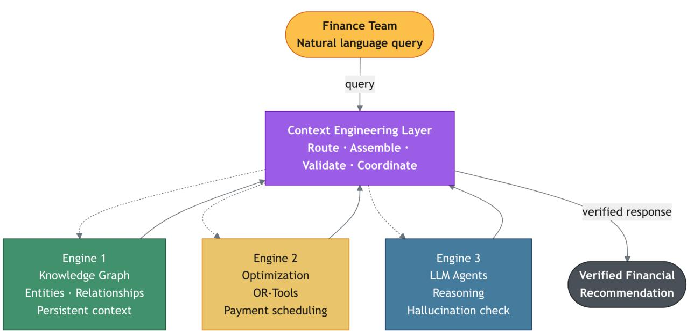
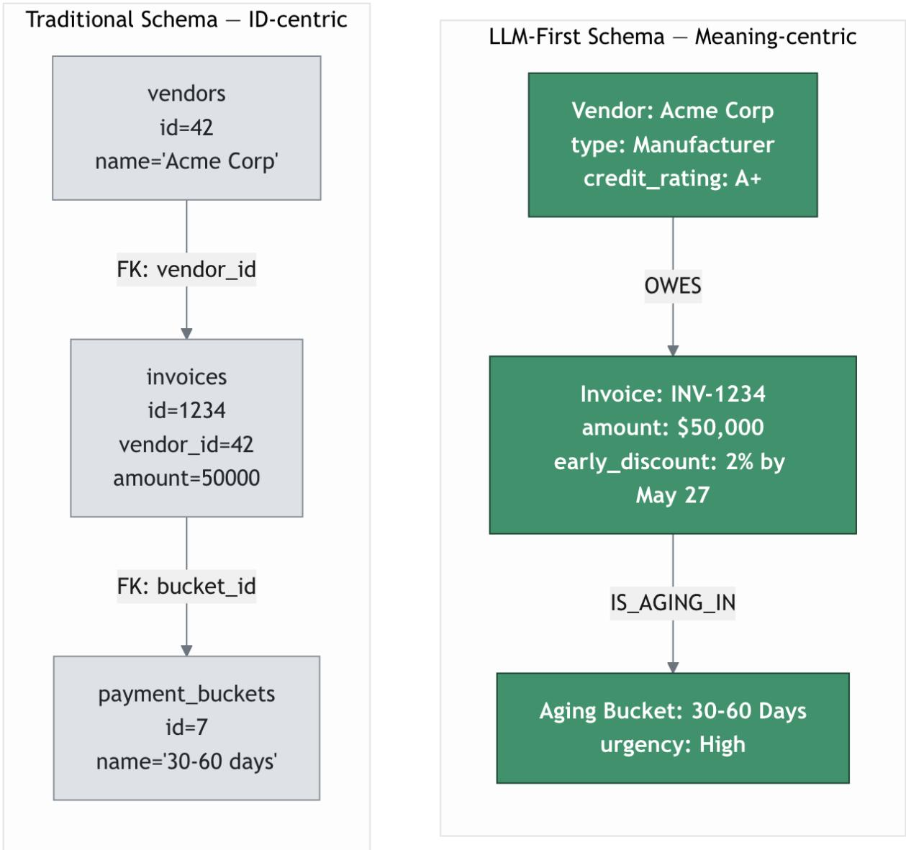
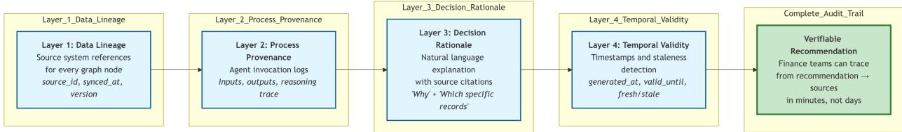
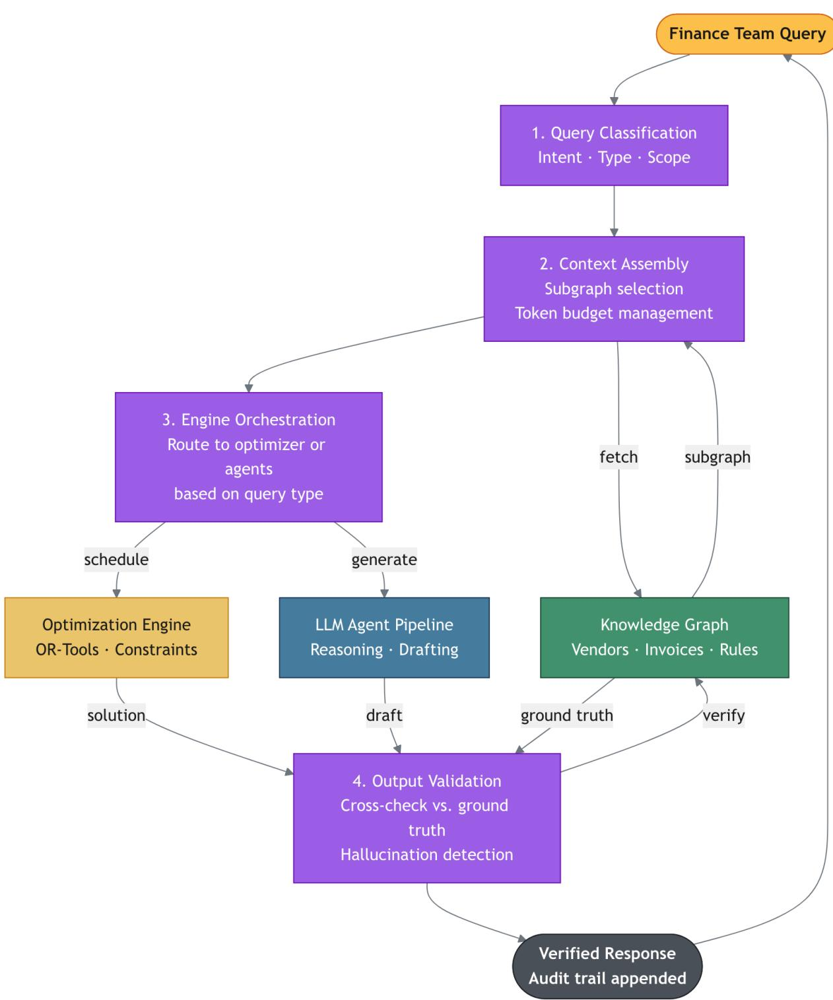
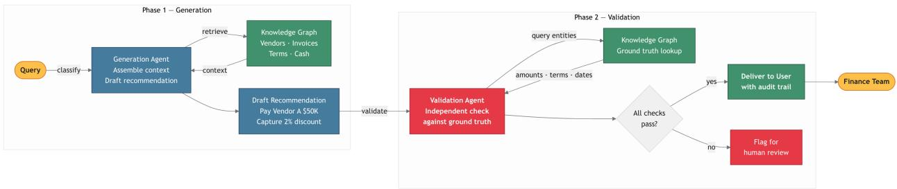
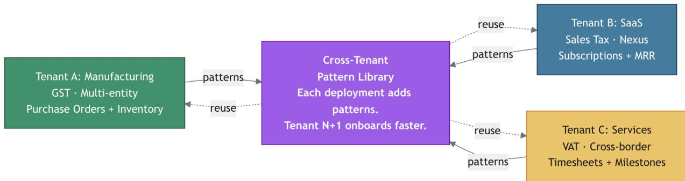

# Beyond LLM Wrappers: Context Engineering and the Three-Engine Architecture for Reliable Financial AI

Pradeep Kumar GS Finteract AI pradeep.kumar@finteract.ai

Ravi Tanniru Finteract AI ravi.tanniru@finteract.ai

June 2026

## Abstract

Financial AI systems are increasingly expected to answer operational questions that are not merely informational, but decision-bearing: which vendors should be paid this week, which customers should be escalated for collection, which invoices are exposed to tax risk, what cash position is likely under a delayed-receivables scenario, and why a working-capital metric changed. These questions require natural language interaction, but they also require deterministic computation, persistent business context, source traceability, and auditable recommendations. A large language model (LLM) by itself cannot satisfy those requirements. It can interpret language and produce explanations, but it does not provide a reliable memory of financial relationships, does not guarantee reproducible calculations, and can generate plausible but unsupported claims. Conversely, knowledge graphs, optimization solvers, and rules engines each provide important capabilities, but none provides the complete user-facing experience required by finance teams.

This paper presents a production-grounded architecture for reliable financial AI based on three engines: a financial knowledge graph, a deterministic optimization engine, and a multi-agent LLM layer. The knowledge graph stores enterprise financial context, relationships, provenance, and temporal state. The optimization engine performs reproducible calculations for payment scheduling, cash allocation, vendor prioritization, discount capture, and similar decision tasks. The multi-agent LLM layer interprets user intent, formulates tasks, assembles explanations, and validates generated claims against structured ground truth. The central contribution is not merely the use of these engines, but the coordination layer that connects them. We call this layer context engineering: the process of selecting, ranking, composing, validating, and budgeting the context required for each financial query across heterogeneous data sources, tools, tenants, and decision objectives.

Drawing from 15 production deployments over approximately 11 months, this paper reports several observations. First, single-agent LLM pipelines produced unacceptable hallucination rates (approximately 7–9%, ranging 5–10% by query type) for financial recommendations, including fabricated invoices, invented discounts, incorrect totals, and unsupported vendor claims. Second, graph-backed multi-agent validation reduced observed hallucinations to below 1% in production usage, although the evidence is observational rather than randomized. Third, ERP data quality and tenant heterogeneity dominated implementation efort: inconsistent vendor names, missing fields, duplicate entities, free-text terms, and industry-specific schemas required substantial normalization before AI reasoning could be trusted. Fourth, deployment time fell from roughly six weeks

to approximately two weeks as reusable ERP mappings, graph templates, validation patterns, and compliance-specific context policies accumulated.

The paper argues that financial context engineering is distinct from standard retrieval-augmented generation. Financial systems must retrieve structured relationships rather than only text chunks, respect temporal validity, include exact numerical evidence, enforce access control, adapt to tenantspecific schemas, and validate claims against source records and solver outputs. We position context engineering as a research problem for high-stakes structured domains and identify open problems in evaluation, reproducibility, privacy, benchmark design, context quality metrics, and cross-tenant pattern learning.

Keywords: financial AI, context engineering, knowledge graphs, multi-agent systems, deterministic optimization, audit trails, retrieval-augmented generation, working capital, ERP integration

## 1. Introduction

Finance work is full of questions that look simple in natural language and complex in execution. A controller may ask, “Which vendors should we prioritize for payment this week?” A CFO may ask, “What happens to cash if our largest customer delays payment by ten days?” An accounts payable manager may ask, “Why did aging in the 60-day bucket increase this month?” A tax reviewer may ask, “Which invoices are exposed to GST mismatch risk?” Each question requires a fluent answer, but the answer is only useful if it is grounded in source records, reflects current financial state, respects business constraints, and can be audited after the decision is made.

This is the core dificulty for financial AI. The interface problem and the reasoning problem are diferent. Natural language is the desired interface because finance users should not need to write SQL, Cypher, optimization code, or ERP-specific queries. Yet the underlying decision must be derived from invoices, payments, contracts, tax codes, bank balances, purchase orders, customer terms, vendor relationships, and historical behavior. The system must map a conversational question to structured evidence, perform deterministic calculations where necessary, explain the result in business terms, and preserve a trace that another person can inspect.

LLMs are strong at language understanding, summarization, and interactive explanation, but financial AI cannot be built as a thin wrapper around an LLM. The discount must actually exist. The cash position must come from a source system. Calculations must be reproducible. In financial systems, a hallucination has operational shape—a nonexistent invoice number, an invented payment term, a misidentified vendor, or a recommendation that violates a cash constraint—and a response that is 95% correct may still be unacceptable if the remaining 5% contains the vendor, amount, or date that drives the decision. Traditional deterministic systems—ERP reports, rules engines, optimization solvers—face the opposite limitation: exact but rigid, requiring users to know where to look and how to interpret exceptions. The problem is not choosing one engine. The problem is composing engines so that each performs the role for which it is suited.

This paper proposes a three-engine architecture for reliable financial AI. The first engine is a financial knowledge graph. It functions as enterprise memory: a structured, temporal, provenancebearing representation of financial entities and relationships. The second engine is a deterministic optimization layer. It performs calculations and constrained decision-making for payment schedules, cash allocation, discount capture, collections prioritization, and similar tasks. The third engine is a multi-agent LLM layer. It handles language, intent, task formulation, explanation, and validation orchestration. These engines are coordinated by context engineering, a layer that determines what evidence, graph substructures, solver outputs, tenant settings, and validation checks should be assembled for each query.

The term context engineering is used deliberately. Standard retrieval-augmented generation (RAG) generally retrieves text chunks that are semantically similar to a question and supplies them to a model. Financial AI needs more than similarity. It needs structured traversal, entity resolution, temporal filtering, context budgeting, validation, tenant-specific interpretation, and deterministic tool invocation. If a user asks whether to pay Vendor A now or next week, the relevant context may include unpaid invoices, cash balances, discount windows, vendor criticality, tax obligations, purchase order status, historical payment behavior, and policy constraints. Some of that context is text, some is structured data, some is computed output, and some is a validation trace. Context engineering is the process of turning that heterogeneous evidence into the right model input and the right audit output.

The production motivation for this work comes from 15 production deployments spanning approximately 11 months. The deployed settings span manufacturing, SaaS, services, e-commerce, and trading businesses, with ERP integrations including Zoho, Tally, QuickBooks, and Acumatica. These environments are messy in ways that matter: vendor names are inconsistent, payment terms are free text, source records are incomplete, tenant definitions vary by industry, and financial work flows mix deterministic rules with judgment. These deployments showed that the most dificult part of financial AI was not prompting a model. It was constructing enough trusted context for the model, solver, and graph to work together.

The framing is intentionally operational rather than speculative. Many discussions of AI in finance focus on model capability: whether an LLM can read a statement, summarize a filing, or answer questions about a policy document. Those tasks matter, but they do not capture the pressure of day-to-day finance operations. Operational finance decisions are time-sensitive, cross-system, and consequence-bearing. A delayed payment can damage a supplier relationship. A missed discount can create measurable cash leakage. A wrong tax classification can trigger review. A stale receivables assumption can distort a cash forecast. For these tasks, the system must know not only what words mean, but what records are current, which constraints bind, which exceptions matter, and how to justify a recommendation after the fact.

This paper therefore treats financial AI as decision infrastructure. The unit of analysis is not a prompt-response pair. It is the full path from user intent to source records, context assembly, deterministic computation, validation, explanation, and audit. That path determines whether an AI system is usable by finance teams. A model may be powerful, but if it receives stale context, it will produce stale answers. A graph may be complete, but if the system retrieves the wrong subgraph, the answer will omit critical constraints. A solver may be exact, but if the LLM formulates the wrong objective, the result will optimize the wrong business problem. Context engineering is the discipline that makes these dependencies explicit.

Section 2 analyzes the requirements for reliable financial AI. Section 3 describes the three-engine architecture. Section 4 defines context engineering and explains why it difers from standard RAG. Section 5 discusses integration challenges. Section 6 summarizes production deployment observations. Section 7 positions the work relative to LLMs, knowledge graphs, optimization, multi-agent systems, and RAG. Section 8 presents limitations. Section 9 concludes with open research directions.

## 2. Requirements Analysis

Financial AI systems must satisfy four requirements simultaneously. The requirements are individually familiar, but their combination is what makes the domain dificult. A system that satisfies only one or two of them may be useful as a report generator, chatbot, or analytics assistant, but not as a trustworthy decision-support system for finance operations.

The first requirement is contextual reasoning over relationships. Financial decisions rarely depend on isolated rows. A vendor payment decision may depend on the vendor’s unpaid invoices, payment history, early-payment discounts, purchase order status, supplier criticality, contract clauses, parent subsidiary relationships, cash position, tax exposure, and operational impact. A collections decision may depend on customer aging, communication history, promised payment dates, service delivery status, credit terms, dispute status, and relationship value. A tax risk decision may depend on invoice classification, jurisdiction, filing period, document completeness, and reconciliation against ERP records. These are graph-shaped problems even when the source data lives in tables.

Relational databases can store these facts, but relationship reasoning requires the system to know which relationships matter for each query. A user asking “Why is Vendor X blocked?” may need a path from vendor to unpaid invoice to purchase order to goods receipt to dispute record. A user asking “Why did cash conversion worsen?” may need paths across receivables, inventory, payables, and revenue recognition. A user asking “Which customers should we call today?” may need customer hierarchy, overdue exposure, promised payments, and strategic account flags. A flat text retrieval system may find documents that mention the right vendor, but it does not necessarily assemble the relationship path that explains the decision.

The second requirement is deterministic computation. Many finance questions require exact arithmetic or constrained optimization. Payment scheduling requires deciding which invoices to pay under cash limits, due dates, discounts, vendor criticality, and policy constraints. Cash allocation requires choosing how to distribute limited funds across obligations. Working-capital planning requires projecting cash inflows and outflows under assumptions. Tax review requires applying rules to amounts, dates, and jurisdictions. These tasks cannot be delegated to a probabilistic text generator as the final computational authority. Given the same inputs, solver formulation, and data snapshot, the result should be reproducible.

Determinism matters for trust, regression testing, audit, and operational repeatability. A CFO cannot approve a payment recommendation if rerunning the same query produces a diferent schedule without a data change. A controller cannot investigate a disputed recommendation if the system cannot reconstruct the exact calculation. Engineers cannot test financial AI reliably if outputs vary because arithmetic is embedded in model generation rather than executed by deterministic components. This does not mean every part of the system must be deterministic. Natural language interpretation can involve probabilistic models. But the numerical core of financial decisions must be handled by deterministic tools.

The third requirement is natural language interaction. Finance teams do not want to operate AI systems by writing graph queries, solver formulations, or ERP-specific scripts. They want to ask business questions. A natural language interface is not a cosmetic layer; it changes who can use advanced analysis. The accounts payable manager should be able to ask, “What should we pay today if we hold back 20% cash for payroll?” The CFO should be able to ask, “What are the top three drivers of the cash shortfall next week?” A tax analyst should be able to ask, “Which invoices need review before filing?” The system must translate these questions into the right combination of retrieval, computation, validation, and explanation.

Natural language also matters for explanations. Finance decisions are collaborative. Recommendations must be presented in language that users can challenge: “Vendor A is prioritized because three invoices totaling 48,000 are due this week, a 2% discount expires tomorrow, and the vendor supplies a critical component. Vendor B is deferred because its invoices are not yet due and no discount is active.” Such explanations are not just summaries. They are the bridge between computation and decision accountability.

The fourth requirement is auditability. Financial systems must preserve data lineage, process provenance, decision rationale, and temporal validity. Data lineage answers where a fact came from: ERP source, record identifier, synchronization timestamp, transformation version, and entity-resolution rule. Process provenance answers how the system moved from user query to context retrieval, solver invocation, validation, and response. Decision rationale explains why the recommendation follows from evidence and constraints. Temporal validity ensures that the answer was correct for the relevant time window and data snapshot.

Auditability is not optional in finance. It is needed for compliance, internal controls, user trust, dispute resolution, and model governance. If a system recommends delaying a payment, the organization may need to explain the recommendation later. If it identifies a tax exposure, a reviewer may need to inspect the supporting records. If it prioritizes one vendor over another, procurement and operations teams may need to understand the trade-of. A financial AI answer without an audit trail is a liability.

The key observation is that current engine types satisfy these requirements only partially. LLMs provide language understanding and explanation, but are probabilistic and lack a native persistent representation of enterprise state. Knowledge graphs provide structured context and relationship traversal, but do not by themselves optimize decisions or converse naturally. Optimization engines provide deterministic outputs, but require precise inputs and cannot infer business intent from ordinary language. Rules-based systems provide repeatability and explicit logic, but become brittle as tenants, industries, compliance regimes, and exceptions multiply.

This requirement analysis explains why single-engine approaches fail. An LLM-only assistant can answer fluently but may hallucinate facts or calculations. A graph-only system can retrieve relationships but may require technical queries and lacks optimization. A solver-only workflow can compute a schedule but cannot discover the right context or explain the answer conversationally. A rules-only workflow can automate known cases but struggles with novel combinations of constraints and business context. Reliable financial AI requires a composition of engines, each constrained to the tasks it can perform reliably.

The requirements also create design principles. First, source truth must live outside the LLM in structured systems. Second, arithmetic and optimization must be delegated to deterministic engines. Third, LLMs should be used for interpretation, orchestration, and explanation, not as the source of financial facts. Fourth, every answer should be validatable against graph records, solver outputs, and logs. Fifth, context assembly should be treated as a first-class engineering problem rather than an incidental prompt construction step.

These principles lead directly to the three-engine architecture described in the next section.

Table 1: Capability matrix: no single engine type satisfies all financial AI requirements simultaneously. The three-engine architecture combines the complementary strengths of all three.
<table><tr><td>Engine / System</td><td>Reasoning</td><td>Contextual Deterministic Math</td><td>Persistent Context</td><td>Natural Language</td></tr><tr><td>LLM alone</td><td>√</td><td>×</td><td>X</td><td>V</td></tr><tr><td>Knowledge graph alone</td><td>X</td><td>X</td><td>√</td><td>X</td></tr><tr><td>Optimization solver alone</td><td>X</td><td>√</td><td>X</td><td>X</td></tr><tr><td>Rules-based system</td><td>X</td><td>√</td><td>X</td><td>X</td></tr><tr><td>Three-engine architecture</td><td>√</td><td>√</td><td>V</td><td>√</td></tr></table>

  
Figure 1: Three-engine architecture for reliable financial AI. Knowledge graphs provide persistent context, optimization engines provide deterministic computation, and LLM agents provide query understanding and explanation. The context engineering layer coordinates engine invocation, context assembly, validation, and response composition.

## 3. Three-Engine Architecture

The proposed architecture combines three specialized engines with a coordination layer. The engines are not interchangeable. Each has a distinct role that maps to the requirements in Section 2. The knowledge graph provides contextual reasoning and audit lineage. The optimization engine provides deterministic calculation. The multi-agent LLM layer provides natural language interaction, task formulation, explanation, and validation orchestration. Context engineering coordinates the engines.

The first engine is a financial knowledge graph. Its purpose is to represent the enterprise’s financial world as connected entities and relationships. Typical nodes include organizations, legal entities, business units, vendors, customers, invoices, payments, purchase orders, contracts, tax obligations, bank accounts, journal entries, and users. Typical relationships include “issued by,” “owed to,” “paid by,” “matched to,” “governed by,” “belongs to entity,” “has tax code,” “depends on,” and “part of customer group.” Each node and relationship carries properties, timestamps, source metadata, and transformation history.

The graph provides three capabilities that are dificult to obtain from isolated tables or documents. First, it supports multi-hop reasoning. A question about a payment can traverse from vendor to invoice to purchase order to goods receipt to dispute status. Second, it supports temporal context. Historical invoice states, aging transitions, payment behavior, and synchronization timestamps can be represented and queried. Third, it supports source attribution. A retrieved fact can carry ERP system, source record ID, sync time, version, and normalization rule.

Graph design must be LLM-aware. Traditional enterprise schemas often optimize for storage eficiency, transaction processing, or formal ontology coverage. An LLM-facing graph needs property names, relationship labels, summaries, and hierarchy that are readable by agents. For example, a relationship called HAS\_OPEN\_INVOICE is more useful for context assembly than a cryptic join table name. A vendor node that includes normalized name, aliases, criticality, payment behavior summary, and source identifiers is more useful than a sparse record that requires many additional joins. The graph is not simply a database; it is a context substrate for reasoning agents.

The second engine is a deterministic optimization layer. Financial operations contain many constrained decisions. A payment schedule may maximize discount capture and vendor reliability subject to cash availability, due dates, payroll reserve, tax obligations, strategic supplier constraints, and policy rules. A collections prioritization model may rank customers by overdue amount, likelihood of recovery, account importance, dispute status, and collector capacity. A cash-flow scenario may allocate expected inflows to obligations while preserving minimum liquidity. These are not text-generation tasks. They are optimization tasks.

The optimization engine accepts structured inputs from the graph and tenant configuration, constructs decision variables, objective functions, and constraints, and returns reproducible results. The solver may be OR-Tools, Gurobi, CPLEX, or another deterministic solver depending on problem scale and licensing. In the deployments described in this paper, OR-Tools serves as the primary optimization engine. The architecture does not claim novelty in optimization algorithms. The contribution is the integration pattern: the LLM layer helps identify the problem and explain the result; the graph supplies structured facts; the solver computes the answer. LLMs decide what should be computed; deterministic engines compute it.

This separation reduces a major class of errors. In an LLM-only system, a model may infer a payment recommendation and calculate totals in generated text. In the three-engine architecture, the model may classify the request as payment optimization, identify relevant constraints, and ask the solver to schedule payments. The solver output becomes a structured artifact. The response agent explains the solver output, and the validation agent checks that the explanation matches the graph and solver result. The recommendation is therefore grounded in computation rather than prose.

  
Figure 2: LLM-first knowledge graph schema principles for financial AI: descriptive properties, hierarchical structures, and business-meaningful relationships.

The third engine is a multi-agent LLM layer. A single agent that retrieves data, reasons, calculates, drafts, and validates is dificult to control. The architecture instead separates responsibilities across specialized agents. A query analysis agent classifies intent, identifies entities, detects implicit time windows, and decides which engines are required. A context assembly agent retrieves graph context, selects traversal depth, applies filters, and prepares model-readable evidence. An optimization invocation agent formulates solver inputs when the query requires computation. A response generation agent produces the user-facing explanation. A validation agent checks claims against structured ground truth before the response is returned.

This multi-agent structure matters because financial validation is not the same as asking anothe model whether an answer sounds correct. Validation must compare generated claims to source records and solver outputs. If the response says that Vendor A has 50,000 outstanding, the validation agent should verify that Vendor A exists, that the selected invoices total 50,000, that the invoices are open, that the amounts are current for the relevant snapshot, and that any cited discount terms exist. If the response says that paying Vendor A improves discount capture by 1,000, the validation agent should verify that the solver output supports that claim. Unsupported claims should be removed, revised, or escalated for human review.

  
Figure 3: Four-layer audit trail architecture: data lineage, process provenance, decision rationale, and temporal validity.

Auditability is built across all three engines. The graph records data lineage. Solver runs record the problem formulation, input snapshot, parameters, objective, constraints, and output. Agent logs record query classification, context selection, tool calls, validation failures, and final response. A complete audit trail for a payment recommendation may include the user query, detected time window, invoices retrieved, cash balance source, tenant policy, solver formulation, selected payment schedule, validation checks, and response citations. This layered audit trail is necessary for finance users to trust and challenge the system.

The architecture also supports historical queries. Because the graph persists historical transaction state, users can ask questions about trends, causes, and previous decisions. “Why did aging worsen in March?” is not a current-state lookup. It requires comparing aging buckets over time, identifying invoices that moved between buckets, checking payment delays, and connecting changes to customers, disputes, or operational events. A snapshot-only architecture cannot answer this well. A temporal graph can supply the evidence, and LLM agents can assemble a narrative explanation validated against historical records.

The coordination challenge is where the system becomes dificult. The architecture has multiple engines, but a user does not ask, “Please traverse the graph to depth three, then run an integer program, then validate output fields.” The user asks a business question. The system must determine whether the question is a lookup, explanation, analysis, optimization, scenario, or hybrid. It must decide which subgraph to retrieve, how much history to include, when to invoke the solver, which tenant rules apply, and how to allocate context window budget. These decisions are context engineering decisions.

In practice, the coordination layer performs several functions. It classifies queries. It maps natural language entities to graph entities. It selects graph traversal strategies. It applies temporal and access filters. It chooses whether deterministic computation is required. It prepares solver inputs. It allocates context across retrieved evidence, calculations, validation traces, and response templates. It routes outputs to validation. It preserves audit records. Without this layer, the three engines are merely tools. With it, they become a coherent financial AI system.

The architecture is intentionally model-agnostic. It does not depend on a specific LLM vendor or model generation. The production deployments described in this paper primarily use Gemini as the LLM provider; the architecture has also been evaluated against other open-source models. The model-agnostic claim is supported by the fact that neither correctness of financial facts nor reproducibility of calculations depends on model behavior—those properties are enforced by the graph, solver, and validation layer. Better models may improve query interpretation and explanation quality, but they do not remove the need for structured source truth, deterministic computation, validation, and audit trails. This point is important because model capabilities are improving rapidly. A robust architecture should benefit from stronger models without becoming dependent on model behavior for facts or arithmetic.

The architecture is also ERP-agnostic in principle. ERP integrations normalize source records into graph abstractions. Tenants difer in chart-of-account conventions, vendor naming practices, tax regimes, document completeness, and workflow policies. The graph and context templates absorb those diferences so that the reasoning layer can operate over a consistent conceptual model while preserving source provenance. This approach does not eliminate integration work, but it makes cross-tenant learning possible.

An end-to-end flow clarifies the architecture. A user asks, “Can we pay the critical vendors due this week without touching payroll reserve?” The query analysis agent classifies the query as a constrained payment optimization request. It extracts the time window, recognizes “critical vendors” as a tenant-specific policy category, and identifies “payroll reserve” as a liquidity constraint. The context assembly agent retrieves open invoices due this week, vendor criticality scores, discount windows, bank balances, payroll reserve policy, tax obligations, and recent payment holds. The optimization invocation agent constructs variables for invoice payment decisions, constraints for available cash and reserve preservation, and an objective that balances overdue risk, discount capture, and vendor criticality. The solver returns a feasible schedule or explains infeasibility. The response agent turns the schedule into a business explanation. The validation agent checks that every amount, vendor, invoice, due date, and constraint in the explanation is supported by the graph or solver output.

This flow makes two design choices visible. First, the LLM layer is allowed to interpret intent and translate between human language and system operations, but it is not allowed to invent the financial state. Second, the output is not treated as complete until it has passed validation. The architecture therefore converts an unconstrained language model into a controlled participant in a larger system. The model remains useful because it can understand the user’s question and produce a clear explanation; it becomes safer because facts and calculations are externalized.

The architecture also supports progressive disclosure. Not every user needs the full audit trace in the first response. A controller may want a concise answer, while an auditor may want record-level evidence. The system can present a recommendation with summarized rationale and allow drilldown into source invoices, solver assumptions, validation checks, and ERP sync metadata. This is important for usability. Auditability should be available without overwhelming routine users. The graph and logs preserve the evidence; the LLM layer can expose the right level of detail for the user and workflow.

The next section focuses on the coordination layer itself. Context engineering is the least standardized part of the architecture and the part most responsible for whether the system behaves like a trustworthy financial assistant or a fluent but unsafe chatbot.

## 4. Context Engineering

Context engineering is the central concept of this paper. We characterize financial context engineering as the process of selecting, ranking, composing, validating, and budgeting the information required for a financial AI system to answer a query accurately, deterministically where needed, and with traceability to source records. More precisely: given a user query, a tenant configuration, a financial knowledge graph, available computational engines, applicable policy constraints, and a context window budget, the context engineering layer produces a context package and execution plan that maximize decision-relevant information subject to accuracy, completeness, recency, access-control, and budget constraints. This characterization captures the multi-dimensional nature of the problem. A rigorous optimization formulation would require defining relevance functions and feasibility constraints that vary by tenant, query type, and data state—an open research problem we discuss in Section 8.

This definition intentionally includes more than retrieval. A context package may include graph records, relationship paths, aggregate metrics, historical snapshots, source citations, solver outputs, tenant policy parameters, validation results, and response constraints. An execution plan may specify that the system should first resolve entities, then retrieve open invoices, then run an optimization model, then validate the generated explanation against selected invoices and solver results. Context engineering is therefore both data selection and workflow selection.

The term context engineering has appeared in prior AI systems literature, primarily in discussions of agent design, prompt construction, and context window management. Our usage builds on that framing but applies it in a domain-specific sense. In financial AI, context engineering is specifically concerned with structured relationship retrieval over multi-tenant graphs, temporal validity enforcement, deterministic computation grounding, access-controlled evidence assembly, and audit-trail preservation. This domain specificity—driven by requirements for determinism, multi-tenant heterogeneity, and regulatory auditability—distinguishes financial context engineering from general context management in language model applications.

The distinction from standard RAG is fundamental. RAG systems usually retrieve text chunks based on semantic similarity to a query. This is useful for many knowledge tasks, but financial decision tasks require structured relevance. A semantically similar invoice is not relevant if it is already paid, belongs to another legal entity, falls outside the time window, or is inaccessible to the user. A small invoice with a discount expiring tomorrow may be more decision-relevant than a large invoice that is not yet due. A vendor relationship may matter because of criticality rather than textual similarity. Relevance is multi-dimensional: amount, urgency, compliance risk, relationship importance, operational dependency, temporal state, and policy priority.

  
Figure 4: Context engineering framework for financial AI. The coordination layer classifies queries, assembles graph context, orchestrates agents and deterministic engines, validates outputs, and manages context budgets.

Context engineering begins with query understanding. The system must determine what type of question has been asked. Lookup queries request facts: “What is outstanding for Vendor X?” Explanation queries ask why something happened: “Why did aging increase?” Optimization queries ask what action to take under constraints: “Which invoices should we pay with 200,000 available cash?” Scenario queries ask what changes under assumptions: “What if Customer Y pays ten days late?” Hybrid queries combine several types: “Which vendors should we pay first and why?” Correct classification determines engine routing. A lookup may require graph traversal only. An optimization query requires graph retrieval plus solver invocation. A scenario may require historical context, assumptions, and recalculation.

Entity resolution is the next challenge. Finance data contains aliases, abbreviations, spelling differences, merged vendors, subsidiaries, and reused names. A user may say “ABC Supplies” while the ERP contains “A.B.C. Industrial Supply Pvt Ltd” and the payment system contains “ABC Ind Supplies.” The context layer must resolve the intended entity and preserve uncertainty when resolution is ambiguous. It should not silently choose the wrong vendor. Entity resolution must also respect tenant scope and access control. A user in one entity should not receive data from another legal entity unless authorized.

Subgraph selection determines which relationships to include. Too little context causes omissions; too much context consumes model budget and increases distraction. For vendor payment, useful subgraphs may include open invoices, payment terms, discount windows, purchase orders, goods receipts, dispute flags, vendor criticality, payment history, and cash constraints. For customer collections, useful subgraphs may include aging, communications, dispute status, promised payment dates, account value, service delivery, and credit limits. For tax review, useful subgraphs may include invoice classifications, tax codes, jurisdiction, filing period, reconciliation status, and document completeness. Each query requires a diferent traversal pattern.

Temporal filtering is essential. Financial facts are time-bound. An invoice that was open last week may be paid today. A discount window may have expired. A tax rate may have changed. A cash balance may be a snapshot from yesterday’s bank sync. Context engineering must attach temporal validity to retrieved facts and ensure that the response reflects the relevant time window. A question about “this week” needs current obligations and expected cash flows. A question about “why did March aging worsen” needs historical state from March and comparison periods. Without temporal discipline, the system may mix facts from diferent states and produce incorrect explanations.

Tenant adaptation is another defining challenge. The same phrase can mean diferent things across industries and organizations. “Outstanding liability” in a manufacturing tenant may require purchase orders, goods receipts, inventory status, supplier invoices, taxes, and accruals. In a SaaS tenant it may require subscriptions, deferred revenue, receivables, churn risk, and customer contracts. In a services tenant it may require projects, milestones, timesheets, retainers, and unbilled work. In a trading business it may require inventory financing, supplier credit, customer advances, and currency exposure. Context templates therefore need industry and tenant parameters. A universal prompt cannot encode all these distinctions reliably.

Budget management is a practical constraint. Even large context windows are finite, and more context is not always better. Context engineering must allocate space among user query, resolved entities, graph facts, historical summaries, solver inputs, solver outputs, validation evidence, policy constraints, and response instructions. The context should be suficient and minimal. Suficient means the answer has the evidence needed to be accurate and auditable. Minimal means irrelevant facts are excluded so the model is less likely to attend to noise. This creates a resource allocation problem similar in spirit to optimization: choose the most decision-relevant context under a fixed budget.

  
Figure 5: Multi-agent validation pattern. Separate agents cross-check LLM outputs against graph ground truth and deterministic solver results before responses reach finance users.

Validation closes the loop. A response should not be returned merely because it is fluent. Claims must be checked. Entity claims should map to graph entities. Numerical claims should match source records or solver outputs. Temporal claims should be valid for the stated period. Feasibility claims should respect constraints. Source citations should point to records that support the statement. Unsupported claims should be rejected. If validation fails, the system may revise the response, retrieve additional context, ask a clarification question, or route the case for human review.

An example illustrates the full flow. Suppose a user asks, “Which vendors should we prioritize for payment this week if we keep 100,000 reserved for payroll?” Query understanding classifies the request as payment optimization with an explicit cash reserve. Entity scope identifies the relevant legal entities and bank accounts. Subgraph selection retrieves open vendor invoices, due dates, terms, discounts, vendor criticality, purchase order status, tax obligations, and current cash balance. Temporal filtering ensures invoices and cash balances are current. Tenant policy adds constraints such as mandatory payroll reserve, strategic supplier priority, and tax-payment deadlines. The optimization engine computes a schedule. The response agent explains the recommendation. The validation agent checks that every cited vendor, invoice, amount, discount, and constraint appears in the graph or solver output. The audit trail records the full chain.

This example also shows why context engineering is not a prompt trick. It is a system function that touches data modeling, retrieval, optimization, validation, access control, and user experience. It requires domain knowledge because the system must know which facts matter for which financial decisions. It requires engineering discipline because the context package must be reproducible and testable. It requires evaluation methods because the field needs to measure not only answer quality, but context quality.

Several open problems follow. How should context suficiency be measured? How should systems detect missing critical context before generating an answer? How should context policies adapt across tenants without leaking data? How should context selection be benchmarked when production financial data is private? How should graph traversal depth be optimized for accuracy and cost? How should validation failures be categorized and learned from? These questions are central to making financial AI reliable.

The production deployments discussed later suggest that context engineering becomes a reusable asset. Tenant-specific mappings, industry templates, validation checks, and traversal patterns accumulate over time. This accumulation explains why deployment time decreased across later tenants. The architecture does not become efortless, but repeated patterns become codified. Context engineering, in this sense, is both a runtime function and an organizational learning process.

A useful benchmark for context engineering would separate at least four layers. The first layer would test entity and relationship retrieval: given a query and a graph, did the system retrieve the records that a financial expert would need? The second layer would test execution planning: did the system choose graph lookup, deterministic calculation, optimization, scenario replay, or human escalation correctly? The third layer would test claim grounding: does each statement in the final answer map to a source record, solver output, or explicit assumption? The fourth layer would test context economy: did the system answer with the smallest suficient context, or did it depend on large, noisy context dumps? Such benchmarks would move the field away from surface-level answer grading and toward the actual reliability problem.

## 5. Integration Challenges

The three-engine architecture creates a powerful division of labor, but integration is dificult. The main challenges are boundary setting, validation, tenant adaptation, reproducibility, and modelagnostic design.

The first challenge is drawing a boundary between reasoning and computation. LLMs are useful for interpreting language, detecting intent, identifying relevant entities, proposing problem structure, and explaining trade-ofs. They are not reliable as the final authority for arithmetic or optimization. The practical rule is simple: keep arithmetic and optimization out of the language model and in deterministic engines. This boundary must be enforced in code, not only in prompting. If a response contains a total, the total should come from a calculation or source record. If a response recommends a schedule, the schedule should come from the optimization engine. If a response cites a discount, the discount should come from the graph.

The second challenge is validation. Early single-agent prototypes exposed the risk clearly. A single agent could produce a plausible recommendation that referenced a nonexistent invoice, attributed a discount to the wrong vendor, summed invoices incorrectly, or suggested a payment that violated a cash constraint. The answer sounded credible because it used finance language, but it was not grounded. Multi-agent validation reduces this risk by separating generation from checking. The generation agent drafts an explanation; the validation agent compares claims against graph records and solver outputs. The output is only safe if the validation layer has authority to block or revise unsupported claims.

Validation must be specific. Entity validation checks whether named vendors, customers, invoices, and accounts exist in the graph and match the intended tenant. Numerical validation checks totals, dates, percentages, balances, and calculated metrics. Temporal validation checks whether the facts were current for the stated period. Constraint validation checks whether recommendations respect cash limits, due dates, reserves, tax deadlines, and policy rules. Source validation checks whether cited records support the text. Feasibility validation checks whether the recommended action can actually be executed in the financial workflow. A general “does this look right?” model critique is not enough.

The third challenge is tenant adaptation. Tenants difer at schema, template, and instance levels. Schema diferences include industry-specific entities and relationships. A manufacturing tenant may need purchase orders, goods receipts, inventory, supplier criticality, and production dependencies.

A SaaS tenant may need subscriptions, deferred revenue, churn risk, and recurring receivables. A services tenant may need project milestones, timesheets, retentions, and unbilled work. Template diferences include compliance regimes such as GST, VAT, sales tax, and local filing calendars. Instance diferences include chart-of-account conventions, payment policies, approval thresholds, naming practices, and historical behavior.

Tenant adaptation creates a tension between reuse and customization. A fully custom implementation for every tenant is slow and expensive. A fully generic implementation is shallow and often wrong. The production pattern is parameterized reuse: common graph primitives, common ERP mappings, common validation checks, and common agent workflows, with tenant-specific context templates and policy parameters. Over time, these templates become more precise. Deployment time falls because the system learns reusable patterns, but each tenant still requires data-quality work and policy calibration.

The fourth challenge is reproducibility. Financial AI outputs can change because source data changes, graph mappings change, tenant policies change, solver versions change, prompt templates change, or model versions change. Some change is correct: if an invoice is paid, the answer should update. But uncontrolled change undermines trust. The architecture therefore needs versioned templates, graph snapshots or synchronization timestamps, solver configuration logs, model identifiers, prompt versions, and validation traces. Reproducibility is defined relative to fixed data, fixed templates, fixed solver settings, and fixed model versions. Without these controls, users cannot distinguish legitimate updates from system drift.

The fifth challenge is model-agnostic design. Model capabilities will improve. Future LLMs may classify queries better, follow tool contracts more reliably, and generate clearer explanations. But financial requirements will not disappear. A better model still needs source truth. It still should not invent invoices. It still should not perform final payment optimization in prose. It still needs audit trails and access control. The architecture should use models where they add value while constraining them away from roles where deterministic systems are superior.

Integration also creates operational challenges. Latency must be managed because graph traversal, solver invocation, validation, and generation can be expensive. Error handling must be explicit because each engine can fail diferently: ERP sync may be stale, graph resolution may be ambiguous, solver may find no feasible solution, validation may reject a claim, or the model may produce an incomplete explanation. The system needs fallback behaviors. It may ask the user for clarification, return a partial answer with caveats, escalate to human review, or provide a diagnostic explanation of why no recommendation can be made.

Security and privacy must be integrated into context assembly. Context should be filtered by user permission before it reaches the model. Multi-tenant deployments must prevent cross-tenant leakage. Audit logs may contain sensitive information and need retention policies, encryption, and access controls. Context engineering cannot be separated from security because the selected context is exactly what the model sees and what the logs preserve.

Finally, integration requires product discipline. Finance users need answers that are actionable, not merely technically correct. A payment recommendation should include the recommended action, rationale, constraints, expected benefit, risks, and source links. A cash-flow explanation should identify drivers, quantify impact, and separate facts from assumptions. A tax-risk review should identify records requiring human attention. The architecture must therefore connect technical grounding to usable workflows.

The central integration lesson is that reliability emerges from explicit responsibility boundaries. When engine roles blur, hallucination and audit risk increase. When they are enforced, the system becomes easier to test, debug, and trust.

Another integration challenge is failure communication. In many software systems, failure can be expressed as an error code. In financial AI, a failed recommendation often still contains useful information. If a solver finds no feasible payment schedule under the requested cash reserve, the system should explain which constraints make the request infeasible and what alternatives are available. If entity resolution is ambiguous, the system should show the candidate vendors and ask the user to choose. If ERP sync is stale, the system should state the last synchronization timestamp and avoid pretending the answer is current. Clear failure communication is part of trust. It turns system limitations into actionable workflow signals rather than hidden risks.

Monitoring must also be domain-specific. Generic latency and uptime metrics are not enough. The system should monitor validation failure categories, entity-resolution ambiguity, stale-data usage, solver infeasibility, unsupported-claim attempts, source-system sync delays, and user overrides. These metrics reveal whether the architecture is improving or merely generating plausible responses. For example, a drop in user-visible hallucinations accompanied by a rise in validation failures may indicate that validation is working but upstream context assembly needs improvement. A rise in entity-resolution ambiguity may indicate data-quality drift in an ERP integration. Observability is therefore part of the financial AI control system.

## 6. Production Deployment

  
Figure 6: Representative production patterns for tenant adaptation, deployment learning, and cross-tenant pattern reuse.

The architecture has been deployed across 15 production deployments selected from a 150+ client base over approximately 11 months. Deployments were selected based on deployment maturity, data availability, and organizational data readiness; this selection criterion means results may overrepresent customers with relatively mature data practices. The deployments span manufacturing, SaaS, services, e-commerce, and trading businesses. ERP integrations include Zoho, Tally, Quick-Books, and Acumatica. Tenants process approximately 50 to 500 invoices per optimization query, with graph sizes ranging from tens of thousands to more than one million nodes depending on tenant complexity, historical depth, and integration scope.

The observations in this section should be interpreted as production evidence rather than controlled experimental proof. The deployments occurred in real customer settings with changing data, improving tooling, evolving templates, and diferent tenant mixes. The results are therefore useful for architectural learning, but not suficient for causal claims. All observations are reported on an aggregated basis; individual customer names, transaction records, and proprietary data are not disclosed.

The first observation is that single-agent LLM pipelines produced unacceptable financial hallucinations in early pilots. The errors were not abstract. They included fabricated invoice identifiers, invented payment discounts, nonexistent vendors, incorrect invoice totals, stale due dates, and recommendations that ignored cash constraints. These errors often appeared in otherwise polished explanations. This made them particularly dangerous because users could be persuaded by fluency unless the system exposed source records.

To measure hallucination rates, we evaluated a labeled subset of approximately 500 AI-generated recommendations against ground-truth ERP records. Evaluation was conducted by both engineers and finance users, supported by automated validation against known-correct datasets. A response was classified as containing a hallucination if any claim—vendor identity, invoice amount, payment term, tax code, or computed total—was not supported by source records. In pilot usage with single-agent pipelines, approximately 36 to 43 of 500 evaluated responses contained at least one unsupported claim, yielding a rate of approximately 7–9 percent. The rate was higher for optimization queries, where the model was more likely to generate specific totals without grounding them in the solver output.

The move to graph-backed multi-agent validation changed the failure profile. With structured grounding and validation, generated claims were checked against graph records and solver outputs before being returned. In the equivalent labeled review of production recommendations, unsupported claims reaching users fell to approximately 4 to 5 per 500 responses, below 1 percent. Remaining issues were more often validation failures, missing context, or data-quality exceptions than unsupported claims reaching users. This should not be interpreted as a universal guarantee. The reduction is observational and confounded by system maturity, better templates, and deployment learning. Still, the production pattern supports the architectural claim that validation against structured ground truth is necessary for financial AI.

The second observation is that ERP data quality consumed more efort than AI modeling. Real financial data is messy. Vendor names difer across systems. Duplicate vendors exist. Payment terms are stored as free text. Dates and currencies are inconsistent. Tax codes may be missing or overloaded. Source records may be incomplete. Historical corrections may not be synchronized cleanly. User-defined fields may contain critical business logic. Before the AI system can reason, the data must be normalized, mapped, deduplicated, and enriched. Entity resolution and source mapping became core engineering tasks rather than preprocessing details.

This data-quality work directly afects context engineering. If vendor identity is ambiguous, context retrieval may assemble the wrong invoices. If payment terms are free text, discount windows may be missed. If tax codes are inconsistent, compliance context may be incomplete. If synchronization timestamps are not tracked, temporal validity is unclear. The system can detect some inconsistencies, but it cannot manufacture missing source truth. Production reliability therefore depends on data contracts between ERP integration, graph construction, context assembly, and validation.

The third observation is that industry context matters. The same question requires diferent evidence in diferent industries. A manufacturing tenant asking about payables may require supplier criticality, inventory impact, purchase orders, goods receipts, and production schedules. A SaaS tenant may require customer subscriptions, deferred revenue, renewal dates, churn risk, and receivables. A services tenant may require project milestones, timesheets, client approvals, retainers, and unbilled work. An e-commerce tenant may require inventory velocity, marketplace settlements, refunds, and payment gateway timing. A trading business may require currency exposure, supplier credit, customer advances, and shipment status. Context engineering must therefore be industryaware.

The fourth observation is that deployment time decreased as reusable patterns accumulated. Early tenants took roughly six weeks from project kickof to customer production handover. Later tenants with reusable ERP mappings, graph templates, validation checks, and industry-specific context policies averaged approximately two weeks from kickof to handover, though this varied by tenant complexity, data maturity, and ERP integration scope. This improvement reflects learning across tenants, but also improved tooling, better implementation processes, and possibly easier customer selection. The important architectural lesson is that context engineering assets are reusable. A validated mapping for a common ERP object, a payment-term parser, an entity-resolution pattern, or an industry context template can reduce future implementation efort.

The fifth observation is that users valued explanation and traceability, not only recommendations. Finance teams often asked why a recommendation was made, which records supported it, what assumptions were used, and what alternatives were considered. A recommendation without explanation was treated as an opaque model output. A recommendation with source-linked rationale became a decision-support artifact. This reinforced the importance of audit trails and response design. The system must show the path from source data to recommendation, especially when the recommendation afects cash, vendor relationships, or compliance.

The sixth observation is that human review remains part of the workflow. The goal is not to remove finance judgment. The goal is to reduce manual analysis, surface better options, and make decisions easier to justify. Certain cases should be escalated: ambiguous entity resolution, missing source records, infeasible optimization, large-value payments, compliance uncertainty, or validation failures. Human-in-the-loop design is therefore not a weakness. It is a control mechanism appropriate for high-stakes domains.

The seventh observation is that context policies became more important than prompt wording. Prompt improvements helped, but the largest reliability gains came from better retrieval, graph structure, validation, and tenant-specific context assembly. This supports the paper’s core claim. Financial AI quality depends less on writing a clever universal prompt and more on constructing the right context and execution path for each query.

Several deployment metrics were useful. Hallucination rate measured unsupported claims reaching the user. Validation failure rate measured claims blocked or revised before response. Entity resolution accuracy measured correct mapping from user language to graph entities. Solver feasibility rate measured whether optimization queries produced valid solutions. Context suficiency measured whether retrieved evidence supported the answer without manual follow-up, although this metric remains less standardized. Time-to-go-live measured implementation eficiency. User adoption measured whether finance teams continued using the system for recurring workflows.

The production experience also revealed what not to overclaim. The deployments do not prove that the architecture is optimal. They do not prove that hallucination rates will remain below 1% across all tenants, query types, and future models. They do not isolate the causal efect of each component. They do not provide a public reproducible benchmark because customer data is private. The contribution is instead an empirically motivated architectural pattern and a set of lessons from real deployments.

The most useful deployment reviews were trace-based. Instead of only inspecting final responses, reviewers inspected the complete trace: user query, query classification, entity resolution, retrieved graph context, solver inputs, solver output, generated explanation, validation checks, and user feedback. Trace review made errors actionable. If the wrong vendor was selected, the issue was entity resolution. If a relevant invoice was missing, the issue was traversal or temporal filtering. If the solver result was correct but the explanation overstated certainty, the issue was response generation. If validation passed an unsupported claim, the issue was validation policy. This tracebased review process is an important practical method for improving multi-engine financial AI systems.

The most important lesson is that reliability is systemic. No single component solved the problem. Better prompts did not solve it alone. Better models did not solve it alone. Better graph schemas did not solve it alone. The improvement came from aligning source data, graph structure, deterministic computation, agent roles, validation, audit logs, and context policies. Financial AI is an engineered system, not a model call.

## 7. Related Work

This work sits at the intersection of LLM-based financial analysis, knowledge graphs, mathematical optimization, multi-agent systems, retrieval-augmented generation, and AI system design. Its contribution is architectural and empirical rather than algorithmic: it integrates existing classes of engines into a production-validated pattern for financial decision support and identifies context engineering as the coordination problem.

LLM research established the foundation for natural language interfaces. Transformer architectures and large-scale pretraining enabled models that can parse user questions, summarize evidence, generate explanations, and participate in multi-step workflows [Vaswani et al., 2017; Brown et al., 2020]. Financial LLM work, including domain-specialized models such as BloombergGPT, shows the value of finance-specific corpora and terminology [Wu et al., 2023b]. However, domain fluency does not by itself solve grounding, determinism, or auditability. A model trained on financial text may understand terms such as aging, working capital, and payment discount, but it still needs current tenant-specific source data and deterministic tools.

Work on hallucination and non-determinism explains why LLM-generated text cannot be treated as a financial source of truth [Ji et al., 2023; Atil et al., 2024]. Hallucination is often framed as factual error in generated content. In finance, hallucination must be operationalized as unsupported or incorrect claims about entities, amounts, dates, terms, calculations, or constraints. This paper’s validation architecture addresses hallucination by comparing generated claims against structured graph data and solver outputs. The focus is prevention and containment through architecture, not post-hoc textual critique alone.

Financial knowledge graphs and ontologies provide another foundation. Standards such as FIBO [EDM Council, 2023] demonstrate the value of representing financial entities and relationships semantically. Knowledge graphs support relationship traversal, lineage, and reasoning over connected data. Existing financial knowledge graphs, however, are often designed for formal semantics, human query, or enterprise integration rather than LLM context assembly. This work emphasizes LLM-aware graph design: relationship labels, node summaries, provenance fields, and hierarchical structures that make retrieved context interpretable by agents while preserving source traceability.

Mathematical optimization has a long history in finance and operations research. Portfolio optimization, cash-flow planning, payment scheduling, credit allocation, and supply-chain finance all use deterministic optimization methods [Markowitz, 1952; Konno & Yamazaki, 1991; Baccarin, 2009; Wuttke et al., 2016]. This paper does not propose a new solver or optimization algorithm. Instead, it shows how optimization can function as one engine in an AI system. LLMs formulate and explain; solvers compute. This integration allows finance users to access optimization through natural language while preserving reproducibility.

Multi-agent LLM frameworks such as AutoGen and CrewAI provide patterns for role-based agent collaboration [Wu et al., 2023a; CrewAI, 2024]. These frameworks are useful for decomposing tasks and coordinating tool use. The contribution here is domain-specific: multi-agent validation against financial ground truth. The validation agent is not merely another conversational participant. It has a defined responsibility to check entity existence, numerical accuracy, temporal validity, feasibility, and source support. This domain-specific grounding is what makes the multi-agent pattern relevant to finance.

Retrieval-augmented generation improves factuality by supplying external context to models [Lewis et al., 2020]. GraphRAG extends retrieval by using graph structure and community summaries [Edge et al., 2024]. Financial context engineering builds on these ideas but difers in several ways. It retrieves structured records and relationship paths, not just semantically similar text. It must account for temporal validity, access control, tenant-specific schemas, deterministic computation, and validation. It must optimize relevance across financial dimensions such as urgency, magnitude, compliance risk, relationship criticality, and operational impact. The output is not only a prompt context but an auditable execution package.

Practitioner literature on AI system design increasingly emphasizes that efective applications require orchestration, tools, memory, guardrails, and feedback loops rather than a standalone model call [Anthropic, 2024]. Context engineering can be understood as a domain-specific part of that broader discipline. In financial AI, context engineering is especially central because the context determines whether the model operates over real business state or plausible fragments. The field still lacks formal benchmarks and metrics for context quality in structured, high-stakes domains.

The closest prior systems combine some of the required pieces but not all. LLM financial assistants provide natural language interaction but often lack deterministic optimization and audit trails. Financial knowledge graph systems provide structured context but often lack conversational workflows and solver integration. Optimization systems provide reproducible decisions but require technical formulation and do not explain themselves naturally. Multi-agent frameworks provide orchestration but not finance-specific validation. Standard RAG provides retrieval but not structured, temporal, tenant-aware context engineering. The three-engine architecture attempts to combine these capabilities in a way that matches financial requirements.

This positioning also clarifies what the paper does not claim. It does not claim that knowledge graphs are new, that optimization is new, or that multi-agent LLMs are new. It claims that reliable financial AI requires these components to be composed with explicit boundaries and coordinated through context engineering. The production observations support this claim by showing where simpler architectures failed and which patterns improved reliability.

## 8. Limitations

This work has several limitations. The most important is that the evidence is observational. The deployment observations come from real production systems, not randomized controlled experiments. Hallucination reductions, deployment acceleration, and user adoption may be afected by many confounding factors: system maturity, improved prompts, better data pipelines, customer selection, team learning, model upgrades, and process improvements. The reported below-1% observed hallucination rate should therefore be interpreted as a production observation under specific conditions, not a universal benchmark.

The sample is also limited. The deployments cover 15 cases from a 150+ client base; selection based on data maturity means customers with stronger data foundations are likely overrepresented. The findings may not transfer directly to microbusinesses, highly regulated banks, public-sector finance, or enterprises with mature internal data platforms. The architecture is designed to be general across financial operations, but the evidence is strongest for the deployment contexts described.

The system depends heavily on data quality. If ERP data is incomplete, stale, duplicated, incorrectly mapped, or missing critical fields, the graph and downstream reasoning inherit those problems. Context engineering can detect some inconsistencies and validation can block unsupported claims, but no architecture can fully compensate for missing source truth. This limitation is practical and fundamental. Financial AI reliability begins with financial data reliability.

External reproducibility is limited because production financial data is private. The exact graphs, invoices, payments, vendor records, tax details, and user queries cannot be released. This makes public benchmarking dificult. Synthetic datasets, anonymized graph schemas, replayable validation traces, and task suites are needed for community evaluation. Without such artifacts, the field risks relying on anecdotal claims that are hard to compare.

The architecture introduces complexity. A three-engine system is more complex than a chatbot. It requires ERP integration, graph construction, solver formulation, agent orchestration, validation logic, audit storage, and monitoring. This complexity is justified only when the domain requires reliability, auditability, and deterministic decisions. For low-stakes summarization or exploratory analysis, a simpler architecture may be suficient. The paper’s claims are targeted at operational financial decision support, not every finance-related AI use case.

Context engineering itself lacks mature theory and metrics. We can measure final answer correctness, hallucination rate, validation failure rate, and user adoption. But we lack direct metrics for context suficiency, minimality, relevance, freshness, and fairness across tenants. A system may answer correctly because it retrieved excessive context, or answer incorrectly because it omitted one critical record. The field needs methods to evaluate the context package itself, not only the final response.

Security and privacy remain open challenges. Multi-tenant systems must prevent leakage of customer-specific data, patterns, and context templates. Context assembly must enforce user permissions before information reaches an LLM. Audit logs may contain sensitive financial information and require encryption, retention policies, access controls, and deletion workflows. Model providers, deployment environments, and data residency requirements may impose additional constraints. These issues are not peripheral; they shape the architecture.

The model-agnostic design also creates evaluation challenges. If the underlying LLM changes, query classification, tool-use reliability, and explanation style may change. Versioning can help, but production systems must monitor behavior across model upgrades. A stronger model may reduce some failure modes while introducing others. The architecture is designed to isolate deterministic facts from model behavior, but the LLM layer still afects user experience and workflow reliability.

Finally, the paper does not provide a full formal specification of all optimization models, graph schemas, or validation rules. It presents an architecture and production lessons. Future work should provide open schemas, reference implementations, synthetic benchmarks, and formal eval uation protocols—and should quantify economic impact in terms of time saved, discount capture improvement, and error-prevention value, metrics that depend on tenant baseline maturity and remain early-stage here.

## 9. Conclusion

Financial AI requires more than fluent language generation. Finance teams need systems that understand business questions, reason over relationships, compute deterministic recommendations, explain trade-ofs, and preserve audit trails. LLMs are valuable for language and orchestration, but they are not suficient as standalone financial decision engines. Knowledge graphs, optimization solvers, and rules-based systems each address part of the problem, but none provides the complete experience alone.

This paper presented a three-engine architecture for reliable financial AI. A financial knowledge graph provides persistent context, relationship reasoning, provenance, and temporal state. A deterministic optimization engine computes constrained decisions such as payment schedules and cash allocation. A multi-agent LLM layer interprets queries, assembles tasks, explains outputs, and validates generated claims against structured ground truth. The engines are coordinated through context engineering: selecting, ranking, composing, validating, and budgeting the evidence and execution steps required for each query.

The production experience summarized here suggests that the architecture addresses real failure modes. Single-agent LLM pipelines produced unacceptable financial hallucinations. Graph-backed multi-agent validation reduced observed hallucinations to below 1% in production usage. ERP data quality and tenant heterogeneity dominated implementation efort. Deployment time decreased as reusable mappings, templates, and validation patterns accumulated. These observations are not definitive causal proof, but they provide practical evidence for the architectural direction.

The broader contribution is the framing of context engineering as a research problem. In highstakes structured domains, the central question is not only what a model can generate, but what context it receives, how that context was selected, how it is validated, and how the answer can be audited. Financial context engineering requires structured graph traversal, temporal validity, tenant adaptation, deterministic tool invocation, access control, and claim validation. Standard RAG is an important starting point, but it is not enough.

Several research directions follow. The field needs benchmarks for financial context quality, synthetic but realistic financial graphs, replayable validation tasks, open evaluation protocols, and metrics for suficiency, minimality, freshness, and traceability. It needs methods for learning crosstenant patterns without leaking private data. It needs better ways to test model upgrades in multi-engine systems. It needs human-in-the-loop workflows that treat escalation as a control mechanism rather than a failure. It needs security models for context assembly and audit logs.

The central claim is simple: reliable financial AI is a systems problem. Models matter, but architecture matters more. The path from source record to recommendation must be engineered. The graph must preserve truth. The solver must compute. The agents must communicate and validate. The context layer must decide what evidence matters. When these components are aligned, financial AI can become more than a conversational interface. It can become auditable decision infrastructure for finance teams.

The practical implication is that teams building financial AI should invest early in the unglamorous layers: source-system contracts, graph schema design, entity resolution, temporal metadata, context policies, validation datasets, and audit logs. These layers are less visible than a conversational interface, but they determine whether the interface deserves trust. A stronger model can improve the experience, but it cannot rescue a system that lacks source truth, deterministic computation, and validation. The next generation of financial AI should therefore be judged not only by how well it speaks, but by how well it knows what it is allowed to say.

## References

• Anthropic. (2024). Building Efective Agents. https://www.anthropic.com/research/buildingefective-agents (accessed June 2026).

• Atil, B. et al. (2024). Non-Determinism of “Deterministic” LLM Settings. arXiv:2408.04667.

• Baccarin, S. (2009). Optimal impulse control for cash management with quadratic holdingpenalty costs. Decisions in Economics and Finance.

• Brown, T. B. et al. (2020). Language Models are Few-Shot Learners. NeurIPS.

• CrewAI. (2024). CrewAI: Framework for orchestrating role-playing, autonomous AI agents. https://github.com/crewAIInc/crewAI (accessed June 2026).

• Edge, D. et al. (2024). From Local to Global: A Graph RAG Approach to Query-Focused Summarization. arXiv:2404.16130.

• EDM Council. (2023). Financial Industry Business Ontology (FIBO). https://spec.edmcouncil.org/fibo/ (accessed June 2026).

• Ji, Z. et al. (2023). Survey of Hallucination in Natural Language Generation. ACM Computing Surveys, 55(12), 1–38. https://doi.org/10.1145/3571730.

• Konno, H. and Yamazaki, H. (1991). Mean-absolute deviation portfolio optimization model and its applications to Tokyo stock market. Management Science.

• Lewis, P. et al. (2020). Retrieval-Augmented Generation for Knowledge-Intensive NLP Tasks. NeurIPS.

• Markowitz, H. (1952). Portfolio Selection. The Journal of Finance.

• Vaswani, A. et al. (2017). Attention Is All You Need. NeurIPS.

• Wu, Q. et al. (2023a). AutoGen: Enabling Next-Gen LLM Applications via Multi-Agent Conversation. arXiv:2308.08155.

• Wu, S. et al. (2023b). BloombergGPT: A Large Language Model for Finance. arXiv:2303.17564.

• Wuttke, D. A. et al. (2016). Supply chain finance: Optimal introduction and adoption decisions. International Journal of Production Economics.