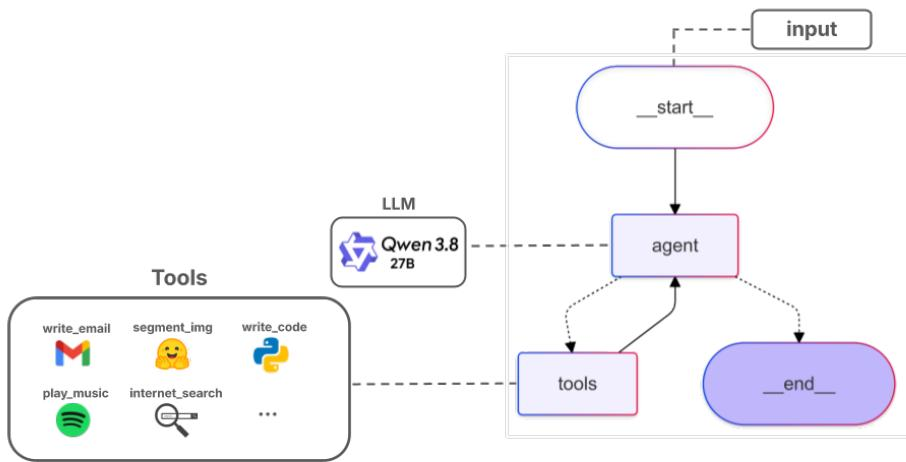
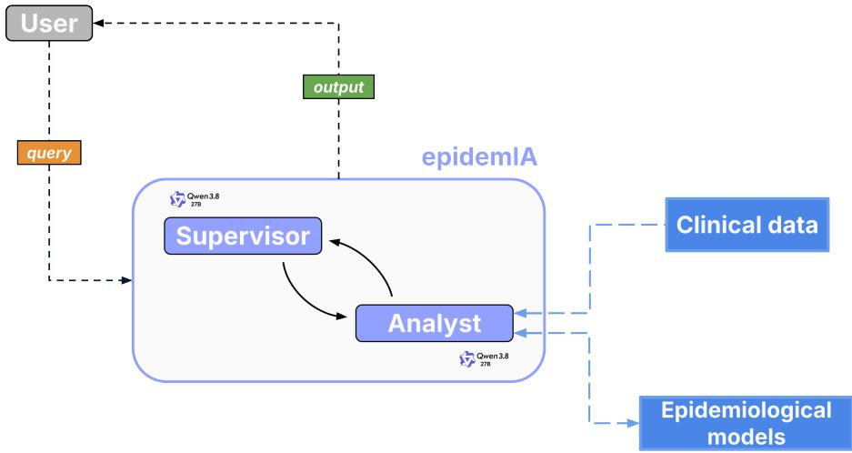
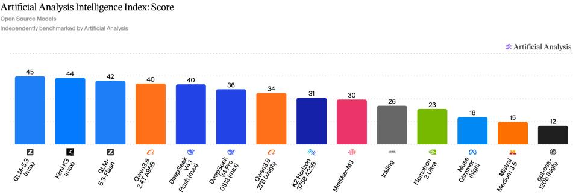
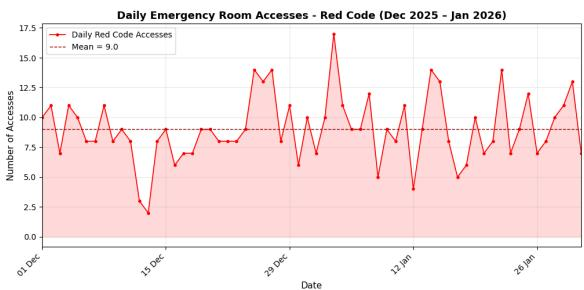
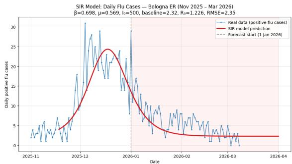
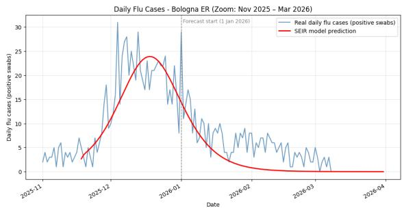
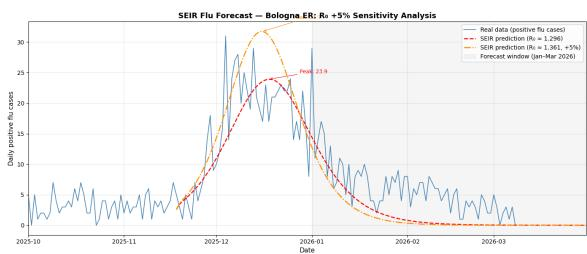

# CAN AI AGENTS INTERFACE CLINICIANS AND COMPLEX MODELS?

A PREPRINT

Giulio Colombini<sup>1,2,3</sup> <sup>†</sup> , Matteo Falcioni<sup>1</sup> <sup>†</sup> , Mario Massimo<sup>1,</sup> <sup>2</sup> <sup>†</sup> , Francesco Durazzi<sup>1</sup> Marianna Santoro<sup>4</sup> , Paolo Tubertini<sup>4</sup> , Mirko Degli Esposti<sup>1,2</sup> , Armando Bazzani<sup>1,2,3,\*</sup>

<sup>1</sup> Dipartimento di Fisica e Astronomia “Augusto Righi”, Alma Mater Studiorum - Università di Bologna, Via Irnerio 46, 40126 Bologna, Italy.

<sup>2</sup> Sezione di Bologna, Istituto Nazionale di Fisica Nucleare, Viale Carlo Berti-Pichat 6/2, 40127 Bologna, Italy.

<sup>3</sup> Centre for Advanced Studies on Tourism, Alma Mater Studiorum - Università di Bologna, Via Angherà 22, 47900 Rimini, Italy.

<sup>4</sup> IRCCS Azienda Ospedaliero-Universitaria di Bologna - Policlinico Sant’Orsola-Malpighi Via Giuseppe Massarenti 9, 40138 Bologna, Italy.

Corresponding author: armando.bazzani@unibo.it

† These authors contributed equally to the article.

October 30, 2026

## ABSTRACT

## Background:

Contemporary healthcare institutions generate daily very large amounts of data, which contain highly useful information for the improvement of work organization, planning and overall efficiency. While models and techniques to extract these insights are well known and constantly developed in mathematical biology, complex systems physics and data science, the adoption of these techniques among Clinicians and Hospital Administrators remains limited, mainly due to language and methodological divides.

## Objective:

In this article we implement an AI Multi Agent System (MAS) that allows Users to use predictive models and make statistical analyses via natural language conversations.

## Methods:

We developed EpidemIA, a training-free MAS endowed with a modular suite of epidemiological models written by human experts, executable on a single-GPU workstation. To avoid relaying sensitive data to third parties, the system uses locally an open-weights LLM as backbone for its two subagents.

## Results:

Using a dataset of Emergency Department visits provided to us by IRCCS Sant’Orsola (Bologna) we test the model on a few typical use cases, demonstrating the possibility of performing both simpler statistical analyses and visualizations as well as more complicated epidemiological predictions based on dynamical models, through simple queries made in natural language.

## Conclusions:

While still being a proof-of-concept implementation, EpidemIA showcases the transformative capabilities of LLM based technologies as an enabling factor in the widespread adoption of complex dynamical models, which is at present hindered by their steep learning curve.

Keywords Multi Agent Systems · Large Language Models · Epidemiological Modelling · Data Science · Decision support systems

## 1 Introduction

Contemporary healthcare institutions and hospitals generate massive, rapidly growing volumes of data [1], spanning across multiple scales and modalities. At the single-patient scale, common information sources include imaging diagnostics, biomedical laboratory results, and wearable sensors. Broadening the scope, organization-wide data capture facility operations, such as Emergency Department visits, ward bed occupancy, or procedure scheduling. At an even larger scale, population-level records track metrics like vaccine coverage statistics or the prevalence of chronic conditions. Extracting relevant information from these datasets has long been the primary focus of biomedical statistics, establishing standard methodologies in medical practice and research [2]. More recently, the big data paradigm has accelerated the adoption of data science and machine learning (ML) techniques, finding in biomedicine one of their most fertile domains [3, 4, 5]. A central open challenge remains the fruitful integration of heterogeneous sources, merging clinical records with external inputs like weather observations or mobility data. Furthermore, to tangibly benefit healthcare systems, analytical approaches must extend beyond retrospective description toward prospective scenario forecasting, allowing clinicians and decision-makers to evaluate treatment options, operational strategies, or containment measures.

While purely data-oriented systems are still developing these predictive capabilities, dynamical models incorporate them by construction, making a synergistic integration of both approaches highly promising. A paradigmatic example lies in epidemiological models, which capture pathogen transmission across a population. The foundational compartmental framework introduced in [6] models transitions between disease stages, capturing the infection course in a simplified mathematical manner. While this classic formulation can interpolate incidence curves to estimate infection and recovery rates, numerous extensions have been developed to address richer multimodal dynamics. Notable examples include models for vector-borne diseases such as Malaria [7] or Dengue [8], models incorporating human mobility data [9, 10, 11], and formulations accounting for distributed stage durations with explicit delays [12, 13, 14, 15]. The common strength of these models is their mechanistic portrayal of the interplay between epidemiological processes and socio-environmental factors, making them inherently suited for scenario simulation.

Despite their great potential, both purely data-oriented and dynamical modelling approaches must overcome a fundamental challenge before they can deliver their full positive impact on healthcare organizations: the methodological divide between medically-trained personnel and decision makers, the end users of models, and the community of physicists, mathematicians and computer scientists that typically develop them [16, 17, 18]. Indeed, the mentioned models are developed and well understood in the fields of Complex Systems Physics and Mathematical Biology, using concepts from these disciplines, which present a steep learning curve for clinicians or decision-makers, as these are not the main focus during their training [16].

Among the many Artificial Intelligence (AI) types developed recently, Large Language Models (LLMs) such as Generative Pre-trained Transformers [19], i.e. conversational chatbots based on transformer neural networks, have proved to be among the most intuitive in terms of user experience [20, 21, 22]. While the token-by-token prediction working principle behind LLMs is successful in Natural Language Processing (NLP), it lacks the structure to perform both numerical or analytical mathematical tasks [23, 24, 25], so that a direct usage in data analysis is not advisable. Similarly, whenever asked to make predictions with a model such as epidemiological ones, an LLM would purely rely on its ability to predict tokens. In addition, interaction with a plain LLM is only possible through prompting, i.e. LLMs by themselves cannot process external files unless when they are fed them directly.

Recent efforts to make up for the shortcomings of LLMs, have seen the rise of the AI agent paradigm [26, 27, 28, 29]. An AI agent is an LLM with reasoning capabilities [30, 31], referred to as the agent backbone, endowed with the ability to make calls to external programs, called tools, which can perform tasks outside the backbone’s text-based interaction model [32, 33]. A tool can be any external component that performs complex tasks, possibly depending on parameters generated by the LLM backbone. Some common tools, for example, allow the execution of backbone-written code, searching the internet or interacting with a filesystem [29]. In this context the reasoning workflow is straightforwardly extended to tool use, as the agent can alternate reasoning sessions and tool calls many times, especially for complex tasks that require more than a single tool [34, 33], to improve the response quality before presenting it to the user, iterating in a loop. See Fig. 1 for a visual representation of an agentic loop. Finally, to improve their performance, agents are generally endowed with a context window, i.e. a log of recent information, conversational history and tool responses.

To further improve on the capabilities of single agents in handling articulate tasks, Multi-Agent AI Systems (MAS) [35, 36] have emerged as the leading framework. A MAS is a set of AI agents that continuously process inputs while interacting across a dynamic communication graph [35, 37] and sharing common information, referred to as state. Within this setup, each node of the graph is an agent with a specialized role, negotiating intermediate outputs to achieve a collective goal. MAS achieve superior performance over single agents when tasks allow flexible division and reallocation driven by real time feedback [37, 38], and have rapidly gained attention also thanks to the supervisor orchestration architecture. Modelled after the structure of a research team, this architecture features a primary supervisor agent responsible for task delegation, while specialized expert agents focus on deep reasoning and execution within their respective domains [39]. Upon receiving a task, the supervisor decomposes it into sub tasks, assigning them to the appropriate expert agents, and aggregates the resulting outputs [40].

  
Figure 1: An example of AI agent architecture: an LLM backbone is given the ability to execute external functions - its tools - in a loop, to perform complex tasks.

MASs have already seen some applications in the healthcare field, with their most common uses in systems working at the single-patient scale. Some examples are the analysis of medical records and wearable data, and their integration with context information to feed coaching systems that guide users with suggestions and track their progress [41], general-purpose question answering [42] and the design of pharmacological treatment posology plans [43, 44]. In the public health and epidemiological setting, most efforts have focused on determining the impact of LLM-powered systems as tools to organize data for tasks such as data management, assessment of antibiotic resistance and surveillance of variants of concern [45, 46]. The usage of LLM-based systems as simple interfaces for epidemiological models, on the contrary, has seen limited study, mainly introducing them as high-level interpreters between users and pre-built simulation frameworks [47], in order to broaden their usage and comprehension across the medical community, but without integrating them with clinical dataset access and data-informed forecasting capabilities.

In this article, we leverage the intuitiveness and simplicity of LLMs interaction to make complex predictive models and data science insight more accessible to clinicians and decision-makers. The information and answers that these professionals seek from data in their day-to-day tasks often include a variable and flexibly defined succession of simpler tasks. For example a head physician, observing an increased workload in their ward, could at first be interested in the time series of accesses for a given condition in the near past, but to get a clearer idea they might subsequently want to compare it to the accesses for a different time period or pathology. Similarly, an operational researcher might want to look at the trend of new flu cases and make a projection for the future in order to plan supply schedules and personnel work shifts accordingly, comparing scenarios with different vaccination coverages. Each of these example tasks requires several operatively diverse steps, encompassing data analysis, simulation, visualization and reporting, which may need reiteration and reorganization at runtime depending on the user queries. Breaking down a broadly defined natural language query into smaller specialized actions is the ideal use case for MASs, which we adopt as design in our system for this specific reason.

Agents and MASs have proved to be sufficiently capable in writing and executing custom code for basic data science tasks and visualizations [48, 49], capitalizing solely on the coding knowledge extracted from their training data. The usage of dynamical predictive models, on the other hand, is a significantly more complicated task, as it requires a combination of coding ability, rigorous data processing and a dexterity with the analytical aspects of Mathematical Biology and the simplifications made when formulating models. At present, this type of task can be challenging for open source LLMs, while usage of proprietary, closed source, LLM backbones presents alarming sensitive data and general privacy implications. Most importantly, though, while greedy decoding (T = 0) theoretically ensures deterministic LLM outputs, empirical and system-level studies show that run-to-run non-determinism persists in modern inference engines due to the interplay of floating-point non-associativity and the lack of batch invariance under dynamic request batching, so that repetition of the same query could lead to different results [50, 51]. This has relevant implications for dynamical predictive modelling, as identical repeated queries could provide different implementations of a single model differing in substantial details, and thus requiring separate validations. Finally, hallucinations [52, 53] might sometimes produce entirely unreliable answers. While these behaviours may be acceptable in general-purpose applications they ought to be mitigated in sensitive contexts such as healthcare organizations.

## 2 Methods

In order to bridge the methodological barrier that pushes healthcare and organizational professionals away from broader usage of predictive models and data science techniques, we propose a conversational MAS architecture endowed with predictive modelling tools. Our system, which we name EpidemIA since it is focused on epidemiological modelling, is a training-free framework made up of two LLM-based sub-agents, which can exchange text messages, update a shared, system-wide state and interact with the underlying file system, e.g. to save intermediate results, visualizations or search for data sources.

The sub-agent handling user interaction is called Supervisor, and its main task is facilitating communication between human users and the sub-agent in charge of model usage and data processing, called the Analyst. The Analyst receives user prompts only through the Supervisor, which is tasked with reformulating them in clear statements. This task preprocessing strategy allows to mitigate the impact of unclear prompts on the quality of the Analyst’s work, by delegating as much of the interpretation effort as possible to the Supervisor.

The Analyst’s work is mainly achieved through coordinated calls to its tools, described in finer detail in Section 2.1, which endow it with capabilities ranging from more general ones, such as code execution, to more field-specific ones. Within the second category fall tools that allow access to the datasets, making simulations, fitting models to observed time series and introspection over the available predictive models. The key feature of our system from this point of view is that the code used for statistical data analysis is autonomously written by the Analyst, but the predictive models, the metrics and procedures used for fitting are entirely written by human experts, in order to guarantee their validity and reliability. In order to be easily expandable and modifiable as the operative needs change and new models are developed, both models and metrics are organized in a modular structure, where new ones can be added simply by adding their implementations, which must obey a specific structure, in specific folders of the working file system. This is possible thanks to a dynamical import structure that allows the agent to discover the available models, together with some information about them at startup.

The structure of the multi-agent system is outlined in Fig. 2, where we highlight the interacting LLM instances and their relationship with data and models. Both the Analyst and the Supervisor are LLM instances that are able to call tools in a loop, as depicted in Fig. 1. To take the first step towards compliance of EpidemIA with privacy regulations on clinical data, we chose for both agents an open weight LLM backbone which can be used entirely locally.

## 2.1 Agents and tools

Supervisor The proposed framework relies on a hierarchical multi-agent architecture designed to decouple conversational query resolution, task decomposition, and specialized computational workflows. At the top of this execution hierarchy operates the Supervisor agent, which acts as the primary conversational interface between the external User and the underlying execution layers. Acting as a stateful orchestrator, the Supervisor interfaces the User, directly answers simple questions, and mediates the delegation of data analysis requests to the Analyst sub agent, while deliberately abstaining from executing computational routines itself.

The Supervisor is explicitly restricted from accessing raw datasets stored within the data directory. It possesses no tools for data analysis, model fitting, or statistical inference. This constraint preserves the specialization of the sub-agents and minimizes the risk of generating hallucinated empirical conclusions during orchestration.

The Supervisor has read only access to the models directory. This allows it to independently resolve non computational requests made by the User, such as clarifications about model parameters or structural assumptions of epidemiologica modelling.

  
Figure 2: Architecture of our system. The user queries EpidemIA, which accesses clinical data and epidemiological models as needed - through the analyst agent - in order to produce a clear, readable output.

When an incoming prompt concerns only theoretical concepts, mathematical definitions, or the structural properties of implemented models, the Supervisor resolves the request autonomously, formulating comprehensive explanations without routing control to the Analyst.

Whenever a request demands data processing, parameter estimation, or epidemiological forecasting, the Supervisor delegates the task to the Analyst. It enhances the User input, eliminating conversational ambiguities and structuring the query into explicit analytical directives. If the User omits the specific model required for the prediction, the Supervisor resolves by completing the prompt with a Susceptible-Infectious-Recovered (SIR) model by default, ensuring workflow continuity without introducing redundant clarification turns

After delegating a task, the Supervisor enters a monitoring state, waiting for the Analyst to report back its results. It cannot evaluate them but only aggregate the raw analytical findings and quantitative metrics, and construct a coherent narrative describing the methodological steps taken, delivering a structured summary back to the User. If the Analyst’s output reveals a misinterpretation of the User request, the Supervisor can resubmit the query pointing out the issue.

The Supervisor can use two tools:

• assign\_to\_analyst: This tool is needed every time the User prompt regards data analysis or epidemiological prediction. The tool transfers control to the Analyst subagent giving it a clear and concise description of the User’s request. The only argument expected by the tool function is the description of the task to route to the Analyst, which should contain an enriched and unambiguous reformulation of the User’s initial objective.

• get\_model\_info: This tool enables dynamic querying of the models folder. The tool obtains information about the epidemiological models, extracting a schema that aggregates model names, parameters definitions and default values for the parameters. This tool is called every time the User asks for clarifications about an epidemiological model, and takes as its single argument the model name.

Analyst Right after the orchestration layer operates the Analyst subagent, the computational core of the framework, dedicated to data analysis and epidemiological prediction without direct interaction with the User. After receiving a structured task from the Supervisor, the Analyst takes control of the workflow and organizes a to-do list that it will follow.

Its first task is always to discover and explore the datasets in the data folder by using autonomously written Python code, in order to understand data structure, and to identify the most useful information for its current task. Then, the Analyst filters the relevant data and saves a new, significantly smaller, dataset in context, a working folder not visible to the Supervisor. To filter the dataset, the Analyst is prompted to use a specific tool, even if the structure of the data files appears simple. This logic has been chosen for the agent workflow to reduce the number of correction turns caused by improperly formatted input data, generated by autonomously written Python code, being fed into the predictive models interface.

If the task concerns only basic statistical data analysis, the Analyst can access the raw dataset in the data folder and can perform computations using Python code autonomously written. Whenever the task requires predictions on the spreading of an infectious disease, the Analyst can access and use specific models without being able to edit them.

Epidemiological models are dynamically imported from the models folder, jointly with information about them, such as parameters definitions, explanations on their role and the default parameter values to use when fitting. This information is useful for the Analyst to better understand the structure of a model and its applicability, before using it through the main tool for regression and forecasting. The most relevant arguments passed by the Analyst to the main forecast tool are the model name, taken from the task forwarded by the Supervisor, the initial parameter values to use for fitting, discovered by exploring the models folder, the starting date for the forecast, and the number of days to predict onwards.

The Analyst has a different tool as well, that allows it to perform simulations without fitting, given a model and some generic parameter values. This tool can be used to compare forecasts with hypothetical scenarios where the disease has e.g. different infectivity rates.

After the analytical part of its work has been performed, the Analyst produces a detailed report of its workflow and results to the Supervisor, providing the relevant information that will be relayed to the User. If asked, the Analyst will also produce visualizations of its results and will save them in the agent\_outputs folder.

The Analyst has six tools at its disposal:

• TodoList: After receiving a task from the Supervisor, at the beginning of its reasoning process, the Analyst calls the TodoList tool, which helps breaking down and organize the task received in many subtasks, calling it again every time another tool produces an output, or after completing a subtask, to track progress.

• python\_executor: The python\_executor tool is used to run autonomously written Python code, for tasks such as exploring datasets in the data folder, understanding their structure, performing simple statistical data analysis, visualizing and saving results. The tool has a single argument, a string containing the code to be executed. We do not employ an online file system sandbox to prevent sensitive clinical information from leaving our local machine.

• csv\_writer: This tool is called whenever the raw dataset needs to be filtered, in order to obtain a compatible format for the predictive models. csv\_writer creates a new CSV file in the working environment, specifically in the context folder, that will be used as input for the epidemiological model fitting tool.

• get\_model\_info: Epidemiological models are dynamically imported at startup of the MAS, so they are not known a priori. This tool returns to the Analyst information about the models available in the models folder. The output is a dictionary containing the model names, the explanation of model parameters and their Python type, the default values for the initial guesses of the fitted parameters and the default values for the fixed ones. This tool is always called before using an epidemiological model to make predictions, to let the Analyst understand the model structure and its features.

• fit\_and\_forecast: This is the main tool used to make forecasts using epidemiological models, by fitting a model to observed data and extending the simulation corresponding to the optimal set of parameters in the future, to compute the predicted incidence. Its inputs are the name of the model to use in the forecast, the path to the correctly formatted file containing the observed date, the starting date of prediction, the number of days to predict, the initial guesses for the parameters to be fitted and the fixed values for those that are kept constant. All the input values are inferred from the task given by the Supervisor, otherwise defaults are used. The output of this tool contains the predicted incidence values with the corresponding dates and the fitted values of the parameters.

• incidence: A tool thought for being employed after fit\_and\_forecast, made for the simulation of epidemiological scenarios given a model and some parameters values, which can be different from those inferred from data (i.e. those returned by fit\_and\_forecast). This tool does not fit again the model, but only computes the incidence of a disease given a new set of parameters. The input arguments are the same as those of fit\_and\_forecast, except for the model parameters which are not distinguished as fitted or fixed. The outputs are the predicted incidence values with corresponding dates and the list of parameter values used in the simulation.

## 2.2 Modular epidemiological model system

In order to make epidemiological simulations and predictions based on data, the Analyst sub-agent can leverage a suite of predictive models which are used by the agent as-they-are, through the fit\_and\_forecast and the incidence tools, without the possibility of modifying the code implementing them in any way. This design choice is one of the defining features of our framework which is motivated as follows. While at present LLMs are becoming more and more skilled at writing scientific code such as implementations of epidemiological models, delegating this task to an agent within our MAS is ill-advised as, even at T = 0 due to residual stochastic effects, the code produced by the LLM would vary across repetitions of the same query, requiring a new check of the implementation correctness and a new validation each time. By constraining the Analyst to use models written by human experts, correctness checks and validations for a given model can be performed offline once and for all, before making it available to the agent. Furthermore, this approach improves the reproducibility of the whole MAS across repeated predictions, since the model fitting pipeline implemented in the tools is fully reproducible.

In order to keep EpidemIA as flexible as possible, the management of predictive models is entirely modular, so that new models can be added by moving Python source code files with the correct interfaces into the src/graph/tools/models folder in the MAS filesystem. These include some explanatory fields for LLM usage, default parameter values and functions to fit the model and compute the daily incidence, and are more clearly detailed in the Supplementary Information. EpidemIA comes natively with implementations of the classical SIR and SEIR epidemiological models as examples.

Fitting procedures for epidemiological forecasting generally imply the minimization of some discrepancy metric between the data observed until the start of prediction and the simulated values, followed by extrapolation of the predicted values via model simulation. To leave some flexibility also in the choice of metric to minimize during fitting, a modular system analogous to that available for predictive models is implemented in the src/graph/tools/metrics folder, with specifications on the required interfaces also available in the Supplementary Information. As an example, our system contains natively the Root Mean Square Error metric.

Both systems allow the dynamical discovery of the available options at agent startup, implemented via a Python module structure.

## 2.3 Implementation details

We employed as LLM backbone for the agents an open-weight model, a design choice motivated by privacy and reproducibility requirements. Since the documents processed by the system contain sensitive information, routing them through third party inference APIs would breach data privacy regulations, on the other hand, local deployment guarantees that no data leaves the infrastructure. In addition, local serving of open-weight checkpoints removes the dependency on proprietary endpoints, whose underlying weights may be silently updated or deprecated over time, making results obtained through them difficult to reproduce.

Specifically, we adopted the Qwen3.8 [54, 55] model with 27 billions of parameters as the LLM backbone of each agent in the architecture with temperature parameter set to T = 0 in order to bring to a minimum the stochastic component inherent to autoregressive generation. The model was served through Ollama [56] platform and executed on a single NVIDIA RTX A6000 GPU with 48GB VRAM.

The choice of this specific LLM was driven by the trade off between model capability and the memory budget imposed by a single GPU deployment. Among the open-weights models that fit into 48GB of VRAM at the time of the experiments, Qwen3.8:27B offered the best capability-to-size ratio. To support this claim, Fig. 3 reports a snapshot of the Artificial Analysis Intelligence Index, taken on September 13th 2026, and filtered to open-weights models only: the selected LLM attains an intelligence score comparable to that of models with a substantially larger parameter count, while remaining deployable on our hardware.

We stress that this choice is not a constraint of the proposed architecture, which is independent from the LLM choice by design: the backbone can be replaced with any instruction following LLM supporting structured tool calling, without modifying the workflow, and we expect the reported results to improve with stronger models.

The proposed MAS architecture was implemented in Python using LangGraph [28], a library developed by LangChain that models agentic workflows as explicit state graphs. It is particularly well suited to our architecture since it allows agents, tools, and control flow logic to be expressed as nodes and edges over a shared, typed state object, making the orchestration of the workflow explicit and customizable. The complete implementation, together with the prompts and the configuration files needed to reproduce our experiments, is publicly available in our GitHub repository [57].

## 3 Results

To test the practical utility and versatility of the proposed MAS architecture, this section shows four sample use cases. These scenarios illustrate MAS operation in performing typical real world tasks, such as observed time series analysis or epidemiological spread forecasting.

  
Figure 3: Snapshot of the Artificial Analysis Intelligence Index as of September 13th, 2026. The LLM we employed - Qwen3.8 27B - reaches a significative level of intelligence, comparable to that of frontier open source models, at a fraction of their size.

The data made available to the mode are accesses to the Emergency Department of the IRCCS Azienda ospedalierouniversitaria - Policlinico Sant’Orsola in Bologna, enriched with flu swabs laboratory data. We report the complete answers given by the MAS after its internal reasoning in Appendix A and in Fig. 4 we show the visualizations produced for each of the four use cases, which we briefly describe.

Case (a) The first use case is a standard statistical analysis of the data. The User asks to extract statistical information about the patients that were assigned a red emergency code<sup>1</sup> upon accessing the Emergency Room during a specific month. The Analyst, after receiving the task from the Supervisor, employs the python\_executor tool to explore and understand the dataset and the csv\_writer tool to filter it with respect to the Red Code for emergency room accesses. Then it uses again python\_executor to filter the Red Code access data in the desired month and to produce a histogram, shown in Figure 4 (a), that will be saved in the agent\_outputs folder. The complete answer given by the agent is reported in Appendix A (a).

Case (b) The User asks for a generic prediction of daily flu cases in a certain period. Since no specific epidemiological model has been required, the Supervisor by default expands the request by asking the Analyst to use a SIR model. After calling python\_executor and csv\_writer to filter the data for the positive flu cases, the Analyst calls the fit\_and\_forecast tool to predict flu cases with a SIR model. Then, python\_executor is again called to take the fit\_and\_forecast output, plot the results and save the visualization. Figure 4 (b) shows the image produced by the agent, where the prediction is highlighted in red, the observed data are in blue and the start of prediction date is reported. The complete answer is shown in A (b). In a real forecasting scenario, no ground truth data would be available after the forecast begins, but in our retrospective experiments we have shown them for comparison.

Case (c) The workflow is the same as case (b) except for the User request, which this time asks explicitly for usage of the SEIR model when predicting future flu incidence. The Analyst employs the same tools in the same sequence as case (b), except for the model name and the forecasting period, producing the image shown in Figure 4 (c). The complete answer given by the agent is reported in Appendix A (c).

Case (d) The last case directly follows the previous one. After the agent has answered case (c) the User prompts the system again asking for a hypothetical scenario where the same influenza wave has a different, 5% higher $R _ { 0 }$ with respect to the one inferred from data. In this case, the Analyst uses the output of case (c) and calls only the incidence tool, recalibrating model parameters so to obtain an higher $R _ { 0 } ,$ and then carries out a new, hypothetical, prediction. Then, python\_executor is again called to plot the three curves: real data, the previous prediction and the new one with a $R _ { 0 }$ 5% larger. The visualization is shown in Figure 4 (d) and the complete answer reported back to the User can be found in Appendix A (d).

## 4 Discussion

In this study we presented EpidemIA, a training-free conversational MAS framework that allows non-specialized users to apply a wide variety of statistical data analysis techniques and use predictive models on hospital accesses datasets.

  
(a) Q: Plot the daily access at emergency room with red code from December 2025 to January 2026 and extract statistical information

  
(b) Q: Predict the daily flu cases from 1 January 2026 to the end of March 2026 and then plot the results on top of real data

  
(c) Q: Predict the daily flu cases from 1 January 2026 to the end of March 2026 using a SEIR model and then plot the results on top of real data

  
(d) Q: (right after case (c)) What if the $R _ { 0 }$ is 5% higher?  
Figure 4: Plots produced by the Agent in response to the respective User question, indicated in the caption.

EpidemIA facilitates the usage of data science techniques and predictive models developed by researchers in Physics and Mathematics, by working as a natural language interface. Users can perform analyses and predictions by asking questions in plain English, from which the system generates an appropriate sequence of tool calls to achieve the correct answer. After each tool call, the output is reviewed, gathering relevant insights: this information, together with the final output of the sequence, is then used to compile a comprehensive and informative report for the User. The final report is generated by the Supervisor agent and includes descriptive statistics, plots and a plain-language description of the data, analyses and the results, in order to give the User an all-round overview of the followed process and findings. In addition, our system needs neither internet access, nor uses any external LLM APIs, thus ensuring that the data never leave the hospital’s premises during processing, a basic necessary feature for the future construction of a fully privacy-compliant framework.

EpidemIA is a proof of concept for the integration of models and techniques developed by experts with intuitive interfaces, which does not seek to replace the Clinician, the Decision Makers or the predictive models Researcher, but aims to be a knowledge tool that allows to extract relevant information, helping them combine their effort and facilitate each other’s work. Indeed, the adoption of a system similar to the one we propose at the hospital level would provide a useful tool for Clinicians, improving their access to data and the information contained in them via analytic methods determining an improvement in their situational awareness in day to day tasks. Similarly, for Decision Makers, the informed planning of operations is dependent on activities such as data processing, prediction making and evaluation of different scenarios. These tasks, at present, require continued interaction with teams of data scientists and modelling experts, often made lengthier by terminological and methodological differences across fields, and can therefore be greatly unburdened by the adoption of an EpidemIA-like MAS, designed to bridge this gap. Moreover, a simple interface can make it easier for non-expert personnel to gain first-hand experience with the terms and concepts proper of mathematical modelling, by being able to control predictive models intuitively in a practical and familiar setting. For Researchers in Physics of Complex Systems and Mathematical Biology, on the other hand, this system offers a precious chance, thanks to its modularity, to facilitate the diffusion and field testing of the models they develop in a multitude of different settings, an often sought-after opportunity, without the direct hand-off of data which often comes with rightfully delicate privacy issues, thus determining a potential positive impact also on interdisciplinary research. In short, the positive impact of EpidemIA-like systems will be to allow mathematical modelling experts, Clinicians and Decision Makers to focus on the more important parts of their respective work, making interactions more fruitful, and less focused on the interpretative and implementation issues, without replacing the need for an increased amount of interdisciplinarity.

The main limitation in our study is related to the evaluation of our system as a whole. Indeed, the single predictive models validation can be easily performed via standard methods, such as sensitivity analysis, and can be done entirely offline with respect to MAS integration. Similarly, the open-weights LLMs available for local running, and thus employable as backbones in our system, are often widely tested on standardized benchmarks upon release. The evaluation of the whole system, on the other hand, presents several points which must be treated attentively. The main reason for this, is that reproducible testing of a system such as EpidemIA is easily attainable only with a publicly available underlying dataset, which is not the case at present for the data we have used during the framework construction. In addition to this, devising a protocol for the procedural generation of question-answer pairs in a dataset and predictive model-agnostic way is a challenge in itself, while compiling such a dataset by hand is a highly time-consuming process, and most importantly data and model dependent.

## 4.1 Next Steps

While the current modular structure through which the EpidemIA framework manages complex models, one natural evolution of our work is to extend its predictive capabilities beyond epidemiological events. For example, the framework could integrate environmental and climatological data sources, informing predictive models for health hazard due to extreme weather events such as heatwaves. These could simply be added as new tools for the Analyst, or by developing specific agents in the MAS architecture, which is by design scalable to several subagents managed by the Supervisor. Incorporating such predictive models would give emergency department Decision Makers crucial lead time to optimize staff allocation and clinical bed capacity.

In parallel, expanding the capabilities of the existing agentic architecture represents another improvement. This could be done in several ways. A first one would be to replace the underlying model powering EpidemIA. As a matter of fact, let us stress again how EpidemIA is, by design, model agnostic. Therefore, if an end User has access to a more powerful machine than the one we employed, they could run the same exact MAS system powered by a much smarter LLM backbone. That would constitute, without any doubt, an instantaneous leap in the quality of the output.

At the same time, scaling up the size of the LLM backbone could be not needed at all: recently, open source LLMs have been improving rapidly, regularly matching or exceeding the performance of leading proprietary systems released just 6 to 12 months prior. The backbone we employed, Qwen3.8:27B, will surely be surpassed in the upcoming months, in terms of intelligence, by newer models in the same size range.

Another option, and a natural extension of the MAS capabilities, would be to integrate specialized agents that can write SQL queries in order to work directly on large scale databases, or, alternatively, provide the Analyst agent with tools to perform these operations. Equipping agents with advanced Text-to-SQL generation would enable automated extraction and aggregation from clinical information systems. Interacting natively with large scale relational hospital databases removes intermediate abstraction layers, scales efficiently with massive data volumes, and allows clinical decision support systems to operate on live, institutional level data streams. Larger scale hospital-level implementations of our framework should also take further steps to ensure full compliance with privacy regulations, together with clinical data preservation. This could be achieved e.g. via local sandboxing and security checks on code written and executed by the agents. Provided that these requirements are met, systems like EpidemIA could become useful also as smart interfaces for the access to disaggregated personal data, by processing it on demand and providing aggregated representations to the user.

Finally, to tackle the issue of evaluating EpidemIA in a significant way, the LLM-as-a-judge technique [58, 59] appears as the most promising way to proceed, provided that a sufficiently practical way to generate procedurally question-answer pairs, is available, likely including the use of independent LLM instances to handle generic data formats.

## Funding

This project has been partially funded by the DARE project, Spoke 2, Task 1.2: Predictive models for automatic disease surveillance systems from the development of a Datalakehouse platform to clinical pathway classification, monitoring andforecasting disease evolution and the impact ofclimate changes on the hospitalization.

## Conflicts of Interest

The authors declare no competing interests.

## Data availability

The Emergency Department visits dataset used in this study cannot be shared publicly as it is considered sensitive under European and Italian privacy law.

## CRediT authorship contribution statement

Conceptualization: MDE, AB.

Methodology: GC, MM, MF.

Software: GC, MM, MF.

Formal analysis: GC, AB.

Investigation: MM, MF.

Resources: MS, PT, MDE.

Data Curation: MS, PT.

Writing - Original Draft: GC, MM, MF.

Writing - Review & Editing: GC, MM, MF, MDE, AB, FD.

Visualization: MM, MF.

Supervision: AB, MDE.

Project administration: PT, AB.

Funding acquisition: PT, AB.

## Abbreviations

ML: Machine Learning

LLM: Large Language Model

MAS: Multi Agent System

GPU: Graphics Processing Unit

VRAM: Video Random Access Memory

SIR: Susceptible-Infectious-Recovered

SEIR: Susceptible-Exposed-Infectious-Recovered

## References

[1] World Intellectual Property Organization, Cornell University, and INSEAD. The Global Innovation Index 2019: Creating Healthy Lives - The Future ofMedical Innovation. Global Innovation Index. World Intellectual Property Organization, 2019. ISBN 979-10-95870-14-2.

[2] P. Armitage, G. Berry, and J.N.S. Matthews. Statistical Methods in Medical Research. Oxford statistical science series. Wiley, 2001. ISBN 9780632052578.

[3] Sri Venkat Gunturi Subrahmanya, Dasharathraj K Shetty, Vathsala Patil, BM Zeeshan Hameed, Rahul Paul, Koma Smriti, Nithesh Naik, and Bhaskar K Somani. The role of data science in healthcare advancements: applications, benefits, and future prospects. Irish Journal ofMedical Science (1971-), 191(4):1473–1483, 2022.

[4] Pushpa Devi and Kishori Lal Bansal. Data science in healthcare: techniques, challenges and opportunities. Health and Technology, 14(4):623–634, 2024. ISSN 2190-7196. doi:10.1007/s12553-024-00861-8.

[5] Adedeji Olugboja. Data science in healthcare systems: A comprehensive review and future directions. In Hamid R. Arabnia, Leonidas Deligiannidis, Farzan Shenavarmasouleh, Soheyla Amirian, and Farid Ghareh Mohammadi, editors, Computational Science and Computational Intelligence, pages 178–191. Springer Nature Switzerland, 2025. ISBN 978-3-031-94953-1. doi:10.1007/978-3-031-94953-1\_15.

[6] W. O. Kermack and A. G. McKendrick. A contribution to the mathematical theory of epidemics. Proceedings of the Royal Society ofLondon. Series A, Containing Papers ofa Mathematical and Physical Character, 115(772): 700–721, 1927. ISSN 0950-1207. doi:10.1098/rspa.1927.0118. Publisher: The Royal Society.

[7] Yijun Lou and Xiao-Qiang Zhao. A climate-based malaria transmission model with structured vector population. SIAM Journal on Applied Mathematics, 70(6):2023–2044, 2010.

[8] A Reyna-Lara, D Soriano-Paños, JH Arias-Castro, HJ Martínez, and J Gómez-Gardeñes. A metapopulation approach to identify targets for wolbachia-based dengue control. Chaos: An Interdisciplinary Journal of Nonlinear Science, 32(4), 2022.

[9] Duygu Balcan, Vittoria Colizza, Bruno Gonçalves, Hao Hu, José J. Ramasco, and Alessandro Vespignani. Multiscale mobility networks and the spatial spreading of infectious diseases. Proceedings of the National Academy ofSciences, 106(51):21484–21489, 2009. doi:10.1073/pnas.0906910106.

[10] Piergiorgio Castioni, Riccardo Gallotti, and Manlio De Domenico. Critical behavior in interdependent spatial spreading processes with distinct characteristic time scales. Communications Physics, 4(1):131, 2021. ISSN 2399-3650. doi:10.1038/s42005-021-00631-2.

[11] Guillaume St-Onge, Jessica T. Davis, Laurent Hébert-Dufresne, Antoine Allard, Alessandra Urbinati, Samuel V. Scarpino, Matteo Chinazzi, and Alessandro Vespignani. Pandemic monitoring with global aircraft-based wastewater surveillance networks. Nature Medicine, 31(3):788–796, 2025. ISSN 1546-170X. doi:10.1038/s41591-025- 03501-4.

[12] Nicola Guglielmi, Elisa Iacomini, and Alex Viguerie. Delay differential equations for the spatially resolved simulation of epidemics with specific application to covid-19. Mathematical Methods in the Applied Sciences, 45 (8):4752–4771, 2022.

[13] Nicola Guglielmi, Elisa Iacomini, and Alex Viguerie. Identification of time delays in covid-19 data. Epidemiologic Methods, 12(1):20220117, 2023.

[14] David Soriano-Paños, Juddy Heliana Arias-Castro, Adriana Reyna-Lara, Hector J Martínez, Sandro Meloni, and Jesús Gómez-Gardeñes. Vector-borne epidemics driven by human mobility. Physical Review Research, 2(1): 013312, 2020.

[15] Francesco Durazzi, Enrico Lunedei, Giulio Colombini, Giulia Gatti, Vittorio Sambri, Alessandra De Cesare, Cecilia Crippa, Frédérique Pasquali, Gastone Castellani, Daniel Remondini, Armando Bazzani, and Bologna MODELS4COVID Study Group. Human mobility and sewage data correlate with COVID-19 epidemic evolution in a 3-year surveillance of the metropolitan area of bologna. BMC Infectious Diseases, 25(1):1467, 2025. ISSN 1471-2334. doi:10.1186/s12879-025-11520-2.

[16] Linda L. Restifo and Gerald R. Phelan. The cultural divide: exploring communication barriers between scientists and clinicians. Disease Models & Mechanisms, 4(4):423–426, 2011. ISSN 1754-8403. doi:10.1242/dmm.008177.

[17] Grace Bastian, George Hamilton Baker, and Alfonso Limon. Bridging the divide between data scientists and clinicians. Intelligence-Based Medicine, 6:100066, 2022. ISSN 2666-5212. doi:https://doi.org/10.1016/j.ibmed.2022.100066.

[18] Mia Gisselbaek, Joana Berger-Estilita, Arnout Devos, Pierre Luigi Ingrassia, Peter Dieckmann, and Sarah Saxena. Bridging the gap between scientists and clinicians: addressing collaboration challenges in clinical AI integration. BMC Anesthesiology, 25(1):269, 2025. ISSN 1471-2253. doi:10.1186/s12871-025-03130-x.

[19] Gokul Yenduri, Muthukumaran Ramalingam, G Chemmalar Selvi, Y Supriya, Gautam Srivastava, Praveen Kumar Reddy Maddikunta, G Deepti Raj, Rutvij H Jhaveri, B Prabadevi, Weizheng Wang, et al. Gpt (generative pre-trained transformer)—a comprehensive review on enabling technologies, potential applications, emerging challenges, and future directions. IEEE access, 12:54608–54649, 2024.

[20] Kálmán Balázs Neszlényi, Alex Milos, and Attila Kiss. AssistantGPT: Enhancing user interaction with LLM integration. In 2024 IEEE 22nd Jubilee International Symposium on Intelligent Systems and Informatics (SISY), pages 000619–000624, 2024. doi:10.1109/SISY62279.2024.10737548.

[21] Zhibin Zhou, Weiyue Gao, Yaoqi Li, and Junnan Yu. Understanding the interaction between human and LLMsbased AI in creative tasks: Insights from UX professionals’ collaboration and communication with ChatGPT. Design Studies, 104:101403, 2026. ISSN 0142-694X. doi:10.1016/j.destud.2026.101403.

[22] Mehrdad Zakershahrak. Human–AI interaction in LLM. In Handbook ofHuman-Centered Artificial Intelligence, pages 449–489. Springer, Singapore, 2026. ISBN 9789819536580. doi:10.1007/978-981-95-3658-0\_72.

[23] Haotong Yang, Yi Hu, Shijia Kang, Zhouchen Lin, and Muhan Zhang. Number cookbook: Number understanding of language models and how to improve it, 2025.

[24] Simon Frieder, Luca Pinchetti, Chevalier Chevalier, Ryan-Rhys Griffiths, Tommaso Salvatori, Thomas Lukasiewicz, Philipp Petersen, and Julius Berner. Mathematical capabilities of chatgpt. In A. Oh, T. Naumann, A. Globerson, K. Saenko, M. Hardt, and S. Levine, editors, AdvancesINTERNATIONAL JOURNAL OF COMPUTER ENGINEERING AND TECHNOLOGY in Neural Information Processing Systems, volume 36, pages 27699–27744. Curran Associates, Inc., 2023. doi:10.52202/075280-1205.

[25] Ruonan Wang, Runxi Wang, Yuwen Shen, Chengfeng Wu, Qinglin Zhou, and Rohitash Chandra. Evaluation of llms for mathematical problem solving. Next Research, 9:101705, 2026. ISSN 3050-4759. doi:https://doi.org/10.1016/j.nexres.2026.101705.

[26] Lei Wang, Chen Ma, Xueyang Feng, Zeyu Zhang, Hao Yang, Jingsen Zhang, Zhiyuan Chen, Jiakai Tang, Xu Chen, Yankai Lin, Wayne Zhao, Zhewei Wei, and Jirong Wen. A survey on large language model based autonomous agents. Frontiers ofComputer Science, 18, 03 2024. doi:10.1007/s11704-024-40231-1.

[27] Panneer Selvam Viswanathan. Agentic ai: A comprehensive framework for autonomous decision-making systems in artificial intelligence. INTERNATIONAL JOURNAL OF COMPUTER ENGINEERING AND TECHNOLOGY, 16:862–879, 01 2025. doi:10.34218/IJCET\_16\_01\_069.

[28] LangChain, Inc. Langgraph: Agent orchestration framework, 2024. URL https://www.langchain.com/ langgraph.

[29] Junde Wu, Jiayuan Zhu, Yuyuan Liu, Min Xu, and Yueming Jin. Agentic reasoning: A streamlined framework for enhancing LLM reasoning with agentic tools. In Wanxiang Che, Joyce Nabende, Ekaterina Shutova, and Mohammad Taher Pilehvar, editors, Proceedings ofthe 63rd Annual Meeting ofthe Associationfor Computational Linguistics (Volume 1: Long Papers), pages 28489–28503. Association for Computational Linguistics, July 2025. ISBN 979-8-89176-251-0. doi:10.18653/v1/2025.acl-long.1383.

[30] Shunyu Yao, Jeffrey Zhao, Dian Yu, Nan Du, Izhak Shafran, Karthik Narasimhan, and Yuan Cao. React: Synergizing reasoning and acting in language models. ArXiv, abs/2210.03629, 2022. doi:https://doi.org/10.48550/arXiv.2210.03629.

[31] Jason Wei, Xuezhi Wang, Dale Schuurmans, Maarten Bosma, brian ichter, Fei Xia, Ed Chi, Quoc V Le, and Denny Zhou. Chain-of-thought prompting elicits reasoning in large language models. In S. Koyejo, S. Mohamed, A. Agarwal, D. Belgrave, K. Cho, and A. Oh, editors, Advances in Neural Information Processing Systems, volume 35, pages 24824–24837. Curran Associates, Inc., 2022. doi:10.52202/068431-1800.

[32] Alex J. Goodell, Simon N. Chu, Dara Rouholiman, and Larry F. Chu. Large language model agents can use tools to perform clinical calculations. npj Digital Medicine, 8(1), 2025. doi:10.1038/s41746-025-01475-8.

[33] Yongliang Shen, Kaitao Song, Xu Tan, Dongsheng Li, Weiming Lu, and Yueting Zhuang. Hugginggpt: Solving ai tasks with chatgpt and its friends in hugging face. In A. Oh, T. Naumann, A. Globerson, K. Saenko, M. Hardt, and S. Levine, editors, Advances in Neural Information Processing Systems, volume 36, pages 38154–38180. Curran Associates, Inc., 2023. doi:10.52202/075280-1657.

[34] Pan Lu, Baolin Peng, Hao Cheng, Michel Galley, Kai-Wei Chang, Ying Nian Wu, Song-Chun Zhu, and Jianfeng Gao. Chameleon: Plug-and-play compositional reasoning with large language models. In A. Oh, T. Naumann,

A. Globerson, K. Saenko, M. Hardt, and S. Levine, editors, Advances in Neural Information Processing Systems, volume 36, pages 43447–43478. Curran Associates, Inc., 2023. doi:10.52202/075280-1882.

[35] Qingyun Wu, Gagan Bansal, Jieyu Zhang, Yiran Wu, Beibin Li, Erkang Zhu, Li Jiang, Xiaoyun Zhang, Shaokun Zhang, Jiale Liu, Ahmed Hassan Awadallah, Ryen W White, Doug Burger, and Chi Wang. Autogen: Enabling next-gen LLM applications via multi-agent conversations. In First Conference on Language Modeling, 2024. URL https://openreview.net/forum?id=BAakY1hNKS.

[36] Fangqiao Tian, An Luo, Jin Du, Xun Xian, Robert Specht, Ganghua Wang, Xuan Bi, Jiawei Zhou, Ashish Kundu, Jayanth Srinivasa, Charles Fleming, Rui Zhang, Zirui Liu, Mingyi Hong, and Jie Ding. An outlook on the opportunities and challenges of multi-agent ai systems, 2025. URL https://arxiv.org/abs/2505.18397.

[37] Sirui Hong, Mingchen Zhuge, Jonathan Chen, Xiawu Zheng, Yuheng Cheng, Ceyao Zhang, Jinlin Wang, Zili Wang, Steven Ka Shing Yau, Zi Hen Lin, Liyang Zhou, Chenyu Ran, Lingfeng Xiao, Chenglin Wu, and Jürgen Schmidhuber. Metagpt: Meta programming for a multi-agent collaborative framework. In International Conference on Learning Representations, 2023. URL https://api.semanticscholar.org/CorpusID:265301950.

[38] Chen Qian, Wei Liu, Hongzhang Liu, Nuo Chen, Yufan Dang, Jiahao Li, Cheng Yang, Weize Chen, Yusheng Su, Xin Cong, Juyuan Xu, Dahai Li, Zhiyuan Liu, and Maosong Sun. ChatDev: Communicative agents for software development. In Lun-Wei Ku, Andre Martins, and Vivek Srikumar, editors, Proceedings of the 62nd Annual Meeting ofthe Associationfor Computational Linguistics (Volume 1: Long Papers), pages 15174–15186, Bangkok, Thailand, August 2024. Association for Computational Linguistics. doi:10.18653/v1/2024.acl-long.810.

[39] Weize Chen, Yusheng Su, Jingwei Zuo, Cheng Yang, Chenfei Yuan, Chi-Min Chan, Heyang Yu, Yaxi Lu, Yi-Hsin Hung, Chen Qian, Yujia Qin, Xin Cong, Ruobing Xie, Zhiyuan Liu, Maosong Sun, and Jie Zhou. Agentverse: Facilitating multi-agent collaboration and exploring emergent behaviors. In B. Kim, Y. Yue, S. Chaudhuri, K. Fragkiadaki, M. Khan, and Y. Sun, editors, International Conference on Learning Representations, volume 2024, pages 20094–20136, 2024. URL https://proceedings.iclr.cc/paper\_files/paper/2024/file/ 578e65cdee35d00c708d4c64bce32971-Paper-Conference.pdf.

[40] Guangyao Chen, Siwei Dong, Yu Shu, Ge Zhang, Jaward Sesay, Börje F. Karlsson, Jie Fu, and Yemin Shi. AutoAgents: A Framework for Automatic Agent Generation. arXiv e-prints, art. arXiv:2309.17288, September 2023. doi:10.48550/arXiv.2309.17288.

[41] A. Ali Heydari, Ken Gu, Vidya Srinivas, Hong Yu, Zhihan Zhang, Yuwei Zhang, Akshay Paruchuri, Qian He, Hamid Palangi, Nova Hammerquist, Ahmed A. Metwally, Brent Winslow, Yubin Kim, Kumar Ayush, Yuzhe Yang, Girish Narayanswamy, Maxwell A. Xu, Jake Garrison, Amy Armento Lee, Jenny Vafeiadou, Ben Graef, Isaac R. Galatzer-Levy, Erik Schenck, Andrew Barakat, Javier Perez, Jacqueline Shreibati, John Hernandez, Anthony Z. Faranesh, Javier L. Prieto, Connor Heneghan, Yun Liu, Jiening Zhan, Mark Malhotra, Shwetak Patel, Tim Althoff, Xin Liu, Daniel McDuff, and Xuhai "Orson" Xu. The anatomy of a personal health agent, 2025. URL https://arxiv.org/abs/2508.20148v2.

[42] Xiangru Tang, Anni Zou, Zhuosheng Zhang, Ziming Li, Yilun Zhao, Xingyao Zhang, Arman Cohan, and Mark Gerstein. MedAgents: Large language models as collaborators for zero-shot medical reasoning. In Lun-Wei Ku, Andre Martins, and Vivek Srikumar, editors, Findings of the Association for Computational Linguistics: ACL 2024, pages 599–621. Association for Computational Linguistics, 2024. doi:10.18653/v1/2024.findings-acl.33.

[43] Benlu Wang, Iris Xia, Yifan Zhang, Junda Wang, Feiyun Ouyang, Shuo Han, Arman Cohan, Hong Yu, and Zonghai Yao. From scores to steps: Diagnosing and improving LLM performance in evidence-based medical calculations. In Christos Christodoulopoulos, Tanmoy Chakraborty, Carolyn Rose, and Violet Peng, editors, Proceedings ofthe 2025 Conference on Empirical Methods in Natural Language Processing, pages 10809–10833. Association for Computational Linguistics, 2025. ISBN 979-8-89176-332-6. doi:10.18653/v1/2025.emnlp-main.548.

[44] Hongjian Zhou, Fenglin Liu, Jinge Wu, Wenjun Zhang, Guowei Huang, Lei Clifton, David Eyre, Haochen Luo, Fengyuan Liu, Kim Branson, Patrick Schwab, Xian Wu, Yefeng Zheng, Anshul Thakur, and David A. Clifton. A collaborative large language model for drug analysis. Nature Biomedical Engineering, 10(5):870–881, 2026. ISSN 2157-846X. doi:10.1038/s41551-025-01471-z.

[45] John J Hanna and Richard J Medford. The infectious diseases orchestrator: Embracing AI literacy in the agentic era. Open Forum Infectious Diseases, 13(1):ofaf794, 2026. ISSN 2328-8957. doi:10.1093/ofid/ofaf794.

[46] Satyadhar Joshi. Agentic GenAI for infectious disease management: A comprehensive review, 2025.

[47] Joshua L. Proctor and Guillaume Chabot-Couture. Democratizing infectious disease modeling: An AI assistant for generating, simulating, and analyzing dynamic models, 2024.

[48] Mizanur Rahman, Amran Bhuiyan, Mohammed Saidul Islam, Md Tahmid Rahman Laskar, Ridwan Mahbub, Ahmed Masry, Shafiq Joty, and Enamul Hoque. LLM-based data science agents: A survey of capabilities, challenges, and future directions, 2025.

[49] Maojun Sun, Ruijian Han, Binyan Jiang, Houduo Qi, Defeng Sun, Yancheng Yuan, and Jian Huang. A survey on large language model-based agents for statistics and data science. The American Statistician, 80(3):331–344, 2026. ISSN 0003-1305. doi:10.1080/00031305.2025.2561140.

[50] Berk Atil, Sarp Aykent, Alexa Chittams, Lisheng Fu, Rebecca J. Passonneau, Evan Radcliffe, Guru Rajan Rajagopal, Adam Sloan, Tomasz Tudrej, Ferhan Ture, Zhe Wu, Lixinyu Xu, and Breck Baldwin. Non-determinism of "deterministic" llm settings, 2025. URL https://arxiv.org/abs/2408.04667.

[51] Jiayi Yuan, Hao Li, Xinheng Ding, Wenya Xie, Yu-Jhe Li, Wentian Zhao, Kun Wan, Jing Shi, Xia Hu, and Zirui Liu. Understanding and mitigating numerical sources of nondeterminism in llm inference, 2025. URL https://arxiv.org/abs/2506.09501.

[52] Aisha Alansari and Hamzah Luqman. Large language models hallucination: A comprehensive survey. Computer Science Review, 61:100970, 2026. ISSN 1574-0137. doi:https://doi.org/10.1016/j.cosrev.2026.100970.

[53] Yue Zhang, Yafu Li, Leyang Cui, Deng Cai, Lemao Liu, Tingchen Fu, Xinting Huang, Enbo Zhao, Yu Zhang, Yulong Chen, Longyue Wang, Anh Tuan Luu, Wei Bi, Freda Shi, and Shuming Shi. Siren’s song in the AI ocean: A survey on hallucination in large language models. Computational Linguistics, 51(4):1373–1418, December 2025. doi:10.1162/coli.a.16.

[54] An Yang, Anfeng Li, Baosong Yang, Beichen Zhang, Binyuan Hui, et al. Qwen3 technical report, 2025. URL https://arxiv.org/abs/2505.09388.

[55] Qwen Team. Qwen3.8-Max: A new bar for coding and cowork, August 2026. URL https://qwen.ai/blog? id=qwen3.8.

[56] Ollama. Ollama. https://ollama.com. Version 0.5.x.

[57] Matteo Falcioni, Mario Massimo, and Giulio Colombini. EpidemIA, 2026. URL https://github.com/ MatteoFalcioni/epidemIA.

[58] Jiawei Gu, Xuhui Jiang, Zhichao Shi, Hexiang Tan, Xuehao Zhai, Chengjin Xu, Wei Li, Yinghan Shen, Shengjie Ma, Honghao Liu, et al. A survey on LLM-as-a-judge. The Innovation, 7(6), 2026.

[59] Lianmin Zheng, Wei-Lin Chiang, Ying Sheng, Siyuan Zhuang, Zhanghao Wu, Yonghao Zhuang, Zi Lin, Zhuohan Li, Dacheng Li, Eric P. Xing, Hao Zhang, Joseph E. Gonzalez, and Ion Stoica. Judging llm-as-a-judge with mtbench and chatbot arena. In Proceedings ofthe 37th International Conference on Neural Information Processing Systems. Curran Associates Inc., 2023.

## Appendices

## A Full MAS answers for the examples

We report here the complete answers given by EpidemIA. See section 3 for a description of each use case, and Fig. 4 for seeing the visualization produced by the agent.

## Use case (a): Standard statistical analysis

User: Plot the daily access at emergency room with red code from December 2025 to January 2026 and extract statistical information.

Agent:

Statistical Summary — Red Code ER Accesses (Dec 2025 – Jan 2026)

<table><tr><td>Metric</td><td>Value</td></tr><tr><td>Total days</td><td>62</td></tr><tr><td>Total red code accesses</td><td>560</td></tr><tr><td>Mean (daily)</td><td>9.03</td></tr><tr><td>Median (daily)</td><td>9.0</td></tr><tr><td>Min (daily)</td><td>2</td></tr><tr><td>Max (daily)</td><td>17</td></tr><tr><td>Std Deviation (daily)</td><td>2.80</td></tr><tr><td>25th percentile</td><td>7.25</td></tr><tr><td>75th percentile</td><td>11.0</td></tr></table>

## Day-of-Week Patterns:

Highest: Thursday (10.0 mean) and Monday (9.8 mean)

## Key Observations:

## Files Produced

Visualizations (agent\_outputs/):

## Use case (b): SIR model prediction

<table><tr><td>User:</td></tr><tr><td>Predict the daily flu cases from 1 January 2026 to the end of March 2026 and then plot the results on top of real</td></tr><tr><td>data</td></tr></table>

Agent:

The analyst has completed the SIR model fit and forecast. Here’s a summary:

Fitted SIR Parameters:
<table><tr><td>Parameter</td><td>Value</td></tr><tr><td>β (infectivity)</td><td>0.698</td></tr><tr><td>μ (recovery)</td><td>0.569</td></tr><tr><td>Initial infected (I0) Baseline</td><td>500</td></tr><tr><td>f (detection rate)</td><td>2.315</td></tr><tr><td>Population (N)</td><td>0.005 (fixed)</td></tr><tr><td> $R _ { 0 }$ </td><td>400,000 (fixed) 1.226</td></tr><tr><td>RMSE</td><td>2.347</td></tr></table>

## Forecast Summary (1 Jan – 31 Mar 2026):

The model predicts a peak of ∼ 13.6 cases/day on 1 Jan 2026, then a steady decline through January, February, and March 2026, reaching ∼ 2.3 cases/day by end of March.

Real data (available through 8 Mar 2026) shows 411 total positive cases in the forecast window, with a high of 29 on 1 Jan 2026, then declining to 0–5 cases/day by early March.

The SIR model captures the overall downward trend but underestimates the early-January peak (predicted 13.6 vs. actual 29).

## Files Produced:

\- agent\_outputs/sir\_flu\_prediction\_2026Q1\_full.png Full-range plot: real data (2022–2026) with SIR prediction overlaid

\- agent\_outputs/sir\_flu\_prediction\_2026Q1\_zoom.png Zoomed view (Nov 2025 – Apr 2026) for clearer comparison

\- context/sir\_flu\_prediction\_2026Q1.csv SIR predicted daily incidence (2025-11-18 → 2026-04-01)

\- context/sir\_flu\_fitted\_params\_2026Q1.json Fitted model parameters and metrics

Let me know if you’d like any further analysis or adjustments!

## Use case (c): SEIR model prediction

## User:

Predict the daily flu cases from 1 January 2026 to the end of March 2026 using a SEIR model and then plot the results on top of real data

## Agent:

The analyst has completed the SEIR model fit and forecast.

## Fitted SEIR Parameters:

<table><tr><td>Parameter</td><td>Value</td></tr><tr><td>β (infectivity)</td><td>1.148</td></tr><tr><td>γ (symptoms development)</td><td>0.664</td></tr><tr><td> $\mu$  (recovery)</td><td>0.886</td></tr><tr><td> $E _ { 0 }$  (initial exposed)</td><td>800</td></tr><tr><td> $I _ { 0 }$  (initial infectious)</td><td>800</td></tr><tr><td>Baseline</td><td>0.0</td></tr><tr><td>f (detection fraction)</td><td>0.005 (fixed)</td></tr><tr><td>Population (N)</td><td>400,000 (fixed)</td></tr><tr><td> $R _ { 0 }$ </td><td>1.296</td></tr><tr><td>RMSE</td><td>2.16</td></tr></table>

## Forecast Summary (1 Jan – 31 Mar 2026):

The model predicts a peak of ∼ 24 cases/day around mid-December 2025, followed by a steady decline through January, February, and March 2026, reaching near-zero (<0.05 cases/day) by end of March.

Real data (available through 8 Mar 2026) shows 411 total positive cases in the forecast window, with a high of 29 on 1 Jan 2026, then declining to 0–5 cases/day by early March — broadly consistent with the model’s downward trend.

## Files Produced

\- agent\_outputs/seir\_flu\_prediction\_2026.png Full-range plot: real data (2022–2026) with SEIR prediction overlaid

\- agent\_outputs/seir\_flu\_prediction\_2026\_zoom.png Zoomed view (Nov 2025 – Mar 2026) for clearer comparison

\- context/daily\_incidence.csv Daily positive flu cases (real data)

\- context/seir\_prediction\_2026.csv SEIR predicted daily incidence (2025-11-18 → 2026-04-01)

\- context/seir\_fitted\_parameters.json Fitted model parameters and metrics

The two visualizations in agent\_outputs/ show the predicted daily flu cases overlaid on top of the real data for the requested period. Let me know if you’d like any adjustments or further analysis!

## Use case (d): SEIR model prediction with a different, hypothetical $R _ { 0 }$ (right after case (c))

User What if the $R _ { 0 }$ is 5% higher?

Agent:

Comparison: Original vs. $R _ { 0 } + 5 \%$

<table><tr><td>Metric</td><td>Original  $( R _ { 0 } \approx { \bf 1 . 2 9 6 } )$ </td><td> $R _ { 0 } + 5 \% ~ ( R _ { 0 } \approx \bf { 1 . 3 6 1 } )$ </td><td>Change</td></tr><tr><td>Peak incidence</td><td>23.9 cases/day (Dec 18)</td><td>31.7 cases/day (Dec 16)</td><td>+32.8%</td></tr><tr><td>Jan 1, 2026</td><td>14.4 cases/day</td><td>12.8 cases/day</td><td>-11%</td></tr><tr><td>Feb 1, 2026</td><td>0.80 cases/day</td><td>0.35 cases/day</td><td>-56%</td></tr><tr><td>Mar 1, 2026</td><td>0.04 cases/day</td><td>0.01 cases/day</td><td>-75%</td></tr><tr><td>Mar 31, 2026</td><td>0.0018</td><td>0.0003</td><td></td></tr></table>

## Key Takeaway

A 5% increase in $R _ { 0 }$ has a disproportionate effect on the peak — it’s ∼33% higher and occurs 2 days earlier. However, by January 2026 the higher-transmission scenario actually shows slightly fewer cases, because the epidemic burns through its susceptible pool faster. The practical impact is concentrated in the peak week (mid-December), where hospital capacity planning would need to account for roughly 32 additional cases/day.

## Files Produced:

\- Plot: agent\_outputs/seir\_flu\_R0\_plus5pct\_comparison.png — real data (blue) with both predictions overlaid (red dashed = original, orange dash-dot = R<sub>0</sub>+5%)

\- Data: context/seir\_predictions\_R0\_plus5pct.csv — full simulation with β=1.259

## Supplementary Information

## Implementation patterns for models and metrics

We provide in this section of the Supplementary Information the implementation patterns that must be followed when writing models and fitting metrics for the modular system employed by EpidemIA.

## Predictive models

```ini
# Model name
name = ’model_name ’
3
4 # dict mapping parameters to their type .
5 PARAMETER_FIELDS = {’par_name ’ : par_type }
6
7 # Default values for the fitting parameters .
8 fit_parameters_defaults = {’par_name ’ : default_value }
10 # Default values for the fixed parameters .
11 fixed_parameters_defaults = {’ fixed_par_name ’ : default_value }
12
13 # Natural language explanation of each parameter ’s role in the model .
14 EXPLAIN_PARAMETERS = {’par_name ’ : explanation_str }
16 # Fitting bounds for the parameters .
17 # These bounds are treated as an internal feature of the model , and thus they
18 # do not need any specific interface for the fit_and_forecast tool .
19 bounds = (( lower , upper ))
20
21 # Fitting function
22 def fit_model ( incidence_data , metric ,
23 fit_parameters_initial_values : dict = fit_parameters_defaults ,
24 fixed_parameters : dict | None = fixed_parameters_defaults ):
25
26 Fit model to observed incidence_data , minimizing a given metric . The caller
27 can provide custom values for the initial guesses of the fitted parameters
28 via fit_parameters_initial_values , otherwise defaults are used .
29 Similarly , the caller can provide custom values for the fixed parameters used
30 by the model via fixed_parameters_defaults .
31
32 Parameters
33
34 incidence_data : np. ndarray
35 Incidence data (new cases / day) in a np. ndarray . Correct day labeling is
36 ensured by the fit_and_forecast tool .
37 metric : Python function
38 Error metric that will be minimized during parameter estimation . It must
39 be a Python function defined according to the specifications described
40 in the article .
41 fit_parameters_initial_values : dict ( str : float ), optional
42 Python dictionary containing the initial guesses for the parameters in
43 the form ( par_name : par_initial_value ).
44 The default is fit_parameters_defaults .
45 fixed_parameters : dict (str : float ), optional
46 Python dictionary containing the values for the model parameters that
47 are kept fixed , in the form ( par_name : par_initial_value ).
48 The default is fixed_parameters_defaults .
49
50 Returns
51
52 fit_result : dict (str : object )
53 Dictionary containing the regression results .
54 Contents :
55 " success " : bool
```

56 True if the minimization algorithm completed successfully .   
57 " status " : scipy . optimize . OptimizeResult   
58 Scipy object returned by the optimization algorithm .   
59 " metric\_minimum " : float   
60 Minimum value of the metric .   
61 " fitted\_parameters " : dict   
62 ( par\_name : par\_value ) dict containing the fitted parameter   
63 values .   
64 " fixed\_parameters " : dict   
65 ( par\_name : par\_value ) dict containing the fixed parameter   
66 values .   
67 " gradient " : np. ndarray   
68 Gradient of the metric at the minimum point , as computed by the   
69 optimization algorithm .   
70 "R0" : float   
71 Basic reproduction number , computed for the current model using   
72 the fitted parameter values .   
73   
74   
75   
76   
77 return fit\_result   
78   
79 # Public interface for the incidence function   
80 def incidence (beg , end , parameters ):   
81   
82 Compute the daily incidence of a disease according to the model implemented   
83 in the file . Compute prediction for dates between beg and end , using the   
84 parameters values specified in the parameters dictionary .   
85   
86 Parameters   
87   
88 beg : pd. Timestamp   
89 Initial day of the simulation .   
90 end : pd. Timestamp   
91 Final day of the simulation .   
92 parameters : dict (str : float )   
93 Python dictionary containing model parameter values .   
94 In this phase there is no distinction between parameters that were   
95 fitted and parameters that were fixed a priori .   
96   
97 Returns   
98   
99 sim : np. ndarray   
100 Array containing the simulated incidence values .   
101 dt\_index : pd. DatetimeIndex   
102 DatetimeIndex containing the days corresponding to the simulated   
103 incidence values .   
104   
105   
106   
107   
108   
109 return sim , dt\_index   
Metrics   
1 # Metric attributes   
2 name = ’metric\_name ’   
4 # Metric implementation   
5 def metric (x , t\_span , model , args , data ) :   
6 ,,,   
Function that computes the value of the metric being implemented given

8 an incidence - predicting function , value for its parameters and data .   
9   
10 Parameters   
11   
12 x : np. ndarray   
13 Array argument used by the minimizer to pass the parameters being   
14 fitted during minimization .   
15 t\_span : tuple (float , float )   
16 Two - element tuple used by the minimizer to pass the beginning and end   
17 times for the simulation , in units of days .   
18 model : Python function   
19 Argument used by the minimizer to pass the function that returns the   
20 predicted incidence given the parameters . The function must have the   
21 signature   
22 (x : np. ndarray , t\_span : tuple (float , float ), args : np. ndarray ).   
23 args : np. ndarray   
24 Array argument used by the minimizer to pass the parameters being   
25 kept fixed during optimization .   
26 data : np. ndarray   
27 Array argument used by the minimizer to pass the observed data .   
28   
29 Returns   
30   
31 float   
32 Metric value for the given model , parameters and data .   
33   
34   
35   
36   
37   
38 return metric\_value