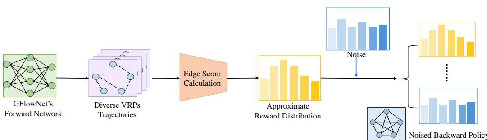
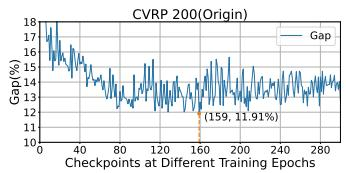
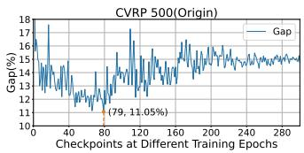
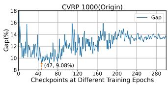
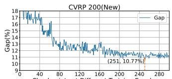
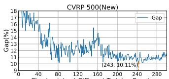
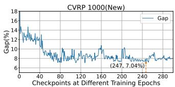

# DEG: Diffusion-Enhanced GFlowNet for Solving Vehicle Routing Problems

Ni Zhang1, Zhiqin Zhang1, Ling Pan2, Hoong Chuin Lau1, Zhiguang Cao1 1Singapore Management University

2 Hong Kong University of Science and Technology

ni.zhang.2025@phdcs.smu.edu.sg, zhiqinzhang@smu.edu.sg, lingpan@ust.hk hclau@smu.edu.sg, zgcao@smu.edu.sg

## Abstract

Traditional neural solvers for solving vehicle routing problems (VRPs) often suffer from limited solution diversity, motivating the development of Generative Flow Network (GFlowNet)–based models. However, the effectiveness of these models is frequently constrained by insufficient flow expansion in high-reward regions, limiting their ability to distribute probability across promising solution routes. The deeper exploration could yield superior results. Diffusion models, in contrast, provide stronger structural guidance for exploration. These two paradigms are naturally complementary: GFlowNet can supply edge-level signals for diffusion to embed, while diffusion can guide broader exploration. Leveraging this synergy, we propose Diffusion-Enhanced GFlowNet (DEG), a novel framework that integrates GFlowNet with a diffusion model to encourage richer flow expansion toward highreward regions and derive higher-quality solutions. Specifically, DEG exploits GFlowNet’s inherent diversity to generate edge-specific backward signals, applies the stochastic noise schedule of diffusion to perturb these signals, and then denoises them within the GFlowNet paradigm. To further improve scalability, we introduce a specialized decoder capable of dynamically adapting to diverse problem scales. Extensive experimental evaluations on synthetic and real-world datasets, including instances with up to 10,000 nodes, demonstrate that DEG consistently achieves favorable performance compared to baseline methods. The code is available at https://github.com/ZHANG-NI/DEG.

## 1 Introduction

The Vehicle Routing Problem (VRP) is a fundamental NP-hard combinatorial optimization problem that generalizes the Traveling Salesman Problem (TSP) by incorporating practical constraints such as vehicle capacity limitations and route feasibility requirements. The objective of VRPs is to minimize overall travel costs by determining optimal routes for a fleet of vehicles dispatched from a central depot to serve multiple customers while satisfying these constraints. VRPs are central to a wide range of applications, including logistics and distribution planning [6, 7, 11, 22, 29, 33, 67], agricultural field operations [57, 60, 55], and urban delivery systems [10, 17, 14]. Owing to their importance, VRPs have attracted extensive research attention. Traditional metaheuristics [8, 2, 40, 44, 13, 31, 48, 41, 3] have demonstrated effectiveness in solving VRPs. However, they are often computationally expensive and heavily dependent on carefully designed solution components and extensive hyperparameter tuning tailored to specific instances. These limitations have spurred growing interest in deep learning–based neural solvers, which aim to provide data-driven heuristics that improve inference efficiency while reducing reliance on expert knowledge.

Recent neural solvers for VRPs can be broadly categorized into Autoregressive (AR) and Non-Autoregressive (NAR) models. AR models, such as those based on pointer networks and Transformer architectures [32, 38, 9, 24, 62], have achieved strong solution quality. However, their sequential decoding process introduces significant computational bottlenecks, limiting scalability to large instances. NAR models provide a promising alternative by generating complete solutions in a single forward pass, greatly improving inference efficiency. Early NAR methods, however, struggled with solution quality, motivating the development of Generative Flow Network (GFlowNet) [4, 5]. While GFlowNet-based solvers [68, 27, 66] leverage sampling diversity to improve solution quality, they often converge to sub-optimal route subsets and fail to fully explore high-reward regions, leading to insufficient flow expansion into these more promising areas and hindering the discovery of higher-quality solutions.

Diffusion models [52, 21] recently emerged as a powerful approach in the VRP domain for their strong exploration capability [54, 34, 35, 56]. Yet existing diffusion-based methods remain largely confined to the TSP and depend on supervised frameworks to generate edge-level noise signals. While GFlowNet and diffusion models each have distinct strengths and limitations, their integration for VRP solving has not been explored. These two paradigms are naturally complementary: diffusion can guide GFlowNet toward more effective flow expansion in high-reward regions, and GFlowNet can provide edge-level signals and extend the applicability of diffusion methods.

Based on this, we propose Diffusion-Enhanced GFlowNet (DEG), a novel framework that integrates GFlowNet with diffusion models for solving VRPs. DEG leverages the intrinsic diversity of GFlowNet to generate edge-specific backward signals, which serve as a noise basis for the diffusion process. Unlike conventional trajectory-level backward signals that collapse into a single aggregated value, edge-specific signals provide richer structure for diffusion noise modeling. DEG perturbs these signals with a stochastic noise schedule and denoises them within the GFlowNet paradigm, preventing premature convergence to sub-optimal policies and promoting broader exploration of high-reward regions. This mechanism enhances forward probability allocation across promising routes and enables more effective flow expansion, enabling the discovery of higher-quality solutions. To further enhance generalization across varying problem scales, we develop the Graph-Scale Adapter (GSA), a specialized module that aligns spatial statistics across different graph scales and significantly improves scalability. Experimental evaluations demonstrate DEG’s strong performance and scalability on both TSP and Capacitated Vehicle Routing Problem (CVRP), achieving competitive results compared to existing baselines and exhibiting robustness on instances containing up to 10,000 nodes. Our contributions are summarized as follows:

• We propose Diffusion-Enhanced GFlowNet (DEG), which leverages intrinsic diversity of GFlowNet to generate edge-specific backward signals that serve as the adaptive noise basis for integrating diffusion, then applies the diffusion’s noise schedule to inject noise into these signals, and denoises them through the GFlowNet paradigm, enabling deeper flow expansion toward high-reward regions to derive better solutions.

• We design the Graph-Scale Adapter (GSA) to align spatial statistics across varying instance sizes, which enhances the model’s ability to generalize to large-scale problems.

• We conduct comprehensive experiments on TSP and CVRP, and results show that DEG consistently achieves favorable results on both synthetic and real-world datasets.

## 2 Related Work

The deep learning based neural solvers for VRPs can be broadly classified into Autoregressive (AR) and Non-Autoregressive (NAR) methods, respectively.

AR methods sequentially construct solutions step-by-step, conditioned on previously selected nodes. Transformer-based architectures have been particularly influential due to their ability to effectively capture long-range dependencies. A notable early example is the Attention Model (AM) [30], which applies self-attention mechanisms to enable end-to-end routing policy learning. To further enhance solution diversity and robustness, POMO [32] builds on AM by employing multi-start policy optimization, exploring multiple potential optimal paths simultaneously. Building on the strengths of autoregressive architectures, LEHD [38] introduces a light-encoder, heavy-decoder design, achieving substantial performance gains across standard VRP benchmarks.

NAR methods, by contrast, generate complete solutions in a single forward pass, drastically reducing inference time and enabling parallel solution generation. This characteristic makes them particularly appealing for large-scale applications. Diffusion-based models represent a recent and promising class of NAR approaches. DIFUSCO [54] is a pioneering diffusion-based model tailored for the TSP variant of VRPs. Building upon this foundation, T2T [34], Fast T2T [35] and DEITSP [56] significantly improve solution quality while retaining inference efficiency. However, all these diffusion-based methods rely on supervised learning with optimal solutions and are mainly limited to TSP. GFlowNet based solvers form another mainstream approach. GFACS [27] employs GFlowNet to enhance the ACO heuristic. AGFN [68] adopts an adversarial strategy to generate routes in an end-to-end manner. Different from those methods, in this work, we propose Diffusion-Enhanced GFlowNet (DEG), which leverages diffusion to enhance the exploration of high-reward regions, thereby improving the solution quality for VRPs.

## 3 Preliminary

Problems Definition. In both the TSP and CVRP, the instance is defined on a complete graph $\mathcal { G } = ( \nu , \mathcal { E } )$ , where $\mathcal { V } = \{ n _ { 0 } , n _ { 1 } , . . . , n _ { v } \}$ denotes the set of nodes and $\mathcal { E }$ the set of edges. The cost $d ( n _ { i } , n _ { j } )$ associated with each edge is typically defined as the Euclidean distance between nodes $n _ { i }$ and $n _ { j }$ . In the TSP, the objective is to find a minimum-cost Hamiltonian circuit that visits all nodes exactly once. In the CVRP, $n _ { 0 }$ represents the depot, and the remaining nodes correspond to customers with non-negative demands $d _ { i }$ . The goal is to construct a set of depot-rooted routes $\tau = \{ q _ { 1 } , \dots , q _ { N } \}$ such that each customer is visited exactly once, the total demand on each route does not exceed the vehicle capacity $C ,$ and the overall travel cost is minimized.

Diffusion Models. Diffusion models have recently emerged as powerful generative approaches, achieving favorable results in domains such as image synthesis [52, 21, 49, 15], audio generation [23, 28], and drug design [51, 58]. Diffusion models operate by corrupting clean inputs with noise and denoise them to reconstruct the original data. Typically, given a clean input $x _ { 0 } .$ , the noise process perturbs it by adding Gaussian noise to obtain a noisy sample $x _ { t }$ at time step $t ,$ following

$$
q ( x _ { t } \mid x _ { 0 } ) = { \mathcal { N } } ( x _ { t } ; { \sqrt { \alpha _ { t } } } x _ { 0 } , ( 1 - \alpha _ { t } ) \mathbf { I } ) ,\tag{1}
$$

where $\alpha _ { t } ~ \in ~ ( 0 , 1 )$ controls the noise level. The model can capture the structure of the target distribution by extracting meaningful signals from noisy states and recovering the original data.

GFlowNet. Generative Flow Network (GFlowNet) is a variational inference algorithm that treat sampling from a target probability distribution as a sequential decision-making process [4, 5], and is widely applied to structured generation tasks, including molecule design [43, 26, 69], neural architecture search [53, 25], and combinatorial optimization [65, 63, 12]. The objective of GFlowNet is to learn a policy that samples objects in proportion to a given reward distribution. From a high-level perspective, a GFlowNet consists of two complementary components: forward sampling policy and backward policy. The forward pass includes the source flow $\bar { Z } ( \mathcal { G } ; \theta )$ and a forward policy $P _ { F } ( \tau ; \theta )$ that governs trajectory construction from initial to terminal states. The backward pass includes the reward function $R ( \tau )$ and a backward policy $P _ { B } ( \tau )$ that defines reverse transitions. Together, these bidirectional passes form the basis for training via trajectory balance objectives [39], defined as:

$$
\mathcal { L } _ { \mathrm { T B } } ( \tau ; \theta ) = \left( \log \frac { Z ( \mathcal { G } ; \theta ) P _ { F } ( \tau ; \theta ) } { R ( \tau ) P _ { B } ( \tau ) } \right) ^ { 2 } .\tag{2}
$$

## 4 Diffusion-Enhanced GFlowNet

We introduce Diffusion-Enhanced GFlowNet (DEG), a framework designed to overcome a core limitation of existing GFlowNet-based VRP solvers, namely, their inability to effectively expand flow toward high-reward regions. DEG integrates GFlowNet with diffusion by leveraging edge-specific backward signals, which serve as a structured noise basis for the diffusion process. A stochastic noise schedule perturbs these signals, which are subsequently denoised within the GFlowNet paradigm, enabling richer exploration and more sufficient flow expansion. To further strengthen scalability and inference quality across varying problem sizes, DEG incorporates a Graph-Scale Adapter (GSA) decoder, which dynamically aligns spatial statistics across different graph scales.

  
Figure 1: Illustration of Edge-specific Backward Signals Generation and Noise Schedule.

## 4.1 Edge-specific Backward Signals and Noise Schedule

Figure 1 illustrates the generation of edge-specific backward signals and noise schedule. We first use GFlowNet to generate a diverse set of trajectories and assign standardized scores to each edge, estimating an approximate reward distribution that serves as edge-specific backward signals. Although the individual trajectories produced during GFlowNet sampling may not be optimal, their collective information forms a robust reward distribution that guides the diffusion learning process. A noise schedule then injects controlled noise into this distribution to derive a noised backward policy.

By leveraging the inherent diversity of GFlowNet, the model can generate a wide range of trajectories, after which the edge score calculation is applied. The edge score calculation begins by normalizing the reward of each trajectory $\tau _ { k } \in \mathcal { T }$ using the following formulation:

$$
- \log R ( \tau _ { k } ) = D ( \tau _ { k } ) - \frac { 1 } { m } \sum _ { l = 1 } ^ { m } D ( \tau _ { l } ) ,\tag{3}
$$

where $D ( \tau _ { k } )$ is the total distance of trajectory $\tau _ { k }$ , defined as: $\begin{array} { r } { D ( \tau _ { k } ) = \sum _ { l = 1 } ^ { N - 1 } d ( q _ { l } , q _ { l + 1 } ) } \end{array}$ . Here, $d ( q _ { l } , q _ { l + 1 } )$ denotes the Euclidean distance between nodes $q _ { l }$ and $q _ { l + 1 } . \mathrm { ~ \ } \mathsf { A }$ higher reward $R ( \tau _ { k } )$ corresponds to a shorter, higher-quality trajectory. We define the reward of an edge e as the average reward of the trajectories in which it appears:

$$
R ( e ) = \frac { 1 } { \lvert \{ \tau _ { k } \mid \tau _ { k } \in \mathcal { T } , \ e \in \tau _ { k } \} \rvert } \sum _ { \tau _ { k } \in \mathcal { T } , \ e \in \tau _ { k } } R ( \tau _ { k } ) ,\tag{4}
$$

where the denominator counts the number of trajectories containing edge e. This edge-level reward $R ( e )$ reflects the global significance of edge e across the sampled solution space. To standardize $R ( e )$ across different instances, we use z-score normalization [42]: $\begin{array} { r } { { \hat { R } } ( e ) \mathrm { ~ = ~ } \frac { R ( e ) - \mu _ { R } } { \sigma _ { R } } } \end{array}$ , where $\mu _ { R }$ and $\sigma _ { R }$ denote the mean and standard deviation of edge rewards within the instance. To convert the standardized scores into bounded confidence values, we apply the cumulative distribution function (CDF) [50] of the standard normal distribution:

$$
\boldsymbol { x } _ { 0 } = \boldsymbol { \Phi } \left( \hat { R } ( \boldsymbol { e } ) \right) ,\tag{5}
$$

where $\Phi ( \cdot )$ denotes the CDF of the standard normal distribution. The value $x _ { 0 }$ represents an approximate reward distribution that provides edge-specific backward signals and serves as the basis for adding noise to integrate diffusion into GFlowNet. The noise schedule then injects Gaussian noise at each training step to obtain a noised backward policy $x _ { t } \colon$

$$
\begin{array} { r } { x _ { t } = \sqrt { \alpha _ { t } } \cdot x _ { 0 } + \sqrt { 1 - \alpha _ { t } } \cdot \epsilon , \quad \epsilon \sim \mathcal { N } ( 0 , 1 ) , } \end{array}\tag{6}
$$

where $\begin{array} { r } { \alpha _ { t } = \prod _ { k = 1 } ^ { t } ( 1 - \beta _ { k } ) } \end{array}$ , and $\beta _ { k } \in ( 0 , 1 )$ is the corruption ratio at diffusion step $k .$ To ensure full transformation of the clean signal into noise by the final training iteration $I , \beta _ { k }$ should be defined such that $\begin{array} { r } { \prod _ { k = 1 } ^ { I } ( 1 - \beta _ { k } ) \approx 0 } \end{array}$ . We use continuous Gaussian noise to match the inherently continuous nature of the backward policy in GFlowNet.

Effect of Edge-specific Backward Signals and Noise Schedule on High-Reward Region Exploration. DEG uses a noise schedule that progressively corrupts the edge-specific backward signals during training, together with the Trajectory Balance (TB) objective [39]. We characterize the learning target induced by this schedule at each noise level, with proofs provided in Appendix B. In practice, the noised signal is clamped as $\tilde { x } _ { t } [ e ] = \operatorname* { m a x } ($ (clamp $( x _ { t } [ \bar { e } ] , 0 , 1 ) , \bar { \delta } ) \in [ \delta , 1 ]$ with $\delta = 1 0 ^ { - 1 0 }$ ensuring that the backward-side trajectory weight $\begin{array} { r } { W _ { t } ( \tau ) = \prod _ { e \in \tau } \tilde { x } _ { t } [ e ] } \end{array}$ , which replaces $P _ { B } ( \tau )$ in $\mathcal { L } _ { \mathrm { T B } } \left( \mathrm { E q . } 2 \right)$ , remains strictly positive.

Because TB minimizes a squared log-ratio, the injected noise affects the optimum through $\mathbb { E } _ { \epsilon } [ \log W _ { t } ( \tau ) ]$ . For a fixed graph $\mathcal { G }$ and signal $x _ { 0 }$ , the population minimizer at noise level t is

$$
P _ { F } ^ { t } ( \tau ) \propto R ( \tau ) e ^ { \mu _ { t } ( \tau ) } , \qquad \mu _ { t } ( \tau ) = \sum _ { e \in \tau } \mathbb { E } _ { \epsilon } \bigl [ \log \tilde { x } _ { t } [ e ] \bigr ] ,\tag{7}
$$

which holds exactly at every noise level (Proposition 1). The target can therefore be viewed as rewardproportional sampling modified by an edge-specific factor, whose dependence on x0 is gradually reduced by the noise schedule. At the beginning of training, no noise is added $( \bar { \alpha } _ { t } = 1 )$ , giving

$$
P _ { F } ^ { 0 } ( \tau ) \propto R ( \tau ) \prod _ { e \in \tau } x _ { 0 } [ e ] .\tag{8}
$$

Compared with $\pi _ { R } \propto R$ , this distribution gives more weight to trajectories containing high-scoring edges. Its expected reward is higher than that of $\pi _ { R }$ whenever $\textstyle \prod _ { e \in \tau } x _ { 0 } [ e ]$ is positively correlated with $R ( \tau )$ (Proposition 2), which motivates constructing $x _ { 0 }$ from edge-reward statistics. This early stage therefore favors exploitation. Only when $\begin{array} { r } { \prod _ { e \in \tau } x _ { 0 } \hat { [ e ] } \propto R ( \tau ) } \end{array}$ does Eq. 8 reduce to $P _ { F } \propto R ( \bar { \tau } ) ^ { 2 } ;$ ; our CDF-based construction of $x _ { 0 }$ does not assume this special case.

As the noise increases, the influence of $x _ { 0 }$ weakens. At full corruption $( \bar { \alpha } _ { t } = 0 ) , \tilde { x } _ { t } [ e ]$ is independent of $x _ { 0 }$ , and $\mu _ { t } ( \tau ) = c _ { T } | \tau |$ for a constant $c _ { T }$ . For TSP, all tours contain exactly n edges, so this term is identical across trajectories and

$$
P _ { F } ( \tau ) \propto R ( \tau ) .\tag{9}
$$

Before reaching this endpoint, $\mathrm { K L } ( P _ { F } ^ { t } \| \pi _ { R } )$ admits a bound that decreases to zero as $\bar { \alpha } _ { t } \ \to \ 0$ (Theorem 1), providing a useful characterization of the late training stage. For CVRP, a trajectory with $K ( \tau )$ routes contains $n { + } K ( \tau )$ edges. The endpoint target therefore becomes $P _ { F } ( \tau ) \propto R ( \tau ) e ^ { c _ { T } K ( \tau ) }$ with $c _ { T } < 0$ . It is reward-proportional among solutions with the same number of routes, while additionally favoring solutions with fewer routes (Remark 2).

Overall, the noise schedule gradually removes the edge-specific factor from the learning target, moving from the edge-guided distribution in Eq. 8 toward the reward-proportional distribution in Eq. 9. This gives a natural transition from early exploitation to broader exploration.

## 4.2 Diffusion-enhanced GFlowNet Framework

In our framework, the model learns to construct solutions by drawing on both the noisy backward policy and the reward within the GFlowNet paradigm, which denoises the noised backward policy during training by extracting its informative weights, and using them to enhance forward-policy learning. The loss over a set of trajectories $\mathcal { T } = \{ \tau _ { 1 } , \tau _ { 2 } , \dots , \tau _ { m } \}$ , based on the denoised forward policy which estimates reward distribution, is defined as:

$$
\mathcal { L } ( \mathcal { T } ; \theta ) = \sum _ { k = 1 } ^ { m } \left( \log \frac { Z ( \mathcal { G } ; \theta ) P _ { F } ( \tau _ { k } ; \pmb { \theta } ) } { R ( \tau _ { k } ) P _ { B } ( \tau _ { k } ) } \right) ^ { 2 } .\tag{10}
$$

Here, source flow $Z ( { \mathcal { G } } ; { \boldsymbol { \theta } } )$ is a learnable partition function derived from Eq. 15, and reward $R ( \tau _ { k } )$ is defined in Eq. 3. The forward probability $P _ { F } ( \tau _ { k } ; \theta )$ is computed as:

$$
P _ { F } ( \tau _ { k } ; \pmb \theta ) = \prod _ { t = 1 } ^ { N } P _ { F } ( s _ { t } | s _ { t - 1 } ; \pmb \theta ) ,\tag{11}
$$

where $s _ { t } = \{ q _ { 1 } , q _ { 2 } , . . . , q _ { t } \}$ denotes the state at step t during the construction (or destruction) of the trajectory. The term $\tilde { P _ { F } ( s _ { t } | s _ { t - 1 } ) }$ is obtained from the forward policy $\eta ( \mathcal { G } ^ { * } , \pmb \theta )$ , which is derived from the GFlowNet forward network described in Sec. A.1.

Moreover, $\eta ( \mathcal { G } ^ { * } , \pmb \theta )$ can be viewed as a heatmap over all edges of the current graph: it is a $| V | \times | V |$ probability matrix where each entry $\eta ( i , j )$ gives the likelihood of selecting the edge $( v _ { i } , v _ { j } )$ from the current node $v _ { i }$ to a candidate node $v _ { j }$ . During decoding, the next node of the route is sampled according to these edge probabilities. After each selection, the graph state $\mathcal { G } ^ { * }$ is updated by marking the chosen node as visited and updating feasibility masks (e.g., vehicle capacity), and the process is repeated until all customers are visited and a complete route is constructed.

Similarly, the backward transition probability $P _ { B } ( \tau _ { k } )$ in Eq. 10 is computed as:

$$
P _ { B } ( \tau _ { k } ; \pmb \theta ) = \prod _ { k = 1 } ^ { N } P _ { B } ( s _ { k - 1 } | s _ { k } ; \pmb \theta ) ,\tag{12}
$$

where $P _ { B } ( s _ { t - 1 } \mid s _ { t } ; \pmb \theta )$ is derived from the noised backward policy $x _ { t }$ . Specifically, for a partial route state $s _ { t } = \{ q _ { 1 } , q _ { 2 } , . . . , q _ { t } \}$ , this corresponds to removing the last node $q _ { t }$ from the current partial route, which eliminates the edge $( q _ { t } , q _ { t - 1 } )$ . Thus $P _ { B } ( s _ { t - 1 } \mid s _ { t } ; \pmb \theta )$ is taken directly from the value of $x _ { t }$ at the position $( q _ { t } , q _ { t - 1 } )$ .

## 4.3 Graph-Scale Adapter for Inference

During training, we adopt GFlowNet’s inherent sampling strategy to generate diverse trajectories to provide edge-specific signal. This enables efficient sampling and strengthens training effectiveness, with a dedicated model trained for a specific problem size. However, this strategy does not generalize well at inference time due to scale mismatches between training and test instances.

Specifically, the DEG forward policy learns an approximate reward distribution guided by feedback from the noisy backward flow. However, this design may increase the risk of overfitting to spatial patterns specific to the training scale, such as average neighbor distances and node observation radii defined by the sparsity factor w. For example, when trained on 100-node instances, the model implicitly learns to solve instances with an average neighbor distance of approximately $\frac { 1 } { \sqrt { 1 0 0 } }$ and a node observation distance of $\scriptstyle { \frac { 1 } { \sqrt { w } } }$ . When evaluated on a 500-node instance, however, the average neighbor distance drops to $\scriptstyle { \frac { 1 } { \sqrt { 5 0 0 } } }$ , while the observation distance becomes $\scriptstyle { \frac { 1 } { \sqrt { 5 w } } }$ . This spatial inconsistency hampers generalization and often leads to suboptimal inference. The best outcomes of large-scale instances appear at earlier training stages, when the model has not yet overfitted and its estimation of spatial structures remains effective and less biased. We empirically validate this behavior, with details provided in Appendix C.1.

To mitigate this issue, we propose the Graph-Scale Adapter (GSA), which aligns the spatial patterns of test instances to those of fixed-size training instances. GSA introduces a scaling factor α that adjusts node distances and the sparsity factor in the test graph to match the spatial characteristics of the training graph. The scaling factor is defined as: $\alpha \propto \sqrt { \frac { | \mathcal { V } _ { \mathrm { t e s t } } | } { | \mathcal { V } _ { \mathrm { t r a i n } } | } }$ . This adjustment ensures structural consistency across different scales. For instance, if the model is trained on 100-node graphs and evaluated on 500-node graphs, applying GSA ensures that the average neighbor distances and node observation radius remain consistent, approximately $\frac { 1 } { \sqrt { 1 0 0 } }$ and $\frac { 1 ^ { - } } { \sqrt { w } }$ . To assess the effectiveness of GSA, we apply it during inference on instances of varying sizes. As shown in Appendix C.1, GSA effectively alleviates spatial mismatches caused by scale-specific overfitting and significantly improves the model’s ability to generalize across a broad range of instance sizes.

## 5 Experiments

We present experimental results to evaluate the performance of DEG. We first assess its effectiveness on both synthetic instances for TSP and CVRP following previous works [27, 68]. Since our model integrates GFlowNet with diffusion, we primarily compare it against GFlowNet-based and diffusionbased baselines. We then evaluate the model’s generalization ability on public benchmarks, including TSPLib [1] and CVRPLib [47]. Finally, we conduct ablation studies to examine the contribution of individual components in DEG. We additionally conduct more experiments on multiple scale training, GSA applicability, diversity test, learning efficiency and applicability to other COPs, the details of which are presented in Appendix C.4 to C.7

Following prior work on VRP [54, 27, 68, 64, 56], we use synthetic datasets for training both TSP and CVRP models. Each TSP instance consists of nodes represented only by their 2D coordinates, sampled independently from the unit square $[ 0 , 1 ] ^ { 2 }$ , without any depot or demand. The objective is to compute the shortest tour that visits each node exactly once and returns to the start. For CVRP, each instance includes a single depot and multiple customer nodes served by a vehicle with a fixed capacity $C = 5 0$ . Node locations (both depot and customers) are uniformly sampled from $[ 0 , 1 ] ^ { 2 }$ Each customer is assigned a demand independently drawn from a uniform distribution $U [ a , b ]$ , where a = 1 and $b = 9$ . For training, DEG is trained on 100-node instances for both TSP and CVRP. For evaluation, we generate synthetic test sets containing 128 instances per problem size, ranging from 500 to 10,000 nodes (500, 1,000, 3,000, 5,000, 8,000 and 10,000).

Table 1: Comparison of performance and runtime on TSP with varying node sizes. Obj. denotes the total route length; Gap (%) is computed relative to LKH; and Time (s) indicates the average time required to solve a single instance. For all metrics, lower values indicate better results.
<table><tr><td rowspan="2">Method</td><td colspan="3">500</td><td colspan="3">1000</td><td colspan="3">3000</td></tr><tr><td>Obj.</td><td>Time(s)</td><td>Gap(%)</td><td>Obj.</td><td>Time(s)</td><td>Gap(%)</td><td>Obj.</td><td>Time(s)</td><td>Gap(%)</td></tr><tr><td>LKH</td><td>16.55</td><td>31.80</td><td></td><td>23.14</td><td>97.62</td><td></td><td>40.31</td><td>776.23</td><td></td></tr><tr><td>GFACS (AISTATS’25)</td><td>22.97</td><td>8.43</td><td>38.79</td><td>38.58</td><td>18.90</td><td>66.72</td><td>69.63</td><td>81.15</td><td>72.74</td></tr><tr><td>AGFN (ICLR’25)</td><td>19.04</td><td>0.25</td><td>15.05</td><td>27.10</td><td>0.68</td><td>17.11</td><td>55.37</td><td>2.91</td><td>37.36</td></tr><tr><td>DIFUSCO (NeurIPS’23)</td><td>19.12</td><td>3.52</td><td>15.17</td><td>27.70</td><td>13.60</td><td>19.71</td><td>50.39</td><td>125.02</td><td>25.01</td></tr><tr><td>T2T (NeurIPS&#x27;23)</td><td>18.91</td><td>3.18</td><td>14.26</td><td>27.31</td><td>12.95</td><td>18.02</td><td>56.99</td><td>115.71</td><td>41.38</td></tr><tr><td>Fast T2T (NeurIPS’24)</td><td>18.76</td><td>0.37</td><td>13.35</td><td>27.25</td><td>1.54</td><td>17.76</td><td>57.73</td><td>4.76</td><td>43.22</td></tr><tr><td>DEITSP (KDD&#x27;25)</td><td>18.64</td><td>0.42</td><td>12.63</td><td>27.11</td><td>1.68</td><td>17.16</td><td>54.37</td><td>5.35</td><td>34.81</td></tr><tr><td>DEG</td><td>18.47</td><td>0.28</td><td>11.60</td><td>26.46</td><td>0.72</td><td>14.35</td><td>47.82</td><td>3.06</td><td>18.63</td></tr><tr><td rowspan="2">Method</td><td></td><td>5000</td><td></td><td></td><td>8000</td><td></td><td></td><td>10000</td><td></td></tr><tr><td>Obj.</td><td>Time(s)</td><td>Gap(%)</td><td>Obj.</td><td>Time(s)</td><td>Gap(%)</td><td>Obj.</td><td>Time(s)</td><td>Gap(%)</td></tr><tr><td>LKH</td><td>51.84</td><td>1608.11</td><td></td><td>65.89</td><td>4123.37</td><td></td><td>75.78</td><td>5350.91</td><td></td></tr><tr><td>GFACS (AISTATS’25)</td><td>97.93</td><td>143.19</td><td>88.91</td><td>120.76</td><td>275.22</td><td>83.28</td><td>140.84</td><td>326.04</td><td>85.85</td></tr><tr><td>AGFN (ICLR’25)</td><td>80.93</td><td>6.65</td><td>56.12</td><td>118.53</td><td>13.09</td><td>79.89</td><td>143.85</td><td>14.07</td><td>89.83</td></tr><tr><td>DIFUSCO (NeurIPS’23)</td><td></td><td></td><td></td><td></td><td></td><td></td><td></td><td></td><td></td></tr><tr><td>T2T (NeurIPS’23)</td><td></td><td></td><td></td><td></td><td></td><td></td><td>一</td><td>一</td><td></td></tr><tr><td>Fast T2T (NeurIPS’24)</td><td>一</td><td></td><td></td><td></td><td></td><td></td><td>一</td><td></td><td></td></tr><tr><td>DEITSP (KDD&#x27;25)</td><td></td><td></td><td></td><td></td><td></td><td></td><td></td><td></td><td></td></tr><tr><td>DEG</td><td>63.64</td><td>6.82</td><td>22.57</td><td>83.13</td><td>14.97</td><td>26.16</td><td>94.67</td><td>16.47</td><td>24.94</td></tr></table>

“–” indicates that the model was unable to produce a result for a given instance either within the 90-minute time limit or due to GPU memory constraints.

Following standard practice [54, 56, 18], we adopt a linear noise schedule with $\beta _ { 1 } = 1 0 ^ { - 4 }$ and $\beta _ { I } = 0 . 0 \bar { 2 }$ The model is trained for I = 6000 steps, using a batch size of 10 instances per step. We use the AdamW optimizer [36] with an initial learning rate of $1 0 ^ { - 4 }$ , decayed to $1 0 ^ { - 5 }$ via a CosineAnnealingLR schedule [37]. All experiments are conducted on a system with an NVIDIA H100 NVL GPU and an AMD EPYC 9554 CPU.

## 5.1 Comparison Study on TSP

As prior diffusion-based work has primarily focused on the TSP [54, 34, 35, 56] in the VRP domain, we first evaluate DEG on synthetic TSP instances. Besides the heuristic solver LKH [20], we mainly compare it against both GFlowNet-based solvers including GFACS [27] and AGFN [68], and diffusion-based solvers including DIFUSCO [54], T2T [34], Fast T2T [35], and DEITSP [56]. All models are trained on 100-node instances. To ensure fair comparison, and due to space constraints, Table 1 reports the performance of models without 2-opt post-processing. Following [54, 34, 35, 56], results with 2-opt post-processing are provided in Appendix C.2 and Table 6 for completeness. We also provide the comparison on small-scale instances in Appendix C.3 and Table 7.

As shown in Table 1, DEG outperforms all GFlowNet-based and diffusion-based solvers in terms of solution quality. Specially, it achieves improvements of up to 67.43%, 34.19%, 5.10%, 16.10%, 17.17%, and 12.05% over GFACS, AGFN, DIFUSCO, T2T, Fast T2T, and DEITSP, respectively. Notably, the performance gap between our model and other baselines becomes more significant as the instance size increases.

## 5.2 Comparison Study on CVRP

We present results on the CVRP instances, focusing primarily on comparisons with GFlowNet-based solvers, as no existing diffusion-based model is capable of solving CVRP. Besides the heuristic solver LKH [20], we compare DEG against GFlowNet-based solvers including GFACS [27] and AGFN [68], as well as other neural solvers such as LEHD [38] and POMO [32] to ensure comprehensive evaluation. For LKH, we use a setting of 1000 iterations on 3000-, 5000-, 8000- and 10000-node instances, as larger-scale problems require substantial computational time. Also, all neural models are trained on 100-node synthetic instances, and the routes are evaluated directly without postprocessing. Experimental results on small-scale instances are further provided in Appendix C.3, and the corresponding comparisons are summarized in Table 7.

Table 2: Comparison of performance and runtime on CVRP with varying node sizes. Obj. denotes the total route length; Gap (%) is computed relative to LKH; and Time (s) indicates the average time required to solve a single instance. For all metrics, lower values indicate better results.
<table><tr><td rowspan="2">Method</td><td colspan="3">500</td><td colspan="3">1000</td><td colspan="3"></td></tr><tr><td>Obj.</td><td>Time(s)</td><td>Gap(%)</td><td>Obj.</td><td>Time(s)</td><td>Gap(%)</td><td>Obj.</td><td>Time(s)</td><td>Gap(%)</td></tr><tr><td>LKH</td><td>63.14</td><td>134.40</td><td></td><td>119.52</td><td>638.40</td><td></td><td>380.26*</td><td>671.68</td><td></td></tr><tr><td>GFACS (AISTATS’25)</td><td>80.77</td><td>10.43</td><td>27.92</td><td>158.97</td><td>22.07</td><td>33.01</td><td>393.27</td><td>130.81</td><td>3.42</td></tr><tr><td>AGFN (ICLR’25)</td><td>71.05</td><td>0.43</td><td>12.53</td><td>133.97</td><td>0.75</td><td>12.09</td><td>368.97</td><td>3.84</td><td>-2.97</td></tr><tr><td>LEHD (NeurIPS&#x27;23)</td><td>64.68</td><td>0.52</td><td>2.44</td><td>122.85</td><td>10.15</td><td>2.79</td><td>355.95</td><td>33.75</td><td>-6.39</td></tr><tr><td>POMO (NeurIPS&#x27;20)</td><td>80.21</td><td>0.50</td><td>27.04</td><td>164.17</td><td>0.92</td><td>37.36</td><td>1094.48</td><td>7.01</td><td>187.82</td></tr><tr><td>POMO(*8) (NeurIPS&#x27;20)</td><td>75.45</td><td>0.67</td><td>19.50</td><td>135.74</td><td>3.13</td><td>12.74</td><td>704.99</td><td>18.26</td><td>85.40</td></tr><tr><td>DEG</td><td>69.76</td><td>0.45</td><td>10.48</td><td>129.67</td><td>0.80</td><td>8.49</td><td>362.11</td><td>4.08</td><td>-4.77</td></tr><tr><td rowspan="2">Method</td><td rowspan="2">Obj.</td><td>5000</td><td></td><td></td><td>8000</td><td></td><td></td><td>10000</td><td></td></tr><tr><td>Time(s)</td><td>Gap(%)</td><td>Obj.</td><td>Time(s)</td><td>Gap(%)</td><td>Obj.</td><td>Time(s)</td><td>Gap(%)</td></tr><tr><td>LKH(1000)</td><td>642.95*</td><td>2263.34</td><td></td><td></td><td></td><td></td><td></td><td></td><td></td></tr><tr><td>GFACS (AISTATS’25)</td><td>650.62</td><td>262.63</td><td>1.19</td><td>1038.30</td><td>529.04</td><td></td><td>1439.19</td><td>607.26</td><td></td></tr><tr><td>AGFN (ICLR’25)</td><td>608.58</td><td>7.42</td><td>-5.35</td><td>917.24</td><td>15.24</td><td></td><td>1140.46</td><td>18.58</td><td></td></tr><tr><td>LEHD (NeurIPS&#x27;23)</td><td>603.89</td><td>96.75</td><td>-6.08</td><td>938.06</td><td>336.70</td><td></td><td>1213.13</td><td>556.88</td><td></td></tr><tr><td>POMO (NeurIPS&#x27;20)</td><td>1438.97</td><td>19.32</td><td>123.81</td><td></td><td></td><td></td><td></td><td></td><td></td></tr><tr><td>POMO(*8) (NeurIPS&#x27;20)</td><td>1381.63</td><td>41.86</td><td>114.89</td><td></td><td></td><td></td><td></td><td></td><td></td></tr><tr><td>DEG</td><td>596.43</td><td>10.22</td><td>-7.24</td><td>907.65</td><td>20.32</td><td>一</td><td>1125.04</td><td>24.95</td><td>1</td></tr></table>

“–” indicates that the model was unable to produce a result for a given instance either within the 90-minute time limit or due to GPU memory constraints. \* denotes LKH run with 1,000 iterations due to time limits.

Table 3: Comparison of performance on TSPLib. Gap (%) is computed relative to existing best-known solutions, and lower values indicate better results.
<table><tr><td>TSP</td><td>GFACS</td><td>AGFN</td><td>DEG</td><td>DIFUSCO*</td><td>T2T*</td><td>Fast T2T*</td><td>DEITSP*</td><td>DEG*</td></tr><tr><td>50-200</td><td>29.60</td><td>19.41</td><td>14.37</td><td>0.96</td><td>0.37</td><td>0.26</td><td>0.81</td><td>0.21</td></tr><tr><td>200-1000</td><td>51.67</td><td>25.51</td><td>17.68</td><td>3.45</td><td>1.84</td><td>1.26</td><td>1.46</td><td>1.03</td></tr></table>

“–” indicates that the model was unable to produce a resultfor a given instance either within the 90-minute time limit or due to GPU memory constraints. \* represents using two-opt after trajectories are generated.

As shown in Table 2, DEG achieves better results than GFACS by 13.63%, 18.43%, 7.92%, 8.33%, 12.58% and 21.83% on the 500-, 1000-, 3000-, 5000-, 8000- and 10000-node instances, and outperforms AGFN by 1.82%, 3.21%, 1.86%, 2.00%, 1.05% and 1.35% on the same instance sizes. When compared to Transformer-based AR solvers, NAR methods often struggle to match their performance without the aid of improvement techniques, partly due to inherent limitations in network depth and complexity. Without relying on additional post-processing techniques, our model DEG is able to deliver competitive performance on large-scale instances, while also offering notable advantages in inference efficiency. Compared to state-of-the-art AR mode, LEHD, which adopts a heavy decoder transformer network, our model reduces the objective value by 1.24%, 3.28% and 7.26% on the 5000-, 8000- and 10000-node instances, respectively, and reduces inference time by 13.46%, 92.61%, 87.91%, 87.37%, 93.96% and 95.58% on 500-, 1000-, 3000-, 8000- and 5000-node instances. Furthermore, our model consistently outperforms POMO in objective value and achieves shorter inference time across all instance sizes. Overall, our model achieves competitive results against GFlowNet-based solvers and other neural models, and offers significantly shorter inference time, particularly on large-scale instances. Notably, DEG achieves better performance than both LEHD and POMO on real-world datasets, as detailed in Sec. 5.3 and Table 4.

Table 4: Comparison of performance on CVRPLib. Gap (%) is computed relative to existing bestknown solutions, and lower values indicate better results.
<table><tr><td>Gap(%)</td><td>L1 (3k)</td><td>L2 (4k)</td><td>A1 (6k)</td><td>A2 (7k)</td><td>G1 (10k)</td><td>G2 (11k)</td><td>B1 (15k)</td><td>B2 (16k)</td></tr><tr><td>GFACS</td><td>120.21</td><td>1800.04</td><td>114.37</td><td>238.19</td><td>278.11</td><td>2242.09</td><td>348.54</td><td>2634.74</td></tr><tr><td>AGFN</td><td>1144.20</td><td>27.88</td><td>29.64</td><td>24.58</td><td>142.65</td><td>27.21</td><td>20.63</td><td>160.24</td></tr><tr><td>LEHD</td><td>14.04</td><td>26.30</td><td>18.90</td><td>26.40</td><td>27.23</td><td>38.45</td><td>35.94</td><td>40.76</td></tr><tr><td>POMO</td><td>75.30</td><td>78.16</td><td>112.27</td><td>159.22</td><td></td><td></td><td></td><td></td></tr><tr><td>DEG</td><td>19.64</td><td>26.08</td><td>14.95</td><td>23.80</td><td>23.18</td><td>24.41</td><td>17.04</td><td>23.47</td></tr></table>

Table 5: Ablation Study on TSP and CVRP. Obj. denotes the total route length, and Gap (%) is computed relative to LKH; lower values indicate better results.
<table><tr><td rowspan="2">TSP</td><td colspan="2">500</td><td colspan="2">1000</td><td colspan="2">3000</td><td colspan="2">5000</td><td colspan="2">8000</td><td colspan="2">10000</td></tr><tr><td>Obj.</td><td>Gap(%)</td><td>Obj.</td><td>Gap(%)</td><td>Obj.</td><td>Gap(%)</td><td>Obj.</td><td>Gap(%)</td><td>Obj.</td><td>Gap(%)</td><td>Obj.</td><td>Gap(%)</td></tr><tr><td>Backbone</td><td>21.96</td><td>32.69</td><td>35.41</td><td>53.03</td><td>64.82</td><td>60.80</td><td>91.66</td><td>76.81</td><td></td><td></td><td></td><td>一</td></tr><tr><td>+ Diffusion</td><td>18.54</td><td>12.02</td><td>26.74</td><td>15.56</td><td>48.45</td><td>20.19</td><td>64.97</td><td>25.33</td><td></td><td></td><td></td><td></td></tr><tr><td>+ GSA</td><td>18.47</td><td>11.60</td><td>26.46</td><td>14.35</td><td>47.82</td><td>18.63</td><td>63.64</td><td>22.57</td><td>83.13</td><td>26.16</td><td>94.67</td><td>24.94</td></tr><tr><td rowspan="2">CVRP</td><td></td><td>500</td><td></td><td>1000</td><td></td><td>3000</td><td></td><td>5000</td><td></td><td>8000</td><td></td><td>10000</td></tr><tr><td>Obj.</td><td>Gap(%)</td><td>Obj.</td><td>Gap(%)</td><td>Obj.</td><td>Gap(%)</td><td>Obj.</td><td>Gap(%)</td><td>Obj.</td><td>Gap(%)</td><td>Obj.</td><td>Gap(%)</td></tr><tr><td>Backbone</td><td>76.88</td><td>21.76</td><td>148.61</td><td>24.34</td><td>389.18</td><td>2.35</td><td></td><td></td><td></td><td>I</td><td></td><td>一</td></tr><tr><td>+ Diffusion</td><td>70.86</td><td>12.23</td><td>132.65</td><td>10.74</td><td>368.99</td><td>-2.96</td><td>一</td><td></td><td></td><td>V</td><td></td><td></td></tr><tr><td>+ GSA</td><td>69.76</td><td>10.48</td><td>129.67</td><td>8.49</td><td>362.11</td><td>-4.77</td><td>596.43</td><td></td><td>907.65</td><td></td><td>1125.04</td><td>一 一</td></tr></table>

“–” indicates that the model was unable to produce a result for a given instance either within the 90-minute time limit or due to GPU memory constraints.

## 5.3 Inference on Real-World Dataset

To assess the generalization ability of our model, we evaluate it on real-world benchmark datasets, TSPLib [1] and CVRPLib [47].

Following prior works [54, 34, 35, 56], we evaluate our model on TSPLib with test instances ranging from 50 to 200 nodes and from 200 to 1000 nodes, respectively. We adopt the same experimental setup and baseline methods as described in Section 5.1. The results are reported in Table 3 in the Appendix. Our model outperforms GFACS and AGFN in gap by 51.45% and 25.97% on 200-500 node instances, and 65.78% and 30.69% on 500-1000 node instances, respectively. Compared to the diffusion-based models with two-opt post-processing, DEG achieves superior gap performance over DIFUSCO, DEITSP, T2T, and Fast T2T by 88.59%, 84.56%, 72.73% and 74.07% on 200-500 node instances, and 70.72%, 45.11%, 19.84% and 30.82% on 500-1000 node instances. Overall, our model outperforms both GFlowNet-based models and diffusion-based solvers on TSPLib, across both 50-200 and 200-1000 instances.

We test CVRPLib containing instances with the number of node ranging from 3000 to 16000. The experiment setting and baselines are same with comparison on CVRP benchmarks. As shown in Table 4, DEG achieves consistently lower optimality gaps than all baseline methods across a wide range of real-world CVRPLib instances. Compared to GFACS, DEG reduces the gap on the same set of instances. Compared to AGFN, our model reduces significant gap on the same set of instances. Relative to LEHD, DEG achieves gap improvements of 0.84% on L2, 20.89% on A1, 9.85% on A2, 14.87% on G1, 36.51% on G2, 52.59% on B1, and 42.42% on B2, while LEHD performs slightly better on L1. Finally, compared to POMO, our model significantly reduces the gap by 73.92%, 66.63%, 86.68%, and 85.05% on L1, L2, A1, and A2. These results demonstrate the superior scalability and generalization ability of DEG in solving large-scale real-world CVRP instances.

## 5.4 Ablation Study

Component Evaluation. We evaluate the contribution of each key component in DEG through an ablation study. We begin by training the backbone model, which involves learning a pure GFlowNet to generate trajectories, serving as the baseline for subsequent comparison. Next, we integrate the diffusion mechanism into the backbone by incorporating the reward-level feedback and noise schedule described in Sec.4.1, in order to evaluate the effectiveness of the diffusion component. Finally, the GSA decoder (Sec. 4.3) is applied on top of the previous model to assess its impact.

The results are presented in Table 5. Incorporating diffusion into the backbone leads to significant performance improvements. Adding the GSA module on top of the diffusion-enhanced model further improves performance on the TSP and CVRP across the same instance sizes. In addition to improving performance, GSA also reduces computational resource consumption by shortening the observation distance and decreasing the number of connections per node. As a result, the model is able to efficiently solve 10000-node TSP instances as well as 5000-, 8000- and 10000-node CVRP instances.

## 6 Conclusion

In this paper, we introduce Diffusion-Enhanced GFlowNet (DEG), a generative framework that integrates GFlowNet with diffusion to overcome key limitations of existing GFlowNet-based solvers for vehicle routing problems (VRPs). Specifically, their insufficient flow expansion in high-reward regions. To enable this integration, DEG leverages the intrinsic diversity of GFlowNet to provide edge-specific backward signals as a noise basis for diffusion integration. It then employs the diffusion’s noise schedule to inject noise into these signals, and denoises them through the GFlowNet paradigm, guiding sufficient flow expansion toward high-reward regions to derive better solutions. Furthermore, to enhance scalability and generalization ability, we incorporate a Graph-Scale Adapter (GSA) that enables effective adaptation across diverse instance sizes. Extensive experiments on synthetic benchmarks and real-world datasets, including instances with up to 10,000 nodes, show that DEG delivers favorable performance compared to diffusion-, GFlowNet-based and other neural baselines. These results demonstrate that DEG has strong scalability, efficient inference, and robus generalization for solving VRPs.

While DEG outperforms the strong AR model like LEHD in inference time and generalization, one of the limitations is that DEG’s parallel decoding still falls short in small-scale settings, where AR models excel at fine-grained path construction. Bridging this gap remains an important direction for our future work, which involves enhancing the local decision-making capacity of NAR models. In addition, extending DEG to a wider range of VRP variants is another venue we plan to explore.

## References

[1] Florian Arnold, Michel Gendreau, and Kenneth Sörensen. Efficiently solving very large-scale routing problems. Computers & operations research, 107:32–42, 2019.

[2] Barrie M Baker and MA1951066 Ayechew. A genetic algorithm for the vehicle routing problem. Computers & Operations Research, 30(5):787–800, 2003.

[3] John E Bell and Patrick R McMullen. Ant colony optimization techniques for the vehicle routing problem. Advanced engineering informatics, 18(1):41–48, 2004.

[4] Emmanuel Bengio, Moksh Jain, Maksym Korablyov, Doina Precup, and Yoshua Bengio. Flow network based generative models for non-iterative diverse candidate generation. Advances in Neural Information Processing Systems, 34:27381–27394, 2021.

[5] Yoshua Bengio, Salem Lahlou, Tristan Deleu, Edward J Hu, Mo Tiwari, and Emmanuel Bengio. Gflownet foundations. Journal ofMachine Learning Research, 24(210):1–55, 2023.

[6] DD Bochtis and Claus G Sørensen. The vehicle routing problem in field logistics part i. Biosystems engineering, 104(4):447–457, 2009.

[7] DD Bochtis and Claus G Sørensen. The vehicle routing problem in field logistics: Part ii. Biosystems engineering, 105(2):180–188, 2010.

[8] Olli Bräysy and Michel Gendreau. Genetic algorithms for the vehicle routing problem with time windows. Arpakannus,(1), pages 33–38, 2001.

[9] Xavier Bresson and Thomas Laurent. The transformer network for the traveling salesman problem. arXiv preprint arXiv:2103.03012, 2021.

[10] Francesco Carrabs, Raffaele Cerulli, and Anna Sciomachen. An exact approach for the grocery delivery problem in urban areas. Soft Computing, 21:2439–2450, 2017.

[11] Diego Cattaruzza, Nabil Absi, Dominique Feillet, and Jesús González-Feliu. Vehicle routing problems for city logistics. EURO Journal on Transportation and Logistics, 6(1):51–79, 2017.

[12] Yihang Chen and Lukas Mauch. Order-preserving gflownets. In The Twelfth International Conference on Learning Representations.

[13] Wen-Chyuan Chiang and Robert A Russell. Simulated annealing metaheuristics for the vehicle routing problem with time windows. Annals ofOperations Research, 63:3–27, 1996.

[14] Goran Cirovi ´ c, Dragan Pamu ´ car, and Darko Božani ˇ c. Green logistic vehicle routing problem: ´ Routing light delivery vehicles in urban areas using a neuro-fuzzy model. Expert Systems with Applications, 41(9):4245–4258, 2014.

[15] Prafulla Dhariwal and Alexander Nichol. Diffusion models beat gans on image synthesis. Advances in neural information processing systems, 34:8780–8794, 2021.

[16] Stefan Elfwing, Eiji Uchibe, and Kenji Doya. Sigmoid-weighted linear units for neural network function approximation in reinforcement learning. Neural networks, 107:3–11, 2018.

[17] Sotiris P Gayialis, Grigorios D Konstantakopoulos, and Ilias P Tatsiopoulos. Vehicle routing problem for urban freight transportation: A review of the recent literature. In Operational Research in the Digital Era–ICT Challenges: 6th International Symposium and 28th National Conference on Operational Research, Thessaloniki, Greece, June 2017, pages 89–104. Springer, 2019.

[18] Alexandros Graikos, Nikolay Malkin, Nebojsa Jojic, and Dimitris Samaras. Diffusion models as plug-and-play priors. Advances in Neural Information Processing Systems, 35:14715–14728, 2022.

[19] Jun Han and Claudio Moraga. The influence of the sigmoid function parameters on the speed of backpropagation learning. In International workshop on artificial neural networks, pages 195–201. Springer, 1995.

[20] Keld Helsgaun. An effective implementation of the lin–kernighan traveling salesman heuristic. European journal ofoperational research, 126(1):106–130, 2000.

[21] Jonathan Ho, Ajay Jain, and Pieter Abbeel. Denoising diffusion probabilistic models. Advances in neural information processing systems, 33:6840–6851, 2020.

[22] Yu-Hsiang Hsiao, Mu-Chen Chen, Kuan-Yu Lu, and Cheng-Lin Chin. Last-mile distribution planning for fruit-and-vegetable cold chains. The International Journal of Logistics Management, 29(3):862–886, 2018.

[23] Rongjie Huang, Jiawei Huang, Dongchao Yang, Yi Ren, Luping Liu, Mingze Li, Zhenhui Ye, Jinglin Liu, Xiang Yin, and Zhou Zhao. Make-an-audio: Text-to-audio generation with prompt-enhanced diffusion models. In International Conference on Machine Learning, pages 13916–13932. PMLR, 2023.

[24] Ziwei Huang, Jianan Zhou, Zhiguang Cao, and Yixin Xu. Rethinking light decoder-based solvers for vehicle routing problems. In International Conference on Learning Representations (ICLR), 2025.

[25] Zarif Ikram, Ling Pan, and Dianbo Liu. Evolution guided generative flow networks. In ICLR 2024 Workshop on Generative and Experimental Perspectives for Biomolecular Design.

[26] Moksh Jain, Emmanuel Bengio, Alex Hernandez-Garcia, Jarrid Rector-Brooks, Bonaventure FP Dossou, Chanakya Ajit Ekbote, Jie Fu, Tianyu Zhang, Michael Kilgour, Dinghuai Zhang, et al. Biological sequence design with gflownets. In International Conference on Machine Learning, pages 9786–9801. PMLR, 2022.

[27] Minsu Kim, Sanghyeok Choi, Hyeonah Kim, Jiwoo Son, Jinkyoo Park, and Yoshua Bengio. Ant colony sampling with gflownets for combinatorial optimization. In The 28th International Conference on Artificial Intelligence and Statistics, 2025.

[28] Zhifeng Kong, Wei Ping, Jiaji Huang, Kexin Zhao, and Bryan Catanzaro. Diffwave: A versatile diffusion model for audio synthesis. In International Conference on Learning Representations.

[29] Grigorios D Konstantakopoulos, Sotiris P Gayialis, and Evripidis P Kechagias. Vehicle routing problem and related algorithms for logistics distribution: A literature review and classification. Operational research, 22(3):2033–2062, 2022.

[30] Wouter Kool, Herke van Hoof, and Max Welling. Attention, learn to solve routing problems! In International Conference on Learning Representations, 2019.

[31] Yiyo Kuo. Using simulated annealing to minimize fuel consumption for the time-dependent vehicle routing problem. Computers & Industrial Engineering, 59(1):157–165, 2010.

[32] Yeong-Dae Kwon, Jinho Choo, Byoungjip Kim, Iljoo Yoon, Youngjune Gwon, and Seungjai Min. Pomo: Policy optimization with multiple optima for reinforcement learning. Advances in Neural Information Processing Systems, 33:21188–21198, 2020.

[33] Kaijun Leng and Shanghong Li. Distribution path optimization for intelligent logistics vehicles of urban rail transportation using vrp optimization model. IEEE Transactions on Intelligent Transportation Systems, 23(2):1661–1669, 2021.

[34] Yang Li, Jinpei Guo, Runzhong Wang, and Junchi Yan. T2t: From distribution learning in training to gradient search in testing for combinatorial optimization. Advances in Neural Information Processing Systems, 36:50020–50040, 2023.

[35] Yang Li, Jinpei Guo, Runzhong Wang, Hongyuan Zha, and Junchi Yan. Fast t2t: Optimization consistency speeds up diffusion-based training-to-testing solving for combinatorial optimization. Advances in Neural Information Processing Systems, 37:30179–30206, 2024.

[36] Ilya Loshchilov and Frank Hutter. Decoupled weight decay regularization. In International Conference on Learning Representations.

[37] Ilya Loshchilov and Frank Hutter. Sgdr: Stochastic gradient descent with warm restarts. In International Conference on Learning Representations, 2022.

[38] Fu Luo, Xi Lin, Fei Liu, Qingfu Zhang, and Zhenkun Wang. Neural combinatorial optimization with heavy decoder: Toward large scale generalization. Advances in Neural Information Processing Systems, 36:8845–8864, 2023.

[39] Nikolay Malkin, Moksh Jain, Emmanuel Bengio, Chen Sun, and Yoshua Bengio. Trajectory balance: Improved credit assignment in gflownets. Advances in Neural Information Processing Systems, 35:5955–5967, 2022.

[40] Mazin Abed Mohammed, Mohd Khanapi Abd Ghani, Raed Ibraheem Hamed, Salama A Mostafa, Mohd Sharifuddin Ahmad, and Dheyaa Ahmed Ibrahim. Solving vehicle routing problem by using improved genetic algorithm for optimal solution. Journal ofcomputational science, 21:255–262, 2017.

[41] Roberto Montemanni, Luca Maria Gambardella, Andrea Emilio Rizzoli, and Alberto V Donati. Ant colony system for a dynamic vehicle routing problem. Journal of combinatorial optimization, 10:327–343, 2005.

[42] Douglas C Montgomery and George C Runger. Applied statistics and probability for engineers. John wiley & sons, 2010.

[43] Andrei Cristian Nica, Moksh Jain, Emmanuel Bengio, Cheng-Hao Liu, Maksym Korablyov, Michael M Bronstein, and Yoshua Bengio. Evaluating generalization in gflownets for molecule design. In ICLR2022 Machine Learning for Drug Discovery, 2022.

[44] Ibrahim Hassan Osman. Metastrategy simulated annealing and tabu search algorithms for the vehicle routing problem. Annals ofoperations research, 41:421–451, 1993.

[45] Mingjun Pan, Guanquan Lin, You-Wei Luo, Bin Zhu, Zhien Dai, Lijun Sun, and Chun Yuan. Preference optimization for combinatorial optimization problems. In Forty-second International Conference on Machine Learning, 2025.

[46] Christian Prins. Two memetic algorithms for heterogeneous fleet vehicle routing problems. Engineering Applications of Artificial Intelligence, 22(6):916–928, 2009.

[47] Gerhard Reinelt. Tsplib—a traveling salesman problem library. ORSA journal on computing, 3(4):376–384, 1991.

[48] Andrea Emilio Rizzoli, Roberto Montemanni, Enzo Lucibello, and Luca Maria Gambardella. Ant colony optimization for real-world vehicle routing problems: from theory to applications. Swarm Intelligence, 1:135–151, 2007.

[49] Robin Rombach, Andreas Blattmann, Dominik Lorenz, Patrick Esser, and Björn Ommer. High resolution image synthesis with latent diffusion models. In Proceedings of the IEEE/CVF conference on computer vision and pattern recognition, pages 10684–10695, 2022.

[50] Sheldon M Ross. Introduction to probability models. Academic press, 2014.

[51] Arne Schneuing, Charles Harris, Yuanqi Du, Kieran Didi, Arian Jamasb, Ilia Igashov, Weitao Du, Carla Gomes, Tom L Blundell, Pietro Lio, et al. Structure-based drug design with equivariant diffusion models. Nature Computational Science, 4(12):899–909, 2024.

[52] Jascha Sohl-Dickstein, Eric Weiss, Niru Maheswaranathan, and Surya Ganguli. Deep unsupervised learning using nonequilibrium thermodynamics. In International conference on machine learning, pages 2256–2265. pmlr, 2015.

[53] Hartej Soin, Tapas Tripura, and Souvik Chakraborty. Generative flow induced neural architecture search: Towards discovering optimal architecture in wavelet neural operator. CoRR, 2024.

[54] Zhiqing Sun and Yiming Yang. Difusco: Graph-based diffusion solvers for combinatorial optimization. Advances in neural information processing systems, 36:3706–3731, 2023.

[55] Amalia Utamima and Arif Djunaidy. Agricultural routing planning: A narrative review of literature. Procedia Computer Science, 197:693–700, 2022.

[56] Mingzhao Wang, You Zhou, Zhiguang Cao, Yubin Xiao, Xuan Wu, Wei Pang, Yuan Jiang, Hui Yang, Peng Zhao, and Yuanshu Li. An efficient diffusion-based non-autoregressive solver for traveling salesman problem. In Proceedings of the 31th ACM SIGKDD Conference on Knowledge Discovery and Data Mining, 2025.

[57] Daqing Wu, Jiyu Li, Jiye Cui, and Dong Hu. Research on the time-dependent vehicle routing problem for fresh agricultural products based on customer value. Agriculture, 13(3):681, 2023.

[58] Dan Xie, Zhi-Wei Wang, Zhen-Yi Gu, Wan-Yue Diao, Fang-Yu Tao, Chang Liu, Hai-Zhu Sun, Xing-Long Wu, Jia-Wei Wang, and Jing-Ping Zhang. Polymeric molecular design towards horizontal zn electrodeposits at constrained 2d zn2+ diffusion: dendrite-free zn anode for longlife and high-rate aqueous zinc metal battery. Advanced Functional Materials, 32(32):2204066, 2022.

[59] Liang Xin, Wen Song, Zhiguang Cao, and Jie Zhang. Neurolkh: Combining deep learning model with lin-kernighan-helsgaun heuristic for solving the traveling salesman problem. Advances in Neural Information Processing Systems, 34:7472–7483, 2021.

[60] Qi Yao, Shenjun Zhu, and Yanhui Li. Green vehicle-routing problem of fresh agricultural products considering carbon emission. International Journal ofEnvironmental Research and Public Health, 19(14):8675, 2022.

[61] Haoran Ye, Jiarui Wang, Zhiguang Cao, Helan Liang, and Yong Li. Deepaco: Neural-enhanced ant systems for combinatorial optimization. Advances in neural information processing systems, 36:43706–43728, 2023.

[62] Hang Yi, Ziwei Huang, Yining Ma, and Zhiguang Cao. Radar: Learning to route with asymmetry-aware distance representations. In International Conference on Learning Representations (ICLR), 2026.

[63] David W Zhang, Corrado Rainone, Markus Peschl, and Roberto Bondesan. Robust scheduling with gflownets. In The Eleventh International Conference on Learning Representations.

[64] Dinghuai Zhang, Ricky TQ Chen, Cheng-Hao Liu, Aaron Courville, and Yoshua Bengio. Diffusion generative flow samplers: Improving learning signals through partial trajectory optimization. In The Twelfth International Conference on Learning Representations.

[65] Dinghuai Zhang, Hanjun Dai, Nikolay Malkin, Aaron C Courville, Yoshua Bengio, and Ling Pan. Let the flows tell: Solving graph combinatorial problems with gflownets. Advances in neural information processing systems, 36:11952–11969, 2023.

[66] Ni Zhang and Zhiguang Cao. Hybrid-balance gflownet for solving vehicle routing problems. Advances in Neural Information Processing Systems, 2025.

[67] Ni Zhang, Zhiguang Cao, Jianan Zhou, Cong Zhang, and Yew-Soon Ong. An agentic framework with LLMs for solving complex vehicle routing problems. In International Conference on Learning Representations (ICLR), 2026.

[68] Ni Zhang, Jingfeng Yang, Zhiguang Cao, and Xu Chi. Adversarial generative flow network for solving vehicle routing problems. In The Thirteenth International Conference on Learning Representations, 2025.

[69] Yiheng Zhu, Jialu Wu, Chaowen Hu, Jiahuan Yan, Tingjun Hou, Jian Wu, et al. Sampleefficient multi-objective molecular optimization with gflownets. Advances in Neural Information Processing Systems, 36:79667–79684, 2023.

## A More Methodology Detail

## A.1 Forward Network and Training Paradigm

Following prior work [27, 68, 54, 59], we adopt a Graph Neural Network (GNN) as the forward network θ, incorporating distance information as edge features. GNN employs a sparsification strategy on the input graph G to reduce computational complexity. Specifically, the graph retains only the w shortest edges per node, resulting in a sparse graph $\mathcal { G } ^ { * } \dot { = } ( \bar { \mathcal { V } } , \mathcal { E } ^ { * } )$ . The node coordinates $\mathbf { u } _ { v } \in \mathbb { R } ^ { 2 }$ and edge distances $\mathbf { u } _ { e } \in \mathbb { R }$ are first embedded into initial node and edge features $\mathbf { h } _ { i } ^ { 0 } , \mathbf { e } _ { i j } ^ { 0 } \in \mathbb { R } ^ { d }$ by learnable linear layers, where d represents the number of hidden units per layer. Then, ${ \bf h } _ { i } ^ { 0 }$ and ${ \bf e } _ { i j } ^ { 0 }$ are processed by GNN to capture the underlying relationships between nodes and edges. At each layer l, node and edge features are updated as:

$$
\mathbf h _ { i } ^ { l + 1 } = \mathbf h _ { i } ^ { l } + \mathrm { A C T } ( \mathrm { B N } ( \mathbf U ^ { l } \mathbf h _ { i } ^ { l } + { A } _ { j \in { N } _ { i } } ( \sigma ( \mathbf e _ { i j } ^ { l } ) \odot \mathbf V ^ { l } \mathbf h _ { j } ^ { l } ) ) ) ,\tag{13}
$$

$$
\mathbf { e } _ { i j } ^ { l + 1 } = \mathbf { e } _ { i j } ^ { l } + \mathrm { A C T } ( \mathrm { B N } ( \mathbf { P } ^ { l } \mathbf { e } _ { i j } ^ { l } + \mathbf { Q } ^ { l } \mathbf { h } _ { i } ^ { l } + \mathbf { R } ^ { l } \mathbf { h } _ { j } ^ { l } ) ) .\tag{14}
$$

Here, $\mathbf { U } ^ { l } , \mathbf { V } ^ { l } , \mathbf { P } ^ { l } , \mathbf { Q } ^ { l } , \mathbf { R } ^ { l } \in \mathbb { R } ^ { d \times d }$ are learnable parameters of the GNN layers; SiLU [16] is used as the activation function for all intermediate layers; BN denotes batch normalization; σ is the sigmoid function [19]; ⊙ is the Hadamard product; and A denotes mean pooling over neighbors.

The denoised forward policy $\eta ( \mathcal { G } ^ { * } , \pmb \theta )$ is computed using a multi-layer perceptron (MLP) applied to the final-layer GNN embeddings, followed by a sigmoid activation to normalize outputs. The source flow $Z ( \mathcal { G } ; \mathcal { \dot { \theta } } )$ is computed from the final-layer edge embedding $e ^ { d }$ as follows:

$$
Z ( \mathcal { G } ; \theta ) = M \cdot \operatorname { R e L U } ( J \cdot e ^ { d } + b ) + f ,\tag{15}
$$

where M, J, b, and $f$ are learnable parameters, and ReLU is the activation function.

## B Analysis of the Learning Target under the Noise Schedule

We describe the implemented signal construction, then derive the population target at each noise level, analyze the two endpoints, and bound its distance from reward-proportional sampling.

## B.1 Setup and well-posedness

Fix an instance graph ${ \mathcal { G } } . \mathbf { A }$ trajectory τ is a complete construction sequence with reward $R ( \tau ) > 0 ;$ and $| \tau |$ denotes its number of edges. For TSP, $| \tau | = n$ for every tour. For CVRP, $| \tau | = n + K ( \tau )$ where $K ( \tau )$ is the number of routes.

Edge signal. The edge reward $\bar { R } ( e )$ is the average reward of sampled trajectories containing edge e. After z-score normalization, the clean signal is $x _ { 0 } [ e ] = \Phi ( \hat { R } ( e ) ) \in ( 0 , 1 ) ( \mathrm { E q . } 5 )$

Corruption. At noise level $t \left( \mathrm { E q } . 6 \right)$

$$
x _ { t } [ e ] = \sqrt { \bar { \alpha } _ { t } } x _ { 0 } [ e ] + \sqrt { 1 - \bar { \alpha } _ { t } } \epsilon [ e ] , \qquad \epsilon [ e ] \sim \mathcal { N } ( 0 , 1 ) , \qquad \bar { \alpha } _ { t } = \prod _ { k = 1 } ^ { t } ( 1 - \beta _ { k } ) ,\tag{16}
$$

where the noise is sampled independently across edges.

Clamping. Because $x _ { t } [ e ]$ may fall outside [0, 1], we use

$$
\begin{array} { r } { \tilde { x } _ { t } [ e ] = \operatorname* { m a x } \left( \mathrm { c l a m p } ( x _ { t } [ e ] , 0 , 1 ) , \delta \right) \in [ \delta , 1 ] , \qquad \delta = 1 0 ^ { - 1 0 } . } \end{array}\tag{17}
$$

Backward-side trajectory weight. The backward term used in TB is

$$
W _ { t } ( \tau ) = \prod _ { e \in \tau } \tilde { x } _ { t } [ e ] \in [ \delta ^ { | \tau | } , 1 ] .\tag{18}
$$

The factors $\boldsymbol { \tilde { x } } _ { t } [ e ]$ are used directly rather than normalized over parent states. Thus, $W _ { t }$ is a positive trajectory weight rather than a normalized backward transition kernel. The clamping guarantees $\bar { W _ { t } } > 0$

Objective. The TB loss for a trajectory is

$$
\begin{array} { r } { L _ { t } ( \tau ; \theta ) = \Big ( \log { Z ( \mathcal { G } ; \theta ) } + \log { P _ { F } ( \tau ; \theta ) } - \log { R ( \tau ) } - \log { W _ { t } ( \tau ) } \Big ) ^ { 2 } . } \end{array}\tag{19}
$$

Since $W _ { t } > 0$ and log $W _ { t }$ is bounded, the loss is well defined. Equivalently, this is TB with the trajectory reward $\tilde { R } _ { t } ( \tau ) = R ( \tau ) W _ { t } ( \tau )$

Assumption 1 (Population setting). The signal $x _ { 0 }$ isfixed, trajectories are sampledfrom a distribution with full support, and optimization is over all strictly positive trajectory distributions $P _ { F }$ together with the normalizer $Z > 0$

## B.2 Exact target at every noise level

Lemma 1 (Bias–variance decomposition). For every trajectory τ and noise level t,

$$
\begin{array} { r } { \mathbb { E } _ { \boldsymbol { \epsilon } } \big [ L _ { t } ( \tau ; \boldsymbol { \theta } ) \big ] = \Big ( \log Z ( \boldsymbol { \mathcal { G } } ; \boldsymbol { \theta } ) + \log P _ { F } ( \tau ; \boldsymbol { \theta } ) - \log R ( \tau ) - \mu _ { t } ( \tau ) \Big ) ^ { 2 } + \sigma _ { t } ^ { 2 } ( \tau ) , } \end{array}\tag{20}
$$

where

$$
\mu _ { t } ( \tau ) = \mathbb { E } _ { \epsilon } \bigl [ \log W _ { t } ( \tau ) \bigr ] = \sum _ { e \in \tau } h _ { t } \bigl ( x _ { 0 } [ e ] \bigr ) ,\tag{21}
$$

with

$$
h _ { t } ( u ) = \mathbb { E } _ { \epsilon \sim \mathcal { N } ( 0 , 1 ) } \left[ \log \operatorname* { m a x } \left( \mathrm { c l a m p } \left( \sqrt { \bar { \alpha } _ { t } } u + \sqrt { 1 - \bar { \alpha } _ { t } } \epsilon , 0 , 1 \right) , \delta \right) \right] ,\tag{22}
$$

and $\sigma _ { t } ^ { 2 } ( \tau ) = \mathrm { V a r } _ { \epsilon } [ \log W _ { t } ( \tau ) ]$ , which does not depend on θ.

Proof. Using ${ \mathbb E } [ ( a - X ) ^ { 2 } ] = ( a - { \mathbb E } [ X ] ) ^ { 2 } + \mathrm { V a r } ( X ) , \mathrm { s e t }$

$$
a = \log Z + \log P _ { F } ( \tau ) , \qquad X = \log R ( \tau ) + \log W _ { t } ( \tau ) .
$$

For fixed $\tau , R ( \tau )$ is deterministic, while log $W _ { t } ( \tau ) ~ \in ~ [ | \tau | \log \delta , 0 ]$ . The result follows from log $\begin{array} { r } { W _ { t } ( \tau ) = \sum _ { e \in \tau } \log \tilde { x } _ { t } [ e ] } \end{array}$ and linearity of expectation. □

Proposition 1 (Exact target). Under Assumption 1, the expected TB loss at noise level t has the unique population minimizer

$$
P _ { F } ^ { t } ( \tau ) = \frac { R ( \tau ) e ^ { \mu _ { t } ( \tau ) } } { Z _ { t } } , \qquad Z _ { t } = \sum _ { \tau ^ { \prime } } R ( \tau ^ { \prime } ) e ^ { \mu _ { t } ( \tau ^ { \prime } ) } .\tag{23}
$$

Proof. By Lemma 1, the θ-dependent term is minimized when

$$
Z P _ { F } ( \tau ) = R ( \tau ) e ^ { \mu _ { t } ( \tau ) }
$$

for every trajectory. Full support requires this equality for all $\tau .$ . Summing over trajectories gives $Z = Z _ { t }$ , yielding Eq. 23. □

Remark 1. Proposition 1 is exact. The injected noise affects the optimum through E [log $W _ { t } ]$ , while its variance contributes only the θ-independent term $\sigma _ { t } ^ { 2 }$ . The result is independent of the trajectory sampling distribution as long as it has full support, including on-policy sampling. When $x _ { 0 }$ changes during training, the proposition describes the population target associated with the current $x _ { 0 }$ and noise level. It does not imply convergence ofthe parameterized training dynamics.

## B.3 Low-noise endpoint: exploitation

At $\bar { \alpha } _ { t } = 1 ,$

$$
\tilde { x } _ { 0 } [ e ] = \operatorname * { m a x } ( x _ { 0 } [ e ] , \delta ) , \qquad h _ { 0 } ( u ) = \log \operatorname * { m a x } ( u , \delta ) .
$$

Define

$$
W _ { 0 } ( \tau ) = \prod _ { e \in \tau } \operatorname* { m a x } ( x _ { 0 } [ e ] , \delta ) .
$$

When $x _ { 0 } [ e ] \geq \delta$ along τ , this reduces to $\Pi _ { e \in \tau } x _ { 0 } [ e ]$ . Proposition 1 then gives

$$
\begin{array} { r } { P _ { F } ^ { 0 } ( \tau ) \propto R ( \tau ) W _ { 0 } ( \tau ) . } \end{array}\tag{24}
$$

Assumption 2 (Edge decomposability). There exists a constant $c > 0$ such that

$$
\prod _ { e \in \tau } x _ { 0 } [ e ] = c R ( \tau )
$$

for every trajectory τ .

Proposition 2 (Low-noise endpoint). (a) Under Assumption 2 and $x _ { 0 } [ e ] \geq \delta ,$

$$
P _ { F } ^ { 0 } ( \tau ) \propto R ( \tau ) ^ { 2 } .
$$

(b) Without Assumption 2, let $\pi _ { R } ( \tau ) \propto R ( \tau )$ . Then

$$
\mathbb { E } _ { P _ { F } ^ { 0 } } [ R ] - \mathbb { E } _ { \pi _ { R } } [ R ] = \frac { \operatorname { C o v } _ { \pi _ { R } } ( R , W _ { 0 } ) } { \mathbb { E } _ { \pi _ { R } } [ W _ { 0 } ] } .\tag{25}
$$

Proof. For (a), substitute $W _ { 0 } ( \tau ) = c R ( \tau )$ into Eq. 24. For (b),

$$
P _ { F } ^ { 0 } ( \tau ) = \frac { \pi _ { R } ( \tau ) W _ { 0 } ( \tau ) } { \mathbb { E } _ { \pi _ { R } } [ W _ { 0 } ] } .
$$

Therefore,

$$
\mathbb { E } _ { P _ { F } ^ { 0 } } [ R ] = \frac { \mathbb { E } _ { \pi _ { R } } [ R W _ { 0 } ] } { \mathbb { E } _ { \pi _ { R } } [ W _ { 0 } ] } ,
$$

which gives Eq. 25.

Our CDF-based construction of $x _ { 0 }$ does not satisfy Assumption 2 exactly, so the $R ^ { 2 }$ form is a special case rather than a general property. Equation 25 requires no such assumption: the low-noise target has higher expected reward than reward-proportional sampling whenever $\mathrm { C o v } _ { \pi _ { R } } ( R , W _ { 0 } ) > 0$ . This is precisely the behavior encouraged by constructing $x _ { 0 }$ from edge-reward statistics.

## B.4 High-noise endpoint: exploration

Proposition 3 (High-noise endpoint). At $\bar { \alpha } _ { t } = 0 ,$

$$
\begin{array} { r } { \mu _ { T } ( \tau ) = c _ { T } | \tau | , } \end{array}
$$

where

$$
c _ { T } = \mathbb { E } _ { \epsilon } \left[ \log \operatorname* { m a x } ( \mathrm { c l a m p } ( \epsilon , 0 , 1 ) , \delta ) \right] .
$$

Hence,

$$
P _ { F } ^ { T } ( \tau ) \propto R ( \tau )
$$

for TSP, while for CVRP,

$$
P _ { F } ^ { T } ( \tau ) \propto R ( \tau ) e ^ { c _ { T } K ( \tau ) } .
$$

Proof. At $\bar { \alpha } _ { t } = 0 , \tilde { x } _ { T } [ e ]$ depends only on $\epsilon [ e ]$ and is independent of $x _ { 0 } [ e ]$ . Thus $h _ { T } ( u ) = c _ { T }$ for all u, giving $\mu _ { T } ( \tau ) = c _ { T } | \tau |$

For TSP, every tour contains n edges, so $e ^ { c _ { T } n }$ is absorbed into the normalizer. For $\mathbf { C V R P , } \left| \tau \right| =$ $n + K ( \tau )$ ; after absorbing $e ^ { c _ { T } n }$ , the remaining factor is $e ^ { c _ { T } K ( \tau ) }$ □

Remark 2 (CVRP). For the implemented value $\delta = 1 0 ^ { - 1 0 }$ , numerical integration gives cT $\approx - 1 1 . 9$ The CVRP endpoint is therefore reward-proportional among solutions with the same number of routes, whilefavoringfewer routes across groups with different $K ( \tau )$

On the evaluated samples $( n = 5 0 0$ and $n = 1 0 0 0 ,$ , 32 instances each), route count and cost are positively correlated on every instance, with mean correlations $o f + 0 . 5 3$ and +0.36, respectively. This does not imply thatfewer routes are always preferable or that near-optimal solutions always use the minimum number of routes. Therefore, the unconditional reward-proportional endpoint is exact for TSP only;for CVRP, the exploration benefit is evaluated empirically.

## B.5 Rate between the endpoints

Lemma 2 (Monotonicity and Lipschitz constant of $h _ { t } )$ . Let $\bar { \alpha } _ { t } < 1$ . For $0 \leq u \leq v \leq 1$

$$
0 \leq h _ { t } ( v ) - h _ { t } ( u ) \leq K _ { t } ( v - u ) , \qquad K _ { t } \leq \frac { \sqrt { \bar { \alpha } _ { t } } \log ( 1 / \delta ) } { \sqrt { 2 \pi ( 1 - \bar { \alpha } _ { t } ) } } .\tag{26}
$$

Proof. Let $s _ { t } = \sqrt { 1 - \bar { \alpha } _ { t } }$ and

$$
\ell ( z ) = \log \operatorname* { m a x } ( \mathrm { c l a m p } ( z , 0 , 1 ) , \delta ) .
$$

Then

$$
h _ { t } ( u ) = \mathbb { E } _ { \epsilon } \left[ \ell ( \sqrt { \bar { \alpha } _ { t } } u + s _ { t } \epsilon ) \right] .
$$

Since ℓ is nondecreasing, $h _ { t } ( v ) \ \geq \ h _ { t } ( u )$ . Moreover, $\ell ^ { \prime } ( z ) = 1 / z$ on (δ, 1) and 0 elsewhere. Therefore,

$$
h _ { t } ^ { \prime } ( u ) = \sqrt { \bar { \alpha } _ { t } } \int _ { \delta } ^ { 1 } \frac { 1 } { z } \frac { 1 } { s _ { t } } \varphi \left( \frac { z - \sqrt { \bar { \alpha } _ { t } } u } { s _ { t } } \right) d z \leq \frac { \sqrt { \bar { \alpha } _ { t } } \log ( 1 / \delta ) } { s _ { t } \sqrt { 2 \pi } } ,\tag{27}
$$

where $\varphi$ is the standard normal density and $\varphi \leq 1 / { \sqrt { 2 \pi } }$

For $\delta = 1 0 ^ { - 1 0 } , \log ( 1 / \delta ) \approx 2 3 . 0 $ , so the constant is explicit.

Theorem 1 (Distance to reward-proportional sampling, TSP). For TSP with n nodes and $\bar { \alpha } _ { t } < 1$ , let $P _ { F } ^ { t }$ be the target in Proposition 1 and $\pi _ { R } ( \tau ) \propto R ( \tau )$ . Then

$$
\mathrm { K L } \big ( P _ { F } ^ { t } \| \pi _ { R } \big ) \leq n K _ { t } \leq \frac { n \sqrt { \bar { \alpha } _ { t } } \log ( 1 / \delta ) } { \sqrt { 2 \pi ( 1 - \bar { \alpha } _ { t } ) } } \xrightarrow [ \bar { \alpha } _ { t } \to 0 ] { } 0 .\tag{28}
$$

Proof. Let

$$
g ( \tau ) = \log \frac { P _ { F } ^ { t } ( \tau ) } { \pi _ { R } ( \tau ) } = \mu _ { t } ( \tau ) - \log \frac { Z _ { t } } { Z _ { R } } , \qquad Z _ { R } = \sum _ { \tau } R ( \tau ) .
$$

Each TSP tour contains n edges. By Lemma $^ { 2 , }$ each term $h _ { t } ( x _ { 0 } [ e ] )$ varies over an interval of length at most $K _ { t }$ . Hence, $\mu _ { t } ( \tau )$ varies by at most n $K _ { t } .$ and so does $g ( \tau )$

Because both distributions are normalized, $\mathbb { E } _ { \pi _ { R } } [ e ^ { g } ] = 1$ , which implies infτ $g \leq 0 \leq \operatorname* { s u p } _ { \tau } g .$ Therefore,

$$
\mathrm { K L } ( P _ { F } ^ { t } \| \pi _ { R } ) = \mathbb { E } _ { P _ { F } ^ { t } } [ g ] \leq \operatorname* { s u p } _ { \tau } g \leq n K _ { t } .
$$

Signal correlation. Let $\sigma _ { 0 } ^ { 2 }$ denote the variance of x0[e] over edges. Since ϵ is independent of $x _ { 0 }$

$$
\mathrm { C o v } ( x _ { t } , x _ { 0 } ) = \sqrt { \bar { \alpha } _ { t } } \sigma _ { 0 } ^ { 2 } ,
$$

and

$$
\mathrm { V a r } ( x _ { t } ) = \bar { \alpha } _ { t } \sigma _ { 0 } ^ { 2 } + 1 - \bar { \alpha } _ { t } .
$$

Thus,

$$
\rho ( t ) = \sqrt { \frac { \bar { \alpha } _ { t } \sigma _ { 0 } ^ { 2 } } { \bar { \alpha } _ { t } \sigma _ { 0 } ^ { 2 } + 1 - \bar { \alpha } _ { t } } } ,\tag{29}
$$

which decreases monotonically from 1 to 0.

As $\bar { \alpha } _ { t }  0 , \rho ( t ) = \Theta ( \sqrt { \bar { \alpha } _ { t } } )$ , so Eq. 28 vanishes at rate $O ( n \rho ( t ) )$ . The dependence on n also shows that the bound is mainly informative late in the schedule, when $\sqrt { \bar { \alpha } _ { t } } \ll 1 / n$ . Since $\bar { \alpha } _ { t }$ decreases with t, the bound tightens throughout training. The edge-dependent reward signal is gradually weakened, and the TSP target converges to reward-proportional sampling at the endpoint. For CVRP, the same argument applies among trajectories with the same number of routes.

## B.6 Trajectories and solutions

$P _ { F }$ is defined over trajectories rather than solutions. For TSP, each tour has the same trajectory multiplicity—between 1 and 2n, depending on the convention for starting node and direction. This common factor cancels, so reward proportionality over trajectories also holds over solutions.

For CVRP, the number of trajectories representing a solution can depend on its route structure. This introduces the same qualification as the factor $\bar { e } ^ { c _ { T } K ( \tau ) }$ in Remark 2; the issue disappears when comparing solutions with the same route structure.

## C More Experiment Detail

## C.1 GSA Comparison Results

We validate the behavior that the best outcomes of larger-scale instances often appear at earlier training stages. We evaluate the model on datasets of varying sizes (200, 500, and 1000 nodes), each containing 128 test cases. The model is trained on 100-node instances and evaluated using checkpoints saved at different training epochs, with each epoch comprising 20 training steps. The results are presented in Fig. 2. As the instance size increases from 200 to 500 and then to 1000 nodes, the performance peak occurs progressively earlier during training. Moreover, the model’s performance degrades significantly after reaching its peak, especially on larger-scale instances.

  
Figure 2: The original performance of DEG test on different scale instance. Gap (%) is computed relative to LKH, and lower values indicate better results.

After using GSA, as illustrated in Fig. 3, GSA successfully constrains the optimal inference checkpoints across different instance sizes into a consistent interval. Moreover, as training progresses, the model shows a steadily improving performance at later checkpoints—unlike the original decoder, which tends to degrade after early peaks. In addition, GSA achieves overall better performance compared to the baseline setup without GSA. These results indicate that GSA mitigates spatial pattern overfitting to the training instance size and enables the model to derive consistent results across varying instance scales.

  
Checkpoints at Different Training Epochs

  
Checkpoints at Different Training Epochs

  
Figure 3: The performance of GSA-based DEG test on different scale instance. Gap (%) is computed relative to LKH, and lower values indicate better results.

## C.2 TSP comparison on Diffusion-Based Solver with Two-Opt

We compare DEG with existing diffusion-based models, all enhanced with Two-Opt post-processing, and the results are summarized in Table 6. Our method, DEG, achieves an objective value reduction of 2.42%, 2.27%, and 2.74% on 500-, 1000-, 3000-node instance over DIFUSCO. Compared to Fast-T2T, DEG yields improvements of 0.88%, 1.66%, and 4.17% on the same instance sizes. Furthermore, DEG outperforms DEITSP by 0.80%, 2.04% on 500-, 1000-, 3000-node instances. Notably, DEG is capable of scaling to larger problem sizes, specifically 5,000, 8,000 and 10,000 nodes, whereas other diffusion-based models fail to run due to memory limitations.

Table 6: Comparison of performance on TSP with varying node sizes with two-opt post processing. Obj. denotes the total route length and Gap (%) is computed relative to LKH. For all metrics, lower values indicate better results.
<table><tr><td rowspan="2">TSP</td><td colspan="2">500</td><td colspan="2">1000</td><td colspan="2">3000</td><td colspan="2">5000</td><td colspan="2">8000</td><td colspan="2">10000</td></tr><tr><td>Obj.</td><td>Gap(%)</td><td>Obj.</td><td>Gap(%)</td><td>Obj.</td><td>Gap(%)</td><td>Obj.</td><td>Gap(%)</td><td>Obj.</td><td>Gap(%)</td><td>Obj.</td><td>Gap(%)</td></tr><tr><td>DIFUSCO (NeurIPS’23)</td><td>17.32</td><td>4.65</td><td>24.22</td><td>4.66</td><td>43.41</td><td>7.69</td><td></td><td></td><td></td><td></td><td>一</td><td>一</td></tr><tr><td>T2T (NeurIPS&#x27;23)</td><td>17.14</td><td>3.56</td><td>24.18</td><td>4.49</td><td>42.97</td><td>6.60</td><td></td><td></td><td></td><td></td><td></td><td></td></tr><tr><td>Fast T2T (NeurIPS’24)</td><td>17.05</td><td>3.02</td><td>24.07</td><td>4.02</td><td>44.06</td><td>9.30</td><td></td><td></td><td></td><td></td><td></td><td></td></tr><tr><td>DEITSP (KDD&#x27;25)</td><td>16.98</td><td>2.60</td><td>23.86</td><td>3.15</td><td>43.10</td><td>6.92</td><td></td><td></td><td></td><td></td><td></td><td></td></tr><tr><td>DEG</td><td>16.90</td><td>2.11</td><td>23.67</td><td>2.30</td><td>42.22</td><td>4.74</td><td>54.61</td><td>5.34</td><td>69.46</td><td>5.42</td><td>80.05</td><td>5.69</td></tr></table>

“–” indicates that the model was unable to produce a resultfor a given instance either within the 90-minute time limit or due to GPU memory constraints.

Table 7: Comparison on small-scale TSP and CVRP instances (100 and 200 Nodes). Obj. denotes the total route length; Gap (%) is computed relative to LKH; and Time (s) indicates the average time required to solve a single instance. For all metrics, lower values indicate better results.
<table><tr><td rowspan="2">TSP</td><td colspan="3">100</td><td colspan="3">200</td></tr><tr><td>Obj.</td><td>Time(s)</td><td>Gap(%)</td><td>Obj.</td><td>Time(s)</td><td>Gap(%)</td></tr><tr><td>LKH</td><td>7.76</td><td>1.50</td><td>=</td><td>10.62</td><td>9.80</td><td></td></tr><tr><td>GFACS</td><td>8.80</td><td>0.53</td><td>13.54</td><td>13.20</td><td>1.15</td><td>24.29</td></tr><tr><td>AGFN</td><td>8.49</td><td>0.05</td><td>9.55</td><td>11.82</td><td>0.08</td><td>11.30</td></tr><tr><td>DEG</td><td>8.40</td><td>0.06</td><td>8.25</td><td>11.65</td><td>0.10</td><td>9.42</td></tr><tr><td>DIFUSCO (w/ LS)</td><td>7.88</td><td>0.42</td><td>1.68</td><td>10.80</td><td>1.53</td><td>1.70</td></tr><tr><td>T2T (w/ LS)</td><td>7.80</td><td>0.37</td><td>0.65</td><td>10.80</td><td>1.15</td><td>1.72</td></tr><tr><td>DEITSP (w/ LS)</td><td>7.78</td><td>0.08</td><td>0.39</td><td>10.76</td><td>1.20</td><td>1.32</td></tr><tr><td>Fast T2T (w/ LS)</td><td>7.82</td><td>0.11</td><td>0.90</td><td>10.78</td><td>1.19</td><td>1.51</td></tr><tr><td>DEG (w/ LS)</td><td>7.79</td><td>0.07</td><td>0.52</td><td>10.76</td><td>1.15</td><td>1.32</td></tr></table>

<table><tr><td rowspan="2">CVRP</td><td colspan="3">100</td><td colspan="3">200</td></tr><tr><td>Obj.</td><td>Time(s)</td><td>Gap(%)</td><td>Obj.</td><td>Time(s)</td><td>Gap(%)</td></tr><tr><td>LKH</td><td>15.57</td><td>18.80</td><td></td><td>28.04</td><td>50.83</td><td></td></tr><tr><td>GFACS</td><td>19.26</td><td>1.90</td><td>23.70</td><td>35.36</td><td>3.14</td><td>26.11</td></tr><tr><td>AGFN</td><td>17.78</td><td>0.06</td><td>14.19</td><td>31.60</td><td>0.16</td><td>12.70</td></tr><tr><td>DEG</td><td>17.07</td><td>0.07</td><td>9.63</td><td>31.00</td><td>0.18</td><td>10.56</td></tr></table>

## C.3 TSP and CVRP comparison in small-scale problems

To evaluate the performance of DEG on small-scale problems, we additionally conduct experiments on TSP and CVRP instances of 100 and 200 nodes. The comparisons include both diffusion-based and GFlowNet-based baselines; for CVRP, only GFlowNet-based baselines are reported because diffusion-based solvers do not directly apply to this setting. The results, summarized in Table 7, show that DEG consistently surpasses all diffusion-based and GFlowNet-based methods on TSP200, CVRP100, and CVRP200, and achieves competitive or superior performance on TSP100. These findings demonstrate that DEG also maintains strong optimization capability on problems of relatively small scales.

## C.4 Multiple Scale training

We conducted additional experiments where DEG is trained on multiple node sizes. Specifically, for both TSP and CVRP, we trained models on instances of size 100, 200, 500, and 1000, and evaluated them on larger test sets with 500, 1000, 3000, 5000, 8000, and 10000 nodes. For each training scale, we report results with and without GSA rescaling.

The results (provided in Table 8 and Table 9) show that DEG maintains strong performance even without GSA, while GSA further strengthens generalization on very large instances. These findings confirm that the scalability of DEG is not dependent on training exclusively at the 100-node scale, and that the model possesses substantial inherent scale robustness.

## C.5 Diversity Test

As shown in Table 10, we evaluate diversity on both TSP and CVRP by comparing the trajectories generated by (i) a reinforcement-learning baseline, (ii) a vanilla GFlowNet implementation (the backbone of our method), and (iii) our proposed DEG model. The diversity metric [46] is defined as the average number of edges in one trajectory that do not appear in another, a standard measure of route-level diversity in VRP. In this experiment, all settings are kept identical across models, except for the training paradigm. The results show that DEG consistently achieves higher diversity than standard GFlowNets, demonstrating that our diffusion-enhanced design effectively enriches the exploration space.

Table 8: Training on different scales for TSP and testing without and with GSA. Obj. denotes the total route length, and Gap (%) is computed relative to LKH. For both metrics, lower is better.
<table><tr><td></td><td colspan="2">500</td><td colspan="2">1000</td><td colspan="2">3000</td><td colspan="2">5000</td><td colspan="2">8000</td><td colspan="2">10000</td></tr><tr><td></td><td>Obj.</td><td> $\mathrm { G a p } ( \% )$ </td><td>Obj.</td><td> $\mathrm { G a p } ( \% )$ </td><td>Obj.</td><td> $\mathrm { G a p } ( \% )$ </td><td>Obj.</td><td>Gap(%)</td><td>Obj.</td><td> $\mathrm { G a p } ( \% )$ </td><td>Obj.</td><td>Gap(%)</td></tr><tr><td>100(w/o GSA)</td><td>18.54</td><td>12.02</td><td>26.74</td><td>15.56</td><td>48.45</td><td>20.19</td><td>64.97</td><td>25.33</td><td>一</td><td></td><td></td><td></td></tr><tr><td>200(w/o GSA)</td><td>18.44</td><td>11.42</td><td>26.50</td><td>14.52</td><td>47.59</td><td>18.06</td><td>64.16</td><td>23.77</td><td>一</td><td></td><td></td><td></td></tr><tr><td>500(w/o GSA)</td><td>18.05</td><td>9.06</td><td>26.42</td><td>14.17</td><td>47.19</td><td>17.07</td><td>61.55</td><td>18.73</td><td>一</td><td></td><td></td><td></td></tr><tr><td>1000(w/o GSA)</td><td>18.41</td><td>11.24</td><td>25.87</td><td>11.80</td><td>46.32</td><td>14.91</td><td>63.14</td><td>21.80</td><td>一</td><td></td><td></td><td></td></tr><tr><td>100(w/ GSA)</td><td>18.47</td><td>11.60</td><td>26.46</td><td>14.35</td><td>47.82</td><td>18.63</td><td>63.64</td><td>22.57</td><td>83.13</td><td>26.16</td><td>94.67</td><td>24.94</td></tr><tr><td>200(w/ GSA)</td><td>18.33</td><td>10.76</td><td>26.34</td><td>13.83</td><td>46.91</td><td>16.37</td><td>62.16</td><td>19.91</td><td>82.19</td><td>24.74</td><td>91.09</td><td>20.20</td></tr><tr><td>500(w/ GSA)</td><td>18.08</td><td>9.24</td><td>25.97</td><td>12.23</td><td>46.05</td><td>14.24</td><td>61.11</td><td>17.88</td><td>78.16</td><td>18.62</td><td>87.44</td><td>15.39</td></tr><tr><td>1000(w/ GSA)</td><td>18.28</td><td>10.45</td><td>25.87</td><td>11.80</td><td>45.09</td><td>14.86</td><td>62.31</td><td>20.20</td><td>79.06</td><td>19.99</td><td>89.58</td><td>18.21</td></tr></table>

“–” indicates that the model was unable to produce a result for a given instance either within the 90-minute time limit or due to GPU memory constraints.

Table 9: Training on different scales for CVRP and testing without and with GSA. Obj. denotes the total route length, and Gap (%) is computed relative to LKH. For both metrics, lower values indicate better results.
<table><tr><td></td><td colspan="2">500</td><td colspan="2">1000</td><td colspan="2">3000</td><td colspan="2">5000</td><td colspan="2">8000</td><td colspan="2">10000</td></tr><tr><td></td><td>Obj.</td><td>Gap(%)</td><td>Obj.</td><td>Gap(%)</td><td>Obj.</td><td>Gap(%)</td><td>Obj.</td><td>Gap(%)</td><td>Obj.</td><td>Gap(%)</td><td>Obj.</td><td>Gap(%)</td></tr><tr><td>100 (w/o GSA)</td><td>69.76</td><td>10.48</td><td>129.67</td><td>8.49</td><td>362.11</td><td>-4.77</td><td>596.43</td><td>-7.24</td><td>907.65</td><td></td><td>1125.04</td><td></td></tr><tr><td>200 (w/o GSA)</td><td>67.75</td><td>7.30</td><td>127.70</td><td>6.84</td><td>362.43</td><td>-4.69</td><td>580.73</td><td>-9.68</td><td>987.01</td><td></td><td>1094.82</td><td></td></tr><tr><td>500 (w/o GSA)</td><td>66.76</td><td>5.73</td><td>124.70</td><td>4.34</td><td>360.80</td><td>-5.12</td><td>577.24</td><td>-10.22</td><td>894.98</td><td>一</td><td>1072.27</td><td>7</td></tr><tr><td>1000(w/o GSA)</td><td>69.68</td><td>10.36</td><td>123.13</td><td>3.02</td><td>360.42</td><td>-5.21</td><td>568.73</td><td>-11.54</td><td>885.18</td><td>一</td><td>1060.53</td><td></td></tr><tr><td>100 (w/ GSA)</td><td>70.86</td><td>12.23</td><td>132.65</td><td>10.74</td><td>368.99</td><td>-2.96</td><td>一</td><td></td><td></td><td>1</td><td>一</td><td></td></tr><tr><td>200 (w/ GSA)</td><td>68.36</td><td>8.37</td><td>129.50</td><td>8.35</td><td>368.85</td><td>-3.00</td><td></td><td></td><td></td><td></td><td></td><td></td></tr><tr><td>500 (w/ GSA)</td><td>66.76</td><td>5.73</td><td>125.65</td><td>5.13</td><td>367.13</td><td>-3.45</td><td></td><td></td><td></td><td></td><td></td><td></td></tr><tr><td>1000(w/ GSA)</td><td>70.54</td><td>11.72</td><td>123.13</td><td>3.02</td><td>366.19</td><td>-3.70</td><td>1</td><td></td><td></td><td></td><td></td><td></td></tr></table>

“–” indicates that the model was unable to produce a resultfor a given instance either within the 90-minute time limit or due to GPU memory constraints.

## C.6 Learning Efficiency

We conducted additional experiments on a fixed problem scale and distribution to assess learning efficiency under controlled settings. Specifically, we used 10,000 uniformly sampled TSP and CVRP instances with size $n = 2 0 0$ and trained all models with identical configurations, differing only in the training paradigm (RL, standard GFlowNet, PO [45], and our DEG). The trained models were then evaluated on TSP/CVRP test instances at $n = 2 0 0$ $n = 5 0 0$ , and $n = 1 0 0 0$ . The results, reported in Appendix Table 11, show that DEG exhibits strong optimization performance and superior learning efficiency compared to these baselines under matched training conditions.

## C.7 Applicability to Other Combinatorial Optimization Problems

To further assess the generalization ability of our proposed DEG beyond routing problems, we extended our experiments to additional combinatorial optimization domains. Specifically, we consid ered: (1) SMTWTP (Single-Machine Total Weighted Tardiness Problem), a classical single-machine scheduling problem where the objective is to minimize the total weighted tardiness of jobs processed on one machine. (2) BPP (Bin Packing Problem), a packing optimization problem that aims to minimize the number of bins required to accommodate items of varying sizes under capacity constraints, thereby improving space utilization. In Appendix Table 12, regarding SMTWTP, the instance sizes (100, 200, and 500) correspond to the number of jobs, with Obj. denoting total weighted tardiness. Regarding BPP, the instance sizes (120, 250, and 500) correspond to the number of items, with Obj. (%) denoting space utilization rate, i.e., the proportion of total bin capacity effectively used by the packed items. As suggested by those results, the proposed DEG model outperforms both DeepACO [61] and GFACS [27] on these tasks, demonstrating its potential as a general neural combinatorial optimization framework beyond routing.

Table 10: Diversity comparison on TSP and CVRP, higher values indicate better results.
<table><tr><td>TSP</td><td>100</td><td>500</td><td>1000</td><td>3000</td><td>5000</td></tr><tr><td>RL</td><td>17.60</td><td>96.07</td><td>217.20</td><td>819.34</td><td>1516.64</td></tr><tr><td>GFlowNet</td><td>20.36</td><td>126.95</td><td>294.30</td><td>1074.53</td><td>1895.23</td></tr><tr><td>DEG</td><td>21.79</td><td>128.97</td><td>302.63</td><td>1145.79</td><td>2082.36</td></tr></table>

<table><tr><td>CVRP</td><td>100</td><td>500</td><td>1000</td><td>3000</td><td>5000</td></tr><tr><td>RL</td><td>16.57</td><td>181.36</td><td>400.71</td><td>1210.16</td><td>2372.48</td></tr><tr><td>GFlowNet</td><td>19.33</td><td>212.27</td><td>443.73</td><td>1526.56</td><td>2705.91</td></tr><tr><td>DEG</td><td>20.54</td><td>217.02</td><td>471.68</td><td>1648.82</td><td>2909.12</td></tr></table>

Table 11: Comparison of training efficiency on TSP and CVRP. Obj. denotes the total route length, and Gap (%) is computed relative to LKH. For both metrics, lower values indicate better results.
<table><tr><td rowspan="2">TSP</td><td colspan="2">200</td><td colspan="2">500</td><td colspan="2">1000</td></tr><tr><td>Obj.</td><td>Gap(%)</td><td>Obj.</td><td>Gap(%)</td><td>Obj.</td><td>Gap(%)</td></tr><tr><td>RL</td><td>12.12</td><td>14.12</td><td>19.28</td><td>16.50</td><td>27.82</td><td>20.22</td></tr><tr><td>GFlowNet</td><td>12.08</td><td>13.75</td><td>19.02</td><td>14.92</td><td>27.29</td><td>17.93</td></tr><tr><td>PO</td><td>11.97</td><td>12.71</td><td>18.93</td><td>14.38</td><td>27.11</td><td>17.16</td></tr><tr><td>DEG</td><td>11.91</td><td>12.15</td><td>18.79</td><td>13.53</td><td>26.80</td><td>15.82</td></tr></table>

<table><tr><td rowspan="2">CVRP</td><td colspan="2">200</td><td colspan="2">500</td><td colspan="2">1000</td></tr><tr><td> $\mathrm { O b j . }$ </td><td>Gap(%)</td><td>Obj.</td><td>Gap(%)</td><td>Obj.</td><td>Gap(%)</td></tr><tr><td>RL</td><td>32.94</td><td>17.48</td><td>72.50</td><td>14.82</td><td>133.41</td><td>11.62</td></tr><tr><td>GFlowNet</td><td>32.03</td><td>14.23</td><td>71.49</td><td>13.22</td><td>132.47</td><td>10.84</td></tr><tr><td>PO</td><td>32.13</td><td>14.59</td><td>71.77</td><td>13.67</td><td>133.39</td><td>11.60</td></tr><tr><td>DEG</td><td>31.90</td><td>13.77</td><td>70.15</td><td>11.10</td><td>131.23</td><td>9.80</td></tr></table>

## D Detailed Introduction of GFlowNet

The Generative Flow Network (GFlowNet) is probabilistic generative model that treats the process of sampling from a target distribution as a sequential decision-making problem [4, 5]. Formally, a GFlowNet operates on a fully-observed, deterministic Markov Decision Process (MDP) with a set of states $s ,$ a set of actions ${ \mathcal { A } } \subseteq S \times S$ , and a designated initial state $s _ { 0 }$ . Certain states are terminal and have no outgoing actions; we denote the set of terminal states by $\mathcal { X }$ . Each terminal state $x \in \mathcal { X }$ is reachable from $s _ { 0 }$ through at least one (not necessarily unique) sequence of actions.

A complete trajectory is defined as $\tau = ( s _ { 0 } \to s _ { 1 } \to \cdot \cdot \cdot \to s _ { n } )$ , where $s _ { n } \in \mathcal { X }$ and every transition satisfies $( s _ { i } , s _ { i + 1 } ) \in A .$ Aforward policy $P _ { F } ( s ^ { \prime } \mid s )$ defines the probability distribution over next states from s. It induces a distribution over trajectories:

$$
P _ { F } ( \tau ) = P _ { F } ( s _ { 0 }  s _ { 1 }  \cdots  s _ { n } ) = \prod _ { i = 0 } ^ { n - 1 } P _ { F } ( s _ { i + 1 } \mid s _ { i } ) .
$$

Each terminal state $x \in \mathcal { X }$ is associated with a reward $R ( x ) > 0 ;$ , interpreted as an unnormalized probability mass. The learning objective of $\mathbf { a }$ GFlowNet is to produce a policy $P _ { F }$ whose induced marginal distribution over terminal states satisfies

$$
P _ { F } ( x ) \propto R ( x ) .
$$

In other words, a GFlowNet learns to sample terminal objects with probability proportional to their reward.

Trajectory Balance (TB). The trajectory balance objective [39] introduces a scalar parameter $Z _ { \theta }$ (an estimate of the partition function) and a backward policy $P _ { B }$ . For a complete trajectory $\tau = ( s _ { 0 } \to \cdot \cdot \cdot \to s _ { n } = x )$ , the TB loss is

$$
\ell _ { \mathrm { T B } } ( \tau ; \theta ) = \left( \log \frac { Z _ { \theta } \prod _ { i = 0 } ^ { n - 1 } P _ { F } ( s _ { i + 1 } \mid s _ { i } ; \theta ) } { R ( x ) \prod _ { i = 0 } ^ { n - 1 } P _ { B } ( s _ { i } \mid s _ { i + 1 } ; \theta ) } \right) ^ { 2 } .
$$

If the TB loss is driven to zero for all trajectories, the forward policy satisfies the desired rewardproportional condition. In practice, GFlowNets predict the log-probabilities of both forward and backward transitions, as well as the log-flow $F ( s )$ and the log-partition constant log $Z .$

Training and Exploration. TB losses depend on transitions or full trajectories, but do not prescribe how trajectories should be chosen. A common approach is on-policy training, where trajectories are sampled based on the current forward policy $P _ { F }$ (which assigns probabilities to edges) and backward policy $P _ { B }$ (which determines either exploration or exploitation during training), and the TB objective is minimized through gradient descent.

Table 12: Results on SMTWTP and BPP benchmarks. For SMTWTP, Obj. denotes total weighted tardiness (lower is better); for BPP, Obj. denotes space utilization rate (higher is better). Gap (%) is computed relative to LKH, where lower values indicate better performance.
<table><tr><td rowspan="2">SMTWTP</td><td colspan="2">100</td><td colspan="2">200</td><td colspan="2">500</td></tr><tr><td>Obj.↓</td><td>Time(s)</td><td>Obj.↓</td><td>Time(s)</td><td>Obj.↓</td><td>Time(s)</td></tr><tr><td>ACO</td><td>361.22</td><td>0.82</td><td>1608.26</td><td>1.70</td><td>11015.39</td><td>2.84</td></tr><tr><td>DeepACO</td><td>223.36</td><td>0.93</td><td>905.19</td><td>1.81</td><td>1567.20</td><td>3.56</td></tr><tr><td>GFACS</td><td>40.67</td><td>1.04</td><td>119.32</td><td>2.25</td><td>559.31</td><td>3.68</td></tr><tr><td>DEG</td><td>37.70</td><td>0.14</td><td>103.13</td><td>0.34</td><td>510.67</td><td>0.98</td></tr></table>

<table><tr><td rowspan="2">BPP</td><td colspan="2">120</td><td colspan="2">250</td><td colspan="2">500</td></tr><tr><td>Obj.↑</td><td>Time(s)</td><td>Obj.↑</td><td>Time(s)</td><td>Obj.↑</td><td>Time(s)</td></tr><tr><td>ACO</td><td>90.65</td><td>2.95</td><td>90.36</td><td>5.85</td><td>90.17</td><td>10.00</td></tr><tr><td>DeepACO</td><td>93.46</td><td>2.37</td><td>93.10</td><td>5.50</td><td>93.08</td><td>10.75</td></tr><tr><td>GFACS</td><td>94.68</td><td>2.38</td><td>94.03</td><td>5.56</td><td>93.65</td><td>10.77</td></tr><tr><td>DEG</td><td>96.94</td><td>0.27</td><td>96.30</td><td>0.58</td><td>95.37</td><td>1.38</td></tr></table>

Conditional GFlowNets. In many applications, including combinatorial optimization, the reward and admissible actions depend on an input instance. Conditional GFlowNets extend the formulation so that $P _ { F }$ and $P _ { B }$ are conditioned on input features, enabling generalization to unseen instances and supporting tasks where solutions correspond to variable-sized or structured objects.

## E Broad Impact and Safeguards.

Diffusion-enhanced GFlowNet for vehicle routing problems has the potential to improve the efficiency of logistics and transportation systems, reducing operational costs, fuel consumption, and environmental impact. However, applying such approaches in real-world settings requires careful testing and validation. To support reliable use, we emphasize thorough evaluation across diverse scenarios, clearly document model assumptions and limitations, and recommend combining learningbased methods with classical optimization or constraint-checking mechanisms when appropriate. Domain-specific validation is strongly encouraged to ensure responsible deployment.