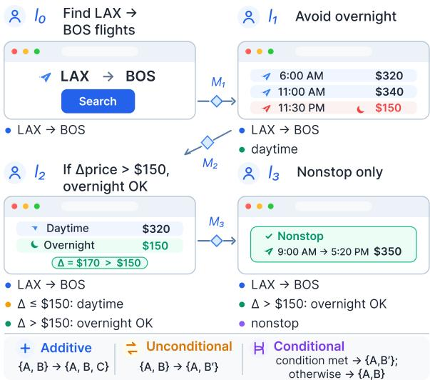
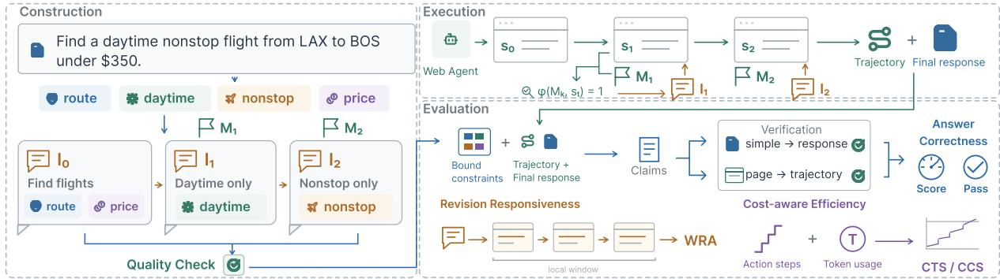
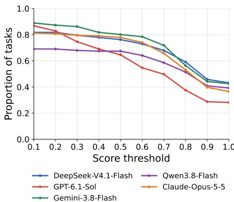
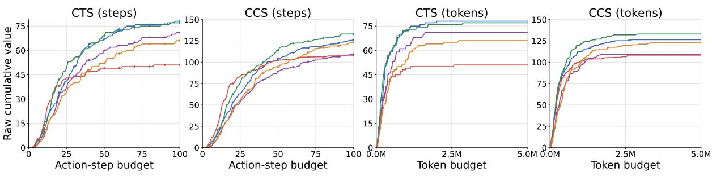
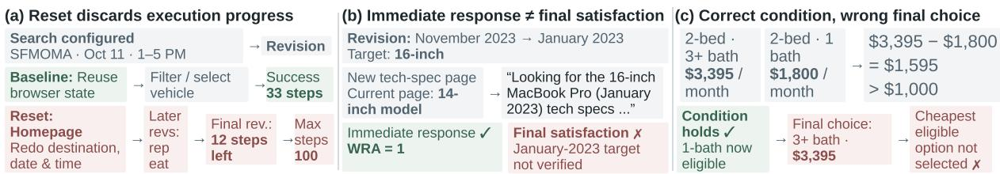
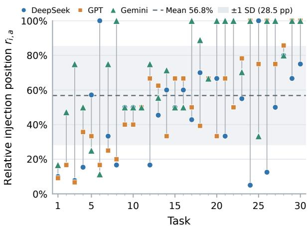
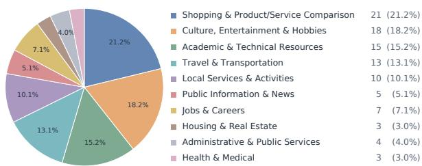

# DYNAREV: Benchmarking Web Agents under Dynamic Goal Revision

Shiqi Zhang<sup>1,2</sup>, Guochen Zhou<sup>1</sup>, Zesheng Wei<sup>1</sup>, Hai Zhao<sup>2</sup>, Zhisong Zhang<sup>1</sup> <sup>1</sup>City University of Hong Kong <sup>2</sup>Shanghai Jiao Tong University szhang2879-c@my.cityu.edu.hk, zhisong.zhang@cityu.edu.hk

## Abstract

Web agents are typically evaluated with goals fully specified before execution and fixed thereafter, whereas real users often revise their requirements during interaction. To study such interactions, we introduce DYNAREV, a benchmark of 181 tasks to evaluate web agents under dynamic goal revision. DYNAREV uses semantic milestones to deliver revisions at taskdefined stages, covers additive revisions, unconditional overrides, and runtime-conditioned overrides, and evaluates correctness, responsiveness, and efficiency through trajectorygrounded evaluation. Five-model evaluations show that agents often satisfy only part of the task requirements, with performance varying across task sources, revision types, and models. Further analyses reveal varied milestone timing, mixed effects of dynamic delivery, and contrasting revision-handling outcomes, with gains from instruction rewriting while preserving browser state and losses from browser resets. DYNAREV provides a testbed for studying how web agents adapt to evolving user goals. The code and data are available at https://github.com/zsq259/DynaRev.

## 1 Introduction

Recent advances in large language models (LLMs) have enabled autonomous agents to perceive, reason, plan, and act in complex digital environments (Ning et al., 2025; Xi et al., 2025; Mei et al., 2025). Among them, web agents interact with website interfaces through human-like actions such as clicking, typing, and scrolling, allowing them to operate websites without relying on dedicated APIs (Zheng et al., 2024; Lai et al., 2024). They support a wide range of practical tasks such as information seeking, online shopping, travel planning, and service navigation. With increasingly capable foundation models and agent frameworks, web agents are now able to execute complex multi-step tasks in realistic environments (Gur et al., 2024; He et al., 2024; Yang et al., 2025).

  
Figure 1: Example dynamic goal revision task.

However, most web-agent tasks assume that the user’s goal is fully specified before execution and remains fixed throughout the interaction (Deng et al., 2023; Zhou et al., 2024; Koh et al., 2024; He et al., 2024; Xue et al., 2025; Gou et al., 2025). Real-world user goals are often more dynamic. For example, a user may first ask an agent to find a flight from Los Angeles to Boston, then add “Avoid overnight flights” after viewing the candidates, revise this preference to “If daytime flights cost more than \$150 extra, overnight flights are acceptable,” and later request nonstop flights only. Such interactions are not merely a fixed instruction split across multiple turns: later instructions may add new constraints, override previously active ones, or introduce requirements that apply conditionally based on the web state observed during execution. We refer to this setting as dynamic goal revision.

Recent work has begun to recognize goal adaptation as an important agent capability. AgentChangeBench (Rana et al., 2025) studies goal shifts in conversational tool-using agents, DeskCraft (Wang et al., 2026) considers interruptions and corrections in desktop workflows, and InterruptBench (Zou et al., 2026) evaluates additions, revisions, and retractions in long-horizon web navigation. However, three gaps remain in web settings. First, revisions are often injected based on relative trajectory progress rather than task-semantic progress, so agents following different paths may receive the same revision at different task stages. Second, existing settings largely omit conditional revisions whose applicability depends on the web state. Finally, evaluations mainly assess task-level success and recovery cost, with limited analysis of revision-level constraint satisfaction, post-revision responsiveness, and cost–quality trade-offs.

To address these gaps, we introduce DYNAREV, a benchmark for evaluating web agents under dynamic goal revisions. DynaRev uses semantic milestones, task-defined stages of the current goal, to trigger revisions independently of the execution path, and covers additive, unconditional-override, and conditional-override revisions, with conditional branches resolved from the web state. We develop a revision-aware, trajectory-grounded evaluation framework that assesses answer correctness, revision responsiveness, and cost-aware efficiency.

We construct 181 dynamic tasks from Online-Mind2Web (Xue et al., 2025) and Mind2Web 2 (Gou et al., 2025), and evaluate five models. Agents often satisfy only part of the task requirements, with performance varying across task sources, revision types, and models. Further analyses reveal substantial variation in milestone timing and mixed effects of dynamic delivery, while instruction rewriting with preserved browser state improves quality and efficiency and browser resets degrade performance. These results reveal behaviors missed by static evaluation.

Our contributions are threefold: (i) We formulate dynamic goal revision for web agents and introduce semantic milestone-based revision delivery. (ii) We construct DYNAREV, covering additive revisions, unconditional overrides, and runtimeconditioned overrides. (iii) We develop a revisionaware, trajectory-grounded evaluation assessing correctness, responsiveness, and efficiency.

## 2 Related Work

GUI Agents and Web Agents. GUI agents interact with graphical interfaces through actions such as clicking, typing, and scrolling to complete user tasks (Zhang et al., 2024; Nguyen et al., 2025).

web agents instantiate this setting in browser environments, where agents can also use structured page representations such as HTML and accessibility trees. Representative systems such as SeeAct (Zheng et al., 2024) and WebVoyager (He et al., 2024) demonstrate LLM-based agents operating on real websites. We focus on web agents as the evaluation setting in this work, while dynamic goal revision is relevant to GUI agents more broadly.

Web Agent Evaluation Benchmarks. The evaluation of web-agents has progressed from offline action prediction to interactive and real-world execution. Mind2Web (Deng et al., 2023) evaluates agents against human interaction trajectories, while WebArena (Zhou et al., 2024) and VisualWebArena (Koh et al., 2024) provide interactive sandbox environments with functional evaluation. WorkArena (Drouin et al., 2024) and WorkArena++ (Boisvert et al., 2024) extend evaluation to enterprise workflows and compositional tasks. WebVoyager (He et al., 2024) extends evaluation to live websites, and more recent benchmarks such as Online-Mind2Web (Xue et al., 2025) and Mind2Web 2 (Gou et al., 2025) further improve task realism and outcome verification. Despite these differences, their tasks generally specify the complete user objective before execution and keep it unchanged throughout the interaction.

Multi-turn Interaction and Dynamic Goal Revision. Multi-turn interaction has been studied in both web and general agent settings. MT-Mind2Web (Deng et al., 2024) evaluates contextdependent sequential instructions, while WebLINX (Lu et al., 2024) studies real-world website navigation through multi-turn dialogue. More recent work directly considers evolving goals: AgentChangeBench (Rana et al., 2025) studies goal shifts in conversational tool-using agents, Intent-Flux (Zhang et al., 2026) evaluates intent drift under superseded and withdrawn requirements, while COMPASS (Qin et al., 2026) and RECAP (Mitra et al., 2026) consider evolving constraints and intent in multi-turn interactions.

Related settings have emerged for GUI agents, including ReInAgent (Jia et al., 2025), DeskCraft (Wang et al., 2026), and most closely, InterruptBench (Zou et al., 2026), which evaluates user additions, revisions, and retractions during long-horizon web navigation. However, these settings do not align revision delivery with tasksemantic progress or include conditional revisions whose active requirements depend on the web state. Our work addresses both with semantic milestonebased delivery and runtime-conditioned overrides.

  
Figure 2: Overview of benchmark construction, milestone-triggered execution, and revision-aware evaluation.

Fine-grained and Process-aware Agent Evaluation. Recent work has moved beyond binary finaltask success. Mind2Web 2 (Gou et al., 2025) decomposes complex requirements into fine-grained criteria, while ProBench (Yang et al., 2026) evaluates intermediate process information. Dynamicgoal benchmarks also consider adaptation, such as goal-shift recovery in AgentChangeBench (Rana et al., 2025) and post-interruption success and execution cost in InterruptBench (Zou et al., 2026). Our evaluation binds atomic constraints to individual revisions and verifies them using the agent’s final response and trajectory, while assessing postrevision responsiveness and cost-aware efficiency.

## 3 Problem Formulation

We formalize web-agent interaction under dynamic goal revisions. Throughout this section, consider a user who initially asks an agent to “Find me a daytime flight from New York to Los Angeles,” and may revise the request during execution.

## 3.1 Web Agent Interaction

We consider a web agent interacting with a browser environment over multiple steps. At step t, the agent receives observation $s _ { t }$ and produces action $a _ { t } .$ A trajectory up to state $s _ { t }$ is represented as

$$
\tau _ { t } = ( s _ { 0 } , a _ { 0 } , s _ { 1 } , a _ { 1 } , \dots , s _ { t } ) ,\tag{1}
$$

which records the preceding state-action sequence and ends with the latest observed state.

## 3.2 Dynamic Goal Revision

A dynamic goal revision task is defined as

$$
T = \left( I _ { 0 } , \{ ( M _ { k } , I _ { k } ) \} _ { k = 1 } ^ { n } \right) ,\tag{2}
$$

where $I _ { 0 }$ is the initial instruction, each $I _ { k } \left( k \geq 1 \right)$ is a revision delivered during execution to update the previously specified goal, and n is the number of revisions. Each instruction specifies one or more task constraints, and revisions update which constraints are active.

A central challenge is deciding when a revision should be introduced. Triggering at a fixed step or at a fixed relative position along an execution trajectory can expose different agents to the same revision at substantially different stages of task progress, since successful web trajectories may vary considerably in both length and structure.

We therefore define each milestone $M _ { k }$ as an inevitable semantic stage of the goal that has already been specified before revision $I _ { k }$ . Importantly, a milestone is derived from the previously specified goal rather than from the revision that will follow it. Any successful execution of the current goal should eventually reach this stage, regardless of the concrete sequence of UI actions used to get there. In the running example, a milestone can be “The initial search for daytime flights from New York to Los Angeles has been completed and the search results have been observed.” A later requirement such as “Only consider nonstop flights” is introduced after this stage is reached.

A trigger $\phi ( M _ { k } , s _ { t } ) \in \{ 0 , 1 \}$ determines whether $M _ { k }$ is reached at state $s _ { t } .$ . If $\phi ( M _ { k } , s _ { t } ) =$ 1, revision $I _ { k }$ is delivered before the next step.

## 3.3 Revision Types

Using the same flight request, we consider three forms of revision. An additive revision introduces a new constraint while preserving previously active constraints, e.g., “Only consider nonstop flights.” An unconditional override replaces a previously active constraint with a new one, e.g., “Actually, choose an overnight flight instead.” A conditional override replaces a previously active constraint with an alternative only when a specified runtime condition is satisfied, e.g., “If daytime flights cost more than \$150 extra, overnight flights are acceptable.” In a conditional override, the agent must determine the applicable branch and corresponding active constraints from the web state, rather than receiving them from the revision.

## 4 Benchmark Construction

We construct dynamic goal revision tasks by transforming static goals into sequences of instructions and revisions with explicit constraint bindings, constructing semantic milestones for revision delivery, and validating task quality and interaction naturalness. Construction details are in Appendix A.

## 4.1 Static-to-Dynamic Task Transformation

We first decompose the original task goal into atomic constraints, each describing an independently verifiable requirement. These constraints provide the basic units for revision construction and evaluation. We then construct an initial instruction $I _ { 0 }$ that is sufficiently specific to form a natural and executable request, while leaving part of the original goal to be introduced during execution.

The remaining constraints are organized into a sequence of revisions according to a natural interaction order. Closely related constraints may be introduced together rather than mechanically separated into different turns. For override revisions, a previously active constraint is replaced or relaxed; conditional overrides additionally associate the replacement with a runtime condition that can be verified from the web environment. Each constraint is finally bound to the revision that introduces or modifies it, providing an explicit correspondence between goal evolution and evaluation units.

## 4.2 Milestone Construction

For each revision $I _ { k } ,$ , we construct its milestone $M _ { k }$ from the cumulative goal specified by $I _ { 0 } , \ldots , I _ { k - 1 }$ The milestone describes a completed semantic stage that can be identified from the web state, while avoiding specific UI actions, referencetrajectory states, or information from the upcoming revision. We also avoid requiring a particular result configuration; for example, completing a search can constitute a milestone even when no matching candidates are returned.

## 4.3 Quality Control

Generated tasks are checked for both structural validity and interaction naturalness. The initial instruction must express a coherent executable goal, while subsequent revisions must introduce meaningful changes rather than artificial fragments of the original instruction. Milestones must describe semantic stages implied by preceding goals and remain independent of a particular reference trajectory or future revision. For conditional overrides, the triggering condition must be observable from the runtime environment. We additionally verify the consistency between revisions and their associated constraints. Tasks that fail these checks are regenerated or excluded from the benchmark.

## 5 Revision-Aware Evaluation

We evaluate agent executions through constraint verification and post-revision behavioral assessment, with metrics covering answer correctness, revision responsiveness, and cost-aware efficiency. Implementation details are in Appendix C.

## 5.1 Constraint Verification

Following the Agent-as-a-Judge paradigm (Zhuge et al., 2025; Gou et al., 2025), we evaluate each constraint using the agent’s final response and interaction trajectory. Constraints associated with undelivered revisions are counted as unsatisfied. For conditional overrides, we determine the active branch and evaluate the corresponding constraints.

Each constraint is decomposed into independently verifiable claims. According to the required evidence, we classify them into two types: simple claims can be verified directly from the agent’s final response, whereas page claims require supporting evidence from web states in the interaction trajectory. A constraint is satisfied only if all of its claims are verified. For task i, we denote the resulting judgment for constraint c by $z _ { i , c } \in \{ 0 , 1 \}$

## 5.2 Post-Revision Behavioral Assessment

Final outcomes alone do not indicate whether an agent actually responds to a revision. For each delivered revision $I _ { i , k }$ , we therefore examine the subsequent local action window and use an LLM judge to determine whether the agent’s behavior is consistent with the revised intent. We denote this binary judgment by $R _ { i , k } \in \{ 0 , 1 \}$

## 5.3 Evaluation Metrics

Answer Correctness. Let $\mathcal { C } _ { i }$ be the constraints scored for task i. We define its constraint satisfaction score $q _ { i }$ and task-success indicator $y _ { i }$ as

$$
q _ { i } = { \frac { 1 } { | { \mathcal { C } } _ { i } | } } \sum _ { c \in { \mathcal { C } } _ { i } } z _ { i , c } .\tag{3}
$$

$$
y _ { i } = \mathbf { 1 } [ q _ { i } = 1 ] .\tag{4}
$$

At the dataset level, we report mean constraint satisfaction and task success rate.

For revision-level analysis, let $\mathcal { C } _ { i , k }$ denote the constraints introduced or modified by instruction $I _ { k }$ . We define their satisfaction score as

$$
q _ { i , k } = \frac { 1 } { | { \mathcal { C } } _ { i , k } | } \sum _ { c \in { \mathcal { C } } _ { i , k } } z _ { i , c } , \qquad k \geq 0 .\tag{5}
$$

We additionally report Mean First Failure Round (MFFR). For task i, let $k _ { i } ^ { * }$ be the first revision round whose associated constraints are not all satisfied, or $n _ { i } + 1$ if no revision fails. We define

$$
\mathrm { M F F R } = \frac { 1 } { N } \sum _ { i = 1 } ^ { N } k _ { i } ^ { * } .\tag{6}
$$

Higher MFFR indicates that the agent satisfies revised requirements for more rounds.

Revision Responsiveness. Window Response Accuracy (WRA) measures whether an agent makes an appropriate behavioral adjustment immediately after a delivered revision, independently of the eventual task outcome. Let $\mathcal { R } _ { i } ^ { \mathrm { f i r e d } }$ denote the indices of revisions delivered during task i, and let $\mathcal { D } _ { \mathrm { f i r e d } }$ denote the set of tasks with at least one delivered revision. We first average responses within each task and then across tasks:

$$
\mathrm { W R A } = \frac { 1 } { | \mathcal { D } _ { \mathrm { f i r e d } } | } \sum _ { i \in \mathcal { D } _ { \mathrm { f i r e d } } } \frac { 1 } { | \mathcal { R } _ { i } ^ { \mathrm { f r e d } } | } \sum _ { k \in \mathcal { R } _ { i } ^ { \mathrm { f i r e d } } } R _ { i , k } .\tag{7}
$$

Cost-aware Efficiency. We measure execution cost in two ways: the number of action steps and token usage. Let $c _ { i }$ denote the execution cost of task i under either measure. For a cost threshold b, we define Cumulative Task Success (CTS) and Cumulative Constraint Satisfaction (CCS) as

$$
\mathrm { C T S } ( b ) = \sum _ { i = 1 } ^ { N } y _ { i } \mathbf { 1 } [ c _ { i } \leq b ] .\tag{8}
$$

$$
\mathrm { C C S } ( b ) = \sum _ { i = 1 } ^ { N } q _ { i } \mathbf { 1 } [ c _ { i } \leq b ] .\tag{9}
$$

CTS counts fully successful tasks, while CCS additionally credits partial constraint satisfaction.

We further define cost-aware efficiency as

$$
\mathrm { C E } = \frac { 1 } { N } \sum _ { i = 1 } ^ { N } q _ { i } \left( 1 - \frac { c _ { i } } { B } \right) ,\tag{10}
$$

where B is the maximum cost considered in the corresponding curve. CE averages correctness weighted by the remaining budget fraction after

each task, jointly capturing task quality and execution efficiency. Appendix D shows its equivalence to the normalized area under the CCS curve.

## 6 Experiments

## 6.1 Experimental Setup

Dataset. We construct dynamic tasks from Online-Mind2Web (OM2W; Xue et al., 2025) and Mind2Web 2 (M2W2; Gou et al., 2025), covering web navigation and long-horizon information synthesis. From 70 seed tasks per source, our pipeline and manual review retains 181 tasks across three revision types, summarized in Table 1. Scenario details are provided in Appendix E.

<table><tr><td>Source</td><td>Type</td><td>Tasks</td><td> $\operatorname { A v g } .$  Cons.</td><td> $\operatorname { A v g } .$  Rounds</td></tr><tr><td rowspan="3">OM2W</td><td>Additive</td><td>37</td><td>4.76</td><td>2.59</td></tr><tr><td>Uncond.</td><td>39</td><td>4.56</td><td>2.92</td></tr><tr><td>Cond.</td><td>31</td><td>5.74</td><td>3.26</td></tr><tr><td rowspan="3">M2W2</td><td>Additive</td><td>39</td><td>9.69</td><td>2.97</td></tr><tr><td>Uncond.</td><td>23</td><td>10.04</td><td>4.22</td></tr><tr><td>Cond.</td><td>12</td><td>9.75</td><td>4.92</td></tr><tr><td>Total</td><td></td><td>181</td><td>6.95</td><td>3.22</td></tr></table>

Table 1: Dataset statistics by source and revision type. Avg. Cons. and Avg. Rounds denote average constraint and instruction-round counts. Uncond. and Cond. denote unconditional and conditional overrides.

Baselines. We evaluate DeepSeek-V4.1- Flash (DeepSeek-AI, 2026), GPT-6.1-Sol (OpenAI, 2026), Gemini-3.8-Flash (Google DeepMind, 2026), Qwen3.8-Flash (Qwen Team, 2026), and Claude-Opus-5-5 (Anthropic, 2026) as representative baseline web agents, abbreviated as DeepSeek, GPT, Gemini, Qwen, and Claude.

Implementation. We execute all agents with BrowserGym (de Chezelles et al., 2025) using viewport-restricted AXTree observations, a 100- step budget, and temperature 0. DeepSeek-V4.1- Flash is used for data construction, milestone judging, and offline evaluation. Further execution and evaluation details are in Appendices B and C.

## 6.2 Main Results

Agents differ in both correctness and completion patterns. Table 2 shows substantial differences in final task performance across agents. Gemini achieves the highest mean constraint satisfaction (0.735), while DeepSeek has the highest task success rate (43.1%). However, mean satisfaction and strict completion do not induce the same ranking: Qwen has a lower Score than Claude (0.604 vs. 0.681), but a higher success rate (39.2% vs. 36.5%). MFFR provides a complementary sequential view: Gemini maintains revised requirements for the most rounds before the first failure (2.28), whereas GPT fails earliest on average (1.91). Figure 3 shows that Claude performs better at low and intermediate thresholds, while Qwen retains more tasks at the highest thresholds.

<table><tr><td rowspan="2">Model</td><td colspan="3">Correctness</td><td rowspan="2">Responsiveness</td><td colspan="3">Efficiency</td></tr><tr><td>Score↑</td><td>Success↑</td><td>MFFR↑</td><td>WRA↑ CE (Steps)↑</td><td>CE (Tokens)↑</td><td>Avg Steps↓</td></tr><tr><td>DeepSeek-V4.1-Flash</td><td>0.698</td><td>43.1%</td><td>2.21</td><td>66.8%</td><td>0.482</td><td>0.637</td><td>43.0</td></tr><tr><td>GPT-6.1-Sol</td><td>0.598</td><td>28.2%</td><td>1.91</td><td>68.8%</td><td>0.477</td><td>0.554</td><td>24.9</td></tr><tr><td>Gemini-3.8-Flash</td><td>0.735</td><td>42.5%</td><td>2.28</td><td>69.4%</td><td>0.522</td><td>0.673</td><td>33.1</td></tr><tr><td>Qwen3.8-Flash</td><td>0.604</td><td>39.2%</td><td>2.09</td><td>68.4%</td><td>0.410</td><td>0.549</td><td>50.9</td></tr><tr><td>Claude-Opus-5-5</td><td>0.681</td><td>36.5%</td><td>2.16</td><td>68.3%</td><td>0.448</td><td>0.596</td><td>43.8</td></tr></table>

Table 2: Main results across all dynamic subsets.
<table><tr><td></td><td colspan="6">OM2W</td><td colspan="6">M2W2</td></tr><tr><td></td><td colspan="2">Additive</td><td colspan="2">Unconditional</td><td colspan="2">Conditional</td><td colspan="2">Additive</td><td colspan="2">Unconditional</td><td colspan="2">Conditional</td></tr><tr><td>Model</td><td>Score↑</td><td>Steps↓</td><td>Score↑</td><td>Steps↓</td><td>Score↑</td><td>Steps↓</td><td>Score↑</td><td>Steps↓</td><td>Score↑</td><td>Steps↓</td><td>Score↑</td><td>Steps↓</td></tr><tr><td>DeepSeek-V4.1-Flash</td><td>0.780</td><td>32.4</td><td>0.774</td><td>30.6</td><td>0.824</td><td>38.5</td><td>0.570</td><td>55.4</td><td>0.581</td><td>56.5</td><td>0.518</td><td>62.2</td></tr><tr><td>GPT-6.1-Sol</td><td>0.793</td><td>19.8</td><td>0.642</td><td>27.7</td><td>0.753</td><td>23.7</td><td>0.404</td><td>27.7</td><td>0.435</td><td>23.2</td><td>0.401</td><td>29.0</td></tr><tr><td>Gemini-3.8-Flash</td><td>0.795</td><td>29.3</td><td>0.759</td><td>26.2</td><td>0.898</td><td>30.8</td><td>0.606</td><td>38.6</td><td>0.647</td><td>40.9</td><td>0.642</td><td>40.5</td></tr><tr><td>Qwen3.8-Flash</td><td>0.804</td><td>33.7</td><td>0.739</td><td>37.1</td><td>0.727</td><td>39.2</td><td>0.394</td><td>67.4</td><td>0.419</td><td>74.3</td><td>0.275</td><td>80.0</td></tr><tr><td>Claude-Opus-5-5</td><td>0.858</td><td>30.2</td><td>0.697</td><td>38.9</td><td>0.853</td><td>31.9</td><td>0.480</td><td>58.7</td><td>0.568</td><td>59.1</td><td>0.516</td><td>54.8</td></tr></table>

Table 3: Performance breakdown by task source and revision type.

  
Figure 3: Task-level distribution of constraint satisfaction scores. Each point reports the proportion of tasks reaching the corresponding score threshold.

Performance degrades with task complexity, while revision-type effects are context dependent. Table 3 breaks down performance by task source and revision type. M2W2 yields lower scores for every model and revision type and generally requires more action steps, consistent with its higher constraint counts and longer revision sequences. Revision-type effects, however, interact strongly with task source. Conditional tasks are not the weakest OM2W subset for four of the five models; on M2W2, they produce the lowest score for three of the five agents, including 0.275 for Qwen. Overall, task complexity produces a consistent performance gap, whereas differences among revision types vary across sources and agents.

<table><tr><td rowspan="2">Model</td><td colspan="2">Revision Satisfaction qi,k</td></tr><tr><td>WRA = 1</td><td>WRA = 0</td></tr><tr><td>DeepSeek-V4.1-Flash</td><td>0.683</td><td>0.644</td></tr><tr><td>GPT-6.1-Sol</td><td>0.587</td><td>0.465</td></tr><tr><td>Gemini-3.8-Flash</td><td>0.720</td><td>0.696</td></tr><tr><td>Qwen3.8-Flash</td><td>0.609</td><td>0.577</td></tr><tr><td>Claude-Opus-5-5</td><td>0.677</td><td>0.628</td></tr></table>

Table 4: Revision-level analysis conditioned on WRA.

Immediate responses do not consistently translate into satisfied revisions. WRA measures whether an agent makes a locally appropriate behavioral adjustment immediately after a revision, independently of the eventual task outcome. Although WRA ranges from 66.8% to 69.4% across models, its ordering does not closely follow final correctness. Table 4 shows that revisions with WRA = 1 have higher final satisfaction for all five agents, but the gap is modest for most models, and many responsive revisions remain unsatisfied. This divergence shows that immediate behavioral adaptation and eventual revision satisfaction capture different aspects of performance.

Models exhibit distinct cost–quality trade-offs. Accounting for execution cost reveals different budget–performance profiles across agents. GPT uses the fewest action steps (24.9) but has the lowest overall Score (0.598), whereas DeepSeek achieves higher correctness (0.698) with more steps (43.0); nevertheless, their step-based CE is nearly identical (0.477 vs. 0.482). Gemini combines the highest correctness with the second-lowest average action count (33.1 steps) and therefore achieves the highest CE under both action-step and token costs. The cost–quality curves in Figure 4 further show that GPT accumulates performance rapidly under small budgets but plateaus relatively early, while Gemini and DeepSeek continue to improve as additional budget becomes available.

  
Figure 4: Cost–quality curves under action-step and token budgets.

## 7 Analysis

## 7.1 Static vs. Dynamic Delivery

We compare 30 additive tasks with their original single-turn counterparts, with 15 tasks from each source. The two settings share the same final requirements and execution budget, differing only in whether the requirements are given upfront or progressively during execution. Table 5 shows no uniform effect on correctness: GPT and Qwen improve on both sources, Claude declines on both, while Gemini shows opposite trends across the two sources. Across all model–task pairs, 32.0% improve, 28.0% worsen, and 40.0% remain unchanged. Despite mixed correctness effects, dynamic delivery typically requires more actions.

<table><tr><td rowspan="2">Model</td><td colspan="2">OM2W</td><td colspan="2">M2W2</td></tr><tr><td>∆Score</td><td>∆Steps</td><td>∆Score</td><td>∆Steps</td></tr><tr><td>DeepSeek</td><td>-0.025</td><td>+9.06</td><td>-0.035</td><td>+6.47</td></tr><tr><td>GPT</td><td>+0.079</td><td>-0.74</td><td>+0.122</td><td>+4.87</td></tr><tr><td>Gemini</td><td>-0.133</td><td>+12.54</td><td>+0.108</td><td>+7.53</td></tr><tr><td>Qwen</td><td>+0.161</td><td>+8.54</td><td>+0.115</td><td>-12.67</td></tr><tr><td>Claude</td><td>-0.107</td><td>+14.34</td><td>-0.169</td><td>+10.93</td></tr></table>

Table 5: Changes from static to dynamic additive delivery on paired tasks. ∆ denotes dynamic minus static.

Trajectory inspection reveals two competing effects. Progressive delivery can reach the final goal through intermediate stages, but it can also introduce rework, interface loops, and budget exhaustion. Thus, dynamic delivery is neither uniformly beneficial nor harmful; instead, it exposes modeldependent execution behaviors that static evaluation may not reveal. Full results are in Appendix F.

## 7.2 Revision Handling Strategies

When a revision is delivered, a natural alternative to continuing from the current execution is to reformulate the updated goal and restart the task. We therefore compare revision-handling strategies along three dimensions: instruction representation (original vs. rewritten), interaction history (retained vs. cleared), and browser state (continued vs. reset). We consider six meaningful combinations, excluding configurations that reset the browser while retaining interaction history. The baseline retains the original instructions, interaction history, and browser state, corresponding to direct continuation from the current execution. We evaluate all strategies with DeepSeek-V4.1-Flash on the same subset of benchmark tasks. Strategy changes are applied only when a revision is delivered, and all configurations share the same 100-step budget. Table 6 reports task quality and execution cost.

<table><tr><td>Strategy</td><td>Score↑</td><td>Steps↓</td><td>Tokens (k)↓</td></tr><tr><td>Baseline</td><td>0.647</td><td>50.3</td><td>806.7</td></tr><tr><td>Rewrite</td><td>0.718</td><td>44.9</td><td>658.8</td></tr><tr><td>Clear</td><td>0.648</td><td>53.6</td><td>667.2</td></tr><tr><td>Clear + Rewrite</td><td>0.663</td><td>52.8</td><td>673.4</td></tr><tr><td>Reset</td><td>0.586</td><td>59.7</td><td>691.7</td></tr><tr><td>Reset + Rewrite</td><td>0.525</td><td>61.5</td><td>843.6</td></tr></table>

Table 6: Comparison of revision handling strategies. Rewrite consolidates instructions, Clear removes interaction history, and Reset resets the browser.

Rewriting the accumulated instructions while preserving the ongoing execution gives the best overall trade-off, increasing Score from 0.647 to 0.718 while reducing both action steps (50.3 to 44.9) and token usage (806.7k to 658.8k). Clearing interaction history alone leaves task quality nearly unchanged (0.648 vs. 0.647) and reduces token usage, but requires more actions. In contrast, resetting the browser consistently worsens the overall quality–cost trade-off: Reset lowers Score to 0.586 and increases steps to 59.7, while Reset + Rewrite further reduces Score to 0.525 and requires the most steps. Comparing Clear with Reset, and Clear + Rewrite with Reset + Rewrite, indicates that retaining the current browser state provides substantial reusable execution progress. Overall, the results favor reorganizing the accumulated goal while continuing from the current execution, rather than treating each revision as a new task.

  
Figure 5: Representative failure cases under dynamic goal revision.

## 7.3 Revision Injection Timing

A simpler alternative to semantic milestone triggering is to inject revisions at a fixed relative position along the execution trajectory. We therefore examine where milestone-based revision timing falls along relative trajectory progress on a subset of tasks. We focus on the first revision. For task i and agent a, let $t _ { i , a }$ denote the revision-injection step and $\operatorname { L } _ { i , a }$ the completion length of an execution with only the initial instruction I . We define

$$
r _ { i , a } = \operatorname* { m i n } \left( \frac { t _ { i , a } } { L _ { i , a } } , 1 \right) ,\tag{11}
$$

with values above 1 clipped to 1.

  
Figure 6: Relative revision-injection positions across tasks and agents, ordered by mean across agents.

Figure 6 shows substantial variation in relative injection positions across tasks, with pronounced cross-agent differences for many tasks. The mean is 56.8%, but the standard deviation reaches 28.5 percentage points, indicating that the average position masks a broad distribution of milestone timing. Thus, even though the mean lies near 60%, a fixed trajectory percentage does not closely represent the same task stage across individual executions.

We further quantify cross-agent variation by computing max<sub>a</sub> $r _ { i , a } { - } \operatorname* { m i n } _ { a } r _ { i , a }$ for each task. The median range is 36.4 and mean 41.3; 70.0% of tasks exceed 20, and 46.7% exceed 40. The same fixed percentage may therefore deliver a revision when different agents have reached substantially different task stages, making cross-agent comparisons less controlled. Semantic milestones instead anchor revision delivery to a task-defined stage. We also performed a manual inspection of the milestonetrigger timing, with detailed results in Appendix I.

## 7.4 Failure Mode Case Studies

We inspect trajectories to understand the quantitative patterns. Figure 5 shows three representative failure modes. First, browser resets can discard execution progress, forcing repeated work until the step budget is exhausted. Second, immediate adaptation does not ensure eventual satisfaction: an agent may respond appropriately to a revision yet still violate the revised constraint. Third, an agent may correctly resolve a condition but fail to act accordingly, selecting a more expensive option despite identifying a newly eligible cheaper one.

## 8 Conclusion

We introduced DYNAREV, a benchmark to assess web agents under dynamic goal revisions, featuring semantic milestone triggers, runtimeconditioned overrides, and fine-grained evaluation of correctness, responsiveness, and efficiency. Experiments with five models show that immediate adaptation does not ensure final constraint satisfaction. Further analyses reveal timing mismatches between fixed-position and milestone-based revisions, while instruction rewriting while preserving browser state improves task quality and efficiency.

Our benchmark provides a foundation for studying web agents’ ability to handle evolving user goals.

## Limitations

We acknowledge the limitations of this work. (i) Our benchmark is constructed from static web tasks and may not capture the full diversity of real-world goal changes. (ii) Milestone triggering and evaluation rely on imperfect LLM-based semantic judgments. (iii) Semantic milestones assume that meaningful intermediate task stages can be identified, which may be harder for tasks with highly diverse successful trajectories.

## References

Anthropic. 2026. Introducing Claude Opus 5.5.

Léo Boisvert, Megh Thakkar, Maxime Gasse, Massimo Caccia, Thibault Le Sellier De Chezelles, Quentin Cappart, Nicolas Chapados, Alexandre Lacoste, and Alexandre Drouin. 2024. Workarena++: Towards compositional planning and reasoning-based common knowledge work tasks. In Advances in Neural Information Processing Systems, volume 37, pages 5996–6051. Curran Associates, Inc.

Thibault Le Sellier de Chezelles, Maxime Gasse, Alexandre Lacoste, Massimo Caccia, Alexandre Drouin, Léo Boisvert, Megh Thakkar, Tom Marty, Rim Assouel, Sahar Omidi Shayegan, Lawrence Keunho Jang, Xing Han Lù, Ori Yoran, Dehan Kong, Frank F. Xu, Siva Reddy, Graham Neubig, Quentin Cappart, Russ Salakhutdinov, and Nicolas Chapados. 2025. The browsergym ecosystem for web agent research. Transactions on Machine Learning Research. Expert Certification.

DeepSeek-AI. 2026. Deepseek-v4.1-flash: Pushing the limits of kv cache compression.

Xiang Deng, Yu Gu, Boyuan Zheng, Shijie Chen, Sam Stevens, Boshi Wang, Huan Sun, and Yu Su. 2023. Mind2web: Towards a generalist agent for the web. Advances in Neural Information Processing Systems, 36:28091–28114.

Yang Deng, Xuan Zhang, Wenxuan Zhang, Yifei Yuan, See-Kiong Ng, and Tat-Seng Chua. 2024. On the multi-turn instruction following for conversational web agents. In Proceedings ofthe 62nd Annual Meeting ofthe Associationfor Computational Linguistics (Volume 1: Long Papers), pages 8795–8812. Association for Computational Linguistics.

Alexandre Drouin, Maxime Gasse, Massimo Caccia, Issam H. Laradji, Manuel Del Verme, Tom Marty, David Vazquez, Nicolas Chapados, and Alexandre Lacoste. 2024. WorkArena: How capable are web agents at solving common knowledge work tasks? In Proceedings ofthe 41st International Conference

on Machine Learning, volume 235 of Proceedings of Machine Learning Research, pages 11642–11662. PMLR.

Google DeepMind. 2026. Gemini 3.8 Flash.

Boyu Gou, Zanming Huang, Yuting Ning, Yu Gu, Michael Lin, Botao Yu, Andrei Kopanev, Weijian Qi, Yiheng Shu, Jiaman Wu, Chan Hee Song, Bernal Jimenez Gutierrez, Yifei Li, Zeyi Liao, Hanane Nour Moussa, TIANSHU ZHANG, Jian Xie, Tianci Xue, Shijie Chen, and 7 others. 2025. Mind2web 2: Evaluating agentic search with agentas-a-judge. In The Thirty-ninth Annual Conference on Neural Information Processing Systems Datasets and Benchmarks Track.

Izzeddin Gur, Hiroki Furuta, Austin Huang, Mustafa Safdari, Yutaka Matsuo, Douglas Eck, and Aleksandra Faust. 2024. A real-world webagent with planning, long context understanding, and program synthesis. In International Conference on Learning Representations, volume 2024, pages 52690–52717.

Hongliang He, Wenlin Yao, Kaixin Ma, Wenhao Yu, Yong Dai, Hongming Zhang, Zhenzhong Lan, and Dong Yu. 2024. Webvoyager: Building an end-toend web agent with large multimodal models. In Proceedings ofthe 62nd Annual Meeting ofthe Association for Computational Linguistics (Volume 1: Long Papers), pages 6864–6890.

Haitao Jia, Ming He, Zimo Yin, Likang Wu, Jianping Fan, and Jitao Sang. 2025. Reinagent: A contextaware gui agent enabling human-in-the-loop mobile task navigation. Preprint, arXiv:2510.07988.

Jing Yu Koh, Robert Lo, Lawrence Jang, Vikram Duvvur, Ming Lim, Po-Yu Huang, Graham Neubig, Shuyan Zhou, Russ Salakhutdinov, and Daniel Fried. 2024. Visualwebarena: Evaluating multimodal agents on realistic visual web tasks. In Proceedings of the 62nd Annual Meeting of the Association for Computational Linguistics (Volume 1: Long Papers), pages 881–905.

Hanyu Lai, Xiao Liu, Iat Long Iong, Shuntian Yao, Yuxuan Chen, Pengbo Shen, Hao Yu, Hanchen Zhang, Xiaohan Zhang, Yuxiao Dong, and Jie Tang. 2024. Autowebglm: A large language model-based web navigating agent. In Proceedings of the 30th ACM SIGKDD Conference on Knowledge Discovery and Data Mining, pages 5295—-5306.

Xing Han Lu, Zdenek Kasner, and Siva Reddy. 2024.ˇ WebLINX: Real-world website navigation with multiturn dialogue. In Proceedings of the 41st International Conference on Machine Learning, volume 235 of Proceedings ofMachine Learning Research, pages 33007–33056. PMLR.

Kai Mei, Xi Zhu, Wujiang Xu, Wenyue Hua, Mingyu Jin, Zelong Li, Shuyuan Xu, Ruosong Ye, Yingqiang Ge, and Yongfeng Zhang. 2025. Aios: Llm agent operating system. In Proceedings of the 2nd Conference on Language Modeling (COLM 2025).

Kushan Mitra, Dan Zhang, Hannah Kim, and Estevam Hruschka. 2026. Recap: Rewriting conversations for intent understanding in agentic planning. In Findings ofthe Associationfor Computational Linguistics: EACL 2026, pages 2015–2033.

Dang Nguyen, Jian Chen, Yu Wang, Gang Wu, Namyong Park, Zhengmian Hu, Hanjia Lyu, Junda Wu, Ryan Aponte, Yu Xia, Xintong Li, Jing Shi, Hongjie Chen, Viet Dac Lai, Zhouhang Xie, Sungchul Kim, Ruiyi Zhang, Tong Yu, Mehrab Tanjim, and 11 others. 2025. GUI agents: A survey. In Findings of the Association for Computational Linguistics: ACL 2025, pages 22522–22538, Vienna, Austria. Association for Computational Linguistics.

Liangbo Ning, Ziran Liang, Zhuohang Jiang, Haohao Qu, Yujuan Ding, Wenqi Fan, Xiao-yong Wei, Shanru Lin, Hui Liu, Philip S. Yu, and Qing Li. 2025. A survey of webagents: Towards next-generation ai agents for web automation with large foundation models. In Proceedings of the 31st ACM SIGKDD Conference on Knowledge Discovery and Data Mining V.2, KDD ’25, page 6140–6150, New York, NY, USA. Association for Computing Machinery.

OpenAI. 2026. Introducing GPT-6.1 Sol.

Tian Qin, Felix Bai, Ting-Yao Hu, Raviteja Vemulapalli, Hema Swetha Koppula, Zhiyang Xu, Bowen Jin, Mert Cemri, Jiarui Lu, Zirui Wang, and Meng Cao. 2026. Compass: Benchmarking constrained optimization in llm agents. Preprint, arXiv:2510.07043.

Qwen Team. 2026. Qwen3.8-Flash-Next: A new architecture, towards ultimate cost-efficiency.

Manik Rana, Calissa Man, Jeffrey Paine, Anotida Expected Msiiwa, Ahan M R, Kevin Zhu, Vasu Sharma, and Sunishchal Dev. 2025. Agentchangebench: A multi-dimensional evaluation framework for goalshift robustness in conversational AI. In NeurIPS 2025 Workshop on Bridging Language, Agent, and World Models for Reasoning and Planning.

Wenkai Wang, Tao Xiong, Jingchen Ni, Yunpeng Bao, Xiyun Li, Tianqi Liu, Hongcan Guo, Zilong Huang, and Shengyu Zhang. 2026. DeskCraft: Benchmarking desktop agents on professional workflows and human-in-the-loop collaboration. arXiv preprint arXiv:2606.03103.

Zhiheng Xi, Wenxiang Chen, Xin Guo, Wei He, Yiwen Ding, Boyang Hong, Ming Zhang, Junzhe Wang, Senjie Jin, Enyu Zhou, Rui Zheng, Xiaoran Fan, Xiao Wang, Limao Xiong, Yuhao Zhou, Weiran Wang, Changhao Jiang, Yicheng Zou, Xiangyang Liu, and 9 others. 2025. The rise and potential of large language model based agents: a survey. Science China Information Sciences, 68(2):121101.

Tianci Xue, Weijian Qi, Tianneng Shi, Chan Hee Song, Boyu Gou, Dawn Song, Huan Sun, and Yu Su. 2025. An illusion of progress? assessing the current state of web agents. In Second Conference on Language Modeling.

Ke Yang, Yao Liu, Sapana Chaudhary, Rasool Fakoor, Pratik A Chaudhari, George Karypis, and Huzefa Rangwala. 2025. Agentoccam: A simple yet strong baseline for llm-based web agents. In International Conference on Learning Representations, volume 2025, pages 97533–97565.

Leyang Yang, Ziwei Wang, Xiaoxuan Tang, Sheng Zhou, Dajun Chen, Wei Jiang, and Yong Li. 2026. ProBench: Benchmarking GUI agents with accurate process information. Proceedings of the AAAI Conference on Artificial Intelligence, 40(32):27547– 27555.

Chaoyun Zhang, Shilin He, Jiaxu Qian, Bowen Li, Liqun Li, Si Qin, Yu Kang, Minghua Ma, Guyue Liu, Qingwei Lin, et al. 2024. Large language model-brained gui agents: A survey. arXiv preprint arXiv:2411.18279.

Yanjie Zhang, Bowen Cao, Zixin Chen, and Yushi Sun. 2026. When users change their minds: Measuring and repairing intent drift in llm agents. Preprint, arXiv:2609.32520.

Boyuan Zheng, Boyu Gou, Jihyung Kil, Huan Sun, and Yu Su. 2024. Gpt-4v(ision) is a generalist web agent, if grounded. In Forty-first International Conference on Machine Learning.

Shuyan Zhou, Frank F. Xu, Hao Zhu, Xuhui Zhou, Robert Lo, Abishek Sridhar, Xianyi Cheng, Tianyue Ou, Yonatan Bisk, Daniel Fried, Uri Alon, and Graham Neubig. 2024. Webarena: A realistic web environment for building autonomous agents. In The Twelfth International Conference on Learning Representations.

Mingchen Zhuge, Changsheng Zhao, Dylan R. Ashley, Wenyi Wang, Dmitrii Khizbullin, Yunyang Xiong, Zechun Liu, Ernie Chang, Raghuraman Krishnamoorthi, Yuandong Tian, Yangyang Shi, Vikas Chandra, and Jürgen Schmidhuber. 2025. Agent-as-a-judge: Evaluate agents with agents. In Forty-second International Conference on Machine Learning.

Henry Peng Zou, Chunyu Miao, Wei-Chieh Huang, Yankai Chen, Yue Zhou, Hanrong Zhang, Yaozu Wu, Liancheng Fang, Zhengyao Gu, Zhen Zhang, Kening Zheng, Fangxin Wang, Yi Nian, Shanghao Li, Wenzhe Fan, Langzhou He, Weizhi Zhang, Xue Liu, and Philip S. Yu. 2026. When users change their mind: Evaluating interruptible agents in long-horizon web navigation. Preprint, arXiv:2604.00892.

## A Benchmark Construction Details

This section provides additional details for the static-to-dynamic task transformation described in Section 4. The construction procedure follows five stages: constraint decomposition, initial instruction construction, revision and milestone organization, quality control, and constraint binding.

## A.1 Constraint Decomposition

We first decompose each source task into a set of atomic constraints. Each constraint describes a single independently verifiable requirement and is designed to avoid semantic overlap with the others. The resulting constraints serve as the shared units for subsequent revision construction and evaluation.

Tasks with too few constraints to support meaningful multi-round decomposition are excluded at this stage. This prevents the construction procedure from producing artificial revisions by fragmenting a goal that is naturally expressed in a single turn.

## A.2 Initial Instruction Construction

The atomic constraints are separated according to whether they are necessary for forming a natural initial request. We refer to constraints that are needed to specify a coherent and executable starting goal as required constraints, while constraints that can be naturally introduced later are treated as later constraints.

The initial instruction $I _ { 0 }$ contains the required constraints. If these constraints alone leave the target underspecified, a small number of later constraints may also be included to make the request sufficiently clear. The objective is to keep $I _ { 0 }$ executable without prematurely exposing requirements that can naturally arise during subsequent interaction.

Before constructing the initial instruction, we also check whether the target website is accessible. Tasks affected by persistent access failures, abnormal redirections, or similar issues that prevent meaningful execution are excluded from further construction.

## A.3 Revision and Milestone Organization

Revision organization. The remaining constraints are organized into a sequence of revisions according to a natural interaction order. Closely related constraints may be introduced together when they would normally be expressed in the same user turn, rather than being mechanically separated to increase the number of revisions. Additive revisions directly introduce previously unspecified requirements while preserving the constraints that are already active.

Milestone construction. Each revision $I _ { k }$ is paired with a semantic milestone $M _ { k }$ that determines when it is delivered. The milestone is derived only from the cumulative goal specified by $I _ { 0 } , \ldots , I _ { k - 1 }$ , rather than from the upcoming revision $I _ { k }$ . We describe milestones as completed semantic stages of the currently specified task rather than particular UI actions or reference-trajectory states.

The milestone description also avoids unnecessarily requiring a specific result configuration. For example, completing a search stage can constitute a milestone even if the search returns no matching candidates. This distinction prevents milestone triggering from depending on incidental properties of the current web state rather than on task progress itself.

Eligible override constraints. For tasks containing override revisions, we distinguish between core and preference constraints. Core constraints define the fundamental task object or objective, such as the target product category, search subject, or destination. Preference constraints describe attributes that users may naturally revise during execution, such as color, price range, rating, or ranking preference. Override revisions are constructed only from preference constraints.

Unconditional overrides. The construction of an unconditional override is separated into replacement planning and timeline organization. We first select an eligible preference constraint and choose an alternative value from the same semantic dimension. Replacement candidates are primarily collected from values observed in the source tasks; when the available candidates are insufficient, additional alternatives in the same semantic dimension are generated and reviewed for consistency with the task context.

The selected original preference and its replacement are then incorporated into the multi-round timeline. The original preference is introduced before the override, while the later revision explicitly replaces it with the new requirement. Separating replacement selection from timeline generation reduces interference between deciding what should change and deciding when and how that change should be expressed.

Conditional overrides. Conditional overrides retain the original preference as the default requirement and activate an alternative only when a specified runtime condition is satisfied. The condition must be observable from the web environment during execution and should introduce an additional environment-state judgment rather than reducing to a direct restatement of the preference replacement itself.

We consider two types of conditions. Numericalthreshold conditions are defined over observable quantities such as price differences, rating differences, or distance, and activate the alternative branch when the relevant value crosses a specified threshold. Existence conditions depend on whether a particular type of option is available, such as whether an item is in stock or whether a direct flight exists.

For conditional-override construction, the selected replacement pair is combined with a condition appropriate to the task context and constraint dimension, and the resulting branch structure is then incorporated into the multi-round timeline.

## A.4 Quality Control

Generated tasks are reviewed for both structural validity and interaction naturalness. The initial instruction must specify a coherent executable goal, while subsequent revisions must introduce meaningful changes rather than artificial fragments of the source instruction. Milestones must describe semantic stages implied by previously specified goals, remain independent of the upcoming revision, and avoid dependence on a particular sequence of UI operations.

For conditional overrides, the runtime condition must be observable from the web environment and the alternative branch must remain meaningful in the underlying task context. We also check the consistency of the revision sequence and the constraints that it is intended to introduce or modify.

When an instance fails these checks, the relevant construction stage is regenerated. Tasks that remain invalid after the prescribed retries are excluded from the final benchmark.

## A.5 Constraint Binding

After a task passes quality control, each atomic constraint is bound to the instruction that introduces or modifies it. This correspondence records the provenance of each evaluation requirement and allows the evaluation pipeline to distinguish constraints associated with different stages of goal evolution.

Constraint binding is performed as a separate post-processing stage rather than jointly with revision generation. Generating revisions and bindings simultaneously may encourage artificially regular partitions in which each revision is constructed merely to correspond to a convenient subset of constraints. Separating the two stages allows revision construction to prioritize natural interaction structure while preserving an explicit instruction– constraint correspondence for later evaluation.

## B Execution Details

## B.1 Interaction Context

At each step, the agent receives the accumulated user instructions, the complete action history, and web observations from the interaction trajectory. To control context growth, we retain the full web observations for only the five most recent interaction steps. Earlier observations are replaced with a fixed placeholder, while their corresponding actions remain in the context. Thus, the complete instruction and action histories are preserved throughout execution, while detailed web-state history is maintained within a fixed recent window.

## B.2 Revision Delivery and Termination

Revisions are delivered when their corresponding semantic milestones are reached. If the agent declares completion while revisions remain pending and execution budget remains, the completion is intercepted, the next pending revision is delivered, and execution continues.

A run terminates when the agent calls done after all revisions have been delivered, or when the maximum execution step limit is reached.

## B.3 Environment Configuration

All agents are executed through BrowserGym with Playwright-controlled headless Chromium. Observations use the viewport-restricted AXTree representation. The same execution configuration, including the context-management strategy, is applied to all evaluated agents.

## C Evaluation Details

This section provides implementation details omitted from Section 5, focusing on claim construction, trajectory evidence retrieval, and post-revision behavioral assessment.

## C.1 Claim Construction and Verification

For each constraint to be evaluated, the claim generator receives the constraint, the agent’s final response, and the task context, and produces one or more independently verifiable claims together with their verification types. For constraints containing relative-time expressions, we additionally provide the task execution date to resolve the temporal reference.

Claim decomposition is used when a single constraint requires multiple verification instances. For example, if a constraint requires every returned hotel to provide free breakfast, the evaluator generates a separate claim for each returned hotel. This allows each hotel to be verified independently while preserving the original constraint as a single task requirement.

Claims of type simple are verified directly from the agent’s final response, whereas page claims are passed to the trajectory evidence retrieval procedure described below.

## C.2 Trajectory Evidence Retrieval

For each page claim, we first identify the subject whose property or web evidence must be verified. We then inspect the final recorded web state. If it already provides sufficient evidence, the claim is verified directly from this state.

Otherwise, we search the trajectory beginning from the delivery of the instruction to which the constraint is bound. The claim subject is used as an anchor for lightweight lexical matching over subsequent web states, producing a small set of candidate states. Only these candidates are passed to the page verifier.

A lexical match is used only for candidate retrieval and is not itself treated as evidence. Candidate states are examined in trajectory order, and the first state judged to provide sufficient evidence is used to verify the claim. If no retrieved state provides sufficient evidence, the page claim is treated as unverified.

## C.3 Post-Revision Behavioral Assessment

For each delivered revision, we examine at most the next three agent actions, stopping earlier if another revision is delivered or the task terminates. The resulting action window is evaluated by the behavioral judge to determine whether the agent responds consistently with the revised intent.

## D Equivalence between Cost-aware Efficiency and CCS AUC

For the CCS curve defined in Eq. 9,

$$
\begin{array} { c } { { { \displaystyle \frac { 1 } { N B } \int _ { 0 } ^ { B } \mathrm { C C S } ( b ) d b = \displaystyle \frac { 1 } { N B } \int _ { 0 } ^ { B } \sum _ { i = 1 } ^ { N } q _ { i } { \bf 1 } [ c _ { i } \le b ] d b } } } \\ { { = { \displaystyle \frac { 1 } { N B } \sum _ { i = 1 } ^ { N } q _ { i } \int _ { 0 } ^ { B } { \bf 1 } [ c _ { i } \le b ] d b } } } \\ { { = { \displaystyle \frac { 1 } { N B } \sum _ { i = 1 } ^ { N } q _ { i } ( B - c _ { i } ) } } } \\ { { = { \displaystyle \frac { 1 } { N } \sum _ { i = 1 } ^ { N } q _ { i } \left( 1 - \frac { c _ { i } } { B } \right) } } } \\ { { = \mathrm { C E } . } } \end{array}\tag{12}
$$

The last expression is exactly the cost-aware efficiency score defined in Eq. 10. Therefore, CE is equivalent to the normalized area under the CCS curve.

## E Dataset Details

Among the 140 sampled seed tasks, 99 contribute at least one retained dynamic task to the final benchmark. We assign each retained seed task to one scenario category and report their proportions in Figure 7.

  
Figure 7: Scenario distribution of retained seed tasks.

## F Static vs. Dynamic Delivery

<table><tr><td>Model</td><td>Better</td><td>Worse</td><td>Unchanged</td></tr><tr><td>DeepSeek</td><td>8</td><td>9</td><td>13</td></tr><tr><td>GPT</td><td>15</td><td>9</td><td>6</td></tr><tr><td>Gemini</td><td>9</td><td>7</td><td>14</td></tr><tr><td>Qwen</td><td>11</td><td>3</td><td>16</td></tr><tr><td>Claude</td><td>5</td><td>14</td><td>11</td></tr><tr><td>All</td><td>48</td><td>42</td><td>60</td></tr></table>

Table 7: Pairwise Score changes under dynamic delivery.

We report the full results for the static–dynamic comparison in Table 9. The experiment uses the same 30 paired additive tasks as in Section 7, with 15 tasks from each source. Static denotes the original single-turn task, while Dynamic denotes its additive counterpart with requirements delivered progressively.

<table><tr><td>Model</td><td>≥0.1</td><td>≥0.2</td><td>≥0.3</td><td>≥0.4</td><td>≥0.5</td><td>≥0.6</td><td>≥0.7</td><td>≥0.8</td><td>≥0.9</td><td>≥1.0</td></tr><tr><td>DeepSeek-V4.1-Flash</td><td>81.8%</td><td>81.8%</td><td>79.6%</td><td>77.9%</td><td>76.2%</td><td>72.9%</td><td>68.0%</td><td>59.1%</td><td>45.9%</td><td>43.1%</td></tr><tr><td>GPT-6.1-Sol</td><td>86.7%</td><td>82.9%</td><td>74.6%</td><td>69.1%</td><td>64.6%</td><td>54.7%</td><td>49.7%</td><td>37.6%</td><td>28.7%</td><td>28.2%</td></tr><tr><td>Gemini-3.8-Flash</td><td>89.0%</td><td>87.3%</td><td>86.2%</td><td>81.8%</td><td>80.1%</td><td>78.5%</td><td>71.8%</td><td>56.4%</td><td>44.2%</td><td>42.5%</td></tr><tr><td>Qwen3.8-Flash</td><td>69.1%</td><td>69.1%</td><td>68.0%</td><td>67.4%</td><td>67.4%</td><td>64.1%</td><td>58.6%</td><td>51.4%</td><td>40.9%</td><td>39.2%</td></tr><tr><td>Claude-Opus-5-5</td><td>81.2%</td><td>80.7%</td><td>79.6%</td><td>79.0%</td><td>77.9%</td><td>74.0%</td><td>65.7%</td><td>53.0%</td><td>39.8%</td><td>36.5%</td></tr></table>

Table 8: Task-level distribution of constraint satisfaction scores. Each column reports the percentage of tasks reaching the corresponding score threshold.
<table><tr><td rowspan="3"></td><td colspan="4">OM2W</td><td colspan="4">M2W2</td></tr><tr><td colspan="2">Score</td><td colspan="2">Steps</td><td colspan="2">Score</td><td colspan="2">Steps</td></tr><tr><td>Static</td><td>Dynamic</td><td>Static</td><td>Dynamic</td><td>Static</td><td>Dynamic</td><td>Static</td><td>Dynamic</td></tr><tr><td>DeepSeek</td><td>0.909</td><td>0.884</td><td>20.67</td><td>29.73</td><td>0.616</td><td>0.581</td><td>45.00</td><td>51.47</td></tr><tr><td>GPT</td><td>0.791</td><td>0.870</td><td>18.07</td><td>17.33</td><td>0.307</td><td>0.429</td><td>26.20</td><td>31.07</td></tr><tr><td>Gemini</td><td>0.953</td><td>0.820</td><td>16.13</td><td>28.67</td><td>0.534</td><td>0.642</td><td>30.47</td><td>38.00</td></tr><tr><td>Qwen</td><td>0.822</td><td>0.983</td><td>25.13</td><td>33.67</td><td>0.337</td><td>0.452</td><td>74.80</td><td>62.13</td></tr><tr><td>Claude</td><td>0.939</td><td>0.832</td><td>20.13</td><td>34.47</td><td>0.738</td><td>0.570</td><td>43.00</td><td>53.93</td></tr></table>

Table 9: Full results for static and dynamic additive delivery on paired tasks.

## G Score Threshold Results

Table 8 reports the detailed values underlying Figure 3.

## H Round-wise Results

For diagnostic analysis, we additionally group constraint satisfaction and behavioral responsiveness by instruction round. Let $\mathcal { D } _ { k }$ denote the tasks for which $q _ { i , k }$ is defined. We compute

$$
\mathrm { C S S } _ { k } = \frac { 1 } { \left. \mathcal { D } _ { k } \right. } \sum _ { i \in \mathcal { D } _ { k } } q _ { i , k } .\tag{13}
$$

For $k \geq 1 , \mathrm { C S S } _ { k }$ measures satisfaction of constraints introduced or modified by the k-th revision, while $\mathrm { C S S _ { 0 } }$ corresponds to the initial instruction.

Let $\mathcal { D } _ { k } ^ { \mathrm { f i r e d } }$ denote the tasks in which the k-th revision is delivered. We similarly define

$$
\mathrm { W R A } _ { k } = \frac { 1 } { | \mathcal { D } _ { k } ^ { \mathrm { f r e d } } | } \sum _ { i \in \mathcal { D } _ { k } ^ { \mathrm { f i r e d } } } R _ { i , k } .\tag{14}
$$

Table 12 reports both quantities by round. Since later rounds contain fewer observations, we pool rounds 4 and above into $I _ { 4 + }$

## I Milestone Trigger Validation

We conduct a small manual inspection of milestonetrigger timing on 30 sampled cases. For each trigger, annotators inspect the milestone description, the web state at which the revision is triggered, and the immediately preceding state. They independently answer two binary questions: (Q1) whether the milestone is satisfied at the trigger state, and (Q2) whether it was already satisfied at the preceding state. We derive a three-way timing label from these judgments: a trigger is early if the milestone is not yet satisfied at the trigger state, aligned if it is satisfied at the trigger state but not at the preceding state, and late if it was already satisfied one step earlier.

<table><tr><td>Annotator</td><td>Early</td><td>Aligned</td><td>Late</td></tr><tr><td>Annotator 1</td><td>0.0%</td><td>90.0%</td><td>10.0%</td></tr><tr><td>Annotator 2</td><td>10.0%</td><td>76.7%</td><td>13.3%</td></tr></table>

Table 10: Human judgments of milestone-trigger timing.

Both annotators judge the large majority of sampled triggers as aligned, although they differ on several cases near the semantic transition boundary. Table 11 reports their agreement. They agree on 25 of 30 three-way timing labels (83.3%), with Cohen’s $\kappa = 0 . 4 3 8$ . Agreement is higher on the two underlying binary judgments, reaching 90.0% for both Q1 and Q2.

<table><tr><td>Judgment</td><td>Agreement</td><td>Cohen&#x27;s κ</td></tr><tr><td>Q1: Trigger state</td><td>90.0%</td><td>0.000</td></tr><tr><td>Q2: Previous state</td><td>90.0%</td><td>0.516</td></tr><tr><td>Three-way label</td><td>83.3%</td><td>0.438</td></tr></table>

Table 11: Agreement between the two human annotators.

<table><tr><td>Model</td><td>Metric</td><td> $I _ { 0 }$ </td><td> $I _ { 1 }$ </td><td> $I _ { 2 }$ </td><td> $I _ { 3 }$ </td><td> $I _ { 4 + }$ </td></tr><tr><td>DeepSeek-V4.1-Flash</td><td>CSS WRA</td><td>70.8% 一</td><td>68.2% 64.8%</td><td>62.9% 68.9%</td><td>59.3% 61.3%</td><td>50.3% 72.0%</td></tr><tr><td>GPT-6.1-Sol</td><td>CSS WRA</td><td>63.1% 一</td><td>60.6% 69.1%</td><td>50.0% 63.9%</td><td>45.5% 50.0%</td><td>28.5% 46.7%</td></tr><tr><td>Gemini-3.8-Flash</td><td>CSS WRA</td><td>74.3%</td><td>76.2% 69.9%</td><td>64.2% 70.3%</td><td>57.0% 61.3%</td><td>68.7% 65.6%</td></tr><tr><td>Qwen3.8-Flash</td><td>CSS WRA</td><td>61.8%</td><td>58.0%</td><td>55.8%</td><td>50.4%</td><td>37.6%</td></tr><tr><td>Claude-Opus-5-5</td><td>CSS WRA</td><td>一 70.8%</td><td>67.8% 67.1% 70.6%</td><td>70.7% 60.9% 63.2%</td><td>65.5% 63.3%</td><td>71.4% 40.2%</td></tr></table>

Table 12: Round-wise constraint satisfaction score (CSS) and window response accuracy (WRA).

J Prompt Templates sentence mixes that with a concrete   
requirement, keep the concrete part.   
J.1 Task Construction Here are some examples:   
\*\*Example 1:\*\*   
J.1.1 Constraint Extraction   
Task instruction: ‘Show me the list of Men’s   
System Blazers, Black, Size M on Uniqlo.‘   
You are an expert at analyzing task “‘json<sub>{{</sub>   
instructions. Your job is to extract the "original\_instruction": "Show me the list of   
constraints that an evaluator can actually Men’s Blazers, Black, Size M on Uniqlo.",   
check. "constraints": [   
User {{"id": 1, "description": "Product type   
must be Blazers"}},   
Given the following task instruction, extract {{"id": 2, "description": "Must be from   
all constraints and output a JSON object.   
the Men’s category"}},   
A constraint is a condition, requirement, or {{"id": 3, "description": "Color must be   
filter stated in the instruction that can be Black"}},   
checked from the final answer and/or a cited {{"id": 4, "description": "Size must be   
page. M"}}   
Output format: ]   
“‘json }}   
{{ “   
"original\_instruction": "...", \*\*Example 2:\*\*   
"constraints": [ Task instruction: ‘Find Mac external hard   
{{"id": 1, "description": "..."}}, drives with capacity greater than 2TB, sorted   
{{"id": 2, "description": "..."}} by price from lowest to high, showing   
] availability.   
}} “‘json   
“ {{   
Rules: "original\_instruction": "Find Mac external   
- Each constraint must describe exactly one hard drives with capacity greater than 2TB,   
thing — do not merge multiple constraints into sorted by price from lowest to high, showing   
one availability.",   
- Write each constraint as a clear, "constraints": [   
self-contained statement {{"id": 1, "description": "Product type   
- Preserve logical structure inside a single must be external hard drives"}},   
constraint when the original instruction {{"id": 2, "description": "Must be   
expresses alternatives or conjunctions. compatible with Mac"}},   
- If the original instruction contains an OR {{"id": 3, "description": "Capacity must   
relation (e.g., "A or B"), keep it as ONE be greater than 2TB"}},   
composite constraint with the OR relation {{"id": 4, "description": "Results must be   
explicit. sorted by price from lowest to highest"}},   
- Do not split one OR condition into two {{"id": 5, "description": "Availability   
separate atomic constraints. must be shown"}}   
- Extract what the instruction asks for, at the ]   
same scope it was written. Do not invent extra }}   
“   
requirements or promote a vague overall goal   
into a per-item rule. \*\*Example 3:\*\*   
- Skip wording that is only subjective or Task instruction: ‘I am a DC Comics fan. Could   
scene-setting (e.g. fun, nice, good). If a you find three comic books from different

series written by the same author as Injustice:   
Gods Among Us Year One that feature Batman   
(excluding Injustice itself)? Please provide   
the links to the homepage of Injustice and   
these comic books on DC comic’s official   
website.‘   
“‘json   
{{   
"original\_instruction": "I am a DC Comics   
fan. Could you find three comic books from   
different series written by the same author as   
Injustice: Gods Among Us Year One that feature   
Batman (excluding Injustice itself)? Please   
provide the links to the homepage of Injustice   
and these comic books on DC comic’s official   
website.",   
"constraints": [   
{{"id": 1, "description": "Comics must be   
found on DC.com"}},   
{{"id": 2, "description": "The comics must   
be written by the same author as Injustice:   
Gods Among Us Year One"}},   
{{"id": 3, "description": "Each of the   
comics kept after Year One must feature   
Batman"}},   
{{"id": 4, "description": "The final   
answer must identify exactly three comic books   
besides Year One"}},   
{{"id": 5, "description": "The three comic   
books must be from different series"}},   
{{"id": 6, "description": "Injustice: Gods   
Among Us Year One itself must be excluded from   
the three comic books"}},   
{{"id": 7, "description": "The final   
answer must include a DC.com page link for   
Injustice: Gods Among Us Year One"}},   
{{"id": 8, "description": "The final   
answer must include a DC.com page link for   
each of the three comic books"}}   
]   
}}   
  
Now extract constraints from the following   
task instruction:   
Task instruction: {task}

## J.1.2 Initial Instruction Construction

System   
You are an expert at analyzing website   
homepages and determining what information is   
required to initiate a search or action.   
User   
You are given a list of task constraints and a   
description of a website’s homepage.   
Step 1: For each constraint, classify whether   
it is REQUIRED by the homepage to initiate the   
first search or action, or whether it can be   
added LATER after seeing results.   
A constraint is REQUIRED only if the homepage   
has a form field or input that MUST be filled   
with this information before the user can   
proceed. Preferences, filters, and secondary   
refinements that do not block initial   
navigation are LATER.   
Step 2: Design I0 as the minimum but naturally   
complete starting request.

\*\*Principle:\*\*   
- I0 should be phrased as a natural user   
instruction that expresses a complete intent   
- Start with REQUIRED constraints; if they   
alone form a natural complete request, use   
only those   
- If REQUIRED constraints alone would result in   
an unnatural or vague request that obscures   
the user’s core intent, you may supplement by   
selecting constraints from LATER that clarify   
the main goal or subject matter   
- Avoid over-supplementing; only add what is   
necessary to express the user’s genuine intent   
- Do NOT make I0 over-complete by including   
every constraint. If a constraint can   
naturally be refined after initial results   
(e.g., source/site preference, ranking   
preference, secondary filters), prefer leaving   
it for later turns.   
- I0 must explicitly include the core   
topic/subject of the task; avoid generic   
openings that only describe an action   
- Avoid underspecified I0 such as "search for   
products", "look for guides", or other   
action-only phrasing without the task’s key   
subject   
The key criterion is whether I0 would sound   
like something a real user would naturally say   
when starting the task, with their core intent   
clearly expressed.   
{previous\_step4\_context}   
Homepage description:   
{homepage\_description}   
Constraints:   
{constraints}   
Output format:   
“‘json   
{{   
"classification": [   
{{"id": 1, "required": true, "reason":   
"homepage has a destination field"}},   
{{"id": 2. "reguired": false, "reason"   
"this is a filter, not a homepage field"}}   
"i0":   
}}   
“   
Here are some examples:   
\*\*Example 1:\*\*   
Homepage description: Trip.com train search   
form (Trains tab). Departure station and   
arrival station inputs must be filled before   
Search will run. The form also has a departure   
date/time control, but it already has a   
default. High-speed vs other train types is   
not a required homepage field.   
Constraints:   
“‘json   
{{   
"constraints": [   
{{"id": 1, "description": "Must be a high   
speed train ticket"}},   
{{"id": 2, "description": "Departure time   
must be before 23:00"}},   
{{"id": 3, "description": "Origin must be   
Shanghai"}},   
{{"id": 4, "description": "Destination   
must be Beijing"}}

comics"}},   
}} {{"id": 4, "required": false, "reason":   
"quantity can be decided after results"}},   
“‘json {{"id": 5, "required": false, "reason":   
"series diversity is a later refinement"}},   
{{   
{{"id": 6, "required": false, "reason":   
"classification": [   
{{"id": 1, "required": false, "reason": "exclusion is a later refinement"}},   
"high-speed is not a blocking field on the {{"id": 7, "required": false, "reason":   
"answer-format link, not needed to start the   
train search form"}},   
{{"id": 2, "required": false, "reason": search"}},   
"departure date/time already has a default; {{"id": 8, "required": false, "reason":   
before 23:00 is not required to run Search"}}, "answer-format links, not needed to start the   
{{"id": 3, "required": true, "reason": search"}}   
"departure-station field must be filled before ],   
Search can run"}}, "i0": "On DC.com, find Injustice: Gods Among   
{{"id": 4, "required": true, "reason": Us Year One and other comic books by the same   
"arrival-station field must be filled before author."   
Search can run"}} }}   
],   
"i0": "Find a high speed train ticket from Now classify and design I0.   
Shanghai to Beijing."   
}} J.1.3 Additive Revision and Milestone   
\*\*Example 2:\*\* Construction   
Homepage description: DC.com comics catalog.   
System   
Titles can be browsed without filling the   
search box. Character, series, quantity, and You are an expert at designing natural   
link details are later refinements. multi-turn user interactions for GUI tasks.   
Your job is to arrange a list of constraints   
Constraints: into a natural multi-turn instruction sequence,   
“‘json simulating how a real user would progressively   
{{ refine their request during task execution.   
"constraints": [   
For each subsequent instruction, you also   
{{"id": 1, "description": "Comics must be define a milestone that determines when it   
found on DC.com"}}, should be injected.   
{{"id": 2, "description": "The comics must   
be written by the same author as Injustice: User   
Gods Among Us Year One"}}, Given the original task instruction, its   
{{"id": 3, "description": "Each of the extracted constraints, and the pre-designed I0,   
comics kept after Year One must feature complete the multi-turn instruction sequence   
Batman"}}, and define milestones.   
{{"id": 4, "description": "The final ## Part 1: Instruction Sequence   
answer must identify exactly three comic books   
besides Year One"}}, \*\*I0:\*\*   
{{"id": 5, "description": "The three comic - Already provided — do not modify it   
books must be from different series"}}, \*\*Subsequent instructions:\*\*   
{{"id": 6, "description": "Injustice: Gods - Introduce remaining constraints (those NOT in   
Among Us Year One itself must be excluded from I0) in the order a real user would naturally   
the three comic books"}}, think of them after seeing intermediate   
{{"id": 7, "description": "The final results   
answer must include a DC.com page link for - A constraint should be introduced later if   
Injustice: Gods Among Us Year One"}}, the user would only think of it after seeing   
{{"id": 8, "description": "The final some results or making progress   
answer must include a DC.com page link for - Do NOT repeat or restate constraints that are   
each of the three comic books"}} already clearly expressed in I0   
] Each turn after I0 must introduce one or more   
}} remaining Step1 constraints not already   
covered by earlier turns. Do not add   
“‘json requirements beyond the provided constraints,<sub>including extra filters, optimization goals,</sub>   
{{ or output details.   
"classification": [ - If I0 already covers all constraints, do not   
{{"id": 1, "required": false, "reason": invent a follow-up; return only I0.   
"already on DC.com; not a blocking homepage   
- Avoid weak increments such as tone   
field"}}, strengthening, exclusion of obvious negatives,   
{{"id": 2, "required": false, "reason":   
or restating the same constraint with   
"catalog can be browsed without filling search;   
different wording — these do not count as new   
author is not a required homepage field"}}, revisions   
{{"id": 3, "required": false, "reason":   
- Group constraints that a user would naturally   
"character filter after seeing the author’s   
say together in the same turn. Do NOT split

constraints of the same type across multiple - "The sofa browsing context is active with   
turns just to inflate the count black leather candidates visible among current   
- Each Step1 constraint should be introduced results" — rather than "A filtered list of   
exactly once by one instruction. I0 covers black leather sofas with three seats is   
some constraints; subsequent instructions displayed".   
should cover the rest. - "Eligibility criteria for child benefit are   
- For composite constraints (including OR/AND displayed" — on a static info page where the   
relations), treat the full logic expression as content always renders, the concrete phrasing   
one unit and introduce it in one instruction is itself branch-robust.   
without changing its operators. Output format:   
- Do not rewrite logical type across turns (OR “‘json   
must remain OR; AND must remain AND). {{   
- Avoid artificial decomposition: if only one "instructions": [   
natural follow-up remains, keep the sequence {{"id": 0, "instruction": "..."}},   
concise but still natural. {{"id": 1, "instruction": "..."   
\*\*Style:\*\* "milestone": "..."}},   
- All instructions should be written in natural {{"id": 2, "instruction": "...",   
user voice, as if the user is speaking directly "milestone": "..."}}   
- Use phrasing like "Show me...", "Only ]   
show...", "Now set..." rather than task }}   
description style   
## Part 2: Milestones Note: i0 does not have a milestone. Only i\_k   
For each instruction i\_k (k >= 1), define a (k >= 1) has a milestone.   
milestone that triggers its injection. Here are some examples:   
A milestone is a \*\*branch-robust semantic task \*\*Example 1:\*\*   
state\*\* reached after correctly completing i0 Original instruction: ‘Find a hairless dog   
through i\_{{k-1}}. It should describe breed with medium barking.‘   
user-visible task progress, not UI mechanics I0: ‘Find me a hairless dog breed.‘   
or system internals. Constraints:   
How to produce each milestone: “‘json   
1. Summarize what prior instructions have {{   
semantically established (intent/state, not "constraints": [   
actions). {{"id": 1, "description": "Must be a dog   
2. Phrase that as a user-understandable task breed"}},   
state that remains valid across common {{"id": 2, "description": "Must be   
branches (including empty-result branches). hairless"}},   
3. Check two conditions: (a) saying i\_k at {{"id": 3, "description": "Barking level   
this state would not feel abrupt for the user, must be medium"}}   
and (b) among stages satisfying (a), this is ]   
an earlier one that is reliably reachable by }}   
diverse agent trajectories.   
Quality guidance: “‘json   
- Derive the milestone only from i0..i\_{{k-1}}; {{   
never leak content from i\_k. "instructions": [   
- Prefer semantic state wording over UI-surface {{"id": 0, "instruction": "Find me a   
wording. hairless dog breed."}},   
- Avoid implementation-specific language such {{"id": 1, "instruction": "Now only show   
as "system processed/registered/executed...". breeds with medium barking.",   
- A milestone should hold across all branches "milestone": "The search context for   
that correct prior execution can produce. When hairless dog breeds is established."}}   
a concrete phrasing like "X is displayed" is ]   
branch-robust for this task, use it; otherwise }}   
phrase more general.   
- Necessity is a baseline, not a goal — \*\*Example 2:\*\*   
multiple stages on a correct completion path Original instruction: ‘I am a DC Comics fan.   
usually satisfy it. Prefer an earlier Could you find three comic books from   
candidate over one that restates i0’s full different series written by the same author as   
terminal condition, since the latter collapses Injustice: Gods Among Us Year One that feature   
the milestone into an i0-completion check. Batman (excluding Injustice itself)? Please   
Examples illustrating the principle: provide the links to the homepage of Injustice   
- "The search has been constrained to the and these comic books on DC comic’s official   
previously requested criteria, including cases website.‘   
with zero matches" — rather than "A non-empty I0: ‘On DC.com, find Injustice: Gods Among Us   
result list is displayed". Year One and other comic books by the same   
- "The query scope defined by prior constraints author.‘   
is established" — rather than "The system has Constraints:   
registered the user’s criteria". “‘json

{{ I0: {i0}   
"constraints": [   
{{"id": 1, "description": "Comics must be   
found on DC.com"}}, J.1.4 Override Revision and Milestone   
{{"id": 2, "description": "The comics must   
be written by the same author as Iniustice: Construction   
Gods Among Us Year One"}},   
System   
{{"id": 3, "description": "Each of the   
comics kept after Year One must feature You are an expert at designing natural   
Batman"}}, multi-turn user interactions for GUI tasks.   
{{"id": 4, "description": "The final Arrange extracted constraints into a realistic   
answer must identify exactly three comic books timeline, with a milestone for each turn after   
besides Year One"}}, I0. Prefer a row from the candidate list as a   
{{"id": 5, "description": "The three comic reference. If that list is empty, propose a   
books must be from different series"}}, replacement for one existing constraint. You   
{{"id": 6, "description": "Injustice: Gods decide which preference to keep and what it   
Among Us Year One itself must be excluded from changes to. Follow the override\_mode section   
the three comic books"}}, exactly.   
{{"id": 7, "description": "The final   
answer must include a DC.com page link for User   
Injustice: Gods Among Us Year One"}}, Given the original task, constraints, I0,   
{{"id": 8, "description": "The final website, and override candidates, write a   
answer must include a DC.com page link for multi-turn instruction sequence with   
each of the three comic books"}} milestones.   
] \*\*I0:\*\* already provided — do not modify it.   
}} \*\*Later turns:\*\*   
- Apart from the selected override and its   
“‘json switching condition, use only the provided   
{{ constraints. Additive turns may introduce   
"instructions": [ remaining constraints, but must not add new   
{{"id": 0, "instruction": "On DC.com, find requirements. Do not invent extra turns when   
Injustice: Gods Among Us Year One and other no constraints remain.   
comic books by the same author."}}, - Sound like a user refining the request after   
{{"id": 1, "instruction": "Only keep ones seeing progress.   
that feature Batman.", - Group information naturally; do not split one   
"milestone": "The DC.com search for idea across turns.   
Injustice: Gods Among Us Year One and other - Keep composite AND/OR constraints intact.   
comic books by the same author is - If ‘override\_candidates‘ is non-empty: pick   
established."}}, exactly one row and copy   
{{"id": 2, "instruction": "I want three of ‘target\_constraint\_id‘ / ‘replacement\_pair\_id   
them, each from a different series, and not into ‘selected‘. Do not invent a pair. Write   
Injustice: Gods Among Us Year One itself.", ‘keep‘ and ‘change\_to‘ yourself. ‘pair\_values‘   
"milestone": "The search for comics by are a reference only; do not copy them unless   
the Year One author is being carried out under that wording already fits the task.   
the Batman-feature criterion."}}, - If ‘override\_candidates‘ is empty: pick one   
{{"id": 3, "instruction": "Give the DC.com constraint as the preference the user could   
page link for Year One and for each of those change (not the task subject). Write ‘keep‘   
three comics.", and ‘change\_to‘ on the same dimension.   
"milestone": "Three comics by that ‘change\_to‘ must be a different concrete value   
author, from different series and excluding this website can actually show. Set   
Injustice itself, are being identified under ‘replacement\_pair\_id‘ to null. Do not change   
the Batman criterion."}} the subject (movies stay movies). Do not   
] invent a price on a page with no prices.   
}} - ‘"enable\_override": false‘ if no such   
preference exists, or if keep and change\_to   
Before you answer, self-check: would be the same preference.   
- Ensure each i\_k (k >= 1) milestone is a - Do not rewrite a replacement into "any is   
branch-robust semantic state derived only from fine" / "remove the filter" / "don’t care".   
prior instructions. {mode\_block}   
- Ensure JSON output follows the schema. \*\*Style:\*\* natural user voice ("Show me. . . ",   
{previous\_step4\_context} "Only show. . . ", "Now set. . . ").   
{retry\_reflection\_context} ## Milestones   
Now design the multi-turn instruction sequence Each i\_k (k >= 1) needs a milestone: a   
with milestones for the following: branch-robust semantic state after correctly   
Original instruction: {original\_instruction} completing i0..i\_{{k-1}}. User-visible   
Constraints: progress, not UI clicks. Derive it only from   
prior turns; never leak i\_k. It must remain   
{constraints}   
valid on empty-result branches. Prefer an

earlier reachable state over restating i0’s {"id": 1, "instruction": "Actually, change   
final goal. the duration to 12 to 18 minutes instead. Keep   
Override insertion timing: the topic the same, and pick the most viewed   
{override\_timing\_guidance} one.",   
"milestone": "The search context for TED   
{previous\_step4\_context}   
talks on the topic of robots with a duration   
Website: {website} preference is established.",   
Original instruction: {original\_instruction} "type": "override"}   
]   
Constraints:   
{constraints} }   
I0: {i0}   
Empty-candidate example (IMDb).   
Override candidates (each row is one seed Good: "Actually, use 2023 instead of 2024.   
constraint plus a reference pair; Keep the matching China/US theatrical dates."   
‘pair\_values‘ are unlabeled; ‘pair\_dimension‘ Bad: "Find TV shows instead." / "Any year is   
is the pair’s axis, not a switching quantity): fine."   
{override\_candidates} “‘json   
Notes: {   
- i0 has no milestone. "enable\_override": true,   
- Turns after i0 need ‘type‘. "selected": {   
Output JSON only. "target\_constraint\_id": 2,   
"replacement\_pair\_id": null,   
User: {mode\_block}, unconditional "keep": "The movies must have premiered in   
## Override mode: unconditional 2024.",   
"change\_to": "The movies must have   
Use a candidate row if any exist; otherwise premiered in 2023.",   
use the empty-candidate rules. Write one   
"pair\_dimension": "year"   
‘type="override"‘ turn that switches the   
},   
current preference (‘keep‘) to ‘change\_to‘. No "instructions": [   
if-clause. Other turns are ‘type="additive"‘. {"id": 0, "instruction": "On IMDb, search   
Candidate ‘pair\_values‘ are a reference on one for movies premiered in 2024 that have   
dimension, not gold and not a direction label. matching theatrical release dates in mainland   
Write ‘keep‘ and ‘change\_to‘ in the task’s own China and the United States."},   
wording. They may differ from the pair texts {"id": 1, "instruction": "Actually, use   
and from the anchor constraint. 2023 instead of 2024. Keep the matching   
When using a candidate, ‘selected‘ has: China/US theatrical dates.",   
- ‘target\_constraint\_id‘ / "milestone": "The IMDb search for 2024   
‘replacement\_pair\_id‘ copied from that row movies with matching China/US theatrical dates   
- ‘keep‘: the preference that stays in force is established.",   
until the override "type": "override"}   
- ‘change\_to‘: the preference after the ]   
override (a different concrete value) }   
Good: "Actually, change the color to blue   
instead. Keep the other criteria the same." User: {mode\_block}, conditional   
Bad: "Color doesn’t matter anymore." / "If   
it’s expensive, blue is fine." ## Override mode: conditional   
Bad: keep and change\_to that are the same Use a candidate row if any exist; otherwise   
preference. use the empty-candidate rules. The default   
Example with candidates (duration 6–12 min → stays ‘keep‘. ‘change\_to‘ is accepted only   
12–18 min). Copy real candidate ids; do not when a page-observable condition holds.   
reuse the example ids. A conditional override has two axes:   
“‘json - Replacement dimension — the preference that   
{ changes between ‘keep‘ and ‘change\_to‘ (what   
"enable\_override": true, the user is willing to revise: color, ticket   
"selected": { type, distance, a rating bar, how many items,   
"target\_constraint\_id": 3, and so on).   
"replacement\_pair\_id": - Condition dimension (‘quantity‘) — what is   
"from\_a\_candidate\_row", read from the page to decide whether the   
"keep": "The talk must last 6 to 12 alternative is allowed. Choose it on its own.   
minutes.", It may be the same as the replacement   
"change\_to": "The talk must last 12 to 18 dimension, or different from it.   
minutes." Condition dimension is one of:   
}, - price — a listed price or a price gap   
"instructions": [ (include a currency)   
{"id": 0, "instruction": "Find me a TED - rating — stars, rank, or a similar score   
talk on the topic of robots that lasts 6 to 12 - time — duration, clock time, or recency on   
minutes."}, the page

- count — how many results match a preference ‘threshold‘: the NUMBER   
on the page ‘unit‘: e.g. USD, or ""   
Choose a quantity this website can actually Copy real candidate ids in your output; do not   
show. Write the condition only (not the reuse the example ids.   
replacement pair) in this form: Examples (keep → change\_to, condition):   
(QUANTITY) ( > or < ) (NUMBER) Advantage / cost:   
Those two axes combine in two natural ways: - Replacement: non-red-eye ↔ red-eye.   
Condition: price gap.   
1. Advantage / cost — The condition compares   
keep="Selected flight is non-red-eye",   
the default outcome and the alternative change\_to="Selected flight is red-eye",   
outcome on price, rating, or time (for example, quantity=price, operator=">", threshold=500,   
how much more the preferred option costs than   
unit="RMB"   
the fallback). The replacement dimension is   
Good: "I prefer no red-eye flights. But if   
usually a categorical preference; the   
the cheapest non-red-eye flight is more than   
condition dimension is the tradeoff being   
500 RMB more expensive than the cheapest   
weighed. red-eye flight, red-eye is acceptable."   
2. Existence — The condition is that the - Replacement: blue ↔ Space Gray. Condition:   
results required under the default preference price gap.   
are not there: one matching result, or the K keep="Color must be blue", change\_to="Colo   
results the task asked for. The user then must be Space Gray",   
relaxes the preference, or relaxes how many are quantity=price, operator=">", threshold=50,   
required. ‘count‘ is the usual quantity here. unit="USD"   
Prefer a condition a real user would say after Good: "I still want blue. But if the   
seeing results: a tradeoff they would weigh, cheapest blue is more than \$50 above the   
or a shortfall they would notice. The numbers cheapest Space Gray, Space Gray is fine."   
should come from the task and the page, so the Existence:   
reason for changing one’s mind is easy to - Replacement: must feature Batman ↔ must   
follow. Conditions that almost never fire, feature Superman. Condition: count.   
almost always fire, or only restate that keep="Comics must feature Batman",   
nothing matched, rarely sound like real change\_to="Comics must feature Superman",   
speech. quantity=count, operator="<", threshold=2   
Do not restate the replacement pair as the Good: "I want two comics featuring Batman.   
condition itself. If fewer than two are listed, look for two   
comics featuring Superman instead."   
Fill NUMBER from the task and the page.   
- Replacement: need five → accept three.   
The revision must keep ‘keep‘ as the default, Condition: count.   
state the condition with the concrete number, keep="Find five matching items",   
and accept ‘change\_to‘ only if the condition change\_to="Three matching items are enough",   
holds. ‘type="conditional\_override"‘. Also set quantity=count, operator="<", threshold=5   
‘condition\_text‘ on that turn: one predicate Good: "I want five. If fewer than five are   
sentence using the same number and comparison. listed under that filter, three is fine."   
Use one task-level condition to choose between Unnatural (users do not talk this way):   
‘keep‘ and ‘change\_to‘ for the whole task when - "If there are fewer than 3 blue options,   
multiple entities are involved, explicitly black is fine" when they only need one item.   
state whether all or any must meet the The task never asked for three; the 3 is   
condition, and apply the chosen preference invented, so the cutoff does not explain a   
uniformly rather than switching separately for real shortfall the user cares about.   
each entity. - "If the cheapest blue is above \$500, accept   
Candidate ‘pair\_values‘ are a reference, not Space Gray." Crossing an absolute dollar   
gold and not a direction label. Write ‘keep‘ amount does not say why gray becomes   
and ‘change\_to‘ in the task’s own wording. acceptable — blue may still be the better deal   
Milestone: the default preference has been than gray, and a real user would compare the   
two colors (or notice blue is missing), not   
applied, including empty or short lists.   
switch color at a round price tag.   
If you cannot form a real preference change   
Full timeline:   
(from a candidate or a proposal), or no   
QUANTITY is observable on this page, return “‘json   
‘"enable\_override": false‘. Do not write a {   
flat override. "enable\_override": true,   
"selected": {   
‘selected‘ fields:   
"target\_constraint\_id": 3,   
‘target\_constraint\_id‘ "replacement\_pair\_id":   
- ‘replacement\_pair\_id‘ copied from a candidate   
"from\_a\_candidate\_row",   
row, or null if proposing "keep": "Selected flight is non-red-eye.",   
- ‘keep‘ / ‘change\_to‘ (required; different "change\_to": "Selected flight is   
preferences)   
red-eye.",   
if proposing: ‘pair\_dimension‘ "quantity": "price",   
‘quantity‘: price | rating | time | count "operator": ">",   
‘operator‘: > or < "threshold": 500,

"unit": "RMB" satisfies the next milestone. When M\_k is   
}, reached, i\_k is delivered to the agent before   
"instructions": [ its next interaction step.   
{"id": 0, "instruction": "Search Ctrip for Therefore, when M\_k is checked, the agent has   
flights from Beijing to Shanghai departing the received only i0 through i\_{{k-1}}. Together,   
day after tomorrow."}, these earlier instructions define the   
{"id": 1, "instruction": "Only keep cumulative goal currently given to the agent.   
non-red-eye options.", Instruction i\_k and all later instructions are   
"milestone": "Search results for still unknown to the agent.   
Beijing–Shanghai flights departing the day   
after tomorrow are displayed, including a When an earlier instruction replaces a   
no-results message if none are available.", requirement, use the replacement when   
"type": "additive"}, determining the current goal.   
{"id": 2, "instruction": "I prefer no The later instructions are included in this   
red-eye flights. But if the cheapest review only so that you can detect whether a   
non-red-eye flight is more than 500 RMB more milestone improperly depends on requirements   
expensive than the cheapest red-eye flight, that have not yet been sent. Do not use them   
red-eye is acceptable.", to justify a milestone.   
"milestone": "The page shows the results   
## What is a valid milestone?   
under the non-red-eye preference, including a   
no-results message if none are available.", A milestone is a semantic stage of the task   
"type": "conditional\_override", that determines when the next user instruction   
"condition\_text": "The cheapest is delivered.   
non-red-eye Beijing–Shanghai flight for the For M\_k to be valid, successful execution of   
day after tomorrow is more than 500 RMB above the cumulative goal defined by i0 through   
the cheapest red-eye on Ctrip."}, i\_{{k-1}} should naturally have to reach the   
{"id": 3, "instruction": "Pick one stage described by M\_k. The milestone should   
matching flight and tell me the flight number follow from the goal already given to the   
and price.", agent, rather than from the upcoming   
"milestone": "The page shows the cheapest instruction i\_k.   
available price for each flight type, or   
A milestone should describe task-semantic   
indicates that one or both flight types are   
progress rather than one particular way of   
unavailable.",   
interacting with the website. Different   
"type": "additive"} successful agents may take different UI paths,   
] visit different intermediate pages, or use   
} different numbers of steps while still   
reaching the same semantic stage.   
User: {override\_timing\_guidance}, early The milestone should describe that a semantic   
stage has been reached, rather than require   
Use EARLY mode: place the override revision   
that the stage produced a particular result.   
immediately after the related preference is   
Reaching the relevant search stage must count   
first introduced.   
even when no matching results are found. Do not   
User: {override\_timing\_guidance}, late require a successful match or a minimum result   
Use LATE mode: you may place the override count before delivering the next instruction.   
revision at any natural later point in the The milestone must also be recognizable by the   
timeline. Choose the timing freely to keep the trigger. The trigger determines whether M\_k   
interaction natural. has been reached using only the current   
browser page; it does not see the conversation,   
the agent’s reasoning, action history, or   
J.1.5 Milestone Review final answer.   
System ## Review criteria   
You are a quality reviewer for milestones in For each instruction after i0, summarize what   
dynamically revised Web-agent tasks. Review the cumulative goal before i\_k requires in   
every milestone in the provided task and prior\_requirements and what must be true for   
determine whether it is a valid trigger for M\_k to trigger in milestone\_requirements. Then   
delivering the corresponding user instruction. check the following:   
### 1. Prior-goal grounding   
User   
Does every substantive requirement in M\_k   
## Task setup   
follow from the cumulative goal already   
This is a Web-agent task in which the user’s specified by i0 through i\_{{k-1}}?   
goal can be revised during execution. The   
Reject M\_k if it requires a search, comparison,   
agent first receives an initial instruction i0.   
selection, filtering operation, fallback, or   
Each later instruction i\_k is paired with a   
other work that the cumulative goal does not   
milestone M\_k that determines when i\_k should   
ask for or require to complete. List each such   
be sent.   
requirement in unsupported\_requirements,   
During execution, there is a trigger that whether it first appears in i\_k, appears in a   
checks whether the current browser page

<table><tr><td>later instruction, or never appears in the instructions. Also reject a milestone that adds, narrows, strengthens, or changes an earlier requirement, such as the company, location, rating, quantity, duration, or comparison range. For example, &quot;find a hotel&quot; does not support a milestone requiring a five-star hotel, and &quot;the cheapest Carnival cruise&quot; does not mean the cheapest cruise across all companies. Judge semantic support rather than exact wording. A milestone may describe an intermediate search, comparison, or selection stage without those exact words appearing in the instructions, as long as reaching that stage is required to accomplish the cumulative goal. ### 2. Inevitable semantic stage Does successful execution of the cumulative goal require reaching the semantic stage described by M_k? Reject a milestone that describes only one possible way of completing the task. For example, if the task can be completed from the results page, a milestone should not require opening an individual result, because successful execution does not necessarily require that step. The milestone should capture that the relevant stage of the task has been reached, regardless of the particular outcome produced at that stage. For example, reaching the relevant search-results stage may be valid even if the search returns no matching candidates ### 3. Path independence Does M_k describe semantic task progress rather than a particular UI path? Reject a milestone that depends on a specific click, page transition, opened result, or sequence of UI operations when another successful execution of the same cumulative goal could avoid that state ### 4. Page observability Can the trigger determine from the current browser page alone whether M_k has been reached? A page displaying the relevant search results or task information can provide evidence. Statements such as &quot;the user has asked for alternatives&quot; or &quot;the agent is preparing an answer&quot; cannot be verified from the current page alone. Set observable to false when an essential part of the milestone requires evidence that is unavailable from the current page. ### 5. Conditional revisions If i_k is a conditional revision, M_k must not presuppose either outcome of the condition. The same milestone should be able to trigger regardless of which branch of the condition applies. For example, if i_k says to change the search when fewer than two results are found, M_k must</td><td>the revision would be blocked precisely when fewer than two results are found. Likewise, M_k must not require work introduced only by the conditional revision itself. Such work should already be rejected by the prior-goal grounding check. ## Examples ### Future-dependency failure i0: Find the cheapest cruise departing from Los Angeles that lasts at least 8 days. i1 [conditional_override]: I still want to start with a Los Angeles cruise of at least 8 days. But if the cheapest 8-day Los Angeles sailing is more than $500 above the cheapest Los Angeles sailing of 5 days or less, then a shorter cruise is fine. Compare cheapest against cheapest across all the Los Angeles sailings under each duration - same rule for the whole search, not ship by ship. Milestone checked before sending i1: Search results for Los Angeles cruises lasting at least 8 days are available, and a shorter-sailing fallback is available if the price gap is large enough. Judgment: Fail. i0 requires finding the cheapest Los Angeles cruise lasting at least 8 days. It does not require a shorter-sailing fallback or a price-gap comparison. Those requirements are introduced only by i1, so the milestone depends on work that has not yet been requested. ### Observability failure i0: Search the Cleveland Museum of Art&#x27;s collection for Chinese objects dated 2000 BCE or earlier. i1 [additive]: From the museum&#x27;s official website, identify exactly five of those objects. i2 [additive]: For each of the five, give me its name, period, and estimated date range. Milestone checked before sending i2: The search context for Chinese objects from the Cleveland Museum of Art dated 2000 BCE or earlier is established, and the user has asked for exactly five objects from the museum&#x27;s official website. Judgment: Fail; observable is false. The requirement to identify exactly five objects is supported by i1, so it is part of the cumulative goal before i2. However, the current browser page cannot establish that the user made this request. This is an observability problem, not a future-dependency problem. ## Pass and retry rules A round passes only if all five checks above are satisfied. The overall review passes only if every round passes. If the overall review fails, set worth_retry to true if rewriting the instructions or milestones can resolve the problem while retaining the task. Set retry_from_step to &quot;step2&quot; if i0 must change; otherwise use &quot;step3&quot; to rewrite the later instructions or</td></tr></table>

If no such rewrite can resolve the problem, intentionally replace one of those   
set worth\_retry to false and retry\_from\_step requirements with a different requirement.   
to null, and explain why. Leave both retry Review only the user instructions and their   
fields null when the overall review passes. evolution. Milestone timing and milestone   
## Output format validity are checked separately.   
Return one check for every instruction after ## What is a valid instruction sequence?   
i0. The observable and passed fields must be   
JSON booleans (true or false). Use this JSON A valid sequence should preserve the intended   
structure: task while expressing it as a plausible   
{{ interaction between a user and an agent.   
"milestone\_checks": [ The initial instruction should give the agent   
{{ a coherent and executable starting goal. Later   
"instruction\_id": "i1", instructions may add requirements, change   
"prior\_requirements": "What the preferences, relax earlier requirements, or   
cumulative goal requires before this introduce conditional changes.   
instruction", A later requirement does not need to have been   
"milestone\_requirements": "What must be implied by the earlier instructions. Users are   
true for this milestone to trigger", allowed to add information or change their   
"unsupported\_requirements": [], mind during execution. However, the sequence   
"observable": true, should not look as though a single natural   
"passed": true, request was mechanically split into multiple   
"reason": "A brief explanation of the turns only to create more revisions.   
judgment"   
Each instruction must also be understandable   
}} in the context of the instructions already   
], received. Later instructions may refer back to   
"passed": true,   
"reason": "A brief summary of the review", earlier entities or requirements, but those   
references must have a clear meaning.   
"worth\_retry": null,   
"retry\_from\_step": null ## Review criteria   
}} ### 1. Clarity and executability   
In each reason, identify the milestone Can the agent tell what to do after each   
requirement and the earlier goal that supports instruction using the requests received so   
it, or explain what prior support or page far?   
evidence is missing. If the milestone fails   
because it is not an inevitable semantic stage, The initial instruction should specify a   
depends on a particular execution path, or coherent task that the agent can meaningfully   
begin executing. Later instructions should be   
presupposes an outcome of a conditional   
understandable in the context established by   
revision, state that explicitly.   
the earlier ones.   
Instructions and milestones:   
{redesign} References such as "those options", "that   
hotel", or "the cheaper one" must have an   
identifiable meaning. For comparisons such as   
"cheaper", "nearer", or "higher-rated", the   
J.1.6 Instruction Review instructions must make clear what is being   
compared and what reference price, location,   
System rating, or other quantity is relevant.   
You are a quality reviewer for user Flag requirements that cannot be satisfied   
instruction sequences in dynamically revised together unless a later instruction explicitly   
Web-agent tasks. Review whether the rewritten replaces the earlier one.   
instructions preserve the intended task while   
forming a clear, coherent, and natural user ### 2. Faithfulness to the original task   
interaction. Compare the complete instruction sequence with   
User the original task.   
## Task setup Every original requirement should be   
introduced somewhere in the sequence unless it   
This is a Web-agent task in which the user’s is replaced by the declared override. Preserve   
goal can be revised during execution. The   
important qualifiers, scopes, comparison   
agent first receives an initial instruction i0,   
rules, and boundary conditions rather than   
followed by later instructions i1, i2, and so   
weakening them through paraphrasing.   
on.   
Any new requirement absent from the original   
The agent receives these instructions in order. task must come from the declared override or   
Requirements may be introduced gradually, but be needed to express its condition. A   
the resulting sequence should still resemble a requirement should not be added merely because   
natural user interaction rather than an   
it is plausible or useful.   
arbitrary decomposition of the original task.   
For example, rewriting "find a hotel" as "find   
The original task defines the requirements   
a five-star hotel" adds a rating requirement   
that should ultimately be represented by the   
unless that change is explicitly declared.   
instruction sequence. A declared override may

<table><tr><td>### 3. Natural interaction structure Does the sequence resemble a plausible way for a user&#x27;s goal to evolve during interaction? The initial instruction should not feel artificially incomplete merely because requirements have been withheld for later rounds. At the same time, it does not need to include every eventual preference. Each later instruction should introduce a meaningful addition, change, relaxation, or conditional preference. Reject a revision that is only a trivial fragment of something a user would naturally state together with the preceding instruction. Closely related requirements that would normally be expressed in the same user turn should not be mechanically separated only to increase the number of revisions. Do not reject a revision merely because the user could have stated it earlier. Users may naturally add requirements or reconsider preferences during execution. The issue is whether the resulting interaction itself feels artificial or incoherent. Also consider the sequence as a whole. Later instructions should continue the same underlying task unless they explicitly revise part of it, and the ordering of revisions should make sense as a progression of user intent. ### 4. Override validity If there is an override, identify the earlier requirement it replaces and the replacement requirement. Restating the same requirement is not an override. Check that the requirement being replaced and its replacement match the declared override. The replacement should revise a requirement that can meaningfully change while preserving the underlying task. It should not ambiguously redefine the task or leave it unclear which</td><td>hotel to LGA airport. Instructions: i0: Find a hotel in Manhattan, NY that is suitable for 4 guests. top-rated hotel among those options i2 [override]: Actually, change the hotel rating requirement from top-rated to 5-star reviews. Keep Manhattan and 4 guests. i3 [additivel: For that hotel. find the hotel to LGA airport. not specify whether the hotel must have an average review score of 5.0 or at least one five-star review. These select different different from its review score. Even when uses. ### Omitted original qualifier Original task: Cleveland Museum of Art&#x27;s collection that dated entirely to 2000 BCE or earlier, as each object, provide its name, period, current location within the museum. If an object is not currently on display, please indicate that as well. Instructions: i0: Search the Cleveland Museum of Art&#x27;s or earlier. i1 [additive]: From the museum&#x27;s official website, identify exactly five of those instruction and wording in reason, and explain</td><td>fastest public transportation option from the i1 [additive]: Now narrow the results to the fastest public transportation option from the Judgment: Fail. In i2, &quot;5-star reviews&quot; does hotels. A hotel&#x27;s star classification is also replacing the rating requirement is allowed, the replacement must specify which measure it Identify five ancient Chinese objects from the listed on the museum&#x27;s official website. For estimated date range, overall dimensions, and collection for Chinese objects dated 2000 BCE</td></tr><tr><td>requirement is currently active. For a conditional override, check that the default requirement appears before the conditional instruction, that the instruction clearly states when to retain it and when to use the replacement, and that the two branches agree with the declared override. Identify the count, price, rating, time, distance, or other quantity being compared, its threshold, and whether the boundary is inclusive when that distinction matters. For example, &quot;fewer than two&quot; differs from &quot;at most two&quot;. The condition must be decidable from information the agent can obtain while carrying out the task. It must select one branch for the whole task rather than a different branch independently for each item. ## Examples ### Ambiguous replacement requirement Original task: Find the top-rated hotel in Manhattan, NY, suitable for 4 guests, and identify the</td><td>objects. i2 [additive]: For each of the five, give me its name, period, and estimated date range. i3 [additive]: Also include each object&#x27;s overall dimensions and its current location within the museum. i4 [additive]: If any object is not currently on display, please note that it is not on display. i5 [override]: Actually, change the number to exactly three objects instead of five. Keep the official website. Chinese. 2000 BCE or earlier criteria and all the same details. Judgment: Fail. The original task requires each object&#x27;s entire date range to be 2000 BCE or earlier. The rewritten sequence says &quot;dated 2000 BCE or earlier&quot; and never states that the entire range must satisfy the cutoff. For an object dated 2100-1900 BCE, the range crosses that cutoff. The instructions must preserve the original requirement that the entire range qualify; changing the number of objects in i5 does not replace the date requirement ## Pass and retry rules Set passed to true only if all applicable checks above pass. If there is a problem, identify the relevant</td></tr></table>

whether the problem is ambiguity,   
contradiction, missing or added requirements,   
an invalid override, or an unnatural   
interaction structure.   
If the review fails, set worth\_retry to true   
if rewriting the instructions can resolve the   
problem while retaining the task. Set   
retry\_from\_step to "step2" if i0 must change;   
otherwise use "step3" to rewrite the later   
instructions.   
If no such rewrite can resolve the problem,   
set worth\_retry to false and retry\_from\_step   
to null, and explain why. Leave both retry   
fields null when the review passes.   
## Output format   
Return your judgment using this JSON   
structure:   
{{   
"passed": true,   
"reason": "A brief explanation, identifying   
the relevant instructions if there is a   
problem",   
"worth\_retry": null,   
"retry\_from\_step": null   
}}   
The passed field must be a JSON boolean (true   
or false).   
Original task:   
{original\_instruction}   
Declared override (if any):   
{override\_context}   
Instructions:   
{instructions}

## J.1.7 Constraint Synchronization

User: unconditional   
This is the whole task:   
{instructions}   
The user’s requirements change during the task.   
A revision in a later turn may override an   
earlier requirement, or select according to a   
condition, and that decides some requirements   
of the final goal.   
There are several constraints describing the   
requirements of the final goal. Each   
constraint is independent of the others, and   
together they describe the final goal.   
{constraints}   
Because the user’s requirements changed, one   
constraint has already been updated correctly:   
- id: {target\_id}   
- before: {keep}   
- now: {now}   
Other constraints may still contain related   
wording that was not updated. Find those   
descriptions and change them so they agree   
with this updated constraint.   
Return JSON:   
{{"edits": [{{"id": <int>, "description":   
"<updated sentence>"}}]}}   
Example:   
This is the whole task:

i0: Find a certified refurbished iPad Air in   
blue with 256GB storage.   
i1: Pick the cheapest one.   
i2: Change the storage to 512GB. Keep the blue   
color and the cheapest pick.   
Constraints:   
1. Color must be blue.   
2. Storage capacity must be 512GB.   
3. The selected product must be the cheapest   
among certified refurbished iPad Air models   
with 256GB storage in blue.   
One constraint has already been updated   
correctly:   
- id: 2   
- before: Storage capacity must be 256GB.   
- now: Storage capacity must be 512GB.   
{{"edits": [{{"id": 3, "description": "The   
selected product must be the cheapest among   
certified refurbished iPad Air models with   
512GB storage in blue."}}]}}   
Now do this for the task above.   
User: conditional   
This is the whole task:   
{instructions}   
The user’s requirements change during the task.   
A revision in a later turn may override an   
earlier requirement, or select according to a   
condition, and that decides some requirements   
of the final goal.   
There are several constraints describing the   
requirements of the final goal. Each   
constraint is independent of the others, and   
together they describe the final goal.   
{constraints}   
Because the user’s requirements changed, one   
constraint is decided by a condition. It has   
two outcomes:   
- id: {target\_id}   
- default: {keep}   
- alternative: {change\_to}   
- condition: {condition}   
Other constraints may still restate the   
default outcome only. For each of those, write   
two sentences: one for the default outcome,   
one for the alternative. Do not merge them   
into one sentence with if.   
Return JSON:   
{{"splits": [{{"id": <int>, "default":   
"<sentence>", "alternative": "<sentence>"}}]}}   
Example:   
This is the whole task:   
i0: Find a certified refurbished iPad Air in   
blue with 256GB storage.   
i1: I still prefer blue. But if fewer than 1   
blue option is listed, Space Gray is   
acceptable.   
i2: Pick the cheapest one under that color   
rule.   
Constraints:   
1. Color must be blue.   
2. Storage capacity must be 256GB.   
3. The selected product must be the cheapest   
among certified refurbished iPad Air models   
with 256GB storage in blue.

One constraint is decided by a condition:   
- id: 1   
- default: Color must be blue.   
- alternative: Color may be Space Gray.   
- condition: fewer than 1 blue certified   
refurbished iPad Air with 256GB is listed.   
{{"splits": [{{"id": 3, "default": "The   
selected product must be the cheapest among   
certified refurbished iPad Air models with   
256GB storage in blue.", "alternative": "The   
selected product must be the cheapest among   
certified refurbished iPad Air models with   
256GB storage in Space Gray."}}]}}   
Now do this for the task above.

## J.1.8 Constraint Binding

System   
You are an expert at analyzing multi-turn task   
designs and mapping constraints to   
instructions. Your job is to determine which   
instruction introduces or covers each   
constraint, and to audit the coverage quality.   
User   
You are given:   
1. A list of constraints extracted from a task   
2. The I0 (initial instruction)   
3. The full multi-turn instruction sequence   
(including I0)   
Your job is to bind each constraint to the   
instruction that introduces or covers it, and   
audit the quality of constraint coverage.   
{override\_context\_block}   
\*\*Rules:\*\*   
- Each constraint must be mapped to exactly one   
instruction (the one that most directly   
introduces or addresses it)   
- Use instruction IDs: "i0" for the initial   
instruction, "i1", "i2", etc. for subsequent   
ones   
- Rate your confidence for each mapping:   
"high", "medium", or "low"   
- Provide a brief reason for each mapping   
\*\*Audit checks:\*\*   
- Flag any constraint not clearly covered by   
any instruction   
- Flag any constraint that seems poorly matched   
to its assigned instruction   
- Flag if the overall coverage is incomplete   
(constraints missing from the instruction   
sequence)   
- Also check that every requirement in the   
instruction sequence is covered by a scoring   
constraint. Flag any extra requirement without   
coverage.   
- If override context is provided, allow the   
target constraint to be satisfied via an   
explicit target->replacement override   
instruction.   
Constraints:   
{constraints}   
I0: {i0}   
Full instruction sequence:   
{instructions}   
Output format:

“‘json   
{{   
"mapping": [   
{{"constraint\_id": 1, "instruction\_id":   
"i0", "confidence": "high", "reason": "I0   
explicitly mentions ..."}},   
{{"constraint\_id": 2, "instruction\_id":   
"i1", "confidence": "medium", "reason": "i1   
addresses this through ..."}}   
],   
"issues": [],   
"passed": true,   
"retry\_from\_step": null   
}}   
“   
Set "passed" to false if there are serious   
coverage gaps (constraints with no matching   
instruction, or multiple low-confidence   
mappings). Minor issues (e.g., one   
medium-confidence mapping) should still pass.   
\*\*When "passed" is false, set   
"retry\_from\_step":\*\*   
- "step2": The issue originates from I0 design   
— I0 is too vague or too narrow, causing   
downstream instructions to miss constraints or   
overlap awkwardly. Redo from I0 design.   
- "step3": The issue is in how constraints were   
arranged across instructions — poor   
distribution, missing coverage, or redundant   
overlap. I0 itself is fine; redo the   
multi-turn arrangement.   
Now analyze the constraint binding.   
User: {override\_context\_block}, conditional   
Override context:   
{ctx\_json}   
This is a conditional override   
(override\_mode=conditional). Constraints may   
carry branch=default or branch=alternative.   
- Bind the target default constraint and every   
branch=alternative constraint to the   
conditional\_override revision.   
- Bind other branch=default constraints to the   
instruction that introduces that requirement   
(e.g. cheapest stays on the turn that asks for   
cheapest).   
User: {override\_context\_block}, unconditional   
Override context:   
{ctx\_json}   
Binding rule: for any override item above, it   
is valid to bind the target constraint to the   
override instruction that explicitly replaces   
target with replacement.

## J.1.9 Construction Retry and Reflection

User: {retry\_reflection\_context}   
## Retry reflection (REQUIRED before producing   
new design)   
You have attempted this task {n\_attempts}   
time(s) before. The full history of prior   
attempts and reviewer critiques is below.   
Before producing a new design, you MUST first   
reflect on the history and output a diagnosis.   
{history\_block}

Reflection questions (answer each honestly in   
the ‘reflection‘ field of your JSON output):   
1. \*\*Common pattern\*\*: What is the common   
thread across the reviewer’s critiques? Are   
they pointing to the same i\_k, the same   
milestone type (necessity / branch-neutrality   
/ content-leakage / UI-assumption), or   
different failures each time?   
2. \*\*Dimensions already tried\*\*: Across prior   
attempts, what dimensions of the design have   
actually changed (e.g., milestone wording only,   
number of turns, constraint grouping, which   
turn a constraint lives in, I0 scope)? Be   
specific — look at the diffs, not intentions.   
3. \*\*Stuck-in-a-loop check\*\*: If prior   
attempts varied only milestone wording but the   
critique kept pointing at the same semantic   
issue, you are in a text-swap loop. Say so   
explicitly if this is the case.   
4. \*\*Next move\*\*: Based on 1-3, what dimension   
should this attempt change, and why? This is   
YOUR call — do not default to either "small   
edit" or "big restructure". Let the pattern   
you identified drive the choice. It is equally   
valid to conclude "prior attempts varied   
structure unnecessarily; the fix is precise   
milestone rewording" OR "prior attempts   
shuffled words; the fix is a different   
constraint grouping".   
Output this reflection as a structured field   
in your JSON (see schema below). Then produce   
the new design per the rules above, with the   
chosen dimension actually changed.   
Output format for retry:   
“‘json   
{{   
"reflection": {{   
"common\_pattern": "...",   
"dimensions\_already\_tried": ["..."],   
"in\_text\_swap\_loop": true or false,   
"next\_move": "..."   
"rationale": "...   
}},   
"instructions": [   
{{"id": 0, "instruction": "..."}},   
{{"id": 1, "instruction": "...",   
"milestone": "..."}}   
]   
}}   
“   
User: I0 review feedback   
\*\*Previous attempt feedback:\*\*   
{previous\_step4\_reason}   
Please address the issues identified above in   
your redesign of I0.   
User: JSON-format retry suffix   
IMPORTANT: Return ONLY a valid JSON object   
matching the schema. Do not include   
explanations, headings, or markdown.   
User: Additive review feedback   
\*\*Previous attempt feedback:\*\*   
{previous\_step4\_reason}   
Please address the issues identified above in   
your redesign of the multi-turn sequence.

User: I0-only retry suffix   
Your previous output is invalid because it only   
contains i0. Regenerate and include at least   
i1 with a valid milestone. Return JSON only.   
User: Override review feedback   
Previous review feedback:   
{previous\_step4\_reason}   
Regenerate while fixing the above issues.

## J.2 Agent Execution and Revision Delivery

## J.2.1 Policy Agent

System   
You are an autonomous browser-control agent.   
PAGE CONTENT shows the accessibility tree.   
Each interactive element is shown as:   
[bid] role ’text’   
where bid is a numeric ID (e.g. 173), role is   
the element type, and ’text’ is the visible   
label.   
Output contract (strict):   
- The only executable output is one markdown   
fence labeled action.   
- The fence body must contain exactly one   
function call and nothing else.   
- Text outside the fence is ignored. Never put   
an executable call outside the fence.   
- Never use XML, DSML, JSON, unlabeled fences,   
or a bare last-line call.   
- click, fill, and press require the NUMERIC   
bid from the [bid] tag, NOT the element text.   
Example: for [173] link ’Skip to main   
content’, use click("173"), NOT click("Skip to   
main content").   
- Never ask user for extra input.   
Required layout (copy this shape exactly):   
“‘action   
click("173")   
“   
Valid actions and their signatures:   
click("bid") – click element by its   
numeric bid   
fill("bid", "value") – type text into an   
input   
press("bid", "key\_comb") – press key(s) on   
a focused element   
scroll(delta\_x, delta\_y) – scroll in   
pixels (positive = right/down)   
goto("url") – navigate to a URL   
send\_msg\_to\_user("text") – send message to   
the user   
report\_infeasible("reason")   
Wrong (these are discarded): a bare   
‘click("173")‘ on the last line; DSML/XML   
tool markup; JSON; extra calls inside the   
fence; an unlabeled “‘ fence.   
Rules:   
1) Stay on the target website whenever   
possible.   
2) Follow ALL current instructions (initial +   
injected revisions).   
3) For conditional instructions, read page   
evidence before deciding.

4) When you finish the task, put   
send\_msg\_to\_user("done: ...") inside the   
action fence. Clearly state in the message   
what you accomplished, with   
concrete evidence — product names, links,   
prices, or other specific facts   
that demonstrate completion.   
If a turn contained a conditional clause   
(e.g. "if X, then Y, otherwise   
keep Z") — typically marked with   
[CONDITIONAL] in the instruction list —   
include a [CONDITIONAL OBSERVATION] section   
in your done\_message that:   
- states what you observed for the   
condition on the page (with concrete   
values: prices, counts, ratings,   
distances, etc.),   
- reports whether the condition holds based   
on that observation,   
- identifies which branch (default or   
alternative) you took as a result.   
5) Explore thoroughly before giving up. If the   
current page does not show what you need, try   
navigating, searching, scrolling, or visiting   
related URLs. Exhaust all reasonable paths   
first.   
Note: PAGE CONTENT shows only elements   
currently visible in the browser viewport   
(1280x720).   
Content above or below the visible area is not   
shown. Use scroll(0, 300) to scroll down   
or scroll(0, -300) to scroll up to reveal more   
content.

## J.2.2 Per-step Input Template

User   
CURRENT INSTRUCTIONS (ALL active):   
{snapshot.text}   
CURRENT URL: {url}   
DECISION CHECKPOINT: If all active   
instructions are satisfied now, put   
send\_msg\_to\_user(’done: ...’) inside an   
“‘action fence.   
LAST ERROR: {last\_error}   
PAGE CONTENT:   
{axtree\_short}

## J.2.3 Milestone Triggering

System   
You are a milestone trigger judge for a   
dynamic GUI benchmark.   
Your job: decide whether the current page   
indicates that a specific semantic stage has   
been reached.   
RULES:   
- This is a factual judgment about the current   
page state.   
- Look for concrete evidence: listings,   
filtered results, specific content, navigation   
state, etc.   
- The semantic stage describes a CHECKPOINT in   
the user’s task progress, not the exact UI   
method. For example, ’search results for sofas

are displayed’ is satisfied by ANY page   
showing a list of sofas — whether reached via   
search, category navigation, or direct URL.   
Focus on whether the current page state   
matches the described stage, not on how the   
agent got there.   
- The page must clearly show that the described   
stage has been achieved.   
- When genuinely uncertain, return   
should\_fire=false. But do not be overly   
conservative — if the page clearly reaches the   
stage described by the milestone, fire even if   
minor details differ from the literal wording.   
- Existential vs exclusive: when the milestone   
describes a result state like ’a list of X is   
displayed’ or ’results showing X’, treat it as   
satisfied if the page contains X candidates   
the user could act on, EVEN IF the list also   
contains non-X items. Do not require the list   
to be exclusively X unless the milestone   
explicitly says ’only X’ / ’exclusively X’ /   
’purely X’.   
- Observable count vs explicit constraint   
marker: when the milestone describes a   
quantitative state like ’exactly N stops’ or   
’N items meeting criteria’, you do NOT need   
the page to literally display ’limited to N’   
or ’filter applied → N’. The state is   
satisfied if N matching items are observably   
present in the page content. The user does not   
need the page to advertise its own constraint   
application.   
- Junction vs terminal cleanliness: the   
milestone marks an intermediate junction on   
the task path, not the terminal completion of   
prior instructions. Fire as soon as the   
junction’s observable evidence appears; do not   
wait for the prior task to be ’fully   
consummated’ or for the page to settle into a   
single canonical end-state.   
- confidence below 0.8 → should\_fire must be   
false.   
User   
Semantic stage to detect:   
{milestone.semantic\_concept}   
Current page content:   
{axtree\_short}   
Has the current page reached the described   
semantic stage?   
List the specific evidence you found (or did   
not find), then decide.   
Return JSON only: {"should\_fire": bool,   
"confidence": 0.0-1.0, "reason": "..."}

## J.2.4 Instruction Rewriting

System   
You rewrite dynamic GUI task instructions   
faithfully.   
User   
Rewrite the current multi-turn GUI task into   
ONE complete, user-facing task instruction.   
Rules:   
- Preserve every active requirement.   
- Do not add new requirements.   
- For [CHANGED] updates, replace or relax only

the homepage of Injustice on DC.com’   
subject=’sephora.com’, assertion=null   
→ trajectory must show a page on   
sephora.com (no further check).   
DECOMPOSITION RULES:   
1. EXHAUSTIVE: cover every verifiable   
dimension of the constraint. Missing a   
dimension means false positives slip through.   
2. DISJOINT: don’t repeat the same check.   
3. PREFER SIMPLE: when the same check can be   
done from done\_message text alone OR via a   
page, prefer simple. Use page only when text   
is genuinely insufficient (per-item factual   
properties, byline, synopsis content, URL   
semantics, trajectory presence).   
4. PER-ITEM × LIST decomposition: for   
constraints of the form ’each X must Y’ or   
’find N X with property Y’:   
- Emit one PAGE sub-claim per item the   
agent listed (subject + assertion describing   
Y).   
- Emit any SIMPLE sub-claims about the   
list as a whole (count, pairwise distinctness,   
exclusion).   
5. ANSWER-SECTION SCOPING: done\_message is   
often a structured document. The agent may   
write multiple sections — one for each   
constraint or sub-question of the task. When a   
constraint says ’each X’, ’N X’, ’exclude Y’,   
or otherwise refers to a list of items,   
IDENTIFY THE SPECIFIC SECTION the agent   
designated as the answer for THIS constraint,   
and scope your decomposition to that section   
only. Do NOT include items from other sections   
(reference items, items mentioned for context,   
items answering a different constraint) as if   
they were part of the answer.   
Section signals to look for in   
done\_message:   
- Bold headers like ’\*\*Three Batman   
comic books ...:\*\*’ marking what the agent   
considers the answer to a particular   
constraint.   
- Numbered lists ’1. ... 2. ... 3.   
— typically the answer items.   
- Explicit exclusion phrases like   
’(excluding X)’ inside a header — these   
CONFIRM the agent has already excluded X from   
this section’s items.   
- Standalone reference URLs / context   
paragraphs separated from the numbered list   
usually NOT part of the answer count.   
Example (from a real task — see worked   
examples below):   
done\_message has:   
’\*\*Injustice: Gods Among Us Year One\*\*   
(the prequel ...):   
https://www.dc.com/...year-one...   
\*\*Three Batman comic books by Tom   
Taylor (different series, excluding   
Injustice):\*\*   
1. Detective Comics #1090 ...   
2. Batman – One Bad Day ...   
3. Batman: The Dark Knight ...   
For the constraint ’Find exactly three   
comic books’, the answer items are the THREE   
numbered comics — NOT four. Injustice appears   
in a separate section answering a different   
constraint (’provide the link to Year One on

the conflicting earlier requirement; keep   
unrelated requirements.   
- For [CONDITIONAL] updates, keep the condition   
in the rewritten instruction. Do not decide   
the branch during rewriting.   
- Do not mention revisions, turns, messages, or   
this rewrite step.   
- Output only the rewritten instruction, no   
bullets, no explanation.   
Current active instructions:   
{structured}

## J.3 Evaluation

## J.3.1 Claim Generation

System   
You decompose a single atomic task constraint   
into a list of binary sub-claims. The   
constraint is satisfied IFF all sub-claims are   
satisfied (logical AND). Each sub-claim must   
be independently checkable.   
INPUTS you will receive:   
- The complete instruction timeline: I0 and   
revisions in order   
- A constraint description (one atomic   
requirement)   
- The agent’s full final answer (done\_message)   
Interpret the current constraint in the   
context of the instruction timeline. Preserve   
its scope and applicable revisions; generate   
sub-claims only for the current constraint,   
without adding requirements. Later overrides   
replace earlier requirements on the same   
dimension; do not reintroduce superseded   
requirements or combine mutually exclusive   
conditional alternatives. Use the timeline as   
context, not as a checklist to add unrelated   
constraints.   
Each sub-claim has a ‘type‘:   
- type=’simple’: resolvable by reading   
done\_message text and applying logic. No page   
evidence needed. Examples of simple   
predicates:   
’done\_message identifies exactly 3   
distinct items’   
’the 3 series labels in done\_message are   
pairwise distinct’   
’Injustice: Gods Among Us Year One does   
not appear in the items   
’listed in done\_message’   
’done\_message provides exactly 3 separate   
URLs, one per item   
- type=’page’: requires actual page content   
from the agent’s trajectory. Provide subject +   
optional assertion. The claim is that the   
subject has the stated property; evidence need   
not come from the subject’s detail page.   
Examples of page predicates:   
subject=’DCeased’, assertion=’heavily   
features Batman/Bat-family   
→ evidence that DCeased has this   
property.   
subject=’Batman: The Dark Knight’,   
assertion=’by Tom Taylor’   
→ evidence that it is by Tom Taylor.   
subject=’Injustice’, assertion=’page is

<table><tr><td>DC.com&#x27;); it is reference, not part of the count. For the constraint &#x27;Each comic must feature Batman&#x27;, the &#x27;each&#x27; refers to the THREE in the numbered list - NOT to Injustice. Decompose 3 page sub-claims (one per numbered comic), NOT 4. For the constraint &#x27;Exclude Injustice itself&#x27;, the 3 numbered comics are the candidate set; agent&#x27;s header explicitly says &#x27;excluding Injustice&#x27;; emit one simple sub-claim &#x27;none of the 3 numbered Batman comics is Injustice: Gods Among Us Year One&#x27;- do NOT treat Injustice&#x27;s own reference link as &#x27;inclusion&#x27; 6. AGENT SAID NOTHING: if the agent did not address this constraint at all in done_message, decomposition still proceeds - emit the sub-claims the constraint would require regardless. simple sub-claims checking &#x27;done_message says X&#x27;will fail naturally; page sub-claims for process-style requirements may still resolve from trajectory. FIELDS for type=’page&#x27;: subject: A VERBATIM SUBSTRING of done_message that identifies the item. The subject must appear EXACTLY AS IT APPEARS in done_message - do NOT reformat, do NOT strip punctuation (#, -, :, etc.), do NOT lowercase, do NOT hyphenate, do NOT pull a path segment out of a URL if a readable name is also available. Self-check before writing subject: can you find the subject as a contiguous substring of done_message? If no, you reformulated - pick a real verbatim substring instead Preference among multiple valid verbatim substrings: 1. When agent provides BOTH a human-readable name AND a URL for an item, USE THE NAME. Names appear as display text in AXTrees; URL slugs do not. 2. Pick the LONGEST distinctive verbatim substring specific to the item. Avoid generic series names that match many pages 3. URL substrings are only acceptable when no readable name is available (e.g. agent supplied only a link). Even then, prefer a short distinctive verbatim token over the full URL. Examples: done_message:&#x27;1. **Detective Comics #1090** (ongoing series) - https://www.dc.com/comics/detective-comics-2016/det √ subject=&#x27;Detective Comics #1090&#x27; (verbatim, with #, name preferred) × subject=&#x27;Detective Comics 1090&#x27;(NOT verbatim - # was dropped) × subject=&#x27;Detective Comics&#x27;(verbatim BUT generic; matches many DC pages) × subject=&#x27;detective-comics-1090&#x27;(URL slug - verbatim but doesn&#x27;t grep-hit display text; name is available, prefer it) done_message: &#x27;Batman: The Dark Knight (2021 miniseries)&#x27; √ subject=&#x27;Batman: The Dark Knight&#x27;</td><td>parenthetical that varies across pages) × subject=&#x27;Batman: The Dark Knight 2021 miniseries&#x27;(NOT verbatim - parenthesis changed) done_message: &#x27;https://www.dc.com/search?q=Injustice%3A+Year+Qn (no readable name attached) √ subject=&#x27;Injustice%3A+Year+One&#x27;or &#x27;Injustice’ (verbatim URL substrings; agent gave no name) × subject=&#x27;Injustice: Year One&#x27;(NOT verbatim - URL-decoded) assertion: the property the subject must have. THREE cases: (a) Agent wrote a specific say-so verbatim: COPY EXACTLY. done_message: &#x27;DCeased (heavily features Batman/Bat-family)&#x27; → assertion=&#x27;heavily features Batman/Bat-family&#x27; (b) Constraint requires a per-item attribute that agent claimed only globally (or did not claim per item, but the attribute is verifiable as a property of each item): use a SHORT canonical phrase for that property. Constraint: &#x27;’Each comic by Tom Taylor&#x27;, agent: &#x27;Author: Tom Taylor (one global statement)&#x27; → For each item: assertion=&#x27;by Tom Taylor&#x27;(canonical, not verbatim agent text - but only used because the per-item byline is the property that must be demonstrated) (c) Subject just needs to exist / be visited (count, type, trajectory-presence constraints): assertion=null. Constraint: &#x27;Find 3 comic books&#x27; → for each subject, assertion=null (the page just needs to show it&#x27;s a real comic). Constraint: &#x27;on sephora.com&#x27; → subject=&#x27;sephora.com&#x27;, assertion=null DO NOT FABRICATE: do not synthesize per-item assertions from the constraint wording when the constraint is about the LIST AS A WHOLE (not per-item). Constraint: &#x27;Find exactly three comic books&#x27; WRONG: per-item assertion=&#x27;one of three comic books&#x27;- fabricated; the COUNT is a list-level property, handled by a simple sub-claim. RIGHT: emit one simple sub-claim &#x27;done_message lists exactly 3 items&#x27;+ one page sub-claim per item with assertion=null. Worked examples: Constraint: &#x27;Find exactly three comic books&#x27; done_message lists Batman: The Dark Knight, Batman: The Detective, DCeased Sub-claims: {type: simple, description: &#x27;done_message identifies exactly 3 distinct comic books&#x27;} {type: page, subject: &#x27;Batman: The Dark Knight&#x27;, assertion: null, description: &#x27;Batman: The Dark Knight is shown to be a real comic &#x27;book on the trajectory&#x27;} {type: page, subject: &#x27;Batman: The Detective&#x27;, assertion: null, description: &#x27;Batman: The Detective is shown to be a real</td></tr></table>

{type: page, subject: ’DCeased’, assertion: null, description: ’DCeased is shown to be a real comic book on the trajectory’}

Constraint: ’Each comic must feature Batman’ done\_message: ’... 1. Batman: The Dark Knight (2021) 2. Batman: The Detective (2022) 3. DCeased (heavily features Batman/Bat-family)’ Sub-claims:

{type: page, subject: ’Batman: The Dark Knight’, assertion: null, description: ’Batman: The Dark Knight features Batman (title self-evident)’}

{type: page, subject: ’Batman: The Detective’, assertion: null, description: ’Batman: The Detective features Batman (title self-evident)’}

Constraint: ’Each comic from a different series’

done\_message: ’1. Batman: The Dark Knight (2021 miniseries), 2. Batman: The Detective (2022 miniseries), 3. DCeased (2019-2021 series)’

{type: simple, description: ’the 3 series labels in done\_message

’(2021 miniseries / 2022 miniseries / 2019-2021 series) are ’ ’pairwise distinct’}

{type: page, subject: ’Batman: The Dark Knight’, assertion: ’2021 miniseries’, description: ’Dark Knight page corroborates 2021 miniseries series label’}

{type: page, subject: ’Batman: The Detective’, assertion: ’2022 miniseries’, description: ’Detective page corroborates 2022 miniseries label’}

Constraint: ’Exclude Injustice: Gods Among Us Year One itself’

{type: simple, description: ’Injustice: Gods Among Us Year One does not appear among the items listed in done\_message’}

{type: page, subject: ’search?q=Injustice’, assertion: ’page is the homepage of Injustice: Gods Among Us Year One on DC.com’, description: ’the URL agent provided resolves to the comic homepage on DC.com’}

(no page sub-claims — agent did not provide   
per-comic links; the simple sub-claim already   
fails)   
Output JSON only:   
{"sub\_claims": [   
{"claim\_id": 1, "type": "simple",   
"description": "..."},   
{"claim\_id": 2, "type": "page",   
"description": "...", "subject": "...",   
"assertion": "..." | null}   
]}   
User   
Complete instruction timeline:   
{instruction\_timeline}   
Constraint:   
{constraint\_description}   
Task was executed on: {execution\_date}   
done\_message:   
{done\_message}   
Decompose the constraint into binary   
sub-claims.

## J.3.2 Simple Claim Verification

## System

You verify whether a given binary predicate is correct, given the agent’s full final answer (done\_message) and the original task constraint as context. The predicate is checkable by reading done\_message and applying logic or simple factual reasoning. You do NOT have access to web pages — your judgment must come from the text you are given.

1. Examine the predicate carefully. Decide satisfied=true only when done\_message demonstrably supports it; satisfied=false when it is contradicted or absent.

2. The original task constraint is provided as context — it tells you why the predicate matters, but the predicate itself is what you must judge.

3. Reasoning must cite specific text from done\_message. Quote snippets using single quotes when relevant.

4. Be strict about format predicates: ’lists exactly 3’ means 3, not 2 or 4. ’Provides 3 distinct URLs’ means 3 separate URLs, not one URL repeated.

5. Apply fuzzy matching for minor variations (case, spacing, hyphenation, common abbreviations) — but do not stretch matches across genuinely different items.

6. If done\_message does not contain the information needed to judge the predicate, return satisfied=false (absence of evidence for an assertion is failure, not insufficiency).

7. ANSWER-SECTION SCOPING. done\_message is often a structured document with multiple sections — one per constraint or sub-question. When the predicate involves COUNT (’lists exactly N’), EXCLUSION (’X does not appear in the items’), DISTINCTNESS, or any other property OVER A LIST OF ITEMS, you MUST first identify which section of done\_message the

agent designated as the answer for THIS instruction (e.g. ’if X, then Y’) — the agent   
constraint. Apply the predicate ONLY to items was expected to check it on the page and   
in that section. report observation in the done\_message.   
Section signals to look for: Return one of three states:   
- Bold headers like ’\*\*Three Batman ’true’ — done\_message clearly states the   
comic books ...:\*\*’ marking what the agent condition HOLDS, with concrete values from the   
considers the answer to a particular page.   
constraint. ’false’ — done\_message clearly states the   
Numbered lists ’1. ... 2. ... 3. ... condition DOES NOT HOLD, with concrete values   
— typically the answer items. from the page.   
- Explicit exclusion phrases like ’not\_addressed’ — done\_message does not   
’(excluding X)’ inside a header — these address the condition. Default to this when   
CONFIRM the agent has already excluded X from   
uncertain — do NOT guess.   
this section’s items.   
RULES:   
- Standalone reference URLs / context   
1. Look for explicit observation statements.   
paragraphs separated from the numbered list —   
Phrases like ’[CONDITIONAL OBSERVATION]’, ’I   
usually NOT part of the answer count.   
Worked example. Suppose done\_message has: observed’, ’the price difference is X’, ’I   
’\*\*Injustice: Gods Among Us Year One\*\* compared X and Y’ are strong signals the agent   
(the prequel ...): addressed it.   
2. The agent’s wording does not need to match   
https://www.dc.com/...year-one...   
\*\*Three Batman comic books by Tom the condition verbatim. ’price difference is   
Taylor (different series, excluding 160 RMB, below threshold’ addresses ’price   
difference exceeds 500 RMB’ → state=’false’.   
Injustice):\*\*   
’900 RMB diff exceeds 500’ → state=’true’.   
1. Detective Comics #1090 ...   
2. Batman – One Bad Day ... 3. Concrete values are required. ’I saw the   
prices’ without numbers or comparison is   
3. Batman: The Dark Knight ...   
Predicate ’done\_message identifies not\_addressed. Vague claims about thresholds   
without actual values are not\_addressed.   
exactly 3 distinct comic books’: the answer   
section is the numbered list (3 items) → 4. The agent’s selection is NOT used here —   
only what the agent SAID the condition state   
satisfied=true. DO NOT count Injustice as a   
was. Inconsistencies between what the agent   
4th item — it appears in a SEPARATE section   
that answers a different constraint. reports and what the agent did get caught by   
downstream sub\_claim judgment, not here.   
Predicate ’Injustice: Gods Among Us Year   
5. Reasoning must cite specific text from   
One does not appear among the items listed’:   
the relevant ’items’ are the numbered list (the done\_message.   
agent’s answer to the find-three constraint); Output JSON only: {"condition\_state":   
Injustice is NOT in that numbered list → "true"|"false"|"not\_addressed", "reason":   
satisfied=true. The agent’s separate reference "...", "confidence": 0.0-1.0}   
to Injustice (with its own URL, answering the   
User   
link constraint) does NOT mean it appears   
’among the items’ for this exclusion predicate. Condition to evaluate:   
Predicate ’done\_message provides exactly {condition\_text}   
3 distinct homepage URLs, one per comic book’: Task was executed on: {execution\_date}   
count URLs in the THREE numbered comics’   
Agent’s done\_message:   
section, not URLs from the Injustice reference {done\_message}   
section.   
Did the agent address the condition? If yes,   
Output JSON only: {"satisfied": bool, did the agent report it as true or false?   
"reason": "...", "confidence": 0.0-1.0}   
User   
Original constraint (context): J.3.4 Web Evidence Verification   
{constraint\_description}   
System   
Task was executed on: {execution\_date}   
You verify a page sub-claim against a GUI page   
Predicate to verify:   
snapshot (AXTree), in the context of a task   
{predicate}   
constraint. Your judgment must come from the   
Agent’s done\_message: AXTree and the supplied page URL — do NOT use   
{done\_message} world knowledge or background facts to fill   
Is the predicate satisfied? Cite specific text gaps. The URL may help identify the page; it   
from done\_message. does not by itself prove that an activity or   
property is present.

## J.3.3 Conditional Branch Resolution

System   
You judge whether an agent’s done\_message   
addresses a specific page-observable condition.   
The condition came from a conditional override

```csv
shown, with no further attribute check.
Decide three things:
1. is_subject_page: Can this frame host a
claim about the subject? True when the page is
the subject’s detail / content / profile / home
page, or is otherwise centered on the subject
(e.g. for domain subjects like ’sephora.com’,
any page on that host counts). Also true when
this is a listing / search / filter / results
view and the subject appears as a result item
(card, row, or hit). False when the subject
only appears as a navigation menu item, an
unrelated link, or a passing mention.
2. assertion_supported: If agent_assertion is
provided, does THIS SAME frame show that the
subject has that property? True when the page
contains direct textual evidence (synopsis
text, attribute labels, character lists,
byline, price tags, series labels), OR when
the subject is a result item here and the
view’s visible filters / query / category /
chips entail the property. False when this
frame does not contain such evidence — even if
the assertion happens to be true in the world.
Null when agent_assertion itself is null.
3. evidence_summary: One or two short
sentences describing what this page shows
about the subject relevant to the constraint.
Quote or paraphrase short snippets directly
from the AXTree or page URL. If the page is
not about the subject, summarize what the page
actually is. This summary is used in
diagnostic reasons — it should be specific
enough that a reader can reconstruct why you
decided as you did.
STRICTNESS:
- Apply fuzzy matching for minor variations
(case, spacing, hyphenation, year format,
common abbreviations) — but final decisions
must rely on explicit AXTree evidence and page
URL context.
- If the page is entirely irrelevant or
inaccessible (error page, blank, blocked),
conclude is_subject_page=false directly.
- For null agent_assertion:
is_subject_page=true is sufficient — you do
not need to verify any further attribute.
Examples:
- subject=’Batman: The Dark Knight’,
agent_assertion=’2021 miniseries by Tom
Taylor’
AXTree shows a comic detail page with the
title. '2021 miniseries' label and 'by Tom
Taylor’ byline →
is_subject_page=true,
assertion_supported=true,
evidence_summary=’detail page identifies the
comic as Batman: The Dark Knight (2021
miniseries) by Tom Taylor’.
- subject=’DCeased’, agent_assertion=’heavily
features Batman/Bat-family’
AXTree shows the DCeased detail page with a
synopsis about a zombie outbreak, no mention
of Batman characters →
is_subject_page=true,
assertion_supported=false,
evidence_summary=’detail page identifies
DCeased (2019-2021 ongoing series); synopsis
```

describes a zombie outbreak with no   
Batman/Bat-family characters visible’.   
- subject=’American Hairless Terrier’,   
agent\_assertion=’medium barking’   
AXTree is a breed listing with Barking Level   
’Medium’ checked and a result card ’American   
Hairless Terrier’ →   
is\_subject\_page=true,   
assertion\_supported=true,   
evidence\_summary=’breed is a result item on a   
listing filtered to medium barking’.   
- subject=’sephora.com’, agent\_assertion=null   
AXTree shows a page with URL containing   
sephora.com →   
is\_subject\_page=true,   
assertion\_supported=null,   
evidence\_summary=’page is on sephora.com (URL   
visible in nav)’.   
- subject=’search?q=Injustice’,   
agent\_assertion=’homepage of Injustice on   
DC.com’   
AXTree shows a search results listing on   
dc.com →   
is\_subject\_page=true,   
assertion\_supported=false,   
evidence\_summary=’page is a dc.com search   
results listing for Injustice, not a comic   
homepage’.   
Respond with JSON only: {"is\_subject\_page":   
bool, "assertion\_supported": bool | null,   
"evidence\_summary": "...", "confidence":   
0.0-1.0, "reason": "..."}   
User   
Constraint:   
{constraint\_description}   
Sub-claim to verify:   
subject: {subject}   
{assertion\_line}   
Task was executed on: {execution\_date}   
Page URL (full):   
{page\_url}   
Page state (AXTree):   
{\_truncate\_axtree(axtree)}   
Verify the sub-claim against the AXTree and   
page URL.   
User: {assertion\_line}, with assertion   
agent\_assertion: {agent\_assertion}   
User: {assertion\_line}, without assertion   
agent\_assertion: null (only the subject’s   
presence on the page needs to be verified)

## J.3.5 Post-Revision Behavioral Assessment (WRA)

System   
You judge whether a GUI agent’s actions in a   
short window (1-3 steps) responded to a   
specific user instruction that was just   
injected. The instruction is one of a sequence   
of corrections the user gave the agent during   
execution.   
Decide TWO things, independently:   
1. wra ∈ {0, 1}

wra=1 — at least one action in the window   
concretely advances the new instruction’s   
intent (issuing a relevant search, navigating   
to a relevant page, filtering / refining   
results to match the new constraint, opening a   
candidate that satisfies the new requirement,   
etc.).   
wra=0 — none of the actions clearly serve   
the new instruction. Continuing prior   
unrelated work, looping on the same failed   
action, idling, or making changes orthogonal   
to the instruction all count as wra=0.   
Be lenient on partial / exploratory   
progress (clicking a filter that partly   
addresses the new requirement is wra=1) but   
strict on irrelevance (any-website search that   
ignores the instruction’s specifics is wra=0).   
2. adaptation ∈ {overwrite, additive,   
unrelated}   
overwrite — the agent abandons the page /   
result it was on before injection and   
re-navigates from scratch (back to a search   
engine, a different site, or a fresh query).   
Characterized by goto() to a new domain,   
opening a new search, or discarding the   
current candidate.   
additive — the agent extends or refines the   
work in place: applies a filter, scrolls,   
opens a sub-link of the current result, edits   
the existing query, etc. The previous progress   
is preserved.   
unrelated — actions don’t engage with the   
instruction at all (e.g. re-issuing a done   
call, looping on the same prior click,   
navigating to something orthogonal). Use this   
label freely when wra=0 and the actions don’t   
fit overwrite/additive.   
RULES:   
- Judge only on the actions / URLs given. Do   
not assume the agent will do something later.   
- The instruction text is verbatim from the   
user. Read it carefully — ’exactly three’   
means the agent should be acting on the count   
requirement, not anything else in the prompt.   
- A done call inside the window is not a   
response by itself unless the prior actions   
already satisfied the instruction.   
- Reasoning must reference specific step   
actions / URLs.   
Output JSON only: {"wra": 0|1, "adaptation":   
"overwrite"|"additive"|"unrelated", "reason":   
"...", "confidence": 0.0-1.0}   
User   
Injected instruction ({instruction\_id}):   
{instruction\_text}   
Task was executed on: {execution\_date}   
Agent URL just before injection:   
{pre\_injection\_url}   
Action window after injection (chronological):   
{\_format\_window(window\_events)}   
Judge wra and adaptation.