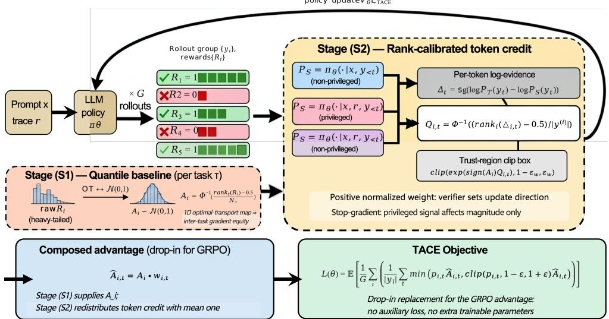
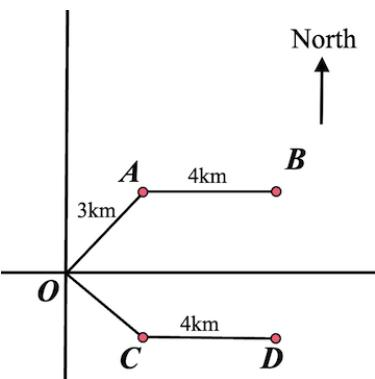

# Distributional Reward Calibration and Budget-Neutral Credit Assignment for Multimodal RLVR

Lang Chen, Zongxin Xu, Borui Wang, Anran Liu, and Shitong Chen

## Abstract

We revisit advantage estimation in Group Relative Policy Optimization (GRPO) and observe that any token-level advantage admits a two-stage factorization: a sample-level baselining step that converts scalar verifier rewards into a comparable sequence-level signal, and a token-level credit assignment step that distributes that signal over the trajectory. Existing estimators typically address only one of these stages: affine baselines preserve the shape of each task’s reward law, so heavy tails and binary cliffs propagate into the gradient, while token-level credit rules tie the size of each token’s update to raw confidence scales and need not conserve the total credit issued by the verifier. We propose TACE (Two-stage Advantage and Credit Estimation), a two-stage estimator that addresses both stages. At stage (S1), we replace linear standardization with a one-dimensional optimaltransport map to a standard normal, which gives a common population reward law across tasks and caps finite-sample outliers deterministically. At stage (S2), we rank-calibrate a stop-gradient evidence contrast within each trajectory and renormalize the clipped token weights to have mean one, so credit is redistributed across tokens while its total mass and sign are conserved. We prove populationlevel inter-task moment equity, a deterministic tail bound, and mass-conservation, boundedness, and sign-anchoring properties that affine baselines and unnormalized token weights do not satisfy. On a multimodal reasoning suite, TACE obtains the strongest results on a majority of the benchmarks but does not dominate every setting.

## 1 Introduction

GRPO reduces reinforcement learning with verifiable rewards to a simple estimator: it standardizes scalar rewards into a sequence-level advantage and broadcasts that advantage uniformly over tokens. This practice conflates two independent decisions: (S1) sample-level baselining, which turns a scalar reward into a comparable advantage, and (S2) token-level credit assignment, which distributes that advantage over the trajectory’s tokens. Existing variants typically address exactly one stage: Dr. GRPO [Liu et al., 2025] and EMA-GRPO [Feng, 2025] refine the affine form of the baseline while leaving token credit uniform, whereas recent token-crediting rules introduce per-token signals while retaining an affine sequence-level baseline [Yang et al., 2026].

The two stages carry complementary failure modes that neither alone can repair. An affine baseline cannot reshape a reward law: heavy tails, binary cliffs, and inter-task variance gaps survive the rescaling and propagate verbatim into the gradient magnitude and then into every token of the trajectory. Conversely, magnitude-based token weights address allocation but tie the size of each token’s credit to the raw scale of the underlying signal, so token reallocation can silently amplify or attenuate the total signal the verifier issued. What is missing is a two-stage estimator in which the sample baseline is distribution-aware rather than affine, and the token channel is budget-neutral: it may redistribute credit, never inflate it.

We propose TACE, a two-stage advantage estimator that gives each stage the invariant it needs: distribution-aware rank calibration at stage (S1) and budget-neutral credit reallocation at stage (S2). Stage (S1) uses the population 1D optimal-transport (OT) map onto $\mathcal { N } ( 0 , 1 )$ , implemented by $A _ { i } =$ $\Phi ^ { - 1 } ( \widehat { F } _ { \tau } ( R _ { i } ) )$ ; it calibrates the advantage by the rank of the reward rather than its raw value, yielding population-level inter-task equity, a deterministic finite-sample tail cap, and order preservation at one O(N log N) sort per group. Stage (S2) builds the token channel on a stop-gradient evidence contrast, as used in previous work [Yang et al., 2026, Zhao et al., 2026, Hübotter et al., 2026], and introduces two modifications: the per-token evidence difference is rank-calibrated within the trajectory, removing its dependence on teacher confidence and model calibration; and the clipped, sign-anchored weights are renormalized to mean one, so the total credit mass issued by the verifier is exactly conserved while its allocation across tokens is sharpened. Because the two rank maps act on disjoint indices (samples vs. tokens) and both preserve signs, the stages compose without interference; the net cost over vanilla GRPO is one sort per group, one sort per trajectory, and one additional privileged-context pass.

In summary, our contributions are three-fold:

• We propose a distribution-aware stage-(S1) baseline, replacing GRPO’s affine standardization with a 1D OT map onto N (0, 1), and prove population-level inter-task moment equity (not just two-moment matching) plus a deterministic finite-sample outlier cap.

• We introduce a rank-calibrated, mass-preserving stage-(S2) credit rule: starting from the directionanchored evidence ratio in previous work, we rank-calibrate the token evidence within each trajectory and renormalize the clipped weights to mean one. We prove positivity, a two-sided deterministic bound, exact credit-mass conservation, sign anchoring, and invariance to strictly increasing recalibration of the evidence signal; because the two stages act on disjoint indices and preserve signs, the composed estimator also enjoys a composition guarantee.

• We provide evidence on multimodal RLVR: on a multimodal reasoning suite, the composed estimator obtains the strongest results on a majority of the benchmarks while exposing the settings where further calibration is needed.

## 2 Related Work

## 2.1 Reward Normalization Inside GRPO

Since GRPO’s introduction [Shao et al., 2024, DeepSeek-AI et al., 2025], a substantial body of work has revisited how the group-relative advantage $A _ { i } = ( R _ { i } { - } \mu _ { G } ) / \sigma _ { G }$ should be standardized when the verifier signal is heterogeneous across tasks or rollouts. Dr. GRPO [Liu et al., 2025] drops the pergroup standard deviation and replaces it with a centered baseline; EMA-GRPO [Feng, 2025] swaps the local $\sigma _ { G }$ for a task-wise running estimate to mitigate variance imbalance across multimodal task families; further extensions explore softer or task-conditioned variants [Yu et al., 2025, Gao et al., 2025, Xie et al., 2025b, Zheng et al., 2025a]. All of these schemes apply an affine transformation to the raw reward, which by construction cannot reshape the underlying reward distribution: heavy tails, binary cliffs, and inter-task scale gaps survive the rescaling and propagate into the gradient magnitude. TACE departs from this affine family by applying a non-linear, rank-based transport to a fixed reference distribution, recovering inter-task equity and bounded tails as automatic consequences rather than as side products of hyperparameter tuning.

## 2.2 Advantage Reallocation in Verifier-Only RL

Fine-grained supervision for reasoning can be organized along two axes: where a token score comes from, and what invariant the score is required to obey. Process supervision learns an intermediate judge from annotations, generated rationales, or model-based checks [Lightman et al., 2024, Wang et al., 2024b, Luo et al., 2024, Chen et al., 2024, Zhang et al., 2024, Cui et al., 2025, Dai et al., 2025, Yang et al., 2025b,a]. Verifier-only alternatives derive a relative token score from rollout statistics such as entropy, salience, attention, or outcome sensitivity [Cheng et al., 2026, Wang et al., 2025a, Chen et al., 2025a, Sun et al., 2025c, Xie et al., 2025a, Li et al., 2025b, Chen et al., 2025d, Li et al., 2026]. The former introduces a separate supervision surface; the latter usually controls token emphasis without a guarantee on the total credit issued to a trajectory. TACE addresses the second invariant directly: its within-trajectory rank map supplies a common evidence scale, while mean-one renormalization turns token learning into reallocation rather than amplification.

## 2.3 Privileged Context as a Magnitude Signal

Distillation-style training offers a useful diagnostic for this design. External on-policy teachers can provide position-wise targets, but they require a second inference stack and compatible output spaces [Agarwal et al., 2024, Lu and Lab, 2025, Fu et al., 2026, Team et al., 2026]. Self-conditioning removes the extra model but creates an observability mismatch when the conditioned copy sees the answer [Zhao et al., 2026, Hübotter et al., 2026]. The analysis of Yang et al. [2026] therefore confines privileged evidence to a stop-gradient multiplier whose sign is governed by the verifier. TACE adopts that confinement, but changes the multiplier’s calibration: evidence values are converted to within-trajectory ranks, clipped, and renormalized to mean one. Consequently, a monotone change in teacher confidence cannot alter the allocation, and the trajectory-level verifier decision remain the only source of aggregate reinforcement.

## 2.4 Optimal Transport for Language Model Training

Optimal transport (OT) has appeared in language-model post-training mainly as a distance functional: token-level Wasserstein distances regularize preference alignment, stochastic-dominance constraints reshape reward distributions, and OT-based projections enforce safety properties in latent space [Melnyk et al., 2024, Li et al., 2025a, Na et al., 2026, Nanfack et al., 2026]. The role we give OT is different: rather than measuring a divergence between two learned distributions, we exploit the closed-form 1D Brenier map onto $\mathcal { N } ( 0 , 1 )$ as the canonical solution to the sample-level baselining problem inside GRPO. This places OT inside the advantage estimator itself, where it provides distribution invariance, outlier robustness, and order preservation as immediate properties of the rank-CDF composition.

## 2.5 Multimodal RL Post-Training

Reinforcement learning has rapidly become a standard tool for sharpening multimodal reasoning in vision-language models [Li et al., 2025c, Sun et al., 2025a, Feng et al., 2025, Sun et al., 2025b, Zhou et al., 2025, Duan et al., 2025, Chen et al., 2025b,c, Meng et al., 2025, Wang et al., 2025b, Zhang et al., 2025], where reward heterogeneity across perception-heavy and reasoning-heavy tasks is far more pronounced than in pure-text settings. Existing recipes typically address this with task-specific data curation, auxiliary perceptual objectives, or external captioners [Tian et al., 2025, Yang et al., 2025c, Tu et al., 2025]. TACE is orthogonal to these recipes: by enforcing distribution invariance at stage (S1), it removes reward-calibration differences from the advantage scale, so the same estimator can ingest perception, mathematics, and chart rewards without per-task scale tuning.

## 3 Background and Diagnosis

Section 3.1 fixes the notation we use for GRPO and on-policy distillation.

## 3.1 Preliminaries

GRPO. RLVR post-training assumes a policy πθ generating responses $y = ( y _ { 1 } , \dots , y _ { T } )$ autoregressively from query x under a scalar verifier $R ( x , y )$ , often binary. GRPO [Shao et al., 2024] samples G candidates $\{ y ^ { ( i ) } \} \sim \pi _ { \theta _ { \mathrm { o l d } } } ( \cdot \mid x )$ and standardizes their rewards into a sequence-level advantage $A ^ { ( i ) } = ( R ( x , y ^ { ( i ) } ) - \mu _ { G } ) / \sigma _ { G }$ , then reuses the same $A ^ { ( i ) }$ for every token of $\boldsymbol y ^ { ( i ) }$ in the clipped policy-gradient objective

$$
\mathcal { L } _ { \mathrm { G R P O } } ( \theta ) = \mathbb { E } \left[ \frac { 1 } { G } \sum _ { i = 1 } ^ { G } \frac { 1 } { | y ^ { ( i ) } | } \sum _ { t = 1 } ^ { | y ^ { ( i ) } | } \operatorname* { m i n } \Bigl ( \rho _ { t } ^ { ( i ) } A ^ { ( i ) } , \mathrm { c l i p } ( \rho _ { t } ^ { ( i ) } , 1 - \epsilon , 1 + \epsilon ) A ^ { ( i ) } \Bigr ) \right] ,\tag{1}
$$

where $\rho _ { t } ^ { ( i ) }$ is the standard importance ratio. Per-token credit within a trajectory is necessarily uniform.

  
Figure 1: Overview of TACE. Stage (S1), ours: replaces $( R _ { i } - \mu _ { G } ) / \sigma _ { G }$ with the 1D optimal-transport map onto $\mathcal { N } ( 0 , 1 \bar { ) }$ $A _ { i } = \Phi ^ { - 1 } ( ( \mathrm { r a n k } _ { \tau } (  { R _ { i } } ) - 0 . 5 ) /  { N _ { \tau } } )$ , for inter-task gradient equity. Stage (S2), ours (starting from the evidence ratio of Yang et al., 2026): runs $\pi _ { \theta }$ under non-privileged $( P _ { S } )$ and privileged $( P _ { T } )$ contexts, rank-calibrates the per-token log-evidence within the trajectory, and applies a sign-anchored, mean-one (mass-preserving) magnitude weight $w _ { i , t }$ The composed token advantage $\hat { A } _ { i , t } = A _ { i } \cdot w _ { i , t }$ plugs into the standard GRPO clipped surrogate.

On-policy and self-distillation objectives. A second line densifies token-level supervision through a reference $P _ { T }$ . On-policy distillation (OPD) [Agarwal et al., 2024] takes $P _ { T }$ from a separate stronger model on the same query x. On-policy self-distillation (OPSD) [Zhao et al., 2026, Hübotter et al., 2026] reuses $\pi _ { \theta }$ as both player and reference, with the reference receiving privileged input r (in our setting, the final ground-truth answer). With $P _ { S } ( \cdot \mid y _ { < t } ) \ \triangleq \ \pi _ { \theta } ( \cdot \mid x , y _ { < t } )$ and $P _ { T } ( \cdot \mid y _ { < t } ) \triangleq \pi _ { \theta } ( \cdot \mid x , r , y _ { < t } )$ , both fit

$$
\mathcal { L } _ { \mathrm { O P ( S ) D } } ( \theta ) = \mathbb { E } _ { ( x , r ) \sim S } \mathbb { E } _ { y \sim P _ { S } ( \cdot \mid x ) } \left[ \frac { 1 } { \mid y \mid } \sum _ { t = 1 } ^ { \mid y \mid } D \big ( P _ { T } \mid \mid P _ { S } \big ) \right] .\tag{2}
$$

Here D denotes a chosen statistical divergence, such as KL or JS. The shared design makes $P _ { T }$ determine the gradient direction, a choice TACE cannot inherit because it violates direction anchoring.

## 4 Method

Figure 1 gives an overview of the composed estimator. One architectural requirement governs stage (S2): privileged evidence may influence how strongly a token is credited, but the verifier remains the sole source of reinforcement or suppression. TACE (Two-stage Advantage and Credit Estimation) preserves this separation while giving each stage its corresponding invariant: stage (S1) replaces linear standardization with a distribution-aware OT baseline, and stage (S2) rank-calibrates the evidence signal and conserves credit mass.

## 4.1 A Two-Stage View of GRPO Advantage Estimation

GRPO writes its advantage as $A _ { i } = ( R _ { i } - \mu _ { G } ) / \sigma _ { G }$ with the same $A _ { i }$ shared by every token in $\boldsymbol y ^ { ( i ) }$ but this hides two statistically independent operations:

$$
\underbrace  \{ R _ { i } \} _ { i = 1 } ^ { G } \xrightarrow { ( \mathrm { S 1 } ) } { } _ { \mathrm { s a m p l e - l e v e l b a s e l i n i n g } } A _ { i } \xrightarrow { ( \mathrm { S 2 } ) } _ { \mathrm { t o k e n - l e v e l ~ c r e d i t ~ a s s i g n m e n t } } .\tag{3}
$$

Vanilla GRPO uses linear standardization in (S1) and the trivial weight $w _ { i , t } = 1$ in (S2). The design space in Table 1 is therefore almost diagonal: Dr. GRPO [Liu et al., 2025] and EMA-GRPO [Feng,

Table 1: Representative estimators viewed through Eq. (3). TACE contributes the distribution-aware stage-(S1) baseline and composes it with a rank-calibrated, mass-preserving version of direction-anchored credit.
<table><tr><td>Method</td><td>Sample baseline Ai (S1) Token weight</td><td> $w _ { i , t } \left( \mathbf { S } \boldsymbol { 2 } \right)$ </td><td>Direction anchor</td></tr><tr><td>GRPO [Shao et al., 2024]</td><td> $( R _ { i } - \mu _ { G } ) / \sigma _ { G }$ </td><td></td><td>Verifier</td></tr><tr><td>Dr. GRPO [Liu et al., 2025]</td><td> $R _ { i } - \mu _ { G }$ </td><td>1 1</td><td>Verifier</td></tr><tr><td>EMA-GRPO [Feng, 2025]</td><td> $( R _ { i } - \mu _ { G } ) / \sigma _ { \tau } ^ { ( t ) }$ </td><td></td><td>Verifier</td></tr><tr><td>OPSD [Zhao et al., 2026]</td><td></td><td> $P _ { T } / P _ { S }$  as gradient target</td><td>Teacher</td></tr><tr><td>SDPO [Hübotter et al., 2026]</td><td></td><td>sign-free evidence ratio</td><td>Teacher</td></tr><tr><td>RLSD [Yang et al., 2026]</td><td> $( R _ { i } - \mu _ { G } ) / \sigma _ { G }$ </td><td> $\mathrm { c l i p } \big ( ( P _ { T } / P _ { S } ) ^ { \mathrm { s i g n } ( A _ { i } ) } \big )$ </td><td>Verifier</td></tr><tr><td>TACE (Ours)</td><td> $\Phi ^ { - 1 } \bigl ( \widehat { F } _ { \tau } ( R _ { i } ) \bigr )$ </td><td> $\mathrm { m e a n - o n e \ c l i p } \big ( e ^ { \mathrm { s i g n } ( A _ { i } ) Q _ { i , t } } \big ) , Q _ { i , t } = \Phi ^ { - 1 } \big ( \widehat F _ { i } ( \Delta _ { i , t } ) \big )$ </td><td>Verifier</td></tr></table>

2025] alter only the affine form of $A _ { i } ,$ whereas RLSD [Yang et al., 2026] modifies only the token multiplier. Each stage carries a distinct failure mode the other cannot repair: an affine baseline cannot reshape a reward law, so distributional differences remain in the update magnitude; uniform credit cannot distinguish pivotal tokens from filler, while using $P _ { T } / P _ { S }$ as a gradient target is structurally leakage-prone [Yang et al., 2026].

Two invariants any principled estimator must satisfy. I1 (Distribution invariance): the marginal distribution of $A _ { i }$ should not depend on the verifier’s calibration; (S1) must be a distribution-aware map, not an affine one. I2 (Direction anchoring): the sign of every tokenlevel advantage must equal $\mathrm { s i g n } ( A _ { i } )$ , the verifier’s verdict on the trajectory; (S2) must act on the magnitude of credit, never on its direction. Section 4.2 instantiates I1 via the 1D optimal-transport map onto $\mathcal { N } ( 0 , 1 )$ ; Section 4.3 instantiates I2 via a stop-gradient evidence ratio whose exponent is sign(Ai).

## 4.2 Stage 1: Quantile-Normalized Sample Baseline

Task-dependent verifier statistics are rarely well-conditioned: binary outcomes create highly skewed two-point laws, while richer scalar verifiers can be heavy-tailed. Linear standardization carries these differences into the advantage because it is an affine, shape-preserving map. To enforce invariant I1 we therefore map the population reward law $P _ { \mathcal { R } } .$ to a fixed reference $\bar { P } _ { N } = \mathcal { N } ( 0 , 1 )$ at minimum quadratic cost. When a group has no reward variation, we set $A _ { i } = 0 ;$ , matching the usual GRPO convention for degenerate groups. Otherwise, Brenier’s theorem gives a unique increasing population transport in one dimension; its finite-group plug-in is the mid-rank composition

$$
A _ { i } \ \triangleq \ \Psi _ { \tau } ( R _ { i } ) \ = \ \Phi ^ { - 1 } \bigl ( { \widehat F } _ { \tau } ( R _ { i } ) \bigr ) , \qquad { \widehat F } _ { \tau } ( R _ { i } ) \ = \ \frac { \mathrm { r a n k } _ { \tau } ( R _ { i } ) - \frac { 1 } { 2 } } { N _ { \tau } } ,\tag{4}
$$

where $N _ { \tau }$ is the group size for task $\tau , \widehat { F } _ { \tau }$ is its empirical CDF over the current group, and $\Phi ^ { - 1 }$ is the standard normal quantile function. Identical raw rewards (a frequent case under binary verifiers) are mapped to the average of their quantile images so that identical outcomes receive identical credit.

Properties relevant to (S1). Three immediate consequences of Eq. (4) jointly satisfy invariant I1:

• Inter-task gradient equity. Under the continuous reward law assumed in Proposition 1, A has zero mean and unit variance regardless of the scale or shape of $P _ { \mathcal { R } _ { \mathit { \Pi } } }$ . The empirical rank map likewise removes raw reward magnitudes and higher-order shape from the finite-sample score.

• Outlier and bimodality robustness. A single anomalously large reward is mapped to $\Phi ^ { - 1 } ( \mathrm { ( r a n k - }$ $0 . 5 ) / N )$ , which is bounded by the finite-sample rank grid; the two outcome categories of a binary verifier are mapped to bounded Gaussian quantiles.

• Order preservation. $\Phi ^ { - 1 } \circ \widehat { F } _ { \tau }$ is nondecreasing: distinct rewards receive ordered scores, while tied rewards receive the same score. In particular, $\mathrm { s i g n } ( A _ { i } )$ reflects the verifier’s relative verdict within the group and is therefore safe to use as the direction anchor exploited by stage (S2).

The implementation reduces to one $O ( N \log N )$ sort per group; no additional hyperparameter is introduced at this stage.

## 4.3 Stage 2: Rank-Calibrated, Mass-Preserving Token Credit

Stage (S2) must allocate the well-conditioned scalar $A _ { i }$ to the tokens of $\boldsymbol y ^ { ( i ) }$ without violating invariant I2. Our starting point is the evidence-ratio credit of Yang et al. [2026]: with $P _ { T } \ \triangleq \ \pi _ { \theta } ( \cdot \ | \ x , r , y _ { < t } )$ and $P _ { S } \ \triangleq \ \pi _ { \theta } ( \cdot \textbf { \vert } x , y _ { < t } )$ , define the stop-gradient log-evidence $\begin{array} { r } { \Delta _ { i , t } = } \end{array}$ sg(log $P _ { T } ( y _ { t } ) - \log { P _ { S } ( y _ { t } ) } )$ . We then introduce two modifications that make the token channel distribution-free and budget-neutral, mirroring at the token level what stage (S1) does at the sample level.

Modification 1: within-trajectory rank calibration. The raw scale of $\Delta _ { i , t }$ is an accident of model calibration, privileged-context strength, and position; trajectories with a confident teacher therefore receive systematically larger token weights. We remove this confound by replacing $\Delta _ { i , t }$ with its rank inside the trajectory,

$$
Q _ { i , t } \ = \ \Phi ^ { - 1 } \left( \frac { \mathrm { r a n k } _ { i } ( \Delta _ { i , t } ) - \frac { 1 } { 2 } } { | y ^ { ( i ) } | } \right) ,\tag{5}
$$

with ties receiving the average of their quantile images. Because Eq. (5) uses only the ordering of the evidence within a trajectory, it is invariant to strictly increasing recalibration of $\Delta$ and gives every trajectory the same calibrated evidence scale, which is the token-level analogue of Eq. (4).

Modification 2: credit-mass conservation. RLSD-style weights redistribute credit but need not preserve its total: if the teacher is confident along the whole trajectory, $\textstyle { \frac { 1 } { | y | } } \sum _ { t } w _ { i , t }$ can drift away from 1, silently amplifying or attenuating the trajectory-level signal that the verifier issued. We decouple reallocation from amplification by renormalizing the clipped, sign-anchored weight to have mean exactly one over the trajectory:

$$
\begin{array} { r } { u _ { i , t } = \mathrm { c l i p } \Big ( e ^ { \mathrm { s i g n } ( A _ { i } ) Q _ { i , t } } , 1 - \epsilon _ { w } , 1 + \epsilon _ { w } \Big ) , \qquad w _ { i , t } = \frac { u _ { i , t } } { \frac { 1 } { | y ^ { ( i ) } | } \sum _ { s = 1 } ^ { | y ^ { ( i ) } | } u _ { i , s } } , } \end{array}\tag{6}
$$

together with the same short warm-up $w _ { i , t } \gets ( 1 - \lambda ) + \lambda w _ { i , t } , \lambda$ ramping from 0 to 1 over the first 50 steps. The clipping idea is inherited from Yang et al. [2026]; the rank calibration of Eq. (5) and the mass-preserving normalization of Eq. (6) are ours. Theorem 1 shows the resulting estimator satisfies positivity, a deterministic two-sided bound, exact credit-mass conservation, and sign anchoring.

## 4.4 Theory: Equity, Tails, and Conservation

The results below formalize the guarantees of the estimator we contribute. Proposition 1 applies the classical probability integral transform and inverse-normal quantile map to the GRPO baseline and is a population statement for continuous reward laws; Eq. (4) is its mid-rank plug-in. The deterministic tail cap of Proposition 2 and the conservation, boundedness, and sign-anchoring guarantees of Theorem 1 are specific to the composed TACE estimator. The information-asymmetry analysis that motivates direction anchoring is due to Yang et al. [2026] and is cited, not restated.

Proposition 1 (Exact distributional equity). Let task τ have a continuous reward distribution $P _ { \mathcal R }$ with CDF $F _ { \tau } ,$ , and let $A = \Phi ^ { - 1 } ( F _ { \tau } ( \dot { R } ) )$ with $R \sim P _ { { \mathcal R } _ { \tau } }$ . Then $A \sim \mathcal { N } ( 0 , 1 )$ exactly; in particular $\mathbb { E } | A | ^ { p } = m _ { p } f o r$ every $p \geq 1$ , with $m _ { p }$ independent of τ . Affine standardization $( R - \mu ) / \sigma$ matches only the first two moments: for every $p > 2$ there exist tasks $\tau , \tau ^ { \prime }$ with the same mean and variance but $\mathbb { E } | A _ { \tau } | ^ { p } \neq \mathbb { E } | A _ { \tau ^ { \prime } } | ^ { p }$

Proposition 2 (Deterministic outlier bound). For a group of N rewards, the estimator of $E q .$ . (4) satisfies maxi $\begin{array} { r } { | A _ { i } | \le \Phi ^ { - 1 } \big ( 1 - \frac { 1 } { 2 N } \big ) } \end{array}$ , deterministically and irrespective of the reward scale. Under affine standardization the same quantity can reach $\sqrt { N - 1 }$ (one outlier against $N - 1$ tied rewards). For $N { = } 8$ the two bounds are 1.53 vs. 2.65;for N=256, 2.89 vs. 15.97.

Theorem 1 (Mass conservation, boundedness, and sign anchoring). For every trajectory and every realization ofthe privileged context $^ { r , }$ the token weights ofEq. (6) satisfy

$$
w _ { i , t } > 0 , \qquad \frac { 1 } { | y ^ { ( i ) } | } \sum _ { t } w _ { i , t } = 1 , \qquad \frac { 1 - \epsilon _ { w } } { 1 + \epsilon _ { w } } \leq w _ { i , t } \leq \frac { 1 + \epsilon _ { w } } { 1 - \epsilon _ { w } } ,
$$

and consequently $\begin{array} { r } { \frac { 1 } { | y ^ { ( i ) } | } \sum _ { t } \hat { A } _ { i , t } = A _ { i } } \end{array}$ i and $\mathrm { s i g n } ( \hat { A } _ { i , t } ) = \mathrm { s i g n } ( A _ { i } )$ for all t. Moreover, $Q _ { i , t }$ in $E q .$ (5) is invariant to every strictly increasing transform of $\Delta _ { i , t }$ . In contrast, the unnormalized RLSD weight $( P _ { T } / P _ { S } ) ^ { \mathrm { s i g n } ( A _ { i } ) }$ has trajectory mean generically different from 1 and admits no scale-free description.

Propositions 1 and 2, together with Theorem 1, separate the two concerns that GRPO conflates: stage (S1) equalizes the distribution of trajectory-level credit across tasks (not just its first two moments) with a hard tail cap, while stage (S2) redistributes credit across tokens with its total mass and sign fixed. The two normalizations act on disjoint indices, with i across the group and t within the trajectory, so they compose without interference; Appendix A.4 makes this precise.

## 4.5 Composed Estimator

Substituting Eq. (4) and Eq. (6) into $\operatorname { E q . } \left( 3 \right)$ gives the closed-form TACE advantage:

$$
\begin{array} { r l r } { \hat { A } _ { i , t } = \Phi ^ { - 1 } \big ( \widehat { F } _ { \tau } ( R _ { i } ) \big ) \cdot \underbrace { \frac { u _ { i , t } } { 1 y ^ { ( i ) } | \sum _ { s } u _ { i , s } } } _ { \mathrm { m e a n - o n e } w _ { i , t } } , } & { } & { u _ { i , t } = \mathrm { c l i p } \Big ( e ^ { \mathrm { s i g n } ( A _ { i } ) Q _ { i , t } } , 1 - \epsilon _ { w } , 1 + \epsilon _ { w } \Big ) , } \end{array}\tag{7}
$$

which plugs into the standard clipped-surrogate objective:

$$
\mathcal { L } _ { \mathrm { T A C E } } ( \theta ) = \mathbb { E } \left[ \frac { 1 } { G } \sum _ { i = 1 } ^ { G } \frac { 1 } { | y ^ { ( i ) } | } \sum _ { t = 1 } ^ { | y ^ { ( i ) } | } \operatorname* { m i n } \bigl ( \rho _ { i , t } \hat { A } _ { i , t } , \mathrm { c l i p } ( \rho _ { i , t } , 1 - \epsilon _ { \mathrm { l o w } } , 1 + \epsilon _ { \mathrm { h i g h } } ) \hat { A } _ { i , t } \bigr ) \right] .\tag{8}
$$

Writing $\hat { A } _ { i , t } = f ( R _ { i } ; \tau ) \cdot w _ { i , t }$ with $f = \Phi ^ { - 1 } \circ \widehat { F } _ { \tau }$ , the two stages compose without interference: f is monotone (so sign(f) is the only feature w reads), and $w _ { i , t } > 0$ with $\begin{array} { r } { \frac { 1 } { | y | } \sum _ { t } w _ { i , t } = 1 } \end{array}$ (Theorem 1), so stage (S2) reallocates credit without changing its mass or sign. Beyond GRPO, TACE adds one O(N log N) sort per group, one rank sort per trajectory, and a single additional privileged-context forward pass.

## 5 Empirical Evaluation

## 5.1 Setup and Baselines

Training corpus and evaluation suite. We train on MMFineReason-123K [Lin et al., 2026], derived from MMFineReason-1.8M by retaining items that Qwen3-VL-4B-Thinking misses in four independent rollouts. Evaluation covers five multimodal reasoning suites: MMMU [Yue et al., 2024] (multi-discipline college-level VQA), MathVista [Lu et al., 2024] (math reasoning over visual contexts), MathVision [Wang et al., 2024a] (competition-level visual math), ZeroBench [Roberts et al., 2025] (frontier-unsolvable stress test), and WeMath [Qiao et al., 2024] (fine-grained math). All benchmarks report accuracy (%). For comparability, we follow the RLSD multimodal protocol for the corpus, backbone, benchmark suite, context length, rollout settings, and quoted baseline rows; the TACE, component-ablation, and late-training sensitivity runs are ours.

Backbone and compared methods. The backbone in every run is Qwen3-VL-8B-Instruct [Bai et al., 2025]. We compare: Base VLM (no additional post-training); GRPO [Shao et al., 2024]; OPSD [Zhao et al., 2026]; SDPO [Hübotter et al., 2026]; $\mathbf { G R P O + } \mathbf { \tilde { O P S D } }$ , the additive-fusion baseline of Yang et al. [2026]; and RLSD [Yang et al., 2026]. The quoted baseline rows follow Yang et al. [2026]. The bottom TACE row enables both stages, with stage (S2) implemented as our rankcalibrated, mass-preserving credit rule.

Optimization and hyperparameters. Our training pipeline is implemented on top of VERL [Sheng et al., 2025] and EasyR1 [Zheng et al., 2025b]. Each rollout uses an 8192-token context window, allocated as a 4096-token prompt and a 4096-token response. The group size is 8 rollouts per prompt, sampled at temperature 1.0, and the effective optimizer batch contains 256 prompts. The PPOstyle importance-ratio clip is asymmetric, with $( \epsilon _ { \mathrm { l o w } } , \epsilon _ { \mathrm { h i g h } } ) = ( 0 . 2 , 0 . 2 8 )$ . For the composed TACE estimator, the stage-S2 hyperparameters follow RLSD: the warm-up coefficient λ ramps linearly from 0 to 1 over the first 50 optimization steps, and the credit-channel clip is $\epsilon _ { w } = 0 . 2$ . The withintrajectory rank calibration and mean-one normalization introduce no additional hyperparameters. The privileged context r used in stage S2 is the final ground-truth answer, as in RLSD.

Table 2: Accuracy after post-training Qwen3-VL-8B-Instruct. Bold marks the top score in each column. The Base, GRPO, OPSD, SDPO, GRPO+OPSD, and RLSD rows quote the numbers reported by RLSD; the TACE row is ours.
<table><tr><td>Method</td><td>MMMU</td><td>MathVista</td><td>MathVision</td><td>ZeroBench</td><td>WeMath</td></tr><tr><td>Base VLM</td><td>62.44</td><td>73.80</td><td>47.37</td><td>19.76</td><td>54.10</td></tr><tr><td>GRPO</td><td>65.11</td><td>76.20</td><td>48.82</td><td>22.60</td><td>56.57</td></tr><tr><td>OPSD</td><td>63.82</td><td>75.10</td><td>47.53</td><td>21.06</td><td>54.95</td></tr><tr><td>SDPO</td><td>65.11</td><td>74.00</td><td>47.27</td><td>25.15</td><td>52.19</td></tr><tr><td>GRPO+OPSD</td><td>63.22</td><td>75.90</td><td>48.52</td><td>22.16</td><td>54.76</td></tr><tr><td>RLSD</td><td>67.22</td><td>78.10</td><td>52.73</td><td>24.85</td><td>58.00</td></tr><tr><td>TACE (Ours)</td><td>68.67</td><td>80.60</td><td>56.58</td><td>18.86</td><td>45.62</td></tr></table>

## 5.2 Experimental Results

## 5.2.1 Five-Benchmark Reasoning Results

Table 2 reports the five-benchmark comparison. The composed TACE estimator obtains the strongest results on MMMU, MathVista, and MathVision, while ZeroBench and WeMath remain stronger under existing baselines. This mixed pattern is consistent with the theory: rank-based normalization removes reward-scale and tail effects, but the composed credit rule can still underperform when verifier outcomes are sparse or when the privileged signal provides limited token-level evidence.

## 5.2.2 Component Ablation

Table 3 evaluates two reduced estimators on the first three benchmarks. w/o S1 replaces the quantilenormalized sample baseline with conventional affine group standardization while retaining the tokenlevel credit channel. w/o S2 removes the rank-calibrated, mass-preserving token credit and uses uniform token weights while retaining the quantile baseline. Both reduced estimators degrade relative to full TACE, with the largest drop on MathVision in each case (6.05 points without S1 and 3.82 points without S2). Removing S1 also hurts more than removing S2 on every benchmark, indicating that distributional reward calibration is the stronger contributor, while the two stages remain complementary: removing either component breaks the invariant that the composed estimator is designed to preserve. Appendix C additionally reports a 14-run, one-factor-at-a-time short-horizon late-training sensitivity study; because each arm uses only 40 two-GPU continuation steps, we treat it as a stability diagnostic rather than a model-selection procedure.

## 5.2.3 Qualitative Case Study

We illustrate the trained model’s behavior on a WeMath example.

Task. Figure 2 shows a WeMath prompt that asks the model to read two segment lengths from the diagram and report

$$
O A = \left( { \bf \cdot \nabla } \right) { \bf m } , \qquad A B = \left( { \bf \cdot \nabla } \right) { \bf m } .
$$

The choices are A = (300, 400), B = (400, 300), C = (3000, 4000), $\textit { D } = \ ( 4 0 0 0 , 3 0 0 0 )$ , and $E = { } ^ { \infty } \mathrm { \tilde { N o } }$ correct answer.”

Model reasoning. The model first extracts the two imagegrounded relations $O A = 3$ km and AB = 4 km. It then notices the mismatch between the unit in the diagram and the unit requested by the question, applies 1 km = 1000 m, and obtains

$$
O A = 3 \times 1 0 0 0 = 3 0 0 0 { \mathrm { m } } , \qquad A B = 4 \times 1 0 0 0 = 4 0 0 0 { \mathrm { m } } .
$$

These values preserve the original $O A { \cdot } \mathrm { t o } { - } A B$ correspondence and select option C.

Analysis. This example tests substantive multimodal reasoning rather than merely matching an answer format. The model must recognize the two labeled segments, bind each numeric value to the correct segment rather than swapping them, detect that the question changes kilometers to meters, and apply the scale factor consistently to both quantities. The distractors intentionally probe the two most likely errors: a tenfold unit-conversion mistake and an order reversal. A correct answer therefore requires coordinated visual extraction, symbol grounding, and numeric transformation.

  
Figure 2: A WeMath example solved correctly by the trained model.

Table 3: Component ablation on the first three multimodal reasoning benchmarks. w/o S1 removes the quantile-normalized sample baseline; w/o S2 removes the rank-calibrated, mass-preserving token credit.
<table><tr><td>Method</td><td>MMMU</td><td>MathVista</td><td>MathVision</td></tr><tr><td>TACE w/o S1</td><td>64.17</td><td>76.20</td><td>50.53</td></tr><tr><td>TACE w/o S2</td><td>65.31</td><td>77.58</td><td>52.76</td></tr><tr><td>TACE</td><td>68.67</td><td>80.60</td><td>56.58</td></tr></table>

## 6 Conclusion and Limitations

GRPO’s sequence-level estimate preserves the shape of each task’s reward law, and uniform token credit spreads the resulting signal indiscriminately. TACE addresses these two issues with a samplelevel optimal-transport baseline and a trajectory-level credit reallocation rule. Its additional computation consists of sorting and one privileged-context pass. Empirically, improvements on MMMU, MathVista, and MathVision coexist with regressions on ZeroBench and WeMath, indicating that distributional calibration does not by itself resolve sparse outcomes or weak token-level evidence. Our analysis is confined to verifier-only RLVR with a scalar outcome reward on multimodal reasoning; multi-marginal optimal transport for vector-valued rewards is the natural extension.

## References

Rishabh Agarwal, Nino Vieillard, Yongchao Zhou, Piotr Stanczyk, Sabela Ramos Garea, Matthieu Geist, and Olivier Bachem. On-policy distillation of language models: Learning from selfgenerated mistakes. In The Twelfth International Conference on Learning Representations, 2024. URL https://openreview.net/forum?id=3zKtaqxLhW.

Shuai Bai, Yuxuan Cai, Ruizhe Chen, Keqin Chen, Xionghui Chen, Zesen Cheng, Lianghao Deng, Wei Ding, Chang Gao, Chunjiang Ge, Wenbin Ge, Zhifang Guo, Qidong Huang, Jie Huang, Fei Huang, Binyuan Hui, Shutong Jiang, Zhaohai Li, Mingsheng Li, Mei Li, Kaixin Li, Zicheng Lin, Junyang Lin, Xuejing Liu, Jiawei Liu, Chenglong Liu, Yang Liu, Dayiheng Liu, Shixuan Liu, Dunjie Lu, Ruilin Luo, Chenxu Lv, Rui Men, Lingchen Meng, Xuancheng Ren, Xingzhang Ren, Sibo Song, Yuchong Sun, Jun Tang, Jianhong Tu, Jianqiang Wan, Peng Wang, Pengfei Wang, Qiuyue Wang, Yuxuan Wang, Tianbao Xie, Yiheng Xu, Haiyang Xu, Jin Xu, Zhibo Yang, Mingkun Yang, Jianxin Yang, An Yang, Bowen Yu, Fei Zhang, Hang Zhang, Xi Zhang, Bo Zheng, Humen Zhong, Jingren Zhou, Fan Zhou, Jing Zhou, Yuanzhi Zhu, and Ke Zhu. Qwen3-vl technical report, 2025. URL https://arxiv.org/abs/2511.21631.

Guoxin Chen, Minpeng Liao, Chengxi Li, and Kai Fan. Step-level value preference optimization for mathematical reasoning. In Findings of the Association for Computational Linguistics: EMNLP 2024, pages 7889–7903, 2024.

Minghan Chen, Guikun Chen, Wenguan Wang, and Yi Yang. Seed-grpo: Semantic entropy enhanced grpo for uncertainty-aware policy optimization. arXiv preprint arXiv:2505.12346, 2025a.

Shuang Chen, Yue Guo, Zhaochen Su, Yafu Li, Yulun Wu, Jiacheng Chen, Jiayu Chen, Weijie Wang, Xiaoye Qu, and Yu Cheng. Advancing multimodal reasoning: From optimized cold start to staged reinforcement learning. ArXiv preprint, abs/2506.04207, 2025b. URL https://arxiv. org/abs/2506.04207.

Shuang Chen, Yue Guo, Yimeng Ye, Shijue Huang, Wenbo Hu, Haoxi Li, Manyuan Zhang, Jiayu Chen, Song Guo, and Nanyun Peng. Ares: Multimodal adaptive reasoning via difficulty-aware

token-level entropy shaping. ArXiv preprint, abs/2510.08457, 2025c. URL https://arxiv. org/abs/2510.08457.

Xinzhu Chen, Xuesheng Li, Zhongxiang Sun, and Weijie Yu. Beyond high-entropy exploration: Correctness-aware low-entropy segment-based advantage shaping for reasoning llms. arXiv preprint arXiv:2512.00908, 2025d.

Daixuan Cheng, Shaohan Huang, Xuekai Zhu, Bo Dai, Xin Zhao, Zhenliang Zhang, and Furu Wei. Reasoning with exploration: An entropy perspective. In Proceedings of the AAAI Conference on Artificial Intelligence, volume 40, pages 30377–30385, 2026.

Ganqu Cui, Lifan Yuan, Zefan Wang, Hanbin Wang, Yuchen Zhang, Jiacheng Chen, Wendi Li, Bingxiang He, Yuchen Fan, Tianyu Yu, et al. Process reinforcement through implicit rewards. arXiv preprint arXiv:2502.01456, 2025.

Muzhi Dai, Chenxu Yang, and Qingyi Si. S-grpo: Early exit via reinforcement learning in reasoning models, 2025. URL https://arxiv.org/abs/2505.07686.

DeepSeek-AI, Daya Guo, Dejian Yang, Haowei Zhang, Junxiao Song, Ruoyu Zhang, Runxin Xu, Qihao Zhu, Shirong Ma, Peiyi Wang, Xiao Bi, Xiaokang Zhang, Xingkai Yu, Yu Wu, Z. F. Wu, Zhibin Gou, Zhihong Shao, Zhuoshu Li, Ziyi Gao, Aixin Liu, Bing Xue, Bingxuan Wang, Bochao Wu, Bei Feng, Chengda Lu, Chenggang Zhao, Chengqi Deng, Chenyu Zhang, Chong Ruan, Damai Dai, Deli Chen, Dongjie Ji, Erhang Li, Fangyun Lin, Fucong Dai, Fuli Luo, Guangbo Hao, Guanting Chen, Guowei Li, H. Zhang, Han Bao, Hanwei Xu, Haocheng Wang, Honghui Ding, Huajian Xin, Huazuo Gao, Hui Qu, Hui Li, Jianzhong Guo, Jiashi Li, Jiawei Wang, Jingchang Chen, Jingyang Yuan, Junjie Qiu, Junlong Li, J. L. Cai, Jiaqi Ni, Jian Liang, Jin Chen, Kai Dong, Kai Hu, Kaige Gao, Kang Guan, Kexin Huang, Kuai Yu, Lean Wang, Lecong Zhang, Liang Zhao, Litong Wang, Liyue Zhang, Lei Xu, Leyi Xia, Mingchuan Zhang, Minghua Zhang, Minghui Tang, Meng Li, Miaojun Wang, Mingming Li, Ning Tian, Panpan Huang, Peng Zhang, Qiancheng Wang, Qinyu Chen, Qiushi Du, Ruiqi Ge, Ruisong Zhang, Ruizhe Pan, Runji Wang, R. J. Chen, R. L. Jin, Ruyi Chen, Shanghao Lu, Shangyan Zhou, Shanhuang Chen, Shengfeng Ye, Shiyu Wang, Shuiping Yu, Shunfeng Zhou, Shuting Pan, S. S. Li, Shuang Zhou, Shaoqing Wu, Shengfeng Ye, Tao Yun, Tian Pei, Tianyu Sun, T. Wang, Wangding Zeng, Wanjia Zhao, Wen Liu, Wenfeng Liang, Wenjun Gao, Wenqin Yu, Wentao Zhang, W. L. Xiao, Wei An, Xiaodong Liu, Xiaohan Wang, Xiaokang Chen, Xiaotao Nie, Xin Cheng, Xin Liu, Xin Xie, Xingchao Liu, Xinyu Yang, Xinyuan Li, Xuecheng Su, Xuheng Lin, X. Q. Li, Xiangyue Jin, Xiaojin Shen, Xiaosha Chen, Xiaowen Sun, Xiaoxiang Wang, Xinnan Song, Xinyi Zhou, Xianzu Wang, Xinxia Shan, Y. K. Li, Y. Q. Wang, Y. X. Wei, Yang Zhang, Yanhong Xu, Yao Li, Yao Zhao, Yaofeng Sun, Yaohui Wang, Yi Yu, Yichao Zhang, Yifan Shi, Yiliang Xiong, Ying He, Yishi Piao, Yisong Wang, Yixuan Tan, Yiyang Ma, Yiyuan Liu, Yongqiang Guo, Yuan Ou, Yuduan Wang, Yue Gong, Yuheng Zou, Yujia He, Yunfan Xiong, Yuxiang Luo, Yuxiang You, Yuxuan Liu, Yuyang Zhou, Y. X. Zhu, Yanhong Xu, Yanping Huang, Yaohui Li, Yi Zheng, Yuchen Zhu, Yunxian Ma, Ying Tang, Yukun Zha, Yuting Yan, Z. Z. Ren, Zehui Ren, Zhangli Sha, Zhe Fu, Zhean Xu, Zhenda Xie, Zhengyan Zhang, Zhewen Hao, Zhicheng Ma, Zhigang Yan, Zhiyu Wu, Zihui Gu, Zijia Zhu, Zijun Liu, Zilin Li, Ziwei Xie, Ziyang Song, Zizheng Pan, Zhen Huang, Zhipeng Xu, Zhongyu Zhang, and Zhen Zhang. Deepseek-r1: Incentivizing reasoning capability in llms via reinforcement learning, 2025. URL https://arxiv.org/abs/2501.12948.

Chengqi Duan, Kaiyue Sun, Rongyao Fang, Manyuan Zhang, Yan Feng, Ying Luo, Yufang Liu, Ke Wang, Peng Pei, Xunliang Cai, et al. Codeplot-cot: Mathematical visual reasoning by thinking with code-driven images. ArXiv preprint, abs/2510.11718, 2025. URL https://arxiv.org/ abs/2510.11718.

Anonymous Feng. Onethinker: An all-in-one reasoning model with ema-grpo. arXiv preprint, 2025.

Kaituo Feng, Kaixiong Gong, Bohao Li, Zonghao Guo, Yibing Wang, Tianshuo Peng, Junfei Wu, Xiaoying Zhang, Benyou Wang, and Xiangyu Yue. Video-r1: Reinforcing video reasoning in mllms. ArXiv preprint, abs/2503.21776, 2025. URL https://arxiv.org/abs/2503.21776.

Yuqian Fu, Haohuan Huang, Kaiwen Jiang, Yuanheng Zhu, and Dongbin Zhao. Revisiting on-policy distillation: Empirical failure modes and simple fixes, 2026. URL https://arxiv.org/abs/ 2603.25562.

Chang Gao, Chujie Zheng, Xiong-Hui Chen, Kai Dang, Shixuan Liu, Bowen Yu, An Yang, Shuai Bai, Jingren Zhou, and Junyang Lin. Soft adaptive policy optimization, 2025. URL https: //arxiv.org/abs/2511.20347.

Jonas Hübotter, Frederike Lübeck, Lejs Behric, Anton Baumann, Marco Bagatella, Daniel Marta, Ido Hakimi, Idan Shenfeld, Thomas Kleine Buening, Carlos Guestrin, and Andreas Krause. Reinforcement learning via self-distillation, 2026. URL https://arxiv.org/abs/2601.20802.

Meng Li, Guangda Huzhang, Haibo Zhang, Xiting Wang, and Anxiang Zeng. Optimal transportbased token weighting scheme for enhanced preference optimization, 2025a. URL https:// arxiv.org/abs/2505.18720.

Yang Li, Zhichen Dong, Yuhan Sun, Weixun Wang, Shaopan Xiong, Yijia Luo, Jiashun Liu, Han Lu, Jiamang Wang, Wenbo Su, et al. Attention illuminates llm reasoning: The preplan-and-anchor rhythm enables fine-grained policy optimization. arXiv preprint arXiv:2510.13554, 2025b.

Ziheng Li, Liu Kang, Feng Xiao, Luxi Xing, Qingyi Si, Zhuoran Li, Weikang Gong, Deqing Yang, Yanghua Xiao, and Hongcheng Guo. Outcome-grounded advantage reshaping for fine-grained credit assignment in mathematical reasoning. arXiv preprint arXiv:2601.07408, 2026.

Zongzhao Li, Zongyang Ma, Mingze Li, Songyou Li, Yu Rong, Tingyang Xu, Ziqi Zhang, Deli Zhao, and Wenbing Huang. Star-r1: Spatial transformation reasoning by reinforcing multimodal llms. ArXiv preprint, abs/2505.15804, 2025c. URL https://arxiv.org/abs/2505.15804.

Hunter Lightman, Vineet Kosaraju, Yuri Burda, Harrison Edwards, Bowen Baker, Teddy Lee, Jan Leike, John Schulman, Ilya Sutskever, and Karl Cobbe. Let’s verify step by step. In The Twelfth International Conference on Learning Representations, 2024. URL https://openreview.net/ forum?id=v8L0pN6EOi.

Honglin Lin, Zheng Liu, Yun Zhu, Chonghan Qin, Juekai Lin, Xiaoran Shang, Conghui He, Wentao Zhang, and Lijun Wu. Mmfinereason: Closing the multimodal reasoning gap via open data-centric methods, 2026. URL https://arxiv.org/abs/2601.21821.

Zichen Liu et al. Understanding r1-zero-like training: A critical perspective, 2025. URL https: //arxiv.org/abs/2503.20783.

Kevin Lu and Thinking Machines Lab. On-policy distillation. Thinking Machines Lab: Connectionism, 2025. doi: 10.64434/tml.20251026. https://thinkingmachines.ai/blog/on-policy-distillation.

Pan Lu, Hritik Bansal, Tony Xia, Jiacheng Liu, Chunyuan Li, Hannaneh Hajishirzi, Hao Cheng, Kai-Wei Chang, Michel Galley, and Jianfeng Gao. Mathvista: Evaluating mathematical reasoning of foundation models in visual contexts, 2024. URL https://arxiv.org/abs/2310.02255.

Liangchen Luo, Yinxiao Liu, Rosanne Liu, Samrat Phatale, Meiqi Guo, Harsh Lara, Yunxuan Li, Lei Shu, Yun Zhu, Lei Meng, et al. Improve mathematical reasoning in language models by automated process supervision. arXiv preprint arXiv:2406.06592, 2024.

Igor Melnyk, Youssef Mroueh, Brian Belgodere, Mattia Rigotti, Apoorva Nitsure, Mikhail Yurochkin, Kristjan Greenewald, Jiri Navratil, and Jerret Ross. Distributional preference alignment of llms via optimal transport, 2024. URL https://arxiv.org/abs/2406.05882.

Jiahao Meng, Xiangtai Li, Haochen Wang, Yue Tan, Tao Zhang, Lingdong Kong, Yunhai Tong, Anran Wang, Zhiyang Teng, Yujing Wang, et al. Open-o3 video: Grounded video reasoning with explicit spatio-temporal evidence. ArXiv preprint, abs/2510.20579, 2025. URL https: //arxiv.org/abs/2510.20579.

Byeonghu Na, Hyungho Na, Yeongmin Kim, Suhyeon Jo, HeeSun Bae, Mina Kang, and Il-Chul Moon. Semantic-aware wasserstein policy regularization for large language model alignment, 2026. URL https://arxiv.org/abs/2602.01685.

Geraldin Nanfack, Eugene Belilovsky, and Elvis Dohmatob. Efficient refusal ablation in llm through optimal transport, 2026. URL https://arxiv.org/abs/2603.04355.

Runqi Qiao, Qiuna Tan, Guanting Dong, Minhui Wu, Chong Sun, Xiaoshuai Song, Zhuoma GongQue, Shanglin Lei, Zhe Wei, Miaoxuan Zhang, Runfeng Qiao, Yifan Zhang, Xiao Zong, Yida Xu, Muxi Diao, Zhimin Bao, Chen Li, and Honggang Zhang. We-math: Does your large multimodal model achieve human-like mathematical reasoning?, 2024. URL https: //arxiv.org/abs/2407.01284.

Jonathan Roberts, Mohammad Reza Taesiri, Ansh Sharma, Akash Gupta, Samuel Roberts, Ioana Croitoru, Simion-Vlad Bogolin, Jialu Tang, Florian Langer, Vyas Raina, Vatsal Raina, Hanyi Xiong, Vishaal Udandarao, Jingyi Lu, Shiyang Chen, Sam Purkis, Tianshuo Yan, Wenye Lin, Gyungin Shin, Qiaochu Yang, Anh Totti Nguyen, David I. Atkinson, Aaditya Baranwal, Alexandru Coca, Mikah Dang, Sebastian Dziadzio, Jakob D. Kunz, Kaiqu Liang, Alexander Lo, Brian Pulfer, Steven Walton, Charig Yang, Kai Han, and Samuel Albanie. Zerobench: An impossible visual benchmark for contemporary large multimodal models, 2025. URL https://arxiv.org/ abs/2502.09696.

Zhihong Shao, Peiyi Wang, Qihao Zhu, Runxin Xu, Junxiao Song, Xiao Bi, Haowei Zhang, Mingchuan Zhang, Y. K. Li, Y. Wu, and Daya Guo. Deepseekmath: Pushing the limits of mathematical reasoning in open language models, 2024. URL https://arxiv.org/abs/2402. 03300.

Guangming Sheng, Chi Zhang, Zilingfeng Ye, Xibin Wu, Wang Zhang, Ru Zhang, Yanghua Peng, Haibin Lin, and Chuan Wu. Hybridflow: A flexible and efficient rlhf framework. In Proceedings of the Twentieth European Conference on Computer Systems, page 1279–1297. ACM, March 2025. doi: 10.1145/3689031.3696075. URL http://dx.doi.org/10.1145/3689031. 3696075.

Haoyuan Sun, Jiaqi Wu, Bo Xia, Yifu Luo, Yifei Zhao, Kai Qin, Xufei Lv, Tiantian Zhang, Yongzhe Chang, and Xueqian Wang. Reinforcement fine-tuning powers reasoning capability of multimodal large language models. ArXiv preprint, abs/2505.18536, 2025a. URL https://arxiv.org/ abs/2505.18536.

Peiwen Sun, Shiqiang Lang, Dongming Wu, Yi Ding, Kaituo Feng, Huadai Liu, Zhen Ye, Rui Liu, Yun-Hui Liu, Jianan Wang, et al. Spacevista: All-scale visual spatial reasoning from mm to km. ArXiv preprint, abs/2510.09606, 2025b. URL https://arxiv.org/abs/2510.09606.

Wei Sun, Wen Yang, Pu Jian, Qianlong Du, Fuwei Cui, Shuo Ren, and Jiajun Zhang. Ktae: A model-free algorithm to key-tokens advantage estimation in mathematical reasoning, 2025c. URL https://arxiv.org/abs/2505.16826.

Core Team, Bangjun Xiao, Bingquan Xia, Bo Yang, Bofei Gao, Bowen Shen, Chen Zhang, Chenhong He, Chiheng Lou, Fuli Luo, Gang Wang, Gang Xie, Hailin Zhang, Hanglong Lv, Hanyu Li, Heyu Chen, Hongshen Xu, Houbin Zhang, Huaqiu Liu, Jiangshan Duo, Jianyu Wei, Jiebao Xiao, Jinhao Dong, Jun Shi, Junhao Hu, Kainan Bao, Kang Zhou, Lei Li, Liang Zhao, Linghao Zhang, Peidian Li, Qianli Chen, Shaohui Liu, Shihua Yu, Shijie Cao, Shimao Chen, Shouqiu Yu, Shuo Liu, Tianling Zhou, Weijiang Su, Weikun Wang, Wenhan Ma, Xiangwei Deng, Bohan Mao, Bowen Ye, Can Cai, Chenghua Wang, Chengxuan Zhu, Chong Ma, Chun Chen, Chunan Li, Dawei Zhu, Deshan Xiao, Dong Zhang, Duo Zhang, Fangyue Liu, Feiyu Yang, Fengyuan Shi, Guoan Wang, Hao Tian, Hao Wu, Heng Qu, Hongfei Yi, Hongxu An, Hongyi Guan, Xing Zhang, Yifan Song, Yihan Yan, Yihao Zhao, Yingchun Lai, Yizhao Gao, Yu Cheng, Yuanyuan Tian, Yudong Wang, Zhen Tang, Zhengju Tang, Zhengtao Wen, Zhichao Song, Zhixian Zheng, Zihan Jiang, Jian Wen, Jiarui Sun, Jiawei Li, Jinlong Xue, Jun Xia, Kai Fang, Menghang Zhu, Nuo Chen, Qian Tu, Qihao Zhang, Qiying Wang, Rang Li, Rui Ma, Shaolei Zhang, Shengfan Wang, Shicheng Li, Shuhao Gu, Shuhuai Ren, Sirui Deng, Tao Guo, Tianyang Lu, Weiji Zhuang, Weikang Zhang, Weimin Xiong, Wenshan Huang, Wenyu Yang, Xin Zhang, Xing Yong, Xu Wang, Xueyang Xie, Yilin Jiang, Yixin Yang, Yongzhe He, Yu Tu, Yuanliang Dong, Yuchen Liu, Yue Ma, Yue Yu, Yuxing Xiang, Zhaojun Huang, Zhenru Lin, Zhipeng Xu, Zhiyang Chen, Zhonghua Deng, Zihan Zhang, and Zihao Yue. Mimo-v2-flash technical report, 2026. URL https://arxiv.org/abs/2601.02780.

Xinyu Tian, Shu Zou, Zhaoyuan Yang, Mengqi He, Fabian Waschkowski, Lukas Wesemann, Peter Tu, and Jing Zhang. More thought, less accuracy? on the dual nature of reasoning in visionlanguage models. ArXivpreprint, abs/2509.25848, 2025. URL https://arxiv.org/abs/2509. 25848.

Songjun Tu, Qichao Zhang, Jingbo Sun, Yuqian Fu, Linjing Li, Xiangyuan Lan, Dongmei Jiang, Yaowei Wang, and Dongbin Zhao. Perception-consistency multimodal large language models reasoning via caption-regularized policy optimization, 2025. URL https://arxiv.org/abs/ 2509.21854.

Ke Wang, Junting Pan, Weikang Shi, Zimu Lu, Mingjie Zhan, and Hongsheng Li. Measuring multimodal mathematical reasoning with math-vision dataset, 2024a. URL https://arxiv.org/ abs/2402.14804.

Peiyi Wang, Lei Li, Zhihong Shao, Runxin Xu, Damai Dai, Yifei Li, Deli Chen, Yu Wu, and Zhifang Sui. Math-shepherd: Verify and reinforce llms step-by-step without human annotations. In Proceedings of the 62nd Annual Meeting of the Association for Computational Linguistics (Volume 1: Long Papers), pages 9426–9439, 2024b.

Shenzhi Wang, Le Yu, Chang Gao, Chujie Zheng, Shixuan Liu, Rui Lu, Kai Dang, Xiong-Hui Chen, Jianxin Yang, Zhenru Zhang, et al. Beyond the 80/20 rule: High-entropy minority tokens drive effective reinforcement learning for llm reasoning. In The Thirty-ninth Annual Conference on Neural Information Processing Systems, 2025a.

Zhenhailong Wang, Xuehang Guo, Sofia Stoica, Haiyang Xu, Hongru Wang, Hyeonjeong Ha, Xiusi Chen, Yangyi Chen, Ming Yan, Fei Huang, and Heng Ji. Perception-aware policy optimization for multimodal reasoning, 2025b. URL https://arxiv.org/abs/2507.06448.

Can Xie, Ruotong Pan, Xiangyu Wu, Yunfei Zhang, Jiayi Fu, Tingting Gao, and Guorui Zhou. Unlocking exploration in rlvr: Uncertainty-aware advantage shaping for deeper reasoning. arXiv preprint arXiv:2510.10649, 2025a.

Tian Xie, Zitian Gao, Qingnan Ren, Haoming Luo, Yuqian Hong, Bryan Dai, Joey Zhou, Kai Qiu, Zhirong Wu, and Chong Luo. Logic-rl: Unleashing llm reasoning with rule-based reinforcement learning. ArXiv preprint, abs/2502.14768, 2025b. URL https://arxiv.org/abs/2502. 14768.

Chenxu Yang, Qingyi Si, Mz Dai, Dingyu Yao, Mingyu Zheng, Minghui Chen, Zheng Lin, and Weiping Wang. Test-time prompt intervention, 2025a. URL https://arxiv.org/abs/2508. 02511.

Chenxu Yang, Qingyi Si, Yongjie Duan, Zheliang Zhu, Chenyu Zhu, Qiaowei Li, Minghui Chen, Zheng Lin, and Weiping Wang. Dynamic early exit in reasoning models, 2025b. URL https: //arxiv.org/abs/2504.15895.

Chenxu Yang, Chuanyu Qin, Qingyi Si, Minghui Chen, Naibin Gu, Dingyu Yao, Zheng Lin, Weiping Wang, Jiaqi Wang, and Nan Duan. Self-distilled rlvr, 2026. URL https://arxiv.org/ abs/2604.03128.

Siqi Yang, Zilve Gao, Haibo Qiu, Fanfan Liu, Peng Shi, Zhixiong Zeng, Qingmin Liao, and Lin Ma. Learning when to look: A disentangled curriculum for strategic perception in multimodal reasoning, 2025c. URL https://arxiv.org/abs/2512.17227.

Qiying Yu, Zheng Zhang, Ruofei Zhu, Yufeng Yuan, Xiaochen Zuo, Yu Yue, Weinan Dai, Tiantian Fan, Gaohong Liu, Lingjun Liu, et al. Dapo: An open-source llm reinforcement learning system at scale. ArXiv preprint, abs/2503.14476, 2025. URL https://arxiv.org/abs/2503.14476.

Xiang Yue, Yuansheng Ni, Kai Zhang, Tianyu Zheng, Ruoqi Liu, Ge Zhang, Samuel Stevens, Dongfu Jiang, Weiming Ren, Yuxuan Sun, Cong Wei, Botao Yu, Ruibin Yuan, Renliang Sun, Ming Yin, Boyuan Zheng, Zhenzhu Yang, Yibo Liu, Wenhao Huang, Huan Sun, Yu Su, and Wenhu Chen. Mmmu: A massive multi-discipline multimodal understanding and reasoning benchmark for expert agi, 2024. URL https://arxiv.org/abs/2311.16502.

Lunjun Zhang, Arian Hosseini, Hritik Bansal, Mehran Kazemi, Aviral Kumar, and Rishabh Agarwal. Generative verifiers: Reward modeling as next-token prediction. arXiv preprint arXiv:2408.15240, 2024.

Shuoshuo Zhang, Yizhen Zhang, Jingjing Fu, Lei Song, Jiang Bian, Yujiu Yang, and Rui Wang. See less, see right: Bi-directional perceptual shaping for multimodal reasoning, 2025. URL https: //arxiv.org/abs/2512.22120.

Siyan Zhao, Zhihui Xie, Mengchen Liu, Jing Huang, Guan Pang, Feiyu Chen, and Aditya Grover. Self-distilled reasoner: On-policy self-distillation for large language models, 2026. URL https: //arxiv.org/abs/2601.18734.

Chujie Zheng, Shixuan Liu, Mingze Li, Xiong-Hui Chen, Bowen Yu, Chang Gao, Kai Dang, Yuqiong Liu, Rui Men, An Yang, et al. Group sequence policy optimization. ArXiv preprint, abs/2507.18071, 2025a. URL https://arxiv.org/abs/2507.18071.

Yaowei Zheng, Junting Lu, Shenzhi Wang, Zhangchi Feng, Dongdong Kuang, Yuwen Xiong, and Richong Zhang. Easyr1: An efficient, scalable, multi-modality rl training framework. https: //github.com/hiyouga/EasyR1, 2025b.

Guanghao Zhou, Panjia Qiu, Cen Chen, Jie Wang, Zheming Yang, Jian Xu, and Minghui Qiu. Reinforced mllm: A survey on rl-based reasoning in multimodal large language models. ArXiv preprint, abs/2504.21277, 2025. URL https://arxiv.org/abs/2504.21277.

## A Deferred Proofs

This appendix proves the three results of Section 4.4, states the composition property referenced there, and adds four analyses relevant to finite-sample RLVR: the binary-verifier case, uniform finitesample accuracy of the empirical rank map, optimality of the transport map, and a deterministic bound on the composed token-level signal. Throughout, Φ denotes the standard normal CDF, $\Phi ^ { - 1 }$ its quantile function, and $z _ { \alpha } = \Phi ^ { - 1 } ( \alpha )$

## A.1 Proof of Proposition 1 (Distributional Equity)

Let $R \sim P _ { \mathcal { R } } .$ with continuous CDF $F _ { \tau }$ and set $U = F _ { \tau } ( R )$ . By the probability-integral transform, $U \sim \mathrm { U n i f } [ 0 , \dot { 1 } ]$ . Since Φ is strictly increasing, $A = \Phi ^ { - 1 } ( { \boldsymbol { U } } )$ has CDF

$$
\operatorname* { P r } \{ A \leq a \} \ = \ \operatorname* { P r } \{ \Phi ^ { - 1 } ( U ) \leq a \} \ = \ \operatorname* { P r } \{ U \leq \Phi ( a ) \} \ = \ \Phi ( a ) ,
$$

so $A \sim \mathcal { N } ( 0 , 1 )$ regardless of $P _ { \mathcal { R } _ { \tau } }$ ; every absolute moment $\mathbb { E } | A | ^ { p }$ of a standard normal is therefore task-independent.

For the affine part, fix $p > 2$ and consider two mean-zero, unit-variance reward laws: a maximally skewed two-point law placing mass $\eta \ne \frac { 1 } { 2 }$ on the upper atom, and a symmetric two-point law. Their p-th absolute moments differ, and affine standardization preserves this shape difference while matching only the first two moments. □

## A.2 Proof of Proposition 2 (Outlier Bound)

With the mid-rank convention of Eq. (4), every empirical quantile lies in $\begin{array} { r } { \big [ \frac { 1 } { 2 N } , 1 - \frac { 1 } { 2 N } \big ] } \end{array}$ , so $| A _ { i } | \leq$ $\Phi ^ { - 1 } \bigl ( 1 - \frac { 1 } { 2 N } \bigr )$ deterministically, independently of the reward scale because $\widehat { F } _ { \tau }$ depends only on ranks. For affine standardization, let one reward equal c and the remaining $N - 1$ equal 0. Then $\mu = c / N$ and $\sigma ^ { 2 } = c ^ { 2 } ( N - 1 ) / N ^ { 2 }$ , so the standardized outlier is $z = \sqrt { N - 1 }$ for every $c > 0$ . Thus the affine statistic reaches $\sqrt { N - 1 }$ exactly, while TACE caps the same configuration at $\Phi ^ { - 1 } ( 1 - \textstyle { \frac { 1 } { 2 N } } )$ □

## A.3 Proof of Theorem 1 (Conservation, Boundedness, Sign)

(i) Positivity. $u _ { i , t } \geq 1 - \epsilon _ { w } > 0$ by the clip with $\epsilon _ { w } \in ( 0 , 1 )$ , and the normalizer $\begin{array} { r } { \bar { u } _ { i } = \frac { 1 } { | y | } \sum _ { s } u _ { i , s } } \end{array}$ is a mean of positive numbers, hence $w _ { i , t } = u _ { i , t } / \bar { u } _ { i } > 0$

(ii) Mass conservation. By construction $\begin{array} { r } { \frac { 1 } { | y | } \sum _ { t } w _ { i , t } = \bar { u } _ { i } / \bar { u } _ { i } = 1 } \end{array}$ , hence $\begin{array} { r } { \frac { 1 } { | y | } \sum _ { t } \hat { A } _ { i , t } = A _ { i } } \end{array}$

(iii) Boundedness. Since each $u _ { i , s } \in [ 1 - \epsilon _ { w } , 1 + \epsilon _ { w } ]$ , the mean satisfies $\bar { u } _ { i } \in [ 1 - \epsilon _ { w } , 1 + \epsilon _ { w } ]$ whence $( 1 - \epsilon _ { w } ) / ( 1 + \epsilon _ { w } ) \le w _ { i , t } \le ( \bar { 1 } + \epsilon _ { w } ) / ( 1 - \epsilon _ { w } )$ , a bound depending only on $\epsilon _ { w }$

(iv) Sign anchoring. $w _ { i , t } > 0$ gives sign $( \hat { A } _ { i , t } ) = \mathrm { s i g n } ( A _ { i } )$ for every realization of $r .$ . The use of positivity to keep the verifier in control of the update direction originates in the leakage-free analysis of Yang et al. [2026]; the present argument covers our rank-calibrated, mean-normalized weight, for which positivity is preserved under clipping and normalization.

(v) Scale invariance. $\operatorname { I f } g$ is strictly increasing, ranks are unchanged, so $Q _ { i , t } , u _ { i , t } , w _ { i , t } .$ , and $\hat { A } _ { i , t }$ are unchanged. The unnormalized RLSD weight $( P _ { T } / P _ { S } ) ^ { \mathrm { s i g n } ( A _ { i } ) } = \exp ( \mathrm { s i g n } ( A _ { i } ) \Delta _ { i , t } )$ changes with the calibration of $\Delta$ , and its trajectory mean need not equal 1. □

## A.4 Composition Property

The stage-(S1) map acts on the sample index i and depends only on $\{ R _ { j } \}$ ; the stage-(S2) map acts on the token index t and reads stage (S1) only through the fixed scalar $A _ { i }$ and sign(Ai). Fixing $\{ R _ { j } \}$ therefore activates Theorem 1 verbatim, while Propositions 1 and 2 continue to hold for the trajectory-level scalar. Neither map reads a quantity the other is free to change, so cross-task equity and within-trajectory conservation hold simultaneously.

## B Additional Theoretical Guarantees

## B.1 Binary and Tied Rewards

Binary verifiers are the leading RLVR case not covered by the continuity assumption in Proposition 1.   
The mid-rank rule nevertheless has an exact closed form.

Proposition 3 (Binary rewards). Suppose a group contains N rewards, K equal to 1 and $N - K$ equal to 0, with $1 \le \dot { K } \le N - \dot { 1 }$ . Under the tied mid-rank convention,

$$
A _ { 0 } = \Phi ^ { - 1 } \left( \frac { N - K } { 2 N } \right) , \qquad A _ { 1 } = \Phi ^ { - 1 } \left( 1 - \frac { K } { 2 N } \right) ,\tag{9}
$$

independently ofthe numeric labels assigned to success andfailure. In particular,

$$
\operatorname* { m a x } \{ | A _ { 0 } | , | A _ { 1 } | \} \leq z _ { 1 - { \frac { 1 } { 2 N } } } .
$$

The corresponding affine scores are $\sqrt { ( N - K ) / K } a n d - \sqrt { K / ( N - K ) } ,$ ; their magnitudes grow without bound as $K  0 o r K  \dot { N }$ , whereas Eq. (9) remains bounded for every nondegenerate K.

Proof. The failed samples occupy ranks $1 , \ldots , N - K$ , whose average mid-rank is $( N - K + 1 ) / 2$ giving empirical mass $( N - K ) { \big / } ( 2 N )$ . The successful samples occupy ranks $N - \dot { K } + 1 , \dots , \overset { \cdot \cdot } { N }$ whose average mid-rank is $( 2 \dot { N } \dot { } - K ^ { } + 1 ) / 2 ,$ giving empirical mass $\dot { 1 } - K / ( 2 N )$ . Both masses lie in $[ 1 / ( 2 \bar { N } ) , 1 - 1 / ( 2 N ) ]$ , which gives the stated cap. The affine formulas follow by direct standardization of the two sample values. When $K = \bar { N } - 1$ , for example, the successful affine score is exactly $\sqrt { N - 1 }$ , while the successful rank score is $z _ { 1 - 1 / ( 2 N ) }$ □

Equation (9) also yields exact conditional moments. Given K,

$$
\bar { A } _ { K } = \frac { K A _ { 1 } + ( N - K ) A _ { 0 } } { N } , \qquad V _ { K } = \frac { K ( A _ { 1 } - \bar { A } _ { K } ) ^ { 2 } + ( N - K ) ( A _ { 0 } - \bar { A } _ { K } ) ^ { 2 } } { N } ,\tag{10}
$$

and both are determined by $( N , K )$ alone. Thus two binary tasks with the same group size and success count receive the same conditional score geometry even if their raw reward semantics differ. The rank map is intentionally nonlinear, so $\bar { A } _ { K }$ need not equal zero when $K \neq N / 2 ;$ it trades exact centering for a deterministic, scale-free tail cap. Affine standardization achieves exact centering but pays for it with the $1 / \sqrt { K }$ and $1 / \sqrt { N - K }$ singularities at the boundary.

## B.2 Finite-Sample Accuracy of the Rank Baseline

The next result quantifies the plug-in error in Eq. (4). It is a nonasymptotic statement; no large-group approximation is used.

Proposition 4 (High-probability quantile accuracy). Let $R _ { 1 } , \ldots , R _ { N }$ be i.i.d. draws from a continuous CDF F, and let $\widehat F$ denote their mid-rank empirical CDF. Fix

$$
\eta \in \left( \frac { 1 } { 2 N } , \frac { 1 } { 4 } \right)
$$

and an index i. With probability at least

$$
1 - 2 \exp \left( - 2 N \left( \eta - \frac { 1 } { 2 N } \right) ^ { 2 } \right) - 4 \eta ,
$$

the sample lies in the interior $F ( R _ { i } ) \in [ 2 \eta , 1 - 2 \eta ]$ and

$$
\left| \Phi ^ { - 1 } ( \widehat { F } ( R _ { i } ) ) - \Phi ^ { - 1 } ( F ( R _ { i } ) ) \right| \leq \frac { \eta } { \phi ( z _ { 1 - \eta } ) } ,\tag{11}
$$

where ϕ is the standard normal density. Consequently, for every $p \geq 1$ , the finite-sample absolute score differs from its population counterpart on the same event by at most

$$
\left| \left| \Phi ^ { - 1 } ( { \widehat { F } } ( R _ { i } ) ) \right| ^ { p } - \left| \Phi ^ { - 1 } ( F ( R _ { i } ) ) \right| ^ { p } \right| \leq \left( { \frac { \eta } { \phi ( z _ { 1 - \eta } ) } } \right) ^ { p } ,
$$

where the population score is standard normal.

Proof. Let $\begin{array} { r } { \bar { F } ( u ) = N ^ { - 1 } \sum _ { j } { \bf 1 } \{ R _ { j } \leq u \} } \end{array}$ denote the ordinary empirical CDF. The mid-rank version differs from it by at most $1 / ( 2 N )$ uniformly:

$$
\operatorname* { s u p } _ { u } | \widehat F ( u ) - \bar { F } ( u ) | \leq \frac { 1 } { 2 N } .
$$

By the Dvoretzky–Kiefer–Wolfowitz inequality,

$$
\operatorname* { P r } \left( \operatorname* { s u p } _ { u } | \bar { F } ( u ) - F ( u ) | > \eta - \frac { 1 } { 2 N } \right) \le 2 \exp \left( - 2 N \left( \eta - \frac { 1 } { 2 N } \right) ^ { 2 } \right) .
$$

On this event, s $\begin{array} { r } { \operatorname { u p } _ { u } | \widehat { F } ( u ) - F ( u ) | \leq \eta } \end{array}$ . Since $F ( R _ { i } ) \ \sim \ \mathrm { U n i f } [ 0 , 1 ]$ under the continuous-law assumption, the probability that it falls outside $[ 2 \eta , 1 - 2 \eta ]$ is exactly 4η. On the intersection of these two events, $\widehat { F } ( R _ { i } ) \in [ \eta , 1 - \eta ]$ . The inverse normal CDF is differentiable on this interval, and its largest derivative there is $1 / \phi ( z _ { 1 - \eta } )$ because the normal density is minimized at the interval endpoints. The mean value theorem gives Eq. (11). Finally, $| | x | - | y | | ^ { \bar { p } } \leq | x - y | ^ { p }$ for $p \geq 1$ gives the displayed score deviation. □

The bound is intentionally conservative in the Gaussian tails, where $\phi ( z _ { 1 - \eta } )$ is small. Its purpose is not a tight numerical rate but a distribution-free guarantee: the probability failure term depends only on N and η, not on the reward scale, support, or task.

## B.3 One-Dimensional Transport Optimality

The population map used in stage (S1) is not merely a monotone normalization; it is the canonical solution of the quadratic transport problem.

Proposition 5 (Quadratic optimality). Let $\mu$ be a continuous reward law with CDF $F$ and finite second moment, and let $\nu = \mathcal { N } ( 0 , 1 )$ . Among all measurable maps $T$ such that $T _ { \# } \mu = \nu ,$ , the monotone map

$$
T ^ { \star } ( r ) = \Phi ^ { - 1 } ( F ( r ) )
$$

minimizes ${ \mathbb E } \{ ( R - T ( R ) ) ^ { 2 } \}$ $I f \mu$ is continuous, this monotone map is unique $\mu { - } a . s .$ The minimum equals $W _ { 2 } ^ { 2 } ( \mu , \nu )$

Proof. The pair $( R , T ^ { \star } ( R ) )$ is comonotone because $r \mapsto F ( r )$ and $u \mapsto \Phi ^ { - 1 } ( u )$ are both nondecreasing. For square-integrable variables with the prescribed marginals, the Hardy–Littlewood rearrangement inequality says that a comonotone coupling maximizes $\operatorname { \mathbb { E } } [ X Y ]$ , hence minimizes

$$
{ \mathbb E } [ ( X - Y ) ^ { 2 } ] = { \mathbb E } [ X ^ { 2 } ] + { \mathbb E } [ Y ^ { 2 } ] - 2 { \mathbb E } [ X Y ] .
$$

Thus $( R , T ^ { \star } ( R ) )$ is an optimal coupling, so $T ^ { \star }$ minimizes the transport cost among maps. In one dimension, an optimal map may be chosen increasing; when $\mu$ has no atoms, this gives uniqueness up to µ-null sets. Finally, continuity makes $F ( R ) \sim \bar { \mathrm { U n i f } } [ 0 , 1 ]$ , so the induced law has CDF

$$
\operatorname* { P r } \{ T ^ { \star } ( R ) \leq a \} = \operatorname* { P r } \{ F ( R ) \leq \Phi ( a ) \} = \Phi ( a ) ,
$$

so it indeed has target ν.

This supplies the precise sense in which TACE is distribution-aware: rather than matching two moments, it selects the monotone transport to a common reference law at minimal quadratic cost. The empirical mid-rank map in Eq. (4) is its usual plug-in approximation, with the accuracy controlled in Appendix B.2.

## B.4 Deterministic Bound on the Composed Signal

Combining the two stages yields a scale-free bound on every token-level coefficient entering the clipped objective.

Proposition 6 (Bounded composed advantage). Let $z _ { N } = z _ { 1 - 1 / ( 2 N ) }$ and $\rho _ { w } = ( 1 + \epsilon _ { w } ) / ( 1 - \epsilon _ { w } )$ For every reward realization, trajectory, and token,

$$
\lvert \hat { A } _ { i , t } \rvert \leq z _ { N } \rho _ { w } .\tag{12}
$$

Moreover,

$$
\frac { 1 } { | y ^ { ( i ) } | } \sum _ { t } \hat { A } _ { i , t } ^ { 2 } \leq z _ { N } ^ { 2 } \rho _ { w } ^ { 2 } .\tag{13}
$$

The bound is independent of reward magnitude, reward support, trajectory length, privileged evidence calibration, and task identity.

Proof. Proposition 2 gives $\left| { \cal A } _ { i } \right| \le z _ { N } ,$ , while Theorem 1(iii) gives $0 < w _ { i , t } \le \rho _ { w }$ . Since $\hat { A } _ { i , t } =$ $A _ { i } w _ { i , t } , \mathrm { E q }$ . (12) follows immediately. Averaging the tokenwise bound gives Eq. (13). □

This upgrades the sample-level outlier cap to a uniform bound on the training signal. In contrast, affine standardization can make a single trajectory coefficient as large as $\sqrt { N - 1 }$ , and an unnormalized evidence-ratio channel can further multiply it by a trajectory-dependent factor with no deterministic cap. Equation (12) controls both sources simultaneously; the only remaining quantity in the update is the policy ratio $\rho _ { i , t }$ , whose range is governed separately by the PPO clip.

## C Hyperparameter Sensitivity

This appendix reports a short-horizon late-training sensitivity study with 14 continuation runs under a shorter, downscaled protocol. The study is used to characterize stability, not to select a final configuration. Three runs repeat the default TACE configuration with different data seeds; the remaining eleven runs change one factor at a time. Each arm branches from the same late-training checkpoint and runs for 40 additional optimization steps with two GPUs under the same trajectory-budget protocol; the checkpoint obtained after these continuation steps is evaluated. Warm-up schedules are measured relative to the start of continuation, and teacher refresh denotes synchronizing the privileged-context branch with the current policy at the stated interval. Thus, the default 50-step and the 100-step warm-up schedules do not finish within this 40-step window. The default uses full $\mathrm { T A C E } , \epsilon _ { w } = 0 . 2$ , a 50-step credit warm-up, teacher refresh every 20 steps, rollout group size 8, and data seed 1. Group-size arms adjust training and mini-batch sizes to keep the trajectory budget comparable.

We report the mean training reward over the final ten continuation steps and a 262-example WeMath choice-CoT pilot. All entries come from the same late-training sensitivity study and its reduced TACE variants; no external reference model is used. We omit MathVision because its full evaluation is already reported in the main results and is not directly comparable to this shorter two-GPU continuation protocol.

Seed variation is a substantial source of uncertainty in this short sweep. Repeated controls span 0.0586 final-ten reward units and 4.20 WeMath points, so single-run perturbations smaller than these ranges should not be interpreted as reliable improvements. The two largest reward gains are modest relative to control noise: $\epsilon _ { w } = 0 .$ 1 improves reward by 1.02 seed standard deviations and S1-only by 0.90, but neither improves the WeMath pilot over the repeated-control mean or best seed.

WeMath differences should also be read descriptively. The repeated controls span 74.43–78.63, and the best score belongs to a control seed; no non-control arm exceeds it, although group4 ties the third control at 76.72. This pattern is consistent with short-run variation rather than a causal effect of any one perturbation. Moving group size away from 8 is negative for training reward in both point estimates: group sizes 4 and 16 reduce final-ten reward by 1.48 and 1.29 seed standard deviations, respectively. Warm-up and teacher-refresh effects are non-monotone and do not support a clear directional recommendation.

Overall, the sweep shows that short-run reward does not reliably rank external WeMath performance: the highest-reward arms remain near the repeated-control mean on WeMath, while the best WeMath score belongs to a control seed. We therefore use these runs as evidence that TACE’s behavior should be assessed across seeds and external benchmarks, not as a basis for changing the main hyperparameters after observing validation outcomes.

Table 4: Hyperparameter configuration of each sensitivity arm.
<table><tr><td>Arm</td><td>Estimator</td><td> $\epsilon _ { w }$ </td><td>Warm-up</td><td>Teacher refresh</td><td>Group size</td><td>Seed</td></tr><tr><td>base_seed1</td><td>TACE</td><td>0.2</td><td>50</td><td>20</td><td>8</td><td>1</td></tr><tr><td>base_seed2</td><td>TACE</td><td>0.2</td><td>50</td><td>20</td><td>8</td><td>2</td></tr><tr><td>base_seed3</td><td>TACE</td><td>0.2</td><td>50</td><td>20</td><td>8</td><td>3</td></tr><tr><td>s1_only</td><td>TACE w/o S2</td><td>一</td><td>一</td><td>一</td><td>8</td><td>1</td></tr><tr><td>s2_only</td><td>TACE w/o S1</td><td>0.2</td><td>50</td><td>20</td><td>8</td><td>1</td></tr><tr><td>eps010</td><td>TACE</td><td>0.1</td><td>50</td><td>20</td><td>8</td><td>1</td></tr><tr><td>eps030</td><td>TACE</td><td>0.3</td><td>50</td><td>20</td><td>8</td><td>1</td></tr><tr><td>warm000</td><td>TACE</td><td>0.2</td><td>0</td><td>20</td><td>8</td><td>1</td></tr><tr><td>warm025</td><td>TACE</td><td>0.2</td><td>25</td><td>20</td><td>8</td><td>1</td></tr><tr><td>warm100</td><td>TACE</td><td>0.2</td><td>100</td><td>20</td><td>8</td><td>1</td></tr><tr><td>refresh010</td><td>TACE</td><td>0.2</td><td>50</td><td>10</td><td>8</td><td>1</td></tr><tr><td>refresh050</td><td>TACE</td><td>0.2</td><td>50</td><td>50</td><td>8</td><td>1</td></tr><tr><td>group4</td><td>TACE</td><td>0.2</td><td>50</td><td>20</td><td>4</td><td>1</td></tr><tr><td>group16</td><td>TACE</td><td>0.2</td><td>50</td><td>20</td><td>16</td><td>1</td></tr></table>

Table 5: Late-training sensitivity results. Reward is the mean over the final ten continuation steps. Clip is the mean response-token clipping ratio, and time is mean wall-clock time per continuation step.
<table><tr><td>Arm</td><td>Final-10 reward</td><td>WeMath pilot</td><td>Clip (%)</td><td>Step time (s)</td></tr><tr><td>base_seed1</td><td>0.3957</td><td>74.43</td><td>24.03</td><td>344.7</td></tr><tr><td>base_seed2</td><td>0.4159</td><td>78.63</td><td>25.50</td><td>361.4</td></tr><tr><td>base_seed3</td><td>0.3573</td><td>76.72</td><td>36.53</td><td>345.4</td></tr><tr><td>s1_only</td><td>0.4165</td><td>74.81</td><td>21.38</td><td>298.6</td></tr><tr><td>s2_only</td><td>0.3841</td><td>70.61</td><td>24.92</td><td>344.7</td></tr><tr><td>eps010</td><td>0.4199</td><td>74.43</td><td>21.38</td><td>371.0</td></tr><tr><td>eps030</td><td>0.3985</td><td>75.95</td><td>23.44</td><td>371.2</td></tr><tr><td>warm000</td><td>0.3942</td><td>72.14</td><td>33.61</td><td>374.2</td></tr><tr><td>warm025</td><td>0.3932</td><td>73.66</td><td>25.23</td><td>368.9</td></tr><tr><td>warm100</td><td>0.4020</td><td>75.19</td><td>30.11</td><td>382.3</td></tr><tr><td>refresh010</td><td>0.4022</td><td>72.52</td><td>23.10</td><td>346.2</td></tr><tr><td>refresh050</td><td>0.3878</td><td>75.57</td><td>26.13</td><td>344.7</td></tr><tr><td>group4</td><td>0.3457</td><td>76.72</td><td>25.43</td><td>375.5</td></tr><tr><td>group16</td><td>0.3513</td><td>72.90</td><td>24.23</td><td>344.3</td></tr></table>

Table 6: Variation among the three repeated default-configuration seeds. The standard deviation uses the n − 1 denominator.
<table><tr><td>Metric</td><td>Mean</td><td>Sample SD</td><td>Range</td></tr><tr><td>Final-10 reward</td><td>0.3896</td><td>0.0298</td><td>0.3573–0.4159</td></tr><tr><td>WeMath pilot</td><td>76.59</td><td>2.09</td><td>74.43-78.63</td></tr></table>