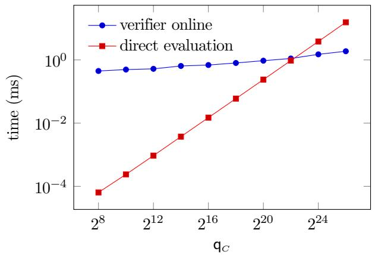
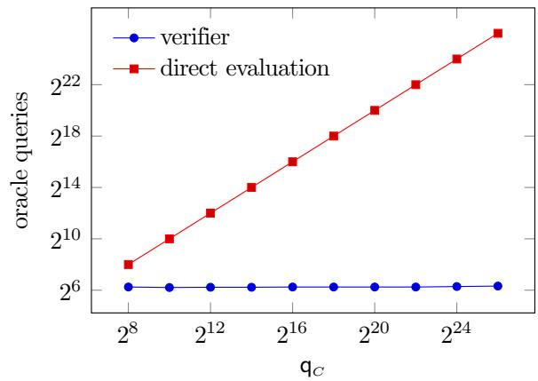

# Efficient Scalable Oversight via Rewinding

Ziyi Guan∗ Yael Tauman Kalai† Ron Rothblum‡ Zoe Xi§

## Abstract

Scalable oversight asks how a weak verifier can check the outputs of computations performed by more powerful AI systems. One proposed approach uses relativizing interactive proofs, in which a weak verifier checks the output of a complex oracle-aided computation by interacting with one or more powerful provers. A prominent example is debate, which is highly efficient but assumes that one of two powerful AI models, or provers, is truthful. For certain classes of oracle-aided computations, this assumption can be removed, but at substantially greater computational cost.

In this work, we introduce rewindable interactive proofs (RIPs), a new model of relativizing interactive proofs for scalable oversight. In an RIP, the verifier may rewind the prover to an earlier state of the interaction and continue from there. This is possible when the prover is an AI model, since the verifier can save a snapshot of the model’s state and later restore it. We construct a relativizing RIP for computations whose outputs are robust to changing a small fraction of oracle answers. Our construction is more efficient than prior relativizing proofs that do not assume a truthful prover, and it uses no cryptography.

In our construction the honest prover runs in time linear in that of the original computation, and the verifier, after a one-time preprocessing step, runs in time nearly linear in the input length (which can be much smaller than the computation itself). We implement our protocol, report a preliminary MNIST experiment, and show that an RIP can be faster than a state-of-the-art deployed proof system.

RIPs may be of independent interest. Rewinding is possible whenever the verifier controls the prover’s machine, for example when the prover runs on trusted hardware or in a virtual machine whose state can be checkpointed.

## Contents

1 Introduction 3   
1.1 Our results 4   
1.2 Related work 6   
2 Technical Overview 6   
3 Preliminaries 8   
3.1 Oracle-aided computation and robustness . . 9   
3.2 Interactive oracle proofs 10   
3.3 Error-correcting codes 11   
3.4 Encoded-witness IOPs 13   
4 Relativizing Interactive Oracle Proofs 15   
4.1 Construction 16   
4.2 Proof of Theorem 4.1 . 16   
5 Relativizing Rewindable Interactive Proofs 17   
5.1 Definition . 18   
5.2 From IOPs to RIPs . 19   
5.3 RIPs with linear-time provers and succinct verifiers 20   
6 Implementation and Experiments 22   
6.1 Implementation . 22   
6.2 MNIST experiments . 22   
6.3 Comparison with a SNARG . 24   
6.4 Limitations 25   
AI Disclosure 26   
Acknowledgments 26   
References 26   
A Multi-prover interactive proofs 32   
A.1 Relation to RIPs . 33

## 1 Introduction

As AI capabilities grow rapidly, a critical problem is: how can we ensure that AI systems remain safe and behave as intended? One major concern is that, as we are training AI models to perform increasingly complex tasks, we may no longer be able to efficiently verify the accuracy of their outputs. As a result, we may not be able to verify that they are behaving in a way that aligns with our intentions. This problem of providing accurate training supervision for increasingly powerful AI models is known as scalable oversight.

Verifiable computation has been studied for decades in cryptography and computational complexity. This research has led to proof systems that allow a powerful but untrusted “prover” (in our setting, a powerful AI model) to convince a weak “verifier” (a weaker AI model or a human) that the output of a hard computation is correct [BGKW88; FK97; AS98; ALMSS98; GKR15; RVW13; BCS16; RRR16].

In this work, we observe that scalable oversight has some unique characteristics that make existing approaches either inapplicable or less efficient than they could be. First, the prover is not an external party but rather an AI model whose execution the verifier controls. In particular, the verifier can rewind the model to an earlier state and continue the interaction without the model remembering what happened in previous runs. To capitalize on this, we consider a new proof-system model which we call rewindable interactive proofs (RIPs),1 in which the verifier is allowed to rewind the prover in this way. This model is closely related to previous proof-systems studied in the literature such as MIPs [BGKW88] and PCPs [FK97; AS98; ALMSS98], but we show that it can have significant efficiency gains over them.

Second, classical results in proof systems do not apply directly to our setting, because the computations we wish to verify may involve functions that we can’t see the inner workings of—such a function can be used to represent human judgment or query access to an external database, for example. We model such “black-box” functions as oracles, and say that a proof system relativizes if its guarantees hold with respect to any oracle. Relativization is believed to be essential for AI safety purposes, because we do not know what sorts of capabilities AI may have in the future. The UK AISI team even writes that “in order to be relevant to AI safety, an interactive proof result must relativize” [IM25]. The difficulty is that classical results in proof systems, including the celebrated IP = PSPACE and MIP = NEXP theorems, do not relativize [CCGHHRR94], and moreover results show that efficient verification is impossible for arbitrary oracle-aided computations [FS88; FRS94; HCCRR92; For94; CL20; BCG25].

For a concrete example of where scalable oversight is needed, consider the scenario of training an LLM to determine which laws a company has violated based on hundreds of pages of records. The LLM outputs one bit for each law (representing yes or no), and now we need to verify whether these bits are correct or not. The straightforward way of doing this would be to have a human expert carefully read through the documents, but this seems unreasonably expensive, especially to produce just one training label. In a scenario like this, we would like to have a more efficient training protocol, especially one that is more efficient in its use of human judgments. As another example, we may consider a scenario where we train an LLM to answer questions using a large public dataset, such as the web; we would like to be able to verify that an output of this LLM is correct efficiently, making few queries to the dataset.

Various approaches to scalable oversight have been proposed in the literature [CSA18; LKEMML18; ICA18], including some based on relativizing proof systems. One prominent example of such an approach is debate, which was introduced by Irving, Christiano, and Amodei [ICA18]. In an AI debate, there are two powerful AI models, or provers, who claim different outputs, and the provers debate each other to try to convince a verifier that their output is the correct one. The verifier is extremely efficient, or succinct, meaning that it runs in much less time and makes far fewer oracle queries than it would need to run the computation on its own. The authors show that DEBATE, the class of problems which admit a debate protocol, is powerful: in the language of computational complexity theory, DEBATE = PSPACE (where PSPACE is the class of problems solvable in polynomial space). Moreover, this result relativizes.

However, debate makes the strong assumption that one of the provers is truthful, i.e., one of the AI models is guaranteed to argue for the correct answer. Intuitively, this means that the verifier has one of the powerful AI models on his side. But scalable oversight is especially important precisely when we do not know whether we can trust any AI model. Recently, Chen, Kalai, and Xi [CKX26] sought to remove this assumption by constructing “doubly-efficient” interactive proofs [GKR15]. In an interactive proof [GMR19; Bab85], a prover interacts with a verifier to convince him of a claim; a doubly-efficient one has an efficient prover as well as an efficient verifier. Since this is impossible for arbitrary oracle computations, [CKX26] instead give protocols for a natural restricted setting where the computation is robust, meaning that the output does not change even if a small fraction of answers to oracle queries are modified. However, these protocols still require substantially more work from the verifier than debate. A natural question, then, is:

Can we obtain a more efficient relativizing interactive proof without assuming any prover is truthful?

Motivated by this question, we give a positive answer for robust oracle computations in the RIP model: by exploiting the verifier’s ability to rewind the prover, we obtain strong efficiency guarantees without assuming that any prover is truthful.

## 1.1 Our results

We introduce and formally define rewindable interactive proofs, and construct a relativizing RIP for robust oracle-aided computations, with a succinct verifier and a linear-time prover. We also implement our protocol and evaluate its performance experimentally.

The model. In an interactive proof, a prover and a verifier exchange messages, after which the verifier accepts or rejects. The proof must be complete, meaning that the honest prover convinces the verifier of a correct output, and sound, meaning that no cheating prover can convince it of an incorrect output, except with small probability. An RIP is an interactive proof in which the verifier has one extra power: at any point, it may rewind the prover to an earlier state of the interaction and continue from there, as one would restore an AI model from a save point (Section 5.1 gives the formal definition). Completeness is as usual: the honest prover must convince the verifier, now across whatever rewinds the verifier performs. Soundness, on the other hand, asks less than it does of a standard proof system. A standard proof system must be sound against every cheating prover, however it behaves; an RIP need only be sound against provers that the verifier can rewind, whose answer after a rewind cannot depend on anything the verifier did after the restored state. This is a weaker guarantee, and it is what makes the model powerful: the verifier can question the prover about one state as many times as it likes, and the prover never learns the other questions. We emphasize that soundness violated if a cheating prover has access to external storage that is not rewound.

A relativizing RIP for robust computations. Following Chen, Kalai, and Xi [CKX26], we model the computation as an oracle Boolean circuit and call it ε-robust if its output does not change when up to an ε fraction of the oracle’s answers are modified. Our main result is a relativizing RIP for verifying the output of any robust oracle circuit, with a succinct verifier and a prover that runs in linear time.

Theorem 1.1 (Informal; see Theorem 5.8). Let $C ^ { O }$ be an oracle circuit with n input bits, m output bits, and S gates, whose oracle queries have polylogarithmic length. After a one-time preprocessing step taking ${ \widetilde { O } } ( n + m + S )$ time, there is a relativizing RIP for verifying the output of $C ^ { O }$ on any input with respect to which it is ε-robust, with the following guarantees:

• The honest prover always convinces the verifier of a correct output, while a cheating prover (even a computationally unbounded one) can convince the verifier of an incorrect output with probability at most $1 / 3$

• The verifier runs in $\widetilde { O } ( n + m + 1 / \varepsilon )$ time and makes $O ( 1 / \varepsilon )$ oracle queries.

• The honest prover runs in $O ( n + m + S ) + \bar { O } ( 1 / \varepsilon )$ time.

• The number of rounds is $O ( \log ( n + m + S ) )$ and the total communication is $\widetilde { O } ( 1 / \varepsilon )$

Here ${ \widetilde { O } } ( \cdot )$ hides factors polylogarithmic in $n + m + S _ { ; }$ , and running times count field operations.

In the preprocessing step, the verifier reads the description of the circuit and stores a representation of it, which it reuses in every evaluation of the circuit; the cost is thus amortized over all evaluations, which suits our setting, where a fixed circuit is evaluated on many inputs. Some such step is necessary to achieve online verification time sublinear in the size of a general circuit, and preprocessing is standard in efficient proof systems [CHMMVW20; Set20; CBBZ23]; see Remark 3.22.

Comparison with [CKX26] and debate. Compared with the protocols of [CKX26], after the preprocessing step our verifier’s running time depends only on the lengths of the input and output and on the robustness parameter, instead of on the size or depth of the circuit, and its number of oracle queries depends only on the robustness parameter; compared with their succinct protocol, ours is statistically sound, uses no cryptography, and has a linear-time rather than a polynomial-time prover. Unlike debate, our protocol does not assume that a prover is truthful.

Why not concretely efficient SNARGs? The proof systems deployed in practice, notably in blockchains [BSCGGMTV14; Tha22], are SNARGs, succinct non-interactive arguments. Why not take one off the shelf? First, off-the-shelf SNARGs do not handle oracle-aided computations, even robust ones. Second, their soundness rests on unproven cryptographic assumptions, from standard ones such as collision-resistant hash functions to more aggressive ones chosen for concrete efficiency. As AI brings such assumptions under increasing scrutiny (recent AI-discovered results, still under review, claim to refute the Exponential Time Hypothesis [Ope26; Cla26] and, assuming them, give a subexponential algorithm for the elliptic-curve discrete logarithm problem [ABHKNNTW26]), it is unclear whether this is a prudent tradeoff for scalable oversight. RIPs address both concerns: they handle robust oracle-aided computations without cryptographic assumptions and are sound even against computationally unbounded provers. Perhaps surprisingly, dispensing with cryptography can also improve prover efficiency: rewinding avoids the cost of cryptographic commitments (Remark 5.9), and our second experiment demonstrates the resulting speedup.

Experiments. We complement our theoretical result by implementing the protocol and running two experiments. The first is a proof-of-concept experiment inspired by the MNIST debate experiment of Irving, Christiano, and Amodei [ICA18]: we run the protocol once, at soundness error $2 ^ { - 4 0 }$ , on robust oracle circuits with between $2 ^ { 8 }$ and $2 ^ { 2 6 }$ oracle gates, whose oracle is the debate experiment’s judge, a sparse MNIST classifier. Across this range the verifier makes a median of about 76 oracle queries, against up to $2 ^ { 2 6 }$ needed to evaluate the largest circuit directly, and its online running time falls below that of direct evaluation from about seven million oracle gates on, to an eighth of it at the largest size.

For our second experiment, we consider Flock [BRW26], a state-of-the-art SNARG built from an interactive oracle proof (IOP) [BCS16; RRR16] (see Section 2) for batch evaluation of the BLAKE3 hash function. To study the efficiency gains of rewinding, we compile Flock’s IOP into an RIP and find that its prover runs 1.8 to 2.1× faster than Flock’s own SNARG prover (Section 6.3).

## 1.2 Related work

Relativizing proof systems. Relativization has been studied extensively as a barrier in computational complexity theory, and notably the classical results on interactive proofs, e.g., the celebrated ${ \mathsf { I P } } = { \mathsf { P S P A C E } }$ and MIP = NEXP theorems, do not relativize [CCGHHRR94]. Additionally on the negative side, results show that efficient verification is impossible for arbitrary oracle-aided computations (even when the security guarantee is relaxed to hold only against efficient dishonest provers) [FS88; FRS94; HCCRR92; For94; CL20; BCG25]. Our work circumvents these barriers by restricting to the setting of robust oracle computation. On the positive side, prior work has shown that $\mathsf { I P } = \mathsf { P S P A C E }$ and ${ \sf M I P } = { \sf N E X P }$ do algebrize, meaning that they relativize if the proof system is also given a low-degree extension of the oracle [AW09], and there has also been work on constructing relativizing succinct cryptographic proof systems in some structured oracle models [CT10; CCS22; CCGOS23; CGSY24; CKX26].

Interactive proofs for scalable oversight. There has been a recent line of work studying interactive proofs as an approach to scalable oversight, starting with a paper by Irving, Christiano, and Amodei on “AI safety via debate” [ICA18]. Their model assumes that the debating provers are computationally unbounded; later, Brown-Cohen, Irving, and Piliouras introduced doubly-efficient debate, where the provers are guaranteed to be efficient [BIP24]. More recent works on debate have focused on its limitations, e.g, the “obfuscated arguments problem,” where a lying debating prover can make it very hard for the other prover to find the flaw in her argument [Bar20; BIP25; BPHI25]. Very recently, Chen, Kalai, and Xi initiated the study of relativizing interactive proofs for scalable oversight without a truthful prover, constructing protocols with a succinct verifier and a polynomial-time prover for certain classes of oracle computations [CKX26]. Our work considers the setting of robust computation that they introduce; we leverage rewinding to improve the efficiency of their protocols.

Interactive proofs for trustworthy machine learning. There is also a line of work on applying interactive proofs to problems of trust in machine learning [AGPR24; AZWG21; HAD24; KCELMB24; WSTZP24]. In particular, Amit, Goldwasser, Paradise, and Rothblum [AGPR24] introduce self-proving models, which are trained to provide both an answer and an interactive proof that the answer is correct; their focus is on training models to produce proofs for computations that already admit interactive proofs, whereas we construct new interactive proofs for oracle-aided computation.

## 2 Technical Overview

Here, let us briefly outline the key ideas behind our construction.

We model the computation that the verifier wishes to verify as an oracle Boolean circuit $C ^ { O }$ , i.e., a Boolean circuit that may contain gates that make calls to an arbitrary oracle $O : \{ 0 , 1 \} ^ { * }  \{ 0 , 1 \}$ . We assume that the oracle circuit is ε-robust with respect to the verifier’s input, meaning that its output on this input does not change if at most an ε-fraction of answers to its oracle queries are changed (see Definition 3.14 for a formal definition). Given an oracle circuit $C ^ { O }$ , an input x for which $C ^ { O }$ is ε-robust, a claimed output $^ { a , }$ and access to O, the prover and the verifier engage in a rewindable interactive proof (RIP, Section 5) that $C ^ { O } ( x ) = a$ . Recall that the verifier may rewind the prover to any earlier state of the interaction and continue from there.

Our goal is to design a protocol that is efficient enough to use in practice. Most practical proof systems are built from an interactive oracle proof (IOP) [BCS16; RRR16], which is an interactive proof where the prover sends long messages but the verifier reads only a few bits of each message, because IOPs admit very efficient provers and verifiers. We first construct a relativizing IOP and then turn it into a relativizing RIP that inherits the IOP’s efficiency.

A relativizing IOP (Section 4). To start, a natural strategy is to try to turn the oracle circuit $C ^ { O }$ into a circuit without oracle gates and then use standard IOPs. To “deoraclize” the circuit, suppose that the prover provides a string w containing a claimed answer for each oracle gate. We can then define a circuit $C _ { w }$ without oracle gates, which is $C ^ { O }$ except with each oracle gate replaced by the corresponding answer in w. The basic idea is to have the prover send the string w in the first round of the IOP and then prove that $C _ { w } ( x ) = a$ . Then the verifier can check that the answers in w are correct with respect to O.

The verifier cannot check that all the answers in w are correct, since this would require making all the oracle calls needed in order to run the computation, which he cannot afford. But the verifier does not actually need to do this, since we assume $C ^ { O }$ is ε-robust: if $C ^ { O } ( x ) \neq a .$ , then any w satisfying $C _ { w } ( x ) = a$ must contain more than an ε-fraction of incorrect oracle answers, so the verifier can catch an incorrect oracle answer with good probability by sampling $O ( 1 / \varepsilon )$ answers in w.

To obtain stronger efficiency guarantees, instead of w itself, we have the prover send an encoding of a witness consisting of w together with a “transcript” of evaluating $C _ { w }$ on x. The prover and verifier then run an IOP to check that this encoding is close to the encoding of a valid witness for $C _ { w } ( x ) = a$ The advantage of using an encoding is that the verifier can later recover a few bits of this same witness, with the prover’s help, without reading the entire witness. In particular, the verifier can sample a few oracle gates, recover the claimed answer in w for each oracle gate and the corresponding query using the transcript, and check that the pair is correct using O. To achieve this, we construct a variant of an IOP that we call an encoded-witness IOP (Section 3.4).

Relativizing IOP → relativizing RIP (Section 5.2). Now we turn our relativizing IOP into a relativizing RIP. The idea is similar to the one behind the standard proof for turning a (non-relativizing) IOP into an MIP [BCS16] (see Section A for MIPs and their relation to RIPs). We have the RIP verifier simulate the IOP verifier and the RIP prover simulate the IOP prover, except that the “IOP” prover computes her long messages but does not send them. If the verifier simply asked the prover for the bits he wants to read, she could answer adaptively, e.g., her answer to the verifier’s second query to some message could depend on his first query. Instead, whenever the verifier wants to read a bit in some message, he rewinds the prover to her state right after she computed that message and asks her for the bit. Her answer then cannot depend on his other queries, so she cannot do better than an IOP prover who fixes each message before the verifier queries it, and the soundness error is that of the IOP. Rewinding thus allows the RIP to be as efficient as the IOP.

Experiments (Section 6). We implement our protocol and run two experiments. The first evaluates it on robust oracle circuits and measures what the verifier saves over evaluating the circuit directly. The second compares it with an existing proof system. Since no relativizing protocol has an implementation, we compare with a state-of-the-art proof system for an oracle-free computation, which is built from an IOP: compiling the same IOP into an RIP instead measures what rewinding saves.

The first experiment is a proof of concept inspired by the MNIST debate experiment of Irving, Christiano, and Amodei [ICA18]. We use a sparse MNIST classifier, which predicts a digit from six revealed nonzero pixels of an MNIST image, to define our oracle. Given a “sparse view” of an MNIST image and a candidate digit, the oracle outputs whether the classifier predicts that digit. Our circuits query this oracle on many random sparse views of an image and output whether a majority of the views vote for the candidate digit.

We run the protocol once, at soundness error $2 ^ { - 4 0 }$ , on 50 MNIST test images while increasing the number $q _ { C }$ of oracle gates from $2 ^ { 8 } \ \mathrm { t o } \ 2 ^ { 2 6 }$ . The robustness parameter remains nearly constant across these circuit sizes, and the median number of oracle queries made by the verifier stays between 74 and 80. At the largest circuit size, the verifier makes 840,000× fewer oracle queries than are needed to evaluate the circuit directly. The verifier’s online running time is also sublinear in the circuit size, growing substantially more slowly than direct evaluation: it falls below direct evaluation at about seven million oracle gates, and at $q _ { C } = 2 ^ { 2 6 }$ is $0 . 1 2 \times$ the time required to evaluate the circuit directly. The prover, which also generates the witness, takes about 60× the time of direct evaluation at the largest sizes.

For the second experiment we use Flock [BRW26], a proof system for batch evaluation of an ordinary Boolean circuit with no oracle gates, namely the BLAKE3 hash function. Flock is built from an IOP, which is not by itself a realistic proof system, since the prover sends long strings; Flock compiles it into a SNARG using cryptography. We compile the same IOP into an RIP instead, which saves the cryptographic compilation: the prover no longer commits to its proof strings, and since a cheating prover gets one attempt per execution rather than unlimited offline retries, the $\mathrm { I O P }$ can run at a lower security level and over a smaller field. On instances of size $2 ^ { 2 2 }$ to $2 ^ { 3 4 }$ , our prover runs 1.8 to 2.1× faster than Flock’s prover (Section 6.3).

## 3 Preliminaries

Here we introduce some definitions and tools that we use.

Definition 3.1 (Language). A language $\mathcal { L } \subseteq \{ 0 , 1 \} ^ { * }$ is a set of binary strings. We think of a language as a decision problem: given an instance $\mathbb { x } \in \{ 0 , 1 \} ^ { * }$ , we want to determine whether $\mathbb { x } \in \mathcal { L }$

Definition 3.2 (Relation). A relation $R \subseteq \{ 0 , 1 \} ^ { * } \times \{ 0 , 1 \}$ ∗ is a set of pairs $\left( \mathbb { x } , \mathbb { w } \right)$ , where x is an instance and w is a witness for x. The language associated with R is $\mathcal { L } : = \{ \mathrm { x } : \exists \mathrm { w } ( \mathrm { x } , \mathrm { w } ) \in R \}$

Definition 3.3 (Oracle and oracle access). An oracle is a fixed function $O : \{ 0 , 1 \} ^ { * }  \{ 0 , 1 \}$ ; in particular, its answer to a query does not depend on earlier queries. We write that an algorithm has oracle access to O if it can send a query qry $\in \{ 0 , 1 \} ^ { * }$ and receive the answer string $O ( { \mathsf { q r y } } )$ in one timestep.

Definition 3.4 (Relativized language). For an oracle $O ,$ a relativized language $\mathcal { L } ^ { o }$ is a language whose membership may depend on O.

Definition 3.5 (Relativized relation). For an oracle O, a relativized relation $R ^ { O }$ is a relation whose membership may depend on O. Its associated relativized language is $\mathcal { L } _ { R ^ { O } }$

Definition 3.6 (Equality polynomial). Let F be a finite field and $h \geq 0$ an integer. The equality polynomial eq $: \mathbb { F } ^ { h } \times \mathbb { F } ^ { h } \to \mathbb { F }$ is

$$
\mathsf { e q } ( r , e ) : = \prod _ { i = 1 } ^ { h } \bigl ( r _ { i } e _ { i } + ( 1 - r _ { i } ) ( 1 - e _ { i } ) \bigr ) .
$$

For $b , e \in \{ 0 , 1 \} ^ { h }$ , ${ \mathsf { e q } } ( b , e )$ is 1 $i f b = e$ and 0 otherwise.

Definition 3.7 (Multilinear extension). Let F be a finite field and $h \geq 0$ an integer. We interpret every vector $v \in \mathbb { F } ^ { 2 ^ { h } }$ as a function $v : \{ 0 , 1 \} ^ { h } \to { \mathbb { F } }$ . The multilinear extension of v is the unique polynomial $\widehat { v } : \mathbb { F } ^ { h } \to \mathbb { F }$ of degree at most one in each variable satisfying ${ \widehat { v } } ( b ) = v ( b )$ for every $b \in \{ 0 , 1 \} ^ { h }$ . Explicitly,

$$
\widehat { \boldsymbol { v } } ( \boldsymbol { r } ) = \sum _ { b \in \{ 0 , 1 \} ^ { h } } \boldsymbol { v } ( b ) \mathsf { e q } ( \boldsymbol { r } , b ) ,
$$

where eq is the equality polynomial (Definition 3.6). For a binary string of length $2 ^ { h }$ , we view its bits as elements of F and use the same definition. For a vector or string of any other length, the multilinear extension is that of its zero-padding to the next power-of-two length 2h.

## 3.1 Oracle-aided computation and robustness

Following [CKX26], we model the computation that the verifier verifies as an oracle Boolean circuit. Informally, this is a diagram that shows how to obtain an output string from an input string by applying some sequence of OR (∨), AND (∧), and NOT (¬) operations together with calls to an oracle. More formally, we have:

Definition 3.8 (Boolean circuit). An n-bit input, m-bit output Boolean circuit is a directed acyclic graph with n input vertices and an ordered list of m output vertices. Input vertices have no incoming edges; every other vertex is a gate labeled ∨ or ∧ with two incoming edges, $o r $ with one. Any vertex may be an output. A circuit C is given by its description $\langle C \rangle$ , a binary string that lists its gates in a fixed order, each with its label and its incoming edges, followed by the list of output vertices; we refer to gates by their position in this list.

On input $x \in \{ 0 , 1 \} ^ { n }$ , the value of the ith input vertex is the ith bit of x, and each gate applies its operation to the values of its children, i.e., the vertices with edges going into the gate. The output of the circuit on x consists of the values of the output vertices read in order. The size of a circuit is its number of gates.

Definition 3.9 (Oracle Boolean circuit). For an oracle $O : \{ 0 , 1 \} ^ { * }  \{ 0 , 1 \}$ , an oracle Boolean circuit $C ^ { O }$ is a Boolean circuit that may also contain oracle gates. Each oracle gate has an arbitrary number of incoming edges. We view the input to an oracle gate as the string given by the values of its children read in order. The value of an oracle gate is O applied to its input string.

Definition 3.10 (Family of circuits). A family of circuits $\{ C _ { n } \} _ { n \in \mathbb { N } }$ consists of one circuit $C _ { n }$ with an n-bit input and an m(n)-bit output for each n. It computes a function $f : \{ 0 , 1 \} ^ { * }  \{ 0 , 1 \} ^ { * } \ i f$ $C _ { n } ( x ) = f ( x )$ for every n and every $x \in \{ 0 , 1 \} ^ { n }$

Definition 3.11. Let $C ^ { O }$ be an oracle circuit of size S. We define the computation transcript on input x to be the string that lists the values of all the gates in $C$ when run on input x in order (using O to evaluate oracle gates), and denote the computation transcript by

$$
z = \operatorname { T r } _ { C } o \left( x \right) \in \{ 0 , 1 \} ^ { s } .
$$

Definition 3.12. Suppose $C ^ { O }$ has ${ \mathsf { q } } _ { C }$ oracle gates, and consider running C on an input x. We use

$$
\mathcal { Q } _ { C } o \left( x \right) = \mathcal { Q } = \left( ( { \mathsf { q r y } } _ { 1 } , { \mathsf { a n s } } _ { 1 } ) , \ldots , ( { \mathsf { q r y } } _ { { \mathsf { q } } _ { C } } , { \mathsf { a n s } } _ { { \mathsf { q } } _ { C } } ) \right)
$$

for the string of queries and answers that $C ^ { O }$ makes to O on input x, where qry (resp. ansi) is the input to (resp. output of) oracle gate i. Call $\mathcal { Q }$ a query-answer trace. We write $\mathcal { Q } _ { \mathrm { i n } } \ ( r e s p . \ Q _ { \mathrm { o u t } } ) \ f o r$ the string of queries (resp. answers) in Q.

Definition 3.13 (De-oraclized circuit). Let $C ^ { O }$ be an oracle circuit with an input of length n and ${ \mathsf { q } } _ { C }$ oracle gates. We say that its de-oraclized circuit is the (non-oracle) circuit C with input $( x , w ) \in$ $\{ 0 , 1 \} ^ { n } \times \{ 0 , 1 \} ^ { \mathfrak { q } _ { C } }$ obtained by replacing, for every $j \in [ \mathsf { q } _ { C } ]$ , oracle gate j with an input vertex with value $w _ { j }$

We next define robustness. Informally, the output of a robust oracle circuit should not change if at most a small fraction of answers to its oracle queries are incorrect. More formally, we define robustness as follows, adapting the definition that Chen, Kalai, and Xi use [CKX26]:

Definition 3.14 (Robustness). Let $C ^ { O }$ be an oracle circuit with an input of length n and ${ \mathsf { q } } _ { C }$ oracle gates, and let C be its de-oraclized circuit (Definition 3.13). For an input $( x , w )$ , where $x \in \{ 0 , 1 \} ^ { n }$ and $w \in \{ 0 , 1 \} ^ { \mathfrak { q } _ { C } }$ , and an index $j \in [ \mathsf { q } _ { C } ]$ , let $\mathsf { q r y } _ { j } ( w )$ denote the input to oracle gate $j$ in $C ^ { O }$ when we run $C ^ { O }$ on x except with the value of each oracle gate replaced with the corresponding bit in w. $F o r \varepsilon \in ( 0 , 1 ]$ we say that $C ^ { O }$ is ε-robust with respect to $x \in \{ 0 , 1 \} ^ { n } \ i f ,$ for every $w \in \{ 0 , 1 \} ^ { \mathfrak { q } _ { C } }$ satisfying

$$
\left| \left\{ j \in [ \mathfrak { q } _ { C } ] : w _ { j } \neq O ( \mathfrak { q } \mathfrak { r } \mathfrak { y } _ { j } ( w ) ) \right\} \right| \leq \varepsilon \mathfrak { q } _ { C } ,
$$

we have that $C ( x , w ) = C ^ { O } ( x )$

Definition 3.15 (Circuit-satisfiability relation). The circuit-satisfiability relation $R _ { \mathsf { C S A T } }$ is the relation defined as follows. The instance is a triple $\mathbb { x } = ( \langle C \rangle , x , a )$ , where ⟨C⟩ is the description of a Boolean circuit with $n + n _ { w }$ input vertices, of which the first n form the public input and the remaining $n _ { w }$ the private input, an output oflength $m ,$ and S gates, $x \in \{ 0 , 1 \} ^ { n }$ is a public input, and $a \in \{ 0 , 1 \} ^ { m }$ is a claimed output. The witness is a pair $\mathbb { w } = ( w , z ) \in \{ 0 , 1 \} ^ { n _ { w } } \times \{ 0 , 1 \} ^ { s }$ of a private input and a transcript. Then

$$
\begin{array} { r } { ( \mathrm { x } , \mathrm { w } ) \in R _ { \mathrm { c s a r } } \quad \Longleftrightarrow \quad z = \mathrm { T r } _ { C } ( x , w ) \wedge C ( x , w ) = a , } \end{array}
$$

where $\mathrm { T r } _ { C }$ is the computation transcript of Definition 3.11.

Definition 3.16 (Oracle-circuit-evaluation relation). Fix an oracle O. The oracle-circuitevaluation relation $R _ { \mathsf { C V A L } } ^ { O }$ is the relativized relation (Definition $\it 3 . 5 )$ defined as follows. The instance is a triple $\mathbb { x } = ( \langle C ^ { o } \rangle , x , a )$ , where $\langle C ^ { o } \rangle$ is the description of an oracle circuit with an input of length $n ,$ output of length $m ,$ and S gates, $x \in \{ 0 , 1 \} ^ { n }$ is an input, and $a \in \{ 0 , 1 \} ^ { m }$ is a claimed output. The witness is a transcript $z \in \{ 0 , 1 \} ^ { s }$ . Then

$$
( \mathrm { x } , z ) \in R _ { \mathrm { c v a l } } ^ { o } \quad \Longleftrightarrow \quad z = \mathrm { T r } _ { c ^ { O } } ( x ) \wedge C ^ { O } ( x ) = a ,
$$

where $\mathrm { T r } _ { C ^ { O } }$ is the computation transcript of Definition 3.11.

Remark 3.17 (Transcript as witness). The witness of Definition 3.15 is a private input w together with the entire transcript z, and the witness of Definition 3.16 is the entire transcript. The transcript is not needed to define either relation, as it is determined by the instance and w in Definition 3.15 and by the instance alone in Definition 3.16. Including it nevertheless allows succinct verification, since the verifier can check an encoding of the witness at a few positions instead of evaluating the circuit (Definition 3.32, Lemma 3.36, and Theorem 4.1).

## 3.2 Interactive oracle proofs

An interactive oracle proof (IOP), introduced in [BCS16; RRR16], lets a powerful prover convince a weak verifier that an instance has a valid witness by sending long proof strings that the verifier checks at a few locations. The parties may interact over several rounds.

Definition 3.18 (Interactive oracle proof). An interactive oracle proof for a relation R is an interactive protocol between a probabilistic polynomial-time verifier V and a possibly computationally unbounded prover P. The parties receive a common input x, and the honest prover additionally receives a witness w with $( \mathbb { x } , \mathbb { w } ) \in R$

In round i, the prover sends a proof string $\pi _ { i }$ over a finite alphabet Σ, which is a finite field in our constructions. The verifier has oracle access (Definition 3.3) to every proof string sent so far.

The protocol satisfies the completeness and soundness properties defined below.

We write $\begin{array} { r } { \langle \mathcal { P } ( \mathbb { w } ) , \mathcal { V } \rangle ( \mathbb { x } ) = 1 } \end{array}$ when the verifier accepts after interacting with the prover on common input x. Note that we denote the IOP prover and verifier by P and $\nu ,$ rather than by P and V as for rewindable interactive proofs (Section 5) and MIPs (Section A), to distinguish between the settings. The probabilities below are over the verifier’s private random bits (we assume without loss of generality that the prover is deterministic).

Definition 3.19 (Completeness). An IOP for R has perfect completeness $i f ,$ for every $( \mathbb { x } , \mathbb { w } ) \in R$ the honest prover satisfies

$$
\operatorname* { P r } { [ \langle \mathcal { P } ( \mathbb { w } ) , \mathcal { V } \rangle ( \mathbb { x } ) = 1 ] } = 1 .
$$

Definition 3.20 (Soundness). An IOP for R has soundness error $\epsilon _ { \mathsf { I O P } }$ $i f ,$ for every x ∈ L/ and every possibly computationally unbounded cheating prover $\widetilde { \mathcal P }$

$$
\mathrm { P r } \left[ \langle \widetilde { \mathcal { P } } , \mathcal { V } \rangle ( \mathbb { x } ) = 1 \right] \leq \epsilon _ { 0 \mathsf { P } } ( | \mathbb { x } | ) .
$$

Definition 3.21 (Relativizing IOP). Fix an oracle O and a relativizing relation $R ^ { O }$ . A relativizing IOP for $R ^ { O }$ is an IOP for $R ^ { O }$ in which the verifier and prover, including a cheating prover, have black-box access to the same oracle O. The protocol relativizes if its completeness, soundness, and efficiency guarantees hold for $R ^ { O }$ for every oracle O.

Remark 3.22 (Preprocessing). An instance may have the form $\mathbb { x } = ( \mathbb { x } _ { \mathrm { p r e } } , \mathbb { x } _ { \mathrm { p o s t } } )$ , where ${ \mathbb X } _ { \mathrm { p r e } }$ is long and is the same for many instances. In our setting ${ \mathbb X } _ { \mathrm { p r e } }$ is the description of a circuit and $\mathbb { X } _ { \mathrm { p o s t } }$ is an input together with a claimed output (Definition 3.16). An IOP with preprocessing has a verifier that is a pair $\mathcal { V } = ( \mathcal { V } _ { \mathrm { p r e } } , \mathcal { V } _ { \mathrm { p o s t } } )$ . First $\mathcal { V } _ { \mathrm { p r e } }$ receives ${ \mathbb X } _ { \mathrm { p r e } }$ and outputs a state $\mathsf { s t } _ { \nu }$ . Then $\mathcal { V } _ { \mathrm { p o s t } }$ receives $\mathsf { s t } _ { \nu }$ and $\mathbb { X } _ { \mathrm { p o s t } }$ and interacts with the prover. The verifier reads ${ \mathbb X } _ { \mathrm { p r e } }$ only in the preprocessing, which is done once and whose state is reused for every $\mathbb { X } _ { \mathrm { p o s t } }$ . Completeness and soundness are as in Definitions 3.19 and 3.20.

For the verifier’s online time to be sublinear in the size of a general circuit, we need to preprocess the circuit. Intuitively, without preprocessing the verifier must read the entire circuit, since two circuits that differ in one gate can produce different outputs on the same input. Preprocessing is standard in deployed proof systems [CHMMVW20; Set20; CBBZ23]. Since we typically fix a circuit and evaluate it on many inputs, the one-time cost of preprocessing is amortized over all the evaluations. Preprocessing is unnecessary, however, for a circuit with a short description, since the verifier can then work from the description instead of reading the whole circuit [GKR15; CMT12; Tha13; XZZPS19]. It is also unnecessary when a circuit is evaluated on a batch of inputs, since the verifier can read the circuit once per batch [BRW26].

We track the following worst-case efficiency parameters of a (relativizing preprocessing) IOP:

• Proof length ℓ: the total number of alphabet symbols in the proof strings.

• Proof query complexity ${ \sf q } _ { \pi } \colon$ the total number of verifier queries to the proof strings.

• Round complexity $\mathsf { r } _ { 1 0 \mathsf { P } } \colon$ the number of back-and-forth rounds between the verifier and the prover. Queries to proof strings do not count as interaction rounds.

• Verifier oracle query complexity ${ \tt q } _ { O } \mathrm { : }$ the number of verifier calls to the oracle O, when present. These calls are counted separately from proof queries.

• Verifier preprocessing time $t _ { \nu _ { \mathrm { p r e } } } \colon$ for an IOP with preprocessing (Remark 3.22), the running time of $\mathcal { V } _ { \mathrm { p r e } } ,$ which bounds |stV|.

• Verifier online time $t _ { \nu } { \mathrm { : } }$ : the running time of $\mathcal { V } _ { \mathrm { p o s t } } .$ , with random access to $\mathsf { s t } _ { \nu }$

• Prover running time $t _ { \mathcal { P } } \mathrm { : }$ the honest prover’s total running time.

## 3.3 Error-correcting codes

An error-correcting code maps a message to a longer string, its codeword, so that any two codewords differ in many positions. A locally decodable code [KT00] lets a decoder recover any symbol of the message from a few queries to a (possibly corrupted) codeword, and a relaxed locally decodable code [BGHSV04] also allows the decoder to refuse to answer.

Definition 3.23 (Distance). Let Σ be a finite alphabet and ℓ a positive integer. The distance $\Delta ( \pi , \pi ^ { \prime } )$ between $\pi , \pi ^ { \prime } \in \Sigma ^ { \ell }$ is the fraction of positions in which they differ. The distance between π and a set $S \subseteq \Sigma ^ { \ell }$ is

$$
\Delta ( \pi , S ) : = \operatorname* { m i n } _ { \pi ^ { \prime } \in S } \Delta ( \pi , \pi ^ { \prime } ) ,
$$

and $\Delta ( \pi , S ) : = 1$ if S is empty. For $\delta \in ( 0 , 1 )$ , we say that π is δ-close to $S ~ i f \Delta ( \pi , S ) \le \delta$ , and δ-far from S otherwise.

Definition 3.24 (Code). Let Σ be a finite alphabet and ℓ a positive integer. A code is a set ${ \mathcal { C } } \subseteq \Sigma ^ { \ell }$ ， whose elements are called codewords. Its relative distance is the minimum distance (Definition 3.23) between two distinct codewords,

$$
\Delta ( \mathcal { C } ) : = \operatorname* { m i n } _ { c \neq c ^ { \prime } \in \mathcal { C } } \Delta ( c , c ^ { \prime } ) .
$$

For a finite alphabet Γ and an integer $k \geq 0$ , an encoding is an injective map Enc : $\Gamma ^ { k }  \Sigma ^ { \ell }$ . Its image is a code, and the relative distance of Enc is that of its image.

We write $\mathcal { T } = ( i _ { 1 } , \ldots , i _ { | \mathcal { T } | } ) \in [ k ] ^ { * }$ for a list of positions and $\mathbb { w } | _ { \mathbb { Z } } : = ( \mathbb { w } _ { i _ { 1 } } , \dots , \mathbb { w } _ { i _ { | \mathbb { Z } | } } )$ for the symbols of w $\in \Gamma ^ { k }$ at these positions.

Definition 3.25 (Relaxed local decoder). Let Enc $: \Gamma ^ { k } \to \Sigma ^ { \ell }$ be an encoding. A relaxed local decoder for Enc with query complexity $\mathsf { q } _ { \mathrm { d e c } }$ is a probabilistic algorithm Dec that receives a list I of positions, has oracle access to a string $c \in \Sigma ^ { \ell }$ , reads at most $\mathsf { q } _ { \mathrm { d e c } }$ symbols of $c ,$ and outputs $\zeta \in \Gamma ^ { | \tau | } \cup \{ \bot \}$ We write $\zeta  \mathsf { D e c } ^ { c } ( \mathcal { I } )$ for its output.

Definition 3.26 (Completeness). A relaxed local decoder for Enc has perfect completeness $i f ,$ for every $\mathbb { W } \in \Gamma ^ { k }$ and every list I of positions,

$$
\operatorname* { P r } [ \zeta = \mathbb { w } | _ { \mathcal { Z } } \mid \zeta  \mathsf { D e c } ^ { \mathsf { E n c } ( \mathbb { w } ) } ( \mathbb { Z } ) ] = 1 .
$$

Definition 3.27 (Decoding error). A relaxed local decoder for Enc has decoding error ϵdec : $( 0 , 1 ) \times \mathbb { N } \to [ 0 , 1 ]$ if, for every proximity parameter $\delta \in ( 0 , 1 )$ , every list I of positions, every $\mathbb { W } \in \Gamma ^ { k }$ and every $\widetilde c \in \Sigma ^ { \ell }$ that is δ-close to Enc(w) (Definition 3.23),

$$
\operatorname* { P r } [ \zeta \notin \{ \mathbb { w } | _ { \tt L } , \bot \} \ : | \ : \zeta  \sf D e c ^ { \tilde { c } } ( \mathbb { Z } ) ] \leq \epsilon _ { \mathrm { d e c } } ( \delta , | \mathbb { Z } | ) .
$$

In this paper we use a more relaxed notion, interactive local decoding, in which a prover helps the decoder. This relaxation is what enables efficient proving and verification: the encoding of Lemma 3.31 has linear length, and decoding a few positions costs the prover linear time and the decoder polylogarithmic time in the message length.

Definition 3.28 (Interactive local decoder). Let $\Gamma \supseteq \{ 0 , 1 \}$ be a finite alphabet and let Enc : $\Gamma ^ { k }  \Sigma ^ { \ell }$ be an encoding (Definition 3.24). An interactive local decoder for Enc is an interactive protocol between a probabilistic polynomial-time decoder D and a possibly computationally unbounded prover $\mathcal { P } _ { \mathrm { d e c } }$ . The parties receive a common input $\mathcal { T } ,$ a list of positions. The decoder has oracle access to a string $\pi \in \Sigma ^ { \ell }$ , and the honest prover receives $\mathbb { W } \in \Gamma ^ { k }$ with $\pi = \mathsf { E n c } ( \mathbb { w } )$ . The prover sends proof strings as in an IOP (Definition 3.18), and at the end the decoder outputs $\zeta \in \Gamma ^ { | \tau | } \cup \{ \bot \}$

We write $\zeta \gets \langle \mathcal { P } _ { \mathrm { d e c } } ( \mathbb { w } ) , \mathbf { D } ^ { \pi } \rangle ( \mathcal { T } )$ for the output of the decoder. We track the efficiency parameters of an interactive local decoder as for an IOP (Section 3.2), with the queries to π counted as proof queries. Definition 3.29 (Completeness). An interactive local decoder for Enc has perfect completeness if, for every $\mathbb { W } \in \Gamma ^ { k }$ and every list I of positions, the honest prover satisfies

$$
\begin{array} { r } { \operatorname* { P r } \left[ \zeta = { \ w { \ w { \ w { \bf { w } } } } } | _ { \mathcal { T } } \right] \zeta \left. \langle \mathcal { P } _ { \mathrm { d e c } } ( { \ w } ) , { \bf { D } } ^ { \sf E n c ( w ) } \rangle ( \mathcal { T } ) \right] = 1 . } \end{array}
$$

Definition 3.30 (Decoding error). An interactive local decoder for Enc has decoding error $\epsilon _ { \mathrm { d e c } } : ( 0 , 1 ) \times \mathbb { N } \to [ 0 , 1 ]$ if, for every proximity parameter $\delta \in ( 0 , 1 )$ , every list I of positions,

every $\mathbb { W } \in \Gamma ^ { k }$ , every $\widetilde { \pi } \in \Sigma ^ { \ell }$ that is δ-close to Enc(w) (Definition 3.23), and every possibly computationally unbounded cheating prover $\mathcal { \widetilde { P } } _ { \mathrm { d e c . } }$

$$
\begin{array} { r } { \operatorname* { P r } [ \zeta \not \in \{ \mathfrak { w } \vert _ { \bar { x } } , \bot \} \ : \middle \vert \zeta  \langle \widetilde { \mathcal { P } } _ { \mathrm { d e c } } , \mathbf { D } ^ { \widetilde { \pi } } \rangle ( \bar { \mathcal { T } } ) ] \leq \epsilon _ { \mathrm { d e c } } ( \delta , | \mathcal { T } | ) . } \end{array}
$$

Lemma 3.31 ([BFRW26; Spi96]). Let $k \geq 1$ . There is a prime field F of size at least a sufficiently large polynomial in k and at most polynomial in k, and an injective encoding Enc : $\mathbb { F } ^ { k } \to \mathbb { F } ^ { \ell }$ with $\ell = O ( k )$ computable in $O ( k )$ field operations, with relative distance at least a constant $\delta _ { \mathtt { E n c } } > 0$ , such that for every constant proximity parameter $\delta \in ( 0 , \delta _ { \mathtt { E n c } } / 4 )$ there is an interactive local decoder for Enc that, on a list I of positions, has the following parameters, where the constants in the $O ( \cdot )$ depend on $\delta$

• Perfect completeness.

• Decoding error: $\epsilon _ { \mathrm { d e c } } ( \delta , | \mathcal { T } | ) \leq 1 / 1 2$

• Round complexity: O(log k).

• Proof query complexity: $O ( \log k )$

• Proof length: $O ( k )$

• Prover time: $O ( k + | \mathcal { T } | )$

• Verifier time: $O ( ( | \mathcal { T } | + 1 ) \log k )$

The decoder’s verifier has oracle access to a string of length $k ^ { 1 / 2 + o ( 1 ) }$ that depends only on k and is computable in that time; in Lemma 3.36 the verifier computes it in its preprocessing.

Proof sketch. Enc is the encoding of TensorSwitch [BFRW26], a tensor code of two linear-time encodable codes of constant rate and constant relative distance [Spi96], so it has linear length, constant relative distance, and linear encoding time. TensorSwitch binds a string to a message by decoding its columns and then its rows, each within the unique decoding radius of the respective code; a string that is δ-close to $\mathsf { E n c } ( \mathbb { w } )$ with $\delta < \delta _ { \mathtt { E n c } } / 4$ has few enough undecodable columns for this to recover $\mathbb { W } ,$ and in this regime the hypotheses of TensorSwitch on the codes hold for every linear code. The decoder works as follows. The prover sends the claimed values $\zeta ^ { \prime } \in \mathbb { F } ^ { | \mathbb { Z } | }$ of the positions in I. The decoder picks a random $r \in \mathbb { F } ^ { | \mathbb { Z } | }$ and the parties run a sumcheck for the claim $\begin{array} { r } { \sum _ { i } u _ { i } \mathbb { W } _ { i } = \sum _ { k } r _ { k } \zeta _ { k } ^ { \prime } } \end{array}$ , where $\begin{array} { r } { u : = \sum _ { k } r _ { k } e _ { i _ { k } } } \end{array}$ has |I| nonzero entries. This reduces the claim to one evaluation of the multilinear extension of w at a random point, which the parties check against $\pi$ by running the remaining rounds of TensorSwitch’s commitment phase and its opening protocol. The decoder outputs $\zeta ^ { \prime }$ if every check passes and ⊥ otherwise. If some $\zeta _ { k } ^ { \prime } \neq \mathbb { W } _ { i _ { k } }$ the combined claim is false except with probability $1 / | \mathbb { F } |$ over $^ { r , }$ and then the sumcheck or the opening rejects except with error polynomially small in |F| plus the error of the opening, which is $2 ^ { - \lambda }$ for $O ( \lambda )$ queries; $\lambda = 4$ gives decoding error below 1/12. The prover runs the sumcheck in $O ( k )$ field operations, since u is sparse, and the opening in $O ( k )$ . The verifier runs in $O ( \log k )$ for the sumcheck, $O ( | \mathcal { T } |$ log k) to evaluate the multilinear extension of u at the random point, and $O ( \log k )$ for the opening, which reads a preprocessed string of length $k ^ { 1 / 2 + o ( 1 ) }$ that depends only on the code. □

## 3.4 Encoded-witness IOPs

Here we define the notion of encoded-witness IOPs, which serve as a building block in our relativizing IOP in Section 4. An encoded-witness IOP is an IOP in which the prover’s first message is an encoding of its witness. Soundness is stated in terms of this first message [BCS16; BBHR18]. In addition, the encoding is required to have an interactive local decoder (Definition 3.28).

Definition 3.32 (Encoded-witness IOP). Let R be a relation whose witnesses are strings $\mathbb { w } \in \{ 0 , 1 \} ^ { k }$ and let Enc : $\Gamma ^ { k }  \Sigma ^ { \ell }$ be an encoding (Definition $\it 3 . 2 4 )$ . An encoded-witness IOP for R with encoding Enc is an $I O P$ with preprocessing $( \mathcal { P } , \mathcal { V } )$ for R (Definition 3.18 and Remark 3.22) in which the prover’s first message is a proof string $\pi _ { 1 } \in \Sigma ^ { \ell }$ , and the honest prover sends $\pi _ { 1 } : = \mathtt { E n c ( w ) }$ , where the encoding Enc has an interactive local decoder $( \mathcal { P } _ { \mathrm { d e c } } , \mathbf D )$ (Definition 3.28). We write

$$
( \pi _ { 1 } , b ) \gets \langle \mathcal { P } ( \mathbb { w } ) , \mathcal { V } \rangle ( \mathbb { x } )
$$

where $\pi _ { 1 }$ denotes the first message of the prover and b denotes the decision bit of the verifier. The decoder has the completeness and decoding error of Definitions 3.29 and 3.30; the $I O P$ has the completeness and soundness properties defined below.

Definition 3.33 (Completeness). An encoded-witness IOP has perfect completeness $i f ,$ for every $( \mathbb { x } , \mathbb { w } ) \in R$ , the honest prover satisfies

$$
\operatorname* { P r } [ b = 1 \mid ( \pi _ { 1 } , b )  \langle \mathcal { P } ( \mathbb { w } ) , \mathcal { V } \rangle ( \mathbb { x } ) ] = 1 .
$$

Definition 3.34 (Soundness). For an instance x, let $\mathcal { C } _ { \mathrm { { z } } } : = \{ \mathsf { E n c } ( \mathbb { w } ) : ( \mathbb { x } , \mathbb { w } ) \in R \}$ be the set of encodings of valid witnesses. An encoded-witness $I O P$ has soundness error $\epsilon _ { 1 0 \mathsf { P } } : ( 0 , 1 ) \to [ 0 , 1 ]$ if, for every proximity parameter $\delta \in ( 0 , 1 )$ , every instance $\mathbb { x } ,$ and every possibly computationally unbounded cheating prover $\mathcal { \widetilde { P } }$

$$
\operatorname* { P r } \left[ b = 1 \ \wedge \ \Delta ( \pi _ { 1 } , \mathcal { C } _ { \mathrm { x } } ) > \delta \ \middle | \ ( \pi _ { 1 } , b ) \gets \langle \widetilde { \mathcal { P } } , \mathcal { V } \rangle ( \mathrm { x } ) \right] \leq \epsilon _ { \mathsf { l o p } } ( \delta ) .
$$

Remark 3.35 (Holographic proofs). Encoded-witness IOPs are similar to holographic PCPs [BFLS91], PCPs of proximity [BGHSV04], and IOPs of proximity [BCS16; RRR16], in which the verifier has oracle access to an input and certifies that it is close to a language; here the input is the prover’s first message and the language is the set of encodings of valid witnesses. However, these proof systems only guarantee proximity to such an encoding, whereas we also need to recover positions of the witness from the first message, which is what the interactive local decoder provides.

Lemma 3.36 (Encoded-witness IOP for circuits, adapted from [CBBZ23; CHMMVW20; BFS20; BFRW26]). Consider instances of $R _ { \mathsf { C S A T } }$ (Definition 3.15) whose circuit has a public input of length $n ,$ a private input of length $n _ { w . }$ , output length $m ,$ and S gates. Let $N ^ { \prime } : = S + n + n _ { w } + m ,$ and let Enc be the encoding with an interactive local decoder given by Lemma 3.31 for $k : = N ^ { \prime }$ , applied to the witness $( w , z )$ padded with zeros to length $N ^ { \prime }$ . Then, for every constant proximity parameter $\delta \in ( 0 , \delta _ { \mathsf { E n c } } / 4 )$ , with $\delta _ { \sf E n c }$ as in Lemma 3.31, $R _ { \mathsf { C S A T } }$ has an encoded-witness IOP $( \mathcal { P } _ { \mathrm { e w } } , \mathcal { V } _ { \mathrm { e w } } )$ with encoding Enc with the following parameters, where ${ \widetilde { O } } ( \cdot )$ hides factors polylogarithmic in $N ^ { \prime }$ and the constants in the $O ( \cdot )$ depend on $\delta .$

• Perfect completeness.

• Soundness error: $\epsilon _ { \tt I O P } ( \delta ) \leq 1 / 1 2$

• Round complexity: ${ \cal O } ( \log N ^ { \prime } )$

• Proof query complexity: ${ \cal O } ( \log N ^ { \prime } )$

• Proof length: $O ( N ^ { \prime } )$

• Prover time: $O ( N ^ { \prime } )$

• Verifier preprocessing time: $\widetilde { O } ( N ^ { \prime } )$

• Verifier online time: $O ( n + m )$

Proof sketch. The IOP is the standard compilation of a polynomial IOP into an IOP [CHMMVW20; BFS20], applied to the polynomial IOP for circuit satisfiability of HyperPlonk [CBBZ23], with polynomials sent as codewords of the encoding Enc of Lemma 3.31 and evaluation claims checked by the proximity test of TensorSwitch [BFRW26]. The prover’s first message is $\mathsf { E n c } ( w , z )$ , the encoding of the witness. The verifier’s preprocessing encodes the polynomials that describe the circuit and computes the string of Lemma 3.31, which is its $\widetilde { \cal O } ( N ^ { \prime } )$ cost; its online work is that of the polynomial $\mathrm { I O P { ^ { \circ } s } }$ verifier, which reads only the public input and output, plus a polylogarithmic number of queries. Whenever the polynomial $\mathrm { I O P { ^ { \circ } s } }$ verifier queries a polynomial at a point, the prover answers with the evaluation, and the two run the proximity test on the encoding and the claimed evaluation. For soundness, since $\delta$ is below the unique decoding radius, every queried string is δ-close to at most one codeword, and the proximity test ensures, except with its error, that every answer is an evaluation of the polynomial that this codeword encodes. The soundness of the polynomial IOP then applies to the polynomial encoded by the first message, so if the verifier accepts with probability above $1 / 1 2$ , the first message is δ-close to the encoding of a valid witness. The prover runs in $O ( N ^ { \prime } )$ field operations, since the prover of HyperPlonk, the encoding, and the prover of the proximity test all do. The constants in the $O ( \cdot )$ depend on δ through the proximity test’s query complexity. □

## 4 Relativizing Interactive Oracle Proofs

In this section we construct a relativizing IOP (Definition 3.21) for the oracle-circuit-evaluation relation $R _ { \mathsf { C V A L } } ^ { O }$ of Definition 3.16, that is, for proving that $C ^ { o } ( x ) = a$

Theorem 4.1 (Relativizing IOP for robust oracle circuits). Fix an oracle $O : \{ 0 , 1 \} ^ { * }  \{ 0 , 1 \}$ and $0 < \varepsilon \le 1$ . Let $C ^ { O }$ be an oracle circuit with an input of length $n ,$ an output of length m, and S gates, and let $N ^ { \prime } : = S + n + m$ . Suppose that the oracle queries of $C ^ { O }$ have length polylogarithmic in $N ^ { \prime }$ . Then $R _ { \mathsf { C V A L } } ^ { O }$ , for instances $( \langle C ^ { O } \rangle , x , a )$ with this circuit such that $C ^ { O }$ is ε-robust with respect to $x ,$ , has a relativizing $I O P$ with preprocessing (Remark 3.22) over a prime field of size polynomial in $N ^ { \prime }$ with the following properties, where ${ \bar { O } } ( \cdot )$ hides factors polylogarithmic in $N ^ { \prime }$ , running times count field operations, and proof lengths count field elements.

• Perfect completeness.

• Soundness error: at most $1 / 3 .$

• Round complexity: ${ \cal O } ( \log N ^ { \prime } )$

• Proof query complexity: ${ \cal O } ( \log N ^ { \prime } )$

• Verifier oracle queries: $O ( 1 / \varepsilon )$

• Proof length: $O ( N ^ { \prime } )$

• Prover time: $O ( N ^ { \prime } ) + \widetilde { O } ( 1 / \varepsilon )$

• Verifier preprocessing time: $\widetilde { O } ( N ^ { \prime } )$

• Verifier online time: ${ \bar { O } } ( n + m + 1 / \varepsilon )$

Recall that we want a relativizing IOP for $R _ { \mathsf { C V A L } } ^ { O }$ , that is, for the claim that $C ^ { O } ( x ) = a .$ , in which the verifier makes only a few queries to O. Without oracle gates this would be ordinary circuit satisfiability, which standard IOPs handle; the difficulty is the oracle gates, which the verifier cannot evaluate itself without making ${ \mathsf { q } } _ { C }$ oracle queries. Intuitively, we can ask the prover to supply the answer to every oracle query. This turns $C ^ { O }$ into its de-oraclized circuit (Definition 3.13), an ordinary circuit whose evaluation an IOP can verify, and leaves the verifier with the task of checking that the supplied answers agree with $O .$ Checking all of them would again take ${ \mathsf { q } } _ { C }$ oracle queries, but by robustness a wrong output can only be reached by lying about more than an ε fraction of the answers, so a few random spot checks suffice. Concretely, the construction combines the encoded-witness IOP for circuits of Lemma 3.36 with random sampling of oracle gates. The prover encodes the evaluation of the de-oraclized circuit of $C ^ { O }$ (Definition 3.13) on input x and the oracle answers in its transcript, and proves that the de-oraclized circuit outputs a. The verifier then samples a few oracle gates, decodes the query and the recorded answer at each of them from the encoded witness, and checks that each answer agrees with the oracle. By robustness (Definition 3.14), a wrong output forces more than an $\varepsilon$ fraction of the recorded answers to be wrong, so $O ( 1 / \varepsilon )$ samples suffice. Section 4.1 gives the protocol and Section 4.2 proves the theorem.

## 4.1 Construction

We describe the protocol $( \mathcal { P } , \mathcal { V } )$ for $R _ { \mathsf { C V A L } } ^ { O }$ . Fix $O , \varepsilon .$ , and a field $\mathbb { F }$ as in Theorem 4.1, an instance $\mathbb { x } = ( \langle C ^ { o } \rangle , x , a )$ with $\mathbb { x } _ { \mathrm { p r e } } = \langle C ^ { o } \rangle$ and $\mathbb { x } _ { \mathrm { p o s t } } = ( x , a )$ , and the witness $z = \operatorname { T r } _ { C } o \left( x \right)$ . Let $C$ be the de-oraclized circuit of $C ^ { O }$ (Definition 3.13), let $w \in \{ 0 , 1 \} ^ { \mathfrak { q } _ { C } }$ be the values of z at the oracle gates, and let

$$
u : = w \parallel \mathrm { T r } _ { C } ( x , w ) ,
$$

be the witness of $R _ { \mathsf { C S A T } }$ (Definition 3.15) for the instance $( \langle C \rangle , x , a )$ . The answer at oracle gate $j$ is the bit $w _ { j }$ of $u ,$ and each bit of its query is a bit of x or of $u ,$ at a position determined by $\langle C ^ { o } \rangle$ . Let $( \mathcal { P } _ { \mathrm { e w } } , \mathcal { V } _ { \mathrm { e w } } )$ be the encoded-witness IOP of Lemma 3.36 for a constant proximity parameter $\delta \in ( 0 , \delta _ { \mathsf { E n c } } / 4 )$ let Enc be its encoding, and let $( \mathcal { P } _ { \mathrm { d e c } } , \mathbf D )$ be the interactive local decoder of Enc for proximity parameter δ (Lemma 3.31). The protocol is as follows.

1. IOP: P and V run $( \mathcal { P } _ { \mathrm { e w } } , \mathcal { V } _ { \mathrm { e w } } )$ on $( \langle C \rangle , x , a )$ with witness u. This gives the first message $\pi _ { 1 } = \mathtt { E n c } ( u )$ and the decision bit b.

2. Decoding: V samples a uniformly random set $\{ j _ { 1 } , \ldots , j _ { t } \}$ of $t : = \mathrm { m i n } \{ \mathsf { q } _ { C } , \lceil ( \ln 6 ) / \varepsilon \rceil \}$ oracle gates and lets $\mathcal { T }$ be the positions of their answers and query bits. Then $\mathcal { P }$ and V run $( \mathcal { P } _ { \mathrm { d e c } } , \mathbf D )$ on $\pi _ { 1 }$ and I, which gives $\zeta \in \{ 0 , 1 \} ^ { | \tau | } \cup \{ \bot \}$ . Unless $\zeta = \perp$ , this yields for each $k \in [ t ]$ a decoded answer $\widetilde { \mathsf { a n s } } _ { k }$ at the $j _ { k } { \mathrm { - t h } }$ oracle gate and, together with the bits of $x ,$ a decoded query $\widetilde { \mathsf { q r y } _ { k } }$

3. Decision: V accepts if and only if $b = 1 , \zeta \neq \perp$ , and $O ( \widetilde { \mathsf { q r y } } _ { k } ) = \widetilde { \mathsf { a n s } } _ { k }$ for every $k \in [ t ]$

## 4.2 Proof of Theorem 4.1

Completeness. Suppose that $C ^ { O } ( x ) = a$ . Then w holds the answers of O in the evaluation of $C ^ { O }$ on $x ,$ so $C ( x , w ) = a$ and $( w , \mathrm { T r } _ { C } ( x , w ) )$ is a valid witness. Hence $b = 1$ with probability 1 by the completeness of the encoded-witness IOP, and $\zeta = u | _ { \tau }$ with probability 1 by the completeness of the decoder (Lemma 3.31). The decoded bits are bits of u, so $\widetilde { \mathsf { q r y } } _ { k }$ is the query at the $j _ { k } { \mathrm { - t h } }$ oracle gate and $\widetilde { \mathsf { a n s } } _ { k } = { \cal O } ( \widetilde { \mathsf { q r y } } _ { k } )$

Soundness. Consider an instance $\mathbb { x } = ( \langle C ^ { o } \rangle , x , a )$ with $C ^ { o } ( x ) \neq a .$ , and let $\widetilde { \mathcal P }$ be a cheating prover for our IOP. Since $\delta < \delta _ { \sf E n c } / 4$ and Enc has relative distance at least $\delta _ { \sf E n c }$ (Lemma 3.31), the first message $\pi _ { 1 }$ of $\widetilde { \mathcal P }$ is δ-close to the encoding of at most one string. Let $( w ^ { * } , z ^ { * } )$ be this string if it is a valid witness of $R _ { \mathsf { C S A T } }$ for $( \langle C \rangle , x , a )$ , and ⊥ otherwise; it is determined by $\pi _ { 1 }$ . We consider three events:

$E _ { 1 } \colon ( w ^ { * } , z ^ { * } ) = \bot$ and $b = 1 \colon$

$E _ { 2 } \colon ( w ^ { * } , z ^ { * } ) \neq \bot$ and $\zeta \not \in \{ ( w ^ { * } , z ^ { * } ) | _ { \cal { T } } , \bot \}$

$E _ { 3 } \colon ( w ^ { * } , z ^ { * } ) \neq \bot , \zeta = ( w ^ { * } , z ^ { * } ) | _ { \mathcal { Z } }$ , and $O ( \widetilde { \mathsf { q r y } } _ { k } ) = \widetilde { \mathsf { a n s } } _ { k }$ for every $k \in [ t ]$

If V accepts, then $b = 1 , \zeta \neq \perp$ , and every oracle check passes, so one of $E _ { 1 } , E _ { 2 } , E _ { 3 }$ occurs. Suppose toward a contradiction that

$$
\operatorname* { P r } \Big [ \langle \widetilde { \mathcal { P } } , \mathcal { V } \rangle ( \mathbb { x } ) = 1 \Big ] > \frac { 1 } { 3 } .
$$

Then, by the union bound, $\operatorname* { P r } \left[ E _ { 1 } \right] > 1 / 1 2 , \operatorname* { P r } \left[ E _ { 2 } \right] > 1 / 1 2$ , or $\mathrm { P r } \left[ E _ { 3 } \right] > 1 / 6$ , and we show that each case is impossible.

• Suppose $\operatorname* { P r } \left[ E _ { 1 } \right] > 1 / 1 2$ . Let $\mathcal { \widetilde { P } } _ { \mathrm { e w } }$ be the cheating prover for the encoded-witness IOP $( \mathcal { P } _ { \mathrm { e w } } , \mathcal { V } _ { \mathrm { e w } } )$ that runs $\dot { \mathcal { P } }$ in the IOP step and then stops; the first message and the decision bit in this run are distributed as $\pi _ { 1 }$ and b in our protocol. When $( w ^ { * } , z ^ { * } ) = \bot$ , the first message $\pi _ { 1 }$ is δ-far from $\mathcal { C } _ { \mathrm { { s } } }$ the set of encodings of valid witnesses of $R _ { \mathsf { C S A T } }$ for $( \langle C \rangle , x , a )$ , because it is δ-close to the encoding of at most one string and that string is not a valid witness. Therefore

$$
\operatorname* { P r } \Big [ b = 1 \wedge \Delta ( \pi _ { 1 } , \mathcal { C } _ { \mathrm { z } } ) > \delta \Big | ( \pi _ { 1 } , b ) \gets \langle \widetilde { \mathcal { P } } _ { \mathrm { e w } } , \mathcal { V } _ { \mathrm { e w } } \rangle ( \langle C \rangle , x , a ) \Big ] \geq \operatorname* { P r } \left[ E _ { 1 } \right] > \frac { 1 } { 1 2 } \geq \epsilon _ { \mathrm { t o p } } ( \delta ) ,
$$

contradicting the soundness of Lemma 3.36 (Definition 3.34).

• Suppose $\operatorname* { P r } \left[ E _ { 2 } \right] > 1 / 1 2$ . By averaging, there is a transcript of the IOP step together with a choice of the sampled gates, which fix $\pi _ { 1 } , \ ( w ^ { \ast } , z ^ { \ast } ) \neq \bot$ , and $\mathcal { T } ,$ conditioned on which $E _ { 2 }$ occurs with probability greater than $1 / 1 2$ . Let $\mathcal { P } _ { \mathrm { d e c } }$ be the cheating prover for the decoder $( \mathcal { P } _ { \mathrm { d e c } } , \mathbf { D } )$ that has this transcript and these gates hardwired and continues to run $\widetilde { \mathcal P }$ from the decoding step; the output of D in this run is distributed as $\zeta$ in our protocol under the same conditioning. Since $\pi _ { 1 }$ is δ-close to $\mathtt { E n c } ( w ^ { * } , z ^ { * } )$ , we get

$$
\operatorname* { P r } \left[ \zeta \notin \left\{ ( w ^ { \ast } , z ^ { \ast } ) | x , \perp \right\} \middle | \zeta \gets \langle \widetilde { \mathcal { P } } _ { \mathrm { d e c } } , \mathbf { D } ^ { \pi _ { 1 } } \rangle ( \mathcal { T } ) \right] > \frac { 1 } { 1 2 } \geq \epsilon _ { \mathrm { d e c } } ( \delta , | \mathcal { Z } | ) ,
$$

contradicting the decoding error of Lemma 3.31 (Definition 3.30).

• Suppose $\mathrm { P r } \left[ E _ { 3 } \right] > 1 / 6$ . When $( w ^ { \ast } , z ^ { \ast } ) \neq \perp$ , it is a valid witness, so $C ( x , w ^ { * } ) = a \neq C ^ { O } ( x )$ , and by robustness (Definition 3.14) $O ( \mathsf { q r y } _ { j } ( w ^ { * } ) ) \neq w _ { j } ^ { * }$ for more than $\varepsilon { \mathsf { q } } _ { C }$ indices $j \in [ \mathsf { q } _ { C } ]$ , with ${ \mathsf { q r y } } _ { j } ( \cdot )$ as in that definition. On $E _ { 3 }$ the decoded bits are those of $( w ^ { * } , z ^ { * } )$ , so the k-th decoded pair is $( \mathsf { q r y } _ { j _ { k } } ( w ^ { * } ) , w _ { j _ { k } } ^ { * } )$ , and every oracle check passes only if no sampled gate is one of these indices. The sampled set is uniformly random and independent of $( w ^ { * } , z ^ { * } )$ , which is determined by $\pi _ { 1 } .$ , sent before the sampling. Hence Pr $[ E _ { 3 } ] \leq ( 1 - \varepsilon ) ^ { t } \leq e ^ { - \varepsilon t } \leq 1 / 6 { \mathrm { ~ i f ~ } } t = \lceil ( \ln 6 ) / \varepsilon \rceil$ , and $\mathrm { P r } \left[ E _ { 3 } \right] = 0$ if $t = \mathsf { q } _ { C } .$ , a contradiction.

Hence V accepts with probability at most $1 / 3 .$ . If $\mathsf { q } _ { C } = 0$ , then $C ( x ) = C ^ { O } ( x ) \neq a ;$ , so there is no valid witness and only $E _ { 1 }$ can occur.

Efficiency. The circuit C has ${ \sf q } _ { C } \ \leq \ S$ private input bits and $S - { \mathsf { q } } _ { C }$ gates, so Lemma 3.36 applies to it with $N ^ { \prime } = S + n + m$ as in the statement of the theorem, and the list I has at most $t \cdot w _ { O } \leq \lceil ( \ln 6 ) / \varepsilon \rceil \cdot w _ { O } = \ddot { O } ( 1 / \varepsilon )$ positions, where $w _ { O }$ is one plus the maximum fan-in of an oracle gate, which is polylogarithmic by hypothesis. The round complexity, proof query complexity, proof length, and prover time are the sums of those of the IOP in Lemma 3.36 and of the decoder in Lemma 3.31; in particular the prover time is $O ( N ^ { \prime } ) + O ( | \mathbb { Z } | ) = O ( N ^ { \prime } ) + \widetilde { O } ( 1 / \varepsilon )$ . The the verifier preprocessing time is that of the encoded-witness IOP plus the time $\bar { O } ( S )$ to compute ⟨C⟩ and the positions from $\langle C ^ { o } \rangle$ . The verifier makes $t = O ( 1 / \varepsilon )$ oracle queries, and its online time is that of the IOP plus that of the decoder plus $\widetilde O ( | \mathcal { I } | )$ to read the positions and form the queries, for a total of $\widetilde { O } ( n + m + 1 / \varepsilon )$

## 5 Relativizing Rewindable Interactive Proofs

In this section we formally define relativizing rewindable interactive proofs (Section 5.1), show how to turn any relativizing IOP into a relativizing RIP (Section 5.2), and define the efficiency that we aim for and prove our main theorem (Section 5.3); in Section A.1 we show that RIPs are as powerful as MIPs.

## 5.1 Definition

As mentioned in Section 1, when the prover is an AI model, the verifier can save a snapshot of the model’s state and later restore it. We capture this by letting the verifier query the prover on any history of its choice. Since the prover may be assumed deterministic (Remark 5.6), it is determined by its next-message function, which maps the common input x and a sequence $( \rho _ { 1 } , \ldots , \rho _ { j } )$ of verifier messages to the prover’s reply after receiving these messages in this order; querying it on a history is the same as restoring the snapshot taken after that history and sending the last message.

Definition 5.1 (Rewindable interactive proof). A rewindable interactive proof (RIP) for a relation R is a pair (P, V) of a deterministic prover, given by its next-message function $\mathbf { P } ( \mathbb { x } , \cdot )$ , and a probabilistic polynomial-time verifier V with oracle access to $\mathbf { P } ( \mathbb { x } , \cdot )$ , which it may query adaptively on any sequence of messages. The parties receive a common input x, and the honest prover additionally receives a witness w with $( \mathbb { x } , \mathbb { w } ) \in R$ . At the end, the verifier accepts or rejects.

The protocol satisfies the completeness and soundness properties defined below.

We write ${ \bf V } ^ { { \bf P } ( { \bf x } , \cdot ) } ( { \bf x } ) = 1$ when the verifier accepts after interacting with the prover on common input x. The probabilities below are over the verifier’s random bits.

Definition 5.2 (Completeness). An RIP for R has perfect completeness $i f ,$ for every $( \mathbb { x } , \mathbb { w } ) \in R _ { i }$ the honest prover satisfies

$$
\begin{array} { r } { \operatorname* { P r } \left[ { \bf V } ^ { \mathbf { P } ( \mathbb { x } , \mathbb { w } , \cdot ) } ( \mathbb { x } ) = 1 \right] = 1 . } \end{array}
$$

Definition 5.3 (Soundness). An RIP for R has soundness error ϵRIP $i f ,$ for every $\propto \notin { \mathcal { L } }$ and every function Pe from sequences of messages to replies,

$$
\mathrm { P r } \left[ { \bf V } ^ { \widetilde { \bf P } } ( \mathbb { x } ) = 1 \right] \leq \epsilon _ { \mathtt { R I P } } ( | \mathbb { x } | ) .
$$

Definition 5.4 (Relativizing RIP). Fix an oracle O and a relativized relation $R ^ { O }$ as in Definition 3.5. A relativizing RIP for $R ^ { O }$ is an RIP for $R ^ { O }$ in which the verifier and the prover, including a cheating prover, have black-box access to the same oracle O. The protocol relativizes ifits completeness, soundness, and efficiency guarantees hold for $R ^ { O }$ for every oracle O.

Remark 5.5 (Preprocessing). As in Remark 3.22, an RIP with preprocessing for instances of the form $\mathbb { x } = ( \mathbb { x } _ { \mathrm { p r e } } , \mathbb { x } _ { \mathrm { p o s t } } )$ has a verifier that is a pair $\mathbf { V } = ( \mathbf { V } _ { \mathrm { p r e } } , \mathbf { V } _ { \mathrm { p o s t } } )$ . First $\mathbf { V } _ { \mathrm { p r e } }$ receives ${ \mathbb X } _ { \mathrm { p r e } }$ and outputs a state $\mathsf { s t } _ { \mathbf { V } }$ . Then $\mathbf { V } _ { \mathrm { p o s t } }$ receives $\mathsf { s t } _ { \mathbf { V } }$ and $\mathbb { X } _ { \mathrm { p o s t } }$ and queries the prover. Completeness and soundness are as in Definitions 5.2 and 5.3.

Remark 5.6 (Deterministic prover). Assuming a deterministic prover loses no generality. For completeness, the honest prover’s random tape can be fixed and included in its state. For soundness, a randomized cheating prover is a distribution over deterministic next-message functions, so its acceptance probability is at most that of the best of them, provided that a snapshot includes the prover’s random tape.

We consider the following efficiency parameters of a (relativizing preprocessing) RIP, where each query to $\mathbf { P } ( \mathbb { x } , \cdot )$ counts as one message from the verifier and one from the prover:

• Round complexity ${ \mathsf { r } } _ { \mathsf { R } { \mathsf { I } } { \mathsf { P } } } \colon$ the number of back-and-forth rounds between the verifier and the prover. Queries made in parallel count as one round.

• Prover query complexity ${ \bf q _ { P } } \colon$ the number of verifier queries to $\mathbf { P } ( \mathbb { x } , \cdot )$

• Communication complexity cc: the total number of bits in the verifier’s queries and the prover’s answers.

• Verifier oracle query complexity ${ \tt q } _ { O } \mathrm { : }$ the number of verifier calls to an external oracle $O ,$ when present.

• Verifier preprocessing time $t _ { \mathbf { V } _ { \mathrm { p r e } } }$ : for an $\mathrm { R I P }$ with preprocessing (Remark 5.5), the running time of $\mathbf { V } _ { \mathrm { p r e } } ,$ which bounds $\left| \mathsf { s t } _ { \mathbf { v } } \right|$

• Verifier online time $t _ { \mathbf { v } } { \mathrm { : } }$ the running time of $\mathbf { V } _ { \mathrm { p o s t } } ,$ with random access to $\mathsf { s t } _ { \mathbf { V } }$

• Prover running time $t _ { \mathbf { P } } \mathbf { i }$ the honest prover’s total time to answer all queries.

Saving and restoring a snapshot is not charged; the number of restores is at most the prover query complexity.

## 5.2 From IOPs to RIPs

The compilation is inspired by the standard one from an IOP to a two-prover protocol [BGKW88; FRS94], as applied to IOPs in [BCS16, Appendix $\mathrm { A } ] .$ , in which one prover answers the verifier’s proof queries and a second, non-communicating prover answers one of them at random to bind the first to fixed proof strings, at the cost of dividing the rejection probability by the query count. With a rewindable prover the verifier binds the prover itself: it obtains each symbol of a proof string by restoring the prover to its state when that string was fixed, so the prover cannot answer adaptively and the compilation loses nothing in soundness.

Lemma 5.7 (IOP-to-RIP transformation). Let $( \mathcal { P } , \mathcal { V } )$ be a relativizing IOP (Definition 3.21) for a relativized relation $R ^ { O }$ with perfect completeness, soundness error $\epsilon _ { \mathsf { I O P } }$ , round complexity r , and proof query complexity $\mathsf { q } _ { \pi }$ . Then $( \mathcal { P } , \mathcal { V } )$ can be transformed into a relativizing rewindable interactive proof (P, V) (Definition $5 . 4 )$ for $R ^ { O }$ with the following properties.

• Perfect completeness.

• Soundness error: at most $\epsilon _ { \mathsf { I O P } } .$

• Round complexity: $O ( \mathsf { r } _ { 1 0 \mathsf { P } } + \mathsf { q } _ { \pi } )$

• Verifier oracle query complexity: the same as that of $\nu .$

If (P, V) has preprocessing (Remark 3.22), then so does (P, V) (Remark 5.5), with the same verifier preprocessing. The verifier V runs $\nu ,$ and the honest prover runs $\mathcal { P }$ once, with additional work only to process the query addresses and replies.

Proof. The protocol. The parties receive x, and the honest prover also receives w. Query addresses are tagged so that a history ending in a query is distinguishable from one ending in a verifier message.

• Prover P: runs $\mathcal { P }$ on $\left( \mathbb { x } , \mathbb { w } \right)$ . On receiving a verifier message $\rho ,$ it forwards $\rho$ to $\mathcal { P } _ { \cdot }$ , which computes its next proof string, and replies with the empty message. On receiving a query q after $j - 1$ verifier messages, it replies with the symbol $\pi _ { j } ( q )$ of the j-th proof string.

• Verifier $\mathbf { V } \colon$ runs V on x and makes V’s oracle queries to O itself. Whenever V wishes to read position $q$ of the j-th proof string, V queries P on the history $( \rho _ { 1 } , \ldots , \rho _ { j - 1 } , q )$ , where $\rho _ { 1 } , \ldots , \rho _ { j - 1 }$ are the messages that V sent before the j-th proof string, and hands the reply to $\nu$ as that symbol. Queries that V makes at the same time are made in parallel, and a message that V reads in full is obtained by querying all of its positions. V accepts if and only if V accepts.

In the snapshot view of Definition 5.1, querying P on $( \rho _ { 1 } , \ldots , \rho _ { j - 1 } , q )$ restores the prover to its state just after it fixed the j-th proof string and asks for one symbol of ${ \mathrm { i t } } ,$ which is why the prover cannot answer adaptively.

Completeness. The honest prover’s replies are the symbols of ${ \mathcal { P } } _ { \mathrm { { s } } }$ proof strings, so the simulated V sees exactly the honest IOP interaction and accepts with probability 1.

Soundness. Consider an instance $\propto \notin \mathcal { L } _ { \scriptscriptstyle R ^ { O } }$ and a cheating prover $\widetilde { \mathbf { P } } .$ , which we may assume to be deterministic (Remark 5.6). Define a cheating IOP prover $\widetilde { \mathcal P }$ that, having received the verifier messages $\rho _ { 1 } , \ldots , \rho _ { j - 1 } ,$ sends the proof string

$$
s _ { j } ( q ) : = \widetilde { \mathbf { P } } ( \rho _ { 1 } , \dots , \rho _ { j - 1 } , q ) .
$$

This is a valid IOP prover strategy, since $s _ { j }$ depends only on messages available when string $j$ is sent. Every symbol that V obtains from $\widetilde { \mathbf P }$ is the corresponding symbol of $s _ { j } ,$ so the view of the simulated V against $\widetilde { \mathbf P }$ is exactly its view against $\widetilde { \mathcal P }$ , and V accepts with probability at most $\epsilon _ { \mathsf { I O P } }$

Efficiency. The simulation uses the rounds of the IOP, with the queries of each round made in parallel, plus at most one round per query for queries that V makes adaptively, for $O ( \mathfrak { r } _ { 1 0 \mathsf { P } } + \mathfrak { q } _ { \pi } )$ rounds in total. The verifier’s oracle queries are those of $\nu .$ The verifier’s work beyond V’s is to form the query addresses and copy the message prefixes, and the honest prover’s work beyond ${ \mathcal { P } } _ { \mathrm { { S } } }$ is to restore snapshots and read symbols. Preprocessing is preserved since V preprocesses exactly as $\nu$ does, and the argument applies verbatim when all parties have access to an oracle $O .$

## 5.3 RIPs with linear-time provers and succinct verifiers

In our setting, the honest prover should take not much more time than evaluating the circuit, and the verifier should do substantially less work than evaluating the circuit itself. To verify the evaluation of an oracle circuit $C ^ { O }$ , we use an RIP with preprocessing for the relation $R _ { \mathsf { C V A l } } ^ { O }$ of Definition 3.16: the parties receive the instance $\mathbb { x } = ( \langle C ^ { o } \rangle , x , a )$ , where $\mathbb { x } _ { \mathrm { p r e } } = \langle C ^ { o } \rangle$ and $\mathbb { x } _ { \mathrm { p o s t } } = ( x , a )$ , the honest prover receives the transcript z, and the claim is that $C ^ { o } ( x ) = a$ . We now prove our main theorem by applying the transformation of Section 5.2 to the relativizing IOP of Section 4.

Theorem 5.8. Fix $O : \{ 0 , 1 \} ^ { * }  \{ 0 , 1 \}$ and $0 < \varepsilon \le 1$ , and let $C ^ { O }$ be an oracle circuit with an input of length $n ,$ , an output of length $m ,$ and S gates, and let $N ^ { \prime } : = S + n + m$ as in Theorem $4 . 1 .$ . Suppose that the oracle queries of $C ^ { O }$ have length polylogarithmic in $N ^ { \prime }$ . For every $\sigma \geq 1 , R _ { \mathtt { C V A L } } ^ { O }$ , for instances $( \langle C ^ { O } \rangle , x , a )$ with this circuit such that $C ^ { O }$ is ε-robust with respect to $x ,$ , has a relativizing rewindable interactive proof with preprocessing (Remark 5.5) with the following properties, where ${ \widetilde { O } } ( \cdot )$ hides factors polylogarithmic in $N ^ { \prime }$ and running times count field operations.

• Perfect completeness.

• Soundness error: at most $2 ^ { - \sigma }$

• Round complexity: O(σ log $N ^ { \prime } )$

• Communication complexity: $\dot { O } ( \sigma / \varepsilon )$ field elements.

• Verifier oracle query complexity: O(σ min $\{ \mathsf { q } _ { C } , 1 / \varepsilon \} )$ .

• Verifier preprocessing time: $\widetilde { O } ( N ^ { \prime } )$

• Verifier online time: ${ \ddot { O } } ( \sigma ( n + m + 1 / \varepsilon ) )$

• Prover time: $O ( \sigma N ^ { \prime } ) + \ddot { O } ( \sigma / \varepsilon )$

In particular, for constant $\sigma$ and $1 / \varepsilon \le \log ^ { O ( 1 ) } N ^ { \prime }$ , the prover runs in time $O ( N ^ { \prime } )$ , linear in the size of the computation, and the verifier’s online time is ${ \bar { O } } ( n { + } m )$ ; the number of oracle queries, $O ( \operatorname* { m i n } \{ { \mathfrak { q } } _ { C } , 1 / \varepsilon \} )$ , is sublinear in ${ \mathsf { q } } _ { C }$ whenever $\varepsilon { \mathsf { q } } _ { C }$ grows without bound.

The proof applies the transformation of Lemma 5.7 to the IOP of Theorem 4.1 and reduces the soundness error to $2 ^ { - \sigma }$ by sequential repetition, restoring the prover to its initial state before each run. We then remark on computing proof strings on demand (Remark 5.9).

Proof. Apply Lemma 5.7 to the IOP of Theorem 4.1. The result is a relativizing rewindable interactive proof with preprocessing with soundness error at most $1 / 3 , { \cal O } ( \log N ^ { \prime } )$ rounds, $O ( \operatorname* { m i n } \{ { \mathfrak { q } } _ { C } , 1 / \varepsilon \} )$ verifier oracle queries, communication $\widetilde { O } ( 1 / \varepsilon )$ , verifier online time ${ \bar { O } } ( n + m + 1 / \varepsilon )$ , verifier preprocessing time $\widetilde { \cal O } ( N ^ { \prime } )$ and prover time $O ( N ^ { \prime } ) + \widetilde { O } ( 1 / \varepsilon )$ . The verifier runs it $R : = \lceil \sigma / \log _ { 2 } 3 \rceil$ times sequentially with fresh randomness, restoring the prover to its initial state before each run, and accepts if and only if every run accepts. Perfect completeness is preserved. For soundness, fix a false instance and a deterministic cheating prover Pe. Since each run queries $\widetilde { \mathbf P }$ only on histories of that run, the runs are independent executions of the protocol against the same prover, each accepted with probability at most $1 / 3 ,$ so all are accepted with probability at most $3 ^ { - R } \leq 2 ^ { - \sigma }$ . The round complexity, communication, oracle queries, online time, and prover time are $R$ times those of one run, and the preprocessing is done once, which gives the stated parameters.

Remark 5.9 (Computing proof strings on demand). Bitansky and Chiesa [BC12] observed that the provers of a multi-prover interactive proof [BGKW88] (Section A) need not store a proof: each only ever returns single symbols of proof strings, so it can compute each symbol when it is queried. Holmgren and Rothblum [HR18] sharpened this to provers with time $\widetilde O ( T )$ and space S + o(S) for RAM computations. The same ability to compute symbols on demand is available to a rewindable prover, which also only returns single symbols: its state at the posting of a string already determines the answer at every position, and restoring that state before each query keeps the answer from depending on anything later, so the honest prover can fix a proof string without computing or storing it in full. This is an advantage over hash-based SNARGs: in a Merkle-based compilation of an IOP into a SNARG such as Flock’s [BRW26], the prover must compute every proof string in full in order to hash it. Computing on demand can be used to save prover time or prover space:

• Prover time. Most known linear-time provers come from tensor and interleaved codes oflinear-time encodable codes [BCG20; RR22; BCL22; BCGL22; XZS22; GLSTW23; BCFRRZ25; BFRW26], as does the prover of Theorem 5.8, which specifically uses TensorSwitch [BFRW26] (Lemma 3.31). The concretely fastest IOPs, including Flock’s, which our implementation builds on (Section 6), encode with Reed–Solomon codes instead, whose encoding relies on the fast Fourier transform (FFT) and makes their provers quasi-linear; the linear-time instantiation is at present a theoretical result. Computing on demand avoids part ofthe FFT: our compilation ofFlock’s IOP applies only the first layers of the FFT to every row when it posts a proof string and finishes the remaining layers of a row only when the verifier asks for it. Together with the removal of the hash function and the smaller security parameter, this accounts for the speedup of our prover over Flock’s SNARG prover in Section 6.3. • Prover space. Theorem 5.8 bounds the prover’s time but not its space, and as described the honest prover stores the encoding $\mathsf { E n c } ( u )$ of its witness, which takes space $\widetilde { O } ( N ^ { \prime } )$ . Suppose that $C ^ { O }$ computes the T-step execution of an oracle machine that uses space $S ,$ so that $N ^ { \prime } = \widetilde { O } ( T )$ and the prover can regenerate u in space $O ( S )$ by running the machine again. Then, for the Reed–Solomon instantiation, each message of the prover can be computed in one pass over the regenerated u, as in the streaming prover of Cormode, Mitzenmacher, and Thaler [CMT12], so the prover runs in space $\widetilde { O } ( S + 1 / \varepsilon )$ and in time $\widetilde { \cal O } ( \sigma T )$ , at the price of running the machine, and hence querying $O ,$ , once per round. The verifier is unchanged. We do not work out the details here.

## 6 Implementation and Experiments

As a proof of concept, we implement our protocol and evaluate it on an MNIST task inspired by the AI debate experiment of Irving, Christiano, and Amodei [ICA18]. Briefly, in their experiment, there are two provers, or agents, and a judge which is trained to classify an MNIST image from a few nonzero pixels. A random MNIST image is shown to the agents but not to the judge. One agent claims the correct label and the other agent claims an incorrect label, e.g., the image contains a 5, and one claims 5 and the other claims 6. They take turns revealing a nonzero pixel in the image to the judge until four or six pixels are revealed. Then the judge chooses which agent wins based on which of their labels has the higher logit. Their experiment studies how often an honest agent wins against a dishonest one; we instead measure the cost of verifying a robust computation that uses their judge as its oracle.

Following their experiment, we train a sparse MNIST classifier using the same architecture; it correctly classifies 59.4% of random six-pixel views. We use its predictions to define an oracle: given a sparse view and a candidate digit y, the oracle outputs 1 if the classifier predicts y and 0 otherwise. Our circuits query this oracle on many sparse views of an image and output whether a majority of the views vote for the candidate digit. We vary the number of sparse views to study how the cost of verification scales with the size of the circuit. We also compile an existing IOP for a standard, oracle-free computation, Flock’s IOP for BLAKE3 [BRW26], into an RIP and compare it with Flock’s own SNARG (Section 6.3).

## 6.1 Implementation

Our implementation is open source2 and written in Rust. It follows the construction of Section 5, building the encoded-witness IOP of Section 3.4 from components of Binius [DP25], Flock [BRW26], and Ligero [AHIV17], and compiling it into an RIP as in Lemma 5.7: the prover keeps each proof string it computes instead of sending it, and the verifier reads a symbol of a proof string by restoring the prover to its state at the moment that string was fixed and asking for that symbol, so that no answer can depend on anything the verifier sent later. The proof strings are opened in the layout of Ligero [AHIV17]: the encoded witness is arranged in rows of about $\sqrt { N }$ entries and the verifier reads 64 whole columns, which gives a proximity error below $2 ^ { - 4 2 }$ . Together with t sampled oracle gates, the smallest number with $( 1 - \varepsilon ) ^ { t } \leq 2 ^ { - 4 1 }$ for the circuit’s robustness parameter ε, a single execution of the protocol has soundness error at most $2 ^ { - 4 0 . 5 3 }$ at every circuit size, against computationally unbounded provers; there are no repetitions.

The majority circuit sums the oracle answers in a tree whose levels consist of identical blocks, so the verifier’s work for a level is that of one block and this circuit family needs no preprocessing; for a general circuit, the preprocessing of Remark 5.5 would take its place. The classifier’s answers are computed in advance, so both the protocol and direct evaluation of the circuit query the oracle by table lookup. All timings are from AWS Graviton4 instances, one single-threaded process per core, with transparent huge pages enabled. Absolute times are specific to that core; every ratio below is between measurements on the same core type.

## 6.2 MNIST experiments

Concretely, call an MNIST image with six nonzero pixels revealed a view. For each circuit, we fix an MNIST image together with $q _ { C }$ randomly sampled views of the image; the image and views are hardwired into the description of the circuit. On input a candidate digit y, the circuit queries the oracle on each of its $q _ { C }$ views and outputs 1 if more than half of the views vote for y. We can compute the robustness parameters for these circuits exactly: for each digit y, we compute the minimum number of oracle answers that would need to be changed in order to flip the output of the circuit on $y .$ Let m be the minimum of this quantity over all ten digits. Then changing at most $m - 1$ oracle answers cannot change the output of the circuit on any input, so the circuit is $( m - 1 ) / { \mathsf { q } } _ { C }$ -robust with respect to every input.

To choose instances to run our circuit on, we scan the MNIST test set in order. For each image, we sample $2 ^ { 8 }$ random views and construct the corresponding circuit. We select the first 50 images for which this circuit accepts the correct digit and has robustness parameter at least $1 / 8 .$ . We use these same 50 images throughout the experiment, and consider

$$
\mathfrak { q } _ { C } \in \{ 2 ^ { 8 } , 2 ^ { 1 0 } , 2 ^ { 1 2 } , \dots , 2 ^ { 2 6 } \} ,
$$

sampling additional views of each image as ${ \mathsf { q } } _ { C }$ increases (one image has fewer than $2 ^ { 2 4 }$ distinct six-pixel views and three have fewer than $2 ^ { 2 6 } { \mathrm { ; } }$ ; those images are omitted at those sizes). For each image and circuit size, we recompute the robustness parameter and run the complete protocol once, at soundness error $2 ^ { - 4 0 }$ . The median robustness parameter remains between 0.30 and 0.32 at every circuit size.

All runs with the honest provers accepted, as expected from perfect completeness. Table 1 reports detailed costs, and Fig. 1 shows how the verifier scales relative to direct evaluation. All values are medians over the images.

Since the robustness parameter remains nearly constant, the median number of oracle queries made by the verifier stays between 74 and 80 as $\mathsf { q } _ { C }$ grows from $2 ^ { 8 }$ to $2 ^ { 2 6 }$ $\mathrm { A t ~ 2 ^ { 2 6 } }$ views, the verifier makes 840,000× fewer oracle queries than the circuit. The verifier’s online time also grows much more slowly than direct evaluation: it grows from 0.45 ms to 1.9 ms, while direct evaluation grows from $0 . 0 6 \mu \mathrm { s }$ to 16 ms. Because direct evaluation costs only about 0.23 ns per view, the two cross between $2 ^ { 2 2 }$ and $2 ^ { 2 4 }$ views, and at $2 ^ { 2 6 }$ the verifier takes 0.12× as long as direct evaluation. This baseline is pessimistic for the protocol: both direct evaluation and the protocol answer oracle queries by table lookup, whereas in the intended setting each query is a model evaluation and dominates everything else. With a costly oracle, direct evaluation pays qC evaluations while the verifier pays his 74 to 80, so the crossing would come at a far smaller circuit, and the prover’s overhead over direct evaluation would shrink toward the cost of its field arithmetic alone; the oracle-query counts in Table 1 are the measure that transfers.

  
Figure 1: Verifier cost compared with direct circuit evaluation as the number $q _ { C }$ of oracle gates increases, for one execution of the protocol at soundness error $2 ^ { - 4 0 }$ . Curves are medians over the selected MNIST images (50, or 49 and 47 at the two largest sizes). Left: verifier online time compared with one direct circuit evaluation. Right: verifier oracle queries compared with the $q _ { C }$ queries made by direct evaluation. Both axes are logarithmic.

At small $q _ { C } ,$ the verifier is slower than direct evaluation because protocol overhead dominates: the verifier performs the IOP interaction and opening checks, whereas direct evaluation requires only qC table lookups. As $q _ { C }$ grows, direct evaluation grows linearly, while the verifier’s time grows by a factor of 1.1 to 1.3 per fourfold increase in $q _ { C } .$ , so their ratio falls by a factor of 3.0 to 3.7 per step. The verifier time grows because our implementation uses the Ligero layout [AHIV17], whose openings have size about $\sqrt { N }$ , rather than the polylogarithmic cost in Theorem 5.8.

The prover cost settles at a constant multiple of direct evaluation from ${ \mathsf { q } } _ { C } = 2 ^ { 2 0 }$ on: the prover, which generates the witness and makes all $q _ { C }$ oracle lookups, takes about 60× direct evaluation (0.9 s at $2 ^ { 2 6 }$ views); at the small sizes it is dominated by fixed costs.
<table><tr><td colspan="2"></td><td colspan="2">multiple of direct eval.</td></tr><tr><td>V oracle queries  $\mathsf { q } _ { C }$ </td><td>direct eval.</td><td>V online</td><td>P</td></tr><tr><td> $2 ^ { 8 }$ </td><td>76 0.064µs</td><td>6,976×</td><td>4,809×</td></tr><tr><td> $2 ^ { 1 0 }$ </td><td>74 0.238 μs</td><td>2,081×</td><td>1,635×</td></tr><tr><td> $2 ^ { 1 2 }$ </td><td>75 0.936 μs</td><td>558×</td><td>567×</td></tr><tr><td> $2 ^ { 1 4 }$ </td><td>75 3.73μs</td><td>172×</td><td>237×</td></tr><tr><td> $2 ^ { 1 6 }$ </td><td>76 14.9 μs</td><td>46.2×</td><td>117×</td></tr><tr><td> $2 ^ { 1 8 }$ </td><td>76 59.6 μs</td><td>13.4×</td><td>79.5×</td></tr><tr><td> $2 ^ { 2 0 }$ </td><td>76 238.3 µs</td><td>3.97×</td><td>64.8×</td></tr><tr><td> $2 ^ { 2 2 }$ </td><td>76 953.1  $\mu \mathrm { s }$ </td><td>1.17×</td><td>60.9×</td></tr><tr><td> $2 ^ { 2 4 }$ </td><td>78 3.83 ms</td><td>0.39×</td><td>59.2×</td></tr><tr><td> $2 ^ { 2 6 }$ </td><td>80 15.51 ms</td><td>0.12×</td><td>58.8×</td></tr></table>

Table 1: Cost of the protocol on the MNIST circuits, one execution at soundness error $2 ^ { - 4 0 }$ (Graviton 4, one core): medians over the 50 images, or over those with enough distinct views at the two largest sizes. “Direct eval.” is the time to evaluate the circuit directly, one table lookup per view and the majority. Verifier online time and prover time are reported as multiples of $\mathrm { i t } ;$ there is no preprocessing. P includes witness generation.

## 6.3 Comparison with a SNARG

In Section 1 we argued that rewinding brings efficiency gains over a SNARG. The relativizing protocols of Chen, Kalai, and Xi [CKX26] offer no comparison, since they have no implementation and their prover is only polynomial-time, so we compare prover time against the best known concretely efficient proof system for ordinary, oracle-free computations, Flock [BRW26], whose IOP proves batches of BLAKE3 compressions and whose SNARG, a succinct non-interactive argument, compiles it with Merkle commitments. A SNARG is how an IOP is made practical in the applications of proof systems to date, where the verifier has no control over the prover’s machine and so cannot rewind it: the IOP’s proof strings are committed to with a hash function and the interaction is removed. Rewinding is another way to make the same IOP practical, so comparing our compilation with Flock’s SNARG measures what each way costs. We compiled Flock’s IOP into an RIP, keeping its proof strings, queries, and checks: the prover runs Flock’s prover with the Merkle commitments removed, and the verifier rewinds it to its state at each proof string’s posting before every row query, as in the compilation of Lemma 5.7, so that its answers depend on the posting alone; the verifier runs Flock’s verifier on those rows. A false statement is then accepted with at most the $\mathrm { I O P } \mathrm { { s } }$ own error (Lemma 5.7).

The RIP gains in three ways over the SNARG. It needs no hash function, since rewinding replaces the

Merkle commitment. Nor does it need to encode every proof string in full, since nothing is hashed: the prover applies only the first layers of the FFT when it posts a string and finishes a row only when it is queried (Remark 5.9). And it needs far fewer bits of security: a SNARG prover can retry offline until the hash-derived challenges are favorable, so Flock’s default configuration targets a 128-bit per-round work factor, whereas a cheating prover in the RIP gets one attempt per execution, which the verifier observes, so 40 bits suffice. We therefore run Flock’s $\mathrm { I O P }$ at its 40-bit interactive parameter setting and, since a smaller field suffices as well, over a 64-bit base field with a 128-bit extension for the challenges, which Flock’s release does not offer and which halves the field arithmetic. The error is $2 ^ { - 4 2 . 4 } \ \mathrm { t o \ 2 ^ { - 4 2 . 9 } }$ at these sizes, assuming that the IOP’s query and algebraic error terms compose statistically, as Flock’s parameter code assumes.

Table 2 reports prover times at $2 ^ { 2 2 }$ to $2 ^ { 3 4 }$ witness bits $( 2 ^ { 8 }$ to $2 ^ { 2 0 }$ compressions) on one Graviton 4 core, medians of three executions. Our prover is 1.8 to 2.1× faster than Flock’s SNARG prover at every size.

<table><tr><td>witness bits</td><td>Flock&#x27;s SNARG prover</td><td>our prover</td><td>speedup</td></tr><tr><td> $2 ^ { 2 2 }$ </td><td>89.9 ms</td><td>46.7ms</td><td>1.92×</td></tr><tr><td> $2 ^ { 2 4 }$ </td><td>101.6 ms</td><td>54.7ms</td><td>1.86×</td></tr><tr><td> $2 ^ { 2 6 }$ </td><td>153.9 ms</td><td>86.9ms</td><td>1.77×</td></tr><tr><td> $2 ^ { 2 8 }$ </td><td>480.1 ms</td><td>223.7ms</td><td>2.15×</td></tr><tr><td> $2 ^ { 3 0 }$ </td><td>1.23s</td><td>694.2 ms</td><td>1.77×</td></tr><tr><td> $2 ^ { 3 2 }$ </td><td>4.81 s</td><td>2.66s</td><td>1.81×</td></tr><tr><td> $2 ^ { 3 4 }$ </td><td>19.8s</td><td>10.6s</td><td>1.86×</td></tr></table>

Table 2: Prover time for Flock’s $\mathrm { I O P }$ for BLAKE3 compiled as Flock’s SNARG (default configuration, Merkle commitments, sound against bounded provers) and as our protocol over a 64-bit base field at the 40-bit interactive parameters, with the prover rewound before each query (sound against unbounded provers with the $\mathrm { I O P { ^ { \circ } s } }$ own error, $2 ^ { - 4 2 . 4 } \mathrm { \ : \bar {  t o } \ : 2 ^ { - 4 2 . 9 } ) }$ . The speedup is Flock’s SNARG prover’s time divided by ours. Medians of three executions on one Graviton 4 core, including witness generation.

## 6.4 Limitations

Our experiments are intended as a proof of concept rather than as a realistic scalable-oversight benchmark. The circuits are simple majority circuits over random sparse views, and the 50 images are selected so that their ${ \mathsf { q } } _ { C } = 2 ^ { 8 }$ circuits have robustness parameter at least $1 / 8 ;$ thus, the experiments do not show that arbitrary MNIST instances or more complex oracle computations satisfy our robustness assumption. Moreover, unlike in the MNIST debate experiment, the sparse views are sampled randomly instead of chosen adversarially (by debating agents). The majority is also a statistical quantity: for a majority over hardwired views, the verifier could estimate the output himself by sampling about as many views as he queries in the protocol, with no prover at all. The protocol is needed for circuits that process the oracle answers further or choose later queries from earlier answers; our circuits do neither.

Because the image and views are hardwired into the circuit, each image and circuit size is its own instance; the verifier needs no preprocessing here only because the majority circuit’s levels consist of identical blocks, and a general circuit would need the preprocessing of Remark 5.5, with its own amortization question. The verifier’s time grows with the square root of the trace, from the Ligero layout of the opening, rather than polylogarithmically as in Theorem 5.8. Even though the verifier becomes cheaper than direct evaluation on the largest circuits, the prover cost remains a constant factor over direct evaluation, about 60× at the largest sizes, where direct evaluation is $q _ { C }$ table lookups and the prover performs field arithmetic over the entire encoded witness; on the BLAKE3 instances, where there is no such gap to begin with, our prover is cheaper than the SNARG’s. The protocol also treats saving and restoring the prover’s state as free; for a real model each restore copies its state, and in both compilations the prover is restored before every query.

## AI Disclosure

We used generative AI tools to write large portions of the code for our implementation and experiments, draft and edit sections of this paper, proofread the paper to catch potential bugs and suggest writing improvements, do a literature review, and help with numerical calculations. All AI-generated text and code was manually reviewed and verified by the authors. For example, we tested AI-generated code and checked consistency against the theoretical protocol, and we did a manual literature survey. The theoretical model and construction were developed solely by the authors. We take full responsibility for the content of this work.

## Acknowledgments

The authors would like to acknowledge support provided by the UK AISI alignment project. Ziyi Guan thanks Benedikt B¨unz, Alessandro Chiesa, Giacomo Fenzi, Christian Knabenhans, William Wang, and Andrew Zitek for helpful discussions on the implementations of the protocols.

## References

[ABHKNNTW26] Akshima, Renas Bacho, Yu-Hsuan Huang, Eike Kiltz, Aysan Nishaburi, Samin Nooripoor, Noah Tittelbach, and Emiel Wiedijk. A Subexponential Time Algorithm for Elliptic Curve Discrete Logarithm. Preprint, 28 October 2026. 2026. url: https: //github.com/bochum-crypto/subexponential-ecdl.

[AGPR24] Noga Amit, Shafi Goldwasser, Orr Paradise, and Guy Rothblum. “Models that prove their own correctness”. In: arXiv preprint arXiv:2405.15722 (2024).

[AHIV17] Scott Ames, Carmit Hazay, Yuval Ishai, and Muthuramakrishnan Venkitasubramaniam. “Ligero: Lightweight Sublinear Arguments Without a Trusted Setup”. In: Proceedings of the 2017 ACM SIGSAC Conference on Computer and Communications Security. Association for Computing Machinery, 2017, pp. 2087–2104. doi: 10.1145/3133956.3134104. url: https://doi.org/10.1145/3133956.3134104.

[ALMSS98] Sanjeev Arora, Carsten Lund, Rajeev Motwani, Madhu Sudan, and Mario Szegedy. “Proof verification and the hardness of approximation problems”. In: Journal of the ACM (JACM) 45.3 (1998), pp. 501–555.

[AS98] Sanjeev Arora and Shmuel Safra. “Probabilistic checking of proofs: A new characterization of NP”. In: Journal of the ACM (JACM) 45.1 (1998), pp. 70–122.

[AW09] Scott Aaronson and Avi Wigderson. “Algebrization: A New Barrier in Complexity Theory”. In: ACM Transactions on Computation Theory 1.1 (2009), 2:1–2:54. doi: 10.1145/1490270.1490272. url: https://www.scottaaronson.com/papers/alg. pdf.

[AZWG21] Cem Anil, Guodong Zhang, Yuhuai Wu, and Roger Grosse. “Learning to give checkable answers with prover-verifier games”. In: arXiv preprint arXiv:2108.12099 (2021).

[Bab85] L´aszl´o Babai. “Trading group theory for randomness”. In: Proceedings of the seventeenth annual ACM symposium on Theory of computing. 1985, pp. 421–429.

[Bar20] Beth Barnes. Debate update: Obfuscated arguments problem. AI Alignment Forum post. 2020. url: https://www.alignmentforum.org/posts/PJLABqQ962hZEqhdB/ debate-update-obfuscated-arguments-problem (visited on 06/26/2025).

[BBHR18] Eli Ben-Sasson, Iddo Bentov, Yinon Horesh, and Michael Riabzev. “Fast Reed-Solomon Interactive Oracle Proofs of Proximity”. In: 45th International Colloquium on Automata, Languages, and Programming (ICALP 2018). Vol. 107. Leibniz International Proceedings in Informatics (LIPIcs). Schloss Dagstuhl – Leibniz-Zentrum f¨ur Informatik, 2018, 14:1–14:17. doi: 10.4230/LIPIcs.ICALP.2018.14. url: https: //drops.dagstuhl.de/entities/document/10.4230/LIPIcs.ICALP.2018.14.

[BC12] Nir Bitansky and Alessandro Chiesa. “Succinct Arguments from Multi-prover Interactive Proofs and Their Efficiency Benefits”. In: Advances in Cryptology – CRYPTO 2012. Vol. 7417. Lecture Notes in Computer Science. Springer, 2012, pp. 255–272. doi: 10.1007/978-3-642-32009-5\_16. url: https://www.iacr.org/archive/ crypto2012/74170253/74170253.pdf.

[BCFRRZ25] Martijn Brehm, Binyi Chen, Ben Fisch, Nicolas Resch, Ron D. Rothblum, and Hadas Zeilberger. “Blaze: Fast SNARKs from Interleaved RAA Codes”. In: Advances in Cryptology – EUROCRYPT 2025. Vol. 15604. Lecture Notes in Computer Science. Springer, 2025, pp. 123–152. doi: 10.1007/978-3-031-91134-7\_5. url: https: //link.springer.com/chapter/10.1007/978-3-031-91134-7\_5.

[BCG20] Jonathan Bootle, Alessandro Chiesa, and Jens Groth. “Linear-Time Arguments with Sublinear Verification from Tensor Codes”. In: Theory of Cryptography – TCC 2020. Vol. 12551. Lecture Notes in Computer Science. Springer, 2020, pp. 19–46. doi: 10.1007/978-3-030-64378-2\_2. url: https://link.springer.com/chapter/ 10.1007/978-3-030-64378-2\_2.

[BCG25] Annalisa Barbara, Alessandro Chiesa, and Ziyi Guan. “Relativized Succinct Arguments in the ROM do not Exist”. In: TCC (1). Vol. 16268. Lecture Notes in Computer Science. Springer, 2025, pp. 400–416. doi: 10.1007/978-3-032-12287-2\_14. url: https://eprint.iacr.org/2024/728.

[BCGL22] Jonathan Bootle, Alessandro Chiesa, Ziyi Guan, and Siqi Liu. Linear-Time Probabilistic Proofs with Sublinear Verification for Algebraic Automata over Every Field. Cryptology ePrint Archive, Paper 2022/1056. 2022. url: https://eprint.iacr. org/2022/1056.

[BCL22] Jonathan Bootle, Alessandro Chiesa, and Siqi Liu. “Zero-Knowledge IOPs with Linear-Time Prover and Polylogarithmic-Time Verifier”. In: Advances in Cryptology – EUROCRYPT 2022. Vol. 13276. Lecture Notes in Computer Science. Springer, 2022, pp. 275–304.

[BCS16] Eli Ben-Sasson, Alessandro Chiesa, and Nicholas Spooner. “Interactive oracle proofs”. In: Theory of Cryptography Conference. Full version: Cryptology ePrint Archive,

Paper 2016/116, https://eprint.iacr.org/2016/116. Springer. 2016, pp. 31–60.

[BFLS91] L´aszl´o Babai, Lance Fortnow, Leonid A. Levin, and Mario Szegedy. “Checking computations in polylogarithmic time”. In: Proceedings of the 23rd Annual ACM Symposium on Theory of Computing. STOC ’91. 1991, pp. 21–31.

[BFRW26] Benedikt B¨unz, Giacomo Fenzi, Ron D. Rothblum, and William Wang. “Tensor-Switch: Nearly Optimal Polynomial Commitments from Tensor Codes”. In: Advances in Cryptology – CRYPTO 2026. Vol. 16808. Lecture Notes in Computer Science. Springer, 2026, pp. 297–329. doi: 10.1007/978-3-032-35424-2\_11. url: https: //eprint.iacr.org/2025/2065.

[BFS20] Benedikt B¨unz, Ben Fisch, and Alan Szepieniec. “Transparent SNARKs from DARK Compilers”. In: Advances in Cryptology – EUROCRYPT 2020. Vol. 12105. Lecture Notes in Computer Science. Springer, 2020, pp. 677–706. doi: 10.1007/978-3-030- 45721-1\_24. url: https://link.springer.com/chapter/10.1007/978-3-030- 45721-1\_24.

[BGHSV04] Eli Ben-Sasson, Oded Goldreich, Prahladh Harsha, Madhu Sudan, and Salil Vadhan. “Robust PCPs of proximity, shorter PCPs and applications to coding”. In: Proceedings of the thirty-sixth annual ACM symposium on Theory of computing. 2004, pp. 1–10.

[BGKW88] Michael Ben-Or, Shafi Goldwasser, Joe Kilian, and Avi Wigderson. “Multi-prover interactive proofs: how to remove intractability assumptions”. In: Proceedings of the Twentieth Annual ACM Symposium on Theory of Computing. Association for Computing Machinery, 1988, pp. 113–131.

[BIP24] Jonah Brown-Cohen, Geoffrey Irving, and Georgios Piliouras. “Scalable AI safety via doubly-efficient debate”. In: Proceedings of the 41st International Conference on Machine Learning. 2024, pp. 4585–4602.

[BIP25] Jonah Brown-Cohen, Geoffrey Irving, and Georgios Piliouras. “Avoiding Obfuscation with Prover-Estimator Debate”. In: arXiv preprint arXiv:2506.13609 (2025).

[BPHI25] Marie Davidsen Buhl, Jacob Pfau, Benjamin Hilton, and Geoffrey Irving. “An alignment safety case sketch based on debate”. In: arXiv preprint arXiv:2505.03989 (2025).

[BRW26] Benedikt B¨unz, Ron D. Rothblum, and William Wang. Flock: Fast Proving for Batch Boolean Computations. Cryptology ePrint Archive, Paper 2026/1329. 2026. url: https://eprint.iacr.org/2026/1329.

[BSCGGMTV14] Eli Ben-Sasson, Alessandro Chiesa, Christina Garman, Matthew Green, Ian Miers, Eran Tromer, and Madars Virza. “Zerocash: Decentralized Anonymous Payments from Bitcoin”. In: IEEE Symposium on Security and Privacy. 2014, pp. 459–474. doi: 10.1109/SP.2014.36.

[CBBZ23] Binyi Chen, Benedikt B¨unz, Dan Boneh, and Zhenfei Zhang. “HyperPlonk: Plonk with Linear-Time Prover and High-Degree Custom Gates”. In: Advances in Cryptology – EUROCRYPT 2023. Vol. 14005. Lecture Notes in Computer Science. Springer, 2023, pp. 499–530. doi: 10.1007/978-3-031-30617-4\_17. url: https: //link.springer.com/chapter/10.1007/978-3-031-30617-4\_17.

[CCGHHRR94] Richard Chang, Benny Chor, Oded Goldreich, Juris Hartmanis, Johan H˚astad, Desh Ranjan, and Pankaj Rohatgi. “The Random Oracle Hypothesis Is False”. In: Journal of Computer and System Sciences 49.1 (1994), pp. 24–39. doi: 10.1016/S0022- 0000(05)80084-4. url: https://userpages.cs.umbc.edu/chang/papers/roh/.

[CCGOS23] Megan Chen, Alessandro Chiesa, Tom Gur, Jack O’Connor, and Nicholas Spooner. “Proof-Carrying Data from Arithmetized Random Oracles”. In: Advances in Cryptology – EUROCRYPT 2023. Vol. 14005. Lecture Notes in Computer Science. Springer, 2023, pp. 379–404. doi: 10.1007/978-3-031-30617-4\_13. url: https: //eprint.iacr.org/2023/587.

[CCS22] Megan Chen, Alessandro Chiesa, and Nicholas Spooner. “On Succinct Non-Interactive Arguments in Relativized Worlds”. In: Advances in Cryptology – EUROCRYPT 2022. Vol. 13276. Lecture Notes in Computer Science. Springer, 2022, pp. 336–366. doi: 10.1007/978-3-031-07085-3\_12. url: https://iacr.org/archive/ eurocrypt2022/132760105/132760105.pdf.

[CGSY24] Alessandro Chiesa, Ziyi Guan, Shahar Samocha, and Eylon Yogev. “Security Bounds for Proof-Carrying Data from Straightline Extractors”. In: Theory of Cryptography – TCC 2024. Vol. 15365. Lecture Notes in Computer Science. Springer, 2024, pp. 464– 496. doi: 10.1007/978-3-031-78017-2\_16. url: https://eprint.iacr.org/ 2023/1646.

[CHMMVW20] Alessandro Chiesa, Yuncong Hu, Mary Maller, Pratyush Mishra, Psi Vesely, and Nicholas P. Ward. “Marlin: Preprocessing zkSNARKs with Universal and Updatable SRS”. In: Advances in Cryptology – EUROCRYPT 2020. Vol. 12105. Lecture Notes in Computer Science. Springer, 2020, pp. 738–768. doi: 10.1007/978-3-030-45721- 1\_26. url: https://eprint.iacr.org/2019/1047.

[CKX26] Liyan Chen, Yael Tauman Kalai, and Zoe Xi. “How to Avoid Debate: Scalable AI Safety via Doubly-Efficient Interactive Proofs”. In: arXiv preprint arXiv:2607.03561 (2026).

[CL20] Alessandro Chiesa and Siqi Liu. “On the Impossibility of Probabilistic Proofs in Relativized Worlds”. In: 11th Innovations in Theoretical Computer Science Conference (ITCS 2020). Vol. 151. Leibniz International Proceedings in Informatics (LIPIcs). Schloss Dagstuhl – Leibniz-Zentrum f¨ur Informatik, 2020, 57:1–57:30. doi: 10.4230/LIPIcs.ITCS.2020.57. url: https://drops.dagstuhl.de/entities/ document/10.4230/LIPIcs.ITCS.2020.57.

[Cla26] Claude (Anthropic). A 2o(n) Time Algorithm for 3-SAT. Preprint, October 2026. 2026. url: https://github.com/anthropics/formal-math/tree/main/eth.

[CMT12] Graham Cormode, Michael Mitzenmacher, and Justin Thaler. “Practical Verified Computation with Streaming Interactive Proofs”. In: Proceedings of the 3rd Innovations in Theoretical Computer Science Conference. 2012, pp. 90–112. doi: 10.1145/2090236.2090245. url: https://arxiv.org/abs/1105.2003.

[CSA18] Paul Christiano, Buck Shlegeris, and Dario Amodei. “Supervising strong learners by amplifying weak experts”. In: arXiv preprint arXiv:1810.08575 (2018).

[CT10] Alessandro Chiesa and Eran Tromer. “Proof-Carrying Data and Hearsay Arguments from Signature Cards”. In: Proceedings of the 1st Symposium on Innovations in

Computer Science. ICS ’10. 2010, pp. 310–331.

[DP25] Benjamin E. Diamond and Jim Posen. “Succinct Arguments over Towers of Binary Fields”. In: Advances in Cryptology – EUROCRYPT 2025. Vol. 15604. Lecture Notes in Computer Science. Springer, 2025, pp. 93–122. doi: 10.1007/978-3-031-91134- 7\_4. url: https://link.springer.com/chapter/10.1007/978-3-031-91134- 7\_4.

[FK97] Uriel Feige and Joe Kilian. “Making games short”. In: Proceedings of the twenty-ninth annual ACM symposium on Theory of computing. 1997, pp. 506–516.

[For94] Lance Fortnow. “The Role of Relativization in Complexity Theory”. In: Bulletin of the EATCS 52 (1994), pp. 229–243.

[FRS94] Lance Fortnow, John Rompel, and Michael Sipser. “On the Power of Multi-Prover Interactive Protocols”. In: Theoretical Computer Science 134.2 (1994), pp. 545–557.

[FS88] Lance Fortnow and Michael Sipser. “Are There Interactive Protocols for co-NP Languages?” In: Information Processing Letters 28.5 (1988), pp. 249–251.

[GKR15] Shafi Goldwasser, Yael Tauman Kalai, and Guy N. Rothblum. “Delegating computation: interactive proofs for muggles”. In: Journal of the ACM (JACM) 62.4 (2015), 27:1–27:64.

[GLSTW23] Alexander Golovnev, Jonathan Lee, Srinath Setty, Justin Thaler, and Riad S. Wahby. “Brakedown: Linear-Time and Field-Agnostic SNARKs for R1CS”. In: Advances in Cryptology – CRYPTO 2023. Vol. 14082. Lecture Notes in Computer Science. Springer, 2023, pp. 193–226. doi: 10.1007/978-3-031-38545-2\_7. url: https: //link.springer.com/chapter/10.1007/978-3-031-38545-2\_7.

[GMR19] Shafi Goldwasser, Silvio Micali, and Charles Rackoff. “The knowledge complexity of interactive proof-systems”. In: Providing Sound Foundations for Cryptography: On the Work of Shafi Goldwasser and Silvio Micali. ACM, 2019, pp. 203–225.

[HAD24] Lewis Hammond and Sam Adam-Day. “Neural interactive proofs”. In: arXiv preprint arXiv:2412.08897 (2024).

[HCCRR92] Juris Hartmanis, Richard Chang, Suresh Chari, Desh Ranjan, and Pankaj Rohatgi. “Relativization: A Revisionistic Retrospective”. In: Bulletin of the EATCS 47 (1992), pp. 144–153.

[HR18] Justin Holmgren and Ron D. Rothblum. “Delegating Computations with (Almost) Minimal Time and Space Overhead”. In: 2018 IEEE 59th Annual Symposium on Foundations of Computer Science (FOCS). IEEE, 2018, pp. 124–135. doi: 10.1109/ FOCS.2018.00021. url: https://eprint.iacr.org/2018/861.

[ICA18] Geoffrey Irving, Paul Christiano, and Dario Amodei. “AI safety via debate”. In: arXiv preprint arXiv:1805.00899 (2018).

[IM25] Geoffrey Irving and Simon Marshall. The need to relativise in debate. AI Alignment Forum post. June 2025. url: https://www.alignmentforum.org/posts/ XycoFucvxAPhcgJQa/the-need-to-relativise-in-debate-1 (visited on 06/26/2025).

[KCELMB24] Jan Hendrik Kirchner, Yining Chen, Harri Edwards, Jan Leike, Nat McAleese, and Yuri Burda. “Prover-verifier games improve legibility of llm outputs”. In: arXiv preprint arXiv:2407.13692 (2024).

[KT00] Jonathan Katz and Luca Trevisan. “On the efficiency of local decoding procedures for error-correcting codes”. In: Proceedings of the thirty-second annual ACM symposium on Theory of computing. 2000, pp. 80–86.

[LKEMML18] Jan Leike, David Krueger, Tom Everitt, Miljan Martic, Vishal Maini, and Shane Legg. “Scalable agent alignment via reward modeling: a research direction”. In: arXiv preprint arXiv:1811.07871 (2018).

[Ope26] OpenAI. The Exponential Time Hypothesis is False. Preprint, 17 October 2026, revised 25 October 2026. 2026. url: https://github.com/openai/math.

[RR22] Noga Ron-Zewi and Ron D. Rothblum. “Proving as Fast as Computing: Succinct Arguments with Constant Prover Overhead”. In: Proceedings of the 54th Annual ACM SIGACT Symposium on Theory of Computing. Association for Computing Machinery, 2022, pp. 1353–1363. doi: 10.1145/3519935.3519956. url: https: //doi.org/10.1145/3519935.3519956.

[RRR16] Omer Reingold, Guy N. Rothblum, and Ron D. Rothblum. “Constant-round interactive proofs for delegating computation”. In: Proceedings of the forty-eighth annual ACM symposium on Theory of Computing. 2016, pp. 49–62.

[RVW13] Guy N. Rothblum, Salil Vadhan, and Avi Wigderson. “Interactive proofs of proximity: delegating computation in sublinear time”. In: Proceedings of the forty-fifth annual ACM symposium on Theory of computing. 2013, pp. 793–802.

[Set20] Srinath Setty. “Spartan: Efficient and General-Purpose zkSNARKs Without Trusted Setup”. In: Advances in Cryptology – CRYPTO 2020. Vol. 12172. Lecture Notes in Computer Science. Springer, 2020, pp. 704–737. doi: 10.1007/978-3-030-56877- 1\_25. url: https://link.springer.com/chapter/10.1007/978-3-030-56877- 1\_25.

[Spi96] Daniel A. Spielman. “Linear-time encodable and decodable error-correcting codes”. In: IEEE Transactions on Information Theory 42.6 (1996), pp. 1723–1731.

[Tha13] Justin Thaler. “Time-Optimal Interactive Proofs for Circuit Evaluation”. In: Advances in Cryptology – CRYPTO 2013, Part II. Vol. 8043. Lecture Notes in Computer Science. Springer, 2013, pp. 71–89. doi: 10.1007/978-3-642-40084-1\_5. url: https://link.springer.com/chapter/10.1007/978-3-642-40084-1\_5.

[Tha22] Justin Thaler. “Proofs, Arguments, and Zero-Knowledge”. In: Found. Trends Priv. Secur. 4.2-4 (2022), pp. 117–660. doi: 10.1561/3300000030. url: https://doi. org/10.1561/3300000030.

[WSTZP24] Stephan W¨aldchen, Kartikey Sharma, Berkant Turan, Max Zimmer, and Sebastian Pokutta. Interpretability Guarantees with Merlin-Arthur Classifiers. 2024. arXiv: 2206.00759 [cs.LG]. url: https://arxiv.org/abs/2206.00759.

[XZS22] Tiancheng Xie, Yupeng Zhang, and Dawn Song. “Orion: Zero Knowledge Proof with Linear Prover Time”. In: Advances in Cryptology – CRYPTO 2022. Vol. 13510. Lecture Notes in Computer Science. Springer, 2022, pp. 299–328. doi: 10.1007/978- 3-031-15985-5\_11. url: https://link.springer.com/chapter/10.1007/978- 3-031-15985-5\_11.

[XZZPS19]

Tiancheng Xie, Jiaheng Zhang, Yupeng Zhang, Charalampos Papamanthou, and Dawn Song. “Libra: Succinct Zero-Knowledge Proofs with Optimal Prover Computation”. In: Advances in Cryptology – CRYPTO 2019, Part III. Vol. 11694. Lecture Notes in Computer Science. Springer, 2019, pp. 733–764. doi: 10.1007/978-3-030- 26954-8\_24. url: https://link.springer.com/chapter/10.1007/978-3-030- 26954-8\_24.

## A Multi-prover interactive proofs

Rewindable interactive proofs are closely related to multi-prover interactive proofs (MIPs) [BGKW88]: a restored snapshot gives the verifier an interaction that the prover cannot connect to any other, much as a second non-communicating prover would. MIPs are in turn equivalent in power to probabilistically checkable proofs (PCPs) [FK97; AS98; ALMSS98], since two non-communicating provers can simulate a proof string, at a loss in soundness, and a proof string can hold the provers’ strategies [FRS94]; we therefore present only the equivalence of MIPs and RIPs. This appendix recalls the definition of MIPs and shows that the two models have the same power (Section A.1): every MIP is an RIP with the same soundness error, and every RIP whose verifier makes ${ \tt q } _ { \bf P }$ queries to the prover is a two-prover MIP with soundness error $1 - ( 1 - \epsilon _ { \mathsf { R I P } } ) / \mathsf { q _ { P } }$

A multi-prover interactive proof lets several powerful provers try to convince a weak verifier that an instance has a valid witness.

Definition A.1 (Multi-prover interactive proof system). A p-prover interactive proof for a relation R is an interactive protocol between a probabilistic polynomial-time verifier V and p computationally unbounded provers $\mathbf { P } _ { 1 } , \ldots , \mathbf { P } _ { p } .$ The parties receive a common input x, and the honest provers additionally receive a witness w with $( \mathbb { x } , \mathbb { w } ) \in R$

The provers may agree on a strategy beforehand but cannot communicate during the protocol: each prover’s messages depend only on x, its agreed strategy, and its own interaction with the verifier. At the end of the interaction, the verifier accepts or rejects.

The protocol satisfies the completeness and soundness properties defined below.

We write $\langle \mathbf { P } _ { 1 } ( \mathbb { w } ) , \ldots , \mathbf { P } _ { p } ( \mathbb { w } ) , \mathbf { V } \rangle ( \mathbb { x } ) = 1$ when the verifier accepts after interacting with the provers on common input x. The probabilities below are over the verifier’s private random bits (we assume without loss of generality that the provers are deterministic).

Definition A.2 (Completeness). An MIP for R has perfect completeness $i f ,$ for every $( \mathbb { x } , \mathbb { w } ) \in R$ the honest provers satisfy

$$
\operatorname* { P r } \left[ \langle \mathbf { P } _ { 1 } ( \mathbb { w } ) , \ldots , \mathbf { P } _ { p } ( \mathbb { w } ) , \mathbf { V } \rangle ( \mathbb { x } ) = 1 \right] = 1 .
$$

Definition A.3 (Soundness). An MIP for R has soundness error ϵ $i f ,$ for every x ∈ L/ and every tuple of possibly computationally unbounded cheating provers $\widetilde { \mathbf { P } } _ { 1 } , \hdots , \widetilde { \mathbf { P } } _ { p } ,$

$$
\operatorname* { P r } \left[ \langle \widetilde { \mathbf { P } } _ { 1 } , \ldots , \widetilde { \mathbf { P } } _ { p } , \mathbf { V } \rangle ( \mathbb { x } ) = 1 \right] \leq \epsilon _ { \mathsf { M P } } \big ( | \mathbb { x } | \big ) .
$$

Definition A.4 (Relativizing MIP). Fix an oracle O and a relativized relation $R ^ { O }$ as in Definition 3.5. A relativizing MIP for $R ^ { O }$ is an MIP for $R ^ { O }$ in which the verifier and all provers, including cheating provers, have black-box access to the same oracle O. The protocol relativizes if its completeness, soundness, and efficiency guarantees hold for $R ^ { O }$ for every oracle O.

Remark A.5 (Preprocessing). As in Remark 3.22, an MIP with preprocessing for instances of the form $\mathbb { x } = ( \mathbb { x } _ { \mathrm { p r e } } , \mathbb { x } _ { \mathrm { p o s t } } )$ has a verifier that is a pair $\mathbf { V } = ( \mathbf { V } _ { \mathrm { p r e } } , \mathbf { V } _ { \mathrm { p o s t } } )$ . First $\mathbf { V } _ { \mathrm { p r e } }$ receives ${ \mathbb X } _ { \mathrm { p r e } }$ and outputs a state st . Then $\mathbf { V } _ { \mathrm { p o s t } }$ receives st and $\mathbb { X } _ { \mathrm { p o s t } }$ and interacts with the provers. Completeness and soundness are as in Definitions A.2 and A.3.

Efficiency parameters are as for RIPs (Section 5.1), with parallel exchanges with different provers counting as one round and the prover running time taken as the sum over the honest provers.

## A.1 Relation to RIPs

Rewindable interactive proofs are as powerful as MIPs: every MIP is a rewindable interactive proof with the same soundness error, and two provers can simulate a rewindable prover at a loss in the soundness error.

Lemma A.6 (MIP to RIP). Every p-prover interactive proof for R with perfect completeness and soundness error $\epsilon _ {  { \mathrm { M l P } } }$ yields a rewindable interactive proof for R with perfect completeness and soundness error $\epsilon _ { \tt R I P } = \epsilon _ { \tt M I P }$ , the same verifier complexity up to tagging each message with a prover index, and the same prover running time. If the MIP has preprocessing (Remark A.5), so does the RIP (Remark 5.5), with the same verifier preprocessing. The same holds for relativizing protocols.

Proof. Let $( \mathbf { P } _ { 1 } , \ldots , \mathbf { P } _ { p } , \mathbf { V } )$ be the MIP. The new verifier runs V, and whenever V has sent messages $\rho _ { 1 } , \ldots , \rho _ { j }$ to prover $i ,$ it obtains that prover’s reply by querying the rewindable prover on the history $( ( i , \rho _ { 1 } ) , \dots , ( i , \rho _ { j } ) )$ . The honest rewindable prover answers a history tagged with i as $\mathbf { P } _ { i }$ would, so completeness is preserved. For soundness, given any function $\widetilde { \mathbf { P } } ,$ define cheating MIP provers by $\widetilde { \mathbf { P } } _ { i } ( \rho _ { 1 } , \dots , \rho _ { j } ) : = \widetilde { \mathbf { P } } ( ( i , \rho _ { 1 } ) , \dots , ( i , \rho _ { j } ) )$ . Each $\widetilde { \mathbf { P } } _ { i }$ depends only on its own history, so these are valid noncommunicating MIP provers, and the new verifier’s view against $\widetilde { \mathbf P }$ is exactly that of V against $\widetilde { \mathbf { P } } _ { 1 } , \ldots , \widetilde { \mathbf { P } } _ { p } .$ Hence the acceptance probability is at most $\epsilon _ { \mathsf { M I P } } , \mathsf { S O } \epsilon _ { \mathsf { R I P } } \le \epsilon _ { \mathsf { M I P } }$ . The new verifier preprocesses ${ \mathbb X } _ { \mathrm { p r e } }$ exactly as V does, and the same argument applies verbatim when all parties have access to an oracle O.

Lemma A.7 (RIP to MIP). Every rewindable interactive proof for R with perfect completeness and soundness error $\epsilon _ { \mathsf { R P } }$ in which the verifier makes at most qP queries to the prover yields a two-prover interactive proof for R with perfect completeness and soundness error $\epsilon _ { \mathsf { M I P } } \leq 1 - ( 1 - \epsilon _ { \mathsf { R I P } } ) / { \mathsf { q } } _ { \mathbf { P } }$ , with one additional round, in which the first prover answers the verifier’s queries and the second prover answers one query. The same holds for relativizing protocols and for protocols with preprocessing.

Proof. The verifier runs the RIP, sending each query to the first prover, and at the end sends one of the queries, chosen uniformly at random, to the second prover and rejects if the two answers differ. With honest provers the answers always agree. For soundness, the second prover’s answers define a single next-message function, hence a cheating RIP prover $\widetilde { \bf P }$ . Let $C$ be the event that the first prover’s answers agree with $\widetilde { \mathbf P }$ on every queried history. On C the simulated RIP verifier’s view is its view against $\widetilde { \mathbf { P } }$ , so $\mathrm { P r }$ [accept $\land C ] \le \operatorname* { m i n } \{ \epsilon _ { \scriptscriptstyle { \mathrm { R I P } } } , \operatorname* { P r } \left[ C \right] \}$ . Otherwise some answer disagrees, and the second prover’s query, chosen independently of the transcript, lands on it with probability at least 1/q $1 / \mathsf { q _ { P } }$ , so Pr [accept $\wedge \neg C ] \leq ( 1 - 1 / { \mathsf { q } } _ { \mathrm { P } } ) \mathrm { P r } [ \neg C ]$ . Writing $b : = \operatorname* { P r } \left[ \lnot C \right]$ , the acceptance probability is at most min $\{ \epsilon _ { \scriptscriptstyle \mathrm { R i P } } , 1 - b \} + b ( 1 - 1 / { \mathsf { q } } _ { \mathrm { P } } ) \leq 1 - ( 1 - \epsilon _ { \scriptscriptstyle \mathrm { R i P } } ) / { \mathsf { q } } _ { \mathrm { P } }$ , with the maximum at $b = 1 - \epsilon _ { \tt R I P }$ .