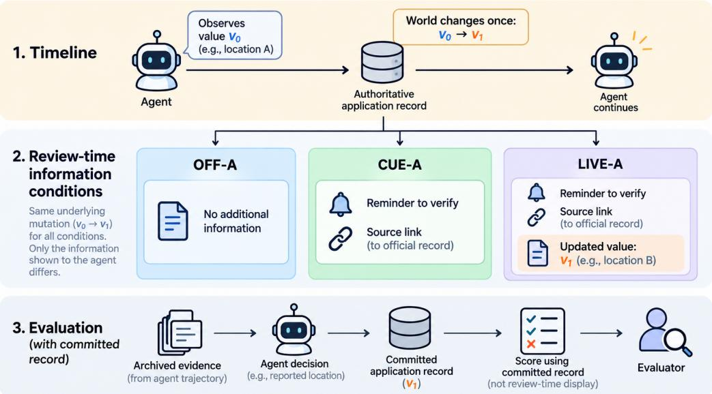
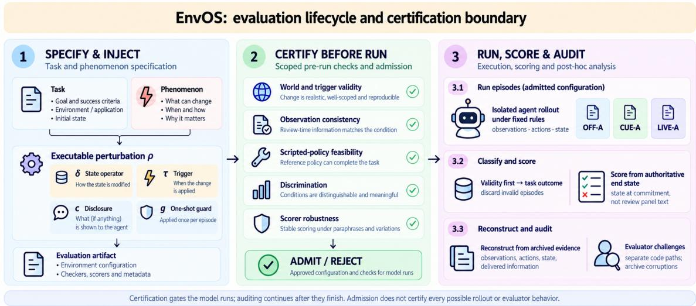
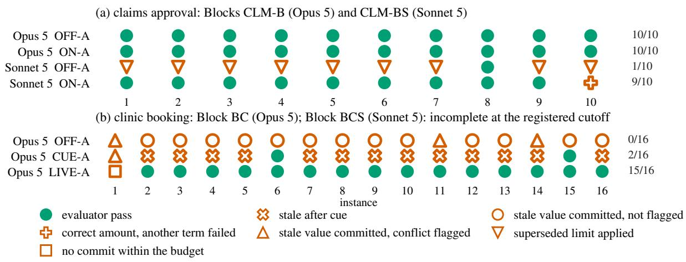
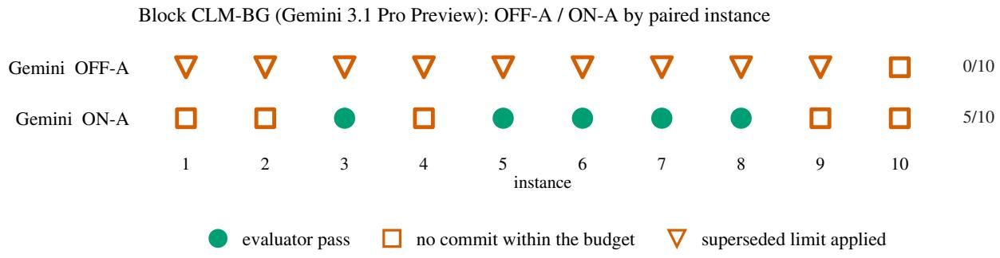
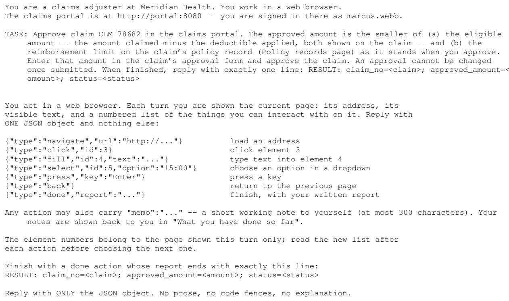
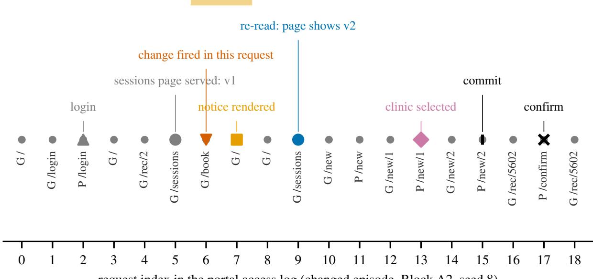
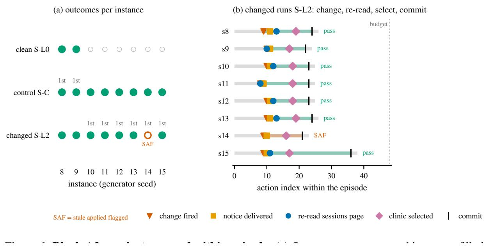
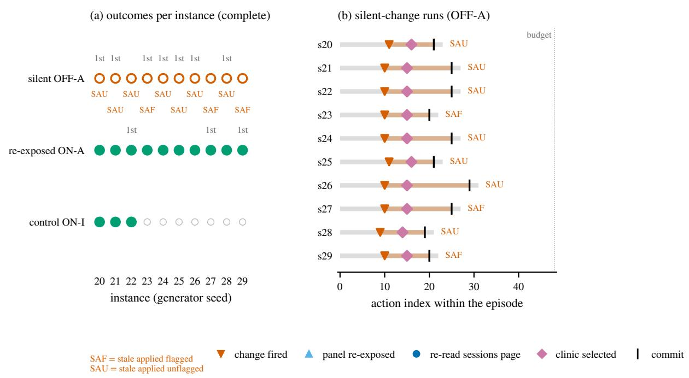

# EnvOS: Auditing Computer-Use Agents When the World

Moves On

Phenomenon-Based Task Construction, Certification, and Evidence-Based Evaluation

Ankush Kadu<sup>\*</sup> QpiAI, Bangalore, India ankush.k@qpiai.tech

Athira Gopal<sup>\*</sup> QpiAI, Bangalore, India athira.g@qpiai.tech

Arpit Jain QpiAI, Bangalore, India arpit.j@qpiai.tech

Niharika Singh<sup>\*</sup> QpiAI, Bangalore, India niharika.s@qpiai.tech

Aswanth Krishnan QpiAI, Bangalore, India aswanth.k@qpiai.tech

## Abstract

Computer-use agents built on large language models (LLMs) work in software that can change while they act: an appointment moves, a policy is revised, a record is updated. Testing agents under such changes is harder than it looks. When an agent fails, the cause may be the agent, but it may also be a change that did not fire as intended, an update the agent never received, or a grader that scored the episode wrongly. We introduce EnvOS, a framework for building and certifying environments that change mid-task. Before any agent runs, EnvOS checks that each change fires correctly, that the task remains solvable, and that the grader separates correct from incorrect behavior; after each run, separate code re-checks the verdict from archived evidence.

We apply it to stale information, where a value the agent has already seen changes before the agent acts on it. In clinic booking, Claude Opus 5 succeeds on 0/16 tasks when nothing extra is shown, 2/16 when reminded to re-check the source, and 15/16 when the updated value is shown; the gain over the reminder holds after correcting for all tests (p = 0.00293). In insurance-claim approval, Opus 5 re-checks on its own and succeeds on 10/10, whereas Claude Sonnet 5 rises from 1/10 to 9/10 when the current policy is shown again, a gain significant in its pre-registered test but not after correcting for all tests. Whether an agent caught a change thus varied with the model and the interface. We also stress-test the grading itself: on corrupted episodes designed blind from the rules, the EnvOS pipeline accepted none of 26 as clean, and on an externally generated set it caught 25 of 39, against 4 for simple log checks. Because every EnvOS environment is generated from a seed and graded by an audited automatic verifier, the same environments are natural candidates for training agents with reinforcement learning from verifiable rewards.

## 1 Introduction

Computer-use agents increasingly execute multi-step workflows over stateful applications, but evaluation commonly treats the application state as fixed once an episode begins. In deployed workflows, an appointment can move, a reimbursement policy can be revised, or a selected resource can become unavailable independently of the agent’s actions. These changes are not merely visual perturbations: they modify the authoritative records against which later actions are judged. Existing work has expanded interactive evaluation to long-horizon tasks, temporal disruptions, and evolving environments (Yuan et al., 2026; Hui et al., 2026; Froger et al., 2026; Zou et al., 2026). A complementary methodological problem remains: how can such changes be instantiated as valid test cases and how can one establish that an observed failure belongs to the agent rather than to the benchmark machinery? The question is sharper when the same environments supply a training signal: reinforcement learning with verifiable rewards trains agents against programmatic checkers (Wang et al., 2026; Wei et al., 2026), so an intervention that silently fails or a checker that accepts a corrupted episode yields a wrong reward, not only a wrong benchmark number (Zhu et al., 2025).

The question involves two different sources of uncertainty. Intervention validity concerns whether the environment underwent the intended state transition, at the intended point in the workflow, without unintended side effects or an impossible endpoint. Evaluation validity concerns whether the policy received its assigned observations, whether attempted rollouts were classified under fixed rules, and whether the scorer’s verdict is supported by archived evidence. A terminal pass/fail label alone cannot resolve these distinctions. For example, a booking agent may appear to use an outdated clinic location even when the update occurred before it saw the original value, or when the promised review information never reached the model. Either case invalidates the intended interpretation without requiring a failure of the agent’s decision policy.

We present EnvOS, a phenomenon-based framework linking task construction with executable certification and auditable outcome analysis (Figure 2). A phenomenon specifies an application-independent class of changes to authoritative state. An executable perturbation implements one instance of that class, defining the state operator, triggering condition, observation channel, and single-execution guard. The resulting task, seeded world, perturbation, endpoint criteria, and verifier form a candidate evaluation artifact. EnvOS admits that artifact for model evaluation only after scoped tests of the state transition, observation consistency, feasibility, behavioral discrimination, and checker robustness. Prospective experiments additionally freeze their design and counting rules, isolate the policy from evaluator data, and reconstruct supported verdict terms through separate implementations.

The principal empirical analysis focuses on stale authoritative information: the agent is first served a taskrelevant value, the underlying application state changes on a later eligible request, and the agent subsequently makes a consequential decision. The timing is important: changing a value before it is served does not establish that the agent’s earlier observation became stale. Figure 1 separates the mutation of the authoritative record from the later interfaces through which its updated value may be disclosed. A recorded page serve, a delivered model observation, and the agent’s comprehension are distinct events; the first two can be audited, whereas comprehension cannot be assumed from either.

For clarity, we retain the preregistered condition codes throughout. In the clinic experiment, OFF-A denotes no additional information at confirmation; CUE-A denotes a verification reminder and a link to the original record, with the updated location withheld; and LIVE-A denotes the same reminder and link with the current location shown. In the insurance experiment, OFF-A provides no additional policy information, whereas ON-A presents the current policy at approval. In both workflows, these conditions change the information presented to the agent, not the underlying state transition.

We investigate two applications of this evaluation design: clinic booking, where a session location changes, and insurance-claim approval, where a policy limit changes before the agent calculates an approved amount. In the principal paired comparisons the application-side change occurs in every condition; the manipulated variable is what appears at the review step. In clinic booking the agent receives either no additional review display, a review display pointing to the source page, or the current location itself. In insurance-claim approval the experiment compares review-time policy re-exposure with no additional disclosure. The original source remains accessible throughout. Consequently, the experiments estimate within-configuration review-information effects, not the effect of making a static environment dynamic. Source revisits are reported as observed behavior, not automatically treated as a task instruction or a success criterion.

The evidence also exposes important differences across the tested configurations. In clinic booking, directly presenting the updated location improves Opus 5’s success over providing a source link, including after paper-wide correction. In insurance approval, Opus 5 succeeds on the tested silent-change instances, while Sonnet 5 shows a block-local benefit from policy re-exposure that does not survive the retrospective paper-wide multiplicity adjustment. These results cannot be pooled into a controlled model ranking because task conditions and configurations differ. Separate archive challenges evaluate whether the same pipeline can detect deliberately corrupted records; their misses qualify, rather than disappear from, the reported evaluation claims.

Contributions. Our contributions are threefold. (i) A phenomenon–perturbation formulation that connects application-independent state changes to executable, exposure-conditioned task instances without conflating world state with model-visible notices. (ii) A certification and evidence pipeline encompassing intervention and feasibility checks, frozen execution rules, observation-delivery evidence, validity-first outcome scoring, independent reconstruction, and adversarial evaluator challenges. (iii) An evidence-bounded empirical study of two controlled stale-world workflows, together with evaluator challenge results that delineate what the outcome claims do and do not establish. Because instances are seeded and procedurally generated and outcomes are scored from committed application state, the certified environments and their verifiers are reusable as verifiable-reward environments for agentic RL, and the evaluator challenges show where such verifiers could mis-reward an episode. Supplementary phenomenon families are reported separately in Appendix S1 and are not pooled with the principal experiments.

The remainder of the paper defines the framework and its intervention semantics, specifies the tasks and evaluation protocol, presents the prospective results and evaluator challenges, and discusses limitations. Implementationlevel traces, generated evidence tables, and exploratory phenomenon-family analyses are retained in the appendices.

The upper row of Figure 1 traces the authoritative state: a recorded v serve precedes the one-time mutation to v , which determines the correct committed outcome. The lower row traces the information available to the policy, including the original delivered frame and the optional review disclosure. A review display does not cause or prove the state mutation, and a served page does not by itself establish that the model received or understood it. This distinction defines the evidence required for a legitimate stale-information episode.

  
Figure 1: Authoritative state and model observations during a stale-information intervention. The application serves $v _ { 0 }$ before a one-time exposure-conditioned mutation produces $v _ { 1 }$ . The review surface may disclose nothing, a link to the source, or the current value; these are observation conditions, not changes to the underlying mutation. Observation delivery is logged separately, and the evaluator scores committed application state rather than the disclosure review display.

## 2 EnvOS Framework

EnvOS couples the construction of state-changing evaluation instances with executable assurance of their experimental validity. Its workflow has three stages (Figure 2): constructing a candidate task and intervention, certifying the candidate against specified obligations, and executing admitted instances with independently auditable outcomes. The distinction is consequential. A functioning state mutation does not establish that a task remains solvable, that the assigned observations reach the agent, or that an endpoint checker correctly classifies the resulting behavior.

## 2.1 Construction of Evaluation Instances

A task specification determines the environment, initial state, user objective, and endpoint requirements. An associated phenomenon describes an application-independent class of environmental change relevant to that objective. EnvOS instantiates the phenomenon through an executable perturbation whose state operator, trigger, disclosure channel, and once-only guard are fixed with the task. The seeded world, perturbation, permitted observations, registered success invariants, and scorer jointly define a candidate evaluation artifact. Author specified task semantics are distinguished from automated instance construction, execution, and checking: the experiments do not claim unrestricted autonomous generation of new task objectives.

## 2.2 Certification Before Model Execution

Candidate instances undergo tests of five related properties. Intervention validity checks the intended state transition, trigger boundary, and absence of unintended changes. Observation consistency compares permitted disclosures with authoritative state and verifies the specified delivery path. Feasibility requires a successful scripted route through the task. Behavioral discrimination uses deliberately limited scripted policies to check that the constructed instance can expose the targeted deficiency. Scorer robustness tests known corruptions, near-misses, and valid controls. Where applicable, scripted feasibility and discrimination checks are repeated on frozen generated instances rather than inferred from the template alone.

  
Figure 2: EnvOS evaluation lifecycle. Task and phenomenon specifications define a candidate executable intervention. Pre-run checks assess the intervention, observation channel, feasibility, behavioral discrimination, and scorer robustness, determining whether the candidate is admitted to evaluation. Admitted instances are executed under fixed rules; their archived trajectories support validity classification, state-based task scoring, independently implemented reconstruction, and evaluator challenges. Admission applies to the specified checks and does not guarantee the validity of every subsequent episode.

Each check returns PASS, VIOLATION, or MONITOR ERROR; an unassessable obligation does not count as a pass. Admission is conditional on the declared checks, not a proof that every future model trajectory will be correctly handled. The certification criteria and examples of their failure targets are specified in Section 6.4.

## 2.3 Controlled Execution and Adjudication

Admitted configurations are evaluated with task instances, action budgets, validity criteria, outcome invariants, and analysis rules fixed before rollout. EnvOS archives application events, model-facing observations, agent actions, and committed state. A source page having been served is recorded separately from an observation actually delivered to the model; neither event establishes that the agent understood or used the information.

Run-level adjudication first determines whether the episode satisfies the registered validity conditions. Only valid episodes are assessed against applicable task invariants using the authoritative application state at the agent’s consequential commit. This ordering prevents faulty interventions or missing model inputs from being counted as agent failures. Conversely, valid unsuccessful episodes, including those that exhaust the action budget, remain failures under the registered protocol.

## 2.4 Evidence Reconstruction and Audit

After the rollout, separate implementations reconstruct supported validity and endpoint terms from the preserved evidence. Unresolved terms remain unresolved when the archive lacks sufficient information. Sealed, rule-only, and externally constructed archive challenges then test whether the operational evaluator detects deliberately corrupted evidence and retains valid controls. Such challenges test evaluator reliability rather than agent capability; disagreements and false acceptances are reported alongside successful detections (Section 9).

The division of evidence is summarized in Table 1. Pre-run certification asks whether a proposed test meets its declared contract; run-level verification asks whether one realized episode and its score are supported by the archive. These are complementary, not interchangeable, claims.

## 2.5 Assurance Scope and Provenance

A versioned instance manifest connects the initial world, task, intervention, disclosure conditions, and evaluator. It preserves the distinction between obligations checked before rollout and evidence collected from a particular model episode. Operationally, it encompasses admission checks, policy isolation, frozen decision rules, validity-first counting, independent reconstruction, and evaluator challenges. The supplementary phenomenon corpus uses the same general assurance categories but is not assumed to share every implementation detail with the prospective experiments.

Table 1: One EnvOS evaluation pipeline. The four assurance questions organize pre-run certification; the six audit stages track the evidence before, during, and after a particular model episode. Passing one part does not imply that another part was checked.
<table><tr><td>Assurance question</td><td>Candidate-instance checks</td><td>Run-level evidence and limits</td></tr><tr><td>World validity</td><td>Authorized mutation, bounded scope, one-shot execution, anchored timing</td><td>State and access logs establish when the authoritative event actually fired</td></tr><tr><td>Observation consistency</td><td>Rendering comes from updated source state; available channels are consistent with intended condition</td><td>Served pages and delivered model frames are archived separately; neither establishes comprehension</td></tr><tr><td>Recovery validity</td><td>Reference completion route and declared deficient-policy discrimination, including</td><td>Actual model actions, rereads and commits are observed, not inferred from the scripted policy</td></tr><tr><td>Checker robustness</td><td>frozen-instance feasibility Scorer localization checks, negative mutations and positive controls</td><td>Validity-first inclusion, independently coded verdict reconstruction and external archive challenges test residual mistakes</td></tr></table>

## 3 Phenomena and Perturbations

## 3.1 Phenomenon Specification

An environmental phenomenon specifies a class of changes to authoritative application state, independent of any particular application or interface. A task defines the agent’s intended outcome; the phenomenon defines an external event that may alter the state relevant to achieving that outcome. This separation prevents a model-visible notification from being treated as the underlying environmental event. In the two prospective workflows, the same broad phenomenon takes the form of a session-location update and a reimbursement-policy-limit update. Both affect application-owned records, rather than altering the user’s request or inserting adversarial instructions.

A specification identifies the affected state variable, permitted transition, task relevance, admissible timing, and feasible post-change outcome. Its implementation is an executable perturbation, which can differ across applications even when the phenomenon is conceptually shared. The prospective instances are generated within one synthetic workplace scaffold; they do not constitute evidence of portability to unrelated production applications.

## 3.2 Executable Perturbation Model

A perturbation is represented by

$$
\rho = ( \delta , \tau , c , g ) ,\tag{1}
$$

where $\delta$ is an operator on authoritative state, τ identifies the triggering event, c governs subsequent disclosure through permitted observation channels, and g ensures that the intervention fires at most once. The state transition and its disclosure are distinct operations: the latter must reflect the former but does not constitute it. Researchers specify the task semantics, legally admissible changes, success criteria, and comparisons; EnvOS executes and checks the resulting configuration.

The focal stale-information intervention requires a task-relevant value to have been served before a later, exposure-conditioned mutation supersedes it. The original serve arms the trigger; a subsequent eligible application request applies the update. Thus an update occurring before the old value was served would not establish the intended stale-world exposure. The harness additionally records the frame delivered to the model, because server-side service alone does not prove delivery. Figure 1 illustrates this temporal distinction.

## 3.3 Intervention Admissibility

The intervention contract requires four properties. First, the intended record must change at the specified request boundary, after the original-value serve and at most once. Second, the mutation must remain confined to the declared state scope; matched irrelevant-record controls test whether the machinery can run without changing the target answer. Third, observations must follow the assigned disclosure condition while the authoritative source remains accessible. Fourth, the post-change task must remain feasible, as witnessed by the registered reference policy on each admitted instance.

Table 2: The phenomenon–perturbation mapping in the two prospective workflows. Entries specify the experimental roles, not the literal values of any generated instance.
<table><tr><td></td><td>Clinic booking</td><td>Insurance claim approval</td></tr><tr><td>Phenomenon</td><td>A booked session&#x27;s previously served location is superseded</td><td>A policy&#x27;s previously served reimbursement limit is superseded</td></tr><tr><td>Authoritative object</td><td>Target clinic session row</td><td>Target insurance policy row</td></tr><tr><td>Prior serve Perturbation</td><td>Sessions page displays previous location First eligible booking-wizard request after</td><td>Policy page displays previous limit First eligible form-entry request after serve</td></tr><tr><td>trigger Mutation</td><td>serve Update the relevant stored location</td><td>Update the relevant stored limit</td></tr><tr><td>Disclosure</td><td>None, source link, or current location</td><td>None or re-exposed current policy record</td></tr><tr><td>Decision</td><td>Choose and submit compatible booking</td><td>Calculate and approve policy-constrained</td></tr><tr><td>Irrelevant</td><td>Move an unrelated clinic session</td><td>amount Change an unrelated policy record</td></tr></table>

These requirements define a controlled state-changing task rather than an instruction to the agent to anticipate a hidden update. In both prospective workflows, the authoritative transition is held fixed across the principal paired conditions. Consequently, their comparisons identify differences associated with review-time information, not the causal effect of introducing the environmental change itself.

## 4 Tasks and Evaluation Conditions

## 4.1 Clinic Booking

The clinic task requires the agent to combine information from mail, calendar, and a booking portal to select and confirm a compatible appointment. The portal initially serves a session location; on a later eligible booking request, the authoritative session record is updated without an immediate announcement. The source record remains accessible. Success requires a correctly committed booking satisfying the applicable task invariants, rather than a particular source-revisiting action.

## 4.2 Insurance Claim Approval

The insurance task requires an approval amount consistent with the policy authoritative at the time of approval. Following the initial policy-page serve, an eligible request changes the stored reimbursement limit. The correct decision is

$$
\mathrm { a p p r o v e d } = \operatorname* { m i n } \bigl ( \mathrm { c l a i m e d } - \mathrm { d e d u c t i b l e } , \mathrm { c u r r e n t } \ : \mathrm { l i m i t } \bigr ) .\tag{2}
$$

The review-time policy record provides the current limit, not the computed answer. Some instances cross a calculation threshold, so a policy lookup alone is insufficient to guarantee correct approval. Unlike the clinic instructions, the claims task explicitly refers to the policy in force at approval; this difference is relevant when interpreting observed source revisits.

## 4.3 Experimental Conditions

The registered condition codes are defined in Table 3. The suffix -A indicates a task-relevant state change, -I an irrelevant-record change at the matched trigger, and L0 a no-change control. In each principal paired contrast, the task-relevant record changes in both conditions; only the information provided before the final action differs. The authoritative source remains available throughout.

In clinic booking, LIVE–CUE measures the effect of directly showing the current location beyond a verification reminder and source link. CUE–OFF measures the effect of supplying that reminder and link rather than no additional information. In insurance approval, ON–OFF compares re-exposure to the current policy record with no additional policy information. These are intervention-assignment effects under the action budget: they may jointly reflect salience, contradiction with an earlier value, and reduced verification effort.

Table 3: Experimental information conditions. In all principal comparisons, the application undergoes the same task-relevant state change and the original source remains accessible. Only the information supplied to the agent before its final decision differs.
<table><tr><td>Task</td><td>Code</td><td>Information available at the review step</td></tr><tr><td>Clinic</td><td>OFF-A</td><td>No additional information at booking confirmation; the agent may revisit the original session record.</td></tr><tr><td>Clinic</td><td>CUE-A</td><td>A reminder identifies the session and provides a link for verification, without revealing the updated location.</td></tr><tr><td>Clinic</td><td>LIVE-A</td><td>The same reminder and link are accompanied by the updated session location.</td></tr><tr><td>Insurance</td><td>OFF-A</td><td>No additional policy information before approval; the original policy record remains accessible.</td></tr><tr><td>Insurance</td><td>ON-A</td><td>Current policy record is shown again, including the limit but not the approval amount.</td></tr><tr><td>Controls</td><td>-I, L0</td><td>Irrelevant-record change at the trigger, or no change, respectively.</td></tr></table>

## 4.4 Endpoints and Trajectory Measures

A task instance is a generated booking or claim scenario; an episode is one model rollout under one experimental condition. A commit is the agent’s consequential application action, distinct from EnvOS’s earlier state mutation. Outcome measures are computed from the committed application state and registered invariants. Separate trajectory measures capture source revisits, link following, and policy re-queries. Such behaviors may help characterize the observed path but are not standalone success requirements. In particular, a correct outcome without revisiting the source is possible when the current value was supplied directly, and revisiting alone does not guarantee task success.

The two workflows probe distinct decision requirements. Clinic booking primarily tests selection under a superseded record value; insurance approval requires calculating a derived value from the updated policy. Their results are therefore analyzed by workflow and model configuration, not combined into a cross-model ranking.

## 5 Intervention Timeline and Agent Rollout

In each stale-information episode, the application first serves the original task-relevant value and the harness records the observation delivered to the agent. The next eligible request, after that serve, triggers the authoritative mutation once. The assigned review-time information is then rendered from the updated state, and the agent continues under the fixed action budget. The same mutation occurs in all principal paired conditions, independently of whether the agent receives additional disclosure. Source revisiting remains possible in each condition.

At execution time the harness archives the state-change event, model-facing observations, browser actions, commit event, and final report. The outcome is not inferred from the displayed notice or from the model’s verbal report: an episode first undergoes validity classification and, if counted, is scored from the committed record. Archived events subsequently support independent reconstruction and targeted corruption tests. These distinctions also apply to the insurance workflow, where the changed state enters an arithmetic endpoint rather than a location-selection endpoint.

## 5.1 Episode-Level Evidence

An episode contains separate evidence of the original page serve, delivered observation, state mutation, assigned disclosure, and final commit. This partition is essential because one event does not prove another: a server log does not establish model delivery, and model delivery does not establish comprehension or reliance. The evaluator tests the recorded sequence against the registered intervention and outcome rules. Illustrative request ordering and implementation-level traces are retained in Appendix S2 rather than in the main methodological argument.

## 5.2 Evaluation Harness

The prospective experiments use a synthetic workplace testbed with 14 containerized infrastructure services, including clinic and insurance applications and supporting mail, calendar, and database services. Only two workflows are prospectively evaluated. The policy receives screenshot and text observations through a controlled semantic-browser interface, acts through a fixed schema, and is invoked statelessly with a short memo and recentaction history. The clinic and claims tasks allow 48 and 40 actions, respectively. Matched conditions share instance data and instructions. This interface does not constitute unrestricted operating-system-level computer use; the relevant action and observation contracts are specified in Appendix O.

## 6 Certification and Evidence Auditing

EnvOS evaluates the test construction and the model episode separately. Pre-run certification checks whether the proposed intervention satisfies a declared contract, whereas post-run auditing determines whether the recorded trajectory supports its validity classification and outcome. Both are necessary: an admissible candidate may still produce an invalid rollout, and a seemingly correct final record cannot establish that the intended stale-world sequence occurred.

## 6.1 Authoritative State and Observation Channels

The application database is the source of truth; a page or message shown to the policy is an observation derived from that state. For a stale-world episode, the original-value serve must precede the exposure-conditioned update, which must precede any review-time disclosure of the changed value. Serving and delivery are separate recorded events. The state operator changes the application-owned record; the disclosure channel changes only information presented to the agent. As a result, differences between the experimental conditions do not amount to different injected phenomena.

Definition 1 (Phenomenon). An application-independent specification of a class of authoritative-state changes and the conditions under which an instance of that class is admissible.

Definition 2 (Perturbation). An environment-specific executable intervention $\rho = ( \delta , \tau , c , g )$ comprising a state operator, triggering condition, observation channel, and once-only guard.

## 6.2 Perturbation Admissibility

The validity requirements concern timing, state scope, observation delivery, and endpoint evaluation. Timing tests establish a prior serve and a subsequent single update at the declared request boundary. Scope tests rule out injector-induced changes to unrelated records. Observation checks establish whether the assigned information reached the policy through the admitted channel. Finally, outcome checks use the application state at commit rather than the disclosure text. An episode can satisfy some requirements and fail others; a terminal success flag therefore cannot certify the full intervention history.

## 6.3 Exposure-Conditioned Interventions

An initial serve arms the trigger, and the next eligible agent request applies the mutation as an application-side transaction. The transaction is archived independently of the browser frame. Irrelevant-record controls exercise the same machinery while preserving the correct target decision. This construction establishes an auditable check–use interval without presuming that the agent noticed, retained, or understood the original value. The permitted source remains accessible after the update, but absence of a source revisit is not automatically an instruction violation.

For a valid episode, the scorer applies the five registered endpoint requirements where applicable: correct target state, a single commit, absence of collateral changes, required post-commit continuation, and consistency between the final report and committed state. Insurance approval does not require the continuation term. Process measures such as source revisits are recorded separately from these outcome invariants.

## 6.4 Pre-run Certification

Certification exercises the actual environment and candidate scorer before model evaluation. World and trigger tests check the event sequence, target scope, one-shot guard, and condition-equivalent neutral operations. Observation tests compare delivered content with the intended channel. Successful reference policies establish a feasible completion route; deliberately deficient policies test whether the instance can distinguish the specified behavior. These scripts are exercised on the frozen generated instances, since a valid template does not ensure that every generated booking or numerical claim remains discriminative.

Scorer tests include event-localization checks, deliberately corrupted records, near-misses, and valid positive controls. The relevant cases include an update firing too early or twice, missing promised observation delivery, a mismatched commit, and an incorrectly accepted or rejected archive. An unavailable check returns MONITOR ERROR and blocks admission rather than being silently recorded as passing. These tests provide evidence for the specified fault classes; they are not a general guarantee of coverage against unknown defects.

Table 4: Certification checks are admission evidence with specific failure targets. All checks are scoped to the tested scripted routes and generated instances.
<table><tr><td>Check family</td><td>What is tested</td><td>Example invalid case</td><td>What passing does not prove</td></tr><tr><td>World / trigger</td><td>old-value serve; anchored one-time update; condition-equivalent neutral operations</td><td>mutation fires before prior serve or fires twice</td><td>agent noticed the old value</td></tr><tr><td>Condition discrimination</td><td>reference and deficient scripted-policy trajectories and expected signatures</td><td>a value-only script passes when the value was hidden</td><td>arbitrary models will find the reference route</td></tr><tr><td>Instance feasibility</td><td>scripted completion and discrimination on each frozen generated instance</td><td>generated slot or decision is impossible</td><td>all future cases are feasible</td></tr><tr><td>Scoring instrumentation</td><td>event localization and registered target/commit invariants</td><td>scorer associates change with wrong request</td><td>every outcome field is reconstructable</td></tr><tr><td>Mutation / positive controls</td><td>deliberately corrupted and valid archives</td><td>damaged event enters clean; good archive is rejected</td><td>unknown corruption classes are covered</td></tr></table>

A certificate applies to the candidate and exercised scripted routes. Actual model episodes require fresh delivery evidence, validity classification, and endpoint checks; neither model understanding nor the correctness of every possible trajectory follows from a successful pre-run test.

## 6.5 Outcome Reconstruction

The archive separates authoritative state and commit records from delivered model observations and the action trajectory. One implementation reconstructs applicable endpoint invariants; a separate standard-library path rederives validity classifications from raw events and frozen rules. Terms that cannot be supported by the archive are left unresolved. For the prospective clinic workflow, appointment-availability terms can be reconstructed from saved state, whereas calendar compatibility relies on specified generator and state-preservation conditions; the claims endpoint has broader independent reconstruction coverage (Table 14).

Here independent refers to separate code paths developed by the same team, not an independent research group or independent source data. Agreement can reveal implementation disagreements but does not establish that their common archived evidence is free of errors. The evaluator challenges in Section 9 test this remaining exposure.

## 6.6 Audit Coverage

A six-stage operational audit records certification, policy isolation, frozen experimental rules, validity-first counting, independent re-derivation, and targeted challenges. Each stage addresses a distinct failure mode, as summarized below.

## 6.7 Policy Isolation and Observation Delivery

During prospective execution the sealed model policy uses a separate operating-system account, restricted file permissions and specified browser origins. The harness records model-facing frames and permitted actions; canary and access probes test whether policy inputs remain separated from evaluator files and future-state evidence. These measures bound the policy’s access under the declared harness configuration. They do not reconstruct all provider-side inputs, a limitation documented with the archived evidence inventory.

## 7 Experimental Design

A reliable task score needs two decisions in order: first whether the episode belongs in the analysis, then whether the committed task outcome passes. The study also needs a comparison rule fixed before any model results are

Table 5: Audit stages, evidence and scope. Every successful check establishes a limited property rather than a general guarantee of benchmark correctness.
<table><tr><td>Stage</td><td>Evidence</td><td>Fault exposed</td><td>Boundary</td></tr><tr><td>Certify</td><td>scripted policies, trigger logs, per-instance feasibility and mutation</td><td>update fires early/twice; reference path impossible; scorer misses event</td><td>scripted paths only</td></tr><tr><td>Isolate</td><td>controls sealed OS user, allowed origins, canary access probes, observation-delivery records</td><td>policy leaks evaluator data or misses promised channel</td><td>unarchived provider-side returns remain</td></tr><tr><td>Freeze</td><td>preregistration, SHA-256 manifests, fixed templates</td><td>post-outcome changes to analysis or software</td><td>dated amendments are still possible and disclosed</td></tr><tr><td>Count</td><td>validity table, provider/harness log, reserves and stop rules</td><td>provider outage treated as model failure; invalid rerun cherry-picked</td><td>validity classification can itself err</td></tr><tr><td>Re-derive</td><td>separately implemented outcome scorer and standard-library validity</td><td>incorrect success invariant or eligibility verdict</td><td>same team; shared archive; unresolved terms</td></tr><tr><td>Challenge</td><td>checker corrupted archive copies, sealed expectations, baselines and external generator</td><td>detector false accepts and valid-control false rejects</td><td>construction access, disputes and coverage vary</td></tr></table>

observed. EnvOS documents these decisions per model–workflow study block rather than searching across models for a single leaderboard score.

## 7.1 Preregistration and Validity

Before the first model rollout of a prospective block, the researchers freeze its task instances, conditions, contrasts, budgets, validity rules, reserves, stopping rules, statistical analysis, outcome invariants and interpretation templates. A release manifest hashes 29 repository paths, relevant container images, generator, invoker and requested model identifier; the driver rejects a run if its live artifacts drift. Amendments and departures are dated and reported rather than silently incorporated (Appendices B and M).

Validity is counted before outcome. Provider rejection or failure to deliver the promised policy input can be excluded and replaced only under the registered reserve (2 per cell; 6 per block). A valid run that reaches its action budget counts as an unsuccessful run, not a replacement. A counted clean-control failure stops a block under the declared rule; that stopping decision alone does not prove a harness defect. The two workflows retain their distinct preregistered treatment of untriggered runs: claims counts them as failures under its table; clinic replaces them because the intended intervention did not occur. The claims blocks used 0 and 0 replacements, respectively.

## 7.2 Matched-Instance Comparisons

Each generated instance is executed under every experimental condition for its block. A treatment-only success means that instance succeeds in the reviewed-information condition but not the comparator; a control-only success is the reverse; and a tie means their success indicators match. The preregistered comparisons use an exact two-sided sign test on discordant pairs at α = 0.05, with marginal Newcombe 95% intervals for the paired difference. Condition order is fixed and counterbalanced, not randomized.

The tests assume exchangeable directions of discordance under the null and no carry-over or period effects. Inference is conditional on the fixed instances and one sampled policy rollout per condition; reported intervals and p-values do not incorporate task-population variation or repeated-model-sampling variation. The total effects include any navigation effort saved by a review information at the fixed action budget. Within-order counts are descriptive, not evidence that period effects are absent. In CLM-BS the arm run first and the arm run second each succeeded on 5 of 10 pairs (by order: Appendix J); five pairs per order cannot exclude a period effect.

Prospective outcome interpretations are selected mechanically from templates written before the corresponding results, and void or incomplete blocks do not receive inferential readings (Appendix K). Each block uses its own registered local multiplicity rule. Each prospective block uses its pre-registered local test and multiplicity rule. Appendix L additionally reports a fixed twelve-slot paper-wide Holm sensitivity family. Because that family was finalized after the claims outcomes existed, its adjustment of the claims and historical tests is retrospective; BC’s block-local Holm family was frozen before any BC outcome and is its prospective multiplicity control. The retrospective twelve-test paper-wide Holm family is presented as sensitivity analysis; it is not substituted for the prospective claims registration (Appendix L).

Table 6: Prospective model results. Success requires the full evaluator endpoint; in clinic rows its calendarcompatibility term rests on a stated design condition, not independent re-derivation. Paired counts: treatmentonly/control-only/ties; $p \mathrm { : }$ exact two-sided sign test (BC: pre-registered block-Holm value in parentheses). ‘indep. endpoint’: counted rollouts whose independent reconstruction (clinic: without calendar compatibility) agrees with the evaluator. Blocks without results print their state; nets, intervals: Table 31. Gemini 3.1 Pro Preview received each frame inline in a stateless REST request with no tools; the Claude models were instructed to read each frame file with their file-read tool. Provider, model, invoker and image-delivery channel differ together; rows describe model–invoker configurations, not vendor effects.
<table><tr><td></td><td colspan="3">arm successes</td><td>paired</td><td>for/ag./</td><td>local p</td><td>indep.</td></tr><tr><td>model (block)</td><td>OFF</td><td>ON/CUE</td><td>LIVE</td><td>contrast</td><td>tie</td><td>(block Holm)</td><td>endpoint</td></tr><tr><td colspan="8">insurance-claim approval</td></tr><tr><td>Opus 5 (CLM-B)</td><td>10/10</td><td>10/10</td><td></td><td>ON-OFF</td><td>0/0/10</td><td>1.00</td><td>24/24</td></tr><tr><td>Sonnet 5 (CLM-BS)</td><td>1/10</td><td>9/10</td><td></td><td>ON-OFF</td><td>8/0/2</td><td>0.00781</td><td>24/24</td></tr><tr><td>Gemini (CLM-BG)</td><td>0/10</td><td>5/10</td><td></td><td>ON-OFF</td><td>5/0/5</td><td>0.0625</td><td>24/24</td></tr><tr><td colspan="8">clinic booking</td></tr><tr><td>Opus 5 (BC)</td><td>0/16</td><td>2/16</td><td></td><td>15/16 LIVE-CUE CUE-OFF</td><td>13/0/3 2/0/14</td><td>0.000244 (0.000488) 0.5 (0.5)</td><td>51/51</td></tr><tr><td></td><td colspan="8"></td></tr><tr><td>Sonnet 5 (BCS)</td><td colspan="8">incomplete at the registered cutoff: 21 of 51 cells counted; no inference</td></tr></table>

## 7.3 Inference and Assumptions

Let $Y _ { i } ( c ) \in \{ 0 , 1 \}$ denote whether the agent completes generated instance i under review condition c, with the same target-change phenomenon injected in every condition of the registered contrast. The observed paired difference for a treatment condition $c _ { 1 }$ and reference condition $c _ { 0 }$ is

$$
\widehat { \Delta } = \frac { 1 } { n } \sum _ { i = 1 } ^ { n } \left( Y _ { i } ( c _ { 1 } ) - Y _ { i } ( c _ { 0 } ) \right) = \frac { N _ { + } - N _ { - } } { n } ,
$$

where $N _ { + }$ counts treatment-only successes, $N _ { - }$ counts reference-only successes, and the remaining $n - N _ { + } - N _ { - }$ are ties. The exact two-sided sign test is based only on discordant pairs. A positive result therefore supports a difference between review conditionsfor thisfixed set ofinstances under the sampled rollouts and interface. The estimate includes any saved navigation effort under the action limit, not merely a perceptual effect of seeing a value.

This notation also clarifies what is not estimated. Because both $Y _ { i } ( c _ { 1 } )$ and $Y _ { i } ( c _ { 0 } )$ are observed after injection, the analysis does not contain a paired no-change/no additional information potential outcome for the same experiment. It cannot identify the average effect of the phenomenon occurring at all. Further, a no additional information failure does not demonstrate that the agent ignored a known update: by design the update was unannounced. Rechecking is a behavior visible in the trajectory, not a randomized intermediate variable, so the study cannot identify mediation through rechecking independently from other mechanisms such as contradiction, salience and reduced verification effort.

## 8 Results

We report prospective matched-instance evaluations in clinic booking and insurance-claim approval. Both workflows use preregistered feasibility and validity criteria; task-relevant state changes are held fixed across the principal compared conditions. Table 6 presents full-task outcomes and paired comparisons, and Figure 3 displays instancelevel results. Exploratory findings are reported separately in Appendix V and do not contribute to the confirmatory tests.

Per-instance outcomes in Figure 3 preserve the pairing structure underlying the exact tests. The analysis treats each model–workflow configuration separately; discordant matched outcomes contribute to the sign test, whereas matching outcomes are ties. Table 6 reports full-task success rather than successful information retrieval. The clinic comparison remains significant under the paper-wide adjustment; the Sonnet claims comparison is supported at its registered block-local level but not under the retrospective paper-wide family.

  
Figure 3: Matched experimental outcomes by instance. Insurance-claim approval compares no additional policy information (OFF-A) against re-exposure to the current policy (ON-A); clinic booking compares no additional 1, . . . , n  <sub>information (OFF-A), a verification reminder and source link (CUE-A), and direct disclosure of the updated location</sub> (LIVE-A). Each panel corresponds to a distinct registered model–workflow configuration; outcomes are not pooled across models.

## clinic booking BC (O8.1 Clinic Booking

Design. The clinic block (BC) evaluates the contribution of disclosing the updated session location relative to providing a verification reminder and source link. It assigns the same 16 fresh instances to no additional information (OFF-A), a verification reminder with a source link (CUE-A), and direct display of the current location (LIVE-A) in a fixed counterbalanced order, with 3 irrelevant-change controls (LIVE-I). The preregistered primary contrast is 5.1 CLAIMS APPROVAL: SILENT SUPERSESSION IN A DERIVED DECISIONLIVE–CUE; the key secondary contrast CUE–OFF asks whether the verification reminder improves success over no additional information before confirmation. These are unconditional, block-local Holm-adjusted comparisons The claims blocks with Clauunder the fixed 48-action budget.

on the same 10 frozen generated instances (seeds 0–9), with ON-I and L0 controls; they differ only<sub>Results.</sub> <sub>Claude</sub> <sub>Opus</sub> <sub>5</sub> <sub>passed</sub> <sub>OFF-A</sub> <sub>0/16,</sub> <sub>CUE-A</sub> <sub>2/16</sub> <sub>and</sub> <sub>LIVE-A</sub> <sub>15/16</sub> <sub>on</sub> <sub>16</sub> <sub>instances</sub> <sub>(Table</sub> <sub>31</sub> <sub>gives</sub> in the model and are never pooled. The decision function, gates and qualifiers are in Appendix H.<sub>every contrast). At the registered block-local level, displaying the current location increased success relative to</sub> this cue-and-link panel. The CUE–OFF contrast did not reject; this does not establish absence of a cue effect. Sonnet (registered reading). Over 10 sealed instance pairs (seeds 0–9), Claude Sonnet 5 met theContradiction, salience, and reduced verification effort remain possible explanations. The LIVE–CUE rejection survives the paper-wide Holm analysis over 12 claim-bearing tests (adjusted p = 0.00293). The LIVE-I controls passed 3/3; nothing is attributed to the panel from unmatched controls. The independent scorer reconstructs appointment availability from archived rows; calendar compatibility is not re-derived but rests on stated design conditions (the generator and state preservation), whose checks are reported separately. Under that condition, 6every outcome term is resolved and agreeing with the evaluator on 51 of 51 counted rollouts (Table 14). For transparency, the primary LIVE–CUE contrast has 13 treatment-only successes, 0 control-only successes and 3 ties (net +0.81 [0.49, 0.92]; exact p = 0.000244; block-local Holm p = 0.000488). The secondary CUE–OFF contrast has 2 treatment-only successes, 0 control-only successes and 14 ties (net +0.13 [−0.09, 0.36]; block-local Holm p = 0.5).

Trajectory evidence. The source page was accessible under every condition. Only 1 of 16 verification-reminder trajectories followed the supplied link. This is a descriptive process count, not a failure of an instruction to check or a separate definition of success. Independent validity re-derivation agreed with the archive on 53 of 53 attempts; the scorer’s calendar-compatibility limitation is stated in the registered outcome above. The design’s pre-rollout enlargement and historical motivation are documented in Appendices M and T. The separately registered Sonnet clinic block (BCS) ended incomplete at its cutoff and receives no inferential interpretation: incomplete at the registered cutoff: 21 of 51 cells counted; no inference.

Directly providing the updated location may expose a mismatch with the agent’s previously observed value and avoids requiring navigation back to the session record. A reminder with a source link leaves verification to the agent and can consume additional actions. The registered difference is the total effect of the interface choice at 48 actions. It is not an estimate of “value understanding” with navigation cost removed, and a failure to follow the cue link is not an independent failure under the task instruction. These mechanisms remain possible explanations rather than tested mediators.

## 8.2 Insurance Claim Approval

Design. The claims blocks evaluate approval accuracy when the current policy is re-exposed before the consequential decision. Each model is evaluated in its own block over the same 10 frozen generated instances (seeds 0–9) with paired OFF-A and ON-A target-change conditions and additional ON-I and L0 controls. The blocks were registered before their model rollouts and follow a frozen counterbalanced order. The interface presents the current policy record before approval, not the calculated approval amount; it combines a verification cue, value re-exposure, contradiction salience and saved lookup effort.

Claude Sonnet 5. Over 10 sealed instance pairs (seeds 0–9), Claude Sonnet 5 met the full approval endpoint on 1/10 without the panel and 9/10 with it; of the pairs, 8 favoured the panel, 0 the arm without it, and 2 neither; net +0.80 [0.37, 0.92] (marginal 95 % interval), p = 0.00781. Controls: ON-I 3/3, L0 1/1. The review-step panel increased full-task success at the registered local level. The OFF-A failure categories and observed pre-commit revisions are reported separately (Appendix H). The OFF-A–ON-A contrast rejects under its registered block-local analysis but not under the paper-wide Holm analysis (adjusted p = 0.0781 over 12 tests). That family was finalized after the claims outcomes (Appendix L). The pre-registered derived-decision gate passed on all three threshold-crossing cases. Every outcome term the independent scorer re-derives is resolved and agreeing with the evaluator on 24 of 24 counted rollouts. The standard-library validity re-derivation agrees with the archive on 25 of 25 attempts. The registered local contrast supports higher full-task success with review-step re-exposure. Its retrospective twelve-test paper-wide Holm adjustment does not reject, so the two inference families must not be conflated. Sonnet applied the superseded limit in 9/10 episodes without additional policy information and requested the policy record after the change in 8/10 ON-A episodes. These are descriptive trajectory counts, not separate randomized tests of verification behavior. The independent scorer’s scope covers all 4 registered outcome terms.

Claude Opus 5. Opus succeeded 10/10 in both OFF-A and ON-A; because every OFF-A instance already succeeded, the registered rescue-opportunity gate was not met and no panel-effect claim is made for Opus. Opus requested the policy record after the change in all 10 OFF-A runs, versus 1/10 for Sonnet; these process counts are descriptive, and the instruction itself may encourage checking. In these instances Opus already completed every claim without additional policy information correctly, so the registered rescue-opportunity gate was not met; that ceiling does not establish that the review display is generally ineffective. The full registered reading and process counts are in Appendix H.

Gemini follow-up. On the ten registered reused claims instances, under the frozen Gemini 3.1 Pro Preview configuration, OFF-A failed on 10/10 instances, but review-step re-exposure did not meet the registered effect criterion (5 rescues, 0 harms, 5 ties; exact paired p = 0.0625); the effect is not shown for these instances under this configuration at this budget, and this is not evidence of no effect. This is a separate preregistered model–invoker configuration on reused claims instances. A non-rejection does not establish absence of a benefit, and differences in provider, invocation and frame-delivery channel prevent isolation of vendor or model effects (Appendix I).

## 9 Evaluator Audits

Agent outcomes are credible only if the evaluation can distinguish clean episodes from corrupted or unsupported records. An archive challenge starts with a preserved episode and changes selected evidence under a known expected verdict. For example, altering the recorded timing so a purportedly mid-task mutation occurs before the old value was served should cause the validity layer to object; simply scoring the final booked row could miss the issue. An outcome scorer reconstructs task invariants, validity reconstruction re-applies eligibility rules, and evaluator replay reproduces the archived evaluator’s own checks. A simple raw-log checker serves as a limited comparator, not an independent oracle. The challenge is whether each layer recognizes the corruption within its stated scope.

Challenge design. The sealed, run-once challenge was built with repository access but was unseen by the Claude agents that built the pipeline. The rule-only challenge was specified from rule excerpts and the archive schema without implementation or outcome access, then instantiated by the authors and separately reviewed for fidelity. The external Gemini CLI challenge supplied rules, schema and archive copies to an agent that designed and generated its own cases. None was an independent-team audit. The challenges differ in their access, implementation, and the kinds of errors they can test; their original frozen expectations are kept even where disputed.

Table 7: The protocol against a simple raw-log baseline (post hoc, author-built, not blind; separate from Table 12). Same raw evidence and scored properties. Controls accepted; corruptions rejected (not counted, or counted with the corrupted invariant flagged), in brackets those in the baseline’s declared scope. Clinic protocol rows are derived from the sealed tools’ recorded outputs; the claims pipeline voids C09b as invalid rather than failing its single-commit term. Every case: Appendix D.
<table><tr><td>checker</td><td>controls</td><td>corruptions (in scope)</td><td>would enter the results unflagged</td></tr><tr><td colspan="4">clinic: the sealed challenge&#x27;s 10 controls and 18 corruptions, its recorded outputs re-tabulated protocol, implemented reading</td></tr><tr><td></td><td>10/10</td><td>15/18 (11/12)</td><td>notice delivery (C01); delivery of review-time information (C02); commit before change (C08)</td></tr><tr><td>protocol, registered reading</td><td>10/10</td><td>16/18 (11/12)</td><td>commit before change (C08); truncated trajectory (C15)</td></tr><tr><td>simple baseline (143 lines)</td><td>9/10</td><td>11/18 (11/12)</td><td>7, of which 6 outside its declared scope</td></tr><tr><td colspan="4">claims: 10 controls and 19 corruptions we built from counted archives</td></tr><tr><td>operational pipeline</td><td>10/10</td><td>16/19 (10/12)</td><td>duplicate commit in the access log only (C0 9a); truncated trajectory (C1 5); stale pages after the change</td></tr><tr><td>simple baseline (108 lines)</td><td>10/10</td><td>6/19 (6/12)</td><td>(C17p) 13, of which 7 outside its declared scope</td></tr></table>

Sealed challenge. A separate model built a run-once 28-case challenge, white-box to its builder but unseen by the Claude agents that built the pipeline; the outcome scorer met 28/28 sealed expectations, validity re-derivation 24/28 and archived evaluator replay 10/28, unrepaired (Table 12, Appendix C); not blind validation.

Rule-only case-design challenge. A fresh GPT-6 chat given only rule excerpts and the archive schema (no code, paper, earlier cases or outcomes) specified 56 cases with expected verdicts. We implemented them on archive copies under frozen rules; a second chat reviewed fidelity, and 36 admitted cases ran once. The pipeline accepted all 10 controls and, of 26 corruptions, caught 24 (one under another class), gave no verdict on 2 and counted none as clean (outcome scorer alone: 10; raw-log baselines: 19). Only the case design was blind, and clinic coverage is thin (Appendix E).

External challenge. A Gemini CLI agent given only the rules, schema and 15 archive copies designed 56 cases and wrote their generator, which we ran unread, sealed and scored once per tool. The pipeline caught 14/20 claims and 11/19 clinic corruptions (raw-log baselines 1, 3), counted 4 and 8 as clean (baselines 15, 15) and rejected 3 of 16 controls (baselines ≤1). We dispute 19 expectations; it used one base per workflow, and an LLM agent is no independent team (Appendix F).

Challenge outcomes. A corruption caught and rejected is not the same as one receiving no verdict, and an expected verdict challenged by the authors is not automatically a proven evaluator defect. The external challenge’s original labels include 12 of 39 designated corruptions counted clean and 19 disputed expectations after scoring; its pipeline also rejected three of 16 controls, as detailed in Appendix F. We retain the original classification alongside the disputes rather than replacing the headline with a retrospectively restricted subset.

## Raw-log baseline comparison.

Against a simple raw-log baseline. This comparison is post hoc, author-built and not blind: after the sealed result, which stands unchanged, we wrote a simple checker rebuilding each verdict from the same raw state, access log and served pages, with the pipeline in view, and sealed each before its one run (Table 7). No protocol path rejected a control; the clinic baseline rejected one. Within the baseline’s declared scope both rejected 11 of 12 clinic corruptions; on claims the pipeline rejected 10 and the baseline 6 of 12. A careful simple checker thus reproduced most narrow clinic checks; EnvOS adds breadth (delivery, served arm, collateral state) that such a checker could be extended to cover, and the baseline alone caught one case (Appendix D). As we built both cases and checkers, only the external challenge above tests independent construction, and there the pipeline counted 4 of 20 claims and 8 of 19 clinic corruptions as clean.

Within the simple baseline’s declared scope, the gap is smaller than an unrestricted total might suggest: on the clinic subset both approaches rejected 11 of 12 corruptions, while on claims the pipeline rejected 10 and the baseline 6 of 12 (Table 7). The baseline and comparison cases were constructed post hoc by the authors with the pipeline in view, and the scores should not be interpreted as an unbiased detection-rate estimate. The external challenge is the more consequential test of independently constructed cases, albeit still produced by a model agent rather than an independent research team.

## 9.1 Challenge Coverage and Failure Modes

The archive challenges are better interpreted as tests ofspecificfailure hypotheses than as a single scalar score for evaluator quality. The first sealed challenge kept its builder’s access and tested whether separate layers reproduced frozen expectations. A second challenge separated case specification from implementation and access to previous outcomes, but the cases were subsequently instantiated by the authors and therefore do not constitute end-to-end blind testing. The external challenge delegated both case design and generator construction to a different model agent, making it less entangled with the pipeline’s design decisions but still not equivalent to validation by an independent research team.

Four outcomes must be separately reported. A detected corruption is caught and appropriately barred from clean results; an undetected corruption enters as clean; a no-verdict case is not accepted clean but also does not produce the registered classification; and a control rejection incorrectly challenges evidence designated valid. Disputed expected verdicts are additionally tracked without assuming either side of the dispute is right. The external challenge produced examples of all the consequential categories, including 12 of 39 designated corruptions accepted as clean, three of 16 controls rejected, and 19 disputed expectations. Reporting only the caught cases would overstate reliability, while collapsing abstentions into successful detections would erase uncertainty.

The post-hoc simple-checker comparison asks a different question: which classes of defects are covered by the protocol’s audit layers beyond a short baseline operating on the same raw evidence? Because the baseline and many mutations were constructed by the same authors after viewing the pipeline, the difference is diagnostic, not an unbiased population detection-rate estimate. The within-scope counts matter: for the narrow clinic subset, both pipeline and baseline catch 11 of 12; for claims, the pipeline catches 10 of 12 compared with six for the baseline. EnvOS’s broader checking surface remains useful, but breadth does not imply that every individual check is more accurate.

Development defects. Certification, re-derivation and audits surfaced 11 defects, which now serve as regression cases. For 7, a previously scored archive already carried a model verdict under the defective code. Examples include timing, delivery and scoring mismatches that could otherwise become erroneous claims about agent behavior (Appendix W). Every historical and prospective block is interpreted under the actual code that governed it; repairs do not retroactively make an earlier verdict more reliable. The remaining undetected corruptions, unevaluable archive terms and incomplete provider-side traces show why an evaluator should be regarded as tested within stated bounds, not certified correct in general.

## 10 Related Work

Phenomenon-based evaluation. A phenomenon-based benchmark must distinguish the application state that changes from the model-visible information used to communicate that change. EnvOS encodes this distinction in an executable perturbation and makes certification a prerequisite to model measurement. Its most specific evaluated contribution is the combination of a prior-serve requirement, controlled review-step disclosure, and independent tests of timing, delivered observations and scoring. The goal is not to replace general-purpose benchmark generation or to claim that injections or evaluator tests themselves are unprecedented. Instead, the design is organized around which concrete evidence can support each conclusion about a sampled agent action. Supplementary phenomenon families illustrate other state-change classes under their own recorded execution and analysis conditions (Appendix S1).

Dynamic environments and adaptation. OSWorld 2.0 evaluates realistic computer workflows with mid-task information updates (Yuan et al., 2026). Gaia2 studies asynchronous changes and temporal constraints (Froger et al., 2026, 2025); InterruptBench changes user goals during execution (Zou et al., 2026). StressWeb studies controlled interface and action-semantic perturbations (Bai et al., 2026), while DynamicGUIBench and AgentHijack examine changes to dynamic interfaces, observation and control (Liu et al., 2026; Sun et al., 2026). STT-Arena is particularly close: it builds dynamic tool environments and validates injected conflicts, timing and plan disruption (Hui et al., 2026). These efforts already establish controlled interventions and validation as important design ideas. EnvOS instead narrows its experimental target to an application value first served to a browser agent, then superseded, with matched review-step disclosure conditions and archive-level checks of that sequence. This is a benign time-of-check–time-of-use gap (Lilienthal et al., 2025), not a claim that the gap itself is newly identified.

Observation and stale-state reasoning. STALE studies recognition and downstream use of invalidated memories (Chao et al., 2026); EnvProbe considers when an agent re-queries its environment (Song et al., 2026); and work on agent–computer observation interfaces examines richer between-step observations (Li et al., 2026). EnvOS evaluates durable task actions under an unchanged instruction and contrasts no additional information, a link to accessible source information, and direct display of the current value. It does not claim that improved observation is new or that a record’s prior serve proves comprehension.

Task generation and perturbation design. CUA-Gym co-generates task instructions, environment states and verifiable reward functions for computer-use training (Wang et al., 2026). This is a substantive task-generation contribution; EnvOS does not replace it or claim that generation itself is novel. The two are complementary: CUA-Gym scales environments and rewards for training, whereas EnvOS certifies that a mid-episode change and its verifier behave as specified, a precondition for trusting either as a training signal. Our scientific unit is a mid-episode authoritative transition anchored to the agent’s prior serve, with separately controlled review-time disclosure and archived evidence supporting or withholding an outcome verdict. The present study uses authored phenomenon specifications and an implemented perturbation mechanism in a bounded synthetic testbed; it does not establish general autonomous discovery or synthesis of new change classes. Likewise, STT-Arena already injects dynamic spatio-temporal conflicts and validates key intervention properties. The distinction here is not “first dynamic event” but the specific exposure-and-delivery contract, matched disclosure contrasts and independent archive checks around the resulting full-task action.

Evaluation validity and verifier reliability. Multi-service environments such as TheAgentCompany and controlled task-generation systems motivate reproducible application workflows; generation alone is not the contribution here. OpenComputer investigates verifiable software worlds and state-based judging (Wei et al., 2026). ABC and log-based evaluation critiques document task, reward and attribution threats (Zhu et al., 2025; Kirgis et al., 2026); broader reviews question what an aggregate agent score measures (Zhu et al., 2026; Patel et al., 2026). EnvOS combines established techniques—state-based outcomes, preregistration, mutation testing, independent code paths and provenance hashes—around the specific timing, disclosure and scoring of an authoritative mid-task change. The comparison concerns focus and evidence coverage, not a claim that other benchmarks lack validation or that this feature combination is universally unprecedented (extended discussion: Appendix X).

## 11 Limitations

The prospective evaluation covers two workflows in a synthetic workplace under a controlled semantic-browser interface, with fixed, counterbalanced instance orders and one sampled rollout per condition. These settings do not establish performance in unrestricted native computer use or naturally occurring change-time distributions. The principal contrasts manipulate review-time information while retaining the same authoritative mutation in both paired conditions; they do not estimate the causal effect of environmental change itself. Small paired samples and potential order effects further limit generalization, and non-rejection does not establish equivalence. We evaluate agents but do not train them; whether certified non-stationary environments improve RL-trained computer-use agents is untested.

Evidence coverage is also bounded. Served pages and delivered frames do not establish agent comprehension. In clinic booking, calendar compatibility is not independently reconstructed from the archived records, and certain provider-side inputs and historical endpoints are incomplete (Appendices R and J). Independently implemented checkers were developed by the same team and rely on shared archived evidence. External archive challenges reveal residual false acceptance and control-rejection errors, with some expected verdicts disputed; the case sets are not population-level error-rate estimates. Supplementary phenomenon-family experiments use different settings and are kept separate from the prospective results (Appendix S1). All prospective inferential claims of the paper rest on Claude-model blocks; the only non-Anthropic block (CLM-BG) is a separately registered configuration follow-up on reused instances. A pre-registered screenshot-only coordinate-action crossover of the claims workflow stopped at its engineering admission gate before any model rollout: viewport fit failed (18 of 144 page checks did not fit) and legibility failed (4 of 404 values unrecovered at 1536 × 864). It therefore contributes no behavioral evidence, and interface robustness remains untested.

## 12 Conclusion

EnvOS integrates phenomenon-based task construction, executable intervention certification, controlled agent evaluation, and evidence-based auditing into a single experimental workflow. By distinguishing authoritative state transitions from their observation channels and by evaluating episode validity before task success, the framework establishes a more explicit evidential basis for claims about agents operating in changing environments.

In the prospective stale-information study, the underlying mutation was fixed while review-time information varied. Direct presentation of the current clinic location improved booking success relative to a verification reminder and source link under the registered and paper-wide analyses. The insurance results show configuration-dependent behavior: Opus 5 succeeded without re-exposure on the tested instances, while Sonnet 5 benefited at its registered local level but not under the retrospective paper-wide adjustment. These contrasts concern review-time information, not a no-change baseline or general model ranking.

The prospective claims and clinic experiments, not the historical predecessor blocks, carry the model-effect conclusions (Section 8). In clinic booking, at the block-local level the value display increased success relative to the cue-and-link panel (LIVE–CUE block-local Holm $p = 0 . 0 0 0 4 8 8$ , paper-wide $p = 0 . 0 0 2 9 3$ ; CUE–OFF block-local $p = 0 . 5 )$ . In insurance-claim approval Opus succeeded 10/10 without review-step re-exposure, and for Sonnet the panel increased full-task success at the registered local level (block-local $p = 0 . 0 0 7 8 1$ ; retrospective paper-wide Holm $p = 0 . 0 7 8 1 )$ ). These contrasts estimate within-configuration effects; unrejected comparisons do not establish absence or equivalence. The auditing challenges and the post-hoc, author-built raw-log comparisons show concretely that intervention, delivery and scoring checks can disagree on the same corrupted archive, so each layer must be tested rather than assumed correct.

Archive-based reconstruction and evaluator challenges reveal both useful verification coverage and remaining failure modes. The methodological contribution is therefore a pipeline in which the intervention, pre-run checks, model observations, committed outcome, and evaluator claims can be inspected separately, with residual uncertainty explicitly retained. A natural next step is to use certified EnvOS environments as non-stationary, verifiable-reward environments for reinforcement learning of computer-use agents, with certification and evaluator audits helping to guard the reward against hacking.

## Reproducibility statement

Every quantitative statement in this paper is a macro emitted by a claim ledger (claims.py) that re-derives it from a hashed artifact and fails on any missing or drifting input and on any macro used but not defined (Appendix Y); in Section 8 and the conclusion, every sentence interpreting a prospective block is a template selected by the ledger (Appendix K), and the abstract and Section 1 state the same conclusions in shortened prose with every number still emitted by the ledger; ADDENDA 18 and 19 and the claims pre-registration are frozen (each file verifies against its sha256 record) and the interpretation templates are sealed. The figures are generated from the same artifacts. The anonymous supplement includes the raw text archives, search logs, results, independent scorer outputs and validity re-derivations for every prospective block reported in the main text, including BC; a no-model reproduction target recomputes the cells of Table 6, the per-instance grids of Figure 3, all registered paired tests and the associated audit counts from those packaged artifacts. It also contains the environment, task-module, certifier, scorer, harness, invoker and test sources; the pre-registrations, certificates, block specifications, release manifests and search logs; the raw text archives of the historical, claims (CLM-BG included) and Blocks BC and BCS model episodes (no screenshot frame ships, for size); the held-out battery and the sealed archive challenge after its one run; and a reproduction script that needs no network, world or model. Evidence that cannot be reconstructed, such as slot occupancy at booking time in the historical blocks and the CLI’s unarchived defaults, is listed rather than inferred: Appendix Y states the result of an offline run of the supplement’s reproduction script and what is permanently missing, and points to the supplement’s complete inventory, which ships as a generated provenance file.

## Ethics statement

The testbed is synthetic: every person, appointment, claim, message and record in the office-v1 world is generated, and no human subjects, personal data or production systems are involved. The evaluated policies are commercial Claude models accessed through the vendor’s command-line interface (the Claude CLI) and, in Block CLM-BG, Gemini 3.1 Pro Preview accessed through Google’s REST API, under their providers’ terms; the isolation described in §6.7 exists to protect the evaluation, not to circumvent any provider control. The paper reports a non-replication of an earlier result of our own (Block A2); its account ships with the supplementary provenance file described in Appendix U, where the earlier evidence is retained rather than withdrawn.

## AI use statement

We disclose LLM involvement against the categories ICLR asks about. Used: method implementation (Claude Code was used to author task modules, checkers and analysis code, all of which is covered by offline tests, certification and the independent scorer); research methodology (GPT-6 was consulted on the experimental design, the pre-registration addenda, the sizing of the blocks and the interpretation templates; every consult, answer and disposition is archived); evaluation infrastructure (GPT-6, through the Codex CLI, built the second sealed archive challenge of Section 9, which no Claude agent read before its run; in a web chat, GPT-6 specified the cases and expected verdicts of the rule-only case-design challenge of Section 9, and a second chat reviewed the fidelity of the authors’ implementation of each case; Appendix E; a Gemini CLI agent (gemini-3.1-pro-preview) designed the cases and expected verdicts of the externally built challenge and wrote the generator that instantiated them, Appendix F); writing (GPT-6 critiqued drafts of the abstract and of this manuscript; Claude Code drafted sections from the project’s own documents). LLMs as the object of study: the evaluated policies are LLMbased computer-use agents: Claude models and, in the claims block CLM-BG only, Gemini 3.1 Pro Preview (gemini-3.1-pro-preview); no GPT-6 model result is reported (Appendix M). Not used: no measurement in this paper was produced by an LLM; every number is derived mechanically from archived artifacts by the claim ledger, and no experimental outcome was generated, altered or selected by an LLM. The research question, the decision of what to claim, and every acceptance of a result were the authors’. The authors take full responsibility for all content, including any error introduced this way.

## References

Haoyue Bai et al. (2026). StressWeb: A Diagnostic Benchmark for Web Agent Robustness under Realistic Interaction Variability. arXiv preprint arXiv:2604.16385. https://arxiv.org/abs/2604.16385

Victor Barres et al. (2025). tau<sup>2</sup>-Bench: Evaluating Conversational Agents in a Dual-Control Environment. arXiv preprint arXiv:2506.07982. https://arxiv.org/abs/2506.07982

Hanxiang Chao et al. (2026). STALE: Can LLM Agents Know When Their Memories Are No Longer Valid?. arXiv preprint arXiv:2605.06527. https://arxiv.org/abs/2605.06527

Romain Froger et al. (2026). Gaia2: Benchmarking LLM Agents on Dynamic and Asynchronous Environments. International Conference on Learning Representations. https://openreview.net/forum?id= 9gw03JpKK4

Romain Froger et al. (2025). ARE: Scaling Up Agent Environments and Evaluations. arXiv preprint arXiv:2509.17158. https://arxiv.org/abs/2509.17158

Athira Gopal, Ankush Kadu, Niharika Singh, Arpit Jain, and Aswanth Krishnan (2026). EnvOS: A Certified Pipeline for Evaluating Interactive Agents Under State-Changing Phenomena. NeurIPS 2026 Workshop: Continual Learning in the Era of Foundation Models and Embodied Agents.

Tingfeng Hui et al. (2026). STT-Arena: A More Realistic Environment for Tool-Using with Spatio-Temporal Dynamics. arXiv preprint arXiv:2605.18548. https://arxiv.org/abs/2605.18548

Peter Kirgis et al. (2026). Log Analysis Is Necessary for Credible Evaluation of AI Agents. arXiv preprint arXiv:2605.08545. https://arxiv.org/abs/2605.08545

Bojie Li et al. (2026). Agent-Computer Observation Interfaces Enable Dynamic Computer Use. arXiv preprint arXiv:2606.29472. https://arxiv.org/abs/2606.29472

Derek Lilienthal et al. (2025). Mind the Gap: Time-of-Check to Time-of-Use Vulnerabilities in LLM-Enabled Agents. arXiv preprint arXiv:2508.17155. https://arxiv.org/abs/2508.17155

Enqi Liu et al. (2026). Benchmarking and Improving GUI Agents in High-Dynamic Environments. arXiv preprint arXiv:2604.25380. https://arxiv.org/abs/2604.25380

Quinn McNemar (1947). Note on the Sampling Error of the Difference Between Correlated Proportions or Percentages. Psychometrika.

Dhaval C. Patel et al. (2026). Beyond Static Leaderboards: Predictive Validity for the Evaluation of LLM Agents. arXiv preprint arXiv:2606.19704. https://arxiv.org/abs/2606.19704

Xinyuan Song et al. (2026). Ask the World Before Acting: Environment Probing for Calibrated Agent World Models. arXiv preprint arXiv:2606.31422. https://arxiv.org/abs/2606.31422

Jingwei Sun et al. (2026). AgentHijack: Benchmarking Computer Use Agent Robustness to Common Environment Corruptions. International Conference on Machine Learning. https://arxiv.org/abs/2605.25707

Harsh Trivedi et al. (2024). AppWorld: A Controllable World of Apps and People for Benchmarking Interactive Coding Agents. Proceedings of ACL. https://aclanthology.org/2024.acl-long.850/

Bowen Wang et al. (2026). CUA-Gym: Scaling Verifiable Training Environments and Tasks for Computer-Use Agents. arXiv preprint arXiv:2605.25624. https://arxiv.org/abs/2605.25624

Jinbiao Wei et al. (2026). OpenComputer: Verifiable Software Worlds for Computer-Use Agents. arXiv preprint arXiv:2605.19769. https://arxiv.org/abs/2605.19769

Yule Wen et al. (2026). Real-Time Reasoning Agents in Evolving Environments. International Conference on Learning Representations. https://arxiv.org/abs/2511.04898

Edwin B. Wilson (1927). Probable Inference, the Law of Succession, and Statistical Inference. Journal of the American Statistical Association.

Tianbao Xie et al. (2024). OSWorld: Benchmarking Multimodal Agents for Open-Ended Tasks in Real Computer Environments. Advances in Neural Information Processing Systems. https://arxiv.org/abs/2404. 07972

Jian Xie et al. (2024). Adaptive Chameleon or Stubborn Sloth: Revealing the Behavior of Large Language Models in Knowledge Conflicts. International Conference on Learning Representations. https://arxiv.org/abs/ 2305.13300

Frank F. Xu et al. (2025). TheAgentCompany: Benchmarking LLM Agents on Consequential Real World Tasks. Advances in Neural Information Processing Systems.

Shunyu Yao et al. (2025). tau-bench: A Benchmark for Tool-Agent-User Interaction in Real-World Domains. International Conference on Learning Representations. https://arxiv.org/abs/2406.12045

Mengqi Yuan et al. (2026). OSWorld 2.0: Benchmarking Computer Use Agents on Long-Horizon Real-World Tasks. arXiv preprint arXiv:2606.29537. https://arxiv.org/abs/2606.29537

Shuyan Zhou et al. (2024). WebArena: A Realistic Web Environment for Building Autonomous Agents. International Conference on Learning Representations. https://arxiv.org/abs/2307.13854

Yuxuan Zhu et al. (2025). Establishing Best Practices in Building Rigorous Agentic Benchmarks. Advances in Neural Information Processing Systems. https://arxiv.org/abs/2507.02825

Pengyu Zhu et al. (2026). “LLM Agent Performance” Is Not a Single Evaluation Target. arXiv preprint arXiv:2602.03238. https://arxiv.org/abs/2602.03238

Henry Peng Zou et al. (2026). When Users Change Their Mind: Evaluating Interruptible Agents in Long-Horizon Web Navigation. arXiv preprint arXiv:2604.00892. https://arxiv.org/abs/2604.00892

The appendices put the final evidence first: the validity table and the rule reconciliation (Appendices A–B), the certificates, the scorer’s coverage and the independent re-derivations (Appendix C), then the prospective blocks—their records, the verbatim interpretation templates, the paper-wide multiplicity family, the decisions of the final night and a diagnostic invariant-completion fraction of the claims blocks (Appendices G–N)—then specification and per-episode records of the historical, hypothesis-generating blocks; the registration chronology with its errata follows them (Appendix U). The frozen pre-registrations, the release manifests and the full claim ledger are files, not typeset here (Appendices U and Y).

## Supplementary Evidence and Reproducibility

The appendix is grouped below by what a reader might want to check. Nothing in the development-history group carries a model-level claim: those sections record where the finalized protocol came from and what it replaced.

<table><tr><td>To check</td><td>See</td></tr><tr><td>Experimental design</td><td>task text and generator (§Q); the claims task, its instances and interface census (§J); the cue-versus-value blocks (§G); the claims blocks (§H); the non-Anthropic configuration follow-up (§I); the policy interface compared with other harnesses (§O); the protocol as a minimal abstraction (§P); observability, sensitivity and the within-episode timeline (§S)</td></tr><tr><td>Reported results</td><td>the validity table (§A); the paper-wide multiplicity family (§L); the pre-scripted interpretation templates (§K); independent-scorer coverage of every model episode (§C.1); invariant completion and exposure attribution (§N)</td></tr><tr><td>Evaluator reliability</td><td>certificates, mutation battery, independent scorer and leak audit (§C); post-hoc checks against simple raw-log baselines (§D); the rule-only case-design challenge (§E); the externally built challenge (§F); the full defect table (§W)</td></tr><tr><td>Reproduction</td><td>the policy interface and invoker specification (§R); manifests and the claims ledger (§Y); the video index (§Z)</td></tr><tr><td>Development history</td><td>registered versus implemented rules (§B); decisions disclosed late (§M); the historical predecessor blocks (§T); historical records and registration provenance (§U); the exploratory corpus (§V)</td></tr></table>

Extended related work is in §X.

## A Validity table

Section 2 of the pre-registration, generated from the frozen file. 7 verdicts are not counted and are replaced under the declared reserve; 4 outcomes are counted. The historical blocks ran success-first; only such validity failures were replaced there: four historically (A2 1, BS 3; each independently re-derived as a harness error). Under the supersession family’s pre-registration a contrast whose control cell falls below 6/8 is not headlined (moved from Section 7.1).

<table><tr><td>event</td><td>verdict</td><td>counted</td><td>replaced</td></tr><tr><td>provider/CLI rejects before any action</td><td>infra_rejected</td><td>no</td><td>yes (fixed rule above)</td></tr><tr><td>action raised / app unreadable scorer MONITOR_ERROR</td><td>infra_failure</td><td>no</td><td>yes</td></tr><tr><td></td><td>verifier_failure</td><td>no</td><td>yes, after the checker is fixed and re-certified</td></tr><tr><td>arm served ≠ rung requested</td><td>arm_mismatch</td><td>no</td><td>yes</td></tr><tr><td>injector fired outside its anchor</td><td>invalid_ intervention</td><td>no</td><td>yes</td></tr><tr><td>event log fired but the session row carries no ∆S</td><td>state_delta_lost</td><td>no</td><td>yes</td></tr><tr><td>notice on screen but frame not delivered</td><td>observation_not_ delivered</td><td>no</td><td>yes</td></tr><tr><td>agent reaches the 48-action budget budget_limited without success</td><td></td><td>yes (failure) no</td><td></td></tr><tr><td>agent never opens an available notice (email arms only; n/a here)</td><td>notice_not_</td><td>yes</td><td>no</td></tr><tr><td>control fails for a behavioural</td><td>opened model_failure</td><td>yes</td><td>no</td></tr><tr><td>reason success</td><td>success</td><td>yes</td><td></td></tr></table>

## B Registered versus implemented rules

This section distinguishes the registered rules from the rules implemented during execution, and records how those differences affect the reported results.

Every validity or analysis rule, where the pre-registration registers it (line of the frozen file), where the code implements it (file and line; the pre-image where the code later changed), the dated correction that followed, and which archived values that correction re-derived. The five current model-block logs hold 82 attempts and 78 counted rollouts, each attempt matched one to one to a run directory (82). Generated by audit/rule\_reconciliation.py, whose independent re-derivations of the delivery checkpoints agree with the archived values on every row.

<table><tr><td colspan="14" rowspan="1">rule          blocks    registered         implemented            retrospective correction archived values re-derived</td></tr><tr><td colspan="10" rowspan="22">Trigger anchor  A (super-   PRECOMMIT:19   anchor 'secondseded)                      authenticated GET /' (codereplaced; archived insuperseded log rows)Trigger anchor  A2, A2S   PRECOMMIT:206Trigger anchor  B, BS, BF PRECOMMIT:274Validity beforeall        PRECOMMIT:41outcome (ladder                             telemetry.py:232 precedesorder)Silent-arm     B (row 1);</td><td colspan="4" rowspan="13">ADD 3              none persisted: archived(PRECOMMIT:203):   C4 of superseded S-L2/S-C s0-s2 still reads False;3 untriggered episodesstay uncounted; block(PRECOMMIT:213)   supersedednoneADD 5 kept the late fire none (prospective)(PRECOMMIT:280) –</td></tr><tr><td colspan="4" rowspan="1">authenticated GET /' (code</td><td colspan="3" rowspan="1">(PRECOMMIT:203):</td></tr><tr><td colspan="3" rowspan="1">olaced; archived in</td><td colspan="3" rowspan="1">exposure-conditioned</td></tr><tr><td colspan="3" rowspan="1">anchor for new blocks;</td></tr><tr><td colspan="4" rowspan="4"></td><td colspan="3" rowspan="1">scorer after_login fix</td></tr><tr><td colspan="3" rowspan="1">(PRECOMMIT:213)</td></tr><tr><td colspan="3" rowspan="1">ADD 5 kent the late fire</td></tr><tr><td colspan="1" rowspan="1">OMMIT:274</td><td colspan="3" rowspan="1"></td></tr><tr><td colspan="4" rowspan="5"></td><td colspan="2" rowspan="1">reference policy</td></tr><tr><td colspan="2" rowspan="3"></td></tr><tr><td colspan="1" rowspan="1"></td></tr><tr><td colspan="2" rowspan="1">(PRECOMMIT:28</td></tr><tr><td colspan="3" rowspan="1">before any rollout</td></tr><tr><td colspan="4" rowspan="1">telemetry.py:32 (doc) vs</td><td colspan="3" rowspan="1">ADD 11 discloses</td><td colspan="1" rowspan="1">no verdict re-derived; this</td></tr><tr><td colspan="4" rowspan="1">telemetry.py:232 precedes</td><td colspan="3" rowspan="1">success-first order</td><td colspan="1" rowspan="1">script lists SUCCESS</td></tr><tr><td colspan="4" rowspan="2">telemetry.py:239</td><td colspan="3" rowspan="1">(PRECOMMIT:454);</td><td colspan="1" rowspan="1">rows that validity-first</td></tr><tr><td colspan="3" rowspan="1">ADD 16 repeats it</td><td colspan="1" rowspan="1">would void</td></tr><tr><td colspan="4" rowspan="2"></td><td></td><td></td><td></td><td></td></tr><tr><td colspan="3" rowspan="1">(PRECOMMIT:653)</td><td></td></tr><tr><td colspan="2" rowspan="3">PRECOMMIT:42-</td><td colspan="4" rowspan="3">telemetry.py:253-254</td><td></td><td></td><td></td><td></td></tr><tr><td></td><td></td><td></td><td colspan="1" rowspan="2">changed_FRX-OFF-A_</td></tr><tr><td colspan="3" rowspan="1">ADD 10</td></tr><tr><td colspan="4" rowspan="7">perception     BS, BFbranch        prospective</td><td colspan="2" rowspan="1">54 (the §2 table has</td><td colspan="4" rowspan="1"></td><td colspan="3" rowspan="1">(PRECOMMIT:401)</td><td colspan="1" rowspan="2">test_id_s20claude-opus-5: delivery_</td></tr><tr><td colspan="2" rowspan="1">no silent-arm row)</td><td colspan="4" rowspan="1"></td><td colspan="3" rowspan="1"></td></tr><tr><td></td><td></td><td colspan="4" rowspan="3"></td><td colspan="3" rowspan="2"></td><td colspan="1" rowspan="2">ambiguous → model</td></tr><tr><td colspan="2" rowspan="4"></td></tr><tr><td colspan="3" rowspan="1"></td><td colspan="1" rowspan="1">failure: pre-fix classifier</td></tr><tr><td colspan="4" rowspan="1"></td><td colspan="3" rowspan="1"></td><td colspan="1" rowspan="1">would have voided 25</td></tr><tr><td colspan="4" rowspan="1"></td><td colspan="3" rowspan="1"></td><td colspan="1" rowspan="1">silent-arm model failures</td></tr><tr><td colspan="4" rowspan="14">Notice delivery(C3)          (announcedarms)</td><td colspan="1" rowspan="1">A2, A2S</td><td colspan="2" rowspan="1">PRECOMMIT:50</td><td colspan="3" rowspan="1">preimage[2026-09-</td><td colspan="3" rowspan="1">ADD 11 (ack on</td><td colspan="1" rowspan="1">ADD 11: 5 A2 rows</td></tr><tr><td colspan="3" rowspan="1">(announced</td><td colspan="2" rowspan="1"></td><td colspan="4" rowspan="1">22T0004]/</td><td colspan="3" rowspan="1">unclassified route,</td><td colspan="1" rowspan="1">re-derived (changed</td></tr><tr><td colspan="3" rowspan="1">arms)</td><td colspan="2" rowspan="1"></td><td colspan="4" rowspan="1">provenance.py:632</td><td colspan="3" rowspan="1">PRECOMMIT:438);</td><td colspan="1" rowspan="1">S-L2_s9 opus-5, changed_</td></tr><tr><td colspan="3" rowspan="1"></td><td colspan="2" rowspan="1"></td><td colspan="4" rowspan="1">(pre-image; frame + ack on</td><td colspan="3" rowspan="1">ADD 16 (text or image,</td><td colspan="1" rowspan="1">S-L2_s11 opus-5,</td></tr><tr><td colspan="2" rowspan="1"></td><td colspan="4" rowspan="1">classified route) →</td><td colspan="3" rowspan="1">PRECOMMIT:619)</td><td colspan="1" rowspan="1">cosmetic_S-C_s13 opus-5,</td></tr><tr><td colspan="2" rowspan="1"></td><td colspan="4" rowspan="1">provenance.py:663; verdict</td><td colspan="3" rowspan="1"></td><td colspan="1" rowspan="1">cosmetic_S-C_s14 opus-5,</td></tr><tr><td colspan="2" rowspan="1"></td><td colspan="4" rowspan="1">telemetry.py:266</td><td colspan="3" rowspan="1"></td><td colspan="1" rowspan="1">cosmetic_S-C_s15</td></tr><tr><td colspan="2" rowspan="2"></td><td></td><td></td><td></td><td></td><td colspan="3" rowspan="1"></td><td colspan="1" rowspan="1">opus-5): C3 false→true</td></tr><tr><td colspan="4" rowspan="1"></td><td colspan="2" rowspan="2"></td><td colspan="3" rowspan="1"></td><td colspan="1" rowspan="1">on 4, 4 signature changes;</td></tr><tr><td></td><td></td><td colspan="4" rowspan="1"></td><td colspan="3" rowspan="1"></td><td colspan="1" rowspan="1">ADD 16: C3 false→true</td></tr><tr><td colspan="2" rowspan="4"></td><td colspan="4" rowspan="4"></td><td colspan="3" rowspan="1"></td><td colspan="1" rowspan="1">on 2 rows (cosmetic_S-C_</td></tr><tr><td colspan="1" rowspan="1"></td><td colspan="1" rowspan="1"></td><td colspan="3" rowspan="1"></td><td colspan="1" rowspan="1">s12 opus-5, cosmetic</td></tr><tr><td colspan="3" rowspan="1"></td><td colspan="1" rowspan="1">S-C_s15 opus-5); 0 verdict</td></tr><tr><td colspan="3" rowspan="1"></td><td colspan="1" rowspan="1">changes</td></tr><tr><td colspan="1" rowspan="1">Re-exposure</td><td colspan="3" rowspan="1">B, BS, BF</td><td colspan="2" rowspan="1">PRECOMMIT:305-</td><td colspan="4" rowspan="1">preimage[2026-09-</td><td colspan="3" rowspan="1">ADD 16 redefines</td><td colspan="1" rowspan="1">ADD 16: review display</td></tr><tr><td colspan="1" rowspan="1">delivery of</td><td colspan="3" rowspan="1">(FRX-ON- 3</td><td colspan="2" rowspan="1">08</td><td colspan="4" rowspan="1">22T1437]/superseded_</td><td colspan="3" rowspan="1">delivery as text or image</td><td colspan="1" rowspan="1">checkpoint false→true on</td></tr><tr><td colspan="1" rowspan="1">review-time</td><td colspan="3" rowspan="1">*)</td><td colspan="2" rowspan="1"></td><td colspan="4" rowspan="1">session.py:1934 (pre-image:</td><td colspan="3" rowspan="1">after BS outcomes</td><td colspan="1" rowspan="1">5 rows (changed</td></tr><tr><td colspan="4" rowspan="14">information</td><td colspan="1" rowspan="1"></td><td colspan="2" rowspan="1"></td><td colspan="3" rowspan="1">screenshot required,</td><td colspan="3" rowspan="1">(PRECOMMIT:619);</td><td colspan="1" rowspan="1">FRX-ON-A_s22 sonnet-5,</td></tr><tr><td colspan="3" rowspan="1"></td><td colspan="2" rowspan="1"></td><td colspan="4" rowspan="1">checkpoint + signature</td><td colspan="3" rowspan="1">ADD 17 defect B</td><td colspan="1" rowspan="1">changed_FRX-ON-A_s27</td></tr><tr><td colspan="3" rowspan="3"></td><td colspan="2" rowspan="1"></td><td colspan="4" rowspan="1">only); never a verdict:</td><td colspan="3" rowspan="1">discloses</td><td colspan="1" rowspan="1">sonnet-5, changed_</td></tr><tr><td colspan="2" rowspan="1"></td><td colspan="4" rowspan="1">telemetry.py:254 reads C3</td><td colspan="3" rowspan="1">non-enforcement</td><td colspan="1" rowspan="1">FRX-ON-A_s28 sonnet-5,</td></tr><tr><td colspan="2" rowspan="1"></td><td colspan="4" rowspan="1">only</td><td colspan="3" rowspan="1">(PRECOMMIT:733)</td><td colspan="1" rowspan="1">cosmetic_FRX-ON-I_s21</td></tr><tr><td colspan="2" rowspan="9"></td><td></td><td></td><td></td><td></td><td colspan="3" rowspan="1"></td><td colspan="1" rowspan="1">sonnet-5, cosmetic_</td></tr><tr><td colspan="4" rowspan="1"></td><td colspan="3" rowspan="1"></td><td colspan="1" rowspan="1">FRX-ON-I_s22 sonnet-5);</td></tr><tr><td colspan="4" rowspan="1"></td><td colspan="3" rowspan="1"></td><td colspan="1" rowspan="1">signatures of BS ON-A</td></tr><tr><td colspan="4" rowspan="3"></td><td colspan="3" rowspan="1"></td><td colspan="1" rowspan="1">s27, s28 STALE_</td></tr><tr><td colspan="3" rowspan="1"></td><td colspan="1" rowspan="1">APPLIED</td></tr><tr><td colspan="3" rowspan="1"></td><td colspan="1" rowspan="1">UNFLAGGED →</td></tr><tr><td colspan="4" rowspan="1"></td><td colspan="3" rowspan="1"></td><td colspan="1" rowspan="1">STALE_AFTER</td></tr><tr><td colspan="4" rowspan="2"></td><td colspan="3" rowspan="1"></td><td colspan="1" rowspan="1">REEXPOSURE; 0 verdict</td></tr><tr><td></td><td></td><td></td><td colspan="1" rowspan="1">changes; ADD 17: none</td></tr><tr><td colspan="4" rowspan="1">Read-target    all (voids:</td><td colspan="2" rowspan="1">not in the §2 table;</td><td colspan="4" rowspan="1">web_rollout.py:910;</td><td colspan="3" rowspan="1">ADD 12</td><td colspan="1" rowspan="1">none: the 4 voided</td></tr><tr><td colspan="6" rowspan="10">(leak) rule     A2 1, BS 3)Action budget  allProvider limit   A (super-  PRECOMMIT:149seded), alllaterRegistered claim B, BS, BF,rule (all kept   A2failures STALEAPPLIED</td><td colspan="3" rowspan="2"></td><td colspan="4" rowspan="1">override web</td><td colspan="1" rowspan="1">(PRECOMMIT:495):</td></tr><tr><td colspan="4" rowspan="1">rollout.py:1942</td><td colspan="3" rowspan="1">errored reads and /dev/</td><td colspan="1" rowspan="2">(harness stopped them);cells re-run as</td></tr><tr><td colspan="3" rowspan="1"></td><td colspan="4" rowspan="1"></td><td colspan="3" rowspan="1">null no longer void</td></tr><tr><td colspan="4" rowspan="1">PRECOMMIT:51</td><td colspan="4" rowspan="1">telemetry.py:218</td><td colspan="3" rowspan="1">none</td><td colspan="1" rowspan="4">replacementsnonenonenone: labels kept; §6 rule</td></tr><tr><td colspan="2" rowspan="1">PRECOMMIT:149</td><td colspan="4" rowspan="1">telemetry.py:157</td><td colspan="3" rowspan="1">none (ADD 2 predates</td></tr><tr><td colspan="4" rowspan="1"></td><td colspan="3" rowspan="1">every counted block)</td></tr><tr><td colspan="2" rowspan="1">PRECOMMIT:89-</td><td colspan="4" rowspan="1">superseded_</td><td colspan="3" rowspan="1">ADD 17 defect A</td></tr><tr><td colspan="2" rowspan="1"></td><td colspan="4" rowspan="1">session.py:1032;</td><td colspan="3" rowspan="1">discloses the</td><td colspan="1" rowspan="1">NOT met for Block B (3</td></tr><tr><td colspan="2" rowspan="1"></td><td colspan="4" rowspan="1">superseded</td><td colspan="3" rowspan="1">distractor-clinic flag</td><td colspan="1" rowspan="3">FLAGGED OFF-A rows)</td></tr><tr><td colspan="7" rowspan="2">(PRECOMMIT:705)</td></tr><tr><td colspan="6" rowspan="1">UNFLAGGED)</td></tr><tr><td>rule</td><td>blocks</td><td>registered</td><td>implemented</td><td>retrospective correction</td><td colspan="17">archived values re-derived</td></tr><tr><td>Replacement reserve / stop rules</td><td>all</td><td>PRECOMMIT:35- 39</td><td>run_block.py:97</td><td>ADD 12 resumed BS after one repair cycle as registered</td><td colspan="17">none</td></tr><tr><td>Primary contrast</td><td>A2 / B / BS; A2S, BF descriptive</td><td>PRECOMMIT:26; B stats.py:43 PRECOMMIT:287; BS PRECOMMIT:349; A2S/BF PRECOMMIT:537</td><td></td><td>ADD 13 withdrew A2S's test and downsized A2S/BF before their rollouts</td><td colspan="17">none</td></tr></table>

What the corrections changed. ADDENDUM 10 re-derived one Block B row; the classifier before it would have voided 25 model failures of the silent blocks, those of the re-exposure arm included (every arm without a notice, the sense of “silent-arm” in the rule matrix above). ADDENDUM 11 re-derived 5 Block A2 rows and changed 4 signatures; ADDENDUM 16’s delivery redefinition flipped 7 checkpoints and changed 4 signatures; neither changed a verdict. The implemented classifier tested success before delivery, so a success was never checked for validity; that later corrections left the verdicts unchanged shows what re-ordering changes on these archives, not that the success-first procedure was valid. The validity-first analysis covers 53 success rows: the 46 counted successes of the five current blocks and the 7 counted successes of the superseded Block A restart (ADDENDUM 3), which rule\_reconciliation.py examines alongside them. Of these, 9 would have been voided under a validity-first order with some archived version of the delivery checkpoint: 8 current rows (A2 S-L2 s9; A2 S-L2 s11; A2 S-C s12; A2 S-C s13; A2 S-C s14; A2 S-C s15; BS FRX-ON-I s21; BS FRX-ON-I s22) and 1 of the superseded block.

A manifest rebuilt mid-block. A dated amendment can rebuild a block’s manifest mid-block (ADDENDA 11 and 12: 4 Block BS attempts, 1 counted, ran under the manifest it replaced), and a digest identifies an artifact without preserving it: that earlier manifest survives by digest only, and Block A2’s task module is absent from the working tree (where it survives: Appendix Y). Sonnet’s review-information delivery rule: in each of its 3 stale FRX-ON-A failures the review information reached it as page text but it did not open the screenshot at that step—undelivered under the pre-registration, a rule never enforced and redefined after these outcomes—while in all 6 rescues it opened the screenshot. The rule as registered voids those rows and the successful FRX-ON-I controls (7 rows under its literal reading, re-derived independently), beyond the reserve; left unobserved, FRX-ON-A is 6/7 (p = 0.0312). Opus opened the screenshot at every review display step, so its result is the same under either rule. The reported 6/10, the narrower rule’s and the literal rule’s figures (Table 10) are different selected denominators; that they share a paired p-value neither repairs the eligibility failure nor supplies the unobserved replacement outcomes. Behaviour after assignment. Opening the screenshot and reaching the review step are the agent’s own behaviour, not exogenous delivery events, so a rule that voids episodes on them can remove the very trajectories the review display is meant to affect; the literal rule voids 2 episodes that never reached the review step, while an action-cap termination elsewhere counts as a failure. Neither rule voids any Block B row.

Amendments. A design change is a dated addendum preceding the rollouts it governs; a defect found after outcomes is a dated addendum that re-derives the archived values, keeping each old value beside the new (19 addenda to the supersession family’s registration; chronology: Appendix U). Earlier blocks ran under predecessor versions of the protocol; this appendix reconciles them (moved from Section 7.1).

The frame-read rule as implemented (moved from Section 6.7). Frame delivery is admitted per channel: a model that reads frames through a file-read tool must read the frame it was handed. As implemented, a successful read of a path the harness had not yet handed over voids the episode (before ADDENDUM 12, an errored read too); re-reading an earlier handed frame is admitted, a reading chosen after seeing archive data on which 14 counted Sonnet rows depend (Appendix C.1). For the other tool calls a model emits (Sonnet 5: 1591) the invoker archives only the name, so their containment rests on the account’s permissions; their availability was identical across paired arms (Section 11).

Common protocol requirements, workflow-specific rules and historical exceptions. Table 9 separates what every prospective block shares from what each workflow registers and from how the historical blocks differed; each cell cites where the rule is registered or reconciled.

Results under the original rules. Table 10 recomputes every block under the rules as first registered. A row an original rule voids is shown as unobserved; no replacement outcome is imputed. Under ADDENDUM 5’s screenshot rule, Block BS would have had 8 invalid attempts against a block reserve of 6, 3 of it already used, so at most 3 of the new voids could have been replaced. Block B is identical under every reading.

Table 9: The protocol as operated. Common: every prospective block. Claims: CLM-B and CLM-BS (PRE-COMMIT\_CLAIMS). Clinic: BC and BCS (ADDENDA 18–19). Historical: Blocks A2, A2S, B, BS and BF (predecessor versions; Appendix T).
<table><tr><td>rule</td><td>common</td><td>claims</td><td>clinic</td><td>historical</td></tr><tr><td>trigger</td><td>fires on the first eligible request after the old value was served (exposure-conditioned)</td><td>first form entry after the policy records page</td><td>first booking-wizard request after the sessions page</td><td>exposure-conditioned from Block A2 on (ADDENDUM 3)</td></tr><tr><td>untriggered episode</td><td>registered per workflow validity first; only uncounted</td><td>counted as a failure, reported separately the claims validity-first</td><td>not counted; replaced</td><td>not counted; replaced</td></tr><tr><td>counting</td><td>validity failures replaced, under a reserve (2 per cell, 6 per block)</td><td>table; the generic classifier verdict is never read</td><td>the ADDENDUM 18 validity table</td><td>success first as implemented; the validity-first re-analysis is Table 10</td></tr><tr><td>frame delivery</td><td>admitted per channel</td><td>file reads</td><td>file reads (an inline channel is defined for GPT-6 blocks)</td><td>read rule as implemented, one reading post hoc (above); ADDENDUM 5&#x27;s review-screenshot rule not enforced</td></tr><tr><td>endpoint</td><td>invariants on world state and the agent&#x27;s report</td><td>four (no step after the commit)</td><td>five</td><td>five, evaluator-scored; the nearest-slot term cannot be independently verified</td></tr><tr><td>independent audits</td><td>outcome scorer and standard-library validity re-derivation, claimed only once the artifact exists</td><td>both present</td><td>claimed when produced</td><td>archive re-analyses (Appendix C.1)</td></tr><tr><td>multiplicity</td><td>the registered local test</td><td>one contrast; the paper-wide family is a retrospective sensitivity analysis</td><td>block-local Holm over two contrasts, frozen before any outcome</td><td>retrospective slots in the paper-wide family</td></tr><tr><td>interpretation</td><td>sealed templates, selected mechanically (Appendix K)</td><td>CLM templates</td><td>BC templates</td><td>frozen report rules; one post-outcome sentence (ADDENDUM 17) is a departure (Appendix U)</td></tr></table>

## C Certificates, mutation battery, independent scorer, leak audit

Certificates. Every certificate file of the 7 conditions, with the blocks it governed (the latest certificate of that level issued before the block’s first rollout). Block A2 ran under the original S-\* certificates, preserved in P3v2/\_pre\_recert\_2026-09-22/; they were re-issued under the module edited for Block B, and the re-issue governed Block A2S. FRX-OFF-I was certified but no model block ran it. Every check is tri-state; every certificate listed has zero failed checks and zero monitor errors; each sha256 prefix is recorded in the addendum that admitted it, except the 3 re-issued certificates, which no addendum records. Across the 9 governing certificates the checks range 30–50 (Block A2’s: 30–48).

<table><tr><td>condition</td><td>checks</td><td>failed</td><td>mon. err.</td><td>issued (UTC)</td><td>sha256</td><td>governed</td><td>sha in addendum</td></tr><tr><td>S-L0</td><td>30</td><td>0</td><td>0</td><td>2026-09-1804:30:10</td><td>e7f675db</td><td>A2</td><td>yes</td></tr><tr><td>S-L0</td><td>32</td><td>0</td><td>0</td><td>2026-09-2210:01:50</td><td>e8894c3d</td><td>A2S</td><td>no</td></tr><tr><td>S-C</td><td>38</td><td>0</td><td>0</td><td>2026-09-18 04:46:55</td><td>5015a794</td><td>A2</td><td>yes</td></tr><tr><td>S-C</td><td>40</td><td>0</td><td>0</td><td>2026-09-2210:22:01</td><td>91f23bfe</td><td>A2S</td><td>no</td></tr><tr><td>S-L2</td><td>48</td><td>0</td><td>0</td><td>2026-09-18 05:06:37</td><td>760de9ee</td><td>A2</td><td>yes</td></tr><tr><td>S-L2</td><td>50</td><td>0</td><td>0</td><td>2026-09-22 10:47:31</td><td>0dbc0b4e</td><td>A2S</td><td>no</td></tr><tr><td>FRX-OFF-A</td><td>40</td><td>0</td><td>0</td><td>2026-09-1813:44:46</td><td>79e02eba</td><td>B, BS, BF</td><td>yes</td></tr><tr><td>FRX-ON-A</td><td>41</td><td>0</td><td>0</td><td>2026-09-1814:05:27</td><td>2b643a35</td><td>B, BS</td><td>yes</td></tr><tr><td>FRX-OFF-I</td><td>37</td><td>0</td><td>0</td><td>2026-09-1813:05:26</td><td>38be89f1</td><td>none (certified, never run)</td><td>yes</td></tr><tr><td>FRX-ON-I</td><td>37</td><td>0</td><td>0</td><td>2026-09-1813:25:13</td><td>c304781a</td><td>B, BS, BF</td><td>yes</td></tr></table>

The 65 distinct check names across the seven current certificate files: aux\_rows\_restored\_on\_reset, boundary\_outcomes\_are\_the\_pre\_registered\_ones, clean\_control\_arms\_nothing, concurrent\_ writer\_refused, dismissal\_reaches\_the\_access\_log\_ack\_field, early\_done\_does\_not\_ suppress\_queued\_event, exposure\_conditioned\_arm\_waits\_for\_the\_exposure, filler\_facts\_ identical\_across\_arms\_and\_clinic\_neutral, harness\_text\_passes\_the\_banned\_term\_scan, hidden\_state\_not\_policy\_reachable, instruction\_names\_no\_clinic, matrix\_collateral\_ seed\_change, matrix\_covers\_at\_least\_three\_policies, matrix\_flagged\_stale, matrix\_late\_ reread\_reference, matrix\_modal\_bypass, matrix\_null, matrix\_over\_apply, matrix\_path\_only\_ reviser, matrix\_reference, matrix\_stale\_even\_when\_reexposed, matrix\_stale\_location, modal\_bypass\_fails\_to\_submit\_or\_classifies\_delivery\_ambiguous, near\_miss\_is\_not\_a\_ boundary, no\_evaluator\_vocabulary\_on\_a\_reachable\_page, notice\_bytes\_derived\_from\_the\_ mutation, notice\_renders\_until\_dismissed, one\_shot\_trigger, replay\_determinism\_ reference, replay\_determinism\_stale\_location, reply\_format\_is\_the\_p1\_harnesss, report\_ clinic\_term\_is\_scored\_by\_I5, report\_flag\_fixtures, rescue\_crossing, result\_line\_parser\_ fixtures, service\_date\_identifies\_exactly\_one\_session, session\_page\_reader\_fixtures, session\_page\_shows\_the\_target\_row, signature\_collateral\_seed\_change, signature\_ flagged\_stale, signature\_late\_reread\_reference, signature\_modal\_bypass, signature\_null, signature\_over\_apply, signature\_path\_only\_reviser, signature\_reference, signature\_ stale\_even\_when\_reexposed, signature\_stale\_location, silent\_arm\_posts\_no\_notice, state\_ before\_channel\_ordering, the\_claim\_is\_not\_a\_boundary, the\_firing\_request\_is\_located\_ correctly, the\_policies\_that\_looked\_reached\_c3, the\_world\_fires\_the\_arm\_inside\_the\_ agents\_own\_request, two\_sided\_over\_apply\_FRX-OFF-I\_vs\_FRX-OFF-A, two\_sided\_over\_apply\_ FRX-ON-I\_vs\_FRX-ON-A, two\_sided\_over\_apply\_S-C\_vs\_S-L2, two\_sided\_reference\_FRX-OFF-I\_ vs\_FRX-OFF-A, two\_sided\_reference\_FRX-ON-I\_vs\_FRX-ON-A, two\_sided\_reference\_S-C\_vs\_S-L2, two\_sided\_stale\_location\_FRX-OFF-I\_vs\_FRX-OFF-A, two\_sided\_stale\_location\_FRX-ON-I\_vs\_FRX-ON-A, two\_sided\_stale\_location\_S-C\_vs\_S-L2, v1\_was\_in\_a\_delivered\_observation, wizard\_lists\_both\_clinics

Table 10: Reported results and results under the original rules. “Validity first” applies the delivery rule before success, with the notice checkpoint as first archived, after ADDENDUM 11, and after ADDENDUM 16. for/against/tied are paired discordances; unobserved rows are those the rule voids.
<table><tr><td>block</td><td>analysis</td><td>control</td><td>treatment</td><td>ON-I / S-L0</td><td>for/against/tied; p</td><td>unobserved rows</td></tr><tr><td>B</td><td>reported (implemented rules)</td><td>0/10</td><td>10/10</td><td>3/3</td><td>10/0/0; 0.00195</td><td>none</td></tr><tr><td></td><td>ADD. 5 screenshot rule as registered</td><td>0/10</td><td>10/10</td><td>3/3</td><td>10/0/0; 0.00195</td><td>none</td></tr><tr><td></td><td>ADD. 5, literal (also voids review information never</td><td>0/10</td><td>10/10</td><td>3/3</td><td>10/0/0; 0.00195</td><td>none</td></tr><tr><td>BS</td><td>rendered) reported (implemented rules)</td><td>0/10</td><td>6/10</td><td>2/3</td><td>6/0/4; 0.0312</td><td>none</td></tr><tr><td></td><td>ADD. 5 screenshot rule as registered</td><td>0/10</td><td>6/7</td><td>0/1</td><td>6/0/1; 0.0312</td><td>FRX-ON-A s22, FRX-ON-A s27, FRX-ON-A s28, FRX-ON-I s21, FRX-ON-I s22</td></tr><tr><td></td><td>ADD. 5, literal (also voids review information never rendered)</td><td>0/10</td><td>6/6</td><td>0/0</td><td>6/0/0; 0.0312</td><td>FRX-ON-A s22, FRX-ON-A s23, FRX-ON-A s27, FRX-ON-A s28, FRX-ON-I s20, FRX-ON-I s21, FRX-ON-I s22</td></tr><tr><td>BF</td><td>reported (implemented rules)</td><td>0/4</td><td></td><td>1/1</td><td></td><td>none</td></tr><tr><td></td><td>ADD. 5 screenshot rule as registered</td><td>0/4</td><td></td><td>1/1</td><td></td><td>none</td></tr><tr><td></td><td>ADD. 5, literal (also voids review information never rendered)</td><td>0/4</td><td></td><td>1/1</td><td></td><td>none</td></tr><tr><td>A2</td><td>reported (implemented rules)</td><td>8/8</td><td>7/8</td><td>2/2</td><td>1/0/7; 1</td><td>none</td></tr><tr><td></td><td>validity first, C3 as first archived</td><td>4/4</td><td>5/6</td><td>2/2</td><td>0/0/2; -</td><td>S-C s12, S-C s13, S-C s14, S-C s15, S-L2 s9, S-L2 s11</td></tr><tr><td></td><td>validity first, C3 after ADD. 11</td><td>6/6</td><td>7/8</td><td>2/2</td><td>1/0/5; 1</td><td>S-C s12, S-C s15</td></tr><tr><td></td><td>validity first, C3 after ADD. 16</td><td>8/8</td><td>7/8</td><td>2/2</td><td>1/0/7; 1</td><td>none</td></tr><tr><td>A2S</td><td>reported (implemented rules)</td><td>2/4</td><td>4/4</td><td>1/1</td><td>0/2/2; 0.5</td><td>none</td></tr><tr><td></td><td>validity first, C3 as first archived</td><td>2/4</td><td>4/4</td><td>1/1</td><td>0/2/2; 0.5</td><td>none</td></tr><tr><td></td><td>validity first, C3 after ADD. 11</td><td>2/4</td><td>4/4</td><td>1/1</td><td>0/2/2; 0.5</td><td>none</td></tr><tr><td></td><td>validity first, C3 after ADD. 16</td><td>2/4</td><td>4/4</td><td>1/1</td><td>0/2/2; 0.5</td><td>none</td></tr></table>

Feasibility. On each block’s own generated seeds, before any model ran: 34 of 34 scripted episodes as expected for Block A2 and 44 of 44 for Block B. The 9 certificates that governed the historical model blocks carry 30–50 checks each, with zero failures.

Mutation battery. 11 development mutations: 2 positive controls the checker must accept and 9 corruptions it must reject, all 11 expectations met with zero monitor errors.

Held-out mutation challenge (sealed, not blind). 10 held-out cases with frozen expectations, sealed by sha256 (d1ac0f83, re-verified before the run), were run once, on 2026-09-23, after every model block, against the checker as it then stood; the digest of every checker file is archived with the run. The set was sealed against change but not hidden: the held-out file had been read before the run, and audit/mutation\_battery.py, last modified before the run, carries a case-specific adjudication that labels one outcome below “ADJUDICATED TEST DEFECT”.

The result is therefore not blind evidence, and that adjudication is not used: the battery’s own pass/fail is. 8 of 10 exact frozen expectations were met (Table 11). Of the 5 corruptions, 5 were instantiated and 5 of those rejected; of the 5 valid (invariant-preserving) cases, 4 were instantiated and 4 of those accepted, and 1 could not be instantiated. The 2 misses, as the run’s summary words them: (1) heldout\_stale\_location\_via\_history\_actor: “the corruption (committed clinic rewritten to the superseded one, plus a plausible ‘relocate’ history row) WAS rejected: target\_state\_correct failed as expected. final\_report\_correct ALSO failed, because the agent’s report now disagrees with the rewritten record — correct checker behaviour that the frozen expectation omitted.” It is counted as a miss against the frozen expectation. (2) heldout\_notice\_file\_rewritten\_after\_commit: “could NOT be instantiated: the mutation harness formats the orch payload with str.format and the JSON braces raise ‘ValueError: Invalid format specifier’ → MONITOR\_ERROR, which the tri-state protocol counts as not passing. A harness (templating) defect, not a checker verdict. Not re-run: a repaired re-run would not be held-out evidence.” This is one fixed challenge of 10 cases on one family; it does not establish general verifier soundness. Of its two misses, one is additional correct checker behaviour and the other a mutation-harness failure, and neither makes the run blind evidence. The development mutations are selected examples, and the 11 defects we found (Appendix W) give no denominator for defects missed on paths no scripted policy takes; no blind estimate of detection or false-rejection rates exists in this paper (the sealed challenge below counts misses on constructed cases).

Table 11: The held-out mutation challenge, run once. Expected: the invariants the frozen expectation says must fail (I1 target state correct, I2 exactly one commit, I3 no collateral change, I4 workflow continued from the commit, I5 final report correct); “none” marks a valid case the checker must accept.
<table><tr><td>held-out case</td><td>kind</td><td>expected to fail</td><td>observed to fail</td><td>met</td></tr><tr><td>valid_reference_passes</td><td>noop</td><td>none</td><td>none</td><td>yes</td></tr><tr><td>stale_location_via_history_actor</td><td>sql</td><td>I1</td><td>I1, I5</td><td>no</td></tr><tr><td>second_active_row_same_label</td><td>sql</td><td>I2</td><td>I2</td><td>yes</td></tr><tr><td>collateral_slot_shift_on_bystander</td><td>sql</td><td>I3</td><td>I3</td><td>yes</td></tr><tr><td>cancelled_then_reconfirmed_row</td><td>sql</td><td>I1, I2, I4, I5</td><td>I1, I2, I4, I5</td><td>yes</td></tr><tr><td>report_case_and_whitespace_variant_ is_still_correct</td><td>report</td><td>none</td><td>none</td><td>yes</td></tr><tr><td>report_names_old_clinic_in_note_only</td><td>report none</td><td></td><td>none</td><td>yes</td></tr><tr><td>report_swapped_fields</td><td>report I5</td><td></td><td>I5</td><td>yes</td></tr><tr><td>session_version_bumped_without_move</td><td>sql</td><td>none</td><td>none</td><td>yes</td></tr><tr><td>notice_file_rewritten_after_commit</td><td>orch</td><td>none</td><td>monitor error (not instantiated)</td><td>no</td></tr></table>

Table 12: Auditing layers against the sealed archive challenge (first and only run; expectations sealed by digest before it). Counts are frozen expectations met; the per-case table is Table 13.
<table><tr><td>layer</td><td>sealed challenge</td><td>what it establishes</td><td>known gap</td></tr><tr><td>independent outcome scorer</td><td>28/28</td><td>every frozen expectation met on this suite a term it cannot resolve is reported unresolved; clinic</td><td>calendar compatibility is assumed; no historical success is verified in full</td></tr><tr><td>validity re-derivation (standard library)</td><td>24/28</td><td>accepted 10/10 valid controls and rejected 14/18 corruptions on this suite met 10/10 valid controls but rejected 0/18</td><td>blind spots: missing observation delivery (2); commit before change (1); truncated trajectory (1) re-derives the delivery checkpoints from raw logs but</td></tr><tr><td>evaluator, archived verdict path</td><td>10/28</td><td>corruptions because archived validity/invariant claims were retained</td><td>keeps the archived run-validity and invariant claims</td></tr></table>

Second, sealed archive challenge (unseen by the pipeline’s Claude authors). A second, sealed archive challenge built by a different model met 24 of 28 frozen expectations on its first and only run (14 of 18 instantiated corruptions rejected; 10 of 10 valid cases accepted); its 4 misses are listed in Appendix C as its comparison output words them. These are the registered pipeline’s numbers, the outcome scorer’s and the validity re-derivation’s jointly (a case is met only if both meet it); by tool, the outcome scorer met 28, the validity re-derivation 24 and the evaluator’s archive replay 10 of the 28 (Table 13), and the misses are reported, not repaired. Built by a different model (GPT-6, through the Codex CLI) from real Block A2, B and BS episodes, with its expectations written per tool before its harness: 28 cases, 10 valid controls and 18 corruptions, one per defect class. It is unseen only by the Claude agents that wrote and ran the pipeline, not by its builder: our brief named the defect classes, and the builder could read the whole repository (the code under test, the protocol and the paper), so its cases are white-box to it. Its seal record (b9f9000f0393) and the 7 file digests it holds are those ADDENDUM 19 §7 froze before any Claude agent read the challenge (§7 discloses that a Claude agent’s repository-wide search printed lines of its comparison and expectation-writing scripts, never its expectations); the build re-verifies them, and every one of the 337 outputs against the hash list written at the run before anyone read them (9d0c898bc8bb). This is its first and only run, and its first output is the result: no case-specific patch was made (the 7 tool source files its run manifest pins are byte-identical now, so no patch followed), no expectation was edited, and the misses are reported, not repaired. Three tools ran on every case, and no invocation ended in a tool error or was skipped. The sealed sentence at the head of this paragraph gives the registered pipeline’s numbers, the outcome scorer’s and the validity re-derivation’s jointly; Section 9 reports each layer, and Table 13 gives each tool per case class. The 4 misses, as its comparison output words them: (1) C01\_success\_without\_ delivery (success-before-validity: notice), the validity re-derivation: “validity: valid (expected observation not\_delivered)”; (2) C02\_panel\_without\_delivery (missing intervention panel delivery), the validity re-derivation: “validity: valid (expected observation\_not\_delivered)”; (3) C08\_commit\_before\_change (commit before change), the validity re-derivation: “validity: valid (expected invalid\_intervention); registered\_ validity: valid (expected invalid\_intervention)”; (4) C15\_truncated\_trajectory (truncated trajectory), the validity re-derivation: “registered\_validity: valid (expected delivery\_ambiguous/verifier\_failure/infra\_failure)”. Under the rules as implemented the validity re-derivation missed three (C01, C02, C08), under the rules as registered two (C08, C15); one (C08) under both. The evaluator’s archived verdict path met 10 of its frozen expectations and missed 18 (it met 10 of the 10 valid controls and 0 of the 18 corruptions); these misses stand as failed expectations. Architecturally, its archive-replay entry point re-derives the delivery checkpoints from the raw logs and re-runs the classifier, but keeps the archived run-validity and invariant claims, which the corruptions leave in place; its verdict equalled the archived one on every case; this is why the outcome scorer and the validity re-derivation are separate layers. The challenge bounds defect detection on one family; it does not establish universal correctness, and it selects no cell and gates no block.

Table 13: The sealed archive challenge, first and only run, per tool and case class. “met”: every field the frozen expectation assesses for that tool was met; “no” names the fields that were not (for the validity re-derivation, validity is its verdict under the rules as implemented and validity (registered) under the rules as registered). The outcome scorer assesses I1–I5 only; the validity re-derivation assesses validity only; the evaluator’s invariants are its archived claims. From CHALLENGE\_RESULT.json, pinned by sha256 in the ledger.
<table><tr><td>case class</td><td>cases</td><td>outcome scorer</td><td>validity re-derivation</td><td>evaluator (replay)</td></tr><tr><td>valid controls</td><td>10</td><td>10 of 10</td><td>10 of 10</td><td>10 of 10</td></tr><tr><td>C01 success-before-validity: notice</td><td></td><td>1 met</td><td>no: validity</td><td>no: validity</td></tr><tr><td>C02 missing review-time information delivery</td><td></td><td>1 met</td><td>no: validity</td><td>no: validity</td></tr><tr><td>C03 change before old value served</td><td></td><td>1 met</td><td>met</td><td>no: validity</td></tr><tr><td>CO4 change fired twice</td><td></td><td>1 met</td><td>met</td><td>no: validity</td></tr><tr><td>C05 change in nonagent request</td><td></td><td>1 met</td><td>met</td><td>no: validity</td></tr><tr><td>C06 notice on silent level</td><td></td><td>1 met</td><td>met</td><td>no: validity</td></tr><tr><td>C07 review information shown on OFF level</td><td></td><td>1 met</td><td>met</td><td>no: validity</td></tr><tr><td>C08 commit before change</td><td></td><td>1 met</td><td>no: validity, validity (registered)</td><td>no: validity</td></tr><tr><td>CO9 duplicate commit</td><td></td><td>1 met</td><td>met</td><td>no: I2</td></tr><tr><td>C10 collateral row change</td><td></td><td>1 met</td><td>met</td><td>no: I3</td></tr><tr><td>C11 report disagrees with committed record</td><td></td><td>1 met</td><td>met</td><td>no: I5</td></tr><tr><td>C12 stale clinic with forged history</td><td></td><td>1 met</td><td>met</td><td>no: I1</td></tr><tr><td>C13 incomplete slot evidence</td><td></td><td>1 met</td><td>met</td><td>no: I1</td></tr><tr><td>C1 4 forged complete slot evidence C15 truncated trajectory</td><td></td><td>1 met</td><td>met</td><td>no: I1</td></tr><tr><td></td><td></td><td>1 met</td><td>no: validity (registered)</td><td>no: validity, I1, I2, I4, I5</td></tr><tr><td>C1 6 event/access firing request disagreement</td><td></td><td>1 met</td><td>met</td><td>no: validity</td></tr><tr><td>C17 event/page state delta disagreement C18 success-before-validity: exposure</td><td>1</td><td>1 met met</td><td>met</td><td>no: validity, I1</td></tr><tr><td></td><td></td><td></td><td>met</td><td>no: validity</td></tr><tr><td>all cases</td><td>28</td><td>28 met</td><td>24 met</td><td>10 met</td></tr></table>

Independent scorer. 76 certification episodes re-scored from archived state on 2026-09-21 by an implementation with 0 imports from the evaluator (counted on the released scorer source, digest a113a2a8; the audit record names the scorer by path and carries no digest of it): 0 contradictions, 2 behaviour notes, and 46 unresolved terms on 15 episodes of two deficient scripted policies, null (acts once and stops) and modal\_bypass (reaches the action cap without a commit), neither of which leaves committed state for the scorer to resolve:

<table><tr><td>policy</td><td>episodes</td><td>terms</td><td>stop (actions)</td><td>what could not be resolved</td></tr><tr><td>modal_bypass</td><td>2</td><td>6</td><td>step_cap (48)</td><td>archived reward.passed could not be fully recounted (2); dense reward could not be fully recomputed (2); invariant I3 (no_collateral_change) could not be resolved</td></tr><tr><td>null</td><td>13</td><td></td><td>40 scripted_ finished (1)</td><td>(2) archived reward.passed could not be fully recounted (13); dense reward could not be fully recomputed (13); invariant I3 (no_collateral_change) could not be resolved (13); truth clinic could not be independently</td></tr></table>

Leak audit. Policy user envos-policy; 5 canaries; 15 operating-system attempts, 8 browser attempts, 5 model read attempts; 0 channels leaked; verdict PASS (2026-09-21). The operating-system attempts read the canary files directly, list their parent directories, traverse out of the frames directory, follow a planted symlink, read /proc, query the container runtime and the portal database, and read the policy user’s own credentials; the browser attempts request file:// URLs, the orchestration path on both ports, the event arm, the desktop control API and a page-initiated jump off the allowlist. The model attempt asks the sealed model itself, through the same invoker a rollout uses, to fetch and report the canaries. The audit record stores every attempt with its verdict and the bytes returned; it is in the supplement (Appendix Y).

## C.1 Independent-scorer coverage of every model episode

Table 14: What the independent audits established, per block. Counted rollouts; validity verdicts re-derived by the standard-library implementation, agreeing / all attempts (exclusions included; not run where the block’s re-derivation artifact does not exist); verdicts established by the independent scorer (for a failure, one term resolved false suffices; for a success, every term must resolve true); invariant contradictions; and what is unresolved or rests on a design assumption rather than on archived evidence. Prospective cells count only audits that have run.

<table><tr><td rowspan="2">block</td><td rowspan="2">model</td><td rowspan="2">counted validity (all att.)</td><td rowspan="2"></td><td colspan="2">verdict established</td><td rowspan="2">contra.</td><td rowspan="2">unresolved or assumed</td></tr><tr><td>successes</td><td>failures</td></tr><tr><td colspan="9">historical blocks (exploratory; predecessor protocol versions; archive-derived evidence)</td></tr><tr><td>A2</td><td>Opus 5</td><td>18</td><td>19/19</td><td>0/17</td><td>1/1</td><td>0</td><td>nearest slot (I1) on every success</td></tr><tr><td>A2S</td><td>Sonnet 5</td><td>9</td><td>9/9</td><td>0/7</td><td>2/2</td><td>0</td><td>nearest slot (I1) on every success</td></tr><tr><td>B</td><td>Opus 5</td><td>23</td><td>23/23</td><td>0/13</td><td>10/10</td><td>0</td><td>nearest slot (I1) on every success</td></tr><tr><td>BS</td><td>Sonnet 5</td><td>23</td><td>26/26</td><td>0/8</td><td>15/15</td><td>0</td><td>nearest slot (I1) on every success</td></tr><tr><td>BF</td><td>Fable 5.1</td><td>5</td><td>5/5</td><td>0/1</td><td>4/4</td><td>0</td><td>nearest slot (I1) on every success</td></tr><tr><td colspan="8">prospective blocks (finalized protocol; planned evidence is not counted) </td></tr><tr><td>BC</td><td>Opus 5</td><td>51</td><td>53/53</td><td>20/20</td><td>31/31</td><td>0</td><td>calendar compatibility (assumed)</td></tr><tr><td>BCS</td><td>Sonnet 5</td><td>21 of 51 cells counted: incomplete at the registered experiment cutoff</td><td></td><td></td><td></td><td></td><td>calendar compatibility (assumed)</td></tr><tr><td>BGC</td><td>GPT-6</td><td colspan="5">not run: launch preconditions unmet by the experiment cutoff</td><td>calendar compatibility (assumed)</td></tr><tr><td>BG2</td><td>GPT-6</td><td>not run: fallback not triggered</td><td></td><td></td><td></td><td></td><td>calendar compatibility (assumed)</td></tr><tr><td>CLM-B</td><td>Opus 5</td><td>24</td><td>24/24</td><td>24/24</td><td>0/0</td><td>0</td><td>0 rows; none assumed</td></tr><tr><td>CLM-BS</td><td>Sonnet 5</td><td>24</td><td>25/25</td><td>14/14</td><td>10/10</td><td>0</td><td>0 rows; none assumed</td></tr></table>

The scorer (source digest a113a2a8, the one the ledger pins) was re-run over all 82 archived model attempts of Blocks A2, A2S, B, BS and BF. Membership was established by joining each search-log row’s path to its run directory, one to one; the scorer’s own search-log attribution could not attach 18 counted rows (its spec omits the A2S and BF logs, and a retried cell matches two rows). Table 17 gives, per block and invariant, resolvedand-agreeing / contradiction / unresolved. No counted episode has an invariant contradiction (0). Target-state correctness (I1) is unresolved on 46 of the 78 counted episodes, every one on the slot term: the instruction allows the nearest later available slot, and deciding nearest needs the full set of valid slots at booking time, which no trajectory archives (0 of 82). Because I1 is a conjunction, it can resolve only when another of its terms fails: the 46 unresolved episodes are exactly the counted successes, and the 32 counted episodes with all five invariants resolved and agreeing are all failures, so the scorer confirms no success in full. The term that carries the phenomenon, whether the booked clinic is the post-change clinic, is resolved on all 73 counted episodes that booked a row: correct on the 46 successes and wrong on 27 failures (5 booked no single row). Every other episode leaves the dense reward unresolved as well. Re-scored with the current scorer, the 76 certification episodes leave I1 unresolved on 41 and I3 on 15; the audit of them cited in Section 6.4, run before the nearest-slot rule was added, left I1 unresolved on 0. That audit records the scorer by path only, so a present-day re-run establishes current reproducibility, not the digest that produced it.

The one counted contradiction. It is an injection-audit finding, not an invariant, and it is an audit contradiction: zero invariant contradictions is not zero audit contradictions. In a Sonnet 5 control episode (Block A2S, S-C, seed 10) the notice, dismissed at step 16, is shown again at step 20, before the commit at step 41; the change itself fired once. No row of the validity table (Appendix A) covers a repeated notice, so the episode is counted under both the implemented and the registered rules. The repeat precedes the commit, so it was on the agent’s path; it repeats the inapplicable control notice, the agent still booked the unchanged clinic, and the episode is a success.

Can the slot term be decided from the episode itself? REPAIR\_r20/slot\_evidence.py tries, for all 82 attempts and from same-episode evidence (the page text of each step, the access log, the event log; the attempt list, the parsed requirement, the pre-episode appointment set and the committed row are read from the r19 audit’s output; no scorer, spec or evaluator import), to reconstruct two of the three sets the nearest-slot term needs: the slots the wizard offered and the slots already taken on the date (the third, the patient’s calendar conflicts, it does not attempt). It treats a slot as taken if any appointment on that date carries it, at any clinic, which is how the wizard’s own text scopes it and which can only over-approximate occupancy. The result is negative: the evidence is complete on 0 of 82 attempts, so the slot term resolves on 0 of the 46 counted successes, and on none does it contradict the evaluator. The cause is structural. The portal’s appointment list shows no date or slot column, so occupancy can be read only from each existing appointment’s own page, and 78 attempts open only one of the portal’s 4 existing appointments (the distractor the instruction names), which is not always on the requested date; and every one of the 73 committing attempts submits its slot choice (the wizard’s POST /new/1) between its last occupancy read and the commit, so under the script’s rule that no write of any kind may intervene, even the 1 attempt that opened all 4 is incomplete. Table 15 gives the cross-tabulation by outcome: every counted failure is verified on all five invariants and no counted success is; for every success, Opus’s 10 rescues included, what is verified is the clinic. Closing the gap needs the world to archive the date’s appointment rows at the two points the harness already snapshots, which requires new rollouts; no archived episode can be repaired.

Table 15: What is independently verified, by outcome. Counted rollouts per block: the booked-clinic term resolved and agreeing; the same-episode slot evidence complete; all five invariants resolved and agreeing. From SLOT\_EVIDENCE.json and the r19 model audit, pinned by sha256 in the ledger.
<table><tr><td></td><td></td><td colspan="4">counted successes</td><td colspan="2">counted failures</td></tr><tr><td>block</td><td>attempts</td><td></td><td></td><td>n clinic term slot evidence</td><td>all five</td><td>n</td><td>all five</td></tr><tr><td>A2</td><td>19</td><td>17</td><td>17</td><td>0</td><td>0</td><td>1</td><td>1</td></tr><tr><td>A2S</td><td>9</td><td>7</td><td>7</td><td>0</td><td>0</td><td>2</td><td>2</td></tr><tr><td>B</td><td></td><td>23 13</td><td>13</td><td>0</td><td></td><td>0 10</td><td>10</td></tr><tr><td>of which FRX-ON-A (Opus&#x27;s</td><td></td><td>10</td><td>10</td><td>0</td><td>0</td><td></td><td></td></tr><tr><td>rescues) BS</td><td>26</td><td>8</td><td>8</td><td>0</td><td></td><td>0 15</td><td>15</td></tr><tr><td>BF</td><td>5</td><td>1</td><td>1</td><td>0</td><td>0</td><td>4</td><td>4</td></tr><tr><td>all</td><td>82</td><td>46</td><td>46</td><td>0</td><td></td><td>032</td><td>32</td></tr></table>

A post-hoc fingerprint sensitivity. The strict rule above voids occupancy evidence if any write falls between the last occupancy read and the commit. A second rule, chosen after seeing the archive like the first, accepts it when the appointment table’s harness-recorded rows\_fingerprint is unchanged from that read to the step before the commit. Under it 1 counted success has complete occupancy evidence (A2, S-L2, seed 15, attempt 1: last occupancy read at step 26, commit at step 36, with 2 wizard writes between that leave the fingerprint unchanged), and in 1 the committed slot is the nearest available one the evidence supports. The conservative reconstruction verifies no historical success in full. A post-hoc fingerprint-based reconstruction supports the selected slot in one A2 success under additional assumptions; it does not independently establish every component of the full endpoint: the fingerprint covers identifier, appointment number, slot time and status but not the date or the clinic, it is a harness record rather than an independent one, and neither rule reconstructs the patient’s calendar conflicts, which the evaluator’s standard also requires.

Independent re-derivation of validity. REPAIR\_r20/validity\_independent.py re-derives every attempt’s validity verdict from raw records (access log, event log, the harness’s per-step records), with code written from the pre-registration and addenda text, standard library only; no evaluator code, checkpoint or archived classification is an input. Under the rules as implemented it agrees with the archive on 82 of 82 attempts (0 disagreements): the 4 uncounted attempts are re-derived as harness errors, and on all 78 counted rows each validity sub-fact holds (the change fired once, on the request the rule predicts, from the agent’s own client, after the sessions page was served; the state change is present; notice and review-information flags match the level; on announced arms the notice was delivered and dismissed), while a rough outcome test matches the archived success or failure on 78. Under the rules as registered it counts 71, not 78: the 7 differences are all Block BS rows voided by ADDENDUM 5’s review-screenshot rule (FRX-ON-A s22 (model failure); FRX-ON-A s23 (budget limited); FRX-ON-A s27 (model failure); FRX-ON-A s28 (model failure); FRX-ON-I s20 (budget limited); FRX-ON-I s21 (success); FRX-ON-I s22 (success))—5 saw the review information as text only (3 failures, 2 successful controls) and 2 never reached the review step; the narrower reading that voids only a rendered, undelivered review display voids 5. If only the first notice step’s screenshot counts, Block A2’s S-C s12 and S-C s15 (both successes) would also be void. It is independent of the evaluator’s code, not of its records: it trusts the portal’s logs and the harness’s per-step records, and it logs 14 readings of the rule text, 2 of them fixed after looking at archive data (that re-reading an earlier frame is not a read violation, without which 14 more Sonnet rows would be void, 11 of Block BS and 3 of Block A2S, the rule Appendix B states as implemented; and that any notice step counts). The agreement is therefore with the rules as implemented under this reconstructed interpretation, not with a fully prespecified adjudication, and neither post-hoc reading is yet part of a frozen registration for the prospective blocks (ADDENDA 18 and 19 and the claims pre-registration are frozen (each file verifies against its sha256 record) and the interpretation templates are sealed). For the prospective blocks the same re-derivation is a separate artifact per block, expected at audit/failure\_mining/P3v2/VALIDITY\_INDEPENDENT\_blockID.json (BC, BCS, BGC, BG2) and audit/failure\_mining/CLAIMS/VALIDITY\_INDEPENDENT\_blockID.json (CLMB, CLMBS), with ID the block’s name without hyphens. The file is written as a block runs (per block in this build: BC re-derived, BCS re-derived, BGC not re-derived, CLM-B re-derived, CLM-BS re-derived), but the paper claims an independent validity re-derivation for a prospective block only once the block has completed and its file exists; in this build that re-derivation is complete for BC, CLM-B and CLM-BS.

Table 16: Validity verdicts, re-derived independently. Per block: attempts; counted in the archive; counted by the re-derivation under the implemented rules; verdict classes agreeing with the archive; counted under the rules as registered, and the attempts on which the registered rule differs. From VALIDITY\_INDEPENDENT.json, pinned by sha256 in the ledger.
<table><tr><td></td><td></td><td>block att. counted, archive</td><td>counted, re-derived</td><td></td><td>agree counted, registered</td><td>registered rule differs on</td></tr><tr><td>A2</td><td>19 18</td><td></td><td>18</td><td></td><td>19 18</td><td>一</td></tr><tr><td>A2S</td><td>99</td><td></td><td>9</td><td></td><td>9 9</td><td></td></tr><tr><td>B</td><td>23 23</td><td></td><td>23</td><td></td><td>23 23</td><td></td></tr><tr><td>BS</td><td>26 23</td><td></td><td>23</td><td></td><td>26 16</td><td>FRX-ON-A s22, FRX-ON-A s23, FRX-ON-A s27, FRX-ON-A s28, FRX-ON-I s20,</td></tr><tr><td>BF</td><td>5 5</td><td></td><td>5</td><td></td><td>5 5</td><td>FRX-ON-I s21, FRX-ON-I s22 一</td></tr><tr><td>all</td><td>82 78</td><td></td><td>78</td><td></td><td>82 71</td><td></td></tr></table>

Table 17: Independent-scorer coverage. Resolved-and-agreeing / contradiction / unresolved, archived versus recomputed invariant (I1–I5 as in Table 11), over counted model episodes per block, and over the certification episodes as re-scored now and as audited when cited.
<table><tr><td>episodes</td><td>n</td><td>I1</td><td>I2</td><td>I3</td><td>I4</td><td>I5</td></tr><tr><td>Block A2, counted</td><td>18</td><td>1/0/17</td><td>18/0/0</td><td>18/0/0</td><td>18/0/0</td><td>18/0/0</td></tr><tr><td>Block A2S, counted</td><td>9</td><td>2/0/7</td><td>9/0/0</td><td>9/0/0</td><td>9/0/0</td><td>9/0/0</td></tr><tr><td>Block B, counted</td><td>23</td><td>10/0/13</td><td>23/0/0</td><td>23/0/0</td><td>23/0/0</td><td>23/0/0</td></tr><tr><td>Block BS, counted</td><td>23</td><td>15/0/8</td><td>23/0/0</td><td>23/0/0</td><td>23/0/0</td><td>23/0/0</td></tr><tr><td>Block BF, counted</td><td>5</td><td>4/0/1</td><td>5/0/0</td><td>5/0/0</td><td>5/0/0</td><td>5/0/0</td></tr><tr><td>all counted model episodes</td><td>78</td><td>32/0/46</td><td>78/0/0</td><td>78/0/0</td><td>78/0/0</td><td>78/0/0</td></tr><tr><td>certification (scripted), rescored</td><td>76</td><td>35/0/41</td><td>76/0/0</td><td>61/0/15</td><td>76/0/0</td><td>76/0/0</td></tr><tr><td>certification, audit as cited</td><td>76</td><td>76/0/0</td><td>76/0/0</td><td>61/0/15</td><td>76/0/0</td><td>76/0/0</td></tr></table>

## D Post-hoc checks against simple raw-log baselines, a crosswalk and fresh cases (author-built, not blind)

This is not the sealed challenge and does not re-label it: that challenge’s result (its two registered tools, the independent scorer and the validity re-derivation, both met the frozen expectations on 24 of 28 cases, Table 13) stands as recorded. After it, and in answer to reviewers, the authors of the claims pipeline built a second check on the claims path; they also wrote its cases, its expected verdicts and its baseline, having read the pipeline’s code, so it is neither blind nor independent. Cases. 29 cases (10 valid controls, 19 corruptions), each a copy of a real counted archive of Block CLM-B or CLM-BS (six source archives, left unchanged); a mutation edits every copy of a fact together and recomputes every recorded digest, so a tool must catch a case from its content, not from a broken hash. Seal and run. The expected verdicts were written from the claims pre-registration and sealed (EXPECTED.json 1450457f8225, with the case listing, the case index, the baseline source and the builder) at 2026-09-24 09:13Z, before any tool ran on any case; the one run, at 2026-09-24 09:14Z, used no model and no world, the tool files did not change during it, and every claims tool ran at the digest the claims release manifests pin. Each case was first re-scored the way the harness archives an episode (the frozen task module’s own hooks), then given to the claims validity re-derivation (C8), the independent scorer, the evaluator with the classifier, and the baseline; the pipeline is the classifier followed by the registered void gate (a gating scorer finding, an unresolved invariant, a scorer–evaluator disagreement or a C8 verdict other than valid voids the block). Baseline. A 108-line, standard-library script that rebuilds the verdict from the raw world snapshots, the access log and the page texts by asking whether the policy row changed once, after the old value was served in the same session and inside the agent’s own request; whether exactly one approval committed after the change; and whether the approved amount is the minimum of the eligible amount and the limit at commit. It does not assess the collateral-change (I3) or report (I4) terms, delivery, or archive completeness.

Table 18: The post-hoc claims-path challenge, per case (author-constructed, not blind; one run). Expected: the class sealed before the run (counted cases: the invariants that must fail). Controls: “met” or no. Corruptions: caught, rejected or failed as sealed; wrong class, kept from a clean score but not with the sealed class; missed, scored as a clean result; scope, counted as expected but the tool does not assess the corrupted term. Pipeline: the classifier followed by the registered void gate. Separate from the sealed challenge (Table 13). From VALIDATION\_RESULT.json, pinned by sha256 in the ledger.
<table><tr><td>case</td><td>class tested</td><td>expected</td><td>C8</td><td>scorer</td><td>eval./ classifier</td><td>baseline</td><td>pipeline</td></tr><tr><td>V01</td><td>clean control (unarmed L0)</td><td>counted</td><td>met</td><td>met</td><td>met</td><td>met</td><td>met</td></tr><tr><td>V02</td><td>inapplicable change control (ON-I)</td><td>counted</td><td>met</td><td>met</td><td>met</td><td>met</td><td>met</td></tr><tr><td>V03</td><td>OFF-A fired, correct approval</td><td>counted</td><td>met</td><td>met</td><td>met</td><td>met</td><td>met</td></tr><tr><td>V04</td><td>ON-A information-delivery control (Opus)</td><td>counted</td><td>met</td><td>met</td><td>met</td><td>met</td><td>met</td></tr><tr><td>V05</td><td>ON-A information-delivery control (Sonnet)</td><td>counted</td><td>met</td><td>met</td><td>met</td><td>met</td><td>met</td></tr><tr><td>V06</td><td>valid behavioural failure (stale approval)</td><td>counted; I1 fail</td><td>met</td><td>met</td><td>met</td><td>met</td><td>met</td></tr><tr><td>V07</td><td>JSON key-order control</td><td>counted</td><td>met</td><td>met</td><td>met</td><td>met</td><td>met</td></tr><tr><td>V08</td><td>report whitespace control</td><td>counted</td><td>met</td><td>met</td><td>met</td><td>met</td><td>met</td></tr><tr><td>V09</td><td>report case control</td><td>counted</td><td>met</td><td>met</td><td>met</td><td>met</td><td>met</td></tr><tr><td>V10</td><td>harmless GET control</td><td>counted</td><td>met</td><td>met</td><td>met</td><td>met</td><td>met</td></tr><tr><td>C02</td><td>missing delivery of the ON-condition review information</td><td>uncounted</td><td>missed</td><td>caught</td><td>caught</td><td>missed</td><td>caught</td></tr><tr><td>C02b</td><td>ON-condition review information never rendered</td><td>uncounted</td><td>missed</td><td>caught</td><td>caught</td><td>missed</td><td>caught</td></tr><tr><td>C03</td><td>change before the old limit was served</td><td>uncounted</td><td>caught</td><td>caught</td><td>caught</td><td>caught</td><td>caught</td></tr><tr><td>C04</td><td>change fired twice</td><td>uncounted</td><td>caught</td><td>caught</td><td>caught</td><td>missed</td><td></td></tr><tr><td>C05</td><td>change fired in a non-agent request</td><td>uncounted</td><td>caught</td><td>caught</td><td>caught</td><td>missed</td><td>caught caught</td></tr><tr><td>C06</td><td>notice on a silent claims level</td><td>uncounted</td><td>caught</td><td>caught</td><td>caught</td><td>missed</td><td>caught</td></tr><tr><td>C07</td><td>review information shown on OFF-A</td><td>uncounted</td><td>missed</td><td>caught</td><td>caught</td><td>missed</td><td>caught</td></tr><tr><td>C08a</td><td>commit before change (access-log chronology)</td><td>uncounted</td><td>caught</td><td>caught</td><td>caught</td><td>missed</td><td>caught</td></tr><tr><td>C08b</td><td>commit before change (world order)</td><td>uncounted</td><td>caught</td><td>caught</td><td>caught</td><td>missed</td><td>caught</td></tr><tr><td>C09a</td><td>duplicate commit (access log only)</td><td>counted; I2 fail</td><td>scope</td><td>missed</td><td>missed</td><td>caught</td><td>missed</td></tr><tr><td>C09b</td><td>duplicate commit (world)</td><td>counted; I2 fail</td><td>wrong</td><td>wrong</td><td>wrong class</td><td>caught</td><td>wrong</td></tr><tr><td>C10</td><td>collateral row</td><td>counted; I3 fail</td><td>class scope</td><td>class caught</td><td>caught</td><td>scope</td><td>class caught</td></tr><tr><td>C11</td><td>report disagrees with the record</td><td>counted; I4 fail</td><td>scope</td><td>caught</td><td>caught</td><td>scope</td><td>caught</td></tr><tr><td>C12</td><td>stale approval with forged history</td><td>counted; I1 fail</td><td>scope</td><td>caught</td><td>caught</td><td>caught</td><td>caught</td></tr><tr><td>C15</td><td>truncated trajectory</td><td>uncounted</td><td>missed</td><td>missed</td><td>missed</td><td>missed</td><td>missed</td></tr><tr><td>C16</td><td>event/access-log firing</td><td>uncounted</td><td>caught</td><td>caught</td><td>caught</td><td>missed</td><td>caught</td></tr><tr><td>C17</td><td>disagreement state delta lost (world)</td><td>uncounted</td><td>caught</td><td>caught</td><td>caught</td><td>caught</td><td>caught</td></tr><tr><td>C17p C18</td><td>state delta lost (served pages) success without exposure</td><td>uncounted uncounted</td><td>missed caught</td><td>missed caught</td><td>missed caught</td><td>missed caught</td><td>missed caught</td></tr><tr><td colspan="2">controls met</td><td></td><td>10/10</td><td>10/10</td><td>10/10</td><td>10/10</td><td>10/10</td></tr><tr><td colspan="2">corruptions met</td><td></td><td>13/19</td><td>15/19</td><td>15/19</td><td>8/19</td><td>15/19</td></tr><tr><td colspan="2">corruptions kept from a clean score</td><td></td><td>10/19</td><td>16/19</td><td>16/19</td><td>6/19</td><td>16/19</td></tr></table>

Results. No tool rejected a control (C8, scorer, evaluator/classifier, baseline, pipeline: 10, 10, 10, 10, 10 of 10). Of the 19 corruptions, the pipeline kept 16 from a clean score (1 with the wrong class) and missed 3; the baseline kept 6, missed 11 and left 2 outside its scope. Incremental coverage. Stopped by the pipeline only (11): C02, C02b, C04, C05, C06, C07, C08a, C08b, C10, C11, C16; by the baseline only (1): C09a; by both (5): C03, C09b, C12, C17, C18; by neither (2): C15, C17p. The baseline therefore does not catch everything the pipeline catches: it never reads prompts or review panels (the delivery cases), orders events by timestamp rather than by the world’s own history, attributes the change to the nearest agent request, does not read the event log, and does not assess I3 or I4. The one case only it caught is a duplicate commit that the claims I2 term, which requires at least one committing request, accepts.

Every miss, with its mechanism. C15 (truncated trajectory): all five counted it as a correct success. The step list was cut after the change and before any approval step, leaving the report, the logs and the harness’s state archive intact; every completeness check (the manifest’s artifact check, the scorer’s evidence check, C8’s loader) looks only at the steps that are listed, and none checks that every archived state snapshot and the final step appear in the list; in the sealed challenge the historical validity re-derivation also missed its truncated-trajectory case. C17p (stale pages): all five counted it. Every policy-record page served after the change still showed the starting limit although the database row changed; the validity term that checks served pages looks only at steps up to the change, and the certifier predicate that would catch it runs only during certification, not in the classifier (the clinic blocks re-derivation has the equivalent check). C09a (two committing requests against one approval event): the scorer, the evaluator/classifier and the pipeline scored I2 as passed, because the claims I2 term requires at least one committing request, not exactly one; the baseline, which requires exactly one, caught it. That I2 must fail here is our normative reading, since the pre-registration phrases I2 in terms of approval events. C09b (two approvals in the world): C8, the scorer, the evaluator/classifier and the pipeline rejected it as an invalid intervention, which would replace the episode instead of counting it as an I2 failure: the before-commit term binds a single approval and is undefined for two in all three implementations, so they agree and the block’s void gate would not flag it; only the baseline gave the sealed class. Approval is terminal in the task, so a real double approval would need a portal fault. C8 also counted the three panel and delivery corruptions (C02, C02b, C07), which its declared scope, intervention validity only, does not cover; the classifier and the scorer reject all three.

Trust boundary. On the archive as stored, with the archived evaluator verdict not recomputed, the classifier alone counts 16 of the 19 corruptions: it rejects only the three its own archive checks see (C02, C02b, C07), because its validity row reads the archived verdict. For such an archive the backstop is the scorer’s and C8’s recomputation through the block’s void gate, which voids the whole block rather than replacing the attempt; this is inferred from their recomputed verdicts in this run, not run separately on the stored copies.

Crosswalk. An author-written crosswalk maps the 26 validity and corruption classes of the sealed challenge (two pairs of its controls merged) onto five implementations, and cites for every cell the file, line and digest of the code that decides it (CROSSWALK.json); each claims file is the version the claims manifests pin, and the historical re-derivation is the version the sealed challenge ran. The notice-delivery, notice-control and slot classes have no claims counterpart. C8 checks less than the classifier path by design: it re-derives intervention validity only, leaving delivery, outcome and archive completeness to the classifier and the scorer. The clinic prospective re-derivation checks two properties the claims operational path does not (pages served after the change that still show the old value, and notice-shaped page text), and the claims path checks one that neither clinic tool uses (commit-before-change order). Archive completeness is partial in every column.

<table><tr><td>implementation</td><td>checked</td><td>partial</td><td>not checked</td><td>n/a</td></tr><tr><td>historical validity re-derivation (sealed challenge&#x27;s tool)</td><td>14</td><td>8</td><td>1</td><td>3</td></tr><tr><td>claims validity re-derivation (C8)</td><td>10</td><td>4</td><td>3</td><td>9</td></tr><tr><td>claims scorer path</td><td>15</td><td>7</td><td>0</td><td>4</td></tr><tr><td>claims evaluator/classifier path</td><td>15</td><td>7</td><td>0</td><td>4</td></tr><tr><td>clinic prospective validity re-derivation</td><td>14</td><td>1</td><td>1</td><td>10</td></tr></table>

Limits. The cases may favour classes the authors expected; the baseline was written after reading the pipeline, though its source was sealed before the run and not tuned afterwards. The cases come from six archives of two models and one instance family, and 16 of the 19 corruptions from one Opus OFF-A archive, so the results are per case, not rates. Where the pre-registration is silent, three expectations are normative readings (V09, C09a, C17p), each with its rule text in the sealed file; where the text allows more than one class, every such class is accepted.

The same comparison on both workflows. After the sealed challenge and the check above, we asked what the protocol adds over a fair simple checker on identical evidence and scored properties. For clinic we wrote clinic\_baseline.py (143 lines, standard library), the counterpart of the claims baseline: it asks whether the session row changed exactly once, after its old location was served in the same login session and inside the agent’s own recorded request, and whether any served page contradicts the change (on L0, whether nothing changed); whether exactly one commit and one patient row followed the change; whether the booked clinic equals the session’s location at the commit (the nearest-slot term is not archived, so it reports fail or unresolved, never pass); and whether the report matches the committed record. It does not check delivery, the arm served, collateral rows, the confirm state or archive completeness. It was developed only on 92 clinic-family run archives that are not sources of any challenge case, sealed (with the table’s decision definitions) at 2026-09-24 10:00Z, and run once on the challenge’s cases at 10:01Z; nothing was tuned afterwards. Before writing it, its author had read the challenge’s expected verdicts, the sealed tools’ recorded outputs and the unmodified control archives, but not the mutation code. Disclosure: 16 of the 92 development archives were Block BC archives written while that block was running; the development check compared the baseline only with their archived evaluator scores, no number from them appears in this paper, and BC’s reading is selected mechanically by its frozen rule. The sealed challenge’s joint figure, 14 of 18 corruptions, is the set both validity readings reject; the protocol rows of Table 7 take one reading at a time. The claims baseline’s in-scope misses reflect implementation choices a careful checker need not make (nearest-request attribution, timestamp ordering, no event log, counting history rows rather than change requests); the clinic baseline, which reads more raw sources, matched the protocol within its scope. The added value this shows is breadth of checked properties and, on claims, a more robust causal chain than one simple checker; it does not show that a simple checker cannot match the causal chain.

Table 19: Matched comparison, every decision (post hoc, author-built, not blind). Validity: controls accepted, validity-property corruptions rejected; outcome: controls scored correctly, outcome-property corruptions with a target invariant flagged; end to end: an episode is rejected if it is not counted, or is counted with a target invariant flagged. n/a: the checker has no such output; FA/FR: false acceptances/rejections. The clinic rows other than the baseline re-tabulate the sealed challenge’s recorded first-run outputs (not re-run; the sealed result, Table 13, is unchanged); the protocol rows are derived from them, not a tool that was run. Claims rows: the post-hoc run of Table 18. From matched\_table.json, pinned by sha256.
<table><tr><td>checker</td><td>validity: controls</td><td>validity: corruptions</td><td>outcome: controls</td><td>outcome: corruptions</td><td>end to end: controls</td><td>end to end: corruptions</td><td>FA/FR</td></tr><tr><td colspan="8">clinic: the sealed challenge&#x27;s cases (10 controls, 18 corruptions)</td></tr><tr><td>validity re-derivation, implemented</td><td>10/10</td><td>9/12</td><td>n/a</td><td>n/a</td><td>n/a</td><td>n/a</td><td>n/a</td></tr><tr><td>validity re-derivation, registered</td><td>10/10</td><td>10/12</td><td>n/a</td><td>n/a</td><td>n/a</td><td>n/a</td><td>n/a</td></tr><tr><td>outcome scorer</td><td>n/a</td><td>n/a</td><td>10/10</td><td>6/6</td><td>n/a</td><td>n/a</td><td>n/a</td></tr><tr><td>evaluator (archived verdicts)</td><td>10/10</td><td>0/12</td><td>10/10</td><td>0/6</td><td>10/10</td><td>0/18</td><td>18 /0</td></tr><tr><td>protocol, implemented (derived)</td><td>10/10</td><td>9/12</td><td>10/10</td><td>6/6</td><td>10/10</td><td>15/18</td><td>3/0</td></tr><tr><td>protocol, registered (derived)</td><td>10/10</td><td>10/12</td><td>10/10</td><td>6/6</td><td>10/10</td><td>16/18</td><td>2/0</td></tr><tr><td>simple baseline</td><td>10/10</td><td>6/12</td><td>9/10</td><td>5/6</td><td>9/10</td><td>11/18</td><td>7/1</td></tr><tr><td colspan="8">claims: the post-hoc claims-path cases (10 controls, 19 corruptions)</td></tr><tr><td>C8 validity re-derivation</td><td>10/10</td><td>9/14</td><td>n/a</td><td>n/a</td><td>n/a</td><td>n/a</td><td>n/a</td></tr><tr><td>outcome scorer</td><td>10/10</td><td>12/14</td><td>10/10</td><td>4/5</td><td>10/10</td><td>16/19</td><td>3/0</td></tr><tr><td>evaluator/classifier</td><td>10/10</td><td>12/14</td><td>10/10</td><td>4/5</td><td>10/10</td><td>16/19</td><td>3/0</td></tr><tr><td>pipeline</td><td>10/10</td><td>12/14</td><td>10/10</td><td>3/5</td><td>10/10</td><td>16/19</td><td>3/0</td></tr><tr><td>simple baseline</td><td>10/10</td><td>3/14</td><td>10/10</td><td>3/5</td><td>10/10</td><td>6/19</td><td>13 /0</td></tr></table>

Fresh cases for a repaired checker and the reconstruction (post-hoc, author-built fresh cases with expectations sealed before their single run). After the per-episode reconstruction of Appendix J had run on the counted archives, we built 24 further cases (9 valid controls, 15 corruptions: new variants of truncation, stale post-change pages, duplicate commits, review display delivery and commit ordering) from 24 counted claims archives, none a base of Table 18, wrote their expected verdicts from the raw start and end state, and sealed the cases, the expectations, the builder, runner and comparer and both new tools at 10:03:30Z on the same day, before any tool ran on any case (a crash check of the repaired checker on an r28 control case preceded the seal). One run at 10:03:34Z used the frozen claims tools as in Table 18, the r28 baseline unchanged, the repaired checker and the reconstruction’s verdict. The frozen pipeline again missed truncation, stale pages and access-log duplicate commits and gave the duplicate approval the wrong class; it is not modified for the counted blocks. The repaired checker, which like the baseline orders events by timestamp and reads no prompts or event log, missed the delivery and ordering corruptions the pipeline catches. The reconstruction contains both kinds of check and missed 0 corruptions with 0 false rejections; that shows it implements the checks it names, not an unbiased coverage estimate, and because it reads the same archives as the pipeline, a fault that falsified every copy of the raw record consistently would pass both. In summary (moved from the main text), on these 24 post-hoc, author-built fresh cases with expectations sealed before their single run, the reconstruction missed none of 15 corruptions, the frozen pipeline 7 (truncation, stale pages, access-log duplicate commits) and the repaired raw-log checker 6 (panel delivery, commit ordering). “Fresh” means unused archive bases, not independent or blind evidence: the cases were built by the authors after the fault classes were known.

Table 20: Fresh sealed cases (post hoc, author-built, not blind; one run). Expectations and every tool digest sealed (SEAL.txt, 10:03:30Z) before any tool ran on any case; run at 10:03:34Z. No case reuses a base archive of Table 18. Cells as in Table 18. The pipeline is the frozen operational path, unchanged; the repaired checker is the r28 baseline plus step-list completeness, post-change page consistency (policy pages and review display) and an explicit single commit; the reconstruction contains both kinds of check. From FRESH\_RESULT.json, pinned.

<table><tr><td>case</td><td>operational pipeline (frozen)</td><td>C8</td><td>scorer</td><td>evaluator/ classifier</td><td>r28 baseline</td><td>repaired checker</td><td>reconstruction</td></tr><tr><td>V01 clean control (unarmed L0, met Sonnet)</td><td></td><td>met</td><td>met</td><td>met</td><td>met</td><td>met</td><td>met</td></tr><tr><td>V02 inapplicable change control (ON-I X_down, Opus)</td><td>met</td><td>met</td><td>met</td><td>met</td><td>met</td><td>met</td><td>met</td></tr><tr><td>V03 inapplicable change control (ON-I X_up, Sonnet)</td><td>met</td><td>met</td><td>met</td><td>met</td><td>met</td><td>met</td><td>met</td></tr><tr><td>V04 OFF-A fired, correct approval (Opus, X_down)</td><td>met</td><td>met</td><td>met</td><td>met</td><td>met</td><td>met</td><td>met</td></tr><tr><td>V05 OFF-A fired, correct approval (Sonnet, B_down)</td><td>met</td><td>met</td><td>met</td><td>met</td><td>met</td><td>met</td><td>met</td></tr><tr><td>V06valid behavioural failure (stale approval, Sonnet)</td><td>met</td><td>met</td><td>met</td><td>met</td><td>met</td><td>met</td><td>met</td></tr><tr><td>V07 ON-A information-delivery control</td><td>met</td><td>met</td><td>met</td><td>met</td><td>met</td><td>met</td><td>met</td></tr><tr><td>(Opus, B_down) V08ON-A information-delivery control</td><td>met</td><td>met</td><td>met</td><td>met</td><td>met</td><td>met</td><td>met</td></tr><tr><td>(Sonnet, X_up) V09 valid counted episode whose RESULT is not on its</td><td>met</td><td>met</td><td>met</td><td>met</td><td>met</td><td>met</td><td>met</td></tr><tr><td>own line (Sonnet) F15a truncated trajectory: final done step missing</td><td>missed</td><td>missed</td><td>missed</td><td>missed</td><td>missed</td><td>caught</td><td>caught</td></tr><tr><td>F15b truncated trajectory: ends before the commit</td><td>missed</td><td>missed</td><td>missed</td><td>missed</td><td>missed</td><td>caught</td><td>caught</td></tr><tr><td>F15c incomplete trajectory: a middle step missing</td><td>missed</td><td>missed</td><td>missed</td><td>missed</td><td>missed</td><td>caught</td><td>caught</td></tr><tr><td>F17p state delta lost on one served page</td><td>missed</td><td>missed</td><td>missed</td><td>missed</td><td>missed</td><td>caught</td><td>caught</td></tr><tr><td>F17p state delta lost on the ON review-time information</td><td>caught</td><td>missed</td><td>caught</td><td>caught</td><td>missed</td><td>caught</td><td>caught</td></tr><tr><td>F17p state delta lost (served pages)</td><td>missed</td><td>missed</td><td>missed</td><td>missed</td><td>missed</td><td>caught</td><td>caught</td></tr><tr><td>F09a duplicate commit (access missed log only, 303, 3 s later)</td><td></td><td>scope</td><td>missed</td><td>missed</td><td>caught</td><td>caught</td><td>caught</td></tr><tr><td>F09a duplicate commit (access missed log only)</td><td></td><td>scope</td><td>missed</td><td>missed</td><td>caught</td><td>caught</td><td>caught</td></tr><tr><td>F09b duplicate commit (world)</td><td>wrong class</td><td>wrong</td><td>wrong</td><td>wrong class</td><td>caught</td><td>caught</td><td>caught</td></tr><tr><td>F02a ON-condition review information not delivered on</td><td>caught</td><td>class missed</td><td>class caught</td><td>caught</td><td>missed</td><td>missed</td><td>caught</td></tr><tr><td>one review step F02b ON-condition review information not delivered on</td><td>caught</td><td>missed</td><td>caught</td><td>caught</td><td>missed</td><td>missed</td><td>caught</td></tr><tr><td>any review step F02c ON-condition review</td><td>caught</td><td>missed</td><td>caught</td><td>caught</td><td>missed</td><td>missed</td><td>caught</td></tr><tr><td>information never rendered F08a commit logged after exposure but before the change</td><td>caught</td><td>caught</td><td>caught</td><td>caught</td><td>missed</td><td>missed</td><td>caught</td></tr><tr><td>(access log only) F08b commit before change</td><td></td><td></td><td></td><td></td><td></td><td></td><td></td></tr><tr><td>(world order) F08c commit before change</td><td>caught</td><td>caught</td><td>caught</td><td>caught</td><td>missed</td><td>missed</td><td>caught</td></tr><tr><td>(world order and access log)</td><td>caught</td><td>caught</td><td>caught</td><td>caught</td><td>missed</td><td>missed</td><td>caught</td></tr><tr><td>controls met</td><td>9/9</td><td>9/9</td><td>9/9</td><td>9/9</td><td>9/9</td><td>9/9</td><td>9/9</td></tr><tr><td>corruptions missed</td><td>7/15</td><td>9/15</td><td>7/15</td><td>7/15</td><td>12/15</td><td>6/15</td><td>0/15</td></tr></table>

## E Rule-only case-design challenge (cases and expectations specified by GPT-6 without the implementation)

This is neither the sealed challenge (Table 13) nor the post-hoc author-built checks ofAppendix D, and it changes neither result. Design. GPT-6 (ChatGPT, a new temporary chat with memory off) received a brief of verbatim excerpts of the registered rules (the claims pre-registration and the clinic addenda that govern Block BC) and an archive schema (file list, what each log records, one type skeleton per file); the brief held no code, no paper text, no earlier case, class or finding, and no model outcome, and three redactions removed a historical defect label, a defect narrative and changelog identifiers. It returned 56 case specifications (28 per workflow: 20 corruptions and 8 controls each), each with its expected verdict, its rule basis and any accepted alternative; they were parsed without edits, and GPT-6 marked 1 as ambiguous. Implementation and seal. The base-selection, exclusion and scoring rules were committed by digest at 2026-09-24 18:44Z, before any answer text had been retrieved (the retrieval log records none until 2026-09-24 18:51Z). The authors then implemented each specification by literal application of its named edits (a specification that could not be applied as written was to be excluded, not reinterpreted) on a copy of a counted prospective archive (claims: Blocks CLM-B and CLM-BS; clinic: Block BC), editing every copy of a fact and recomputing recorded digests. The answer, specifications, cases, expectations and all implementation, run and comparison code were sealed at 2026-09-24 19:00Z; no tool under test had run on any case before then, so no case could be altered to make a tool fail. A second GPT-6 temporary chat—a model, not a human adjudicator—compared every implementation with its specification and judged 36 of the 38 implemented ones faithful; cases it did not confirm were excluded under the frozen admission rule, and the fidelity claim remains the authors’; its decision was recorded at 2026-09-24 19:08Z. The authors checked every admitted expectation against the rule text and disputed none; expectations are copied verbatim and none was edited, and under the frozen rules a dispute would have been reported beside the case without changing any score. The run began at 2026-09-24 19:08Z, used no model and no world, and the tool and case files did not change during it. Exclusions (pre-declared rules). Of the specifications, 18 had no base archive meeting their stated requirement: 17 clinic ones (13 need a successful OFF-A episode, and Block BC has none) and 1 claims one; the brief, being blind, did not say which outcomes each level contains, and the fidelity reviewer judged 2 (LC14, LC15) unfaithful; none of these ran. Admitted: 27 claims cases (20 corruptions, 16 of them expected uncounted, and 7 controls) and 9 clinic cases (6 corruptions, all expected uncounted, and 3 controls). Tools. claims: combined pipeline (classifier, void gate), evaluator with classifier, claims validity re-derivation (C8), independent scorer, simple raw-log baseline (r28), repaired raw-log checker (r29); clinic: combined pipeline (driver row, void gate), evaluator with classifier (refresh), BC validity re-derivation, independent scorer, simple raw-log clinic baseline (r29). The clinic evaluator path re-applies what the harness computes from archived evidence, with the world readouts as archived. Two disclosed deviations: the runner crashed in its own bookkeeping on the case with a deleted trajectory before any claims tool had produced output; the one-line fix changed only that bookkeeping (both runner digests recorded; the tool files are identical across the two invocations), the claims part then ran once, and the clinic part, which had already run once, was not rerun; and the brief described the agent-attributed access log as the same list as the trajectory’s, so three cases were implemented on the trajectory’s copy with the slice re-derived, which the fidelity reviewer was told and confirmed.

Results and every miss. Table 21 gives each tool; Table 22 every case. The combined pipeline accepted all 10 controls (7 claims, 3 clinic) and, of the 26 corruptions, rejected or flagged 24 (including the wrong-class case below), gave no verdict on 2 and counted none as clean: no false acceptance and 2 abstentions, which is not 26/26 detection. It missed three: on KC01, KC08 (missing trajectory, missing required artifact) the classifier alone returned the expected harness\_error, but the evaluator raised a file-not-found error, so the pipeline reached no verdict; on KC13 (missing required ON review panel) it rejected the case as invalid\_intervention rather than observation\_not\_delivered, because the evaluator’s panel-geometry validity term precedes the delivery row. The claims validity re-derivation counted 9 corruptions as clean (KC06, KC07, KC09, KC11, KC12, KC13, KC14, KC15, KC20); each falls under a countedness row it does not re-derive by design, since it re-derives intervention validity only. The independent scorer counted 9 claims corruptions as clean (KC02, KC03, KC04, KC05, KC06, KC11, KC14, KC15, KC20): it does not read the stop reason, recorded infrastructure errors, read-target violations, per-call model identity, harness text across steps, access-log episode stamps or the arm payload. In the clinic, Block BC’s validity re-derivation and the scorer both counted LC07 (supplied-frame failure on silent arm) as clean: the validity script re-derives frame supply from the frame file, which the case left in place, and the scorer’s input check gates only rows the driver counted; the operational driver voided the case as expected, and in a block that disagreement triggers the void gate. The simple raw-log baselines counted 14 of the 16 claims corruptions expected uncounted as clean (the repaired checker the same cases) and 5 of the 6 clinic ones; none reads stop reasons, infrastructure errors, read targets, prompts, episode stamps or arm payloads. The clinic baseline accepted every control but never reports the booked-slot term I1 as passing, so it meets no exact expectation.

Table 21: Rule-only case-design challenge, per tool (cases and expectations specified by GPT-6 from the registered rules and archive schema only; implemented by the authors, fidelity-reviewed by a model, run once). Controls accepted; FR: controls rejected; corruptions rejected, or counted with the expected failing invariant flagged; FA: corruptions counted as clean; scope: counted, with the attacked invariant outside the tool’s outputs; errors: no verdict; exact: countedness and class (or invariants) equal GPT-6’s expectation. Exact is stricter than clean-versuscorrupt detection: a corruption rejected under a different registered class is non-clean but not exact.
<table><tr><td>tool</td><td>controls</td><td>FR</td><td>caught</td><td>FA</td><td>scope</td><td>errors</td><td>exact</td></tr><tr><td>Claims</td><td></td><td></td><td></td><td></td><td></td><td></td><td></td></tr><tr><td>combined pipeline (classifier, void gate)</td><td>7/7</td><td>0</td><td>18/20</td><td>0</td><td>0</td><td>2</td><td>24/27</td></tr><tr><td>evaluator with classifier</td><td>7/17</td><td>0</td><td>18/20</td><td>0</td><td>0</td><td>2</td><td>24/27</td></tr><tr><td>claims validity re-derivation (C8)</td><td>7/7</td><td>0</td><td>6/20</td><td>9</td><td>4</td><td>1</td><td>16/27</td></tr><tr><td>independent scorer</td><td>7/7</td><td>0</td><td>10/20</td><td>9</td><td>0</td><td>1</td><td>12/27</td></tr><tr><td>simple raw-log baseline (r28)</td><td>7/7</td><td>0</td><td>3/20</td><td>14</td><td>2</td><td>1</td><td>12/27</td></tr><tr><td>repaired raw-log checker (r29)</td><td>7/17</td><td>0</td><td>3/20</td><td>14</td><td>2</td><td>1</td><td>12/27</td></tr><tr><td>Clinic (Block BC)</td><td></td><td></td><td></td><td></td><td></td><td></td><td></td></tr><tr><td>combined pipeline (driver row, void gate)</td><td>3/3</td><td>0</td><td>6/6</td><td>0</td><td>0</td><td>0</td><td>9/9</td></tr><tr><td>evaluator with classifier (refresh)</td><td>3/3</td><td>0</td><td>6/6</td><td>0</td><td>0</td><td>0</td><td>9/9</td></tr><tr><td>BC validity re-derivation</td><td>3/3</td><td>0</td><td>5/6</td><td>1</td><td>0</td><td>0</td><td>8/9</td></tr><tr><td>independent scorer</td><td>3/3</td><td>0</td><td>5/6</td><td>1</td><td>0</td><td>0</td><td>8/9</td></tr><tr><td>simple raw-log clinic baseline (r29)</td><td>3/3</td><td>0</td><td>1/6</td><td>5</td><td>0</td><td>0</td><td>0/9</td></tr></table>

Limits. Coverage is uneven: the clinic side has 6 corruptions, all expected uncounted, and no outcome-invariant corruption, because every such specification needed a base outcome Block BC does not contain; 19 of the 27 claims cases use the two L0 archives, and every clinic base is an Opus Block BC archive. The results are per case, not rates. The authors chose the brief’s excerpts, wrote the implementation and chose the tools, having read the earlier challenges; the implementation was sealed before any tool ran, and a model, not an independent team, reviewed its fidelity. What was blind is exactly the case design: specifications and expected verdicts were written without the implementation, the paper, earlier cases or model outcomes. The controls are a constructed case set, not a false-positive-rate estimate, and claims and clinic counts are never pooled into a rate. GPT-6’s expectations are its readings of the registered rules.

Table 22: Rule-only case-design challenge, every admitted case (class names are GPT-6’s). A: accepted; R: rejected; C: counted with the expected failing invariant flagged; FA: counted as clean; ERR: no verdict; scope: the attacked invariant is outside the tool’s outputs; R\*: rejected with another class (named under each part). Bold: GPT-6’s exact expectation not met. Tools: Pipe. the combined pipeline, Eval. the evaluator with classifier, C8 and Valid. the claims and Block BC validity re-derivations, Scorer the independent scorer, Base. the simple raw-log baseline, Rep. the repaired checker. Controls are pooled into one row per workflow (×k: k alike).
<table><tr><td>case</td><td>class</td><td>expected</td><td>Pipe.</td><td>Eval.</td><td>C8</td><td>Scorer</td><td>Base.</td><td>Rep.</td></tr><tr><td>KC01</td><td>missing trajectory</td><td>harness_error</td><td>ERR</td><td>ERR</td><td>ERR</td><td>ERR</td><td>ERR</td><td>ERR</td></tr><tr><td>KC02</td><td>provider limit stop</td><td>infra_rejected</td><td>R</td><td>R</td><td>R</td><td>FA</td><td>FA</td><td>FA</td></tr><tr><td>KC03</td><td>recorded infrastructure error</td><td>infra_failure</td><td>R</td><td>R</td><td>R</td><td>FA</td><td>FA</td><td>FA</td></tr><tr><td>KC04</td><td>harness stop</td><td>harness_error</td><td>R</td><td>R</td><td>R*</td><td>FA</td><td>FA</td><td>FA</td></tr><tr><td>KC05</td><td>unauthorized file read</td><td>harness_error</td><td>R</td><td>R</td><td>R</td><td>FA</td><td>FA</td><td>FA</td></tr><tr><td>KC06</td><td>wrong resolved model</td><td>harness_error</td><td>R</td><td>R</td><td>FA</td><td>FA</td><td>FA</td><td>FA</td></tr><tr><td>KC07</td><td>registered-slot identity mismatch</td><td>harness_error</td><td>R</td><td>R</td><td>FA</td><td>R*</td><td>FA</td><td>FA</td></tr><tr><td>KC08</td><td>missing required artifact</td><td>harness_error</td><td>ERR</td><td>ERR</td><td>R</td><td>R*</td><td>FA</td><td>FA</td></tr><tr><td>KC09</td><td>wrong registered start state</td><td>harness_error</td><td>R</td><td>R</td><td>FA</td><td>R*</td><td>FA</td><td>FA</td></tr><tr><td>KC10</td><td>intervention fired at wrong route</td><td>invalid_ intervention</td><td>R</td><td>R</td><td>R</td><td>R</td><td>R</td><td>R</td></tr><tr><td>KC11</td><td>prompt harness text drift</td><td>harness_error</td><td>R</td><td>R</td><td>FA</td><td>FA</td><td>FA</td><td>FA</td></tr><tr><td>KC12</td><td>prompt page text differs from served page</td><td>harness_error</td><td>R</td><td>R</td><td>FA</td><td>R*</td><td>FA</td><td>FA</td></tr><tr><td>KC13</td><td>missing required ON review-time in- formation</td><td>observation_ not_delivered</td><td>R*</td><td>R*</td><td>FA</td><td>R*</td><td>FA</td><td>FA</td></tr><tr><td>KC14</td><td>cross-episode access-log stamp</td><td>harness_error</td><td>R</td><td>R</td><td>FA</td><td>FA</td><td>FA</td><td>FA</td></tr><tr><td>KC15</td><td>access request predates attempt</td><td>harness_error</td><td>R</td><td>R</td><td>FA</td><td>FA</td><td>FA</td><td>FA</td></tr><tr><td>KC16</td><td>wrong committed amount with matching report</td><td>counted, I1 fail</td><td>C</td><td>C</td><td>scope</td><td>C</td><td>C</td><td>C</td></tr><tr><td>KC17</td><td>approval event wrong predecessor</td><td>counted, I2 fail</td><td>C</td><td>C</td><td>scope</td><td>C</td><td>C</td><td>C</td></tr><tr><td>KC18</td><td>collateral claim mutation</td><td>counted, I3 fail</td><td>C</td><td>C</td><td>scope</td><td>C</td><td>scope</td><td>scope</td></tr><tr><td>KC19</td><td>incorrect final RESULT target</td><td>counted, I4 fail</td><td>C</td><td>C</td><td>scope</td><td>C</td><td>scope</td><td>scope</td></tr><tr><td>KC20</td><td>registered arm mismatch</td><td>harness_error</td><td>R</td><td>R</td><td>FA</td><td>FA</td><td>FA</td><td>FA</td></tr><tr><td>KV01-07</td><td>7 valid controls</td><td>counted, pass</td><td>A×7</td><td>A×7</td><td>A×7</td><td>A×7</td><td>A×7</td><td>A×7</td></tr></table>

R\*: KC04 C8 infra\_failure; KC07 Scorer evidence\_error; KC08 Scorer unresolved; KC09 Scorer evidence\_error; KC12 Scorer evidence\_error; KC13 Pipe. invalid\_intervention; KC13 Eval. invalid\_intervention; KC13 Scorer invalid\_intervention.
<table><tr><td>case</td><td>class</td><td>expected</td><td>Pipe.</td><td>Eval.</td><td>Valid.</td><td>Scorer</td><td>Base.</td></tr><tr><td>LC01</td><td>provider rejection before action</td><td>infra_rejected</td><td>R</td><td>R</td><td>R</td><td>R</td><td>R*</td></tr><tr><td>LC02</td><td>application unreadable infrastructure failure</td><td>infra failure</td><td>R</td><td>R</td><td>R</td><td>R</td><td>FA</td></tr><tr><td>LC04</td><td>served review arm differs from re- arm_mismatch quested LIVE arm</td><td></td><td>R</td><td>R</td><td>R</td><td>R</td><td>FA</td></tr><tr><td>LC05</td><td>intervention fired outside anchor</td><td>invalid_ intervention</td><td>R</td><td>R</td><td>R</td><td>R</td><td>FA</td></tr><tr><td>LC06</td><td>state delta lost despite fired event</td><td>state_delta_ lost</td><td>R</td><td>R</td><td>R</td><td>R</td><td>FA</td></tr><tr><td>LC07</td><td>supplied-frame failure on silent arm</td><td>infra_failure</td><td>R</td><td>R</td><td>FA</td><td>FA</td><td>FA</td></tr><tr><td>LV05-07</td><td>3 valid controls</td><td>counted, success</td><td>A×3</td><td>A×3</td><td>A×3</td><td>A×3</td><td>A×3</td></tr></table>

R\*: LC01 Base. invalid\_intervention.

## F Externally built challenge (cases, expectations and generator by an external model agent)

This challenge differsfrom the rule-only one (Appendix E) in one respect that matters: the authors neither implemented nor reviewed the cases. Constructor and sandbox. One headless Gemini CLI call (gemini-3.1-pro-preview, default approval mode; it could neither run a shell nor write files) worked in a sandbox holding only: the four rule and schema files of the rule-only challenge’s brief (byte copies, same redactions), 15 byte-verified copies of counted base archives (9 claims, three each from CLM-B, CLM-BS and CLM-BG, including failed episodes; 6 Block BC clinic ones), and an instruction file asking for at least 20 corruptions and 8 unusual-but-valid controls per workflow, a stdlib-only generator that edits every copy of a changed fact and recomputes recorded digests, and an expectation file. The sandbox held no code of ours, no earlier case, class or finding, no paper and no outcome table; a leak check of the instructions, prompt and every base file found no case identifier, tool name or earlier-round label outside verbatim rule text. Instantiation and seal. The agent returned the generator and 56 expectations between markers; both were saved byte for byte and the generator ran once, unedited. It built 55 cases; EB11 is excluded because its own generation raised, and no repair round was used. The cases, expectations, transcript, runner and scorer were sealed at 2026-09-25 09:59:06Z, before any tool under test touched any case (the only earlier tool run was a loader smoke test on unmodified base copies). The run began at 2026-09-25 09:59:09Z, used no model and no world; tool and case files did not change during it. The runner is the rule-only challenge’s with only its loader adapted, and the scoring functions are that challenge’s, copied verbatim.

Results. Table 23 gives each tool. Against the simple raw-log baselines (claims: the r28 baseline; clinic: the r29 baseline) the pipeline caught 13 claims corruptions the baseline missed and the baseline none the pipeline missed; in the clinic 9 against 1 (EB12, whose edit added a key the schema lacks; the baseline scores it only because it never reports the booked-slot term I1 as passing). Every miss: the pipeline counted EA08, EA09, EA19, EA20 (claims) and EB01, EB03, EB10, EB12, EB14, EB16, EB17, EB18 (clinic) as clean. EB14 and EB18 are undisputed gaps: EB14 changed a collateral appointment’s status only in the final state rows, disagreeing with the archived I3 pass, and EB18 set the trajectory’s event-log target version equal to its source version while the event log and step copies were unchanged; the pipeline does not cross-check these copies. Three claims misses (EA08, EA19, EA20) edit only an archived derived verdict, which the pipeline silently re-derives instead of flagging the disagreement. It gave no verdict on EA01 and EA18 (a deleted trajectory or claims file: the evaluator raised), and rejected EA11, EB05, EB08, EB09, EB19, EB20 under a class other than the registered one (clinic: the void gate’s G0\_void where the rules name the infrastructure or harness verdict). It did not count EA26, EA27, EB27, controls that change one copy of a fact: the scorer reported the disagreement and the void gate voided the case, whereas the agent expected them counted. Disputes (scores unchanged). Written after scoring from a mechanical diff of each case against its base: six edit only a derived field that the refresh re-derives or the rules say is never read (EA08, EA19, EA20, EB03, EB10, EB17); three equal their base (EA09, EA28, EB28); three expect an outcome the unchanged evidence contradicts (EA24, EB24, EB25); two add a key the schema lacks (EB12, EB26); two set a stop reason the rules do not register (EB01, EB16); two are controls that change one copy of a fact, against the instructions (EA26, EA27); one is a control the rules leave open (EB27). On the undisputed cases alone the pipeline caught 14/16 claims corruptions with 0 counted as clean and 2 without verdict (baseline 1 and 11), and 11/13 clinic ones with 2 counted as clean (baseline 2 and 10), accepting every undisputed control.

Limits. The design is shallow: one call, one base per workflow (a CLM-B Opus success and a Block BC success) although several were requested, one-to-three-word case descriptions, and no case marked ambiguous; 19 of 56 expectations are disputable. Most corruptions flip a single field the harness records (stop reason, infrastructure errors, read-target violations, episode marker, a policy-input fault or digest) that the operational validity table reads by design; the raw-log baselines were built to audit intervention validity and the I1/I2 terms and do not read those fields, so part of the gap reflects their narrower scope, and a baseline that reads the validity-table fields was not tested. The constructor is an LLM agent, not an independent research team, and Gemini is also a policy under test elsewhere in this paper (CLM-BG, the same model); the authors chose the rule excerpts, the base archives, the instructions and the tools. The results are per case on this suite, not detection rates, and claims and clinic counts are not pooled.

Table 23: Externally designed and instantiated challenge, per tool (cases, expectations and generator by a Gemini CLI agent from the rules, schema and archive copies only; generator run unread, cases sealed, each tool run once; the agent’s expectations, disputed ones included). Columns as in Table 21: controls accepted; FR: controls not counted; corruptions caught (rejected, or counted with the expected failing invariant flagged); FA: corruptions counted as clean; scope: the attacked invariant is outside the tool’s outputs; errors: no verdict; exact: the agent’s full expectation met.
<table><tr><td>tool</td><td>controls</td><td>FR</td><td>caught</td><td>FA</td><td>scope</td><td>errors</td><td>exact</td></tr><tr><td>Claims</td><td></td><td></td><td></td><td></td><td></td><td></td><td></td></tr><tr><td>combined pipeline (classifier, void gate)</td><td>6/8</td><td>2</td><td>14/20</td><td>4</td><td>0</td><td>2</td><td>14/28</td></tr><tr><td>evaluator with classifier</td><td>8/8</td><td>0</td><td>14/20</td><td>4</td><td>0</td><td>2</td><td>15/28</td></tr><tr><td>claims validity re-derivation (C8)</td><td>8/8</td><td>0</td><td>3/20</td><td>12</td><td>4</td><td>1</td><td>15/28</td></tr><tr><td>independent scorer</td><td>6/8</td><td>2</td><td>8/20</td><td>11</td><td>0</td><td>1</td><td>5/28</td></tr><tr><td>simple raw-log baseline (r28)</td><td>8/8</td><td>0</td><td>1/20</td><td>15</td><td>2</td><td>2</td><td>6/28</td></tr><tr><td>repaired raw-log checker (r29)</td><td>7/8</td><td>1</td><td>2/20</td><td>15</td><td>1</td><td>2</td><td>4/28</td></tr><tr><td>Clinic (Block BC)</td><td></td><td></td><td></td><td></td><td></td><td></td><td></td></tr><tr><td>combined pipeline (driver row, void gate)</td><td>7/8</td><td>1</td><td>11/19</td><td>8</td><td>0</td><td>0</td><td>7/27</td></tr><tr><td>evaluator with classifier (refresh)</td><td>8/8</td><td>0</td><td>4/19</td><td>15</td><td>0</td><td>0</td><td>7/27</td></tr><tr><td>BC validity re-derivation</td><td>8/8</td><td>0</td><td>6/19</td><td>9</td><td>4</td><td>0</td><td>17/27</td></tr><tr><td>independent scorer</td><td>7/8</td><td>1</td><td>5/19</td><td>14</td><td>0</td><td>0</td><td>6/27</td></tr><tr><td>simple raw-log clinic baseline (r29)</td><td>8/8</td><td>0</td><td>3/19</td><td>15</td><td>1</td><td>0</td><td>0/27</td></tr></table>

## G The cue-versus-value blocks (BC, BCS, BGC; BG2)

Design. Block BC (ADDENDUM 18; Claude Opus 5, Claude CLI, frames by file read): 16 instances (seeds 42–49, 51–55, 57–59) under FRX-OFF-A, FRX-CUE-A and FRX-LIVE-A in a frozen per-instance order, plus 3 FRX-LIVE-I controls. G1 withholds an interpretation from a confirmatory contrast with fewer than 13 complete pairs; the rescue-opportunity gate is 8 OFF-A failures. Block BCS (ADDENDUM 19; Claude Sonnet 5, Claude CLI, frames by file read) and Block BGC (ADDENDUM 19; GPT-6, Codex CLI, frames inline) run the same instances; BGC adds FRX-OFF-I and the target-relevance contrast to its block-local Holm family. Block BG2 (ADDENDUM 19; GPT-6, Codex CLI, frames inline) runs Block B’s cells only if Block BC is dropped. CUE– OFF asks whether adding the verification reminder with a source link changes success, and LIVE–CUE whether displaying the current value in it does. The estimand is the effect at the fixed 48-action budget, so it includes the navigation effort the value saves; the design’s increase from 10 to 16 triples before any BC rollout is disclosed in Appendix M. States: BC completed; BCS incomplete at the registered experiment cutoff; BG2 fallback not triggered; BGC’s final disposition is stated once, below. Admission (ADDENDUM 19): pass. Frame delivery is admitted per channel (§6.7): a model that reads frames through a file-read tool must read the frame it was handed, and one that receives frames inline must transcribe a random code printed on the frame, with the invocation record naming that frame. Reading-rule source mirrored: audit block\_report.py 493abaaeeb4b. The LIVE–OFF comparisons are supporting descriptive analyses; they support neither a confirmatory replication claim nor a claim that the effect differs from Block B (moved from Section 7.2).

Registered wording, and the narrower interpretation printed. ADDENDUM 18 registered, for R-D, “The Block-B rescue did not reproduce with the direct display of the current value on these fresh instances. The rescue is less stable across instances or across the revised interface than Block B suggested.” A non-rejected supporting comparison does not establish either statement, so this paper prints the narrower interpretation of Appendix K (template BC.R-D); the registered selector is unchanged. The same holds for the registered R-B (“can elicit successful verification”), R-C (“evidence of recovery from both interventions”), R-E and R-G sentences, which are printed in the review-corrected wording.

Block BC (Claude Opus 5). Over the 16 instances (seeds 42–49, 51–55, 57–59), Claude Opus 5 passed OFF-A 0/16, CUE-A 2/16 and LIVE-A 15/16. LIVE versus CUE (primary): rescue 13, harm 0, tie 3 of 16 pairs, net +0.81 [0.49, 0.92] (marginal 95 % interval), $p =  { \mathrm { ~ 0 . 0 0 0 2 4 4 } }$ (block-local Holm $p =  { \mathrm { 0 . 0 0 0 4 8 8 } } )$ . CUE versus OFF (key secondary): 2/0/14, net +0.13 [−0.09, 0.36], p = 0.5 (block-local Holm $p = 0 . 5 )$ . LIVE versus OFF (supporting, descriptive, outside the paper-wide family): 15/0/1, net +0.94 [0.64, 0.99]. At the registered block-local level, displaying the current location increased success relative to this cue-and-link panel. The CUE– OFF contrast did not reject; this does not establish absence of a cue effect. Contradiction, salience, and reduced verification effort remain possible explanations. The LIVE–CUE rejection survives the paper-wide Holm analysis over 12 claim-bearing tests (adjusted $p = 0 . 0 0 2 9 3 )$ . The LIVE–OFF comparison is a supporting descriptive analysis; it supports neither a confirmatory replication claim nor a claim that the effect differs from Block B. The LIVE-I controls passed 3/3; nothing is attributed to the panel from unmatched controls. The independent scorer reconstructs appointment availability from archived rows; calendar compatibility is not re-derived but rests on stated design conditions (the generator and state preservation), whose checks are reported separately. Under that condition, every outcome term is resolved and agreeing with the evaluator on 51 of 51 counted rollouts (Table 14). Independent code re-derived this block’s validity verdicts (audit/failure\_mining/P3v2/VALIDITY\_ INDEPENDENT\_blockBC.json), agreeing with the archive on 53 of 53 attempts. Strict recovery occurred in 1 of 16 CUE-A and 15 of 16 LIVE-A runs, and 1 of 16 CUE-A runs followed the panel’s link (descriptive; never a reading condition).

<table><tr><td>seed</td><td>FRX-OFF-A</td><td>FRX-CUE-A</td><td>FRX-LIVE-A</td><td>FRX-LIVE-I</td></tr><tr><td>42</td><td>stale_applied_flagged</td><td>stale_applied_flagged</td><td>no_commit</td><td>pass</td></tr><tr><td>43</td><td>stale_applied_unflagged</td><td>stale_after_cue</td><td>pass</td><td>pass</td></tr><tr><td>44</td><td>stale_applied_unflagged</td><td>stale_after_cue</td><td>pass</td><td>pass</td></tr><tr><td>45</td><td>stale_applied_unflagged</td><td>stale_after_cue</td><td>pass</td><td></td></tr><tr><td>46</td><td>stale_applied_unflagged</td><td>stale_after_cue</td><td>pass</td><td></td></tr><tr><td>47</td><td>stale_applied_unflagged</td><td>pass</td><td>pass</td><td></td></tr><tr><td>48</td><td>stale_applied_unflagged</td><td>stale_after_cue</td><td>pass</td><td></td></tr><tr><td>49</td><td>stale_applied_unflagged</td><td>stale_after_cue</td><td>pass</td><td></td></tr><tr><td>51</td><td>stale_applied_unflagged</td><td>stale_after_cue</td><td>pass</td><td></td></tr><tr><td>52</td><td>stale_applied_unflagged</td><td>stale_after_cue</td><td>pass</td><td></td></tr><tr><td>53</td><td>stale_applied_flagged</td><td>stale_after_cue</td><td>pass</td><td></td></tr><tr><td>54</td><td>stale_applied_unflagged</td><td>stale_after_cue</td><td>pass</td><td></td></tr><tr><td>55</td><td>stale_applied_unflagged</td><td>stale_after_cue</td><td>pass</td><td></td></tr><tr><td>57</td><td>stale_applied_flagged</td><td>stale_after_cue</td><td>pass</td><td></td></tr><tr><td>58</td><td>stale_applied_unflagged</td><td>pass</td><td>pass</td><td></td></tr><tr><td>59</td><td>stale_applied_unflagged</td><td>stale_after_cue</td><td>pass</td><td></td></tr></table>

Block BCS (Claude Sonnet 5). Block BCS started but did not complete (incomplete at the registered experiment cutoff). It contributes no inferential result; its rows are listed in Appendix G as a record only. Execution record (no interpretation). Block BCS counted 21 of its 51 registered cells in 24 attempts (3 not counted) before its registered launch cutoff, 12:00 UTC on 25 September. No attempt was logged between 19:30 UTC on 24 September and 04:34 UTC on 25 September: an edit to the paper generator had changed the source digest of the sealed reading rule, so the block’s launch gate refused to resume it. The rule was restored byte-identically and the block resumed from its frozen search log, re-running no counted row (REPAIR\_r33/BCS\_HALT\_DEVIATION.md). The registered terminal rule had made the runner’s failure terminal, so the resumption is a disclosed deviation (Appendix M).
<table><tr><td>seed</td><td>FRX-OFF-A</td><td>FRX-CUE-A</td><td>FRX-LIVE-A</td><td>FRX-LIVE-I</td></tr><tr><td>42</td><td>stale_applied_unflagged</td><td>stale_applied_flagged</td><td>pass</td><td></td></tr><tr><td>43</td><td>stale_applied_unflagged</td><td>stale_after_cue</td><td>pass</td><td></td></tr><tr><td>44</td><td>stale_applied_unflagged</td><td>stale_after_cue</td><td>pass</td><td></td></tr><tr><td>45</td><td>stale_applied_unflagged</td><td>stale_after_cue</td><td>pass</td><td></td></tr><tr><td>46</td><td>stale_applied_unflagged</td><td>stale_after_cue</td><td>revised_on_reexposure</td><td></td></tr><tr><td>47</td><td>stale_applied_unflagged</td><td>stale_after_cue</td><td>pass</td><td></td></tr><tr><td>48</td><td>stale_applied_unflagged</td><td>stale_after_cue</td><td>no_commit</td><td></td></tr></table>

Block BGC (GPT-6): final disposition. Block BGC was not run (launch preconditions unmet by the experiment cutoff). It contributes no inferential result; its paper-wide slots are non-rejection placeholders. The terminal disposition recorded before the experiment cutoff lists the unmet launch preconditions: its release manifest, its admission link and its inline-delivery dry run. It therefore has no row in Table 6.

Block BG2 (GPT-6, fallback). Block BG2 was not run (fallback not triggered). No per-instance record is printed: the block’s state isfallback not triggered.

## H The claims blocks (CLM-B, CLM-BS)

Design. Block CLM-B (PRECOMMIT\_CLAIMS; Claude Opus 5, Claude CLI, frames by file read) runs CLM OFF-A and CLM-ON-A in a counterbalanced frozen order, with CLM-ON-I and CLM-L0 controls, on 10 frozen generated instances (seeds 0–9); Block CLM-BS (PRECOMMIT\_CLAIMS ADDENDUM 1; Claude Sonnet 5, Claude CLI, frames by file read) runs the same cells in the same order. The paired instances are stratified by whether the limit rises or falls and whether the change crosses the eligible amount; on a threshold-crossing increase, copying the displayed limit instead of deriving min(eligible, limit) is wrong, which the derived-decision gate uses. Registered wording: PRECOMMIT\_CLAIMS words R1 as “The certified evaluation protocol transfers to a second domain with a derived decision, and the review-step intervention increases full-task success”. We prospectively instantiate the same protocol on a second workflow with a different authoritative object and a derived decision rule; this tests task-level reuse, not environment-level transfer. This paper’s templates are narrower (no transfer claim is printed, the task cannot repair an already committed approval, and a failure includes no commit and budget exhaustion). States: CLM-B completed; CLM-BS completed. The claims task runs on the clinic task’s scaffold, harness and invoker; the claim it supports is task-level reuse of the protocol, not portability, and engineering line counts are not used as evidence for it.

Decision thresholds. As the ledger’s mirror of the registered decision function applies them (probed from it, not typed; registered in PRECOMMIT\_CLAIMS): a block with more than 6 replacements or failed readiness gives reading R4 and no result; the rescue question is open only if OFF-A fails on at least 5 pairs (else R2); R1 needs p < 0.05, more rescues than harms and a minimum number of rescues, which together require at least 6 (else R3); controls are credible only if every L0 control passes and at least 2 ON-I controls pass; the derived-decision gate needs ON-A to pass on at least 2 threshold-crossing-increase pairs. Sample size and seeds are fixed by the block’s specification (10 frozen generated instances (seeds 0–9)).

Evidence and checks. Both blocks are read from the frozen bundle in place: its digest list (063b7ae44e11) names 29 files, and the ledger fails unless every one verifies. For each block it asserts that the paper’s mirror of claims\_readings.decide, the registered function itself (loaded read-only from its pinned file) on the archived decide\_inputs, and the reading stored in the result file are identical (CLM-B: registered decide() = mirror = stored reading; CLM-BS: registered decide() = mirror = stored reading); that the generated report prints the same reading; that the result’s disposition and inferential eligibility agree with the state the ledger derives; and that its paper-family p (CLM-B 1.00, CLM-BS 0.00781) and Holm slot (#6, #7) are those of Table 31. The copy-limit baseline in each result file is asserted equal to the certification’s.

Audits. Independent scorer (4 terms per rollout; gate passed and passed): every term resolved and agreeing with the evaluator on 24 of 24 (CLM-B) and 24 of 24 (CLM-BS) counted rows; the derived-amount term resolved on 24 and 24; unresolved rows 0 and 0; contradictions 0 and 0. Standard-library validity re-derivation: agreeing on 24 of 24 and 25 of 25 attempts (an interrupted attempt has no archive and is re-derived as uncounted); counted rows valid 24 of 24 and 24 of 24. The scorer imports nothing from the evaluator but was written by the same team from the same specification.

Execution. Attempts 24 and 25; uncounted 0 and 1 (interrupted: 0 and 1, at pair9 CLM-ON-A, attempt 0, recorded as operationally interrupted before the archive was written); reserve replacements 0 and 0; step-cap terminations 0 and 0.

Side by side (descriptive; never pooled, no between-model test).
<table><tr><td></td><td>CLM-B (Opus 5)</td><td>CLM-BS (Sonnet 5)</td><td>copy-limit shortcut</td><td>clinic B / BS (exploratory)</td></tr><tr><td>OFF-A success</td><td>10/10</td><td>1/10</td><td>fails 10</td><td>0/10 / 0/10</td></tr><tr><td>ON-A success</td><td>10/10</td><td>9/10</td><td></td><td>10/10 / 6/10</td></tr><tr><td>for / against / tie</td><td>0/0/10</td><td>8/0/2</td><td>7/0/3</td><td></td></tr><tr><td>net [95% CI], method 10</td><td>0.00 [-0.28, 0.28]</td><td>+0.80 [0.37, 0.92]</td><td></td><td>+1.00 [0.61, 1.00]7 +0.60 [0.20, 0.83]</td></tr><tr><td>p (exact sign test)</td><td>1.00</td><td>0.00781</td><td>0.0156</td><td>0.002 / 0.031</td></tr><tr><td>reading</td><td>R2</td><td>R1</td><td>R1</td><td></td></tr><tr><td>controls; derived gate</td><td>credible; 3/3</td><td>credible; 3/3</td><td>not credible; 0/3</td><td></td></tr><tr><td>ON-I; L0</td><td>3/3; 1/1</td><td>3/3; 1/1</td><td></td><td></td></tr><tr><td>policy re-read after the change, OFF-A / ON-A</td><td>10 / 10</td><td>1/8</td><td></td><td></td></tr><tr><td>Back from review, OFF-A / ON-A</td><td>8/8</td><td>0 / 10</td><td></td><td></td></tr><tr><td>OFF-A stale approvals; stale-approval rescues</td><td>0;0</td><td>9;8</td><td></td><td></td></tr></table>

Movedfrom the main text (r31). Controls were credible; threshold-crossing increases were met by Sonnet on 3/3, by Opus on 3/3 and by the scripted copy-limit shortcut on 0/3; CLM-BS’s 1 interrupted attempt was re-run without spending the reserve. The contrast estimates the total effect of assigning the review-time information: it does not separate a verification cue, presentation of the current value, the salience of a disagreement with the agent’s draft, or reduced lookup effort (the separation Block BC is built for, in the clinic). A diagnostic invariant-completion fraction and an exposure attribution of these rollouts are in Appendix N. Process signals are counts, never reward: a policy re-read is a request for the Policy records page after the change fired; the re-grounding R2 speaks of is claimed only as this count. Of CLM-BS’s ON-A failures, 1 approved the correct amount and failed the final-report term.

Erratum (dated 2026-09-24): the stored claims intervals. The claims driver computes its Newcombe interval with the uncorrected correlation numerator (method 8), the defect FREEZE\_r21 fixed in envos.stats, while labelling it method 10. Its result files therefore carry 0.00 [−0.28, 0.28] (CLM-B) and +0.80 [0.39, 0.91] (CLM-BS). This paper prints the registered method 10, computed by the ledger and by the corrected module (54f6d791e7c4), which the ledger asserts agree: 0.00 [−0.28, 0.28] and +0.80 [0.37, 0.92] (the two methods coincide unless ad > bc, with a and d the both-pass and both-fail pairs). No reading depends on the interval.

Block CLM-B (Claude Opus 5). Over 10 sealed instance pairs (seeds 0–9), Claude Opus 5 met the full approval endpoint on 10/10 without the panel and 10/10 with it; of the pairs, 0 favoured the panel, 0 the arm without it, and 10 neither; net 0.00 [−0.28, 0.28] (marginal 95 % interval), p = 1.00. Controls: ON-I 3/3, L0 1/1. Without the panel, the agent succeeded on 10/10 instances under silent supersession; the registered rescue-opportunity threshold was not met. The scripted copy-limit shortcut, run on the same cells before any model, is assigned R1 under the same rules. Every outcome term the independent scorer re-derives is resolved and agreeing with the evaluator on 24 of 24 counted rollouts. The standard-library validity re-derivation agrees with the archive on 24 of 24 attempts.

<table><tr><td>seed</td><td>CLM-OFF-A</td><td>CLM-ON-A</td><td>CLM-ON-I</td><td>CLM-L0</td></tr><tr><td>0</td><td>pass</td><td>pass</td><td>pass</td><td></td></tr><tr><td>1</td><td>pass</td><td>pass</td><td>pass</td><td></td></tr><tr><td>2</td><td>pass</td><td>pass</td><td></td><td></td></tr><tr><td>3</td><td>pass</td><td>pass</td><td></td><td></td></tr><tr><td>4</td><td>pass</td><td>pass</td><td>pass</td><td></td></tr><tr><td>5</td><td>pass</td><td>pass</td><td></td><td>pass</td></tr><tr><td>6</td><td>pass</td><td>pass</td><td></td><td></td></tr><tr><td>7</td><td>pass</td><td>pass</td><td></td><td></td></tr><tr><td>8</td><td>pass</td><td>pass</td><td></td><td></td></tr><tr><td>9</td><td>pass</td><td>pass</td><td></td><td></td></tr></table>

Block CLM-BS (Claude Sonnet 5). Over 10 sealed instance pairs (seeds 0–9), Claude Sonnet 5 met the full approval endpoint on 1/10 without the panel and 9/10 with it; of the pairs, 8 favoured the panel, 0 the arm without it, and 2 neither; net +0.80 [0.37, 0.92] (marginal 95 % interval), $p = 0 . 0 0 7 8 1$ . Controls: ON-I 3/3, L0 1/1. The review-step panel increased full-task success at the registered local level. The OFF-A failure categories and observed pre-commit revisions are reported separately (Appendix H). The OFF-A–ON-A contrast rejects under its registered block-local analysis but not under the paper-wide Holm analysis (adjusted $p = 0 . 0 7 8 1$ over 12 tests). The scripted copy-limit shortcut, run on the same cells before any model, is assigned R1 under the same rules. Every outcome term the independent scorer re-derives is resolved and agreeing with the evaluator on 24 of 24 counted rollouts. The standard-library validity re-derivation agrees with the archive on 25 of 25 attempts.
<table><tr><td>seed</td><td>CLM-OFF-A</td><td>CLM-ON-A</td><td>CLM-ON-I</td><td>CLM-L0</td></tr><tr><td>0</td><td>stale_applied</td><td>pass</td><td>pass</td><td></td></tr><tr><td>1</td><td>stale_applied</td><td>pass</td><td>pass</td><td></td></tr><tr><td>2</td><td>stale_applied</td><td>pass</td><td></td><td></td></tr><tr><td>3</td><td>stale_applied</td><td>pass</td><td></td><td></td></tr><tr><td>4</td><td>stale_applied</td><td>pass</td><td>pass</td><td></td></tr><tr><td>5</td><td>stale_applied</td><td>pass</td><td></td><td>pass</td></tr><tr><td>6</td><td>stale_applied</td><td>pass</td><td></td><td></td></tr><tr><td>7</td><td>pass</td><td>pass</td><td></td><td></td></tr><tr><td>8</td><td>stale_applied</td><td>pass</td><td></td><td></td></tr><tr><td>9</td><td>stale_applied</td><td>fail: correct amount, other term</td><td></td><td></td></tr></table>

## I Block CLM-BG: a pre-registered non-Anthropic configuration follow-up (Gemini)

What it is. CLM-BG runs the claims design of CLM-B and CLM-BS with one non-Anthropic policy configuration, Gemini 3.1 Pro Preview (gemini-3.1-pro-preview). It is registered in ADDENDUM G (sha256 bf3999dbd602e432 . . . ), a separate file that cites the frozen PRECOMMIT\_CLAIMS and changes nothing in it. It reuses the registered claims instances, so it is neither a new sample of instances nor a test of vendor identity alone, and it enters no statement about CLM-B, CLM-BS or the clinic blocks.

Registration timing. ADDENDUM G was written after the CLM-B and CLM-BS results (generated 2026-09-24 04:06Z) had been read and after reviews asked for non-Anthropic evidence: the block’s existence, its intervention family and the reuse of the claims instances are outcome-informed, and only its rollouts, analysis and interpretation are prospective. It was frozen at 2026-09-24 21:36Z, before the registered hard build cutoff (23:00Z); an RFC 3161 token from an external timestamp authority (FreeTSA) over the digests of the addendum and its freeze record carries 21:36:27Z (registered deadline 23:30Z) and verifies. The first Gemini task request followed at 21:47Z and the last at 23:34Z. Before the freeze no Gemini call carried a claims-task prompt or frame; the engineering calls used synthetic images only and are archived.

Design identity. The ledger asserts that the block specification’s slots (10 OFF-A/ON-A pairs, three ON-I cells and one L0 cell), instances, counterbalanced order and 40-step budget equal CLM-B’s. The task text, world, trigger, action schema, scorer, validity rules and registered decision function (claims\_readings.decide, the file pinned for CLM-B and CLM-BS) are the frozen claims ones.

Configuration delta. Only the policy side changes: model and provider; invoker (one stateless REST generateContent request per step from the driver process, instead of a fresh Claude CLI session per step); tools (none, instead of the file-read tool only); frame delivery (the frame inline in every request, instead of an instruction to read the frame file, which the Claude policies executed on 357/357 (CLM-B) and 217/297 (CLM-BS) policy steps, counts pinned before any CLM-BG rollout); and pinned generation settings (temperature 1.0, top-p 0.95, top-k 64, thinking level “high”, high media resolution), where the Claude CLI’s cannot be set. Within Gemini, OFF-A and ON-A share one delivery channel. Every response’s model version and a models.get capture before and after the block (3.1-pro-preview-01-2026 both times) record the model’s identity; a server-side change under the same strings would not be detectable.

Admission and the key-check incident (disclosed). Six registered gates (identity, statelessness, request content, model and settings, a stub end-to-end run, and a live scripted certification whose policy requests went to a loopback stub, never to Gemini) passed on the final invoker digest. The first live certification stopped at episode 41 of 48: the invoker’s own pre-send check refused to send because the API-key pattern matched inside the base64 bytes of a real portal frame (3 of 915 archived certification frames match). No model call or output was involved. The check now blanks the image bytes before the pattern test and still refuses the exact key; because the invoker’s digest changed, every admission gate was re-run from scratch on the final digest, and the superseded records are archived and unused.

Execution and audits. One launch made 25 attempts, 24 counted. One ON-A attempt received a provider HTTP 500 at step 22 and was replaced from the reserve under the registered rule (1 of 6 replacements). All 626 task requests are journaled with the digests of their frame and text, which equal the archived files. The independent scorer re-derives all four terms on the 24 counted rows and agrees with the evaluator on 24, with no contradiction and none unresolved; the standard-library validity re-derivation agrees on 25 of 25 attempts and finds all 24 counted rows valid; a separate offline re-derivation from the raw archives passes all 42 of its checks. Registered secondaries: the change fired in OFF-A 10/10, ON-A 10/10, ON-I 3/3 rollouts; the triggered-only sensitivity has 10 pairs, 5 rescues, 0 harms; the OFF-A labels of the rescued pairs are stale approval 5; and 0 of the 603 policy steps of the counted rollouts were provider-blocked or returned an empty reply.

Disposition, reading and multiplicity. The block is complete and inferentially eligible. The registered decide(), the ledger’s mirror and the stored reading agree: R3, controls credible (L0 1/1, ON-I 3/3); ON-A succeeded on 1/3 threshold-crossing-increase pairs (the derived-decision qualifier applies to R1 only). Net paired difference +0.50 [0.12, 0.76] (Newcombe method 10); the copy-limit baseline, reported beside the reading as registered: R1 (7/0/3, p = 0.0156; controls not credible). CLM-BG’s exact p (0.0625) is a nominal within-block p: the block was added after the twelve-test paper-wide family was frozen, is not in it and carries no family-wise claim. The result file’s paper\_family\_p field and the generated report’s “Holm slot XV-1” are identifiers only, and no family computation reads them. The Results paragraph (Section 8.2) is ADDENDUM G’s item for R3 with credible controls, and the abstract’s sentence the matching variant, selected first-match by the ledger and filled from the result file; the limitations sentence is the addendum’s fixed one. No other sentence interprets CLM-BG, and nothing is pooled or tested between models.

Table 24: The three claims configurations side by side (descriptive; no pooling, no between-model test, no interval on a between-model difference). Gemini 3.1 Pro Preview received each frame inline in a stateless REST request with no tools; the Claude models were instructed to read each frame file with their file-read tool. Provider, model, invoker and image-delivery channel differ together; rows describe model–invoker configurations, not vendor effects.
<table><tr><td></td><td></td><td></td><td>CLM-B (Opus 5)</td><td></td><td>CLM-BS (Sonnet 5)</td><td>CLM-BG (Gemini 3.1 Pro Preview)</td><td></td><td></td></tr><tr><td>OFF-A success ON-A success</td><td></td><td colspan="2">10/10 10/10</td><td></td><td>1/10</td><td>0/10</td><td></td><td></td></tr><tr><td></td><td>rescues/harms/ties</td><td colspan="2">0/0/10</td><td></td><td>9/10 8/0/2</td><td>5/10 5/0/5</td><td></td><td></td></tr><tr><td></td><td></td><td colspan="2">1.00</td><td></td><td></td><td></td><td></td><td></td></tr><tr><td>exact paired p</td><td></td><td colspan="2"></td><td></td><td>0.00781 R1</td><td>0.0625</td><td></td><td></td></tr><tr><td>reading</td><td></td><td colspan="2"></td><td></td><td></td><td>R3</td><td></td><td></td></tr><tr><td>ON-I; L0</td><td colspan="2">frame delivery</td><td colspan="2">3/3; 1/1 Read tool, 357/357 steps</td><td>3/3; 1/1 Read tool, 217/297 steps</td><td>3/3; 1/1 inline, every request</td><td></td><td></td></tr><tr><td></td><td></td><td></td><td></td><td></td><td></td><td></td><td></td><td></td></tr><tr><td></td><td>pair</td><td>1</td><td>case B_up</td><td>OFF-A stale approval</td><td>ON-A no commit</td><td>ON-A stop step cap</td><td></td><td></td></tr><tr><td></td><td></td><td>2</td><td>X_up</td><td>stale approval</td><td>no commit</td><td>step cap</td><td></td><td></td></tr><tr><td></td><td></td><td>3</td><td>B_down</td><td>stale approval</td><td>pass</td><td>model done</td><td></td><td></td></tr><tr><td></td><td></td><td>4</td><td>X_up</td><td>stale approval</td><td>no commit</td><td>step cap</td><td></td><td></td></tr><tr><td></td><td></td><td>5</td><td>X_down</td><td>stale approval</td><td>pass</td><td>model done</td><td></td><td></td></tr><tr><td></td><td></td><td>6</td><td>X_down</td><td>stale approval</td><td>pass (attempt a1)</td><td>model done</td><td></td><td></td></tr><tr><td></td><td></td><td>7</td><td>X_up</td><td>stale approval</td><td>pass</td><td>model done</td><td></td><td></td></tr><tr><td></td><td></td><td>8</td><td>B_down</td><td>stale approval</td><td>pass</td><td>model done</td><td></td><td></td></tr><tr><td></td><td></td><td>9</td><td>B_down</td><td>stale approval</td><td>no commit</td><td></td><td></td><td></td></tr><tr><td></td><td></td><td>10</td><td>B_up</td><td>no commit</td><td>no commit</td><td>step cap</td><td></td><td></td></tr><tr><td></td><td></td><td></td><td></td><td></td><td></td><td>step cap</td><td></td><td></td></tr><tr><td></td><td>10</td><td></td><td></td><td colspan="5">evaluator labels</td></tr><tr><td>OFF-A</td><td></td><td>0</td><td>[0.00, 0.28]</td><td>no commit 1, stale approval 9</td><td></td><td>step cap</td><td></td><td></td></tr><tr><td>ON-A</td><td>10</td><td></td><td>[0.24, 0.76]</td><td>correct 5, no commit 5</td><td></td><td>5 0</td><td></td><td>9</td></tr><tr><td>ON-I</td><td>3</td><td>3</td><td>[0.44, 1.00]</td><td>correct 3</td><td></td><td></td><td></td><td>0</td></tr><tr><td>L0</td><td>1</td><td>1</td><td>[0.21, 1.00]</td><td>correct 1</td><td></td><td></td><td></td><td>0</td></tr></table>

Table 25: CLM-BG per pair (top) and per arm (bottom). Evaluator labels of the counted rollouts; “stop” is the ON-A rollout’s stop reason; Wilson intervals with z = 1.96; “re-read”: policy record requested after the change; “back”: returned from the review step. Registered diagnostics, descriptive only.



Figure 4: Block CLM-BG in Figure 3’s encoding. Counted rollouts per paired instance, OFF-A and ON-A; row Figure 4: Block CLM-BG in Figure 3’s encoding. Counted rollouts per paired instance, OFF-A<sub>totals at the right. Gemini 3.1 Pro Preview received each frame inline in a stateless REST request with no tools;</sub> and ON-A; row totals at the right. Gemini 3.1 Pro Preview received each frame inline in a stateless<sub>the Claude models were instructed to read each frame file with their file-read tool. Provider, model, invoker and</sub> REST request with no tools; the Claude models were instructed to read each frame file w<sub>image-delivery channel differ together; rows describe model–invoker configurations, not vendor effects.</sub>

## J The claims task: instruction, instances, interface census and per-episode reconstruction

38Post hoc and author-built, read-only over the frozen claims archives; no episode is re-labelled, re-scored or re-counted, and nothing here changes a registered reading.

Instruction. The step-0 request as sent to the policy (CLM-BS, OFF-A, seed 0; sha256 prefix 18cd71847bed), up to the current page, transliterated to ASCII. It is byte-checked against all 48 counted trajectories and their step-0 requests: header, task text and action schema are identical, and only the claim number varies with the instance. Each step repeats them, then shows the current page’s address, title, text (at most 3000 characters) and numbered elements, the recent actions with their memos, and a line naming the screenshot to read.



Instances. Regenerated from the pinned generator, reproducing the sealed seed-table digest, and checked against the start state, end state and event log of every counted episode that used them (Table 26). E is the amount claimed minus the deductible; the correct approval is min(E, limit at approval), the limit at approval being the new limit on OFF-A and ON-A; the stale approval is min(E, old limit). The scripted copy-limit policy enters the displayed limit (the old one, or the review display’s new one) and never computes the minimum; over the ten pairs it has 10 OFF-A failures, 7 rescues, 0 harms, 3 ties. Controls: ON-I at seeds 0 (1400.00, copy-limit pass), 1 (1550.00, copy-limit pass) and 4 (3856.18, copy-limit fail); L0 at seed 5 (2240.59, copy-limit fail).

Table 26: The claims instances (seeds of the held-out test split; first: the arm run first in the pair). From claims\_instances.json, pinned by sha256.
<table><tr><td>seed</td><td>case</td><td>first</td><td>claimed</td><td>deduct.</td><td>E</td><td>old limit</td><td>new limit</td><td>correct</td><td>stale</td><td>copy-limit OFF-A</td><td>copy-limit ON-A</td></tr><tr><td></td><td>0 B_up</td><td>ON-A</td><td>4006.22</td><td>75.00</td><td>3931.22</td><td>1400.00</td><td>3575.00</td><td>3575.00</td><td>1400.00</td><td>1400.00 fail</td><td>3575.00 pass</td></tr><tr><td></td><td>1 X_up</td><td>OFF-A</td><td>2769.51</td><td>75.00</td><td>2694.51</td><td>1550.00</td><td>3050.00</td><td>2694.51</td><td>1550.00</td><td>1550.00 fail</td><td>3050.00 fail</td></tr><tr><td></td><td>2 B_down</td><td>OFF-A</td><td>1732.65</td><td>125.00</td><td>1607.65</td><td>1325.00</td><td>1175.00</td><td>1175.00</td><td>1325.00</td><td>1325.00 fail</td><td>1175.00 pass</td></tr><tr><td></td><td>3 X_up</td><td>ON-A</td><td>1763.86</td><td>175.00</td><td>1588.86</td><td>725.00</td><td>2150.00</td><td>1588.86</td><td>725.00</td><td>725.00 fail</td><td>2150.00 fail</td></tr><tr><td></td><td>4 X_down</td><td>OFF-A</td><td>4206.18</td><td>350.00</td><td>3856.18</td><td>6725.00</td><td>1700.00</td><td>1700.00</td><td>3856.18</td><td>6725.00 fail</td><td>1700.00 pass</td></tr><tr><td></td><td>5 X_down</td><td>ON-A</td><td>2590.59</td><td>350.00</td><td>2240.59</td><td>3575.00</td><td>1400.00</td><td>1400.00</td><td>2240.59</td><td>3575.00 fail</td><td>1400.00 pass</td></tr><tr><td></td><td>6 X_up</td><td>OFF-A</td><td>3040.59</td><td>75.00</td><td>2965.59</td><td>1325.00</td><td>3425.00</td><td>2965.59</td><td>1325.00</td><td>1325.00 fail</td><td>3425.00 fail</td></tr><tr><td></td><td>7 B_down</td><td>ON-A</td><td>1605.11</td><td>175.00</td><td>1430.11</td><td>950.00</td><td>500.00</td><td>500.00</td><td>950.00</td><td>950.00 fail</td><td>500.00 pass</td></tr><tr><td></td><td>8 B_down</td><td>ON-A</td><td>2404.58</td><td>350.00</td><td>2054.58</td><td>1925.00</td><td>725.00</td><td>725.00</td><td>1925.00</td><td>1925.00 fail</td><td>725.00 pass</td></tr><tr><td></td><td>9 B_up</td><td>OFF-A</td><td>2891.70</td><td>350.00</td><td>2541.70</td><td>1850.00</td><td>2225.00</td><td>2225.00</td><td>1850.00</td><td>1850.00 fail</td><td>2225.00 pass</td></tr></table>

Order. The frozen within-pair order held in every pair (Table 27); the split is descriptive, with no test.

Table 27: Claims outcomes by within-pair order (descriptive). From claims\_order\_outcomes.json, pinned.
<table><tr><td>block</td><td>order</td><td>pairs</td><td>OFF-A pass</td><td>ON-A pass</td><td>for ON-A</td><td>for OFF-A</td><td>ties</td></tr><tr><td>CLM-B (Opus 5)</td><td>OFF-A first</td><td>5</td><td>5</td><td>5</td><td>0</td><td>0</td><td>5</td></tr><tr><td></td><td>ON-A first</td><td>5</td><td>5</td><td>5</td><td>0</td><td>0</td><td>5</td></tr><tr><td>CLM-BS (Sonnet 5)</td><td>OFF-A first</td><td>5</td><td>0</td><td>4</td><td>4</td><td>0</td><td>1</td></tr><tr><td></td><td>ON-A first</td><td>5</td><td>1</td><td>5</td><td>4</td><td>0</td><td>1</td></tr></table>

Interface census. Every CLI call of the counted episodes (Table 28). The policy ran as a separate OS user with a sealed argument list that allowed Read and denied a named list of tools. Other tools were still requested (names in the table); whether each executed or was refused, and what it returned, was never recorded and is permanently unavailable, so the zero read-target violations constrain Reads only. Errored Reads returned no bytes. Archived and digest-verified on every step: the prompt, the request as sent, the frame, the model’s final text and the database state. Never archived: the CLI’s system prompt and tool definitions as sent, non-Read tool results, Read text beyond 300 characters, assistant text between tool calls and any thinking, the raw stream and error output, token usage and sampling parameters.

Table 28: Interface census of the counted claims episodes. A denied call is a Read whose result is an error; non-Read calls have no archived result. From claims\_interface\_census.json, pinned.
<table><tr><td></td><td>CLM-B (Opus 5)</td><td>CLM-BS (Sonnet 5)</td></tr><tr><td>episodes; steps (= CLI calls)</td><td>24; 357</td><td>24; 297</td></tr><tr><td>Read calls; errored (denied) Reads</td><td>385;2</td><td>543; 15</td></tr><tr><td>Reads naming a file outside the episode&#x27;s frames (violations)</td><td>0</td><td>0</td></tr><tr><td>steps whose frame Read is confirmed</td><td>357/357</td><td>217/297</td></tr><tr><td>non-Read calls (episodes with any)</td><td>21 (15/24)</td><td>338 (24/24)</td></tr><tr><td>non-Read calls by name</td><td>ScheduleWakeup 17, ListAgents 3, ReportFindings 1</td><td>ListAgents 182, ExitWorktree 57, ScheduleWakeup 51, ReportFindings 25,</td></tr><tr><td></td><td></td><td>navigate 8, CronList 4, click 4, back 3, done 2, fill 1, functions.fill 1</td></tr><tr><td>prompt, request, frame, final text, state archived and digest-verified</td><td>357/357 steps</td><td>297/297 steps</td></tr></table>

Per-episode reconstruction. episode\_reconstruction.py (standard library; it imports nothing from the claims pipeline) reads only the raw evidence of each counted episode—world snapshots, the access log, the event log, the arm payload, the delivered prompts and requests with their digests, the step list and the frames—and never an archived verdict field; the search log’s success and label are read only for the final comparison. Table 29 counts each property over the 48 episodes and Table 30 gives every episode. In the 46 armed episodes the last old-limit serve preceded the change by 11.6 to 54.5 s (median 19.9) and the change preceded the commit by 22.4 to 199.7 s (median 75.6). The stale-page property has something to check in 31 of them; in the other 15 (9 OFF-A, 4 ON-I and 2 ON-A) no Policy records page was served after the change, and the world row, history row and event log agree that it happened. “Delivered” means that the page text reached the policy and that a frame showing the old value was offered and read on at least one old-limit step (in 1 episode one such frame was not read and another was); the frame Read was not confirmed on 80 of 654 steps overall. Delivery is not belief. Report-format sensitivity. One CLM-BS ON-A episode (seed 9) approved the correct amount and failed only the report term, because its single reply line starts with prose before RESULT:, which the frozen parser requires at the start of a line. Under a looser reading that accepts RESULT: anywhere in the line, the pair would be a further rescue (9 discordant pairs, exact p = 0.00391); the registered, stricter reading is the one reported.

Table 29: Properties reconstructed from raw evidence, over the counted claims episodes (post hoc, author-built, not blind). n/a: an unarmed L0 episode. From summary.json, recounted by the ledger from episodes.json.
<table><tr><td>property</td><td>holds</td><td>fails</td><td>n/a</td></tr><tr><td>old limit served before the change (before the commit on L0)</td><td>48</td><td>0</td><td>0</td></tr><tr><td>old limit delivered: in the prompt text, and a frame of it read</td><td>48</td><td>0</td><td>0</td></tr><tr><td>change fired exactly once</td><td>46</td><td>0</td><td>2</td></tr><tr><td>fired inside the agent&#x27;s own request, in the session served the old value</td><td>46</td><td>0</td><td>2</td></tr><tr><td>fired on the first approval-route entry after exposure</td><td>46</td><td>0</td><td>2</td></tr><tr><td>rows, history row, event log and arm payload agree (L0: nothing changed)</td><td>48</td><td>0</td><td>0</td></tr><tr><td>event log agrees with the access log and the world</td><td>48</td><td>0</td><td>0</td></tr><tr><td>review information on every review step of ON arms, on none of OFF-A/L0</td><td>48</td><td>0</td><td>0</td></tr><tr><td>no notice text anywhere</td><td>48</td><td>0</td><td>0</td></tr><tr><td>one committing request, one approve event, one bound witness</td><td>48</td><td>0</td><td>0</td></tr><tr><td>harness snapshots bracket the committing step</td><td>48</td><td>0</td><td>0</td></tr><tr><td>old-value serve, change, commit in order (log times and world ids)</td><td>48</td><td>0</td><td>0</td></tr><tr><td>pages served after the change show the new limit</td><td>46</td><td>0</td><td>2</td></tr><tr><td>pages served before the change show the old limit</td><td>48</td><td>0</td><td>0</td></tr><tr><td>step list complete; no agent request outside a step</td><td>48</td><td>0</td><td>0</td></tr><tr><td>final done step present, carrying the report</td><td>48</td><td>0</td><td>0</td></tr><tr><td>delivered prompt text equals the served page; digests match</td><td>48</td><td>0</td><td>0</td></tr><tr><td>reconstructed success and label equal the frozen search log</td><td>48</td><td>0</td><td>0</td></tr></table>

Table 30: Per-episode reconstruction of the counted claims episodes (post hoc, author-built, not blind). Old limit: steps whose delivered prompt shows the watched row at its old value. Change: seconds from the last old-limit serve to the change (none on L0). Commit: committing requests, and seconds after the change. Pages: Policy records pages served after the change that show the new limit, of all such pages. Review display: review steps carrying the review display, of all review steps. E / limit / approved: eligible amount, governing limit at the commit, approved amount. P/F: invariant passes/fails. Every row also passed every completeness, event-log, review display-flag and delivery check of Table 29, and its reconstructed label equals the frozen search log’s unless marked. From episodes.json, pinned.
<table><tr><td># block</td><td></td><td>pair</td><td>arm</td><td>old limit change</td><td></td><td>commit</td><td></td><td>pages review display</td><td>E / limit / approved</td><td>I1-I4</td><td>label</td></tr><tr><td></td><td>1 CLM</td><td>pair0</td><td>ON-A</td><td>3,5</td><td>+15.3</td><td>1 (+80.1)</td><td>2/2</td><td>2/2</td><td>3931.22 / 3575.00 / 3575.00</td><td>PPPP</td><td>CORRECT</td></tr><tr><td></td><td>2 CLM</td><td>pair0</td><td>OFF-A 3,5</td><td></td><td>+15.7</td><td>1 (+94.6)</td><td>2/2</td><td>0/3</td><td>3931.22 / 3575.00 / 3575.00</td><td>PPPP</td><td>CORRECT</td></tr><tr><td></td><td>3 CLM</td><td></td><td>pair1 OFF-A 3,5</td><td></td><td>+16.2</td><td>1 (+95.8)</td><td>2/2</td><td>0/2</td><td>2694.51 / 3050.00 / 2694.51</td><td>PPPP</td><td>CORRECT</td></tr><tr><td>4</td><td>4CLM</td><td>pair1</td><td>ON-A</td><td>3</td><td>+17.9</td><td>1 (+75.7)</td><td>2/2</td><td>1/1</td><td>2694.51 / 3050.00 / 2694.51</td><td>PPPP</td><td>CORRECT</td></tr><tr><td></td><td>5 CLM</td><td></td><td>pair2 OFF-A 3,5</td><td></td><td>+18.6</td><td>1 (+89.2)</td><td>1/1</td><td>0/2</td><td>1607.65 / 1175.00 /</td><td>PPPP</td><td>CORRECT</td></tr><tr><td></td><td>6 CLM</td><td></td><td>pair2 ON-A 3,5</td><td></td><td>+26.9</td><td>1 (+67.4)</td><td>1/1</td><td>2/2</td><td>1175.00 1607.65 / 1175.00 /</td><td>PPPP</td><td>CORRECT</td></tr><tr><td></td><td>7 CLM</td><td>pair3</td><td>ON-A</td><td>3</td><td>+18.4</td><td>1 (+81.3)</td><td>2/2</td><td>1/1</td><td>1175.00 1588.86 /2150.00 /</td><td>PPPP</td><td>CORRECT</td></tr><tr><td></td><td>8CLM</td><td></td><td>pair3 OFF-A 3</td><td></td><td>+19.2</td><td>1 (+75.8)</td><td>2/2</td><td>0/2</td><td>1588.86 1588.86 / 2150.00 /</td><td>PPPP</td><td>CORRECT</td></tr><tr><td>9 CLM</td><td></td><td></td><td>pair4 OFF-A 3,5</td><td></td><td>+15.0</td><td>1 (+87.3)</td><td>2/2</td><td>0/2</td><td>1588.86 3856.18 / 1700.00 / 1700.00</td><td>PPPP</td><td>CORRECT</td></tr></table>

Table 30, continued
<table><tr><td># block</td><td>pair</td><td>arm</td><td>old limit</td><td>change</td><td>commit</td><td>pages</td><td>review display</td><td>E / limit / approved</td><td>I1-I4</td></tr><tr><td>10 CLM</td><td>pair4</td><td>ON-A</td><td>3,5</td><td>+15.3</td><td>1 (+60.0)</td><td>1/1 2/2</td><td></td><td>3856.18 / 1700.00 / 1700.00</td><td>PPPP CORRECT</td></tr><tr><td>11 CLM</td><td>pair5</td><td>ON-A</td><td>3</td><td>+18.5</td><td>1 (+80.1)</td><td>1/1</td><td></td><td>2240.59 / 1400.00 / 1400.00</td><td>PPPP CORRECT</td></tr><tr><td>12 CLM</td><td>pair5</td><td>OFF-A</td><td>3,5</td><td>+15.6</td><td>1 (+83.1)</td><td>2/2</td><td></td><td>2240.59 / 1400.00 / 1400.00</td><td>PPPP CORRECT</td></tr><tr><td>13 CLM</td><td>pair6</td><td>OFF-A</td><td>3</td><td>+20.8</td><td>1 (+90.2)</td><td>2/2</td><td></td><td>2965.59 / 3425.00 / 2965.59</td><td>PPPP CORRECT</td></tr><tr><td>14 CLM</td><td>pair6</td><td>ON-A</td><td>3,5</td><td>+16.9</td><td>1 (+73.7)</td><td>1/1</td><td>2/2</td><td>2965.59 / 3425.00 /</td><td>PPPP CORRECT</td></tr><tr><td>15 CLM</td><td>pair7</td><td>ON-A</td><td>3,5</td><td>+15.4</td><td>1 (+75.5)</td><td>1/1</td><td>2/2</td><td>2965.59 1430.11 / 500.00 / 500.00</td><td>PPPP CORRECT</td></tr><tr><td>16 CLM</td><td>pair7</td><td>OFF-A</td><td>3,5</td><td>+16.4</td><td>1 (+85.7)</td><td>1/1</td><td>0/2</td><td>1430.11 / 500.00 / 500.00</td><td>PPPP CORRECT</td></tr><tr><td>17 CLM</td><td>pair8</td><td>ON-A</td><td>3,5</td><td>+16.4</td><td>1 (+63.5)</td><td>1/1</td><td>2/2</td><td>2054.58 / 725.00 / 725.00</td><td>PPPP CORRECT</td></tr><tr><td>18 CLM</td><td>pair8</td><td>OFF-A</td><td>3,5</td><td>+16.6</td><td>1 (+83.8)</td><td>2/2</td><td>0/2</td><td>2054.58 / 725.00 / 725.00 2541.70 / 2225.00 /</td><td>PPPP CORRECT</td></tr><tr><td>19 CLM</td><td>pair9</td><td>OFF-A</td><td>3,5</td><td>+19.8</td><td>1 (+131.9)</td><td>3/3</td><td>0/3</td><td>2225.00</td><td>PPPP CORRECT</td></tr><tr><td>20 CLM</td><td>pair9</td><td>ON-A</td><td>3,5</td><td>+17.1</td><td>1 (+60.8)</td><td>1/1</td><td>2/2</td><td>2541.70 /2225.00 / 2225.00</td><td>PPPP CORRECT</td></tr><tr><td>21 CLM</td><td>onI0</td><td>ON-I</td><td>3,5</td><td>+16.3</td><td>1 (+28.3)</td><td>0/0</td><td></td><td>3931.22 / 1400.00 / 1400.00</td><td>PPPP CORRECT</td></tr><tr><td>22 CLM</td><td>onI1</td><td>ON-I</td><td>3</td><td>+16.3</td><td>1 (+57.5)</td><td>1/1</td><td></td><td>2694.51 / 1550.00 / 1550.00</td><td>PPPP CORRECT</td></tr><tr><td>23 CLM</td><td>onI4</td><td>ON-I</td><td>3</td><td>+17.4</td><td>1 (+47.0)</td><td>1/1</td><td></td><td>3856.18 / 6725.00 / 3856.18</td><td>PPPP CORRECT</td></tr><tr><td>24 CLM</td><td>10_5</td><td>L0</td><td>3,6,10</td><td>none</td><td></td><td>n/a</td><td></td><td>2240.59 / 3575.00 / 2240.59</td><td>PPPP CORRECT</td></tr><tr><td>25 CLMS</td><td>pair0</td><td>ON-A</td><td>3</td><td>+33.4</td><td>1 (+148.5)</td><td>1/1</td><td></td><td>3931.22 / 3575.00 / 3575.00</td><td>PPPP CORRECT</td></tr><tr><td>26 CLMS</td><td>pair0</td><td>OFF-A</td><td>3,5</td><td>+11.6</td><td>1 (+22.4)</td><td>0/0 0/1</td><td></td><td>3931.22 / 3575.00 / 1400.00</td><td>FPPP STALE</td></tr><tr><td>27 CLMS</td><td>pair1</td><td>OFF-A</td><td></td><td>+32.8</td><td>1 (+43.4)</td><td>0/0 0/1</td><td></td><td>2694.51 / 3050.00 / 1550.00</td><td>FPPP STALE</td></tr><tr><td>28 CLMS</td><td>pair1</td><td>ON-A</td><td>3,5</td><td>+14.1</td><td>1 (+156.6)</td><td>1/1 2/2</td><td></td><td>2694.51 / 3050.00 / 2694.51</td><td>PPPP CORRECT</td></tr><tr><td>29 CLMS</td><td>pair2</td><td>OFF-A</td><td></td><td>+29.8</td><td>1 (+52.2)</td><td>0/1</td><td></td><td>1607.65 / 1175.00 / 1325.00</td><td>FPPP STALE</td></tr><tr><td>30 CLMS</td><td>pair2</td><td>ON-A</td><td></td><td>+35.4</td><td>1 (+134.2)</td><td>1/1 2/2</td><td></td><td>1607.65 / 1175.00 / 1175.00</td><td>PPPP CORRECT</td></tr><tr><td>31 CLMS</td><td>pair3</td><td>ON-A</td><td>3,5,7</td><td>+23.2</td><td>1 (+115.3)</td><td>2/2</td><td></td><td>1588.86 / 2150.00 / 1588.86</td><td>PPPP CORRECT</td></tr><tr><td>32 CLMS 33 CLMS</td><td>pair3</td><td>OFF-A</td><td>+38.3</td><td></td><td>1 (+34.6)</td><td>0/1</td><td></td><td>1588.86 / 2150.00 / 725.00 3856.18 / 1700.00 /</td><td>FPPP STALE</td></tr><tr><td></td><td>pair4</td><td>OFF-A</td><td></td><td>+28.6</td><td>1 (+57.2)</td><td>0/1</td><td></td><td>3856.18</td><td>FPPP STALE</td></tr><tr><td>34 CLMS</td><td>pair4</td><td>ON-A</td><td></td><td>+27.3</td><td>1 (+142.9)</td><td>2/2</td><td>1700.00</td><td>3856.18 / 1700.00 /</td><td>PPPP CORRECT</td></tr><tr><td>35 CLMS</td><td>pair5</td><td>ON-A</td><td></td><td>+45.7</td><td>1 (+138.1)</td><td>2/2</td><td></td><td>2240.59 / 1400.00 / 1400.00</td><td>PPPP CORRECT</td></tr><tr><td>36 CLMS</td><td>pair5</td><td>OFF-A</td><td></td><td>+24.2</td><td>1 (+54.3)</td><td>0/1</td><td></td><td>2240.59 / 1400.00 / 2240.59</td><td>FPPF STALE</td></tr><tr><td>37 CLMS</td><td>pair6</td><td>OFF-A 3,5,7</td><td>+27.8</td><td></td><td>1 (+32.6)</td><td>0/1</td><td>1325.00</td><td>2965.59 / 3425.00 /</td><td>FPPP STALE</td></tr><tr><td>38 CLMS</td><td>pair6</td><td>ON-A 3,5,7</td><td>+26.7</td><td></td><td>1 (+199.7)</td><td>2/2</td><td>2965.59</td><td>2965.59 / 3425.00 /</td><td>PPPP CORRECT</td></tr><tr><td>39 CLMS 40 CLMS</td><td>pair7 ON-A</td><td>3,5</td><td>+22.3</td><td>1 (+64.5)</td><td>0/0</td><td>2/2</td><td>1430.11 / 500.00 / 500.00</td><td></td><td>PPPP CORRECT PPPP CORRECT</td></tr><tr><td>41 CLMS pair8</td><td>pair7 OFF-A ON-A</td><td>3 3,5</td><td>+26.6 +34.0</td><td>1 (+71.5) 1 (+158.1)</td><td>1/1 1/1</td><td>0/1 2/2</td><td></td><td>1430.11 / 500.00 / 500.00 2054.58 / 725.00 / 725.00</td><td>PPPP CORRECT</td></tr><tr><td>42 CLMS</td><td>pair8</td><td>OFF-A 3,5</td><td>+20.0</td><td>1 (+50.4)</td><td>0/0</td><td>0/1</td><td></td><td>2054.58 / 725.00 / 1925.00</td><td>FPPP STALE</td></tr><tr><td>43 CLMS</td><td>pair9</td><td>OFF-A 3</td><td>+41.7</td><td>1 (+55.9)</td><td>0/0</td><td>0/1</td><td></td><td>2541.70 / 2225.00 /</td><td>FPPP STALE</td></tr><tr><td></td><td></td><td></td><td></td><td></td><td>0/0</td><td></td><td>1850.00</td><td>2541.70 / 2225.00 /</td><td>CORRECT</td></tr><tr><td>44 CLMS</td><td>pair9</td><td>ON-A</td><td></td><td>+38.7</td><td>1 (+122.3)</td><td>2/2</td><td></td><td>2225.00 3931.22 / 1400.00 /</td><td>PPPF PPPP CORRECT</td></tr><tr><td>45 CLMS</td><td>onIO</td><td>ON-I</td><td>3,5,7</td><td>+28.6</td><td>1 (+26.2)</td><td>1/1</td><td>1400.00</td><td>2694.51 / 1550.00 /</td><td>PPPP CORRECT</td></tr><tr><td>46 CLMS</td><td>onI1</td><td>ON-I 3,5</td><td></td><td>+42.7</td><td>1 (+46.5)</td><td>1/1</td><td>1550.00</td><td>3856.18 / 6725.00 /</td><td></td></tr><tr><td>47 CLMS</td><td>onI4</td><td>ON-I 3</td><td>+54.5</td><td></td><td>1 (+45.6)</td><td>1/1</td><td>3856.18</td><td></td><td>PPPP CORRECT</td></tr><tr><td>48 CLMS</td><td>10_5 L0</td><td>3,5</td><td>none</td><td>1</td><td></td><td>0/1</td><td></td><td>2240.59 /3575.00 / 2240.59</td><td>PPPP CORRECT</td></tr></table>

## K Pre-scripted interpretation templates

Every sentence the paper can print about a prospective block, as written before any of their outcomes (paper/readings/templat sha256 prefix af62f98dba4e; seal status: sealed). The ledger selects templates by the registered rules, reimplemented in claims.py and tested against block\_report.\_bc\_readings and claims\_readings.decide on synthetic results (rule digest b23e52dbffcf, over every function the interpretation depends on). [Name] is a ledger value of the block the template is instantiated for; ‹Model› and its kind are substituted per block. Templates selected in this build are marked. Selected reading ids: BC R-A, A19; BCS INCOMPLETE; BGC NOTRUN; BG2

NOTRUN; CLM-B R2; CLM-BS R1. A wording change after the seal is printed here as a dated erratum beside the sealed text.

Erratum (dated 2026-09-24), template REUSE.RUN. “Byte-identical to their clinic-pinned versions” should read “byte-identical to the closest surviving benchmark version”: the base the claims worktree was copied from does not survive, so each shared file is compared with the nearest current or dated benchmark version, and the added-line count is an upper bound that also counts benchmark-side drift (printed as “at most”).

BC.S0 Over the [Instances] instances (seeds [SeedList]), ‹Model› passed OFF-A [FRXOffAPassFrac], CUE-A [FRXCueAPassFrac] and LIVE-A [FRXLiveAPassFrac]. LIVE versus CUE (primary): rescue [LiveCueRescue], harm [LiveCueHarm], tie [LiveCueTie] of [LiveCuePairs] pairs, net [LiveCueNetCI] (marginal 95 % interval), p = [LiveCueP] (block-local Holm p = [LiveCueHolmLocal]). CUE versus OFF (key secondary): [CueOffRescue]/[CueOffHarm]/[CueOffTie], net [CueOffNetCI], p = [CueOffP] (block-local Holm p = [CueOffHolmLocal]). LIVE versus OFF (supporting, descriptive, outside the paper-wide family): [LiveOffRescue]/[LiveOffHarm]/[LiveOffTie], net [LiveOffNetCI].

BGC.S0T OFF-I versus OFF-A (target relevance): OFF-I passed [BGC:FRXOffIPassFrac]; [BGC:OffiOffaRescue]/[BGC:OffiOffaHarm]/[BGC:OffiOffaTie], net [BGC:OffiOffaNetCI], p = [BGC:OffiOffaP] (block-local Holm p = [BGC:OffiOffaHolmLocal]).

BC.S0M ‹Model› passed OFF-A [FRXOffAPassFrac], CUE-A [FRXCueAPassFrac] and LIVE-A [FRXLiveAPassFrac] on [Instances] instances (Table 31 gives every contrast).

BC.R-A [selected: BC] At the registered block-local level, displaying the current location increased success relative to the verification reminder and source link. The CUE–OFF contrast did not reject; this does not establish absence of a cue effect. Contradiction, salience, and reduced verification effort remain possible explanations.

BC.R-B At the registered block-local level, the verification reminder with a source link increased success relative to no additional information. The LIVE–CUE contrast did not reject; this establishes neither equivalence nor absence of an additional value-display effect.

BC.R-B.E CUE versus OFF rejected in CUE-A’s direction at the registered block-local level ([CueOffRescue]/[CueOffHarm]/[CueOffTie], net [CueOffNetCI], block-local Holm p = [CueOffHolmLocal]). The registered rescue-opportunity threshold was not met. The LIVE–CUE contrast did not reject; this establishes neither equivalence nor absence of an additional value-display effect.

BC.R-C Both adjacent contrasts rejected in the treatment direction at the registered block-local level; their paired differences and intervals quantify the two increments.

BC.R-C.E Both adjacent contrasts rejected in the treatment direction at the registered block-local level (LIVE versus CUE net [Live CueNetCI], block-local Holm p = [LiveCueHolmLocal]; CUE versus OFF net [CueOffNetCI], block-local Holm p = [CueOffHolmLocal]). The registered rescue-opportunity threshold was not met.

BC.R-D The supporting LIVE–OFF analysis did not establish a positive effect of review-time information on these instances. This does not establish absence of an effect or a difference from Block ‹RefBlock›.

BC.R-E OFF-A failed on [OffFail] of [FRXOffAN] counted rows; [FRXOffAN] of [OffPlanned] planned rows were observed. Fewer than [OffGate] counted failures were available, so the registered rescue-opportunity threshold was not met. At least one counted OFF-A row succeeded, so the universal OFF-A failure observed in Block ‹RefBlock› did not recur. Post-change source re-reading occurred in [OffReread] of [FRXOffAN] OFF-A episodes.

BC.R-E.0 OFF-A failed on [OffFail] of [FRXOffAN] counted rows; [FRXOffAN] of [OffPlanned] planned rows were observed. Fewer than [OffGate] counted failures were available, so the registered rescue-opportunity threshold was not met. This threshold statement alone does not establish that universal failure failed to recur.

BC.R-F.cue At this budget the verification reminder with a source link alone outperformed the value display. No mechanism is inferred.

BC.R-F.off The verification reminder with a source link reduced success relative to no additional information. No mechanism is inferred.

BC.R-G Unresolved at the fixed budget. R-G describes the combined cue/value interpretation only and does not negate an independently eligible contrast rejection; each eligible contrast, its direction, interval, and multiplicity status is reported separately. An absent or incomplete contrast is unknown, not non-rejected, and a contrast without discordant pairs has raw p = 1: insufficient evidence of a difference, not equivalence.

BC.ELIG The ‹Contrast› comparison, which is eligible, rejected in the ‹Dir› direction at the registered block-local level (net [‹C›NetCI], p = [‹C›P]).

BC.G1 The ‹Contrast› comparison’s complete pairs ([‹C›Pairs]) fall below its registered minimum ([‹C›MinPairs]), so it is unknown and receives no confirmatory interpretation. Other eligible contrasts retain their registered analyses.

BC.A19 [selected: BC] The LIVE–OFF comparison is a supporting descriptive analysis; it supports neither a confirmatory replication claim nor a claim that the effect differs from Block ‹RefBlock›.

BC.GZP Block ‹Block› has run, but its validity evidence is incomplete ([GzeroWhy]); under its registered validity gate no result is interpreted until that evidence exists.

BC.VOID Block ‹Block› is void under its registered validity gate ([GzeroWhy]). It contributes no inferential result; its rows are listed in Appendix G as a record only.

BC.PEND Block ‹Block› (‹Model›) had not reported when this version was built. Its arms, instances, contrasts and the interpretations its result will select are fixed in Appendix K; every number it contributes prints as pending until its result file exists.

BC.NOTRUN [selected: BGC] Block ‹Block› was not run ([Disposition]). It contributes no inferential result; its paper-wide slots are non-rejection placeholders.

BC.INCOMPLETE [selected: BCS] Block ‹Block› started but did not complete ([Disposition]). It contributes no inferential result; its rows are listed in Appendix G as a record only.

BC.QI The LIVE-I controls passed [FRXLiveIPassFrac]; nothing is attributed to the review display from unmatched controls.

BC.QE The independent scorer reconstructs appointment availability from archived rows; calendar compatibility is not re-derived but rests on stated design conditions (the generator and state preservation), whose checks are reported separately. Under that condition, every outcome term is resolved and agreeing with the evaluator on [EndpointFull] of [Counted] counted rollouts (Table 14).

BC.QE0 The independent scorer had not been run on this block’s counted rollouts when this version was built, so no outcome term is independently re-derived; calendar compatibility rests on stated design conditions in any case.

BC.QV Independent code re-derived this block’s validity verdicts ([VindPath]), agreeing with the archive on [VindAgree] attempts.

BC.QV0 No independent re-derivation of this block’s validity verdicts exists (it is expected at [VindPath]); its validity verdicts are the evaluator’s alone.

BC.QP Strict recovery occurred in [FRXCueARecovered] of [FRXCueAN] CUE-A and [FRXLiveARecovered] of [FRXLiveAN] LIVE-A runs, and [FRXCueALinkFollowed] of [FRXCueAN] CUE-A runs followed the reminder’s source link (descriptive; never a reading condition).

BGC.R-T+ Under this trigger and interface, GPT-6 succeeded more often when an irrelevant session moved than when the target moved. This supports a target-relevance effect on success under the tested trigger and interface; it is not an estimate of a general effect of dynamic environments.

BGC.R-T- GPT-6 succeeded more often under the target change than under the irrelevant one; no mechanism is inferred.

BGC.R-TB GPT-6 failed often even when the target did not move (FRX-OFF-I failed on [BGC:OffIFail] of [BGC:OffIN] counted rows; [BGC:OffiOffaPairs] matched pairs), so its OFF-A failures are not shown to be specific to supersession; its cue and value contrasts are read with that caveat.

BGC.R-TC The target-relevance contrast is unresolved: insufficient evidence of a difference, not equivalence (FRX-OFF-I failed on [BGC:OffIFail] of [BGC:OffIN] counted rows; [BGC:OffiOffaPairs] matched pairs).

BGC.T-X No reading was registered for the target-relevance contrast before the block ran; it is reported as numbers only.

QH.survive [selected: BC] The ‹Contrast› rejection survives the paper-wide Holm analysis over [HolmPaperM] claim-bearing tests (adjusted p = [‹C›HolmPaper])

QH.local [selected: CLM-BS] The ‹Contrast› contrast rejects under its registered block-local analysis but not under the paper-wide Holm analysis (adjusted p = [‹C›HolmPaper] over [HolmPaperM] tests).

QH.pending The paper-wide Holm-adjusted p of the ‹Contrast› contrast awaits the rest of the family (it is at most [‹C›BonfPaper]).

BG2.S0 GPT-6 on Block B’s instances: OFF-A [BGtwo:FRXOffAPassFrac], ON-A [BGtwo:FRXOnAPassFrac] ([BGtwo:OnOffRescue]/[BGtwo:OnOffHarm] net [BGtwo:OnOffNetCI], p = [BGtwo:OnOffP]).

BG2.OPP-NOT The registered rescue-opportunity gate was not met (OFF-A failed on [BGtwo:OffFail] of [BGtwo:FRXOffAN]).

BG2.OPP-MET OFF-A failed on [BGtwo:OffFail] of [BGtwo:FRXOffAN], which meets the registered rescue-opportunity gate.

BG2.EFF-ON At the registered local level, the review-time information increased GPT-6’s full-task success on Block B’s instances.

BG2.EFF-OFF At the registered local level, the review-time information reduced GPT-6’s full-task success; no mechanism is inferred.

BG2.EFF-NONE The paired contrast did not reject: insufficient evidence of a difference, not zero.

BG2.PEND Block BG2, the predeclared fallback that runs only if Block BC is dropped, had not reported when this version was built.

BG2.G1 The paired contrast has [BGtwo:OnOffPairs] complete pairs, fewer than its registered minimum of eight, so it is unknown and receives no confirmatory interpretation; its paper-wide slot is a non-rejection placeholder.

BG2.GZP Block BG2 has run, but its validity or result-agreement evidence is incomplete; under its registered admissibility rule no result is interpreted until that evidence exists.

BG2.VOID Block BG2 is void under its registered validity gate. It contributes no inferential result.

BG2.NOTRUN [selected: BG2] Block BG2 was not run ([BGtwo:Disposition]).

BG2.INCOMPLETE Block BG2 started but did not complete ([BGtwo:Disposition]); it contributes no inferential result.

CLM.S0 [selected: CLM-B, CLM-BS] Over [OnOffPairs] sealed instance pairs (seeds [SeedList]), ‹Model› met the full approval endpoint on [ClmOffAPassFrac] without additional information at review and [ClmOnAPassFrac] with it; of the pairs, [OnOffRescue] favoured the review display, [OnOffHarm] the arm without it, and [OnOffTie] neither; net [OnOffNetCI] (marginal 95 % interval), p = [OnOffP]. Controls: ON-I [ClmOnIPassFrac], L0 [ClmLzeroPassFrac].

CLM.R1 [selected: CLM-BS] The review-time information increased full-task success at the registered local level. The OFF-A failure categories and observed pre-commit revisions are reported separately (Appendix H).

CLM.R1-NC A local paired success difference was observed, but the registered control-credibility criterion was not met; no transfer claim is made.

CLM.R1-DG The derived-decision gate was not met ([XupOn]/[XupN] threshold-crossing increases succeeded). This result does not establish performance beyond the scalar-copy shortcut.

CLM.R2 [selected: CLM-B] Without the review display, the agent succeeded on [OffPass]/[ClmOffAN] instances under silent supersession; the registered rescue-opportunity threshold was not met.

CLM.R2-H The rescue-opportunity gate was not met. Nevertheless, ON-A reduced full-task success relative to OFF-A ([OnOffRescue]/[OnOffHarm]/[OnOffTie], net [OnOffNetCI], local p = [OnOffP]).

CLM.R3 Without the review display, the agent failed on [OffFail]/[ClmOffAN] instances under silent supersession; a positive effect of review-time information was not established at the registered local level.

CLM.R3-H At the registered local level, ON-A reduced full-task success relative to OFF-A ([OnOffRescue]/[OnOffHarm]/[OnOffTie], net [OnOffNetCI], local p = [OnOffP]).

CLM.R3-NC The registered control-credibility criterion was not met (L0 [ClmLzeroPassFrac], ON-I [ClmOnIPassFrac]), so no transfer claim is made either way.

CLM.R4 The block failed its registered readiness or execution requirements ([RfourWhy]). It provides no admissible model-effect result; all attempts and exclusions remain in the engineering record.

CLM.QCL [selected: CLM-B, CLM-BS] The scripted copy-limit shortcut, run on the same cells before any model, is assigned [CopyLimitReading] under the same rules.

CLM.QE [selected: CLM-B, CLM-BS] Every outcome term the independent scorer re-derives is resolved and agreeing with the evaluator on [EndpointFull] of [Counted] counted rollouts.

CLM.QE0 The independent scorer had not been run on this block’s counted rollouts when this version was built.

CLM.QV [selected: CLM-B, CLM-BS] The standard-library validity re-derivation agrees with the archive on [VindAgree] attempts.

CLM.QV0 No independent validity re-derivation of this block exists (Appendix C.1); its validity verdicts are the evaluator’s alone.

CLM.QL The claims task shares the scaffold, harness, invoker and vendor with the clinic task: it is a second decision rule for the same

intervention, not an independent environment, and no cue or announcement was varied in it.

CLM.PEND Block ‹Block› (‹Model›) had not reported when this version was built; its interpretations and their qualifiers are fixed in Appendix K.

CLM.NOTRUN Block ‹Block› was not run ([Disposition]); it contributes no inferential result, and its paper-wide slot is a non-rejection placeholder.

CLM.INCOMPLETE Block ‹Block› started but did not meet its registered completeness requirements ([Disposition]); it contributes no inferential result.

SHORT.BC ‹Model› on the same instances (Block ‹Block›): OFF-A [FRXOffAPassFrac], CUE-A [FRXCueAPassFrac], LIVE-A

[FRXLiveAPassFrac]; block-local Holm p = [LiveCueHolmLocal] (LIVE–CUE) and p = [CueOffHolmLocal] (CUE–OFF); [Reading Short].

SHORT.CLM ‹Model› on CLM-B’s frozen slots (Block ‹Block›): OFF-A [ClmOffAPassFrac], ON-A [ClmOnAPassFrac], $p = [ \mathsf { O n O f f P } ] ;$ [ReadingShort]. The two models share instances, so their difference is descriptive.

SHORT.STATE ‹Model› on the same instances (Block ‹Block›): [ReadingShort].

FRAG.R-A at the block-local level the value display increased success relative to the verification reminder with a source link

FRAG.R-B at the block-local level the verification reminder with a source link increased success relative to no additional information

FRAG.R-B.E CUE versus OFF rejected in CUE-A’s direction at the block-local level; the rescue-opportunity threshold was not met

FRAG.R-C both adjacent contrasts rejected in the treatment direction at the block-local level

FRAG.R-C.E both adjacent contrasts rejected in the treatment direction at the block-local level; the rescue-opportunity threshold was not met FRAG.R-D the supporting LIVE–OFF analysis did not establish a positive effect of review-time information

FRAG.R-E OFF-A failed on only [OffFail] of [FRXOffAN] counted rows, below the rescue-opportunity threshold

FRAG.R-E.0 OFF-A failed on [OffFail] of [FRXOffAN] counted rows (of [OffPlanned] planned), below the rescue-opportunity threshold

FRAG.R-F.cue the verification reminder with a source link outperformed the value display at the block-local level

FRAG.R-F.off the verification reminder with a source link reduced success relative to no additional information at the block-local level FRAG.R-G the registered rules leave the combined interpretation unresolved

FRAG.ELIG the eligible ‹Contrast› comparison rejected in the ‹Dir› direction at the block-local level

FRAG.G1 the ‹Contrast› comparison is incomplete and receives no confirmatory interpretation

FRAG.R-T+ success was higher when an irrelevant session moved than when the target moved (block-local)

FRAG.R-T- success was higher when the target moved than when an irrelevant session moved (block-local)

FRAG.R-TB the target-relevance contrast did not reject, and GPT-6 also failed often when the target did not move

FRAG.R-TC the target-relevance contrast is unresolved (not rejected)

FRAG.T-X no reading was registered for the target-relevance contrast

FRAG.PEND pending when this version was built

FRAG.NOTRUN not run ([Disposition])

FRAG.INCOMPLETE started but not completed ([Disposition]); no inference

FRAG.GZP validity evidence incomplete; no result interpreted

FRAG.VOID void under its validity gate; no conclusion

FRAG.CLM.R1 the review display increased full-task success at the registered local level

FRAG.CLM.R1-NC a local paired difference was observed but the control-credibility criterion was not met; no transfer claim

FRAG.CLM.R1-DG the derived-decision gate was not met

FRAG.CLM.R2 OFF-A succeeded often, below the rescue-opportunity threshold

FRAG.CLM.R3 a positive effect of review-time information was not established

FRAG.CLM.HARM the review display reduced full-task success at the registered local level

FRAG.CLM.R4 readiness or execution requirements not met; no admissible result

FRAG.PW.survive surviving the paper-wide Holm analysis

FRAG.PW.local not significant under the paper-wide Holm analysis

FRAG.PW.pending paper-wide Holm pending

APP.pending Its finalized implementation is frozen before each of two pre-registered prospective applications.

APP.pending.draft Its finalized implementation is to be frozen before the first rollout of each of two prospective applications, whose registrations are not yet frozen.

APP.two Its finalized implementation is evaluated prospectively in two workflows, clinic booking and insurance-claim approval.

APP.bc Its finalized implementation is evaluated prospectively in clinic booking, with a second pre-registered application in insurance-claim approval.

APP.clm Its finalized implementation is evaluated prospectively in insurance-claim approval, with a pre-registered application in clinic booking.

APP.none Neither of its two pre-registered prospective applications yielded an admissible result.

ABS.BC.lead In clinic booking, counterbalanced no additional information, cue-and-link and current-value conditions on [BC:InstancesWords] fresh instances (Claude Opus 5)

ABS.BC.PEND had not reported when this version was built.

ABS.BC.NOTRUN were not run ([BC:Disposition]).

ABS.BC.INCOMPLETE started but did not complete ([BC:Disposition]) and support no inference.

ABS.BC.VOID are void under their registered validity gate and support no model conclusion.

ABS.BC.GZP have run, but their validity evidence is incomplete, so no result is interpreted.

ABS.BC.R-C rejected both adjacent contrasts in the treatment direction at the registered block-local level

ABS.BC.R-C.E rejected both adjacent contrasts in the treatment direction at the registered block-local level

ABS.BC.R-A showed at the registered block-local level that displaying the current location increased success relative to the verification reminder with a source link, with no rejection of cue versus no additional information

ABS.BC.R-B showed at the registered block-local level that the verification reminder with a source link increased success relative to no additional information, with no rejection of value versus cue

ABS.BC.R-B.E rejected cue versus no additional information in the cue’s direction at the registered block-local level

ABS.BC.R-F.cue showed at the registered block-local level that the verification reminder with a source link outperformed the value display ABS.BC.R-F.off showed at the registered block-local level that the verification reminder with a source link reduced success relative to no additional information

ABS.BC.R-D did not establish a positive effect of the direct display of the current value over no additional information in a supporting descriptive analysis

ABS.BC.R-E found fewer counted no additional information failures than the registered rescue-opportunity threshold requires (OFF-A failed on [BC:OffFail] of [BC:FRXOffAN] counted rows), and at least one counted no additional information row succeeded

ABS.BC.R-E.0 found fewer counted no additional information failures than the registered rescue-opportunity threshold requires (OFF-A failed on [BC:OffFail] of [BC:FRXOffAN] counted rows, of [BC:OffPlanned] planned)

ABS.BC.R-G left the combined interpretation unresolved under the registered rules

ABS.BC.ELIG although the eligible ‹Contrast› comparison rejected in the ‹Dir› direction at the block-local level

ABS.BC.G1 (the ‹Contrast› comparison was incomplete and receives no confirmatory interpretation)

ABS.PW.all and every block-local rejection survives the paper-wide Holm analysis

ABS.PW.none but no block-local rejection survives the paper-wide Holm analysis

ABS.PW.some and only the ‹Contrast› rejection survives the paper-wide Holm analysis

ABS.PW.pending pending the paper-wide Holm analysis

ABS.CLM.lead In insurance-claim approval, where the approved amount is derived,

ABS.CLM.PEND the registered comparison with and without the review-time information (Claude Opus 5) had not reported when this version was built.

ABS.CLM.NOTRUN the registered comparison with and without the review-time information was not run ([ClmB:Disposition]).

ABS.CLM.INCOMPLETE the registered comparison started but did not meet its completeness requirements and supports no inference.

ABS.CLM.R4 the registered block failed its readiness or execution requirements and provides no admissible model-effect result.

ABS.CLM.R1 the review-time information increased full-task success for Claude Opus 5 at the registered local level (p = [ClmB:OnOffP])

ABS.CLM.R1-NC a local paired success difference was observed, but the registered control-credibility criterion was not met; no transfer claim is made

ABS.CLM.R1-DG ; the derived-decision gate was not met, so performance beyond the scalar-copy shortcut is not established

ABS.CLM.R2 without additional information at review Claude Opus 5 succeeded on [ClmB:OffPass] of [ClmB:ClmOffAN] instances under silent supersession; the registered rescue-opportunity threshold was not met

ABS.CLM.R3 without additional information at review Claude Opus 5 failed on [ClmB:OffFail] of [ClmB:ClmOffAN] instances under silent supersession; a positive effect of review-time information was not established at the registered local level

ABS.CLM.HARM ; nevertheless the review display reduced full-task success at the registered local level

ABS.AUDIT.hist Independent audits re-derive every validity verdict of the historical blocks ([VindAgree] of [VindAttempts] agree under the rules as implemented) and the booked clinic of every historical booking, but verify no historical success in full

ABS.AUDIT.pending ; prospective coverage is reported per block, and planned evidence collection is not counted as verification.

ABS.AUDIT.some ; on the prospective blocks, with clinic calendar compatibility resting on stated design conditions, every outcome term is resolved and agreeing with the evaluator on [ProspEndpointFull] of [ProspCounted] counted rollouts.

CONCL.fixed These contrasts estimate within-configuration effects; unrejected comparisons do not establish absence or equivalence.

CHAL.PEND A second archive challenge, built by a different model and sealed before any Claude agent read it (seal record [ChallengeSeal Sha]), had not been run when this version was built.

CHAL.RUN A second, sealed archive challenge built by a different model met [ChallengeMet] of [ChallengeN] frozen expectations on its first and only run ([ChallengeCorruptRejected] of [ChallengeCorruptInstantiated] instantiated corruptions rejected; [ChallengeValidAccepted] of [ChallengeValidInstantiated] valid cases accepted); its [ChallengeMissed] misses are listed in Appendix C as its comparison output words them.

QCONFIG GPT-6 received frames inline; Claude received frames through file reads. Each configuration passed its specified delivery and isolation checks. Within-configuration paired contrasts under a counterbalanced arm order estimate intervention effects. Cross-configuration differences include model, invoker, delivery-channel, and inference-setting differences and do not isolate vendor or model effects.

REUSE.PEND The count of reused and newly implemented components (a deterministic comparison with the clinic-pinned versions) had not been produced when this version was built.

REUSE.RUN [ClmReuseUnchanged] of [ClmReuseShared] shared components are byte-identical to their clinic-pinned versions, the others gained [ClmReuseAddedLines] lines, and [ClmNewFiles] new files ([ClmNewLines] lines) implement the task, its checks and its audits.

## L The paper-wide multiplicity family

A block’s execution disposition and inferential eligibility govern every manuscript output: failed-admission, void and R4 blocks contribute no inferential result, their reserved multiplicity slots taking p = 1 only as non-rejection placeholders displayed as ‘not admissible’; started-but-incomplete blocks are distinguished from unrun ones; and only contrasts meeting their registered completeness and validity requirements are interpreted (moved from Section 7.2). Every claim-bearing test enters one paper-wide Holm family of twelve tests. The family is fixed in the frozen ADDENDUM 19 and never shrinks; 12 of 12 resolved. Its historical slots are retrospective, and the family does not make the exploratory search that preceded those blocks prospective. Readings are selected by the local registered analyses; the paper-wide adjusted $p$ is a qualifier. The claims contrasts were individually pre-registered before rollout; because the paper-wide family was finalized only after those outcomes existed, its adjustment of the claims tests is retrospective and is reported as a sensitivity analysis, not prospective multiplicity control. Block BC’s family was frozen before any BC outcome, so its registered block-local Holm adjustment is retained as prospective multiplicity control. The Newcombe intervals are marginal 95 % intervals, not simultaneous family-adjusted intervals, and the paper-wide adjustment does not repair Block BS’s eligibility problems (delivery-confounded, Appendix B).

<table><tr><td>#</td><td>block (model)</td><td>contrast</td><td>role</td><td>registered in</td><td>status</td><td>p</td><td>min(1, mp)</td><td>Holm (paper)</td></tr><tr><td>1</td><td>A2 2 (Opus 5)</td><td>S-C vs S-L2</td><td>hist. primary</td><td>PRECOMMIT S0–S6, ADD. 3</td><td>observed (ret- rospective)</td><td>1.00</td><td>1.00</td><td>1.00</td></tr><tr><td>2</td><td>B (Opus 5)</td><td>OFF-A vs ON-A</td><td>hist. primary</td><td>ADD.5</td><td>observed (ret- rospective)</td><td>0.00195</td><td>0.0234</td><td>0.0215</td></tr><tr><td>3</td><td>BS (Sonnet 5)</td><td>OFF-A vs ON-A</td><td>hist. primary</td><td>ADD.6</td><td>observed (ret- rospective)</td><td>0.0312</td><td>0.375</td><td>0.281</td></tr><tr><td>4</td><td>BC (Opus 5)</td><td>CUE vs LIVE</td><td>primary</td><td>ADD.18</td><td>observed</td><td>0.000244</td><td>0.00293</td><td>0.00293</td></tr><tr><td>5 6</td><td>BC (Opus 5)</td><td>OFF vs CUE</td><td>key sec.</td><td>ADD. 18</td><td>observed</td><td>0.5</td><td>1.00</td><td>1.00</td></tr><tr><td></td><td>CLM-B (Opus 5)</td><td>OFF-A vs ON-A</td><td>primary</td><td>PRECOMMIT CLAIMS</td><td>observed</td><td>1.00</td><td>1.00</td><td>1.00</td></tr><tr><td></td><td>7 CLM-BS (Sonnet 5)</td><td>OFF-A vs ON-A</td><td>repl. of 6</td><td>ADD. 19; PRECOMMIT</td><td>observed</td><td>0.00781</td><td>0.0938</td><td>0.0781</td></tr><tr><td></td><td>BCS (Sonnet 5)</td><td>CUE vs LIVE</td><td>repl. primary</td><td>CLAIMS ADD. 1 ADD. 19</td><td></td><td></td><td></td><td>not admissible not admissible not admissible not admissible</td></tr><tr><td>9 10</td><td>BCS (Sonnet 5) BGC or BG2</td><td>OFF vs CUE CUE vs LIVE,</td><td>repl. key sec. primary</td><td>ADD.19 ADD.19</td><td></td><td></td><td></td><td>not admissible not admissible not admissible not admissible not admissible not admissible not admissible not admissible</td></tr><tr><td></td><td>[BGC] (GPT-6)</td><td>or OFF-A vs ON-A</td><td></td><td></td><td></td><td></td><td></td><td></td></tr><tr><td>11</td><td>BGC (GPT-6)</td><td>OFF vs CUE</td><td>key sec.</td><td>ADD. 19</td><td>not admissible not admissible not admissible not admissible</td><td></td><td></td><td></td></tr><tr><td>12</td><td>BGC (GPT-6)</td><td>OFF-A vs</td><td>target rel.</td><td>ADD.19</td><td>not admissible not admissible not admissible not admissible</td><td></td><td></td><td></td></tr></table>

Table 31: Every claim-bearing test, with its local and paper-wide standing. for/ag./tie: discordant pairs favouring the treatment (for Block A2, the hypothesised failure), favouring the control, and tied; net: paired difference with a Newcombe marginal 95% interval, not family-adjusted; p: exact two-sided sign test. Holm (block): within the block’s registered family. Holm (paper): over all twelve tests (12 of 12 resolved; <sup>∗</sup>until every slot resolves: the range the adjusted p can take whatever the unresolved slots hold); <sup>†</sup>historical: hypothesis-generating (predecessor protocol) and retrospective in the family. A slot whose block is not run or not admissible is a non-rejection placeholder, shown as such. Not in the family: the LIVE–OFF comparisons (descriptive), every control cell, the A2S and BF screens, the sensitivity filters and every cross-model comparison. The for/ag./tie counts are evaluator verdicts; of rows 1–3’s 31 paired-arm successes the independent scorer confirms the clinic on 31 and all five invariants on 0. Row 2’s rescue reading departs from the registered claim rule (Appendix U).
<table><tr><td># block, model</td><td>contrast</td><td>role</td><td>for/ag./tie</td><td>net [95% CI]</td><td>p</td><td>Holm (block)</td><td>Holm (paper)</td></tr><tr><td>1† A2, Opus 5</td><td>S-C vs S-L2</td><td>hist. primary</td><td>1/0/7</td><td>-0.13[-0.47, 0.22]1</td><td></td><td></td><td>1.00</td></tr><tr><td>2† B, Opus 5</td><td>OFF-A vs ON-A hist. primary</td><td></td><td>10/0/0</td><td>+1.00 [0.61, 1.00]</td><td>0.00195</td><td></td><td>0.0215</td></tr><tr><td>3† BS, Sonnet 5</td><td>OFF-A vs ON-A hist. primary</td><td></td><td>6/0/4</td><td>+0.60 [0.20, 0.83]</td><td>0.0312</td><td></td><td>0.281</td></tr><tr><td>4 BC, Opus 5</td><td>LIVE-CUE</td><td>primary</td><td>13/0/3</td><td>+0.81 [0.49, 0.92]</td><td></td><td>0.000244 0.000488</td><td>0.00293</td></tr><tr><td>5 BC, Opus 5</td><td>CUE-OFF</td><td>key sec.</td><td>2/0/14</td><td>+0.13[-0.09, 0.36]</td><td>0.5</td><td>0.5</td><td>1.00</td></tr><tr><td>6 CLM-B, Opus 5</td><td>OFF-A-ON-A</td><td>primary</td><td>0/0/10</td><td>0.00 [-0.28, 0.28]</td><td>1.00</td><td></td><td>1.00</td></tr><tr><td>7 CLM-BS, Sonnet 5</td><td>OFF-A-ON-A</td><td>repl. of 6</td><td>8/0/2</td><td>+0.80 [0.37, 0.92]</td><td>0.00781</td><td></td><td>0.0781</td></tr><tr><td>8 BCS, Sonnet 5</td><td>LIVE-CUE</td><td>repl. primary</td><td></td><td>not admissible (incomplete at the registered cutoff)</td><td></td><td></td><td>not admissible</td></tr><tr><td>9 BCS, Sonnet 5</td><td>CUE-OFF</td><td>repl. key sec.</td><td></td><td>not admissible (incomplete at the registered cutoff)</td><td></td><td></td><td>not admissible</td></tr><tr><td>10 BGC/BG2→BGC, GPT-6 LIVE–CUE</td><td></td><td>primary</td><td></td><td>not admissible (not run; Appendix G)</td><td></td><td></td><td>not admissible</td></tr><tr><td>11 BGC, GPT-6</td><td>CUE-OFF</td><td>key sec.</td><td></td><td>not admissible (not run; Appendix G)</td><td></td><td></td><td>not admissible</td></tr><tr><td>12 BGC, GPT-6</td><td>OFF-I-OFF-A</td><td>target rel.</td><td></td><td>not admissible (not run; Appendix G)</td><td></td><td></td><td>not admissible</td></tr></table>

Facts that follow from the family before any new result. (1) Block B’s paper-wide Holm-adjusted $p$ is at most $m p = 0 . 0 2 3 4$ , below α whatever the other slots hold. (2) Block BS cannot reject under this fixed paper-wide Holm family because $\mathbf { A } 2 \mathbf { \ ' } \mathbf { s } p = 1$ occupies a later rank: its adjusted $p$ is at least 0.0625. (3) Block A2 never rejects. (4) The first Holm step needs $p \leq 0 . 0 0 4 1 7 ;$ with at most 16 pairs (Block BC’s size) the favourable splits that pass it are k:0 for $k = 9 , \ldots , 1 6$ and k:1 for $k = 1 2 , \ldots , 1 5 .$ . (5) Under ordered outcomes, the adjacent gains divide at most 16 favorable discordances. Neither 8–0 contrast passes the first Holm threshold, but both can survive later steps if sufficiently many other family tests reject: with six smaller family p-values rejecting first, two 8–0 contrasts $( p = 0 . 0 0 7 8 1$ each) have Holm-adjusted $p = 0 . 0 4 6 9$ . Paper-wide support therefore depends on the complete family. An instance favours at most one adjacent contrast (CUE-A must pass to favour CUE–OFF and fail to favour LIVE–CUE), so the reading that both reject under the block-local Holm analysis (R-C) needs at least 7 favourable discordances on one and 6 on the other, 13 in all, with none adverse: with 16 triples it is reachable only if at least 13 of them are favourable. (6) A contrast that rejects under its registered block-local analysis but not under the paper-wide Holm analysis is printed with exactly that qualification. (7) Every slot of the family is resolved; the adjusted values are in Table 31.

Erratum (dated 2026-09-24): Newcombe intervals of the historical blocks. The historical paired intervals were labelled Newcombe method 10 but computed with the uncorrected correlation numerator, ad − bc (method 8; FREEZE\_r21 round 3). All five of them (Table 38, the no-action-cap row included) are recomputed with the corrected module (envos/stats.py, 54f6d791e7c4, imported read-only) and with the ledger’s own method-10 implementation, which agree. The correction changes the correlation only when ad $> b c ,$ which holds for 0 of them, so 0 of the printed intervals change (largest change of any bound below $1 0 ^ { - 9 } ) ;$ the label “method $1 0 ^ { \circ }$ now describes the computation. The claims driver’s stored intervals have the same defect (Appendix H).

## M Decisions taken in the final night, disclosed

Six procedural decisions were taken during the night before the experiment freeze. Each preceded the relevant freeze and every outcome it could affect; each record is pinned by the ledger (FREEZE\_r21/CODE\_FINAL.md, the round-3 pre-images of the spec and the templates, the superseded seal record, the claims block log).

<table><tr><td>decision</td><td>when, relative to outcomes</td><td>what changed</td><td>inferential consequence</td></tr><tr><td>transport timeout</td><td>before any BC-family model rollout; certification rerun from scratch</td><td>only the Docker transport timeout, 30 s → 120 s, after a certification episode exceeded it under host overload; code refrozen</td><td>none: no task rule, threshold, action budget or model setting changed; the claims blocks ran from their own pinned code</td></tr><tr><td>branch deadline</td><td>before any BC outcome and before the branch rule was frozen</td><td>the fallback deadline, 06:00 → 09:00 UTC, because certification and feasibility were projected to finish</td><td>none: the branch criterion was unchanged</td></tr><tr><td>template wording</td><td>before any outcome and before the experimental freeze</td><td>minutes before it for the fixed seeded order; the word became &quot;counterbalanced&quot;, the original</td><td>Two sealed templates said “randomized&quot; none: no order assignment changed</td></tr><tr><td>an interrupted attempt</td><td>during CLM-BS, before that attempt had a valid archive or an outcome</td><td>seal retained and the templates resealed One process terminated by the operator session; under the frozen crash-recovery rule the world baseline was verified, the attempt logged as interrupted and the</td><td>none: no outcome existed to discard, and the reserve was not spent</td></tr><tr><td>BC design size</td><td>before BC&#x27;s freeze and any BC rollout</td><td>cell rerun 10 → 16 triples, after exact-test arithmetic showed one registered two-contrast interpretation unreachable at 10; the original design is retained in</td><td>a registered interpretation becomes reachable; no BC outcome informed the change, and no extension is permitted after rollout begins</td></tr><tr><td>second-vendor admission</td><td>after the original GPT-6 admission failed on a criterion specific to the Claude file-read channel; no GPT-6 task block ran before quota exhaustion</td><td>the record admission amended to define an inline-frame channel separately</td><td>no GPT-6 model result is reported, and neither admission attempt is used as model evidence (configurations and the per-channel rule: Appendix G; status: pass)</td></tr></table>

Block BCS: halt and resumption (a disclosed deviation). An operator error in a paper file, not a rollout outcome, halted Block BCS for about nine hours: an edit changed the source digest of the sealed reading rule, and the block’s launch gate refused to resume it. Under the registered terminal rule the runner’s failure was terminal; instead the rule was restored byte-identically and the block resumed from its frozen search log, re-running no counted row, with its cells, order and cutoff unchanged. The operator had seen the verdicts of its first four attempts; the resumption depended on none of them. The block ended incomplete at its registered experiment cutoff, so both of its paper-wide slots enter as $p = 1$ placeholders (Appendix G).

## N Diagnostic invariant-completion fraction and exposure attribution of the claims blocks

Beside binary success we describe the claims blocks by two diagnostics built from existing evidence only—the archived independent-scorer records and validity terms, read through the ledger; no rollout was run for this table, and nothing in it is a test or a reading. Diagnostic invariant-completion fraction: of the independent scorer’s 4 outcome terms per counted rollout, the fraction met, pooled over an arm’s rollouts. This diagnostic fraction is specific to EnvOS’s endpoint decomposition and is not comparable to partial scores reported by other computer-use benchmarks. Exposure attribution (labels after OSWorld 2.0 (Yuan et al., 2026)): exposure means the archived validity record shows the target limit changed after the superseded value had been delivered to the policy and before the commit. Handled: exposed, and the approved amount at commit is the one derived from the limit then in force. Failed after exposure: exposed, amount wrong. Untested: the arm moves no target record (ON-I moves an irrelevant one, L0 nothing), or exposure is not evidenced. A handled rollout can still miss the full endpoint on another term, which the fraction shows. For Sonnet 5 the fraction was 30/40 (0.75) without additional information at review and 39/40 (0.98) with it, and its OFF-A rollouts were 9 failed-after-exposure and 1 handled.

Table 32: Claims blocks: diagnostic invariant-completion fraction and exposure attribution (counted rollouts; ledger-derived from the archived audit records; descriptive only, not comparable to other benchmarks’ partial scores).
<table><tr><td>model</td><td>arm</td><td>n</td><td>full endpoint</td><td>invariant-completion fraction</td><td>Handled</td><td>Failed after exposure</td><td>Untested</td></tr><tr><td>Opus 5</td><td>OFF-A</td><td>10</td><td>10</td><td>40/40 (1.00)</td><td>10</td><td></td><td>0</td></tr><tr><td>Opus 5</td><td>ON-A</td><td>10</td><td>10</td><td>40/40 (1.00)</td><td>10</td><td></td><td>0</td></tr><tr><td>Opus 5</td><td>ON-I</td><td>3</td><td>3</td><td>12/12 (1.00)</td><td>0</td><td>0</td><td>3</td></tr><tr><td>Opus 5</td><td>L0</td><td>1</td><td>1</td><td>4/4 (1.00)</td><td>0</td><td>0</td><td>1</td></tr><tr><td>Sonnet 5</td><td>OFF-A</td><td>10</td><td>1</td><td>30/40 (0.75)</td><td>1</td><td>9</td><td>0</td></tr><tr><td>Sonnet 5</td><td>ON-A</td><td>10</td><td>9</td><td>39/40 (0.98)</td><td>10</td><td>0</td><td>0</td></tr><tr><td>Sonnet 5</td><td>ON-I</td><td>3</td><td>3</td><td>12/12 (1.00)</td><td>0</td><td>0</td><td>3</td></tr><tr><td>Sonnet 5</td><td>L0</td><td>1</td><td>1</td><td>4/4 (1.00)</td><td>0</td><td>0</td><td>1</td></tr></table>

## O The policy interface compared with other harnesses

Our policy interface is not intended to reproduce OSWorld-style native computer use. It is a controlled semantic browser harness: each step exposes the current screenshot together with clipped visible page text and an indexed element list, accepts a fixed browser-action schema, and provides only self-authored working memory through a bounded memo/history channel. This reduces low-level perception and pointer-control variance so the experiment can isolate response to state changes. It is more instrumented than a pure pixel benchmark but also more constrained: a fixed action schema, no shell, a navigation allowlist, an isolated user, bounded memo/history and an action cap (Table 33). The structured text and element list may raise absolute task success relative to pixel-only computer use, while the stateless per-step process may lower it relative to an agent with persistent conversational memory; we therefore avoid ranking the harness globally as easier or harder. Our results are fixed-instance intervention contrasts within one interface under the stated assumptions (§7.2), not directly comparable leaderboard scores: because EnvOS estimates matched intervention contrasts under one fixed interface rather than absolute computer-use capability, cross-benchmark score comparability is not required for them; interface transfer remains an externalvalidity question.

Table 33: Interfaces compared. EnvOS beside OSWorld 2.0 (Yuan et al., 2026) and WebArena-style browser benchmarks (Zhou et al., 2024). Representative interfaces used in the cited evaluations; this table is not an exhaustive description of every agent configuration those benchmarks support. The paired arms of an EnvOS block share every row of this table, so the interface cancels within a contrast; it does not cancel across benchmarks.
<table><tr><td></td><td>observation</td><td>action</td><td>memory</td><td>budget</td><td>runs, scoring, purpose</td></tr><tr><td>EnvOS</td><td>screenshot + clipped page text + indexed element list schema; no shell;</td><td>fixed browser-action allowlist; sealed, isolated user</td><td>self-authored memo (&lt;300 chars), last 48 actions</td><td>48 / 40 actions</td><td>paired arms per instance, one run per cell; binary endpoint re-derived independently; matched</td></tr><tr><td>OSWorld 2.0</td><td>screenshot only</td><td>Claude: native computer-use tool; others: pyautogui code</td><td>agent-dependent</td><td>500 steps, 3 s pause per action</td><td>intervention effects one run per model; binary and checkpoint partial score; exposure attribution; end-to-end capability</td></tr><tr><td>WebArena- style</td><td>structured browser state (accessibility tree)</td><td>browser actions</td><td>agent-dependent</td><td>per benchmark</td><td>task success; web-task capability</td></tr></table>

## P The protocol as a minimal abstraction, and continuous change

Transition rule. Given action history $H _ { t }$ , a perturbation applies the transition $( \delta \circ T ) ( s _ { t } , a _ { t } )$ when $\tau ( H _ { t } ) \land \lnot g _ { t }$ and otherwise applies $T ( s _ { t } , a _ { t } )$ , with $\delta , \tau$ and g as in Definition 2.

The abstraction. Stripped of the testbed, an EnvOS intervention is a tuple $( v , E , \tau , c , V , I , R )$ : an authoritative variable v on which the correct action depends; an exposure predicate E over the archived request and frame record (the old value of v was served in a frame delivered to the policy); a trigger τ that applies the transition of v inside the first eligible request after E holds, in one transaction with its event record; a matched inapplicable control c that fires the same trigger on a variable irrelevant to the correct action; a validity table V mapping each attempt’s archived evidence to counted or not counted before its outcome is scored; invariants I evaluated on authoritative state at commit time and on the agent’s report; and an interpretation map R from registered test outcomes to pre-written sentences, frozen with V and I before rollout. The checks of Section 6.4 test these components: certification tests τ and c with scripted policies; mutation batteries and the archive challenges test V and I; the independent scorer and validity re-derivation re-implement I and V; and the claim ledger executes R. Nothing in the tuple names the semantic-browser interface. What depends on it is how E is evidenced (here, request logs and delivered text frames; in a screenshot-only harness, the frame that rendered the value), and portability to another harness is untested (Section 11).

Asynchronous and continuous change. The tuple assumes a discrete transition. For state that changes asynchronously or continuously (a price feed, a queue position), the same structure applies when the environment versions v: E becomes “version k was served”, τ publishes version k+1 on the first eligible request after that, and I scores the commit against the version current at commit time, so that a commit acting on version k is distinguishable from one acting on a later version. A continuously drifting quantity additionally needs a decision-relevant threshold crossing (as the claims task’s threshold-crossing instances use) or a stated tolerance, so that the correct action changes discretely. Without versioned authoritative state neither the exposure certificate nor the commit-time scorer can be built, and the protocol does not apply. We have not implemented this extension.

## Q Task text and generator

The instruction of instance seed 0 (split test\_id) as frozen in §4 of the pre-registration (sha256 prefix cdce6a1d of the frozen block; transliterated to ASCII below). Every arm of one instance runs the same bytes: on the archived trajectories of Block A2, 8 of 8 instances carry one instruction sha256 across all their rollouts (7 distinct texts over the block; two seeds may draw the same patient, label and date). The release manifest pins, separately, the task module’s default instruction text (66260588), not a per-instance text.

Two things. First, open Marie Lefevre’s appointment APT-20448 in the booking portal and note its status. Then book Grace Adeyemi into the influenza vaccination session on Thursday 20 August 2026 at 15:00, using appointment number APT-20451. Her contact email is in her intake message in the clinic mailbox ( Mailpit); her calendar for that day is in Nextcloud -- look at it for a clash before you choose the time. The portal’s Clinic sessions page lists where each session runs. If 15:00 is unavailable, book the nearest later available slot. Then confirm the appointment in the portal.   
Finish your reply with exactly one line in this form:   
RESULT: appointment\_no=<...>; clinic=<clinic>; slot=<HH:MM>; status=<status shown in the portal>; note=<APT -20448 status>

Generator. One salted digest of (seed, split) draws every element of an instance: the patient, the distractor appointment, the session date and the control session two days later, the appointment number, the intake mail and calendar entry, and the ordered (old, new) clinic pair from a pool of four names. The pair is assigned by a Latin-square rule, so each of the twelve ordered pairs occurs once in twelve consecutive seeds and the dropdown position of the old and the new clinic is counterbalanced across the block. The neutral work — a distractor record to read, a mailbox lookup and a calendar check — is drawn from (seed, split) alone, so it is identical for every level of an instance by construc tion. The certificate check filler\_facts\_identical\_across\_arms\_and\_clinic\_neutral scans the intake message and the calendar entry for any clinic name and the frozen cue tokens, on the module’s own instance (S-train-0, in all 10 certificate files); regenerating the 18 evaluated instances, 0 name a clinic. The check does not cover the distractor appointment: that record carries a clinic from the same pool, on 6 of the 18 instances the new one (23 counted rows), which is how the report-flag rule came to read the distractor’s location as a flag (ADDENDUM 17; Table 39). Five salted splits (train, development, held-out test, compositional, sealed) partition the seed space. Three uses of a test instance are distinct here. Generation: every instance is generated from a held-out test seed. First-model evaluation: a family’s first model runs instances no model had run (Block A2:

seeds 8–15; Block B: seeds 20–29; Block BC: seeds 42–49, 51–55, 57–59). Later-model replication: Blocks A2S, BS and BF re-use those instances (A2S a subset of A2’s, BS all of B’s, BF 4 of B’s), so their instances are known to the experimenter, not fresh. A seed whose treatment outcome has become known is burnt for any new first-model block.

## R Policy interface and invoker specification

This appendix states the harness-authored part of the agent–environment interface of the P3v2 experiments as the archived rollouts were run. It is not the whole interface: what was not archived (the CLI’s built-in system prompt and tool definitions, its decoding defaults, per-step element lists and page titles, the results of non-Read tool calls) is marked unavailable where it arises. It is derived from the source files whose sha256 the release manifest of each block pins, not from the current tree. Table 34 lists the pinned digests. Of the pinned files, 19 of 20 (block, file) pairs are available byte-for-byte. Each of the 82 rollouts in the five search logs records the digests of the code it ran. All match the block manifest except as follows: 4 rollouts of Block BS (1 of them counted) ran harness 2439d3a38953, the version before that block’s manifest. They ran under the block’s first manifest (9aa433099a46), which the dated amendment applying ADDENDA 11 and 12 rebuilt as ead3fa67655a; each row records the digests it ran, but no file with the first manifest’s digest survives. That version is also available and is listed below. The harness versions used (2439d3a38953, b9f4fdb5b8e4, fe4b9bb76d40) differ only in the read-target check and in delivery bookkeeping. Their prompt constants and the functions build\_prompt, \_history\_line, with\_agent\_notes and \_trim\_note are AST-identical. The two browser versions differ only in the port configuration: observation, clipping and rendering are identical. The two task-module versions that are available differ only in the delivery-certification function (Addendum 16). The instruction, generator, step budget and history window are identical. <sup>†</sup>The task-module version used by Block A2 (17f6c7cd72f2) was not in the working tree when this specification was derived from the pinned sources (Block A2’s task module (17f6c7cd72f2), absent from the working tree, was recovered from a backup and verified by its digest, and ships in the supplement). For A2 the instruction text is taken from the archive instead (item 1). This specification was derived before that module was recovered, so for A2 it describes the module’s checkpoint and delivery-certification logic as it then stood only through the archived checkpoints, and does not restate its declared history window (item 4). Repository paths are written relative to /envos.

Table 34: Pinned code identity per block (sha256, first 12 hex). “CLI” is the policy CLI binary.
<table><tr><td>Block</td><td>requested model</td><td>step cap</td><td>harness</td><td>browser</td><td>invoker</td><td>task module</td><td>CLI</td></tr><tr><td>A2</td><td>claude-opus-5</td><td>48</td><td>2439d3a38953</td><td>657b2381dfe2</td><td>99c919f1fca4</td><td>17f6c7cd72f2†</td><td>15e2d05148f8</td></tr><tr><td>A2S</td><td>claude-sonnet-5</td><td>48</td><td>fe4b9bb76d40</td><td>1c1010d38219</td><td>095a8a4081a8</td><td>5c38ce9c2153</td><td>15e2d05148f8</td></tr><tr><td>B</td><td>claude-opus-5</td><td>48</td><td>2439d3a38953</td><td>657b2381dfe2</td><td>99c919f1fca4</td><td>5c38ce9c2153</td><td>15e2d05148f8</td></tr><tr><td>BS</td><td>claude-sonnet-5</td><td>48</td><td>b9f4fdb5b8e4</td><td>657b2381dfe2</td><td>99c919f1fca4</td><td>5c38ce9c2153</td><td>15e2d05148f8</td></tr><tr><td>BF</td><td>claude-fable-5-1</td><td>48</td><td>fe4b9bb76d40</td><td>657b2381dfe2</td><td>095a8a4081a8</td><td>5c38ce9c2153</td><td>15e2d05148f8</td></tr></table>

(1) Policy prompt, verbatim. Each policy step is onefresh, stateless CLI process that receives the text below as its single user prompt. There is no -continue or -resume, so no conversation is carried from one step to the next. Placeholders are in angle brackets. The RESULT line of the action specification is the instance form built by result\_form\_for\_task, and the memo paragraph is inserted by with\_agent\_notes because the task module declares AGENT\_NOTES = True. The last sentence is appended by the invoker, and <FRAME PATH> is the step’s screenshot inside the per-episode observation directory (/srv/envos-obs/<16 hex>/step\_NN\_before.png). Non-ASCII characters are transliterated: the em dash becomes -.

You are an office assistant for a clinic. You work in a web browser.   
The booking portal is at http://portal-health:8080 -- sign in there as scheduler with the password   
sched2026.   
TASK: <INSTRUCTION: see below>   
You act in a web browser. Each turn you are shown the current page: its address, its   
visible text, and a numbered list of the things you can interact with on it. Reply with   
ONE JSON object and nothing else:   
{"type":"navigate","url":"http://..."} load an address   
{"type":"click","id":3} click element 3   
{"type":"fill","id":4,"text":"..."} type text into element 4   
{"type":"select","id":5,"option":"15:00"} choose an option in a dropdown   
{"type":"press","key":"Enter"} press a key   
{"type":"back"} return to the previous page

{"type":"done","report":"..."} finish, with your written report   
Any action may also carry "memo":"..." -- a short working note to yourself (at most 300 characters). Your   
notes are shown back to you in "What you have done so far".   
The element numbers belong to the page shown this turn only; read the new list after   
each action before choosing the next one.   
Finish with a done action whose report ends with exactly this line:   
RESULT: appointment\_no=<number>; clinic=<clinic>; slot=<HH:MM>; status=<status>; note=<status of <   
distractor label>>   
Reply with ONLY the JSON object. No prose, no code fences, no explanation.   
CURRENT PAGE   
address: <page URL>   
title: <page title>   
--- page text ---   
<page text>   
-- end page text ---   
-- things you can interact with ---   
<ELEMENT LIST>   
--- end ---   
What you have done so far:   
<history line for step 0>   
<history line for step 1>   
...   
Your next action:   
The current screen is the image at <FRAME PATH>. Read it first.

The <INSTRUCTION> is the instance’s instruction (Appendix Q). It is archived verbatim in every trajectory. For 82 of the 82 archived model rollouts, including all of Block A2, it equals, byte for byte, the text that the generator generate\_variant\_params(seed, split) produces today. The CLI also prepends its own built-in system prompt and tool definitions. That text is not part of the harness and was not archived, so it is unavailable. The CLI version that supplied it is pinned (item 5).

(2) Action schema. This is the JSON object listed in the prompt above. The schema allows 7 action types, with an optional memo on any action. A reply is parsed by removing code fences and then taking thefirst brace-delimited substring (non-greedy \{. ?\}). That substring must be a JSON object with a type key. A reply that does not parse ends the episode (unparsed\_reply), and so does a done action. Element ids index the list shown on that same step, and the browser resolves them positionally. Across the 2548 archived model steps, the actions carried these keys outside the schema: none. The harness ignores extra keys, but they are echoed back in the history. Each action has a 15 s timeout. The episode is capped at 48 policy steps in every block.

## (3) Observation per step. Each step delivers two channels, both captured before the action:

• Text, inside the prompt. It carries the page URL and title, and the page’s document.body.innerText clipped to 3000 characters (the overflow becomes ... [N more chars]). Table cells are tab-separated. The text was clipped on 0 of 2548 archived steps. The prompt then lists the interactive elements, at most 400 across frames and shadow roots, one per line as [id] role "label". A line may add options=[...] (at most 40), value="..." (at most 200 characters) or href=.... Labels are clipped to 200 characters, and a table row’s own text is appended to its controls’ labels (at most 120 characters). The archived pages had a median of 8 elements and a maximum of 172. The per-step element lists and page titles were not archived. Only their count is, so a rendered element block cannot be reproduced from the archive.

• Image. This is a PNG screenshot of the whole virtual desktop, taken by the desktop’s control server, at 1920x1080 px (82 runs). It reaches the model only if the model calls the CLI’s Read tool on <FRAME PATH>. The archive records this per step. The frame was read on 2305 of 2548 model steps (per model in Table 35).

The page settles adaptively before each observation. The page signature is polled every 0.1 s until 5 consecutive polls are unchanged. The wait is never shorter than 1.0 s and never longer than 5.0 s. Navigation is restricted to the three task origins (http://portal-health:8080, http://mailpit:8025, http://nextcloud).

(4) Memo and history semantics. The memo is part of the action. After parsing, it is truncated to its first 300 characters. The full raw reply is archived untruncated. Nothing is scored from a memo. The history block lists the last 48 executed actions, one line each: step i: <json.dumps(action)> -> ok=<True|False|None> @ <last 46 characters of the URL after the action>. The history window (48) is not smaller than the step cap (48), so every earlier action and every earlier memo is echoed back at every step. The agent’s memory is therefore the full list of its own memos and actions, not only the latest memo. It carries no earlier page text or image. json.dumps escapes non-ASCII characters in the echo (e.g. \u2014). The done step is not echoed, because the episode ends there. Example: the first history line of the Opus FRX-ON-A instance-20 episode (285 characters):

step 0: {"type": "navigate", "url": "http://portal-health:8080", "memo": "Priya email: priya.sharma@example. org (from Mailpit intake). Next: login portal, check APT-20448 status, sessions page, then Nextcloud calendar for Thu 20 Aug 2026."} -> ok=True @ http://portal-health:8080/login

In the archive, 2476 of 2548 model actions carried a memo. 126 were cut at 300 characters, and 0 archived memos differ from the truncated raw reply. The archived Block A2 episodes had at most 39 steps, so the echo there was complete under any window of at least 38 lines. The harness default is 40 and the later task module declares 48, but A2’s own module value is unavailable.

Table 35: Per requested model, over all 82 archived model rollouts: policy steps; steps whose frame the model Read; actions with a memo; memo length median/max (characters); memos truncated at 300; wall time per policy call median/max (s).
<table><tr><td>model</td><td>steps</td><td>frame read</td><td>memo</td><td>memo len</td><td>truncated</td><td>call s</td></tr><tr><td>claude-fable-5-1</td><td>133</td><td>133</td><td>128</td><td>271 / 300</td><td>20</td><td>8.4 / 17.3</td></tr><tr><td>claude-opus-5</td><td>1148</td><td>1145</td><td>1110</td><td>224 / 300</td><td>88</td><td>6.3 / 24.9</td></tr><tr><td>claude-sonnet-5</td><td>1267</td><td>1027</td><td>1238</td><td>128 / 300</td><td>18</td><td>14.1 / 226.1</td></tr></table>

(5) Invoker settings and model identity. All 2548 archived model steps record the sealed invoker (2548 steps). Each step runs the pinned CLI binary under sudo -n -u <policy-user> env -i HOME=<policy-home> CLAUDE\_CONFIG\_DIR=<policy-home>/.claude PATH=/usr/local/bin:/usr/bin:/bin TERM=dumb LANG=C.UTF-8. The policy user is unprivileged and can read only the observation directory. The arguments are:

<cli> -p <prompt> --model <model-id> --allowedTools Read --disallowedTools Bash BashOutput KillShell Write Edit MultiEdit NotebookEdit Glob Grep WebFetch WebSearch Task Agent TodoWrite ToolSearch Skill Workflow SlashCommand Monitor SendMessage Artifact EnterWorktree CronCreate RemoteTrigger DesignSync --permission-mode default --setting-sources ’’ --strict-mcp-config --output-format stream-json --verbose

Each call has a 300 s timeout. A failed call or a provider error is retried on the same prompt and frame after 20 s and again after 60 s. A provider usage limit is never retried: it ends the episode as infrastructure. Decoding, reasoning and output-length settings are not passed: the argument list sets no temperature, effort, thinking budget, maximum tokens, maximum turns or system-prompt flag, and no environment variable is set beyond those listed. They are therefore the CLI’s and the provider’s defaults for the model id. Those default values were not recorded and are unavailable. Token usage was not recorded for these calls (0 steps with usage). Within one call the model may call tools several times: claude-fable-5-1 made more than one call on 1 step and none on 0; claude-opus-5 made more than one call on 17 steps and none on 3; claude-sonnet-5 made more than one call on 912 steps and none on 237. Tool calls. The argument list auto-approves only Read and denies 25 tools by name. The model also emit ted calls to other tool names: claude-fable-5-1 1 call on 1 step (ReportFindings 1); claude-opus-5 6 calls on 6 steps (ScheduleWakeup 5, ReportFindings 1); claude-sonnet-5 1591 calls on 801 steps (ListAgents 812, ScheduleWakeup 315, ReportFindings 184, ExitWorktree 168, CronList 52, navigate 38, select 6, done 4, fill 4, click 3, Bash 2, Navigate 1, PushNotification 1, back 1). The invoker archives the name of every tool call, but a result (executed or refused) only for Read calls (claude-fable-5-1: 133 ok; claude-opus-5: 1 error, 1155 ok; claude-sonnet-5: 81 error, 3602 ok). Whether each of the non-Read calls was refused or executed is therefore unavailable from the archive. The isolation that bounds them is the operating-system account: it can read only the observation directory, and it has no repository, run-directory or docker access. CLI version. Every block’s manifest pins the binary’s sha256 15e2d05148f8. The file on disk today has the same digest. Its name is claude-2.1.274, and run offline it reports 2.1.274 (Claude Code). Model identity. Requested ids: claude-fable-5-1, claude-opus-5, claude-sonnet-5. The evidence of the served model is the model field of the CLI’s system/init stream event, recorded on every step. It equals the requested id on every step of every archived roll out: claude-fable-5-1: 133 of 133 steps; claude-opus-5: 1148 of 1148 steps; claude-sonnet-5: 1267 of 1267 steps. The per-episode label policy\_resolved\_model\_id, which is derived from those init events, agrees on all 82 rollouts. The init field is the CLI’s own report of the model it was configured to call. It is not a server attestation. Server-side identity evidence (the model field of each API response) was not parsed or archived, so it is unavailable.

(6) The FRX-ON-A review display, as rendered. On FRX-ON-A (and FRX-ON-I), the portal’s review-and submit step appends one table below the draft, rendered from the live clinic\_session row for the selected service and date. The table has a title, a header row and one data row. It carries no sentence: no statement that anything changed and no explicit verification instruction. It does place the current location beside a draft naming the old one, and that visible disagreement may itself cue a re-check (Appendix T). Its template is templates/wizard.html, pinned in the manifests (bb26ee02bca1), with the title taken from the deployed spec. Every page that carried the review information in the 25 archived ON rollouts (FRX-ON-A: 19, FRX-ON-I: 6) matched 1 template once the session id, date and location were abstracted. A scan for 16 cue words (e.g. moved, changed, updated, please, check, verify) found 0 hits in the review information text. The review display’s text channel, with cells tab-separated as in the prompt:

Session details for the selected date   
Session Service Date Location   
<session id> Influenza <session date> <location>

Below is the full page text of the review step, as the policy received it on step 20 of the Opus FRX-ON-A instance-20 episode (names are the generator’s fictitious ones). The review-time information is the last table before the buttons, and it shows the new location while the draft above still names the old one:

Northgate Health -- Vaccination Scheduling   
Signed in as Clinic Scheduler   
All appointments New submission Clinic sessions Switch user   
1. Patient details   
2. Clinic and time   
3. Review and submit   
Review and submit   
Date 2026-08-20   
Appointment number APT-20455   
Clinic Northgate Main   
Contact email priya.sharma@example.org   
Notes None   
Patient full name Priya Sharma   
Time slot 15:00   
Vaccine Influenza   
Documents 0 attached   
Session details for the selected date   
Session Service Date Location   
SES-0820-FLU Influenza 2026-08-20 Riverside Annexe   
Submit Back

## S Observability, sensitivity and the within-episode timeline

request index in the portal access log (changed episode, Block A2, seed 8)

Table 36: What the agent could know, and when. Per condition: whether the authoritative row changes, what announces it, where the current value is visible after the change, and the scripted evidence that the condition is solvable and discriminating — a legal policy that scores 1.0 and a declared deficient policy that does not. The trigger column is the certified anchor: the change fires on the agent’s own request, after it has been served the sessions page. Derived from the certificates, the audit spec and the blocks’ feasibility artifacts; no cell is typed.<sup>level</sup> <sup>change</sup> <sup>announced</sup> <sup>current</sup> <sup>value</sup> <sup>visible</sup> <sup>at legal</sup> <sup>policy</sup> <sup>(1.0)</sup> <sup>deficient</sup> <sup>policy</sup>
<table><tr><td>level</td><td>change</td><td></td><td>announced current value visible at (trigger)</td><td>legal policy (1.0)</td><td>deficient policy</td></tr><tr><td>S-LO</td><td>none</td><td></td><td>sessions page (unchanged) (−)</td><td>reference</td><td></td></tr><tr><td>S-C</td><td>control</td><td>modal notice</td><td>sessions page; notice (the agent&#x27;s first / after</td><td>reference</td><td>over_apply (0.8)</td></tr><tr><td>S-L2</td><td>applicable</td><td>modal notice</td><td>exposure) sessions page; notice (the agent&#x27;s first / after</td><td>reference</td><td>stale_location (0.8)</td></tr><tr><td>FRX-OFF-A applicable</td><td></td><td>none</td><td>exposure) agent&#x27;s first /new/ after</td><td>sessions page (re-read) (the late_reread_ref</td><td>reference (0.8)</td></tr><tr><td>FRX-ON-A</td><td>applicable</td><td>none</td><td>exposure) sessions page (re-read); review step (the agent&#x27;s first /new/ after exposure)</td><td>late_reread_ref</td><td>reference (0.8)</td></tr><tr><td>FRX-OFF-I control</td><td></td><td>none</td><td>sessions page (re-read) (the agent&#x27;s first /new/ after exposure)</td><td></td><td></td></tr><tr><td>FRX-ON-I</td><td>control</td><td>none</td><td>sessions page (re-read); review step (the agent&#x27;s first /new/ after exposure)</td><td>late_reread_ref</td><td></td></tr></table>

Riverside Annexe (v2): UPDATE inside request 6  
  
Figure 5: State precedes channel. One changed episode (Block A2, seed 8) on the axis of the agent’s own requests to the portal. The authoritative row changes inside the request the exposure condition selects, the notice is posted with the same mutation and rendered on the next request, and the agent’s re-read of the sessions page shows the new location before the clinic is selected and committed. Every marker is read from the episode’s access log, event committed. Every<sub>log</sub> <sub>and</sub> <sub>checkpoints.</sub>

Table 37: Sensitivity of the paired results to analysis choices (historical blocks; exploratory, predecessor protocol). Each block is shown as reported under the rules actually implemented (which counted Sonnet’s 3 FRX-ON-A rows whose review display reached it as text only; ADDENDUM 5 would have voided and replaced them), then with rows whose intervention never reached a delivered observation in text or image removed (the ADDENDUM 16 definition), then with action-cap rows removed, then both; a filtered row takes its pair partner with it. For Block BS a last row applies ADDENDUM 5’s frame rule as registered, voided rows left unobserved (Appendix B). Deletion is not the registered replacement procedure, whose outcomes are unobserved. Cells count each arm over the rows an analysis keeps; the exact test uses the complete pairs only, so in the ADD. 5 row the control cell also holds the rows whose partner that rule voids (“unpaired”). Computed by audit/sensitivity\_analysis.py, whose reported column is checked against each block’s result file (Block B yes, Block BS yes, Block A2 yes).
<table><tr><td>block</td><td>analysis</td><td>complete pairs</td><td>control cell</td><td>treatment cell</td><td>exact p</td></tr><tr><td>B</td><td>reported (implemented rules)</td><td>10</td><td>FRX-OFF-A 0/10</td><td>FRX-ON-A 10/10</td><td>0.00195</td></tr><tr><td></td><td>delivered, text or image (ADD. 16)</td><td>10</td><td>FRX-OFF-A0/10</td><td>FRX-ON-A 10/10</td><td>0.00195</td></tr><tr><td></td><td>no action-cap rows</td><td>10</td><td>FRX-OFF-A0/10</td><td>FRX-ON-A 10/10</td><td>0.00195</td></tr><tr><td></td><td>both filters</td><td>10</td><td>FRX-OFF-A 0/10</td><td>FRX-ON-A 10/10</td><td>0.00195</td></tr><tr><td>BS</td><td>reported (implemented</td><td>10</td><td>FRX-OFF-A 0/10</td><td>FRX-ON-A 6/10</td><td>0.0312</td></tr><tr><td></td><td>rules) delivered, text or image (ADD. 16)</td><td>9</td><td>FRX-OFF-A 0/9</td><td>FRX-ON-A 6/9</td><td>0.0312</td></tr><tr><td></td><td>no action-cap rows</td><td>8</td><td>FRX-OFF-A 0/8</td><td>FRX-ON-A 5/8</td><td>0.0625</td></tr><tr><td></td><td>both filters</td><td>8</td><td>FRX-OFF-A 0/8</td><td>FRX-ON-A 5/8</td><td>0.0625</td></tr><tr><td></td><td>ADD. 5 frame rule, 7 voided rows</td><td></td><td>FRX-OFF-A 0/10 (3 unpaired)</td><td>FRX-ON-A6/7</td><td>0.0312</td></tr><tr><td>A2</td><td>unobserved (retro.) reported (implemented</td><td>8</td><td>S-C 8/8</td><td>S-L2 7/8</td><td>1</td></tr><tr><td></td><td>rules) delivered, text or image (ADD. 16)</td><td>8</td><td>S-C 8/8</td><td>S-L2 7/8</td><td>1</td></tr><tr><td></td><td>no action-cap rows</td><td>8</td><td>S-C 8/8</td><td>S-L2 7/8</td><td>1</td></tr><tr><td></td><td>both filters</td><td>8</td><td>S-C 8/8</td><td>S-L2 7/8</td><td>1</td></tr></table>

Table 38: Paired statistics. T / C: pairs in which only the treatment / only the control arm succeeded. Net difference P(treatment)−P(control) over matched instances, ties in the denominator, with a Newcombe (1998, method 10) hybrid-score marginal 95% interval (not exact, not family-adjusted); exact two-sided sign test on the discordant pairs. The envos effect field of the result files is the discordant-pair proportion, which is not a net effect (it reads 0.125 for Block A2, whose net is −0.13). Holm is a retrospective correction over the 3 pre-declared primary tests, which were registered at α = 0.05 each; it is superseded by the paper-wide family of Table 31 and kept for comparison. The last row drops the pairs in which either arm hit the action cap (retrospective). Block A2S’s test was withdrawn before any rollout (ADDENDUM 13); its row is descriptive. All rows are historical and exploratory (predecessor protocol); the intervals are recomputed under the dated erratum of Appendix L.
<table><tr><td>block</td><td>treatment vs control</td><td>pairs</td><td>T / C / tied</td><td>net [95% CI]</td><td>exact p</td><td>Holm</td></tr><tr><td>A2</td><td>S-L2 vs S-C</td><td>8</td><td>0/1/7</td><td>-0.13[-0.47, 0.22]</td><td>1</td><td>1</td></tr><tr><td>B</td><td>FRX-ON-A vs FRX-OFF-A</td><td>10</td><td>10/0/0</td><td>+1.00 [0.61, 1.00]</td><td>0.00195</td><td>0.00586</td></tr><tr><td>BS</td><td>FRX-ON-A vs FRX-OFF-A</td><td>10</td><td>6/0/4</td><td>+0.60 [0.20, 0.83]</td><td>0.0312</td><td>0.0625</td></tr><tr><td>A2S</td><td>S-L2 vs S-C</td><td>4</td><td>2/0/2</td><td>+0.50 [−0.10, 0.85]</td><td>0.5 (descr.)</td><td>一</td></tr><tr><td>BS, no action-cap pairs</td><td>FRX-ON-A vs FRX-OFF-A</td><td>8</td><td>5/0/3</td><td>+0.63 [0.17, 0.86]</td><td>0.0625 (retro.)</td><td></td></tr></table>

  
pass; open, fail (the failure’s signature code is written under it and spelled out in the key); “1st”Figure 6: Block A2, per instance and within episode. (a) Outcomes per generated instance: filled, pass; open, fail marks the arm the seeded order ran first. (b) For each changed run, the action index at which the(the failure’s signature code is written under it and spelled out in the key); “1st” marks the arm the seeded order ran change fired, the notice frame was delivered, the agent re-read the sessions page, selected the clinicfirst. (b) For each changed run, the action index at which the change fired, the notice frame was delivered, the agent in the wizard, and committed; the shaded segment spans change to commit. 7 of 7 successful runsre-read the sessions page, selected the clinic in the wizard, and committed; the shaded segment spans change to re-read the authoritative page at or after the request that fired the change and before selecting (thecommit. 7 of 7 successful runs re-read the authoritative page at or after the request that fired the change and before page served by the firing request already carries the new location, so the re-read and the change canselecting (the page served by the firing request already carries the new location, so the re-read and the change can coincide); the one failure did not. Dotted line: the 48-actioncoincide); the one failure did not. Dotted line: the 48-action budget.

  
Figure 7: Block B: silent supersession, with and without re-exposure (Claude Opus 5, 10 pairedFigure 7: Block B: silent supersession, with and without re-exposure (Claude Opus 5, 10 paired instances). instances). Same encoding as Figure 6; the panel marker on FRX-ON arms is the review step re-Same encoding as Figure 6; the review-information marker on FRX-ON arms is the review step re-rendering the rendering the live row. FRX-OFF-A 0/10, FRX-ONlive row. FRX-OFF-A 0/10, FRX-ON-A 10/10, p = 0.002.

## T Historical, hypothesis-generating evidence (predecessor protocol)

Every block in this section ran under a predecessor version of the protocol (success-first counting, an unenforced review-information delivery rule; Appendix B); none is pooled with the prospective blocks, and the paper’s causal conclusions do not rest on them.

Silent change and the direct display of the current value (Block B). Historical Block B motivated the prospective experiments but is not treated as confirmatory evidence under the finalized protocol. Its evaluator recorded a 10/10 paired change in booked-clinic correctness between no additional information and value-reviewtime information conditions, and archive re-scoring independently verifies the booked-clinic term on all ten pairs; however, the block did not satisfy one preserved pre-registered claim condition, so we report the contrast as hypothesis-generating historical evidence rather than as a confirmatory rescue claim. Its successes are evaluator passes whose booked clinic is independently verified; none is verified on the full endpoint, because the historical archives do not hold the slot occupancy the nearest-slot term needs (0 of 10; Appendix C.1). The claim condition, the post-outcome sentence that read the contrast from the primary test alone, and the alternative explanations the block cannot separate—among them cueing a re-check versus delivering the value, the question Block BC was built for—are in the supplementary provenance file (Appendix U). Descriptively, no OFF-A run of the silent blocks requested the sessions page after the change (0/24), although a legal scripted policy that does so solves 10 of 10 OFF-A instances.

Other predecessor blocks. A Sonnet 5 block on Block B’s instances, a Fable 5.1 screen, an announced-change block whose result did not reproduce an earlier failure of ours (Block A2), the exploratory corpus behind the re-verification hypothesis and their sensitivity analyses are reported, with their limitations, in the supplementary provenance file (Appendix U) and Appendices S and V.

## U Historical records and registration provenance (supplementary files)

The historical blocks are motivation and provenance only (Appendix T); none carries a claim of this paper. Their per-cell rates, the per-episode tables of the announced (A2, A2S) and silent (B, BS, BF) predecessor blocks with the detailed accounts moved there from earlier versions of this paper (Block A2’s non-replication, Block B’s report labels and registered claim rule, and the alternative explanations of its effect of review-time information), and the full registration chronology with its errata are therefore no longer typeset. They ship as a generated supplementary file (supp\_provenance/EnvOS\_historical\_provenance.tex and its PDF, listed with their digests in supp\_provenance/MANIFEST.json), which the claim ledger writes from the same pinned artifacts, macros and generated tables as this paper, so every number in it is a ledger entry. For orientation: the supersession family’s pre-registration (PRECOMMIT\_P3v2.md) is frozen by sha256 (c280ce46) with 19 dated addenda below the freeze marker, and the claims pre-registration is a file of the claims blocks’ frozen evidence bundle (digest list 063b7ae44e11); both ship as files, byte for byte. Registered-versus-implemented rules are reconciled in Appendix B, and the final prospective specifications are in Appendices G–H.

## V Exploratory corpus (Stack B)

This section documents the earlier exploratory corpus. Its records explain how the protocol developed; they do not support quantitative model-effect claims in this paper.

The corpus was produced on a separately built stack with its own harness, and is reported in Appendix T as the source of the organising hypothesis, never as a model-level claim. Its structure, re-derived by the claim ledger from the corpus’s per-arm and per-rollout files (audit/failure\_mining/STACKB/, where the corpus’s own ledger script agrees on every count): 32 arms across three environments (a clinic, a hotel and a travel desk), of which 27 are hand-written phenomena — among them a selected resource taken between selection and commit, a write silently altered after the commit, a fact revised with no notification, an entity merged under a new name, a policy reissued off the agent’s path and an acknowledgement lost — and 5 are controls (clean baselines and cosmetic changes). Claude Opus 5 ran all 32 arms, 93 rollouts in all, from 1 to 7 per arm (24 arms at three); Claude Sonnet 5 ran 23 arms, 22 of them also run on Opus 5, so the two models together cover 33 arms.

Validity ledger. Four properties keep it exploratory, and each is a reason no rate from it is reported. (i) No arm carries a certificate in the sense of Section 6.4: the stack’s own test suites do not establish that the change fired once, inside the agent’s own request, after the fact it supersedes was served. (ii) Its triggers are hand-coded: heuristics on the agent’s own actions (a page load followed by a delay, a view or reservation of the target, a submit) or, in the travel desk’s cold-start arm, the episode’s start, never certified against the value the agent was served, so an episode in which the agent never saw the superseded value is indistinguishable, from the outcome alone, from one in which it did — the ambiguity the exposure-conditioned trigger of §6.3 removes. (iii) Several cells hit a turn cap, and capped episodes were handled inconsistently (counted as failures in some cells, voided and re-run in another), so a denominator does not uniformly separate “acted on a stale belief” from “ran out of turns”. (iv) The corpus’s verifier was corrected during its own life, and its versions are not recorded: every archived Opus 5 run record carries a re-score field (93 of 93), of which 2 record a stored failure re-scored as a pass, and a later fix to the hotel task’s verifier turned some Sonnet 5 failures on that task into passes and is reported by the corpus’s own document, not re-derived here, to leave that task’s archived Opus 5 rollouts unchanged. Per-arm pass counts are therefore left to the corpus’s own document; the ledger re-derives only the structure above, from files whose digests it pins.

## W Full defect table

The defects include a restarted block in which 3 of 12 episodes never triggered the change, a provider session-limit reply scored as a model decision, and a classifier that would have voided 25 model failures of the historical silent blocks; some showed only in model evidence, which no scripted policy produces.

Table 39: Certification challenge. For each of the 11 defects: the inference it permitted, the executable check that rejects it now, and the corrected conclusion; “rows (model)” counts archived search-log rows scored under the defect and how many already carried a model verdict.
<table><tr><td>#</td><td>inference the defect permitted</td><td>executable check that rejects it now</td><td>corrected conclusion</td><td>rows (model)</td></tr><tr><td>1</td><td>the clean control fails, so the family is hard</td><td>clean-control stop rule (run_block: a counted clean failure halts the block) + the memo channel declared by the task</td><td>harness lacked working memory; attempt voided; Block A2 clean 2/2</td><td>1(1)</td></tr><tr><td>2</td><td>a session-limit reply is a model failure</td><td>provider-limit signal in the sealed invoker → infra_rejected, block pauses, reserve untouched</td><td>not counted; no failure rate moved</td><td>1 (1)</td></tr><tr><td>3</td><td>a changed-arm success with no change is evidence of recovery</td><td>exposure-conditioned trigger (requires_seen) + validity ladder branch not_triggered + pause rule</td><td>3 of 12 episodes were not instances; re-run as Block A2</td><td>11 (8)</td></tr><tr><td>4</td><td>correct runs read as unexposed</td><td>scorer places the change on the firing request; C4 recomputed; independent scorer cross-checks</td><td>exposure certified in 8/8 changed runs 3 (3)</td><td></td></tr><tr><td>5</td><td>the family&#x27;s reference policy solves the silent arm, so its failures are model deficits</td><td>per-level certification of the expected matrix before any model: the ordinary reference must score 0.8 and the late_reread_reference 1.0</td><td>trigger timing kept (first wizard request after exposure); reference redefined to re-read the source inside the wizard (10/10 at 1.0), ordinary reference declared deficient;</td><td></td></tr><tr><td>6</td><td>a 6-pair block is adequate for the pre-registered power arithmetic rescue test</td><td>(envos. stats) checked at freeze</td><td>certificate 40/40 6 unanimous pairs do reject (p = 0.0312), but one tie or one pair against forfeits rejection; enlarged to 10 pairs before any Block B rollout, which tolerates one pair against</td><td></td></tr><tr><td>7</td><td>counted failure</td><td>a silent-arm stale booking is not a ladder branch 5 skips si lent_arm checkpoints; re-derived from archive</td><td>(p = 0.021) Block B row 1 re-derived from delivery_ambiguous to</td><td></td></tr><tr><td>8</td><td>the agent never dismissed the notice</td><td>independent scorer: raw access log vs C3, both directions</td><td>model_failure; OFF-A 0/10 labels of 5 rows corrected; verdicts unchanged; dismissal 8/8</td><td>5 (5)</td></tr><tr><td>9</td><td>an errored read voids the episode</td><td>read-target rule voids only a successful read of a path the harness did not hand over</td><td>3 Sonnet attempts stayed void, cells replaced under the fixed rule; Block BS completed</td><td>3 (0)</td></tr><tr><td>10</td><td>a silent-arm run labelled flagged told the user about the change</td><td>archive audit re-reads every report and quotes the sentence behind each flag (FLAG_AUDIT)</td><td>labels kept; no silent-arm report states 3 (3) the move; §6 not met as registered for Block B</td><td></td></tr><tr><td>11</td><td>Sonnet&#x27;s rescue-arm failures ignored a delivered review display</td><td>delivery standard applied to the re-exposure checkpoint; channel recorded per step</td><td>review information reached Sonnet as 3 (3) text only in all 3; confounded with delivery; Opus unaffected</td><td></td></tr></table>

The defects divide by what caught them: design-time gates, validity rules on a block’s first rows, and archived model evidence alone, because no scripted policy produces them (an unauthenticated first request, a dismissal from the sessions page, a report naming the distractor’s clinic, and a review information read as text alone). No fix was validated by re-running a model: classification, the checkpoints and the signature are pure functions of the archive, so every corrected row was re-derived from it with the previous value kept beside the new.

11 defects with archived evidence. For 7 of them an archived search-log row scored under the defect already carried a model verdict (success or model\_failure): they would have been reported as model outcomes. The other 4 were caught before any model-scored row existed under them (at Block B’s design or certification time, or on a not-counted verdict after its first rollout). The last column counts the archived rows scored under each defect and, in brackets, those with a model verdict; the count 7 is derived from that column, not from the order of this table.

<table><tr><td>#</td><td>defect</td><td>archived evidence</td><td>rows (model)</td></tr><tr><td></td><td>no working memory across stateless per-step calls; P3v2/_void_blockA_ the clean control failed and the stop rule halted the block</td><td>attempt1_2026-09-17/; P3v2/_void_blockA_ attempt1 2026-09-17/ search_log_blockA.json;</td><td>1 (1)</td></tr><tr><td>2</td><td>a provider session-limit reply was scored as a model failure</td><td>PRECOMMIT_P3v2.md P3v2/_void_blockA_ attempt1_2026-09-17/; P3v2/_void_blockA_ attempt1_2026-09-17/</td><td>1(1)</td></tr><tr><td>3</td><td>the trigger depended on the agent revisiting a page, so episodes were not instances of the phenomenon b1ockA_2026-09-17/;</td><td>P3v2/_superseded_ P3v2/_superseded_ blockA_2026-09-17/</td><td>11 (8)</td></tr><tr><td>4</td><td>the scorer located the change one request early, so the exposure check read false on correct episodes</td><td>P3v2/_superseded_ blockA_2026-09-17/; P3v2/_superseded_ blockA_2026-09-17/ search_log_blockA.json;</td><td>3 (3)</td></tr><tr><td>5</td><td>the silent arm as first frozen defeated every policy that re-reads before the wizard, including the</td><td>PRECOMMIT_P3v2.md PRECOMMIT_P3v2.md</td><td></td></tr><tr><td>6</td><td>certified reference six pairs could reject only if every pair crossed one PRECOMMI T_P3v2 . md way</td><td></td><td></td></tr><tr><td>7</td><td>the classifier read a silent arm&#x27;s absent perception PRECOMMIT_P3v2 . md checkpoint as &#x27;not certified&#x27;and would have</td><td></td><td></td></tr><tr><td>8</td><td>discarded every silent-arm failure as invalid the perception checkpoint dropped a dismissal made from a page its route table did not name, so announced-arm failures dismissing there would have been discarded as invalid (found by the</td><td>P3v2/FINAL_REPORT_ blockA2_ERRATUM.md; P3v2/reward_audit_ runs/REWARD_AUDIT_ defect8_detected_ 2026-09-21.json;</td><td>5 (5)</td></tr><tr><td>9</td><td>the read-target validity rule voided episodes on Reads that obtained nothing (errored reads, /dev/null), so a model with that habit could not</td><td>PRECOMMIT P3v2.md P3v2/search_log_ blockBS.json; audit/staged/repair12_ receipt.json;</td><td>3 (0)</td></tr><tr><td></td><td>10 the pre-registered report-flag rule counts the new clinic&#x27;s name wherever a report mentions it, so silent-arm reports naming the distractor appointment&#x27;s clinic were labelled as flagging the change (found by an archive audit of the model</td><td>P3v2/FLAG_AUDIT.json; P3v2/search_log_blockB. json;PRECOMMIT_P3v2.md</td><td>3 (3)</td></tr></table>

<table><tr><td rowspan="3"></td><td>11 the pre-registered rule voiding a re-exposure row P3v2/search_1og</td><td>3 (3)</td></tr><tr><td>whose review observation frame was not deliveredblockBS. json; was never enforced, and delivery was redefined as PRECOMMIT_P3v2 . md</td><td></td></tr><tr><td rowspan="3">text or image after the outcomes were known</td><td></td></tr><tr><td></td><td></td></tr><tr><td colspan="2" rowspan="2"></td></tr><tr><td></td></tr></table>

## X Extended related work

Section 10 positions this work against four lines; this appendix says what each shares with EnvOS and where it stops.

Benchmarks that make the environment move. OSWorld 2.0 (Yuan et al., 2026) is the closest in ambition: 31 services, long-horizon workflows, mid-task messages and a simulated user, and it reports the symptom this paper studies. Gaia2 (Froger et al., 2026), built in the ARE platform (Froger et al., 2025), lets asynchronous events change state while time flows, and pairs each scenario with a write-action verifier — the closest existing work to our invariant scoring. Real-Time Reasoning Gym (Wen et al., 2026) keeps the environment evolving while the agent is still reasoning and trades reasoning depth against latency; our change is one discrete intervention rather than continuous evolution of the environment. In τ<sup>2</sup>-bench (Barres et al., 2025) a simulated user changes shared state through its own tools as part of a cooperative task, and InterruptBench (Zou et al., 2026) injects announced revisions of the user’s goal into long-horizon WebArena-Lite tasks; our changes alter world state rather than the goal, and include silent arms with no message at all. DynamicGUIBench (Liu et al., 2026) changes interfaces between actions and answers with a video-input agent; AgentHijack (Sun et al., 2026) corrupts perception and control. StressWeb (Bai et al., 2026) compares perturbed with clean runs of the same tasks and finds agents that confidently report success on tasks they failed — the signature our silent arms also show — but its perturbations act on layout, interaction semantics and execution, not on authoritative backend state. STT-Arena (Hui et al., 2026) is the closest design: a trigger fires when a condition on state and spatio-temporal context holds, applies an effect that can invalidate the agent’s plan, and, for solvable tasks, is scored by rule-based checks on the final state; the benchmark is compared with non-dynamic environments in aggregate, and it names stale-state execution as a dominant failure mode. Its environments are Python tool APIs rather than a browser, its trigger conditions are defined on state and context rather than on what the agent has observed, and we found no per-instance paired test in it. Our design combines a change fired only after the agent has been served the value it supersedes, with that exposure certified from archives; inapplicable controls sharing the changed arm’s trigger (and, for an announced change, its notice); and a matched re-exposure test. Mitigation has also been studied: Li et al. (2026), discussed below, test observation-interface changes at benchmark scale. These benchmarks answer “do agents fail when the world moves”; the design here asks, under one particular change fired after one particular observation, whether one interface element—the review-time information—removes the failure. The change itself is present in both arms, so its own causal effect is not estimated (in the historical blocks FRX-OFF-I was certified but never run on a model; Block BGC adds it). The two are complementary: breadth of setting against control of one mechanism.

Stale belief as an object of study. Reading a value and committing after it has been superseded is the classic time-of-check-to-time-of-use race. Lilienthal et al. (2025) study it in LLM agents as a security vulnerability (TOCTOU-Bench, 66 tasks) and propose defences such as state-integrity monitoring; we measure it as a behavioural failure under a benign change fired inside the agent’s own check-use window. Knowledge-conflict studies (Xie et al., 2024) show that LLMs can adopt coherent contradicting evidence yet show confirmation bias toward what they already believe, in static question answering. STALE (Chao et al., 2026) asks whether a model notices that a stored memory has been invalidated, in question answering, without actions or a world to act on. Our silent arms are the acting counterpart of both: the belief is formed by reading a page, the invalidation is a real row changing, and the cost is a durable write. EnvProbe (Song et al., 2026) approaches the same problem from the policy side, deciding when an agent should re-query a belief; our re-exposure arm is the environment-side counterpart. In the historical, hypothesis-generating clinic Block B (predecessor protocol; Appendix T), putting the current value on Opus 5’s path immediately before the commit coincided with a 10/10 paired change in evaluator-recorded booked-clinic correctness, consistent with the interface carrying a burden the policy was not carrying; those successes are not verified on the full endpoint and are not confirmatory. The prospective claims blocks do not show this for Opus 5, which succeeded on 10/10 silent-change instances without the panel; there the panel contrast is Sonnet 5’s (1/10 without, 9/10 with), for this task and interface. Li et al. (2026) reach a compatible conclusion at benchmark scale: richer between-step observation (keyframes, audio transcription, narration) gains 17 to 48 points on 100 dynamic browser tasks, with a 50-task static control. Our re-exposure arm is narrower and pre-registered: one element, the current value on the agent’s path immediately before the commit, tested on matched instances with an exact paired test.

Verifier validity and evaluation auditing. TheAgentCompany (Xu et al., 2025) self-hosts a reproducible workplace of services with simulated colleagues and checkpoint-based partial credit; our testbed is a workplace of self-hosted services in the same style. OpenComputer (Wei et al., 2026) builds verifiable software worlds with state verifiers and shows hard-coded verifiers agree with human adjudication better than a model judge, an empirical validation of outcome verifiers on static tasks. ABC (Zhu et al., 2025) turns task-setup and reward-design flaws found in existing agentic benchmarks into a checklist and shows such flaws can shift measured performance by up to 100% relative; our defect taxonomy is evidence of the same kind for one dynamic protocol, with protocol-specific checks for trigger timing relative to exposure and delivery of the evidence. Kirgis et al. (2026) argue that outcomeonly agent evaluation is not credible and give a taxonomy of threats documented through execution-log analysis — the argument this paper partially executes, for the particular case of a dynamic intervention, where the verdict is not the only thing needing certification: the intervention, its timing relative to the agent’s own observations, and the delivery of the evidence all do. Related critiques (Zhu et al., 2026; Patel et al., 2026) question what a single leaderboard number means at all. Our defect taxonomy (§9) is the empirical form of that argument: 7 of 11 defects had already produced rows carrying model verdicts.

Conventions we inherit. The testbed follows the task and scoring conventions of the computer-use, web-agent and tool-use benchmarks (Xie et al., 2024; Zhou et al., 2024; Trivedi et al., 2024; Yao et al., 2025); the exact paired test is McNemar’s (McNemar, 1947) and the intervals are Wilson’s (Wilson, 1927). Neither statistical choice is novel here; what is pre-registered is which single contrast they are applied to.

## Y Manifests and the claims ledger

Release manifests. Block A2: 29 pinned repository paths, 2 container image ids, λ = 0.5, reward version 2, protocol version 2, manifest sha256 b66756ff. Block B: 29 pinned paths. A manifest pins the sha256 of every path it names, as hashed at freeze time; the rollout driver recomputes every one before each episode and refuses to start on any difference, which is what “the implementation did not change during the block” means here. The manifests are distributed as files; their path-by-path digest tables are not typeset.

Disposition of every registered block. Every block the pre-registrations name and what became of it (table below): completed (A2, B, BS; A2S and BF as the screens ADDENDUM 13 downsized them to), void or superseded (Block A attempt 1; the Block A restart), never started (D; P1MS), cancelled before any rollout (BR, BRS, by the consult decision ADDENDUM 9 deferred to; no addendum recorded it, as ADDENDUM 9 required), failed admission (BG, whose leak audit did not pass; P2S/P2SS, whose re-certification was rejected with P2-C 8; P2-L0 9; P2-L1 18 failed checks), and started but unevaluable (P1M). No outcome of any block that ran is omitted from this paper. The clean-control stop rule makes a stop a “harness finding” by rule, not by diagnosis: a valid clean task can fail by chance and would stop a block the same way. For Block A attempt 1, the one block it stopped, the attribution to the harness rests on ADDENDUM 2’s separate diagnosis (the policy had no working memory), not on the stop. Counts are read from the search logs; the category is the authors’ reading of the cited artifact.

<table><tr><td>block</td><td>disposition</td><td>att.</td><td>cnt.</td><td>reason</td><td>artifact</td></tr><tr><td>A (attempt 1)</td><td>void</td><td>1</td><td></td><td>clean-control failure stopped the block (ADD. 2); harness lacked working memory</td><td>P3v2/_void_blockA_ attempt1_2026-09-17/ search_log_blockA.</td></tr><tr><td>A (restart)</td><td>superseded</td><td>12</td><td>8</td><td>paused on the infrastructure rule; trigger replaced (ADD. 3); never pooled</td><td>json P3v2/_superseded_ blockA_2026-09-17/ search_log_blockA.</td></tr><tr><td>A2</td><td>completed</td><td>19</td><td>18</td><td>pre-registered primary test (Section U)</td><td>json P3v2/BLOCK_A2_RESULT.</td></tr><tr><td>A2S</td><td>completed</td><td>9</td><td>9</td><td>downsized, test withdrawn before any rollout (ADD. 13)</td><td>json P3v2/BLOCK_A2S_ RESULT.json</td></tr><tr><td>B</td><td>(screen) completed</td><td>23</td><td>23</td><td>pre-registered primary test (Appendix T)</td><td>P3v2/BLOCK_B_RESULT. json</td></tr><tr><td>BS</td><td>completed</td><td>26</td><td>23</td><td>one repair cycle (ADD. 12)</td><td>P3v2/BLOCK_BS_RESULT. json</td></tr><tr><td>BF</td><td>completed</td><td>5</td><td>5</td><td>downsized before any rollout (ADD. 13); silent arm and one control only</td><td>P3v2/BLOCK_BF_RESULT. json</td></tr><tr><td>D</td><td>(screen) never started</td><td>0</td><td>0</td><td>demoted to development, its rollouts released to Block B (ADD. 4)</td><td>jobs/continuation. json</td></tr><tr><td>BR</td><td>cancelled</td><td>0</td><td>0</td><td>consult round 13 skipped it before any rollout; ADD. 9 required an addendum saying so, none</td><td>jobs/continuation. json</td></tr><tr><td>BRS</td><td>cancelled</td><td>0</td><td>0</td><td>was written as BR</td><td>jobs/continuation.</td></tr><tr><td>BG</td><td>failed admission</td><td>0</td><td>0</td><td>leak audit did not pass (the model&#x27;s frame read failed); provider quota then exhausted</td><td>json jobs2/world2.json</td></tr><tr><td>P1M</td><td>unevaluable</td><td>4</td><td>1</td><td>both intervention rollouts exhausted the budget P1/search_log before the committing request; paused</td><td></td></tr><tr><td>P1MS</td><td>never started</td><td>0</td><td>0</td><td>blocked behind P1M</td><td>blockP1M.json jobs2/world2.json</td></tr><tr><td>P2S</td><td>failed admission</td><td>0</td><td>0</td><td>re-certification rejected; admission gate never</td><td>jobs2/world2.json</td></tr><tr><td>P2SS</td><td>failed admission</td><td>0</td><td>0</td><td>passed as P2S</td><td>jobs2/world2.json</td></tr></table>

Claims ledger. What it checks. Every macro this paper uses is an entry of the ledger (claims.json, written by claims.py) that records its value, the artifacts it is derived from with their sha256, the statistical unit and the aggregation; python claims.py -verify re-derives every entry, fails on any drift of a pinned artifact and on any macro used but not defined, and checks the abstract’s generated clauses, the main text’s guarded wording and the interpretation templates’ seal. What is pinned. Frozen artifacts are read in place against their digests (the claims blocks’ evidence bundle against its digest list, 063b7ae44e11); a live artifact (a search log its block was still writing; the scorer source) is read through a dated snapshot under paper/snapshots/, taken by the build, whose digest is the one pinned; an entry read with no snapshot has its drift reported, not failed, and the verification fails if the manuscript uses it, directly or inside another macro (in this build, no macro the manuscript uses is read from a live entry). How to reproduce. ./build.sh snapshots the live artifacts, regenerates the ledger, every table and every figure, compiles the paper and runs the verification; ./build.sh -stress builds a temporary copy with synthetic worst-case prospective results and checks its page limit. What is missing. Evidence that was never archived, or was overwritten, cannot be re-derived by any build; the next paragraph lists it. The per-macro ledger table (value, source artifact, digest prefix) is distributed with claims.json rather than typeset.

Supplement inventory and evidence gaps. Records: the frozen pre-registrations, the release manifests and the ledger (claims.json) of the paper build the package was made from ship as files in the supplement. The packaged supplement holds 24399 files (94.6 MB zipped). In one offline run of this package (no network, world or model), the claims target passed all 85 of its checks, every recomputed count, test, interval, reading and audit count equal to this ledger’s entry, and the challenge target all 31, the re-run comparison’s output identical to the shipped result; the packaged ledger’s verification re-derived all 2319 of its entries. Its prospective target passed all 174 of its checks: Table 6’s cells and Figure 3’s per-instance grids for the claims blocks and Block BC, Block BC’s paired tests, Holm adjustments, Newcombe intervals and audit counts, recomputed from the raw run directories, equal this ledger’s entries; for Block BCS, which stopped unfinished at its registered cutoff and reports no test, its independent scorer and validity re-derivation were re-run and equal their records, and its attempts, counted cells and per-instance table were recomputed. All 9 historical archive re-analysis re-derivations reproduced; every generated table (61 files) re-renders byte for byte from the shipped records. Its complete inventory—what is packaged, what exists but is not packaged and why, and what was not yet produced—is a generated supplementary file (supp\_provenance/, Appendix U). Permanently missing (never archived, or overwritten; no package can supply them, and only new rollouts can replace what they would have shown): Block BS’s first manifest (9aa433099a46), known by digest only; the two code versions pinned by the archived pre-image Block A manifest (the harness e4e215d1 and the task module 1eeaab16); the first outputs of Block A2’s mutation battery and leak audit, overwritten later that day; the first transfer run’s output; the scorer digest of the certification audit; the CLI’s built-in system prompt, tool definitions, decoding and reasoning defaults and token usage; the results of non-Read tool calls, including whether Sonnet’s 1591 other calls executed; per-step page titles and element lists, so the observation a policy received cannot be reconstructed exactly; server-side model identity; and slot occupancy at booking time and calendar compatibility in the historical blocks, so no historical success can be verified in full.

## Z Video index

Videos are rendered from the archived frames of real episodes — no episode is re-run to make one — and each manifest records the frame digests and the source trajectory. The pairs that show the paper’s result directly are blockB\_s20 and blockB\_s21: the same instance under FRX-OFF-A and FRX-ON-A, where Claude Opus 5 commits the superseded clinic in the first and, in the second, goes back to change its selection after the review step re-renders the live row. blockBS\_s22 is the counterpart in which Sonnet 5 is not rescued. blockA2\_s8 and blockA2\_s14 show the announced arm, the second being the block’s single failure.

<table><tr><td>file</td><td>duration (s)</td><td>sha256</td><td>episodes</td></tr><tr><td>ambiquous_commit_failure_ demo.mp4</td><td>59.0</td><td>c3814b95 (trajectory)</td><td>claude-fable-5-1 AC-L4 changed None</td></tr><tr><td>blockA2_s14_control_vs_ changed.mp4</td><td>198.04</td><td>0bdacf63 (video)</td><td>S-C S-test_id-14 APPLIED CORRECTLY; S-L2 S-test_ id-14 STALE_APPLIED</td></tr><tr><td>blockA2_s8_control_vs_ changed.mp4</td><td>208.04</td><td>182d1726 (video)</td><td>FLAGGED S-C S-test_id-8 APPLIED CORRECTLY; S-L2 S-test_ id-8 APPLIED</td></tr><tr><td>blockBS_s20_OFF-A_vs_ON-A_ sonnet5.mp4</td><td>290.04</td><td>573303be (video)</td><td>CORRECTLY FRX-OFF-A S-test_id-20 STALE_APPLIED UNFLAGGED; FRX-ON-A S-test id-20 REVISED ON</td></tr><tr><td>blockBS_s22_OFF-A_vs_ON-A_ sonnet5_not_rescued.mp4</td><td>271.04</td><td>ebd34ddc (video)</td><td>REEXPOSURE FRX-OFF-A S-test_id-22 STALE APPLIED UNFLAGGED; FRX-ON-A S-test_id-22 STALE</td></tr><tr><td>blockB_s20_OFF-A_vs_ON-A.mp4</td><td>203.04</td><td>12f8f746 (video)</td><td>APPLIED FLAGGED FRX-OFF-A S-test_id-20 STALE_ APPLIED UNFLAGGED; FRX-ON-A S-test_id-20 REVISED_ON</td></tr><tr><td>blockB_s21_OFF-A_vs_ON-A.mp4</td><td>239.04</td><td>9c2fa9a3 (video)</td><td>REEXPOSURE FRX-OFF-A S-test_id-21 STALE_APPLIED UNFLAGGED; FRX-ON-A S-test_id-21 REVISED_ON_</td></tr><tr><td>p1_ambiguous_commit_AC-L3_ fable_rlstyle.mp4</td><td>110.04</td><td>86ca27ea (video)</td><td>REEXPOSURE AC-L3 ambiguous_commit_ booking ?</td></tr><tr><td>p3_named_target_s0_opus5_ rlstyle.mp4</td><td>118.04</td><td>fe613332 (video)</td><td>P3-L2 superseded_clinic_ after_ack STALE_APPLIED UNFLAGGED</td></tr><tr><td>p3v2_blockA2_opus5_s14_ failure.mp4</td><td>151.04</td><td>81823a6e (video)</td><td>S-C S-test_id-14 DELIVERY_AMBIGUOUS; S-L2 S-test_id-14 STALE APPLIED_FLAGGED</td></tr><tr><td>p3v2_blockA2_opus5_s8.mp4</td><td>159.04</td><td>9254f31b (video)</td><td>S-C S-test_id-8 APPLIED_ CORRECTLY; S-L2 S-test_ id-8 APPLIED CORRECTLY</td></tr><tr><td>p3v2_superseded_session_ scripted_demo.mp4</td><td>157.04</td><td>7c4424ba (video)</td><td>S-L2 S-test_id-0 APPLIED CORRECTLY; S-L2 S-test_ id-0 STALE_APPLIED UNFLAGGED</td></tr><tr><td>superseded_clinic_failure_ demo.mp4</td><td>75.0</td><td>e61d438f (trajectory)</td><td>claude-fable-5-1 P3-L2 changed STALE_APPLIED_ UNFLAGGED</td></tr><tr><td>superseded_clinic_failure_ demo_opus5.mp4</td><td>75.0</td><td>b6766eb2 (trajectory)</td><td>claude-opus-5 P3-L2 changed STALE_APPLIED UNFLAGGED</td></tr></table>

## S1 Supplementary phenomenon families, certification checks and exploratory evaluations

Scope and provenance of the supplementary corpus. EnvOS also has exploratory evaluations covering additional authoritative-state phenomena in clinic, hotel and travel environments. They use a Claude Opus 5 configuration with a separate shell/GUI execution interface and a variant-level rather than a matched-instance statistical design. Their role in this manuscript is to document the reach of the phenomenon–perturbation abstraction, the bounded four-layer certification suite, and trajectory-level diagnostic examples. They are not extra cells in the prospective clinic and insurance review-disclosure experiments: no count from this appendix enters Table 6, the registered paired tests, the twelve-test sensitivity family or the main evaluator-challenge totals. Some of these exploratory results were originally reported in (Gopal et al., 2026); they are retained here with their separate provenance, statistical limitations and observed defects rather than silently reinterpreted as prospective replications.

## S1.1 General phenomenon model and executable perturbations

The framework defines a phenomenon as an application-independent class of real change to authoritative world state for reasons other than the agent’s intended action. It calls an environment-specific implementation a perturbation $\rho = ( \delta , \tau , c , g )$ : a state operator $\delta : { \mathcal { S } }  { \mathcal { S } }$ , a trigger predicate τ over action history, a channel c through which the changed information may be observed, and a one-shot guard g. The agent acts in a partially observed environment $E = ( S , A , \mathcal { O } , T , \Omega , s _ { 0 } )$ and sees rendered observations $\Omega ( s )$ , not the complete authoritative state. When the trigger fires, the perturbation modifies that state; the observation-channel output is generated only after the update is recorded. This enforces the common principle state precedes channel.

For the supplementary environments, task construction uses a manifest binding the base task, application state, phenomenon, perturbation, observation channel, checker and reward. The base-task generator and discriminator, both implemented through Claude Code, iteratively construct a task setup, completion state and verifier, adapted from the CUA-Gym dual-sandbox procedure. A specified phenomenon is then introduced and evaluated with a reference policy $\pi ^ { \star }$ and a deficient policy $\pi ^ { - }$ . The former demonstrates a valid path, while the latter deliberately omits one recovery discipline. Human authors specify scenarios, invariants and policies; the generation procedure does not autonomously invent unrestricted new evaluation scenarios.

Table 41: Phenomenon families and application-level perturbation examples in the exploratory corpus. These examples are not additional prospective review-disclosure conditions.
<table><tr><td>Phenomenon</td><td>Causal situation</td><td>Example realization in an application</td></tr><tr><td>Contested Resource</td><td>A previously selected resource is taken before commitment</td><td>A chosen clinic slot is booked by someone else; a selected hotel room becomes unavailable</td></tr><tr><td>Ghost Commit</td><td>An accepted write stores a different value</td><td>The requested appointment time or hotel room differs from the committed record</td></tr><tr><td>Mandate Drift</td><td>A task-relevant authoritative fact changes in place</td><td>A request&#x27;s vaccine changes; a hotel booking policy is reissued</td></tr><tr><td>Cold-Start</td><td>Related application records disagree</td><td>A travel environment starts with</td></tr><tr><td>Inconsistency</td><td>before the first action</td><td>inconsistent cross-application state</td></tr></table>

## S1.2 Four-layer certification in the supplementary environments

For these environments, certification is one blocking admission step before model evaluation, implemented as 389 executable assertions across 19 suites in its three environments. These tests constitute a bounded certifier, not a proof that an admitted evaluation is globally sound.

Layer 1: world validity. The intended application state must change, and unlisted entities must remain unchanged. Checks compare serialized state outside the declared entity set, test the one-shot guard, verify the state-before channel ordering, ensure monitoring probes do not trigger the change, and detect a contaminated starting world.

Layer 2: observation equivalence. When multiple channels present the changed record, the certifier parses their emitted text into canonical facts and checks that the channels are consistent about the state. This prevents

an alleged channel comparison from accidentally comparing different underlying facts. It is not the same as the present study’s proof that an individual model received a particular served frame.

Layer 3: recovery and discriminative validity. A reference policy must solve both clean and changed tasks; a deficient policy must solve the clean task but fail the changed one. Writing $R _ { d }$ for the normalized invariant score, the admission requirement is

$$
R _ { d } ( \pi ^ { \star } \mid E ) = 1 , \quad R _ { d } ( \pi ^ { \star } \mid E _ { \rho } ) = 1 , \quad R _ { d } ( \pi ^ { - } \mid E ) = 1 , \quad R _ { d } ( \pi ^ { - } \mid E _ { \rho } ) < 1 .
$$

This gives a constructive witness of solvability and a change-sensitive failure for that specified pair ofpolicies. It does not prove that an arbitrary agent notices the change or that the instance measures only one latent capability.

Layer 4: checker robustness. Each named failure signature is exercised on a positive example and a paired near-miss that must not receive the same signature. Certification can consequently discover both incorrect rejection of valid behavior and overly permissive labels. A test suite that passes is still limited to those supplied positive and negative cases.

## S1.3 Trajectory diagnosis and reward in the exploratory corpus

Each supplementary environment has five task invariants $I _ { j } ,$ scored from terminal authoritative state and provenance. It reports both strict success and a diagnostic dense score,

$$
{ \mathrm { S u c c e s s } } = \prod _ { j = 1 } ^ { 5 } I _ { j } , \qquad R _ { d } = \frac { 1 } { 5 } \sum _ { j = 1 } ^ { 5 } I _ { j } .
$$

Checkpoints identify broad trajectory stages (acquisition, change, detection, attempted repair, terminal state), while failure signatures label recurring mechanisms. These signals distinguish, for example, an agent that never revisited a silently modified record from one that recognized a discrepancy but applied a forbidden repair. Dense reward is diagnostic, not evidence that partial completion is fully correct. The primary stale-world experiments retain state-based success invariants and descriptive trajectory signatures, but do not inherit the supplementary corpus’s dense scores or inferential sampling scheme.

## S1.4 Exploratory environments, variants and certified outcomes

The exploratory corpus evaluates a Claude Opus 5 configuration driven through Claude Code with shell and GUI interaction tools, in three multi-application environments. It reports 32 variants and 93 rollouts overall. The variant, not each rollout, is its primary statistical unit; repeated rollouts of one variant share the same initial state, perturbation and harness. The corpus includes both synthetic mocks and one independent third-party mail service. The certification process identified five nondiscriminative instances, six checker false-negatives and contamination of early clinic episodes by an uncleared Mailpit store.

Table 42: Descriptive performance in four supplementary phenomenon families. The leak-affected variant was excluded from these family counts. These rates are not the main paper’s prospective stale-world results.
<table><tr><td>Phenomenon family</td><td>Recovery discipline</td><td>Environments</td><td>Successful rollouts</td></tr><tr><td>Contested Resource</td><td>Recheck resource availability before committing</td><td>2</td><td>1/5</td></tr><tr><td>Ghost Commit</td><td>Verify committed value and repair non-destructively</td><td>2</td><td>0/6</td></tr><tr><td>Mandate Drift</td><td>Revisit a previously acquired authoritative fact</td><td>2</td><td>1/9</td></tr><tr><td>Cold-Start Inconsistency</td><td>Check inherited cross-application state</td><td>1</td><td>1/3</td></tr><tr><td>Pooled four-family subset</td><td></td><td>3</td><td>3/23</td></tr></table>

The exploratory corpus reports 26 changed variants after excluding the leak-affected variant. Seventeen variants were handled successfully in 53 of 55 rollouts; the remaining nine variants form the four families in Table 42, succeeding in three of 23 rollouts. Together these account for 78 changed rollouts. The aggregate unperturbed controls achieved 11/12 successes; cosmetic controls achieved 5/6. The four difficult families were selected from observed failures, so their comparison is descriptive rather than a preregistered confirmatory contrast. The exploratory corpus’s unselected variant-level test gives $p = 0 . 1 3 7$ , with no comparison rejecting at $\alpha = 0 . 0 5$ . These values must not be added to the prospective stale-world instance counts or interpreted as replicated stale-world effect of review-time informations.

Certification findings are not detection-rate estimates. Five nondiscriminative instances had allowed the deficient policy to succeed even after the change. Six checker false-negatives rejected correct behavior because literal string matching stood in for the intended semantic condition; the checkers were revised and archived rollouts re-scored. The mail service carried messages across 11 early clinic rollouts, including a particularly affected variant excluded from primary analysis. A clean-world assertion covered 82 subsequent rollouts. Sensitivity analyses for early contamination are reported; they do not establish that such contamination was harmless merely from unchanged aggregate directions. These observed failures illustrate what the certification layers caught during construction; the proportions do not measure sensitivity to unknown future defects.

## S1.5 Ghost Commit: a detection–recovery distinction

The exploratory Ghost Commit case changes when an accepted write is altered. With the same underlying state operator and report channel, the alteration occurs either while a selection is still revisable or at submission when the interface no longer permits amendment. In the clinic realization, the agent re-reads and detects the altered value in all compared rollouts. It recovers successfully in 7/7 pre-commitment rollouts and 0/3 post-commitment rollouts; the cosmetic control succeeds in 3/3. In the post-commitment cases the agent attempts a prohibited delete-and-recreate repair while an allowed reporting/escalation route remains available. The difference localizes failure after detection, not at initial observation.

The exploratory analysis also reports a two-sided Fisher exact $p = 0 . 0 0 8$ on these rollout counts but marks it descriptive only: each timing condition is a single frozen variant, so the repeated runs cannot act as independent variant-level experimental units. The comparison changes which repair operations are available and includes a process-rule invariant; it is not a matched multi-variant confirmatory estimate. The hotel Ghost Commit realization reproduces the failure pattern on a different application but has no corresponding pre-commitment timing arm. The individual trajectory and screenshot evidence belongs to that exploratory dataset, not to the prospective disclosure sample.

## S1.6 Why perturbation certification alone does not establish prior-value exposure

A valid perturbation and a sound reference/deficient-policy contrast do not certify that an agent was previously served the value being superseded. The supplementary rates concern episodes where an injected change fired, not necessarily episodes in which a model had demonstrably acquired an old belief. The primary stale-world experiments add the prior-serve anchor and separately archived delivered observations to target that narrower phenomenon. The main experiments additionally study the information supplied at review, whereas the supplementary failure-family analyses address broader recovery disciplines. The use of distinct model interfaces, tasks and statistical units prevents pooling the two result sets or treating the supplementary corpus as an independent validation of the current scorer. This is the evidence boundary between descriptive supplementary evaluations and the prospective disclosure results.

## S2 Illustrative event trace and request ordering

This explanatory material was moved from the main text to keep the research narrative centered on the phenomenon, certification gate, experimental controls, and verified endpoints. It is a schematic description, not evidence that the archive contains every displayed field in every historical run.

## S2.1 An event-level trace and its evidence sources

The following schematic makes the ordering constraints concrete without relying on an individual generated episode’s literal field values. Let $v _ { 0 }$ be the location shown in the original sessions record and $v _ { 1 }$ the updated location. Application state is $S _ { t }$ , observations delivered to the policy are $O _ { t }$ , and the eventual booking action is a<sub>commit</sub>.

The serve and the delivered observation are intentionally different checks. An access log can show that a server returned $v _ { 0 }$ without proving that the agent was shown that response; delivery records can show a frame reached the policy without proving that the agent attended to it. Moreover, a later screenshot can display v<sub>1</sub> while the database transaction never occurred if the review display logic is defective; the authoritative state transition must have its own record. These distinctions explain why EnvOS cannot be reduced to a screenshot-based scorer or a benchmark message injected into the conversation.

Table 43: Illustrative timeline for one valid injected clinic episode. The table distinguishes application evidence from policy delivery and final task scoring.
<table><tr><td>Event</td><td>Executed operation</td><td>Evidence and interpretation</td></tr><tr><td>e0</td><td>Initialize synthetic task instance with session location v0.</td><td>Pre-state snapshot identifies target and irrelevant records.</td></tr><tr><td>e1</td><td>Agent request serves the sessions page containing v0.</td><td>Application access log proves the old-value serve.</td></tr><tr><td>e2</td><td>Harness delivers screenshot/text showing vo to the policy.</td><td>Frame and channel logs establish delivery, not comprehension.</td></tr><tr><td>e3</td><td>First eligible booking-wizard request follows.</td><td>Anchored request ID and once-only guard determine trigger.</td></tr><tr><td>e4</td><td>Perturbation atomically changes the stored location to v1.</td><td>Transaction/event log and authoritative row snapshot confirm mutation.</td></tr><tr><td>e5</td><td>Agent reaches review: OFF, CUE or LIVE information is rendered.</td><td>Delivery of review-time information is evaluated independently from the mutation.</td></tr><tr><td>e6</td><td>Agent may revisit source, continue and commit a booking.</td><td>Browser trajectory, committed row and final report are archived.</td></tr><tr><td>e7</td><td>Validity classifier and outcome scorer run, followed by independent reconstruction.</td><td>A clean endpoint needs applicable invariants and corroborating evidence.</td></tr></table>

## S2.2 The execution loop

Each policy invocation receives the declared task, a current browser observation and a bounded history of previous actions and self-authored memos; it returns one action. The harness executes that action, captures the next observation and records application events. The perturbation is integrated into the application request path rather than appended as a post-hoc model instruction. The following pseudocode is explanatory; the released source and archived event schema in the appendices define the implemented details

```python
# Application request handler (event ordering is server-side)
def handle_request(request):
if old_value_was_served and eligible(request) and not fired:
atomic_mutation_of_authoritative_record()
record_mutation(request.id)
fired = True
response = application_serve(request)
if response_contains_original_value(response) and not fired:
record_old_value_serve(request.id)
old_value_was_served = True
return response
# Controlled browser and policy loop
for step in range(action_budget):
observation = capture_and_record_delivered_frame()
action = invoke_stateless_policy(task, observation, history)
result = browser_execute(action) # uses handle_request
archive(action, result, state_checkpoints)
if task_committed(result):
break
validity = classify_validity_before_outcome(archive)
if validity.is_counted:
outcome = score_application_state_at_commit(archive)
independent_checkers.reconstruct(archive, validity, outcome)
```

The mutation is represented inside the application-side request handler, before the handler serves the triggered response; the client loop does not inject a changed value into a model prompt. This pseudocode describes event order and evidence responsibilities, not a verbatim implementation or a full specification of all eligible routes.