# EvoTeam: Multi-Agent Collaboration via Evolving Teams

Qinuo Cao1\*, Xin He1\*, Dianxuan Fu1, Lizhi Zhang1, Zhaoqing Xing1, Jiapu Wang2, Xin Wang1†, Na Zou3, Yi Chang1, Qinggang Zhang1†

1Jilin University 2Nanjing University of Science and Technology 3Shanghai AI Lab {caoqn26,hex23}@mails.jlu.edu.cn; {qinggangzhang,xinwang}@jlu.edu.cn

## Abstract

LLM-based multi-agent systems (MAS) rely on collaboration among specialized agents to solve complex tasks. Existing methods improve MAS by refining the prompts, skills, and execution strategies of individual agents based on task feedback. However, improving individual agents does not necessarily lead to better team collaboration. Recent studies have therefore extended evolution to the collaboration level, using collective execution experience to adjust team organization, and inter-agent interactions. Nevertheless, evolving collaboration across heterogeneous tasks remains challenging, as existing approaches often constrain team reorganization within a shared structure and reuse interaction rules across incompatible team contexts. In this paper, we propose EVOTEAM, a collaboration-centric evolution framework that jointly evolves team organization, interaction rules, and individual agent skills through execution experience. It maintains a library of reusable teams, selecting or creating agent teams and guiding collaboration through team-specific interaction rules. Collaboration experience accumulates within compatible team contexts, while individual skills remain reusable across teams. Experiments across four benchmarks demonstrate its effectiveness. Our code is available at https: //github.com/DEEP-JLU/EvoTeam.

## 1 Introduction

Large language model (LLM)-based multi-agent systems (MAS) organize specialized agents into collaborative teams to effectively combine their complementary capabilities and accomplish complex tasks that require diverse expertise, sustained reasoning, and extensive tool interactions (Guo et al., 2024; Chen et al., 2023; Hong et al., 2024). Such collaboration has enabled applications ranging from information retrieval and software engineering to multi-step decision-making (Wu et al., 2023; Qian et al., 2024; Ruan et al., 2026). As these applications expand, enabling MAS to continuously improve through accumulated execution experience has become an important research direction (Hao et al., 2026b; Lin et al., 2026).

To enable such continual improvement, existing research has explored experience-driven evolution in multi-agent systems. A prominent direction focuses on improving the capabilities of individual agents through accumulated execution experience. By learning from previous task trajectories and feedback, agents can refine their prompts, acquire reusable skills, and improve their reasoning and tool-use strategies (Hao et al., 2026b; Zheng et al., 2025). These improvements can be retained across tasks, allowing individual agents to progressively strengthen their task-solving capabilities (Li et al., 2025). Such experience-driven approaches provide an important foundation for MAS evolution by enabling agents to learn from previous executions rather than repeatedly solving tasks from scratch.

However, evolving better individual agents does not necessarily produce better collaborative teams. Multi-agent collaboration depends on how complementary capabilities are organized and coordinated toward a shared objective (Zhuge et al., 2024; Zhou et al., 2026). Even when agents possess necessary expertise, inappropriate responsibility assignments may prevent their capabilities from being effectively utilized, while incomplete information handoffs or insufficient verification may undermine correct individual contributions (Cemri et al., 2025). Effective MAS evolution must extend beyond improving what individual agents can do to improving how they organize, communicate, and collaborate.

Recent studies have begun to extend experiencedriven evolution from individual agents to multiagent collaboration. Rather than refining agent capabilities in isolation, these approaches leverage collective execution experience to adapt team organization, adjust agent responsibilities, and improve inter-agent interactions (Hao et al., 2026c; Pan et al., 2026; Fei et al., 2026). However, different tasks may require distinct combinations of agents, divisions of responsibility, and interaction rule (Yue et al., 2025; Zhang et al., 2025b; Kim et al., 2026). Collaboration patterns learned from previous executions may not remain appropriate as task requirements change. This raises a critical question: how can MAS continuously evolve collaboration while adapting to heterogeneous tasks and preserving useful experience?

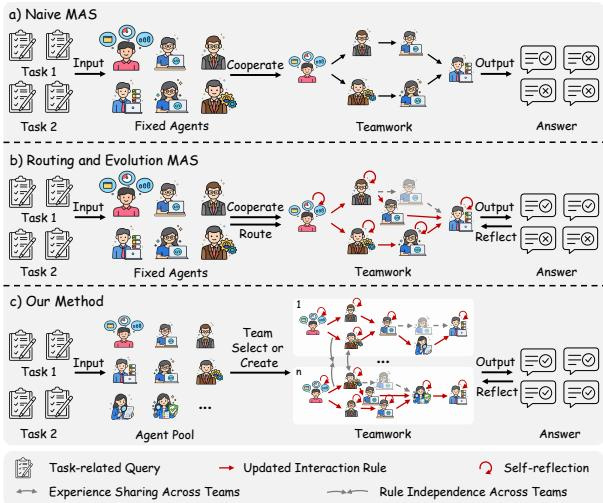  
Figure 1: Three paradigms of MAS.

Despite recent advances, existing approaches face two critical limitations in collaboration evolution. (i) Constrained team reorganization. Existing approaches often adjust agent membership and responsibilities within a shared team, limiting their ability to maintain distinct collaboration patterns for tasks with different requirements. (ii) Inappropriate reuse of collaboration experience. Interaction rules learned from previous tasks are often tied to specific agent responsibilities and information dependencies. Reusing or updating these rules across incompatible collaboration contexts may introduce unsuitable handoffs or stopping conditions. Our preliminary study in Fig 2 further illustrates these difficulties: continued evolution across heterogeneous tasks can reduce task performance relative to target-only evolution, while representative execution trajectories reveal mismatches in team organization and interaction rule applicability.

In this paper, we propose EVOTEAM, a collaboration-centric evolution framework that jointly evolves team organization, interaction rules, and individual agent skills through execution experience. EVOTEAM organizes collaboration experience around task-appropriate teams, allowing compatible tasks to reuse and refine interaction rules while preserving individual agent skills across teams. Specifically, EVOTEAM consists of three key stages. (i) Adaptive Agent Team Composition maintains a library of agent teams, selecting a compatible team or creating a new one according to task requirements. (ii) Team-Scoped Collaboration coordinates task execution through taskspecific responsibility assignments and applicable team-specific interaction rules, allowing tasks with compatible collaboration requirements to reuse accumulated coordination experience while keeping rule updates independent across teams. (iii) Multi-Level Experience Evolution leverages execution traces and task feedback to refine team organization, update team-specific interaction rules, and improve individual agent skills. While collaboration experience evolves within corresponding teams, individual skills remain reusable across team contexts. Our contributions are summarized as follows:

• We identify interconnected challenges on collaboration-centric multi-agent evolution and propose EVOTEAM, a framework that maintains and evolves reusable teams and their interaction rules while preserving individual agent skills across team contexts.

• EVOTEAM consists three key components that enables team organization and coordination rules to improve jointly through accumulated execution experience.

• We conduct experiments across four benchmarks and six task categories, demonstrating the effectiveness of EVOTEAM under individual-benchmark and mixed-benchmark evolution. Ablation studies, cross-backbone evaluations, and case analyses examine its collaboration mechanisms and experience reuse.

## 2 Preliminary Study

In this section, we investigate whether experience accumulated on previous tasks benefits continued evolution of MAS across heterogeneous tasks. We compare performance across evolution settings and examine how team organization and interactionrule applicability may limit experience reuse.

## 2.1 Cross-Task Performance Degradation

In our preliminary experiments, META-TEAM exhibits lower target-task performance after crosstask evolution than after target-only evolution. To examine this degradation, we evaluate two crosstask (CT) evolution settings. In both settings, the system inherits an evolved MAS and continues its evolution on the target training tasks. We use target-only META-TEAM as the primary reference and Vanilla MAS as a non-evolutionary reference. Inter-CT starts from another benchmark with an unsuitable team template, whereas Intra-CT starts from another task category within the same benchmark with a compatible team template. As shown in Figure 2a, both settings underperform targetonly META-TEAM on all three metrics. These results suggest that prior experience does not necessarily benefit continued evolution, even when a compatible team template is retained.

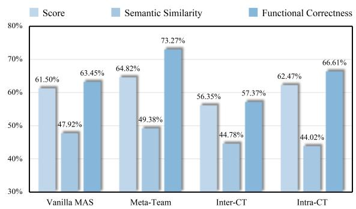  
(a) Target-task performance of Vanilla MAS, target-only META-TEAM, and two CT settings.

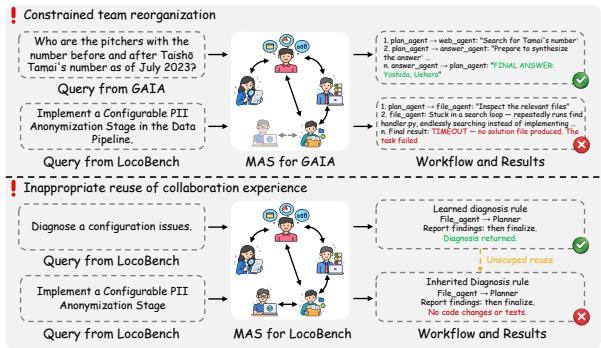  
(b) Representative failure modes of ineffective collaboration experience reuse across heterogeneous tasks.  
Figure 2: Preliminary study: experience reuse in MAS. (a) Cross-task training underperforms target-only training on target tasks. (b) Trajectories show how inflexible templates and unclear rule scopes hinder reuse.

## 2.2 Analysis of Potential Failure Modes

Figure 2b illustrates two potential sources of the observed degradation. (i) Constrained team reorganization. A source-oriented team template may not support the division of labor required by the target tasks. The GAIA-oriented team coordinates web retrieval and answer synthesis but fails to establish an effective implementation and testing process for the LocoBench PII-anonymization task. (ii) Inappropriate reuse of interaction rules. Even with a suitable team template, inherited interaction rules may prescribe inappropriate handoffs or stopping conditions. In the lower panel, a diagnosis-oriented rule directs the file agent to report its findings to the planner and finalize the answer. If this rule persists during adaptation to an implementation task, the system may terminate before coding and testing.

## 2.3 Discussion

Our preliminary study suggests that retaining prior experience alone is insufficient for effective MAS evolution across heterogeneous tasks. Although accumulated agent skills may remain useful across team contexts, reusing the original team template and interaction rules without accounting for new task requirements can constrain subsequent evolution. (i) Team adaptation should maintain distinct collaboration structures. Selecting or creating task-appropriate teams enables reorganization to meet changing collaboration requirements. (ii) Interaction rules should be shared and refined only among tasks with compatible collaboration requirements. A clear reuse scope helps prevent rule updates for one task type from disrupting the coordination required by others. Guided by these principles, we develop EVOTEAM to support the accumulation and selective reuse of collaboration experience across heterogeneous tasks.

## 3 The Framework of EVOTEAM

Our preliminary study indicates that experience reuse across heterogeneous tasks requires flexible team formation and selective reuse of interaction rules. Motivated by these requirements, we develop EVOTEAM, a framework that selects or creates taskappropriate agent teams to reorganize agents and evolves interaction rules within each team. Figure 3 summarizes its three stages per task. (i) Adaptive Agent Team Composition: EVOTEAM selects or creates a task-appropriate agent team and recruits agents from its candidate roster. (ii) Team-Scoped Collaboration: Agents use accumulated skills to complete subtasks and consult the selected agent team’s interaction rules. (iii) Multi-Level Experience Evolution: Execution evidence refines agent teams, updates team-specific interaction rules, and evolves agent skills for reuse across agent teams.

## 3.1 Adaptive Agent Team Composition

A fixed team can constrain agent reorganization when task requirements vary. To decouple agent capabilities from team organization, EVOTEAM maintains a global agent pool $\mathcal { A } = \{ a _ { 1 } , . . . , a _ { N } \}$ and a library of reusable agent teams $\mathcal { T } = \{ T _ { 1 } , \dots , T _ { M } \}$ An agent team $T = \langle d _ { T } , \mathcal { C } _ { T } \rangle$ represents a reusable team organization, where $d _ { T }$ describes the collaboration requirements it supports and $\mathcal { C } _ { T } \subseteq A$ specifies its candidate agent roster. For each task, an execution team is recruited from this roster according to the task’s functional requirements.

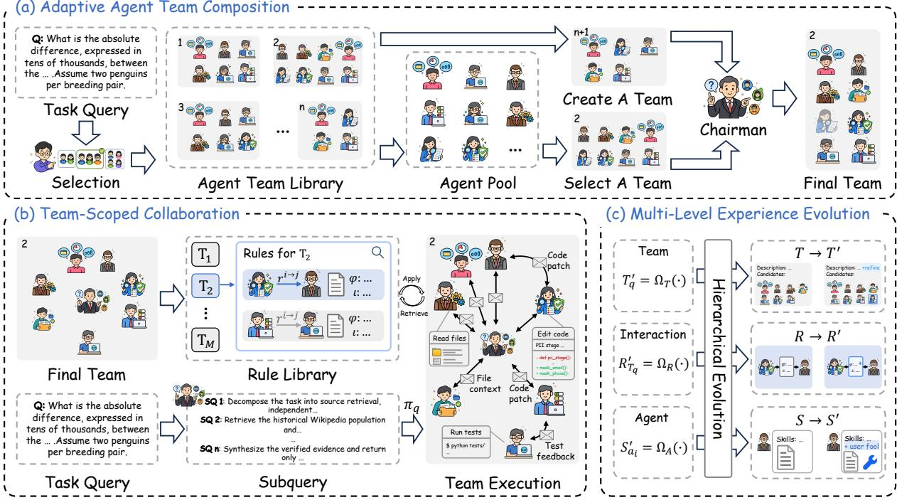  
Figure 3: The overall framework of EVOTEAM. (a) Adaptive Agent Team Composition. The system selects or creates a team, and the Chairman recruits agents from its candidate roster. (b) Team-Scoped Collaboration. Agents execute assigned subtasks using accumulated skills and applicable team-specific rules. (c) Multi-Level Experience Evolution. Reflectors refine teams, team-specific rules, and agent skills using execution traces.

Team Creation. When $\tau = \emptyset$ or no existing agent team satisfies the collaboration requirements of the current query $q ,$ an LLM-based Composer constructs a new provisional agent team from the available agent pool: $\tilde { T } _ { q } = \Phi _ { C } ( q , \mathcal { A } )$ . The provisional team is used for the current task, and its admission to $\tau$ is determined after task completion.

Team Selection. For each agent team $T \in { \mathcal { T } }$ , an LLM-based Team Selector ΦS checks whether $d _ { T }$ covers the collaboration requirements of the current query q and whether $\mathcal { C } _ { T }$ contains agents with the required functional roles. The agent team for query q is selected or created as follows:

$$
T _ { q } = \left\{ \begin{array} { l l } { \Phi _ { S } ( q , T ) , } & { \mathrm { i f } \ \Phi _ { S } ( q , T ) \neq \emptyset , } \\ { \tilde { T } _ { q } , } & { \mathrm { o t h e r w i s e } , } \end{array} \right.\tag{1}
$$

where $\Phi _ { S } ( q , T ) = \emptyset$ indicates that no compatible agent team is available in the library. Tasks can consequently reuse the same agent team when they require an analogous division of work among agents, even if their subject matter differs.

Agent Recruitment. The selected agent team $T _ { q }$ provides a candidate roster $\mathcal { C } _ { T _ { q } }$ suited to the task’s collaboration requirements. Within this roster, an LLM-based Chairman $\Phi _ { \mathrm { C h a i r } }$ recruits the agents for the query q by matching its functional requirements to the candidate agents’ specialized roles:

$$
E _ { q } = \Phi _ { \mathrm { C h a i r } } ( q , T _ { q } ) , \qquad E _ { q } \subseteq \mathcal { C } _ { T _ { q } } ,\tag{2}
$$

where $E _ { q }$ denotes the task-specific execution team. Tasks that reuse the same agent team can recruit different subsets of its candidate roster. This taskspecific recruitment is intended to reduce unnecessary participation, interaction, and token use.

## 3.2 Team-Scoped Collaboration

Interaction rules learned under a different agent team may not align with agents’ current responsibilities and coordination needs, providing ineffective guidance or even hindering task execution. EVOTEAM maintains team-specific interaction rule sets to narrow the scope of reuse. The selected agent team $T _ { q }$ determines the available interaction rule set $\mathcal { R } _ { T _ { q } }$ , while recruited agents assess the applicability of individual rules to their current coordination needs. Each recruited agent $a _ { i } \in E _ { q }$ executes its assigned subtasks using its accumulated skill set $S _ { a _ { i } }$ and consults $\mathcal { R } _ { T _ { q } }$ in its context to guide coordination with other agents.

Intra-Team Planning. Given the query $q ,$ the selected agent team $T _ { q } ,$ and the recruited execution team $E _ { q }$ , the Chairman decomposes the task into a set of subtasks $U _ { q } = \{ u _ { 1 } , \ldots , u _ { m } \}$ and establishes a corresponding subtask assignment plan $\pi _ { q } .$

$$
( U _ { q } , \pi _ { q } ) = \Phi _ { \mathrm { C h a i r } } ( q , T _ { q } , E _ { q } ) ,\tag{3}
$$

where $\pi _ { q } : U _ { q } \to E _ { q }$ assigns each subtask $u \in U _ { q }$ to an agent in $E _ { q }$ . The assignment relies on subtask requirements and agent profiles, which summarize agents’ areas of expertise and reliability. The plan specifies subtask responsibilities for this task without predetermining interaction partners or interaction rules used during collaboration.

Collaborative Team Execution. Guided by $\pi _ { q } ,$ agents execute their assigned subtasks using their accumulated skills and coordinate with peers when additional information or intermediate results are needed. The interaction rule set $\mathcal { R } _ { T _ { q } }$ associated with the selected agent team is injected into their contexts as soft coordination guidance. During coordination, agents select a suitable rule based on both its description and the current coordination requirements to guide interaction and information handoffs between participating agents.

Team Execution Traces. The Chairman monitors subtask progress during task execution and adjusts $\pi _ { q }$ by reassigning subtasks within $E _ { q }$ when the current allocation of responsibilities blocks progress. The system records individual agent traces and an inter-agent handoff trace, which jointly form the composite execution trace:

$$
\tau _ { c } = \left. \{ \tau _ { a _ { i } } \} _ { a _ { i } \in E _ { q } } , \tau _ { t } \right. ,\tag{4}
$$

where $\tau _ { a _ { i } }$ records $\overrightarrow { a _ { i } } \overrightarrow { \mathbf { \Gamma } }$ s reasoning steps, tool outputs, and intermediate artifacts. The handoff trace $\tau _ { t }$ records interaction events, transferred payloads, and interaction rules used for coordination.

## 3.3 Multi-Level Experience Evolution

EVOTEAM distills execution experience into reusable knowledge at the team, interaction, and agent levels. The corresponding reflectors use $\tau _ { c } ,$ $\tau _ { t }$ , and $\tau _ { a _ { i } }$ , respectively. The updates concern agent team descriptions or candidate rosters, interaction rules, and individual agent skills, respectively. Interaction rules remain team-specific, whereas agent skills remain available for reuse across agent teams.

Team-level evolution. The Team Reflector $\Omega _ { T }$ uses the query $q$ and the composite trace $\tau _ { c }$ to assess whether the selected agent team’s candidate roster supports the required division of work:

$$
\begin{array} { r } { T _ { q } ^ { \prime } = \Omega _ { T } ( T _ { q } , \tau _ { c } , q ) , } \end{array}\tag{5}
$$

where $T _ { q } ^ { \prime }$ is the resulting team. When the assessment identifies a need to change the candidate roster, the reflector revises it and updates the agent team’s description accordingly. The revised description specifies the collaboration requirements supported by the updated roster. For a newly created agent team, admission to $\tau$ requires both a candidate roster that supports the required division of work and a reusable collaboration structure.

Interaction-level evolution. The Rule Reflector $\Omega _ { R }$ uses query $q$ and handoff trace $\tau _ { t }$ to update the rule set associated with the selected agent team $T _ { q } \mathrm { : }$

$$
\mathcal { R } _ { T _ { q } } ^ { \prime } = \Omega _ { R } ( \mathcal { R } _ { T _ { q } } , \tau _ { t } , q ) ,\tag{6}
$$

where $\mathcal { R } _ { T _ { q } } ^ { \prime }$ is the revised rule set. The reflector examines interaction events between participating agents, transferred payloads, and the use of interaction rules to identify missing information or mismatches between handoff guidance and the agents’ responsibilities. These observations guide the creation of new interaction rules, the revision of existing rules, or the removal of rules that no longer fit the agent team’s collaboration requirements.

Agent-level evolution. The Agent Reflector $\Omega _ { A }$ analyzes query $q$ and the local trace $\tau _ { a _ { i } }$ of each agent $a _ { i } \in E _ { q }$ to update the agent’s skill set $S _ { a _ { i } }$

$$
S _ { a _ { i } } ^ { \prime } = \Omega _ { A } ( a _ { i } , \tau _ { a _ { i } } , q , S _ { a _ { i } } ) ,\tag{7}
$$

where $S _ { a _ { i } } ^ { \prime }$ is the resulting skill set. The reflector examines the agent’s reasoning steps, tool outputs, and intermediate artifacts for useful procedures or procedural errors. It may add a useful procedure to the skill set or revise an existing skill to address an observed error. It may retain the current set if the local trace offers no clear basis for either change.

After reflection, existing agent teams are updated in $\tau _ { \ast }$ , while new agent teams are added only after admission. Updated rule sets are retained for reuse within their agent teams, while updated skills are retained by the corresponding agents for reuse across agent teams. These updates guide team formation and collaborative execution on subsequent tasks with varying collaboration requirements.The algorithm is provided in the Appendix A.

Table 1: Main results across diverse agent benchmarks under both individual-benchmark and mixed-benchmark evolution. Subscripts show absolute score differences from SA. The best scores within each block are in bold.
<table><tr><td rowspan="2">Method</td><td>GAIA</td><td colspan="2">LoCoBench</td><td>LOCA</td><td colspan="2">BeyondSWE</td><td rowspan="2">Avg.</td></tr><tr><td>Val</td><td>Feat.</td><td>Refact.</td><td>Val</td><td>DepMig.</td><td>CrossR.</td></tr><tr><td colspan="7">Individual-Benchmark Evolution</td></tr><tr><td>SA</td><td>64.00</td><td>55.99</td><td>53.08</td><td>37.50</td><td>34.81</td><td>37.22</td><td>47.10</td></tr><tr><td>MAS</td><td> $7 2 . 0 0 _ { \uparrow 8 . 0 0 }$ </td><td> $6 1 . 7 1 \substack { \uparrow 5 . 7 2 }$ </td><td> $6 1 . 4 9 _ { \uparrow 8 . 4 1 }$ </td><td> $4 9 . 1 7 _ { \uparrow 1 1 . 6 7 }$ </td><td> $2 9 . 7 5 _ { \downarrow 5 . 0 6 }$ </td><td> $3 8 . 3 3 _ { \uparrow 1 . 1 1 }$ </td><td> $5 2 . 0 8 _ { \uparrow 4 . 9 8 }$ </td></tr><tr><td>OWL</td><td> $4 8 . 0 0 _ { \downarrow 1 6 . 0 0 }$ </td><td> $5 1 . 8 0 _ { \downarrow 4 . 1 9 }$ </td><td> $5 0 . 6 4 _ { \downarrow 2 . 4 4 }$ </td><td> $3 9 . 1 7 _ { \uparrow 1 . 6 7 }$ </td><td> $3 3 . 5 4 _ { \downarrow 1 . 2 7 }$ </td><td> $3 9 . 4 4 _ { \uparrow 2 . 2 2 }$ </td><td> $4 3 . 7 7 _ { \downarrow 3 . 3 3 }$ </td></tr><tr><td>AgentSquare</td><td> $4 9 . 3 3 _ { \downarrow 1 4 . 6 7 }$ </td><td> $6 2 . 4 5 _ { \uparrow 6 . 4 6 }$ </td><td> $6 0 . 5 5 _ { \uparrow 7 . 4 7 }$ </td><td> $4 3 . 3 3 _ { \uparrow 5 . 8 3 }$ </td><td> $3 4 . 8 1 \mathrm { ~ - ~ }$ </td><td> $3 5 . 5 6 _ { \downarrow 1 . 6 6 }$ </td><td> $4 7 . 6 7 _ { \uparrow 0 . 5 7 }$ </td></tr><tr><td>Skill-MAS</td><td> $^ { 4 8 . 6 7 } \downarrow 1 5 . 3 3$ </td><td> $6 4 . 3 8 _ { \uparrow 8 . 3 9 }$ </td><td> $6 2 . 5 7 _ { \uparrow 9 . 4 9 }$ </td><td> $5 1 . 2 5 _ { \uparrow 1 3 . 7 5 }$ </td><td> $3 4 . 8 1 -$ </td><td> $3 3 . 3 3 _ { \downarrow 3 . 8 9 }$ </td><td> $4 9 . 1 7 _ { \uparrow 2 . 0 7 }$ </td></tr><tr><td>ReCreate</td><td> $5 6 . 0 0 _ { \perp 8 . 0 0 }$ </td><td> $5 7 . 0 2 _ { \uparrow 1 . 0 3 }$ </td><td> $5 5 . 9 8 _ { \uparrow 2 . 9 0 }$ </td><td> $4 6 . 6 7 _ { \uparrow 9 . 1 7 }$ </td><td> $3 4 . 1 8 _ { \downarrow 0 . 6 3 }$ </td><td> $3 7 . 7 8 _ { \uparrow 0 . 5 6 }$ </td><td> $4 7 . 9 4 _ { \uparrow 0 . 8 4 }$ </td></tr><tr><td>Meta-Team</td><td> $7 3 . 0 0 _ { \uparrow 9 . 0 0 }$ </td><td> $6 4 . 8 2 _ { \uparrow 8 . 8 3 }$ </td><td> $6 4 . 6 3 _ { \uparrow 1 1 . 5 5 }$ </td><td> ${ \bf 6 9 . 5 8 _ { \mathrm { \uparrow 3 2 . 0 8 } } }$ </td><td> $3 6 . 0 8 _ { \uparrow 1 . 2 7 }$ </td><td> $\mathbf { 4 1 . 6 7 } _ { \uparrow 4 . 4 5 }$ </td><td> $5 8 . 3 0 _ { \uparrow 1 1 . 2 0 }$ </td></tr><tr><td>Ours</td><td> $7 8 . 0 0 _ { \uparrow 1 4 . 0 0 }$ </td><td> ${ \bf 6 7 . 3 2 } _ { \uparrow 1 1 . 3 3 }$ </td><td> ${ \bf 6 6 . 2 3 _ { \uparrow 1 3 . 1 5 } }$ </td><td> $6 3 . 7 5 _ { \uparrow 2 6 . 2 5 }$ </td><td> ${ \bf 3 6 . 7 1 } _ { \uparrow 1 . 9 0 }$ </td><td> $4 1 . 1 1 _ { \uparrow 3 . 8 9 }$ </td><td> ${ \bar { 5 } } 8 . 8 { \bar { 5 } } _ { \uparrow 1 1 . 7 5 }$ </td></tr><tr><td colspan="8">Mixed-Benchmark Evolution</td></tr><tr><td>Skill-MAS</td><td> $3 6 . 0 0 _ { \downarrow 2 8 . 0 0 }$ </td><td> $5 6 . 0 1 _ { \uparrow 0 . 0 2 }$ </td><td> $5 7 . 8 3 _ { \uparrow 4 . 7 5 }$ </td><td> $2 9 . 1 7 _ { \downarrow 8 . 3 3 }$ </td><td> $3 5 . 4 4 _ { \uparrow 0 . 6 3 }$ </td><td> $3 3 . 3 3 _ { \downarrow 3 . 8 9 }$ </td><td> $4 1 . 3 0 _ { \downarrow 5 . 8 0 }$ </td></tr><tr><td>ReCreate</td><td> $6 2 . 3 3 _ { \downarrow 1 . 6 7 }$ </td><td> $5 9 . 7 6 _ { \uparrow 3 . 7 7 }$ </td><td> $6 1 . 4 0 _ { \uparrow 8 . 3 2 }$ </td><td> $4 0 . 8 3 _ { \uparrow 3 . 3 3 }$ </td><td> $3 6 . 0 8 _ { \uparrow 1 . 2 7 }$ </td><td> $3 6 . 1 1 _ { \downarrow 1 . 1 1 }$ </td><td> $4 9 . 4 2 _ { \uparrow 2 . 3 2 }$ </td></tr><tr><td>Meta-Team</td><td> $6 7 . 0 0 _ { \uparrow 3 . 0 0 }$ </td><td> $6 4 . 9 0 _ { \uparrow 8 . 9 1 }$ </td><td> $6 4 . 5 2 _ { \uparrow 1 1 . 4 4 }$ </td><td> $5 8 . 3 3 _ { \uparrow 2 0 . 8 3 }$ </td><td> $3 7 . 9 7 _ { \uparrow 3 . 1 6 }$ </td><td> $4 0 . 5 6 _ { \uparrow 3 . 3 4 }$ </td><td> $5 5 . 5 5 _ { \uparrow 8 . 4 5 }$ </td></tr><tr><td>Ours</td><td> $7 7 . 0 0 _ { \uparrow 1 3 . 0 0 }$ </td><td> ${ \bf 6 5 . 5 5 _ { \mathrm { \uparrow 9 . 5 6 } } }$ </td><td> $\mathbf { 6 5 . 6 5 } _ { \uparrow 1 2 . 5 7 }$ </td><td> ${ \bf 6 7 . 0 8 } _ { \uparrow 2 9 . 5 8 }$ </td><td> $\mathbf { 4 0 . 5 1 } _ { \uparrow 5 . 7 0 }$ </td><td> $\mathbf { 4 1 . 6 7 } _ { \uparrow 4 . 4 5 }$ </td><td> ${ \bf 5 9 . 5 8 _ { \mathrm { \uparrow 1 2 . 4 8 } } }$ </td></tr></table>

## 4 Experiments

In this section, we conduct experiments to answer four questions: Q1 (Overall Effectiveness): How does EVOTEAM perform against existing MAS methods across benchmarks under individualbenchmark and mixed-benchmark evolution? Q2 (Cross-Backbone Transfer): Do evolved teams and interaction rules remain beneficial when evolution and evaluation LLMs differ? Q3 (Ablation Study): How do team organization and interaction rules affect EVOTEAM’s performance? Q4 (Cost Efficiency): How does EVOTEAM compare with existing MAS methods in performance and cost?

## 4.1 Experimental Setup

Benchmarks. We use GAIA (Mialon et al., 2024) (multi-step web-based reasoning and retrieval), Lo-CoBench (Qiu et al., 2025) (long-context code implementation and cross-file refactoring), LOCA-Bench (Zeng et al., 2026) (stateful application interaction via MCP), and BeyondSWE (Chen et al., 2026) (repository-level software maintenance). Implementation details are in Appendix B.1.

MAS, and OWL (Hu et al., 2025a); performancedriven search via AgentSquare (Shang et al., 2025); and experience-driven ReCreate (Hao et al., 2026b), Meta-Team (Hao et al., 2026c), and Skill-MAS (Lin et al., 2026). Baseline details are provided in Appendix B.3.

Evolution and Evaluation Setup. Individualbenchmark evolution optimizes AgentSquare, the experience-driven baselines, and EVOTEAM on each benchmark/subset’s evolution split; SA, MAS, and OWL run without prior evolution. Mixedbenchmark evolution uses a shuffled interleaved sequence combining all four evolution splits for the experience-driven baselines and EVOTEAM, each using a consistent configuration. Evaluation uses disjoint held-out splits. By default, all experiments use GPT-5.6-Luna (OpenAI, 2026); avg@3 averages three independent rollout scores per test instance. Detailed data partitions and evolution protocols are provided in Appendix B.4.

Evaluation Metrics. We report GAIA answer accuracy, LOCA-Bench final-state success, BeyondSWE resolution rate (required tests pass without regressions), and LoCoBench Score (LCBS; functional correctness and software quality) on a common [0, 100] scale. Detailed metric definitions are provided in Appendix B.2.

Baselines. Baselines include hand-crafted SA (ReAct) (Yao et al., 2023), non-evolutionary

## 4.2 Overall Effectiveness (Q1)

Obs. 1. EVOTEAM achieves strong performance across benchmarks with different task requirements. Under individual-benchmark evolution, EVOTEAM achieves the highest average score of 58.85 and leads on four of the six evaluation metrics. Its advantage over Meta-Team, the strongest competing method by average score, spans GAIA, both LoCoBench tasks, and BeyondSWE DepMig. The margin reaches five points (78.00 versus 73.00) on GAIA. EVOTEAM also outperforms the MAS baseline on every metric. The breadth of these gains shows that the framework is effective across different collaboration requirements, highlighting the value of task-conditioned team and the interaction experience retained within them.

Table 2: Same-backbone and cross-backbone evaluation. DeepSeek and GPT denote DeepSeek-V4.1-Flash and GPT-5.6-Luna, respectively. Arrows indicate the evolution-to-evaluation direction. Bold indicates the better score.
<table><tr><td rowspan="2">Evolution → Evaluation</td><td colspan="3">GAIA</td><td colspan="3">LoCoBench Feat</td><td colspan="3">LoCoBench Refact</td></tr><tr><td>MAS</td><td>Ours</td><td>Δ</td><td>MAS</td><td>Ours</td><td>Δ</td><td>MAS</td><td>Ours</td><td>Δ</td></tr><tr><td>Same-Backbone Evaluation</td><td></td><td></td><td></td><td></td><td></td><td></td><td></td><td></td><td></td></tr><tr><td>DeepSeek → DeepSeek</td><td>58.00</td><td>80.00</td><td>+22.00</td><td>66.32</td><td>68.93</td><td>+2.61</td><td>65.15</td><td>68.16</td><td>+3.01</td></tr><tr><td>GPT → GPT</td><td>72.00</td><td>78.00</td><td>+6.00</td><td>61.71</td><td>67.32</td><td>+5.61</td><td>61.49</td><td>66.23</td><td>+4.74</td></tr><tr><td>Cross-Backbone Evaluation</td><td></td><td></td><td></td><td></td><td></td><td></td><td></td><td></td><td></td></tr><tr><td>DeepSeek → GPT</td><td>72.00</td><td>77.00</td><td>+5.00</td><td>61.71</td><td>65.28</td><td>+3.57</td><td>61.49</td><td>66.15</td><td>+4.66</td></tr><tr><td>GPT → DeepSeek</td><td>58.00</td><td>76.00</td><td>+18.00</td><td>66.32</td><td>68.30</td><td>+1.98</td><td>65.15</td><td>67.35</td><td>+2.20</td></tr></table>

Obs. 2. EVOTEAM sustains its advantage when evolution combines heterogeneous benchmarks. Under the mixed-benchmark, EVOTEAM ranks first on all six metrics and achieves an average score of 59.58, surpassing Meta-Team by 4.03 points. Its lead is clear on GAIA and LOCA, while extending across the evaluation suite. EVOTEAM’s average score improves under the mixed-benchmark evolution relative to its individual-benchmark result. Meta-Team’s average score declines under the same comparison. These results demonstrate EVOTEAM’s advantage in reusing collaboration experience across the heterogeneous tasks with the different coordination requirements.

## 4.3 Cross-Backbone Transfer (Q2)

To address Q2, we examine whether EVOTEAM’s evolved team and interaction rules can be reused across LLM backbones. We use DeepSeek-V4.1- Flash and GPT-5.6-Luna as the evolution and evaluation LLMs, and evaluate GAIA and the two Lo-CoBench tasks. For each configuration, we compare EVOTEAM with the unevolved MAS baseline using the same evaluation LLM. Table 2 reports the same- and cross-backbone evaluation results. We summarize two observations below.

Obs. 3. Evolved collaboration transfers across backbones in both directions. When evolution and evaluation use different LLMs, EVOTEAM consistently outperforms MAS in all six configurations. On GAIA, both backbones benefit from artifacts evolved by the other model. The gains reach 5.00 and 18.00 points for GPT-5.6-Luna and DeepSeek-V4.1-Flash respectively. Both LoCoBench tasks also improve in each transfer direction, showing that the effect extends across task settings. These bidirectional gains demonstrate that the collaboration experience accumulated through EVOTEAM’s team-indexed evolution transfers effectively between the two evaluated LLM backbones.

Obs. 4. Cross-backbone transfer retains performance close to the same-backbone setting. For each evaluation task, we hold the evaluation LLM fixed and vary only the LLM used to evolve the collaboration artifacts. Across all six paired comparisons, cross-backbone performance remains within 4.00 points of the corresponding same-backbone performance. On GAIA, cross-backbone transfer achieves 77.00 with GPT-5.6-Luna, compared with 78.00 under same-backbone evolution. The two LoCoBench tasks also show similarly small performance gaps for both evaluation backbones. This observed stability highlights EVOTEAM’s robustness to changes in the evolution LLM and shows that its team-indexed collaboration experience remains effective across different backbone configurations.

## 4.4 Ablation Study (Q3)

To address Q3, we compare the full EVOTEAM with two variants: one removes learned interaction rules while retaining task-conditioned team, and other removes both components. Figure 4 reports their performance on four tasks. We summarize two observations below. The complete ablation results are provided in the Appendix C.1.

Obs. 5. Learned interaction rules strengthen collaboration within team. Across all four tasks, the full EVOTEAM outperforms the variant that retains templates but removes interaction rules. The largest gains appear on GAIA and LOCA, where the rules add 10.00 and 8.75 points. The resulting performance gap supports the importance of retaining experience about how agents work together across successive task executions, beyond determining which agents participate. The smaller gains on the coding tasks indicate that the contribution of this guidance varies across tasks.

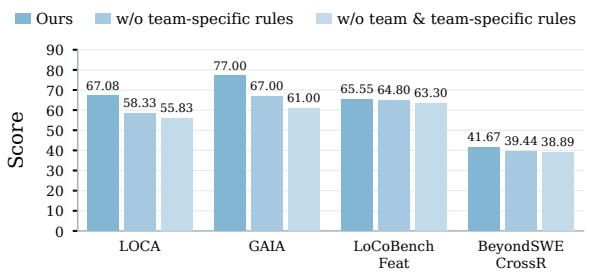  
Figure 4: Detailed component ablation results on four tasks under mixed-benchmark evolution.

Obs. 6. Task-conditioned teams provide gains even without interaction rules. When interaction rules are absent from both variants, retaining templates improves performance on every task. The largest gains appear on GAIA and LOCA, reaching 6.00 and 2.50 points respectively. LoCoBench Feat and BeyondSWE also improve, extending this benefit to coding tasks. Because neither variant uses learned interaction rules, this comparison highlights the value of task-conditioned team organization. EVOTEAM’s reusable team library supports selecting or creating a team structure suited to each specific task. Together, the two ablations show the value of combining adaptable team structures with accumulated coordination experience.

## 4.5 Cost Efficiency (Q4)

To address Q4, we compare EVOTEAM with three MAS baselines in terms of task performance and cost per task under Mixed-Benchmark. Figure 5 presents the corresponding results on GAIA and BeyondSWE DepMig. We summarize one main observation below. The cost comparison for Individual-Benchmark is provided in the Appendix C.2.

Obs. 7. EVOTEAM achieves the strongest performance at competitive cost. On both evaluated tasks, EVOTEAM achieves the highest score while costing less per task than Meta-Team and ReCreate. Skill-MAS has lower cost but also lower overall performance on both tasks. These direct comparisons place EVOTEAM in a favorable position on the performance–cost frontier. The result further highlights the practical value of its team-scoped collaboration: evolved team structures and learned interaction rules improve task outcomes while keeping average per-task cost competitive.

## 5 Related Work

Individual Agent Evolution. Experience-driven approaches improve agent capabilities through scaffold revision, skill acquisition, and cross-task experience retrieval (Hao et al., 2026b; Zheng et al., 2025; Li et al., 2025). By retaining reusable knowledge from previous task executions, agents progressively improve their reasoning and tool use. However, individual improvement does not necessarily resolve problems in responsibility assignment and information exchange during collaboration.

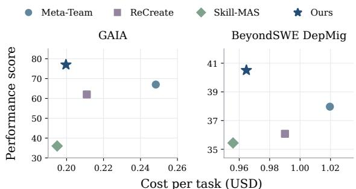  
Figure 5: Cost–performance on BeyondSWE DepMig and GAIA (mixed-benchmark evolution).

Collaborative Multi-Agent Evolution. Meta-Team uses collective execution experience to evolve agent behaviors, inter-agent coordination, and team organization (Hao et al., 2026c). Skill-MAS refines orchestration knowledge through rollout and reflection, while EMAS validates prompt and topology revisions using execution evidence (Lin et al., 2026; Fei et al., 2026). Our work focuses on sustaining collaboration evolution across heterogeneous tasks. EVOTEAM maintains and evolves reusable teams with separate interaction rules, allowing coordination experience to accumulate within compatible team contexts while individual skills remain reusable across teams. Further details are provided in Appendix F.

## 6 Conclusion

In this work, we presented EVOTEAM, a framework for continual collaboration evolution across heterogeneous tasks. It maintains a library of reusable teams and jointly evolves their organization, team-specific interaction rules, and individual agent skills, accumulating coordination experience within compatible team contexts while preserving skill reuse across teams. Across four benchmarks and six task categories, EVOTEAM leads all six metrics under mixed-benchmark evolution, averaging 59.58 versus 55.55 for the strongest baseline. Cross-backbone evaluations and ablations further support the transferability of evolved collaboration experience and the value of jointly evolving team organization and coordination practices.

## Limitations

Our evaluation does not systematically examine collaborative evolution in multimodal interactive environments. In such settings, agents need to interpret visual observations, communicate relevant evidence, and coordinate actions as the environment changes. Further investigation is needed into how multimodal execution traces can guide the refinement of team organization, interaction rules, and agent skills. Future work could extend EVOTEAM to these settings and evaluate how accumulated collaboration experience supports tasks involving visual perception and interaction. Additionally, EVOTEAM accumulates experience through explicit updates while keeping the LLM parameters fixed. The effective use of this experience depends on the base model’s ability to correctly interpret and apply the stored guidance. Combining experience reuse with model adaptation could help internalize frequently useful coordination practices.

## Ethical Considerations

EVOTEAM aims to improve multi-agent collaboration through reusable teams and accumulated execution experience. Like other LLM-based agent systems, it may inherit biases from underlying models and produce inaccurate outputs or unintended tool actions. Persistent experience accumulation also requires attention to sensitive information retained in execution traces and reusable knowledge. Applications beyond the evaluated benchmarks should therefore incorporate appropriate access controls, privacy protection, and human oversight for consequential actions. Accumulated interaction rules and agent skills should be reviewed for their suitability before reuse in new contexts. The use of underlying models, datasets, and tools should respect their respective licenses and usage policies.

## References

Anthropic. 2024. Building effective agents. https: //www.anthropic.com/engineering/building -effective-agents. Engineering article. Accessed: 2026-10-13.

Anthropic. 2025a. Effective context engineering for AI agents. https://www.anthropic.com/engineer ing/effective-context-engineering-for-a i-agents. Engineering article. Accessed: 2026-10- 13.

Anthropic. 2025b. Equipping agents for the real world with Agent Skills. https://www.anthropic.co

m/engineering/equipping-agents-for-the-r eal-world-with-agent-skills. Engineering article. Accessed: 2026-10-13.

Anthropic. 2025c. How we built our multi-agent research system. https://www.anthropic.com/ engineering/multi-agent-research-system. Engineering article. Accessed: 2026-10-13.

Mert Cemri, Melissa Z. Pan, Shuyi Yang, Lakshya A. Agrawal, Bhavya Chopra, Rishabh Tiwari, Kurt Keutzer, Aditya Parameswaran, Dan Klein, Kannan Ramchandran, Matei Zaharia, Joseph E. Gonzalez, and Ion Stoica. 2025. Why do multi-agent llm systems fail? Preprint, arXiv:2503.13657.

Guoxin Chen, Fanzhe Meng, Jiale Zhao, Minghao Li, Daixuan Cheng, Huatong Song, Jie Chen, Yuzhi Lin, Hui Chen, Xin Zhao, Ruihua Song, Chang Liu, Cheng Chen, Kai Jia, and Ji-Rong Wen. 2026. Beyondswe: Can current code agent survive beyond single-repo bug fixing? Preprint, arXiv:2603.03194.

Weize Chen, Yusheng Su, Jingwei Zuo, Cheng Yang, Chenfei Yuan, Chi-Min Chan, Heyang Yu, Yaxi Lu, Yi-Hsin Hung, Chen Qian, Yujia Qin, Xin Cong, Ruobing Xie, Zhiyuan Liu, Maosong Sun, and Jie Zhou. 2023. Agentverse: Facilitating multiagent collaboration and exploring emergent behaviors. Preprint, arXiv:2308.10848.

Zihao Cheng, Zeming Liu, Yingyu Shan, Xinyi Wang, Xiangrong Zhu, Yunpu Ma, Hongru Wang, Yuhang Guo, Wei Lin, and Yunhong Wang. 2026. Mem2Evolve: Towards self-evolving agents via coevolutionary capability expansion and experience distillation. In Proceedings of the 64th Annual Meeting of the Association for Computational Linguistics (Volume 1: Long Papers), pages 20784–20831, San Diego, California, United States. Association for Computational Linguistics.

Chao Fei, Qingyi Si, Kaihua Liang, Yanghua Xiao, Panos Kalnis, and Hongcheng Guo. 2026. Emas: Stabilizing multi-agent system evolution through evidence-guided revision. Preprint, arXiv:2608.07196.

Yuyuan Feng, Zhishang Xiang, Chaobin Yang, Qichao Ma, Zerui Chen, Yujing Zhang, Ke Huang, Chuanjie Wu, Zhaoxu Liu, Yili Wang, et al. 2026. Graph engineering in the era of llm agents: From individual intelligence to system intelligence. arXiv preprint arXiv:2608.21156.

Hongcheng Gao, Yue Liu, Yufei He, Longxu Dou, Chao Du, Zhijie Deng, Bryan Hooi, Min Lin, and Tianyu Pang. 2025. Flowreasoner: Reinforcing query-level meta-agents. Preprint, arXiv:2504.15257.

Taicheng Guo, Xiuying Chen, Yaqi Wang, Ruidi Chang, Shichao Pei, Nitesh V Chawla, Olaf Wiest, and Xiangliang Zhang. 2024. Large language model based multi-agents: A survey of progress and challenges. arXiv preprint arXiv:2402.01680.

Guangya Hao, Yunbo Long, and Zhuokai Zhao. 2026a. Self-Evolving Multi-Agent Systems via Decentralized Memory. Preprint, arXiv:2605.22721.

Zhezheng Hao, Hong Wang, Jian Luo, Jianqing Zhang, Yuyan Zhou, Qiang Lin, Can Wang, Hande Dong, and Jiawei Chen. 2026b. Recreate: Reasoning and creating domain agents driven by experience. Preprint, arXiv:2601.11100.

Zhezheng Hao, Tianfu Wang, Huanshuo Dong, Ziyan Liu, Hong Wang, Xiankun Lin, Qiang Lin, Can Wang, Hande Dong, and Jiawei Chen. 2026c. Evolve as a team: Collaborative self-evolution for llm-based multi-agent systems. Preprint, arXiv:2605.29790.

Sirui Hong, Mingchen Zhuge, Jiaqi Chen, Xiawu Zheng, Yuheng Cheng, Ceyao Zhang, Jinlin Wang, Zili Wang, Steven Ka Shing Yau, Zijuan Lin, Liyang Zhou, Chenyu Ran, Lingfeng Xiao, Chenglin Wu, and Jürgen Schmidhuber. 2024. Metagpt: Meta programming for a multi-agent collaborative framework. Preprint, arXiv:2308.00352.

Mengkang Hu, Yuhang Zhou, Wendong Fan, Yuzhou Nie, Bowei Xia, Tao Sun, Ziyu Ye, Zhaoxuan Jin, Yingru Li, Qiguang Chen, Zeyu Zhang, Yifeng Wang, Qianshuo Ye, Bernard Ghanem, Ping Luo, and Guohao Li. 2025a. Owl: Optimized workforce learning for general multi-agent assistance in real-world task automation. Preprint, arXiv:2505.23885.

Shengran Hu, Cong Lu, and Jeff Clune. 2025b. Automated design of agentic systems. Preprint, arXiv:2408.08435.

Yue Hu, Yuzhu Cai, Yaxin Du, Xinyu Zhu, Xiangrui Liu, Zijie Yu, Yuchen Hou, Shuo Tang, and Siheng Chen. 2025c. Self-Evolving Multi-Agent Collaboration Networks for Software Development. In International Conference on Learning Representations.

Yubin Kim, Ken Gu, Chanwoo Park, Chunjong Park, Samuel Schmidgall, A. Ali Heydari, Yao Yan, Zhihan Zhang, Yuchen Zhuang, Yun Liu, Mark Malhotra, Paul Pu Liang, Hae Won Park, Yuzhe Yang, Xuhai Xu, Yilun Du, Shwetak Patel, Tim Althoff, Daniel McDuff, and Xin Liu. 2026. Towards a science of scaling agent systems. Preprint, arXiv:2512.08296.

Yilong Li, Chen Qian, Yu Xia, Ruijie Shi, Yufan Dang, Zihao Xie, Ziming You, Weize Chen, Cheng Yang, Weichuan Liu, Ye Tian, Xuantang Xiong, Lei Han, Zhiyuan Liu, and Maosong Sun. 2025. Cross-task experiential learning on llm-based multi-agent collaboration. Preprint, arXiv:2505.23187.

Jinhao Liang, Yanjun Li, Guodong Yin, Liwei Xu, Yanbo Lu, Jiwei Feng, Tong Shen, and Guoshun Cai. 2022. A mas-based hierarchical architecture for the cooperation control of connected and automated vehicles. IEEE Transactions on Vehicular Technology, 72(2):1559–1573.

Hehai Lin, Qi Yang, and Chengwei Qin. 2026. Skillmas: Evolving meta-skill for automatic multi-agent systems. Preprint, arXiv:2606.18837.

Guangyi Liu, Haojun Lin, Huan Zeng, Heng Wang, and Quanming Yao. 2026. Mas-on-the-fly: In-context structural adaptation of llm-based multi-agent systems. Preprint, arXiv:2602.13671.

Zijun Liu, Yanzhe Zhang, Peng Li, Yang Liu, and Diyi Yang. 2024. A dynamic llm-powered agent network for task-oriented agent collaboration. Preprint, arXiv:2310.02170.

Aman Madaan, Niket Tandon, Prakhar Gupta, Skyler Hallinan, Luyu Gao, Sarah Wiegreffe, Uri Alon, Nouha Dziri, Shrimai Prabhumoye, Yiming Yang, Shashank Gupta, Bodhisattwa Prasad Majumder, Katherine Hermann, Sean Welleck, Amir Yazdanbakhsh, and Peter Clark. 2023. Self-refine: Iterative refinement with self-feedback. Preprint, arXiv:2303.17651.

Grégoire Mialon, Clémentine Fourrier, Thomas Wolf, Yann LeCun, and Thomas Scialom. 2024. Gaia: a benchmark for general ai assistants. In International Conference on Learning Representations, volume 2024, pages 9025–9049.

OpenAI. 2026. GPT-5.6 system card. Technical report, OpenAI. Accessed: 2026-10-06.

Shuai Pan, Yixiang Liu, Jiaye Gao, Te Gao, Weiwen Liu, Jianghao Lin, Zhihui Fu, Jun Wang, Weinan Zhang, and Yong Yu. 2026. Skillmas: Skill co-evolution with llm-based multi-agent system. Preprint, arXiv:2605.09341.

Chen Qian, Wei Liu, Hongzhang Liu, Nuo Chen, Yufan Dang, Jiahao Li, Cheng Yang, Weize Chen, Yusheng Su, Xin Cong, Juyuan Xu, Dahai Li, Zhiyuan Liu, and Maosong Sun. 2024. ChatDev: Communicative agents for software development. In Proceedings of the 62nd Annual Meeting of the Association for Computational Linguistics (Volume 1: Long Papers), pages 15174–15186, Bangkok, Thailand. Association for Computational Linguistics.

Chen Qian, Zihao Xie, YiFei Wang, Wei Liu, Kunlun Zhu, Hanchen Xia, Yufan Dang, Zhuoyun Du, Weize Chen, Cheng Yang, Zhiyuan Liu, and Maosong Sun. 2025. Scaling large language model-based multiagent collaboration. Preprint, arXiv:2406.07155.

Jielin Qiu, Zuxin Liu, Zhiwei Liu, Rithesh Murthy, Jianguo Zhang, Haolin Chen, Shiyu Wang, Ming Zhu, Liangwei Yang, Juntao Tan, Zhepeng Cen, Cheng Qian, Shelby Heinecke, Weiran Yao, Silvio Savarese, Caiming Xiong, and Huan Wang. 2025. Locobench: A benchmark for long-context large language models in complex software engineering. Preprint, arXiv:2509.09614.

Jianhao Ruan, Zhihao Xu, Yiran Peng, Fashen Ren, Zhaoyang Yu, Xinbing Liang, Jinyu Xiang, Yongru Chen, Bang Liu, Chenglin Wu, Yuyu Luo, and Jiayi Zhang. 2026. Aorchestra: Automating subagent creation for agentic orchestration. Preprint, arXiv:2602.03786.

Yu Shang, Yu Li, Keyu Zhao, Likai Ma, Jiahe Liu, Fengli Xu, and Yong Li. 2025. Agentsquare: Automatic llm agent search in modular design space. Preprint, arXiv:2410.06153.

Noah Shinn, Federico Cassano, Edward Berman, Ashwin Gopinath, Karthik Narasimhan, and Shunyu Yao. 2023. Reflexion: Language agents with verbal reinforcement learning. Preprint, arXiv:2303.11366.

Guanzhi Wang, Yuqi Xie, Yunfan Jiang, Ajay Mandlekar, Chaowei Xiao, Yuke Zhu, Linxi Fan, and Anima Anandkumar. 2023. Voyager: An openended embodied agent with large language models. Preprint, arXiv:2305.16291.

Yinjie Wang, Ling Yang, Guohao Li, Mengdi Wang, and Bryon Aragam. 2025a. Scoreflow: Mastering llm agent workflows via score-based preference optimization. Preprint, arXiv:2502.04306.

Zhexuan Wang, Yutong Wang, Xuebo Liu, Liang Ding, Miao Zhang, Jie Liu, and Min Zhang. 2025b. Agent-Dropout: Dynamic agent elimination for tokenefficient and high-performance LLM-based multiagent collaboration. In Proceedings of the 63rd Annual Meeting of the Association for Computational Linguistics (Volume 1: Long Papers), pages 24013– 24035, Vienna, Austria. Association for Computational Linguistics.

Qingyun Wu, Gagan Bansal, Jieyu Zhang, Yiran Wu, Beibin Li, Erkang Zhu, Li Jiang, Xiaoyun Zhang, Shaokun Zhang, Jiale Liu, Ahmed Hassan Awadallah, Ryen W White, Doug Burger, and Chi Wang. 2023. Autogen: Enabling next-gen llm applications via multi-agent conversation. Preprint, arXiv:2308.08155.

Mao xun Huang, Jerry Wang, Yi-Cheng Lai, Zhengxin Zhang, Claire Cardie, and Hen-Hsen Huang. 2026. Manta: Multi-agent network topology adaptation for self-evolving multi-agent systems. Preprint, arXiv:2607.28527.

Yingxuan Yang, Huacan Chai, Shuai Shao, Yuanyi Song, Siyuan Qi, Renting Rui, and Weinan Zhang. 2025. Agentnet: Decentralized evolutionary coordination for llm-based multi-agent systems. Preprint, arXiv:2504.00587.

Shunyu Yao, Jeffrey Zhao, Dian Yu, Nan Du, Izhak Shafran, Karthik Narasimhan, and Yuan Cao. 2023. React: Synergizing reasoning and acting in language models. Preprint, arXiv:2210.03629.

Siyu Yuan, Kaitao Song, Jiangjie Chen, Xu Tan, Dongsheng Li, and Deqing Yang. 2025. Evoagent: Towards automatic multi-agent generation via evolutionary algorithms. Preprint, arXiv:2406.14228.

Yanwei Yue, Guibin Zhang, Boyang Liu, Guancheng Wan, Kun Wang, Dawei Cheng, and Yiyan Qi. 2025. Masrouter: Learning to route llms for multi-agent systems. In Proceedings of the 63rd Annual Meeting ofthe Associationfor Computational Linguistics (Volume 1: Long Papers), pages 15549–15572.

Weihao Zeng, Yuzhen Huang, and Junxian He. 2026. Loca-bench: Benchmarking language agents under controllable and extreme context growth. arXiv preprint arXiv:2602.07962.

Guibin Zhang, Kaijie Chen, Guancheng Wan, Heng Chang, Hong Cheng, Kun Wang, Shuyue Hu, and Lei Bai. 2025a. EvoFlow: Evolving Diverse Agentic Workflows On The Fly. Preprint, arXiv:2502.07373.

Guibin Zhang, Luyang Niu, Junfeng Fang, Kun Wang, Lei Bai, and Xiang Wang. 2025b. Multi-agent architecture search via agentic supernet. In Proceedings of the 42nd International Conference on Machine Learning, volume 267 of Proceedings of Machine Learning Research, pages 75834–75852. PMLR.

Jiayi Zhang, Jinyu Xiang, Zhaoyang Yu, Fengwei Teng, Xionghui Chen, Jiaqi Chen, Mingchen Zhuge, Xin Cheng, Sirui Hong, Jinlin Wang, Bingnan Zheng, Bang Liu, Yuyu Luo, and Chenglin Wu. 2025c. Aflow: Automating agentic workflow generation. Preprint, arXiv:2410.10762.

Qizheng Zhang, Changran Hu, Shubhangi Upasani, Boyuan Ma, Fenglu Hong, Vamsidhar Kamanuru, Jay Rainton, Chen Wu, Mengmeng Ji, Hanchen Li, Urmish Thakker, James Zou, and Kunle Olukotun. 2026. Agentic Context Engineering: Evolving Contexts for Self-Improving Language Models. In International Conference on Learning Representations.

Andrew Zhao, Daniel Huang, Quentin Xu, Matthieu Lin, Yong-Jin Liu, and Gao Huang. 2024. Expel: Llm agents are experiential learners. Preprint, arXiv:2308.10144.

Boyuan Zheng, Michael Y. Fatemi, Xiaolong Jin, Zora Zhiruo Wang, Apurva Gandhi, Yueqi Song, Yu Gu, Jayanth Srinivasa, Gaowen Liu, Graham Neubig, and Yu Su. 2025. Skillweaver: Web agents can self-improve by discovering and honing skills. Preprint, arXiv:2504.07079.

Han Zhou, Xingchen Wan, Ruoxi Sun, Hamid Palangi, Shariq Iqbal, Ivan Vulic, Anna Korhonen, and Ser- ´ can Ö. Arık. 2026. Multi-agent design: Optimizing agents with better prompts and topologies. Preprint, arXiv:2502.02533.

Wangchunshu Zhou, Yixin Ou, Shengwei Ding, Long Li, Jialong Wu, Tiannan Wang, Jiamin Chen, Shuai Wang, Xiaohua Xu, Ningyu Zhang, Huajun Chen, and Yuchen Eleanor Jiang. 2024. Symbolic learning enables self-evolving agents. Preprint, arXiv:2406.18532.

Mingchen Zhuge, Wenyi Wang, Louis Kirsch, Francesco Faccio, Dmitrii Khizbullin, and Jürgen Schmidhuber. 2024. GPTSwarm: Language agents as optimizable graphs. In Proceedings of the 41st International Conference on Machine Learning, volume 235 of Proceedings of Machine Learning Research, pages 62743–62767. PMLR.

## A Algorithms

Algorithm 1 summarizes the sequential evolution procedure of EVOTEAM, following the notation in Section 3. The framework maintains a global agent pool A, a library of reusable agent teams $\tau$ , and team-specific interaction-rule sets $\{ { \mathcal { R } } _ { T } \} _ { T \in T }$ . For each evolution query, it selects a compatible agent team or creates a provisional one with an empty rule set. The Chairman recruits an execution team from its candidate roster and assigns subtasks. The selected team’s rules are injected into the recruited agents’ contexts as soft coordination guidance.

EXECUTE includes subtask execution using accumulated agent skills, peer coordination, native task evaluation, and trace collection. Agents select applicable rules according to their descriptions and current coordination requirements. The Chairman monitors progress and adjusts $\pi _ { q }$ by reassigning subtasks within $E _ { q }$ when needed. The resulting composite trace contains individual agent traces and the corresponding inter-agent handoff trace.

After execution, the three reflectors update the agent team, its interaction rules, and individual agent skills. Team reflection revises the candidate roster when needed and updates the team description accordingly. For a provisional team, the same reflection pass determines admission based on whether its roster supports the required division of work and its organization is reusable. Existing teams retain their identities when revised. Rules are retained with their associated teams, while updated skills remain with the corresponding agents regardless of provisional-team admission. After the final query, all persistent updates are frozen for evaluation on the disjoint holdout split.

## B Experimental Details

We describe the benchmarks, data splits, native evaluation metrics, and execution settings used in our experiments. Each setting uses a designated evolution split and a disjoint holdout split. Table 4 summarizes splits and native evaluation protocols.

## B.1 Benchmark Details

Our evaluation covers four task settings: multistep information seeking (GAIA), long-context software development (LoCoBench), tool-based productivity workflows (LOCA-Bench), and repository-level software engineering (BeyondSWE). We use the same subsets and evolution/holdout splits as Meta-Team (Hao et al., 2026c), and additionally combine the four evolution splits together for mixed-benchmark evolution to effectively evaluate a single shared evolving system on the heterogeneous tasks.

Algorithm 1 Sequential Collaborative Team Evo  
lution   
Require: Evolution queries $( q _ { 1 } , \dots , q _ { K } ) ;$ agent pool $\mathcal { A } ;$   
team library $\tau ;$ rule sets $\{ { \mathcal { R } } _ { T } \} _ { T \in { \mathcal { T } } }$   
Ensure: Frozen agent pool, team library, and rule sets   
1: for each q in $\left( q _ { 1 } , \dots , q _ { K } \right)$ do   
2: $T _ { q } \gets \Phi _ { S } ( q , \mathcal { T } )$   
3: $\mathbf { \dot { i } } \mathbf { f } \mathbf { \dot { \nabla } } T _ { q } = \emptyset$ then   
4: $\tilde { T } _ { q } \gets \Phi _ { C } ( q , \mathcal { A } )$   
5: $T _ { q } \gets \tilde { T } _ { q } , \quad \mathcal { R } _ { T _ { q } } \gets \emptyset$   
6: end if   
7: $E _ { q } \gets \Phi _ { \mathrm { C h a i r } } ( q , T _ { q } )$   
8: $( \dot { U _ { q } } , \pi _ { q } ) \gets \dot { \Phi } _ { \mathrm { C h a i r } } \dot { ( \boldsymbol { q } , T _ { q } , E _ { q } ) }$   
9: Inject $\mathcal { R } _ { T _ { q } }$ into agents’ contexts as soft guidance   
10: $\tau _ { c } \gets \mathrm { E X E C U T E } ( q , T _ { q } , E _ { q } , U _ { q } , \pi _ { q } )$   
11: $\left. \{ \tau _ { a _ { i } } \} _ { a _ { i } \in E _ { q } } , \tau _ { t } \right. \gets \tau _ { c }$   
12: $T _ { q _ { . } } ^ { \prime } \gets \Omega _ { T } ( \dot { T } _ { q } , \tau _ { c } , q )$   
13: $\mathcal { R } _ { T _ { q } } ^ { ' }  \Omega _ { R } ( \mathcal { R } _ { T _ { q } } , \tau _ { t } , q )$   
14: for each $a _ { i } \in E _ { q } ^ { \phantom { + } }$ do   
15: $S _ { a _ { i } } ^ { \prime }  \Omega _ { A } ( \dot { a _ { i } } , \tau _ { a _ { i } } , q , S _ { a _ { i } } )$   
16: $S _ { a _ { i } }  S _ { a _ { i } } ^ { \prime }$ {persist in $\mathcal { A } \}$   
17: end for   
18: $\mathbf { i f } T _ { q } \in \mathcal { T }$ then   
19: Revise $T _ { q }$ to $T _ { q } ^ { \prime }$ in $\tau ,$ preserving its identity   
20: Save $\mathcal { R } _ { T _ { q } } ^ { \prime }$ with the revised team   
21: else $\mathbf { i f } T _ { a } ^ { \prime }$ is admitted by $\Omega _ { T }$ then   
22: Add $\check { T } _ { q } ^ { \prime }$ to T   
23: Save $\mathcal { R } _ { T _ { q } } ^ { \prime }$ with the admitted team   
24: end if   
25: end for   
26: Freeze $A , \tau ,$ and $\{ { \mathcal { R } } _ { T } \} _ { T \in { \mathcal { T } } }$   
27: return A, T, and $\{ { \mathcal { R } } _ { T } \} _ { T \in { \mathcal { T } } }$

(i) GAIA. (Mialon et al., 2024) evaluates generalpurpose assistants on real-world questions requiring reasoning, web browsing, tool use, and, for some questions, multimodal understanding. Questions are organized into three difficulty levels and have unambiguous reference answers; some include supplementary files. Following Meta-Team, we use the 120-instance validation subset, with 20 instances for evolution and 100 disjoint instances for holdout evaluation. The evolution split contains $6 , 9 ,$ and 5 instances from Levels 1, 2, and 3, respectively; the holdout split contains 38, 49, and 13 instances. Agents can read and write files, run shell commands, search online, and fetch webpages.

(ii) LoCoBench. (Qiu et al., 2025) evaluates longcontext software development through 8,000 scenarios across 10 programming languages and eight task categories, with contexts of 10K to 1M tokens that require reasoning across multiple files. We use the Python Feature Implementation (FI) and Cross-File Refactoring (CR) categories. FI requires adding functionality to an existing codebase, while CR requires restructuring code across files while preserving its behavior. Each category contains 100 instances in our experiments: 20 for evolution and 80 for disjoint holdout evaluation, with each instance executed in its own isolated workspace.

(iii) LOCA-Bench. (Zeng et al., 2026) evaluates language agents under controllable context growth by scaling environment states while preserving task semantics. The full benchmark contains 15 task types, seven environment-description lengths (8K, 16K, 32K, 64K, 96K, 128K, and 256K), and five environment seeds. Environment-description length measures the tokenized information available through the task environment’s tool outputs; it is distinct from the model’s context-window limit. We select eight task types spanning ecommerce, academic, and education workflows, summarized in Table 3. Evolution uses these eight tasks at 96K with seeds 101 and 102, giving $8 \times 2 = 1 6$ cases. Holdout evaluation uses seeds {42, 123, 456, 789, 2024} at 8K, 16K, 32K, 64K, 128K, and 256K, giving $8 \times 5 \times 6 = 2 4 0$ cases. The evolution and holdout configurations are disjoint in both environment seeds and description lengths, testing cross-seed and cross-scale generalization for the selected task types. Each case runs with isolated local mock MCP services and is scored by the corresponding native environment-state evaluator.

(iv) BeyondSWE. (Chen et al., 2026) evaluates software engineering beyond single-repository bug fixing. Its 500 instances are drawn from 246 real-world GitHub repositories and cover crossrepository issue resolution, domain-specific fixes, dependency migration, and repository generation from specifications. We use the CrossRepo and DepMigrate tracks. CrossRepo requires reasoning with information from related external repositories, while DepMigrate requires repository-wide changes to accommodate breaking dependency updates. Following Meta-Team, we randomly select 20 instances per track for evolution and hold out the rest: CrossRepo has 200 instances (20 evolution, 180 holdout) and DepMigrate has 178 (20 evolution, 158 holdout). Each track is evolved separately and evaluated on its own holdout split. Each instance runs in an isolated repository environment, and submitted changes are evaluated with native Fail-to-Pass (F2P) and Pass-to-Pass (P2P) tests.

(v) Mixed-Benchmark. combines the four source benchmarks into a single mixed-task setting. Its evolution split contains 116 instances: 20 GAIA, 20 LoCoBench FI, 20 LoCoBench CR, 16 LOCA-Bench, 20 BeyondSWE CrossRepo, and 20 BeyondSWE DepMigrate. These instances are materialized once in a fixed global-shuffle order using seed 20260828. A shared system evolves sequentially over the mixed task stream and is frozen before evaluating the holdout groups. Each task retains its source benchmark’s tools, environment, output contract, and evaluator. Results are reported using the respective source-native evaluation metrics for each of the corresponding holdout groups.

## B.2 Evaluation Metrics

We follow each benchmark’s native evaluation protocol. All aggregate scores are reported on a [0, 100] scale, with higher values indicating better overall performance across different benchmarks. (i) GAIA. We report answer accuracy using the official evaluator (Mialon et al., 2024). A prediction is correct only if the complete final answer matches the reference under the evaluator’s normalization rules. These rules handle differences in capitalization, whitespace, punctuation, and numeric formatting as appropriate to the answer type. For list-valued answers, the number of elements and all corresponding elements must match. Both semantically similar but unmatched answers and partially correct answers are scored as incorrect.

(ii) LOCA-Bench. We report task success rate under the official execution-based evaluation protocol (Zeng et al., 2026). Task-specific evaluation scripts check whether the final environment state satisfies the required outcomes, such as correctly updated records or generated artifacts. Each run receives a binary score: one if the task passes the evaluator and zero otherwise. Success therefore depends on the resulting environment state, rather than the agent’s mere textual claim of completion. (iii) BeyondSWE. For CrossRepo and DepMigrate, we report the percentage of resolved instances (Chen et al., 2026). An instance is resolved only when the submitted changes pass all required Fail-to-Pass (F2P) tests while preserving all Passto-Pass (P2P) tests. F2P tests verify that the target issue has been addressed, whereas P2P tests check that previously working functionality remains intact. Passing only a subset of the specified required tests cannot be counted as a resolved instance.

(iv) LoCoBench. For Feature Implementation and Cross-File Refactoring, we specifically report the LoCoBench Score (LCBS) (Qiu et al., 2025), which combines four normalized dimensions.

Table 3: The eight LOCA-Bench task types used in our experiments, following Meta-Team (Hao et al., 2026c). Each task type has a total of 30 distinct holdout cases (five seeds across six environment-description lengths).
<table><tr><td>Task</td><td>Holdout</td><td>Domain</td><td>Key MCP services</td></tr><tr><td>WoocommerceNewWelcome</td><td>30</td><td>E-commerce CRM</td><td>woocommerce, google_cloud, email</td></tr><tr><td>WoocommerceStockAlert</td><td>30</td><td>E-commerce purchasing</td><td>woocommerce, google_sheet, email</td></tr><tr><td>FilterLowSellingProducts</td><td>30</td><td>E-commerce clearance</td><td>woocommerce, email</td></tr><tr><td>ApplyPhDEmail</td><td>30</td><td>Academic</td><td>email, pdf_tools</td></tr><tr><td>SetConfCrDdl</td><td>30</td><td>Academic</td><td>calendar, email</td></tr><tr><td>CourseAssistant</td><td>30</td><td>Education</td><td>excel, email</td></tr><tr><td>CanvasArrangeExam</td><td>30</td><td>Education</td><td>canvas, email, excel</td></tr><tr><td>CanvasListTest</td><td>30</td><td>Education</td><td>canvas</td></tr><tr><td>Total</td><td>240</td><td></td><td></td></tr></table>

Software Engineering Excellence (SE) assesses architectural consistency, dependency handling, cross-file reasoning, robustness, and solution completeness. Functional Correctness (FC) assesses compilation, unit and integration test performance, and incremental development capability. Code Quality (CQ) assesses security, maintainability, and coding-style adherence. Long-Context Utilization (LCU) assesses task-relevant information use in long contexts and effective cross-session retention.

Each dimension averages its constituent normalized metrics and lies in [0, 1]. For each instance, the score on our reporting scale is given by

$$
\begin{array} { c } { { \mathrm { L C B S } _ { 1 0 0 } = 1 0 0 \bigl ( 0 . 4 S E + 0 . 3 F C } } \\ { { + 0 . 2 C Q + 0 . 1 L C U \bigr ) . } } \end{array}\tag{8}
$$

This is equivalent to multiplying the native [0, 5] LCBS by 20. We average per-instance scores within each evaluated subset. Unlike the binary metrics above, LCBS assigns continuous scores that reflect performance across the four dimensions.

## B.3 Baseline Details

We compare our method with the following seven baselines. All these methods use GPT-5.6-Luna for task execution and, where applicable, for reflection and optimization. They share the same benchmark-specific tool access, resource budgets, and evolution/holdout splits as EVOTEAM.

(i) SA uses a single agent with a ReAct-style workflow (Yao et al., 2023), alternating between reasoning and tool use to solve each given task, without involving any form of experience-driven evolution.

(ii) MAS uses a multi-agent team with the same collaboration structure as ours. The team configuration remains unchanged across tasks, with no experience-driven evolution. MAS is evaluated directly and independently on the holdout split.

(iii) OWL (Hu et al., 2025a) organizes task execution through a Planner–Coordinator–Worker hierarchy. We use the official implementation with its original structure under the common backbone, tool-access, and budget settings. OWL does not perform experience-driven evolution and is evaluated directly on the corresponding holdout split.

(iv) AgentSquare (Shang et al., 2025) searches a modular agent design space comprising planning, reasoning, tool use, and memory. We use its official implementation and released search configuration, with the candidate scaffold pool adopted from Meta-Team. Search is conducted on the designated evolution split, and the selected configuration is kept fixed for the subsequent holdout evaluation.

(v) Skill-MAS (Lin et al., 2026) evolves a metaskill that guides task decomposition, agent construction, and workflow orchestration. It combines multiple trajectory rollouts with selective reflection to distill reusable orchestration principles from execution experience. We use the official implementation with k = 2, sampling two separate trajectories per task in each evolution round. Evolution uses only the designated evolution split, and the evolved meta-skill is frozen before holdout evaluation.

(vi) ReCreate (Hao et al., 2026b) is an experiencedriven framework for optimizing agent scaffolds. Its agent-as-optimizer mechanism inspects execution trajectories, submitted artifacts, and evaluation feedback to propose changes to prompts, tools, and memory. Instance-level proposals are synthesized into reusable updates to the shared scaffold. We use the official implementation under the common model, tool-access, and budget settings. Evolution uses only the designated evolution split, and the final scaffold is frozen for holdout evaluation.

Table 4: Data splits and evaluation protocols. Counts denote distinct instances or environment configurations.
<table><tr><td>Benchmark / track</td><td>Evolution</td><td>Holdout</td><td>Native environment</td><td>Metric</td></tr><tr><td>GAIA</td><td>20</td><td>100</td><td>Attachments and web tools</td><td>Pass rate</td></tr><tr><td>LoCoBench FI</td><td>20</td><td>80</td><td>Isolated code workspace</td><td>LCBS (0–100)</td></tr><tr><td>LoCoBench CR</td><td>20</td><td>80</td><td>Isolated code workspace</td><td>LCBS (0–100)</td></tr><tr><td>LOCA-Bench</td><td>16</td><td>240</td><td>Local mock MCP services</td><td>Pass rate</td></tr><tr><td>BeyondSWE CrossRepo</td><td>20</td><td>180</td><td>Isolated repository</td><td>Pass rate</td></tr><tr><td>BeyondSWE DepMigrate</td><td>20</td><td>158</td><td>Isolated repository</td><td>Pass rate</td></tr><tr><td>mixed-benchmark</td><td>116</td><td>838</td><td>Source-specific environments</td><td>Source-native metrics</td></tr></table>

(vii) Meta-Team (Hao et al., 2026c) improves multi-agent systems through collaborative analysis of execution experience. Agents retain their local execution contexts and exchange relevant findings to support updates to individual agent behavior, inter-agent collaboration, and team organization. We use its official implementation and apply its experience-driven evolution procedure specifically on the predefined designated evolution split.

## B.4 Evolution and Evaluation

Individual-Benchmark Setting. Each benchmark or track is treated as an independent evolution and evaluation setting. SA, MAS, and OWL are evaluated directly on the holdout split without prior evolution. AgentSquare, ReCreate, Meta-Team, Skill-MAS, and EVOTEAM are optimized on the corresponding evolution split using their respective optimization procedures and initial configurations. No accumulated experience is shared across benchmarks or tracks. The configurations are frozen before evaluation on the disjoint holdout split.

Mixed-Benchmark Setting. ReCreate, Meta-Team, Skill-MAS, and EVOTEAM participate in mixed-benchmark evolution. The evolution stream contains 116 instances: 20 GAIA, 20 LoCoBench FI, 20 LoCoBench CR, 16 LOCA-Bench, 20 BeyondSWE CrossRepo, and 20 BeyondSWE DepMigrate. These instances are shuffled once using seed 20260828, and the order is fixed across methods. All four methods start from the same shared initial agent pool. Each method evolves a single system over the mixed task stream using its own update procedure, carrying experience across benchmarks. Each task retains its source-specific tools, environment, output contract, and evaluator. The final system is frozen and evaluated separately on all source holdout groups using their native metrics.

Resource budgets. Table 5 lists the per-case time, message, and cost limits. For LOCA-Bench, these limits remain consistently fixed across all considered different environment-description lengths.

Table 5: Specified per-case resource budgets for both evolution and holdout evaluation phases.
<table><tr><td>Benchmark</td><td>Max. time (s)</td><td>Max. messages</td><td>Max. cost ($)</td></tr><tr><td>GAIA</td><td>900</td><td>300</td><td>2.40</td></tr><tr><td>LoCoBench</td><td>1800</td><td>400</td><td>2.40</td></tr><tr><td>BeyondSWE</td><td>1800</td><td>600</td><td>2.40</td></tr><tr><td>LOCA-Bench</td><td>3200</td><td>600</td><td>12.00</td></tr></table>

Implementation Details. Unless otherwise specified, all methods use GPT-5.6-Luna (OpenAI, 2026) for task execution and, where applicable, reflection and optimization, with a temperature of 0.2 and a maximum output length of 32,768 tokens. Within each evaluation setting, methods share the same benchmark-specific tool access, per-task resource limits, and corresponding data partitions.

## C Additional Experiments

We complement the main results with analyses across GAIA difficulty levels, LoCoBench evaluation dimensions, and component ablations across all the evaluated benchmarks and task subsets.

## C.1 Component Ablation

Figure 6 reports the ablation across six benchmark settings. We compare the full framework with two variants: removing team-specific rules, and removing both teams and team-specific rules.

Obs. 8: The complete framework performs best in five of six settings. The full framework also outperforms the variant without both reusable agent teams and interaction rules in all six settings. On GAIA, LOCA, LoCoBench Feat, and BeyondSWE CrossR, removing the two components lowers performance, supporting the value of combining team organization with learned coordination guidance.

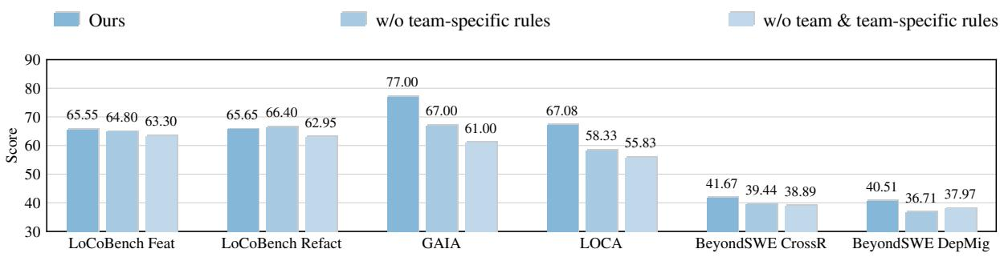

Figure 6: Ablation results across six different evaluation metrics. We compare the proposed full model with variants6565 that remove team-specific handoff rules, or both reusable agent teams and handoff rules.6  
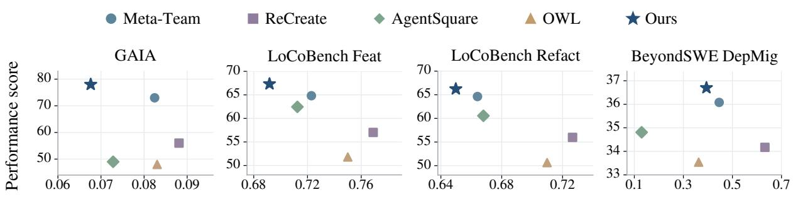  
6060Figure 7: Performance versus estimated cost per task under Individual-Benchmark evaluation. Higher scores and 5555lower costs are both preferred in this comparison.

The remaining settings show two exceptions: removing rules slightly improves LoCoBench Refact (66.40 vs. 65.65), while removing both components outperforms removing rules alone on BeyondSWE DepMig (37.97 vs. 36.71). Despite these exceptions, the complete design provides the strongest overall results across the evaluated tasks.

## C.2 Cost Analysis

Figure 7 compares both performance and cost per task under individual-benchmark evolution.

Obs. 9: Collaboration reuse offers a favorable performance–cost trade-off. Figure 7 shows that EVOTEAM achieves the highest score at the lowest estimated cost on GAIA and both Lo-CoBench tasks. On BeyondSWE DepMig, it outperforms Meta-Team and ReCreate at a lower cost; AgentSquare and OWL are cheaper but score lower. This trade-off is consistent with the reuse mechanisms: reusable agent teams provide established divisions of work, while interaction rules supply relevant coordination guidance. Reusing both reduces the need to establish same collaboration procedures anew for tasks with compatible requirements.

## C.3 GAIA Difficulty Levels

Table 7 reports GAIA pass rates by difficulty level under the Mixed-Benchmark setting. Evolved methods are evaluated on the GAIA holdout split.

Obs. 10: Gains extend across GAIA difficulty levels. EVOTEAM achieves the highest pass rate at all three levels. Its gains over Meta-Team are 2.63, 16.32, and 7.69 percentage points on Levels 1, 2, and 3, respectively. The largest gain occurs on Level 2, showing that the benefits of mixed-benchmark evolution extend beyond the easiest tasks. However, Level 3 scores remain much lower for all methods, indicating that the hardest tasks continue to pose substantial challenges.

## C.4 LoCoBench Dimensions

Table 6 and Figure 8 reports dimension-level results under the mixed-benchmark setting, evaluated on the LoCoBench Feature Implementation (Feat.) and Cross-File Refactoring (Refact.) holdout splits after mixed-benchmark evolution. We report software engineering excellence (SE), functional correctness (FC), code quality (CQ), and long-context utilization (LCU). This breakdown shows how each dimension contributes to overall performance.

Table 6: LoCoBench dimension scores after mixed-benchmark evolution. The highest score for each dimension within each subset is in bold.
<table><tr><td>Subset</td><td>Method</td><td>SE</td><td>FC</td><td>CQ</td><td>LCU</td></tr><tr><td>Feat.</td><td>Skill-MAS</td><td>0.4916</td><td>0.5744</td><td>0.5878</td><td>0.7360</td></tr><tr><td></td><td>ReCreate</td><td>0.3766</td><td>0.6832</td><td>0.8407</td><td>0.7384</td></tr><tr><td></td><td>Meta-Team</td><td>0.4923</td><td>0.7231</td><td>0.7802</td><td>0.7915</td></tr><tr><td></td><td>Ours</td><td>0.4979</td><td>0.7239</td><td>0.8064</td><td>0.7789</td></tr><tr><td>Refact.</td><td>Skill-MAS</td><td>0.5109</td><td>0.6264</td><td>0.5960</td><td>0.6686</td></tr><tr><td></td><td>ReCreate</td><td>0.4375</td><td>0.7181</td><td>0.7676</td><td>0.7001</td></tr><tr><td></td><td>Meta-Team</td><td>0.5204</td><td>0.7148</td><td>0.7594</td><td>0.7068</td></tr><tr><td></td><td>Ours</td><td>0.5273</td><td>0.7494</td><td>0.7428</td><td>0.7219</td></tr></table>

SE: software engineering excellence; FC: functional correctness; CQ: code quality; LCU: long-context utilization.

Table 7: GAIA pass rates (%) by difficulty level. Scores use all instances in each level. The highest score in each row is in bold.
<table><tr><td>Level</td><td>Skill-MAS</td><td>Meta-Team</td><td>ReCreate</td><td>Ours</td></tr><tr><td>Level 1</td><td>42.11</td><td>78.95</td><td>69.30</td><td>81.58</td></tr><tr><td>Level 2</td><td>32.65</td><td>67.35</td><td>65.31</td><td>83.67</td></tr><tr><td>Level 3</td><td>30.77</td><td>30.77</td><td>30.77</td><td>38.46</td></tr></table>

Obs. 11: LoCoBench gains are strongest in SE and FC. EVOTEAM leads in SE and FC on both subsets, although its margins over Meta-Team on Feat. are small. On Refact., it also achieves the highest LCU score and improves FC from 0.7148 to 0.7494 over Meta-Team. The advantage does not span all dimensions: ReCreate leads in CQ on both, while Meta-Team leads in LCU on Feat. These results highlight consistent strengths in software engineering excellence and functional correctness.

## D Prompts

We present seven core prompts covering team selection, cold-start team composition, task execution, and post-task reflection. The following subsections explain each prompt’s purpose and role in the overall process. The corresponding numbered prompts are collected afterward and specify the role, inputs, core rules, and output format. Repetitive instructions and tool-call schemas are omitted; benchmark-specific execution requirements and output formats are appended to each task. Related engineering guidance emphasizes explicit instructions, well-defined tool interfaces, and the selection of relevant context for reliable agent execution and coordination. (Anthropic, 2024, 2025a).

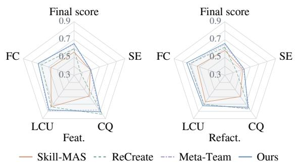  
Figure 8: Fine-grained performance on the LoCoBench Feature Implementation (Feat.) and Cross-File Refactoring (Refact.) subsets. Higher is better.

## D.1 Team Selection

Prompt 1 (Figure 9) determines whether an incoming task can reuse an existing agent team or requires a cold start. The decision is based on the task’s specific collaboration requirements, complementary agent roles, and verification needs, rather than topic similarity alone. This stage selects the collaboration structure while leaving individual agent recruitment to the Chairman. When no existing team is suitable, it produces a provisional team description for subsequent team composition; admission to the team library is decided after task execution.

## D.2 Cold-start Team Composition

Prompt 2 (Figure 10) constructs the candidate roster for a provisional team when team selection returns a cold start. It selects existing agents whose capabilities support the required division of work, while keeping the Chairman fixed. The roster defines which agents can be recruited for the task. Recruitment and work assignments remain Chairman’s responsibility; this prompt does not prescribe an execution order or generate interaction rules.

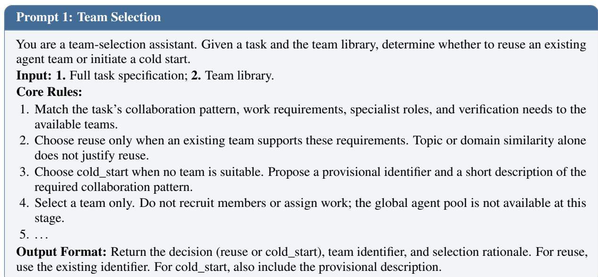  
Figure 9: Prompt for team selection.

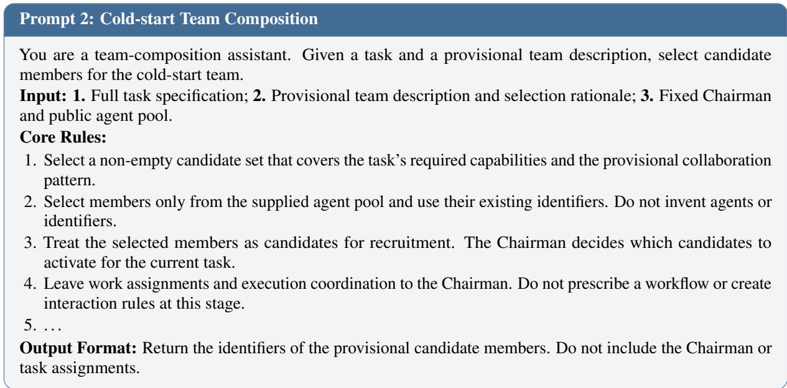  
Figure 10: Prompt for cold-start team composition.

## D.3 Chairman Coordination

Prompt 3 (Figure 11) guides task-specific recruitment and coordination within the selected team’s candidate roster. The Chairman activates the agents needed for the task, assigns complementary responsibilities It also reviews returned work, resolves conflicting findings, and adjusts assignments when necessary. The team defines the available collaboration structure, while the Chairman instantiates it for the current task and submits the supported result under the benchmark’s output requirements.A related orchestration pattern appears in Anthropic’s multi-agent research system, where a lead agent delegates work to specialized subagents and synthesizes their findings (Anthropic, 2025c).

## D.4 Interaction-rule Selection and Use

Prompt 4 (Figure 12) guides an agent in selecting and applying a suitable team-specific interaction rule. Applicability depends on the communicating agents, the rule’s trigger, and the current information-transfer need. The selected rule specifies what task information and evidence the message should convey, including uncertainty, verification, and fallback guidance. If no rule applies, the agent communicates directly without forcing the handoff to follow an unrelated contract.

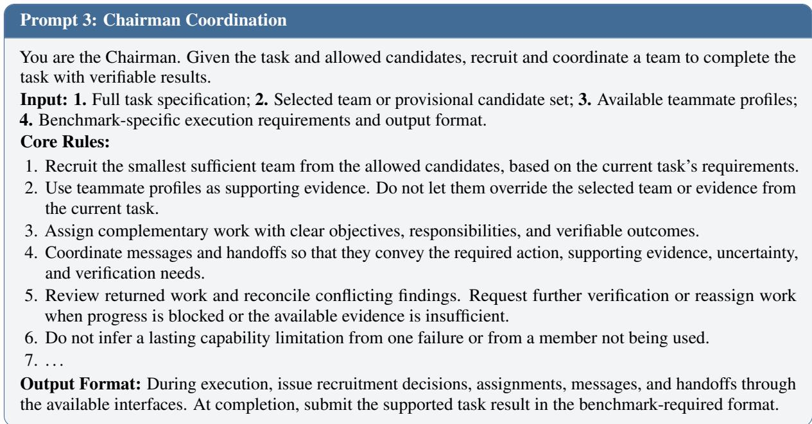

Figure 11: Prompt for Chairman coordination.  
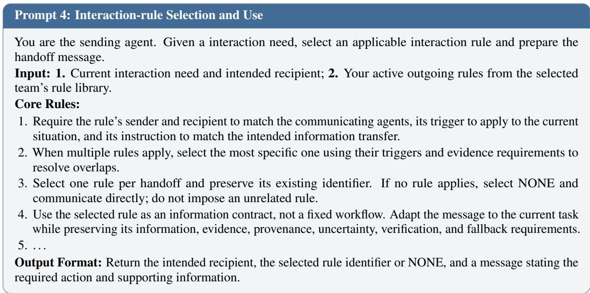  
Figure 12: Prompt for interaction-rule selection and use.

## D.5 Team Reflection

Prompt 5 (Figure 13) evaluates the team structure after task execution. For a cold start, it assesses whether observed collaboration supports a reusable team that should enter the library. For an existing team, it determines whether the candidate membership requires revision and updates the description to match the revised roster. Description changes accompany membership updates. Decisions are grounded in execution evidence and relevant history, distinguishing structural mismatches from execution, interaction, and environment failures.

## D.6 Interaction-rule Reflection

Prompt 6 (Figure 14) converts observed handoffs and evaluation feedback into reusable interactionrule updates within the current team. It assesses directed sender–recipient contracts and decides whether to create, refine, retain, or retire a rule, or leave the rule library unchanged when evidence is insufficient. The reflection focuses on informationtransfer requirements and preserves distinct triggers for rules serving the same agent pair. Team membership and individual agent behavior are handled by their respective reflection prompts.

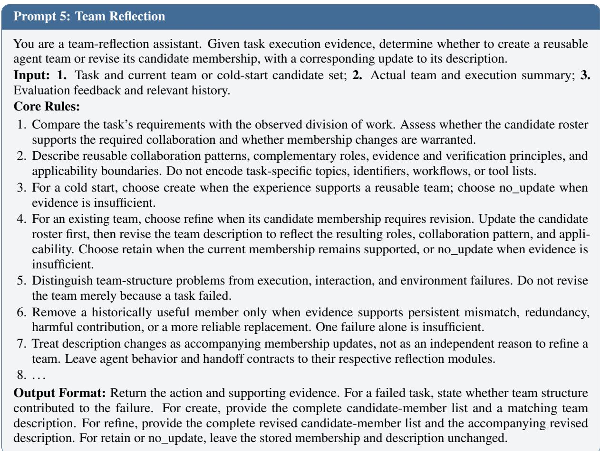

Figure 13: Prompt for team reflection.  
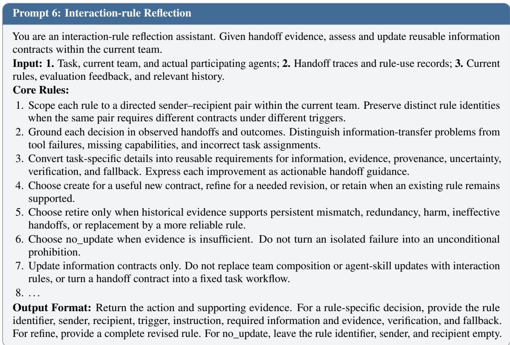  
Figure 14: Prompt for interaction-rule reflection.

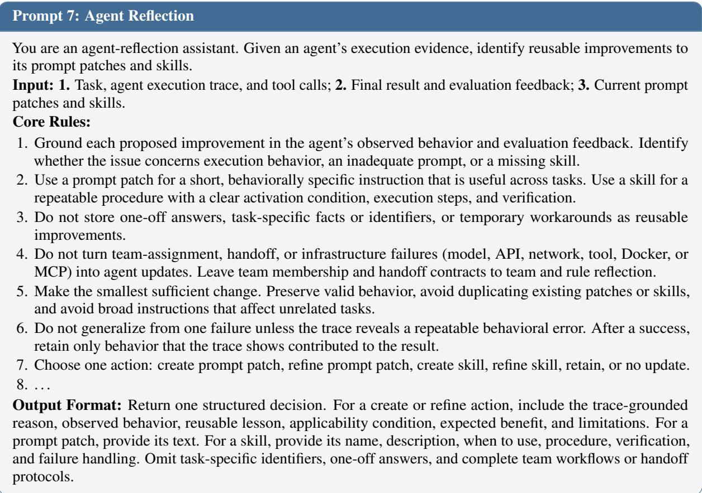  
Figure 15: Prompt for agent reflection.

## D.7 Agent Reflection

Prompt 7 (Figure 15) extracts reusable improvements to an individual agent’s execution behavior from its trace and evaluation feedback. Short behavioral instructions are stored as prompt patches, while repeatable procedures with explicit activation conditions and verification steps are stored as skills. The prompt favors small, supported updates that preserve existing valid behavior and avoid duplication. It excludes one-off task answers and does not attribute team-assignment, handoff, or infrastructure failures to the agent’s reusable capabilities.Reusable procedural knowledge is also central to Agent Skills, which packages instructions, scripts, and supporting resources for agents to discover and load when needed (Anthropic, 2025b).

## E Case Study

We present four cases drawn from the mixedbenchmark evolution and holdout splits. Cases 1 and 2 concern what is retained during evolution: Case 1 shows that a task-derived update stays confined to the selected team’s rule set instead of overwriting experience accumulated for other collaboration patterns, and Case 2 follows one team across an interleaved LoCoBench and BeyondSWE sequence. Cases 3 and 4 use the frozen library on the holdout split: Case 3 shows three tasks from three different benchmarks selecting the same team, and Case 4 compares EVOTEAM with Meta-Team on a single task, tracing the score difference to specific team configuration and handoff requirements.

## E.1 Scoped Experience Accumulation

Task and comparison. Figure 16 compares postexecution updates on CourseAssistant from LOCA-Bench. The task requires reconciling student and submission records, excluding withdrawn students, and sending individualized reminders with a prescribed subject and each student’s name and ID. The comparison focuses on how task-derived experience affects existing collaboration knowledge previously accumulated across benchmarks.

Meta-Team: overwriting shared guidance. Before this task, the shared profiles of context analyst, implementer, and verifier contained 45, 43, and 31 notes, respectively. These covered numerical reasoning from GAIA, repository analysis and code verification from BeyondSWE, and record reconciliation and calendar operations from LOCA-Bench. The Chairman reported 62 successful sends, but evaluation returned 0.0 with “Email verification failed.” Reflection identified that address existence had been checked without validating sent-message bodies. It then replaced each accumulated notes list with a single note. Specialized analysis and verification requirements disappeared, while the implementer’s new advice restricted recruitment to tasks requiring artifact changes, despite earlier guidance covering calendar operations. These replacements were shared by teammate name without a benchmark or family condition. A bulk-sideeffect verification rule was appended to the shared constitution, retaining its engineering clauses.

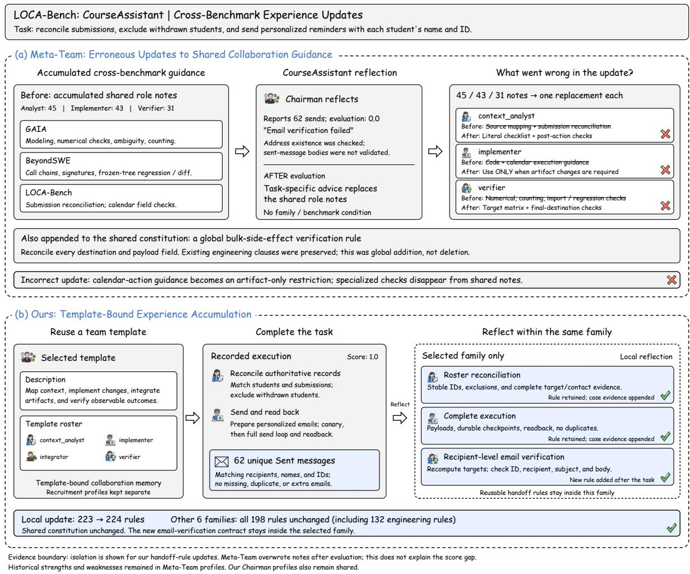  
Figure 16: Family-scoped experience accumulation versus shared-profile contamination on CourseAssistant. (a) Meta-Team replaces accumulated shared-profile notes with task-derived advice, removing earlier guidance and introducing an unscoped recruitment restriction. Strikethroughs indicate overwritten guidance; crosses mark problematic replacements. (b) EVOTEAM preserves existing rules, appends supporting evidence, and adds a verification rule within the selected family. All 198 rules in the other six families remain unchanged.

EVOTEAM: retaining and extending scoped experience. The selected team supports structural analysis, implementation, artifact reconciliation, and independent outcome verification, with a candidate roster of context\_analyst, implementer, integrator, and verifier. Execution reconciled authoritative records and performed individualized sending with readback. The final record reported 62 unique Sent messages with matching recipients, names, and IDs, without missing, duplicate, or extra messages; evaluation returned 1.0. Subsequent reflection retained the roster-reconciliation and complete-execution rules and appended this case as supporting evidence. It added one familyscoped rule requiring independent target-set reconstruction and recipient-level checks of message IDs, recipients, subjects, and required body fields.

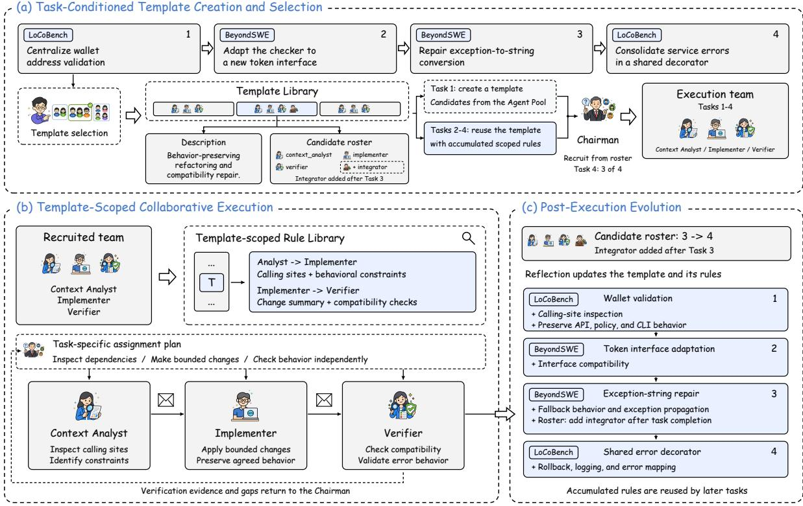  
Figure 17: Cross-benchmark collaboration evolution. (a) Team creation and reuse. (b) Collaboration guided by team-scoped interaction rules. (c) Accumulated rule updates and candidate-roster expansion across four tasks.

Observed distinction. Meta-Team’s profile-note replacement removed accumulated distinctions and generalized task-derived advice across future tasks. EVOTEAM’s handoff-rule update incorporated new evidence while preserving rules outside the selected family. This isolation concerns handoff rules: our recruitment profiles remain shared, and Meta-Team retained historical strengths and weaknesses outside the overwritten notes. Because the reflection process followed evaluation, the overwrite does not establish the cause of the task-score difference.

## E.2 Cross-Benchmark Accumulation

Figure 17 illustrates how a shared team accumulates reusable collaboration experience across four distinct tasks from LoCoBench and BeyondSWE in the mixed-benchmark evolution stream. The team preserves shared coordination practices while adapting agent recruitment and rule application to the collaboration requirements of each task.

Team creation and reuse. In panel (a), the wallet-validation task initiates a provisional team for behavior-preserving refactoring and compatibility repair, which is retained and updated through post-execution reflection. Subsequent tasks reuse this team based on their collaboration requirements. Its description defines the applicability scope, while its candidate roster specifies the agents available for recruitment by the Chairman.

Team-scoped collaboration. Panel (b) illustrates the shared division of work. The context analyst inspects calling sites and identifies behavioral constraints; the implementer makes bounded changes that preserve these constraints; and the verifier independently checks compatibility and error behavior. Team-scoped rules specify the information required at each handoff, including calling sites, behavioral constraints, change summaries, and compatibility checks. Verification evidence and unresolved gaps are returned to the Chairman. These rules guide information flow under task-specific plans rather than impose a fixed execution sequence on the team.

Experience accumulation. Panel (c) summarizes the updates contributed by the four tasks: calling-site inspection and behavior preservation; interface compatibility; fallback behavior and exception propagation; and rollback, logging, and error mapping. After the third task, reflection adds an integrator to the candidate roster. The fourth task reuses the expanded team but recruits only the context analyst, implementer, and verifier. This illustrates how a team retains collaboration experience across benchmarks while providing a candidate roster from which the Chairman selects the members needed to meet each task’s specific requirements.

Table 8: Simplified trace of the Case 3 escrow development task (LoCoBench).
<table><tr><td>Agent</td><td>Action</td><td>Key content</td></tr><tr><td>Context Analyst</td><td>Inventory structure</td><td>Maps interfaces across the domain, workflow, API, and risk layers; identifies state transitions and integration constraints.</td></tr><tr><td>Implementer</td><td>Cross-layer construction</td><td>Implements the escrow feature across the affected layers while preserving state contracts and existing interfaces.</td></tr><tr><td>Verifier</td><td>Independent verification</td><td>Independently checks compilation, workflow behavior, boundary conditions, and cross-layer consistency.</td></tr></table>

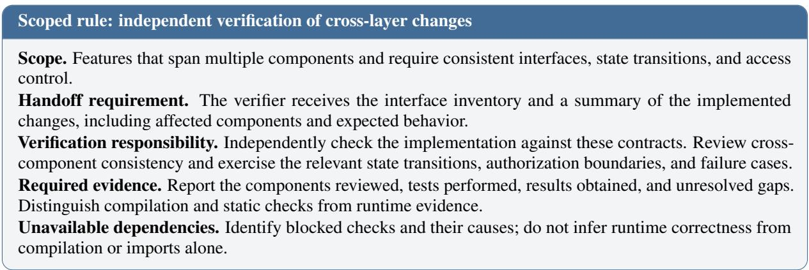  
Figure 18: Condensed scoped rule for independent verification of cross-layer changes. Explicit handoff requirements connect implementation constraints to verifiable evidence.

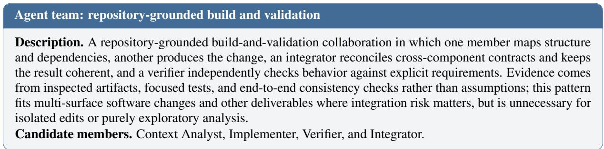  
Figure 19: The shared agent team reused across the three tasks in Case 3. The roster specifies candidate members for task-specific recruitment.

## E.3 Cross-Benchmark Team Reuse

Three holdout tasks reuse the same team for dependency analysis, coordinated implementation, and independent verification. They involve escrow feature implementation (LoCoBench), a clearance promotion workflow (LOCA-Bench), and ORM compatibility repair (BeyondSWE). These tasks activate only the context analyst, implementer, and verifier. Their scoped rules make key cross-component constraints explicit at each team handoff.

• Escrow development (LoCoBench). The analyst identifies the interfaces and state transitions needed for a time-locked multi-signature escrow feature. The implementer develops the feature across the domain, workflow, API, and risk layers while preserving those contracts. The verifier independently checks compilation, workflow behavior, and boundary conditions. The handoff rules require an interface inventory before implementation and clear verification evidence for the affected components afterward.

• Clearance promotion (LOCA-Bench). The analyst checks product, order, and subscriber data and establishes the required CSV format. The implementer updates the clearance category, generates the CSV, and emails subscribers. The verifier checks product selection, file contents, recipients, and CSV delivery. These contractpreservation and independent verification rules govern a product–file–email workflow.

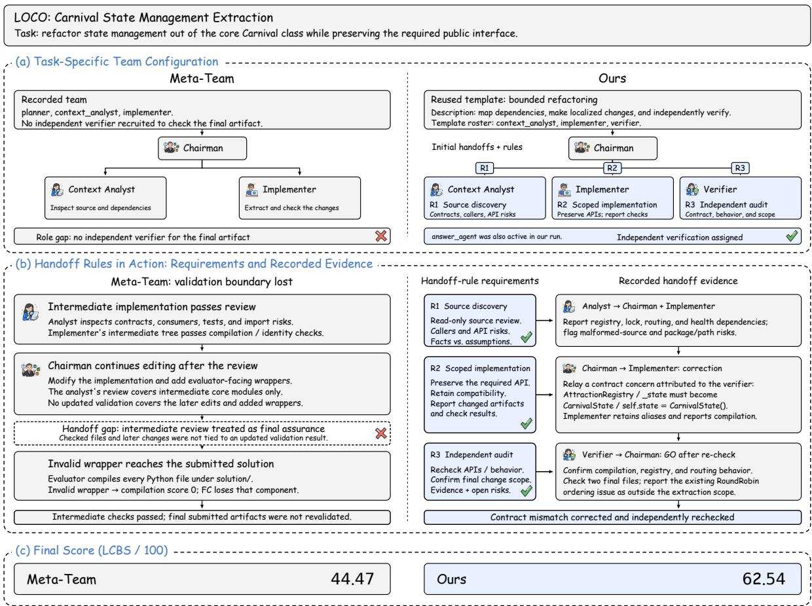  
Figure 20: Team configuration and rule-guided collaboration on the Carnival refactoring task. (a) Our method recruits an independent verifier and attaches team-scoped rules to the initial handoffs. Meta-Team recruits the analyst and implementer without a separate verifier. (b) Our team corrects an interface mismatch and independently rechecks the revised files. Meta-Team’s later edits lack updated validation, leaving an invalid wrapper in the submission. (c) Final LCBS scores (out of 100).

• Compatibility repair (BeyondSWE). The analyst identifies how SQLAlchemy changes affect SQLAdmin’s relationship loading. The implementer limits edits to the affected compatibility layer, and the verifier reruns regression tests and distinguishes dependency problems from code regressions. The scoped rules connect an explicit impact analysis to bounded changes and independent validation of those changes.

All three tasks succeed. The shared team transfers because these tasks share a coordination pattern: analysis establishes constraints, implementation preserves agreed contracts, and verification checks the result independently. Table 8 summarizes the escrow task, while Figure 18 illustrates the team’s verification rule during execution.

## E.4 Organization and Coordination

This case illustrates how a task-appropriate team and team-scoped interaction rules support collaboration on the Carnival refactoring task (Figure 20), which requires structural changes while ensuring that the existing interfaces are preserved.

Matching the team to the task. EVOTEAM reuses a team that combines dependency analysis, bounded implementation, and independent verification. The Chairman recruits a context analyst, implementer, and verifier from its own roster, covering the task’s requirements with a clear division of responsibilities. Meta-Team recruits an analyst and an implementer but no independent verifier, leaving final validation without a dedicated role.

Connecting responsibilities through rules. The team-scoped rules make this division of work operational: compatibility constraints must guide implementation, changed artifacts and check results must be reported, and independent verification must cover the revised deliverables. In the recorded execution, an interface mismatch is corrected and the revised files receive an independent audit. Meta-Team performs useful intermediate checks, but subsequent modifications are delivered without updated validation, leaving an invalid wrapper in the submission. The contrast highlights the complementary roles of assigning verification responsibility and specifying what must be verified.

EVOTEAM achieves an LCBS of 62.54, compared with 44.47 for Meta-Team (panel (c)). This case illustrates how a team matched to the task provides the needed roles, while scoped interaction rules connect their respective contributions to support a more reliable final result for the task.

## F Extended Related Work

## F.1 Individual Agent Evolution

Research on agent improvement explores how feedback can refine task-solving behavior and produce reusable knowledge. Early approaches establish feedback-based refinement through iterative output revision and reflection-guided repeated attempts, with different scopes of experience retention (Madaan et al., 2023; Shinn et al., 2023). Self-Refine improves generated outputs through self-generated feedback, while Reflexion retains verbal reflections in episodic memory to guide subsequent trials. ExpeL extends experience reuse across tasks by extracting natural-language insights from past executions and recalling these insights alongside the relevant previous experiences during subsequent task solving (Zhao et al., 2024).

Beyond response-level refinement, automated agent optimization extends to code-defined designs, functional modules, and symbolic components such as prompts and tools (Hu et al., 2025b; Shang et al., 2025; Zhou et al., 2024). ADAS uses a meta-agent to propose new agent designs based on an archive of previous discoveries, while AgentSquare evolves and recombines reusable planning, reasoning, tool-use, and memory modules. Agent Symbolic Learning further optimizes prompts, tools, and their overall composition through natural-language feedback and symbolic updates to these components.

Another line of work converts interaction experience into reusable procedural knowledge and revised execution scaffolds (Wang et al., 2023; Zheng et al., 2025; Hao et al., 2026b). Voyager accumulates executable skills through open-ended environment interaction, while SkillWeaver enables web agents to discover and practice skills, distilling interaction experience into reusable APIs. ReCreate reasons over interaction histories to identify causes of success and failure, translating execution experience into scaffold revisions and reusable domain patterns. Mem2Evolve connects experience accumulation with capability expansion by using experience memory to guide the creation of reusable tools and expert agents (Cheng et al., 2026). Agentic Context Engineering (ACE) instead maintains evolving context playbooks through generation, reflection, and curation, using incremental updates to preserve useful knowledge across executions (Zhang et al., 2026). Within multi-agent collaboration, MAEL maintains individual experi ence pools and retrieves high-reward, task-relevant examples to improve agents’ subsequent reasoning steps (Li et al., 2025). Together, these studies improve agent designs and retain reflections, skills, and execution knowledge beyond a single response. However, analyses of multi-agent failures and scaling behavior show that collaborative performance also depends on inter-agent alignment and the compatibility between coordination structures and task requirements (Cemri et al., 2025; Kim et al., 2026). This leaves a distinct question for collaborative evolution: how should accumulated capabilities be organized and coordinated when tasks require different responsibilities and information handoffs?

## F.2 Collaborative Multi-Agent Evolution

At the collaboration level, improvement extends to interactions and the structures connecting agent behaviors. Studies of large-scale collaboration highlight the role of interaction topology in shaping collective performance (Qian et al., 2025; Kim et al., 2026). Related approaches adjust team composition and agent participation to improve task solving, including dynamic group composition, contribution-based agent selection, and elimination of redundant agents and interaction (Chen et al., 2023; Liu et al., 2024; Wang et al., 2025b; Liang et al., 2022). These approaches provide mechanisms for adapting collaboration to a task’s requirements.

Automated optimization further treats agent prompts, graph connectivity, and executable workflows as searchable components (Zhuge et al., 2024; Zhou et al., 2026; Zhang et al., 2025c). GPTSwarm optimizes node-level prompts and graph connectivity, MASS interleaves prompt and topology optimization, and AFlow searches over code-represented workflows using execution feedback.EvoMAC uses textual backpropagation from environmental feedback to revise multi-agent collaboration networks, while EvoFlow evolves a population of diverse workflows through retrieval, crossover, and mutation (Hu et al., 2025c; Zhang et al., 2025a). ScoreFlow extends workflow optimization through score-based preference learning, while EvoAgent uses evolutionary operators to generate diverse agents from an initial agent framework (Wang et al., 2025a; Yuan et al., 2025). To accommodate varying task requirements, query-dependent approaches learn to select or generate collaboration architectures, agent roles, and model assignments according to the input query (Zhang et al., 2025b; Gao et al., 2025; Yue et al., 2025). These methods make collaboration structures explicit optimization targets and support task-dependent system construction.

Experience-driven approaches investigate how execution knowledge can support subsequent collaboration, including retrieval-based agent memory, collective reflection, and reusable orchestration knowledge (Yang et al., 2025; Hao et al., 2026c; Lin et al., 2026). AgentNet combines retrievalbased memory with decentralized coordination, adapting connectivity and task routing according to local expertise and context. DecentMem gives each agent separate memory pools for consolidated experience and generated exploratory candidates, adjusting their relative weights through online feedback (Hao et al., 2026a). Meta-Team preserves individual execution contexts and enables post-task evidence exchange, supporting evolution of agent behaviors, inter-agent coordination, and team organization. Skill-based approaches connect reusable knowledge with changes to multiagent collaboration: SkillMAS couples skill evolution with evidence-guided MAS restructuring, while Skill-MAS represents orchestration knowledge as an evolvable Meta-Skill refined through multi-trajectory rollout and selective reflection (Pan et al., 2026; Lin et al., 2026). EMAS uses recurring execution diagnoses to propose prompt and topology revisions, accepting updates through paired validation against the current system (Fei et al., 2026). MASFly and MANTA combine prior experience with execution feedback to support task-specific collaboration structures and execution-time reconfiguration (Liu et al., 2026; xun Huang et al., 2026).

These studies demonstrate several ways to improve collaboration through structural optimization and experience reuse. (Feng et al., 2026) Our work focuses on sustaining such improvement across heterogeneous task requirements, where coordination knowledge must remain appropriate to the team using it. EVOTEAM maintains a library of reusable teams, selecting or creating teams according to collaboration requirements. It jointly refines team organization and associated interaction rules, allowing compatible tasks to accumulate coordination experience within the same team while keeping rule updates independent across teams. Individual agent skills remain reusable across these team contexts.

## G Frequently Asked Questions

Q1. Is EvoTeam only a task-dependent teamselection method? A. Team selection is the entry point to a broader process of collaboration evolution. A reusable team specifies supported collaboration requirements and a candidate roster, from which the Chairman recruits a task-specific execution team. Tasks can therefore reuse the same team while activating different members and assigning different responsibilities. Beyond selection, EVOTEAM uses execution experience to refine team organization, associated interaction rules, and individual agent skills. The reusable team provides a persistent context in which tasks with compatible collaboration requirements accumulate and refine coordination experience (Section 3; Algorithm 1).

Q2. Are teams organized by benchmark or task category? A. Teams are organized according to collaboration requirements, rather than predefined benchmark or task-category boundaries. The LLMbased Team Selector assesses whether a team’s description and candidate roster support the required division of work, complementary roles, and verification needs. Topic similarity alone is insufficient to justify reuse. Consequently, tasks from different benchmarks can reuse the same team when their collaboration requirements are compatible, as illustrated in Appendix E.3. When no compatible team exists during evolution, the Composer constructs a provisional team from the global agent pool. Postexecution reflection determines its admission based on whether the roster supports the required collaboration and the resulting organization is reusable (Section 3.1).

Q3. Do interaction rules impose a fixed execution workflow? A. Interaction rules provide soft coordination guidance about the information and evidence required at a handoff. They do not prescribe a complete execution sequence. The Chairman establishes task-specific assignments and can reassign subtasks when progress is blocked. For each handoff, the sending agent assesses rule applicability using the sender–recipient pair, the rule’s trigger, and the current information-transfer requirements. When a rule applies, the agent adapts its message to the current task while following the relevant information and verification requirements. If no rule applies, the agent communicates directly without imposing an unrelated rule (Section 3.2; Appendix D.4).

Q4. Why are interaction rules team-specific while agent skills remain reusable across teams? A. Interaction rules depend on how responsibilities and information dependencies are organized within a team. A handoff requirement that supports one collaboration pattern may be inappropriate for another. Individual skills instead encode procedures for an agent’s own execution and can remain useful across teams when their applicability conditions are satisfied. EVOTEAM therefore updates coordination knowledge within the corresponding team while retaining skills with the agents that use them. This separation allows compatible tasks to share and refine interaction rules without directly modifying other teams’ rule sets. The isolation applies to team-specific rules; individual skills and recruitment profiles remain shared across team contexts (Section 3.3; Appendix E.1).

Q5. What evolves, and does evolution continue during holdout evaluation? A. Evolution updates three forms of persistent knowledge: team candidate rosters and their corresponding descriptions, team-specific interaction rules, and individual agent guidance. The latter includes prompt patches and reusable skills in our implementation. The underlying LLM parameters remain fixed. Persistent updates are performed on the designated evolution split and frozen before evaluation on the disjoint holdout split. Task-specific recruitment, planning, rule application, and reassignment remain part of execution. Thus, freezing evolution prevents holdout tasks from changing the persistent knowledge used by subsequent evaluation tasks, while preserving adaptation within each task (Algorithm 1; Appendices B.4 and D.7).

Q6. Does the team library support crossbenchmark reuse, or merely isolate experience for individual tasks? A. Teams are organized by collaboration requirements rather than task identities or benchmark labels. Appendix E.2 follows one team across four LoCoBench and BeyondSWE tasks, including accumulated rule updates and candidate-roster expansion. Appendix E.3 further shows a shared team reused for holdout tasks from three benchmarks. Together, these cases illustrate how compatible tasks across benchmarks accumulate and reuse coordination experience within a shared collaboration structure.

Q7. How do the ablation studies and case analyses support team-specific interaction rules? A. The ablation studies show that learned interaction rules contribute to performance beyond taskconditioned team organization. Appendix E.1 further illustrates how task-derived coordination experience updates the selected team’s rules while leaving other teams’ rules unchanged. These analyses provide complementary evidence: the ablations assess the value of learned coordination guidance, while the case analysis illustrates how team-scoped evolution incorporates new experience while preserving interaction rules associated with other collaboration structures.

Q8. What do the reported comparisons show about EvoTeam’s performance–cost tradeoff? A. Figure 5 and Figure 7 report tasklevel performance–cost comparisons in the evaluated settings. Under mixed-benchmark evolution, EVOTEAM achieves stronger performance at lower reported per-task cost than Meta-Team and ReCreate on GAIA and BeyondSWE DepMig. These results show that EVOTEAM combines strong task performance with competitive per-task costs, supporting its practical effectiveness across different collaboration requirements.