# From extreme weather to agricultural consequences with agentic AI

Minghan Yu1, Mengyu Dai2, Yixin Wen3\*, Haizhao Yang1,4\*

1Department of Mathematics, University of Maryland, College Park, College Park, MD, USA.

2Stony Brook University, Stony Brook, NY, USA.

3School of Marine and Atmospheric Sciences, Stony Brook University, Stony Brook, NY, USA.

4Department of Computer Science, University of Maryland, College Park, College Park, MD, USA.

\*Corresponding author(s).

## Abstract

Extreme weather is forecast days ahead, yet its consequences for agriculture remain hard to predict: a forecast says where a storm will strike, not which crops will sufer or how much is at risk, and the records that could tell span many sources. We present WxCrop, the first agent that judges agricultural hazards from physically interpretable weather indices examined by causal analysis, and the first that combines weather and agricultural information to predict crop loss reliably for past and forecast dates. We demonstrate it in Florida on hurricanes, freezes and dry heat, with a loss model calibrated on insurance records for each, and the same procedure extends to other hazards and areas. Three checks show reliability: the hurricane index detects recorded cyclone days with an AUC of 0.98, recorded losses in held-out years are reproduced to within 2%, and independent production records confirm the county rankings (rank correlation 0.63). Users ask the agent for each crop group’s loss as a fraction of expected season value, every number sourced, so that governments, growers and scientists respond to agricultural disasters quickly.

## Introduction

Weather has shaped what people can grow for as long as there has been agriculture, and it still does. Disasters cost world agriculture an estimated US\$3.26 trillion between 1991 and 2023, about 4% of global agricultural GDP each year, with climate-related hazards accounting for close to US\$2.9 trillion of it, and warming is raising the exposure of staple crops in most producing regions even where farms adapt [1–5]. Early warning is among the best-returning defences, with anticipatory action returning up to seven dollars for each one invested [1]. Yet a warning is only as useful as what it says. A weather forecast tells us what the sky will do; it does not tell a grower, an agency or a scientist what the storm will do to the crops.

Consider a hurricane three days from landfall. A grower asks how much of this season’s crop is at stake. An emergency manager asks which counties should receive inspectors and relief first. Both questions concern the same storm and the same crops, and both must be answered before landfall to be useful; today, neither can be. Florida, where we demonstrate the approach, shows the cost of waiting. Hurricane Milton struck the state on 9 October 2024 and cost its agriculture an estimated \$428 million [6], but the preliminary estimate appeared ten weeks after landfall [7] and the final one about ten months after [6]. The oficial answer arrived long after the decisions it should have informed.

The obstacle is not missing evidence but fragmented evidence. Weather reanalyses and forecasts, hydrological models, dated crop maps, growing calendars and decades of production and insured-loss records all exist, but at diferent scales, formats and dates, and joining them for a given field on a given day takes a specialist. Three groups pay for this. After a storm, public agencies must locate fields that may have been damaged and verify losses quickly enough to direct relief, and the yield and revenue policies of the federal crop-insurance programme on which most growers depend pay only after the loss of each insured unit has been verified on the farm [8], and a county’s disaster designation requires a documented production loss of at least 30% of one crop [9], so an early, traceable estimate of where and how much crops were damaged shortens the time to payment; UF/IFAS documented delayed planting after recent hurricanes [10], USDA identifies repair and replanting costs as reasons for disaster assistance [11], and relief itself can take years, with applications for a Florida blockgrant programme covering the 2023 and 2024 hurricanes opening in 2026 [12]. Before landfall, growers need field-specific scenarios showing which crops and how much of their current value are exposed under a forecast storm [13], and without them may leave otherwise productive fields idle into the next season. Scientists and extension specialists repeat the same chain of steps for every storm and every enquiry, retrieving weather records, locating parcels, matching crops and compiling exposure figures, before any judgement can be made; they need these steps carried out on request, with the evidence behind each number kept visible, so that their time goes to the decision rather than the data handling.

Existing tools look backward. The formal UF/IFAS estimates rest on the Hurricane Composite Intensity Index, which scores observed wind, rainfall and flood depth on agricultural parcels, sums the three scores, and assigns each level a commodity loss rate drawn from producer surveys and past storms [6, 7]; it is computed after the storm, and its additive form cannot represent hazards that compound, although interacting drivers often cause the largest impacts [14]. Two earlier lines of work give a foundation for an index that compounds. Chen et al. combined a cyclone’s wind and rainfall into one index for the whole event, which reproduced recorded typhoon damage in China [15], and field records from Taiwan show that wind coupled with heavy rain, successive events and the length of a crop’s production period govern crop losses [16]. Neither is computed by day and county or joined to the crops beneath it. Remote sensing is faster but still post-event: USDA overlays satellite flood extent and observed wind and rainfall on the Cropland Data Layer [17], a UF/IFAS assistant answers growers’ damage questions from Sentinel-2 imagery [18, 19], and field-scale damage has been estimated from modelled typhoon winds and satellite rainfall [20]; imagery needs an overpass and, for optical sensors, clear skies. Empirical studies quantify how heat, drought and compound extremes reduce production at regional to global scales [4, 5, 21], and recent work uses USDA Risk Management Agency records of insured losses as a proxy for weather-driven crop damage [22–24], but at coarse resolution over seasons or years. Where forecast-driven impact models exist, they estimate housing damage [25] or rank counties by population exposure. In parallel, language-model assistants are also addressing geoscience and agricultural problems conversationally: ClimSight routes questions to climate-model output [26], WildfireGPT coordinates retrieval agents for wildfire adaptation [27], DisasTeller chains vision-language agents through post-disaster assessment and notes that early errors propagate downstream [28], language models have extracted flood records from hazard narratives [29], and an assistant integrates NASA tools with agentic search over NASA datasets to provide geoscience information and solve problems [30]. These systems answer from documents, projections, imagery or data catalogues rather than from dated agricultural parcels, and none links a hazard signal on a given day to the crops and fields beneath it. Their adoption also raises trust: users doubt the sources, cannot follow the computation, and fear fabricated answers, a fear grounded in the documented tendency of language models to produce fluent but unsupported content [31–33]. A tool that is to be adopted must answer all three.

Taken together, these needs define what an assistant for agricultural hazard assessment has to provide. It must be usable by agencies, growers and specialists alike without technical preparation, so that plain-language requests replace manual data assembly. It must return evidence for any date a user asks about, past or forecast, rather than for a few pre-analysed events. It must apply the same workflow to every storm instead of being rebuilt for each one. And every figure it reports must be traceable to the records it was computed from. To our knowledge, WxCrop is the first workflow to meet these requirements together. In particular, it provides the first county-level weather hazard index for agriculture whose efect on crop loss has been examined by causal analysis and confirmed against independent records. It is also the first system that combines weather and agricultural records into reliable estimates of the percentage of crop value lost, for any date, including forecasts (Methods).

We present WxCrop (weather × crop), an interactive assistant that connects county-level hazard signals with the agricultural evidence behind them, built to meet these requirements. It joins public weather records and forecasts with dated crop maps, growing calendars and insured-loss records, so that every analysis can run for a past storm or for one still ofshore. For a chosen date and hazard, the map shows the weather inputs that drive that hazard and a weather-only index for it, alongside the crops, their growth stage and vulnerability. The assistant answers each user’s question with a dedicated product: for decision makers, a hazard index computed from the weather alone that places a county in a tier anchored in how often such weather has been followed by loss; for growers, the fraction of each crop’s expected season value likely to be lost and the probability that a loss occurs at all; for scientists, the harmonised records behind both. Each answer is built to be trusted: every input is a named public record, the index decomposes into its terms, the percentages come from a calibrated model rather than from the language model, and the conversational agent retrieves and explains these figures rather than generating them. We demonstrate the assistant through a case study of Hurricane Ian that follows the three steps a user takes, from the weather and crops on the map, to the hazard index, to the loss estimate, and we then check the answers against recorded losses.

WxCrop begins with Florida hurricanes because their agricultural cost is large and well documented. The weather archives and crop maps it draws on are national and the method is not specific to hurricanes, so the same structure extends to drought, heat, flood and freeze across the United States and, with equivalent records, elsewhere. The longer aim is an open, traceable early-warning layer for weather impacts on crops, one that shortens the time between a storm and the resources that follow it.

## Results

WxCrop resolves a hazard event in three steps: it places the weather and the crops beneath it on one map (Fig. 1), computes a hazard index that identifies the event (Fig. 2), and estimates the loss of each crop group (Fig. 3). We follow Hurricane Ian, which made landfall in Florida on 28 September 2022, in DeSoto County, and take a freeze and a drought with heat through the same steps. Datasets are named by their abbreviations, which Table 2 spells out.

## Weather layers, crop layers and vulnerability on one map

In its first step, WxCrop lets the user choose a hazard in a panel (Fig. 1a). The panel then ofers the weather layers that drive that hazard, selected by causal analysis of insured losses (next section). For the hurricane these are wind and seven-day rainfall. Ticking a layer and a date, here 28 September 2022, loads it on demand from public archives, on its native grid or as county values, reconstructing the conditions of that day. For wind, WxCrop switches source with the weather. On days a tropical cyclone puts at least $1 0 \mathrm { m s ^ { - 1 } }$ on Florida, the layer is the storm’s wind field reconstructed from the National Hurricane Center best track (Fig. 1b), because gridded analyses and forecasts smooth the cores of tropical cyclones and underestimate their winds. On other days it is the daily maximum gust from analyses. The same best-track field feeds the hazard index, and the assistant flags forecast winds as such. Layers cover 2004 to the present and, using blended forecast guidance, the coming week. Each layer states its source, its grid and whether its values are observed, analysed or forecast, so that every colour can be traced back to a record. The colour boundaries of each layer are percentiles of its own historical values, from the median to the 99th, so that a colour means the same degree of unusualness on any date, with storm-class boundaries for the best-track wind field (Methods).

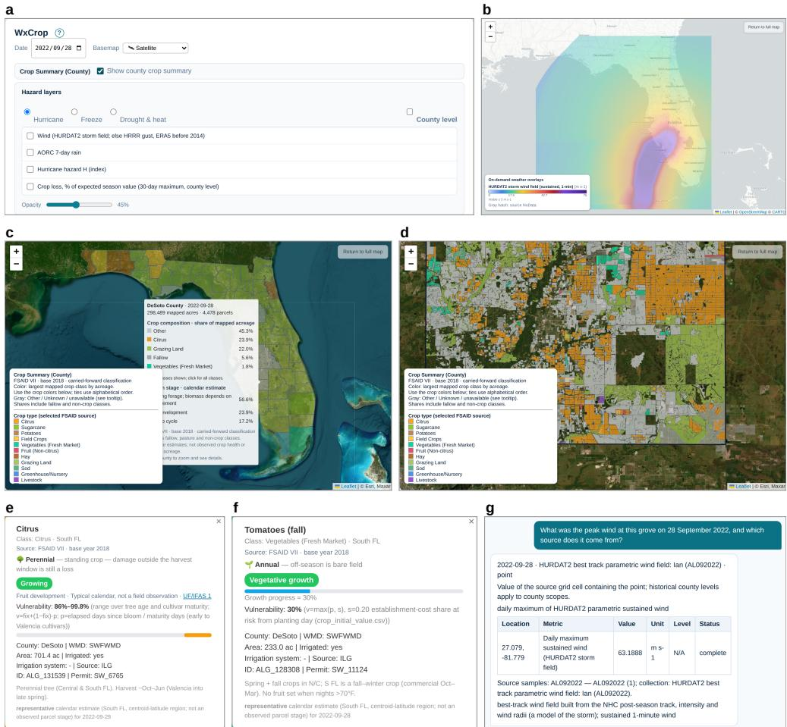  
Fig. 1 Weather and crop state on one day in WxCrop. Screenshots of the application for Florida on 28 September 2022, the day Hurricane Ian made landfall. a, Date and hazard controls. b, Wind layer, one of the two hurricane weather layers: on storm days the best-track wind field of Ian from NHC HURDAT2 (sustained wind), on other days HRRR gusts. c, County crop summary, hovering over DeSoto County. d, DeSoto County parcels coloured by crop class. Panels c and d use version VII of the Florida Statewide Agricultural Irrigation Demand (FSAID) inventory, classified for 2018 and carried forward. e,f, Popups for a citrus grove (ALG\_137275) and a tomato field (ALG\_128245), each with its growth stage and vulnerability. g, A question about the grove’s peak wind and the reply, a modelled best-track value for the containing cell.

Beneath the weather sit the crops. The county summary colours each county by its largest crop class, and hovering over DeSoto County (Fig. 1c) reports 298,489 mapped acres in 4,478 parcels, of which 23.9% are citrus, 22.0% grazing land and 1.8% freshmarket vegetables, together with the mix of calendar growth stages. Zooming in to the county interior loads the parcel view (Fig. 1d), drawn from more than 170,000 polygons in the state’s agricultural land inventory, each with its crop class, specific crop and source version, as the legend states.

Clicking a parcel (Fig. 1e,f) opens a popup with the parcel’s crop, its representative growth stage on the selected date from a growing calendar, and a vulnerability percentage: the fraction of the parcel’s expected season value that has accrued, and is therefore exposed, on that date. For an annual crop it is the seasonal progress, floored at the establishment cost already sunk on planting day. The tomato field in Fig. 1f, about 27 of 90 days after its calendar planting date, stands at 30%. For citrus the fruit progress is computed in the same way, the days elapsed since bloom divided by the days to maturity, bounded by the fastest and slowest cultivars, and added to the standing value of the trees, so that the grove in Fig. 1e shows a range, 86% to 99.8%, which stays below the full crop until harvest begins. The rules for each crop type are in the code repository (docs/PARCEL\_VULNERABILITY\_RULES.md). Vulnerability has two parts: the cost already invested, which is the value of the trees for perennial crops and the establishment cost for annual crops once planted, and the calendar fraction of the season’s expected income, an opportunity cost that grows toward harvest. A citrus grove therefore carries at least the value of its trees throughout the year, including outside the harvest season, and a cotton field in November is mostly harvested and contributes little. This vulnerability percentage is a sourced indicator, built on growing calendars compiled from UF/IFAS crop guides and USDA statistics, of how vulnerable each parcel is on the selected date.

Everything on the map can also be asked about in plain language, at the scale the user needs: a single parcel, the current view, a county or a named place. With the grove selected, the question of its peak wind on 28 September 2022 and the source of that number (Fig. 1g) is answered by a weather tool: $6 3 . 2 \mathrm { m s } ^ { - 1 }$ , the daily maximum sustained wind of the Ian best-track field in the grid cell (about 2 km) containing the grove, with its source and units and a note that it is a modelled value for the grid cell. A user can equally ask which crops dominate a county, how much citrus has been lost to decline, what growth stage cotton has reached on a given date, or how much rain fell on a grove in the previous seven days. The assistant retrieves every number through defined tools, each of which returns the data version, filters and units behind the value, so that the figures in a reply are computed by WxCrop and traceable to their records rather than written by the language model. The assistant also makes the map convenient to operate: it selects the hazard from the question, moves the map, sets the date and opens a county, so that a question is enough to reach the answer.

Besides the hurricane, WxCrop covers two other major hazards for Florida agriculture, freezes and drought with heat (Fig. 1a). Choosing either one ofers its own weather layers, which work in the same way. Weather, crop, growth stage and vulnerability are therefore all on one map for each hazard, and a user can move from a statewide view to a single field without leaving the conversation.

## Physically based, causally tested compound weather indices

From the weather layers of each hazard alone, WxCrop computes a composite hazard index that shows how unusual the weather was and rises with the damage it does, for any county on any day for which the weather inputs exist, and adds it to the map as a new layer. For hurricanes this is the hurricane hazard index, H, and its design follows the physics of the damage. Strong wind together with heavy rain loads wet soil and plants more than either alone, because trees in saturated soil lose much of their resistance to overturning [34], and drivers that act together often cause the largest impacts [14]. To find which factors matter for H, and which physically plausible interactions between them are present, we examined the commonly used weather quantities linked to hurricane damage, among them wind speed and duration, rainfall, ponding and wet hours, water tables, soil drainage, the interval since the previous storm and tree age. Each was tested against insured losses by causal analysis, with the candidates and the acceptance rules fixed before the results were seen. Wind and rainfall mattered, and so did their interaction, while the other candidates repeated these two, showed no signal or lacked data (Methods). H therefore multiplies a wind load, which grows with the square of the sustained wind as dynamic pressure does, by an amplifier that grows with rainfall (equation 1). Of eight pre-specified forms, this one matched recorded storm days and independent loss reports best.

On the case day the hurricane index is highest along the path Ian took (Fig. 2a). Its colour bar marks the boundaries of four tiers, baseline below 1, elevated from 1 to 2, likely from 2 to 4 and severe from 4 upwards, and the county-level layer shows the same index as one value per county, coloured by tier, with a hover card that gives the county’s wind, rainfall and H with its tier, here for Manatee County (Fig. 2b).

Asked whether DeSoto County is under threat, the assistant returns H = 27.9 and places it in the severe tier (Fig. 2c), and asked the same of Jackson County, in the Panhandle, it returns H = 0.20 and the baseline tier (Fig. 2d). Each answer gives the index, its tier and the county’s wind and rainfall, and states that the wind is a model field and that H covers wind and rain. The county wind is the 90th percentile, over the county’s cells, of the storm’s peak best-track wind, so it difers from the value at a single point such as the grove in Fig. 1g.

Insured losses rise with H (Fig. 2e, which groups the county-months with insurance records in 2004–2024 by the largest daily H in the month, shows for each group the proportion with insured weather losses and with losses above \$100,000, and marks where the two counties fall). For the hurricane index, county-months in the lowest tier reported insured crop losses about as often as months with no storm at all, 16%, while in the highest tier 81% of county-months had insured losses and 66% had losses above \$100,000. This shows that H orders county-months by their insured losses. The tier boundaries at 1, 2 and 4 are the median, upper quartile and top decile of H among the county-months with winds above 17.5 m s−1, the wind speed at the outermost radius reported in the HURDAT2 best-track archive, rounded and the same for every county and date, and the insured-loss frequencies are reported on the same boundaries. The assistant states this basis alongside the number, so that a user sees how often weather of this kind has been followed by loss.

Freezes and dry heat follow the same design. Each hazard has its own weather layers and an index built from them in the same way. For freezes the layers are the night’s minimum temperature and cloud cover, and the index is the depth of the minimum below each farmland cell’s design temperature, amplified under clear skies,

a  
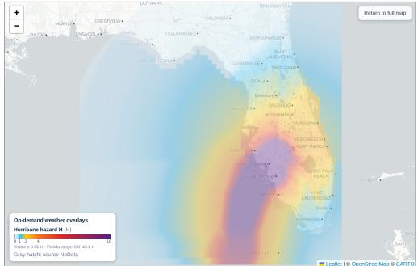  
c

b  
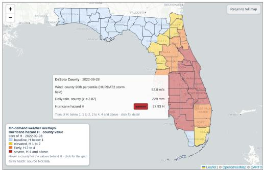  
d

## Is there a hurricane threat for DeSoto County on 28 September 2022?

DeSoto County, 2022-09-28: hurricane hazard index H = 27.93 (largest in the 30 days to the date, reached on 2022-09-28: 27.93 on the date itself). tier severe: 81% of county-months at this level had insured weather losses, 66% above \$100k. Tier boundaries on H: elevated ≥ 1, likely ≥ 2. severe ≥ 4. Inputs on the peak day: county wind 62.8 m/s. standardised rain z = 2.82 The index covers wind and rain, and the wind is a model field

## Is there a hurricane threat for Jackson County on 28 September 2022?

Jackson County, 2022-09-28: hurricane hazard index H = 0.20 (largest ir the 30 days to the date, reached on 2022-09-28: 0.20 on the date itself), tier baseline: no different from months without a storm (16% background claim rate).   
Tier boundaries on H: elevated ≥ 1, likely ≥ 2, severe ≥ 4.   
Inputs on the peak day: county wind 15.7 m/s, standardised rain z = -4 45 The index covers wind and rain, and the wind is a model field   
Insured crop losses stay at their background level at this tier, so the answer ends here.

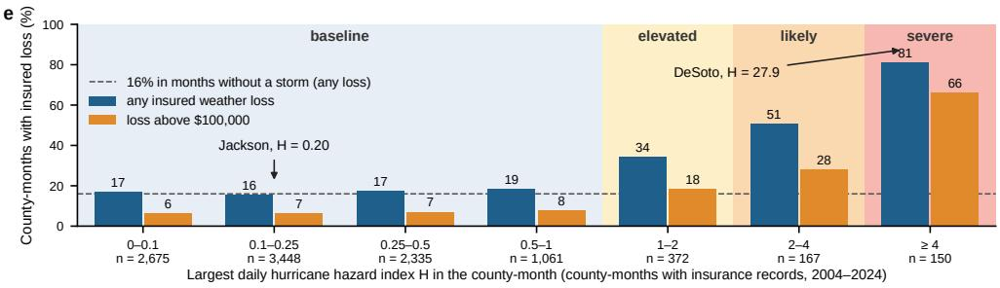  
Fig. 2 One number for the hazard. All panels are for 28 September 2022. a, The hurricane hazard index H on its native grid. b, The county-level layer for the same index, with the hover card of DeSoto County. c,d, The assistant’s answers for DeSoto County, near the storm’s track (severe tier), and for Jackson County, in the Panhandle (baseline tier). e, The proportion of county-months with insured weather losses (blue) and with losses above \$100,000 (orange) at each level of H, with the four tiers shaded.

which govern radiative cooling. For dry heat the layers are a standardised 120-day deficit of precipitation relative to evapotranspiration and the heat accumulated above 32 ◦C over the preceding 30 days, and the index is the deficit amplified by that heat. The freeze index is computed for each night, and the dry-heat index accumulates over the growing season. Their inputs were selected by the same protocol (Methods). Their tier boundaries are fixed thresholds set in the same way as those of H, from the exposed records: for freezes the median, 90th and 97th percentiles of the countymonths in which the night fell below the design temperature, and for dry heat the median, upper quartile and top decile of insured field-crop county-seasons.

## Calibrated expected-loss percentages for each crop group

The hazard tier decides what the assistant does next. If the index falls in the lowest tier, as it does for Jackson County on the case day, the assistant tells the user that the day matches one without that hazard and that insured crop losses stay at their background level; the answer ends at the tier, because for such days an estimate would sit at the background and lend false precision to a non-event (Fig. 3a). If the index is higher, the assistant treats the day as a disaster of that kind and takes everything from the first step as inputs: which crops are present in the county, their growth stage on that day, and their vulnerability. These enter the loss model calibrated for that hazard, which returns the expected loss of each crop group as a percentage of its expected season value.

How strongly a hazard afects a crop depends mainly on two factors. One is the susceptibility $\theta _ { g }$ of crop group g, how sensitive that crop is to the kind of hazard, which difers between crops and between hazards: wind strikes cotton hard and sugarcane hardly at all, and drought hits peanuts while irrigated citrus responds little. The other is its yield vulnerability on the day, $\varphi _ { g } ,$ the fraction of the season’s yield that is in the field. It is the vulnerability above without its fixed part, the value of the trees, which lies outside what crop insurance pays for and is unrelated to the percentage loss of the season’s yield that we aim to predict. Citrus stands in the field all year, whereas vegetables in late September have only part of their season in the field, so the same storm costs them less. For DeSoto County, in the severe tier, the loss model combines them with the index into two quantities for each crop group (Fig. 3b): the loss fraction $S _ { g }$ expected if damage occurs, which rises with the index, $\theta _ { g }$ and $\varphi _ { g } ,$ and the probability $P _ { g }$ that insured growers of that group receive any payout, the insurer’s payment for a loss, in the month, because many county-months with moderate hazard end without a payout. Their product, the expected loss ${ \cal L } _ { g } = { \cal P } _ { g } { \cal S } _ { g } ,$ is the quantity the assistant reports. Both refer to the insured units of the crop group, the scale on which the model was calibrated (Methods). The index is taken as its largest daily value in the 30 days that end on the selected date (the season to date for dry heat), which follows the insured losses used to calibrate the model: they are recorded by month and, once incurred, stay in the monthly record, so that the estimate holds at its peak as the storm passes instead of falling back day by day. For citrus $S _ { g }$ and $P _ { g }$ are 83% and 98%, an expected loss of 82% of the season’s expected value. Percentages are county-level values for each crop group, which match the scale of the insured-loss records used to calibrate them.

Similarly, when asked about a county and a date at which the index of another hazard is high, the assistant returns the corresponding expected-loss table for every crop group the model covers (Fig. 3c,d), here for the freeze of 11 January 2010 in Hendry County and for dry heat in Jackson County on 15 August 2011, both in the severe tier.

The same loss model also draws a map. The fourth layer in the hazard panel colours every county by the loss to its crops if damage occurs, as a percentage of their expected season value, and lists the crop groups behind each value on hover. A drop-down shows one crop group at a time, with the counties that do not grow it left blank, here citrus (Fig. 3e). The layer is computed on demand, either by asking the assistant about a date or with a compute button, and appears for dates whose values are cached. For 28 September 2022 the citrus counties along the track of Ian in the south-west have the highest values.

<table><tr><td rowspan=1 colspan=1>Cropgroup</td><td rowspan=1 colspan=1>If damageoccurs</td><td rowspan=1 colspan=1>Probability of aninsured loss</td><td rowspan=1 colspan=1>Expectedloss</td></tr><tr><td rowspan=1 colspan=1>citrus</td><td rowspan=1 colspan=1>83%</td><td rowspan=1 colspan=1>98%</td><td rowspan=1 colspan=1>82%</td></tr><tr><td rowspan=1 colspan=1>vegetable</td><td rowspan=1 colspan=1>67%</td><td rowspan=1 colspan=1>86%</td><td rowspan=1 colspan=1>57%</td></tr><tr><td rowspan=1 colspan=1>other fruit</td><td rowspan=1 colspan=1>46%</td><td rowspan=1 colspan=1>73%</td><td rowspan=1 colspan=1>33%</td></tr></table>

<table><tr><td rowspan=1 colspan=1>Gop</td><td rowspan=1 colspan=1>If damageoccurs</td><td rowspan=1 colspan=1>Probability of aninsured loss</td><td rowspan=1 colspan=1>Expectedloss</td></tr><tr><td rowspan=1 colspan=1>vegetable</td><td rowspan=1 colspan=1>36%</td><td rowspan=1 colspan=1>69%</td><td rowspan=1 colspan=1>25%</td></tr><tr><td rowspan=1 colspan=1>other fruit</td><td rowspan=1 colspan=1>29%</td><td rowspan=1 colspan=1>68%</td><td rowspan=1 colspan=1>19%</td></tr><tr><td rowspan=1 colspan=1>citrus</td><td rowspan=1 colspan=1>21%</td><td rowspan=1 colspan=1>68%</td><td rowspan=1 colspan=1>14%</td></tr><tr><td rowspan=1 colspan=1>sugarcane</td><td rowspan=1 colspan=1>2.7%</td><td rowspan=1 colspan=1>3.1%</td><td rowspan=1 colspan=1>0.1%</td></tr></table>

<table><tr><td rowspan=1 colspan=1>Crop group</td><td rowspan=1 colspan=1>If damageoccurs</td><td rowspan=1 colspan=1>Probability of aninsured loss</td><td rowspan=1 colspan=1>Expectedloss</td></tr><tr><td rowspan=1 colspan=1>peanut</td><td rowspan=1 colspan=1>36%</td><td rowspan=1 colspan=1>86%</td><td rowspan=1 colspan=1>31%</td></tr><tr><td rowspan=1 colspan=1>grain andoilseed</td><td rowspan=1 colspan=1>33%</td><td rowspan=1 colspan=1>79%</td><td rowspan=1 colspan=1>26%</td></tr><tr><td rowspan=1 colspan=1>cotton</td><td rowspan=1 colspan=1>34%</td><td rowspan=1 colspan=1>62%</td><td rowspan=1 colspan=1>21%</td></tr><tr><td rowspan=1 colspan=1>vegetable</td><td rowspan=1 colspan=1>4.6%</td><td rowspan=1 colspan=1>16%</td><td rowspan=1 colspan=1>0.7%</td></tr><tr><td rowspan=1 colspan=1>other fruit</td><td rowspan=1 colspan=1>3.3%</td><td rowspan=1 colspan=1>6.3%</td><td rowspan=1 colspan=1>0.2%</td></tr></table>

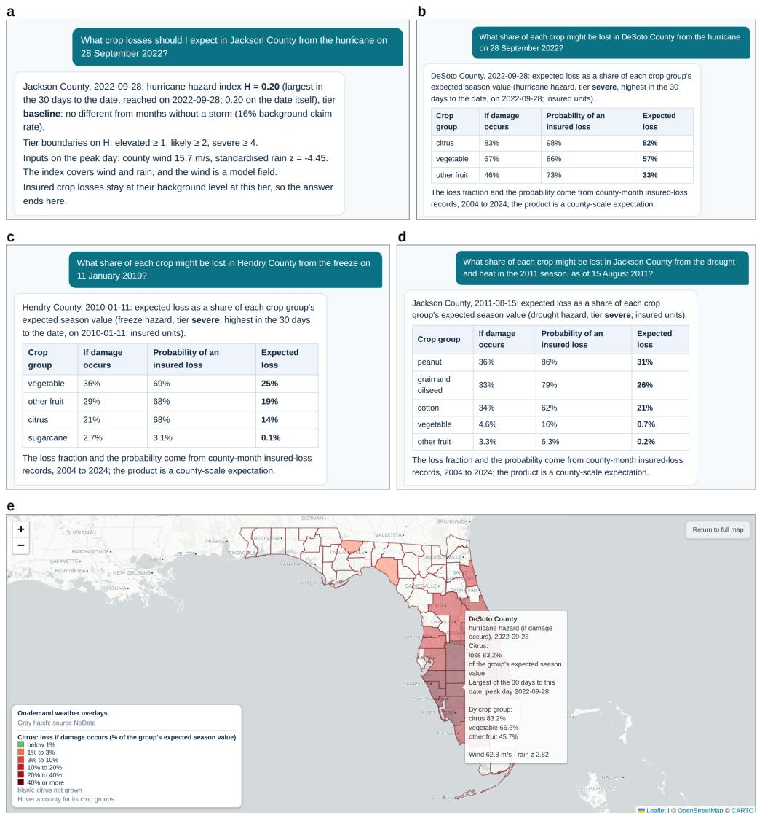  
Fig. 3 From hazard to a percentage of the crop. a, A county in the lowest hazard tier (Jackson County, hurricane, 28 September 2022): the answer ends at the tier. b, A county in the severe tier on the same day (DeSoto County): expected loss by crop group. c,d, The same output for a freeze (Hendry County, 11 January 2010) and for dry heat (Jackson County, 15 August 2011). e, The countylevel layer for citrus on the same day, with the hover card of DeSoto County.

The three steps keep the conversation proportionate to the evidence. A user who asks about a quiet day receives a map and a short reassurance. A user who asks about a hurricane, a freeze or a dry season receives the crops at risk, how much of their value is likely to be lost, how likely that loss is, and where each number comes from. In both cases the path from weather record to answer is visible in the session, which is what makes the answer usable by people who must act on it and defend it.

## How far the answers can be trusted

The hazard indices and percentage losses WxCrop returns are advisory estimates, meant to show a user how severe a hazard is likely to be for each crop group and where to look first, and this section shows their validity at that level. Such a test needs loss labels that can be tied to the weather that caused them, and we assembled these ourselves: insured-loss records separated by the recorded cause of loss at the scale of county, crop group and month, with independent records alongside. Against these we will show two things in turn: that the three hazard indices detect and order the hazards they stand for, and that the loss model reproduces the insured losses it was calibrated on, agrees in ranking with records from outside the insurance data and returns a calibrated probability of a payout (Fig. 4).

First, to show that the hazard indices detect the hazards they stand for, we use the area under the receiver operating characteristic curve (AUC) [35], the probability that a randomly chosen day with a recorded event receives a higher index than a randomly chosen day without one, which is 0.5 for a random score and 1 for a perfect one. These reference records contain no crop information. The hurricane index H separates recorded tropical-cyclone days from other days with an AUC of 0.98 (Fig. 4a), and the test of its ordering was given above, where insured losses rise with its tier (Fig. 2e). The freeze index separates recorded freeze days from other days with an AUC of 0.99, and insured freeze losses rise with its tier, from 2% of winter county-months without a freeze to 78% in the highest tier, with 53% above \$100,000 (Fig. 4b). The dry-heat index separates seasons with severe drought in the U.S. Drought Monitor with an AUC of 0.76 for the season to date, which looks modest as a number but is good agreement with a reference that blends several drought indicators and follows slow deficits more closely than crop losses (Methods), and across its tiers the proportion of insured field-crop county-seasons with a payout above \$100,000 rises from 24% to 74% and the proportion of seasons with severe drought from 6% to 64% (Fig. 4c).

Second, to show that the loss model reproduces the insured losses it was calibrated on, we predicted each year with a model whose susceptibilities, calibrated on the other years of two decades of county-level insured-loss records separated by the recorded cause of loss, had never seen that year. The predicted loss summed over storm countymonths matched the recorded total to within 2% (Fig. 4d).

The ranking of the percentages also agrees with independent records, which include uninsured growers. County citrus production records from the agricultural statistics service were ordered by the model’s citrus loss with a rank correlation of 0.63 across 110 county-seasons and 0.78 across the 11 counties of the Ian season (Fig. 4e). In the university’s post-storm county reports for five hurricanes, the model’s loss index ordered 66% of 27,963 pairs of counties correctly, from 58% for Idalia to 76% for Milton, against 50% expected by chance.

The probability of a payout is calibrated. In 1,660 storm county-months the Brier score was 0.177 against 0.224 for the historical frequency, and in ten equal groups of predicted probability the observed proportion with a payout stayed within 8 percentage points of the prediction (Fig. 4f). All values are point estimates.

a  
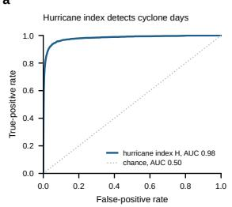

b  
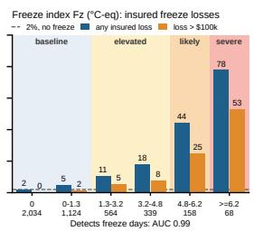

c  
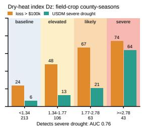

d  
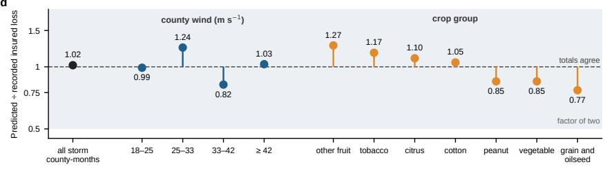

e  
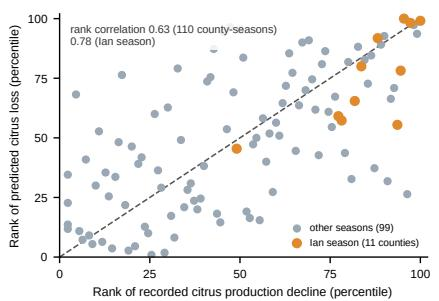

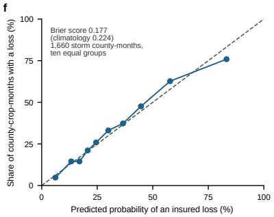  
Fig. 4 How far the answers can be trusted. a, Receiver operating characteristic curve of the hurricane index H against recorded tropical-cyclone days. $\mathbf { b } ,$ Proportion of winter county-months with insured freeze losses (blue) and with losses above \$100,000 (orange) in each range of the freeze index, with the number of county-months below the axis. $\mathbf { c } ,$ Proportion of insured field-crop countyseasons with a claim above \$100,000 (orange) and of seasons with severe drought in the U.S. Drought Monitor (green) in each tier of the dry-heat index. d, Hurricane predictions against recorded insured losses, summed over storm county-months with each year held out. 1 means the totals agree and the grey band is a factor of two. e, Rank of the predicted citrus loss against the rank of the recorded citrus production decline, for 110 county-seasons, with the 11 counties of the Ian season in orange. f, Calibration of the probability of an insured loss, in ten equal groups of storm county-months.

The loss checks above are for hurricanes. The freeze and dry-heat percentages are also checked, but less well, because high-quality public data are scarce. For freezes the percentages were compared with state-level and multi-county estimates for the freezes of 2010 and 2026 [36, 37]; the model gave the right order of magnitude, with extreme events a factor of two to five below the reports and a loss near zero for sugarcane, which the assistant reports when the tier is high. For dry heat the independent records were weaker still, because county yields of Florida field crops track the insured-loss label itself only loosely. For vegetables, which are rarely insured in Florida, the assistant marks the percentage as an extrapolation from insured growers.

## Discussion

WxCrop turns a date and a hazard into an answer that can be traced: the weather layers behind the hazard, the crops beneath them with their growth stage and vulnerability, a weather-only index whose tier rests on how often such weather has been followed by insured loss, and, for the higher tiers, the expected loss of each crop group as a percentage of its expected season value. The assistant ofers these percentages as a reference for the user, at the level of validity shown in Results.

Earlier work approaches the question from three sides. Conversational assistants have begun to answer agricultural questions: ClimSight draws on climate projections and a location’s soil, land use and crop requirements to advise whether a crop suits a place in the decades ahead, with the language model reasoning from the retrieved material to the answer [26]. Weather-only indices describe the hazard. The Hurricane Composite Intensity Index behind the UF/IFAS estimates adds the level numbers of wind, rainfall and flood depth, so that the sum carries no interaction and cannot tell its terms apart, a parcel under strong wind, heavy rain and shallow ponding scoring the same as one under strong wind, light rain and deep ponding, and the published reports present no test of it against recorded losses [6, 38]. The compound index of Chen et al. [15], on which the multiplicative form here builds, is an event total from station sums checked against provincial disaster statistics, the Taiwan field evidence [16] is a tabulation of loss area by event type, and other weather-only indices rank cyclones for property by wind, size and speed [39], so none gives the intensity at one county on one day or from a forecast. Loss models built on the insurance records take one hazard with one or a few crops and report coeficients or predictions for a county by year, season or month, and none inverts the deductible structure to recover the damage fraction from the payout or compares a hazard-specific loss with independent production records of the same events [22–24, 40–42]. WxCrop improves each and joins them. Its compound indices are computed for every county and day, past or forecast, and chosen by causal analysis among physically plausible interacting factors, wind with rain for hurricanes, cold with clear skies for freezes and deficit with heat for dry heat. Its loss models answer the limits of the insurance-based studies one by one: every crop group has its own susceptibility to each of the three hazards, the loss is that of a given day, obtained from the index of that day and the crop’s growth stage on it rather than from a coeficient or a prediction for a year, season or month, the damage fraction is recovered from the payout by the inversion described in Methods, which finds for each county, commodity and month the damage that would have produced the recorded payout under the deductibles held, and the result is checked against independent production records of the same events (Results). Its assistant operates these models and relays their results with their sources, in place of reasoning from retrieved text. It is therefore the first assistant to carry a weather hazard through calibrated crop-loss models to the parcels beneath it.

Because the layers are connected and each stands on its own evidence, one answer serves users at the depth each needs: a specialist can open any layer and find the sourced records behind it, with the assistant assembling them on request, and a grower, an emergency manager or an agency can take the tier and the percentages as directional guidance, which crops to protect first, which counties to send inspectors and relief to first, without reading the layers beneath.

For a hazard still ahead, the same indices run on seven-day forecast inputs, the National Blend of Models for wind, rain, temperature and cloud, and when the National Hurricane Center issues advisories for a storm, its forecast track and wind radii replace the blended wind, so that the forecast index gains accuracy as these event-specific forecasts arrive. Several uses follow from this design and remain to be measured. Agencies can locate fields for verification and order relief from the tier and crop groups of each county, growers can compare scenarios under a forecast storm, and insurers can anticipate payouts by crop group. In each case the percentages serve as a reference that field verification then refines.

Absolute dollar loss is the hardest output because no public record states it at a level that could serve as a label: insurance files record payouts, the payments after deductibles to the insured growers, post-storm reports give preliminary county estimates, and disaster programmes record payments rather than losses, and earlier studies share this dificulty. These records support percentages far better than precise dollar analysis, and for users who need a dollar figure the model also predicts one on request, at the level of an order of magnitude with its stated accuracy: for the 215 county-months with recorded payouts above \$100,000, the retrospective model fell within a factor of ten of the payout in 92% of cases and within a factor of five in 81%, the daily estimate in 83% and 66%, and for moderate events the daily estimate was typically below a quarter of the payout. The percentage of expected season value remains the primary answer, because it can be checked against the insurance records from which it was calibrated, whereas a dollar figure adds exposure data and prices whose errors compound it.

The strength of the models is set by the labels that public data provide. Insuredloss records are available by county, crop group, month and cause, and independent loss records are scarcer, so the checks in this study reach direction and county-scale totals. Better labels, such as farm-level insurance records, adjuster reports or fieldverified damage under data agreements with agencies and insurers, would let the same procedure calibrate finer than the county and fit stronger models. Where a state holds records that Florida lacks, such as county loss reports for freezes or field-level flood damage, the same models can be fitted and checked more closely there than in our Florida demonstration. A diference-in-diferences (DiD) check on insured losses in nine south-eastern states showed no trend before the storm, a response that rises with wind, rain and their interaction, with the same behaviour in Florida, Georgia, North Carolina, South Carolina and Alabama, which supports extending the procedure beyond Florida. The three families demonstrated here together account for 64% of weather-caused insured payouts in Florida and 68% across nine south-eastern states (Table 1), and each has a weather signal that public archives provide for any date. Excess moisture, with 30% of Florida payouts and 21% across the nine states, is the natural next family: tying its claims to the weather that caused them needs labels finer than the county-month, such as adjuster reports or field-verified flood damage, which other states or agencies may hold, and the procedure applies directly where they do. Hail and non-cyclone wind have loss records and sparser weather inputs, and records of finer scale would extend the framework to them.

Table 1 Percentage of weather-caused crop-insurance payouts by hazard family, 2004–2024. USDA Risk Management Agency Cause of Loss records [8], commodity years 2004–2024, payouts with a weather cause. Families group the recorded causes: hurricane/tropical (hurricane, tropical storm, tropical depression); excess moisture/flood (excess moisture, flood, cold wet weather); freeze/cold (freeze, frost, cold winter); drought/heat (drought, heat, hot wind, failure of irrigation supply). Non-weather causes (price decline, wildlife, disease, insects, mycotoxin) are excluded from the denominator. The nine states are Alabama, Florida, Georgia, Louisiana, Mississippi, North Carolina, South Carolina, Texas and Virginia. The three families treated in this paper are marked with an asterisk.
<table><tr><td>Hazard family</td><td>Florida (%)</td><td>Nine south-eastern states (%)</td></tr><tr><td>Hurricane / tropical*</td><td>36.6</td><td>5.2</td></tr><tr><td>Excess moisture / flood</td><td>30.2</td><td>21.4</td></tr><tr><td>Freeze / cold*</td><td>14.2</td><td>3.7</td></tr><tr><td>Drought / heat*</td><td>13.1</td><td>59.3</td></tr><tr><td>Wind (non-cyclone)</td><td>3.4</td><td>4.2</td></tr><tr><td>Hail</td><td>0.9</td><td>5.9</td></tr><tr><td>Other weather</td><td>1.6</td><td>0.4</td></tr><tr><td>Weather-caused payouts (US$ billion)</td><td>1.4</td><td>34.2</td></tr></table>

## Methods

The workflow of WxCrop applies anywhere in the world. We demonstrate it on Florida, and the methods below carry to any other region and period by replacing the data sources with those of that region and period and refitting the model to them.

## Data preparation

The study covers the 67 counties of Florida for 2004–2024, the period for which the insured-loss records, the hurricane archive and the gridded weather archives overlap. The hazard index is computed for each county and day, and the loss model is fitted on county × crop-group × month units, where the eight crop groups (citrus, vegetables, other fruit, sugarcane, cotton, peanuts, grains and oilseeds, tobacco) aggregate the 32 insured commodities present in Florida. The data are of three kinds, weather, agricultural and loss records. For each kind we describe the sources, how they were combined and processed, and what a dataset must provide to replace ours when the workflow is extended to another region or period.

Weather. Each hazard draws on the archive that records it best (Table 2). Tropicalcyclone winds come from HURDAT2, the only record that resolves the core of a cyclone, and the oficial forecast of the National Hurricane Center supplies the wind of an Atlantic cyclone that threatens Florida for the five days it covers, with the National

Blend of Models for the sixth and seventh, because over 98 storms its county winds difered from the best track by 4 to $6 \mathrm { m } \mathrm { s } ^ { - 1 }$ , against 11 to $\mathrm { 1 5 m s ^ { - 1 } }$ for the gusts of the National Blend of Models, which are too weak at the core of a cyclone.

The sources are combined by what each can represent. The wind field of a cyclone is rebuilt from the best-track fixes with a radial profile through the reported wind radii [67], because reanalyses and forecasts smooth the core of a cyclone and underestimate its winds, and the county value is the 90th percentile of grid-cell maxima, which represents the part of the county the core passed over rather than the county mean. On days without a cyclone within 600 km, wind is the daily maximum gust divided by 1.3 to approximate sustained wind. Rainfall is the county mean of daily totals, logtransformed and standardised, and a standardised precipitation–evapotranspiration index (SPEI) [68] is computed for each county and calendar month. Where an archive has not yet published a day, rainfall falls back to gridMET and then to the blend and the other variables to the blend, with minimum temperature corrected against PRISM for its warm bias on cold nights. On the map the colour boundaries of each layer are percentiles of its own history, from the median to the 99th.

A replacement weather dataset must be daily, because the index is computed each day and the loss model takes its largest value over 30 days, gridded finer than the county, because a county mean or a 28-km reanalysis smooths away the core of a storm and the cold-air pools, continuous over the period of the loss records, so that the history of every county is comparable across events, and equipped with a forecast counterpart, so that the same index can run for the coming week. Where no finer archive spans the whole period, the next-finest one fills the gap, as ERA5 does for gusts before the HRRR record begins.

Agricultural data. The data answer three questions, which crop grows where, when it is in the field, and what value is at stake (Table 2). The FSAID inventory gives each agricultural parcel a crop class and a specific crop, in four versions with base years from 2018 to 2024, and the version for a date is the latest base year before the target year, or the earliest version for earlier dates.

Growth stage comes from a growing calendar by crop and region (north, central and south Florida), with planting dates and days to maturity for annual crops and harvest months for perennial crops. The vulnerability v of a parcel on the selected date is the fraction of the crop’s expected season value at risk, $v = f + ( 1 - f ) p _ { : }$ , where f is the fixed fraction held in the plant, the value of the trees for perennial crops and zero for annual crops, and p is the progress of the season on that date, the fraction of the days from planting (or bloom, for fruit crops) to maturity that have passed. For annual crops $p = \operatorname* { m a x } ( t / T , s )$ , with t the days since planting, T the days to maturity and s the establishment cost already invested on the day of planting as a fraction of the season’s value, for example the cost of seeds.

A replacement agricultural dataset must say which crop grows where, because the loss model works on the crops present in each county, when, because the vulnerability of a crop depends on how far its season has progressed on the date, and what value is at stake, because the loss is expressed as a fraction of the season’s expected value. A parcel-scale crop map whose crop names link to a calendar, a regional calendar of planting dates and days to maturity or of harvest months, and a value for the crop provide these.

Table 2 Data used in this study. Each row gives the quantity, the dataset that supplies it, what it provides and the period used.
<table><tr><td>Kind</td><td>Quantity or use</td><td>Dataset</td><td>Provides</td><td>Period</td></tr><tr><td rowspan="8">Weather</td><td>Wind in cyclones</td><td>HURDAT2 best track [43]</td><td>Centre, maximum wind and radii,</td><td>2004-2024</td></tr><tr><td>Wind</td><td>ERA5 [44], High-Resolution</td><td>six-hourly Daily maximum 10-m</td><td>2004-2024,</td></tr><tr><td>elsewhere</td><td>Rapid Refresh (HRRR) [45]</td><td>gust</td><td>HRRR from 2014</td></tr><tr><td>Threatening cyclone</td><td>National Hurricane Center forecast</td><td>Forecast track and wind radii</td><td>Up to five days</td></tr><tr><td>Rain</td><td>Analysis of Record for</td><td>Daily precipitation (1</td><td>2004-2024</td></tr><tr><td>Freeze</td><td>Calibration (AORC) [46] Parameter-elevation Regressions</td><td>km) Minimum</td><td>Winters</td></tr><tr><td></td><td>on Independent Slopes Model (PRISM) [47], ERA5</td><td>temperature, night cloud cover</td><td>2003-26</td></tr><tr><td>Drought and heat</td><td>gridded Surface Meteorological dataset (gridMET) [48]</td><td>Precipitation, evapotranspiration, maximum temperature</td><td>2003-2026</td></tr><tr><td></td><td>Missing days, forecast</td><td>National Blend of Models [49]</td><td>Gusts, rain, temperature, cloud cover</td><td>Forecast days, up to seven</td></tr><tr><td rowspan="10">Crops</td><td>Which crop grows where</td><td>FSAID [50]</td><td>Parcels with crop class and specific crop</td><td>Four versions, 2018-2024</td></tr><tr><td>Crop label</td><td>Cropland Data Layer, Crop</td><td>Crop of each pixel or</td><td>Year by year</td></tr><tr><td>check When it is in</td><td>Sequence Boundaries [51, 52] Growing calendars [53–56]</td><td>field in each year Planting dates, days</td><td>Calendar of a</td></tr><tr><td>the field</td><td></td><td>to maturity, harvest months</td><td>typical year</td></tr><tr><td>What value is at stake</td><td>Enterprise budgets of the University of Florida, the</td><td>Cost fraction invested at planting</td><td>Budgets of 2001 to 2026</td></tr><tr><td></td><td>University of Georgia and Auburn University [57–59]</td><td></td><td></td></tr><tr><td></td><td>2022 Census of Agriculture [60], Florida Citrus Statistics [61] Tree age and decline status, a</td><td>County crop values Age of citrus trees,</td><td>2022 census, citrus 2023–24 Parcels with</td></tr><tr><td></td><td>screening layer derived here from Landsat composites and NAIP imagery</td><td>which sets their value</td><td>estimates</td></tr><tr><td>Calibration</td><td>USDA Risk Management Agency loss records [8]</td><td>Payouts and liabilities by county, crop,</td><td>2004-2025</td></tr><tr><td>Check, events</td><td>NCEI Storm Events Database [62]</td><td>month, cause Tropical-cyclone and freeze days</td><td>2004-2024</td></tr><tr><td>Check, drought</td><td>U.S. Drought Monitor [63]</td><td>Weekly county</td><td>2000-2026</td></tr><tr><td></td><td></td><td>UF/IFAS post-storm reports</td><td>drought categories County loss ratios</td><td>Five storms,</td></tr><tr><td>losses</td><td></td><td></td><td></td><td></td></tr><tr><td></td><td></td><td></td><td></td><td></td></tr><tr><td></td><td>production</td><td>UF/IFAS and FDACS freeze</td><td>and yield</td><td></td></tr><tr><td></td><td>Check,</td><td>NASS county production and</td><td>County production</td><td></td></tr><tr><td></td><td></td><td></td><td></td><td></td></tr><tr><td></td><td></td><td></td><td></td><td></td></tr><tr><td></td><td></td><td>[6, 10, 38, 64, 65]</td><td></td><td>2022-2024</td></tr><tr><td></td><td></td><td></td><td></td><td></td></tr><tr><td></td><td></td><td></td><td></td><td></td></tr><tr><td></td><td></td><td></td><td></td><td></td></tr><tr><td></td><td>Check,</td><td></td><td></td><td></td></tr><tr><td></td><td></td><td></td><td></td><td></td></tr><tr><td></td><td></td><td></td><td></td><td></td></tr><tr><td></td><td>hurricane</td><td></td><td></td><td></td></tr><tr><td></td><td></td><td></td><td></td><td></td></tr><tr><td></td><td></td><td></td><td></td><td></td></tr><tr><td></td><td></td><td></td><td></td><td></td></tr><tr><td></td><td></td><td></td><td></td><td></td></tr><tr><td></td><td></td><td></td><td></td><td></td></tr><tr><td></td><td></td><td></td><td></td><td></td></tr><tr><td></td><td></td><td></td><td></td><td></td></tr><tr><td></td><td></td><td></td><td></td><td></td></tr><tr><td></td><td></td><td></td><td></td><td></td></tr><tr><td></td><td></td><td></td><td></td><td></td></tr><tr><td></td><td></td><td></td><td></td><td></td></tr><tr><td></td><td></td><td></td><td></td><td></td></tr><tr><td></td><td></td><td></td><td></td><td></td></tr><tr><td></td><td></td><td></td><td></td><td></td></tr><tr><td></td><td></td><td></td><td></td><td></td></tr><tr><td></td><td></td><td></td><td></td><td></td></tr><tr><td></td><td></td><td></td><td></td><td>1998-2025</td></tr><tr><td></td><td></td><td></td><td></td><td></td></tr><tr><td></td><td></td><td></td><td></td><td></td></tr><tr><td></td><td></td><td></td><td></td><td></td></tr><tr><td></td><td></td><td></td><td></td><td></td></tr><tr><td></td><td></td><td></td><td></td><td></td></tr><tr><td></td><td></td><td></td><td></td><td></td></tr><tr><td></td><td></td><td></td><td></td><td></td></tr><tr><td></td><td></td><td></td><td></td><td></td></tr><tr><td></td><td></td><td></td><td></td><td></td></tr><tr><td></td><td></td><td></td><td></td><td></td></tr><tr><td></td><td></td><td></td><td></td><td></td></tr><tr><td></td><td></td><td></td><td></td><td></td></tr><tr><td></td><td></td><td></td><td></td><td></td></tr><tr><td></td><td></td><td></td><td></td><td></td></tr><tr><td></td><td></td><td></td><td></td><td></td></tr><tr><td></td><td></td><td></td><td></td><td></td></tr><tr><td></td><td></td><td></td><td></td><td></td></tr><tr><td></td><td></td><td></td><td></td><td></td></tr><tr><td></td><td></td><td></td><td></td><td></td></tr><tr><td>Check, freezes</td><td></td><td>yields [61, 66]</td><td></td></table>

Abbreviations: ERA5, fifth-generation ECMWF reanalysis. HURDAT2, Atlantic hurricane database, second generation. FSAID, Florida Statewide Agricultural Irrigation Demand. NCEI, National Centers for Environmental Information. NASS, National Agricultural Statistics Service. UF/IFAS, University of Florida Institute of Food and Agricultural Sciences.

Loss records. The label of the loss model is the payout, in dollars, recorded by the USDA Risk Management Agency (Table 2) by county, commodity and insurance plan. The payout, formally recorded as indemnity, is smaller than the loss in the field because a policy leaves a deductible, a fraction of the crop’s expected value, to the grower and pays only the loss beyond it. RMA also provides other necessary complementary data. The first is the liability, the most a policy can pay, which is the product of the expected value in the field in dollars and the coverage level, where the coverage level is one minus the deductible, given for each deductible that the policies of a unit hold. The second is the cause of loss, of which the weather causes are hurricane, tropical storm and tropical depression, excess moisture, wind and flood, and the hurricane subset is used where stated. The third is the mapping rule of how payouts, recorded by month, relate to liabilities, recorded by harvest year. The panel holds 60,135 units in 50 counties, each a county, commodity, insurance plan and month of loss. The independent checks are in Table 2.

Inversion from payout to damage fraction. RMA payouts could serve as a good calibration target for the loss model, but for broader value and the convenience of users we recover the damage fraction d, the fraction of the crop’s expected value lost in the field, and use it as the main outcome of WxCrop. RMA states the policy by which payouts are calculated from $d ,$ but predicting d in the reverse direction is inexact, for reasons such as a zero payout not meaning zero loss in the field. We use bisection to solve this reverse direction from payout to d. For a unit whose liability is spread over deductibles $\delta _ { k }$ in shares w , a damage fraction d shared by all its insured farms gives the loss cost $\textstyle \sum _ { k } w _ { k } \operatorname* { m a x } \{ 0 , d - \delta _ { k } \} / ( 1 - \delta _ { k } )$ , which rises with $d ,$ so bisection finds the single d that reproduces the recorded loss cost. A unit with no payout is censored at the lowest deductible among those holding at least 5% of its liability, which treats it as damage below that deductible and not as none. From here on the damage fraction d is the label on which the loss model is built. To test whether this inversion method is acceptable, we further need to prepare two datasets: (1) years of the loss records held out of the fit, on which the model is tested for reproducing the damage fraction d on data it has not seen, and (2) an independent record that does not pass through the insurance files, which cross-validates the damage fraction d itself, for which we use the county citrus production of the Florida Citrus Statistics (Loss model).

A replacement loss dataset must give losses by county, crop and month, separated by cause, with the deductibles of the policies, over enough years to contain many events. Its independent checks must come from a process unrelated to the loss records, and those for the hazard indices must carry no crop information.

## Hazard indices

We consider three questions in turn while building a hazard index: (1) what basic shape, or family of formula, the index should take, (2) how to make sure that the index marks real damage to crops, and (3) which weather factors are efective in indicating loss from the hazard. Each question is answered against a diferent reference record, and what that record contains sets what the answer can show: the first against records of the weather event itself, which carry no crop information, the second and third against the damage fraction d. The candidates and decisions for each hazard are in Tables 3–5.

To answer the first question, we wrote down candidate inputs and shapes and scored each by how well it separated days with a recorded event from days without one, so that the choice rests on weather alone. The score is the AUC, as introduced in Results.

To answer the second question, we compared each county and crop group in the months when the index reached a chosen tier with the same county and crop group in other months and with other counties in the same month, so that the lasting diferences between counties and the shocks shared by a month do not distort the comparison. This is a diference-in-diferences (DiD) design with two-way fixed efects [69–72], which has been applied to the hurricane losses of insured crops [41]. Defining the groups by the intensity of the weather, here the tier of the index, avoids the attenuation that simple definitions of exposure cause [41]. The comparison is made on the damage fraction d (Data preparation), pooled over crop groups with weights by liability, because the index is built from weather alone to detect whether an agricultural disaster is occurring and this step needs only a directional signal of loss, not the loss of any one crop. The diference in the damage fraction between the two groups is the efect of reaching the tier, so that an efect of 0.1 means a damage fraction 10 percentage points higher, and standard errors are clustered by year. Three results show that the index marks real damage. Damage in the months before the event does not difer between the two groups, the efect rises from tier to tier as the weather becomes more extreme, and the efect predicted by the model itself agrees with the estimate from the comparison. The design is described step by step in the code repository (docs/CAUSAL\_ANALYSIS\_DESIGN.md).

To answer the third question, we entered each candidate factor in two ways, as a factor that acts on loss by itself and as one that amplifies or weakens the damage that a tier of the index brings, and we wrote down the direction in which each should act before the run. A factor was kept when its efect had that direction with an interval that supports it, and when it was larger than chance would produce. To judge chance we shufled the factor among the months of each county 200 times and refitted the model [73], which breaks the link between the factor and the loss and keeps the distribution of the factor within the county, and p is the proportion of shufles that reached the observed efect.

Hurricane index. For hurricanes we first ranked the weather quantities by how well each alone detected the county-days with a recorded tropical cyclone in the NCEI Storm Events Database [62] over 2004–2024. The AUC was 0.980 for wind, 0.871 for rain, 0.838 for ponded water and 0.729 for wet hours, so wind and rain became the inputs of the index. We then compared shapes, wind alone above a zero point, wind with rain as a multiplier, wind with an additive dose of rain, wind raised to the power of 2 or 3, a zero point of the wind fixed at tropical-storm force, and a free power and zero point. The second reference record for the shapes was the agreement of county rankings with the county loss ratios of the UF/IFAS post-storm reports for Ian, Idalia, Debby, Helene and Milton [6, 10, 38, 64, 65]. The form of dynamic pressure, with the wind squared and a free zero point, scored highest on both reference records (AUC 0.981 and agreement 0.704, against 0.970 and 0.689 for wind alone above a zero point). When the power and the zero point were both left free, the fit returned a power of 1.96 and a zero point of $5 . 2 \mathrm { m s } ^ { - 1 }$ , so we adopted the power of 2 that the pressure of wind implies. The index is

$$
H = \left( \frac { ( w - w _ { 0 } ) _ { + } } { 1 5 } \right) ^ { 2 } \exp ( a \tilde { r } ) , \qquad w _ { 0 } = 4 . 7 3 \mathrm { m s } ^ { - 1 } , \ a = 0 . 2 2 1 ,\tag{1}
$$

where w is the county sustained wind and $\tilde { r }$ the standardised log rainfall. Here $w _ { 0 }$ is the zero point of the wind load, and the divisor sets $H = 1$ at roughly 20 m s−1 with average rain.

For the second question, one group was the 760 county-months with $H \geq 2$ , the second tier of the map legend and the value reached at a county wind of about 25 m $\mathrm { s } ^ { - 1 }$ with average rain, and the other group was the remaining county-months of a Florida panel for 2004–2024 (24,053 rows of county × crop group × month), with fixed efects for county × crop group and for month. Reaching $H \geq 2$ raised the damage fraction by +0.165 (95% interval 0.120 to 0.210), the diference in the three months before a storm was within 0.02 of zero, the efect rose from $+ 0 . 0 0 8 ~ \mathrm { t o } ~ + 0 . 2 8 7$ across the tiers of H, and the efect predicted by the model, +0.179, lay within the interval of the estimate.

For the third question, rain amplifying wind was examined with continuous wind and rain as controls, on the 664 county-months with county wind of at least $2 5 \mathrm { m s } ^ { - 1 }$ 650 of which have $H \ \geq \ 2$ . It passed and became the multiplier of the index in Equation 1, with a value of 0.22 against 0.096 at the 95th percentile of the shufled values. Surface ponding and wet hours from the National Water Model retrospective [74], a rain-driven water-table proxy, wind duration, soil drainage class, the interval since the previous storm and tree age were set aside, because they fell short of chance, acted in the opposite direction to what was expected, or were small and tied to rain (Table 3). The rules were written before each run. Measured water-table anomalies from USGS and water-management-district wells [75, 76] carried a signal where wells exist and are shown as an observation layer. The tier boundaries of 1, 2 and 4 are rounded from 1.16, 2.18 and 4.41, the quantiles of the monthly maximum of H over the 1,942 county-months of 2004–2024 in which the county wind reached $1 7 . 5 \mathrm { m s ^ { - 1 } }$ 2 the 34-knot wind at the outermost radius reported in HURDAT2.

Freeze index. The freeze index measures how far the night’s temperature falls below what each farmland cell normally reaches in winter. It is

$$
F _ { z } = \Big ( \frac { 1 } { N } \sum _ { k = 1 } ^ { N } \big ( T _ { d , k } - T _ { \mathrm { m i n } , k } \big ) _ { + } \Big ) \exp \Big ( \frac { c z _ { \mathrm { c l o u d } } } { 2 } \Big ) , \qquad c = - 0 . 2 4 ,\tag{2}
$$

where $T _ { \mathrm { m i n } , k }$ is the night’s PRISM minimum in farmland cell k of the N cells of the county, $T _ { d , k }$ the design temperature of that cell, the fifth percentile of its November– March nightly minima over 2004–2024, and $z _ { \mathrm { c l o u d } }$ the standardised night cloud cover, so that clear nights count more. Against the freeze days of the Storm Events Database, this form scored an AUC of 0.98 with ERA5 temperatures and 0.99 with PRISM, against 0.87 for the depth below $0 ^ { \circ } \mathrm { C }$ . For the second question, one group was the county-months with $F _ { z } \geq 4 . 8 ^ { \circ } \mathrm { C } .$ -equivalent and the other the remaining ones of the Florida winters (10,099 rows of county × crop group × month, month fixed efects). Reaching that value raised the damage fraction by +0.046 (0.009 to 0.083), the diference before the freeze was within 0.01 of zero, the efect rose from +0.008 to +0.087 across tiers, and the efect predicted by the model, +0.053, lay within the interval. Counties above and below that value coexist in 19 of the 20 winter months in which any county reached it, so that the comparison does not rest on the contrast between cold and mild months alone. Among the further factors (Table 4), clear-sky cloud cover was kept because it acted in the expected direction, was larger than chance and raised the agreement between predicted and recorded losses in the years left out of the fit [77], and freezing degree-hours were verified but not used because the depth already carries the duration (correlation 0.82). The tier boundaries are 1.3, 4.8 and 6.2 ◦C-equivalent.

Table 3 Hurricane index H: tests, candidates and decisions. Efects are diferences in the damage fraction [95% cluster interval], defined in Methods. p is the proportion of 200 within-county permutations that reached the observed value (below 0.005 when none did).
<table><tr><td>Step</td><td>Candidate (data)</td><td>Result</td><td>Decision</td></tr><tr><td>Inputs (area under the curve, AUC)</td><td>Wind, rain, ponding depth, wet hours (HURDAT2, AORC, National Water</td><td>AUC for cyclone days: wind 0.980, rain 0.871, ponding 0.838, wet hours 0.729</td><td>Wind and rain</td></tr><tr><td>Form (area under the curve, AUC)</td><td>Model) Wind alone above a zero point, wind × rain, wind + rain dose, exponent 2 or 3, zero point fixed or free</td><td>AUC for cyclone days 0.970, 0.972, 0.921, best 0.981. Agreement with UF/IFAS reports 0.689, 0.703, 0.703, best 0.704 (exponent 2, free</td><td>Dynamic pressure, free zero point</td></tr><tr><td>Design (difference-in- differences, DiD)</td><td> $H \geq 2 ,$  Florida, 24,053 rows</td><td>zero point) Effect +0.165 [0.120, 0.210]. Before the storm -0.016, -0.002, +0.009. Tiers +0.008,  $+ 0 . 0 3 7 , + 0 . 1 0 4 , + 0 . 2 8 7 .$ </td><td>Passed</td></tr><tr><td rowspan="4">Factor (permutation)</td><td>Rain × wind (AORC)</td><td>Model +0.179 +0.066 [0.030, 0.102], p &lt; 0.005</td><td>Adopted, multiplier</td></tr><tr><td>Ponding, wet hours (National Water Model)</td><td> $+ 0 . 0 1 7 , + 0 . 0 0 6 , p < 0 . 0 0 5 ,$  small and tied to rain</td><td>Set aside</td></tr><tr><td>Water-table depth, drainage class, tree</td><td> $p = 0 . 2 7 \mathrm { - } 0 . 9 8 ,$  or sign opposite</td><td>Set aside</td></tr><tr><td>age, days since storm Wind duration (HURDAT2 hourly</td><td>+0.002, -0.014 with peak wind controlled</td><td>Set aside</td></tr><tr><td></td><td>field) Measured water-table anomaly (wells)</td><td>+0.008 [0.002, 0.014],  $p < 0 . 0 \dot { 0 } \dot { 5 }$  in 13 counties</td><td>Observation layer</td></tr></table>

Table 4 Freeze index $F _ { z } { : }$ tests, candidates and decisions. Efects are diferences in the damage fraction [95% cluster interval], defined in Methods. p is the proportion of 200 within-county permutations that reached the observed value (below 0.005 when none did). For factors, c is the exponent of a multiplier exp(cz) on the index. Factors marked † need hourly fields and were tested on the ERA5 index, the others on the PRISM index.
<table><tr><td>Step</td><td>Candidate (data)</td><td>Result</td><td>Decision</td></tr><tr><td>Form (area under the curve, AUC)</td><td>Depth below  $0 ^ { \circ } \mathrm { C } ,$  below the second or fifth percentile design temperature (ERA5, PRÍSM)</td><td>AUC for freeze days 0.870, 0.935, 0.981. PRISM farmland-weighted mean 0.991</td><td>PRISM, fifth percentile</td></tr><tr><td>Design (difference-in- differences, DiD)</td><td> $F _ { z } \geq 4 . 8 ^ { \circ } \mathrm { C } -$  equivalent, Florida winter, 10,099 rows</td><td>Effect +0.046 [0.009, 0.083]. Before the freeze -0.008,  $+ 0 . 0 0 1 , + 0 . 0 0 3 . { \mathrm { ~ T i e r s ~ } } + 0 . 0 0 8 ,$   $+ 0 . 0 2 4 , + 0 . 0 6 1 , + 0 . 0 8 7 .$ </td><td>Passed</td></tr><tr><td rowspan="4">Factor (permutation)</td><td>Night cloud cover</td><td>Model +0.053  $c = - 0 . 2 4 3 , p < 0 . 0 0 5 .$  sign as expected. Rank correlation</td><td>Adopted, clear-sky</td></tr><tr><td>Freezing degree-hours†</td><td>0.334 against 0.327 c = +0.23, p &lt; 0.005, sign as expected. Rank correlation 0.366 against 0.364, correlated</td><td>factor Verified, not deployed</td></tr><tr><td>Night wind, previous 14-day temperature</td><td>0.82 with depth  $c = - 0 . 2 6 2 \ \hat { ( p } < 0 . 0 0 5 )$   $c = - 0 . 1 1 0 \ ( p = 0 . 1 7 ) , { \mathrm { s i g n } }$ </td><td>Set aside</td></tr><tr><td>Previous-day maximum†, previous 30-day cold†, soil</td><td>opposite  $p \dot { = } 0 . 2 1 , 0 . 5 3 , 0 . 9 0$ </td><td>Set aside</td></tr></table>

Dry-heat index. The dry-heat index combines a long and a short deficit of water with heat. It is

$$
D _ { z } = \mathrm { \ ( S P E I _ { 1 2 0 } ^ { + } } + 0 . 8 0 \mathrm { S P E I _ { 3 0 } ^ { + } } \mathrm { ) } \exp ( 0 . 1 1 7 z _ { \mathrm { h e a t } } ) ,\tag{3}
$$

where $\mathrm { S P E I } _ { k } ^ { + }$ is the positive part of the standardised k-day deficit of precipitation minus reference evapotranspiration and $z _ { \mathrm { h e a t } }$ the standardised 30-day sum of degreedays above $3 2 ^ { \circ } \mathrm { C }$ . The 120-day window was chosen from windows of 30 to 270 days by its agreement with the weekly U.S. Drought Monitor [63] county tables for 2000– 2026 (AUC for severe drought 0.88), where a season with severe drought has at least a quarter of its weeks with half or more of the county area in severe drought or worse. Because drought losses are recorded at harvest, the comparison for the second question used county × crop-group × season units of insured field crops (1,125 rows over 21 years, year fixed efects), with the index averaged over April–September and weighted by crop phenology. Averaged over the treated classes the efect was +0.028 (−0.009 to 0.066), it rose steadily with the class of the season index to +0.112 (0.043 to 0.181) in the top decile, and the efect predicted by the model, +0.054, lay within the interval of the estimate. The short deficit and the heat factor (Table 5) were added because they improved the agreement in the years left out of the fit and were larger than chance (the heat factor 0.117 against 0.072 at the 95th percentile of the shufled values). Against seasons with severe drought in the Drought Monitor, which blends several indicators and follows long-term deficits, the season-to-date index reached an AUC of 0.76 and the 120-day deficit alone 0.88, and the short deficit and the heat factor that lower the first number raise the AUC for insured field-crop payouts above \$100,000 from 0.61 to 0.71. The index applies to field crops, with irrigated citrus, vegetables and sugarcane responding little. The tier boundaries are 1.34, 1.77 and 2.78. Excess moisture outside tropical cyclones was examined with a heavy-rain and wet-spell index against recorded flood days and insured claims, and only its rain tier was retained.

Table 5 Dry-heat index $D _ { z } \colon$ tests, candidates and decisions. Efects are diferences in the damage fraction [95% cluster interval], defined in Methods. p is the proportion of 200 within-county permutations that reached the observed value (below 0.005 when none did). For factors, c is the exponent of a multiplier exp(cz) on the index.
<table><tr><td>Step</td><td>Candidate (data)</td><td>Result</td><td>Decision</td></tr><tr><td rowspan="2">Form (area under the curve, AUC)</td><td>Deficit window of 30 to 270 days, precipitation alone</td><td>AUC for severe drought 0.71, 0.81, 0.85, 0.88, 0.89, 0.85. Precipitation alone 0.83</td><td>120 days</td></tr><tr><td>(gridMET, SPEI) Season index classes,</td><td>Effect of the top decile</td><td>Dose</td></tr><tr><td rowspan="2">Design (difference-in- differences, DiD) Factor (rank</td><td>Florida insured field crops, 1,125 rows</td><td>+0.112. Classes +0.008, +0.051, +0.064, +0.112. Model +0.054 (mean effect</td><td>response monotone</td></tr><tr><td>Flash-drought term (30-day deficit)</td><td>+0.028 [-0.009, 0.066]) Rank correlation 0.577 against 0.545 for the slow deficit alone</td><td>Adopted, added to the</td></tr><tr><td rowspan="2">correlation, permutation)</td><td>Heat (degree-days above  $\mathrm { { 3 2 ^ { \circ } C ) } }$ </td><td>c = 0.117 against a permutation 95th percentile</td><td>dose Adopted, multiplier</td></tr><tr><td>Vapour-pressure deficit, antecedent rain, irrigated fraction, soil water capacity</td><td>of 0.072 p = 0.14, 0.40, 0.41, sign opposite. Antecedent rain depends on the window</td><td>Set aside</td></tr></table>

## Loss model

The hazard indices contain weather only, so an index value means the same for every crop and every stage of the season. The chain branches here because what a hazard does to a crop depends on the crop and on how much of its season is in the field, and these diferences can be learned only from labels that carry crop information. The comparison for the second question already shows the diference. For the same hurricane index, the damage fraction rises by +0.30 for citrus, +0.32 for cotton, +0.16 for peanuts, +0.13 for tobacco and +0.06 for vegetables, by little for grains and oilseeds (+0.04) and by an amount indistinguishable from zero for other fruit and sugarcane. $\mathrm { U p }$ to here the outcome pooled all crop groups, so that diferences between crops averaged out. From this point the crop groups are separated, and the county production records of single crops join the checks. The steps of the chain are in Table 6.

Table 6 Loss model: tests, candidates and decisions. Rank correlations are Spearman correlations. Efects of $H \geq 2$ are design estimates on the damage fraction by crop group.
<table><tr><td>Step</td><td>Candidate (data)</td><td>Result</td><td>Decision</td></tr><tr><td>Label</td><td>Damaged acreage, loss cost, recovered damage fraction</td><td>Rank correlation with county citrus production shortfalls 0.36, 0.47, 0.58</td><td>Recovered damage fraction</td></tr><tr><td>Crop depèndence</td><td>Effect of  $H \geq 2 { \mathrm { ~ b y } }$  crop group (difference-in- differences, DiD)</td><td>Citrus +0.30, cotton +0.32, peanuts +0.16, tobacco +0.13, vegetables +0.06, grains and oilseeds +0.04, other fruit</td><td>Susceptibility  $\theta _ { g }$  by group</td></tr><tr><td>Structure</td><td>Four equally weighted factors, wind alone, H with  $\theta _ { g }$ </td><td>+0.02, sugarcane -0.06 Storm-month rank correlation, leave-one-year-</td><td> $S _ { g } = 1$   $\mathrm { e x p } ( - \theta _ { g } \varphi _ { g } ^ { \gamma } H )$ </td></tr><tr><td>Yield vulnerability</td><td>Floor of  ${ \vec { 0 . 0 2 } } ,$  establishment-cost fractions</td><td>out, 0.351, 0.361, 0.397 Rank correlation 0.405, 0.405</td><td>Establishment- cost fractions</td></tr><tr><td>Storm periphery, moisture</td><td>Fraction of county  $\geq 1 8 \mathrm { m s ^ { - 1 } }$  thresholds by group, hours above  $1 8 \mathrm { m s } ^ { - 1 }$  rainfall extremes,</td><td>Every metric within the permutation spread</td><td>Set aside</td></tr><tr><td>Payout probability</td><td>wet-day runs, soil moisture, ponding  $P _ { g }$  with a background rate and a storm scale</td><td>Brier score 0.177 against 0.224 for the climatological rate</td><td>Adopted</td></tr></table>

The model starts from the damage fraction d. We compared three definitions of the label by how well each agreed, in rank, with the county citrus production shortfalls of the Florida Citrus Statistics, and the damage fraction (0.58) agreed better than the loss cost, payout over liability, both in dollars (0.47), and the damaged acreage (0.36), which measures only the breadth of claims.

The damage of a crop group cannot be below 0 or above 1, rises with the index and levels of at high values, so the loss fraction takes the form

$$
\begin{array} { r } { S _ { g } = 1 - \exp \big ( - \theta _ { g } \varphi _ { g } ( t ) ^ { \gamma } H \big ) , } \end{array}\tag{4}
$$

in which the susceptibility $\theta _ { g }$ is how sensitive crop group g is to the hazard and the yield vulnerability $\varphi _ { g } ( t )$ is the fraction of the season’s yield in the field on the date (defined below). The freeze and dry-heat layers use the same saturating form with their own index in place of H, the freeze layer with $F _ { z }$ squared, as the wind enters $H$ , and the dry-heat layer with the season’s accumulation of $D _ { z }$ , weighted by crop phenology, raised to a fitted power, each with susceptibilities and exponents fitted to the insured losses of their own causes (freeze, frost, cold wet weather and cold winter, and drought, heat and hot wind). With a susceptibility for each crop group and H as the hazard, the rank agreement between predicted and recorded damage in storm months, in years left out of the fit, was 0.397, against 0.351 for the earlier product of four equally weighted factors and 0.361 for wind alone.

The yield vulnerability is the larger of the progress of the season and the establishment-cost fraction while a planting is in the field, because the seed, fumigation and land preparation of a planting are invested from the day it is planted, and this leaves the rank agreement unchanged (0.405, the same as with the earlier floor of 0.02). The progress is read from the same growing calendar as the growth stages on the map. For a crop group, $\varphi _ { g } ( t )$ is the mean, weighted by insured liability, of the progress from planting to maturity of its crops, lifted to the establishment-cost fraction s while a planting is in the field and averaged over regions, so that it lies between 0.02 and 1. It reaches 1 at maturity and stays at 1 through the harvest months, and perennial groups are held at 1 throughout. Unlike the vulnerability v of a parcel on the map, it excludes the fixed fraction held in the trees, which lies outside what crop insurance pays. Replacing $\varphi _ { g }$ for annual crops by the acreage-weighted parcel vulnerability of each county, computed as on the map, and refitting the hurricane model reproduces its performance in the years left out (rank agreement 0.41 against 0.40 across storm county-months, ratio of totals 1.01 against 1.02). Terms for the periphery of a storm (the fraction of the county at or above $1 8 \mathrm { m s ^ { - 1 } }$ , thresholds by crop group, hours above $1 8 \mathrm { m } \mathrm { s } ^ { - 1 }$ , and rainfall extremes within the county) and for moisture (runs of wet days, soil moisture and parcel ponding) were tested under the same rules as the factors of the hazard indices and set aside, because every metric stayed within the spread of the shufled values.

The susceptibilities and the exponent were fitted by least squares, weighted by liability, to the damage fraction d on the county × group × month panel, with a small penalty on the size of the susceptibilities. The susceptibilities are citrus 0.064, cotton 0.116, tobacco 0.085, vegetables 0.066, peanuts 0.051, other fruit 0.022, grains and oilseeds 0.012 and sugarcane 0.001, and the exponent is $\gamma = 0 . 4 5$ . Many countymonths with moderate hazard end without any payout, so the model also gives the probability that an insurable loss occurs,

$$
P _ { g } = 1 - ( 1 - b _ { g } ) \exp \bigl ( - k _ { g } S _ { g } ^ { * } \bigr ) , \qquad S _ { g } ^ { * } = \theta _ { g } \varphi _ { g } ( t ) ^ { \gamma } H ,\tag{5}
$$

where $b _ { g }$ is the background payout rate in months without storms and $k _ { g }$ scales the storm-driven part. Both were fitted by maximum likelihood to whether any positive payout for a weather cause was recorded. The unit of observation is the county × crop group × month, so $P _ { g }$ is the probability that insured growers of that group in the county receive any payout in the month. The unit matches how insurance losses are recorded by month of loss, and the value for a date is the largest daily index over the 30 days that end on it. The probability is a county average over policy counts, so counties with few policies tend to fall below, and counties with many above, the fitted probability. The expected loss $L _ { g }$ of Results is the product of the two,

$$
L _ { g } = P _ { g } S _ { g } .\tag{6}
$$

Dry heat is fitted on county × crop-group × crop-year units with the index averaged over April–September and weighted by crop phenology, because drought losses are recorded at harvest.

Loss fractions are expressed relative to the expected value of the season’s yield, the basis on which insurance guarantees are set. The loss fraction $S _ { g }$ and the expected loss $L _ { g }$ that the assistant reports, and the county loss fractions that the map shows, are on the insurance scale, the damage on the insured units of the group, which is the scale on which the model was calibrated. The county value on the map is the mean of the $S _ { g }$ of its crop groups weighted by their expected season value. For reference, the insurancescale damage is about $\kappa = 1 . 6 5$ times the decline of county production records (95% interval 1.36–2.00), the median ratio over the 268 county-seasons and county-cropyears with a recorded insurance loss and a production decline above 5% (58 of 110 citrus county-seasons and 210 of 10,898 field-crop county-crop-years from Florida, Georgia, Alabama, South Carolina and North Carolina, the five states in which a windonly response fitted to the other eight south-eastern states reproduced the recorded hurricane losses to within 0.77 to 1.25 times, the latter at county wind of at least $3 3 \mathrm { m } \mathrm { s } ^ { - 1 } )$ , with a bootstrap over event years. Dollar figures, returned on request, multiply $P _ { g }$ by the expected loss cost under a within-county spread of farm-level damage $( \mathcal { N } ( S _ { g } , 0 . 2 0 ^ { 2 } )$ , the spread fitted in the full insurance model) and by the annual liability. The full retrospective insurance model, which adds a zero-inflation term, censored likelihood, a citrus liability-to-production ratio and monthly lagged rainfall, is described in the code repository (docs/INSURANCE\_LOSS\_MODEL\_PAPER\_NOTES\_2026-10-05.md), and its county-month estimates serve as the retrospective reference in validation.

To judge the model on years it had not seen, we left each of the 21 years out in turn, fitted the model on the others and predicted the year left out. Rank agreement is reported as Spearman correlation or as the proportion of county pairs ordered correctly, totals as ratios of predicted to observed sums, and probabilities by the Brier score and by calibration in ten equal groups. In the insurance panel we report the rank agreement between the predicted loss fraction $S _ { g }$ and the damage fraction d in storm months, the ratio of their liability-weighted totals, and the calibration by wind class (18–25, 25–33, 33–42 and ${ \geq } 4 2 \mathrm { m } \mathrm { s } ^ { - 1 } )$ . The rank agreement was 0.40, the ratio of the totals over storm county-months was 1.02, with ratios from 0.82 to 1.24 across the four wind classes and from 0.77 to 1.27 across seven crop groups, and 85% of the 20 largest recorded county-months were predicted within a factor of two. These comparisons are on the insurance scale and use storm county-months with county wind of at least $1 8 \mathrm { m s ^ { - 1 } }$ , and sugarcane, which has almost no recorded storm loss, is omitted from the crop-group ratios. External checks used records that played no part in fitting the parameters. Two of them, the UF/IFAS loss ratios and the citrus production records, had also guided the choice of index form and of label above. County citrus production shortfalls relative to the previous season, from the Florida Citrus Statistics county tables [61], were compared with the citrus percentage by rank correlation, where the percentage is the largest daily conditional citrus loss S from June to November of the preceding year. County loss ratios from the UF/IFAS reports were compared by the proportion of county pairs ordered correctly across events, which is reported as a descriptive proportion because county pairs that share a county or a storm are dependent. The dollar outputs of the hurricane assessment were checked on all 1,188 county-months with H ≥ 1 against recorded payouts and the retrospective model. The headline checks are reported as point estimates.

## Assistant implementation

The assistant is a language model that works between the user and the tools of the platform, and it never computes or invents a number. From a question it writes a structured request: which quantity, for which county, crop, date and hazard, and which tool answers it, the hazard index, the loss model, the crop map or the weather layers. The platform runs the tools and records each result as a receipt that holds the value, its unit, the data version and the filters applied. The reply is then assembled by the platform from these receipts, and the model words the sentences around them, so every number in an answer traces to one tool call and its sources. A hazard assessment returns two receipts, the index with its tier and the loss by crop group, and a tier is accepted only when it follows from the index value and the tier boundaries. When a request falls outside the tools, the assistant says so instead of estimating, and when the tools cover only part of a request it marks the answer as partial. The platform currently runs on GPT-6 Sol (OpenAI), and the model is a replaceable part: as language models improve, the platform takes up the newest one without any change to the tools, the receipts or the checks, so the assistant advances with them.

## Code availability

The code of WxCrop and of the analyses reported here, and the public web interface of WxCrop, are being finalised for release and will be made available in a later version of this preprint.

## Data availability

All source data are public and are listed with their citations in Methods, Data preparation. The scripts that download and process them and the derived tables of every analysis reported here will be released with the code.

## Use of AI tools

Language-model assistants (Claude, Anthropic, and ChatGPT, OpenAI) were used under the authors’ direction to draft and edit the text and to write and check the analysis and platform code. The authors designed the study, verified every analysis, number and citation, and take full responsibility for the content. The assistant inside WxCrop is itself built on a language model, as described in Methods.

## References

[1] FAO. The impact of disasters on agriculture and food security 2025. Tech. Rep., Food and Agriculture Organization of the United Nations, Rome (2025).

Published November 2025. The FAO press release of 14 November 2025 gives the annual average, about 4% of global agricultural GDP: https://www.fao.org/ne wsroom/detail/disasters-cost-global-agriculture--3.26-trillion-over-three-decad es--fao-report-reveals/.

[2] FAO. From prediction to protection: how FAO strengthens climate risk management for farmers and investors. https://www.fao.org/climate-change/news/n ews-detail/from-prediction-to-protection--how-fao-strengthens-climate-risk-m anagement-for-farmers-and-investors/en (2026). FAO Climate Change news, 10 February 2026; states that climate-related disasters cost global agriculture an estimated USD 2.9 trillion between 1991 and 2023. Accessed October 2026.

[3] Lesk, C., Rowhani, P. & Ramankutty, N. Influence of extreme weather disasters on global crop production. Nature 529, 84–87 (2016).

[4] Hultgren, A. et al. Impacts of climate change on global agriculture accounting for adaptation. Nature 642, 644–652 (2025).

[5] Tuninetti, M. & Davis, K. F. Addressing global hotspots of drought-related crop production losses. Nature Communications 17, 6605 (2026).

[6] Court, C. D., Qiao, X., Koeneke, R. & McDaid, K. Estimated agricultural losses resulting from hurricane milton. Tech. Rep., University of Florida Institute of Food and Agricultural Sciences, Department of Food and Resource Economics (2025). URL https://fred.ifas.ufl.edu/media/fredifasufledu/economic-impact-a nalysis/disasters/FRE-Final-Hurricane-Milton-Report.pdf.

[7] Court, C. D., Qiao, X., Koeneke, R. & McDaid, K. Preliminary assessment of agricultural losses and damages resulting from hurricane milton. Tech. Rep., University of Florida Institute of Food and Agricultural Sciences (2024). 20 December 2024; https://fred.ifas.ufl.edu/media/fredifasufledu/economic-impactanalysis/reports/FRE-Preliminary-Hurricane-Milton-Report.pdf.

[8] USDA Risk Management Agency. Summary of business and cause of loss historical data files. https://www.rma.usda.gov/tools-reports/summary-of-business (2025). Accessed October 2026.

[9] U.S. Government. Disaster designation process, 7 CFR part 759. https://www. govinfo.gov/content/pkg/CFR-2024-title7-vol7/xml/CFR-2024-title7-vol7-par t759.xml (2024). Section 759.5(c): a county must have had production losses of 30 percent of at least one crop in the county, documented in a loss assessment report (section 759.5(b)). Edition of 1 January 2024, accessed October 2026.

[10] Court, C. D., Qiao, X., Koeneke, R. & McDaid, K. Estimated agricultural losses resulting from hurricane helene. Tech. Rep., University of Florida Institute of Food and Agricultural Sciences, Department of Food and Resource Economics (2025). URL https://fred.ifas.ufl.edu/media/fredifasufledu/economic-impact-a

nalysis/reports/FRE-Hurricane-Helene-Final-Report.pdf.

[11] USDA Farm Service Agency. USDA provides additional flexibilities to respond to 2024 hurricanes, expedites emergency conservation and disaster recovery payments for producers in nine states impacted by hurricanes in 2016 to 2023. USDA Farm Service Agency news release (2024). 5 December 2024; accessed 4 October 2026.

[12] Florida Department of Agriculture and Consumer Services. Commissioner wilton simpson announces agricultural producers can now apply for over \$600m for 2023 and 2024 hurricane disaster relief. FDACS press release (2026). 25 February 2026; accessed 4 October 2026.

[13] USDA Southeast Climate Hub. Hurricane preparation and recovery guides for florida producers. https://www.climatehubs.usda.gov/hubs/southeast/hurrican e-preparation-and-recovery-guides-florida-producers. Accessed 4 October 2026.

[14] Zscheischler, J. et al. Future climate risk from compound events. Nature Climate Change 8, 469–477 (2018).

[15] Chen, P., Yu, H., Xu, M., Lei, X. & Zeng, F. A simplified index to assess the combined impact of tropical cyclone precipitation and wind on china. Frontiers of Earth Science 13, 672–681 (2019).

[16] Lai, L.-W. The relationship between extreme weather events and crop losses in central Taiwan. Theoretical and Applied Climatology 134, 107–119 (2018).

[17] USDA National Agricultural Statistics Service. 2024 Hurricane Milton disaster analysis. https://www.nass.usda.gov/Research\_and\_Science/Disaster-Analysi s/ (2024). Accessed 2026.

[18] Tziolas, N., Golmohammadi, G. & Kritharoula, A. GeoGPT for action-ready flood and disaster risk geo-intelligence in Florida. EGU General Assembly 2026, abstract EGU26-17602 (2026).

[19] WUSF. Artificial intelligence may soon give Florida farmers access to crop damage data during a hurricane. News article, 17 July 2025 (2025).

[20] Blanc, E. & Strobl, E. Assessing the impact of typhoons on rice production in the Philippines. Journal of Applied Meteorology and Climatology 55, 993–1007 (2016).

[21] Kabtih, A. K. & Qian, C. Risk of successive hot-pluvial extremes on crop yield loss over global breadbasket regions. Communications Earth & Environment 6, 1040 (2025).

[22] Reyes, J. J. & Elias, E. Spatio-temporal variation of crop loss in the United States from 2001 to 2016. Environmental Research Letters 14, 074017 (2019).

[23] Yao, L. et al. Land-use and atmospheric shifts jointly amplify U.S. drought-driven crop losses. npj Natural Hazards 3, 65 (2026).

[24] Lazin, R., Shen, X. & Anagnostou, E. Climate-informed flood damage assessment in the cropland area across the midwestern USA. Scientific Reports 15, 43760 (2025).

[25] Kooshki Forooshani, M. et al. Towards a global impact-based forecasting model for tropical cyclones. Natural Hazards and Earth System Sciences 24, 309–329 (2024).

[26] Kuznetsov, I. et al. Transforming climate services with LLMs and multi-source data integration. npj Climate Action 4, 97 (2025).

[27] Xie, Y. et al. MARSHA: multi-agent RAG system for hazard adaptation. npj Climate Action 4, 70 (2025).

[28] Chen, Z., Asadi Shamsabadi, E., Jiang, S., Shen, L. & Dias-da Costa, D. Integration of large vision language models for eficient post-disaster damage assessment and reporting. Nature Communications 17, 1481 (2026).

[29] Zhou, Y., Matyas, C., Liu, P. & Li, H. Identification of tropical cyclone-related flash floods from hazard narratives using a large language model-based approach. npj Natural Hazards 2, 104 (2025).

[30] Yu, M., Sun, Y., Yi, C., Wen, Y. & Yang, H. Bringing agentic search to Earth observation data discovery (2026). Accepted to CIKM ’26, arXiv:2607.02387.

[31] Ji, Z. et al. Survey of hallucination in natural language generation. ACM Computing Surveys 55, 1–38 (2023).

[32] Williams, H. T. P. et al. Developing trustworthy AI for climate services at scale. npj Climate Action 5, 74 (2026).

[33] Reichstein, M. et al. Early warning of complex climate risk with integrated artificial intelligence. Nature Communications 16 (2025).

[34] Défossez, P. et al. Impact of soil water content on the overturning resistance of young Pinus pinaster in sandy soil. Forest Ecology and Management 480, 118614 (2021).

[35] Hanley, J. A. & McNeil, B. J. The meaning and use of the area under a receiver operating characteristic (ROC) curve. Radiology 143, 29–36 (1982).

[36] Roka, F. M., Ozores-Hampton, M. & McAvoy, G. Estimating financial losses to vegetable producers and farmworkers from a freeze event. Proceedings of the Florida State Horticultural Society 123, 134–137 (2010).

[37] Florida Department of Agriculture and Consumer Services. Winter storms ezra and gianna: Preliminary estimates of damage to florida agriculture. Tech. Rep., Florida Department of Agriculture and Consumer Services, Tallahassee (2026).

[38] Court, C. D., Qiao, X., Li, M. & McDaid, K. Estimated agricultural losses resulting from hurricane idalia. Tech. Rep., University of Florida Institute of Food and Agricultural Sciences, Department of Food and Resource Economics (2025). URL https://fred.ifas.ufl.edu/media/fredifasufledu/economic-impact-a nalysis/reports/FRE-Final-Hurricane-Idalia-Report-June2025.pdf.

[39] Holland, G. J., Done, J. M., Douglas, R., Saville, G. R. & Ge, M. Global tropical cyclone damage potential, 23–42 (Springer, Cham, 2019). In Hurricane Risk (eds Collins, J. M. & Walsh, K.).

[40] Perry, E. D., Yu, J. & Tack, J. Using insurance data to quantify the multidimensional impacts of warming temperatures on yield risk. Nature Communications 11, 4542 (2020).

[41] Biram, H. D., Cameron-Harp, M. & Tack, J. Measuring the impact of hurricane incidence on agricultural production risk using insurance data. American Journal of Agricultural Economics 107, 1438–1456 (2025).

[42] Seamon, E., Gessler, P. E., Abatzoglou, J. T., Mote, P. W. & Lee, S. S. A climatic random forest model of agricultural insurance loss for the Northwest United States. Environmental Data Science 1, e29 (2022).

[43] Landsea, C. W. & Franklin, J. L. Atlantic hurricane database uncertainty and presentation of a new database format. Monthly Weather Review 141, 3576–3592 (2013).

[44] Hersbach, H., Bell, B., Berrisford, P. et al. The ERA5 global reanalysis. Quarterly Journal of the Royal Meteorological Society 146, 1999–2049 (2020).

[45] Dowell, D. C., Alexander, C. R., James, E. P. et al. The High-Resolution Rapid Refresh (HRRR): an hourly updating convection-allowing forecast model. Part I: motivation and system description. Weather and Forecasting 37, 1371–1395 (2022).

[46] Fall, G., Kitzmiller, D., Pavlovic, S. et al. The Ofice of Water Prediction’s Analysis of Record for Calibration, version 1.1: dataset description and precipitation evaluation. JAWRA Journal of the American Water Resources Association 59, 1246–1272 (2023).

[47] Daly, C. et al. Physiographically sensitive mapping of climatological temperature and precipitation across the conterminous United States. International Journal of Climatology 28, 2031–2064 (2008).

[48] Abatzoglou, J. T. Development of gridded surface meteorological data for ecologi cal applications and modelling. International Journal of Climatology 33, 121–131 (2013).

[49] Hamill, T. M. et al. The U.S. National Blend of Models for statistical postprocessing of probability of precipitation and deterministic precipitation amount. Monthly Weather Review 145, 3441–3463 (2017).

[50] Florida Department of Agriculture and Consumer Services. Florida statewide agricultural irrigation demand (FSAID) agricultural land geodatabase. https: //www.fdacs.gov/Agriculture-Industry/Water/Agricultural-Water-Supply-Pla nning (2024). Versions FSAID 7, 11, 12 and 13, base years 2018, 2022, 2023 and 2024; accessed 2026.

[51] Boryan, C., Yang, Z., Mueller, R. & Craig, M. Monitoring US agriculture: the US Department of Agriculture, National Agricultural Statistics Service, Cropland Data Layer program. Geocarto International 26, 341–358 (2011).

[52] Hunt, K. A. et al. Crop sequence boundaries using USDA National Agricultural Statistics Service historic cropland data layers. Statistical Journal of the IAOS 40 (2024).

[53] Brown, S. P., Saraceno, T., Williams, L. & Treadwell, D. Florida vegetable gardening guide (sp 103), 2025 revision. https://edis.ifas.ufl.edu/publication/ VH021 (2025). UF/IFAS EDIS VH021 (SP 103), 2025 revision, planting-date Table 1; accessed 2026.

[54] U.S. Department of Agriculture, National Agricultural Statistics Service, Florida Field Ofice. Florida agricultural statistics, annual statistical bulletin 2024: Vegetables, melons and berries, planting and harvesting seasons chart (2024). Florida Field Ofice, July 2024.

[55] U.S. Department of Agriculture, National Agricultural Statistics Service. Vegetables: Usual planting and harvesting dates, agriculture handbook 507 (2007). Florida rows; May 2007 edition.

[56] U.S. Department of Agriculture, National Agricultural Statistics Service. Usual planting and harvesting dates for u.s. field crops, agricultural handbook 628. ht tps://www.nass.usda.gov/Publications/Todays\_Reports/reports/fcdate10.pdf (2010). Florida statewide dates; October 2010 edition, the current edition when the calendar was compiled.

[57] University of Florida Institute of Food and Agricultural Sciences. Enterprise budgets for florida crops: Edis documents fe436, fe1087, fe1088, hs1317 and hs1446, and southwest florida research and education center budget workbooks. https://edis.ifas.ufl.edu/ (2026). Budgets of 2003 to 2026; accessed 2026.

[58] University of Georgia Department of Agricultural and Applied Economics. Crop enterprise budgets: irrigated cotton and peanuts, 2018 and 2022. https://agecon .uga.edu/extension/budgets.html (2022). Accessed 2026.

[59] Alabama Cooperative Extension System, Auburn University. 2018 enterprise planning budget summaries for major row crops in alabama: irrigated cotton, north and south alabama. https://ssl.acesag.auburn.edu/agriculture/business -management/budgets/2018/rowcrops.php (2018). Accessed 2026.

[60] USDA National Agricultural Statistics Service. 2022 census of agriculture, volume 1, chapter 2: County level data, florida. https://www.nass.usda.gov/Publicatio ns/AgCensus/2022/ (2024). Accessed October 2026.

[61] USDA National Agricultural Statistics Service, Florida Field Ofice. Florida citrus statistics, seasons 2008–09 to 2024–25, and florida citrus summary, seasons 1998–99 to 2007–08, county production tables. https://www.nass.usda.gov/St atistics\_by\_State/Florida/Publications/Citrus/ (2026). Annual editions, the latest for the 2024–25 season published in 2026. Accessed October 2026.

[62] NOAA National Centers for Environmental Information. Storm events database. https://www.ncei.noaa.gov/stormevents/ (2026). Bulk CSV files 1996–2026; accessed October 2026.

[63] Svoboda, M. et al. The Drought Monitor. Bulletin of the American Meteorological Society 83, 1181–1190 (2002).

[64] Court, C. D., Qiao, X., Saha, B. B., He, F. & McDaid, K. Estimated agricultural losses resulting from hurricane ian. Tech. Rep., University of Florida Institute of Food and Agricultural Sciences, Department of Food and Resource Economics (2023). URL https://fred.ifas.ufl.edu/media/fredifasufledu/economic-impact-a nalysis/reports/FRE-Final-Hurricane-Ian-Report.pdf.

[65] Court, C. D., Qiao, X., Koeneke, R. & McDaid, K. Estimated agricultural losses resulting from hurricane debby. Tech. Rep., University of Florida Institute of Food and Agricultural Sciences, Department of Food and Resource Economics (2025). URL https://fred.ifas.ufl.edu/media/fredifasufledu/economic-impact-a nalysis/reports/FRE-Final-Hurricane-Debby-Report.pdf.

[66] USDA National Agricultural Statistics Service. Quick stats database. https: //quickstats.nass.usda.gov/ (2025). Accessed October 2026.

[67] Willoughby, H. E. & Rahn, M. E. Parametric representation of the primary hurricane vortex. Part I: observations and evaluation of the Holland (1980) model. Monthly Weather Review 132, 3033–3048 (2004).

[68] Vicente-Serrano, S. M., Beguería, S. & López-Moreno, J. I. A multiscalar drought index sensitive to global warming: the standardized precipitation evapotranspiration index. Journal of Climate 23, 1696–1718 (2010).

[69] Angrist, J. D. & Pischke, J.-S. Mostly Harmless Econometrics: An Empiricist’s Companion (Princeton University Press, Princeton, 2009).

[70] Bertrand, M., Duflo, E. & Mullainathan, S. How much should we trust diferencesin-diferences estimates? The Quarterly Journal of Economics 119, 249–275 (2004).

[71] Goodman-Bacon, A. Diference-in-diferences with variation in treatment timing. Journal of Econometrics 225, 254–277 (2021).

[72] Roth, J., Sant’Anna, P. H. C., Bilinski, A. & Poe, J. What’s trending in diferencein-diferences? A synthesis of the recent econometrics literature. Journal of Econometrics 235, 2218–2244 (2023).

[73] Good, P. I. Permutation, Parametric and Bootstrap Tests of Hypotheses 3 edn (Springer, New York, 2005).

[74] NOAA Ofice of Water Prediction. National Water Model retrospective dataset, version 3.0. Registry of Open Data on AWS (2023). https://registry.opendata. aws/nwm-archive/; accessed October 2026.

[75] U.S. Geological Survey. National water information system: groundwater levels for Florida. https://waterdata.usgs.gov/nwis/gw (2026). Accessed October 2026.

[76] Southwest Florida Water Management District. Water management information system: groundwater level monitoring stations. https://www.swfwmd.state.fl.us /resources/data-maps/hydrologic-data (2026). Accessed October 2026.

[77] Roberts, D. R. et al. Cross-validation strategies for data with temporal, spatial, hierarchical, or phylogenetic structure. Ecography 40, 913–929 (2017).