# Goal-Aware Dynamic Multi-Agent Collaboration for Long-Horizon Tasks

Xu Shen   
Michigan State University   
East Lansing, USA   
shenxu@msu.edu

Jianmin Wu Baidu, Inc. Beijing, China

Lingyong Yan Baidu, Inc. Beijing, China

Zhikai Chen Michigan State University East Lansing, USA

Shuaiqiang Wang   
Baidu, Inc.   
Beijing, China

Jiliang Tang Michigan State University East Lansing, USA

Jie Ren<sup>∗</sup> Massachusetts Institute of Technology Cambridge, USA rjie@mit.edu

## Ab<sub>s</sub>t<sub>rac</sub>t

LLM-based agents are increasingly used to complete complex, longhorizon tasks without human intervention. To make progress toward the task goal, agents need to perform diferent duties, such as planning and verification, when needed. To understand how sin gle agents manage these duties during long-horizon execution, we conduct a preliminary study. Our analysis shows that verification has the strongest association with task success, but often occurs late, leaving limited opportunities for correction. We also find that the proportion of duty-relevant information decreases as records from diferent duties accumulate in a shared context. These find ings lead us to examine whether multi-agent systems (MAS) can address these problems by assigning duties to agents with separate contexts. Our analysis shows that this separation alone is insuf ficient. Agents can lose track of the overall goal and repeat prior investigations. They may also lack necessary background while receiving irrelevant information from others. To maintain goal awareness and coordinate collaboration as task needs change, we propose Goal-Aware Dynamic Multi-Agent Collaboration (GAD). It uses a growing execution graph to organize subtasks and their dependencies. To keep agents focused on their goals, each context retains the original instruction and the assigned task’s goal and acceptance conditions. To adapt collaboration and information sharing during execution, agents can divide tasks into subtasks and specify dependencies based on execution evidence. These dependencies guide when agents work and which results they receive. Verification and recovery check subtask results and full task com pletion against their goals, providing feedback for repair when checks fail. Experiments with Claude Sonnet 4.6 and Qwen3.7-Plus on Terminal-Bench 2.1 and SWE-bench Pro Hard-51 show perfor mance improvements over the evaluated baselines and lower token costs than multi-agent baselines on jointly solved tasks.

CCS Conce<sub>p</sub>ts

• Computing methodologies → Artificial intelligence.

Ke<sub>y</sub>words large language model, multi-agent system

## 1 I<sub>n</sub>t<sub>ro</sub>d<sub>uc</sub>ti<sub>on</sub>

LLM-based agents have shown promising capabilities in completing complex tasks without human intervention, particularly on long horizon tasks [9, 18]. These tasks can span hundreds of interaction steps, during which agents repeatedly interact with the environment and adapt their actions based on feedback [11, 12]. To guide this process toward successful completion, agents often need to perform various duties, such as planning, reasoning, verification, and functional responsibilities [1, 5, 8], as needed throughout execution. For example, a web research agent first plans what information to search for [10], then reasons over the retrieved evidence [8], before verifying whether the evidence supports its answer [1]. Analysing these duties is crucial to understand agent trajectories. If an agent cannot allocate and switch duties when needed, it may continue executing outdated plans or leave errors unchecked [12]. Therefore, it is important to understand how agents manage these duties during long-horizon execution.

However, allocating duties efectively by a single agent can be challenging. In Section 3.1, we perform a preliminary study to examine how agents manage these duties. Our analysis reveals two key limitations: (1) Among all duties, verification exhibits the strongest association with task success, yet often occurs late in the task process. Intuitively, early verification of intermediate results can help agents detect and correct errors before they propagate into subsequent actions. However, agents may continue working on the task without performing the duty of verification, leaving errors undetected and limiting opportunities for correction. (2) Agents may struggle to retrieve relevant evidence and prior decisions for the current duty from the extensive accumulated context. Our context analysis shows that as records from diferent duties accumulate in a shared context, information relevant to the current duty accounts for a decreasing proportion of the interaction history. These two findings motivate us to investigate whether explicitly assigning distinct duties to separate agents using multi-agent systems (MAS)

can address these limitations by maintaining separate contexts and enabling verification when needed.

However, the naive adoption of MAS does not resolve the limitations of single-agent execution. In Section 3.2, we evaluate six representative multi-agent configurations on duty performance using the same trajectory analysis approach. Our analysis identifies two limitations. (1) Agents can lose track of the overall goal. They might repeat investigations that others have already attempted, spending additional steps without advancing the task. (2) Separate contexts do not automatically improve information management. Agents may lack the background or conditions needed for their duties, while messages from other agents may add irrelevant information to their contexts. These findings highlight that throughout long-horizon execution, maintaining goal awareness and dynamically coordinating duties and information exchange are important.

Motivated by these findings, we propose Goal-Aware Dynamic Multi-Agent Collaboration (GAD) for long-horizon tasks. GAD uses a growing execution graph to organize subtasks and guide information sharing during execution. Each node represents an assigned task, while edges record task decomposition and dependencies. To prevent goal drifting, we retain the original instruction and the assigned task’s goal and acceptance conditions in each agent’s context. Each task also retains its goal and the duty to satisfy it as the graph expands. To support dynamic collaboration, agents can divide their assigned tasks into subtasks and specify dependencies based on execution evidence. These dependencies guide agent scheduling and dependency-aware context construction to supply relevant results. Verification and recovery check both subtask re sults and full task completion against their goals and acceptance conditions, providing feedback for repair when checks fail. We conduct experiments on Terminal-Bench 2.1 and SWE-bench Pro Hard-51 with Claude Sonnet 4.6 and Qwen3.7-Plus, demonstrating performance improvements over the evaluated baselines. Further analyses support component efectiveness and show lower token costs than multi-agent baselines on jointly solved tasks.

## 2 R<sub>e</sub>l<sub>a</sub>t<sub>e</sub>d W<sub>or</sub>k

## 2.1 Long-Horizon Agents

Recent research improves long-horizon agents through supervised fine-tuning and multi-turn reinforcement learning. The former trains agents on synthetic interaction trajectories [23, 24, 30], while the latter develops decision-making policies through feedback from real or synthesised environments [2, 19, 20, 22]. These approaches improve agent behaviour through training, but extended execution also requires managing accumulated information and tracking task progress. MEM1 jointly learns reasoning and compact memory updates [29]. ReSum summarises interaction histories to support continued search [21], while Context-Folding trains agents to handle subtasks in separate trajectories and retain their summaries [16]. LongHorizon-Harness further separates task management, execution, and auditing to maintain independently checked progress [12]. Our method complements policy training by organising collaboration during execution. It connects agent-proposed subtasks, dependency-guided information sharing, and verification through a growing execution graph, while retaining the task goal.

## 2.2 Multi-A<sub>g</sub>ent S<sub>y</sub>stems

Multi-agent collaboration has developed from predefined role procedures towards automatically constructed collaboration structures [7]. GPTSwarm optimises agent prompts and graph connections [31], G-Designer learns task-dependent topologies [27], and AFlow searches executable workflows [28]. Graph-of-Agents further selects relevant models and structures their exchanges for each query [26]. Alongside structure design, another research direction coordinates agents during execution. Magentic-One uses a central orchestrator to track progress and delegate tasks [6]; Evolving Orchestration learns agent-selection policies [3], and AOrchestra creates specialised subagents on demand [15]. Self-Organizing Agent Teams also retains collaboration experience as reusable organisational strategies [14]. We examine these concerns through duty allocation and information use, then connect agent-proposed decomposition with dependency-guided execution and verification without a central LLM orchestrator.

## 3 Preliminar<sub>y</sub> stud<sub>y</sub>

Long-horizon tasks require agents to execute autonomously with limited human intervention and take on diferent duties as execution needs change. We first examine how single agents allocate these duties and use their shared history to obtain relevant information (Section 3.1). We then study whether assigning duties to separate agents with their own contexts improves duty organisation and information use (Section 3.2).

Task setting. We study long-horizon tasks specified by a naturallanguage instruction � and an initial environment state �<sub>0</sub>. An agent uses a policy � to select actions based on the instruction and its available context, receiving observations from the environment after each action. A harness manages tool execution, context construction, and termination. In a multi-agent system, it also determines when each agent acts and what information it receives. We evaluate task performance using an external verifier � after execution stops; during execution, agents rely on environment observations and their own checks without access to feedback from �. We examine how single-agent and multi-agent systems allocate duties and use information over extended interactions.

## 3.1 Auditin<sub>g</sub> lon<sub>g</sub>-horizon loo<sub>p</sub>s b<sub>y</sub> sin<sub>g</sub>le agen<sup>t</sup>s

A long-horizon task requires an agent to perform diferent duties at diferent stages of execution. Efective duty allocation is important for detecting errors in time and maintaining progress toward the task goal. In this section, we examine how a single agent manages these duties. Our analysis focuses on two aspects. First, we analyze how verification relates to task success and when it occurs during execution. Second, we examine how information relevant to the current duty is represented in the growing interaction history. Specifically, we first introduce the experimental setup, then present these two analyses and summarize the main findings.

Setup. We audit 193 trajectories, comprising 4,842 agent steps, on a 45-task subset of Terminal-Bench 2 whose dificulty composition follows that of the full benchmark (4 easy, 26 medium, 15 hard). We use three harnesses with Claude Opus 4.6 (Terminus

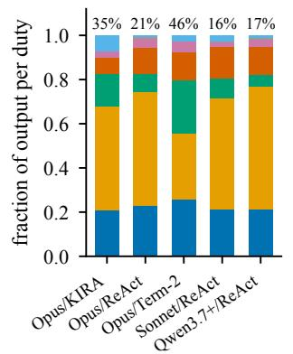  
(a) execution dominates

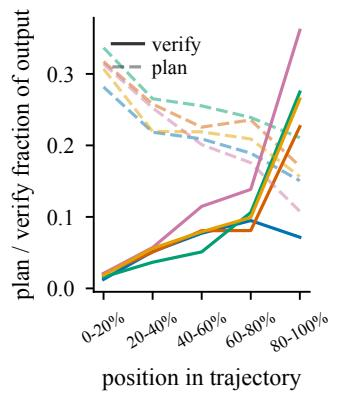  
(b) duty rotates with phase

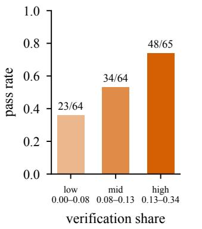

(c) verification tracks success  
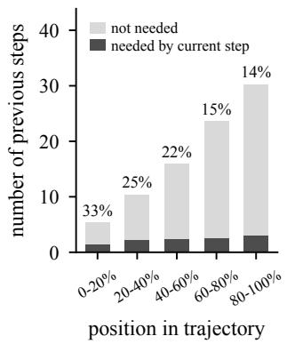  
(d) relevant context thins out  
Figure 1: (a) Output share by duty; labels show the fraction of adjacent steps with diferent dominant duties. (b) Planning (dashed) and verification (solid) output shares across trajectory positions, coloured by configuration. (c) Pass rates for three e ual-sized rou s ranked b verification share ooled across confi urations labels show assin /total trajectories. (d) Prior steps needed (dark) or not needed (light) by the current duty; labels show the needed fraction.

KIRA, a ReAct-based loop, and Terminus 2), and three base models with the ReAct loop (Claude Opus 4.6, Claude Sonnet 4.6, and Qwen3.7-Plus). We use another LLM (GPT-5.5) to attribute the content an agent produces at each step, both its stated reasoning and the action it chose, to one of six responsibilities: planning acting, interpreting an observation, verifying, self-correcting, and working of-task. Content that fits none of them falls into a seventh, unclassified category. Appendix A gives the per-configuration tables and the measurement details. We summarize the experimental results and observations as follows.

1<sub>.</sub> Th<sub>e agen</sub>t <sub>spen</sub>d<sub>s</sub> th<sub>e</sub> l<sub>eas</sub>t <sub>on ver</sub>ifi<sub>ca</sub>ti<sub>on an</sub>d l<sub>eaves</sub> it t<sub>o</sub> th<sub>e en</sub>d<sub>, a</sub>lth<sub>oug</sub>h <sub>ver</sub>ifi<sub>ca</sub>ti<sub>on</sub> i<sub>s</sub> hi<sub>g</sub>hl<sub>y re</sub>l<sub>a</sub>t<sub>e</sub>d t<sub>o</sub> t<sub>as</sub>k success. As shown in Figure 1a, verification is the smallest of the main duties (those above 10% of the output), taking at most 14% of the agent’s output. Figure 1b shows that it is also the last duty to appear. It is nearly absent early in a trajectory and peaks in the final segment. The agent thus uses verification mainly as a final verify before it stops, rather than interleaving it with execution. Besides, Figure 1c also shows that the pass rate rises from 36% in the lowest-verification group to 74% in the highest. No passing trajectory skips verification. These results suggest that verification is closely associated with task success, making its limited and late allocation notable. Verifying more is still not suficient, since about a quarter of the trajectories in the highest group fail.

2<sub>.</sub> Th<sub>e</sub> <sub>con</sub>t<sub>ex</sub>t <sub>m</sub>i<sub>xes</sub> <sub>a</sub>ll d<sub>u</sub>ti<sub>es,</sub> <sub>an</sub>d th<sub>e</sub> <sub>propor</sub>ti<sub>on</sub> <sub>re</sub>l<sub>evan</sub>t to each duty falls as the trajectory grows. A single agent keeps the history of all its duties in one context. To measure how much of this context the duty of a given step actually needs, we sample steps from every configuration and ask the judge to mark the previous steps whose content this duty requires. A previous step counts as relevant only if its content is needed, not merely because it performs the same type of duty. As shown in Figure 1d, the number of previous steps grows from about 5 to about 30 over a trajectory. In contrast, the number of relevant steps grows only from 1.4 to 3.0.

As a result, the proportion of relevant context falls from 33% to 14%. Each duty has to find what it needs among the growing amount of content produced for other duties. We argue that giving each duty its own context would potentially prevent this, and verify whether it is efective in Section 3.2.

Discussion. Our study identifies two key limitations of singleagent execution. First, verification often occurs late, despite its strong association with task success, limiting opportunities for correction. Second, records from diferent duties accumulate in a shared context, reducing the proportion of information relevant to the current duty. This may make it harder for agents to locate the evidence and prior decisions they need. These findings raise a natural question: Can explicitly assigning diferent duties to separate agents, each with its own context, improve duty allocation and access to relevant information?

## 3.2 Can mu<sup>l</sup>ti-agent s<sub>y</sub>stems su<sub>pp</sub><sup>l</sup><sub>y</sub> w<sup>h</sup>at a sin<sub>g</sub>le a<sub>g</sub>ent lacks?

In this section, we answer the above question and explain why assigning duties to separate agents with their own contexts does not by itself resolve the limitations of single-agent execution. Our analysis examines two possible reasons. First, we investigate whether individual agents remain aligned with the overall task objective during collaboration. Second, we examine whether information sharing provides each agent with the background and results needed for its duties. Specifically, we first introduce the experimental setup, then present these two analyses and summarize the main findings.

Setup. We use the same 45-task subset of Terminal-Bench 2 as in Section 3.1, and the same policy model Claude Sonnet 4.6. We evaluate six multi-agent paradigms: a MetaGPT-style role pipeline, three static communication topologies (chain, star, and fully connected), a Magentic-One-style orchestrator, and Anthropic-style subagents. With the single-agent baseline, this gives seven configurations. We judge each step with GPT-5.5, using the same responsibility audit as that in Section 3.1, now applied to each agent separately. We summarize the experimental results and observations as follows:

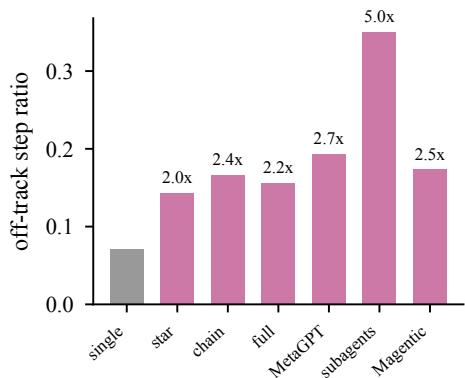  
(a) collaboration drifts off-track

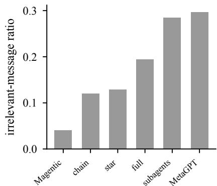  
(b) handoffs carry wrong info

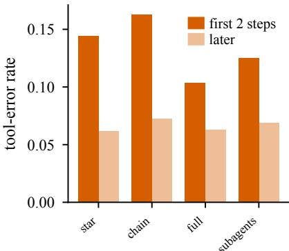  
(c) agents start blind  
Figure 2: (a) Of-track score of action steps for each system, judged against the original goal. Labels give the ratio to the single agent. (b) Fraction of messages between agents that are irrelevant to the receiving agent. (c) Tool-error rate of delegated agents in their first two steps (dark) and in later steps (light).

1<sub>.</sub> Fi<sub>xe</sub>d <sub>ro</sub>l<sub>es</sub> f<sub>a</sub>il t<sub>o</sub> k<sub>eep agen</sub>t<sub>s a</sub>li<sub>gne</sub>d <sub>w</sub>ith th<sub>e overa</sub>ll task objective. Multi-agent systems rely on collaboration among agents, yet such collaboration does not necessarily ensure that individual agents remain aligned with the overall task objective. To investigate this issue, we employ a judge to evaluate each agent’s execution history and determine whether each step contributes to progress toward the overall goal. As shown in Figure 2a, multi-agent systems exhibit of-track behavior 2–5 times more frequently than the single agent. Nearly all of-track steps involve repetitive actions that have already been attempted, indicating that agents become trapped in unproductive cycles. This behavior stems from the rigid organization of existing multi-agent systems: agent roles and execu tion order are predefined before the task is fully understood, while individual agents operate in isolation without monitoring overall task progress. These systems lack the mechanisms to dynamically adapt agent responsibilities based on feedback from task execution.

2<sub>.</sub> A<sub>gen</sub>t<sub>s</sub> l<sub>ac</sub>k <sub>awareness o</sub>f <sub>one ano</sub>th<sub>er</sub>’<sub>s</sub> i<sub>n</sub>f<sub>orma</sub>ti<sub>on</sub> needs, leading to inefective information exchange. In multiagent systems, each agent maintains its own context and exchanges messages with other agents to facilitate collaboration. However, we find that 4%–30% of the exchanged messages are irrelevant to their receivers, with systems employing more aggressive message compression exhibiting the highest irrelevance rates (Figure 2b). This ineficiency arises because senders lack awareness of the information needs of their receivers. While message summarization reduces context consumption, it may also discard critical information required by downstream agents. Furthermore, newly delegated agents often lack suficient background information to perform their assigned tasks efectively. As shown in Figure 2c, their first two execution steps exhibit failure rates up to 2.3 times higher than those of subsequent steps. Both observations highlight a fundamental limitation: existing systems lack mechanisms for agents to identify and communicate their information needs. Efective multi-agent collaboration therefore requires explicitly modeling information dependencies among agents and enabling information exchange based on these dependencies.

Discussions. The above analysis reveals two critical capabilities missing from existing multi-agent systems for long-horizon tasks. The first is goal awareness, which requires agents to continuously align their actions with the overall task objective and verify their progress toward that objective throughout execution. Existing systems lack mechanisms to monitor overall task progress, allowing agents to deviate from the goal and repeatedly perform unproductive actions. The second is dynamic collaboration, which requires agents to adapt their responsibilities and information exchange based on the evolving needs and dependencies revealed during task execution. Existing systems instead rely on predefined roles and communication structures, preventing agents from performing the right duties at the right time and exchanging the information needed for efective collaboration. Together, goal awareness and dynamic collaboration are essential for multi-agent systems to successfully execute long-horizon tasks.

## 4 M<sub>e</sub>th<sub>o</sub>d

As discussed in the previous section, efective long-horizon collaboration requires goal awareness to keep local tasks aligned with the overall objective, and dynamic collaboration to adapt the division of duties and information sharing to execution needs. To provide these capabilities, we propose Goal-Aware Dynamic Multi-Agent Collaboration (GAD). Our framework builds on a growing execution graph that starts from the original task and expands through agent-proposed subtasks and dependencies. Throughout expansion, each node retains its goal and the duty to satisfy it. We first present this graph and its execution loop in Section 4.1. We then introduce two supporting mechanisms in Section 4.2: dependency-aware context construction supplies relevant information for node execution, while verification and recovery check results and provide feedback for further execution. Figure 3 illustrates how decomposition expands the graph and verified results allow execution to continue toward integration and final verification of the original task.

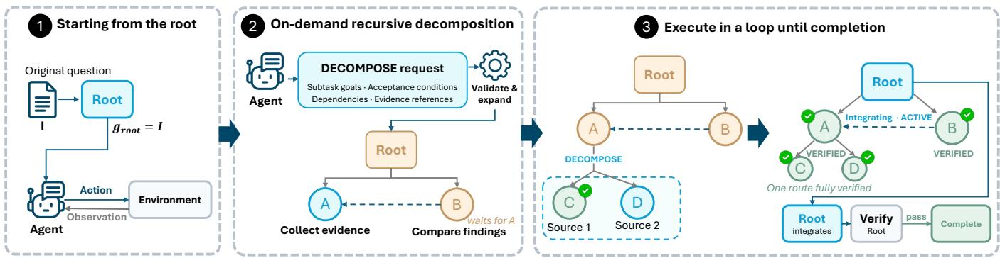  
Figure 3: Overview of GAD. (1) Execution starts from a root node representing the original task. (2) Agents propose subtasks and dependencies as execution needs emerge; the controller validates these requests before expanding the graph. (3) Execution f<sub>o</sub>ll<sub>ows</sub> d<sub>epen</sub>d<sub>enc</sub>i<sub>es un</sub>til th<sub>e roo</sub>t i<sub>n</sub>t<sub>egra</sub>t<sub>es</sub> th<sub>e resu</sub>lt<sub>s an</sub>d <sub>passes</sub> it<sub>s own ver</sub>ifi<sub>ca</sub>ti<sub>on.</sub>

## 4<sub>.</sub>1 Th<sub>e</sub> M<sub>a</sub>in Fr<sub>a</sub>m<sub>ewo</sub>rk: Gr<sub>ow</sub>in<sub>g</sub> Ex<sub>ecu</sub>ti<sub>o</sub>n Gra<sub>p</sub>h

To support goal awareness and dynamic collaboration, we use a growing execution graph to organise task goals and dependencies. The graph adapts to emerging execution needs while retaining each node’s goal and the duty to satisfy it. In the rest of this subsection, we first define the graph and explain how execution starts from the root. We then introduce agent-proposed decomposition and the controller’s validation and graph updates. Finally, we describe the execution loop and how it returns to the original task for integration and completion.

Notations. To represent task goals and their dependencies as collaboration develops, we maintain an execution graph $\mathcal { G } _ { t } = ( N _ { t } , \mathcal { E } _ { t } )$ where � indexes scheduling steps. Each node � represents an assigned task and stores its specific goal ${ \mathit { g } } _ { \boldsymbol { v } } ,$ acceptance conditions $K _ { v }$ that determine whether the goal has been achieved, and an execution status $\sigma _ { v } .$ . Edges connect a task to its subtasks, or to another task whose verified result it requires.

Step 1. Starting from the root. Initially, $N _ { 0 } = \{ v _ { \mathrm { r o o t } } \} , \mathcal { E } _ { 0 } = \emptyset .$ and $g _ { v _ { \mathrm { r o o t } } } \ = \ I .$ We include full satisfaction of � as the root’s acceptance condition and then launch an agent whose initial context contains the instruction, this completion requirement, and the root’s status. The graph has not yet expanded, so the root has no dependency results to draw on. Its execution history starts empty and accumulates observations as the agent interacts with the environ ment. These records guide subsequent actions without requiring a complete workflow in advance. The agent starts by interacting directly with the environment and uses the resulting observations to guide subsequent actions, without constructing a complete workflow in advance.

Step 2. On-demand recursive decomposition. As agents execute their assigned tasks, new observations may reveal needs for additional subtasks. To adapt the division of duties to these needs, we allow each executing agent to request decomposition. We describe when the agent makes this decision, what it submits, and how the controller uses the request to update the graph.

• When to decompose. We use on-demand decomposition to adapt the division of duties to needs that emerge during execution.

The agent executing each node decides whether to introduce subtasks, without relying on a central LLM orchestrator or a predefined communication topology. We prompt the agent executing node � to express its next decision as a structured action $u _ { t , v } .$ The core action types are

$$
\mathcal { U } _ { \mathrm { c o r e } } = \{ \mathsf { R U N } , \mathsf { D E C O M P O S E } , \mathsf { S E A R C H } , \mathsf { V E R I F Y } \} .\tag{1}
$$

These actions respectively execute an environment command, request decomposition, retrieve shared artifacts, and request verification. When type $\left( u _ { t , v } \right) = \tt D E C O M P 0 S E$ , the agent prepares a decomposition request as follows.

• Submitting decomposition requests. The agent submits a request

$$
d _ { v } = \left( \{ ( \ell _ { i } , g _ { i } , K _ { i } , P _ { i } ) \} _ { i = 1 } ^ { m } , J _ { v } \right) ,\tag{2}
$$

where $\ell _ { i }$ identifies a proposed subtask and $g _ { i }$ is its goal. The acceptance conditions $K _ { i }$ specify its completion requirements, which we assess through the verification scheme in Section 4.2.2. The dependency set $P _ { i }$ lists the subtasks or existing nodes whose verified results it requires. These dependencies guide the supply of results to its execution context through the scheme in Section 4.2.1. The set $J _ { v }$ references previous execution steps recorded at �, grounding the decomposition in execution evidence. The agent submits $d _ { v }$ to the controller for validation.

• How to update the graph. Once an agent submits a decomposition request $d _ { v } ,$ we need to determine whether it can extend the graph and how execution should proceed after the update. We introduce a lightweight, rule-based harness controller $\mathcal { H }$ to validate the request and apply graph updates without additional model inference. It checks $d _ { v }$ against the current graph, the node-specific execution history $h _ { t } ^ { v } .$ and the remaining resource budgets $B _ { t } \colon$

$$
( b _ { v } , f _ { v } ) = \mathrm { C h e c k } _ { \mathcal { H } } ( d _ { v } , \mathcal { G } _ { t } , h _ { t } ^ { v } , B _ { t } ) ,\tag{3}
$$

where $b _ { v } \in \{ 0 , 1 \}$ indicates whether the request is accepted and $f _ { v }$ provides feedback. The checks require at least one valid reference to an execution step of $v ,$ valid subtask and dependency specifications, compliance with resource limits, and an acyclic resulting graph. If $b _ { v } = 0 $ , the graph remains unchanged and the agent receives $f _ { v }$ to revise its next action. Otherwise, H creates or reuses compatible child nodes $C _ { v } ,$ resolves the references in

$P _ { i }$ into dependency edges $\mathcal { D } _ { v } .$ , and updates the graph:

$$
\begin{array} { r l } & { N _ { t + 1 } = N _ { t } \cup C _ { v } , } \\ & { \mathcal { E } _ { t + 1 } = \mathcal { E } _ { t } \cup \{ ( v , c ) : c \in C _ { v } \} \cup \mathcal { D } _ { v } . } \end{array}\tag{4}
$$

Here, $( x , y ) \in \mathcal { D } _ { v }$ means that � requires the verified result of $y .$ The child set forms a new route $\rho _ { v , k } = C _ { v ; }$ , where � indexes alternative approaches to achieving $g _ { v } .$ Node � waits while the route remains unresolved. To maintain goal awareness during graph expansion, we keep $g _ { v }$ and its full-goal acceptance condition unchanged, with the root goal remaining �. Even when a route completes, node � must still pass verification against its original goal $g _ { v }$

Step 3. Execute in a loop until completion. After updating the graph, H selects nodes for subsequent execution. The controller tracks each node’s status through four core states:

$$
\begin{array} { r } { \sigma _ { v } \in \{ \mathsf { R E A D Y } , \mathsf { A C T I V E } , \mathsf { W A I T I N G } , \mathsf { V E R I F I E D } \} . } \end{array}\tag{5}
$$

These indicate that a node can execute, is currently executing, awaits required results, or has passed verification, respectively. The controller updates these states from dependency and route outcomes and identifies the nodes still needed for the root task, denoted by $N _ { t } ^ { \mathrm { n e e d e d } }$ . It constructs the execution frontier

$$
\mathcal { F } _ { t } = \left\{ v \in N _ { t } ^ { \mathrm { n e e d e d } } \vert \sigma _ { v } = \mathsf { R E A D Y } \right\} .\tag{6}
$$

For each selected node, H launches an agent with a local context constructed through our dependency-guided scheme in Section 4.2.1. This context supplies the recorded observations and relevant results needed to continue the assigned task. The agent executes its task, requests decomposition, or requests verification as described in Section 4.2.2. As execution changes the graph and node states, H recomputes the frontier and repeats this process.

A node becomes ready once its required dependencies are verified. When a route completes and the other dependencies of node � are satisfied, � resumes to integrate the results and pass its own verification. If all its routes fail, � can resume to attempt another approach. The system declares task completion only when the root passes verification against the original instruction � and all acceptance conditions in $K _ { v _ { \mathrm { r o o t } } }$ . This can follow direct execution or subtask integration. Execution also stops when the budget runs out or no nodes can execute and no agents remain active, but these cases do not establish task completion.

## 4.2 Su<sub>pp</sub>ortin<sub>g</sub> Mechanisms: Context C<sub>o</sub>n<sub>s</sub>tr<sub>uc</sub>ti<sub>o</sub>n <sub>a</sub>nd V<sub>e</sub>rifi<sub>ca</sub>ti<sub>o</sub>n

To support execution of the growing graph, we need to provide agents with relevant information and assess whether their results satisfy the assigned goals. We introduce two supporting mechanisms: dependency-aware context construction supplies the inputs for each node’s execution, while verification and recovery check its results and provide feedback for further execution. We describe these mechanisms in Sections 4.2.1 and 4.2.2, respectively.

4.2.1 Dependency-Aware Context Construction. As mentioned in Section 4.1, the execution graph determines which nodes can execute next. The agents launched for these nodes also need relevant background and results to continue execution. Our analysis in Section 3.2 shows that agents can lack this information or receive messages unrelated to their needs. We address this gap through two complementary mechanisms: dependency-based sharing provides verified results from declared dependencies, while dependency-free retrieval supplies additional information without requiring explicit dependency links.

Context formulation. We maintain a shared collection of results $\mathcal { R } _ { t }$ , where the agent executing each node can contribute findings with references to supporting execution steps. To share these findings without copying the contributing agent’s full history, the controller selects relevant results and combines them with the node’s task information and execution records. For node $v ,$ this gives the context

$$
\begin{array} { r } { c _ { t , v } = \left( I , g _ { v } , K _ { v } , \mathcal { L } _ { t } ( v ) , \mathcal { R } _ { t } ^ { \mathrm { d e p } } ( v ) , \mathcal { R } _ { t } ^ { \mathrm { r e t } } ( v ) \right) , } \end{array}\tag{7}
$$

where $\mathcal { L } _ { t } ( v )$ contains recent execution records, the node’s own results, and information about the task that introduced �, its dependencies, and its routes. These records support continued execution, while $I , g _ { v } ,$ , and $K _ { v }$ retain the overall goal and current task requirements. Given $c _ { t , v } ,$ the agent generates its next structured action as $\boldsymbol { u } _ { t , \upsilon } \sim \pi ( \cdot \mid \boldsymbol { c } _ { t , \upsilon } )$ , following Eq. (1).

Dependency-based sharing. The controller uses node $v ' s$ declared dependencies to identify the results it requires. It directly includes verified results from these dependencies in $\mathcal { R } _ { t } ^ { \mathrm { d e p } } ( v )$ . This connects the dependencies proposed during decomposition to the information available during subsequent execution.

Dependency-free retrieval. Declared dependencies may not cover all the information needed for the next action. The controller supplements these inputs with relevant results retrieved from $\mathcal { R } _ { t } ,$ denoted by $\mathcal { R } _ { t } ^ { \mathrm { r e t } } ( v )$ . Retrieval does not require an explicit dependency link to �. When the agent needs further information, it can autonomously output a SEARCH action with a query. The controller includes the retrieved results in the next context for �.

4.2.2 Verification and Recovery. As mentioned in Section 4.1, verified node results allow subsequent tasks to proceed and enable result integration. This requires checking whether each node has satisfied its goal when its agent requests completion. Our analysis in Section 3.1 shows that agents often defer verification until late in execution, leaving little opportunity to repair errors. We address this issue through two stages: node verification combines executable checks with an independent semantic review to assess completion; result acceptance and repair uses this assessment to accept the result or return feedback for further execution.

Node Verification. When the agent executing node � outputs VERIFY, the controller runs the executable checks in $K _ { v }$ and appends their observations to $h _ { t } ^ { v } .$ . Let $m _ { v } = 1$ indicate that all these checks pass. The controller then invokes a semantic verifier with a fresh context:

$$
q _ { v } = \left\{ { \begin{array} { l l } { \Delta \mathrm { u d i t } _ { \pi } ( v ) , } & { m _ { v } = 1 , } \\ { 0 , } & { { \mathrm { o t h e r w i s e } } . } \end{array} } \right.\tag{8}
$$

Here, Audit $\boldsymbol { \pi } ( v ) \in \{ 0 , 1 \}$ assesses whether the execution evidence and verified dependency results support $g _ { v }$ and every acceptance condition in $K _ { v } .$ The verifier must address each condition and cite supporting evidence. When no executable check applies, we set $m _ { v } = 1$ and assess the recorded evidence directly. This internal review difers from the external task verifier �, which evaluates the final environment after execution stops.

Result Acceptance and Repair. If $q _ { v } = 1 ,$ , the controller sets $\sigma _ { v } = { \tt V E R I F I E D }$ and adds an evidence-linked result to $\mathcal { R } _ { t }$ for subsequent dependency contexts. Otherwise, it returns the failed check or review feedback to node � for continued execution and repair. A rejected verification does not by itself fail the route. Both outcomes return to the execution loop in Section 4.1. The pseudo-code algorithm of GAD is provided in Appendix B.

## 5 Ex<sub>p</sub>eriments

In this section, we first describe the experimental setup in Section 5.1 and present the main results in Section 5.2. We then conduct ablation studies in Section 5.3. Next, we evaluate how our approach addresses the two limitations of MAS in Section 5.4. Finally, we analyze its computational eficiency in Section 5.5.

## 5.1 Ex<sub>p</sub>erimental Setu<sub>p</sub>

Datasets. We evaluate GAD on two challenging benchmarks, namely Terminal-Bench 2.1 [13] and the Hard-51 subset of the SWE-Bench Pro V2 [4]. Specifically, Terminal-Bench 2.1 contains 89 tasks covering diverse terminal operations. Hard-51 contains 51 challenging repository-level software engineering tasks. We report task resolution rates using the benchmark verifiers. For SWE-Bench Pro, we evaluate generated patches in fresh environments following the oficial protocol.

Baselines. Our single-agent baselines include the following three methods: ReAct based loop [25], Terminus-KIRA, Terminus-2. For static multi-agent collaboration, we compare Chain, Star, Full [27], MetaGPT [7], and Mixture-of-Agents [17]. For dynamic collaboration, we include Subagents, Magentic-One [6], and LongHorizon-Harness [12] with ReAct and Claude Code backends.

Implementation details. We use Claude Sonnet 4.6 and Qwen3.7- Plus as the base models. We run tasks in containerised environments, with Docker as the default backend. Our method uses the same base model for node execution and semantic verification. We allow up to three concurrent workers per task and include the seven most recent node execution records in each local context. We retrieve up to six shared results per query. Our method permits up to 1,000 tool calls and 2,000 model calls per task, without an aggregate token limit. The wall-clock limit is 18,000 seconds on Terminal-Bench; the available Hard-51 runs use 3,000 or 4,500 seconds. Appendix C provides the detailed settings.

## 5<sub>.</sub>2 M<sub>a</sub>in R<sub>esu</sub>lt<sub>s</sub>

In this section, we compare GAD with three single-agent harnesses and nine multi-agent systems. Table 1 reports the resolution rates. The main findings are as follows.

GAD consistentl<sub>y</sub> out<sub>p</sub>erforms the sin<sub>g</sub>le-a<sub>g</sub>ent harnesses. As shown in Table 1, GAD achieves the highest resolution rate across all benchmarks and base models. Compared with the strongest single-agent harness in each setting, it improves resolution rates on Terminal-Bench 2.1 by 14.6 and 7.8 percentage points under Sonnet 4.6 and Qwen3.7-Plus, respectively. The corresponding gains on Hard-51 of SWE-Bench Pro are 2.0% and 1.9%. The improvements are larger on Terminal-Bench, while the strongest single-agent harness remains competitive on Hard-51. We suggest that these improvements result from separating local task execution from independent verification, so checking does not rely solely on the executing agent’s own duty allocation. Node-specific contexts also let agents continue from relevant records without recovering their task state from the mixed history of all duties.

GAD achieves hi<sub>g</sub>her resolution rates than existin<sub>g</sub> multiagent designs. As shown in Table 1, GAD exceeds the strongest MAS baseline by 6.7% and 6.7% on Terminal-Bench 2.1, and by 23.6% and 3.9% on Hard-51, under two base model, respectively. The baseline results also show that multi-agent designs do not consistently outperform single-agent harnesses, and dynamic designs do not always improve over fixed topologies. These observations support our preliminary finding that separating duties across agents alone does not ensure efective collaboration. We suggest that these improvements result from adapting the division of duties to execution needs while retaining the original goal and each node’s acceptance conditions. Explicit dependencies also connect task scheduling with the results each agent receives, addressing the missing background and irrelevant information exchange observed in existing MAS.

In summary, we suggest that these gains result from on-demand decomposition, which lets agents focus on subtasks revealed during execution, and dependency-aware context construction, which provides the prior results needed to continue without repeating earlier investigations.

## 5<sub>.</sub>3 Abl<sub>a</sub>ti<sub>o</sub>n St<sub>u</sub>di<sub>es</sub>

We ablate goal awareness by removing goal-related tracking mechanisms, and dynamic collaboration by disabling helper requests, inter-agent dependency requests, and decomposition. We then isolate the contribution of decomposition on tasks where GAD activates it. The main findings are as follows.

B<sub>o</sub>th <sub>goa</sub>l <sub>awareness</sub> <sub>an</sub>d d<sub>ynam</sub>i<sub>c</sub> <sub>co</sub>ll<sub>a</sub>b<sub>ora</sub>ti<sub>on</sub> <sub>con</sub>t<sub>r</sub>ib<sub>u</sub>t<sub>e</sub> to performance. As shown in Table 2, removing either component lowers the resolution rate in all four settings. With Sonnet 4.6 on SWE-Bench Pro, the resolution rate falls from 66.7% to 58.8% without goal awareness and to 52.9% without dynamic collaboration. With Qwen3.7-Plus on Terminal-Bench 2.1, removing goal awareness leads to a larger drop than removing dynamic collaboration, with resolution rates of60.7% and 61.8%, respectively. These results suggest that the two components contribute in diferent ways. Goal awareness applies throughout execution, whereas decomposition changes the task structure only when an agent requests it. Qwen3.7-Plus decomposes only 2 of the 89 Terminal-Bench 2.1 tasks, which limits the contribution of decomposition in this setting.

On-demand decomposition improves task success. We select the tasks that GAD decomposes in its full configuration and rerun the same tasks with decomposition disabled. Each task must then proceed through the root node without creating subtasks. As shown in Figure 4a, the number of solved tasks falls from 7 to 3 among the 15 selected Terminal-Bench 2.1 tasks, and from 15 to 10 among the 24 selected SWE-Bench Pro tasks. These results suggest that decomposition contributes to success on tasks where GAD chooses to introduce subtasks.

median tokens per solved task (k)  
Table 1: Task resolution rate (%) on Terminal-Bench 2.1 and SWE-Bench Pro Hard-51 and all methods with same execution budget. <sup>†</sup>LongHorizon-Harness drives Claude code is incom<sub>p</sub>atible with SWE-Bench Pro’s no-network agent <sub>p</sub>olic<sub>y</sub>.
<table><tr><td rowspan="2">Category</td><td rowspan="2">Method</td><td colspan="2">Terminal-Bench 2.1</td><td colspan="2">SWE-Bench Pro (Hard-51)</td></tr><tr><td>Sonnet 4.6</td><td>Qwen3.7-Plus</td><td>Sonnet 4.6</td><td>Qwen3.7-Plus</td></tr><tr><td rowspan="4">Single agent</td><td>Single (React loop)</td><td>57.3</td><td>56.2</td><td>27.5</td><td>31.4</td></tr><tr><td>Single (Terminus-KIRA)</td><td>41.6</td><td>41.6</td><td>49.0</td><td>31.4</td></tr><tr><td>Single (Terminus-2)</td><td>52.8</td><td>55.0</td><td>64.7</td><td>27.5</td></tr><tr><td>Chain</td><td>58.4</td><td>51.7</td><td>39.2</td><td>25.5</td></tr><tr><td rowspan="5">Static MAS (fixed topology)</td><td>Star</td><td>56.2</td><td>52.8</td><td>43.1</td><td>15.7</td></tr><tr><td>Full</td><td>56.2</td><td>49.4</td><td>39.2</td><td>23.5</td></tr><tr><td>MetaGPT</td><td>46.1</td><td>51.7</td><td>31.4</td><td>29.4</td></tr><tr><td>Mixture-of-Agents</td><td>40.4</td><td>51.7</td><td>13.7</td><td>25.5</td></tr><tr><td>Subagents</td><td>52.8</td><td>51.7</td><td>17.6</td><td>27.5</td></tr><tr><td rowspan="4">Dynamic MAS (adaptive) Ours</td><td>Magentic-One</td><td>36.0</td><td>48.3</td><td>27.5</td><td>25.5</td></tr><tr><td>LongHorizon-Harness (React loop)</td><td>57.3</td><td>56.2</td><td>11.8</td><td>17.6</td></tr><tr><td>LongHorizon-Harness (Claude code)</td><td>65.2</td><td>57.3</td><td>_†</td><td>_†</td></tr><tr><td>GAD</td><td>71.9</td><td>64.0</td><td>66.7</td><td>33.3</td></tr></table>

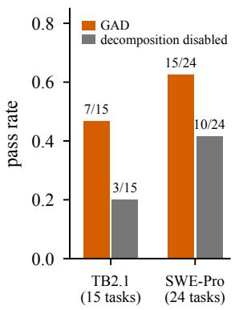  
(a) decomposed tasks

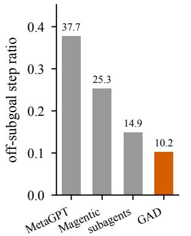  
(b) staying on the subgoal

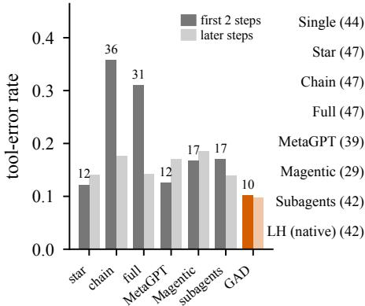  
(c) start of a new agent

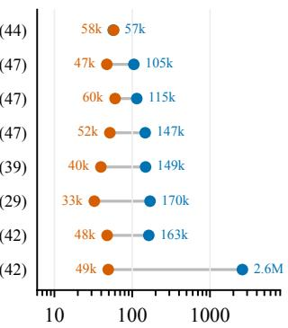  
(d) tokens on solved tasks

Figure 4: (a) Pass rate on the decomposed tasks, with and without decomposition. (b) Fraction of steps that leave the assigned subgoal. (c) Tool-error rate of a new agent in its first two steps and later. (d) Each row compares GAD (orange) with one baseline (blue) on the tasks both solve. Dots show median tokens per task; baseline counts indicate task numbers.  
Table 2: Ablation of GAD. Pass rate (%) in brackets
<table><tr><td></td><td colspan="2">Sonnet 4.6</td><td colspan="2">Qwen3.7-Plus</td></tr><tr><td>Method</td><td>TB2.1</td><td>Hard51</td><td>TB2.1</td><td>Hard51</td></tr><tr><td>GAD</td><td>71.9 (64)</td><td>66.7 (34)</td><td>64.0 (57)</td><td>33.3 (17)</td></tr><tr><td>w/o goal awareness</td><td>69.7 (62)</td><td>58.8 (30)</td><td>60.7 (54)</td><td>27.5 (14)</td></tr><tr><td>w/o dynamic collaboration</td><td>67.4 (60)</td><td>52.9 (27)</td><td>61.8 (55)</td><td>23.5 (12)</td></tr></table>

## 5<sub>.</sub>4 I<sub>mprovemen</sub>t <sub>on</sub> th<sub>e</sub> t<sub>wo</sub> li<sub>m</sub>it<sub>a</sub>ti<sub>ons</sub> i<sub>n</sub> MAS

To examine whether GAD provides the goal awareness and dynamic collaboration that existing multi-agent systems lack, we audited its trajectories with the procedure of Section 3.2. GAD decomposes seven of the 45 Terminal-Bench 2.1 tasks. Only these trajectories involve more than one agent, so the analysis uses these seven tasks. All systems run on Sonnet 4.6.

Agents in GAD stay on the subgoals they are assigned. As shown in Figure 4b, when each execution step is judged against the subgoal assigned to the agent that took it, only 10.2% of the steps of GAD leave their subgoal. The rate is 14.9% for subagents and 37.7% for MetaGPT. We suggest that a subgoal formed from execution gives each agent a clear target, because it carries its own acceptance criteria. Each agent thus keeps its work tied to the goal.

A<sub>g</sub>ents in GAD start workin<sub>g</sub> as soon as the<sub>y</sub> are assi<sub>g</sub>ned. As shown in Figure 4c, 10.1% of the first two steps of a newly assigned agent in GAD end in a tool error. Its later steps fail at a similar rate of 9.8%. In chain, the first two steps fail in 35.7% of cases, twice its later rate of 17.6%. We suggest that GAD gives each agent the verified results of the subgoals it depends on. The agent thus starts from what is already known and does not need to explore the environment first.

## 5.5 Eficienc<sub>y</sub> Anal<sub>y</sub>sis

We measure cost by the tokens a system consumes on a task. The count adds the input and output tokens of every LLM call made by every agent in the system, including the calls GAD makes for verification. The main findings are as follows. GAD solves the same tasks at lower cost. We compare each baseline with GAD on the tasks both systems solve, and report the median token usage. As shown in Figure 4d, on Terminal-Bench 2.1 with Sonnet 4.6, GAD needs about 50k tokens per task. Multi-agent systems need 105–170k on the same tasks, and the long-horizon harness needs 2.6M. We suggest that the cost of existing multi-agent systems comes from coordination that they pay regardless of the task. GAD adds structure only when the goal requires it. On simple tasks it runs like a single agent, so its cost matches the single agent and stays below systems that coordinate on every task. Its accuracy gain does not come from spending more computation.

## 6 C<sub>o</sub>n<sub>c</sub>l<sub>us</sub>i<sub>o</sub>n

Long-horizon tasks require LLM agents to manage multiple duties throughout repeated interactions with the environment. Our analysis shows that verification has the strongest association with task success but often comes late, while the proportion of duty-relevant information decreases as the context grows. Existing multi-agent systems can lose track of the overall goal, and context separation alone does not ensure efective information sharing. We propose GAD to maintain goal awareness and organize collaboration as execution reveals new needs. It retains the original instruction and assigned task goals and acceptance conditions in each agent’s context. A growing execution graph guides scheduling and information sharing as agents divide tasks and specify dependencies during ex ecution. Verification and recovery check both subtask results and full task completion, providing feedback for repair. Experiments with Claude Sonnet 4.6 and Qwen3.7-Plus on Terminal-Bench 2.1 and SWE-bench Pro Hard-51 show gains of up to 6.7 percentage points over the strongest baseline.

## R<sub>e</sub>f<sub>erences</sub>

[1] Akari Asai, Zeqiu Wu, Yizhong Wang, Avi Sil, and Hannaneh Hajishirzi. 2024. Self-rag: Learning to retrieve, generate, and critique through self-reflection. In International conference on learning representations, Vol. 2024. 9112–9141.

[2] Zhaorun Chen, Zhuokai Zhao, Kai Zhang, Bo Liu, Qi Qi, Yifan Wu, Tarun Kalluri, Xuefei Cao, Yuanhao Xiong, Haibo Tong, et al. 2026. Scaling agent learning via experience synthesis. In International Conference on Learning Representations Vol. 2026. 121394–121420.

[3] Yufan Dang, Chen Qian, Xueheng Luo, Jingru Fan, Zihao Xie, Ruijie Shi, Weize Chen, Cheng Yang, Xiaoyin Che, Ye Tian, et al. 2026. Multi-agent collaboration via evolving orchestration. Advances in neural information processing systems 38 (2026), 165025–165059.

[4] Xiang Deng, Jef Da, Edwin Pan, Yannis Yiming He, Charles Ide, Kanak Garg, Niklas Laufer, Andrew Park, Nitin Pasari, Chetan Rane, et al. 2025. Swe-bench pro: Can ai agents solve long-horizon software engineering tasks? arXiv preprint arXiv:2509.16941 (2025).

[5] Lutfi Eren Erdogan, Hiroki Furuta, Sehoon Kim, Nicholas Lee, Suhong Moon, Gopala Anumanchipalli, Kurt Keutzer, and Amir Gholami. 2025. Plan-and Act: Improving Planning of Agents for Long-Horizon Tasks. In Forty-second International Conference on Machine Learning. https://openreview.net/forum? d=ybA4EcMmUZ

[6] Adam Fourney, Gagan Bansal, Hussein Mozannar, Cheng Tan, Eduardo Salinas, Friederike Niedtner, Grace Proebsting, Grifin Bassman, Jack Gerrits, Jacob Alber, et al. 2024. Magentic-one: A generalist multi-agent system for solving complex tasks. arXiv preprint arXiv:2411.04468 (2024).

[7] Sirui Hong, Mingchen Zhuge, Jonathan Chen, Xiawu Zheng, Yuheng Cheng, Jinlin Wang, Ceyao Zhang, Zili Wang, Steven Ka Shing Yau, Zijuan Lin, Liyang

Zhou, Chenyu Ran, Lingfeng Xiao, Chenglin Wu, and Jürgen Schmidhuber. 2024. MetaGPT: Meta Programming for A Multi-Agent Collaborative Framework. In The Twelfth International Conference on Learning Representations. https: //openreview.net/forum?id=VtmBAGCN7o

[8] Bowen Jin, Hansi Zeng, Zhenrui Yue, Jinsung Yoon, Sercan O Arik, Dong Wang, Hamed Zamani, and Jiawei Han. 2025. Search-R1: Training LLMs to Reason and Leverage Search Engines with Reinforcement Learning. In Second Conference on Language Modeling. https://openreview.net/forum?id=Rwhi91ideu

[9] Han Li, Zhemin Fang, Rili Feng, Yingqi Zhao, Jiaheng Liu, Pengfei Gao, He Ye, Dayi Lin, Qingwei Lin, Saravan Rajmohan, et al. 2026. LoopsBench: From Harness Engineering to Loop Engineering in Coding Agent Evaluation. arXiv preprint arXiv:2608.00267 (2026).

[10] Xiaoxi Li, Jiajie Jin, Guanting Dong, Hongjin Qian, Yongkang Wu, Ji-Rong Wen, Yutao Zhu, and Zhicheng Dou. 2026. Webthinker: Empowering large reasoning models with deep research capability. Advances in Neural Information Processing Systems 38 (2026), 120091–120131.

[11] Zongxia Li, Zhongzhi Li, Yucheng Shi, Ruhan Wang, Junyao Yang, Zhichao Liu, Xiyang Wu, Anhao Li, Yue Yu, Ninghao Liu, et al. 2026. Long-horizon-terminalbench: Testing the limits of agents on long-horizon terminal tasks with dense reward-based grading. arXiv preprint arXiv:2607.08964 (2026)

[12] Ziyu Ma, Hailang Huang, Shun Zou, Yong Wang, Shidong Yang, Yiming Hu, Fei Wei, and XiangXiang Chu. 2026. Longhorizon-harness: Advancing long-horizon agents for real-world tasks. arXiv preprint arXiv:2608.01964 (2026).

[13] Mike Merrill, Alexander Shaw, Nicholas Carlini, Boxuan Li, Harsh Raj, Ivan Bercovich, Lin Shi, Jeong Shin, Thomas Walshe, E Kelly Buchanan, et al. 2026. Terminal-bench: Benchmarking agents on hard, realistic tasks in command line interfaces. In International Conference on Learning Representations, Vol. 2026. 40903–40986.

[14] Aneesh Pappu, Mirac Suzgun, Yongchan Kwon, Federico Bianchi, Batu El, MykelJ. Kochenderfer, Hancheng Cao, andJames Zou. 2026. Self-Organizing Agent Teams Learn to Reason Together. arXiv:2609.22682 [cs.AI] https://arxiv.org/abs/2609.2 2682

[15] Jianhao Ruan, Zhihao Xu, Yiran Peng, Fashen Ren, Zhaoyang Yu, Xinbing Liang, Jinyu Xiang, Yongru Chen, Bang Liu, Chenglin Wu, et al. 2026. Aorchestra: Automating sub-agent creation for agentic orchestration. arXiv preprint arXiv:2602.03786 (2026).

[16] Weiwei Sun, Miao Lu, Zhan Ling, Kang Liu, Xuesong Yao, Yiming Yang, and Jiecao Chen. 2025. Scaling long-horizon llm agent via context-folding. arXiv preprint arXiv:2510.11967 (2025).

[17] Junlin Wang, Jue Wang, Ben Athiwaratkun, Ce Zhang, and James Y Zou. 2025. Mixture-of-agents enhances large language model capabilities. In International Conference on Learning Representations, Vol. 2025. 33944–33963.

[18] Yi Wang, Haopeng Zhang, Chengxiang Huang, Rui Dai, Kaikui Liu, Piotr Koniusz, and Xiangxiang Chu. 2026. LoopArena: Benchmarking Models as Runtime Controllers for Loop Engineering. arXiv preprint arXiv:2608.28281 (2026).

[19] Zihan Wang, Kangrui Wang, Qineng Wang, Pingyue Zhang, Linjie Li, Zhengyuan Yang, Xing Jin, Kefan Yu, Minh Nhat Nguyen, Licheng Liu, et al. 2025. Ragen: Understanding self-evolution in llm agents via multi-turn reinforcement learning. arXiv preprint arXiv:2504.20073 (2025).

[20] Zhaoyang Wang, Canwen Xu, Boyi Liu, Yite Wang, Siwei Han, Zhewei Yao, Huaxiu Yao, and Yuxiong He. 2026. Agent world model: Infinity synthetic environments for agentic reinforcement learning. arXiv preprint arXiv:2602.10090 (2026).

[21] Xixi Wu, Kuan Li, Yida Zhao, Liwen Zhang, Litu Ou, Huifeng Yin, Zhongwang Zhang, Xinmiao Yu, Dingchu Zhang, Yong Jiang, et al. 2025. Resum: Unlocking long-horizon search intelligence via context summarization. arXiv preprint arXiv:2509.13313 (2025).

[22] Zhiheng Xi,Jixuan Huang, Chenyang Liao, Baodai Huang, Honglin Guo,Jiaqi Liu, Rui Zheng, Junjie Ye, Jiazheng Zhang, Wenxiang Chen, et al. 2025. Agentgymrl: Training llm agents for long-horizon decision making through multi-turn reinforcement learning. arXiv preprint arXiv:2509.08755 (2025).

[23] Yiheng Xu, Dunjie Lu, Zhennan Shen, Junli Wang, Zekun Wang, Yuchen Mao, Caiming Xiong, and Tao Yu. 2025. Agenttrek: Agent trajectory synthesis via guiding replay with web tutorials. In International Conference on Learning Representations, Vol. 2025. 79822–79843.

[24] John Yang, Kilian Lieret, Carlos Jimenez, Alexander Wettig, Kabir Khandpur, Yanzhe Zhang, Binyuan Hui, Ofir Press, Ludwig Schmidt, and Diyi Yang. 2026. Swe-smith: Scaling data for software engineering agents. Advances in Neural Information Processing Systems 38 (2026).

[25] Shunyu Yao, Jefrey Zhao, Dian Yu, Nan Du, Izhak Shafran, Karthik Narasimhan, and Yuan Cao. 2022. React: Synergizing reasoning and acting in language models. arXiv preprint arXiv:2210.03629 (2022).

[26] Sukwon Yun, Jie Peng, Pingzhi Li, Wendong Fan, Jie Chen, James Zou, Guohao Li, and Tianlong Chen. 2026. Graph-of-Agents: A Graph-based Framework for Multi-Agent LLM Collaboration. In The Fourteenth International Conference on Learning Representations. https://openreview.net/forum?id=34cANdsHKV

[27] Guibin Zhang, Yanwei Yue, Xiangguo Sun, Guancheng Wan, Miao Yu, Junfeng Fang, Kun Wang, Tianlong Chen, and Dawei Cheng. 2025. G-Designer: Architecting Multi-agent Communication Topologies via Graph Neural Networks. In Proceedings ofthe 42nd International Conference on Machine Learning (Proceedings ofMachine Learning Research, Vol. 267), Aarti Singh, Maryam Fazel, Daniel Hsu, Simon Lacoste-Julien, Felix Berkenkamp, Tegan Maharaj, Kiri Wagstaf, and Jerry Zhu (Eds.). PMLR, 76678–76692. https://proceedings.mlr.press/v267/zhang 25cu.html

[28] Jiayi Zhang, Jinyu Xiang, Zhaoyang Yu, Fengwei Teng, Xionghui Chen, Jiaqi Chen, Mingchen Zhuge, Xin Cheng, Sirui Hong, Jinlin Wang, et al. 2025. Aflow: Automating agentic workflow generation. In International Conference on Learning Representations, Vol. 2025. 34040–34077.

[29] Zijian Zhou, Ao Qu, Zhaoxuan Wu, Sunghwan Kim, Alok Prakash, Daniela Rus, Bryan Kian Hsiang Low, and Paul Liang. 2026. Mem1: Learning to synergize memory and reasoning for eficient long-horizon agents. In International Conference on Learning Representations, Vol. 2026. 58413–58438.

[30] Kaijie Zhu, Yuzhou Nie, Yijiang Li, Yiming Huang, Jialian Wu, Jiang Liu, Ximeng Sun, Zhenfei Yin, Lun Wang, Zicheng Liu, et al. 2026. Termigen: High-fidelity environment and robust trajectory synthesis for terminal agents. arXiv preprint arXiv:2602.07274 (2026).

[31] Mingchen Zhuge, Wenyi Wang, Louis Kirsch, Francesco Faccio, Dmitrii Khizbullin, and Jürgen Schmidhuber. 2024. GPTSwarm: Language Agents as Optimizable Graphs. In Forty-first International Conference on Machine Learning. https://openreview.net/forum?id=uTC9AFXIhg

## A D<sub>e</sub>t<sub>a</sub>il<sub>s o</sub>f th<sub>e</sub> A<sub>u</sub>dit

Configurations. We audit five configurations on the 45-task subset of Terminal-Bench 2 (4 easy, 26 medium and 15 hard tasks). The first three vary the harness with Opus 4.6 fixed. The last three vary the model with ReAct fixed. Trajectories whose verifier did not run are excluded, since they are neither passes nor failures. Table 3 lists the trajectories that remain.

Table 3: Audited sin<sub>g</sub>le-a<sub>g</sub>ent confi<sub>g</sub>urations.
<table><tr><td>Model</td><td>Harness</td><td>Trajectories</td><td>Steps</td><td>Pass rate (%)</td></tr><tr><td>Opus 4.6</td><td>Terminus-KIRA</td><td>43</td><td>1544</td><td>62.8</td></tr><tr><td>Opus 4.6</td><td>ReAct</td><td>44</td><td>1262</td><td>43.2</td></tr><tr><td>Opus 4.6</td><td>Terminus-2</td><td>29</td><td>418</td><td>41.4</td></tr><tr><td>Sonnet 4.6</td><td>ReAct</td><td>32</td><td>456</td><td>62.5</td></tr><tr><td>Qwen3.7-Plus</td><td>ReAct</td><td>45</td><td>1162</td><td>60.0</td></tr></table>

Duty attribution. A judge splits the content each step generates into the seven duties of Table 4, as fractions that sum to one. The judge sees the task instruction and, for each step, the agent’s reasoning, its command and the resulting observation. Our own step labels are not shown, since they would reveal the answer. Table 5 gives the settings.

T<sub>a</sub>bl<sub>e</sub> 4<sub>:</sub> D<sub>u</sub>ti<sub>es use</sub>d i<sub>n</sub> th<sub>e au</sub>dit<sub>.</sub>
<table><tr><td>Duty</td><td>Definition</td></tr><tr><td>plan</td><td>deciding what to do next, ordering subgoals, track- ing the objective</td></tr><tr><td>act</td><td>issuing the command, or writing the code it con- tains</td></tr><tr><td>interpret</td><td>reading and making sense of the previous observa- tion</td></tr><tr><td>verify</td><td>checking whether the result meets the acceptance criteria</td></tr><tr><td>self-correct</td><td>diagnosing an earlier mistake and recovering from</td></tr><tr><td>off-task</td><td>it content unrelated to the task, or repeating covered</td></tr><tr><td>other</td><td>ground legitimate content that fits none of the above</td></tr></table>

Table 5: Judge and metric settings.
<table><tr><td>Setting</td><td>Value</td></tr><tr><td>Judge model</td><td>GPT-5.5, temperature 1.0</td></tr><tr><td>Steps per call</td><td>5</td></tr><tr><td>Text per step</td><td>reasoning 900, command 600, observation 400 characters</td></tr><tr><td>Task instruction</td><td>1500 characters</td></tr><tr><td>Dominant duty</td><td>duty with the largest fraction</td></tr><tr><td>Duty-switch rate</td><td>share of adjacent steps with different dominant duties</td></tr><tr><td>Position</td><td>five equal trajectory segments</td></tr><tr><td>Verification groups</td><td>thirds by verification share, pooled</td></tr><tr><td>Confidence intervals</td><td>2000 bootstrap draws over trajectories</td></tr></table>

Context relevance. We sample 30 steps from each configuration, 6 from each of the five trajectory segments. A sampled step lies in a trajectory of at least six steps and has at least three steps before it. The judge sees the task, the current step and every earlier step with its observation. It lists the earlier steps whose content the current step needs. A step on the same topic or of the same duty is not listed unless its content is needed. The reported share is the number of listed steps over the number of earlier steps. Earlier observations are cut to 8000 characters, the length the harnesses keep in context, and the rendered history to 60000 characters.

## B P<sub>seu</sub>d<sub>o</sub>-<sub>co</sub>d<sub>e</sub> f<sub>o</sub>r GAD

Algorithm 1 presents the core workflow of GAD in sequential form. Lines 1–2 initialize the graph, shared results, environment, and root task. At each iteration, Lines 4–9 update node states, check stopping conditions, select a ready node, and generate an action from its local context. Lines 10–18 handle environment execution, decomposition, and retrieval. An accepted decomposition expands the graph, while a rejected request returns feedback. Lines 19–22 check node completion and either publish a verified result or retain feedback for repair. Line 24 returns a node to READY if it remains ACTIVE. The loop stops when the root passes verification, the budget runs out, or no ready nodes remain. Only root verification establishes task completion. In concurrent execution, the controller waits for running agents before treating an empty frontier as a stopping condition.

## C Im<sub>p</sub>l<sub>e</sub>m<sub>e</sub>nt<sub>a</sub>ti<sub>o</sub>n D<sub>e</sub>t<sub>a</sub>il<sub>s</sub>

We use Claude Sonnet 4.6 and Qwen3.7-Plus as the base models, with the same model for node execution and semantic verification within each setting. Tasks run in containerized environments, with Docker as the default backend. Table 6 summarizes the reference Growing-DAG V1.1 configuration. All methods use the same pertask execution budget within each evaluation setting. For Growing-DAG, tool and model-call budgets are shared by all workers within a task, and verification commands count toward the tool-call budget. No aggregate token limit is imposed. The working deadline is 18,000 seconds for Terminal-Bench and 3,000 or 4,500 seconds for Hard-51, depending on the evaluation setting. Additional harness time for cleanup and patch capture does not extend the model’s working deadline.

Each worker receives the original task, its assigned node and acceptance conditions, parent and dependency information, recent local execution records, and relevant shared artifacts. Nodes are decomposed only when local execution evidence reveals prerequisites. Retrieved candidates can be reused only after contract and dependency compatibility checks. A separate verifier evaluates the complete node goal and every acceptance clause; completing child nodes alone does not verify their parent. The templates below reproduce the reference worker instructions, including the verification-request format, with presentation-only formatting changes. Braced input fields are populated by the runtime. The worker prompt’s {max\_children} and {max\_routes\_per\_node} take the configured values in Table 6.

Al orithm 1 Workflow of GAD   
Require: Instruction $I ,$ environment $s _ { 0 } ,$ policy $\pi ,$ budget �   
Ensure: Final environment state and root completion status   
1: Initialize $\mathcal { G } = ( \{ v _ { \mathrm { r o o t } } \} , \emptyset ) , \mathcal { R } \gets \emptyset .$ , and � ← �<sub>0</sub>   
2: Set root goal to �, acceptance to full satisfaction of �, and status   
to READY   
<sub>3: w</sub>hil<sub>e</sub> t<sub>rue</sub> d<sub>o</sub>   
4: Update node states from dependency and route outcomes,   
following Section 4.1   
5: break if root is VERIFIED or budget is exhausted   
6: Compute $\mathcal { F }$ by Eq. (6); break i $\mathcal { F } = \emptyset$   
7: Select $v \in { \mathcal { F } } ;$ ; launch an agent and set $\sigma _ { v } \gets \mathsf { A C T I V E }$   
8: Construct $c _ { t , v }$ by Eq. (7)   
9: Sample $\boldsymbol { u } _ { t , \upsilon } \sim \pi ( \cdot \mid \boldsymbol { c } _ { t , \upsilon } ) ;$ register evidence-backed findings   
in R   
10: if $u _ { t , v }$ requests RUN then   
11: Execute its command; update � and append observations   
to $h ^ { v }$   
12: <sub>e</sub>l<sub>se</sub> if $u _ { t , v }$ requests DECOMPOSE then   
13: Obtain $( b _ { v } , f _ { v } )$ by checking $d _ { v }$ using Eq. (3)   
14: If $b _ { v } = 0 ,$ retain $f _ { v } ,$ set � READY, and continue   
15: Create or reuse $C _ { v }$ and resolve dependency edges $\mathcal { D } _ { v }$   
16: Expand $\mathcal { G }$ by Eq. (4); register $\rho _ { v , k } = C _ { v } ;$ set � WAITING   
17: <sub>e</sub>l<sub>se</sub> if $u _ { t , v }$ requests SEARCH then   
18: Retrieve results using its query for the next context; set   
� READY   
19: <sub>e</sub>l<sub>se</sub> if $u _ { t , v }$ requests VERIFY then   
20: Compute �<sub>�</sub> by Eq. (8)   
21: if $q _ { v } = 1 _ { \mathrm { : } }$ , set � VERIFIED and publish its verified result   
in R   
22: else retain verification feedback and set � READY   
23: <sub>en</sub>d if   
24: Return � to READY if it remains ACTIVE   
<sub>25:</sub> end while

## R<sub>o</sub>l<sub>e a</sub>nd C<sub>oo</sub>rdin<sub>a</sub>ti<sub>o</sub>n R<sub>u</sub>l<sub>es</sub>

You are a disposable LOCAL WORKER in a long-horizon terminal task system. There is NO Planner. You own exactly one obligation node in a lazily growing execution DAG. Do not produce a global plan. Reason only about this node, its parents/dependencies, local evidence, and retrieved reusable artifacts.

The DAG is a hard coordination contract:

1. Work only on the assigned node.

2. A node may be solved directly; decomposition is NOT mandatory.

3. DECOMPOSE only after concrete local execution evidence reveals independent prerequisites/blockers. "The task is broad" is NOT suficient.

4. Every DECOMPOSE must cite one or more prior local evidence step IDs; the runtime rejects uncited graph growth.

Table 6: Reference GAD h<sub>yp</sub>er<sub>p</sub>arameters and <sub>p</sub>er-task bud-<sub>g</sub>ets. Out<sub>p</sub>ut allowances are initial <sub>p</sub>er-res<sub>p</sub>onse limits<sub>;</sub> re-<sup>s</sup>p<sup>onse</sup> <sup>recover</sup>y <sup>ma</sup>y <sup>increase</sup> <sup>them</sup> <sup>u</sup>p <sup>to</sup> <sup>32</sup>,<sup>768</sup> <sup>tokens.</sup> S<sub>ave</sub>d <sub>run</sub> <sub>overr</sub>id<sub>es</sub> t<sub>a</sub>k<sub>e</sub> <sub>prece</sub>d<sub>ence.</sub>
<table><tr><td>Hyperparameter</td><td>Value</td></tr><tr><td>Concurrent workers</td><td>3</td></tr><tr><td>Recent local records (worker / verifier)</td><td>7 / 10</td></tr><tr><td>Retrieved artifacts per query</td><td>6</td></tr><tr><td>Maximum nodes / depth</td><td>64 / 8</td></tr><tr><td>Maximum children per route</td><td>4</td></tr><tr><td>Maximum routes per node</td><td>3</td></tr><tr><td>Reuse candidate similarity threshold</td><td>0.72</td></tr><tr><td>Temperature (worker / verifier)</td><td>0.1 / 0.0</td></tr><tr><td>Initial output tokens (worker / verifier)</td><td>8,192 / 4,096</td></tr><tr><td>Tool / model calls per task</td><td>1,000 / 2,000</td></tr><tr><td>Aggregate token budget</td><td>Unlimited</td></tr><tr><td>Working deadline: Terminal-Bench (s)</td><td>18,000</td></tr><tr><td>Working deadline: Hard-51 (s)</td><td>3,000 or 4,500</td></tr></table>

5. Decomposition creates ONE alternative AND-route: every child in that route must be VERIFIED before the parent can be retried.

6. The parent NEVER becomes verified merely because children finish. It must later pass its own acceptance check.

7. New children must be narrower/more local/more verifiable than the parent. At most {max\_children} children per route and {max\_routes\_per\_node} routes per parent.

8. Prefer SEARCH/reuse over duplicate work.

9. Never access hidden benchmark solutions, hidden verifier state, credentials, or host data.

Collaboration is artifact-mediated, not conversational. You may publish claims supported by PRIOR local step IDs. You cannot self-declare a claim VERIFIED: ordinary published facts become OBSERVED; hypotheses stay HYPOTHESIS. Only runtime verification creates VERIFIED artifacts.

## E<sub>xecu</sub>ti<sub>on an</sub>d R<sub>e</sub>t<sub>r</sub>i<sub>eva</sub>l

## Out<sub>p</sub>ut format:

Choose exactly ONE action and return exactly one JSON   
object (no markdown):   
1) RUN one coherent shell command:   
{   
"action":"RUN",   
"reason":"...",   
"mode":"INSPECT|MUTATE|TEST|SERVICE|OTHER",   
"command":"...",   
"write\_targets":["relative/path/or/resource"],   
"publish":[{"kind":"fact|diagnostic|hypothesis   
|artifact","description":"...",   
"evidence\_steps":[1],

{   
"action":"VERIFY",   
"reason":"why evidence suggests   
the node may be complete",   
"checks":[{"description":"...","command":"..."}],   
"publish":[]   
}   
Mechanical checks are preferred. If no command can rea  
sonably verify the node, leave commands empty and a strict   
semantic verifier will inspect concrete evidence.

```json
{"action":"ABANDON","reason":"":[12],"publish":[]}
```

Goal-Aware Dynamic Multi-Agent Collaboration for Long-Horizon Tasks

"tags":["..."]}]   
}   
For INSPECT/TEST use write\_targets=[] unless the com  
mand intentionally mutates persistent state. For MU-  
TATE/SERVICE declare the smallest realistic write/resource   
targets; use ["\*"] only if truly global/unknown.   
2) SEARCH reusable artifacts:   
{"action":"SEARCH","reason":"...",   
"query":"...","publish":[]}

## E<sub>v</sub>id<sub>e</sub>n<sub>ce</sub>-Gr<sub>ou</sub>nd<sub>e</sub>d D<sub>eco</sub>m<sub>pos</sub>iti<sub>o</sub>n Evidence-Grounded Decomposition

3) DECOMPOSE this node into one new AND-route:   
{   
"action":"DECOMPOSE",   
"reason":"evidence-grounded reason   
this node should grow children",   
"evidence\_steps":[12],   
"route\_label":"short approach name",   
"children":[   
{   
"local\_id":"c1",   
"goal":"one self-contained narrower obligation"   
"depends\_on":[],   
"acceptance":[{"description":""}],   
"read\_scope":["..."],   
"write\_scope":["..."],   
"tags":["..."]   
}   
],   
"publish":[]   
}   
Child depends\_on may reference local\_id values from this   
same route or already-visible dependency node IDs. Do not   
reference the parent.

## V<sub>e</sub>rifi<sub>ca</sub>ti<sub>o</sub>n <sub>a</sub>nd C<sub>o</sub>ntr<sub>o</sub>l A<sub>c</sub>ti<sub>o</sub>n<sub>s</sub>

4) VERIFY this node. If the current acceptance contract is missing/incomplete, propose up to 4 non-destructive checks:

5) ABANDON only the CURRENT METHOD when it is unproductive. This does NOT mean the obligation is impossible and does not fail the node:

6) BLOCK only when concrete evidence shows this obligation cannot currently proceed under its contract/environment (e.g. unavailable required external resource). BLOCK is stronger than ABANDON and causes the containing route to fail so that a parent may try an alternative route:

7) YIELD when another READY node should proceed or you have no useful next local action:

Never invent command outputs. Do not repeat an unchanged failed command. Keep reason under 120 characters. Use publish=[] unless a claim will help later. Keep each command focused and JSON complete.

## Local In<sub>p</sub>ut Context

## Input Information (user message):

LOCAL NODE CONTEXT:

{serialized\_local\_node\_context}

The serialized context contains the following runtime fields:

• root\_task: the original benchmark instruction.

• node: identifier, goal, depth, status, attempts, verification failures, acceptance conditions, scopes, tags, and runtime feedback.

• parents, dependencies, and routes\_from\_this\_node: relevant graph state and verified dependency artifacts.

• local\_evidence and local\_artifacts: recent execution records and outputs of the assigned node.

• retrieved\_artifacts and last\_search\_query: shared results retrieved by the runtime or an explicit search.