# H<sub>y</sub>b<sub>r</sub>id AI P<sub>a</sub>tt<sub>erns</sub>

Thirt<sub>ee</sub>n W<sub>ays</sub> t<sub>o</sub> C<sub>oup</sub>l<sub>e</sub> L<sub>a</sub>n<sub>guage</sub> M<sub>o</sub>d<sub>e</sub>l<sub>s</sub> <sub>w</sub>ith R<sub>u</sub>l<sub>es,</sub> <sub>a</sub>nd H<sub>ow</sub> t<sub>o</sub> Ch<sub>oose</sub> Am<sub>o</sub>n<sub>g</sub> Th<sub>e</sub>m

Si<sub>eg</sub>f<sub>r</sub>i<sub>e</sub>d H<sub>an</sub>d<sub>sc</sub>h<sub>u</sub>h In<sub>s</sub>tit<sub>u</sub>t<sub>e</sub> <sub>o</sub>f C<sub>o</sub>m<sub>pu</sub>t<sub>e</sub>r S<sub>c</sub>i<sub>e</sub>n<sub>ce</sub> Universit<sub>y</sub> of St. Gallen (HSG) siegfried.handschuh@unisg.ch

Göt<sub>z-</sub>H<sub>e</sub>nrik Wi<sub>ega</sub>nd In<sub>s</sub>tit<sub>u</sub>t<sub>e</sub> <sub>o</sub>f C<sub>o</sub>m<sub>pu</sub>t<sub>e</sub>r S<sub>c</sub>i<sub>e</sub>n<sub>ce</sub> Universit<sub>y</sub> of St. Gallen (HSG) goetz-henrik.wiegand@unisg.ch

O<sub>c</sub>t<sub>o</sub>b<sub>er</sub> 2026

L<sub>orena</sub> R<sub>a</sub>i<sub>c</sub>hl<sub>e</sub> In<sub>s</sub>tit<sub>u</sub>t<sub>e</sub> <sub>o</sub>f C<sub>o</sub>m<sub>pu</sub>t<sub>e</sub>r S<sub>c</sub>i<sub>e</sub>n<sub>ce</sub> Universit<sub>y</sub> of St. Gallen (HSG) lorena.raichle@unisg.ch

## Abstract

L<sub>anguage mo</sub>d<sub>e</sub>l<sub>s</sub> h<sub>an</sub>dl<sub>e</sub> t<sub>ex</sub>t <sub>we</sub>ll<sub>, an</sub>d <sub>ru</sub>l<sub>e eng</sub>i<sub>nes g</sub>i<sub>ve conc</sub>l<sub>us</sub>i<sub>ons w</sub>ith <sub>proo</sub>f<sub>s.</sub> S<sub>ys</sub>t<sub>ems</sub> th<sub>a</sub>t <sub>com</sub>bi<sub>ne</sub> th<sub>e</sub> t<sub>wo are usua</sub>ll<sub>y</sub> d<sub>escr</sub>ib<sub>e</sub>d b<sub>y examp</sub>l<sub>e, an</sub>d th<sub>e same coup</sub>li<sub>ng</sub> t<sub>urns up un</sub>d<sub>er</sub> dif<sub>eren</sub>t <sub>names</sub> i<sub>n agen</sub>t f<sub>ramewor</sub>k<sub>s, guar</sub>d<sub>ra</sub>il t<sub>oo</sub>lkit<sub>s an</sub>d <sub>neuro-sym</sub>b<sub>o</sub>li<sub>c researc</sub>h<sub>.</sub> Thi<sub>s</sub> d<sub>ocumen</sub>t d<sub>e</sub>fi<sub>nes</sub> thi<sub>r</sub>t<sub>een pa</sub>tt<sub>erns</sub> f<sub>or coup</sub>li<sub>ng a</sub> l<sub>anguage mo</sub>d<sub>e</sub>l <sub>w</sub>ith <sub>an execu</sub>t<sub>a</sub>bl<sub>e ru</sub>l<sub>e</sub> l<sub>anguage,</sub> i<sub>n</sub> th<sub>e ca</sub>t<sub>a</sub>l<sub>ogue</sub> f<sub>orm</sub> introduced for object-oriented design: intent, motivation, applicability, participants, collaborations, <sub>consequences,</sub> i<sub>mp</sub>l<sub>emen</sub>t<sub>a</sub>ti<sub>on,</sub> k<sub>nown</sub> <sub>uses</sub> <sub>an</sub>d <sub>re</sub>l<sub>a</sub>t<sub>e</sub>d <sub>pa</sub>tt<sub>erns.</sub> F<sub>our</sub> <sub>pa</sub>tt<sub>erns</sub> <sub>concern</sub> <sub>w</sub>h<sub>a</sub>t <sub>crosses</sub> th<sub>e</sub> b<sub>oun</sub>d<sub>ary</sub> b<sub>e</sub>t<sub>ween mo</sub>d<sub>e</sub>l <sub>an</sub>d <sub>ru</sub>l<sub>es,</sub> fi<sub>ve w</sub>h<sub>o con</sub>t<sub>ro</sub>l<sub>s w</sub>h<sub>om,</sub> th<sub>ree</sub> h<sub>ow</sub> th<sub>e mo</sub>d<sub>e</sub>l t<sub>a</sub>k<sub>es par</sub>t i<sub>n</sub> th<sub>e</sub> <sub>reason</sub>i<sub>ng, an</sub>d <sub>one</sub> h<sub>ow</sub> k<sub>now</sub>l<sub>e</sub>d<sub>ge</sub> i<sub>s</sub> k<sub>ep</sub>t <sub>over</sub> ti<sub>me.</sub> Fi<sub>ve</sub> i<sub>nvar</sub>i<sub>an</sub>t<sub>s</sub> h<sub>o</sub>ld f<sub>or every com</sub>bi<sub>na</sub>ti<sub>on, an</sub>d fi<sub>ve</sub> f<sub>a</sub>il<sub>ure</sub> <sub>pa</sub>tt<sub>erns</sub> <sub>name</sub> th<sub>e</sub> <sub>coup</sub>li<sub>ngs</sub> th<sub>a</sub>t b<sub>rea</sub>k th<sub>em.</sub> W<sub>e</sub> <sub>re</sub>l<sub>a</sub>t<sub>e</sub> th<sub>e</sub> <sub>ca</sub>t<sub>a</sub>l<sub>ogue</sub> t<sub>o</sub> <sub>pu</sub>bli<sub>s</sub>h<sub>e</sub>d <sub>pa</sub>tt<sub>ern</sub> <sub>ca</sub>t<sub>a</sub>l<sub>ogues</sub> <sub>an</sub>d t<sub>axonom</sub>i<sub>es</sub> <sub>o</sub>f h<sub>y</sub>b<sub>r</sub>id <sub>an</sub>d <sub>neuro-sym</sub>b<sub>o</sub>li<sub>c</sub> <sub>sys</sub>t<sub>ems</sub> <sub>an</sub>d <sub>s</sub>h<sub>ow</sub> <sub>w</sub>h<sub>ere</sub> th<sub>ey</sub> <sub>over</sub>l<sub>ap</sub> <sub>w</sub>ith it<sub>.</sub> A d<sub>ec</sub>i<sub>s</sub>i<sub>on gu</sub>id<sub>e</sub> l<sub>ea</sub>d<sub>s</sub> f<sub>rom a pro</sub>bl<sub>em</sub> t<sub>o a pa</sub>tt<sub>ern.</sub> It <sub>res</sub>t<sub>s on our measuremen</sub>t<sub>s,</sub> i<sub>nc</sub>l<sub>u</sub>di<sub>ng</sub> th<sub>e</sub> <sub>cases</sub> i<sub>n</sub> <sub>w</sub>hi<sub>c</sub>h <sub>a</sub> <sub>mo</sub>d<sub>e</sub>l <sub>a</sub>l<sub>one</sub> did <sub>as</sub> <sub>we</sub>ll <sub>as</sub> th<sub>e</sub> h<sub>y</sub>b<sub>r</sub>id <sub>or</sub> b<sub>e</sub>tt<sub>er,</sub> <sub>an</sub>d it <sub>repor</sub>t<sub>s</sub> <sub>w</sub>h<sub>a</sub>t <sub>eac</sub>h d<sub>es</sub>i<sub>gn</sub> <sub>cos</sub>t<sub>.</sub>

## Contents

1 Introduction 3   
2 Foundations 4   
2<sub>.</sub>1 Wh<sub>a</sub>t F<sub>rame</sub>X <sub>a</sub>dd<sub>s</sub> f<sub>or coup</sub>li<sub>ng</sub> 4   
2<sub>.</sub>2 Fi<sub>ve</sub> i<sub>nvar</sub>i<sub>an</sub>t<sub>s</sub> 6   
2<sub>.</sub>3 F<sub>our e</sub>l<sub>emen</sub>t<sub>ary moves</sub> 7   
2<sub>.</sub>4 Th<sub>e ca</sub>t<sub>a</sub>l<sub>ogue</sub> f<sub>orm</sub> 7   
3 Patterns at the boundary: what crosses it 10   
3<sub>.</sub>1 P<sub>a</sub>tt<sub>ern</sub> 1<sub>:</sub> M<sub>o</sub>d<sub>e</sub>l <sub>as</sub> S<sub>ensor</sub> 10   
3<sub>.</sub>2 P<sub>a</sub>tt<sub>ern</sub> 2<sub>:</sub> M<sub>o</sub>d<sub>e</sub>l <sub>as</sub> A<sub>u</sub>th<sub>or</sub> 14   
3<sub>.</sub>3 P<sub>a</sub>tt<sub>e</sub>rn 3<sub>:</sub> M<sub>o</sub>d<sub>e</sub>l <sub>as</sub> Tr<sub>a</sub>n<sub>s</sub>l<sub>a</sub>t<sub>o</sub>r 18   
3<sub>.</sub>4 P<sub>a</sub>tt<sub>ern</sub> 12<sub>:</sub> M<sub>o</sub>d<sub>e</sub>l S<sub>e</sub>l<sub>ec</sub>t<sub>s</sub> R<sub>u</sub>l<sub>es</sub> W<sub>r</sub>it<sub>e .</sub> 23   
Patterns of control: who decides 27   
4<sub>.</sub>1 P<sub>a</sub>tt<sub>ern</sub> 4<sub>:</sub> M<sub>o</sub>d<sub>e</sub>l P<sub>roposes,</sub> R<sub>u</sub>l<sub>es</sub> Di<sub>spose</sub> 27   
4<sub>.</sub>2 P<sub>a</sub>tt<sub>ern</sub> 5<sub>:</sub> R<sub>u</sub>l<sub>es</sub> St<sub>eer</sub> th<sub>e</sub> M<sub>o</sub>d<sub>e</sub>l 32   
4<sub>.</sub>3 P<sub>a</sub>tt<sub>ern</sub> 6<sub>:</sub> C<sub>r</sub>iti<sub>que an</sub>d R<sub>epa</sub>i<sub>r</sub> 36   
4<sub>.</sub>4 P<sub>a</sub>tt<sub>ern</sub> 7<sub>:</sub> Di<sub>v</sub>i<sub>s</sub>i<sub>on</sub> b<sub>y</sub> C<sub>ompe</sub>t<sub>ence</sub> 38   
4<sub>.</sub>5 P<sub>a</sub>tt<sub>ern</sub> 13<sub>:</sub> F<sub>a</sub>il<sub>-</sub>S<sub>a</sub>f<sub>e</sub> U<sub>n</sub>i<sub>on .</sub> 42   
Patterns in the reasoning itself 47   
5<sub>.</sub>1 P<sub>a</sub>tt<sub>e</sub>rn 8<sub>:</sub> M<sub>o</sub>d<sub>e</sub>l <sub>as</sub> H<sub>ypo</sub>th<sub>es</sub>i<sub>s</sub> G<sub>e</sub>n<sub>e</sub>r<sub>a</sub>t<sub>o</sub>r 47   
5<sub>.</sub>2 P<sub>a</sub>tt<sub>ern</sub> 9<sub>:</sub> M<sub>o</sub>d<sub>e</sub>l <sub>as</sub> C<sub>r</sub>iti<sub>c o</sub>f th<sub>e</sub> R<sub>u</sub>l<sub>es</sub> 51   
5<sub>.</sub>3 P<sub>a</sub>tt<sub>ern</sub> 10<sub>:</sub> R<sub>u</sub>l<sub>es</sub> T<sub>eac</sub>h th<sub>e</sub> M<sub>o</sub>d<sub>e</sub>l 55   
Patterns over time 59   
6<sub>.</sub>1 P<sub>a</sub>tt<sub>ern</sub> 11<sub>:</sub> R<sub>u</sub>l<sub>e-</sub>G<sub>overne</sub>d M<sub>emory</sub> 59   
7 Compositions 64   
8 Failure patterns 65   
9 Related catalogues 66   
9<sub>.</sub>1 M<sub>app</sub>in<sub>g</sub> <sub>.</sub> 66   
9<sub>.</sub>2 Th<sub>e pa</sub>tt<sub>erns</sub> i<sub>n</sub> b<sub>oxo</sub>l<sub>ogy no</sub>t<sub>a</sub>ti<sub>on</sub> 66   
9<sub>.</sub>3 Wh<sub>a</sub>t th<sub>e ca</sub>t<sub>a</sub>l<sub>ogue a</sub>dd<sub>s</sub> 67   
9<sub>.</sub>4 Wh<sub>a</sub>t th<sub>e ca</sub>t<sub>a</sub>l<sub>ogue</sub> l<sub>ac</sub>k<sub>s</sub> 68   
9<sub>.</sub>5 Wh<sub>a</sub>t th<sub>e ca</sub>t<sub>a</sub>l<sub>o ue</sub> l<sub>earns</sub> f<sub>rom</sub> th<sub>em</sub> 69   
10 Choosing a pattern 70   
10<sub>.</sub>1 Fi<sub>rs</sub>t <sub>ues</sub>ti<sub>on:</sub> i<sub>s a</sub> h b<sub>r</sub>id <sub>nee</sub>d<sub>e</sub>d? 70   
10<sub>.</sub>2 F<sub>rom pro</sub>bl<sub>em</sub> t<sub>o pa</sub>tt<sub>ern</sub> 70   
10<sub>.</sub>3 Wh<sub>a</sub>t th<sub>e gu</sub>id<sub>e res</sub>t<sub>s on</sub> 71   
11 Limits 74   
A Boxology legend 75   
B Pattern libraries 76   
C Rule graph legend 84

## 1 Introduction

M<sub>ore an</sub>d <sub>more organ</sub>i<sub>sa</sub>ti<sub>ons</sub> l<sub>e</sub>t l<sub>anguage mo</sub>d<sub>e</sub>l<sub>s ac</sub>t <sub>on</sub> d<sub>ocumen</sub>t<sub>s, conversa</sub>ti<sub>ons an</sub>d t<sub>ransac</sub>ti<sub>ons</sub> th<sub>a</sub>t <sub>are governe</sub>d b<sub>y exp</sub>li<sub>c</sub>it <sub>ru</sub>l<sub>es: a regu</sub>l<sub>a</sub>ti<sub>on, a pro</sub>t<sub>oco</sub>l<sub>, an au</sub>th<sub>or</sub>it<sub>y</sub> li<sub>m</sub>it<sub>.</sub> T<sub>wo</sub> d<sub>es</sub>i<sub>gns are poss</sub>ibl<sub>e.</sub> Th<sub>e</sub> <sub>ru</sub>l<sub>es</sub> <sub>can</sub> b<sub>e</sub> <sub>wr</sub>itt<sub>en</sub> i<sub>n</sub>t<sub>o</sub> th<sub>e</sub> <sub>promp</sub>t <sub>an</sub>d th<sub>e</sub> <sub>mo</sub>d<sub>e</sub>l <sub>as</sub>k<sub>e</sub>d t<sub>o</sub> <sub>app</sub>l<sub>y</sub> th<sub>em,</sub> <sub>or</sub> th<sub>e</sub> <sub>ru</sub>l<sub>es</sub> <sub>can</sub> <sub>s</sub>t<sub>ay</sub> <sub>execu</sub>t<sub>a</sub>bl<sub>e</sub> <sub>an</sub>d th<sub>e</sub> <sub>mo</sub>d<sub>e</sub>l b<sub>e</sub> <sub>g</sub>i<sub>ven</sub> th<sub>e</sub> <sub>par</sub>t<sub>s</sub> <sub>o</sub>f th<sub>e</sub> t<sub>as</sub>k th<sub>a</sub>t <sub>ru</sub>l<sub>es</sub> <sub>canno</sub>t d<sub>o:</sub> <sub>rea</sub>di<sub>ng</sub> t<sub>ex</sub>t<sub>,</sub> <sub>p</sub>h<sub>ras</sub>i<sub>ng</sub> <sub>a</sub> <sub>ques</sub>ti<sub>on,</sub> <sub>propos</sub>i<sub>ng</sub> <sub>a</sub> <sub>can</sub>did<sub>a</sub>t<sub>e.</sub> B<sub>e</sub>t<sub>ween</sub> th<sub>ese</sub> t<sub>wo</sub> d<sub>es</sub>i<sub>gns</sub> li<sub>e</sub> <sub>many</sub> <sub>coup</sub>li<sub>ngs,</sub> <sub>an</sub>d <sub>prac</sub>titi<sub>oners</sub> t<sub>en</sub>d t<sub>o</sub> <sub>re</sub>i<sub>nven</sub>t them project by project.

A <sub>pa</sub>tt<sub>ern names a recurr</sub>i<sub>ng pro</sub>bl<sub>em</sub> i<sub>n a con</sub>t<sub>ex</sub>t <sub>an</sub>d th<sub>e core o</sub>f <sub>a so</sub>l<sub>u</sub>ti<sub>on</sub> th<sub>a</sub>t <sub>can</sub> b<sub>e reuse</sub>d <sub>w</sub>ith<sub>ou</sub>t bein<sub>g</sub> co<sub>p</sub>ied (Alexander et al. 1977). The catalo<sub>g</sub>ue form of Gamma et al. (1994) made <sub>p</sub>atterns a workin<sub>g</sub> vocabular<sub>y</sub> for object-oriented desi<sub>g</sub>n, and Buschmann et al. (1996) carried it to the architecture <sub>o</sub>f <sub>w</sub>h<sub>o</sub>l<sub>e</sub> <sub>sys</sub>t<sub>ems:</sub> <sub>eac</sub>h <sub>pa</sub>tt<sub>ern</sub> h<sub>as</sub> <sub>a</sub> <sub>name,</sub> <sub>an</sub> i<sub>n</sub>t<sub>en</sub>t<sub>,</sub> <sub>a</sub> <sub>mo</sub>ti<sub>va</sub>ti<sub>ng</sub> <sub>examp</sub>l<sub>e,</sub> <sub>con</sub>diti<sub>ons</sub> <sub>o</sub>f <sub>app</sub>li<sub>ca</sub>bilit<sub>y,</sub> <sub>a s</sub>t<sub>ruc</sub>t<sub>ure o</sub>f <sub>par</sub>ti<sub>c</sub>i<sub>pan</sub>t<sub>s an</sub>d <sub>co</sub>ll<sub>a</sub>b<sub>ora</sub>ti<sub>ons, consequences, no</sub>t<sub>es on</sub> i<sub>mp</sub>l<sub>emen</sub>t<sub>a</sub>ti<sub>on,</sub> k<sub>nown uses an</sub>d <sub>re</sub>l<sub>a</sub>t<sub>e</sub>d <sub>pa</sub>tt<sub>erns.</sub> W<sub>e use</sub> th<sub>e same</sub> f<sub>orm</sub> f<sub>or coup</sub>li<sub>ngs o</sub>f l<sub>anguage mo</sub>d<sub>e</sub>l<sub>s w</sub>ith <sub>ru</sub>l<sub>es.</sub> A <sub>s</sub>h<sub>are</sub>d <sub>name</sub> l<sub>e</sub>t<sub>s</sub> d<sub>es</sub>i<sub>gners say w</sub>hi<sub>c</sub>h <sub>coup</sub>li<sub>ng</sub> th<sub>ey mean.</sub> Th<sub>e consequences ma</sub>k<sub>e</sub> th<sub>e</sub> t<sub>ra</sub>d<sub>e-o</sub>f<sub>s exp</sub>li<sub>c</sub>it<sub>,</sub> i<sub>nc</sub>l<sub>u</sub>di<sub>ng</sub> th<sub>e</sub> <sub>cases</sub> <sub>w</sub>h<sub>ere</sub> <sub>a</sub> <sub>mo</sub>d<sub>e</sub>l <sub>a</sub>l<sub>one</sub> i<sub>s</sub> th<sub>e</sub> b<sub>e</sub>tt<sub>er</sub> <sub>c</sub>h<sub>o</sub>i<sub>ce,</sub> <sub>an</sub>d th<sub>e</sub> k<sub>nown</sub> <sub>uses</sub> ti<sub>e</sub> <sub>eac</sub>h <sub>pa</sub>tt<sub>ern</sub> t<sub>o</sub> <sub>runn</sub>i<sub>ng</sub> <sub>sys</sub>t<sub>ems</sub> <sub>an</sub>d t<sub>o measuremen</sub>t<sub>s.</sub>

Th<sub>e</sub> <sub>pa</sub>tt<sub>erns</sub> <sub>were</sub> f<sub>oun</sub>d i<sub>n</sub> th<sub>e</sub> <sub>app</sub>li<sub>ca</sub>ti<sub>ons</sub> <sub>o</sub>f F<sub>rame</sub>X<sub>,</sub> <sub>a</sub> <sub>ru</sub>l<sub>e</sub> <sub>an</sub>d k<sub>now</sub>l<sub>e</sub>d<sub>ge</sub> <sub>eng</sub>i<sub>ne</sub> b<sub>ase</sub>d <sub>on</sub> F<sub>-</sub> Lo<sub>g</sub>ic (Kifer et al. 1995), and checked a<sub>g</sub>ainst <sub>p</sub>ublished catalo<sub>g</sub>ues (Section 9). The<sub>y</sub> do not de<sub>p</sub>end on F<sub>rame</sub>X<sub>:</sub> <sub>any</sub> <sub>ru</sub>l<sub>e</sub> <sub>eng</sub>i<sub>ne</sub> th<sub>a</sub>t <sub>can</sub> <sub>reques</sub>t <sub>a</sub> <sub>mo</sub>d<sub>e</sub>l <sub>ca</sub>ll<sub>,</sub> <sub>s</sub>t<sub>ore</sub> th<sub>e</sub> <sub>answer</sub> <sub>as</sub> d<sub>a</sub>t<sub>a</sub> <sub>an</sub>d d<sub>er</sub>i<sub>ve</sub> <sub>conc</sub>l<sub>us</sub>i<sub>ons</sub> <sub>over</sub> it <sub>can</sub> h<sub>os</sub>t th<sub>em.</sub> Th<sub>e examp</sub>l<sub>es use</sub> F<sub>rame</sub>X’<sub>s no</sub>t<sub>a</sub>ti<sub>on</sub> b<sub>ecause we ma</sub>d<sub>e</sub> th<sub>e measuremen</sub>t<sub>s</sub> i<sub>n</sub> it<sub>.</sub> An earl<sub>y</sub> version of the FrameX en<sub>g</sub>ine and framework is <sub>p</sub>ublicl<sub>y</sub> available at https://gitlab.com/ ds-unisg/framex-core; a full release is forthcomin<sub>g</sub>.

Contributions. The following contributions are made in this document:

1: Thirteen patterns in catalogue form, composed from four elementary moves, with five invariants that hold for all of them (Sections 2 to 6), and five failure <sub>p</sub>atterns that break the invariants (Section 8).

2: A mapping onto published pattern catalogues and taxonomies that shows which patterns are known, which are new, and which <sub>p</sub>ublished <sub>p</sub>atterns this catalo<sub>g</sub>ue lacks (Section 9).

3: A decision guide from problem to pattern, grounded in pre-registered measurements (Section 10).

## 2 Foundations

## 2.1 What FrameX adds for coupling

Th<sub>e</sub> li<sub>s</sub>ti<sub>ngs use</sub> F<sub>rame</sub>X<sub>, a ru</sub>l<sub>e</sub> l<sub>anguage</sub> i<sub>n</sub> th<sub>e</sub> F<sub>-</sub>L<sub>og</sub>i<sub>c</sub> t<sub>ra</sub>diti<sub>on.</sub> W<sub>e assume</sub> th<sub>a</sub>t th<sub>e rea</sub>d<sub>er</sub> k<sub>nows</sub> it<sub>s</sub> basic s<sub>y</sub>ntax: frames ?X:Class[slot -> ?V], rules head <- body, AND, NOT, <sub>q</sub>ueries ?- ..., and the o<sub>p</sub>en-world readin<sub>g</sub> of unknown. Ever<sub>y p</sub>ro<sub>g</sub>ram declares its world. Under world open. a missin<sub>g</sub> fact is unknown, and NOT <sub>g</sub>ives true onl<sub>y</sub> over a slot, method or class declared closed (closed slot allowsSlot., closed method refuted/1., where /1 is the number of <sub>p</sub>arameters, closed class Admitted.); over an<sub>y</sub>thin<sub>g</sub> else the ne<sub>g</sub>ation sta<sub>y</sub>s unknown. The <sub>p</sub>ro<sub>g</sub>rams also com<sub>p</sub>ute values (?M := ?N + 1), com<sub>p</sub>are them (<, >, !=), use methods with <sub>p</sub>arameters (slot(?I) -> ?V) and strin<sub>g</sub>s as objects ("mbi":Programme), and write an object whose name is a term in backquotes (\`read(d1)\`). Thi<sub>s</sub> <sub>sec</sub>ti<sub>on</sub> i<sub>n</sub>t<sub>ro</sub>d<sub>uces</sub> <sub>on</sub>l<sub>y</sub> <sub>w</sub>h<sub>a</sub>t <sub>coup</sub>li<sub>ng</sub> <sub>w</sub>ith <sub>a</sub> <sub>mo</sub>d<sub>e</sub>l <sub>a</sub>dd<sub>s.</sub> All thi<sub>r</sub>t<sub>een</sub> <sub>pa</sub>tt<sub>erns</sub> <sub>res</sub>t <sub>on</sub> it<sub>.</sub>

External requests. A rule asks for something outside the engine with the keyword external:

```erlang
external read(?D) using _llm[prompt -> "Report what the document states ...";
document -> ?T]
<- ?D:Document[pending -> true; text -> ?T].
```

The engine evaluates this rule like any other. Its conclusion is a request: an object \`read(d1)\` with the fields in brackets as attributes, the tool (tool#name -> "\_llm"), a mark tool#requested -> true, and link facts for the re<sub>q</sub>uest’s ar<sub>g</sub>uments (tool#arg1 -> d1, and tool#arg2 for a second ar<sub>g</sub>ument). The engine never calls a network. A host, a program beside the engine, reads the open requests, runs the tool and adds its answer as a receipt; the engine then recomputes, and rules that read the receipt can fire, i<sub>nc</sub>l<sub>u</sub>di<sub>ng ru</sub>l<sub>es</sub> th<sub>a</sub>t i<sub>ssue</sub> th<sub>e nex</sub>t <sub>reques</sub>t<sub>.</sub> Th<sub>e</sub> k<sub>eywor</sub>d i<sub>s</sub> k<sub>ep</sub>t <sub>a</sub>lth<sub>oug</sub>h th<sub>e</sub> t<sub>oo</sub>l <sub>name wou</sub>ld id<sub>en</sub>tif<sub>y</sub> <sub>a</sub> <sub>reques</sub>t<sub>,</sub> b<sub>ecause</sub> <sub>suc</sub>h <sub>a</sub> <sub>ru</sub>l<sub>e</sub> f<sub>o</sub>ll<sub>ows</sub> <sub>o</sub>th<sub>er</sub> l<sub>aws</sub> th<sub>an</sub> <sub>a</sub> d<sub>er</sub>i<sub>va</sub>ti<sub>on:</sub> <sub>a</sub> <sub>reques</sub>t i<sub>s</sub> <sub>carr</sub>i<sub>e</sub>d <sub>ou</sub>t <sub>a</sub>t <sub>mos</sub>t <sub>once</sub> i<sub>n</sub> <sub>a</sub> <sub>run</sub> <sub>an</sub>d i<sub>s</sub> <sub>never</sub> <sub>w</sub>ithd<sub>rawn,</sub> <sub>w</sub>h<sub>ereas</sub> <sub>a</sub> d<sub>er</sub>i<sub>ve</sub>d f<sub>ac</sub>t di<sub>sappears</sub> <sub>w</sub>h<sub>en</sub> it<sub>s</sub> <sub>prem</sub>i<sub>ses</sub> d<sub>o.</sub> E<sub>very</sub> <sub>po</sub>i<sub>n</sub>t <sub>a</sub>t <sub>w</sub>hi<sub>c</sub>h <sub>a</sub> <sub>program</sub> <sub>reac</sub>h<sub>es</sub> <sub>ou</sub>t<sub>s</sub>id<sub>e</sub> th<sub>e</sub> <sub>eng</sub>i<sub>ne</sub> i<sub>s</sub> <sub>mar</sub>k<sub>e</sub>d b<sub>y</sub> it<sub>.</sub>

Receipts. An answer returns as facts about the request object:

```verilog
// Written by the host after the call.
`read(d1)`[tool#status -> "succeeded"; tool#completed -> true;
row(1, "slot") -> "customer"; row(1, "value") -> "Acme AG";
row(1, "quote") -> "Acme AG (the Customer)"; row(1, "quoteFound") -> true].
// Read by the rules, joined to the document through the request's argument.
?D[slot(?I) -> ?S]
<- ?R[tool#name -> "_llm"; tool#arg1 -> ?D; row(?I, "slot") -> ?S].
```

A scalar answer field key becomes result("key"); the reserved field rows, a list of at most 64 flat objects, becomes row(N, "key"). Ever<sub>y</sub> recei<sub>p</sub>t ends with tool#completed -> true and tool#status, which is "succeeded" or "failed". A failed call (the model did not answer in time, the re<sub>p</sub>l<sub>y</sub> was not valid JSON, a field the host needs was missin<sub>g</sub>) adds no result and no row, onl<sub>y</sub> an attribute error with the reason, \`read(d1)\`[error -> "model response is not valid JSON; no facts accepted"]. A rule that reads tool#status -> "failed" kee<sub>p</sub>s such a case a<sub>p</sub>art from a rejection (invariant 5). Answers must be flat: values are stored as literals and never evaluated, nested objects and lists are refused, and a null states nothin<sub>g</sub>. Rules usuall<sub>y</sub> ke<sub>y</sub> rows b<sub>y</sub> method <sub>p</sub>arameters (?D[slot(?I) -> ...]); since FrameX allows function terms in rule heads, a rule can also <sub>g</sub>ive each row an object of its own, st(?U, ?I):Statement[...] (Section 6.1). Table 2 lists what each tool <sub>rea</sub>d<sub>s</sub> f<sub>rom a reques</sub>t <sub>an</sub>d <sub>wr</sub>it<sub>es</sub> i<sub>n</sub>t<sub>o</sub> it<sub>s rece</sub>i<sub>p</sub>t<sub>.</sub>

Identity and order. A request is identified by its name and arguments. read(d1) runs once; a second attem<sub>p</sub>t needs a new identit<sub>y</sub>, as in propose(?T, ?N) with a ste<sub>p</sub> number (Section 4.1). A re<sub>q</sub>uest without ar<sub>g</sub>uments, external propose using ..., is the object propose itself, and its recei<sub>p</sub>t is read as propose[...] (Section 5.1). Instances of one re<sub>q</sub>uest name form a <sub>q</sub>ueue; re<sub>q</sub>uests of diferent names that are o<sub>p</sub>en at the same time need tool#order -> N, and the lowest <sub>g</sub>oes first. Two values for one re<sub>q</sub>uest field are an error. A run ends when a rule derives workflow[status -> ...] or when no <sup>re</sup>qu<sup>est</sup> <sup>is</sup> <sup>o</sup>p<sup>en</sup>.

Tools. The tool after using names what the host does (Table 1). Tools be<sub>y</sub>ond those shi<sub>pp</sub>ed with F<sub>rame</sub>X <sub>come</sub> f<sub>rom</sub> <sub>a</sub>d<sub>ap</sub>t<sub>er</sub> fil<sub>es</sub> th<sub>a</sub>t th<sub>e</sub> <sub>opera</sub>t<sub>or</sub> <sub>names</sub> <sub>w</sub>h<sub>en</sub> <sub>s</sub>t<sub>ar</sub>ti<sub>ng</sub> th<sub>e</sub> h<sub>os</sub>t<sub>;</sub> <sub>a</sub> <sub>program</sub> <sub>can</sub> <sub>never</sub> l<sub>oa</sub>d <sub>co</sub>d<sub>e.</sub>

T<sub>a</sub>bl<sub>e</sub> 1<sub>:</sub> T<sub>oo</sub>l<sub>s use</sub>d i<sub>n</sub> thi<sub>s</sub> d<sub>ocumen</sub>t<sub>.</sub>
<table><tr><td>Tool</td><td>Provided by</td><td>What the host does</td></tr><tr><td>_11m</td><td>framex.tools</td><td>one model call; see below</td></tr><tr><td>_query, _evidence_needs</td><td>framex.tools</td><td>a query on the rules themselves; the evidence that would settle agoal</td></tr><tr><td>_turn, _judge,</td><td>framex.dialogue</td><td>the dialogue model phrases a question; a judge decides a cri-</td></tr><tr><td>_repairTurn</td><td></td><td>terion; a repeated turn after a broken reply</td></tr><tr><td>_ask _checkCandidate</td><td>framex.dialogue framex.candidates,</td><td>one question to a person, as written, without a model checks a drafted rule against cases, before and after</td></tr><tr><td></td><td>by adapter</td><td></td></tr><tr><td>_forgetAnswers</td><td>framex.tools</td><td>removes stored model answers that contain a forgotten text</td></tr></table>

T<sub>a</sub>bl<sub>e</sub> 2<sub>:</sub> Wh<sub>a</sub>t <sub>eac</sub>h t<sub>oo</sub>l <sub>rea</sub>d<sub>s</sub> f<sub>rom</sub> <sub>a</sub> <sub>reques</sub>t <sub>an</sub>d <sub>wr</sub>it<sub>es</sub> i<sub>n</sub>t<sub>o</sub> it<sub>s</sub> <sub>rece</sub>i<sub>p</sub>t<sub>.</sub> E<sub>very</sub> <sub>rece</sub>i<sub>p</sub>t <sub>a</sub>l<sub>so</sub> h<sub>as</sub> tool#status and tool#completed; a failed call has error instead of results.
<table><tr><td>Tool</td><td>Request fields</td><td>Receipt</td></tr><tr><td>_11m</td><td>prompt (or with P) and any named fields; groundIn, mustSay, contextKey, tool#maxContext for the host</td><td>the reply&#x27;s fields as result(&quot;k&quot;) and row(N, &quot;k&quot;); with groundIn quoteFound and valueQuoted per row; with mustSay saysDecision; with contextKey tool#sent(&quot;id&quot;)</td></tr><tr><td>_query</td><td>query</td><td>result(&quot;status&quot;) (true, false, unknown or bindings) and the whole answer as JSON in</td></tr><tr><td>_checkCandidatecandidate</td><td></td><td>result(&quot;text&quot;) status (checked, rejected, error), feedback, and after evaluation regressions, failedAfter, newlyFailing, newlyPassing, newViolations,</td></tr><tr><td>_turn</td><td>question, attempt</td><td>changesConclusions, all as result(&quot;k&quot;) answer, utterance; after a broken reply formatError and received</td></tr><tr><td>_judge</td><td>criterion, question, answer</td><td>verdict (yes, no, unclear), reason, label; after a broken reply formatError and received</td></tr><tr><td>_ask</td><td>question</td><td>question, answer</td></tr><tr><td>_forgetAnswers</td><td>text</td><td>removed, the number of stored answers deleted</td></tr></table>

The model call. \_llm sends prompt as the instruction and the other fields as one JSON messa<sub>g</sub>e, so a rule hands over se<sub>p</sub>arate, traceable slots. Fields that start with tool# and the fields read b<sub>y</sub> the host (groundIn, mustSay, contextKey) are not sent. Lon<sub>g p</sub>rom<sub>p</sub>ts live in <sub>p</sub>rom<sub>p</sub>t objects (readPrompt:Prompt[text $\arcsin : " \ldots " ] ,$ ) that a re<sub>q</sub>uest names with using \_llm with readPrompt[...]. Ever<sub>y</sub> answer is stored with its date, model and messa<sub>g</sub>es and re<sub>p</sub>la<sub>y</sub>ed on the next id<sub>en</sub>ti<sub>ca</sub>l <sub>reques</sub>t <sub>un</sub>til <sub>a re</sub>f<sub>res</sub>h i<sub>s as</sub>k<sub>e</sub>d f<sub>or; a run can</sub> th<sub>ere</sub>f<sub>ore</sub> b<sub>e repea</sub>t<sub>e</sub>d <sub>w</sub>ith<sub>ou</sub>t th<sub>e mo</sub>d<sub>e</sub>l<sub>.</sub> Whi<sub>c</sub>h model answers is set in the host’s environment (a local server or a hosted end<sub>p</sub>oint), and ke<sub>y</sub>s never enter p<sup>ro</sup>g<sup>rams or recei</sup>p<sup>ts</sup>.

Measurements on text. Two request fields are read by the host and never shown to the model. With groundIn -> ?Text, ever<sub>y</sub> answer row <sub>g</sub>ets quoteFound (its <sub>q</sub>uote occurs verbatim in that text) and valueQuoted (its value occurs in its <sub>q</sub>uote). With mustSay -> ?Word, the recei<sub>p</sub>t <sub>g</sub>ets saysDecision (the re<sub>p</sub>l<sub>y</sub> contains the word). Both are measurements; whether a row or a re<sub>p</sub>l<sub>y</sub> counts is decided b<sub>y</sub> <sub>ru</sub>l<sub>es.</sub>

Rule-selected context. A re<sub>q</sub>uest with contextKey -> ?Step receives in its field context exactl<sub>y</sub> the statements that rules select with ?S[selectedFor -> step], ordered b<sub>y</sub> identifier and at most tool#maxContext of them; more makes the call fail. Each statement <sub>g</sub>oes to the model as one JSON object with its identifier (id, the object’s <sub>p</sub>rinted name, such as st(u2, 1)) and its slots; the default limit is 32. The recei<sub>p</sub>t records onl<sub>y</sub> the identifiers of what was sent, as tool#sent("st(u2, 1)") -> st(u2, 1). A re<sub>p</sub>l<sub>y</sub> cites statements b<sub>y</sub> identifier in its rows, so rules can check that ever<sub>y</sub> cited statement was sent and is current (Section 6.1).

One trap. Because the fields of a request become attributes of its object, a condition without a class can match the request itself: ?Q[decision -> ?D] also matches \`phrase(q1)\` when that request has a field decision. FrameX sto<sub>p</sub>s such a run and names the cause. A field named like a slot that rules derive for the recei<sub>p</sub>t <sub>g</sub>ives it two values; framex validate warns about it. Give rule subjects a class (?Q:Request[...]) and name re<sub>q</sub>uest fields a<sub>p</sub>art from derived slots.

The other direction. A model can also call the rules, through a protocol of read-only operations (query, explain, why\_not, evidence\_needs, validate, preview).

Th<sub>e</sub> i<sub>mp</sub>l<sub>emen</sub>t<sub>a</sub>ti<sub>on</sub> <sub>o</sub>f <sub>eac</sub>h <sub>pa</sub>tt<sub>ern</sub> <sub>s</sub>h<sub>ows</sub> th<sub>e</sub> <sub>w</sub>h<sub>o</sub>l<sub>e</sub> <sub>c</sub>h<sub>a</sub>i<sub>n:</sub> th<sub>e</sub> <sub>ru</sub>l<sub>e</sub> th<sub>a</sub>t <sub>reques</sub>t<sub>s</sub> th<sub>e</sub> <sub>mo</sub>d<sub>e</sub>l <sub>ca</sub>ll<sub>,</sub> th<sub>e</sub> <sub>ru</sub>l<sub>es</sub> th<sub>a</sub>t <sub>rea</sub>d it<sub>s</sub> <sub>rece</sub>i<sub>p</sub>t<sub>,</sub> <sub>an</sub>d th<sub>e</sub> <sub>ru</sub>l<sub>es</sub> th<sub>a</sub>t d<sub>ec</sub>id<sub>e.</sub> E<sub>ac</sub>h <sub>program</sub> i<sub>s</sub> <sub>pr</sub>i<sub>n</sub>t<sub>e</sub>d i<sub>n</sub> f<sub>u</sub>ll<sub>,</sub> <sub>w</sub>ith it<sub>s</sub> d<sub>ec</sub>l<sub>ara</sub>ti<sub>ons,</sub> it<sub>s</sub> d<sub>a</sub>t<sub>a,</sub> it<sub>s promp</sub>t<sub>s an</sub>d it<sub>s quer</sub>i<sub>es;</sub> it <sub>runs aga</sub>i<sub>ns</sub>t <sub>a mo</sub>d<sub>e</sub>l <sub>or,</sub> f<sub>rom recor</sub>d<sub>e</sub>d <sub>answers, w</sub>ith<sub>ou</sub>t <sub>one.</sub>

## 2.2 Five invariants

E<sub>very</sub> <sub>pa</sub>tt<sub>ern</sub> <sub>an</sub>d <sub>every</sub> <sub>com</sub>bi<sub>na</sub>ti<sub>on</sub> <sub>o</sub>f <sub>pa</sub>tt<sub>erns</sub> k<sub>eeps</sub> fi<sub>ve</sub> i<sub>nvar</sub>i<sub>an</sub>t<sub>s.</sub>

1. Model text is data. The engine never executes model-written rules or code unchecked; an answer is a <sub>rece</sub>i<sub>p</sub>t th<sub>a</sub>t <sub>ru</sub>l<sub>es rea</sub>d<sub>.</sub> A <sub>ru</sub>l<sub>e or query wr</sub>itt<sub>en</sub> b<sub>y a mo</sub>d<sub>e</sub>l i<sub>s a can</sub>did<sub>a</sub>t<sub>e</sub> th<sub>a</sub>t <sub>a c</sub>h<sub>ec</sub>k <sub>a</sub>d<sub>m</sub>it<sub>s or re</sub>f<sub>uses</sub> before it runs (Sections 3.2 and 3.3).

2. Every model answer is a dated observation with its prompt, model and inputs, so a run can be <sub>rep</sub>l<sub>aye</sub>d <sub>an</sub>d <sub>au</sub>dit<sub>e</sub>d<sub>.</sub>

3. Rules decide. Whether a statement counts, which step comes next, when a task is complete: the rules d<sub>er</sub>i<sub>ve eac</sub>h <sub>o</sub>f th<sub>ese.</sub>

4. Evidence decides acceptance. A model’s confidence is stored as a number. A statement is accepted <sub>on</sub> <sub>ev</sub>id<sub>ence</sub> th<sub>e</sub> <sub>ru</sub>l<sub>es</sub> <sub>can</sub> <sub>c</sub>h<sub>ec</sub>k<sub>,</sub> <sub>suc</sub>h <sub>as</sub> <sub>a</sub> <sub>quo</sub>t<sub>e</sub> f<sub>oun</sub>d i<sub>n</sub> th<sub>e</sub> <sub>source.</sub>

5. Failures stay distinct. A failed call, a reply in the wrong format, an unclear judgement and a logical unknown are four diferent results.

Th<sub>e</sub> di<sub>v</sub>i<sub>s</sub>i<sub>on</sub> <sub>o</sub>f l<sub>a</sub>b<sub>our</sub> f<sub>o</sub>ll<sub>ows</sub> f<sub>rom</sub> th<sub>ese</sub> i<sub>nvar</sub>i<sub>an</sub>t<sub>s.</sub> Th<sub>e</sub> <sub>mo</sub>d<sub>e</sub>l h<sub>an</sub>dl<sub>es</sub> <sub>percep</sub>ti<sub>on,</sub> l<sub>anguage</sub> <sub>an</sub>d <sub>am</sub>bi<sub>gu</sub>it<sub>y.</sub> Th<sub>e ru</sub>l<sub>es</sub> h<sub>an</sub>dl<sub>e w</sub>h<sub>a</sub>t<sub>ever mus</sub>t b<sub>e guaran</sub>t<sub>ee</sub>d<sub>, au</sub>dit<sub>e</sub>d <sub>or exp</sub>l<sub>a</sub>i<sub>ne</sub>d<sub>.</sub> Wh<sub>a</sub>t <sub>passes</sub> b<sub>e</sub>t<sub>ween</sub> th<sub>em</sub> i<sub>s</sub> <sub>an</sub> <sub>exp</sub>li<sub>c</sub>it<sub>,</sub> <sub>va</sub>lid<sub>a</sub>t<sub>e</sub>d <sub>recor</sub>d<sub>.</sub>

## 2.3 Four elementary moves

Ever<sub>y p</sub>attern is assembled from four moves between the rules and the outside (Fi<sub>g</sub>. 1).

Request A rule whose conditions hold issues an external request to a model or a tool. What the model <sub>sees</sub> i<sub>s</sub> <sub>w</sub>h<sub>a</sub>t th<sub>e</sub> <sub>ru</sub>l<sub>e</sub> <sub>pu</sub>t<sub>s</sub> i<sub>n</sub>t<sub>o</sub> th<sub>e</sub> <sub>reques</sub>t<sub>.</sub>

Receipt The answer returns as dated facts about the request, joined to its subject through the request’s <sub>argumen</sub>t<sub>s.</sub> N<sub>o</sub>thi<sub>ng e</sub>l<sub>se en</sub>t<sub>ers</sub> th<sub>e eng</sub>i<sub>ne</sub> f<sub>rom ou</sub>t<sub>s</sub>id<sub>e.</sub>

Accept A rule decides whether what a receipt proposes becomes a fact, is refused with its reason, or stays unknown.

Ask A rule derives a question for a person, or the evidence that would settle an open goal; the answer returns as a rece<sup>i</sup><sub>p</sub>t.

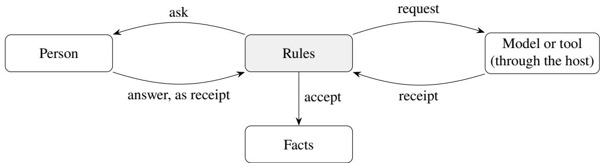  
Fi<sub>gure</sub> 1<sub>:</sub> Th<sub>e</sub> f<sub>our</sub> <sub>e</sub>l<sub>emen</sub>t<sub>ary</sub> <sub>moves.</sub> E<sub>very</sub> <sub>arrow</sub> th<sub>a</sub>t <sub>en</sub>t<sub>ers</sub> th<sub>e</sub> <sub>ru</sub>l<sub>es</sub> i<sub>s</sub> <sub>a</sub> <sub>rece</sub>i<sub>p</sub>t<sub>;</sub> <sub>on</sub>l<sub>y</sub> th<sub>e</sub> <sub>accep</sub>t <sub>move</sub> <sub>wr</sub>it<sub>es</sub> f<sub>ac</sub>t<sub>s.</sub>

T<sub>a</sub>bl<sub>e</sub> 3 <sub>s</sub>h<sub>ows</sub> h<sub>ow</sub> th<sub>e</sub> thi<sub>r</sub>t<sub>een</sub> <sub>pa</sub>tt<sub>erns</sub> <sub>compose</sub> th<sub>e</sub> <sub>moves.</sub> Th<sub>ey</sub> dif<sub>er</sub> i<sub>n</sub> <sub>w</sub>h<sub>a</sub>t t<sub>r</sub>i<sub>ggers</sub> th<sub>e</sub> <sub>reques</sub>t <sub>an</sub>d i<sub>n</sub> <sub>w</sub>h<sub>a</sub>t th<sub>e</sub> <sub>accep</sub>t <sub>move</sub> d<sub>ec</sub>id<sub>es;</sub> C<sub>r</sub>iti<sub>que</sub> <sub>an</sub>d R<sub>epa</sub>i<sub>r</sub> i<sub>s</sub> th<sub>e</sub> <sub>on</sub>l<sub>y</sub> <sub>pa</sub>tt<sub>ern</sub> th<sub>a</sub>t <sub>repea</sub>t<sub>s</sub> <sub>a</sub> <sub>move,</sub> <sub>un</sub>d<sub>er</sub> <sub>a</sub> b<sub>oun</sub>d<sub>.</sub>

## 2.4 The catalogue form

Each <sub>p</sub>attern is described under the headin<sub>g</sub>s of Gamma et al. (1994, sec. 1.3), ada<sub>p</sub>ted to cou<sub>p</sub>lin<sub>g</sub>s. Structure is drawn in the boxology notation of hybrid learning and reasoning systems (van Harmelen and ten Teije 2019; van Bekkum et al. 2021), with the <sub>g</sub>enerative model of de Boer et al. (2025): rectan<sub>g</sub>les are instances (data such as text, or symbol), hexagons are models (model:gen for a language model, model:sem for a rule base), ovals are processes (infer, transform, generate) and triangles are actors, h<sub>ere persons.</sub> Th<sub>e</sub> d<sub>as</sub>h<sub>e</sub>d <sub>arrows are ours:</sub> th<sub>ey mar</sub>k <sub>a reques</sub>t<sub>,</sub> f<sub>rom</sub> th<sub>e process</sub> th<sub>a</sub>t i<sub>ssues</sub> it t<sub>o</sub> th<sub>e</sub> <sub>process</sub> th<sub>a</sub>t <sub>answers,</sub> <sub>an</sub>d <sub>so</sub> <sub>s</sub>h<sub>ow</sub> <sub>w</sub>h<sub>o</sub> t<sub>r</sub>i<sub>ggers</sub> <sub>w</sub>h<sub>om</sub> <sub>w</sub>h<sub>ere</sub> th<sub>e</sub> <sub>so</sub>lid <sub>arrows</sub> <sub>s</sub>h<sub>ow</sub> <sub>w</sub>h<sub>a</sub>t fl<sub>ows.</sub> A <sub>rep</sub>l<sub>y</sub> <sub>o</sub>f th<sub>e mo</sub>d<sub>e</sub>l i<sub>s</sub> t<sub>ex</sub>t<sub>; w</sub>h<sub>ere</sub> it b<sub>ecomes sym</sub>b<sub>o</sub>l<sub>s,</sub> th<sub>e rece</sub>i<sub>p</sub>t i<sub>s</sub> d<sub>rawn as a</sub> t<sub>rans</sub>f<sub>orma</sub>ti<sub>on.</sub> T<sub>a</sub>bl<sub>e</sub> 8 i<sub>n</sub> Section A lists every symbol; Section 9.2 relates the notation to the catalogue. Sample code is folded into Implementation: each pattern prints its complete program and draws it as a rule graph, generated from th<sub>e</sub> <sub>program</sub> b<sub>y</sub> <sub>a</sub> <sub>scr</sub>i<sub>p</sub>t <sub>o</sub>f th<sub>e</sub> <sub>compan</sub>i<sub>on</sub> f<sub>o</sub>ld<sub>er.</sub> It<sub>s</sub> b<sub>oxes</sub> <sub>are</sub> th<sub>e</sub> f<sub>ac</sub>t<sub>s,</sub> th<sub>e</sub> <sub>reques</sub>t<sub>s,</sub> th<sub>e</sub> <sub>rece</sub>i<sub>p</sub>t<sub>s</sub> <sub>an</sub>d the derived slots; a small circle is one rule, labelled with the line where it starts in the listin<sub>g</sub> (“l. 23” for line 23), with arrows from what it reads to what it derives (Table 9). The boxolo<sub>gy</sub> shows the roles of a <sub>pa</sub>tt<sub>ern,</sub> th<sub>e</sub> <sub>ru</sub>l<sub>e</sub> <sub>grap</sub>h th<sub>e</sub> <sub>c</sub>h<sub>a</sub>i<sub>n</sub> <sub>o</sub>f <sub>one</sub> <sub>program.</sub> F<sub>or</sub> th<sub>e</sub> di<sub>a</sub>l<sub>ogue</sub> fl<sub>ow</sub> <sub>o</sub>f <sub>pa</sub>tt<sub>ern</sub> 5 th<sub>e</sub> <sub>grap</sub>h i<sub>s</sub> <sub>a</sub> fl<sub>ow</sub> diagram of its steps. We add one heading, Evidence, for measured results where they exist, because the <sub>consequences o</sub>f <sub>a coup</sub>li<sub>ng are emp</sub>i<sub>r</sub>i<sub>ca</sub>l i<sub>n a way</sub> th<sub>e consequences o</sub>f <sub>a c</sub>l<sub>ass s</sub>t<sub>ruc</sub>t<sub>ure are no</sub>t<sub>.</sub>

P<sub>a</sub>tt<sub>erns</sub> 1 t<sub>o</sub> 11 <sub>were</sub> d<sub>rawn</sub> f<sub>rom</sub> th<sub>e app</sub>li<sub>ca</sub>ti<sub>ons o</sub>f F<sub>rame</sub>X<sub>.</sub> P<sub>a</sub>tt<sub>erns</sub> 12 <sub>an</sub>d 13 <sub>were a</sub>dd<sub>e</sub>d l<sub>a</sub>t<sub>er</sub> f<sub>rom coup</sub>li<sub>ngs</sub> th<sub>a</sub>t <sub>recurre</sub>d i<sub>n</sub> th<sub>e su</sub>b<sub>m</sub>i<sub>ss</sub>i<sub>ons</sub> t<sub>o a</sub> h<sub>ac</sub>k<sub>a</sub>th<sub>on;</sub> th<sub>ey</sub> k<sub>eep</sub> th<sub>e</sub>i<sub>r num</sub>b<sub>ers, w</sub>hi<sub>c</sub>h <sub>o</sub>th<sub>er</sub> documents cite, and stand in the <sub>g</sub>rou<sub>p</sub> the<sub>y</sub> belon<sub>g</sub> to (Table 4).

T<sub>a</sub>bl<sub>e</sub> 3<sub>:</sub> Th<sub>e pa</sub>tt<sub>erns as compos</sub>iti<sub>ons o</sub>f th<sub>e</sub> f<sub>our moves.</sub>
<table><tr><td>Pattern</td><td>Moves</td><td>Request triggered by</td><td>Accept decides</td></tr><tr><td>1 Model as Sensor</td><td>request, receipt, accept</td><td>a pending input</td><td>whether a reading becomes a fact</td></tr><tr><td>2 Model as Author</td><td>request, receipt, accept, ask</td><td>a policy text or a failing case</td><td>whether a draft is offered; a person adopts</td></tr><tr><td>3 Model as Translator</td><td>request, receipt, accept, request,</td><td>a person&#x27;s question</td><td>it whether the request may run; whether the reply states the rules&#x27; decision</td></tr><tr><td>4 Model Proposes, Rules Dispose</td><td>receipt request, receipt, accept</td><td></td><td>the next step of a task admit, refuse with a reason, or narrow</td></tr><tr><td>5 Rules Steer the Model</td><td>request, receipt, ask</td><td>the derived step</td><td>which step follows; the judge&#x27;s reading as in 1</td></tr><tr><td>6 Critique and Repair</td><td>accept, then request again, bounded</td><td>a refused reply</td><td>the kind of failure and when to stop</td></tr><tr><td>7 Division by Competence</td><td>accept, then request or ask</td><td>an unknown or a conflict</td><td>what the rules decide themselves</td></tr><tr><td>8Model as</td><td>request, receipt,</td><td>an observation to</td><td>which candidates survive; ask names the deciding evidence</td></tr><tr><td>Hypothesis Generator 9 Model as Critic of</td><td>accept in a copy, ask request, receipt,</td><td>explain a change before</td><td>which remarks become findings; a re-</td></tr><tr><td>the Rules 10 Rules Teach the</td><td>accept, ask</td><td>release labelling, selection,</td><td>viewer disposes the grade of a model answer</td></tr><tr><td>Model</td><td>request, receipt, accept</td><td>grading</td><td></td></tr><tr><td>11 Rule-Governed Memory</td><td>request, receipt, accept; later request</td><td>an utterance; the next step</td><td>admission, supersession, withdrawal; what enters the prompt</td></tr><tr><td>12 Model Selects,</td><td>request, receipt,</td><td>a person&#x27;s question;</td><td>whether an identifier names a passage; whether the words leave the value to the</td></tr><tr><td>Rules Write</td><td>accept, twice</td><td>a value to state</td><td>rules</td></tr><tr><td>13 Fail-Safe Union</td><td>request, receipt, accept, from several</td><td>every case, for every source</td><td>the strictest verdict in the declared order; silence as caution</td></tr></table>

T<sub>a</sub>bl<sub>e</sub> 4<sub>:</sub> Th<sub>e</sub> thi<sub>r</sub>t<sub>een</sub> <sub>pa</sub>tt<sub>erns</sub> i<sub>n</sub> f<sub>our</sub> <sub>groups.</sub>
<table><tr><td>#</td><td>Pattern</td><td>The model</td><td>The rules</td></tr><tr><td colspan="4">What crosses the boundary</td></tr><tr><td>1</td><td>Model as Sensor</td><td>turns text into proposed facts</td><td>accept or reject each fact</td></tr><tr><td>2</td><td>Model as Author</td><td>drafts rules, tables, flows, tests turns questions into checked re-</td><td>check them; a person adopts answer and prove</td></tr><tr><td>3</td><td>Model as Translator</td><td>quests, proofs into prose</td><td></td></tr><tr><td>12</td><td>Model Selects, Rules Write</td><td>chooses passage identifiers, phrases around values</td><td>show passages and values word for word</td></tr><tr><td colspan="4">Who controls whom</td></tr><tr><td>4</td><td>Model Proposes, Rules Dispose</td><td> proposes an answer or action</td><td>admit, refuse with a reason, narrow</td></tr><tr><td>5</td><td>Rules Steer the Model</td><td>answers what it is asked</td><td>decide what to ask, when, with what</td></tr><tr><td>6</td><td>Critique and Repair</td><td>tries again</td><td>classify the fault, state it, bound re- tries</td></tr><tr><td>7</td><td>Division by Competence</td><td>handles what the rules leave open</td><td>decide what they can, hand on the rest</td></tr><tr><td>13</td><td>Fail-Safe Union</td><td>gives a verdict that can only tighten</td><td>combine by a declared order; si- lence counts as caution</td></tr><tr><td colspan="4">The model in the reasoning</td></tr><tr><td>8</td><td>Model as Hypothesis Generator</td><td>proposes possible causes</td><td>test each, ask for deciding evidence</td></tr><tr><td></td><td>9 Model as Critic of the Rules</td><td>reviews rules and conclusions</td><td>record the critique, open a review</td></tr><tr><td></td><td>10 Rules Teach the Model</td><td>learns from labels, examples, supply them with proofs grades</td><td></td></tr><tr><td colspan="4">Over time</td></tr><tr><td></td><td>11 Rule-Governed Memory</td><td>what it used</td><td>proposes what to remember, cites admit, supersede, withdraw, select</td></tr></table>

## 3 Patterns at the boundary: what crosses it

## 3.1 Pattern 1: Model as Sensor

## Intent

Let the model read what rules cannot (free text, documents, answers in a conversation) and turn it into <sub>propose</sub>d f<sub>ac</sub>t<sub>s;</sub> <sub>a</sub> <sub>ru</sub>l<sub>e</sub> d<sub>ec</sub>id<sub>es</sub> <sub>w</sub>h<sub>e</sub>th<sub>er</sub> <sub>eac</sub>h <sub>proposa</sub>l b<sub>ecomes</sub> <sub>a</sub> f<sub>ac</sub>t<sub>.</sub>

## Also known as

Extraction, classification as a predicate, perception, learned predicate, judge.

## Motivation

A<sub>n ass</sub>i<sub>gnmen</sub>t <sub>rev</sub>i<sub>ew mus</sub>t k<sub>now w</sub>h<sub>e</sub>th<sub>er a con</sub>t<sub>rac</sub>t <sub>names a s</sub>i<sub>gna</sub>t<sub>ory w</sub>ith <sub>au</sub>th<sub>or</sub>it<sub>y, w</sub>h<sub>e</sub>th<sub>er a</sub> <sub>consen</sub>t f<sub>orm</sub> i<sub>s s</sub>i<sub>gne</sub>d <sub>an</sub>d <sub>w</sub>hi<sub>c</sub>h <sub>par</sub>t<sub>y a</sub> l<sub>e</sub>tt<sub>er a</sub>dd<sub>resses.</sub> R<sub>u</sub>l<sub>es can</sub> d<sub>ec</sub>id<sub>e w</sub>h<sub>a</sub>t f<sub>o</sub>ll<sub>ows</sub> f<sub>rom</sub> th<sub>ese</sub> f<sub>ac</sub>t<sub>s,</sub> b<sub>u</sub>t th<sub>ey canno</sub>t <sub>rea</sub>d th<sub>e</sub> d<sub>ocumen</sub>t<sub>s.</sub> A <sub>mo</sub>d<sub>e</sub>l <sub>can rea</sub>d th<sub>em,</sub> b<sub>u</sub>t it <sub>a</sub>l<sub>so repor</sub>t<sub>s</sub> thi<sub>ngs</sub> th<sub>e</sub> d<sub>ocumen</sub>t d<sub>oes</sub> <sub>no</sub>t <sub>say,</sub> <sub>an</sub>d <sub>a</sub> fl<sub>uen</sub>t <sub>wrong</sub> <sub>rea</sub>di<sub>ng</sub> l<sub>oo</sub>k<sub>s</sub> lik<sub>e</sub> <sub>a</sub> <sub>r</sub>i<sub>g</sub>ht <sub>one.</sub> Th<sub>e</sub> <sub>pa</sub>tt<sub>ern</sub> l<sub>e</sub>t<sub>s</sub> th<sub>e</sub> <sub>mo</sub>d<sub>e</sub>l <sub>rea</sub>d <sub>an</sub>d k<sub>eeps</sub> th<sub>e</sub> d<sub>ec</sub>i<sub>s</sub>i<sub>on a</sub>b<sub>ou</sub>t <sub>w</sub>h<sub>a</sub>t <sub>coun</sub>t<sub>s w</sub>ith th<sub>e ru</sub>l<sub>es:</sub> th<sub>e mo</sub>d<sub>e</sub>l <sub>repor</sub>t<sub>s eac</sub>h <sub>s</sub>t<sub>a</sub>t<sub>emen</sub>t <sub>w</sub>ith <sub>a</sub> <sub>ver</sub>b<sub>a</sub>ti<sub>m</sub> <sub>quo</sub>t<sub>e,</sub> th<sub>e</sub> h<sub>os</sub>t <sub>measures</sub> <sub>w</sub>h<sub>e</sub>th<sub>er</sub> th<sub>e</sub> <sub>quo</sub>t<sub>e</sub> <sub>occurs,</sub> <sub>an</sub>d <sub>a</sub> <sub>ru</sub>l<sub>e</sub> <sub>accep</sub>t<sub>s</sub> <sub>a</sub> <sub>s</sub>t<sub>a</sub>t<sub>emen</sub>t <sub>on</sub>l<sub>y</sub> if th<sub>e</sub> <sub>quo</sub>t<sub>e</sub> <sub>was</sub> f<sub>oun</sub>d <sub>an</sub>d th<sub>e</sub> ki<sub>n</sub>d <sub>o</sub>f d<sub>ocumen</sub>t <sub>can</sub> <sub>ma</sub>k<sub>e</sub> <sub>suc</sub>h <sub>a</sub> <sub>s</sub>t<sub>a</sub>t<sub>emen</sub>t<sub>.</sub>

## Applicability

U<sub>se</sub> it <sub>w</sub>h<sub>en</sub>

• the in<sub>p</sub>uts are unstructured (text<sub>,</sub> s<sub>p</sub>eech<sub>,</sub> ima<sub>g</sub>es) but the decision over them is known and can b<sub>e wr</sub>itt<sub>en as ru</sub>l<sub>es;</sub>

• a readin<sub>g</sub> can be checked b<sub>y</sub> somethin<sub>g</sub> measurable: a <sub>q</sub>uote that occurs<sub>,</sub> a value from a closed li<sub>s</sub>t<sub>, a</sub> h<sub>as</sub>h <sub>o</sub>f th<sub>e source;</sub>

• the same readin<sub>g</sub> is needed b<sub>y</sub> several rules<sub>,</sub> so it should exist once as a fact with a <sub>p</sub>rovenance.

Do not use it when the decision itself is what is unknown (then see Division b<sub>y</sub> Com<sub>p</sub>etence, Section 4.4).

## Structure

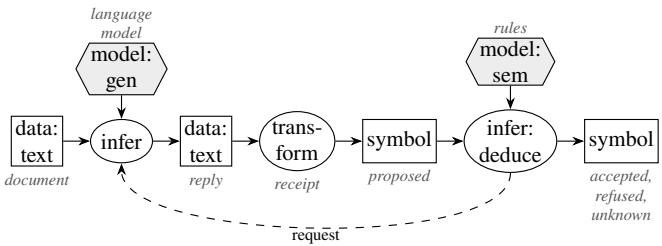

## Participants

Model: reads one input and answers one question about it in a fixed format. Host: calls the model, measures what can be measured (format, quote occurrence), stores the answer as a receipt. Rules: request the reading, accept or reject each proposed fact with a reason. Source: the document or <sub>u</sub>tt<sub>erance,</sub> id<sub>en</sub>tifi<sub>e</sub>d b<sub>y</sub> h<sub>as</sub>h<sub>.</sub>

## Collaborations

A <sub>ru</sub>l<sub>e</sub> fi<sub>res</sub> <sub>an</sub> <sub>ex</sub>t<sub>erna</sub>l <sub>reques</sub>t f<sub>or</sub> <sub>a</sub> d<sub>ocumen</sub>t th<sub>a</sub>t i<sub>s</sub> <sub>pen</sub>di<sub>ng;</sub> th<sub>e</sub> h<sub>os</sub>t <sub>re</sub>t<sub>urns</sub> <sub>a</sub> <sub>rece</sub>i<sub>p</sub>t <sub>w</sub>ith th<sub>e</sub> <sub>mo</sub>d<sub>e</sub>l’<sub>s answer an</sub>d it<sub>s measuremen</sub>t<sub>s; an accep</sub>t<sub>ance ru</sub>l<sub>e</sub> t<sub>urns a</sub>d<sub>m</sub>i<sub>ss</sub>ibl<sub>e s</sub>t<sub>a</sub>t<sub>emen</sub>t<sub>s</sub> i<sub>n</sub>t<sub>o</sub> f<sub>ac</sub>t<sub>s;</sub> rejected statements keep their reason. A later revocation of the source withdraws what rested on it.

## Consequences

Each fact has a <sub>p</sub>rovenance (source, model, <sub>p</sub>rom<sub>p</sub>t version, date) and a reason for acce<sub>p</sub>tance. An answer that cannot be grounded stays a rejected statement with its reason. A model’s unknown leaves th<sub>e</sub> <sub>cr</sub>it<sub>er</sub>i<sub>on</sub> <sub>open.</sub> Th<sub>e</sub> <sub>cos</sub>t i<sub>s</sub> <sub>one</sub> <sub>ca</sub>ll <sub>per</sub> i<sub>npu</sub>t <sub>an</sub>d <sub>ques</sub>ti<sub>on;</sub> <sub>a</sub> <sub>p</sub>l<sub>aus</sub>ibl<sub>e</sub> b<sub>u</sub>t <sub>wrong</sub> <sub>va</sub>l<sub>ue</sub> th<sub>a</sub>t <sub>passes</sub> <sub>every</sub> <sub>measura</sub>bl<sub>e</sub> <sub>c</sub>h<sub>ec</sub>k <sub>s</sub>li<sub>ps</sub> th<sub>roug</sub>h thi<sub>s</sub> <sub>pa</sub>tt<sub>ern</sub> <sub>an</sub>d <sub>nee</sub>d<sub>s</sub> <sub>a</sub> <sub>secon</sub>d <sub>rea</sub>d<sub>er,</sub> <sub>a</sub> <sub>person</sub> <sub>or</sub> <sub>a</sub> <sub>cross-c</sub>h<sub>ec</sub>k<sub>.</sub>

## Implementation

A<sub>s</sub>k f<sub>or one</sub> thi<sub>ng per ca</sub>ll<sub>: a va</sub>l<sub>ue</sub> f<sub>rom a</sub> fi<sub>xe</sub>d li<sub>s</sub>t<sub>, or a s</sub>t<sub>a</sub>t<sub>emen</sub>t <sub>w</sub>ith it<sub>s quo</sub>t<sub>e.</sub> Th<sub>e reques</sub>t <sub>names</sub> the source text as groundIn, which the model does not see; the host then records for ever<sub>y</sub> row of the answer whether its <sub>q</sub>uote occurs verbatim in that text (quoteFound). The <sub>p</sub>ro<sub>g</sub>ram is com<sub>p</sub>lete: it d<sub>ec</sub>l<sub>ares</sub> it<sub>s wor</sub>ld <sub>an</sub>d th<sub>e s</sub>l<sub>o</sub>t it <sub>nega</sub>t<sub>es, s</sub>t<sub>a</sub>t<sub>es w</sub>h<sub>a</sub>t <sub>a con</sub>t<sub>rac</sub>t <sub>may say, g</sub>i<sub>ves one con</sub>t<sub>rac</sub>t <sub>an</sub>d th<sub>e</sub> <sub>p</sub>rom<sub>p</sub>t, and then the ste<sub>p</sub>s ever<sub>y</sub> <sub>p</sub>attern has: the re<sub>q</sub>uest, the rule that reads the recei<sub>p</sub>t (row ?I is one statement about document ?D), the rules that acce<sub>p</sub>t or reject, and the rule for a failed call.

// Pattern 1, Model as Sensor: the model reads, the rules decide what counts.   
2 world open.   
3 closed slot allowsSlot.   
4   
5 // What a kind of document can state, and one document to read.   
6 "contract"[allowsSlot -> "customer"; allowsSlot -> "provider"].   
d1:Document[pending -> true; kind -> "contract";   
8 text -> "Service Agreement between Beta GmbH (the Provider) and Acme AG (the Customer)   
. This agreement is governed by Swiss law."].   
9   
10 // The instruction the model receives.   
11 readPrompt:Prompt[text -> "Report what the document states: one row {slot, value, quote}   
per statement, slot one of customer, provider, governingLaw, the quote copied   
verbatim. Answer as JSON {\"rows\": [...]}."].   
12   
13 // Request: one call per pending document; groundIn makes the host check every quote.   
14 external read(?D) using \_llm with readPrompt[document -> ?T; groundIn -> ?T]   
15 <- ?D:Document[pending -> true; text -> ?T].   
16   
17 // Receipt: each answer row becomes a proposed statement about the document.   
18 ?D[slot(?I) -> ?S; value(?I) -> ?V; quoteFound(?I) -> ?Q]   
19 <- ?R[tool#name -> "\_llm"; tool#arg1 -> ?D; row(?I, "slot") -> ?S;   
20 row(?I, "value") -> ?V; row(?I, "quoteFound") -> ?Q].   
21   
22 // Accept: a quoted statement that this kind of document may make.   
23 ?D[accepted(?I) -> ?V]   
24 <- ?D:Document[kind -> ?K; slot(?I) -> ?S; value(?I) -> ?V;   
25 quoteFound(?I) -> true] AND ?K[allowsSlot -> ?S].   
26   
27 ?D[rejected(?I) -> "quote not found in the document"]   
28 <- ?D[quoteFound(?I) -> false].   
29   
30 ?D[rejected(?I) -> "not a statement this kind of document can make"]   
31 <- ?D:Document[kind -> ?K; slot(?I) -> ?S] AND NOT ?K[allowsSlot -> ?S].   
32   
33 // A failed call (no answer, or a reply that is not valid JSON) proposes nothing;   
34 // the document stays unread, with the host's reason.   
35 ?D[notRead -> ?E]   
36 <- ?R[tool#name -> "\_llm"; tool#arg1 -> ?D; tool#status -> "failed"; error -> ?E].   
37   
38 ?- d1[accepted(?I) -> ?V].   
39 ?- d1[rejected(?I) -> ?Why].   
40 ?- d1[notRead -> ?E].  
Figure 2 draws the program as a rule graph. A statement the model does not report stays unknown: no rule acce<sub>p</sub>ts or rejects it. A failed call is no rejection either; notRead kee<sub>p</sub>s the host’s reason (invariant 5).

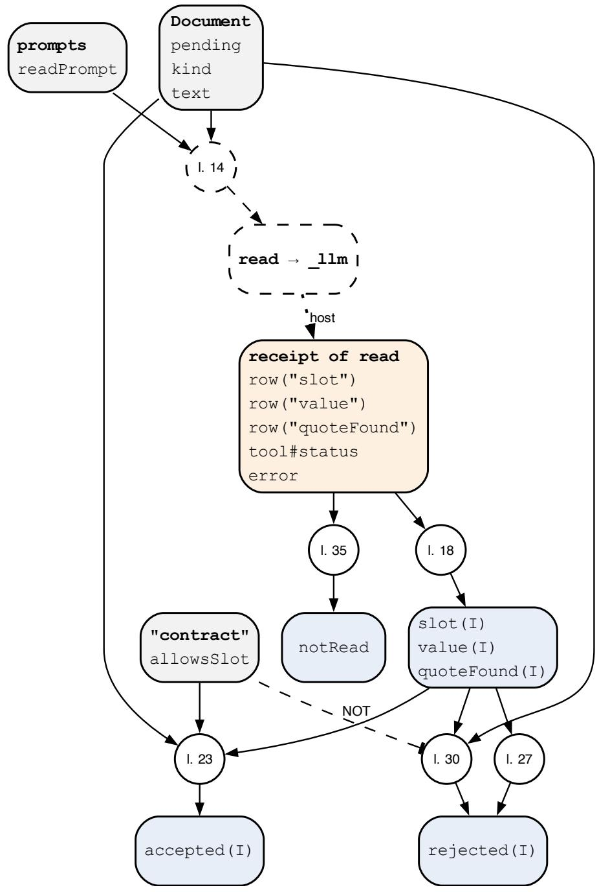  
Fi<sub>g</sub>ure 2: Rule <sub>g</sub>ra<sub>p</sub>h of p01-sensor.fx, <sub>g</sub>enerated from the <sub>p</sub>ro<sub>g</sub>ram. A circle is one rule; “l. 23” <sub>means</sub> th<sub>a</sub>t th<sub>e ru</sub>l<sub>e s</sub>t<sub>ar</sub>t<sub>s</sub> i<sub>n</sub> li<sub>ne</sub> 23 <sub>o</sub>f th<sub>e</sub> li<sub>s</sub>ti<sub>ng.</sub> L<sub>egen</sub>d i<sub>n</sub> T<sub>a</sub>bl<sub>e</sub> 9<sub>.</sub>

## Library form

Th<sub>e ru</sub>l<sub>es a</sub>b<sub>ove are</sub> th<sub>e same</sub> f<sub>or every source, so</sub> th<sub>ey can</sub> li<sub>ve</sub> i<sub>n a</sub> lib<sub>rary, as</sub> th<sub>e</sub> di<sub>a</sub>l<sub>ogue</sub> fl<sub>ows o</sub>f <sub>p</sub>attern 5 do. With the librar<sub>y</sub> sensor.fx (Section B) loaded first, the <sub>p</sub>ro<sub>g</sub>ram states facts onl<sub>y</sub>, and the librar<sub>y</sub> derives sensor#accepted, sensor#rejected and sensor#notRead for ever<sub>y</sub> source:

// Pattern 1 in library form: load sensor.fx first. Same document, same prompt as p01-   
sensor.fx.   
2 world open.   
3   
4 "contract"[sensor#allows -> "customer"; sensor#allows -> "provider"].   
5   
6 readPrompt:Prompt[text -> "Report what the document states: one row {slot, value, quote}   
per statement, slot one of customer, provider, governingLaw, the quote copied   
verbatim. Answer as JSON {\"rows\": [...]}."].   
7   
8 d1:sensor#Source[sensor#kind -> "contract"; sensor#prompt -> readPrompt;   
9 sensor#text -> "Service Agreement between Beta GmbH (the Provider) and Acme AG (the   
Customer). This agreement is governed by Swiss law."].   
10   
11 ?- d1[sensor#accepted(?I) -> ?V].   
12 ?- d1[sensor#rejected(?I) -> ?Why].   
13 ?- d1[sensor#notRead -> ?E].

Th<sub>e recor</sub>d<sub>e</sub>d <sub>run g</sub>i<sub>ves</sub> th<sub>e same resu</sub>lt<sub>s as</sub> th<sub>e program a</sub>b<sub>ove.</sub> W<sub>r</sub>it<sub>e</sub> th<sub>e ru</sub>l<sub>es ou</sub>t <sub>w</sub>h<sub>en a case nee</sub>d<sub>s</sub> it<sub>s</sub> <sub>own</sub> <sub>accep</sub>t<sub>ance</sub> <sub>ru</sub>l<sub>e,</sub> <sub>an</sub>d <sub>use</sub> th<sub>e</sub> lib<sub>rary</sub> <sub>w</sub>h<sub>en</sub> it d<sub>oes</sub> <sub>no</sub>t<sub>.</sub> A <sub>con</sub>fid<sub>ence</sub> <sub>repor</sub>t<sub>e</sub>d b<sub>y</sub> th<sub>e</sub> <sub>mo</sub>d<sub>e</sub>l i<sub>s</sub> <sub>recor</sub>d<sub>e</sub>d <sub>as a num</sub>b<sub>er an</sub>d <sub>never rea</sub>d <sub>as</sub> t<sub>ru</sub>th<sub>.</sub> Wh<sub>ere</sub> th<sub>e serv</sub>i<sub>ng s</sub>t<sub>ac</sub>k <sub>suppor</sub>t<sub>s</sub> it<sub>,</sub> d<sub>eco</sub>d<sub>e every rep</sub>l<sub>y</sub> <sub>un</sub>d<sub>er a</sub> JSON <sub>sc</sub>h<sub>ema</sub> d<sub>er</sub>i<sub>ve</sub>d f<sub>rom</sub> th<sub>e c</sub>l<sub>ose</sub>d <sub>se</sub>t <sub>o</sub>f <sub>a</sub>ll<sub>owe</sub>d <sub>va</sub>l<sub>ues.</sub>

## Known uses

Assi<sub>g</sub>nment review with quote-checked extraction; cam<sub>p</sub>ervan search (one classification <sub>p</sub>er listin<sub>g</sub>, from a fixed list or unknown); the judge in dialogue flows (one criterion about one answer); memory claims with quotes in FrameX-Agents; model measurements per object in the Q-calculus example. In the literature: neural <sub>p</sub>erce<sub>p</sub>tion feedin<sub>g</sub> a reasoner, Kautz’s Neuro | S<sub>y</sub>mbolic (Kautz 2022); learnin<sub>g</sub> from data with s<sub>y</sub>mbolic out<sub>p</sub>ut (van Harmelen and ten Teije 2019; van Bekkum et al. 2021); knowled<sub>g</sub>e-<sub>g</sub>ra<sub>p</sub>h construction b<sub>y</sub> a lan<sub>g</sub>ua<sub>g</sub>e model (S. Pan et al. 2024).

## Related patterns

The jud<sub>g</sub>e of Rules Steer the Model (Section 4.2) is a sensor for one answer. Critique and Re<sub>p</sub>air (Section 4.3) handles the re<sub>p</sub>lies that fail a check. A Sensor whose readin<sub>g</sub>s are a<sub>gg</sub>re<sub>g</sub>ated b<sub>y</sub> rules over man<sub>y</sub> objects (lists, counts) is where the h<sub>y</sub>brid’s accurac<sub>y</sub> advanta<sub>g</sub>e was lar<sub>g</sub>est.

## Variants

Several Readers, One Rule. The same question goes to several models or samples, and rules adjudicate: agreeing readings are accepted, a majority is accepted with its count recorded, and a disagreement becomes unclear and is handed on (Section 4.4); it is never settled by a coin toss. Voting and parallel sam<sub>p</sub>lin<sub>g</sub> are <sub>p</sub>ublished a<sub>g</sub>ent and workflow <sub>p</sub>atterns (Liu et al. 2025; Schluntz and Zhan<sub>g</sub> 2024), and self-consistenc<sub>y</sub> beat multi-a<sub>g</sub>ent debate at the same number of answers (Huan<sub>g</sub> et al. 2024). Askin<sub>g</sub> a judge twice with the answers in swapped order and requiring agreement is the same variant applied to <sub>p</sub>osition bias (Zhen<sub>g</sub> et al. 2023).

## Evidence

In a <sub>p</sub>ortfolio of 100 a<sub>g</sub>reements (376 documents), a model alone answered sin<sub>g</sub>le decisions and f<sub>our-s</sub>t<sub>ep c</sub>h<sub>a</sub>i<sub>ns correc</sub>tl<sub>y</sub> b<sub>u</sub>t <sub>pro</sub>d<sub>uce</sub>d <sub>exac</sub>t <sub>ex</sub>h<sub>aus</sub>ti<sub>ve</sub> li<sub>s</sub>t<sub>s</sub> i<sub>n</sub> 0 <sub>o</sub>f 6 <sub>ques</sub>ti<sub>ons a</sub>t l<sub>ow e</sub>f<sub>or</sub>t<sub>; w</sub>ith th<sub>e</sub> <sub>mo</sub>d<sub>e</sub>l <sub>as sensor an</sub>d th<sub>e</sub> li<sub>s</sub>t<sub>s</sub> d<sub>er</sub>i<sub>ve</sub>d b<sub>y ru</sub>l<sub>es,</sub> 10 <sub>o</sub>f 10 <sub>ques</sub>ti<sub>ons were correc</sub>t<sub>, w</sub>ith <sub>a comp</sub>l<sub>e</sub>t<sub>eness</sub> <sub>c</sub>h<sub>ec</sub>k l<sub>eav</sub>i<sub>ng no s</sub>il<sub>en</sub>tl<sub>y wrong answer.</sub> Th<sub>e ex</sub>t<sub>rac</sub>ti<sub>on was</sub> th<sub>e expens</sub>i<sub>ve s</sub>t<sub>ep:</sub> 43<sub>.</sub>6 <sub>cen</sub>t<sub>s once aga</sub>i<sub>ns</sub>t 1<sub>.</sub>2 <sub>cen</sub>t<sub>s</sub> <sub>per</sub> <sub>ques</sub>ti<sub>on</sub> f<sub>or</sub> th<sub>e</sub> <sub>mo</sub>d<sub>e</sub>l <sub>a</sub>l<sub>one.</sub> With <sub>an</sub> 8<sub>-</sub>billi<sub>on-parame</sub>t<sub>er</sub> <sub>open</sub> <sub>mo</sub>d<sub>e</sub>l<sub>,</sub> th<sub>e</sub> <sub>s</sub>t<sub>r</sub>i<sub>c</sub>t <sub>quo</sub>t<sub>e</sub> rule refused correct values and made extraction worse than the model alone (45 % a<sub>g</sub>ainst 60 %): the <sub>accep</sub>t<sub>ance</sub> <sub>ru</sub>l<sub>e</sub> <sub>mus</sub>t fit th<sub>e</sub> <sub>rea</sub>d<sub>er</sub>’<sub>s</sub> <sub>a</sub>bilit<sub>y</sub> t<sub>o</sub> <sub>quo</sub>t<sub>e.</sub>

## 3.2 Pattern 2: Model as Author

## Intent

Let the model write formal material (rules, decision tables, schemas, tests, dialo<sub>g</sub>ue flows, thresholds) <sub>an</sub>d <sub>c</sub>h<sub>ec</sub>k <sub>every</sub> d<sub>ra</sub>ft <sub>o</sub>fli<sub>ne</sub> b<sub>e</sub>f<sub>ore a person a</sub>d<sub>op</sub>t<sub>s</sub> it<sub>.</sub> Th<sub>e ru</sub>l<sub>es never run w</sub>h<sub>a</sub>t th<sub>e mo</sub>d<sub>e</sub>l <sub>wro</sub>t<sub>e</sub> <sub>unc</sub>h<sub>ec</sub>k<sub>e</sub>d<sub>.</sub>

## Also known as

R<sub>u</sub>l<sub>e</sub> d<sub>ra</sub>fti<sub>ng,</sub> <sub>po</sub>li<sub>cy-</sub>t<sub>o-ru</sub>l<sub>es,</sub> <sub>spec</sub>ifi<sub>ca</sub>ti<sub>on-</sub>d<sub>r</sub>i<sub>ven</sub> <sub>au</sub>th<sub>or</sub>i<sub>ng,</sub> k<sub>now</sub>l<sub>e</sub>d<sub>ge</sub> <sub>acqu</sub>i<sub>s</sub>iti<sub>on</sub> <sub>w</sub>ith <sub>a</sub> <sub>mo</sub>d<sub>e</sub>l<sub>.</sub>

## Motivation

A <sub>p</sub>olic<sub>y</sub> sentence (“claims above 500 francs need a recei<sub>p</sub>t”) must become a rule, and an amended <sub>regu</sub>l<sub>a</sub>ti<sub>on mus</sub>t b<sub>ecome a c</sub>h<sub>ange</sub>d d<sub>ec</sub>i<sub>s</sub>i<sub>on</sub> t<sub>a</sub>bl<sub>e.</sub> A <sub>mo</sub>d<sub>e</sub>l d<sub>ra</sub>ft<sub>s</sub> th<sub>e ru</sub>l<sub>e</sub> i<sub>n secon</sub>d<sub>s, an</sub>d th<sub>e expens</sub>i<sub>ve</sub> <sub>par</sub>t i<sub>s c</sub>h<sub>ec</sub>ki<sub>ng</sub> it<sub>.</sub> Th<sub>e pa</sub>tt<sub>ern moves</sub> th<sub>e cos</sub>t t<sub>o a c</sub>h<sub>ec</sub>k th<sub>a</sub>t i<sub>s comp</sub>l<sub>e</sub>t<sub>e</sub> f<sub>or</sub> th<sub>e</sub> f<sub>au</sub>lt<sub>s</sub> th<sub>a</sub>t <sub>ma</sub>tt<sub>er:</sub> th<sub>e</sub> d<sub>ra</sub>ft <sub>mus</sub>t <sub>parse, may on</sub>l<sub>y use a</sub>ll<sub>owe</sub>d h<sub>ea</sub>d<sub>s, an</sub>d <sub>mus</sub>t <sub>pass</sub> th<sub>e regress</sub>i<sub>on cases an</sub>d <sub>expec</sub>t<sub>a</sub>ti<sub>ons,</sub> <sub>an</sub>d th<sub>e</sub> <sub>c</sub>h<sub>ec</sub>k <sub>repor</sub>t<sub>s</sub> <sub>w</sub>hi<sub>c</sub>h d<sub>ec</sub>i<sub>s</sub>i<sub>ons</sub> th<sub>e</sub> d<sub>ra</sub>ft <sub>wou</sub>ld <sub>c</sub>h<sub>ange.</sub>

## Applicability

U<sub>se</sub> it <sub>w</sub>h<sub>en</sub>

• the tar<sub>g</sub>et notation has a com<sub>p</sub>lete check for the faults that matter (s<sub>y</sub>ntax<sub>,</sub> allowed vocabular<sub>y,</sub> structural anomalies of a decision table, re<sub>g</sub>ression cases);

• re<sub>g</sub>ression cases or ex<sub>p</sub>ectations exist or can be written before the draft<sub>;</sub>

• a <sub>p</sub>erson is available to ado<sub>p</sub>t what <sub>p</sub>asses.

Where no com<sub>p</sub>lete check exists (semantic faults in a lar<sub>g</sub>e rule base), the draft can onl<sub>y</sub> o<sub>p</sub>en a review (see Model as Critic, Section 5.2).

## Structure

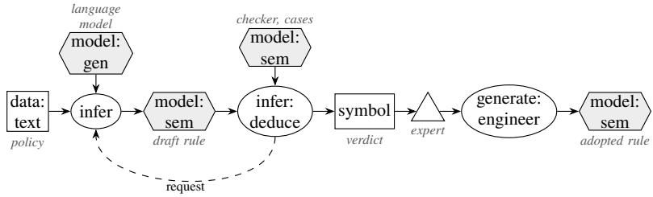

## Participants

Model: drafts one artefact from a policy text, a change request or failing cases. Checker: parses, <sub>res</sub>t<sub>r</sub>i<sub>c</sub>t<sub>s</sub> h<sub>ea</sub>d<sub>s,</sub> <sub>eva</sub>l<sub>ua</sub>t<sub>es</sub> th<sub>e</sub> <sub>can</sub>did<sub>a</sub>t<sub>e</sub> i<sub>n</sub> <sub>a</sub> <sub>copy</sub> <sub>o</sub>f th<sub>e</sub> <sub>sess</sub>i<sub>on</sub> <sub>aga</sub>i<sub>ns</sub>t <sub>expec</sub>t<sub>a</sub>ti<sub>ons</sub> <sub>an</sub>d <sub>regress</sub>i<sub>on</sub> cases. Rules: request the check and derive adoptable, or a failure with the checker’s message that drives the repair. Expert: adopts, edits or refuses.

## Collaborations

Th<sub>e</sub> <sub>mo</sub>d<sub>e</sub>l’<sub>s</sub> d<sub>ra</sub>ft i<sub>s</sub> <sub>s</sub>t<sub>ore</sub>d <sub>as</sub> <sub>a</sub> <sub>rece</sub>i<sub>p</sub>t<sub>;</sub> <sub>a</sub> <sub>ru</sub>l<sub>e</sub> <sub>reques</sub>t<sub>s</sub> it<sub>s</sub> <sub>c</sub>h<sub>ec</sub>k<sub>;</sub> th<sub>e</sub> <sub>c</sub>h<sub>ec</sub>k<sub>er</sub>’<sub>s</sub> <sub>rece</sub>i<sub>p</sub>t <sub>s</sub>t<sub>a</sub>t<sub>es</sub> <sub>regress</sub>i<sub>ons</sub> <sub>an</sub>d <sub>c</sub>h<sub>ange</sub>d d<sub>ec</sub>i<sub>s</sub>i<sub>ons;</sub> <sub>a</sub> <sub>ru</sub>l<sub>e</sub> d<sub>er</sub>i<sub>ves</sub> <sub>e</sub>ith<sub>er</sub> <sub>a</sub> <sub>recommen</sub>d<sub>a</sub>ti<sub>on</sub> f<sub>or</sub> th<sub>e</sub> <sub>exper</sub>t <sub>or</sub> <sub>a</sub> <sub>prec</sub>i<sub>se</sub> <sub>repa</sub>i<sub>r</sub> <sub>message</sub> for the model (Section 4.3).

## Consequences

W<sub>r</sub>iti<sub>ng</sub> b<sub>ecomes</sub> <sub>c</sub>h<sub>eap</sub> <sub>an</sub>d <sub>c</sub>h<sub>ec</sub>ki<sub>ng</sub> b<sub>ecomes</sub> th<sub>e</sub> b<sub>o</sub>ttl<sub>enec</sub>k<sub>;</sub> th<sub>e</sub> <sub>qua</sub>lit<sub>y</sub> <sub>o</sub>f th<sub>e</sub> <sub>eng</sub>i<sub>ne</sub>’<sub>s</sub> <sub>error</sub> <sub>messages</sub> b<sub>ecomes</sub> <sub>a</sub> d<sub>es</sub>i<sub>gn</sub> <sub>parame</sub>t<sub>er.</sub> A d<sub>ra</sub>ft <sub>ou</sub>t<sub>s</sub>id<sub>e</sub> th<sub>e</sub> t<sub>arge</sub>t l<sub>anguage</sub> i<sub>s</sub> <sub>re</sub>f<sub>use</sub>d <sub>a</sub>t it<sub>s</sub> fi<sub>rs</sub>t <sub>ce</sub>ll <sub>or</sub> t<sub>o</sub>k<sub>en.</sub> Wh<sub>a</sub>t th<sub>e organ</sub>i<sub>sa</sub>ti<sub>on</sub> k<sub>eeps</sub> i<sub>s</sub> th<sub>e a</sub>d<sub>op</sub>t<sub>e</sub>d <sub>ar</sub>t<sub>e</sub>f<sub>ac</sub>t<sub>, an</sub>d th<sub>e mo</sub>d<sub>e</sub>l <sub>can</sub> b<sub>e exc</sub>h<sub>ange</sub>d<sub>.</sub> Th<sub>e pa</sub>tt<sub>ern</sub> d<sub>oes no</sub>t d<sub>e</sub>t<sub>ec</sub>t <sub>a</sub> d<sub>ra</sub>ft th<sub>a</sub>t i<sub>s we</sub>ll<sub>-</sub>f<sub>orme</sub>d<sub>, passes every case an</sub>d i<sub>s s</sub>till <sub>wrong w</sub>h<sub>ere no case covers</sub> it<sub>.</sub>

## Implementation

Give the model a tem<sub>p</sub>late to fill (a rule skeleton, the cell lan<sub>g</sub>ua<sub>g</sub>e of a decision table). Check in a <sub>copy o</sub>f th<sub>e sess</sub>i<sub>on, an</sub>d l<sub>e</sub>t <sub>a person a</sub>d<sub>op</sub>t<sub>.</sub> Ph<sub>rase eng</sub>i<sub>ne messages</sub> f<sub>or a rea</sub>d<sub>er w</sub>h<sub>o repa</sub>i<sub>rs:</sub> “<sub>separa</sub>t<sub>e</sub> th<sub>e s</sub>l<sub>o</sub>t<sub>s o</sub>f <sub>a</sub> f<sub>rame w</sub>ith ‘<sub>;</sub>’<sub>, no</sub>t ‘<sub>,</sub>”’ l<sub>e</sub>d t<sub>o more repa</sub>i<sub>rs</sub> th<sub>an</sub> “<sub>expec</sub>t<sub>e</sub>d ‘<sub>;</sub>’ ”<sub>.</sub>

The first re<sub>q</sub>uest calls the model, the second the checker \_checkCandidate. The o<sub>p</sub>erator fixes in an ada<sub>p</sub>ter file what the checker com<sub>p</sub>ares a<sub>g</sub>ainst: the vocabular<sub>y</sub> file, the hidden cases (expect true: c3:NeedsReceipt.) and the onl<sub>y</sub> head a draft ma<sub>y</sub> have. Its recei<sub>p</sub>t carries status (checked; rejected before evaluation, for exam<sub>p</sub>le for a s<sub>y</sub>ntax error or a head outside the allowed set; or error), and after evaluation regressions (a case that <sub>p</sub>assed before fails now), failedAfter (cases failin<sub>g</sub> after) and one line of feedback. The second half of the <sub>p</sub>ro<sub>g</sub>ram is the re<sub>p</sub>air of Criti<sub>q</sub>ue and R<sub>epa</sub>ir<sub>:</sub>

// Pattern 2, Model as Author, with Pattern 6, Critique and Repair: the model drafts a   
2 // rule, the checker measures it against hidden cases, and the checker's message   
3 // drives a bounded repair. Nothing is adopted here; a person adopts.   
4 world open.   
5   
6 p1:Policy[pending -> true; maxAttempts -> 3;   
7 text -> "A claim above 500 francs needs a receipt.";   
8 vocabulary -> "Class Claim with slot amount (a number). Write rules whose head is ?C:   
NeedsReceipt and nothing else. A rule is HEAD <- BODY. Slots: ?C:Claim[amount ->   
?A]. Comparisons: > >= < <=."].   
9   
10 draftPrompt:Prompt[text -> "Write the FrameX rule for the policy sentence, using only the   
vocabulary. Answer as JSON {\"rule\": ...}."].   
11 repairPrompt:Prompt[text -> "Your FrameX rule for the policy sentence failed the check.   
previousRule is your rule, problem is the checker's message. Write the corrected rule   
, using only the vocabulary. Answer as JSON {\"rule\": ...}."].   
12   
13 // Attempt 1: the model drafts.   
14 external draft(?P, 1) using \_llm with draftPrompt[policy -> ?T; vocabulary -> ?V;   
15 tool#order -> 2]   
16 <- ?P:Policy[pending -> true; text -> ?T; vocabulary -> ?V].   
17   
18 ?P[rule(?N) -> ?T]   
19 <- ?R[tool#name -> "\_llm"; tool#arg1 -> ?P; tool#arg2 -> ?N; result("rule") -> ?T].   
20   
21 // Every draft is checked; the cases stay hidden from the model.   
22 external check(?P, ?N) using \_checkCandidate[candidate -> ?T; tool#order -> 1]   
23 <- ?P:Policy[rule(?N) -> ?T].   
24   
25 ?P[passed(?N) -> true]   
26 <- ?R[tool#name -> "\_checkCandidate"; tool#arg1 -> ?P; tool#arg2 -> ?N;   
27 result("status") -> "checked"; result("regressions") -> false;   
28 result("failedAfter") -> 0].   
29   
30 ?P[adoptable -> ?T] <- ?P[passed(?N) -> true; rule(?N) -> ?T].   
31   
32 // A draft fails in one of three ways; each failure keeps the checker's message.   
33 ?P[failed(?N) -> ?F]   
34 <- ?R[tool#name -> "\_checkCandidate"; tool#arg1 -> ?P; tool#arg2 -> ?N;   
35 result("status") -> ?St; result("feedback") -> ?F] AND ?St != "checked".   
36   
37 ?P[failed(?N) -> ?F]

38 <- ?R[tool#name -> "\_checkCandidate"; tool#arg1 -> ?P; tool#arg2 -> ?N;   
39 result("regressions") -> true; result("feedback") -> ?F].   
40   
41 ?P[failed(?N) -> ?F]   
42 <- ?R[tool#name -> "\_checkCandidate"; tool#arg1 -> ?P; tool#arg2 -> ?N;   
43 result("failedAfter") -> ?K; result("feedback") -> ?F] AND ?K > 0.   
44   
45 // Pattern 6: ask again with the rule and the problem in the request, as a new   
46 // request with the next number. Stop at the bound or when the message repeats.   
47 ?P[newProblem(1) -> true] <- ?P[failed(1) -> ?F].   
48   
49 ?P[newProblem(?N) -> true]   
50 <- ?P[failed(?N) -> ?F] AND ?K := ?N - 1 AND ?P[failed(?K) -> ?G] AND ?F != ?G.   
51   
52 external draft(?P, ?M) using \_llm with repairPrompt[policy -> ?T; vocabulary -> ?V;   
53 previousRule -> ?Old; problem -> ?F; tool#order -> 2]   
54 <- ?P:Policy[text -> ?T; vocabulary -> ?V; maxAttempts -> ?Max;   
55 rule(?N) -> ?Old; failed(?N) -> ?F; newProblem(?N) -> true]   
56 AND ?N < ?Max AND ?M := ?N + 1.   
57   
58 ?P[stalled -> ?N]   
59 <- ?P[failed(?N) -> ?F] AND ?K := ?N - 1 AND ?P[failed(?K) -> ?F].   
60   
61 ?P[gaveUp -> ?F] <- ?P:Policy[maxAttempts -> ?N; failed(?N) -> ?F].   
62   
63 ?- p1[rule(?N) -> ?T].   
64 ?- p1[failed(?N) -> ?F].   
65 ?- p1[adoptable -> ?T].   
66 ?- p1[stalled -> ?N].

Fi<sub>g</sub>ure 3 draws the <sub>p</sub>ro<sub>g</sub>ram as a rule <sub>g</sub>ra<sub>p</sub>h. adoptable is a recommendation for a <sub>p</sub>erson; nothin<sub>g</sub> in t<sup>h</sup>e <sub>p</sub>ro<sub>g</sub>ram a<sup>d</sup>o<sub>p</sub>ts a ru<sup>l</sup>e.

## Library form

With the librar<sub>y</sub> author.fx (Section B) loaded first and the ada<sub>p</sub>ter of the checker named to the h<sub>os</sub>t<sub>,</sub> th<sub>e</sub> <sub>program</sub> <sub>s</sub>t<sub>a</sub>t<sub>es</sub> th<sub>e</sub> <sub>po</sub>li<sub>cy,</sub> it<sub>s</sub> <sub>voca</sub>b<sub>u</sub>l<sub>ary,</sub> th<sub>e</sub> t<sub>wo</sub> <sub>promp</sub>t<sub>s</sub> <sub>an</sub>d th<sub>e</sub> b<sub>oun</sub>d<sub>.</sub> Th<sub>e</sub> lib<sub>rary</sub> d<sub>ra</sub>ft<sub>s,</sub> <sub>c</sub>h<sub>ec</sub>k<sub>s,</sub> <sub>repa</sub>i<sub>rs</sub> <sub>an</sub>d <sub>s</sub>t<sub>ops;</sub> th<sub>e</sub> <sub>repa</sub>i<sub>r</sub> <sub>o</sub>f C<sub>r</sub>iti<sub>que</sub> <sub>an</sub>d R<sub>epa</sub>i<sub>r</sub> i<sub>s</sub> <sub>par</sub>t <sub>o</sub>f it<sub>:</sub>

```verilog
// Patterns 2 and 6 in library form: load author.fx first; the host needs ../
author_adapter.py.
2 world open.
3
4 draftPrompt:Prompt[text -> "Write the FrameX rule for the policy sentence, using only the
vocabulary. Answer as JSON {\"rule\": ...}."].
5 repairPrompt:Prompt[text -> "Your FrameX rule for the policy sentence failed the check.
previousRule is your rule, problem is the checker's message. Write the corrected rule
, using only the vocabulary. Answer as JSON {\"rule\": ...}."].
6
p1:author#Policy[author#maxAttempts -> 3;
8 author#draftPrompt -> draftPrompt; author#repairPrompt -> repairPrompt;
9 author#text -> "A claim above 500 francs needs a receipt.";
10 author#vocabulary -> "Class Claim with slot amount (a number). Write rules whose head
is ?C:NeedsReceipt and nothing else. A rule is HEAD <- BODY. Slots: ?C:Claim[
amount -> ?A]. Comparisons: > >= < <=."].
11
12 ?- p1[author#failed(?N) -> ?F].
13 ?- p1[author#adoptable -> ?T].
```

## Known uses

R<sub>u</sub>l<sub>e</sub> d<sub>ra</sub>fti<sub>ng</sub> f<sub>rom one po</sub>li<sub>cy sen</sub>t<sub>ence w</sub>ith <sub>s</sub>i<sub>x</sub> hidd<sub>en cases;</sub> d<sub>ec</sub>i<sub>s</sub>i<sub>on-</sub>t<sub>a</sub>bl<sub>e</sub> d<sub>ra</sub>ft<sub>s an</sub>d <sub>c</sub>h<sub>ange reques</sub>t<sub>s</sub> i<sub>n</sub> th<sub>e</sub> DMN <sub>roun</sub>d t<sub>r</sub>i<sub>p, c</sub>h<sub>ec</sub>k<sub>e</sub>d <sub>aga</sub>i<sub>ns</sub>t <sub>every case an</sub>d <sub>rev</sub>i<sub>ewe</sub>d<sub>;</sub> th<sub>e</sub> EU R<sub>egu</sub>l<sub>a</sub>ti<sub>on</sub> 261/2004 <sub>case,</sub> <sub>w</sub>h<sub>ere</sub> <sub>a</sub> d<sub>ra</sub>ft <sub>ou</sub>t<sub>s</sub>id<sub>e</sub> th<sub>e</sub> <sub>ce</sub>ll l<sub>anguage</sub> <sub>was</sub> <sub>re</sub>f<sub>use</sub>d <sub>an</sub>d <sub>a</sub> <sub>c</sub>h<sub>ange</sub> <sub>reques</sub>t fi<sub>xe</sub>d <sub>s</sub>i<sub>x</sub> <sub>o</sub>f <sub>s</sub>i<sub>x</sub> f<sub>a</sub>ili<sub>ng</sub> <sub>cases,</sub> b<sub>ro</sub>k<sub>e</sub> <sub>none</sub> <sub>an</sub>d <sub>passe</sub>d <sub>rev</sub>i<sub>ew;</sub> <sub>mapp</sub>i<sub>ng</sub> <sub>sugges</sub>ti<sub>ons</sub> b<sub>e</sub>t<sub>ween</sub> <sub>voca</sub>b<sub>u</sub>l<sub>ar</sub>i<sub>es</sub> k<sub>ep</sub>t <sub>as</sub> <sub>recor</sub>d<sub>e</sub>d <sub>p</sub>ro<sub>p</sub>osals. In the literature: domain-model acquisition with ex<sub>p</sub>erts in LLM-Modulo (Kambham<sub>p</sub>ati et al. 2024); action-schema <sub>g</sub>eneration (Rani et al. 2026); the en<sub>g</sub>ineered model of an actor (<sub>p</sub>attern 1c) of van Bekkum et al. (2021), with the model in the en<sub>g</sub>ineer’s role.

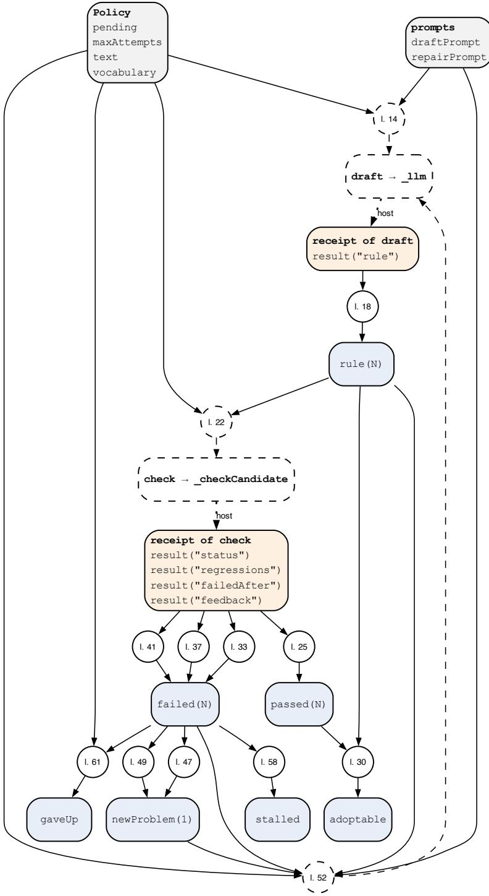  
Fi<sub>g</sub>ure 3: Rule <sub>g</sub>ra<sub>p</sub>h of p02-author.fx, <sub>g</sub>enerated from the <sub>p</sub>ro<sub>g</sub>ram. A circle is one rule; “l. 23” <sub>means</sub> th<sub>a</sub>t th<sub>e ru</sub>l<sub>e s</sub>t<sub>ar</sub>t<sub>s</sub> i<sub>n</sub> li<sub>ne</sub> 23 <sub>o</sub>f th<sub>e</sub> li<sub>s</sub>ti<sub>ng.</sub> L<sub>egen</sub>d i<sub>n</sub> T<sub>a</sub>bl<sub>e</sub> 9<sub>.</sub>

## Related patterns

Critique and Re<sub>p</sub>air (Section 4.3) closes the loo<sub>p</sub> with the checker’s messa<sub>g</sub>e. Division b<sub>y</sub> Com<sub>p</sub>etence (Section 4.4) su<sub>pp</sub>lies drafts from recurrin<sub>g</sub> model decisions. Model as Critic (Section 5.2) a<sub>pp</sub>lies <sub>w</sub>h<sub>ere</sub> th<sub>e c</sub>h<sub>ec</sub>k i<sub>s</sub> i<sub>ncomp</sub>l<sub>e</sub>t<sub>e.</sub>

## Evidence

I<sub>n</sub> fi<sub>ve</sub> li<sub>ve runs, a mo</sub>d<sub>e</sub>l d<sub>ra</sub>ft<sub>e</sub>d <sub>a ru</sub>l<sub>e</sub> f<sub>rom one po</sub>li<sub>cy sen</sub>t<sub>ence; every run en</sub>d<sub>e</sub>d <sub>w</sub>ith <sub>a ru</sub>l<sub>e</sub> th<sub>a</sub>t <sub>passe</sub>d <sub>a</sub>ll <sub>s</sub>i<sub>x</sub> hidd<sub>en cases,</sub> th<sub>ree a</sub>t th<sub>e</sub> fi<sub>rs</sub>t <sub>a</sub>tt<sub>emp</sub>t<sub>,</sub> t<sub>wo a</sub>ft<sub>er one repa</sub>i<sub>r o</sub>f th<sub>e same syn</sub>t<sub>ax s</sub>li<sub>p.</sub> F<sub>rom</sub> th<sub>e same</sub> f<sub>au</sub>lt<sub>y</sub> d<sub>ra</sub>ft<sub>s, a repa</sub>i<sub>r succee</sub>d<sub>e</sub>d <sub>a</sub>t th<sub>e</sub> fi<sub>rs</sub>t <sub>reques</sub>t i<sub>n</sub> 5 <sub>o</sub>f 10 <sub>runs w</sub>ith th<sub>e message</sub> “<sub>expec</sub>t<sub>e</sub>d ‘<sub>;</sub>’ ” <sub>an</sub>d i<sub>n</sub> 10 <sub>o</sub>f 10 <sub>w</sub>ith <sub>a</sub> <sub>message</sub> <sub>nam</sub>i<sub>ng</sub> th<sub>e</sub> fi<sub>x.</sub> A<sub>cross</sub> 36 d<sub>ra</sub>ft<sub>s</sub> f<sub>or</sub> 12 <sub>po</sub>li<sub>c</sub>i<sub>es,</sub> <sub>messages</sub> th<sub>a</sub>t <sub>name</sub> th<sub>e</sub> fi<sub>x</sub> <sub>ra</sub>i<sub>se</sub>d <sub>repa</sub>i<sub>rs</sub> <sub>w</sub>ithi<sub>n</sub> t<sub>wo</sub> <sub>a</sub>tt<sub>emp</sub>t<sub>s</sub> f<sub>rom</sub> 8 <sub>o</sub>f 15 t<sub>o</sub> 14 <sub>o</sub>f 15<sub>.</sub> I<sub>n</sub> <sub>a</sub> <sub>c</sub>h<sub>ec</sub>ki<sub>ng</sub> <sub>s</sub>t<sub>u</sub>d<sub>y, s</sub>t<sub>a</sub>ti<sub>c c</sub>h<sub>ec</sub>k<sub>s over ru</sub>l<sub>es</sub> f<sub>oun</sub>d <sub>every see</sub>d<sub>e</sub>d <sub>s</sub>t<sub>ruc</sub>t<sub>ura</sub>l f<sub>au</sub>lt <sub>a</sub>t <sub>every s</sub>i<sub>ze a</sub>t <sub>no mo</sub>d<sub>e</sub>l <sub>cos</sub>t<sub>, w</sub>hil<sub>e</sub> <sub>mo</sub>d<sub>e</sub>l <sub>rev</sub>i<sub>ews o</sub>f <sub>co</sub>d<sub>e an</sub>d <sub>promp</sub>t<sub>s</sub> f<sub>oun</sub>d <sub>an unreac</sub>h<sub>a</sub>bl<sub>e ru</sub>l<sub>e</sub> i<sub>n on</sub>l<sub>y</sub> 2 <sub>or</sub> 3 <sub>o</sub>f 10 <sub>ar</sub>t<sub>e</sub>f<sub>ac</sub>t<sub>s a</sub>t 64 <sub>ru</sub>l<sub>es.</sub>

## 3.3 Pattern 3: Model as Translator

## Intent

P<sub>u</sub>t th<sub>e mo</sub>d<sub>e</sub>l b<sub>e</sub>t<sub>ween a person an</sub>d th<sub>e ru</sub>l<sub>es,</sub> i<sub>n</sub> b<sub>o</sub>th di<sub>rec</sub>ti<sub>ons:</sub> th<sub>e person</sub>’<sub>s wor</sub>d<sub>s</sub> i<sub>n</sub>t<sub>o a reques</sub>t th<sub>e</sub> <sub>ru</sub>l<sub>es can answer, an</sub>d th<sub>e ru</sub>l<sub>es</sub>’ <sub>answer an</sub>d <sub>proo</sub>f i<sub>n</sub>t<sub>o wor</sub>d<sub>s</sub> f<sub>or</sub> th<sub>a</sub>t <sub>person.</sub>

## Also known as

N<sub>a</sub>t<sub>ura</sub>l<sub>-</sub>l<sub>anguage</sub> i<sub>n</sub>t<sub>er</sub>f<sub>ace,</sub> <sub>ver</sub>b<sub>a</sub>li<sub>sa</sub>ti<sub>on,</sub> <sub>exp</sub>l<sub>ana</sub>ti<sub>on,</sub> th<sub>e</sub> <sub>mo</sub>d<sub>e</sub>l <sub>ca</sub>ll<sub>s</sub> th<sub>e</sub> <sub>ru</sub>l<sub>es</sub> <sub>as</sub> <sub>a</sub> t<sub>oo</sub>l<sub>.</sub>

## Motivation

A <sub>c</sub>l<sub>er</sub>k <sub>as</sub>k<sub>s</sub> “<sub>can we pay</sub> thi<sub>s</sub> i<sub>nvo</sub>i<sub>ce</sub>?” <sub>an</sub>d <sub>expec</sub>t<sub>s an answer</sub> i<sub>n wor</sub>d<sub>s, w</sub>ith th<sub>e reason.</sub> Th<sub>e ru</sub>l<sub>es</sub> h<sub>o</sub>ld th<sub>e answer an</sub>d it<sub>s proo</sub>f b<sub>u</sub>t <sub>spea</sub>k i<sub>n quer</sub>i<sub>es an</sub>d <sub>proo</sub>f t<sub>rees.</sub> Th<sub>e mo</sub>d<sub>e</sub>l <sub>spea</sub>k<sub>s</sub> th<sub>e c</sub>l<sub>er</sub>k’<sub>s</sub> l<sub>anguage</sub> b<sub>u</sub>t <sub>s</sub>h<sub>ou</sub>ld <sub>no</sub>t d<sub>ec</sub>id<sub>e.</sub> Th<sub>e pa</sub>tt<sub>ern g</sub>i<sub>ves</sub> th<sub>e mo</sub>d<sub>e</sub>l th<sub>e conversa</sub>ti<sub>on an</sub>d th<sub>e ru</sub>l<sub>es</sub> th<sub>e</sub> d<sub>ec</sub>i<sub>s</sub>i<sub>on:</sub> th<sub>e mo</sub>d<sub>e</sub>l <sub>ca</sub>ll<sub>s</sub> th<sub>e ru</sub>l<sub>es as a</sub> t<sub>oo</sub>l<sub>, rece</sub>i<sub>ves</sub> th<sub>e ver</sub>di<sub>c</sub>t<sub>,</sub> th<sub>e</sub> d<sub>ec</sub>i<sub>s</sub>i<sub>ve quo</sub>t<sub>es an</sub>d th<sub>e m</sub>i<sub>ss</sub>i<sub>ng</sub> <sub>ev</sub>id<sub>ence, an</sub>d <sub>p</sub>h<sub>rases</sub> th<sub>em;</sub> th<sub>e</sub> h<sub>os</sub>t <sub>c</sub>h<sub>ec</sub>k<sub>s</sub> th<sub>a</sub>t th<sub>e rep</sub>l<sub>y uses</sub> th<sub>e ru</sub>l<sub>es</sub>’ d<sub>ec</sub>i<sub>s</sub>i<sub>on wor</sub>d<sub>.</sub>

## Applicability

U<sub>se</sub> it <sub>w</sub>h<sub>en peop</sub>l<sub>e as</sub>k i<sub>n</sub> th<sub>e</sub>i<sub>r own wor</sub>d<sub>s, w</sub>h<sub>en answers mus</sub>t <sub>come w</sub>ith <sub>reasons a non-exper</sub>t <sub>can</sub> <sub>rea</sub>d<sub>, or w</sub>h<sub>en a mo</sub>d<sub>e</sub>l<sub>-</sub>b<sub>ase</sub>d <sub>ass</sub>i<sub>s</sub>t<sub>an</sub>t <sub>nee</sub>d<sub>s a ver</sub>ifi<sub>e</sub>d <sub>source o</sub>f d<sub>ec</sub>i<sub>s</sub>i<sub>ons.</sub> P<sub>re</sub>f<sub>er</sub> fi<sub>xe</sub>d t<sub>emp</sub>l<sub>a</sub>t<sub>es over</sub> a model where the audience and the wordin<sub>g</sub> are known (sentences <sub>g</sub>enerated from a decision table need no model).

## Structure

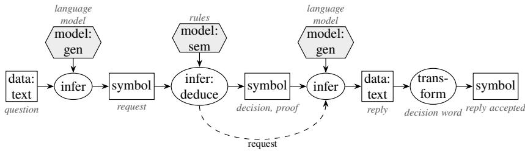

## Participants

Person; Model (translates); Rules (answer, <sub>p</sub>rove, name what is missin<sub>g</sub>: query, explain, why\_not, preview, evidence\_needs); Host (checks the re<sub>p</sub>l<sub>y</sub> a<sub>g</sub>ainst the answer).

## Collaborations

Th<sub>e mo</sub>d<sub>e</sub>l t<sub>urns</sub> th<sub>e ques</sub>ti<sub>on</sub> i<sub>n</sub>t<sub>o a ca</sub>ll <sub>o</sub>f <sub>a rea</sub>d<sub>-on</sub>l<sub>y opera</sub>ti<sub>on</sub> f<sub>rom a c</sub>l<sub>ose</sub>d <sub>se</sub>t<sub>, or, w</sub>h<sub>ere</sub> f<sub>ree</sub> queries are admitted, into a candidate quer<sub>y</sub> that the rules validate like an<sub>y</sub> draft (Section 3.2) before it <sub>runs;</sub> th<sub>e ru</sub>l<sub>es answer w</sub>ith <sub>a proo</sub>f<sub>;</sub> th<sub>e mo</sub>d<sub>e</sub>l <sub>p</sub>h<sub>rases</sub> th<sub>e answer; a c</sub>h<sub>ec</sub>k bi<sub>n</sub>d<sub>s</sub> th<sub>e p</sub>h<sub>ras</sub>i<sub>ng</sub> t<sub>o</sub> th<sub>e</sub> answer (decision word, cited <sub>p</sub>roof nodes). In the other direction the rules can be ofered read-onl<sub>y</sub> to <sub>any</sub> <sub>mo</sub>d<sub>e</sub>l <sub>c</sub>li<sub>en</sub>t <sub>as</sub> <sub>a</sub> <sub>server.</sub>

## Consequences

Th<sub>e</sub> <sub>person</sub> <sub>ge</sub>t<sub>s</sub> <sub>an</sub> <sub>answer</sub> i<sub>n</sub> <sub>wor</sub>d<sub>s</sub> <sub>w</sub>ith <sub>a</sub> <sub>proo</sub>f b<sub>e</sub>hi<sub>n</sub>d it<sub>.</sub> A <sub>m</sub>i<sub>s</sub>t<sub>rans</sub>l<sub>a</sub>t<sub>e</sub>d <sub>ques</sub>ti<sub>on</sub> <sub>g</sub>i<sub>ves</sub> <sub>a</sub> <sub>correc</sub>t <sub>answer</sub> t<sub>o</sub> th<sub>e</sub> <sub>wrong</sub> <sub>ques</sub>ti<sub>on,</sub> <sub>so</sub> <sub>a</sub> b<sub>ac</sub>k<sub>-</sub>t<sub>rans</sub>l<sub>a</sub>ti<sub>on</sub> <sub>s</sub>h<sub>own</sub> t<sub>o</sub> th<sub>e</sub> <sub>person</sub> i<sub>s</sub> th<sub>e</sub> <sub>ma</sub>i<sub>n</sub> <sub>sa</sub>f<sub>eguar</sub>d<sub>.</sub> P<sub>rose</sub> that adds facts the proof lacks must be rejected, which requires the phrasing to cite the proof. The t<sub>wo</sub> f<sub>orms o</sub>f <sub>reques</sub>t dif<sub>er</sub> i<sub>n w</sub>h<sub>a</sub>t <sub>can</sub> b<sub>e c</sub>h<sub>ec</sub>k<sub>e</sub>d<sub>.</sub> A <sub>ca</sub>ll <sub>o</sub>f <sub>a c</sub>l<sub>ose</sub>d <sub>opera</sub>ti<sub>on se</sub>t k<sub>eeps</sub> i<sub>nvar</sub>i<sub>an</sub>t 1 <sub>w</sub>ith<sub>ou</sub>t <sub>qua</sub>lifi<sub>ca</sub>ti<sub>on</sub> <sub>an</sub>d l<sub>e</sub>t<sub>s</sub> <sub>a</sub> <sub>ru</sub>l<sub>e</sub> <sub>re</sub>f<sub>use</sub> <sub>a</sub> <sub>reques</sub>t <sub>w</sub>ith <sub>a</sub> <sub>reason</sub> th<sub>a</sub>t <sub>names</sub> th<sub>e</sub> fi<sub>e</sub>ld<sub>.</sub> A f<sub>ree</sub> <sub>query</sub> i<sub>s</sub> <sub>more</sub> <sub>express</sub>i<sub>ve,</sub> b<sub>u</sub>t <sub>a</sub> <sub>c</sub>h<sub>ec</sub>k <sub>can</sub> <sub>on</sub>l<sub>y</sub> <sub>es</sub>t<sub>a</sub>bli<sub>s</sub>h it<sub>s</sub> f<sub>orm,</sub> it<sub>s</sub> <sub>voca</sub>b<sub>u</sub>l<sub>ary</sub> <sub>an</sub>d th<sub>a</sub>t it i<sub>s</sub> <sub>rea</sub>d<sub>-on</sub>l<sub>y;</sub> it i<sub>n</sub>h<sub>er</sub>it<sub>s</sub> th<sub>e</sub> <sub>consequences</sub> <sub>o</sub>f M<sub>o</sub>d<sub>e</sub>l <sub>as</sub> A<sub>u</sub>th<sub>or,</sub> <sub>an</sub>d <sub>a</sub> <sub>query</sub> th<sub>a</sub>t <sub>va</sub>lid<sub>a</sub>t<sub>es</sub> <sub>can</sub> <sub>s</sub>till <sub>as</sub>k th<sub>e</sub> <sub>wrong</sub> <sub>q</sub>uest<sup>i</sup>on.

## Implementation

P<sub>re</sub>f<sub>er a c</sub>l<sub>ose</sub>d <sub>se</sub>t <sub>o</sub>f <sub>rea</sub>d<sub>-on</sub>l<sub>y opera</sub>ti<sub>ons w</sub>h<sub>ose argumen</sub>t<sub>s are</sub> id<sub>en</sub>tifi<sub>ers;</sub> th<sub>e</sub> h<sub>os</sub>t b<sub>u</sub>ild<sub>s</sub> th<sub>e</sub> executable <sub>q</sub>uer<sub>y</sub> from the call. Admit a free <sub>q</sub>uer<sub>y</sub> onl<sub>y</sub> throu<sub>g</sub>h validate (s<sub>y</sub>ntax, allowed classes and slots, no assertions) and record it as a candidate with its recei<sub>p</sub>t. Kee<sub>p</sub> the model’s view small: th<sub>e ver</sub>di<sub>c</sub>t<sub>,</sub> th<sub>e</sub> d<sub>ec</sub>i<sub>s</sub>i<sub>ve quo</sub>t<sub>es an</sub>d th<sub>e m</sub>i<sub>ss</sub>i<sub>ng ev</sub>id<sub>ence, w</sub>ith<sub>ou</sub>t th<sub>e</sub> d<sub>ocumen</sub>t<sub>s.</sub> Of<sub>er</sub> th<sub>e ru</sub>l<sub>es as</sub> <sub>rea</sub>d<sub>-on</sub>l<sub>y</sub> t<sub>oo</sub>l<sub>s</sub> <sub>w</sub>ith <sub>a</sub> h<sub>as</sub>h <sub>o</sub>f th<sub>e</sub> fil<sub>es</sub> th<sub>a</sub>t <sub>answere</sub>d<sub>.</sub> Bi<sub>n</sub>d <sub>every</sub> <sub>sen</sub>t<sub>ence</sub> <sub>o</sub>f <sub>an</sub> <sub>exp</sub>l<sub>ana</sub>ti<sub>on</sub> t<sub>o</sub> <sub>a</sub> <sub>proo</sub>f <sub>no</sub>d<sub>e,</sub> <sub>or</sub> <sub>use</sub> t<sub>emp</sub>l<sub>a</sub>t<sub>es.</sub>

I<sub>n ru</sub>l<sub>es,</sub> th<sub>e mo</sub>d<sub>e</sub>l’<sub>s</sub> fi<sub>rs</sub>t <sub>ca</sub>ll t<sub>urns</sub> th<sub>e ques</sub>ti<sub>on</sub> i<sub>n</sub>t<sub>o a reques</sub>t<sub>,</sub> th<sub>e reques</sub>t <sub>runs on</sub>l<sub>y w</sub>h<sub>en every</sub> fi<sub>e</sub>ld <sub>names a mem</sub>b<sub>er o</sub>f <sub>a c</sub>l<sub>ose</sub>d li<sub>s</sub>t<sub>, a re</sub>f<sub>usa</sub>l <sub>names</sub> th<sub>e</sub> fi<sub>e</sub>ld<sub>, an</sub>d th<sub>e ru</sub>l<sub>es</sub> d<sub>er</sub>i<sub>ve</sub> th<sub>e</sub> d<sub>ec</sub>i<sub>s</sub>i<sub>on.</sub> Th<sub>e secon</sub>d call names the decision word as mustSay, which the model does not see; the host records whether the re<sub>p</sub>l<sub>y</sub> contains it (saysDecision), and onl<sub>y</sub> such a re<sub>p</sub>l<sub>y</sub> is acce<sub>p</sub>ted. The test is a substrin<sub>g</sub> test that i<sub>gnores case:</sub> “<sub>no</sub>t <sub>a</sub>d<sub>m</sub>itt<sub>e</sub>d” <sub>con</sub>t<sub>a</sub>i<sub>ns</sub> “<sub>a</sub>d<sub>m</sub>itt<sub>e</sub>d”<sub>.</sub> Wh<sub>ere one</sub> d<sub>ec</sub>i<sub>s</sub>i<sub>on wor</sub>d <sub>con</sub>t<sub>a</sub>i<sub>ns ano</sub>th<sub>er, as</sub>k f<sub>or</sub> th<sub>e</sub> d<sub>ec</sub>i<sub>s</sub>i<sub>on wor</sub>d i<sub>n a</sub> fi<sub>e</sub>ld <sub>o</sub>f it<sub>s own as we</sub>ll <sub>an</sub>d <sub>compare</sub> it <sub>exac</sub>tl<sub>y.</sub> Th<sub>e program answers a</sub>d<sub>m</sub>i<sub>ss</sub>i<sub>on</sub> questions; the operations requirements and missing are recognised and refused with a reason:

```prolog
// Pattern 3, Model as Translator: a question becomes a checked request, the rules'
2 // decision becomes a sentence that must state it.
3 world open.
4 closed class Operation. closed class Programme. closed class Applicant.
closed slot admitted.
6
7 "admission":Operation. "requirements":Operation. "missing":Operation.
8 "mbi":Programme. "mgt":Programme.
9 "nora":Applicant. "tomas":Applicant.
10 "nora"[admitted -> "mbi"].
11 q1:Question[text -> "Hi, I am Nora. Am I admitted to the Master in Business Innovation?"].
12
13 translatePrompt:Prompt[text -> "Map the question to one call. Answer as JSON {\"op\":
admission, requirements or missing, \"programme\": mbi or mgt, \"applicant\": the
lowercase first name}."].
14 phrasePrompt:Prompt[text -> "Tell the person the decision in one friendly sentence that
uses the decision word. Answer as JSON {\"text\": ...}."].
15
16 // From words to a request.
17 external translate(?Q) using _llm with translatePrompt[question -> ?T]
18 <- ?Q:Question[text -> ?T].
19
20 ?Q:Request[op -> ?O; programme -> ?P; applicant -> ?A]
21 <- ?R[tool#name -> "_llm"; tool#arg1 -> ?Q; result("op") -> ?O;
22 result("programme") -> ?P; result("applicant") -> ?A].
```

23   
24 // The request runs only if every field names something the rules know.   
25 ?Q[runs -> true] <- ?Q:Request[op -> ?O; programme -> ?P; applicant -> ?A]   
26 AND ?O:Operation AND ?P:Programme AND ?A:Applicant.   
27   
28 ?Q[refused -> "unknown operation"] <- ?Q:Request[op -> ?O] AND NOT ?O:Operation.   
29 ?Q[refused -> "unknown programme"] <- ?Q:Request[programme -> ?P] AND NOT ?P:Programme.   
30 ?Q[refused -> "unknown applicant"] <- ?Q:Request[applicant -> ?A] AND NOT ?A:Applicant.   
31 ?Q[refused -> "this program answers admission questions only"]   
32 <- ?Q:Request[runs -> true; op -> ?O] AND ?O != "admission".   
33   
34 // The rules decide.   
35 ?Q[decision -> "admitted"]   
36 <- ?Q:Request[runs -> true; op -> "admission"; programme -> ?P; applicant -> ?A]   
37 AND ?A[admitted -> ?P].   
38   
39 ?Q[decision -> "not admitted"]   
40 <- ?Q:Request[runs -> true; op -> "admission"; programme -> ?P; applicant -> ?A]   
41 AND NOT ?A[admitted -> ?P].   
42   
43 // From the decision to words; the reply counts only if it says the decision word.   
44 external phrase(?Q) using \_llm with phrasePrompt[decision -> ?D; mustSay -> ?D]   
45 <- ?Q:Request[decision -> ?D].   
46   
47 ?Q[reply -> ?Text]   
48 <- ?Q:Request AND ?X[tool#name -> "\_llm"; tool#arg1 -> ?Q;   
49 result("saysDecision") -> true; result("text") -> ?Text].   
50   
51 ?Q[replyRefused -> "the reply does not state the decision"]   
52 <- ?Q:Request AND ?X[tool#name -> "\_llm"; tool#arg1 -> ?Q;   
53 result("saysDecision") -> false].   
54   
55 ?- ?Q:Request[decision -> ?D].   
56 ?- ?Q[reply -> ?Text].   
57 ?- ?Q[refused -> ?Why].

Fi<sub>gure</sub> 4 d<sub>raws</sub> th<sub>e</sub> <sub>program</sub> <sub>as</sub> <sub>a</sub> <sub>ru</sub>l<sub>e</sub> <sub>grap</sub>h<sub>.</sub>

## Library form

With translator.fx (Section B) the <sub>p</sub>ro<sub>g</sub>ram declares the closed list of each answer field and kee<sub>p</sub>s it<sub>s</sub> d<sub>ec</sub>i<sub>s</sub>i<sub>on ru</sub>l<sub>es.</sub> Th<sub>e</sub> lib<sub>rary rea</sub>d<sub>s</sub> th<sub>e</sub> fi<sub>e</sub>ld<sub>s, re</sub>f<sub>uses a reques</sub>t <sub>w</sub>ith th<sub>e name o</sub>f th<sub>e</sub> fi<sub>e</sub>ld th<sub>a</sub>t lies outside its list, and <sub>p</sub>hrases the decision under mustSay. Decision rules read onl<sub>y</sub> valid fields (tr#valid). A rule that asks whether all fields are valid ne<sub>g</sub>ates over the recei<sub>p</sub>ts, and the re<sub>p</sub>l<sub>y</sub> <sub>reques</sub>t d<sub>epen</sub>d<sub>s on</sub> th<sub>e</sub> d<sub>ec</sub>i<sub>s</sub>i<sub>on;</sub> F<sub>rame</sub>X <sub>re</sub>f<sub>uses</sub> th<sub>a</sub>t <sub>as a nega</sub>ti<sub>ve cyc</sub>l<sub>e, so</sub> th<sub>e c</sub>h<sub>ec</sub>k i<sub>s spe</sub>ll<sub>e</sub>d <sub>ou</sub>t <sub>per</sub> fi<sub>e</sub>ld<sub>:</sub>

// Pattern 3 in library form: load translator.fx first.   
2 world open.   
3 closed slot admitted.   
5 translatePrompt:Prompt[text -> "Map the question to one call. Answer as JSON {\"op\":   
admission, requirements or missing, \"programme\": mbi or mgt, \"applicant\": the   
lowercase first name}."].   
phrasePrompt:Prompt[text -> "Tell the person the decision in one friendly sentence that   
uses the decision word. Answer as JSON {\"text\": ...}."].   
7 tr#phrasing[tr#prompt -> phrasePrompt].   
8   
9 "op"[tr#allows -> "admission"].   
10 "programme"[tr#allows -> "mbi"; tr#allows -> "mgt"].   
11 "applicant"[tr#allows -> "nora"; tr#allows -> "tomas"].   
12 "nora"[admitted -> "mbi"].   
13

14 q1:tr#Question[tr#prompt -> translatePrompt;  
15 tr#text -> "Hi, I am Nora. Am I admitted to the Master in Business Innovation?"].  
16  
17 // The rules decide; this part stays with the program.  
18 ?Q[tr#decision -> "admitted"]  
19 <- ?Q:tr#Question[tr#valid("op") -> "admission"; tr#valid("programme") -> ?P;  
20 tr#valid("applicant") -> ?A] AND ?A[admitted -> ?P].  
21 ?Q[tr#decision -> "not admitted"]  
22 <- ?Q:tr#Question[tr#valid("op") -> "admission"; tr#valid("programme") -> ?P;  
23 tr#valid("applicant") -> ?A] AND NOT ?A[admitted -> ?P].  
24  
25 ?- ?Q[tr#decision -> ?D].  
26 ?- ?Q[tr#reply -> ?Text].  
27 ?- ?Q[tr#refused -> ?F].

## Known uses

Th<sub>e ass</sub>i<sub>gnmen</sub>t<sub>-rev</sub>i<sub>ew c</sub>h<sub>a</sub>t <sub>mo</sub>d<sub>e</sub>l <sub>ca</sub>ll<sub>s a rev</sub>i<sub>ewer</sub> t<sub>oo</sub>l th<sub>a</sub>t <sub>runs</sub> th<sub>e ru</sub>l<sub>es;</sub> F<sub>rame</sub>X <sub>as a rea</sub>d<sub>-</sub> <sub>on</sub>l<sub>y server</sub> f<sub>or mo</sub>d<sub>e</sub>l <sub>c</sub>li<sub>en</sub>t<sub>s; a researc</sub>h <sub>agen</sub>t th<sub>a</sub>t k<sub>eeps</sub> th<sub>e mo</sub>d<sub>e</sub>l’<sub>s exp</sub>l<sub>ana</sub>ti<sub>on</sub> b<sub>es</sub>id<sub>e a c</sub>h<sub>ec</sub>k<sub>e</sub>d <sub>conc</sub>l<sub>us</sub>i<sub>on over a</sub> k<sub>now</sub>l<sub>e</sub>d<sub>ge grap</sub>h<sub>; sen</sub>t<sub>ences genera</sub>t<sub>e</sub>d f<sub>rom</sub> d<sub>ec</sub>i<sub>s</sub>i<sub>on-</sub>t<sub>a</sub>bl<sub>e rows w</sub>ith<sub>ou</sub>t <sub>a mo</sub>d<sub>e</sub>l<sub>.</sub> In the literature: the model formalises, a solver answers, in Lo<sub>g</sub>ic-LM (L. Pan et al. 2023), LINC (Olausson et al. 2023) and SatLM (Ye et al. 2023); knowled<sub>g</sub>e-<sub>g</sub>ra<sub>p</sub>h question answerin<sub>g</sub> and <sub>g</sub>ra<sub>p</sub>hto-text (S. Pan et al. 2024); solver-aided methods (Yan<sub>g</sub> et al. 2025).

## Related patterns

Model as Sensor (Section 3.1) translates documents where this <sub>p</sub>attern translates questions. Rules Steer the Model (Section 4.2) adds a flow to the conversation.

## Variants

Read-Back Check. An independent reader that sees only the written reply reads its facts back, and <sub>ru</sub>l<sub>es compare</sub> th<sub>em w</sub>ith th<sub>e</sub> f<sub>ac</sub>t<sub>s</sub> th<sub>e rep</sub>l<sub>y was mean</sub>t t<sub>o s</sub>t<sub>a</sub>t<sub>e:</sub> th<sub>e</sub> d<sub>ec</sub>i<sub>s</sub>i<sub>on,</sub> th<sub>e amoun</sub>t<sub>s,</sub> th<sub>e</sub> d<sub>a</sub>t<sub>es.</sub> It i<sub>s</sub> th<sub>e</sub> t<sub>rans</sub>l<sub>a</sub>t<sub>or</sub>’<sub>s</sub> <sub>c</sub>h<sub>ec</sub>k <sub>app</sub>li<sub>e</sub>d t<sub>o</sub> th<sub>e</sub> <sub>ou</sub>t<sub>pu</sub>t <sub>s</sub>id<sub>e,</sub> <sub>an</sub>d it <sub>ca</sub>t<sub>c</sub>h<sub>es</sub> <sub>a</sub> <sub>c</sub>h<sub>ange</sub>d <sub>va</sub>l<sub>ue</sub> th<sub>a</sub>t <sub>a</sub> d<sub>ec</sub>i<sub>s</sub>i<sub>on</sub> <sub>wor</sub>d alone does not. The reader must difer from the writer (another model or another <sub>p</sub>rom<sub>p</sub>t), or it re<sub>p</sub>eats the writer’s misreadin<sub>g</sub>. Re<sub>p</sub>orted in several Hack A<sub>p</sub>ertus submissions (Sturm<sub>g</sub>locke, Li<sub>g</sub>ht<sub>p</sub>ath, SONA with entailment in both directions); not built in FrameX. In one of them, a 70B second reader cut instructions with a chan<sub>g</sub>ed meanin<sub>g</sub> from 4.6 % to 0.2 % of 2,078 (result file committed in the submission).

## Evidence

O<sub>n</sub> <sub>a</sub> <sub>c</sub>l<sub>ean</sub> fi<sub>ve-</sub>d<sub>ocumen</sub>t <sub>case,</sub> <sub>a</sub> <sub>mo</sub>d<sub>e</sub>l <sub>a</sub>l<sub>one</sub> <sub>answere</sub>d th<sub>e</sub> <sub>ass</sub>i<sub>gnmen</sub>t<sub>-rev</sub>i<sub>ew</sub> <sub>ques</sub>ti<sub>on</sub> <sub>correc</sub>tl<sub>y</sub> i<sub>n</sub> 12 of 12 runs at lower cost and time than the h<sub>y</sub>brid (0.28 a<sub>g</sub>ainst 0.72 cents <sub>p</sub>er case). On eas<sub>y</sub> cases th<sub>e</sub> t<sub>rans</sub>l<sub>a</sub>t<sub>or earns</sub> it<sub>s cos</sub>t th<sub>roug</sub>h th<sub>e proo</sub>f<sub>,</sub> th<sub>e s</sub>t<sub>a</sub>t<sub>e</sub>d <sub>m</sub>i<sub>ss</sub>i<sub>ng ev</sub>id<sub>ence an</sub>d th<sub>e</sub> fi<sub>xe</sub>d d<sub>ec</sub>i<sub>s</sub>i<sub>on wor</sub>d<sub>.</sub>

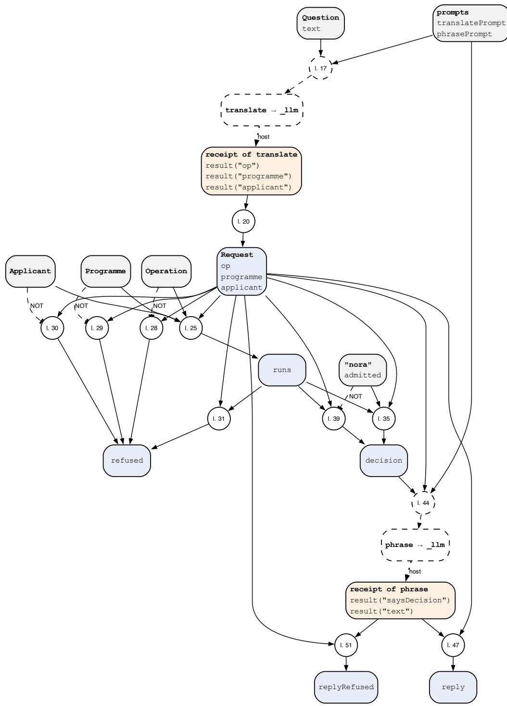  
Fi<sub>g</sub>ure 4: Rule <sub>g</sub>ra<sub>p</sub>h of p03-translator.fx, <sub>g</sub>enerated from the <sub>p</sub>ro<sub>g</sub>ram. A circle is one rule; “l. 23” <sub>means</sub> th<sub>a</sub>t th<sub>e ru</sub>l<sub>e s</sub>t<sub>ar</sub>t<sub>s</sub> i<sub>n</sub> li<sub>ne</sub> 23 <sub>o</sub>f th<sub>e</sub> li<sub>s</sub>ti<sub>ng.</sub> L<sub>egen</sub>d i<sub>n</sub> T<sub>a</sub>bl<sub>e</sub> 9<sub>.</sub>

## 3.4 Pattern 12: Model Selects, Rules Write

## Intent

L<sub>e</sub>t th<sub>e mo</sub>d<sub>e</sub>l <sub>c</sub>h<sub>oose an</sub>d <sub>p</sub>h<sub>rase,</sub> b<sub>u</sub>t <sub>never s</sub>t<sub>a</sub>t<sub>e con</sub>t<sub>en</sub>t<sub>:</sub> it <sub>re</sub>t<sub>urns</sub> id<sub>en</sub>tifi<sub>ers o</sub>f <sub>passages</sub> th<sub>a</sub>t th<sub>e</sub> h<sub>os</sub>t <sub>num</sub>b<sub>ere</sub>d<sub>,</sub> <sub>an</sub>d <sub>wor</sub>d<sub>s</sub> <sub>aroun</sub>d <sub>va</sub>l<sub>ues</sub> it <sub>never</sub> <sub>sees.</sub> E<sub>very</sub> <sub>passage</sub> <sub>an</sub>d <sub>every</sub> <sub>va</sub>l<sub>ue</sub> th<sub>a</sub>t <sub>reac</sub>h<sub>es</sub> <sub>a</sub> <sub>person comes</sub> f<sub>rom</sub> f<sub>ac</sub>t<sub>s, wor</sub>d f<sub>or wor</sub>d<sub>.</sub>

## Also known as

M<sub>o</sub>d<sub>e</sub>l <sub>po</sub>i<sub>n</sub>t<sub>s,</sub> <sub>co</sub>d<sub>e</sub> <sub>spea</sub>k<sub>s;</sub> <sub>mo</sub>d<sub>e</sub>l <sub>p</sub>h<sub>rases,</sub> <sub>co</sub>d<sub>e</sub> fill<sub>s;</sub> <sub>ex</sub>t<sub>rac</sub>ti<sub>ve</sub> <sub>answer</sub> b<sub>y</sub> id<sub>en</sub>tifi<sub>er;</sub> <sub>s</sub>l<sub>o</sub>t filli<sub>ng;</sub> t<sub>emp</sub>l<sub>a</sub>t<sub>e genera</sub>ti<sub>on w</sub>ith <sub>a mo</sub>d<sub>e</sub>l<sub>.</sub>

## Motivation

A<sub>n app</sub>li<sub>can</sub>t <sub>as</sub>k<sub>s w</sub>hi<sub>c</sub>h d<sub>ocumen</sub>t<sub>s</sub> th<sub>e</sub> M<sub>as</sub>t<sub>er</sub> i<sub>n</sub> B<sub>us</sub>i<sub>ness</sub> I<sub>nnova</sub>ti<sub>on requ</sub>i<sub>res an</sub>d <sub>w</sub>h<sub>a</sub>t th<sub>e app</sub>li<sub>ca</sub>ti<sub>on</sub> <sub>cos</sub>t<sub>s.</sub> Th<sub>e answer mus</sub>t <sub>quo</sub>t<sub>e</sub> th<sub>e regu</sub>l<sub>a</sub>ti<sub>on exac</sub>tl<sub>y an</sub>d <sub>s</sub>t<sub>a</sub>t<sub>e</sub> th<sub>e</sub> f<sub>ee exac</sub>tl<sub>y.</sub> A <sub>mo</sub>d<sub>e</sub>l th<sub>a</sub>t <sub>wr</sub>it<sub>es</sub> th<sub>e</sub> answer can <sub>p</sub>ara<sub>p</sub>hrase a requirement into a diferent one or round a fee, and a check afterwards (a quote that must occur, a decision word that must a<sub>pp</sub>ear) catches onl<sub>y</sub> what it looks for. The <sub>p</sub>attern <sub>moves</sub> th<sub>e c</sub>h<sub>ec</sub>k b<sub>e</sub>f<sub>ore</sub> th<sub>e wr</sub>iti<sub>ng:</sub> th<sub>e mo</sub>d<sub>e</sub>l <sub>sees</sub> th<sub>e passages un</sub>d<sub>er</sub> id<sub>en</sub>tifi<sub>ers an</sub>d <sub>answers w</sub>ith id<sub>en</sub>tifi<sub>ers, an</sub>d it <sub>p</sub>h<sub>rases a sen</sub>t<sub>ence aroun</sub>d <sub>a gap</sub> th<sub>a</sub>t th<sub>e ru</sub>l<sub>es</sub> fill<sub>.</sub> A <sub>requ</sub>i<sub>remen</sub>t th<sub>e mo</sub>d<sub>e</sub>l i<sub>nven</sub>t<sub>s</sub> h<sub>as no</sub> id<sub>en</sub>tifi<sub>er, an</sub>d <sub>a</sub> f<sub>ee</sub> it <sub>never saw</sub> it <sub>canno</sub>t <sub>c</sub>h<sub>ange.</sub>

## Applicability

U<sub>se</sub> it <sub>w</sub>h<sub>en</sub>

• the content of an answer exists as facts or source text (re<sub>g</sub>ulations<sub>,</sub> a catalo<sub>g</sub>ue<sub>,</sub> com<sub>p</sub>uted amounts<sub>,</sub> dates) and onl<sub>y</sub> its selection or wordin<sub>g</sub> needs a model;

• a wron<sub>g</sub> word in the content is costl<sub>y,</sub> so a re<sub>p</sub>l<sub>y</sub> must be correct b<sub>y</sub> construction rather than b<sub>y</sub> <sub>c</sub>h<sub>ec</sub>k<sub>;</sub>

• the source can be s<sub>p</sub>lit into <sub>p</sub>assa<sub>g</sub>es that a <sub>p</sub>erson reads on their own.

D<sub>o</sub> <sub>no</sub>t <sub>use</sub> it <sub>w</sub>h<sub>en</sub> th<sub>e</sub> <sub>answer</sub> <sub>mus</sub>t <sub>com</sub>bi<sub>ne</sub> <sub>or</sub> <sub>summar</sub>i<sub>se</sub> <sub>w</sub>h<sub>a</sub>t <sub>no</sub> <sub>s</sub>i<sub>ng</sub>l<sub>e</sub> <sub>passage</sub> <sub>says;</sub> th<sub>en</sub> <sub>use</sub> Model as Translator (Section 3.3) with its check of the re<sub>p</sub>l<sub>y</sub>.

## Structure

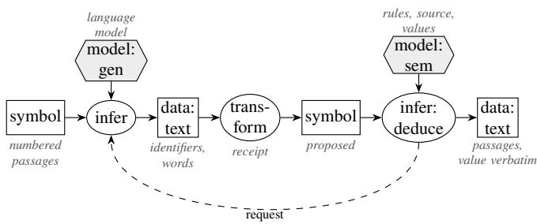

## Participants

Host: splits the source into passages and numbers them, calls the model, stores the reply as a receipt. Model: chooses identifiers from the list it was given, and phrases words around a gap. Rules: request th<sub>e</sub> <sub>se</sub>l<sub>ec</sub>ti<sub>on</sub> <sub>an</sub>d th<sub>e</sub> <sub>p</sub>h<sub>ras</sub>i<sub>ng,</sub> <sub>accep</sub>t <sub>an</sub> id<sub>en</sub>tifi<sub>er</sub> <sub>on</sub>l<sub>y</sub> if it <sub>names</sub> <sub>a</sub> <sub>passage</sub> <sub>o</sub>f th<sub>e</sub> <sub>source,</sub> <sub>an</sub>d <sub>wr</sub>it<sub>e</sub> the answer from the passages and the values. Person: reads passages and values as they stand in the source.

## Collaborations

A <sub>ru</sub>l<sub>e reques</sub>t<sub>s a se</sub>l<sub>ec</sub>ti<sub>on</sub> f<sub>or a ques</sub>ti<sub>on w</sub>ith th<sub>e num</sub>b<sub>ere</sub>d <sub>passages;</sub> th<sub>e rece</sub>i<sub>p</sub>t h<sub>o</sub>ld<sub>s</sub> id<sub>en</sub>tifi<sub>ers;</sub> <sub>a</sub> <sub>ru</sub>l<sub>e</sub> <sub>s</sub>h<sub>ows</sub> th<sub>e</sub> <sub>passage</sub> <sub>o</sub>f <sub>eac</sub>h id<sub>en</sub>tifi<sub>er</sub> th<sub>a</sub>t b<sub>e</sub>l<sub>ongs</sub> t<sub>o</sub> th<sub>e</sub> <sub>source</sub> <sub>an</sub>d <sub>re</sub>f<sub>uses</sub> <sub>any</sub> <sub>o</sub>th<sub>er</sub> <sub>w</sub>ith it<sub>s</sub> <sub>reason.</sub> A <sub>secon</sub>d <sub>reques</sub>t <sub>as</sub>k<sub>s</sub> f<sub>or wor</sub>d<sub>s</sub> b<sub>e</sub>f<sub>ore an</sub>d <sub>a</sub>ft<sub>er a va</sub>l<sub>ue w</sub>ith<sub>ou</sub>t th<sub>e va</sub>l<sub>ue; a ru</sub>l<sub>e</sub> i<sub>nser</sub>t<sub>s</sub> th<sub>e</sub> <sub>va</sub>l<sub>ue</sub> b<sub>e</sub>t<sub>ween</sub> th<sub>em, un</sub>l<sub>ess</sub> th<sub>e wor</sub>d<sub>s s</sub>t<sub>a</sub>t<sub>e a num</sub>b<sub>er o</sub>f th<sub>e</sub>i<sub>r own.</sub>

## Consequences

N<sub>o sen</sub>t<sub>ence o</sub>f th<sub>e mo</sub>d<sub>e</sub>l <sub>reac</sub>h<sub>es</sub> th<sub>e person as con</sub>t<sub>en</sub>t<sub>: an</sub> i<sub>nven</sub>t<sub>e</sub>d <sub>passage</sub> h<sub>as no</sub> id<sub>en</sub>tifi<sub>er an</sub>d i<sub>s</sub> <sub>re</sub>f<sub>use</sub>d<sub>, a</sub> f<sub>ee</sub> i<sub>s never re</sub>t<sub>ype</sub>d<sub>.</sub> Wh<sub>a</sub>t th<sub>e mo</sub>d<sub>e</sub>l <sub>can s</sub>till <sub>ge</sub>t <sub>wrong</sub> i<sub>s</sub> th<sub>e c</sub>h<sub>o</sub>i<sub>ce: a passage</sub> th<sub>a</sub>t d<sub>oes</sub> <sub>no</sub>t <sub>answer</sub> th<sub>e ques</sub>ti<sub>on, or one</sub> th<sub>a</sub>t i<sub>s m</sub>i<sub>ss</sub>i<sub>ng.</sub> Th<sub>a</sub>t i<sub>s a</sub> f<sub>au</sub>lt <sub>o</sub>f <sub>re</sub>l<sub>evance, no</sub>t <sub>o</sub>f t<sub>ru</sub>th<sub>, an</sub>d <sub>a person</sub> <sub>sees</sub> it i<sub>n</sub> th<sub>e source</sub>’<sub>s own wor</sub>d<sub>s.</sub> A<sub>nswers are as</sub> fl<sub>uen</sub>t <sub>as</sub> th<sub>e source;</sub> t<sub>ex</sub>t th<sub>a</sub>t <sub>com</sub>bi<sub>nes severa</sub>l <sub>passages</sub> i<sub>s ou</sub>t <sub>o</sub>f <sub>reac</sub>h<sub>.</sub> Th<sub>e cos</sub>t i<sub>s one ca</sub>ll <sub>per se</sub>l<sub>ec</sub>ti<sub>on an</sub>d <sub>per p</sub>h<sub>ras</sub>i<sub>ng.</sub>

## Implementation

Number the <sub>p</sub>assa<sub>g</sub>es in the host, where the source is s<sub>p</sub>lit; the model sees a1: ..., the rules know "a1" as a Passage with its source and text. Declare the class closed, so that an identifier outside it is refused rather than left unknown. For values, the request carries what the value is about but never the value; the rules join the words and the value with concat, and refuse words that contain a di<sub>g</sub>it, so th<sub>a</sub>t <sub>a num</sub>b<sub>er</sub> th<sub>e mo</sub>d<sub>e</sub>l <sub>ma</sub>d<sub>e up canno</sub>t <sub>s</sub>it b<sub>es</sub>id<sub>e</sub> th<sub>e r</sub>i<sub>g</sub>ht <sub>one.</sub> Th<sub>e program answers one ques</sub>ti<sub>on</sub> f<sub>rom</sub> th<sub>ree passages an</sub>d <sub>s</sub>t<sub>a</sub>t<sub>es one</sub> f<sub>ee:</sub>

// Pattern 12, Model Selects, Rules Write: the model returns identifiers and phrasing;   
// every passage and every value shown to the person comes from facts.   
world open.   
closed class Passage. closed class Digit. closed slot hasDigit.   
5   
// The source, split into passages by the host, and the same passages numbered for the   
model.   
"a1":Passage[source -> reg; text -> "Applicants hold a recognised Bachelor degree."].   
8 "a2":Passage[source -> reg; text -> "Applicants prove English at level C1."].   
9 "a3":Passage[source -> reg; text -> "The programme starts in the autumn semester."].   
10 reg[numbered -> "a1: Applicants hold a recognised Bachelor degree. a2: Applicants prove   
English at level C1. a3: The programme starts in the autumn semester."].   
11   
12 // A question about the source, and a value an answer must state.   
13 q1:Question[source -> reg; text -> "Which documents do I need for the MBI?"].   
14 fee1:Amount[question -> q1; value -> "CHF 250"; about -> "the application fee"].   
15   
16 selectPrompt:Prompt[text -> "Choose the passages that answer the question. Answer as JSON   
{\"rows\": [{\"passage\": an identifier from the list}]}."].   
17 phrasePrompt:Prompt[text -> "Write one sentence that tells the applicant the amount named   
in about; the system inserts the amount. Answer as JSON {\"before\": the text before   
the amount, \"after\": the text after it}."].   
18   
19 // Request 1: the model sees the numbered passages and returns identifiers only.   
20 external select(?Q) using \_llm with selectPrompt[question -> ?T; passages -> ?N]   
21 <- ?Q:Question[source -> ?S; text -> ?T] AND ?S[numbered -> ?N].   
22   
23 // Accept: an identifier shows its own passage, word for word.   
24 ?Q[shows(?I) -> ?Text]   
25 <- ?R[tool#name -> "\_llm"; tool#arg1 -> ?Q; row(?I, "passage") -> ?P]   
26 AND ?Q:Question[source -> ?S] AND ?P:Passage[source -> ?S; text -> ?Text].   
27   
28 ?Q[refused(?I) -> "not a passage of this source"]   
29 <- ?R[tool#name -> "\_llm"; tool#arg1 -> ?Q; row(?I, "passage") -> ?P]   
30 AND ?Q:Question AND NOT ?P:Passage.   
31   
32 // Request 2: the model phrases around the value; the request does not carry the value.   
33 external phrase(?V) using \_llm with phrasePrompt[about -> ?A]   
34 <- ?V:Amount[about -> ?A].   
35   
36 "0":Digit. "1":Digit. "2":Digit. "3":Digit. "4":Digit.   
37 "5":Digit. "6":Digit. "7":Digit. "8":Digit. "9":Digit.   
38   
39 ?R[hasDigit -> true]   
40 <- ?R[tool#name -> "\_llm"; tool#arg1 -> ?V; result("before") -> ?B]   
41 AND ?V:Amount AND ?D:Digit

42 AND ?N := occurrences(?B, ?D) AND ?N > 0.   
43 ?R[hasDigit -> true]   
44 <- ?R[tool#name -> "\_llm"; tool#arg1 -> ?V; result("after") -> ?F]   
45 AND ?V:Amount AND ?D:Digit   
46 AND ?N := occurrences(?F, ?D) AND ?N > 0.   
47   
48 // Write: the rules put the value between the model's words.   
49 ?Q[answer -> ?Text]   
50 <- ?R[tool#name -> "\_llm"; tool#arg1 -> ?V; result("before") -> ?B; result("after") ->   
?F]   
51 AND ?V:Amount[question -> ?Q; value -> ?X] AND NOT ?R[hasDigit -> true]   
52 AND ?Text := concat(concat(?B, ?X), ?F).   
53   
54 ?V[rejected -> "the phrasing states a number of its own"]   
55 <- ?R[tool#name -> "\_llm"; tool#arg1 -> ?V; hasDigit -> true] AND ?V:Amount.   
56   
57 // A failed call shows nothing and keeps the host's reason.   
58 ?X[notAnswered -> ?E]   
59 <- ?R[tool#name -> "\_llm"; tool#arg1 -> ?X; tool#status -> "failed"; error -> ?E].   
60   
61 ?- q1[shows(?I) -> ?Text].   
62 ?- q1[refused(?I) -> ?Why].   
63 ?- q1[answer -> ?A].   
64 ?- fee1[rejected -> ?Why].

Figure 5 draws the program as a rule graph. The two requests have their own subjects, the question <sub>an</sub>d th<sub>e amoun</sub>t<sub>, so</sub> th<sub>a</sub>t <sub>eac</sub>h <sub>rece</sub>i<sub>p</sub>t i<sub>s rea</sub>d <sub>on</sub>l<sub>y</sub> b<sub>y</sub> it<sub>s own ru</sub>l<sub>es.</sub> Wh<sub>ere</sub> th<sub>e serv</sub>i<sub>ng s</sub>t<sub>ac</sub>k d<sub>eco</sub>d<sub>es</sub> <sub>un</sub>d<sub>er a</sub> JSON <sub>sc</sub>h<sub>ema, an enumera</sub>ti<sub>on o</sub>f th<sub>e passage</sub> id<sub>en</sub>tifi<sub>ers ma</sub>k<sub>es an</sub> id<sub>en</sub>tifi<sub>er ou</sub>t<sub>s</sub>id<sub>e</sub> th<sub>e</sub> li<sub>s</sub>t i<sub>mposs</sub>ibl<sub>e</sub> t<sub>o pro</sub>d<sub>uce;</sub> th<sub>e ru</sub>l<sub>e o</sub>f li<sub>ne</sub> 28 <sub>s</sub>t<sub>ays as</sub> th<sub>e c</sub>h<sub>ec</sub>k th<sub>a</sub>t d<sub>oes no</sub>t d<sub>epen</sub>d <sub>on</sub> th<sub>e s</sub>t<sub>ac</sub>k<sub>.</sub> Th<sub>ere</sub> i<sub>s no</sub> lib<sub>rary</sub> f<sub>orm ye</sub>t<sub>.</sub>

## Known uses

I<sub>n</sub> F<sub>rame</sub>X<sub>,</sub> th<sub>e program a</sub>b<sub>ove;</sub> d<sub>ec</sub>i<sub>s</sub>i<sub>on-</sub>t<sub>a</sub>bl<sub>e rows</sub> b<sub>ecome sen</sub>t<sub>ences</sub> f<sub>rom</sub> t<sub>emp</sub>l<sub>a</sub>t<sub>es w</sub>ith<sub>ou</sub>t <sub>any</sub> model, the limit case of this <sub>p</sub>attern. In the submissions to the Hack A<sub>p</sub>ertus hackathon (October 2026), as described in thejury assessments, models chose passage or line identifiers that the application then quoted (QuietLetter, Beneficia, Comfort, StimmFol<sub>g</sub>en, Fedlex, ClearDesk, a meditation retrieval s<sub>y</sub>stem) or wrote with <sub>p</sub>laceholders that code filled with numbers and terms (A<sub>p</sub>ertus QA<sub>,</sub> Bon·A<sub>pp</sub>étit<sub>,</sub> Sturm<sub>g</sub>locke, Velum). In the literature: tem<sub>p</sub>late-based <sub>g</sub>eneration, in which the content is fixed before the text is <sub>p</sub>lanned (Reiter and Dale 2000); <sub>g</sub>uardrails that restrict a re<sub>p</sub>l<sub>y</sub> to retrieved <sub>p</sub>assa<sub>g</sub>es (Rebedea et al. 2023). In these the selection is checked afterwards or the tem<sub>p</sub>late is written b<sub>y</sub> hand; here the <sub>mo</sub>d<sub>e</sub>l fill<sub>s ne</sub>ith<sub>er con</sub>t<sub>en</sub>t <sub>nor va</sub>l<sub>ue.</sub>

## Related patterns

Model as Sensor (Section 3.1) reads a source and checks quotes afterwards; this <sub>p</sub>attern makes the quote the onl<sub>y</sub> <sub>p</sub>ossible answer. Model as Translator (Section 3.3) checks a written re<sub>p</sub>l<sub>y</sub> for the d<sub>ec</sub>i<sub>s</sub>i<sub>on</sub> <sub>wor</sub>d<sub>;</sub> h<sub>ere</sub> th<sub>e</sub> <sub>rep</sub>l<sub>y</sub> <sub>canno</sub>t <sub>con</sub>t<sub>a</sub>i<sub>n</sub> th<sub>e</sub> d<sub>ec</sub>i<sub>s</sub>i<sub>on.</sub> D<sub>er</sub>i<sub>v</sub>i<sub>ng</sub> th<sub>e</sub> <sub>op</sub>ti<sub>ons</sub> fi<sub>rs</sub>t <sub>un</sub>d<sub>er</sub> M<sub>o</sub>d<sub>e</sub>l Pro<sub>p</sub>oses, Rules Dis<sub>p</sub>ose (Section 4.1) is the same move for actions.

## Evidence

Th<sub>e program</sub> i<sub>s c</sub>h<sub>ec</sub>k<sub>e</sub>d <sub>aga</sub>i<sub>ns</sub>t <sub>recor</sub>d<sub>e</sub>d <sub>rece</sub>i<sub>p</sub>t<sub>s on</sub>l<sub>y;</sub> F<sub>rame</sub>X h<sub>as no measuremen</sub>t <sub>o</sub>f it<sub>s own.</sub> Fi<sub>gures</sub> f<sub>rom</sub> th<sub>e</sub> h<sub>ac</sub>k<sub>a</sub>th<sub>on are</sub> t<sub>a</sub>k<sub>en</sub> f<sub>rom resu</sub>lt fil<sub>es comm</sub>itt<sub>e</sub>d i<sub>n</sub> th<sub>e su</sub>b<sub>m</sub>i<sub>ss</sub>i<sub>ons</sub>’ <sub>repos</sub>it<sub>or</sub>i<sub>es a</sub>t <sub>a</sub> <sub>name</sub>d <sub>comm</sub>it<sub>;</sub> <sub>we</sub> did <sub>no</sub>t <sub>rerun</sub> th<sub>em,</sub> <sub>an</sub>d fi<sub>gures</sub> th<sub>a</sub>t <sub>appear</sub> <sub>on</sub>l<sub>y</sub> i<sub>n</sub> <sub>a</sub> README<sub>,</sub> <sub>repor</sub>t <sub>or</sub> <sub>p</sub>it<sub>c</sub>h <sub>are</sub> l<sub>e</sub>ft <sub>ou</sub>t<sub>.</sub> I<sub>n an a</sub>l<sub>er</sub>t <sub>genera</sub>t<sub>or</sub> f<sub>or c</sub>i<sub>v</sub>il <sub>pro</sub>t<sub>ec</sub>ti<sub>on,</sub> A<sub>per</sub>t<sub>us v</sub>1<sub>.</sub>5 8B fill<sub>e</sub>d <sub>co</sub>d<sub>e-</sub>b<sub>u</sub>ilt <sub>s</sub>l<sub>o</sub>t<sub>s w</sub>ith <sub>a</sub> l<sub>oc</sub>k<sub>e</sub>d <sub>o</sub>fi<sub>c</sub>i<sub>a</sub>l h<sub>azar</sub>d t<sub>erm;</sub> th<sub>e</sub> <sub>o</sub>fi<sub>c</sub>i<sub>a</sub>l t<sub>erm</sub> <sub>an</sub>d <sub>a</sub>ll f<sub>ac</sub>t<sub>s</sub> <sub>appeare</sub>d <sub>ver</sub>b<sub>a</sub>ti<sub>m</sub> i<sub>n</sub> 99 % <sub>o</sub>f 120 <sub>a</sub>l<sub>er</sub>t<sub>s,</sub> <sub>aga</sub>i<sub>ns</sub>t 45 % when the same model translated freel<sub>y</sub> (70B: 98 % a<sub>g</sub>ainst 71 %). There the model still saw the f<sub>ac</sub>t<sub>s</sub> <sub>an</sub>d <sub>co</sub>d<sub>e</sub> <sub>c</sub>h<sub>ec</sub>k<sub>e</sub>d th<sub>em</sub> <sub>a</sub>ft<sub>erwar</sub>d<sub>s,</sub> <sub>a</sub> <sub>wea</sub>k<sub>er</sub> f<sub>orm</sub> <sub>o</sub>f th<sub>e</sub> <sub>pa</sub>tt<sub>ern.</sub> I<sub>n</sub> <sub>a</sub> b<sub>ene</sub>fi<sub>c</sub>i<sub>a</sub>l<sub>-owners</sub>hi<sub>p</sub> t<sub>oo</sub>l<sub>,</sub> 8B in Q4\_K\_M on a CPU, citin<sub>g</sub> line identifiers that code verified, <sub>g</sub>ot 14 of 14 cases ri<sub>g</sub>ht, with no h<sub>e</sub>ld<sub>-ou</sub>t <sub>se</sub>t<sub>.</sub> S<sub>e</sub>l<sub>ec</sub>ti<sub>on</sub> d<sub>oes</sub> <sub>no</sub>t <sub>c</sub>l<sub>ose</sub> <sub>every</sub> <sub>gap:</sub> i<sub>n</sub> <sub>cour</sub>t<sub>-</sub>d<sub>ec</sub>i<sub>s</sub>i<sub>on</sub> <sub>anonym</sub>i<sub>sa</sub>ti<sub>on,</sub> 8B <sub>reac</sub>h<sub>e</sub>d <sub>a</sub> <sub>reca</sub>ll <sub>o</sub>f 0<sub>.</sub>764 <sub>aga</sub>i<sub>ns</sub>t 0<sub>.</sub>894 f<sub>or</sub> 70B <sub>on</sub> 537 d<sub>ec</sub>i<sub>s</sub>i<sub>ons,</sub> <sub>an</sub>d i<sub>n</sub> <sub>a</sub> <sub>s</sub>t<sub>a</sub>ti<sub>s</sub>ti<sub>cs</sub> <sub>ques</sub>ti<sub>on-answer</sub>i<sub>ng</sub> <sub>sys</sub>t<sub>em</sub> <sub>a</sub> <sub>ru</sub>l<sub>e</sub> b<sub>ase</sub>li<sub>ne w</sub>ith<sub>ou</sub>t <sub>any mo</sub>d<sub>e</sub>l <sub>ma</sub>t<sub>c</sub>h<sub>e</sub>d 70B <sub>on</sub> th<sub>e ma</sub>i<sub>n se</sub>t<sub>.</sub>

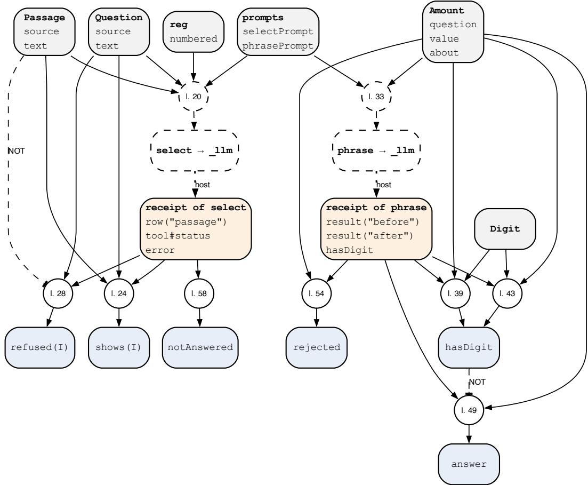  
Fi<sub>g</sub>ure 5: Rule <sub>g</sub>ra<sub>p</sub>h of p12-select.fx, <sub>g</sub>enerated from the <sub>p</sub>ro<sub>g</sub>ram. A circle is one rule; “l. 23” <sub>means</sub> th<sub>a</sub>t th<sub>e ru</sub>l<sub>e s</sub>t<sub>ar</sub>t<sub>s</sub> i<sub>n</sub> li<sub>ne</sub> 23 <sub>o</sub>f th<sub>e</sub> li<sub>s</sub>ti<sub>ng.</sub> L<sub>egen</sub>d i<sub>n</sub> T<sub>a</sub>bl<sub>e</sub> 9<sub>.</sub>

## 4 Patterns of control: who decides

## 4.1 Pattern 4: Model Proposes, Rules Dispose

## Intent

L<sub>e</sub>t th<sub>e</sub> <sub>mo</sub>d<sub>e</sub>l <sub>propose</sub> <sub>an</sub> <sub>answer,</sub> <sub>an</sub> <sub>ac</sub>ti<sub>on</sub> <sub>or</sub> <sub>a</sub> <sub>c</sub>h<sub>o</sub>i<sub>ce,</sub> <sub>an</sub>d l<sub>e</sub>t <sub>a</sub> <sub>ru</sub>l<sub>e</sub> <sub>a</sub>d<sub>m</sub>it it<sub>,</sub> <sub>re</sub>f<sub>use</sub> it <sub>w</sub>ith <sub>a</sub> <sub>reason,</sub> or narrow w<sup>h</sup>at ma<sub>y</sub> <sup>b</sup>e <sub>p</sub>ro<sub>p</sub>ose<sup>d</sup>.

## Also known as

G<sub>uar</sub>d<sub>ra</sub>il<sub>, ac</sub>ti<sub>on ga</sub>ti<sub>ng, po</sub>li<sub>cy en</sub>f<sub>orcemen</sub>t <sub>po</sub>i<sub>n</sub>t<sub>,</sub> b<sub>oun</sub>d<sub>e</sub>d <sub>recommen</sub>d<sub>a</sub>ti<sub>on.</sub>

## Motivation

A<sub>n agen</sub>t <sub>proposes</sub> t<sub>o wr</sub>it<sub>e a</sub> fil<sub>e, a mo</sub>d<sub>e</sub>l <sub>recommen</sub>d<sub>s a por</sub>tf<sub>o</sub>li<sub>o we</sub>i<sub>g</sub>ht<sub>, an ass</sub>i<sub>s</sub>t<sub>an</sub>t <sub>proposes</sub> t<sub>o</sub> <sub>sen</sub>d <sub>a</sub> <sub>re</sub>f<sub>un</sub>d<sub>.</sub> E<sub>ac</sub>h <sub>proposa</sub>l <sub>may</sub> b<sub>e</sub> <sub>reasona</sub>bl<sub>e,</sub> b<sub>u</sub>t <sub>some</sub> <sub>mus</sub>t <sub>never</sub> h<sub>appen:</sub> <sub>a</sub> <sub>wr</sub>it<sub>e</sub> <sub>ou</sub>t<sub>s</sub>id<sub>e</sub> th<sub>e</sub> t<sub>as</sub>k<sub>, a we</sub>i<sub>g</sub>ht <sub>c</sub>h<sub>ange</sub> b<sub>e</sub>l<sub>ow a ma</sub>t<sub>er</sub>i<sub>a</sub>lit<sub>y</sub> th<sub>res</sub>h<sub>o</sub>ld<sub>, a re</sub>f<sub>un</sub>d <sub>a</sub>b<sub>ove an au</sub>th<sub>or</sub>it<sub>y</sub> li<sub>m</sub>it<sub>.</sub> Th<sub>e pa</sub>tt<sub>ern</sub> k<sub>eeps</sub> th<sub>e</sub> <sub>mo</sub>d<sub>e</sub>l’<sub>s</sub> i<sub>n</sub>iti<sub>a</sub>ti<sub>ve</sub> <sub>an</sub>d <sub>pu</sub>t<sub>s</sub> <sub>every</sub> <sub>e</sub>f<sub>ec</sub>t b<sub>e</sub>hi<sub>n</sub>d <sub>a</sub> <sub>ru</sub>l<sub>e</sub> th<sub>a</sub>t <sub>can</sub> <sub>say</sub> <sub>no</sub> <sub>an</sub>d <sub>say</sub> <sub>w</sub>h<sub>y.</sub>

## Applicability

Use it when the model acts (tool calls, messa<sub>g</sub>es, transactions), when the s<sub>p</sub>ace of admissible outcomes i<sub>s</sub> k<sub>nown even</sub> if th<sub>e</sub> b<sub>es</sub>t <sub>one</sub> i<sub>s no</sub>t<sub>, or w</sub>h<sub>en a proposa</sub>l <sub>mus</sub>t <sub>res</sub>t <sub>on ev</sub>id<sub>ence ava</sub>il<sub>a</sub>bl<sub>e a</sub>t <sub>a g</sub>i<sub>ven</sub> ti<sub>me.</sub>

## Structure

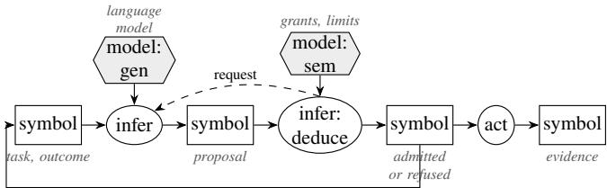  
<sub>ou</sub>t<sub>come o</sub>f th<sub>e s</sub>t<sub>e , un</sub>til fi<sub>n</sub>i<sub>s</sub>h <sub>or</sub> th<sub>e</sub> b<sub>oun</sub>d

## Participants

Model (proposes one action or value); Rules (capabilities, preconditions, limits, evidence requirements); Host (executes only what the rules admit); Person (approves what the rules require).

## Collaborations

Th<sub>e proposa</sub>l <sub>arr</sub>i<sub>ves as a rece</sub>i<sub>p</sub>t<sub>; ru</sub>l<sub>es</sub> d<sub>er</sub>i<sub>ve a</sub>d<sub>m</sub>i<sub>ss</sub>i<sub>on or a re</sub>f<sub>usa</sub>l <sub>w</sub>ith it<sub>s reason; a re</sub>f<sub>usa</sub>l <sub>re</sub>t<sub>urns</sub> t<sub>o</sub> th<sub>e</sub> <sub>mo</sub>d<sub>e</sub>l<sub>,</sub> <sub>w</sub>hi<sub>c</sub>h <sub>rep</sub>l<sub>ans;</sub> th<sub>e</sub> <sub>s</sub>t<sub>ep</sub> b<sub>oun</sub>d <sub>s</sub>t<sub>ops</sub> <sub>a</sub> t<sub>as</sub>k <sub>w</sub>h<sub>ose</sub> <sub>proposa</sub>l<sub>s</sub> k<sub>eep</sub> b<sub>e</sub>i<sub>ng</sub> <sub>re</sub>f<sub>use</sub>d<sub>.</sub> A t<sub>as</sub>k i<sub>s comp</sub>l<sub>e</sub>t<sub>e w</sub>h<sub>en a ru</sub>l<sub>e</sub> d<sub>er</sub>i<sub>ves</sub> it f<sub>rom recor</sub>d<sub>e</sub>d <sub>ev</sub>id<sub>ence; a mo</sub>d<sub>e</sub>l <sub>say</sub>i<sub>ng</sub> it i<sub>s</sub> d<sub>one</sub> i<sub>s one more</sub> p<sup>ro</sup>p<sup>osal</sup>.

## Consequences

Ef<sub>ec</sub>t<sub>s</sub> b<sub>ecome au</sub>dit<sub>a</sub>bl<sub>e an</sub>d b<sub>oun</sub>d<sub>e</sub>d<sub>;</sub> th<sub>e mo</sub>d<sub>e</sub>l <sub>may s</sub>till <sub>was</sub>t<sub>e</sub> t<sub>urns on re</sub>f<sub>use</sub>d <sub>proposa</sub>l<sub>s.</sub> C<sub>on</sub>fli<sub>c</sub>t<sub>s</sub> b<sub>e</sub>t<sub>ween</sub> <sub>cons</sub>t<sub>ra</sub>i<sub>n</sub>t<sub>s</sub> <sub>are</sub> <sub>repor</sub>t<sub>e</sub>d t<sub>o</sub> <sub>a</sub> <sub>person,</sub> <sub>an</sub>d <sub>no</sub> <sub>pr</sub>i<sub>or</sub>it<sub>y</sub> <sub>or</sub>d<sub>er</sub> <sub>se</sub>ttl<sub>es</sub> th<sub>em</sub> <sub>s</sub>il<sub>en</sub>tl<sub>y.</sub> Th<sub>e</sub> <sub>pa</sub>tt<sub>ern</sub> b<sub>oun</sub>d<sub>s</sub> <sub>w</sub>h<sub>a</sub>t <sub>can</sub> h<sub>appen;</sub> <sub>w</sub>h<sub>e</sub>th<sub>er</sub> <sub>an</sub> <sub>a</sub>d<sub>m</sub>itt<sub>e</sub>d <sub>proposa</sub>l i<sub>s</sub> th<sub>e</sub> b<sub>es</sub>t <sub>one</sub> <sub>s</sub>t<sub>ays</sub> <sub>open.</sub>

## Implementation

Derive the o<sub>p</sub>tions first where the<sub>y</sub> are few (confi<sub>g</sub>urations, ofers in a le<sub>g</sub>al band) and let the model <sub>c</sub>h<sub>oose</sub> <sub>among</sub> th<sub>em;</sub> <sub>a</sub> <sub>ru</sub>l<sub>e</sub> <sub>c</sub>h<sub>ec</sub>k<sub>s</sub> th<sub>a</sub>t th<sub>e</sub> <sub>c</sub>h<sub>o</sub>i<sub>ce</sub> i<sub>s</sub> <sub>one</sub> <sub>o</sub>f th<sub>em.</sub> E<sub>xpor</sub>t th<sub>e</sub> <sub>c</sub>l<sub>ose</sub>d <sub>se</sub>t <sub>o</sub>f <sub>a</sub>ll<sub>owe</sub>d <sub>va</sub>l<sub>ues</sub> <sub>as</sub> th<sub>e</sub> <sub>s</sub>t<sub>ruc</sub>t<sub>ure</sub>d<sub>-ou</sub>t<sub>pu</sub>t <sub>sc</sub>h<sub>ema</sub> <sub>o</sub>f th<sub>e</sub> <sub>ca</sub>ll<sub>,</sub> <sub>an</sub>d <sub>s</sub>till <sub>c</sub>h<sub>ec</sub>k th<sub>e</sub> <sub>rece</sub>i<sub>p</sub>t<sub>.</sub>

Each ste<sub>p</sub> is a new re<sub>q</sub>uest propose(?T, ?N) whose recei<sub>p</sub>t becomes a <sub>p</sub>ro<sub>p</sub>osal. A <sub>p</sub>ro<sub>p</sub>osal is <sub>a</sub>d<sub>m</sub>itt<sub>e</sub>d <sub>on</sub>l<sub>y</sub> f<sub>or an ac</sub>ti<sub>on</sub> th<sub>e</sub> t<sub>as</sub>k <sub>gran</sub>t<sub>s; any o</sub>th<sub>er</sub> i<sub>s re</sub>f<sub>use</sub>d <sub>w</sub>ith <sub>a reason.</sub> A<sub>n a</sub>d<sub>m</sub>itt<sub>e</sub>d l<sub>oo</sub>k<sub>-up</sub> runs as a <sub>q</sub>uer<sub>y</sub> on the rules themselves (\_query), and the next ste<sub>p</sub> carries the outcome of the last one, the refusal or the looked-up result. The task is complete when an admitted finish rests on evidence, <sub>an</sub>d it <sub>s</sub>t<sub>ops a</sub>t th<sub>e s</sub>t<sub>ep</sub> b<sub>oun</sub>d <sub>o</sub>th<sub>erw</sub>i<sub>se:</sub>

```lisp
// Pattern 4, Model Proposes, Rules Dispose: one action per step, admitted or refused.
world open.
closed slot grants.
5 // The requirements, and a task with the actions it grants.
mbi[requires -> "recognised Bachelor"; requires -> "English C1"].
t1:Task[goal -> "Tell Nora which documents the Master in Business Innovation requires.";
8 actions -> "lookUp: read the requirements; sendOffer: send Nora an admission offer;
finish: answer Nora with what you found"; maxSteps -> 4].
t1[grants -> "lookUp"; grants -> "finish"].
10
11 proposePrompt:Prompt[text -> "Propose the next action for the goal. outcome says what
became of your last action; once it answers the goal, choose finish. Answer as JSON
{\"action\": one of the actions}."].
12
13 // Step 1: the model proposes one action; outcome is "none" before the first step.
14 external propose(?T, ?N) using _llm with proposePrompt[goal -> ?G; actions -> ?Acts;
15 outcome -> "none"; tool#order -> 2]
16 <- ?T:Task[goal -> ?G; actions -> ?Acts] AND ?N := 1.
17 ?R:Proposal[task -> ?T; step -> ?N; action -> ?K]
18 <- ?R[tool#name -> "_llm"; tool#arg1 -> ?T; tool#arg2 -> ?N;
19 result("action") -> ?K].
20
21 // Dispose: an action is admitted only if the task grants it.
22 ?A[allowed -> true] <- ?A:Proposal[task -> ?T; action -> ?K] AND ?T[grants -> ?K].
23 ?A[refused -> "action not granted for this task"]
24 <- ?A:Proposal[task -> ?T; action -> ?K] AND NOT ?T[grants -> ?K].
25
26 // An admitted lookUp runs as a query on the rules themselves.
2 external lookUp(?T) using _query[query -> "?- mbi[requires -> ?X].";
28 tool#order -> 1]
29 <- ?A:Proposal[task -> ?T; action -> "lookUp"; allowed -> true].
30
31 ?T[evidence -> true]
32 <- ?R[tool#name -> "_query"; tool#arg1 -> ?T; tool#status -> "succeeded"].
33
34 // The next step carries the outcome of the last one; maxSteps stops the loop.
35 ?T[next(?M) -> ?W]
36 <- ?A:Proposal[task -> ?T; step -> ?N; refused -> ?W]
37 AND ?T[maxSteps -> ?Max] AND ?N < ?Max AND ?M := ?N + 1.
38
39 ?T[next(?M) -> ?X]
40 <- ?A:Proposal[task -> ?T; step -> ?N; action -> "lookUp"; allowed -> true]
41 AND ?R[tool#name -> "_query"; tool#arg1 -> ?T; result("text") -> ?X]
42 AND ?T[maxSteps -> ?Max] AND ?N < ?Max AND ?M := ?N + 1.
43
44 external propose(?T, ?N) using _llm with proposePrompt[goal -> ?G; actions -> ?Acts;
45 outcome -> ?W; tool#order -> 2]
46 <- ?T:Task[goal -> ?G; actions -> ?Acts; next(?N) -> ?W].
47
48 // Completion only on recorded evidence.
49 ?T[verdict -> "completed"]
50 <- ?A:Proposal[task -> ?T; action -> "finish"; allowed -> true]
51 AND ?T[evidence -> true].
52
53 ?T[verdict -> "stopped at the step bound"]
54 <- ?A:Proposal[task -> ?T; step -> ?N; action -> ?K] AND ?T[maxSteps -> ?N]
55 AND ?K != "finish".
56
57 ?- ?A:Proposal[step -> ?N; action -> ?K].
58 ?- ?A[refused -> ?Why].
59 ?- t1[verdict -> ?V].
```

Fi<sub>gure</sub> 6 d<sub>raws</sub> th<sub>e</sub> <sub>program</sub> <sub>as</sub> <sub>a</sub> <sub>ru</sub>l<sub>e</sub> <sub>grap</sub>h<sub>.</sub>

## Library form

With agent.fx (Section B) the <sub>p</sub>ro<sub>g</sub>ram states the task, its <sub>p</sub>rom<sub>p</sub>t and what it <sub>g</sub>rants, and kee<sub>p</sub>s what each <sub>g</sub>ranted action does: here the <sub>q</sub>uer<sub>y</sub> behind lookUp, its outcome for the next ste<sub>p</sub>, and the <sub>ev</sub>id<sub>ence</sub> th<sub>a</sub>t <sub>comp</sub>l<sub>e</sub>ti<sub>on</sub> <sub>res</sub>t<sub>s</sub> <sub>on.</sub> St<sub>ep</sub> l<sub>oop,</sub> <sub>a</sub>d<sub>m</sub>i<sub>ss</sub>i<sub>on,</sub> <sub>re</sub>f<sub>usa</sub>l<sub>,</sub> b<sub>oun</sub>d <sub>an</sub>d <sub>ver</sub>di<sub>c</sub>t <sub>come</sub> f<sub>rom</sub> th<sub>e</sub> lib<sub>rary:</sub>

// Pattern 4 in library form: load agent.fx first.   
2 world open.   
3   
mbi[requires -> "recognised Bachelor"; requires -> "English C1"].   
5 proposePrompt:Prompt[text -> "Propose the next action for the goal. outcome says what   
became of your last action; once it answers the goal, choose finish. Answer as JSON   
{\"action\": one of the actions}."].   
6   
7 t1:ag#Task[ag#maxSteps -> 4; ag#prompt -> proposePrompt;   
8 ag#goal -> "Tell Nora which documents the Master in Business Innovation requires.";   
9 ag#actions -> "lookUp: read the requirements; sendOffer: send Nora an admission offer;   
finish: answer Nora with what you found"].   
10 t1[ag#grants -> "lookUp"; ag#grants -> "finish"].   
11   
12 // What the action lookUp does, and what it reports; this stays with the program.   
13 external lookUp(?T) using \_query[query -> "?- mbi[requires -> ?X]."; tool#order -> 1]   
14 <- ?A:ag#Proposal[ag#task -> ?T; ag#action -> "lookUp"; ag#allowed -> true].   
15 ?T[ag#outcome(?N) -> ?X]   
16 <- ?A:ag#Proposal[ag#task -> ?T; ag#step -> ?N; ag#action -> "lookUp"; ag#allowed ->   
true]   
17 AND ?R[tool#name -> "\_query"; tool#arg1 -> ?T; result("text") -> ?X].   
18 ?T[ag#evidence -> true]   
19 <- ?R[tool#name -> "\_query"; tool#arg1 -> ?T; tool#status -> "succeeded"].   
20   
21 ?- ?A:ag#Proposal[ag#step -> ?N; ag#action -> ?K].   
22 ?- ?A[ag#refused -> ?Why].   
23 ?- t1[ag#verdict -> ?V].

## Known uses

FrameX-A<sub>g</sub>ents (one action at a time, admitted a<sub>g</sub>ainst the task’s ca<sub>p</sub>abilities, com<sub>p</sub>letion from evidence); allocation recommendation with <sub>p</sub>oint-in-time evidence and a materialit<sub>y g</sub>ate; casework <sub>ac</sub>ti<sub>ons</sub> th<sub>a</sub>t <sub>nee</sub>d <sub>a</sub> <sub>na</sub>ti<sub>ve</sub> <sub>au</sub>th<sub>or</sub>i<sub>sa</sub>ti<sub>on</sub> <sub>proo</sub>f<sub>.</sub> I<sub>n</sub> th<sub>e</sub> lit<sub>era</sub>t<sub>ure:</sub> <sub>ru</sub>l<sub>e-</sub>b<sub>ase</sub>d <sub>sa</sub>f<sub>eguar</sub>d<sub>s</sub> <sub>aroun</sub>d <sub>a</sub> <sub>mo</sub>d<sub>e</sub>l (Washizaki et al. 2020; Washizaki et al. 2022); hard critics in LLM-Modulo (Kambham<sub>p</sub>ati et al. 2024); <sub>g</sub>uardrails (Rebedea et al. 2023; Liu et al. 2025); <sub>g</sub>ates in <sub>p</sub>rom<sub>p</sub>t chains (Schluntz and Zhan<sub>g</sub> 2024).

## Related patterns

Critique and Re<sub>p</sub>air (Section 4.3) handles refused <sub>p</sub>ro<sub>p</sub>osals. Rules Steer the Model (Section 4.2) d<sub>ec</sub>id<sub>es w</sub>h<sub>a</sub>t th<sub>e mo</sub>d<sub>e</sub>l i<sub>s as</sub>k<sub>e</sub>d t<sub>o propose nex</sub>t<sub>.</sub>

## Variants

Simulator Disposes. A simulation instead of a rule decides about the proposal: the host runs the <sub>p</sub>ro<sub>p</sub>osed <sub>p</sub>lan in a simulator, and its recei<sub>p</sub>t (reached, collided, within bud<sub>g</sub>et) is what the rules <sub>accep</sub>t <sub>or re</sub>f<sub>use.</sub> Th<sub>e s</sub>i<sub>mu</sub>l<sub>a</sub>t<sub>or</sub> i<sub>s an ex</sub>t<sub>erna</sub>l t<sub>oo</sub>l lik<sub>e any o</sub>th<sub>er, so</sub> th<sub>e rece</sub>i<sub>p</sub>t k<sub>eeps</sub> it<sub>s vers</sub>i<sub>on</sub> <sub>an</sub>d i<sub>npu</sub>t<sub>s, an</sub>d th<sub>e ru</sub>l<sub>es s</sub>till <sub>ma</sub>k<sub>e</sub> th<sub>e</sub> d<sub>ec</sub>i<sub>s</sub>i<sub>on.</sub> It i<sub>s c</sub>l<sub>ose</sub> t<sub>o</sub> th<sub>e prev</sub>i<sub>ew</sub> i<sub>n a copy o</sub>f th<sub>e sess</sub>i<sub>on</sub> of Model as H<sub>yp</sub>othesis Generator (Section 5.1). Re<sub>p</sub>orted in Hack A<sub>p</sub>ertus submissions (Li<sub>g</sub>ht<sub>p</sub>ath, Sturm<sub>g</sub>locke, Rescue Briefin<sub>g</sub>s, Forester); not built in FrameX. In one of them, simulated violations were 16.4 % when the model chose the <sub>p</sub>ath and 10.5 % when a rule en<sub>g</sub>ine did, over three seeds (result file committed in the submission).

## Evidence

O<sub>ne</sub> d<sub>emons</sub>t<sub>ra</sub>ti<sub>on run.</sub> N<sub>o measuremen</sub>t i<sub>so</sub>l<sub>a</sub>t<sub>es</sub> thi<sub>s pa</sub>tt<sub>ern ye</sub>t<sub>.</sub> It <sub>runs</sub> i<sub>n every ac</sub>ti<sub>on o</sub>f th<sub>e agen</sub>t framework and of the allocation a<sub>pp</sub>lication (Table 5). The consequences above describe how those <sub>sys</sub>t<sub>ems are</sub> d<sub>es</sub>i<sub>gne</sub>d <sub>an</sub>d h<sub>ave no</sub>t b<sub>een measure</sub>d<sub>.</sub>

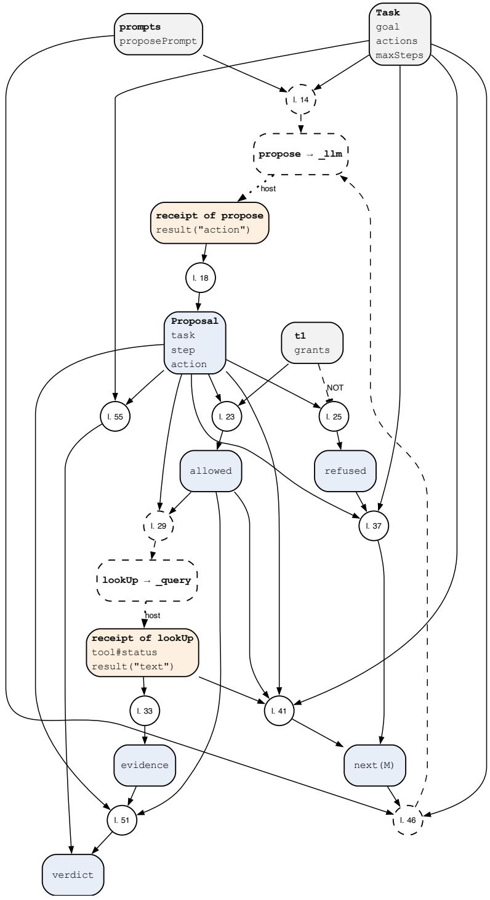  
Fi<sub>g</sub>ure 6: Rule <sub>g</sub>ra<sub>p</sub>h of p04-dispose.fx, <sub>g</sub>enerated from the <sub>p</sub>ro<sub>g</sub>ram. A circle is one rule; “l. 23” <sub>means</sub> th<sub>a</sub>t th<sub>e ru</sub>l<sub>e s</sub>t<sub>ar</sub>t<sub>s</sub> i<sub>n</sub> li<sub>ne</sub> 23 <sub>o</sub>f th<sub>e</sub> li<sub>s</sub>ti<sub>ng.</sub> L<sub>egen</sub>d i<sub>n</sub> T<sub>a</sub>bl<sub>e</sub> 9<sub>.</sub>

## 4.2 Pattern 5: Rules Steer the Model

## Intent

L<sub>e</sub>t <sub>ru</sub>l<sub>es</sub> d<sub>ec</sub>id<sub>e w</sub>h<sub>a</sub>t th<sub>e mo</sub>d<sub>e</sub>l i<sub>s as</sub>k<sub>e</sub>d<sub>, w</sub>h<sub>en, w</sub>ith <sub>w</sub>hi<sub>c</sub>h <sub>con</sub>t<sub>ex</sub>t <sub>an</sub>d <sub>w</sub>hi<sub>c</sub>h t<sub>oo</sub>l<sub>s.</sub> Th<sub>e mo</sub>d<sub>e</sub>l <sub>never</sub> d<sub>ec</sub>id<sub>es</sub> th<sub>e</sub> <sub>nex</sub>t <sub>s</sub>t<sub>ep.</sub>

## Also known as

Di<sub>a</sub>l<sub>ogue</sub> fl<sub>ow, gu</sub>id<sub>e</sub>d <sub>conversa</sub>ti<sub>on, sym</sub>b<sub>o</sub>li<sub>c orc</sub>h<sub>es</sub>t<sub>ra</sub>ti<sub>on, s</sub>t<sub>a</sub>t<sub>e mac</sub>hi<sub>ne w</sub>ith <sub>mo</sub>d<sub>e</sub>l l<sub>eaves, ru</sub>l<sub>e-</sub> <sub>se</sub>l<sub>ec</sub>t<sub>e</sub>d <sub>con</sub>t<sub>ex</sub>t<sub>.</sub>

## Motivation

A t<sub>r</sub>i<sub>age</sub> <sub>ca</sub>ll <sub>mus</sub>t <sub>as</sub>k <sub>a</sub>b<sub>ou</sub>t <sub>emergency</sub> <sub>s</sub>i<sub>gns</sub> fi<sub>rs</sub>t<sub>,</sub> <sub>as</sub>k <sub>one</sub> thi<sub>ng</sub> <sub>a</sub>t <sub>a</sub> ti<sub>me,</sub> <sub>as</sub>k <sub>aga</sub>i<sub>n</sub> <sub>w</sub>h<sub>en</sub> <sub>an</sub> <sub>answer</sub> i<sub>s unc</sub>l<sub>ear, an</sub>d h<sub>an</sub>d <sub>over</sub> t<sub>o a nurse w</sub>h<sub>en a s</sub>i<sub>gn</sub> i<sub>s presen</sub>t<sub>.</sub> A <sub>mo</sub>d<sub>e</sub>l <sub>as</sub>k<sub>e</sub>d t<sub>o run</sub> th<sub>e w</sub>h<sub>o</sub>l<sub>e ca</sub>ll f<sub>rom</sub> <sub>a</sub> l<sub>ong</sub> <sub>promp</sub>t <sub>s</sub>ki<sub>ps</sub> <sub>ques</sub>ti<sub>ons</sub> <sub>as</sub> th<sub>e</sub> <sub>pro</sub>t<sub>oco</sub>l <sub>grows.</sub> Th<sub>e</sub> <sub>pa</sub>tt<sub>ern</sub> t<sub>urns</sub> th<sub>e</sub> <sub>pro</sub>t<sub>oco</sub>l i<sub>n</sub>t<sub>o</sub> <sub>ru</sub>l<sub>es:</sub> <sub>a</sub> fl<sub>ow</sub> derives the current step, the model phrases its question, a judge decides whether the answer satisfies th<sub>e s</sub>t<sub>ep, an</sub>d <sub>ru</sub>l<sub>es</sub> d<sub>ec</sub>id<sub>e</sub> b<sub>ranc</sub>hi<sub>ng, re-as</sub>ki<sub>ng,</sub> h<sub>an</sub>d<sub>-over an</sub>d th<sub>e en</sub>d<sub>.</sub>

## Applicability

Use it when the <sub>p</sub>rocess is known (a <sub>p</sub>rotocol, an interview, an intake, an a<sub>g</sub>ent’s <sub>p</sub>hases), when the <sub>num</sub>b<sub>er</sub> <sub>o</sub>f <sub>ru</sub>l<sub>es</sub> <sub>a</sub> <sub>mo</sub>d<sub>e</sub>l <sub>wou</sub>ld h<sub>ave</sub> t<sub>o</sub> <sub>app</sub>l<sub>y</sub> b<sub>y</sub> it<sub>se</sub>lf <sub>grows</sub> <sub>w</sub>ith th<sub>e</sub> <sub>case,</sub> <sub>or</sub> <sub>w</sub>h<sub>en</sub> <sub>w</sub>h<sub>a</sub>t th<sub>e</sub> <sub>mo</sub>d<sub>e</sub>l ma<sub>y</sub> see must be decided b<sub>y</sub> <sub>p</sub>olic<sub>y</sub> (<sub>p</sub>ermissions, <sub>p</sub>oint-in-time availabilit<sub>y</sub>, jurisdiction).

## Structure

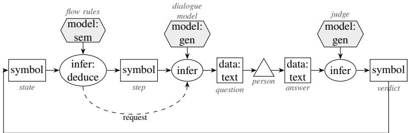  
th<sub>e ver</sub>di<sub>c</sub>t <sub>up</sub>d<sub>a</sub>t<sub>es</sub> th<sub>e s</sub>t<sub>a</sub>t<sub>e</sub>

## Participants

Rules (flow steps, slots, branches, phase, permitted tools, selected sources, missing evidence); Dialogue model (phrases the current question); Judge (one criterion about one answer, a verdict from a fixed set); Person (answers, or takes over).

## Collaborations

Each turn: rules derive the step; the dialogue model asks; the person answers; the judge returns answered, not answered or unclear with a reason; rules decide the next step. An unanswered question <sub>never</sub> d<sub>ec</sub>id<sub>es a</sub> b<sub>ranc</sub>h<sub>.</sub>

## Consequences

Th<sub>e</sub> <sub>pro</sub>t<sub>oco</sub>l i<sub>s</sub> <sub>execu</sub>t<sub>e</sub>d <sub>comp</sub>l<sub>e</sub>t<sub>e</sub>l<sub>y</sub> <sub>regar</sub>dl<sub>ess</sub> <sub>o</sub>f it<sub>s</sub> l<sub>eng</sub>th<sub>;</sub> th<sub>e</sub> <sub>mo</sub>d<sub>e</sub>l’<sub>s</sub> <sub>wor</sub>k <sub>per</sub> <sub>ca</sub>ll <sub>s</sub>t<sub>ays</sub> <sub>sma</sub>ll<sub>,</sub> <sub>so</sub> a weaker model sufices. Every turn has a receipt. The cost is one or more calls per turn, and a judge’s <sub>ver</sub>di<sub>c</sub>t th<sub>a</sub>t <sub>con</sub>t<sub>ra</sub>di<sub>c</sub>t<sub>s</sub> it<sub>s own reason</sub> i<sub>s a</sub> f<sub>a</sub>il<sub>ure</sub> th<sub>e ru</sub>l<sub>es mus</sub>t <sub>ca</sub>t<sub>c</sub>h<sub>.</sub>

## Implementation

Ask one thing per question. Name verdict labels that cannot be read as content (answered instead of yes). Let the judge read the earlier answers it needs. Derive the missing evidence for a goal and ask f<sub>or</sub> <sub>exac</sub>tl<sub>y</sub> th<sub>a</sub>t<sub>.</sub> S<sub>e</sub>l<sub>ec</sub>t <sub>on</sub>l<sub>y</sub> th<sub>e</sub> <sub>ru</sub>l<sub>es</sub> th<sub>a</sub>t <sub>app</sub>l<sub>y</sub> <sub>or</sub> <sub>near</sub>l<sub>y</sub> <sub>app</sub>l<sub>y</sub> t<sub>o</sub> th<sub>e</sub> <sub>case</sub> <sub>as</sub> <sub>con</sub>t<sub>ex</sub>t<sub>.</sub>

A flow is data that the rules of FrameX’s flow librar<sub>y</sub> read. The librar<sub>y</sub> is the file flow.fx of FrameX, l<sub>oa</sub>d<sub>e</sub>d b<sub>e</sub>f<sub>ore</sub> th<sub>e</sub> <sub>program;</sub> th<sub>e</sub> <sub>program</sub> it<sub>se</sub>lf <sub>con</sub>t<sub>a</sub>i<sub>ns</sub> <sub>on</sub>l<sub>y</sub> f<sub>ac</sub>t<sub>s:</sub>

```prolog
// Pattern 5, Rules Steer the Model: a dialogue flow written as facts. FrameX's flow
2 // library (python/framex/policies/flow.fx, loaded first) holds the rules that decide
// which step is active, request _turn (the dialogue model asks the question and returns
4 // the person's answer) and _judge (a judge model decides the step's criterion), ask
5 // again after a negative or unclear verdict, and repair a reply that breaks the format
6 // (Pattern 6).
7 world open.
8
9 advice:flow#Flow[flow#start -> programme].
10
11 // Ask which programme is meant; at most two attempts, then hand on to an officer.
12 programme:flow#Collect[flow#ask -> "Which Master do you mean?";
13 flow#criterion -> "Does the person name Business Innovation or Management?";
14 flow#slot -> programmeGiven; flow#maxAttempts -> 2;
15 flow#ifSlot -> programmeGiven; flow#to -> language;
16 flow#otherwise -> officer].
17
18 // Ask for the language certificate; at most three attempts (the default).
19 language:flow#Collect[flow#ask -> "Which English certificate do you hold?";
20 flow#criterion -> "Does the person name an English certificate at level C1?";
21 flow#slot -> c1Named;
22 flow#ifSlot -> c1Named; flow#to -> check; flow#otherwise -> missing].
23
24 // Three ways to end.
25 check:flow#Say[flow#text -> "Thank you. We check your record."; flow#next -> flow#end].
26 missing:flow#Say[flow#text -> "An English certificate at level C1 is missing."; flow#next
-> flow#end].
27 officer:flow#Say[flow#text -> "An admissions officer will contact you."; flow#next ->
flow#end].
28
29 ?- ?S:flow#Active.
30 ?- workflow[status -> ?St].
```

Fi ure 7 draws the flow as a dia ram. A flow#Collect ste<sub>p</sub> asks flow#ask, lets a jud e decide flow#criterion about the answer and records the outcome in the slot named b<sub>y</sub> flow#slot. flow#ifSlot, flow#to and flow#otherwise branch on a slot; flow#maxAttempts bounds the attem<sub>p</sub>ts (three b<sub>y</sub> default); a flow#Say ste<sub>p</sub> shows a text, and flow#end ends the flow. The librar<sub>y</sub> derives which ste<sub>p</sub> holds the token (flow#Active) and which attem<sub>p</sub>t is due (flow#askNow), and it issues two model calls <sub>p</sub>er attem<sub>p</sub>t. advice:flow#Flow[flow#start -> programme] declares the flow and its first ste<sub>p</sub>. A rejected attem<sub>p</sub>t (flow#rejected) is asked a<sub>g</sub>ain while attem<sub>p</sub>ts remain below the ste<sub>p</sub>’s limit (flow#limit, from flow#maxAttempts). Four of the librar<sub>y</sub>’s rules, shown <sub>on</sub>l<sub>y</sub> t<sub>o ma</sub>k<sub>e</sub> th<sub>e c</sub>h<sub>a</sub>i<sub>n v</sub>i<sub>s</sub>ibl<sub>e:</sub>

```verilog
// From FrameX's flow.fx (library; a program does not repeat these).
external turn(?S, ?A) using _turn[question -> ?Q; attempt -> ?A; tool#order -> 1]
<- ?S[flow#askNow -> ?A; flow#ask -> ?Q].
?S[flow#answer(?A) -> ?Text]
<- ?R[tool#arg1 -> ?S; tool#arg2 -> ?A; result("answer") -> ?Text].
external judge(?S, ?A) using _judge[criterion -> ?C; question -> ?Q;
answer -> ?Text; tool#order -> 2]
<- ?S[flow#answer(?A) -> ?Text; flow#criterion -> ?C; flow#ask -> ?Q].
?S[flow#askNow -> ?B]
<- ?S[flow#rejected(?A) -> true; flow#limit -> ?M] AND ?B := ?A + 1 AND ?B <=?M.
```

\_turn lets the dialo<sub>g</sub>ue model <sub>p</sub>hrase the <sub>q</sub>uestion, shows it to the <sub>p</sub>erson and returns the answer; \_judge <sub>g</sub>ives the jud<sub>g</sub>e model the criterion and that answer. For a Collect ste<sub>p</sub> the jud<sub>g</sub>e answers with the labels answered, not answered or unclear; the host writes them as "yes", "no" and "unclear" into result("verdict"), which the librar<sub>y</sub> reads, and kee<sub>p</sub>s the label itself in result("label"). In the recorded run the first answer was “the Master”; the recei<sub>p</sub>ts read (without the line tool#completed -> true that the host also writes):

```erlang
`turn(programme, 1)`[tool#status -> "succeeded"; result("answer") -> "the Master"].
`judge(programme, 1)`[tool#status -> "succeeded"; result("verdict") -> "no";
result("label") -> "not answered"; result("reason") ->
"The answer \"the Master\" does not mention Business Innovation or Management."
].
```

A no or unclear verdict rejects the attempt, so the library asks the programme question a second time, and the dialogue model rephrases it with the judge’s reason. The person answers at the terminal or, f<sub>or a run</sub> th<sub>a</sub>t <sub>can</sub> b<sub>e repea</sub>t<sub>e</sub>d<sub>,</sub> f<sub>rom a</sub> fil<sub>e o</sub>f <sub>answers.</sub>

## Library form

Pattern 5 is written in librar<sub>y</sub> form from the start. FrameX’s flow librar<sub>y</sub> flow.fx holds the rules, and th<sub>e</sub> <sub>program</sub> <sub>a</sub>b<sub>ove</sub> <sub>s</sub>t<sub>a</sub>t<sub>es</sub> f<sub>ac</sub>t<sub>s</sub> <sub>on</sub>l<sub>y.</sub>

## Known uses

I<sub>n</sub>t<sub>erv</sub>i<sub>ew, su</sub>it<sub>a</sub>bilit<sub>y an</sub>d t<sub>r</sub>i<sub>age</sub> fl<sub>ows; cus</sub>t<sub>omer suppor</sub>t <sub>w</sub>ith h<sub>an</sub>d<sub>-over;</sub> F<sub>rame</sub>X<sub>-</sub>A<sub>gen</sub>t<sub>s p</sub>h<sub>ases,</sub> <sub>gran</sub>t<sub>s an</sub>d <sub>con</sub>t<sub>ex</sub>t<sub>; po</sub>i<sub>n</sub>t<sub>-</sub>i<sub>n-</sub>ti<sub>me re</sub>t<sub>r</sub>i<sub>eva</sub>l i<sub>n</sub> th<sub>e a</sub>ll<sub>oca</sub>ti<sub>on app</sub>li<sub>ca</sub>ti<sub>on;</sub> th<sub>e ev</sub>id<sub>ence-nee</sub>d<sub>s searc</sub>h f<sub>or</sub> the questions that settle a <sub>g</sub>oal. In the literature: <sub>p</sub>ro<sub>g</sub>rammable dialo<sub>g</sub>ue rails (Rebedea et al. 2023), routin<sub>g</sub> and incremental quer<sub>y</sub>in<sub>g</sub> (Schluntz and Zhan<sub>g</sub> 2024; Liu et al. 2025); knowled<sub>g</sub>e-enhanced inference and retrieval (S. Pan et al. 2024; de Boer et al. 2025). In these the flows are scri<sub>p</sub>ted or the <sub>mo</sub>d<sub>e</sub>l d<sub>r</sub>i<sub>ves;</sub> h<sub>ere</sub> <sub>a</sub> <sub>ru</sub>l<sub>e</sub> b<sub>ase</sub> d<sub>er</sub>i<sub>ves</sub> <sub>every</sub> <sub>s</sub>t<sub>ep</sub> f<sub>rom</sub> it<sub>s</sub> <sub>s</sub>t<sub>a</sub>t<sub>e.</sub>

## Related patterns

Model as Sensor (Section 3.1) is the jud<sub>g</sub>e’s role; Critique and Re<sub>p</sub>air (Section 4.3) re<sub>p</sub>airs malformed turns; Division by Competence (Section 4.4) sends unclear to a person.

## Evidence

With <sub>s n</sub>th<sub>e</sub>ti<sub>c</sub> i<sub>n</sub>t<sub>a</sub>k<sub>e pro</sub>t<sub>oco</sub>l<sub>s o</sub>f 4 t<sub>o</sub> 96 <sub>ques</sub>ti<sub>ons,</sub> th<sub>e</sub> h b<sub>r</sub>id d<sub>ec</sub>id<sub>e</sub>d <sub>a</sub>ll 770 <sub>runs correc</sub>tl <sub>; a mo</sub>d<sub>e</sub>l <sub>app</sub>l<sub>y</sub>i<sub>ng</sub> th<sub>e same ru</sub>l<sub>es</sub> i<sub>n</sub> th<sub>e conversa</sub>ti<sub>on</sub> f<sub>e</sub>ll t<sub>o</sub> 39 <sub>o</sub>f 60 <sub>a</sub>t 64 <sub>ques</sub>ti<sub>ons an</sub>d 31 <sub>o</sub>f 60 <sub>a</sub>t 96<sub>, w</sub>ith 45 of its 50 errors unsafe (McNemar <sub>�</sub> < 0.001). Without reasonin<sub>g</sub>, the same model decided 10 of 30 <sub>conversa</sub>ti<sub>ons as a pure mo</sub>d<sub>e</sub>l <sub>an</sub>d 30 <sub>o</sub>f 30 i<sub>n</sub> th<sub>e</sub> h<sub>y</sub>b<sub>r</sub>id<sub>.</sub> O<sub>n a</sub> l<sub>a</sub>dd<sub>er o</sub>f <sub>s</sub>i<sub>x</sub> l<sub>oca</sub>l <sub>mo</sub>d<sub>e</sub>l<sub>s, no mo</sub>d<sub>e</sub>l <sub>up</sub> t<sub>o</sub> 70 billi<sub>on parame</sub>t<sub>ers reac</sub>h<sub>e</sub>d th<sub>e cr</sub>it<sub>er</sub>i<sub>on as a pure mo</sub>d<sub>e</sub>l<sub>, w</sub>hil<sub>e a</sub> 9<sub>-</sub>billi<sub>on mo</sub>d<sub>e</sub>l <sub>su</sub>fi<sub>ce</sub>d f<sub>or</sub> th<sub>e</sub> h<sub>y</sub>b<sub>r</sub>id i<sub>n s</sub>i<sub>ng</sub>l<sub>e</sub> d<sub>ec</sub>i<sub>s</sub>i<sub>ons.</sub> C<sub>os</sub>t f<sub>avours ne</sub>ith<sub>er s</sub>id<sub>e: w</sub>ith <sub>cac</sub>h<sub>e</sub>d i<sub>npu</sub>t <sub>pr</sub>i<sub>ce</sub>d<sub>,</sub> th<sub>e</sub> t<sub>wo cos</sub>t <sub>a</sub>b<sub>ou</sub>t th<sub>e same a</sub>t 64 <sub>an</sub>d 96 <sub>ques</sub>ti<sub>ons.</sub> I<sub>n a</sub> t<sub>e</sub>l<sub>ep</sub>h<sub>one-</sub>t<sub>r</sub>i<sub>age</sub> h<sub>ea</sub>d<sub>-</sub>t<sub>o-</sub>h<sub>ea</sub>d <sub>on</sub> 14 <sub>s</sub>i<sub>mu</sub>l<sub>a</sub>t<sub>e</sub>d <sub>ca</sub>ll<sub>ers, a mo</sub>d<sub>e</sub>l alone was first more accurate (274 of 280 a<sub>g</sub>ainst 243 of 280). The h<sub>y</sub>brid’s errors had one cause, found in its recorded verdicts and reasons and corrected in one place in the judge; afterwards it was <sub>r</sub>i<sub>g</sub>ht i<sub>n</sub> 278 <sub>o</sub>f 280 <sub>runs an</sub>d i<sub>n</sub> 199 <sub>o</sub>f 200 <sub>on unseen ca</sub>ll<sub>ers,</sub> l<sub>eve</sub>l <sub>w</sub>ith th<sub>e mo</sub>d<sub>e</sub>l <sub>a</sub>l<sub>one w</sub>ithi<sub>n no</sub>i<sub>se,</sub> <sub>a</sub>t l<sub>ower cos</sub>t <sub>per ca</sub>ll <sub>an</sub>d <sub>w</sub>ith <sub>every</sub> l<sub>eve</sub>l t<sub>race</sub>d t<sub>o recor</sub>d<sub>e</sub>d <sub>ver</sub>di<sub>c</sub>t<sub>s.</sub>

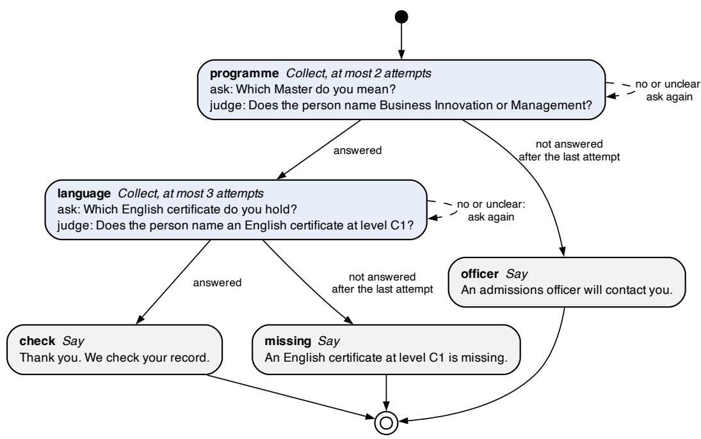  
Fi<sub>g</sub>ure 7: Flow dia<sub>g</sub>ram of p05-steer.fx: the ste<sub>p</sub>s of the flow and the transitions the flow librar<sub>y</sub> d<sub>er</sub>i<sub>ves</sub> f<sub>rom</sub> th<sub>em.</sub> L<sub>egen</sub>d i<sub>n</sub> T<sub>a</sub>bl<sub>e</sub> 9<sub>.</sub>

## 4.3 Pattern 6: Critique and Repair

## Intent

Wh<sub>en a mo</sub>d<sub>e</sub>l’<sub>s rep</sub>l<sub>y</sub> f<sub>a</sub>il<sub>s a c</sub>h<sub>ec</sub>k<sub>, c</sub>l<sub>ass</sub>if<sub>y</sub> th<sub>e</sub> f<sub>a</sub>il<sub>ure</sub> b<sub>y ru</sub>l<sub>e, s</sub>t<sub>a</sub>t<sub>e</sub> it<sub>, an</sub>d <sub>as</sub>k <sub>aga</sub>i<sub>n w</sub>ith th<sub>e pro</sub>bl<sub>em</sub> <sub>an</sub>d th<sub>e</sub> f<sub>au</sub>lt<sub>y</sub> <sub>rep</sub>l<sub>y</sub> i<sub>n</sub> th<sub>e</sub> <sub>promp</sub>t<sub>,</sub> <sub>a</sub> b<sub>oun</sub>d<sub>e</sub>d <sub>num</sub>b<sub>er</sub> <sub>o</sub>f ti<sub>mes;</sub> <sub>s</sub>t<sub>op</sub> <sub>on</sub> <sub>repe</sub>titi<sub>on.</sub>

## Also known as

G<sub>enera</sub>t<sub>e, ver</sub>if<sub>y, repa</sub>i<sub>r; va</sub>lid<sub>a</sub>t<sub>e</sub>d <sub>re</sub>t<sub>ry;</sub> f<sub>ee</sub>db<sub>ac</sub>k l<sub>oop w</sub>ith <sub>an ex</sub>t<sub>erna</sub>l <sub>cr</sub>iti<sub>c.</sub>

## Motivation

At t<sub>empera</sub>t<sub>ure</sub> <sub>zero</sub> <sub>a</sub> <sub>mo</sub>d<sub>e</sub>l <sub>g</sub>i<sub>ves</sub> th<sub>e</sub> <sub>same</sub> <sub>rep</sub>l<sub>y</sub> t<sub>o</sub> th<sub>e</sub> <sub>same</sub> i<sub>npu</sub>t<sub>;</sub> <sub>as</sub>ki<sub>ng</sub> <sub>aga</sub>i<sub>n</sub> <sub>w</sub>ith<sub>ou</sub>t <sub>c</sub>h<sub>ang</sub>i<sub>ng</sub> th<sub>e</sub> i<sub>npu</sub>t d<sub>oes no</sub>t h<sub>e</sub>l<sub>p, an</sub>d <sub>a mo</sub>d<sub>e</sub>l <sub>as</sub>k<sub>e</sub>d t<sub>o c</sub>h<sub>ec</sub>k it<sub>se</sub>lf <sub>w</sub>ith<sub>ou</sub>t <sub>ex</sub>t<sub>erna</sub>l f<sub>ee</sub>db<sub>ac</sub>k <sub>o</sub>ft<sub>en ma</sub>k<sub>es</sub> thi<sub>ngs</sub> worse. The rules know what is wron<sub>g</sub> (a ke<sub>y</sub> miss<sub>p</sub>elled, a quote not found, an action not allowed, rows missin<sub>g</sub>) and can sa<sub>y</sub> so.

## Applicability

U<sub>se</sub> it <sub>w</sub>h<sub>enever</sub> <sub>ano</sub>th<sub>er</sub> <sub>pa</sub>tt<sub>ern</sub> <sub>c</sub>h<sub>ec</sub>k<sub>s</sub> <sub>a</sub> <sub>rep</sub>l<sub>y:</sub> f<sub>orma</sub>t <sub>errors,</sub> <sub>ungroun</sub>d<sub>e</sub>d <sub>s</sub>t<sub>a</sub>t<sub>emen</sub>t<sub>s,</sub> <sub>re</sub>f<sub>use</sub>d <sub>proposa</sub>l<sub>s,</sub> i<sub>ncomp</sub>l<sub>e</sub>t<sub>e ex</sub>t<sub>rac</sub>ti<sub>ons,</sub> f<sub>a</sub>il<sub>e</sub>d <sub>regress</sub>i<sub>on cases o</sub>f <sub>a</sub> d<sub>ra</sub>ft<sub>.</sub>

## Structure

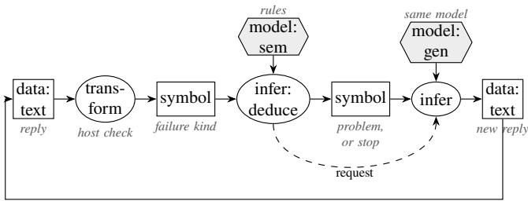  
<sub>c</sub>h<sub>ec</sub>k<sub>e</sub>d <sub>a a</sub>i<sub>n, a</sub> b<sub>oun</sub>d<sub>e</sub>d <sub>num</sub>b<sub>er o</sub>f ti<sub>mes</sub>

## Participants

Validator in the host (measures format and occurrence); Rules (classify, decide, bound); Model; Person or a stron<sub>g</sub>er model (escalation).

## Collaborations

Th<sub>e ru</sub>l<sub>es c</sub>l<sub>ass</sub>if<sub>y a</sub> f<sub>a</sub>il<sub>ure</sub> i<sub>n</sub>t<sub>o one o</sub>f <sub>s</sub>i<sub>x</sub> ki<sub>n</sub>d<sub>s an</sub>d <sub>respon</sub>d <sub>per</sub> ki<sub>n</sub>d<sub>:</sub>
<table><tr><td>Failure</td><td>Response</td></tr><tr><td>wrong format</td><td>ask again with the problem stated, up to a bound; a repeated failure stops with its reason</td></tr><tr><td>not grounded</td><td>reject the statement with its reason</td></tr><tr><td>not allowed</td><td>refuse with a reason the model receives on its next turn</td></tr><tr><td>incomplete</td><td>derive what is missing; the answer becomes unknown</td></tr><tr><td>failed call</td><td>stop with the reason; never treat it as an unclear answer </td></tr><tr><td>plausible but wrong</td><td>not detectable from the reply; needs grounding, a second reader or a person</td></tr></table>

E<sub>ac</sub>h <sub>repa</sub>i<sub>r</sub> i<sub>s</sub> <sub>a</sub> <sub>new</sub> <sub>reques</sub>t <sub>w</sub>ith it<sub>s</sub> <sub>own</sub> id<sub>en</sub>tit<sub>y</sub> <sub>an</sub>d <sub>rece</sub>i<sub>p</sub>t<sub>;</sub> b<sub>o</sub>th <sub>rep</sub>li<sub>es</sub> <sub>s</sub>t<sub>ay</sub> <sub>recor</sub>d<sub>e</sub>d<sub>.</sub> Th<sub>e</sub> fi<sub>rs</sub>t fi<sub>ve</sub> ki<sub>n</sub>d<sub>s are resu</sub>lt<sub>s</sub> th<sub>e ru</sub>l<sub>es can</sub> t<sub>e</sub>ll <sub>apar</sub>t<sub>, as</sub> i<sub>nvar</sub>i<sub>an</sub>t 5 <sub>requ</sub>i<sub>res.</sub> Th<sub>e s</sub>i<sub>x</sub>th i<sub>s</sub> th<sub>e c</sub>l<sub>ass</sub> th<sub>a</sub>t <sub>no c</sub>h<sub>ec</sub>k <sub>can</sub> d<sub>e</sub>t<sub>ec</sub>t<sub>;</sub> <sub>we</sub> li<sub>s</sub>t it <sub>so</sub> th<sub>a</sub>t <sub>a</sub> <sub>passe</sub>d <sub>c</sub>h<sub>ec</sub>k i<sub>s</sub> <sub>never</sub> <sub>rea</sub>d <sub>as</sub> <sub>pro</sub>t<sub>ec</sub>ti<sub>on</sub> <sub>aga</sub>i<sub>ns</sub>t it<sub>.</sub>

## Consequences

R<sub>epa</sub>i<sub>rs</sub> <sub>succee</sub>d <sub>w</sub>h<sub>en</sub> th<sub>e</sub> <sub>message</sub> <sub>names</sub> th<sub>e</sub> fi<sub>x.</sub> Th<sub>e</sub> b<sub>oun</sub>d k<sub>eeps</sub> <sub>cos</sub>t <sub>pre</sub>di<sub>c</sub>t<sub>a</sub>bl<sub>e.</sub> Sil<sub>en</sub>t <sub>correc</sub>ti<sub>on</sub> is excluded: mapping “ja” to yes is guessing and is refused; a correction is accepted without a call <sub>on</sub>l<sub>y w</sub>h<sub>en</sub> t<sub>rus</sub>t<sub>e</sub>d f<sub>ac</sub>t<sub>s en</sub>t<sub>a</sub>il it<sub>, as a</sub> d<sub>er</sub>i<sub>ve</sub>d f<sub>ac</sub>t <sub>w</sub>ith it<sub>s own proo</sub>f<sub>.</sub>

## Implementation

For a <sub>p</sub>lain model call, the re<sub>p</sub>air is <sub>p</sub>art of the <sub>p</sub>ro<sub>g</sub>ram. The <sub>p</sub>ro<sub>g</sub>ram of Model as Author (Section 3.2) contains it: ever<sub>y</sub> failure kee<sub>p</sub>s the checker’s messa<sub>g</sub>e, and a new re<sub>q</sub>uest draft(?P, ?M) with the next number hands the model its rule and that messa<sub>g</sub>e. It sto<sub>p</sub>s at maxAttempts, and earlier when the same messa<sub>g</sub>e comes back twice (stalled):

```verilog
// Pattern 6: ask again with the rule and the problem in the request, as a new
2 // request with the next number. Stop at the bound or when the message repeats.
3 ?P[newProblem(1) -> true] <- ?P[failed(1) -> ?F].
4
5 ?P[newProblem(?N) -> true]
6 <- ?P[failed(?N) -> ?F] AND ?K := ?N - 1 AND ?P[failed(?K) -> ?G] AND ?F != ?G.
7
8 external draft(?P, ?M) using _llm with repairPrompt[policy -> ?T; vocabulary ->
?V;
9 previousRule -> ?Old; problem -> ?F; tool#order -> 2]
10 <- ?P:Policy[text -> ?T; vocabulary -> ?V; maxAttempts -> ?Max;
11 rule(?N) -> ?Old; failed(?N) -> ?F; newProblem(?N) -> true]
12 AND ?N < ?Max AND ?M := ?N + 1.
13
14 ?P[stalled -> ?N]
15 <- ?P[failed(?N) -> ?F] AND ?K := ?N - 1 AND ?P[failed(?K) -> ?F].
16
17 ?P[gaveUp -> ?F] <- ?P:Policy[maxAttempts -> ?N; failed(?N) -> ?F].
```

In the recorded run the first draft lacked its final full stop and was rejected before evaluation; the repair <sub>reques</sub>t <sub>carr</sub>i<sub>e</sub>d th<sub>e message</sub> “<sub>expec</sub>t<sub>e</sub>d ‘<sub>.</sub>’ ”<sub>, an</sub>d th<sub>e secon</sub>d d<sub>ra</sub>ft <sub>passe</sub>d <sub>a</sub>ll <sub>cases.</sub>

I<sub>n a</sub> di<sub>a</sub>l<sub>ogue</sub> fl<sub>ow</sub> th<sub>e</sub> lib<sub>rary</sub> d<sub>oes</sub> th<sub>e same</sub> f<sub>or</sub> th<sub>e</sub> di<sub>a</sub>l<sub>ogue mo</sub>d<sub>e</sub>l<sub>.</sub> Th<sub>e</sub> h<sub>os</sub>t <sub>va</sub>lid<sub>a</sub>t<sub>es eac</sub>h <sub>rep</sub>l<sub>y o</sub>f \_turn a<sub>g</sub>ainst the a<sub>g</sub>reed format and writes what it found into the recei<sub>p</sub>t; a rule of the librar<sub>y</sub> reads a format error and re<sub>q</sub>uests \_repairTurn, which calls the same model a<sub>g</sub>ain with the <sub>q</sub>uestion, the <sub>pro</sub>bl<sub>em</sub> <sub>an</sub>d th<sub>e</sub> f<sub>au</sub>lt<sub>y</sub> <sub>rep</sub>l<sub>y:</sub>

// From FrameX's flow.fx (library).   
external repair(?S, ?A) using \_repairTurn[question -> ?Q; attempt -> ?A;   
problem -> ?E; received -> ?X; tool#order -> 1]   
<- ?R[tool#name -> "\_turn"; tool#arg1 -> ?S; tool#arg2 -> ?A;   
result("formatError") -> ?E; result("received") -> ?X]   
AND ?S[flow#ask -> ?Q].

The recei<sub>p</sub>t that tri<sub>gg</sub>ers it reads, for exam<sub>p</sub>le, result("formatError") -> "missing key: answer". A second broken re<sub>p</sub>l<sub>y</sub> ends the flow with workflow[status -> "interrupted"] <sub>an</sub>d it<sub>s reason.</sub>

## Library form

The re<sub>p</sub>air loo<sub>p</sub> is <sub>p</sub>art of two libraries: author.fx for drafts checked b<sub>y</sub> a tool (Section 3.2) and FrameX’s flow.fx for dialo<sub>g</sub>ue turns (Section 4.2). A <sub>p</sub>ro<sub>g</sub>ram that loads one of them <sub>g</sub>ets the b<sub>oun</sub>d<sub>e</sub>d <sub>repa</sub>i<sub>r</sub> <sub>w</sub>ith<sub>ou</sub>t <sub>wr</sub>iti<sub>ng</sub> <sub>a</sub> <sub>ru</sub>l<sub>e.</sub>

## Known uses

Format repair of dialogue turns and judges; refused agent actions and premature finishes with their failed checks; completeness checks that turn a partial extraction into unknown; the rule-drafting loop with the checker’s messa<sub>g</sub>e. In the literature: refinement from solver error messa<sub>g</sub>es in Lo<sub>g</sub>ic-LM (L. Pan et al. 2023), tool-<sub>g</sub>rounded critique (Gou et al. 2024), the back-<sub>p</sub>rom<sub>p</sub>t controller of LLM-Modulo (Kambham<sub>p</sub>ati et al. 2024); self-feedback without an external check (Madaan et al. 2023; Shinn et al. 2023), whose <sub>g</sub>ains Huan<sub>g</sub> et al. (2024) trace to oracle sto<sub>pp</sub>in<sub>g</sub> si<sub>g</sub>nals.

## Related patterns

It <sub>comp</sub>l<sub>e</sub>t<sub>es</sub> M<sub>o</sub>d<sub>e</sub>l <sub>as</sub> S<sub>ensor,</sub> M<sub>o</sub>d<sub>e</sub>l <sub>as</sub> A<sub>u</sub>th<sub>or an</sub>d M<sub>o</sub>d<sub>e</sub>l P<sub>roposes,</sub> R<sub>u</sub>l<sub>es</sub> Di<sub>spose.</sub> M<sub>o</sub>d<sub>e</sub>l <sub>as</sub> C<sub>r</sub>iti<sub>c</sub> (Section 5.2) is its reverse: there the model criticises the rules.

## Evidence

S<sub>ee</sub> M<sub>o</sub>d<sub>e</sub>l <sub>as</sub> A<sub>u</sub>th<sub>or:</sub> <sub>nam</sub>i<sub>ng</sub> th<sub>e</sub> fi<sub>x</sub> <sub>ra</sub>i<sub>se</sub>d fi<sub>rs</sub>t<sub>-reques</sub>t <sub>repa</sub>i<sub>rs</sub> f<sub>rom</sub> 5 <sub>o</sub>f 10 t<sub>o</sub> 10 <sub>o</sub>f 10<sub>.</sub> I<sub>n</sub> th<sub>e</sub> lit<sub>era</sub>t<sub>ure, se</sub>lf<sub>-correc</sub>ti<sub>on w</sub>ith<sub>ou</sub>t <sub>an ex</sub>t<sub>erna</sub>l <sub>s</sub>i<sub>gna</sub>l l<sub>owere</sub>d <sub>accuracy, an</sub>d th<sub>e ga</sub>i<sub>ns repor</sub>t<sub>e</sub>d f<sub>or</sub> self-refinement rested on oracle sto<sub>pp</sub>in<sub>g</sub> si<sub>g</sub>nals (Huan<sub>g</sub> et al. 2024); back-<sub>p</sub>rom<sub>p</sub>tin<sub>g</sub> from a sound validator raised executable <sub>p</sub>lans from about 12 % to 82 % in one <sub>p</sub>lannin<sub>g</sub> domain (Kambham<sub>p</sub>ati et al. 2024). The rules <sub>p</sub>la<sub>y</sub> the <sub>p</sub>art of that si<sub>g</sub>nal and of that validator.

## 4.4 Pattern 7: Division by Competence

## Intent

L<sub>e</sub>t th<sub>e</sub> <sub>ru</sub>l<sub>es</sub> d<sub>ec</sub>id<sub>e</sub> th<sub>e</sub> <sub>cases</sub> th<sub>ey</sub> <sub>cover,</sub> <sub>sen</sub>d <sub>w</sub>h<sub>a</sub>t th<sub>ey</sub> l<sub>eave</sub> <sub>open</sub> t<sub>o</sub> <sub>a</sub> <sub>mo</sub>d<sub>e</sub>l <sub>or</sub> <sub>a</sub> <sub>person,</sub> <sub>an</sub>d t<sub>urn</sub> <sub>recurr</sub>i<sub>ng</sub> <sub>answers</sub> i<sub>n</sub>t<sub>o</sub> <sub>ru</sub>l<sub>es</sub> <sub>over</sub> ti<sub>me.</sub>

## Also known as

S<sub>e</sub>l<sub>ec</sub>ti<sub>ve</sub> d<sub>e</sub>l<sub>ega</sub>ti<sub>on,</sub> <sub>esca</sub>l<sub>a</sub>ti<sub>on</sub> <sub>casca</sub>d<sub>e,</sub> ti<sub>ere</sub>d <sub>au</sub>t<sub>onomy,</sub> <sub>ru</sub>l<sub>e</sub> di<sub>s</sub>till<sub>a</sub>ti<sub>on,</sub> h<sub>uman</sub> i<sub>n</sub> th<sub>e</sub> l<sub>oop.</sub>

## Motivation

M<sub>os</sub>t <sub>cases o</sub>f <sub>a c</sub>l<sub>a</sub>i<sub>ms process are rou</sub>ti<sub>ne an</sub>d f<sub>u</sub>ll<sub>y covere</sub>d b<sub>y ru</sub>l<sub>es; a</sub> f<sub>ew are am</sub>bi<sub>guous.</sub> S<sub>en</sub>di<sub>ng</sub> <sub>every</sub> <sub>case</sub> t<sub>o</sub> <sub>a</sub> <sub>mo</sub>d<sub>e</sub>l <sub>cos</sub>t<sub>s</sub> <sub>money</sub> <sub>an</sub>d <sub>g</sub>i<sub>ves</sub> <sub>up</sub> <sub>proo</sub>f<sub>s</sub> <sub>w</sub>h<sub>ere</sub> th<sub>ey</sub> <sub>were</sub> <sub>ava</sub>il<sub>a</sub>bl<sub>e;</sub> <sub>sen</sub>di<sub>ng</sub> <sub>none</sub> l<sub>eaves</sub> the ambiguous cases undecided. The pattern uses the rules’ own three-valued result as the gate: true andfalse are decided, unknown, unclear and conflicts are handed on.

## Applicability

U<sub>se</sub> it <sub>w</sub>h<sub>en coverage</sub> b<sub>y ru</sub>l<sub>es</sub> i<sub>s</sub> hi<sub>g</sub>h b<sub>u</sub>t i<sub>ncomp</sub>l<sub>e</sub>t<sub>e, w</sub>h<sub>en</sub> th<sub>e num</sub>b<sub>er o</sub>f <sub>mo</sub>d<sub>e</sub>l <sub>ca</sub>ll<sub>s s</sub>h<sub>ou</sub>ld f<sub>o</sub>ll<sub>ow</sub> th<sub>e</sub> <sub>num</sub>b<sub>er</sub> <sub>o</sub>f <sub>am</sub>bi<sub>guous</sub> <sub>cases,</sub> <sub>an</sub>d <sub>w</sub>h<sub>en</sub> <sub>a</sub> <sub>person</sub> <sub>mus</sub>t d<sub>ec</sub>id<sub>e</sub> th<sub>e</sub> <sub>res</sub>id<sub>ue.</sub>

## Structure

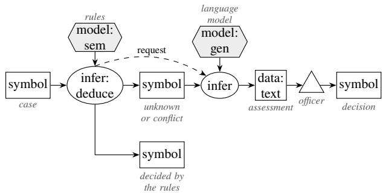

## Participants

Rules (decide, mark the residue); Model (assesses the residue, as a recorded assessment); Person;   
Counter (counts recurring model decisions).

## Collaborations

Rules decide; a case left unknown or in conflict becomes a request; the model’s verdict is an assessment th<sub>a</sub>t t<sub>rave</sub>l<sub>s</sub> <sub>w</sub>ith th<sub>e</sub> <sub>case</sub> t<sub>o</sub> <sub>a</sub> <sub>person</sub> <sub>an</sub>d d<sub>ec</sub>id<sub>es</sub> <sub>no</sub>thi<sub>ng;</sub> <sub>recurr</sub>i<sub>ng</sub> <sub>ver</sub>di<sub>c</sub>t<sub>s</sub> b<sub>ecome</sub> <sub>can</sub>did<sub>a</sub>t<sub>e</sub> <sub>ru</sub>l<sub>es</sub> f<sub>or</sub> M<sub>o</sub>d<sub>e</sub>l <sub>as</sub> A<sub>u</sub>th<sub>or.</sub>

## Consequences

Th<sub>e ru</sub>l<sub>e par</sub>t <sub>grows an</sub>d th<sub>e mo</sub>d<sub>e</sub>l <sub>par</sub>t <sub>s</sub>h<sub>r</sub>i<sub>n</sub>k<sub>s over</sub> ti<sub>me.</sub> Th<sub>e ga</sub>t<sub>e mus</sub>t <sub>never</sub> b<sub>e</sub> th<sub>e mo</sub>d<sub>e</sub>l’<sub>s own</sub> confidence; use unknown, conflict, or a measured precision per model and task.

## Implementation

G<sub>a</sub>t<sub>e on</sub> th<sub>e ru</sub>l<sub>es</sub>’ <sub>own resu</sub>lt<sub>.</sub> U<sub>n</sub>d<sub>er an open wor</sub>ld <sub>a case coun</sub>t<sub>s as</sub> d<sub>ec</sub>id<sub>e</sub>d <sub>on</sub>l<sub>y w</sub>h<sub>en</sub> th<sub>e ru</sub>l<sub>es</sub> d<sub>er</sub>i<sub>ve</sub> <sub>a</sub> d<sub>ec</sub>i<sub>s</sub>i<sub>on.</sub> E<sub>very</sub> <sub>o</sub>th<sub>er</sub> <sub>case</sub> <sub>goes</sub> t<sub>o</sub> th<sub>e</sub> <sub>mo</sub>d<sub>e</sub>l f<sub>or</sub> <sub>an</sub> <sub>assessmen</sub>t <sub>an</sub>d<sub>,</sub> <sub>w</sub>ith th<sub>a</sub>t <sub>assessmen</sub>t<sub>,</sub> t<sub>o</sub> <sup>a</sup> p<sup>erson:</sup>

```verilog
// Pattern 7, Division by Competence: the rules decide what they cover; the rest is
// assessed by the model and handed on to a person, with the assessment as a note.
3 world open.
4 closed slot decided. closed slot admitted. closed slot notAdmitted.
5
6 // Three files; the rules have decided two of them.
nora:Applicant[file -> "Bachelor HSG; English C1 certificate on file."].
8 tomas:Applicant[file -> "Bachelor ETH; English C1 recorded as failed."].
9 yara:Applicant[file -> "Bachelor University of Bologna; IELTS 7.0."].
10 nora[admitted -> mbi]. tomas[notAdmitted -> mbi].
11
12 assessPrompt:Prompt[text -> "Assess this admission file for the MBI. Answer as JSON {\"
verdict\": likely or unlikely or unclear, \"reason\": ...}."].
13
14 ?A[decided -> true] <- ?A[admitted -> ?P].
15 ?A[decided -> true] <- ?A[notAdmitted -> ?P].
16
17 // Only an undecided file goes to the model.
18 external assess(?A) using _llm with assessPrompt[file -> ?T]
19 <- ?A:Applicant[file -> ?T] AND NOT ?A[decided -> true].
20
21 ?A[assessment -> ?V]
22 <- ?R[tool#name -> "_llm"; tool#arg1 -> ?A; result("verdict") -> ?V].
23
24 ?A[assessmentReason -> ?W]
25 <- ?R[tool#name -> "_llm"; tool#arg1 -> ?A; result("reason") -> ?W].
26
27 // Every undecided file goes to an officer. The model's assessment travels with it as
28 // a note and decides nothing; a failed call is noted as such.
29 ?A[handOn -> officer] <- ?A:Applicant AND NOT ?A[decided -> true].
30
31 ?A[note -> ?W] <- ?A[handOn -> officer; assessmentReason -> ?W].
32
33 ?A[note -> "no assessment: the model call failed"]
34 <- ?A[handOn -> officer] AND ?R[tool#name -> "_llm"; tool#arg1 -> ?A;
35 tool#status -> "failed"].
36
37 ?- ?A[handOn -> ?W].
38 ?- ?A[assessment -> ?V; note -> ?N].
```

Fi<sub>g</sub>ure 8 draws the <sub>p</sub>ro<sub>g</sub>ram as a rule <sub>g</sub>ra<sub>p</sub>h. The hand-over is a derived fact, handOn -> officer. Showin<sub>g</sub> it to a <sub>p</sub>erson is the host’s task; FrameX’s tool \_ask <sub>p</sub>uts a <sub>q</sub>uestion to a <sub>p</sub>erson as written <sub>an</sub>d <sub>re</sub>t<sub>urns</sub> th<sub>e answer as a rece</sub>i<sub>p</sub>t<sub>.</sub>

## Library form

With competence.fx (Section B) the <sub>p</sub>ro<sub>g</sub>ram states the cases and kee<sub>p</sub>s its rules for what it decides (cp#decided). The librar<sub>y</sub> assesses ever<sub>y</sub> other case and hands it on with the model’s reason as a note:

1 // Pattern 7 in library form: load competence.fx first.   
2 world open.   
3   
4 assessPrompt:Prompt[text -> "Assess this admission file for the MBI. Answer as JSON {\"   
verdict\": likely or unlikely or unclear, \"reason\": ...}."].   
5   
6 nora:cp#Case[cp#prompt -> assessPrompt; cp#file -> "Bachelor HSG; English C1 certificate   
on file."].

tomas:cp#Case[cp#prompt -> assessPrompt; cp#file -> "Bachelor ETH; English C1 recorded as   
failed."].   
8 yara:cp#Case[cp#prompt -> assessPrompt; cp#file -> "Bachelor University of Bologna; IELTS   
7.0."].   
9 nora[admitted -> mbi]. tomas[notAdmitted -> mbi].   
10   
11 // What the rules decide; this stays with the program.   
12 ?A[cp#decided -> true] <- ?A[admitted -> ?P].   
13 ?A[cp#decided -> true] <- ?A[notAdmitted -> ?P].   
14   
15 ?- ?C[cp#handOn -> true; cp#assessment -> ?V; cp#note -> ?N].

## Known uses

Three-way branches in triage that send unclear to a person; awaiting user in FrameX-Agents; required h<sub>uman rev</sub>i<sub>ew</sub> f<sub>or ev</sub>id<sub>ence-ga</sub>t<sub>e</sub>d <sub>ac</sub>ti<sub>ons</sub> i<sub>n casewor</sub>k<sub>.</sub> I<sub>n</sub> th<sub>e</sub> lit<sub>era</sub>t<sub>ure: separa</sub>ti<sub>ng</sub> b<sub>us</sub>i<sub>ness</sub> l<sub>og</sub>i<sub>c</sub> f<sub>rom</sub> the model (Washizaki et al. 2020); routin<sub>g</sub> (Schluntz and Zhan<sub>g</sub> 2024); the inverse direction, a model that decides when to call a reasoner, is Kautz’s Neuro[S<sub>y</sub>mbolic] (Kautz 2022); extractin<sub>g</sub> rules from a model is the “decom<sub>p</sub>iler” of the neural-s<sub>y</sub>mbolic c<sub>y</sub>cle (d’Avila Garcez and Lamb 2023).

## Related patterns

Model as Author (Section 3.2) for distillation; Rules Steer the Model (Section 4.2) for the hand-over.

## Evidence

O<sub>ne</sub> d<sub>emons</sub>t<sub>ra</sub>ti<sub>on run.</sub> N<sub>o measuremen</sub>t i<sub>so</sub>l<sub>a</sub>t<sub>es</sub> thi<sub>s pa</sub>tt<sub>ern ye</sub>t<sub>.</sub> Th<sub>e</sub> t<sub>r</sub>i<sub>age</sub> fl<sub>ows o</sub>f S<sub>ec</sub>ti<sub>on</sub> 4<sub>.</sub>2 <sub>use</sub> it to send unclear to a person; a measurement should report the share of cases handed on, the accuracy <sub>o</sub>f th<sub>ose</sub> d<sub>ec</sub>id<sub>e</sub>d b<sub>y ru</sub>l<sub>es, an</sub>d th<sub>e cos</sub>t <sub>per</sub> d<sub>ec</sub>id<sub>e</sub>d <sub>case.</sub>

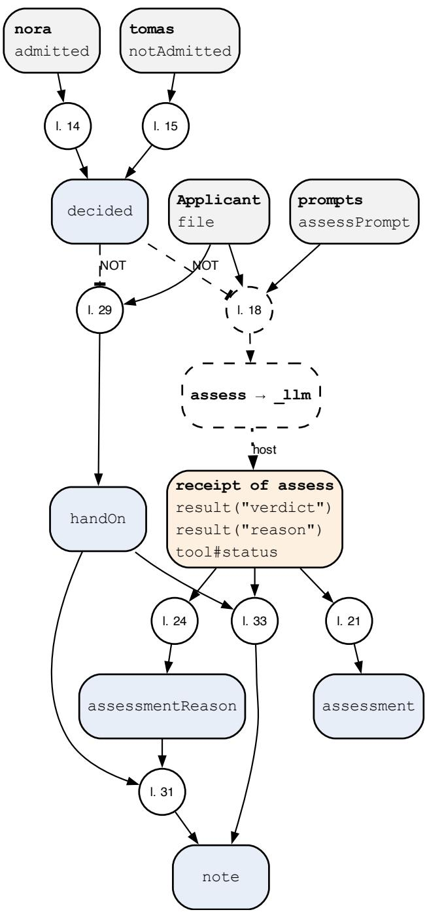  
Fi<sub>g</sub>ure 8: Rule <sub>g</sub>ra<sub>p</sub>h of p07-competence.fx, <sub>g</sub>enerated from the <sub>p</sub>ro<sub>g</sub>ram. A circle is one rule; “l. 23” <sub>means</sub> th<sub>a</sub>t th<sub>e ru</sub>l<sub>e s</sub>t<sub>ar</sub>t<sub>s</sub> i<sub>n</sub> li<sub>ne</sub> 23 <sub>o</sub>f th<sub>e</sub> li<sub>s</sub>ti<sub>ng.</sub> L<sub>egen</sub>d i<sub>n</sub> T<sub>a</sub>bl<sub>e</sub> 9<sub>.</sub>

## 4.5 Pattern 13: Fail-Safe Union

## Intent

C<sub>om</sub>bi<sub>ne</sub> th<sub>e ver</sub>di<sub>c</sub>t<sub>s o</sub>f <sub>ru</sub>l<sub>es an</sub>d <sub>mo</sub>d<sub>e</sub>l<sub>s un</sub>d<sub>er a</sub> d<sub>ec</sub>l<sub>are</sub>d <sub>or</sub>d<sub>er o</sub>f <sub>ou</sub>t<sub>comes</sub> i<sub>n w</sub>hi<sub>c</sub>h <sub>eac</sub>h <sub>source</sub> <sub>can</sub> <sub>on</sub>l<sub>y</sub> <sub>ma</sub>k<sub>e</sub> th<sub>e</sub> <sub>resu</sub>lt <sub>s</sub>t<sub>r</sub>i<sub>c</sub>t<sub>er.</sub> A <sub>source</sub> th<sub>a</sub>t i<sub>s</sub> <sub>s</sub>il<sub>en</sub>t<sub>,</sub> f<sub>a</sub>il<sub>s</sub> <sub>or</sub> <sub>answers</sub> <sub>ou</sub>t<sub>s</sub>id<sub>e</sub> th<sub>e</sub> <sub>or</sub>d<sub>er</sub> <sub>coun</sub>t<sub>s</sub> <sub>as</sub> th<sub>e cau</sub>ti<sub>ous ou</sub>t<sub>come.</sub>

## Also known as

D<sub>eny</sub> <sub>overr</sub>id<sub>es,</sub> <sub>mos</sub>t <sub>res</sub>t<sub>r</sub>i<sub>c</sub>ti<sub>ve</sub> <sub>w</sub>i<sub>ns,</sub> <sub>one-s</sub>id<sub>e</sub>d <sub>com</sub>bi<sub>na</sub>ti<sub>on,</sub> f<sub>a</sub>il <sub>c</sub>l<sub>ose</sub>d<sub>,</sub> d<sub>e</sub>f<sub>ence</sub> i<sub>n</sub> d<sub>ep</sub>th<sub>.</sub>

## Motivation

A <sub>paymen</sub>t d<sub>es</sub>k <sub>re</sub>l<sub>eases</sub> t<sub>rans</sub>f<sub>ers.</sub> R<sub>u</sub>l<sub>es</sub> k<sub>now</sub> th<sub>e</sub> li<sub>m</sub>it<sub>s an</sub>d th<sub>e</sub> bl<sub>oc</sub>k<sub>e</sub>d <sub>accoun</sub>t<sub>s</sub> b<sub>u</sub>t <sub>canno</sub>t <sub>rea</sub>d a <sub>p</sub>ur<sub>p</sub>ose line that <sub>p</sub>ressures the clerk (“the CEO a<sub>pp</sub>roved it b<sub>y</sub> <sub>p</sub>hone, do not call back”); a model <sub>can rea</sub>d it b<sub>u</sub>t <sub>m</sub>i<sub>sses</sub> li<sub>m</sub>it<sub>s an</sub>d <sub>some</sub>ti<sub>mes waves a</sub> f<sub>rau</sub>d th<sub>roug</sub>h<sub>.</sub> T<sub>a</sub>ki<sub>ng a vo</sub>t<sub>e</sub> l<sub>e</sub>t<sub>s one source</sub>’<sub>s</sub> l<sub>en</sub>i<sub>ency</sub> <sub>ou</sub>t<sub>vo</sub>t<sub>e</sub> th<sub>e</sub> <sub>o</sub>th<sub>er</sub>’<sub>s</sub> <sub>warn</sub>i<sub>ng,</sub> <sub>an</sub>d h<sub>an</sub>di<sub>ng</sub> <sub>every</sub> di<sub>sagreemen</sub>t t<sub>o</sub> <sub>a</sub> <sub>person</sub> fl<sub>oo</sub>d<sub>s</sub> th<sub>e</sub> d<sub>es</sub>k<sub>.</sub> I<sub>n</sub> thi<sub>s</sub> d<sub>oma</sub>i<sub>n</sub> th<sub>e</sub> h<sub>arms are</sub> l<sub>ops</sub>id<sub>e</sub>d<sub>: a</sub> h<sub>e</sub>ld <sub>paymen</sub>t <sub>cos</sub>t<sub>s a</sub> d<sub>ay, a re</sub>l<sub>ease</sub>d f<sub>rau</sub>d <sub>cos</sub>t<sub>s</sub> th<sub>e amoun</sub>t<sub>.</sub> The <sub>p</sub>attern states the order of outcomes once (release, hold, block) and lets the strictest verdict of an<sub>y</sub> <sub>source</sub> d<sub>ec</sub>id<sub>e.</sub> N<sub>e</sub>ith<sub>er source can</sub> l<sub>oosen w</sub>h<sub>a</sub>t th<sub>e o</sub>th<sub>er</sub> f<sub>oun</sub>d<sub>, an</sub>d <sub>a mo</sub>d<sub>e</sub>l th<sub>a</sub>t did <sub>no</sub>t <sub>answer</sub> i<sub>s no</sub>t <sub>a mo</sub>d<sub>e</sub>l th<sub>a</sub>t <sub>agree</sub>d<sub>.</sub>

## Applicability

U<sub>se</sub> it <sub>w</sub>h<sub>en:</sub>

1: The outcomes can be ordered by risk, and wrongly choosing a stricter outcome costs much less th<sub>an</sub> <sub>wrong</sub>l<sub>y</sub> <sub>c</sub>h<sub>oos</sub>i<sub>ng</sub> <sub>a</sub> l<sub>ooser</sub> <sub>one;</sub>

2: The sources see diferent things (rules the structured fields, a model the text), so their failures are <sub>no</sub>t th<sub>e</sub> <sub>same;</sub>

3: A cautious outcome is not final: a hold leads to a person or a later step.

Do not use it when both directions of error cost alike, or when the stricter outcome is itself harmful (a withheld emergency call); then report the disagreement as unclear (Several Readers, Section 3.1) or hand it on (Section 4.4).

## Structure

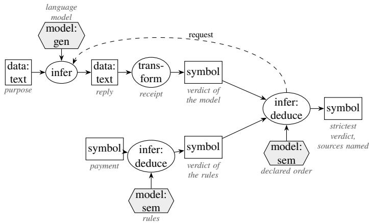

## Participants

Rules: give their own verdict from the structured fields and combine all verdicts. Model: gives a verdict from the text, one of the ordered outcomes. Host: calls the model and records a failed call as such. Order: the outcomes with their rank, declared as facts. Person: takes up what is held.

## Collaborations

Each source derives a verdict for each case. A source without a usable verdict (no recei<sub>p</sub>t, a failed call, a word outside the order) is <sub>g</sub>iven the cautious verdict b<sub>y</sub> a rule. The outcome is the verdict of hi<sub>g</sub>h<sub>es</sub>t <sub>ran</sub>k<sub>, an</sub>d th<sub>e sources</sub> th<sub>a</sub>t <sub>gave</sub> it <sub>are name</sub>d<sub>, so a person sees w</sub>h<sub>o</sub> h<sub>e</sub>ld th<sub>e paymen</sub>t <sub>an</sub>d <sub>w</sub>h<sub>y.</sub>

## Consequences

Addi<sub>ng a source can on</sub>l<sub>y ma</sub>k<sub>e</sub> th<sub>e ou</sub>t<sub>come s</sub>t<sub>r</sub>i<sub>c</sub>t<sub>er, so a new c</sub>h<sub>ec</sub>k <sub>never wea</sub>k<sub>ens</sub> th<sub>e o</sub>ld <sub>ones, an</sub>d <sub>a</sub> <sub>mo</sub>d<sub>e</sub>l <sub>ou</sub>t<sub>age</sub> <sub>s</sub>t<sub>ops</sub> <sub>re</sub>l<sub>eases</sub> i<sub>ns</sub>t<sub>ea</sub>d <sub>o</sub>f l<sub>e</sub>tti<sub>ng</sub> th<sub>em</sub> th<sub>roug</sub>h<sub>.</sub> Th<sub>e</sub> <sub>pr</sub>i<sub>ce</sub> i<sub>s</sub> <sub>more</sub> h<sub>e</sub>ld <sub>cases:</sub> <sub>every</sub> <sub>source</sub>’<sub>s</sub> f<sub>a</sub>l<sub>se a</sub>l<sub>arms a</sub>dd <sub>up, so</sub> th<sub>e</sub> h<sub>o</sub>ld <sub>ra</sub>t<sub>e grows w</sub>ith <sub>eac</sub>h <sub>source an</sub>d <sub>mus</sub>t b<sub>e measure</sub>d<sub>.</sub> U<sub>n</sub>lik<sub>e a</sub> <sub>p</sub>riorit<sub>y</sub> order, nothin<sub>g</sub> is settled silentl<sub>y</sub>: the order is a fact in the <sub>p</sub>ro<sub>g</sub>ram, and decidedBy names the <sub>source</sub> b<sub>e</sub>hi<sub>n</sub>d <sub>every ou</sub>t<sub>come.</sub> Th<sub>e guaran</sub>t<sub>ee</sub> h<sub>o</sub>ld<sub>s on</sub>l<sub>y</sub> if <sub>every</sub> b<sub>ranc</sub>h <sub>moves</sub> t<sub>owar</sub>d th<sub>e sa</sub>f<sub>e s</sub>id<sub>e,</sub> including the two that are easy to forget: a source that answers unclear must not let another source l<sub>oosen</sub> th<sub>e ou</sub>t<sub>come, an</sub>d <sub>a</sub> f<sub>a</sub>il<sub>e</sub>d <sub>ca</sub>ll <sub>mus</sub>t <sub>no</sub>t <sub>coun</sub>t <sub>as agreemen</sub>t<sub>.</sub> O<sub>ne</sub> b<sub>ranc</sub>h th<sub>a</sub>t d<sub>oes e</sub>ith<sub>er</sub> b<sub>rea</sub>k<sub>s</sub> the whole union. In the hackathon below, a comparison system recorded an unreachable judge as yes, a submission a reply that was not JSON as clean.

## Implementation

Declare the order as facts ("hold":Verdict[rank -> 1]) and the verdicts and ranks closed, so that max over them has a value. Write the cautious default for silence ex<sub>p</sub>licitl<sub>y</sub>, one rule <sub>p</sub>er wa<sub>y</sub> a source <sub>can</sub> f<sub>a</sub>il t<sub>o answer.</sub> Th<sub>e un</sub>i<sub>on</sub> i<sub>s one aggrega</sub>t<sub>e;</sub> it <sub>rea</sub>d<sub>s</sub> th<sub>e ver</sub>di<sub>c</sub>t<sub>s o</sub>f <sub>a</sub>ll <sub>sources an</sub>d h<sub>as no ru</sub>l<sub>e</sub> th<sub>a</sub>t l<sub>owers one:</sub>

// Pattern 13, Fail-Safe Union: every source can only tighten the outcome;   
// a source that is silent or unreadable counts as the safe side.   
world open.   
4 closed class Verdict. closed method verdict/1. closed slot rank.   
5 closed slot blocked. closed slot screened. closed slot outcome.   
6   
7 // The outcomes in a declared order: a higher rank is safer.   
8 "release":Verdict[rank -> 0]. "hold":Verdict[rank -> 1]. "block":Verdict[rank -> 2].   
9   
10 // The sources whose verdicts are combined, and two payments.   
11 "rules":Source. "model":Source.   
12 p1:Payment[amount -> 1200; payee -> "CH93 0076 2011 6238 5295 7";   
13 purpose -> "Invoice 2026-114, catering for the alumni evening"].   
14 p2:Payment[amount -> 8400; payee -> "CH56 0483 5012 3456 7800 9";   
15 purpose -> "Urgent: transfer today, the CEO approved it by phone, do not call back"].   
16 "CH44 3199 9123 0008 8901 2"[blocked -> true].   
17 limit[amount -> 5000].   
18   
19 screenPrompt:Prompt[text -> "Read the purpose of a payment. Answer as JSON {\"verdict\":   
release or hold or block, \"reason\": ...}; hold when you are unsure."].   
20   
21 // Source 1, the rules: block a blocked payee, hold above the limit, release otherwise.   
22 ?P[verdict(?S) -> "block"]   
23 <- ?P:Payment[payee -> ?I] AND ?I[blocked -> true] AND ?S:Source AND ?S = "rules".   
24 ?P[verdict(?S) -> "hold"]   
25 <- ?P:Payment[amount -> ?A] AND limit[amount -> ?L] AND ?A > ?L   
26 AND ?S:Source AND ?S = "rules".   
27 ?P[verdict(?S) -> "release"]   
28 <- ?P:Payment[amount -> ?A; payee -> ?I] AND limit[amount -> ?L] AND ?A <= ?L   
29 AND NOT ?I[blocked -> true] AND ?S:Source AND ?S = "rules".   
30   
31 // Source 2, the model: one screening per payment.   
32 external screen(?P) using \_llm with screenPrompt[purpose -> ?T]   
33 <- ?P:Payment[purpose -> ?T].   
34   
35 ?P[screened -> true] <- ?R[tool#name -> "\_llm"; tool#arg1 -> ?P; tool#status -> "succeeded   
"].   
36

37 ?P[verdict(?S) -> ?V]   
38 <- ?R[tool#name -> "\_llm"; tool#arg1 -> ?P; result("verdict") -> ?V] AND ?V:Verdict   
39 AND ?S:Source AND ?S = "model".   
40   
41 // Silence and unreadable replies are not release: they count as hold.   
42 ?P[verdict(?S) -> "hold"]   
43 <- ?P:Payment AND NOT ?P[screened -> true] AND ?S:Source AND ?S = "model".   
44 ?P[verdict(?S) -> "hold"]   
45 <- ?R[tool#name -> "\_llm"; tool#arg1 -> ?P; result("verdict") -> ?V] AND NOT ?V:Verdict   
46 AND ?S:Source AND ?S = "model".   
47   
48 // The union: the safest verdict of any source decides, and the sources that set it are   
named.   
49 ?P[outcome -> ?V]   
50 <- ?P:Payment AND ?M := max{?K | ?P[verdict(?S) -> ?W] AND ?W[rank -> ?K]}   
51 AND ?V:Verdict[rank -> ?M].   
52 ?P[decidedBy -> ?S] <- ?P[outcome -> ?V; verdict(?S) -> ?V].   
53   
54 ?- ?P[outcome -> ?V].   
55 ?- ?P[decidedBy -> ?S].

Fi<sub>gu</sub>r<sub>e</sub> 9 dr<sub>aws</sub> th<sub>e</sub> <sub>p</sub>r<sub>og</sub>r<sub>a</sub>m <sub>as</sub> <sub>a</sub> r<sub>u</sub>l<sub>e</sub> <sub>g</sub>r<sub>ap</sub>h<sub>.</sub> B<sub>e</sub>f<sub>o</sub>r<sub>e</sub> <sub>a</sub>n<sub>y</sub> r<sub>ece</sub>i<sub>p</sub>t th<sub>e</sub> <sub>p</sub>r<sub>og</sub>r<sub>a</sub>m h<sub>o</sub>ld<sub>s</sub> b<sub>o</sub>th <sub>pay</sub>m<sub>e</sub>nt<sub>s,</sub> because the model has not s<sub>p</sub>oken (line 42). The rules <sub>g</sub>ive no verdict for a <sub>p</sub>a<sub>y</sub>ment without an <sub>amoun</sub>t<sub>; w</sub>h<sub>ere</sub> i<sub>npu</sub>t<sub>s can</sub> b<sub>e</sub> i<sub>ncomp</sub>l<sub>e</sub>t<sub>e, a</sub>dd <sub>a cau</sub>ti<sub>ous</sub> d<sub>e</sub>f<sub>au</sub>lt f<sub>or</sub> th<sub>e ru</sub>l<sub>e source as we</sub>ll<sub>.</sub> Th<sub>ere</sub> i<sub>s</sub> <sub>no</sub> lib<sub>rary</sub> f<sub>orm</sub> <sub>ye</sub>t<sub>.</sub>

## Known uses

In the submissions to the Hack A<sub>p</sub>ertus hackathon (October 2026), as described in thejur<sub>y</sub> assessments, <sub>ru</sub>l<sub>es an</sub>d <sub>a mo</sub>d<sub>e</sub>l <sub>cou</sub>ld <sub>eac</sub>h <sub>on</sub>l<sub>y esca</sub>l<sub>a</sub>t<sub>e</sub> i<sub>n a re</sub>t<sub>r</sub>i<sub>eva</sub>l <sub>sys</sub>t<sub>em</sub> f<sub>or me</sub>dit<sub>a</sub>ti<sub>on</sub> t<sub>ex</sub>t<sub>s,</sub> I<sub>n</sub>b<sub>rev,</sub> S<sub>c</sub>hild<sub>,</sub> M<sub>an</sub>d<sub>a</sub>t<sub>e</sub> D<sub>es</sub>k <sub>an</sub>d P<sub>oes</sub>IA<sub>.</sub> I<sub>n</sub> F<sub>rame</sub>X<sub>,</sub> th<sub>e program a</sub>b<sub>ove.</sub> A <sub>compar</sub>i<sub>son sys</sub>t<sub>em</sub> b<sub>u</sub>ilt f<sub>or</sub> th<sub>e</sub> hackathon looked like this <sub>p</sub>attern but is a Silent Rule Override (Section 8). In the literature: the d<sub>eny-overr</sub>id<sub>es com</sub>bi<sub>n</sub>i<sub>ng a</sub>l<sub>gor</sub>ith<sub>m o</sub>f <sub>access-con</sub>t<sub>ro</sub>l <sub>po</sub>li<sub>c</sub>i<sub>es,</sub> i<sub>n w</sub>hi<sub>c</sub>h <sub>any app</sub>li<sub>ca</sub>bl<sub>e</sub> d<sub>eny w</sub>i<sub>ns</sub> over <sub>p</sub>ermits (OASIS 2013); la<sub>y</sub>ered <sub>g</sub>uardrails in which ever<sub>y</sub> rail can block (Rebedea et al. 2023). H<sub>ere</sub> <sub>a</sub> <sub>mo</sub>d<sub>e</sub>l i<sub>s</sub> <sub>one</sub> <sub>o</sub>f th<sub>e</sub> <sub>sources,</sub> <sub>an</sub>d it<sub>s</sub> <sub>s</sub>il<sub>ence</sub> <sub>coun</sub>t<sub>s</sub> <sub>as</sub> <sub>a</sub> d<sub>eny.</sub>

## Related patterns

Several Readers, One Rule (Section 3.1) makes a disagreement unclear; this pattern resolves it toward the safe side b<sub>y</sub> a declared order. Model Pro<sub>p</sub>oses, Rules Dis<sub>p</sub>ose (Section 4.1) lets onl<sub>y</sub> the rules refuse; here the model ma<sub>y</sub> refuse too, but never admit. Division b<sub>y</sub> Com<sub>p</sub>etence (Section 4.4) takes <sub>up</sub> <sub>w</sub>h<sub>a</sub>t i<sub>s</sub> h<sub>e</sub>ld<sub>.</sub>

## Variants

Strict union. A failed call counts as the cautious outcome, as in the program above. Rule floor. A f<sub>a</sub>il<sub>e</sub>d <sub>ca</sub>ll l<sub>eaves on</sub>l<sub>y</sub> th<sub>e ru</sub>l<sub>es</sub>’ <sub>ver</sub>di<sub>c</sub>t<sub>,</sub> b<sub>u</sub>t <sub>never</sub> l<sub>ess</sub> th<sub>an</sub> it<sub>:</sub> th<sub>e mo</sub>d<sub>e</sub>l <sub>can on</sub>l<sub>y a</sub>dd fi<sub>n</sub>di<sub>ngs, an</sub>d <sub>an ou</sub>t<sub>age</sub> f<sub>a</sub>ll<sub>s</sub> b<sub>ac</sub>k t<sub>o</sub> th<sub>e ru</sub>l<sub>es</sub> i<sub>ns</sub>t<sub>ea</sub>d <sub>o</sub>f t<sub>o</sub> th<sub>e sa</sub>f<sub>e ou</sub>t<sub>come.</sub> U<sub>se</sub> th<sub>e</sub> fl<sub>oor w</sub>h<sub>en</sub> h<sub>o</sub>ldi<sub>ng every</sub>thi<sub>ng</sub> d<sub>ur</sub>i<sub>ng an ou</sub>t<sub>age cos</sub>t<sub>s more</sub> th<sub>an</sub> th<sub>e ru</sub>l<sub>es a</sub>l<sub>one m</sub>i<sub>ss, an</sub>d <sub>say</sub> i<sub>n</sub> th<sub>e ou</sub>t<sub>come</sub> th<sub>a</sub>t th<sub>e mo</sub>d<sub>e</sub>l <sub>was</sub> <sub>a</sub>b<sub>sen</sub>t<sub>.</sub>

## Evidence

Th<sub>e</sub> <sub>program</sub> i<sub>s</sub> <sub>c</sub>h<sub>ec</sub>k<sub>e</sub>d <sub>aga</sub>i<sub>ns</sub>t <sub>recor</sub>d<sub>e</sub>d <sub>rece</sub>i<sub>p</sub>t<sub>s</sub> <sub>on</sub>l<sub>y;</sub> F<sub>rame</sub>X h<sub>as</sub> <sub>no</sub> <sub>measuremen</sub>t <sub>o</sub>f it<sub>s</sub> <sub>own.</sub> Fi<sub>gures</sub> f<sub>rom</sub> th<sub>e</sub> h<sub>ac</sub>k<sub>a</sub>th<sub>on are</sub> t<sub>a</sub>k<sub>en</sub> f<sub>rom resu</sub>lt fil<sub>es comm</sub>itt<sub>e</sub>d i<sub>n</sub> th<sub>e su</sub>b<sub>m</sub>i<sub>ss</sub>i<sub>ons</sub>’ <sub>repos</sub>it<sub>or</sub>i<sub>es a</sub>t <sub>a</sub> <sub>name</sub>d <sub>comm</sub>it<sub>; we</sub> did <sub>no</sub>t <sub>rerun</sub> th<sub>em, an</sub>d fi<sub>gures</sub> th<sub>a</sub>t <sub>appear on</sub>l<sub>y</sub> i<sub>n a</sub> README<sub>, repor</sub>t <sub>or p</sub>it<sub>c</sub>h <sub>are</sub> left out. In an invoice-<sub>p</sub>a<sub>y</sub>ment a<sub>g</sub>ent (A<sub>p</sub>ertus v1.5 8B, 500 s<sub>y</sub>nthetic invoices, 300 of which must not be <sub>p</sub>aid), the model alone <sub>p</sub>aid 178 of the 300, code checks alone 89, and the strict union none (95 % CI 0–1.3 %); it held 7 of 200 le<sub>g</sub>itimate invoices, a<sub>g</sub>ainst 2 for the model alone. On a set run blind b<sub>e</sub>f<sub>ore</sub> l<sub>a</sub>t<sub>er c</sub>h<sub>ec</sub>k<sub>s were a</sub>dd<sub>e</sub>d<sub>,</sub> th<sub>e</sub> fi<sub>gures were</sub> 337<sub>,</sub> 174 <sub>an</sub>d 29 <sub>o</sub>f 600<sub>.</sub> I<sub>n re</sub>d<sub>ac</sub>ti<sub>on o</sub>f <sub>persona</sub>l d<sub>a</sub>t<sub>a</sub> (8B, 300 s<sub>y</sub>nthetic documents, 1,860 entities), recall was 38.7 % for rules, 57.7 % for the model and

78<sub>.</sub>5 % f<sub>or</sub> th<sub>e</sub> <sub>un</sub>i<sub>on,</sub> <sub>an</sub>d 81 % <sub>o</sub>f d<sub>ocumen</sub>t<sub>s</sub> <sub>s</sub>till l<sub>ea</sub>k<sub>e</sub>d <sub>a</sub>t l<sub>eas</sub>t <sub>one</sub> <sub>en</sub>tit<sub>y:</sub> th<sub>e</sub> <sub>un</sub>i<sub>on</sub> i<sub>s</sub> <sub>s</sub>t<sub>r</sub>i<sub>c</sub>t<sub>er</sub> th<sub>an</sub> <sub>eac</sub>h <sub>source, no</sub>t <sub>sa</sub>f<sub>e</sub> b<sub>y</sub> it<sub>se</sub>lf<sub>.</sub>

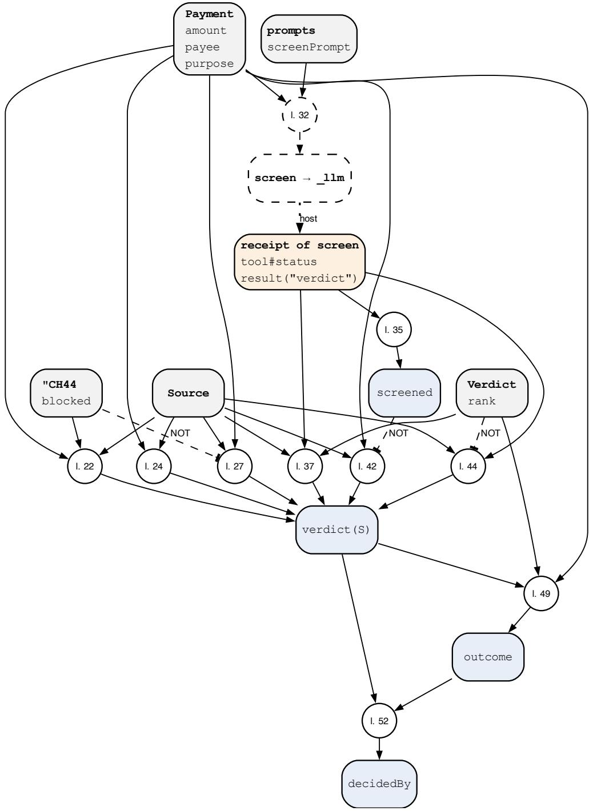  
Fi<sub>g</sub>ure 9: Rule <sub>g</sub>ra<sub>p</sub>h of p13-failsafe.fx, <sub>g</sub>enerated from the <sub>p</sub>ro<sub>g</sub>ram. A circle is one rule; “l. 23” <sub>means</sub> th<sub>a</sub>t th<sub>e</sub> <sub>ru</sub>l<sub>e</sub> <sub>s</sub>t<sub>ar</sub>t<sub>s</sub> i<sub>n</sub> li<sub>ne</sub> 23 <sub>o</sub>f th<sub>e</sub> li<sub>s</sub>ti<sub>ng.</sub> L<sub>egen</sub>d i<sub>n</sub> T<sub>a</sub>bl<sub>e</sub> 9<sub>.</sub>

## 5 Patterns in the reasoning itself

## 5.1 Pattern 8: Model as Hypothesis Generator

## Intent

Let the model <sub>p</sub>ro<sub>p</sub>ose what mi<sub>g</sub>ht be the case (a cause, a missin<sub>g</sub> document, an ex<sub>p</sub>lanation) and let th<sub>e ru</sub>l<sub>es</sub> t<sub>es</sub>t <sub>eac</sub>h <sub>proposa</sub>l i<sub>n a copy o</sub>f th<sub>e sess</sub>i<sub>on an</sub>d <sub>as</sub>k f<sub>or</sub> th<sub>e ev</sub>id<sub>ence</sub> th<sub>a</sub>t d<sub>ec</sub>id<sub>es</sub> b<sub>e</sub>t<sub>ween</sub> th<sub>em.</sub> A h<sub>ypo</sub>th<sub>es</sub>i<sub>s</sub> <sub>never</sub> b<sub>ecomes</sub> <sub>a</sub> f<sub>ac</sub>t<sub>.</sub>

## Also known as

Abd<sub>uc</sub>ti<sub>on</sub> <sub>w</sub>ith <sub>a</sub> <sub>mo</sub>d<sub>e</sub>l<sub>,</sub> di<sub>agnos</sub>i<sub>s,</sub> <sub>can</sub>did<sub>a</sub>t<sub>e</sub> <sub>genera</sub>ti<sub>on</sub> <sub>an</sub>d t<sub>es</sub>t<sub>.</sub>

## Motivation

A b<sub>an</sub>k <sub>reconc</sub>ili<sub>a</sub>ti<sub>on</sub> <sub>s</sub>h<sub>ows</sub> <sub>a</sub> dif<sub>erence</sub> b<sub>e</sub>t<sub>ween</sub> th<sub>e</sub> l<sub>e</sub>d<sub>ger</sub> <sub>an</sub>d th<sub>e</sub> b<sub>an</sub>k <sub>s</sub>t<sub>a</sub>t<sub>emen</sub>t<sub>.</sub> A <sub>mo</sub>d<sub>e</sub>l <sub>sugges</sub>t<sub>s</sub> causes (a fee, a trans<sub>p</sub>osed amount, a <sub>p</sub>a<sub>y</sub>ment booked on the wron<sub>g</sub> da<sub>y</sub>); each is <sub>p</sub>lausible. The rules <sub>can</sub> t<sub>es</sub>t <sub>eac</sub>h<sub>:</sub> <sub>assume</sub>d i<sub>n</sub> <sub>a</sub> <sub>copy,</sub> d<sub>oes</sub> it <sub>exp</sub>l<sub>a</sub>i<sub>n</sub> th<sub>e</sub> dif<sub>erence</sub> <sub>w</sub>ith<sub>ou</sub>t <sub>v</sub>i<sub>o</sub>l<sub>a</sub>ti<sub>ng</sub> <sub>a</sub> <sub>cons</sub>t<sub>ra</sub>i<sub>n</sub>t? Th<sub>e</sub> <sub>surv</sub>i<sub>v</sub>i<sub>ng can</sub>did<sub>a</sub>t<sub>es</sub> b<sub>ecome ques</sub>ti<sub>ons, an</sub>d <sub>on</sub>l<sub>y</sub> th<sub>e answer</sub> d<sub>ec</sub>id<sub>es.</sub>

## Applicability

Use it for diagnosis, reconciliation, investigation and unknown goals, where generating candidates <sub>nee</sub>d<sub>s</sub> <sub>wor</sub>ld k<sub>now</sub>l<sub>e</sub>d<sub>ge</sub> b<sub>u</sub>t t<sub>es</sub>ti<sub>ng</sub> th<sub>em</sub> <sub>nee</sub>d<sub>s</sub> <sub>exac</sub>t<sub>ness.</sub>

## Structure

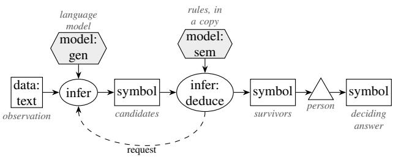

## Participants

Model (proposes candidates marked hypothetical); Rules (test each in a copy, derive evidence questions); Person or a source (answers the deciding question).

## Collaborations

C<sub>an</sub>did<sub>a</sub>t<sub>es arr</sub>i<sub>ve as rece</sub>i<sub>p</sub>t<sub>s.</sub> I<sub>n</sub> th<sub>e</sub> f<sub>u</sub>ll <sub>pa</sub>tt<sub>ern eac</sub>h i<sub>s prev</sub>i<sub>ewe</sub>d i<sub>n a copy o</sub>f th<sub>e sess</sub>i<sub>on; ru</sub>l<sub>es</sub> k<sub>eep</sub> th<sub>ose</sub> th<sub>a</sub>t d<sub>er</sub>i<sub>ve every o</sub>b<sub>serva</sub>ti<sub>on an</sub>d <sub>v</sub>i<sub>o</sub>l<sub>a</sub>t<sub>e no</sub>thi<sub>ng;</sub> th<sub>e ev</sub>id<sub>ence searc</sub>h <sub>names</sub> th<sub>e one</sub> t<sub>o</sub> f<sub>our</sub> <sub>answers</sub> th<sub>a</sub>t <sub>wou</sub>ld d<sub>ec</sub>id<sub>e.</sub>

## Consequences

H<sub>ypo</sub>th<sub>eses are c</sub>h<sub>eap</sub> t<sub>o genera</sub>t<sub>e an</sub>d <sub>never po</sub>ll<sub>u</sub>t<sub>e</sub> th<sub>e</sub> k<sub>now</sub>l<sub>e</sub>d<sub>ge</sub> b<sub>ase.</sub> Th<sub>e searc</sub>h i<sub>s</sub> b<sub>oun</sub>d<sub>e</sub>d<sub>; an</sub> i<sub>ncomp</sub>l<sub>e</sub>t<sub>e</sub> <sub>searc</sub>h i<sub>s</sub> <sub>never</sub> <sub>a</sub> <sub>c</sub>l<sub>a</sub>i<sub>m</sub> th<sub>a</sub>t <sub>no</sub> <sub>exp</sub>l<sub>ana</sub>ti<sub>on</sub> <sub>ex</sub>i<sub>s</sub>t<sub>s.</sub>

## Implementation

A<sub>s</sub>k th<sub>e mo</sub>d<sub>e</sub>l f<sub>or can</sub>did<sub>a</sub>t<sub>es as rows,</sub> k<sub>eep eac</sub>h <sub>as a</sub> h<sub>ypo</sub>th<sub>es</sub>i<sub>s</sub> k<sub>eye</sub>d b<sub>y</sub> it<sub>s row num</sub>b<sub>er, re</sub>f<sub>u</sub>t<sub>e</sub> it b<sub>y</sub> <sub>ru</sub>l<sub>e, an</sub>d <sub>as</sub>k <sub>a</sub>b<sub>ou</sub>t th<sub>e surv</sub>i<sub>vors on</sub>l<sub>y; a re</sub>f<sub>u</sub>t<sub>e</sub>d <sub>can</sub>did<sub>a</sub>t<sub>e never</sub> b<sub>ecomes a</sub> f<sub>ac</sub>t<sub>.</sub> Th<sub>e ques</sub>ti<sub>on</sub> it<sub>se</sub>lf <sub>g</sub>oes to a <sub>p</sub>erson throu<sub>g</sub>h a flow (Section 4.2). From the bank reconciliation:

```prolog
// Pattern 8, Model as Hypothesis Generator: the model proposes causes, the rules test
// each against what is known and ask about the survivors.
world open.
4 closed method refuted/1.
5
6 // The observation to explain: ledger and bank differ by 40 francs.
7 recon[difference -> 40:
8 ledger -> "Ledger balance 12 340.00 CHF on 30 September; bank statement 12 300.00 CHF.
Account fee 40.00 CHF charged monthly. Payment of 90.00 CHF to Muster AG booked
on 30 September."].
9
10 proposePrompt:Prompt[text -> "List possible causes of the difference between ledger and
bank statement. Answer as JSON {\"rows\": [{\"entry\": ..., \"amount\": a number}]}."
].
11
12 // A request without arguments: the request object is propose itself.
13 external propose using _llm with proposePrompt[difference -> ?D; ledger -> ?L]
14 <- recon[difference -> ?D; ledger -> ?L].
15
16 // Each row is a candidate cause, never a fact.
17 recon[cause(?I) -> ?E; amount(?I) -> ?A]
18 <- propose[tool#status -> "succeeded"; row(?I, "entry") -> ?E;
19 row(?I, "amount") -> ?A].
20
21 // Test: a cause whose amount differs from the difference cannot explain it.
22 recon[refuted(?I) -> true]
23 <- recon[amount(?I) -> ?A; difference -> ?D] AND ?A != ?D.
24
25 recon[survives(?I) -> true]
26 <- recon[cause(?I) -> ?E] AND NOT recon[refuted(?I) -> true].
27
28 // Ask: every surviving cause becomes a question for a person.
29 recon[askAbout(?I) -> ?E] <- recon[survives(?I) -> true; cause(?I) -> ?E].
30
31 ?- recon[askAbout(?I) -> ?E].
32 ?- recon[refuted(?I) -> true].
```

Fi<sub>gure</sub> 10 d<sub>raws</sub> th<sub>e</sub> <sub>program</sub> <sub>as</sub> <sub>a</sub> <sub>ru</sub>l<sub>e</sub> <sub>grap</sub>h<sub>.</sub> Thi<sub>s</sub> <sub>program</sub> t<sub>es</sub>t<sub>s</sub> <sub>every</sub> <sub>can</sub>did<sub>a</sub>t<sub>e</sub> <sub>w</sub>ith <sub>one</sub> <sub>ru</sub>l<sub>e,</sub> it<sub>s</sub> amount. A fuller test assumes each candidate in a co<sub>py</sub> of the session (preview) and kee<sub>p</sub>s it onl<sub>y</sub> if it derives the observation without violatin<sub>g</sub> a constraint, and the evidence search (\_evidence\_needs) <sub>names</sub> th<sub>e answers</sub> th<sub>a</sub>t <sub>wou</sub>ld d<sub>ec</sub>id<sub>e.</sub> Th<sub>e recor</sub>d<sub>e</sub>d <sub>run s</sub>h<sub>ows w</sub>h<sub>y</sub> th<sub>e</sub> t<sub>es</sub>t <sub>s</sub>h<sub>ou</sub>ld b<sub>e as s</sub>t<sub>rong as</sub> th<sub>e</sub> d<sub>oma</sub>i<sub>n a</sub>ll<sub>ows:</sub> f<sub>our o</sub>f fi<sub>ve can</sub>did<sub>a</sub>t<sub>es passe</sub>d th<sub>e amoun</sub>t t<sub>es</sub>t<sub>, among</sub> th<sub>em an</sub> “<sub>unrecor</sub>d<sub>e</sub>d d<sub>epos</sub>it” <sub>w</sub>h<sub>ose</sub> di<sub>rec</sub>ti<sub>on con</sub>t<sub>ra</sub>di<sub>c</sub>t<sub>s</sub> th<sub>e</sub> l<sub>e</sub>d<sub>ger.</sub>

## Library form

With hypothesis.fx (Section B) the <sub>p</sub>ro<sub>g</sub>ram states the observation, names the row field that a <sub>p</sub>erson is asked about (hy#label) and kee<sub>p</sub>s its tests (hy#refuted). The librar<sub>y</sub> kee<sub>p</sub>s ever<sub>y</sub> field of ever<sub>y</sub> row as hy#candidate(?I, field). It sends the observation as one text, so the model sees a dif<sub>eren</sub>t <sub>reques</sub>t th<sub>an</sub> i<sub>n</sub> th<sub>e</sub> <sub>program</sub> <sub>a</sub>b<sub>ove:</sub>

// Pattern 8 in library form: load hypothesis.fx first.   
2 world open.   
3   
4 proposePrompt:Prompt[text -> "List possible causes of the difference between ledger and   
bank statement. Answer as JSON {\"rows\": [{\"entry\": ..., \"amount\": a number}]}."   
].   
5   
6 recon:hy#Observation[hy#prompt -> proposePrompt; hy#label -> "entry"; difference -> 40;   
7 hy#text -> "Ledger balance 12 340.00 CHF on 30 September; bank statement 12 300.00 CHF   
. Account fee 40.00 CHF charged monthly. Payment of 90.00 CHF to Muster AG booked   
on 30 September."].

8   
9 // The test stays with the program: a cause whose amount differs cannot explain the   
difference.   
10 recon[hy#refuted(?I) -> true]   
11 <- recon[hy#candidate(?I, "amount") -> ?A; difference -> ?D] AND ?A != ?D.   
12   
13 ?- recon[hy#askAbout(?I) -> ?E].

## Known uses

B<sub>an</sub>k <sub>reconc</sub>ili<sub>a</sub>ti<sub>on w</sub>ith <sub>mo</sub>d<sub>e</sub>l<sub>-propose</sub>d <sub>causes;</sub> th<sub>e ev</sub>id<sub>ence-nee</sub>d<sub>s searc</sub>h <sub>over</sub> d<sub>ec</sub>l<sub>are</sub>d <sub>open ques-</sub> tions; the candidate checker’s facts mode. In the literature: few-shot abduction tested a<sub>g</sub>ainst retrieved events (Shi et al. 2023); h<sub>yp</sub>otheses im<sub>p</sub>lemented as <sub>p</sub>ro<sub>g</sub>rams and verified on exam<sub>p</sub>les (Wan<sub>g</sub> et al. 2024). Neither asks for the evidence that decides between survivin<sub>g</sub> candidates.

## Related patterns

Critique and Re<sub>p</sub>air (Section 4.3): a re<sub>p</sub>air su<sub>gg</sub>estion is a h<sub>yp</sub>othesis that is a correction. Rules Steer the Model (Section 4.2) asks the decidin<sub>g</sub> question.

## Evidence

O<sub>ne</sub> d<sub>emons</sub>t<sub>ra</sub>ti<sub>on</sub> <sub>run;</sub> <sub>no</sub> <sub>measuremen</sub>t <sub>ye</sub>t<sub>.</sub> Th<sub>e</sub> b<sub>an</sub>k <sub>reconc</sub>ili<sub>a</sub>ti<sub>on</sub> <sub>o</sub>f T<sub>a</sub>bl<sub>e</sub> 5 <sub>runs</sub> th<sub>e</sub> <sub>pa</sub>tt<sub>ern.</sub>

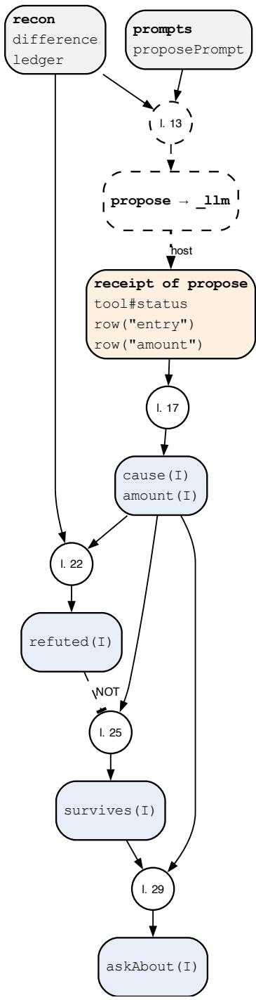  
Fi<sub>g</sub>ure 10: Rule <sub>g</sub>ra<sub>p</sub>h of p08-hypothesis.fx, <sub>g</sub>enerated from the <sub>p</sub>ro<sub>g</sub>ram. A circle is one rule; “l. 23” <sub>means</sub> th<sub>a</sub>t th<sub>e ru</sub>l<sub>e s</sub>t<sub>ar</sub>t<sub>s</sub> i<sub>n</sub> li<sub>ne</sub> 23 <sub>o</sub>f th<sub>e</sub> li<sub>s</sub>ti<sub>ng.</sub> L<sub>egen</sub>d i<sub>n</sub> T<sub>a</sub>bl<sub>e</sub> 9<sub>.</sub>

## 5.2 Pattern 9: Model as Critic of the Rules

## Intent

Let the model review what the rules hold or conclude (a <sub>p</sub>olic<sub>y</sub> chan<sub>g</sub>e, a rule a<sub>g</sub>ainst its source text, a sur<sub>p</sub>risin<sub>g</sub> decision); its critique o<sub>p</sub>ens a review and never chan<sub>g</sub>es a rule or a conclusion.

## Also known as

P<sub>o</sub>li<sub>cy</sub> <sub>cr</sub>iti<sub>c,</sub> <sub>p</sub>l<sub>aus</sub>ibilit<sub>y</sub> <sub>rev</sub>i<sub>ew,</sub> t<sub>wo-c</sub>h<sub>anne</sub>l <sub>cross-c</sub>h<sub>ec</sub>k<sub>.</sub>

## Motivation

A <sub>po</sub>li<sub>cy</sub> <sub>c</sub>h<sub>ange</sub> <sub>passes</sub> <sub>every</sub> <sub>regress</sub>i<sub>on</sub> <sub>case</sub> <sub>an</sub>d <sub>s</sub>till <sub>c</sub>h<sub>anges</sub> th<sub>e</sub> d<sub>ec</sub>i<sub>s</sub>i<sub>on</sub> f<sub>or</sub> <sub>a</sub> <sub>case</sub> <sub>no</sub>b<sub>o</sub>d<sub>y</sub> <sub>expec</sub>t<sub>e</sub>d<sub>.</sub> Th<sub>e</sub> <sub>c</sub>h<sub>ange</sub>’<sub>s</sub> <sub>au</sub>th<sub>or</sub> <sub>wro</sub>t<sub>e</sub> <sub>a</sub> <sub>ra</sub>ti<sub>ona</sub>l<sub>e;</sub> <sub>a</sub> <sub>mo</sub>d<sub>e</sub>l <sub>can</sub> <sub>rea</sub>d th<sub>e</sub> <sub>c</sub>h<sub>ange</sub>d d<sub>ec</sub>i<sub>s</sub>i<sub>ons</sub> <sub>aga</sub>i<sub>ns</sub>t it <sub>an</sub>d fl<sub>ag</sub> <sub>w</sub>h<sub>a</sub>t l<sub>oo</sub>k<sub>s</sub> i<sub>ncons</sub>i<sub>s</sub>t<sub>en</sub>t<sub>.</sub> It<sub>s remar</sub>k<sub>s may</sub> b<sub>e wrong, so</sub> th<sub>ey open a rev</sub>i<sub>ew</sub> th<sub>a</sub>t <sub>a person</sub> di<sub>sposes o</sub>f<sub>.</sub>

## Applicability

U<sub>se</sub> it <sub>w</sub>h<sub>ere c</sub>h<sub>ec</sub>k<sub>s are</sub> i<sub>ncomp</sub>l<sub>e</sub>t<sub>e: seman</sub>ti<sub>c</sub> f<sub>au</sub>lt<sub>s,</sub> fid<sub>e</sub>lit<sub>y o</sub>f <sub>a ru</sub>l<sub>e</sub> t<sub>o</sub> th<sub>e</sub> t<sub>ex</sub>t it <sub>c</sub>it<sub>es, p</sub>l<sub>aus</sub>ibilit<sub>y</sub> <sub>o</sub>f <sub>c</sub>h<sub>ange</sub>d d<sub>ec</sub>i<sub>s</sub>i<sub>ons</sub> b<sub>e</sub>f<sub>ore a re</sub>l<sub>ease.</sub>

## Structure

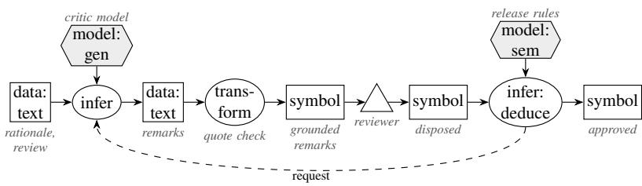

## Participants

Model (critic); Rules (keep a remark only if it names a case and quotes the rationale verbatim; flag declared invariants without a model; gate approval); Reviewer (disposes of every finding).

## Collaborations

A <sub>sea</sub>l<sub>e</sub>d b<sub>e</sub>f<sub>ore-an</sub>d<sub>-a</sub>ft<sub>er</sub> <sub>rev</sub>i<sub>ew</sub> <sub>o</sub>f th<sub>e</sub> <sub>po</sub>li<sub>cy</sub> i<sub>s</sub> th<sub>e</sub> <sub>cr</sub>iti<sub>c</sub>’<sub>s</sub> i<sub>npu</sub>t<sub>;</sub> <sub>groun</sub>d<sub>e</sub>d <sub>remar</sub>k<sub>s</sub> b<sub>ecome</sub> fi<sub>n</sub>di<sub>ngs;</sub> <sub>approva</sub>l i<sub>s</sub> d<sub>er</sub>i<sub>ve</sub>d <sub>on</sub>l<sub>y</sub> <sub>a</sub>ft<sub>er</sub> <sub>every</sub> fi<sub>n</sub>di<sub>ng</sub> i<sub>s</sub> di<sub>spose</sub>d <sub>o</sub>f<sub>.</sub> A <sub>correc</sub>t<sub>e</sub>d <sub>ru</sub>l<sub>e</sub> <sub>propose</sub>d b<sub>y</sub> th<sub>e</sub> <sub>cr</sub>iti<sub>c</sub> i<sub>s</sub> <sub>c</sub>h<sub>ec</sub>k<sub>e</sub>d lik<sub>e</sub> <sub>any</sub> d<sub>ra</sub>ft<sub>.</sub>

## Consequences

Th<sub>e cr</sub>iti<sub>c a</sub>dd<sub>s reca</sub>ll <sub>w</sub>h<sub>ere c</sub>h<sub>ec</sub>k<sub>s are</sub> i<sub>ncomp</sub>l<sub>e</sub>t<sub>e;</sub> it<sub>s</sub> f<sub>a</sub>l<sub>se remar</sub>k<sub>s cos</sub>t <sub>rev</sub>i<sub>ewer</sub> ti<sub>me, so groun</sub>di<sub>ng</sub> <sub>requ</sub>i<sub>remen</sub>t<sub>s</sub> filt<sub>er</sub> th<sub>em.</sub> It <sub>never wea</sub>k<sub>ens a comp</sub>l<sub>e</sub>t<sub>e c</sub>h<sub>ec</sub>k<sub>.</sub>

## Implementation

Th<sub>e mo</sub>d<sub>e</sub>l <sub>rece</sub>i<sub>ves</sub> th<sub>e ra</sub>ti<sub>ona</sub>l<sub>e an</sub>d th<sub>e sea</sub>l<sub>e</sub>d <sub>rev</sub>i<sub>ew an</sub>d <sub>answers w</sub>ith <sub>rows, as</sub> i<sub>n</sub> th<sub>e</sub> S<sub>ensor, w</sub>ith the rationale as groundIn, the text its <sub>q</sub>uotes must come from. A remark counts onl<sub>y</sub> if its <sub>q</sub>uote was f<sub>oun</sub>d <sub>an</sub>d it <sub>names</sub> <sub>a</sub> <sub>c</sub>h<sub>ange</sub>d d<sub>ec</sub>i<sub>s</sub>i<sub>on.</sub> A<sub>pprova</sub>l <sub>nee</sub>d<sub>s</sub> <sub>a</sub> <sub>comp</sub>l<sub>e</sub>t<sub>e</sub>d <sub>cr</sub>iti<sub>que</sub> <sub>an</sub>d <sub>a</sub> di<sub>sposa</sub>l <sub>o</sub>f <sub>every</sub> <sub>remar</sub>k<sub>; a</sub> f<sub>a</sub>il<sub>e</sub>d <sub>ca</sub>ll bl<sub>oc</sub>k<sub>s</sub> it <sub>w</sub>ith th<sub>e</sub> h<sub>os</sub>t’<sub>s reason:</sub>

```javascript
1 // Pattern 9, Model as Critic of the Rules: grounded remarks open a review; approval
2 // needs a completed critique and a reviewer's disposal of every remark.
3 world open.
4 closed class ChangedDecision. closed method disposed/1. closed slot hasOpen.
5 closed slot critiqued.
6
7 // A rule change with its rationale and the decisions it changes.
8 "c7":ChangedDecision. "c9":ChangedDecision.
9 chg:Change[reviewed -> true;
```

10 rationale -> "The amendment lowers the language requirement for applicants with a   
Bachelor taught in English. Applicants with other degrees keep the C1 requirement.   
";   
11 review -> "c7: Bachelor taught in German, no C1; before not admitted, after admitted.   
c9: Bachelor taught in English, no C1; before not admitted, after admitted."].   
12   
13 critiquePrompt:Prompt[text -> "Read the changed decisions against the rationale. Report   
one row {case, quote, remark} per decision that contradicts the rationale; quote the   
rationale verbatim. Answer as JSON {\"rows\": [...]}."].   
14   
15 // The quote of every remark must occur in the rationale.   
16 external critique(?C) using \_llm with critiquePrompt[rationale -> ?Ra;   
17 review -> ?Rv; groundIn -> ?Ra]   
18 <- ?C:Change[rationale -> ?Ra; review -> ?Rv].   
19   
20 // A remark counts only with a found quote and a case that the change really changed.   
21 ?C[remark(?I) -> ?K]   
22 <- ?R[tool#name -> "\_llm"; tool#arg1 -> ?C; row(?I, "case") -> ?K;   
23 row(?I, "quoteFound") -> true] AND ?K:ChangedDecision.   
24   
25 ?C[critiqued -> true]   
26 <- ?R[tool#name -> "\_llm"; tool#arg1 -> ?C; tool#status -> "succeeded"].   
27   
28 ?C[blocked -> ?E]   
29 <- ?R[tool#name -> "\_llm"; tool#arg1 -> ?C; tool#status -> "failed"; error -> ?E].   
30   
31 // A reviewer disposes of a remark by stating chg[disposed(1) -> true].   
32 ?C[hasOpen -> true] <- ?C[remark(?I) -> ?K] AND NOT ?C[disposed(?I) -> true].   
33   
34 ?C[approved -> true]   
35 <- ?C:Change[reviewed -> true; critiqued -> true] AND NOT ?C[hasOpen -> true].   
36   
37 ?- chg[remark(?I) -> ?K].   
38 ?- chg[approved -> ?A].

Fi<sub>gure</sub> 11 d<sub>raws</sub> th<sub>e</sub> <sub>program</sub> <sub>as</sub> <sub>a</sub> <sub>ru</sub>l<sub>e</sub> <sub>grap</sub>h<sub>.</sub>

## Library form

With critic.fx (Section B) the <sub>p</sub>ro<sub>g</sub>ram states the chan<sub>g</sub>e, its rationale, the review and the cases it chan<sub>g</sub>ed; a reviewer’s dis<sub>p</sub>osal is the fact chg[cr#disposed(1) -> true]:

```prolog
// Pattern 9 in library form: load critic.fx first.
2 world open.
3
4 critiquePrompt:Prompt[text -> "Read the changed decisions against the rationale. Report
one row {case, quote, remark} per decision that contradicts the rationale; quote the
rationale verbatim. Answer as JSON {\"rows\": [...]}."].
5
6 chg:cr#Change[cr#reviewed -> true; cr#prompt -> critiquePrompt;
7 cr#changed -> "c7"; cr#changed -> "c9";
8 cr#rationale -> "The amendment lowers the language requirement for applicants with a
Bachelor taught in English. Applicants with other degrees keep the C1 requirement.
";
9 cr#review -> "c7: Bachelor taught in German, no C1; before not admitted, after
admitted. c9: Bachelor taught in English, no C1; before not admitted, after
admitted."].
10
11 ?- chg[cr#remark(?I) -> ?K].
12 ?- chg[cr#approved -> ?A].
```

## Known uses

Th<sub>e po</sub>li<sub>cy cr</sub>iti<sub>c</sub> i<sub>n a un</sub>i<sub>vers</sub>it<sub>y a</sub>d<sub>m</sub>i<sub>n</sub>i<sub>s</sub>t<sub>ra</sub>ti<sub>on case w</sub>ith <sub>see</sub>d<sub>e</sub>d d<sub>e</sub>f<sub>ec</sub>t<sub>s.</sub> I<sub>n</sub> th<sub>e</sub> lit<sub>era</sub>t<sub>ure: so</sub>ft <sub>cr</sub>iti<sub>cs</sub> in LLM-Modulo (Kambham<sub>p</sub>ati et al. 2024) and cross-reflection (Liu et al. 2025) jud<sub>g</sub>e a candidate; <sub>we</sub> f<sub>oun</sub>d <sub>no ca</sub>t<sub>a</sub>l<sub>ogue</sub> i<sub>n w</sub>hi<sub>c</sub>h th<sub>e mo</sub>d<sub>e</sub>l <sub>rev</sub>i<sub>ews</sub> th<sub>e ru</sub>l<sub>es</sub> th<sub>emse</sub>l<sub>ves.</sub>

## Related patterns

Reverse of Critique and Re<sub>p</sub>air (Section 4.3); in<sub>p</sub>ut to Model as Author (Section 3.2) when it <sub>p</sub>ro<sub>p</sub>oses <sub>a correc</sub>ti<sub>on.</sub>

## Evidence

In a <sub>p</sub>ilot stud<sub>y</sub> with gpt-oss:20b, 20 chan<sub>g</sub>es over 10 rule domains were each reviewed three times. I<sub>n</sub> th<sub>e</sub> 10 <sub>c</sub>h<sub>anges w</sub>ith <sub>one see</sub>d<sub>e</sub>d d<sub>ec</sub>i<sub>s</sub>i<sub>on</sub> th<sub>a</sub>t <sub>con</sub>t<sub>ra</sub>di<sub>c</sub>t<sub>s</sub> th<sub>e ra</sub>ti<sub>ona</sub>l<sub>e,</sub> th<sub>e cr</sub>iti<sub>c</sub> f<sub>oun</sub>d it i<sub>n</sub> 29 <sub>o</sub>f 30 <sub>rev</sub>i<sub>ews;</sub> i<sub>n</sub> th<sub>e</sub> 10 <sub>c</sub>l<sub>ean c</sub>h<sub>anges</sub> it <sub>ma</sub>d<sub>e no remar</sub>k i<sub>n</sub> 29 <sub>o</sub>f 30<sub>.</sub> All 34 <sub>o</sub>f it<sub>s remar</sub>k<sub>s quo</sub>t<sub>e</sub>d th<sub>e</sub> <sub>ra</sub>ti<sub>ona</sub>l<sub>e ver</sub>b<sub>a</sub>ti<sub>m, so</sub> th<sub>e quo</sub>t<sub>e c</sub>h<sub>ec</sub>k <sub>remove</sub>d <sub>no</sub>thi<sub>ng.</sub> Th<sub>e c</sub>h<sub>anges were s</sub>h<sub>or</sub>t <sub>an</sub>d <sub>eac</sub>h d<sub>e</sub>f<sub>ec</sub>t <sub>was</sub> <sub>s</sub>t<sub>a</sub>t<sub>e</sub>d <sub>p</sub>l<sub>a</sub>i<sub>n</sub>l<sub>y;</sub> h<sub>ar</sub>d<sub>er</sub> d<sub>e</sub>f<sub>ec</sub>t<sub>s an</sub>d l<sub>onger rev</sub>i<sub>ews are no</sub>t <sub>ye</sub>t <sub>measure</sub>d<sub>.</sub> I<sub>n</sub> th<sub>e c</sub>h<sub>ec</sub>ki<sub>ng s</sub>t<sub>u</sub>d<sub>y, mo</sub>d<sub>e</sub>l <sub>rev</sub>i<sub>ews</sub> f<sub>oun</sub>d <sub>con</sub>t<sub>ra</sub>di<sub>c</sub>t<sub>ory</sub> <sub>ru</sub>l<sub>es</sub> <sub>an</sub>d <sub>un</sub>k<sub>nown</sub> f<sub>ac</sub>t<sub>s</sub> <sub>a</sub>l<sub>mos</sub>t <sub>a</sub>l<sub>ways,</sub> b<sub>u</sub>t <sub>a</sub> <sub>m</sub>i<sub>ss</sub>i<sub>ng</sub> <sub>ru</sub>l<sub>e</sub> i<sub>n</sub> <sub>on</sub>l<sub>y</sub> 3 <sub>o</sub>f 10 <sub>ru</sub>l<sub>e rev</sub>i<sub>ews a</sub>t 64 <sub>ru</sub>l<sub>es an</sub>d i<sub>n none o</sub>f th<sub>e co</sub>d<sub>e or promp</sub>t <sub>rev</sub>i<sub>ews, so a cr</sub>iti<sub>c</sub> b<sub>e</sub>l<sub>ongs on</sub> t<sub>op o</sub>f th<sub>e</sub> <sub>c</sub>h<sub>ec</sub>k<sub>s.</sub>

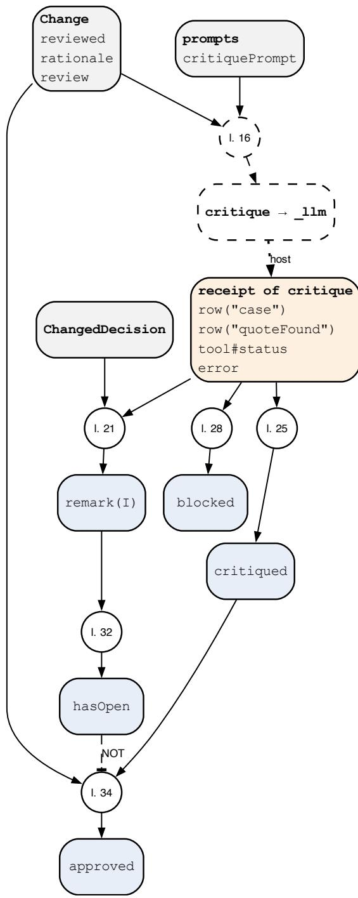  
Fi<sub>g</sub>ure 11: Rule <sub>g</sub>ra<sub>p</sub>h of p09-critic.fx, <sub>g</sub>enerated from the <sub>p</sub>ro<sub>g</sub>ram. A circle is one rule; “l. 23” <sub>means</sub> th<sub>a</sub>t th<sub>e ru</sub>l<sub>e s</sub>t<sub>ar</sub>t<sub>s</sub> i<sub>n</sub> li<sub>ne</sub> 23 <sub>o</sub>f th<sub>e</sub> li<sub>s</sub>ti<sub>ng.</sub> L<sub>egen</sub>d i<sub>n</sub> T<sub>a</sub>bl<sub>e</sub> 9<sub>.</sub>

## 5.3 Pattern 10: Rules Teach the Model

## Intent

L<sub>e</sub>t th<sub>e</sub> <sub>ru</sub>l<sub>es</sub> <sub>supp</sub>l<sub>y</sub> l<sub>a</sub>b<sub>e</sub>l<sub>s,</sub> <sub>ru</sub>l<sub>e-se</sub>l<sub>ec</sub>t<sub>e</sub>d <sub>wor</sub>k<sub>e</sub>d <sub>examp</sub>l<sub>es</sub> <sub>an</sub>d <sub>gra</sub>d<sub>es,</sub> <sub>w</sub>ith <sub>proo</sub>f<sub>s,</sub> <sub>so</sub> th<sub>a</sub>t k<sub>now</sub>l<sub>e</sub>d<sub>ge</sub> fl<sub>ows</sub> i<sub>n</sub>t<sub>o</sub> th<sub>e mo</sub>d<sub>e</sub>l’<sub>s con</sub>t<sub>ex</sub>t <sub>or we</sub>i<sub>g</sub>ht<sub>s;</sub> th<sub>e ru</sub>l<sub>es s</sub>t<sub>ay</sub> i<sub>n pro</sub>d<sub>uc</sub>ti<sub>on as</sub> th<sub>e</sub> i<sub>n</sub>d<sub>epen</sub>d<sub>en</sub>t <sub>c</sub>h<sub>ec</sub>k<sub>.</sub>

## Also known as

R<sub>u</sub>l<sub>es</sub> <sub>as</sub> l<sub>a</sub>b<sub>e</sub>l<sub>s</sub> <sub>an</sub>d <sub>gra</sub>d<sub>ers,</sub> <sub>ru</sub>l<sub>e-se</sub>l<sub>ec</sub>t<sub>e</sub>d <sub>examp</sub>l<sub>es,</sub> <sub>ru</sub>l<sub>e-</sub>i<sub>n</sub>f<sub>orme</sub>d <sub>pre</sub>f<sub>erence</sub> d<sub>a</sub>t<sub>a.</sub>

## Motivation

A <sub>mo</sub>d<sub>e</sub>l th<sub>a</sub>t <sub>mus</sub>t <sub>answer</sub> <sub>a</sub>d<sub>m</sub>i<sub>ss</sub>i<sub>on</sub> <sub>ques</sub>ti<sub>ons</sub> <sub>can</sub> b<sub>e</sub> <sub>s</sub>h<sub>own</sub> <sub>wor</sub>k<sub>e</sub>d <sub>cases.</sub> Whi<sub>c</sub>h <sub>cases,</sub> <sub>an</sub>d <sub>w</sub>h<sub>e</sub>th<sub>er</sub> it<sub>s</sub> <sub>answers</sub> <sub>are</sub> <sub>r</sub>i<sub>g</sub>ht<sub>,</sub> th<sub>e</sub> <sub>ru</sub>l<sub>es</sub> k<sub>now:</sub> th<sub>ey</sub> l<sub>a</sub>b<sub>e</sub>l <sub>genera</sub>t<sub>e</sub>d <sub>cases</sub> <sub>w</sub>ith d<sub>ec</sub>i<sub>s</sub>i<sub>ons</sub> <sub>an</sub>d <sub>proo</sub>f<sub>s,</sub> <sub>se</sub>l<sub>ec</sub>t th<sub>e</sub> <sub>examp</sub>l<sub>es c</sub>l<sub>oses</sub>t t<sub>o</sub> th<sub>e curren</sub>t <sub>case, an</sub>d <sub>gra</sub>d<sub>e</sub> th<sub>e answers.</sub>

## Applicability

Use it when a model must work where the rules are not called (a fast <sub>p</sub>ath, an ed<sub>g</sub>e device) or must l<sub>earn</sub> th<sub>e voca</sub>b<sub>u</sub>l<sub>ary o</sub>f <sub>a</sub> d<sub>oma</sub>i<sub>n, an</sub>d <sub>w</sub>h<sub>en</sub> t<sub>ra</sub>i<sub>n</sub>i<sub>ng or promp</sub>t <sub>examp</sub>l<sub>es nee</sub>d t<sub>rus</sub>t<sub>wor</sub>th<sub>y</sub> l<sub>a</sub>b<sub>e</sub>l<sub>s.</sub>

## Structure

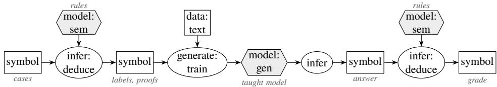

## Participants

Rules (label, select, grade); Model; Trainer outside the rule engine.

## Collaborations

Th<sub>e ru</sub>l<sub>es</sub> l<sub>a</sub>b<sub>e</sub>l <sub>every genera</sub>t<sub>e</sub>d <sub>case w</sub>ith it<sub>s</sub> d<sub>ec</sub>i<sub>s</sub>i<sub>on an</sub>d th<sub>e m</sub>i<sub>ss</sub>i<sub>ng requ</sub>i<sub>remen</sub>t<sub>s;</sub> th<sub>e mo</sub>d<sub>e</sub>l <sub>answers</sub> <sub>eac</sub>h <sub>case;</sub> <sub>a</sub> <sub>ru</sub>l<sub>e</sub> <sub>gra</sub>d<sub>es</sub> th<sub>e</sub> <sub>answer</sub> <sub>aga</sub>i<sub>ns</sub>t th<sub>e</sub> l<sub>a</sub>b<sub>e</sub>l <sub>an</sub>d <sub>recor</sub>d<sub>s</sub> <sub>eac</sub>h <sub>gap</sub> th<sub>e</sub> <sub>answer</sub> <sub>m</sub>i<sub>sse</sub>d<sub>.</sub> L<sub>a</sub>b<sub>e</sub>l<sub>s</sub> <sub>an</sub>d <sub>gra</sub>d<sub>es,</sub> <sub>w</sub>ith th<sub>e</sub>i<sub>r</sub> <sub>proo</sub>f<sub>s,</sub> l<sub>eave</sub> th<sub>e</sub> <sub>eng</sub>i<sub>ne</sub> <sub>as</sub> t<sub>ra</sub>i<sub>n</sub>i<sub>ng</sub> <sub>or</sub> <sub>eva</sub>l<sub>ua</sub>ti<sub>on</sub> d<sub>a</sub>t<sub>a,</sub> <sub>an</sub>d <sub>a</sub>ft<sub>er</sub> t<sub>ra</sub>i<sub>n</sub>i<sub>ng</sub> th<sub>e</sub> <sub>same ru</sub>l<sub>es gra</sub>d<sub>e</sub> th<sub>e</sub> t<sub>aug</sub>ht <sub>mo</sub>d<sub>e</sub>l<sub>.</sub>

## Consequences

Th<sub>e</sub> l<sub>a</sub>b<sub>e</sub>l<sub>s</sub> <sub>are</sub> <sub>as</sub> <sub>goo</sub>d <sub>as</sub> th<sub>e</sub> <sub>ru</sub>l<sub>es</sub> <sub>an</sub>d <sub>come</sub> <sub>w</sub>ith <sub>proo</sub>f<sub>s;</sub> <sub>w</sub>h<sub>a</sub>t th<sub>e</sub> <sub>mo</sub>d<sub>e</sub>l l<sub>earne</sub>d i<sub>s</sub> <sub>never</sub> th<sub>e</sub> <sub>au</sub>th<sub>or</sub>it<sub>y.</sub>

## Implementation

G<sub>ra</sub>d<sub>e</sub> <sub>a</sub> <sub>mo</sub>d<sub>e</sub>l’<sub>s</sub> <sub>answer</sub> <sub>aga</sub>i<sub>ns</sub>t th<sub>e</sub> <sub>ru</sub>l<sub>es</sub>’ d<sub>ec</sub>i<sub>s</sub>i<sub>on</sub> <sub>on</sub> <sub>genera</sub>t<sub>e</sub>d <sub>cases</sub> <sub>w</sub>ith <sub>comp</sub>l<sub>e</sub>t<sub>e</sub> <sub>ev</sub>id<sub>ence,</sub> <sub>an</sub>d <sub>recor</sub>d <sub>eac</sub>h <sub>gap</sub> th<sub>e answer m</sub>i<sub>sse</sub>d<sub>.</sub> Th<sub>e mo</sub>d<sub>e</sub>l <sub>answers eac</sub>h <sub>case;</sub> it<sub>s rece</sub>i<sub>p</sub>t b<sub>ecomes</sub> th<sub>e answer</sub> th<sub>a</sub>t th<sub>e ru</sub>l<sub>es gra</sub>d<sub>e:</sub>

// Pattern 10, Rules Teach the Model: the rules label the cases and grade the model's   
2 // answers. Labels and grades can become training data; training happens outside.   
3 world open.   
4 closed class Admitted. closed slot named.   
5 closed slot hasBachelor. closed slot hasC1.   
6   
7 // Two cases: the rules read the structured fields, the model reads the description.   
8 k1:Case[hasBachelor -> true; hasC1 -> true;   
9 description -> "Recognised Bachelor; English C1 certificate on file."].   
10 k2:Case[hasBachelor -> true;   
11 description -> "Recognised Bachelor; no language record."].   
12   
13 // The rules label each case: its decision and every missing requirement.   
14 ?C:Admitted <- ?C:Case[hasBachelor -> true; hasC1 -> true].

15 ?C[gap -> "englishC1"] <- ?C:Case AND NOT ?C[hasC1 -> true].   
16 ?C[gap -> "bachelor"] <- ?C:Case AND NOT ?C[hasBachelor -> true].   
17   
18 answerPrompt:Prompt[text -> "Requirements: a recognised Bachelor and English C1. Is the   
applicant admitted? Answer as JSON {\"decision\": admitted or not admitted, \"rows\":   
[{\"gap\": englishC1 or bachelor}] per missing requirement}."].   
19   
20 // The request field is called description, because the rules below derive a slot case.   
21 external answer(?C) using \_llm with answerPrompt[description -> ?T]   
22 <- ?C:Case[description -> ?T].   
23   
24 ?R:Answer[case -> ?C; decision -> ?D]   
25 <- ?R[tool#name -> "\_llm"; tool#arg1 -> ?C; result("decision") -> ?D].   
26   
27 ?R[named -> ?G] <- ?R:Answer AND ?R[row(?I, "gap") -> ?G].   
28   
29 // Grade: right decision, and every gap named.   
30 ?A[right -> true] <- ?A:Answer[case -> ?C; decision -> "admitted"] AND ?C:Admitted.   
31   
32 ?A[right -> true]   
33 <- ?A:Answer[case -> ?C; decision -> "not admitted"] AND NOT ?C:Admitted.   
34   
35 ?A[missedGap -> ?G]   
36 <- ?A:Answer[case -> ?C] AND ?C[gap -> ?G] AND NOT ?A[named -> ?G].   
37   
38 ?- ?A:Answer[case -> ?C; decision -> ?D; right -> ?R].   
39 ?- ?A[missedGap -> ?G].

Fi<sub>gure</sub> 12 d<sub>raws</sub> th<sub>e</sub> <sub>program</sub> <sub>as</sub> <sub>a</sub> <sub>ru</sub>l<sub>e</sub> <sub>grap</sub>h<sub>.</sub> Th<sub>e</sub> t<sub>ra</sub>i<sub>n</sub>i<sub>ng</sub> <sub>s</sub>t<sub>ep</sub> <sub>o</sub>f th<sub>e</sub> St<sub>ruc</sub>t<sub>ure</sub> di<sub>agram</sub> h<sub>appens</sub> <sub>ou</sub>t<sub>s</sub>id<sub>e</sub> th<sub>e eng</sub>i<sub>ne an</sub>d i<sub>s no</sub>t <sub>par</sub>t <sub>o</sub>f th<sub>e program.</sub>

## Library form

With teach.fx (Section B) the <sub>p</sub>ro<sub>g</sub>ram states the cases and kee<sub>p</sub>s its labellin<sub>g</sub> rules (te#label, te#gap); the librar<sub>y</sub> asks the model and <sub>g</sub>rades each answer a<sub>g</sub>ainst the label:

```verilog
// Pattern 10 in library form: load teach.fx first.
2 world open.
3 closed slot hasBachelor. closed slot hasC1.
4
5 answerPrompt:Prompt[text -> "Requirements: a recognised Bachelor and English C1. Is the
applicant admitted? Answer as JSON {\"decision\": admitted or not admitted, \"rows\":
[{\"gap\": englishC1 or bachelor}] per missing requirement}."].
6
7 k1:te#Case[hasBachelor -> true; hasC1 -> true; te#prompt -> answerPrompt;
8 te#description -> "Recognised Bachelor; English C1 certificate on file."].
9 k2:te#Case[hasBachelor -> true; te#prompt -> answerPrompt;
10 te#description -> "Recognised Bachelor; no language record."].
11
12 // The labels come from the rules; this stays with the program.
13 ?C[te#label -> "admitted"] <- ?C:te#Case[hasBachelor -> true; hasC1 -> true].
14 ?C[te#label -> "not admitted"] <- ?C:te#Case AND NOT ?C[hasC1 -> true].
15 ?C[te#label -> "not admitted"] <- ?C:te#Case AND NOT ?C[hasBachelor -> true].
16 ?C[te#gap -> "englishC1"] <- ?C:te#Case AND NOT ?C[hasC1 -> true].
17 ?C[te#gap -> "bachelor"] <- ?C:te#Case AND NOT ?C[hasBachelor -> true].
18
19 ?- ?A:te#Answer[te#case -> ?C; te#decision -> ?D; te#right -> ?R].
20 ?- ?A[te#missedGap -> ?G].
```

## Known uses

Labels, rule-selected exam<sub>p</sub>les and <sub>g</sub>radin<sub>g</sub> for 144 <sub>g</sub>enerated admission cases (built, measures fixed, no model run <sub>y</sub>et); rules that <sub>g</sub>overn a small network’s trainin<sub>g</sub> loo<sub>p</sub>. In the literature: s<sub>y</sub>mbolic rules <sub>g</sub>enerate trainin<sub>g</sub> data, Kautz’s Neuro:S<sub>y</sub>mbolic→Neuro (Kautz 2022); informed learnin<sub>g</sub> with <sub>p</sub>rior knowled<sub>g</sub>e and meta-reasonin<sub>g</sub> for control (van Bekkum et al. 2021); the “com<sub>p</sub>iler” of the neurals<sub>y</sub>mbolic c<sub>y</sub>cle (d’Avila Garcez and Lamb 2023); natural-lan<sub>g</sub>ua<sub>g</sub>e <sub>p</sub>rinci<sub>p</sub>les as labels in Constitutional AI and RLAIF (Bai et al. 2022; Lee et al. 2024).

## Related patterns

Rules Steer the Model (Section 4.2) for selectin<sub>g</sub> context; Model as Sensor (Section 3.1) for the jud<sub>g</sub>e th<sub>a</sub>t <sub>may</sub> b<sub>e</sub> t<sub>aug</sub>ht<sub>.</sub>

## Evidence

O<sub>ne</sub> d<sub>emons</sub>t<sub>ra</sub>ti<sub>on run; no measuremen</sub>t <sub>ye</sub>t<sub>.</sub>

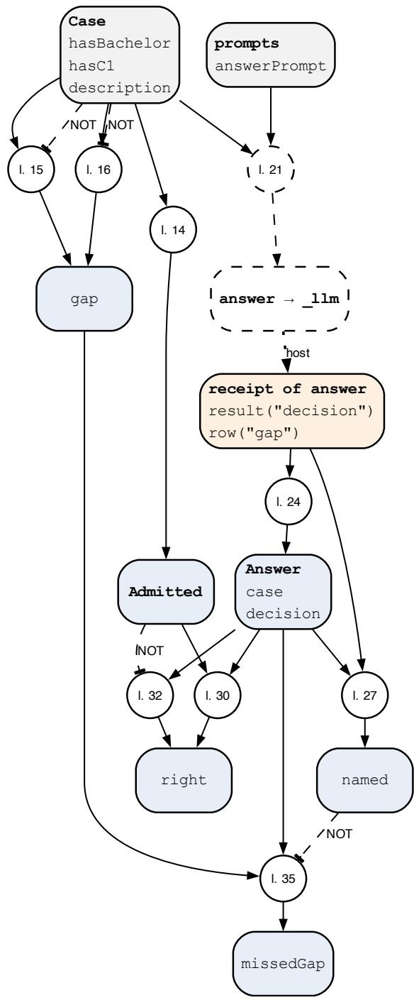  
Fi<sub>g</sub>ure 12: Rule <sub>g</sub>ra<sub>p</sub>h of p10-teach.fx, <sub>g</sub>enerated from the <sub>p</sub>ro<sub>g</sub>ram. A circle is one rule; “l. 23” <sub>means</sub> th<sub>a</sub>t th<sub>e ru</sub>l<sub>e s</sub>t<sub>ar</sub>t<sub>s</sub> i<sub>n</sub> li<sub>ne</sub> 23 <sub>o</sub>f th<sub>e</sub> li<sub>s</sub>ti<sub>ng.</sub> L<sub>egen</sub>d i<sub>n</sub> T<sub>a</sub>bl<sub>e</sub> 9<sub>.</sub>

## 6 Patterns over time

## 6.1 Pattern 11: Rule-Governed Memory

## Intent

K<sub>eep</sub> <sub>w</sub>h<sub>a</sub>t <sub>an</sub> <sub>ass</sub>i<sub>s</sub>t<sub>an</sub>t l<sub>earns</sub> <sub>across</sub> <sub>conversa</sub>ti<sub>ons</sub> <sub>as</sub> <sub>s</sub>t<sub>a</sub>t<sub>emen</sub>t<sub>s</sub> th<sub>a</sub>t <sub>ru</sub>l<sub>es</sub> <sub>a</sub>d<sub>m</sub>it<sub>,</sub> <sub>superse</sub>d<sub>e</sub> <sub>an</sub>d <sub>w</sub>ithd<sub>raw, an</sub>d l<sub>e</sub>t <sub>ru</sub>l<sub>es</sub> d<sub>ec</sub>id<sub>e w</sub>hi<sub>c</sub>h <sub>remem</sub>b<sub>ere</sub>d <sub>s</sub>t<sub>a</sub>t<sub>emen</sub>t<sub>s en</sub>t<sub>er</sub> th<sub>e nex</sub>t <sub>promp</sub>t<sub>.</sub>

## Also known as

A<sub>gen</sub>t <sub>memory,</sub> l<sub>ong-</sub>t<sub>erm memory, memory</sub> h<sub>an</sub>dl<sub>er,</sub> b<sub>e</sub>li<sub>e</sub>f <sub>rev</sub>i<sub>s</sub>i<sub>on w</sub>ith <sub>a mo</sub>d<sub>e</sub>l <sub>as source.</sub>

## Motivation

A<sub>n a</sub>d<sub>v</sub>i<sub>sor</sub> l<sub>earns</sub> i<sub>n</sub> M<sub>arc</sub>h th<sub>a</sub>t <sub>a s</sub>t<sub>u</sub>d<sub>en</sub>t <sub>pre</sub>f<sub>ers</sub> G<sub>erman an</sub>d i<sub>n</sub> M<sub>ay</sub> th<sub>a</sub>t E<sub>ng</sub>li<sub>s</sub>h i<sub>s</sub> fi<sub>ne;</sub> i<sub>n</sub> J<sub>une</sub> th<sub>e s</sub>t<sub>u</sub>d<sub>en</sub>t <sub>as</sub>k<sub>s</sub> it t<sub>o</sub> f<sub>orge</sub>t <sub>a message.</sub> A <sub>mo</sub>d<sub>e</sub>l th<sub>a</sub>t k<sub>eeps</sub> it<sub>s own no</sub>t<sub>es e</sub>ith<sub>er</sub> k<sub>eeps</sub> b<sub>o</sub>th <sub>va</sub>l<sub>ues</sub> <sub>or overwr</sub>it<sub>es one, canno</sub>t <sub>say w</sub>hi<sub>c</sub>h h<sub>o</sub>ld<sub>s or w</sub>h<sub>y, an</sub>d it<sub>s no</sub>t<sub>es qu</sub>i<sub>e</sub>tl<sub>y</sub> b<sub>ecome recor</sub>d<sub>s: a gra</sub>d<sub>e</sub> mentioned in a chat sits next to the <sub>g</sub>rade on the transcri<sub>p</sub>t. A sin<sub>g</sub>le readin<sub>g</sub> (Section 3.1) decides <sub>w</sub>h<sub>e</sub>th<sub>er</sub> <sub>a</sub> <sub>s</sub>t<sub>a</sub>t<sub>emen</sub>t h<sub>o</sub>ld<sub>s</sub> <sub>now;</sub> <sub>memory</sub> <sub>mus</sub>t d<sub>ec</sub>id<sub>e</sub> <sub>w</sub>h<sub>e</sub>th<sub>er</sub> it <sub>s</sub>till h<sub>o</sub>ld<sub>s</sub> l<sub>a</sub>t<sub>er.</sub> Th<sub>e</sub> <sub>pa</sub>tt<sub>ern</sub> k<sub>eeps</sub> <sub>every</sub> <sub>remem</sub>b<sub>ere</sub>d <sub>s</sub>t<sub>a</sub>t<sub>emen</sub>t <sub>w</sub>ith it<sub>s</sub> <sub>u</sub>tt<sub>erance</sub> <sub>an</sub>d <sub>quo</sub>t<sub>e,</sub> l<sub>e</sub>t<sub>s</sub> <sub>a</sub> <sub>s</sub>l<sub>o</sub>t <sub>po</sub>li<sub>cy</sub> d<sub>ec</sub>id<sub>e</sub> <sub>w</sub>hi<sub>c</sub>h <sub>sources</sub> <sub>may</sub> <sub>es</sub>t<sub>a</sub>bli<sub>s</sub>h <sub>w</sub>hi<sub>c</sub>h f<sub>ac</sub>t<sub>s,</sub> l<sub>e</sub>t<sub>s a newer a</sub>d<sub>m</sub>itt<sub>e</sub>d <sub>s</sub>t<sub>a</sub>t<sub>emen</sub>t <sub>superse</sub>d<sub>e an o</sub>ld<sub>er one w</sub>ith<sub>ou</sub>t d<sub>e</sub>l<sub>e</sub>ti<sub>ng</sub> it<sub>, an</sub>d <sub>recompu</sub>t<sub>es</sub> <sub>w</sub>h<sub>a</sub>t <sub>res</sub>t<sub>s</sub> <sub>on</sub> <sub>an</sub> <sub>u</sub>tt<sub>erance</sub> <sub>w</sub>h<sub>en</sub> th<sub>a</sub>t <sub>u</sub>tt<sub>erance</sub> i<sub>s</sub> f<sub>orgo</sub>tt<sub>en.</sub> R<sub>u</sub>l<sub>es</sub> <sub>c</sub>h<sub>oose</sub> <sub>w</sub>h<sub>a</sub>t th<sub>e</sub> <sub>mo</sub>d<sub>e</sub>l <sub>sees nex</sub>t<sub>, w</sub>ith <sub>a s</sub>i<sub>m</sub>il<sub>ar</sub>it<sub>y score as one</sub> i<sub>npu</sub>t<sub>, an</sub>d th<sub>e mo</sub>d<sub>e</sub>l <sub>c</sub>it<sub>es</sub> th<sub>e s</sub>t<sub>a</sub>t<sub>emen</sub>t<sub>s</sub> it <sub>use</sub>d<sub>.</sub>

## Applicability

U<sub>se</sub> it <sub>w</sub>h<sub>en</sub>

• an assistant serves the same <sub>p</sub>erson or case across sessions<sub>;</sub>

• what is known chan<sub>g</sub>es over time<sub>,</sub> and the histor<sub>y</sub> of a value matters<sub>;</sub>

• sources difer in what the<sub>y</sub> ma<sub>y</sub> establish (a chat ma<sub>y</sub> set a <sub>p</sub>reference<sub>,</sub> onl<sub>y</sub> a certificate a qualification);

• a re<sub>q</sub>uest to for<sub>g</sub>et must take efect on ever<sub>y</sub>thin<sub>g</sub> that rested on the for<sub>g</sub>otten in<sub>p</sub>ut.

F<sub>or a s</sub>i<sub>ng</sub>l<sub>e sess</sub>i<sub>on a</sub> S<sub>ensor su</sub>fi<sub>ces.</sub> R<sub>e</sub>t<sub>r</sub>i<sub>eva</sub>l b<sub>y s</sub>i<sub>m</sub>il<sub>ar</sub>it<sub>y over</sub> d<sub>ocumen</sub>t<sub>s</sub> i<sub>s</sub> th<sub>e</sub> t<sub>as</sub>k <sub>o</sub>f <sub>a re</sub>t<sub>r</sub>i<sub>ever</sub> <sub>ou</sub>t<sub>s</sub>id<sub>e</sub> th<sub>e eng</sub>i<sub>ne;</sub> it<sub>s resu</sub>lt<sub>s en</sub>t<sub>er as rece</sub>i<sub>p</sub>t<sub>s</sub> lik<sub>e any o</sub>th<sub>er.</sub>

## Structure

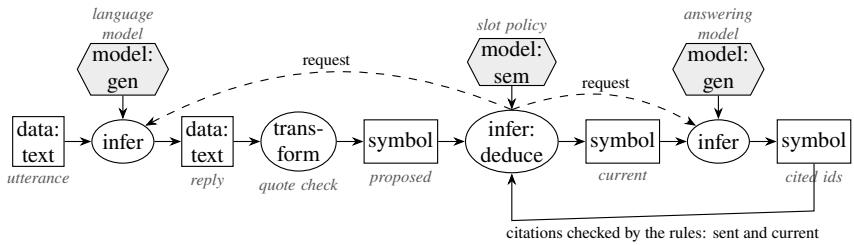

## Participants

Model: proposes statements with quotes from an utterance, and later cites the statements it used.   
Rules: slot policy, admission, supersession, withdrawal, and the selection of statements for a prompt.   
Host: stores utterances and receipts, measures quotes, removes the content of a forgotten utterance.   
Person: states, corrects, asks to forget.

## Collaborations

E<sub>ac</sub>h <sub>u</sub>tt<sub>erance</sub> t<sub>r</sub>i<sub>ggers a</sub> S<sub>ensor reques</sub>t<sub>;</sub> th<sub>e propose</sub>d <sub>s</sub>t<sub>a</sub>t<sub>emen</sub>t<sub>s re</sub>t<sub>urn as rece</sub>i<sub>p</sub>t<sub>s; ru</sub>l<sub>es a</sub>d<sub>m</sub>it th<sub>em</sub> <sub>per</sub> <sub>s</sub>l<sub>o</sub>t<sub>;</sub> <sub>supersess</sub>i<sub>on</sub> f<sub>o</sub>ll<sub>ows</sub> th<sub>e</sub> <sub>or</sub>d<sub>er</sub> <sub>o</sub>f <sub>a</sub>d<sub>m</sub>i<sub>ss</sub>i<sub>on,</sub> <sub>an</sub>d th<sub>e</sub> <sub>curren</sub>t <sub>va</sub>l<sub>ue</sub> i<sub>s</sub> <sub>a</sub> <sub>query.</sub> A <sub>reques</sub>t t<sub>o</sub> f<sub>or e</sub>t <sub>mar</sub>k<sub>s</sub> th<sub>e u</sub>tt<sub>erance;</sub> i<sub>n</sub> th<sub>e nex</sub>t d<sub>er</sub>i<sub>va</sub>ti<sub>on ever s</sub>t<sub>a</sub>t<sub>emen</sub>t th<sub>a</sub>t <sub>res</sub>t<sub>e</sub>d <sub>on</sub> it l<sub>oses</sub> it<sub>s acce</sub> t<sub>ance,</sub> and an older statement can become current a<sub>g</sub>ain. Before a model call, a steerin<sub>g</sub> rule (Section 4.2) <sub>se</sub>l<sub>ec</sub>t<sub>s</sub> th<sub>e curren</sub>t <sub>s</sub>t<sub>a</sub>t<sub>emen</sub>t<sub>s</sub> th<sub>e s</sub>t<sub>ep nee</sub>d<sub>s;</sub> th<sub>e rep</sub>l<sub>y c</sub>it<sub>es</sub> th<sub>e</sub>i<sub>r</sub> id<sub>en</sub>tifi<sub>ers, an</sub>d <sub>a ru</sub>l<sub>e c</sub>h<sub>ec</sub>k<sub>s</sub> th<sub>a</sub>t <sub>every c</sub>it<sub>e</sub>d <sub>s</sub>t<sub>a</sub>t<sub>emen</sub>t i<sub>s curren</sub>t<sub>.</sub>

## Consequences

E<sub>very remem</sub>b<sub>ere</sub>d <sub>va</sub>l<sub>ue</sub> h<sub>as an u</sub>tt<sub>erance, a quo</sub>t<sub>e, a</sub> d<sub>a</sub>t<sub>e an</sub>d <sub>a</sub> hi<sub>s</sub>t<sub>ory.</sub> F<sub>orge</sub>tti<sub>ng</sub> i<sub>s exac</sub>t <sub>w</sub>ith<sub>ou</sub>t <sub>manua</sub>l <sub>c</sub>l<sub>ean-up,</sub> b<sub>ecause accep</sub>t<sub>ance</sub> i<sub>s</sub> d<sub>er</sub>i<sub>ve</sub>d <sub>an</sub>d <sub>recompu</sub>t<sub>e</sub>d<sub>.</sub> A <sub>c</sub>h<sub>a</sub>t <sub>canno</sub>t <sub>es</sub>t<sub>a</sub>bli<sub>s</sub>h <sub>w</sub>h<sub>a</sub>t it<sub>s</sub> <sub>source may no</sub>t<sub>, an</sub>d <sub>a</sub> d<sub>er</sub>i<sub>ve</sub>d f<sub>ac</sub>t <sub>suc</sub>h <sub>as an a</sub>d<sub>m</sub>i<sub>ss</sub>i<sub>on</sub> i<sub>s never wr</sub>itt<sub>en</sub> t<sub>o memory.</sub> Th<sub>e cos</sub>t i<sub>s one</sub> S<sub>ensor</sub> <sub>ca</sub>ll <sub>per</sub> <sub>u</sub>tt<sub>erance</sub> <sub>an</sub>d <sub>a</sub> <sub>s</sub>t<sub>ore</sub> th<sub>a</sub>t <sub>grows,</sub> <sub>s</sub>i<sub>nce</sub> <sub>on</sub>l<sub>y</sub> <sub>a</sub> <sub>reques</sub>t t<sub>o</sub> f<sub>orge</sub>t <sub>removes</sub> <sub>con</sub>t<sub>en</sub>t<sub>.</sub> A <sub>s</sub>t<sub>a</sub>t<sub>emen</sub>t <sub>a</sub>d<sub>m</sub>itt<sub>e</sub>d <sub>wron</sub> l h<sub>o</sub>ld<sub>s un</sub>til it i<sub>s su erse</sub>d<sub>e</sub>d <sub>or</sub> f<sub>or o</sub>tt<sub>en, an</sub>d <sub>a con</sub>fli<sub>c</sub>t b<sub>e</sub>t<sub>ween sources</sub> needs a <sub>p</sub>erson (Section 4.4).

## Implementation

Each utterance tri<sub>gg</sub>ers a Sensor re<sub>q</sub>uest with the utterance as groundIn. Row ?I of the answer for utterance ?U becomes one statement object st(?U, ?I), a function term in the rule head, ke<sub>p</sub>t onl<sub>y</sub> with a found <sub>q</sub>uote. For recall, the rules mark the statements one ste<sub>p</sub> ma<sub>y</sub> see with selectedFor; the re<sub>q</sub>uest names the ste<sub>p</sub> with contextKey, and the host sends exactl<sub>y</sub> those statements and records their identifiers in the recei<sub>p</sub>t (tool#sent). The re<sub>p</sub>l<sub>y</sub> cites identifiers, and rules acce<sub>p</sub>t it onl<sub>y</sub> if ever<sub>y</sub> cited statement was sent and is current. tool#order makes ever<sub>y</sub> remember run before the answer, <sub>so</sub> th<sub>e se</sub>l<sub>ec</sub>ti<sub>on</sub> i<sub>s ma</sub>d<sub>e over a</sub>ll <sub>s</sub>t<sub>a</sub>t<sub>emen</sub>t<sub>s:</sub>

// Pattern 11, Rule-Governed Memory: statements read from utterances are admitted,   
// superseded and forgotten by rules; for one step the rules select what a reply may   
// use, and the reply must cite only those statements, and only current ones.   
4 world open.   
closed slot mayEstablish. closed slot forgotten. closed slot hasNewer.   
6 closed slot current. closed slot hasBad.   
closed method sentId/1.   
8   
9 // What a chat may establish, two utterances, and one question to answer later.   
10 chat[mayEstablish -> "preferredLanguage"; mayEstablish -> "callbackTime"].   
11 u1:Utterance[kind -> chat; seq -> 1; text -> "Please write to me in German."].   
12 u2:Utterance[kind -> chat; seq -> 2;   
13 text -> "English is fine from now on. By the way, my Bachelor grade was 5.8."].   
14 q1:Question[step -> replyLanguage;   
15 text -> "In which language should we write to nora?"].   
16   
17 rememberPrompt:Prompt[text -> "Report what the utterance states about the speaker nora:   
one row {about, slot, value, quote}, slot one of preferredLanguage, callbackTime,   
bachelorGrade; the quote copied verbatim. Answer as JSON {\"rows\": [...]}."].   
18 recallPrompt:Prompt[text -> "Answer the question from the statements in context only. Cite   
every statement you use by its id. Answer as JSON {\"text\": \"the answer\", \"rows   
\": [{\"cited\": \"id\"}]}."].   
19   
20 // Storing (Pattern 1): one statement object st(utterance, row) per quoted row.   
21 external remember(?U) using \_llm with rememberPrompt[utterance -> ?T; groundIn -> ?T;   
22 tool#order -> 2]   
23 <- ?U:Utterance[text -> ?T] AND NOT ?U[forgotten -> true].   
24   
25 st(?U, ?I):Statement[from -> ?U; about -> ?A; slot -> ?S; value -> ?V]   
26 <- ?R[tool#name -> "\_llm"; tool#arg1 -> ?U; row(?I, "about") -> ?A;   
27 row(?I, "slot") -> ?S; row(?I, "value") -> ?V; row(?I, "quoteFound") -> true].   
28   
29 // Admission: the source must be allowed to establish the slot.   
30 ?St[accepted -> true]   
31 <- ?St:Statement[from -> ?U; slot -> ?S] AND ?U[kind -> ?K] AND ?K[mayEstablish -> ?S]   
32 AND NOT ?U[forgotten -> true].   
33   
34 ?St[rejected -> "this kind of source cannot establish it"]

35 <- ?St:Statement[from -> ?U; slot -> ?S] AND ?U[kind -> ?K]   
36 AND NOT ?K[mayEstablish -> ?S].   
37   
38 // Supersession: a later accepted statement on the same slot replaces an earlier one.   
39 ?St[hasNewer -> true]   
40 <- ?St[accepted -> true; from -> ?U; about -> ?A; slot -> ?S] AND ?U[seq -> ?N]   
41 AND ?Nw[accepted -> true; from -> ?W; about -> ?A; slot -> ?S] AND ?W[seq -> ?M]   
42 AND ?M > ?N.   
43 ?St[current -> true] <- ?St[accepted -> true] AND NOT ?St[hasNewer -> true].   
44   
45 // Forgetting: a person's request is the fact u2[forgotten -> true]. Its statements are   
46 // withdrawn, and every recorded model answer that holds the utterance is removed.   
47 external forget(?U) using \_forgetAnswers[text -> ?T; tool#order -> 1]   
48 <- ?U:Utterance[forgotten -> true; text -> ?T].   
49   
50 // Recall (Pattern 5): the rules select what the step may see.   
51 ?St[selectedFor -> replyLanguage]   
52 <- ?St:Statement[current -> true; about -> "nora"; slot -> "preferredLanguage"].   
53 external answer(?Q) using \_llm with recallPrompt[question -> ?T; contextKey -> ?K;   
54 tool#order -> 3]   
55 <- ?Q:Question[text -> ?T; step -> ?K].   
56   
57 // Citations: every cited id must have been sent, and its statement must be current.   
58 ?R[sentId(?C) -> true] <- ?R[tool#sent(?C) -> ?St].   
59 ?Q[cites -> ?St]   
60 <- ?Q:Question AND ?R[tool#arg1 -> ?Q; row(?I, "cited") -> ?C; tool#sent(?C) -> ?St].   
61 ?Q[refused -> ?C]   
62 <- ?Q:Question AND ?R[tool#arg1 -> ?Q; row(?I, "cited") -> ?C]   
63 AND NOT ?R[sentId(?C) -> true].   
64 ?Q[refused -> ?St] <- ?Q[cites -> ?St] AND NOT ?St[current -> true].   
65 ?Q[hasBad -> true] <- ?Q[refused -> ?X].   
66 ?Q[answer -> ?Text]   
67 <- ?Q:Question[cites -> ?St] AND ?R[tool#arg1 -> ?Q; result("text") -> ?Text]   
68 AND NOT ?Q[hasBad -> true].   
69   
70 ?- ?St[current -> true; value -> ?V].   
71 ?- ?St[rejected -> ?Why].   
72 ?- q1[answer -> ?A].   
73 ?- q1[refused -> ?X].

Fi<sub>g</sub>ure 13 draws the <sub>p</sub>ro<sub>g</sub>ram as a rule <sub>g</sub>ra<sub>p</sub>h. For<sub>g</sub>ettin<sub>g</sub> u2 withdraws its statements, st(u1, 1) with German becomes current a<sub>g</sub>ain, and \_forgetAnswers removes ever<sub>y</sub> recorded model answer <sub>w</sub>h<sub>ose</sub> <sub>promp</sub>t <sub>or</sub> <sub>answer</sub> h<sub>o</sub>ld<sub>s</sub> th<sub>e</sub> <sub>u</sub>tt<sub>erance,</sub> <sub>so</sub> <sub>a</sub> <sub>rep</sub>l<sub>ay</sub> <sub>canno</sub>t b<sub>r</sub>i<sub>ng</sub> it b<sub>ac</sub>k<sub>.</sub> A <sub>s</sub>i<sub>m</sub>il<sub>ar</sub>it<sub>y</sub> <sub>score</sub> f<sub>rom</sub> <sub>a re</sub>t<sub>r</sub>i<sub>ever can</sub> b<sub>e one more con</sub>diti<sub>on o</sub>f th<sub>e se</sub>l<sub>ec</sub>ti<sub>on ru</sub>l<sub>e.</sub>

## Library form

With the librar<sub>y</sub> memory.fx (Section B) loaded first, the <sub>p</sub>ro<sub>g</sub>ram states onl<sub>y</sub> what each kind of source ma<sub>y</sub> establish, the utterances, what a ste<sub>p</sub> needs, and the <sub>q</sub>uestion. Selection is a fact (mem#Step), and a re<sub>q</sub>uest to for<sub>g</sub>et is the fact u2[mem#forgotten -> true]:

// Pattern 11 in library form: load memory.fx first. Same utterances and prompts as p11-   
memory.fx.   
2 world open.   
3   
4 chat[mem#mayEstablish -> "preferredLanguage"; mem#mayEstablish -> "callbackTime"].   
5   
6 rememberPrompt:Prompt[text -> "Report what the utterance states about the speaker nora:   
one row {about, slot, value, quote}, slot one of preferredLanguage, callbackTime,   
bachelorGrade; the quote copied verbatim. Answer as JSON {\"rows\": [...]}."].   
recallPrompt:Prompt[text -> "Answer the question from the statements in context only. Cite   
every statement you use by its id. Answer as JSON {\"text\": \"the answer\", \"rows   
\": [{\"cited\": \"id\"}]}."].

8   
9 u1:mem#Utterance[mem#kind -> chat; mem#seq -> 1; mem#prompt -> rememberPrompt;   
10 mem#text -> "Please write to me in German."].   
11 u2:mem#Utterance[mem#kind -> chat; mem#seq -> 2; mem#prompt -> rememberPrompt;   
12 mem#text -> "English is fine from now on. By the way, my Bachelor grade was 5.8."].   
13   
14 replyLanguage:mem#Step[mem#about -> "nora"; mem#needs -> "preferredLanguage"].   
15 q1:mem#Question[mem#step -> replyLanguage; mem#prompt -> recallPrompt;   
16 mem#text -> "In which language should we write to nora?"].   
17   
18 ?- ?St[mem#current -> true; mem#value -> ?V].   
19 ?- ?St[mem#rejected -> ?Why].   
20 ?- q1[mem#answer -> ?A].   
21 ?- q1[mem#refused -> ?X].

Th<sub>e</sub> lib<sub>rary</sub> d<sub>er</sub>i<sub>ves</sub> th<sub>e s</sub>t<sub>a</sub>t<sub>emen</sub>t<sub>s,</sub> th<sub>e</sub>i<sub>r a</sub>d<sub>m</sub>i<sub>ss</sub>i<sub>on an</sub>d <sub>supersess</sub>i<sub>on,</sub> th<sub>e con</sub>t<sub>ex</sub>t <sub>o</sub>f <sub>eac</sub>h <sub>s</sub>t<sub>ep,</sub> th<sub>e</sub> <sub>answer</sub> <sub>an</sub>d <sub>every</sub> <sub>re</sub>f<sub>use</sub>d <sub>c</sub>it<sub>a</sub>ti<sub>on,</sub> <sub>an</sub>d it <sub>removes</sub> f<sub>orgo</sub>tt<sub>en</sub> <sub>u</sub>tt<sub>erances</sub> f<sub>rom</sub> th<sub>e</sub> <sub>answer</sub> <sub>s</sub>t<sub>ore.</sub>

## Known uses

Th<sub>e program a</sub>b<sub>ove, w</sub>hi<sub>c</sub>h h<sub>as</sub> b<sub>o</sub>th h<sub>a</sub>l<sub>ves;</sub> D<sub>ream</sub>RAG lit<sub>e among</sub> th<sub>e</sub> F<sub>rame</sub>X <sub>app</sub>li<sub>ca</sub>ti<sub>ons,</sub> th<sub>e</sub> <sub>memory</sub> h<sub>an</sub>dl<sub>er: proposa</sub>l f<sub>rom an u</sub>tt<sub>erance, a</sub>d<sub>m</sub>i<sub>ss</sub>i<sub>on per s</sub>l<sub>o</sub>t<sub>, supersess</sub>i<sub>on, con</sub>fli<sub>c</sub>t <sub>an</sub>d <sub>w</sub>ithd<sub>rawa</sub>l<sub>.</sub> M<sub>emory c</sub>l<sub>a</sub>i<sub>ms w</sub>ith <sub>quo</sub>t<sub>es</sub> i<sub>n</sub> F<sub>rame</sub>X<sub>-</sub>A<sub>gen</sub>t<sub>s.</sub> I<sub>n</sub> th<sub>e</sub> lit<sub>era</sub>t<sub>ure: memory as a componen</sub>t <sub>o</sub>f <sub>agen</sub>t architectures (Liu et al. 2025); reflections ke<sub>p</sub>t across trials (Shinn et al. 2023); knowled<sub>g</sub>e <sub>g</sub>ra<sub>p</sub>hs as u<sub>p</sub>datable memor<sub>y</sub> for lan<sub>g</sub>ua<sub>g</sub>e models (S. Pan et al. 2024). In these the model decides what to kee<sub>p</sub> <sub>an</sub>d <sub>reca</sub>ll<sub>;</sub> h<sub>ere</sub> th<sub>e</sub> <sub>ru</sub>l<sub>es</sub> d<sub>o,</sub> <sub>an</sub>d f<sub>orge</sub>tti<sub>ng</sub> <sub>w</sub>ithd<sub>raws</sub> <sub>w</sub>h<sub>a</sub>t <sub>res</sub>t<sub>e</sub>d <sub>on</sub> th<sub>e</sub> f<sub>orgo</sub>tt<sub>en</sub> i<sub>npu</sub>t<sub>.</sub>

## Related patterns

Storin<sub>g</sub> is Model as Sensor (Section 3.1) a<sub>pp</sub>lied to utterances over time; recall is Rules Steer the Model (Section 4.2); conflicts <sub>g</sub>o to Division b<sub>y</sub> Com<sub>p</sub>etence (Section 4.4); a re<sub>p</sub>l<sub>y</sub> that cites a su<sub>p</sub>erseded statement is re<sub>p</sub>aired b<sub>y</sub> Critique and Re<sub>p</sub>air (Section 4.3).

## Evidence

O<sub>ne</sub> d<sub>emons</sub>t<sub>ra</sub>ti<sub>on</sub> <sub>run;</sub> <sub>no</sub> <sub>measuremen</sub>t <sub>ye</sub>t<sub>.</sub>

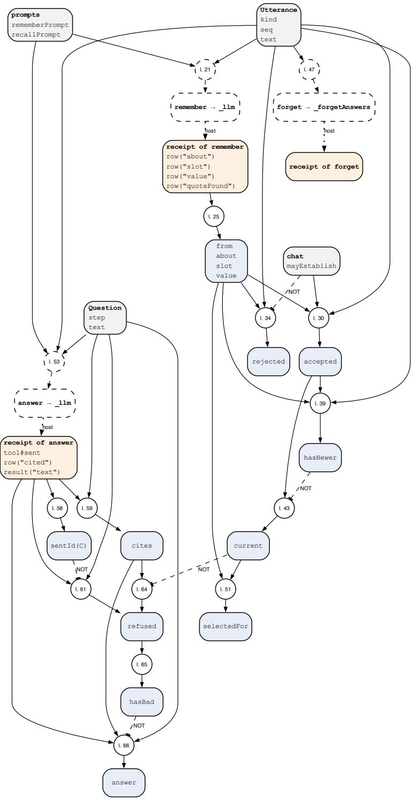  
Fi<sub>g</sub>ure 13: Rule <sub>g</sub>ra<sub>p</sub>h of p11-memory.fx, <sub>g</sub>enerated from the <sub>p</sub>ro<sub>g</sub>ram. A circle is one rule; “l. 23” <sub>means</sub> th<sub>a</sub>t th<sub>e ru</sub>l<sub>e s</sub>t<sub>ar</sub>t<sub>s</sub> i<sub>n</sub> li<sub>ne</sub> 23 <sub>o</sub>f th<sub>e</sub> li<sub>s</sub>ti<sub>ng.</sub> L<sub>egen</sub>d i<sub>n</sub> T<sub>a</sub>bl<sub>e</sub> 9<sub>.</sub>

## 7 Compositions

R<sub>ea</sub>l <sub>sys</sub>t<sub>ems</sub> <sub>com</sub>bi<sub>ne</sub> <sub>pa</sub>tt<sub>erns.</sub> T<sub>a</sub>bl<sub>e</sub> 5 li<sub>s</sub>t<sub>s</sub> th<sub>e</sub> <sub>compos</sub>iti<sub>ons</sub> i<sub>n</sub> th<sub>e</sub> <sub>app</sub>li<sub>ca</sub>ti<sub>ons</sub> f<sub>rom</sub> <sub>w</sub>hi<sub>c</sub>h th<sub>e</sub> <sub>ca</sub>t<sub>a</sub>l<sub>ogue</sub> was drawn. Three combinations recur: a flow that steers a model and uses a judge as sensor, with repair <sub>an</sub>d h<sub>an</sub>d<sub>-over</sub> $( 5 + 1 + 6 + 7 )$ <sub>; an agen</sub>t <sub>w</sub>h<sub>ose proposa</sub>l<sub>s are a</sub>d<sub>m</sub>itt<sub>e</sub>d b<sub>y ru</sub>l<sub>es</sub> th<sub>a</sub>t <sub>a</sub>l<sub>so s</sub>t<sub>eer</sub> it<sub>s con</sub>t<sub>ex</sub>t (4 + 5 + 6); and an authorin<sub>g</sub> loo<sub>p</sub> in which a checker’s messa<sub>g</sub>e drives the re<sub>p</sub>air (2 + 6).

Rule-Governed Memor<sub>y</sub> (Section 6.1) is itself built from two of the other <sub>p</sub>atterns: storin<sub>g</sub> is the S<sub>ensor, reca</sub>ll i<sub>s</sub> R<sub>u</sub>l<sub>es</sub> St<sub>eer</sub> th<sub>e</sub> M<sub>o</sub>d<sub>e</sub>l<sub>.</sub>

T<sub>a</sub>bl<sub>e</sub> 5<sub>:</sub> P<sub>a</sub>tt<sub>erns</sub> i<sub>n</sub> th<sub>e app</sub>li<sub>ca</sub>ti<sub>ons</sub> f<sub>rom w</sub>hi<sub>c</sub>h th<sub>e ca</sub>t<sub>a</sub>l<sub>ogue was</sub> d<sub>rawn.</sub>
<table><tr><td>Application</td><td>Patterns</td><td>How</td></tr><tr><td>Assignment review</td><td>1,3,6</td><td>quote-checked extraction; chat model calls the rules; com- pleteness check</td></tr><tr><td>Interview, suitability, triage</td><td>5,1,6,7</td><td>flow steers; judge as sensor; format repair; unclear to a person</td></tr><tr><td>Campervan search</td><td>1,5</td><td>one classification per listing, requested by rule</td></tr><tr><td>Allocation</td><td>4,5,1</td><td>bounded recommendation; point-in-time evidence; grader verdicts</td></tr><tr><td>Agent framework</td><td>4,5,6,1</td><td>admitted actions; derived phase and context; stalled repair stops; memory claims</td></tr><tr><td>Personal memory (DreamRAG lite) 11 (storing)</td><td></td><td>admission, supersession, conflict and withdrawal of mem- ories as rules; this application has no recall by rules, the</td></tr><tr><td>Rule drafting, decision tables</td><td>2,6</td><td>program of pattern 11 has model drafts; the checker and a bounded repair decide</td></tr><tr><td>Bank reconciliation</td><td>8,5</td><td>model proposes causes; rules test them and ask for the decid- ing date</td></tr><tr><td>Policy critic</td><td>9</td><td>critic reads a sealed policy review; grounded findings gate approval</td></tr><tr><td>Model teaching</td><td>10</td><td>rules label cases, select examples and grade answers</td></tr></table>

## 8 Failure patterns

Fi<sub>ve coup</sub>li<sub>ngs recur</sub> i<sub>n wor</sub>ki<sub>ng sys</sub>t<sub>ems an</sub>d b<sub>rea</sub>k <sub>an</sub> i<sub>nvar</sub>i<sub>an</sub>t <sub>o</sub>f S<sub>ec</sub>ti<sub>on</sub> 2<sub>.</sub> E<sub>ac</sub>h l<sub>oo</sub>k<sub>s</sub> lik<sub>e one o</sub>f th<sub>e</sub> <sub>pa</sub>tt<sub>erns a</sub>b<sub>ove, w</sub>hi<sub>c</sub>h i<sub>s w</sub>h<sub>y</sub> it <sub>surv</sub>i<sub>ves rev</sub>i<sub>ew.</sub> W<sub>e name</sub> th<sub>em so</sub> th<sub>a</sub>t <sub>a</sub> d<sub>es</sub>i<sub>gn rev</sub>i<sub>ew can</sub> l<sub>oo</sub>k f<sub>or</sub> th<sub>em; eac</sub>h <sub>en</sub>t<sub>ry says w</sub>h<sub>a</sub>t it l<sub>oo</sub>k<sub>s</sub> lik<sub>e, w</sub>h<sub>a</sub>t it b<sub>rea</sub>k<sub>s an</sub>d <sub>w</sub>hi<sub>c</sub>h <sub>pa</sub>tt<sub>ern rep</sub>l<sub>aces</sub> it<sub>.</sub> M<sub>os</sub>t <sub>o</sub>f th<sub>em were</sub> named in the jury assessments of the hackathon of Sections 3.4 and 4.5; the first is the one that Critique <sub>an</sub>d R<sub>epa</sub>i<sub>r a</sub>l<sub>rea</sub>d<sub>y exc</sub>l<sub>u</sub>d<sub>es</sub> b<sub>y name.</sub>

Silent Rule Override Code outside the rules changes a verdict before the rules see it: a regular expression in the host that turns a judge’s no into yes, a post-processing step that corrects a value. The outcome <sub>may</sub> b<sub>e r</sub>i<sub>g</sub>ht<sub>,</sub> b<sub>u</sub>t th<sub>e proo</sub>f d<sub>oes no</sub>t <sub>con</sub>t<sub>a</sub>i<sub>n</sub> th<sub>e s</sub>t<sub>ep</sub> th<sub>a</sub>t d<sub>ec</sub>id<sub>e</sub>d it<sub>, an</sub>d <sub>no</sub>b<sub>o</sub>d<sub>y can</sub> t<sub>e</sub>ll th<sub>e correc</sub>ti<sub>on</sub> from the model. It breaks invariant 3, and Critique and Re<sub>p</sub>air (Section 4.3) excludes it b<sub>y</sub> name. In a comparison system built for the hackathon, checked in its code, a host function rewrote the judge’s reply before it became a receipt: yes became no when a pattern found the answer vague, which only tightens; but unclear was settled by the pattern in either direction, and an unreachable model was recorded as yes. Only a note in the reason text was left, and the rules saw the corrected verdict alone. Instead, write the correction as a rule that reads the recei<sub>p</sub>t, so that explain shows it; if the correction can onl<sub>y</sub> make the outcome stricter, it is a source in a Fail-Safe Union (Section 4.5).

Circular Evaluation The cases or the gold labels that measure a coupling come from the model, the <sub>promp</sub>t <sub>or</sub> th<sub>e</sub> d<sub>eve</sub>l<sub>oper</sub> th<sub>a</sub>t i<sub>s</sub> b<sub>e</sub>i<sub>ng measure</sub>d<sub>, or</sub> th<sub>e cr</sub>it<sub>er</sub>i<sub>a are c</sub>h<sub>osen a</sub>ft<sub>er</sub> th<sub>e resu</sub>lt<sub>s are seen.</sub> The numbers then measure agreement with oneself. It breaks the claim behind every Evidence heading. I<sub>ns</sub>t<sub>ea</sub>d<sub>,</sub> fi<sub>x</sub> th<sub>e cases,</sub> th<sub>e</sub> t<sub>ru</sub>th<sub>s an</sub>d th<sub>e cr</sub>it<sub>er</sub>i<sub>a</sub> b<sub>e</sub>f<sub>ore</sub> th<sub>e</sub> fi<sub>rs</sub>t <sub>mo</sub>d<sub>e</sub>l <sub>ca</sub>ll<sub>, an</sub>d d<sub>er</sub>i<sub>ve</sub> l<sub>a</sub>b<sub>e</sub>l<sub>s</sub> b<sub>y ru</sub>l<sub>es</sub> or by construction: an injected fault, a value read from an exact source (Rules Teach the Model, Section 5.3, and C3 in Section 9).

Self-Judge The model that wrote an answer, or a model of the same family with the same prompt, judges whether the answer is right. Its errors and its judgement fail together, and self-correction without an external si<sub>g</sub>nal does not hel<sub>p</sub> (Huan<sub>g</sub> et al. 2024). It breaks the inde<sub>p</sub>endence that Several Readers, One Rule (Section 3.1) and the Read-Back Check (Section 3.3) require. Instead, let a rule check what can be checked, and use a diferent model or a diferent <sub>p</sub>rom<sub>p</sub>t for the rest (Sections 4.3 and 5.2).

Prose Policy The policy that decides exists only as sentences in a prompt. Nothing can test it, a change <sub>canno</sub>t b<sub>e rev</sub>i<sub>ewe</sub>d <sub>aga</sub>i<sub>ns</sub>t <sub>cases, an</sub>d <sub>an answer canno</sub>t <sub>s</sub>h<sub>ow w</sub>hi<sub>c</sub>h <sub>sen</sub>t<sub>ence</sub> it f<sub>o</sub>ll<sub>owe</sub>d<sub>.</sub> It b<sub>rea</sub>k<sub>s</sub> invariant 3 and leaves the <sub>g</sub>uide’s first question unanswered (Section 10). Instead, turn the <sub>p</sub>olic<sub>y</sub> into rules with Model as Author (Section 3.2) and let Rules Steer the Model (Section 4.2) <sub>p</sub>ut into the p<sup>rom</sup>p<sup>t</sup> <sup>onl</sup>y w<sup>hat</sup> <sup>one</sup> <sup>ste</sup>p <sup>needs</sup>.

Decorative Check A check is computed and recorded, but nothing depends on it: a quoteFound that no <sub>ru</sub>l<sub>e rea</sub>d<sub>s, a con</sub>fid<sub>ence</sub> th<sub>a</sub>t i<sub>s</sub> l<sub>ogge</sub>d<sub>, a va</sub>lid<sub>a</sub>ti<sub>on w</sub>h<sub>ose</sub> f<sub>a</sub>il<sub>ure s</sub>till l<sub>e</sub>t<sub>s</sub> th<sub>e ac</sub>ti<sub>on</sub> th<sub>roug</sub>h<sub>.</sub> It l<sub>oo</sub>k<sub>s</sub> lik<sub>e</sub> <sub>ev</sub>id<sub>ence</sub> i<sub>n</sub> <sub>a</sub> <sub>rev</sub>i<sub>ew</sub> <sub>an</sub>d <sub>c</sub>h<sub>anges</sub> <sub>no</sub> <sub>ou</sub>t<sub>come.</sub> It b<sub>rea</sub>k<sub>s</sub> i<sub>nvar</sub>i<sub>an</sub>t 4<sub>.</sub> I<sub>ns</sub>t<sub>ea</sub>d<sub>,</sub> l<sub>e</sub>t <sub>an</sub> <sub>accep</sub>t<sub>ance</sub> <sub>ru</sub>l<sub>e</sub> read ever<sub>y</sub> check, and look for recei<sub>p</sub>t fields without an out<sub>g</sub>oin<sub>g</sub> arrow in the rule <sub>g</sub>ra<sub>p</sub>h (Section C).

## 9 Related catalogues

T<sub>wo</sub> b<sub>o</sub>di<sub>es o</sub>f <sub>wor</sub>k d<sub>escr</sub>ib<sub>e coup</sub>li<sub>ngs o</sub>f l<sub>earn</sub>i<sub>ng an</sub>d <sub>reason</sub>i<sub>ng.</sub> N<sub>euro-sym</sub>b<sub>o</sub>li<sub>c researc</sub>h <sub>c</sub>l<sub>ass</sub>ifi<sub>es</sub> how a learned and a s<sub>y</sub>mbolic com<sub>p</sub>onent are combined, from Kautz’s six t<sub>yp</sub>es (Kautz 2022) to the boxolo<sub>gy</sub> of van Harmelen and ten Teije (2019), its modular taxonom<sub>y</sub> (van Bekkum et al. 2021) and its extension to lan<sub>g</sub>ua<sub>g</sub>e models (de Boer et al. 2025), and from the roadma<sub>p</sub> that unifies lan<sub>g</sub>ua<sub>g</sub>e models and knowled<sub>g</sub>e <sub>g</sub>ra<sub>p</sub>hs (S. Pan et al. 2024) to recent surve<sub>y</sub>s (d’Avila Garcez and Lamb 2023; Yan<sub>g</sub> et al. 2025; Rani et al. 2026). Software en<sub>g</sub>ineerin<sub>g</sub> for model-based s<sub>y</sub>stems collects architectural <sub>p</sub>atterns for a<sub>g</sub>ents (Liu et al. 2025), <sub>p</sub>ractitioners’ workflow <sub>p</sub>atterns (Schluntz and Zhan<sub>g</sub> 2024), <sub>g</sub>uardrail toolkits (Rebedea et al. 2023) and desi<sub>g</sub>n <sub>p</sub>atterns for machine-learnin<sub>g</sub> a<sub>pp</sub>lications (Washizaki et al. 2020; Washizaki et al. 2022). Between them lie s<sub>y</sub>stems in which a model translates for a solver (L. Pan et al. 2023; Olausson et al. 2023; Ye et al. 2023) or <sub>g</sub>enerates candidates for sound critics (Kambham<sub>p</sub>ati et al. 2024).

## 9.1 Mapping

T<sub>a</sub>bl<sub>e</sub> 6 <sub>p</sub>l<sub>aces</sub> <sub>eac</sub>h <sub>pa</sub>tt<sub>ern</sub> i<sub>n</sub> th<sub>ese</sub> <sub>c</sub>l<sub>ass</sub>ifi<sub>ca</sub>ti<sub>ons.</sub> K<sub>au</sub>t<sub>z</sub>’<sub>s</sub> t<sub>ypes</sub> <sub>name</sub> <sub>w</sub>h<sub>o</sub> <sub>ca</sub>ll<sub>s</sub> <sub>w</sub>h<sub>om;</sub> th<sub>e</sub> b<sub>oxo</sub>l<sub>ogy</sub> <sub>names</sub> th<sub>e</sub> fl<sub>ow</sub> <sub>o</sub>f d<sub>a</sub>t<sub>a</sub> <sub>an</sub>d <sub>sym</sub>b<sub>o</sub>l<sub>s;</sub> th<sub>e</sub> <sub>roa</sub>d<sub>map</sub> <sub>names</sub> <sub>w</sub>hi<sub>c</sub>h <sub>s</sub>id<sub>e</sub> <sub>en</sub>h<sub>ances</sub> <sub>w</sub>hi<sub>c</sub>h<sub>;</sub> th<sub>e</sub> <sub>agen</sub>t lit<sub>era</sub>t<sub>ure</sub> <sub>names</sub> th<sub>e mec</sub>h<sub>an</sub>i<sub>sm.</sub>

## 9.2 The patterns in boxology notation

The boxolo<sub>gy</sub> be<sub>g</sub>an with van Harmelen and ten Teije (2019): ovals for <sub>p</sub>rocesses, either deductive (KR) or inductive (ML), and boxes for the s<sub>y</sub>mbols or data that <sub>p</sub>rocesses consume and <sub>p</sub>roduce. Van Bekkum et al. (2021) refined it into a vocabular<sub>y</sub> of four kinds of node, instances (rectan<sub>g</sub>les, data or s<sub>y</sub>mbols), models (hexa<sub>g</sub>ons, statistical or semantic), <sub>p</sub>rocesses (ovals: <sub>g</sub>enerate, transform, infer) and actors (trian<sub>g</sub>les), and into elementar<sub>y p</sub>atterns that com<sub>p</sub>ose. De Boer et al. (2025) added the <sub>g</sub>enerative <sub>mo</sub>d<sub>e</sub>l<sub>, w</sub>ith <sub>an e</sub>l<sub>emen</sub>t<sub>ary pa</sub>tt<sub>ern</sub> i<sub>n w</sub>hi<sub>c</sub>h <sub>a mo</sub>d<sub>e</sub>l i<sub>n</sub>f<sub>ers new</sub> d<sub>a</sub>t<sub>a</sub> f<sub>rom</sub> d<sub>a</sub>t<sub>a;</sub> th<sub>e ear</sub>li<sub>er pa</sub>tt<sub>erns</sub> l<sub>e</sub>t <sub>a</sub> <sub>mo</sub>d<sub>e</sub>l i<sub>n</sub>f<sub>er on</sub>l<sub>y sym</sub>b<sub>o</sub>l<sub>s or mo</sub>d<sub>e</sub>l<sub>s, w</sub>hi<sub>c</sub>h <sub>canno</sub>t d<sub>escr</sub>ib<sub>e a</sub> l<sub>anguage mo</sub>d<sub>e</sub>l th<sub>a</sub>t <sub>wr</sub>it<sub>es</sub> t<sub>ex</sub>t<sub>.</sub>

Every pattern in this catalogue carries its structure in this notation, with model:gen for the language model and model:sem for the rule base, and one mark of ours, the dashed request arrow (Section 2.3 and the le<sub>g</sub>end in the catalo<sub>g</sub>ue form).

Th<sub>e</sub> d<sub>raw</sub>i<sub>ngs s</sub>h<sub>ow w</sub>h<sub>a</sub>t th<sub>e no</sub>t<sub>a</sub>ti<sub>on cap</sub>t<sub>ures an</sub>d <sub>w</sub>h<sub>a</sub>t it l<sub>eaves ou</sub>t<sub>.</sub>

• In the Sensor (Section 3.1) the model’s re<sub>p</sub>l<sub>y</sub> is text<sub>,</sub> that is data<sub>;</sub> it becomes s<sub>y</sub>mbols onl<sub>y</sub> throu<sub>g</sub>h a t<sub>rans</sub>f<sub>orma</sub>ti<sub>on, w</sub>hi<sub>c</sub>h i<sub>s our rece</sub>i<sub>p</sub>t<sub>, an</sub>d th<sub>e ru</sub>l<sub>es</sub> th<sub>en</sub> i<sub>n</sub>f<sub>er w</sub>hi<sub>c</sub>h <sub>sym</sub>b<sub>o</sub>l<sub>s coun</sub>t<sub>.</sub> Th<sub>e no</sub>t<sub>a</sub>ti<sub>on s</sub>h<sub>ows</sub> thi<sub>s s</sub>h<sub>ape.</sub> It <sub>canno</sub>t <sub>s</sub>h<sub>ow</sub> th<sub>a</sub>t th<sub>e</sub> fi<sub>rs</sub>t <sub>sym</sub>b<sub>o</sub>l b<sub>ox</sub> h<sub>o</sub>ld<sub>s proposa</sub>l<sub>s an</sub>d th<sub>e secon</sub>d <sub>accep</sub>t<sub>e</sub>d f<sub>ac</sub>t<sub>s,</sub> refusals with their reason and unknown values the labels below the boxes add that.

• In Model as Author (Section 3.2) the <sub>g</sub>enerative model <sub>p</sub>roduces a semantic model<sub>,</sub> the draft rule<sub>,</sub> <sub>w</sub>hi<sub>c</sub>h <sub>an</sub> i<sub>n</sub>f<sub>erence</sub> <sub>w</sub>ith th<sub>e</sub> <sub>c</sub>h<sub>ec</sub>k<sub>er</sub> <sub>an</sub>d th<sub>e</sub> <sub>cases</sub> <sub>eva</sub>l<sub>ua</sub>t<sub>es;</sub> <sub>an</sub> <sub>exper</sub>t <sub>a</sub>d<sub>op</sub>t<sub>s</sub> it th<sub>roug</sub>h th<sub>e</sub> <sub>e</sub>l<sub>emen</sub>t<sub>ary</sub> <sub>pa</sub>tt<sub>ern</sub> i<sub>n w</sub>hi<sub>c</sub>h <sub>an ac</sub>t<sub>or eng</sub>i<sub>neers a mo</sub>d<sub>e</sub>l<sub>.</sub>

• In Rules Steer the Model (Section 4.2) the rules derive the ste<sub>p,</sub> one <sub>g</sub>enerative model <sub>p</sub>hrases the question, a person answers and a second generative model judges the answer. The closest named <sub>pa</sub>tt<sub>ern</sub> i<sub>s me</sub>t<sub>a-reason</sub>i<sub>ng</sub> f<sub>or con</sub>t<sub>ro</sub>l<sub>, a sym</sub>b<sub>o</sub>li<sub>c process</sub> th<sub>a</sub>t di<sub>rec</sub>t<sub>s a</sub> l<sub>earne</sub>d <sub>one;</sub> h<sub>ere</sub> it d<sub>oes so s</sub>t<sub>ep</sub> b<sub>y</sub> <sub>s</sub>t<sub>ep</sub> th<sub>roug</sub>h <sub>a</sub> <sub>conversa</sub>ti<sub>on.</sub>

• In Rules Teach the Model (Section 5.3) the labels derived b<sub>y</sub> the rules enter the trainin<sub>g</sub> of the model<sub>,</sub> th<sub>e</sub> <sub>s</sub>h<sub>ape</sub> <sub>o</sub>f i<sub>n</sub>f<sub>orme</sub>d l<sub>earn</sub>i<sub>ng</sub> <sub>w</sub>ith <sub>pr</sub>i<sub>or</sub> k<sub>now</sub>l<sub>e</sub>d<sub>ge.</sub>

• Model Pro<sub>p</sub>oses<sub>,</sub> Rules Dis<sub>p</sub>ose (Section 4.1)<sub>,</sub> Criti<sub>q</sub>ue and Re<sub>p</sub>air (Section 4.3) and Rule-Governed Memor<sub>y</sub> (Section 6.1) are loo<sub>p</sub>s; the notation draws the arrow back, but the bound, the order of the <sub>s</sub>t<sub>eps</sub> <sub>an</sub>d th<sub>e</sub> <sub>supersess</sub>i<sub>on</sub> <sub>o</sub>f <sub>one</sub> <sub>va</sub>l<sub>ue</sub> b<sub>y</sub> <sub>a</sub> l<sub>a</sub>t<sub>er</sub> <sub>one</sub> <sub>are</sub> <sub>ru</sub>l<sub>es</sub> th<sub>a</sub>t th<sub>e</sub> d<sub>raw</sub>i<sub>ng</sub> <sub>canno</sub>t <sub>s</sub>h<sub>ow.</sub>

T<sub>a</sub>bl<sub>e</sub> 6<sub>:</sub> Th<sub>e</sub> thi<sub>r</sub>t<sub>een</sub> <sub>pa</sub>tt<sub>erns</sub> i<sub>n</sub> <sub>pu</sub>bli<sub>s</sub>h<sub>e</sub>d <sub>c</sub>l<sub>ass</sub>ifi<sub>ca</sub>ti<sub>ons.</sub> “<sub>–</sub>” <sub>means</sub> <sub>no</sub> <sub>coun</sub>t<sub>erpar</sub>t<sub>.</sub>
<table><tr><td>Pattern</td><td>Kautz type</td><td>Boxology, modular patterns</td><td>Language-model and agent literature</td><td>Status</td></tr><tr><td>1 Model as Sensor</td><td>Neuro|Symbolic</td><td>learning with symbolic output (4.1)</td><td>KG construction (S. Pan et al. 2024)</td><td>known</td></tr><tr><td>2 Model as Author</td><td></td><td>engineered model (1c)</td><td>model acquisition (Kambhampati et al. 2024)</td><td>known in part</td></tr><tr><td>3Model as Translator</td><td>Symbolic[Neuro]</td><td>LLM-augmented KG (de Boer et al. 2025)</td><td>Logic-LM, LINC, SatLM</td><td>known</td></tr><tr><td>4Model Proposes, Rules Dispose</td><td>Symbolic[Neuro]</td><td></td><td>guardrails, rule safeguards, hard critics</td><td>known</td></tr><tr><td>5 Rules Steer the Model</td><td>Symbolic[Neuro]</td><td>meta-reasoning for control (4.8), training only</td><td>routing, dialogue rails</td><td>new as stated</td></tr><tr><td>6 Critique and Repair</td><td></td><td></td><td>solver feedback, back-prompting</td><td>known</td></tr><tr><td>7 Division by Competence 8Model as</td><td>inverse of Neuro[Symbolic]</td><td></td><td>routing; decompiler</td><td>new in part</td></tr><tr><td>Hypothesis Generator</td><td></td><td></td><td>abduction and hypothesis search</td><td>new in part</td></tr><tr><td>9 Model as Critic of the Rules 10 Rules Teach</td><td></td><td></td><td>soft critics review candidates only</td><td>new</td></tr><tr><td>the Model 11 Rule-Governed</td><td>Neuro:Symbolic→ Neuro</td><td>informed learning (4.4)</td><td>Constitutional AI, RLAIF</td><td>known</td></tr><tr><td>Memory 12 Model Selects,</td><td>Symbolic[Neuro]</td><td></td><td>memory component (Liu et al. 2025), Reflexion</td><td>new as stated</td></tr><tr><td>Rules Write</td><td>Symbolic[Neuro]</td><td></td><td>template-based generation (Reiter and Dale 2000), restricted retrieval answers</td><td>known in part</td></tr><tr><td>13 Fail-Safe Union</td><td>Symbolic[Neuro]</td><td></td><td>deny-overrides (OASIS 2013), layered guardrails</td><td>new as stated</td></tr></table>

Three things the boxes and arrows cannot say are the subject of this catalogue: the direction of control, which the dashed arrows add; the status of a symbol (proposed, accepted, refused, unknown) with its date and source; and re<sub>p</sub>etition over time, a retr<sub>y</sub>, a next ste<sub>p</sub> or a later su<sub>p</sub>ersession. De Boer et al. (2025) <sub>name</sub> th<sub>e</sub> l<sub>as</sub>t <sub>gap</sub> th<sub>emse</sub>l<sub>ves, an</sub>d th<sub>ey o</sub>b<sub>serve</sub> th<sub>a</sub>t th<sub>e no</sub>t<sub>a</sub>ti<sub>on o</sub>ft<sub>en y</sub>i<sub>e</sub>ld<sub>s severa</sub>l d<sub>raw</sub>i<sub>ngs o</sub>f th<sub>e same</sub> <sub>sys</sub>t<sub>em.</sub> Th<sub>e</sub> f<sub>our</sub> <sub>e</sub>l<sub>emen</sub>t<sub>ary</sub> <sub>moves</sub> <sub>o</sub>f S<sub>ec</sub>ti<sub>on</sub> 2<sub>.</sub>3 <sub>supp</sub>l<sub>y</sub> <sub>a</sub>ll th<sub>ree:</sub> <sub>a</sub> <sub>reques</sub>t <sub>carr</sub>i<sub>es</sub> <sub>con</sub>t<sub>ro</sub>l<sub>,</sub> <sub>a</sub> <sub>rece</sub>i<sub>p</sub>t <sub>carr</sub>i<sub>es</sub> d<sub>a</sub>t<sub>e an</sub>d <sub>source, an</sub>d <sub>accep</sub>t <sub>an</sub>d <sub>as</sub>k <sub>carry</sub> th<sub>e s</sub>t<sub>a</sub>t<sub>us.</sub>

## 9.3 What the catalogue adds

Direction. Most published systems let the model drive and call a solver or a tool: Kautz’s Neuro[S<sub>y</sub>mbolic], ReAct (Yao et al. 2023), Toolformer (Schick et al. 2023), Lo<sub>g</sub>ic-LM and LLM-Modulo. All thirteen <sub>p</sub>atterns here are S<sub>y</sub>mbolic[Neuro]: the rules issue re<sub>q</sub>uests and the model is a <sub>su</sub>b<sub>rou</sub>ti<sub>ne</sub> <sub>w</sub>h<sub>ose</sub> <sub>answers</sub> <sub>re</sub>t<sub>urn</sub> <sub>as</sub> d<sub>a</sub>t<sub>a.</sub> W<sub>e</sub> <sub>c</sub>h<sub>ose</sub> thi<sub>s</sub> di<sub>rec</sub>ti<sub>on</sub> d<sub>e</sub>lib<sub>era</sub>t<sub>e</sub>l<sub>y,</sub> f<sub>or</sub> <sub>accoun</sub>t<sub>a</sub>bilit<sub>y.</sub> Th<sub>e</sub> a<sub>g</sub>enda of d’Avila Garcez and Lamb (2023) names trust and accountabilit<sub>y</sub> as aims of ti<sub>g</sub>ht inte<sub>g</sub>ration, <sub>an</sub>d l<sub>oose</sub> <sub>coup</sub>li<sub>ng</sub> <sub>w</sub>ith <sub>exp</sub>li<sub>c</sub>it <sub>provenance</sub> <sub>reac</sub>h<sub>es</sub> b<sub>o</sub>th <sub>w</sub>ith<sub>ou</sub>t ti<sub>g</sub>ht i<sub>n</sub>t<sub>egra</sub>ti<sub>on.</sub>

Time and iteration. De Boer et al. (2025) state that temporal, recurring or iterative aspects “have not <sub>ye</sub>t b<sub>een</sub> t<sub>a</sub>k<sub>en</sub> i<sub>n</sub>t<sub>o accoun</sub>t <sub>an</sub>d <sub>can curren</sub>tl<sub>y no</sub>t b<sub>e v</sub>i<sub>sua</sub>li<sub>se</sub>d <sub>a</sub>d<sub>equa</sub>t<sub>e</sub>l<sub>y</sub>” i<sub>n</sub> th<sub>e</sub> b<sub>oxo</sub>l<sub>ogy, an</sub>d th<sub>a</sub>t th<sub>e</sub> <sub>same</sub> <sub>sys</sub>t<sub>em</sub> <sub>can</sub> b<sub>e</sub> d<sub>rawn</sub> i<sub>n</sub> <sub>severa</sub>l <sub>ways.</sub> P<sub>a</sub>tt<sub>erns</sub> 5<sub>,</sub> 6 <sub>an</sub>d 8 <sub>are</sub> it<sub>era</sub>ti<sub>ve</sub> b<sub>y</sub> <sub>na</sub>t<sub>ure,</sub> <sub>an</sub>d th<sub>e</sub> d<sub>a</sub>t<sub>e</sub>d <sub>rece</sub>i<sub>p</sub>t gives each iteration an identity, an order and a record. Pattern 11 makes time its subject: supersession, <sub>w</sub>ithd<sub>rawa</sub>l <sub>an</sub>d th<sub>e curren</sub>t <sub>va</sub>l<sub>ue as a query are ru</sub>l<sub>es over</sub> th<sub>a</sub>t <sub>or</sub>d<sub>er.</sub>

Three values and receipts. None of the sources above distinguishes a failed call, a malformed reply, an unclear judgement and a logical unknown, and none of them makes every model answer a replayable <sub>o</sub>b<sub>serva</sub>ti<sub>on.</sub> Th<sub>ese are</sub> th<sub>e</sub> i<sub>nvar</sub>i<sub>an</sub>t<sub>s o</sub>f S<sub>ec</sub>ti<sub>on</sub> 2<sub>, an</sub>d th<sub>ey are w</sub>h<sub>a</sub>t l<sub>e</sub>t<sub>s pa</sub>tt<sub>erns</sub> 6 <sub>an</sub>d 7 <sub>rou</sub>t<sub>e</sub> b<sub>y resu</sub>lt <sub>an</sub>d l<sub>eave</sub> th<sub>e</sub> <sub>mo</sub>d<sub>e</sub>l’<sub>s</sub> <sub>con</sub>fid<sub>ence</sub> <sub>as</sub>id<sub>e.</sub>

Patterns without precedent. Rules that derive every step of a conversation from their state (5) are closest to <sub>p</sub>ro<sub>g</sub>rammable dialo<sub>g</sub>ue rails (Rebedea et al. 2023), whose flows are written b<sub>y</sub> hand. Recurrin<sub>g</sub> model answers that become rules (7) a<sub>pp</sub>ear onl<sub>y</sub> as ofline rule extraction. Askin<sub>g</sub> for the evidence that decides between survivin<sub>g</sub> h<sub>yp</sub>otheses (8) is absent from abduction with lan<sub>g</sub>ua<sub>g</sub>e models (Shi et al. 2023; Wan<sub>g</sub> et al. 2024). A model that reviews the rules themselves (9) a<sub>pp</sub>ears in none of the catalo<sub>g</sub>ues we <sub>rea</sub>d<sub>;</sub> i<sub>n</sub> <sub>a</sub>ll <sub>o</sub>f th<sub>em</sub> th<sub>e</sub> <sub>mo</sub>d<sub>e</sub>l i<sub>s</sub> th<sub>e</sub> <sub>one</sub> b<sub>e</sub>i<sub>ng</sub> <sub>c</sub>h<sub>ec</sub>k<sub>e</sub>d<sub>.</sub> Th<sub>e</sub> <sub>measuremen</sub>t<sub>s</sub> <sub>o</sub>f S<sub>ec</sub>ti<sub>on</sub> 10 <sub>go</sub> b<sub>eyon</sub>d the validation the catalo<sub>g</sub>ues re<sub>p</sub>ort, which is covera<sub>g</sub>e of literature (van Harmelen and ten Teije 2019), redrawin<sub>g p</sub>ublished s<sub>y</sub>stems (de Boer et al. 2025), or a s<sub>y</sub>stematic review with known uses (Liu et al. 2025).

## 9.4 What the catalogue lacks

Si<sub>x pu</sub>bli<sub>s</sub>h<sub>e</sub>d <sub>pa</sub>tt<sub>erns</sub> h<sub>ave no coun</sub>t<sub>erpar</sub>t<sub>, or on</sub>l<sub>y an unname</sub>d <sub>one;</sub> C1 i<sub>s now name</sub>d <sub>as a var</sub>i<sub>an</sub>t <sub>o</sub>f th<sub>e</sub> S<sub>ensor</sub> <sub>an</sub>d C5 h<sub>as</sub> b<sub>ecome</sub> <sub>pa</sub>tt<sub>ern</sub> 11<sub>.</sub> W<sub>e</sub> <sub>ran</sub>k th<sub>em</sub> b<sub>y</sub> h<sub>ow</sub> <sub>o</sub>ft<sub>en</sub> th<sub>ey</sub> <sub>appear</sub> <sub>an</sub>d h<sub>ow</sub> <sub>we</sub>ll th<sub>ey</sub> fit th<sub>e</sub> i<sub>nvar</sub>i<sub>an</sub>t<sub>s.</sub>

C1. Several answers, one rule. Ask several models or samples and let rules adjudicate: agreement, majority with a count, unclear on disagreement. Voting and debate are agent patterns (Liu et al. 2025), <sub>p</sub>arallelisation b<sub>y</sub> votin<sub>g</sub> is a workflow (Schluntz and Zhan<sub>g</sub> 2024), and self-consistenc<sub>y</sub> beat multi-a<sub>g</sub>ent debate at the same number of answers (Huan<sub>g</sub> et al. 2024). Three-valued lo<sub>g</sub>ic suits it: a disagreement is simply unclear. It is now named as a variant of the Sensor (Section 3.1); with its <sub>own</sub> <sub>measuremen</sub>t<sub>s</sub> it <sub>may</sub> b<sub>ecome</sub> <sub>a</sub> <sub>pa</sub>tt<sub>ern</sub> <sub>o</sub>f it<sub>s</sub> <sub>own.</sub>

C2. Gate and route before the model. Rules decide whether a request may reach a model at all and which model or <sub>p</sub>rom<sub>p</sub>t it <sub>g</sub>oes to: in<sub>p</sub>ut rails (Rebedea et al. 2023), routin<sub>g</sub> (Schluntz and Zhan<sub>g</sub> 2024). It is implicit in the triage flow, which sends only the careful judgements of emergency signs t<sub>o</sub> th<sub>e s</sub>t<sub>ronger mo</sub>d<sub>e</sub>l<sub>;</sub> it <sub>s</sub>h<sub>ou</sub>ld b<sub>e name</sub>d <sub>as a var</sub>i<sub>an</sub>t <sub>o</sub>f <sub>pa</sub>tt<sub>ern</sub> 5<sub>.</sub> H<sub>ac</sub>k<sub>a</sub>th<sub>on su</sub>b<sub>m</sub>i<sub>ss</sub>i<sub>ons a</sub>dd <sub>a</sub> stricter form, a sovereign gatekeeper: a local model and rules decide what may reach an external <sub>mo</sub>d<sub>e</sub>l<sub>, pseu</sub>d<sub>onym</sub>i<sub>se</sub> it <sub>on</sub> th<sub>e way ou</sub>t <sub>an</sub>d t<sub>rans</sub>l<sub>a</sub>t<sub>e</sub> it b<sub>ac</sub>k <sub>on</sub> th<sub>e way</sub> i<sub>n, an</sub>d <sub>sen</sub>d <sub>no</sub>thi<sub>ng w</sub>h<sub>en</sub> th<sub>e</sub> l<sub>oca</sub>l <sub>s</sub>id<sub>e</sub> f<sub>a</sub>il<sub>s.</sub> It <sub>ma</sub>k<sub>es</sub> th<sub>e ru</sub>l<sub>es</sub> th<sub>e guar</sub>d <sub>o</sub>f th<sub>e</sub> d<sub>a</sub>t<sub>a</sub> fl<sub>ow</sub> b<sub>e</sub>t<sub>ween</sub> t<sub>wo mo</sub>d<sub>e</sub>l<sub>s, an</sub>d it i<sub>s a</sub> <sub>can</sub>did<sub>a</sub>t<sub>e</sub> f<sub>or a pa</sub>tt<sub>ern o</sub>f it<sub>s own once</sub> it i<sub>s</sub> b<sub>u</sub>ilt <sub>an</sub>d <sub>measure</sub>d<sub>.</sub>

C3. Rules evaluate the model. Rules reconstruct or audit what a model concluded: rational reconstruction (van Bekkum et al. 2021), knowled<sub>g</sub>e <sub>g</sub>ra<sub>p</sub>hs for inter<sub>p</sub>retabilit<sub>y</sub> (S. Pan et al. 2024), the a<sub>g</sub>ent evaluator (Liu et al. 2025). The break-even and ca<sub>p</sub>abilit<sub>y</sub> studies are this <sub>p</sub>attern run ofline; online it i<sub>s</sub> th<sub>e</sub> t<sub>wo-c</sub>h<sub>anne</sub>l di<sub>sagreemen</sub>t li<sub>s</sub>t<sub>e</sub>d <sub>un</sub>d<sub>er</sub> <sub>pa</sub>tt<sub>ern</sub> 9<sub>.</sub> It b<sub>e</sub>l<sub>ongs</sub> <sub>w</sub>ith <sub>pa</sub>tt<sub>ern</sub> 10 <sub>as</sub> <sub>gra</sub>di<sub>ng,</sub> <sub>or</sub> <sub>as a pa</sub>tt<sub>ern o</sub>f it<sub>s own.</sub> It<sub>s</sub> l<sub>a</sub>b<sub>e</sub>l<sub>s are c</sub>h<sub>eapes</sub>t <sub>w</sub>h<sub>ere</sub> th<sub>e</sub> t<sub>ru</sub>th h<sub>o</sub>ld<sub>s</sub> b<sub>y cons</sub>t<sub>ruc</sub>ti<sub>on: a</sub> f<sub>au</sub>lt th<sub>e</sub> code injected, a value read from an exact oracle such as a barcode or a simulator; several hackathon submissions measured this wa<sub>y</sub>, which also avoids Circular Evaluation (Section 8).

C4. Pooled critics. Several critics (rules, a model, a person) behind one controller that merges their findin<sub>g</sub>s into the next request (Kambham<sub>p</sub>ati et al. 2024). A variant of <sub>p</sub>attern 6.

C5. Rule-governed memory. Retrieval and episodic memory admitted, superseded and cited by rules (Liu et al. 2025; Shinn et al. 2023). It is now Rule-Governed Memor<sub>y</sub>, <sub>p</sub>attern 11 (Section 6.1), built f<sub>rom</sub> th<sub>e</sub> S<sub>ensor</sub> f<sub>or s</sub>t<sub>or</sub>i<sub>ng an</sub>d R<sub>u</sub>l<sub>es</sub> St<sub>eer</sub> th<sub>e</sub> M<sub>o</sub>d<sub>e</sub>l f<sub>or reca</sub>ll<sub>;</sub> D<sub>ream</sub>RAG lit<sub>e</sub> i<sub>mp</sub>l<sub>emen</sub>t<sub>s</sub> th<sub>e</sub> <sub>s</sub>t<sub>or</sub>i<sub>ng</sub> h<sub>a</sub>lf<sub>,</sub> th<sub>e</sub> <sub>program</sub> <sub>o</sub>f <sub>pa</sub>tt<sub>ern</sub> 11 b<sub>o</sub>th h<sub>a</sub>l<sub>ves.</sub>

C6. Specification elicitation and the person as participant. The model helps a person state a goal or a s<sub>p</sub>ecification, and rules check that it is com<sub>p</sub>lete (Kambham<sub>p</sub>ati et al. 2024; Liu et al. 2025); human feedback as a <sub>p</sub>attern of its own (Witschel et al. 2020). Here the <sub>p</sub>erson is a <sub>p</sub>artici<sub>p</sub>ant in ever<sub>y</sub> <sub>pa</sub>tt<sub>ern;</sub> th<sub>e</sub> <sub>e</sub>li<sub>c</sub>it<sub>a</sub>ti<sub>on</sub> i<sub>s</sub> th<sub>e</sub> id<sub>ea</sub> <sub>o</sub>f i<sub>n</sub>t<sub>erv</sub>i<sub>ew</sub>i<sub>ng</sub> <sub>an</sub> <sub>exper</sub>t <sub>un</sub>d<sub>er</sub> <sub>pa</sub>tt<sub>ern</sub> 2<sub>.</sub>

Three families are outside the catalo<sub>g</sub>ue on <sub>p</sub>ur<sub>p</sub>ose: the model as driver that calls tools (ReAct, Toolformer, Neuro[S<sub>y</sub>mbolic]); rules com<sub>p</sub>iled into the network, Kautz’s Neuro<sub>Symbolic</sub> and the ti<sub>g</sub>ht inte<sub>g</sub>ration of d’Avila Garcez and Lamb (2023); and trainin<sub>g</sub> itself.

## 9.5 What the catalogue learns from them

• Correctness comes from the sound check. In LLM-Modulo<sub>,</sub> soundness is inherited from the hard <sub>cr</sub>iti<sub>cs</sub> <sub>an</sub>d <sub>comp</sub>l<sub>e</sub>t<sub>eness</sub> d<sub>epen</sub>d<sub>s</sub> <sub>on</sub> th<sub>e</sub> <sub>mo</sub>d<sub>e</sub>l<sub>;</sub> <sub>a</sub> <sub>mo</sub>d<sub>e</sub>l <sub>a</sub>l<sub>one</sub> <sub>pro</sub>d<sub>uce</sub>d <sub>execu</sub>t<sub>a</sub>bl<sub>e</sub> <sub>p</sub>l<sub>ans</sub> i<sub>n</sub> <sub>a</sub>b<sub>ou</sub>t 12 % of cases, and back-<sub>p</sub>rom<sub>p</sub>tin<sub>g</sub> from a sound validator raised this to 82 % in one domain (Kambham<sub>p</sub>ati et al. 2024). The same statement holds for <sub>p</sub>atterns 4 and 8.

• Self-correction needs an external signal. Without external feedback<sub>,</sub> self-correction lowered accurac<sub>y,</sub> and earlier <sub>g</sub>ains rested on oracle sto<sub>pp</sub>in<sub>g</sub> si<sub>g</sub>nals (Huan<sub>g</sub> et al. 2024). The rules are that si<sub>g</sub>nal in <sub>p</sub>attern 6; citin<sub>g</sub> self-refinement (Madaan et al. 2023; Shinn et al. 2023) as <sub>p</sub>recedent requires this caveat.

• Judges have known biases, and rules can mitigate them. A stron<sub>g</sub> jud<sub>g</sub>e a<sub>g</sub>reed with <sub>p</sub>eo<sub>p</sub>le about <sub>as</sub> <sub>o</sub>ft<sub>en</sub> <sub>as</sub> <sub>peop</sub>l<sub>e</sub> <sub>agree</sub>d <sub>w</sub>ith <sub>eac</sub>h <sub>o</sub>th<sub>er,</sub> b<sub>u</sub>t <sub>gave</sub> th<sub>e</sub> <sub>same</sub> <sub>ver</sub>di<sub>c</sub>t <sub>w</sub>h<sub>en</sub> t<sub>wo</sub> <sub>answers</sub> <sub>were</sub> <sub>swappe</sub>d onl<sub>y</sub> about two thirds of the time; references and exam<sub>p</sub>les reduced the failures (Zhen<sub>g</sub> et al. 2023). A <sub>ru</sub>l<sub>e</sub> <sub>can</sub> <sub>as</sub>k t<sub>w</sub>i<sub>ce</sub> i<sub>n</sub> b<sub>o</sub>th <sub>or</sub>d<sub>ers</sub> <sub>an</sub>d <sub>requ</sub>i<sub>re</sub> <sub>agreemen</sub>t<sub>,</sub> <sub>an</sub>d <sub>supp</sub>l<sub>y</sub> th<sub>e</sub> <sub>re</sub>f<sub>erence.</sub>

• Complementary failures justify division. A solver-backed method and chain-of-thou<sub>g</sub>ht failed on diferent cases (Olausson et al. 2023), which is the condition under which <sub>p</sub>attern 7 <sub>p</sub>a<sub>y</sub>s.

• Safeguards cover known unknowns. A rule safe<sub>g</sub>uard around a model covers onl<sub>y</sub> the failures its authors foresaw (Washizaki et al. 2020); <sub>p</sub>air <sub>p</sub>attern 4 with 8 or 9 where unforeseen failures matter.

• Form and selection. A<sub>g</sub>ent <sub>p</sub>atterns are written with context<sub>,</sub> <sub>p</sub>roblem<sub>,</sub> forces<sub>,</sub> solution<sub>,</sub> conse<sub>q</sub>uences ti<sub>e</sub>d t<sub>o qua</sub>lit<sub>y a</sub>tt<sub>r</sub>ib<sub>u</sub>t<sub>es,</sub> k<sub>nown uses an</sub>d <sub>re</sub>l<sub>a</sub>t<sub>e</sub>d <sub>pa</sub>tt<sub>erns, an</sub>d <sub>come w</sub>ith <sub>a</sub> d<sub>ec</sub>i<sub>s</sub>i<sub>on mo</sub>d<sub>e</sub>l th<sub>a</sub>t i<sub>s no</sub>t em<sub>p</sub>iricall<sub>y</sub> validated (Liu et al. 2025); <sub>p</sub>ractitioners advise to start with the sim<sub>p</sub>lest o<sub>p</sub>tion and to use evaluator loo<sub>p</sub>s onl<sub>y</sub> where the criteria are clear (Schluntz and Zhan<sub>g</sub> 2024). The modular taxonom<sub>y</sub> se<sub>p</sub>arates elementar<sub>y</sub> from com<sub>p</sub>osed <sub>p</sub>atterns (van Bekkum et al. 2021); the thirteen <sub>p</sub>atterns here are com<sub>p</sub>ositions of four elementar<sub>y</sub> moves (request, recei<sub>p</sub>t, acce<sub>p</sub>t, ask), made ex<sub>p</sub>licit in Section 2.3.

## 10 Choosing a pattern

A <sub>pa</sub>tt<sub>ern</sub> i<sub>s c</sub>h<sub>osen</sub> b<sub>y</sub> th<sub>e pro</sub>bl<sub>em</sub> it <sub>so</sub>l<sub>ves an</sub>d b<sub>y</sub> th<sub>e</sub> f<sub>orces o</sub>f th<sub>e con</sub>t<sub>ex</sub>t<sub>.</sub> F<sub>or coup</sub>li<sub>ngs</sub> th<sub>e</sub> f<sub>orces</sub> <sub>are measura</sub>bl<sub>e:</sub> h<sub>ow many ru</sub>l<sub>es a mo</sub>d<sub>e</sub>l <sub>wou</sub>ld h<sub>ave</sub> t<sub>o app</sub>l<sub>y</sub> b<sub>y</sub> it<sub>se</sub>lf<sub>, w</sub>h<sub>e</sub>th<sub>er a rep</sub>l<sub>y can</sub> b<sub>e c</sub>h<sub>ec</sub>k<sub>e</sub>d<sub>,</sub> <sub>w</sub>h<sub>e</sub>th<sub>er</sub> th<sub>e mo</sub>d<sub>e</sub>l <sub>ac</sub>t<sub>s, w</sub>h<sub>o mus</sub>t b<sub>e a</sub>bl<sub>e</sub> t<sub>o au</sub>dit th<sub>e resu</sub>lt<sub>, an</sub>d <sub>w</sub>hi<sub>c</sub>h <sub>mo</sub>d<sub>e</sub>l i<sub>s ava</sub>il<sub>a</sub>bl<sub>e.</sub> Thi<sub>s sec</sub>ti<sub>on</sub> fi<sub>rs</sub>t <sub>as</sub>k<sub>s w</sub>h<sub>e</sub>th<sub>er a</sub> h<sub>y</sub>b<sub>r</sub>id i<sub>s nee</sub>d<sub>e</sub>d <sub>a</sub>t <sub>a</sub>ll<sub>,</sub> th<sub>en</sub> l<sub>ea</sub>d<sub>s</sub> f<sub>rom</sub> th<sub>e pro</sub>bl<sub>em</sub> t<sub>o</sub> th<sub>e pa</sub>tt<sub>erns, an</sub>d <sub>c</sub>l<sub>oses w</sub>ith the measured results the <sub>g</sub>uide rests on. Of the wa<sub>y</sub>s to select a <sub>p</sub>attern that Gamma et al. (1994, sec. 1.7) list, two fit cou<sub>p</sub>lin<sub>g</sub>s: scannin<sub>g</sub> the intents (Table 4) and startin<sub>g</sub> from the <sub>p</sub>roblem one has (Fi<sub>g</sub>. 14 and Table 7). Followin<sub>g</sub> <sub>p</sub>ractitioners’ advice, the <sub>g</sub>uide <sub>p</sub>refers the sim<sub>p</sub>lest cou<sub>p</sub>lin<sub>g</sub> that meets the requirement (Schluntz and Zhan<sub>g</sub> 2024).

## 10.1 First question: is a hybrid needed?

A <sub>mo</sub>d<sub>e</sub>l <sub>a</sub>l<sub>one was</sub> th<sub>e</sub> b<sub>e</sub>tt<sub>er or equa</sub>l <sub>c</sub>h<sub>o</sub>i<sub>ce</sub> i<sub>n</sub> f<sub>our measure</sub>d <sub>s</sub>it<sub>ua</sub>ti<sub>ons, an</sub>d th<sub>e gu</sub>id<sub>e says so</sub> fi<sub>rs</sub>t<sub>.</sub>

• Few rules. In conversations of u<sub>p</sub> to 48 <sub>q</sub>uestions<sub>,</sub> a reasonin<sub>g</sub> model a<sub>pp</sub>l<sub>y</sub>in<sub>g</sub> the rules in its <sub>p</sub>rom<sub>p</sub>t was not measurabl<sub>y</sub> less accurate than the h<sub>y</sub>brid (58 or more of 60 a<sub>g</sub>ainst 60 of 60); the accurac<sub>y</sub> b<sub>rea</sub>k<sub>-even</sub> l<sub>ay</sub> <sub>a</sub>t 64 <sub>ques</sub>ti<sub>ons.</sub>

• Easy documents, a strong model. On a clean five-document review<sub>,</sub> a model alone decided 12 of 12 <sub>runs correc</sub>tl<sub>y, a</sub>t 0<sub>.</sub>28 i<sub>ns</sub>t<sub>ea</sub>d <sub>o</sub>f 0<sub>.</sub>72 <sub>cen</sub>t<sub>s an</sub>d i<sub>n a</sub> thi<sub>r</sub>d <sub>o</sub>f th<sub>e</sub> ti<sub>me.</sub>

• Cost alone. Once a <sub>p</sub>rovider’s discount on cached in<sub>p</sub>ut is <sub>p</sub>riced<sub>,</sub> the h<sub>y</sub>brid’s cost advanta<sub>g</sub>e in <sub>conversa</sub>ti<sub>ons</sub> di<sub>sappears;</sub> <sub>a</sub>t 64 <sub>an</sub>d 96 <sub>ques</sub>ti<sub>ons</sub> th<sub>e</sub> t<sub>wo</sub> <sub>cos</sub>t <sub>a</sub>b<sub>ou</sub>t th<sub>e</sub> <sub>same.</sub>

• A sensor that cannot quote. An 8-billion-<sub>p</sub>arameter o<sub>p</sub>en model extracted worse in the h<sub>y</sub>brid than alone (45 % a<sub>g</sub>ainst 60 %), because a strict quote rule refused correct values.

A h<sub>y</sub>b<sub>r</sub>id i<sub>s nee</sub>d<sub>e</sub>d <sub>w</sub>h<sub>en a</sub>t l<sub>eas</sub>t <sub>one o</sub>f th<sub>e</sub> f<sub>o</sub>ll<sub>ow</sub>i<sub>ng</sub> h<sub>o</sub>ld<sub>s:</sub> th<sub>e</sub> d<sub>ec</sub>i<sub>s</sub>i<sub>on mus</sub>t <sub>come w</sub>ith <sub>a proo</sub>f <sub>or an</sub> <sub>au</sub>dit t<sub>ra</sub>il<sub>;</sub> th<sub>e mo</sub>d<sub>e</sub>l <sub>ac</sub>t<sub>s an</sub>d <sub>some ac</sub>ti<sub>ons mus</sub>t <sub>never</sub> h<sub>appen;</sub> th<sub>e ru</sub>l<sub>es are many or</sub> th<sub>e process</sub> i<sub>s</sub> l<sub>ong</sub> (from about 64 rules a<sub>pp</sub>lied in one conversation in our runs); the answer a<sub>gg</sub>re<sub>g</sub>ates over man<sub>y</sub> objects (lists, counts, totals); a weaker, local or chea<sub>p</sub>er model must do the work; or the rules chan<sub>g</sub>e and the <sub>c</sub>h<sub>ange mus</sub>t b<sub>e c</sub>h<sub>ec</sub>k<sub>e</sub>d b<sub>e</sub>f<sub>ore</sub> it t<sub>a</sub>k<sub>es e</sub>f<sub>ec</sub>t<sub>.</sub>

## 10.2 From problem to pattern

The questions are not exclusive: a triage line answers yes to the first, third and fourth and becomes a <sub>compos</sub>iti<sub>on o</sub>f 1<sub>,</sub> 4<sub>,</sub> 5<sub>,</sub> 6 <sub>an</sub>d 7<sub>.</sub> T<sub>a</sub>bl<sub>e</sub> 7 <sub>g</sub>i<sub>ves</sub> th<sub>e same gu</sub>id<sub>e as pro</sub>bl<sub>ems, w</sub>ith th<sub>e</sub> f<sub>orce</sub> th<sub>a</sub>t d<sub>ec</sub>id<sub>es an</sub>d th<sub>e cau</sub>ti<sub>on</sub> th<sub>a</sub>t th<sub>e measuremen</sub>t<sub>s a</sub>dd<sub>.</sub>

T<sub>a</sub>bl<sub>e</sub> 7<sub>:</sub> P<sub>ro</sub>bl<sub>ems, pa</sub>tt<sub>erns,</sub> d<sub>ec</sub>idi<sub>ng</sub> f<sub>orces an</sub>d <sub>cau</sub>ti<sub>ons.</sub>
<table><tr><td>Problem</td><td>Patterns</td><td>Deciding force</td><td>Caution from the measurements</td></tr><tr><td>Facts are in documents or speech</td><td>1,6</td><td>a reading can be checked (quote, closed list)</td><td>fit the acceptance rule to the reader: a strict quote rule hurt a</td></tr><tr><td>Answer aggregates over many objects</td><td>1, then rules</td><td>lists and counts are exact in rules</td><td>small model a model alone failed exhaustive lists at 100 agreements;</td></tr><tr><td>A policy text must</td><td>2,6</td><td>a complete check exists</td><td>extraction cost is paid once messages that name the fix</td></tr><tr><td>become rules A regulation changed</td><td>2,9</td><td>(syntax, cell language, cases) regression cases decide; a person adopts</td><td>doubled first-request repairs a draft outside the cell language is refused with its reason</td></tr><tr><td>People ask in their own words</td><td>3</td><td>the answer needs a proof</td><td>on easy cases a model alone was as accurate and cheaper</td></tr><tr><td>An agent acts</td><td>4,5,6</td><td>some effects must never happen</td><td>completion only from recorded evidence</td></tr><tr><td>A long protocol or conversation</td><td>5,1, 6,7</td><td>rules per conversation (break-even at 64)</td><td>a judge's verdict labels must not be readable as content</td></tr><tr><td>A weak or local model must suffice</td><td>5 or 1</td><td>the hybrid needs less capability</td><td>on our ladder a 9B model sufficed for the hybrid; no model up to 70B did as a pure model</td></tr><tr><td>Some cases are ambiguous</td><td>7</td><td>three-valued result as gate</td><td>never gate by the model's own confidence</td></tr><tr><td>Something must be explained</td><td>8,5</td><td>generation needs world knowledge, testing needs exactness</td><td>incomplete search is never a “no explanation”</td></tr><tr><td>A soft criterion must be judged</td><td>1, candidate C1 (Sec- tion 9)</td><td>no closed check exists</td><td>judges are biased by answer order; ask in both orders and require agreement (Zheng et al. 2023)</td></tr><tr><td>Semantic faults matter</td><td>9</td><td>checks are incomplete</td><td>model reviews lost semantic faults as the rule base grew; a model critic never replaces a sound check (Huang et al.</td></tr><tr><td>A model must learn the 10 domain</td><td></td><td>labels with proofs</td><td>no measured model run yet</td></tr><tr><td>What a person said must be remembered</td><td>11,1,5</td><td>sources differ in what they may establish; requests to forget</td><td>no measurement yet; similarity retrieval stays outside the rules</td></tr><tr><td>An answer must quote a source or state values exactly</td><td>12</td><td>the content exists as passages or facts</td><td>hackathon figures only; the model can still choose the wrong passage</td></tr><tr><td>Several checks, harms of unequal weight</td><td>13,7</td><td>a wrongly loose outcome costs far more than a wrongly strict one</td><td>hackathon figures only; false alarms of every source add up</td></tr></table>

## 10.3 What the guide rests on

Th<sub>e</sub> <sub>cau</sub>ti<sub>ons</sub> <sub>come</sub> f<sub>rom</sub> <sub>pre-reg</sub>i<sub>s</sub>t<sub>ere</sub>d <sub>s</sub>t<sub>u</sub>di<sub>es</sub> i<sub>n</sub> <sub>w</sub>hi<sub>c</sub>h d<sub>es</sub>i<sub>gns</sub> <sub>an</sub>d <sub>cr</sub>it<sub>er</sub>i<sub>a</sub> <sub>were</sub> fi<sub>xe</sub>d b<sub>e</sub>f<sub>ore</sub> th<sub>e</sub> <sub>runs.</sub>

Break-even. Synthetic intake protocols of 4 to 96 questions; the hybrid decided 770 of 770 runs correctly; <sub>a mo</sub>d<sub>e</sub>l <sub>app</sub>l<sub>y</sub>i<sub>ng</sub> th<sub>e ru</sub>l<sub>es</sub> it<sub>se</sub>lf f<sub>e</sub>ll t<sub>o</sub> 39 <sub>o</sub>f 60 <sub>a</sub>t 64 <sub>ques</sub>ti<sub>ons an</sub>d 31 <sub>o</sub>f 60 <sub>a</sub>t 96<sub>, w</sub>ith 45 <sub>o</sub>f it<sub>s</sub> 50 <sub>errors unsa</sub>f<sub>e.</sub>

Capability. Without reasoning, a model decided 10 of 30 conversations as a pure model and 30 of 30 i<sub>n</sub> th<sub>e</sub> h<sub>y</sub>b<sub>r</sub>id<sub>.</sub> O<sub>n a</sub> l<sub>a</sub>dd<sub>er o</sub>f <sub>s</sub>i<sub>x</sub> l<sub>oca</sub>l <sub>mo</sub>d<sub>e</sub>l<sub>s</sub> f<sub>rom</sub> 1 t<sub>o</sub> 70 billi<sub>on parame</sub>t<sub>ers,</sub> th<sub>e</sub> h<sub>y</sub>b<sub>r</sub>id’<sub>s</sub> fl<sub>oor</sub> i<sub>n</sub> <sub>s</sub>i<sub>ng</sub>l<sub>e</sub> d<sub>ec</sub>i<sub>s</sub>i<sub>ons</sub> <sub>was</sub> <sub>a</sub> 9<sub>-</sub>billi<sub>on-parame</sub>t<sub>er</sub> <sub>mo</sub>d<sub>e</sub>l<sub>;</sub> th<sub>e</sub> <sub>pure</sub> <sub>mo</sub>d<sub>e</sub>l h<sub>a</sub>d <sub>no</sub> fl<sub>oor</sub> <sub>on</sub> th<sub>e</sub> l<sub>a</sub>dd<sub>er,</sub> <sub>an</sub>d f<sub>or</sub> it <sub>reason</sub>i<sub>ng ma</sub>tt<sub>ere</sub>d <sub>more</sub> th<sub>an s</sub>i<sub>ze.</sub>

Checking. With one seeded fault per artefact, static checks over rules found every structural fault at every <sub>s</sub>i<sub>ze a</sub>t <sub>no mo</sub>d<sub>e</sub>l <sub>cos</sub>t<sub>; mo</sub>d<sub>e</sub>l <sub>rev</sub>i<sub>ews o</sub>f <sub>co</sub>d<sub>e an</sub>d <sub>promp</sub>t<sub>s</sub> l<sub>os</sub>t <sub>unreac</sub>h<sub>a</sub>bl<sub>e ru</sub>l<sub>es an</sub>d <sub>m</sub>i<sub>ss</sub>i<sub>ng ru</sub>l<sub>es as</sub> s<sup>i</sup>ze <sub>g</sub>rew.

Authoring. Five of five drafting runs ended with a rule passing all hidden cases; error messages that name th<sub>e</sub> fi<sub>x</sub> d<sub>ec</sub>id<sub>e</sub>d h<sub>ow</sub> <sub>many</sub> <sub>repa</sub>i<sub>rs</sub> <sub>were</sub> <sub>nee</sub>d<sub>e</sub>d<sub>.</sub>

Aggregation. At 100 agreements, a model alone produced no exact exhaustive list at low efort; the hybrid <sub>answere</sub>d 10 <sub>o</sub>f 10<sub>.</sub>

Decomposition. With an 8-billion-parameter open model, classifying into 77 intents by first choosing a <sub>group an</sub>d th<sub>en a</sub> l<sub>a</sub>b<sub>e</sub>l<sub>, as ru</sub>l<sub>es</sub> di<sub>rec</sub>t<sub>, ga</sub>i<sub>ne</sub>d 6 <sub>po</sub>i<sub>n</sub>t<sub>s over one promp</sub>t <sub>w</sub>ith <sub>a</sub>ll l<sub>a</sub>b<sub>e</sub>l<sub>s; pu</sub>tti<sub>ng</sub> th<sub>e</sub> <sub>groups</sub> i<sub>n</sub>t<sub>o</sub> <sub>one</sub> <sub>promp</sub>t i<sub>ns</sub>t<sub>ea</sub>d <sub>co</sub>ll<sub>apse</sub>d<sub>.</sub>

Th<sub>e</sub> lit<sub>era</sub>t<sub>ure a</sub>dd<sub>s</sub> th<sub>ree cau</sub>ti<sub>ons</sub> th<sub>a</sub>t th<sub>e gu</sub>id<sub>e</sub> f<sub>o</sub>ll<sub>ows: correc</sub>t<sub>ness</sub> i<sub>s</sub> i<sub>n</sub>h<sub>er</sub>it<sub>e</sub>d f<sub>rom</sub> th<sub>e soun</sub>d <sub>c</sub>h<sub>ec</sub>k (Kambham<sub>p</sub>ati et al. 2024); a model’s self-correction without an external si<sub>g</sub>nal does not hel<sub>p</sub> (Huan<sub>g</sub> et al. 2024); and a rule safe<sub>g</sub>uard covers the failures its authors foresaw (Washizaki et al. 2020).

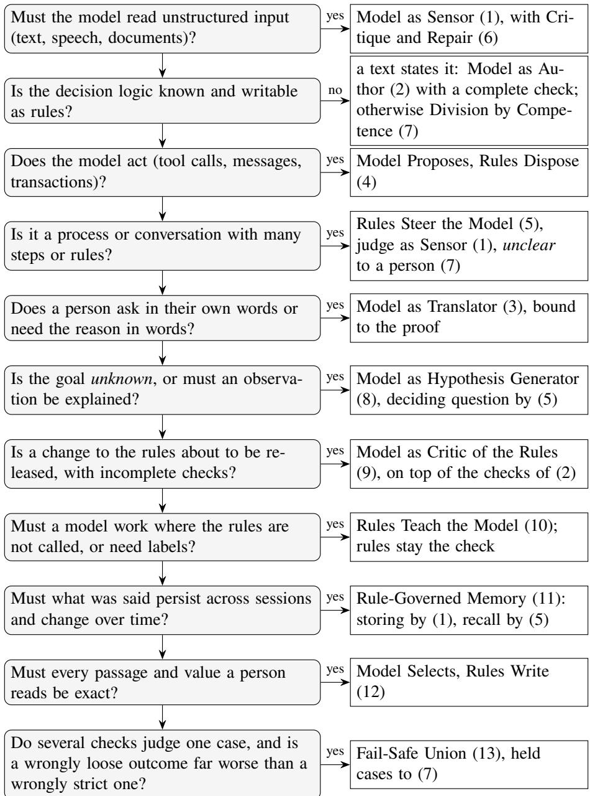  
Fi<sub>gure</sub> 14<sub>:</sub> D<sub>ec</sub>i<sub>s</sub>i<sub>on gu</sub>id<sub>e.</sub> A<sub>nswer every ques</sub>ti<sub>on;</sub> th<sub>e pa</sub>tt<sub>erns o</sub>f <sub>a</sub>ll <sub>answers</sub> th<sub>a</sub>t l<sub>ea</sub>d <sub>r</sub>i<sub>g</sub>ht <sub>com</sub>bi<sub>ne.</sub> Critique and Re<sub>p</sub>air (6) accom<sub>p</sub>anies ever<sub>y</sub> <sub>p</sub>attern whose re<sub>p</sub>l<sub>y</sub> is checked.

## 11 Limits

W<sub>e</sub> d<sub>rew</sub> th<sub>e ca</sub>t<sub>a</sub>l<sub>ogue</sub> f<sub>rom one eng</sub>i<sub>ne an</sub>d it<sub>s app</sub>li<sub>ca</sub>ti<sub>ons an</sub>d th<sub>en c</sub>h<sub>ec</sub>k<sub>e</sub>d it <sub>aga</sub>i<sub>ns</sub>t th<sub>e</sub> lit<sub>era</sub>t<sub>ure.</sub> It <sub>covers every coup</sub>li<sub>ng we</sub> h<sub>ave seen so</sub> f<sub>ar aroun</sub>d <sub>a sym</sub>b<sub>o</sub>li<sub>c, o</sub>fli<sub>ne core, an</sub>d th<sub>a</sub>t d<sub>oes no</sub>t <sub>prove</sub> it <sub>com</sub> l<sub>e</sub>t<sub>e.</sub> P<sub>a</sub>tt<sub>erns</sub> 12 <sub>an</sub>d 13 <sub>come</sub> f<sub>rom</sub> h<sub>ac</sub>k<sub>a</sub>th<sub>on su</sub>b<sub>m</sub>i<sub>ss</sub>i<sub>ons;</sub> th<sub>e</sub>i<sub>r</sub> fi <sub>ures are</sub> t<sub>a</sub>k<sub>en</sub> f<sub>rom resu</sub>lt fil<sub>es</sub> <sub>comm</sub>itt<sub>e</sub>d i<sub>n</sub> th<sub>ose</sub> <sub>repos</sub>it<sub>or</sub>i<sub>es,</sub> <sub>an</sub>d <sub>we</sub> h<sub>ave</sub> <sub>no</sub>t <sub>rerun</sub> th<sub>em.</sub> E<sub>very</sub> <sub>pa</sub>tt<sub>ern</sub> <sub>up</sub> t<sub>o</sub> 11 h<sub>as</sub> <sub>a</sub> <sub>program</sub> th<sub>a</sub>t <sub>ran aga</sub>i<sub>ns</sub>t <sub>a mo</sub>d<sub>e</sub>l<sub>;</sub> th<sub>e programs o</sub>f <sub>pa</sub>tt<sub>erns</sub> 12 <sub>an</sub>d 13 <sub>are c</sub>h<sub>ec</sub>k<sub>e</sub>d <sub>aga</sub>i<sub>ns</sub>t <sub>recor</sub>d<sub>e</sub>d <sub>rece</sub>i<sub>p</sub>t<sub>s on</sub>l<sub>y.</sub> P<sub>a</sub>tt<sub>erns</sub> 4<sub>,</sub> 7<sub>,</sub> 8<sub>,</sub> 10<sub>,</sub> 11<sub>,</sub> 12 <sub>an</sub>d 13 h<sub>ave no</sub> F<sub>rame</sub>X <sub>measuremen</sub>t <sub>o</sub>f th<sub>e</sub>i<sub>r own ye</sub>t<sub>, an</sub>d th<sub>e measuremen</sub>t <sub>o</sub>f <sub>pa</sub>tt<sub>ern</sub> 9 i<sub>s a p</sub>il<sub>o</sub>t <sub>on easy cases.</sub> M<sub>os</sub>t <sub>measuremen</sub>t<sub>s use syn</sub>th<sub>e</sub>ti<sub>c pro</sub>t<sub>oco</sub>l<sub>s an</sub>d <sub>one mo</sub>d<sub>e</sub>l f<sub>am</sub>il<sub>y;</sub> th<sub>e</sub> <sub>capa</sub>bilit<sub>y</sub> l<sub>a</sub>dd<sub>er</sub> <sub>m</sub>i<sub>xes</sub> <sub>mo</sub>d<sub>e</sub>l f<sub>am</sub>ili<sub>es</sub> <sub>an</sub>d <sub>reason</sub>i<sub>ng</sub> <sub>mo</sub>d<sub>es.</sub> C<sub>oup</sub>li<sub>ngs</sub> th<sub>a</sub>t <sub>nee</sub>d <sub>a</sub> dif<sub>eren</sub>t ki<sub>n</sub>d <sub>o</sub>f <sub>core</sub> (constraint solvin<sub>g</sub> and <sub>p</sub>lan search, <sub>p</sub>robabilistic inference over model scores, diferentiable lo<sub>g</sub>ic inside the model, trainin<sub>g</sub> itself) are outside the catalo<sub>g</sub>ue. The rules can check what such a core <sub>p</sub>roduces, as th<sub>ey</sub> <sub>c</sub>h<sub>ec</sub>k <sub>any</sub> <sub>ex</sub>t<sub>erna</sub>l t<sub>oo</sub>l<sub>.</sub>

## A Boxology legend

T<sub>a</sub>bl<sub>e</sub> 8 li<sub>s</sub>t<sub>s every e</sub>l<sub>emen</sub>t <sub>o</sub>f th<sub>e</sub> St<sub>ruc</sub>t<sub>ure</sub> di<sub>agrams.</sub> Th<sub>e no</sub>d<sub>e</sub> ki<sub>n</sub>d<sub>s an</sub>d th<sub>e</sub>i<sub>r</sub> l<sub>a</sub>b<sub>e</sub>l<sub>s</sub> f<sub>o</sub>ll<sub>ow van</sub> B<sub>e</sub>kk<sub>um</sub> et al. (2021), the <sub>g</sub>enerative model follows de Boer et al. (2025); the request arrow and the notes are ours.

T<sub>a</sub>bl<sub>e</sub> 8<sub>:</sub> El<sub>emen</sub>t<sub>s</sub> <sub>o</sub>f th<sub>e</sub> b<sub>oxo</sub>l<sub>ogy</sub> di<sub>agrams.</sub>
<table><tr><td>Symbol</td><td>Name</td><td>Meaning in this catalogue</td></tr><tr><td>data: text</td><td>instance: data</td><td>Model-free input or output, here text: a document, a question, a model&#x27;s reply before it is read as facts.</td></tr><tr><td>symbol</td><td>instance: symbol</td><td>Model-based structure: facts, requests, proposals, verdicts. A note below the box gives its status, such as proposed or accepted.</td></tr><tr><td>model: gen</td><td>model: generative (the LLM)</td><td>A language model that infers new data from data (de Boer et al. 2025); the note names its role (dialogue model, judge, critic).</td></tr><tr><td>model: sem</td><td>model: semantic (the FrameX rule base)</td><td>A rule base: the FrameX rules, a flow, a slot policy, a checker with its cases.</td></tr><tr><td>infer</td><td>process: infer</td><td>Applying a model to an instance. With a generative model above it, one model call.</td></tr><tr><td>infer: deduce</td><td>process: infer, deduce</td><td>Applying the rules: deriving, accepting, refusing, deciding.</td></tr><tr><td>trans- form</td><td>process: transform</td><td>Turning one kind of instance into another. Here mostly the receipt: the host turns a reply into symbols and adds its measurements (quote found, decision word).</td></tr><tr><td rowspan="5">generate: train generate: engineer △ person</td><td>process: generate, train</td><td>Building a model from instances (pattern 10).</td></tr><tr><td>process: generate,</td><td>A person builds or adopts a model, such as a rule (pattern 2).</td></tr><tr><td>engineer actor</td><td>A person who answers, decides or reviews: applicant,</td></tr><tr><td>flow</td><td>expert, officer, reviewer. What a process consumes or produces; from a model to</td></tr><tr><td>request (ours)</td><td>a process, the model that the process applies. Control: the inference with the rules issues the call that the process at the arrow&#x27;s head carries out. It marks the</td></tr><tr><td></td><td></td><td>external requests of Section 2.1. The role of a node in the pattern, written below or</td></tr><tr><td>note</td><td>note (ours)</td><td>above it.</td></tr></table>

## B Pattern libraries

A lib<sub>rary</sub> h<sub>o</sub>ld<sub>s</sub> th<sub>e</sub> <sub>ru</sub>l<sub>es</sub> <sub>o</sub>f <sub>a</sub> <sub>pa</sub>tt<sub>ern,</sub> <sub>an</sub>d <sub>a</sub> <sub>program</sub> th<sub>a</sub>t l<sub>oa</sub>d<sub>s</sub> it <sub>s</sub>t<sub>a</sub>t<sub>es</sub> f<sub>ac</sub>t<sub>s</sub> <sub>an</sub>d <sub>on</sub>l<sub>y</sub> th<sub>e</sub> <sub>ru</sub>l<sub>es</sub> th<sub>a</sub>t b<sub>e</sub>l<sub>ong</sub> t<sub>o</sub> it<sub>s</sub> d<sub>oma</sub>i<sub>n,</sub> i<sub>n</sub> th<sub>e</sub> <sub>way</sub> th<sub>e</sub> fl<sub>ow</sub> lib<sub>rary</sub> <sub>o</sub>f F<sub>rame</sub>X <sub>serves</sub> <sub>pa</sub>tt<sub>ern</sub> 5<sub>.</sub> Th<sub>e</sub> <sub>compan</sub>i<sub>on</sub> f<sub>o</sub>ld<sub>er</sub> h<sub>as</sub> <sub>one</sub> librar<sub>y</sub> <sub>p</sub>er <sub>p</sub>attern u<sub>p</sub> to 11 (library/); <sub>p</sub>atterns 12 and 13 have none <sub>y</sub>et. Each librar<sub>y</sub> comes with the <sub>program o</sub>f it<sub>s pa</sub>tt<sub>ern</sub> i<sub>n</sub> lib<sub>rary</sub> f<sub>orm,</sub> t<sub>es</sub>t<sub>s, an</sub>d <sub>a recor</sub>d<sub>e</sub>d <sub>run.</sub> L<sub>oa</sub>d th<sub>e</sub> lib<sub>rary</sub> b<sub>e</sub>f<sub>ore</sub> th<sub>e program:</sub>

```shell
$FRAMEX_HOME/target/release/framex test library/sensor.fx library/p01-sensor-lib.fx \
library/tests/p01-sensor-lib.test.fx
python3 -m framex.tools library/memory.fx library/p11-memory-lib.fx
python3 -m framex.tools --adapter author_adapter.py library/author.fx library/p02-
author-lib.fx
```

Ever<sub>y</sub> name a librar<sub>y</sub> defines carries its <sub>p</sub>refix (sensor#, author#, tr#, ag#, cp#, hy#, cr#, te#, mem#), <sub>so</sub> it <sub>canno</sub>t <sub>co</sub>llid<sub>e</sub> <sub>w</sub>ith th<sub>e</sub> <sub>program</sub>’<sub>s</sub> <sub>own</sub> <sub>names.</sub> Wh<sub>a</sub>t <sub>s</sub>t<sub>ays</sub> <sub>w</sub>ith th<sub>e</sub> <sub>program</sub> i<sub>s</sub> <sub>w</sub>h<sub>a</sub>t <sub>on</sub>l<sub>y</sub> th<sub>e</sub> d<sub>oma</sub>i<sub>n</sub> k<sub>nows:</sub> th<sub>e</sub> d<sub>ec</sub>i<sub>s</sub>i<sub>on</sub> <sub>o</sub>f <sub>pa</sub>tt<sub>ern</sub> 3<sub>,</sub> <sub>w</sub>h<sub>a</sub>t th<sub>e</sub> <sub>ac</sub>ti<sub>ons</sub> <sub>o</sub>f <sub>pa</sub>tt<sub>ern</sub> 4 d<sub>o,</sub> <sub>w</sub>hi<sub>c</sub>h <sub>cases</sub> <sub>pa</sub>tt<sub>ern</sub> 7 d<sub>ec</sub>id<sub>es,</sub> th<sub>e</sub> t<sub>es</sub>t<sub>s</sub> <sub>o</sub>f <sub>pa</sub>tt<sub>ern</sub> 8<sub>,</sub> th<sub>e</sub> l<sub>a</sub>b<sub>e</sub>l<sub>s</sub> <sub>o</sub>f <sub>pa</sub>tt<sub>ern</sub> 10<sub>.</sub> Th<sub>e</sub> <sub>reques</sub>t fi<sub>e</sub>ld<sub>s</sub> k<sub>eep</sub> fi<sub>xe</sub>d <sub>names;</sub> <sub>a</sub> lib<sub>rary</sub> <sub>mean</sub>t f<sub>or</sub> <sub>o</sub>th<sub>er</sub> <sub>sources wou</sub>ld <sub>ma</sub>k<sub>e</sub> th<sub>em parame</sub>t<sub>ers.</sub> Th<sub>e</sub> lib<sub>rar</sub>i<sub>es are pro</sub>t<sub>o</sub>t<sub>ypes</sub> i<sub>n</sub> th<sub>e compan</sub>i<sub>on</sub> f<sub>o</sub>ld<sub>er an</sub>d <sub>are mean</sub>t to move into FrameX beside flow.fx.

## sensor.fx: pattern 1, Model as Sensor

// Sensor library (pattern 1, Model as Sensor). Load it before the program.   
2 // The program states facts only:   
// ?D:sensor#Source[sensor#text -> "..."; sensor#kind -> ?K; sensor#prompt -> ?P]   
// ?K[sensor#allows -> "slot"] what this kind of source may state   
// ?P:Prompt[text -> "..."] asks for rows {slot, value, quote}   
6 // The library derives, for every source ?D and answer row ?I:   
7 // ?D[sensor#accepted(?I) -> ?V] quoted, and a statement this kind may make   
8 // ?D[sensor#rejected(?I) -> "reason"] with the reason   
9 // ?D[sensor#notRead -> "error"] the call failed; nothing proposed   
10 closed slot sensor#allows.   
11   
12 // Request: one call per source; the host checks every quote against the text.   
13 external sense(?D) using \_llm[prompt -> ?P; document -> ?T; groundIn -> ?T]   
14 <- ?D:sensor#Source[sensor#text -> ?T; sensor#prompt -> ?Pr] AND ?Pr[text -> ?P].   
15   
16 // Receipt: each answer row is a proposed statement about the source.   
17 ?D[sensor#slot(?I) -> ?S; sensor#value(?I) -> ?V; sensor#quoteFound(?I) -> ?Q]   
18 <- ?D:sensor#Source AND ?R[tool#name -> "\_llm"; tool#arg1 -> ?D;   
19 row(?I, "slot") -> ?S; row(?I, "value") -> ?V; row(?I, "quoteFound") -> ?Q].   
20   
21 // Accept and reject.   
22 ?D[sensor#accepted(?I) -> ?V]   
23 <- ?D:sensor#Source[sensor#kind -> ?K; sensor#slot(?I) -> ?S; sensor#value(?I) ->   
?V;   
24 sensor#quoteFound(?I) -> true] AND ?K[sensor#allows -> ?S].   
25   
26 ?D[sensor#rejected(?I) -> "quote not found in the source"]   
27 <- ?D:sensor#Source[sensor#quoteFound(?I) -> false].   
28   
29 ?D[sensor#rejected(?I) -> "not a statement this kind of source can make"]   
30 <- ?D:sensor#Source[sensor#kind -> ?K; sensor#slot(?I) -> ?S]   
31 AND NOT ?K[sensor#allows -> ?S].   
32   
33 // A failed call proposes nothing.   
34 ?D[sensor#notRead -> ?E]

<- ?D:sensor#Source AND ?R[tool#name -> "\_llm"; tool#arg1 -> ?D;   
tool#status -> "failed"; error -> ?E].

## author.fx: pattern 2, Model as Author, with Critique and Repair

// Author library (pattern 2, Model as Author, with pattern 6, Critique and Repair)   
// Load it before the program; the host needs the adapter for \_checkCandidate.   
// The program states facts only:   
4 // ?P:author#Policy[author#text -> "..."; author#vocabulary -> "...";   
5 // author#draftPrompt -> ?D; author#repairPrompt -> ?R; author#maxAttempts -> N]   
// The library derives author#rule(N), author#failed(N) with the checker's message,   
// author#adoptable (a recommendation for a person), author#stalled and   
author#gaveUp.   
8   
// Attempt 1: the model drafts.   
10 external draft(?P, 1) using \_llm[prompt -> ?Pt; policy -> ?T; vocabulary -> ?V;   
1 tool#order -> 2]   
12 <- ?P:author#Policy[author#text -> ?T; author#vocabulary -> ?V;   
author#draftPrompt -> ?D]   
13 AND ?D[text -> ?Pt].   
14   
15 ?P[author#rule(?N) -> ?T]   
16 <- ?P:author#Policy AND ?R[tool#name -> "\_llm"; tool#arg1 -> ?P; tool#arg2 -> ?N;   
17 result("rule") -> ?T].   
18   
19 // Every draft is checked; the cases stay hidden from the model.   
20 external check(?P, ?N) using \_checkCandidate[candidate -> ?T; tool#order -> 1]   
21 <- ?P:author#Policy[author#rule(?N) -> ?T].   
22   
23 ?P[author#passed(?N) -> true]   
24 <- ?P:author#Policy AND ?R[tool#name -> "\_checkCandidate"; tool#arg1 -> ?P;   
tool#arg2 -> ?N;   
25 result("status") -> "checked"; result("regressions") -> false;   
26 result("failedAfter") -> 0].   
27   
28 ?P[author#adoptable -> ?T] <- ?P:author#Policy[author#passed(?N) -> true;   
author#rule(?N) -> ?T].   
29   
30 ?P[author#failed(?N) -> ?F]   
31 <- ?P:author#Policy AND ?R[tool#name -> "\_checkCandidate"; tool#arg1 -> ?P;   
tool#arg2 -> ?N;   
32 result("status") -> ?St; result("feedback") -> ?F] AND ?St != "checked".   
33   
34 ?P[author#failed(?N) -> ?F]   
35 <- ?P:author#Policy AND ?R[tool#name -> "\_checkCandidate"; tool#arg1 -> ?P;   
tool#arg2 -> ?N;   
36 result("regressions") -> true; result("feedback") -> ?F].   
37   
38 ?P[author#failed(?N) -> ?F]   
39 <- ?P:author#Policy AND ?R[tool#name -> "\_checkCandidate"; tool#arg1 -> ?P;   
tool#arg2 -> ?N;   
40 result("failedAfter") -> ?K; result("feedback") -> ?F] AND ?K > 0.   
41   
42 // Repair (pattern 6): ask again with the rule and the problem, as a new request.   
43 ?P[author#newProblem(1) -> true] <- ?P:author#Policy[author#failed(1) -> ?F].   
44

45 ?P[author#newProblem(?N) -> true]   
46 <- ?P:author#Policy[author#failed(?N) -> ?F] AND ?K := ?N - 1   
47 AND ?P[author#failed(?K) -> ?G] AND ?F != ?G.   
48   
49 external draft(?P, ?M) using \_llm[prompt -> ?Pt; policy -> ?T; vocabulary -> ?V;   
50 previousRule -> ?Old; problem -> ?F; tool#order -> 2]   
51 <- ?P:author#Policy[author#text -> ?T; author#vocabulary -> ?V;   
author#maxAttempts -> ?Max;   
52 author#repairPrompt -> ?Rp; author#rule(?N) -> ?Old; author#failed(?N) -> ?F   
;   
53 author#newProblem(?N) -> true]   
54 AND ?Rp[text -> ?Pt] AND ?N < ?Max AND ?M := ?N + 1.   
55   
56 ?P[author#stalled -> ?N]   
57 <- ?P:author#Policy[author#failed(?N) -> ?F] AND ?K := ?N - 1 AND ?P[   
author#failed(?K) -> ?F].   
58   
59 ?P[author#gaveUp -> ?F] <- ?P:author#Policy[author#maxAttempts -> ?N; author#failed   
(?N) -> ?F].

## translator.fx: pattern 3, Model as Translator

// Translator library (pattern 3, Model as Translator). Load it before the program.   
// The program states:   
// ?Q:tr#Question[tr#text -> "..."; tr#prompt -> ?P] the person's words   
// "field"[tr#allows -> "value"] the closed list of each field   
// tr#phrasing[tr#prompt -> ?P] how a decision is put into words   
6 // and its own decision rules over valid fields only:   
// ?Q[tr#decision -> "word"] <- ?Q:tr#Question[tr#valid("f") -> ?V; ...] AND ...   
8 // The library derives tr#field("f"), tr#valid("f"), tr#refused with the field,   
9 // tr#reply or tr#replyRefused.   
10 closed slot tr#allows. closed slot tr#hasBad.   
11   
12 external translate(?Q) using \_llm[prompt -> ?P; question -> ?T]   
13 <- ?Q:tr#Question[tr#text -> ?T; tr#prompt -> ?Pr] AND ?Pr[text -> ?P].   
14   
15 // Every answer field the program declares, read from the receipt.   
16 ?Q[tr#field(?F) -> ?V]   
17 <- ?Q:tr#Question AND ?F[tr#allows -> ?X]   
18 AND ?R[tool#name -> "\_llm"; tool#arg1 -> ?Q; result(?F) -> ?V].   
19   
20 // A field inside its closed list is valid; decision rules read only valid fields.   
21 ?Q[tr#valid(?F) -> ?V] <- ?Q:tr#Question[tr#field(?F) -> ?V] AND ?F[tr#allows -> ?V   
].   
22   
23 // A field outside its closed list refuses the request and names the field.   
24 ?Q[tr#bad(?F) -> true] <- ?Q:tr#Question[tr#field(?F) -> ?V] AND NOT ?F[tr#allows   
-> ?V].   
25 ?Q[tr#refused -> ?F] <- ?Q:tr#Question[tr#bad(?F) -> true].   
26 ?Q[tr#hasBad -> true] <- ?Q:tr#Question[tr#bad(?F) -> true].   
27   
28 // For display only: every declared field valid. Decision rules must not read it,   
because   
29 // it negates over receipts, and the reply request depends on the decision.   
30 ?Q[tr#runs -> true]   
31 <- ?Q:tr#Question AND ?R[tool#name -> "\_llm"; tool#arg1 -> ?Q; result(?F) -> ?V]   
32 AND NOT ?Q[tr#hasBad -> true].

33   
34 // From the decision to words; the reply counts only if it says the decision word.   
35 external phrase(?Q) using \_llm[prompt -> ?P; decision -> ?D; mustSay -> ?D]   
36 <- ?Q:tr#Question[tr#decision -> ?D] AND tr#phrasing[tr#prompt -> ?Pr] AND ?Pr[   
text -> ?P].   
37   
38 ?Q[tr#reply -> ?Text]   
39 <- ?Q:tr#Question AND ?X[tool#name -> "\_llm"; tool#arg1 -> ?Q;   
40 result("saysDecision") -> true; result("text") -> ?Text].   
41   
42 ?Q[tr#replyRefused -> "the reply does not state the decision"]   
43 <- ?Q:tr#Question AND ?X[tool#name -> "\_llm"; tool#arg1 -> ?Q;   
44 result("saysDecision") -> false].

## agent.fx: pattern 4, Model Proposes, Rules Dispose

// Agent library (pattern 4, Model Proposes, Rules Dispose). Load it before the   
program.   
2 // The program states:   
// ?T:ag#Task[ag#goal -> "..."; ag#actions -> "..."; ag#maxSteps -> N; ag#prompt ->   
?P]   
// ?T[ag#grants -> "action"] what the task may do   
// and, for each granted action, the rules that carry it out and report:   
// ?T[ag#outcome(?N) -> "..."] what became of step ?N   
// ?T[ag#evidence -> true] what completion rests on   
8 // The library derives the proposals, admission or refusal with a reason, the next   
step,   
9 // and ?T[ag#verdict -> "completed"] or "stopped at the step bound".   
10 closed slot ag#grants.   
11   
12 external propose(?T, ?N) using \_llm[prompt -> ?P; goal -> ?G; actions -> ?Acts;   
13 outcome -> "none"; tool#order -> 2]   
14 <- ?T:ag#Task[ag#goal -> ?G; ag#actions -> ?Acts; ag#prompt -> ?Pr] AND ?Pr[text   
-> ?P]   
15 AND ?N := 1.   
16   
17 ?R:ag#Proposal[ag#task -> ?T; ag#step -> ?N; ag#action -> ?K]   
18 <- ?T:ag#Task AND ?R[tool#name -> "\_llm"; tool#arg1 -> ?T; tool#arg2 -> ?N;   
19 result("action") -> ?K].   
20   
21 ?A[ag#allowed -> true]   
22 <- ?A:ag#Proposal[ag#task -> ?T; ag#action -> ?K] AND ?T[ag#grants -> ?K].   
23   
24 ?A[ag#refused -> "action not granted for this task"]   
25 <- ?A:ag#Proposal[ag#task -> ?T; ag#action -> ?K] AND NOT ?T[ag#grants -> ?K].   
26   
27 // The next step carries the outcome of the last one; maxSteps stops the loop.   
28 ?T[ag#next(?M) -> ?W]   
29 <- ?A:ag#Proposal[ag#task -> ?T; ag#step -> ?N; ag#refused -> ?W]   
30 AND ?T[ag#maxSteps -> ?Max] AND ?N < ?Max AND ?M := ?N + 1.   
31   
32 ?T[ag#next(?M) -> ?X]   
33 <- ?A:ag#Proposal[ag#task -> ?T; ag#step -> ?N; ag#allowed -> true]   
34 AND ?T[ag#outcome(?N) -> ?X; ag#maxSteps -> ?Max] AND ?N < ?Max AND ?M := ?N +   
1.   
35   
36 external propose(?T, ?N) using \_llm[prompt -> ?P; goal -> ?G; actions -> ?Acts;

37 outcome -> ?W; tool#order -> 2]   
38 <- ?T:ag#Task[ag#goal -> ?G; ag#actions -> ?Acts; ag#prompt -> ?Pr; ag#next(?N)   
-> ?W]   
39 AND ?Pr[text -> ?P].   
40   
41 // Completion only on recorded evidence.   
42 ?T[ag#verdict -> "completed"]   
43 <- ?A:ag#Proposal[ag#task -> ?T; ag#action -> "finish"; ag#allowed -> true]   
44 AND ?T[ag#evidence -> true].   
45   
46 ?T[ag#verdict -> "stopped at the step bound"]   
47 <- ?A:ag#Proposal[ag#task -> ?T; ag#step -> ?N; ag#action -> ?K] AND ?T[   
ag#maxSteps -> ?N]   
48 AND ?K != "finish".

## competence.fx: pattern 7, Division by Competence

// Competence library (pattern 7, Division by Competence). Load it before the   
program.   
2 // The program states the cases and its own rules for what it decides:   
3 // ?C:cp#Case[cp#file -> "..."; cp#prompt -> ?P]   
4 // ?C[cp#decided -> true] <- ... the cases the rules cover   
5 // The library sends every other case to the model for an assessment and hands it   
on to a   
6 // person, ?C[cp#handOn -> true], with the assessment as ?C[cp#note -> "..."].   
closed slot cp#decided.   
8   
9 external assess(?C) using \_llm[prompt -> ?P; file -> ?T]   
10 <- ?C:cp#Case[cp#file -> ?T; cp#prompt -> ?Pr] AND ?Pr[text -> ?P]   
11 AND NOT ?C[cp#decided -> true].   
12   
13 ?C[cp#assessment -> ?V]   
14 <- ?C:cp#Case AND ?R[tool#name -> "\_llm"; tool#arg1 -> ?C; result("verdict") ->   
?V].   
15   
16 ?C[cp#handOn -> true] <- ?C:cp#Case AND NOT ?C[cp#decided -> true].   
17   
18 ?C[cp#note -> ?W]   
19 <- ?C:cp#Case[cp#handOn -> true] AND ?R[tool#name -> "\_llm"; tool#arg1 -> ?C;   
20 result("reason") -> ?W].   
21   
22 ?C[cp#note -> "no assessment: the model call failed"]   
23 <- ?C:cp#Case[cp#handOn -> true] AND ?R[tool#name -> "\_llm"; tool#arg1 -> ?C;   
24 tool#status -> "failed"].

## hypothesis.fx: pattern 8, Model as Hypothesis Generator

// Hypothesis library (pattern 8, Model as Hypothesis Generator). Load it before   
the program.   
2 // The program states the observation and its own tests:   
3 // ?O:hy#Observation[hy#text -> "..."; hy#prompt -> ?P; hy#label -> "key"]   
4 // ?O[hy#refuted(?I) -> true] <- ... hy#candidate(?I, "key") ... what rules out a   
candidate   
5 // The prompt asks for rows, one per candidate; hy#label names the row field that a   
6 // person is asked about. The library derives the candidates, the survivors and   
// ?O[hy#askAbout(?I) -> "..."]. A candidate never becomes a fact.

8 closed method hy#refuted/1.   
9   
10 external propose(?O) using \_llm[prompt -> ?P; observation -> ?T]   
11 <- ?O:hy#Observation[hy#text -> ?T; hy#prompt -> ?Pr] AND ?Pr[text -> ?P].   
12   
13 // Every field of every row is kept, keyed by row and field name.   
14 ?O[hy#candidate(?I, ?K) -> ?V]   
15 <- ?O:hy#Observation AND ?R[tool#name -> "\_llm"; tool#arg1 -> ?O; tool#status ->   
"succeeded";   
16 row(?I, ?K) -> ?V].   
17   
18 ?O[hy#survives(?I) -> true]   
19 <- ?O:hy#Observation[hy#label -> ?L; hy#candidate(?I, ?L) -> ?E]   
20 AND NOT ?O[hy#refuted(?I) -> true].   
21   
22 ?O[hy#askAbout(?I) -> ?E]   
23 <- ?O:hy#Observation[hy#label -> ?L; hy#survives(?I) -> true; hy#candidate(?I, ?L   
) -> ?E].

## critic.fx: pattern 9, Model as Critic of the Rules

// Critic library (pattern 9, Model as Critic of the Rules). Load it before the   
program.   
2 // The program states the change:   
// ?C:cr#Change[cr#rationale -> "..."; cr#review -> "..."; cr#prompt -> ?P;   
// cr#reviewed -> true; cr#changed -> "case"]   
5 // ?C[cr#disposed(?I) -> true] a reviewer has dealt with remark ?I   
// The library derives grounded remarks cr#remark(?I), cr#blocked for a failed call   
, and   
7 // cr#approved once the critique ran and every remark is disposed of.   
8 closed method cr#disposed/1. closed slot cr#hasOpen. closed slot cr#critiqued.   
9   
10 external critique(?C) using \_llm[prompt -> ?P; rationale -> ?Ra; review -> ?Rv;   
groundIn -> ?Ra]   
11 <- ?C:cr#Change[cr#rationale -> ?Ra; cr#review -> ?Rv; cr#prompt -> ?Pr] AND ?Pr[   
text -> ?P].   
12   
13 // A remark counts only with a found quote and a case the change really changed.   
14 ?C[cr#remark(?I) -> ?K]   
15 <- ?C:cr#Change[cr#changed -> ?K] AND ?R[tool#name -> "\_llm"; tool#arg1 -> ?C;   
16 row(?I, "case") -> ?K; row(?I, "quoteFound") -> true].   
17   
18 ?C[cr#critiqued -> true]   
19 <- ?C:cr#Change AND ?R[tool#name -> "\_llm"; tool#arg1 -> ?C; tool#status -> "   
succeeded"].   
20   
21 ?C[cr#blocked -> ?E]   
22 <- ?C:cr#Change AND ?R[tool#name -> "\_llm"; tool#arg1 -> ?C; tool#status -> "   
failed";   
23 error -> ?E].   
24   
25 ?C[cr#hasOpen -> true] <- ?C:cr#Change[cr#remark(?I) -> ?K] AND NOT ?C[cr#disposed(   
?I) -> true].   
26   
27 ?C[cr#approved -> true]   
28 <- ?C:cr#Change[cr#reviewed -> true; cr#critiqued -> true] AND NOT ?C[cr#hasOpen   
-> true].

## teach.fx: pattern 10, Rules Teach the Model

// Teach library (pattern 10, Rules Teach the Model). Load it before the program.   
// The program states the cases and its own labelling rules:   
// ?C:te#Case[te#description -> "..."; te#prompt -> ?P]   
4 // ?C[te#label -> "decision"] <- ... ?C[te#gap -> "requirement"] <- ...   
// The prompt asks for {"decision": ..., "rows": [{"gap": ...}]}. The library   
derives one   
6 // te#Answer per case and grades it: te#right, te#missedGap.   
closed slot te#named.   
8   
9 external answer(?C) using \_llm[prompt -> ?P; description -> ?T]   
10 <- ?C:te#Case[te#description -> ?T; te#prompt -> ?Pr] AND ?Pr[text -> ?P].   
11   
12 ?R:te#Answer[te#case -> ?C; te#decision -> ?D]   
13 <- ?C:te#Case AND ?R[tool#name -> "\_llm"; tool#arg1 -> ?C; result("decision") ->   
?D].   
14   
15 ?R[te#named -> ?G] <- ?R:te#Answer AND ?R[row(?I, "gap") -> ?G].   
16   
17 ?A[te#right -> true] <- ?A:te#Answer[te#case -> ?C; te#decision -> ?D] AND ?C[   
te#label -> ?D].   
18   
19 ?A[te#missedGap -> ?G]   
20 <- ?A:te#Answer[te#case -> ?C] AND ?C[te#gap -> ?G] AND NOT ?A[te#named -> ?G].

## memory.fx: pattern 11, Rule-Governed Memory

// Memory library (pattern 11, Rule-Governed Memory). Load it before the program.   
2 // The program states facts only:   
3 // ?K[mem#mayEstablish -> "slot"] what a kind of source may establish   
4 // ?U:mem#Utterance[mem#kind -> ?K; mem#seq -> N; mem#text -> "..."; mem#prompt ->   
?P]   
5 // ?S:mem#Step[mem#about -> "who"; mem#needs -> "slot"] what one step may see   
6 // ?Q:mem#Question[mem#step -> ?S; mem#text -> "..."; mem#prompt -> ?P]   
7 // ?U[mem#forgotten -> true] a person's request to forget   
8 // The library derives statements st(?U, ?I) with mem#accepted, mem#rejected,   
mem#current,   
9 // the context of each step, and ?Q[mem#answer -> "..."] or ?Q[mem#refused -> ...].   
10 closed slot mem#mayEstablish. closed slot mem#forgotten. closed slot mem#hasNewer.   
11 closed slot mem#current. closed slot mem#hasBad.   
12 closed method mem#sentId/1.   
13   
14 // Storing (pattern 1): one statement object per quoted answer row.   
15 external remember(?U) using \_llm[prompt -> ?P; utterance -> ?T; groundIn -> ?T;   
tool#order -> 2]   
16 <- ?U:mem#Utterance[mem#text -> ?T; mem#prompt -> ?Pr] AND ?Pr[text -> ?P]   
17 AND NOT ?U[mem#forgotten -> true].   
18   
19 st(?U, ?I):mem#Statement[mem#from -> ?U; mem#about -> ?A; mem#slot -> ?S; mem#value   
-> ?V]   
20 <- ?U:mem#Utterance AND ?R[tool#name -> "\_llm"; tool#arg1 -> ?U; row(?I, "about")   
-> ?A;   
21 row(?I, "slot") -> ?S; row(?I, "value") -> ?V; row(?I, "quoteFound") -> true   
].   
22   
23 // Admission, rejection, supersession.

24 ?St[mem#accepted -> true]   
25 <- ?St:mem#Statement[mem#from -> ?U; mem#slot -> ?S] AND ?U[mem#kind -> ?K]   
26 AND ?K[mem#mayEstablish -> ?S] AND NOT ?U[mem#forgotten -> true].   
27   
28 ?St[mem#rejected -> "this kind of source cannot establish it"]   
29 <- ?St:mem#Statement[mem#from -> ?U; mem#slot -> ?S] AND ?U[mem#kind -> ?K]   
30 AND NOT ?K[mem#mayEstablish -> ?S].   
31   
32 ?St[mem#hasNewer -> true]   
33 <- ?St:mem#Statement[mem#accepted -> true; mem#from -> ?U; mem#about -> ?A;   
mem#slot -> ?S]   
34 AND ?U[mem#seq -> ?N]   
35 AND ?Nw:mem#Statement[mem#accepted -> true; mem#from -> ?W; mem#about -> ?A;   
mem#slot -> ?S]   
36 AND ?W[mem#seq -> ?M] AND ?M > ?N.   
37   
38 ?St[mem#current -> true] <- ?St:mem#Statement[mem#accepted -> true] AND NOT ?St[   
mem#hasNewer -> true].   
39   
40 // Forgetting also reaches the answer store.   
41 external forget(?U) using \_forgetAnswers[text -> ?T; tool#order -> 1]   
42 <- ?U:mem#Utterance[mem#forgotten -> true; mem#text -> ?T].   
43   
44 // Recall (pattern 5): a step sees the current statements it needs, and nothing   
else.   
45 ?St[selectedFor -> ?K]   
46 <- ?K:mem#Step[mem#about -> ?A; mem#needs -> ?S]   
47 AND ?St:mem#Statement[mem#current -> true; mem#about -> ?A; mem#slot -> ?S].   
48   
49 external answer(?Q) using \_llm[prompt -> ?P; question -> ?T; contextKey -> ?K;   
tool#order -> 3]   
50 <- ?Q:mem#Question[mem#text -> ?T; mem#step -> ?K; mem#prompt -> ?Pr] AND ?Pr[   
text -> ?P].   
51   
52 // Citations: every cited id must have been sent, and its statement must be current   
53 ?R[mem#sentId(?C) -> true] <- ?R[tool#sent(?C) -> ?St].   
54 ?Q[mem#cites -> ?St]   
55 <- ?Q:mem#Question AND ?R[tool#arg1 -> ?Q; row(?I, "cited") -> ?C; tool#sent(?C)   
-> ?St].   
56 ?Q[mem#refused -> ?C]   
57 <- ?Q:mem#Question AND ?R[tool#arg1 -> ?Q; row(?I, "cited") -> ?C]   
58 AND NOT ?R[mem#sentId(?C) -> true].   
59 ?Q[mem#refused -> ?St] <- ?Q:mem#Question[mem#cites -> ?St] AND NOT ?St[mem#current   
-> true].   
60 ?Q[mem#hasBad -> true] <- ?Q:mem#Question[mem#refused -> ?X].   
61 ?Q[mem#answer -> ?Text]   
62 <- ?Q:mem#Question[mem#cites -> ?St] AND ?R[tool#arg1 -> ?Q; result("text") ->   
?Text]   
63 AND NOT ?Q[mem#hasBad -> true].

## C Rule graph legend

Table 9 lists the elements of the rule <sub>g</sub>ra<sub>p</sub>hs and the flow dia<sub>g</sub>ram. The scri<sub>p</sub>t rulegraph.py of the com-<sub>p</sub>anion folder draws them from a <sub>p</sub>ro<sub>g</sub>ram with Gra<sub>p</sub>hviz: python3 rulegraph.py p01-sensor.fx > p01.dot, then dot -Tpdf p01.dot -o p01.pdf.

T<sub>a</sub>bl<sub>e</sub> 9<sub>:</sub> El<sub>emen</sub>t<sub>s o</sub>f th<sub>e ru</sub>l<sub>e grap</sub>h<sub>s an</sub>d th<sub>e</sub> fl<sub>ow</sub> di<sub>agram.</sub>
<table><tr><td>Symbol</td><td>Meaning</td></tr><tr><td>Document</td><td>Facts of a class or object, with their slots, and the prompt objects.</td></tr><tr><td> $\begin{array} { r } { \vert \overrightarrow { \mathrm { \ r e a d } } \vert  - 1 1 \overrightarrow { \mathrm { \iota m } } \vert } \\ { \vert \overrightarrow { \mathrm { \iota \ c \ e a d } } \vert  - \overrightarrow { \mathrm { \iota \ c \ } } \vert } \end{array}$ </td><td>An external request and its tool.</td></tr><tr><td>receipt</td><td>The receipt the host writes, with the fields the rules read: result  $( " \mathbf { k } " )$ </td></tr><tr><td></td><td>row  $( " \mathbf { k } " )$  , tool#status, error.</td></tr><tr><td>accepted(I)</td><td>Slots or classes that the rules derive. A box lists the slots of one rule head. One rule. The label is the line of the program listing where the rule starts:</td></tr><tr><td>(.23</td><td> $" 1 . 2 3 "$  is the rule in line 23.</td></tr><tr><td>(1.14)</td><td>A rule that issues an external request, labelled by its line in the same way.</td></tr><tr><td></td><td>Into a rule: the rule reads it. Out of a rule: the rule derives it.</td></tr><tr><td></td><td>The rule reads it under NOT.</td></tr><tr><td></td><td>The rule issues the request.</td></tr><tr><td></td><td>The host carries out the request and writes the receipt.</td></tr><tr><td>Collect</td><td>Flow diagram: a step that asks a question and lets a judge decide its criterion.</td></tr><tr><td>Say</td><td>Flow diagram: a step that shows a text.</td></tr><tr><td>◎</td><td>Start and end of the flow.</td></tr><tr><td></td><td>A rejected attempt: the question is asked again while attempts remain.</td></tr></table>

## References

Alexander, Christopher et al. (1977). A Pattern Language: Towns, Buildings, Construction. New York: O<sub>x</sub>f<sub>or</sub>d U<sub>n</sub>i<sub>vers</sub>it<sub>y</sub> P<sub>ress.</sub>

Bai, Yuntao et al. (2022). Constitutional AI: Harmlessness from AI Feedback. arXiv: 2212.08073.

Buschmann, Frank et al. (1996). Pattern-Oriented Software Architecture, Volume 1: A System of Patterns. Chi<sub>c</sub>h<sub>es</sub>t<sub>er:</sub> Wil<sub>ey.</sub>

D’Avila Garcez, Artur and Luís C. Lamb (2023). “Neurosymbolic AI: The 3rd Wave”. In: Artificial Intelligence Review 56.11, <sub>pp</sub>. 12387–12406. doi: 10.1007/s10462-023-10448-w.

De Boer, Maaike et al. (2025). “Desi<sub>g</sub>n Patterns for Lar<sub>g</sub>e Lan<sub>g</sub>ua<sub>g</sub>e Model Based Neuro-S<sub>y</sub>mbolic Systems”. In: Neurosymbolic Artificial Intelligence 1, 29498732251377499. doi: 10 . 1177 / 29498732251377499.

Gamma, Erich et al. (1994). Design Patterns: Elements of Reusable Object-Oriented Software. Reading, MA<sub>:</sub> Addi<sub>son-</sub>W<sub>es</sub>l<sub>ey.</sub>

Gou, Zhibin et al. (2024). “CRITIC: Lar<sub>g</sub>e Lan<sub>g</sub>ua<sub>g</sub>e Models Can Self-Correct with Tool-Interactive Critiquing”. In: International Conference on Learning Representations. url: https://openreview. net/forum?id=Sx038qxjek.

Huang, Jie et al. (2024). “Large Language Models Cannot Self-Correct Reasoning Yet”. In: International Conference on Learning Representations. url: https://openreview.net/forum?id= IkmD3fKBPQ.

Kambham<sub>p</sub>ati, Subbarao et al. (2024). “Position: LLMs Can’t Plan, But Can Hel<sub>p</sub> Plannin<sub>g</sub> in LLM-Modulo Frameworks”. In: Proceedings of the 41st International Conference on Machine Learning. V<sub>o</sub>l<sub>.</sub> 235<sub>.</sub> PMLR<sub>,</sub> <sub>pp.</sub> 22895<sub>–</sub>22907<sub>.</sub>

Kautz, Henry A. (2022). “The Third AI Summer: AAAI Robert S. Engelmore Memorial Lecture”. In: AI Magazine 43.1, <sub>pp</sub>. 105–125. doi: 10.1002/aaai.12036.

Kifer, Michael, Geor<sub>g</sub> Lausen, and James Wu (1995). “Lo<sub>g</sub>ical Foundations of Object-Oriented and Frame-Based Languages”. In: Journal of the ACM 42.4, pp. 741–843. doi: 10 . 1145 / 210332 . 210335.

Lee, Harrison et al. (2024). “RLAIF vs. RLHF: Scalin<sub>g</sub> Reinforcement Learnin<sub>g</sub> from Human Feedback with AI Feedback”. In: Proceedings of the 41st International Conference on Machine Learning. V<sub>o</sub>l<sub>.</sub> 235<sub>.</sub> PMLR<sub>, pp.</sub> 26874<sub>–</sub>26901<sub>.</sub>

Liu, Yue et al. (2025). “A<sub>g</sub>ent Desi<sub>g</sub>n Pattern Catalo<sub>g</sub>ue: A Collection of Architectural Patterns for Foundation Model Based Agents”. In: Journal ofSystems and Software 220, 112278. doi: 10.1016/ j.jss.2024.112278.

Madaan, Aman et al. (2023). “Self-Refine: Iterative Refinement with Self-Feedback”. In: Advances in Neural Information Processing Systems. Vol. 36, pp. 46534–46594.

OASIS (Jan. 2013). eXtensible Access Control Markup Language (XACML) Version 3.0. OASIS Standard. OASIS<sub>.</sub>

Olausson, Theo et al. (2023). “LINC: A Neuros<sub>y</sub>mbolic A<sub>pp</sub>roach for Lo<sub>g</sub>ical Reasonin<sub>g</sub> b<sub>y</sub> Combinin<sub>g</sub> Language Models with First-Order Logic Provers”. In: Proceedings of the 2023 Conference on Empirical Methods in Natural Language Processing, pp. 5153–5176. doi: 10.18653/v1/2023. emnlp-main.313.

Pan, Lian<sub>g</sub>min<sub>g</sub> et al. (2023). “Lo<sub>g</sub>ic-LM: Em<sub>p</sub>owerin<sub>g</sub> Lar<sub>g</sub>e Lan<sub>g</sub>ua<sub>g</sub>e Models with S<sub>y</sub>mbolic Solvers for Faithful Logical Reasoning”. In: Findings of the Association for Computational Linguistics: EMNLP 2023, <sub>pp</sub>. 3806–3824. doi: 10.18653/v1/2023.findings-emnlp.248.

Pan, Shirui et al. (2024). “Unif<sub>y</sub>in<sub>g</sub> Lar<sub>g</sub>e Lan<sub>g</sub>ua<sub>g</sub>e Models and Knowled<sub>g</sub>e Gra<sub>p</sub>hs: A Roadma<sub>p</sub>”. In: IEEE Transactions on Knowledge and Data Engineering 36.7, pp. 3580–3599. doi: 10.1109/TKDE. 2024.3352100.

Rani, Maneeha, Bhu<sub>p</sub>esh Kumar Mishra, and Dhavalkumar Thakker (2026). “Neuros<sub>y</sub>mbolic Lar<sub>g</sub>e Language Models: A Survey of Symbolic Integration, Reasoning and Explainability”. In: Information Systems Frontiers. Online first. doi: 10.1007/s10796-026-10794-4.

Rebedea, Traian et al. (2023). “NeMo Guardrails: A Toolkit for Controllable and Safe LLM A<sub>pp</sub>lications with Programmable Rails”. In: Proceedings ofthe 2023 Conference on Empirical Methods in Natural Language Processing: System Demonstrations, pp. 431–445. doi: 10.18653/v1/2023.emnlpdemo.40.

Reiter, Ehud and Robert Dale (2000). Building Natural Language Generation Systems. Cambridge: C<sub>am</sub>b<sub>r</sub>id<sub>ge</sub> U<sub>n</sub>i<sub>vers</sub>it<sub>y</sub> P<sub>ress.</sub>

Schick, Timo et al. (2023). “Toolformer: Lan<sub>g</sub>ua<sub>g</sub>e Models Can Teach Themselves to Use Tools”. In: Advances in Neural Information Processing Systems. Vol. 36, pp. 68539–68551.

Schluntz, Erik and Barry Zhang (Dec. 19, 2024). Building Efective Agents. Anthropic. url: https: //www.anthropic.com/research/building-effective-agents (visited on 10/12/2026).

Shi, Xiaomin<sub>g</sub> et al. (2023). “Lan<sub>g</sub>ua<sub>g</sub>e Models Can Im<sub>p</sub>rove Event Prediction b<sub>y</sub> Few-Shot Abductive Reasoning”. In: Advances in Neural Information Processing Systems. Vol. 36, pp. 29532–29557.

Shinn, Noah et al. (2023). “Reflexion: Lan<sub>g</sub>ua<sub>g</sub>e A<sub>g</sub>ents with Verbal Reinforcement Learnin<sub>g</sub>”. In: Advances in Neural Information Processing Systems. Vol. 36, pp. 8634–8652.

Van Bekkum, Michael et al. (2021). “Modular Desi<sub>g</sub>n Patterns for H<sub>y</sub>brid Learnin<sub>g</sub> and Reasonin<sub>g</sub> Systems: A Taxonomy, Patterns and Use Cases”. In: Applied Intelligence 51.9, pp. 6528–6546. doi: 10.1007/s10489-021-02394-3.

Van Harmelen, Frank and Annette ten Teije (2019). “A Boxolo<sub>gy</sub> of Desi<sub>g</sub>n Patterns for H<sub>y</sub>brid Learnin<sub>g</sub> and Reasoning Systems”. In: Journal of Web Engineering 18.1–3, pp. 97–124. doi: 10 . 13052/ jwe1540-9589.18133.

Wan<sub>g</sub>, Ruochen<sub>g</sub> et al. (2024). “H<sub>yp</sub>othesis Search: Inductive Reasonin<sub>g</sub> with Lan<sub>g</sub>ua<sub>g</sub>e Models”. In: International Conference on Learning Representations. url: https://openreview.net/forum? id=G7UtIGQmjm.

Washizaki, Hironori et al. (2020). “Software En<sub>g</sub>ineerin<sub>g</sub> Patterns for Machine Learnin<sub>g</sub> A<sub>pp</sub>lications (SEP4MLA) – Part 2”. In: Proceedings of the 27th Conference on Pattern Languages of Programs (PLoP ’20). The Hillside Group.

Washizaki, Hironori et al. (2022). “Software-En<sub>g</sub>ineerin<sub>g</sub> Desi<sub>g</sub>n Patterns for Machine Learnin<sub>g</sub> A<sub>pp</sub>lications”. In: Computer 55.3, <sub>pp</sub>. 30–39. doi: 10.1109/MC.2021.3137227.

Witschel, Hans Friedrich et al. (2020). “Visualization of Patterns for H<sub>y</sub>brid Learnin<sub>g</sub> and Reasonin<sub>g</sub> with Human Involvement”. In: New Trends in Business Information Systems and Technology. Studies in S<sub>y</sub>stems, Decision and Control. Cham: S<sub>p</sub>rin<sub>g</sub>er, <sub>pp</sub>. 193–204. doi: 10.1007/978-3-030-48332- 6\_13.

Yan<sub>g</sub>, Xiao-Wen et al. (2025). “Neuro-S<sub>y</sub>mbolic Artificial Intelli<sub>g</sub>ence: Towards Im<sub>p</sub>rovin<sub>g</sub> the Reasoning Abilities of Large Language Models”. In: Proceedings of the Thirty-Fourth International Joint Conference on Artificial Intelligence (IJCAI-25), Survey Track, pp. 10770–10778. doi: 10.24963/ ijcai.2025/1195.

Yao, Shunyu et al. (2023). “ReAct: Synergizing Reasoning and Acting in Language Models”. In: International Conference on Learning Representations.

Ye, Xi et al. (2023). “SatLM: Satisfiabilit<sub>y</sub>-Aided Lan<sub>g</sub>ua<sub>g</sub>e Models Usin<sub>g</sub> Declarative Prom<sub>p</sub>tin<sub>g</sub>”. In: Advances in Neural Information Processing Systems. Vol. 36, pp. 45548–45580.

Zhen<sub>g</sub>, Lianmin et al. (2023). “Jud<sub>g</sub>in<sub>g</sub> LLM-as-a-Jud<sub>g</sub>e with MT-Bench and Chatbot Arena”. In: Advances in Neural Information Processing Systems, Datasets and Benchmarks Track. Vol. 36, <sub>pp.</sub> 46595<sub>–</sub>46623<sub>.</sub>