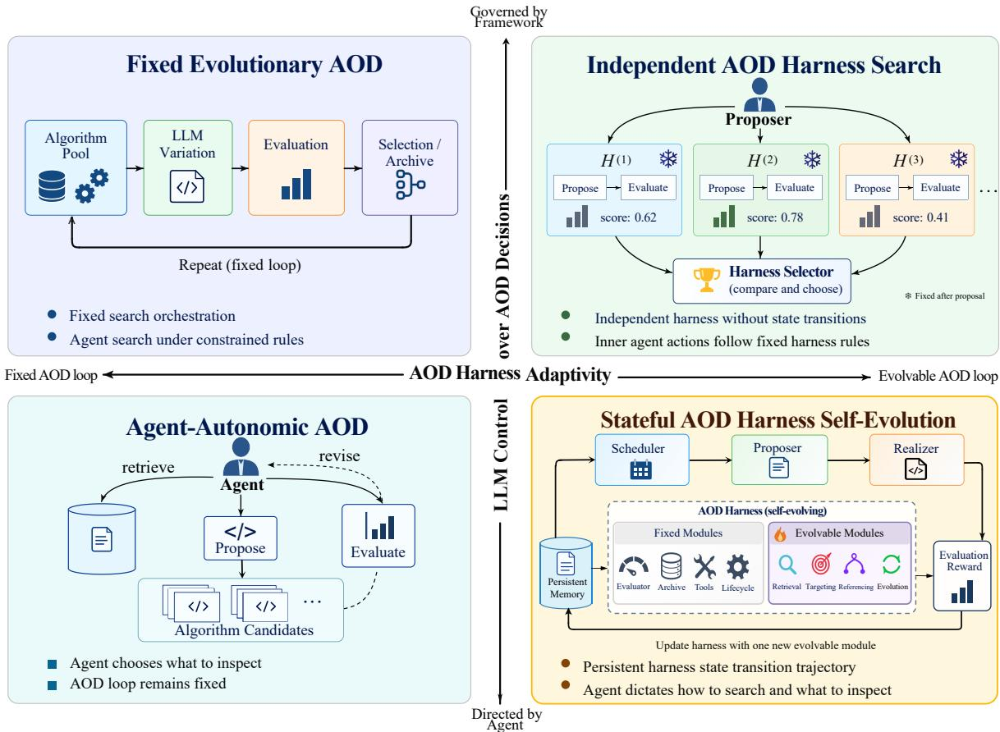
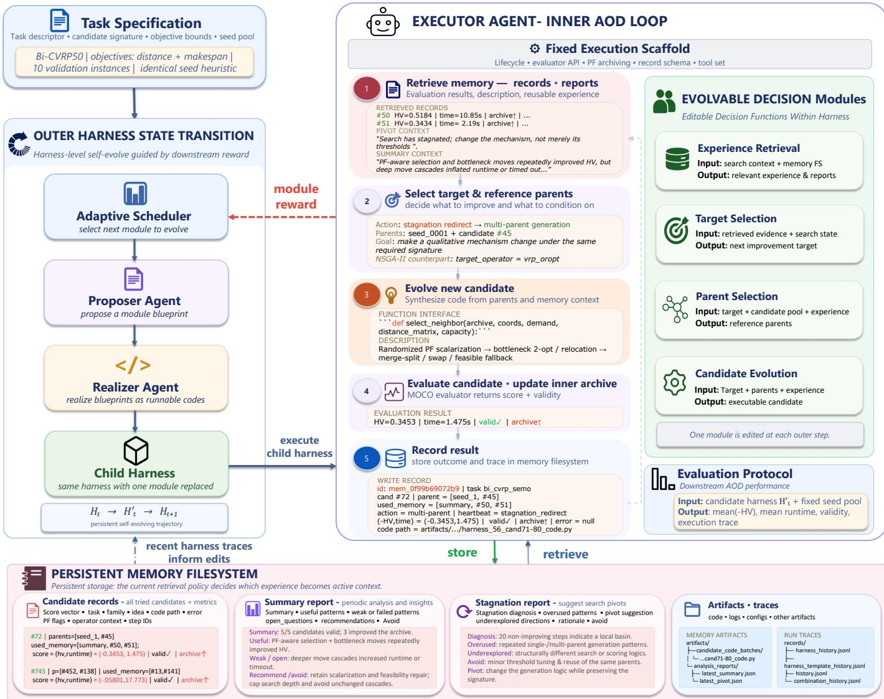
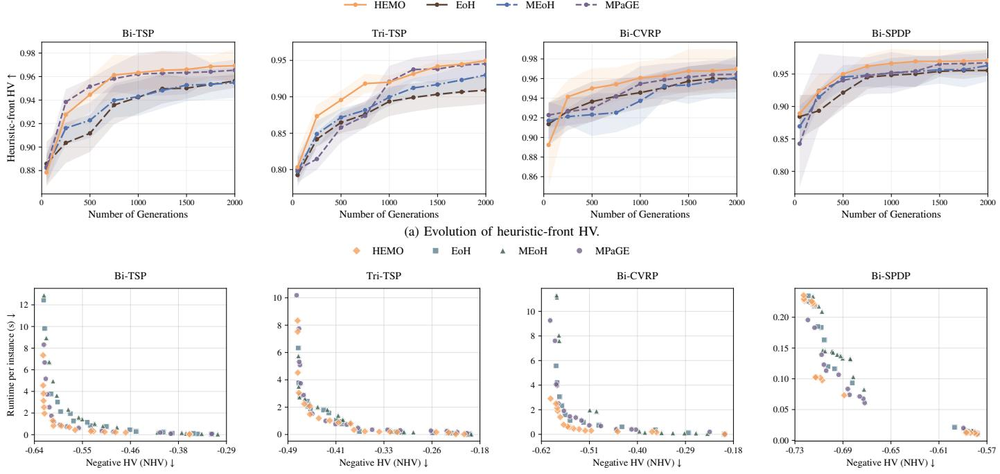
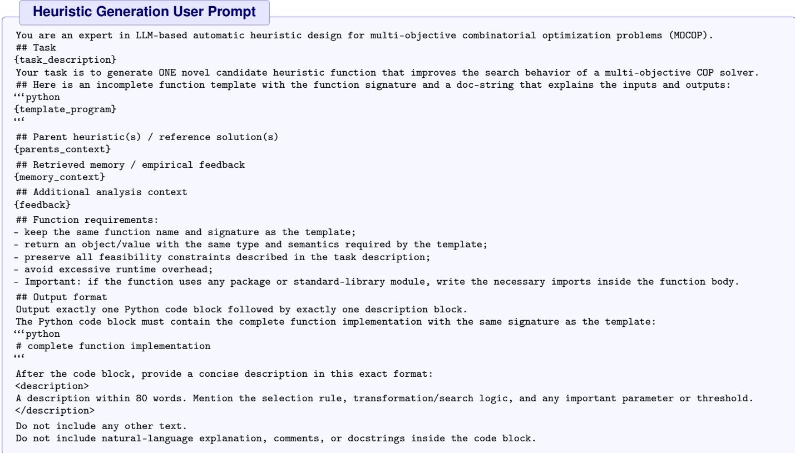
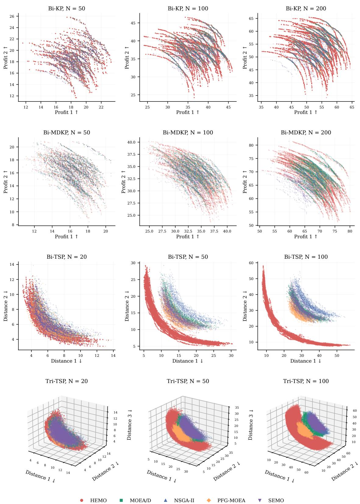
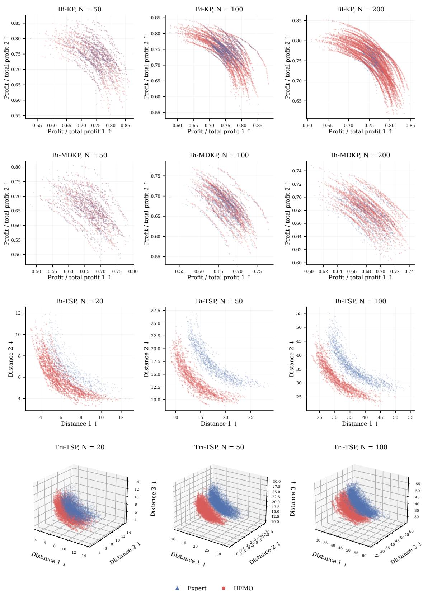

# HEMO: Harness Self-Evolution for Multi-Objective Combinatorial Optimization

Jianghan Zhu, Cong Zhang, Ni Zhang, Yifan Yang, Yew Soon Ong, and Zhiguang Cao

Abstract—Automatic operator design (AOD) has increasingly adopted large language models (LLMs) to generate problemspecific search and variation operators for multi-objective combinatorial optimization (MOCO). Yet most methods evolve the operators while leaving the process that discovers them fixed. This limits adaptation as new Pareto trade-offs and operator interactions change where and how the search should proceed. We introduce HEMO, which makes the AOD harness itself a self-evolving optimization target. HEMO maintains a persistent harness state and updates one module at a time, revising the logic that determines which experience to retrieve, which operators to improve, which parents to select, and how to formulate the orchestration of search steps. Downstream solution quality and runtime guide these updates, while a discounted UCB scheduler directs adaptation toward promising modules as their utility changes. A persistent memory filesystem preserves candidate outcomes and diagnostic feedback across harness states, enabling successive states to build on accumulated optimization experience. Experiments across eight MOCO tasks and two structurally distinct evolutionary backbones demonstrate strong performance against conventional evolutionary, neural, and LLM-based AOD baselines, together with effective transfer to related tasks. HEMO extends automatic operator design beyond evolving individual operators to improving the search process that discovers them.

Index Terms—Evolutionary computing and genetic algorithms, heuristics design, heuristic methods, language models, multiobjective combinatorial optimization, optimization.

## I. INTRODUCTION

M <sup>ULTI-OBJECTIVE</sup> <sup>combinatorial</sup> <sup>optimization</sup> <sup>(MOCO)</sup>arises in many discrete decision problems with com- arises in many discrete decision problems with competing objectives, including routing, scheduling, and resource allocation [1]–[4]. A spectrum of methods has been developed for these problems, including exact approaches [5], Pareto local search and related metaheuristics [6], and population-based evolutionary algorithms such as NSGA-II and MOEA/D [7], [8]. Despite their different search mechanisms, performance often relies on problem-specific representations, and variation operators, making the solving of a new MOCO problem closely tied to the design of an effective search procedure.

Learning-based combinatorial optimization has sought to reduce this manual effort by learning solution policies directly from data [9]–[11] while automatic algorithm design (AAD), particularly automatic heuristic design (AHD), instead automates the generation and improvement of algorithmic components [12]. Recent LLM-based methods further enable evolutionary search over algorithms and heuristics [13]–[15]. Within MOCO, a particularly relevant direction is the automatic design of problem-specific search and variation operators, which we refer to as automatic operator design (AOD). LLMs have been used to generate evolutionary operators with different trade-offs [16], [17], while newer frameworks further emphasize population diversity and operator interactions [18], [19]. These developments mark a shift from generating isolated heuristics toward designing structured optimization components.

LLM-based AOD relies on an outer control process that determines how design context is formed, when candidates are evaluated, how search state is recorded, and when search terminates. We call this control process the AOD harness, specializing the broader notion of an LLM harness as executable infrastructure governing model context, environment interactions, and control flow [20], [21] to the search over operator candidates. Most evolutionary AOD methods use a largely fixed harness, with the main operator search steps governed by predefined procedures. For example, AlphaEvolve retains a fixed search framework in which the model context is assembled through predefined selection rules [22]. Greater LLM autonomy can also be introduced within a fixed search loop, whereas recent methods search over independently generated abstractionlevel heuristic-optimizers that serve as fixed search controllers for the inner AHD process [23]. Figure 1 summarizes these regimes along two dimensions, namely agent autonomy in search control and AOD harness adaptivity.

This distinction matters for MOCO-oriented AOD, where the search state changes continuously as new trade-offs, candidate structures, and component interactions emerge. The effectiveness of a search decision can vary over time, and a strategy that works well at one stage may become less suitable as the explored regions and candidate population change. A fixed AOD harness cannot revise its predefined control logic, while independently generated high-level procedures lack a persistent control-state trajectory. This motivates a stateful AOD harness that evolves its search behavior as optimization experience accumulates. Such self-evolution also requires access to relevant long-term experience. An AOD run may produce hundreds or thousands of evaluated candidates with their performance, lineage, and search context, yet storing this history alone does not ensure useful evidence remains accessible. Recent harness research likewise emphasizes detailed execution records and selective retrieval in long-running searches [20], [24]. For MOCO, relevant evidence can span Pareto regions, complementary candidates, and earlier search stages, making persistent, selectively retrieved experience a stable basis for adapting harness decisions.

  
Fig. 1. Paradigms of LLM-based AOD characterized by agent autonomy and harness adaptivity. Fixed evolutionary AOD (upper left) uses agents as role-specific tools within a predefined evolutionary loop, whereas independent AOD harness search (upper right) evaluates separately sampled but internally <sup>CandidateParentExperience</sup><sub>Retrieval</sub> <sup>Target</sup>fixed harnesses. Agent-autonomic AOD (lower left) allows the agent to control candidate generation and feedback inspection within a fixed outer AOD loop, while stateful AOD harness self-evolution, adopted by HEMO in the lower-right quadrant, evolves the stateful harness itself through persistent module-level transitions, allowing search control and the use of accumulated experience to co-adapt over time under outer-agent guidance.

Motivated by these observations, we introduce HEMO, a stateful AOD harness for LLM-based operator design in multi-objective combinatorial optimization. HEMO maintains a persistent harness state and progressively adapts its search control through localized state transitions. Successive harness states are assessed by their downstream impact on multiobjective operator design, while optimization experience from evaluated candidates is continuously retained in a memory filesystem and selectively reused by subsequent states. This formulation allows the AOD harness to adapt across different search stages while the memory filesystem evolves with the trajectory and preserves a consistent archive of optimization experience, thereby improving how an LLM-driven operator design process searches, learns from feedback, and reuses experience over time.

## Our main contributions are summarized as follows:

• We introduce a stateful harness self-evolution perspective for LLM driven AOD. The AOD harness maintains a persistent state and evolves through local updates along a single harness design trajectory, extending beyond fixed outer procedures, agent-directed search within fixed harnesses, and independently evaluated high-level search

procedures.

• We develop HEMO, a framework designed specifically for MOCO using downstream multi-objective AOD performance to guide harness state adaptation while preserving long-term experience in a memory filesystem. Later search decisions can thus draw on evidence from previous harness states without compressing the full history into a limited recent context.

• Extensive experiments on eight MOCO tasks spanning routing, traveling salesman, knapsack, and scheduling, using two representative evolutionary backbones, demonstrate the effectiveness of HEMO across diverse settings against conventional evolutionary, neural, and LLM-based AOD baselines in both within-task evaluation and crosstask transfer.

## II. RELATED WORK

## A. Automated Algorithm Design

Automated algorithm design (AAD) aims to reduce the expert effort required to construct effective algorithms by automating design processes such as algorithm selection, configuration, component design, and code execution and validation [25]– [27]. Automated heuristic design (AHD) forms an important research branch of this broader field, with methods ranging from hyper-heuristics [12] and genetic programming [26] to the automatic generation and composition of search operators [28]. Although these approaches automate different parts of algorithm development, the underlying heuristic spaces and composition rules are commonly specified by human experts.

LLM reasoning and code generation have substantially expanded the scope of automated design. FunSearch evolves executable programs through island-based selection and generation [13], while EoH, ReEvo, and MCTS-AHD combine LLM generation with evolutionary, reflective, or tree-based search to improve one single-objective optimization heuristic component [14], [15], [29]. SimpleEvol further organizes LLMdriven heuristic generation within a lightweight agent loop designed to minimize human-specified priors [30]. Beyond individual combinatorial heuristics, LLaMEA and LLaMEA-BO evolve complete algorithms for continuous black-box and Bayesian optimization, respectively [31], [32]. Outside optimization, AlphaEvolve demonstrates evolutionary code search over broader scientific and computational algorithms [22]. More recent work has begun to move the design target beyond solely heuristics. MoH searches over heuristic optimizers that generate task-specific heuristics [23], while related work explores higherlevel algorithm structures and control policies [33]. These developments indicate a broader shift from designing isolated heuristics toward changing increasingly large portions of the algorithm design process itself. Yet the execution structure governing LLM access to accumulated experience, forms design context, invokes evaluation, and maintains search state is still typically specified by human designers. Designing a framework that enables the stateful self-evolution of this surrounding control structure is therefore the focus of our work.

## B. Multi-Objective Optimization

Most of recent research can be divided into two pathways. The first improves multi-objective solvers through manually designed evolutionary mechanisms or learned solution policies and search components. Classical multi-objective evolutionary algorithms (MOEAs) include dominance-based methods such as NSGA-II [7], decomposition-based methods like MOEA/D [8], and archive- or local-search-based approaches such as Pareto Local Search (PLS) [34], two-phase Pareto Local Search (2PPLS) [3], and Simple Evolutionary Multiobjective Optimization (SEMO) [35]. Their effectiveness depends strongly on carefully designed mechanisms for selection, population management, neighborhood exploration, and diversity preservation, motivating numerous modified and hybrid variants [36], [37]. Neural approaches instead learn solution policies or search components from data. PMOCO employs a single preference-conditioned model to generate solutions under different objective preferences [9]. NHDE explicitly promotes Pareto-set diversity [10], while EMNH improves learning efficiency through meta-learning [38].Neuro PLS embeds learned components into Pareto local search [39], while other work improves preference conditioning and crosssize generalization through learned weight representations [40]. Although neural methods reduce repeated handcrafting and enable fast GPU-based inference, they generally require model training and retain a largely predefined optimization backbone.

The second pathway uses LLMs to design problem-specific heuristics and variation operators within prescribed multiobjective solvers, a setting we refer to as automatic operator design (AOD). Here, an operator is an algorithmic component that constructs, modifies, selects, or otherwise guides candidate solutions, including heuristics studied in AHD when they serve such a role. Huang et al. [16] use LLMs to iteratively refine evolutionary operators. MEoH treats heuristic design as a multiobjective optimization problem and searches for non-dominated heuristics [17], while REMoH integrates LLM-generated operators into NSGA-II with clustering-based reflection to promote diversity [41]. MPaGE combines LLM-based heuristic gen eration with Pareto-front-grid-guided population management under SEMO [18]. E2OC further models dependencies among multiple search operators and uses Monte Carlo tree search to explore their design combinations [19]. These methods extend LLM-based AAD toward increasingly complex multi-objective solver components. However, they primarily evolve operators within a prescribed search process, leaving its higher-level harness unchanged.

## C. Harness Engineering and Evolution

The performance of an LLM-based system depends not only on its backbone model, but also on the surrounding execution machinery that determines what information the model receives, which tools it can invoke, how intermediate state is recorded and updated, and how multi-step execution is guided by feedback. Mechanisms now associated with this layer were initially studied separately, including retrieval-augmented generation [42], interleaved reasoning and acting [43], and explicit self-reflection [44]. Recent work increasingly integrates these mechanisms into a broader agent harness. Natural-Language Agent Harnesses separate control, contracts, and persistent state from the underlying runtime [45], while recent surveys characterize harness engineering as spanning execution environments, tool interfaces, context and memory management, lifecycle and orchestration, execution monitoring, and output validation [21]. A closely related line of work also automates broader portions of agent and optimization systems [46], [47]. ADAS searches over code-defined agent systems [48], AFlow formulates agentic workflow generation as search over executable workflow graphs [49], and the Darwin Gödel Machine allows coding agents to iteratively modify their own implementations [50]. In optimization, AutoEP uses an external LLM-based controller to adapt the hyperparameters of a structurally fixed metaheuristic [51], while OKAEM adapts learned evolutionary operators using prior and online optimization knowledge [52]. CORAL employs autonomous single- and multi-agent evolution to determine what experience to retrieve, when to evaluate candidates, and what knowledge to preserve [24]. Although these approaches automate context construction, workflows, and search control, they do not generally treat the complete task-specific execution harness as the direct search object.

More recent studies explicitly optimize the harness surrounding an LLM. Meta-Harness performs outer-loop search over harness code, allowing an agentic proposer to inspect previous source code, evaluation scores, and execution traces through a filesystem before constructing new harness candidates [20]. Self-Harness similarly identifies recurring weaknesses from execution traces, proposes targeted modifications, and validates the resulting harness [53]. Existing harness evolution studies primarily target general agent execution in coding, reasoning, and interactive tasks. HEMO instead studies harness evolution for LLM-based automatic operator design in MOCO. It main tains a persistent AOD harness whose decision modules adapt through localized state transitions while the execution-critical scaffold remains fixed, connecting harness adaptation directly to downstream multi-objective optimization performance and long-term operator design experience.

## III. PRELIMINARIES

## A. Multi-Objective Combinatorial Optimization

Problem Formulation and Pareto Optimality. A multiobjective combinatorial optimization problem (MOCOP) seeks to optimize multiple, potentially conflicting objectives over a discrete feasible space [54]. Let X be the feasible solution set and M the number of objectives. Without loss of generality, we consider the minimization form

$$
\operatorname* { m i n } _ { \mathbf { x } \in \mathcal { X } } \mathbf { f } ( \mathbf { x } ) = \left( f _ { 1 } ( \mathbf { x } ) , f _ { 2 } ( \mathbf { x } ) , \ldots , f _ { M } ( \mathbf { x } ) \right) .\tag{1}
$$

For two feasible solutions $\mathbf { x } , \mathbf { y } \in \mathcal { X }$ , x is said to Paretodominate y, denoted by $\mathbf x \prec \mathbf y$ , if

$$
f _ { m } ( \mathbf { x } ) \leq f _ { m } ( \mathbf { y } ) , \quad \forall m \in \{ 1 , \ldots , M \} ,\tag{2}
$$

and the inequality is strict for at least one objective. A feasible solution $\mathbf { x } ^ { * }$ is Pareto optimal if there exists no other feasible solution that dominates it. The collection of all Pareto-optimal solutions constitutes the Pareto set (PS), and its image in the objective space constitutes the Pareto front (PF).

For many MOCOPs, computing the complete Pareto set is computationally prohibitive, and practical solvers therefore seek a finite approximation of the PF under limited computational budgets [5], [55]. A useful approximation should simultaneously approach the true PF and maintain sufficient coverage across different trade-offs among objectives [55].

Multi-Objective Evolutionary Algorithms. Multi-objective evolutionary algorithms (MOEAs) construct such approximations by evolving a population or archive of candidate solutions. Early Pareto-based evolutionary approaches established selection at the population level based on dominance and diversity, with later methods developing alternative mechanisms to balance convergence and diversity. The MOEA behavior thus depends on both problem-specific variation operators and higher-level mechanisms to select, retain, and propagate solutions across iterations. We use two structurally distinct back bones, namely SEMO [35], with incremental archive updates, and NSGA-II [7], which uses generational population evolution with non-dominated sorting and diversity preservation.

## B. AOD Harnesses

Agent Harnesses. An LLM-based system includes an execution layer that governs the context presented to the model, interactions with tools and evaluators, persistent state, and control across multiple model calls. We refer to this execution layer as an agent harness. In automatic operator design, the harness governs the outer process through which an LLM searches over operator candidates. It determines how prior search experience is exposed, how design context is assembled, how candidate generation and evaluation are coordinated, and how search state is maintained across iterations. We use the term AOD harness for this task-specific execution structure. The methodology in Section IV focuses on how such a harness can maintain a persistent state and adapt its search-control behavior over time.

## IV. METHODOLOGY

HEMO is an AOD harness with self-evolving decision modules for multi-objective combinatorial optimization (MOCO). Its state evolves through local module updates, while a memory filesystem retains experience across states. These updates adapt experience retrieval, target and parent selection, and candidate evolution, with new optimization experience continuously recorded in memory.

Figure 2 summarizes the overall workflow. HEMO separates a fixed execution scaffold from the set of decision modules, with harness state transitions guided by the module-specific reward computed from downstream task performance. Three LLM agents play distinct roles in this process. The Proposer Agent specifies an updated version of one selected module in a JSON blueprint using the current harness state, task information, and recent harness traces. The Realizer Agent converts this blueprint into executable Python code grounded in the current harness implementation. The resulting child harness is then operationalized by the Executor Agent within a bounded harness evaluation episode, interacting with the memory filesystem and the task evaluator, and producing evaluated candidates and search records. Memory persists across episodes, accumulating experience along the outer trajectory.

## A. Stateful Harness Self-Evolution

Harness initialization. HEMO begins from a manually specified seed harness that defines the basic execution interface and a simple reference implementation for each evolvable module. To avoid committing the search to a single manually designed starting point, a small set of alternative harness blueprints, each specifying all evolvable modules, is generated and realized to form an initial harness pool. These states are evaluated to construct an initial Pareto archive over harness states, from which the initial current state $H _ { 0 }$ is selected for subsequent harness self-evolution.

Harness state transitions. We represent the current harness state as $H _ { t } = ( C _ { t } , B _ { t } )$ , where $C _ { t }$ denotes the full harness code and $B _ { t }$ denotes its corresponding blueprint that records the current specifications of all evolvable modules. The memory filesystem at step t is denoted by $M _ { t }$ and serves as an external mechanism for retaining optimization experience across harness states. At each outer step after initialization, one evolvable module $m _ { t } \in \mathcal { M }$ is selected for modification, where $\mathcal { M } = \{ m ^ { ( 1 ) } , \dots , m ^ { ( K ) } \}$ denotes the set of evolvable modules. The Proposer Agent generates a module blueprint $b _ { t } = \mathscr { P } ( H _ { t } , m _ { t } , \mathcal { C } _ { t } )$ , where $\mathcal { C } _ { t }$ contains the task description and recent harness evaluations. The Realizer Agent converts this blueprint into an executable replacement $\phi _ { t } ,$ yielding

  
Fig. 2. Overview of HEMO. Along the outer state transition trajectory, a selected decision module is revised and incorporated into the parent harness to form the child harness for the next evaluation episode, while optimization experience is retained in the memory filesystem.

$$
H _ { t } ^ { \prime } = H _ { t } [ m _ { t }  \phi _ { t } ] .\tag{3}
$$

After evaluating $H _ { t } ^ { \prime } ,$ it becomes the next current harness state if its parent $H _ { t }$ does not Pareto-dominate it. The outer Pareto archive is updated with the evaluated child according to Pareto dominance. The resulting state transition is

$$
( H _ { t } , M _ { t } ) \to ( H _ { t + 1 } , M _ { t + 1 } ) ,
$$

where an accepted harness modification updates the harness state and newly generated experience updates the memory filesystem. This localized transition preserves accumulated harness behavior, makes consecutive states directly comparable, and localizes credit to the modified module.

Downstream harness evaluation. Let $\mathcal { P } ( H _ { t } ^ { \prime } )$ denote the final Pareto archive of operator candidates produced during the eval uation episode of $H _ { t } ^ { \prime } .$ . We use the hypervolume (HV) indicator together with runtime to summarize harness performance. The summarization score is computed by averaging these quantities over the final candidate Pareto archive:

$$
\mathbf { s } ( H _ { t } ^ { \prime } ) = \frac { 1 } { | \mathcal { P } ( H _ { t } ^ { \prime } ) | } \sum _ { a \in \mathcal { P } ( H _ { t } ^ { \prime } ) } \mathbf { \Pi } ( - \mathrm { H V } ( a ) , \mathrm { R u n t i m e } ( a ) ) .\tag{4}
$$

Both dimensions follow a lower-is-better convention. To obtain scale-insensitive credit for the selected module, HEMO computes the normalized parent-to-child improvement along each evaluation dimension:

$$
r _ { t , d } = \mathrm { c l i p } \left( \frac { s _ { d } ( H _ { t } ) - s _ { d } ( H _ { t } ^ { \prime } ) } { \operatorname* { m a x } ( | s _ { d } ( H _ { t } ) | , | s _ { d } ( H _ { t } ^ { \prime } ) | ) } , - 1 , 1 \right) .\tag{5}
$$

The reward at module level is then aggregated as

$$
r _ { t } = \frac { 1 } { D } \sum _ { d = 1 } ^ { D } r _ { t , d } .\tag{6}
$$

The scalar reward $r _ { t }$ is used only for adaptive module credit assignment, while the original multi-dimensional harness evaluation is retained for Pareto-based comparison and archival throughout the outer search process.

Adaptive Scheduler via Discounted UCB. The Adaptive Scheduler determines which evolvable module is updated at each outer step. The utility of a module changes as the other modules in the harness are modified, making module selection inherently non-stationary [56]. We therefore instantiate the scheduler with discounted UCB [57], which favors recent module outcomes while retaining an exploration bonus for less frequently selected modules. For each module m, HEMO maintains a discounted selection count $n _ { m , t } ^ { ( \gamma ) }$ and discounted reward sum $R _ { m , t } ^ { ( \gamma ) }$ . At each outer step, both statistics are multiplied by a discount factor $\gamma \in \mathsf { \Gamma } ( 0 , 1 )$ , after which the selected module receives one additional visit and its current reward. Its discounted mean reward is $\bar { r } _ { m , t } ^ { ( \gamma ) } = R _ { m , t } ^ { ( \gamma ) } / n _ { m , t } ^ { ( \gamma ) }$ . The next module is selected according to

$$
\mathrm { U C B } _ { t } ( m ) = \bar { r } _ { m , t } ^ { ( \gamma ) } + c \sqrt { \frac { \log \Bigl ( 1 + \sum _ { j \in \mathcal { M } } n _ { j , t } ^ { ( \gamma ) } \Bigr ) } { n _ { m , t } ^ { ( \gamma ) } } } ,\tag{7}
$$

where c controls exploration strength. Each module is selected exactly once before applying Eq. (7). Discounting is used because the reward of updating a module depends on the current harness state. A module that was unproductive earlier may become useful again after other modules have changed. Older observations are therefore gradually downweighted instead of remaining equally influential throughout the evolution trajectory. Appendix G formally shows how discounting supports adaptive module selection under evolving harness states by attenuating stale credit and restoring exploration pressure for modules that have not been selected recently.

## B. Persistent Memory and Long-Horizon Feedback

Long-horizon AOD can produce hundreds or thousands of evaluated candidates, making it impractical to expose the complete search history to an LLM at every step. Moreover, retaining all records in external storage does not imply that they remain effectively available to the model. Finite context windows and repeated summarization can bias the working context toward recent attempts. HEMO therefore separates persistent storage from effective retrieval through an external memory filesystem and explicit long-horizon feedback mechanisms.

Structured experience memory. The memory filesystem stores the search experience of the evaluated operator candidates outside the transient LLM context as structured optimization events. Each record can retain candidate designs, evaluation results, parent information, validity or failure information, Pareto related status, operator context, and other search metadata. This provides a persistent empirical history that remains reusable across successive harness states.

Periodic long-term feedback. HEMO periodically transforms accumulated search history into compact diagnostic feedback. These tools summarize the evolving search trajectory and identify prolonged stagnation or repeated search patterns, allowing subsequent harness modules to access abstracted signals without rescanning the complete history. We refer to each periodic invocation of these tools as a heartbeat, consisting primarily of a summary report and a stagnation report, and the latest report of each type is maintained as the only active reference record.

## C. MOCO-Specific Harness Design

HEMO separates its AOD harness into a fixed execution scaffold and a set of evolvable decision roles. As shown in Fig. 2, the fixed scaffold preserves the AOD harness lifecycle, while the evolvable roles capture decisions whose preferred behavior depends on the current search state.

Fixed execution scaffold. Four operational interfaces remain fixed throughout the entire stateful harness self-evolution process. 1) Evaluation interface. It specifies solver configuration, dataset generation, evaluation instances, and feedback construction independently of the harness loop, preventing harness changes from altering the evaluation protocol or gaming the intended objective. 2) Multi-objective archive interface. It merges newly generated operator candidates into the candidate Pareto archive using a fixed non-dominated sorting rule, keeping Pareto filtering and diversity preservation consistent throughout harness state transition. 3) Diagnostic and heartbeat interface. It exposes standardized tools for summarizing the search history and diagnosing stagnation patterns. The heartbeat tools and callable interfaces remain fixed, while the decision modules determine how the resulting diagnostic feedback is retrieved and utilized. 4) Memory-writing interface. It records evaluated candidates and search events using a common schema, ensuring a consistent empirical history across successive harness states. This separates persistent bookkeeping from the adaptive policy that determines which experience becomes active context. Examples of evolved harness states and generated operators are in Appendix F and J.

Evolvable decision roles. Within this scaffold, HEMO exposes four high-level roles whose behavior can be modified by the harness state transition.

Experience Retrieval. This role determines which historical candidate records and reports of the previously discovered search patterns should be surfaced from memory filesystem for the current AOD step. Its purpose is not merely to compress context, but to decide adaptively which parts of the long-horizon optimization history are currently useful.

Target Selection. When the underlying optimization solver exposes multiple search components or evolutionary operators, this role determines which component should receive the next design intervention. Such a decision is particularly relevant to multi-component evolutionary solvers such as NSGA-II [7], where the marginal value of improving one operator depends on the current behavior of the surrounding operators. For solvers with only one evolvable component, this role can degenerate to a trivial choice and need not introduce additional control complexity.

Parent Selection. This role selects previously evaluated candidates that serve as reference parents for the next generation action. These parents provide concrete working context from which the LLM can identify reusable structures, compare patterns associated with success and failures, and decide whether to refine an existing design or redirect the search toward a different region.

Algorithm 1 Stateful Harness Self-Evolution in HEMO   
Require: Seed harness $\overline { { H _ { \mathrm { s e e d } } } } ;$ fixed seed pool $\mathcal { P } _ { \mathrm { s e e d } } ;$ harness evaluation budget $B _ { \mathrm { o u t e r } } \mathrm { i }$ ; per-harness candidate budget $B _ { H }$   
Notation: ${ \bf s } ( H )$ denotes the current harness score, $\mathbf { s } ^ { \prime }$ the proposed harness score, V the evaluated candidates returned by   
the executor, and ok evaluation success.   
1: Initialize memory filesystem $\mathcal { M } ,$ harness archive $\boldsymbol { A } _ { H } .$ , and candidate archive $\mathcal { A } _ { A }$   
2: Generate initial harness states from $H _ { \mathrm { s e e d } }$   
3: Evaluate the seed and initial states using $( \mathcal { P } _ { \mathrm { s e e d } } , \mathcal { M } , B _ { H } )$   
4: Update $\boldsymbol { \mathcal { A } } _ { H }$ and $\mathcal { A } _ { A }$ with initialization results   
5: Sample current harness H from $\boldsymbol { \mathcal { A } } _ { H }$   
6: Initialize discounted UCB statistics for all evolvable modules   
7: while harness evaluation budget remains do   
8: Select module m using discounted UCB   
9: b ← PROPOSERAGENT $( H , m ,$ , recent traces) ▷ revise one module specification   
10: H<sup>′</sup> ← REALIZERAGENT $( H , m , b )$ ▷ instantiate the proposed revision   
11: $( \gamma , \mathbf { s } ^ { \prime } , \mathrm { o k } ) \gets$ EXECUTORAGENT $( H ^ { \prime } , \mathcal { P } _ { \mathrm { s e e d } } , \mathcal { M } , B _ { H } )$ ▷ run a bounded AOD episode   
12: if ok then   
13: Update Pareto archive $\mathcal { A } _ { A }$ with V   
14: Update Pareto archive $\boldsymbol { \mathcal { A } } _ { H }$ with $( H ^ { \prime } , \mathbf { s } ^ { \prime } )$   
15: Compute reward r from the relative improvement of $\mathbf { s } ^ { \prime }$ over ${ \bf s } ( H )$ ▷ assign credit to module m   
16: if s(H) does not dominate $\mathbf { s } ^ { \prime }$ then   
17: $\dot { H }  H ^ { \prime }$ ▷ retain child code and blueprint   
18: end if   
19: else   
20: $r \gets - 1$ ▷ retain the parent after repair retries fai   
21: end if   
22: Update discounted UCB statistics using module m and reward r   
23: end while   
24: return $\mathcal { A } _ { H } , \mathcal { A } _ { A } , \mathcal { M }$

Candidate Evolution. This role determines the search strategy used to produce successive candidates within a bounded harness evaluation episode. It controls how the search progresses from one evaluated candidate to the next, coordinating candidate generation, evaluation, and subsequent iterations. The resulting strategy may follow iterative, population based, trajectory based, staged, or hybrid search behavior, allowing HEMO to adapt the dynamics of candidate evolution.

Overall self-evolution procedure. Algorithm 1 summarizes the complete outer harness self-evolution procedure. To support controlled comparison and cleaner credit assignment, each harness evaluation initializes its local candidate population from the same fixed seed pool. The Executor Agent returns the valid retained candidates, their mean score vector containing negative HV and runtime, and an execution trace. Successfully evaluated children update the external harness and candidate Pareto archives, while their execution records remain in memory even when they do not replace the current harness.

## V. EXPERIMENTS

Benchmarks and generalization protocol. We evaluate HEMO on eight MOCO tasks spanning four representative problem families [36], covering knapsack, vehicle routing, TSP, and scheduling. Here, TSP, KP, MDKP, CVRP, SPDP, and FJSP denote the traveling salesman problem, knapsack problem, multi-dimensional knapsack problem, capacitated vehicle routing problem, selective pickup and delivery problem, and flexible job shop scheduling problem, respectively. The prefixes Bi- and Tri- denote bi-objective and tri-objective formulations, respectively. The source-to-target pairs are Bi-TSP → Tri-TSP, Bi-KP → Bi-MDKP, Bi-CVRP → Bi-SPDP, and Bi-FJSP → Tri-FJSP, where the source task is used for in-distribution harness self-evolution and the target task for intra-family cross-task generalization with the fixed harness state. Synthetic problems are evaluated at multiple sizes, while FJSP uses the Brandimarte benchmark [58] instances for final evaluation. Detailed task formulations are provided in Appendix B.

HEMO configuration. We instantiate HEMO with both SEMO [35] and NSGA-II [7] as two structurally distinct optimization backbones. Harness self-evolution allows at most 200 harness state evaluations for both SEMO and NSGA-II. Each SEMO harness evaluation generates 50 candidates with population size 5, while each NSGA-II evaluation allows 100 complete operator combination evaluations with operator and combination population sizes of 10.

Objectives and evaluation metrics. During AOD, all generated operator candidates are evaluated jointly by solution quality and computational efficiency, represented by negative Hypervolume (HV) and runtime under a common lower-is-better convention. Final performance is reported using HV, runtime, and Inverted Generational Distance (IGD), where higher HV and lower IGD indicate better Pareto-front coverage and smaller distance to the reference Pareto front, respectively. Metric definitions, reference points, and objective normalization are provided in Appendix A.

TABLE I  
AVERAGE PERFORMANCE OF THE BEST-HV CANDIDATE SELECTED FROM THE FINAL PARETO FRONT OF EACH OF FOUR INDEPENDENT RUNS ON THE THREE SOURCE TASKS. TIME DENOTES RUNTIME IN SECONDS PER INSTANCE. THE BEST VALUE IN EACH COLUMN IS SHOWN IN BOLD; “–” DENOTES RUNS THAT
<table><tr><td></td><td colspan="6">Bi-TSP</td><td colspan="6">Bi-CVRP</td><td colspan="6">Bi-KP</td></tr><tr><td>Method</td><td colspan="2">N = 20</td><td colspan="2">N = 50</td><td colspan="2">N = 100</td><td colspan="2">N = 20</td><td colspan="2">N = 50</td><td colspan="2">N = 100</td><td colspan="2">N = 50</td><td colspan="2">N = 100</td><td colspan="2">N = 200</td></tr><tr><td></td><td>HV↑</td><td>Time↓</td><td>HV↑</td><td>Time↓</td><td>HV↑</td><td>Time↓</td><td>HV↑</td><td>Time↓</td><td>HV↑</td><td>Time↓</td><td>HV↑</td><td>Time↓ HV↑</td><td>Time↓</td><td>HV↑</td><td>Time↓</td><td>HV↑</td><td>Time↓</td></tr><tr><td>SEMO</td><td>0.5878</td><td>29.411</td><td>0.4612</td><td>35.476</td><td>0.3674</td><td>42.621</td><td>0.4840</td><td>9.726</td><td>0.3380</td><td>8.991</td><td>0.2987</td><td>10.691 0.3543</td><td>14.528</td><td>0.3917</td><td></td><td>8.146 0.2912</td><td>16.284</td></tr><tr><td>NSGA-II</td><td>0.5600</td><td>1102.171</td><td>0.3860</td><td>1099.551</td><td>0.3120</td><td>985.188</td><td>0.6025</td><td>1178.418</td><td>0.5420</td><td>1162.623 0.5199</td><td>1530.646</td><td>0.3581</td><td>1045.565</td><td>0.4024</td><td>551.730</td><td>0.3207</td><td>529.589</td></tr><tr><td>MOEA/D</td><td>0.5874</td><td>136.718</td><td>0.4385</td><td>146.027</td><td>0.3696</td><td>183.499</td><td>0.5893</td><td></td><td>0.5288</td><td></td><td>0.5347</td><td>0.3541</td><td></td><td>0.4040</td><td></td><td>0.3285</td><td></td></tr><tr><td>PFG-MOEA</td><td>0.5906</td><td>74.886</td><td>0.4601</td><td>63.210</td><td>0.3847</td><td>86.956</td><td>0.5888</td><td>123.347</td><td>0.4527</td><td>225.457</td><td>0.3469</td><td>317.618 0.3562</td><td>68.912</td><td>0.4041</td><td>67.459</td><td>0.3250</td><td>67.129</td></tr><tr><td>EoH</td><td>0.6266</td><td>81.095</td><td>0.5961</td><td>35.072</td><td>0.6338</td><td>103.753</td><td>0.5745</td><td>128.232 0.5073</td><td></td><td>182.3300.4979</td><td></td><td>169.2500.3609</td><td>21.226</td><td>0.4038</td><td>11.891</td><td>0.3274</td><td>41.940</td></tr><tr><td>M-EoH</td><td>0.6004</td><td>57.486</td><td>0.5781</td><td>28.4290.6155</td><td></td><td>88.323</td><td>0.5826</td><td>145.3800.5366</td><td></td><td>207.6200.5190</td><td></td><td>194.3700.3576</td><td>14.739</td><td>0.3985</td><td>10.5820.3049</td><td></td><td>27.431</td></tr><tr><td>MPaGE</td><td>0.6206</td><td>78.712</td><td>0.6228</td><td>31.871</td><td>0.6628</td><td>97.819</td><td>0.6184</td><td>183.4400.5532</td><td></td><td>243.641</td><td>0.5381</td><td>235.6050.3621</td><td>15.783</td><td>0.4152</td><td></td><td>7.2380.3350</td><td>19.219</td></tr><tr><td>HEMO (ours)</td><td>0.6258</td><td>43.557</td><td>0.6336</td><td>36.829</td><td>0.6818</td><td></td><td>42.134 0.6130</td><td>134.5390.5777</td><td></td><td>191.8090.5700</td><td></td><td>163.293 0.3653</td><td>16.053</td><td>0.4329</td><td>6.875</td><td>0.3619</td><td>12.620</td></tr></table>

TABLE II

PERFORMANCE AVERAGED OVER THE BEST-HV CANDIDATE OF EACH OF FOUR INDEPENDENT RUNS ON THE THREE INTRA-FAMILY TRANSFER TASKS. THE BEST AVAILABLE VALUE IN EACH COLUMN IS SHOWN IN BOLD.
<table><tr><td></td><td colspan="6">Tri-TSP</td><td colspan="6">Bi-SPDP</td><td colspan="6">Bi-MDKP</td></tr><tr><td>Method</td><td colspan="2">N = 20</td><td colspan="2">N = 50</td><td colspan="2">N = 100</td><td colspan="2">N = 20</td><td colspan="2">N = 50</td><td colspan="2">N = 100</td><td colspan="2">N = 50</td><td colspan="2">N = 100</td><td colspan="2">N = 200</td></tr><tr><td></td><td>HV↑</td><td>Time↓</td><td>HV↑</td><td>Time↓</td><td>HV↑</td><td>Time↓</td><td>HV↑ Time↓</td><td>HV↑</td><td>Time↓</td><td>HV↑</td><td>Time↓</td><td>HV↑</td><td>Time↓</td><td>HV↑</td><td>Time↓</td><td>HV↑</td><td>Time↓</td></tr><tr><td>SEMO</td><td>0.4055</td><td>11.166</td><td>0.1880</td><td>22.008</td><td>0.1041</td><td>43.133</td><td>0.7510</td><td>1.973 0.8343</td><td>3.645</td><td>0.8461</td><td>7.005</td><td>0.2536</td><td>2.875</td><td>0.2460</td><td>2.994</td><td>0.4866</td><td>3.144</td></tr><tr><td>NSGA-II</td><td>0.4020</td><td>814.270</td><td>0.2050</td><td>1004.854</td><td>0.1310</td><td>1207.876</td><td>0.7531</td><td>568.591 0.8081</td><td>537.841</td><td>0.8137</td><td>563.2700.2596</td><td></td><td>1050.822</td><td>0.2662</td><td>553.071</td><td>0.5469</td><td>558.297</td></tr><tr><td>MOEA/D</td><td>0.4098</td><td></td><td>489.6360.2230</td><td>1104.641</td><td>0.1534</td><td>2577.410</td><td>0.7579</td><td>61.224 0.8219</td><td>107.852</td><td>0.8317</td><td>140.5040.2589</td><td></td><td></td><td>0.2729</td><td>1</td><td>0.5774</td><td></td></tr><tr><td>PFG-MOEA</td><td>0.4520</td><td>265.914</td><td>0.2810</td><td>765.435</td><td>0.2125</td><td>963.652</td><td>0.7465</td><td>13.927 0.8029</td><td>31.840</td><td>0.8117</td><td>58.5050.2535</td><td></td><td>76.271</td><td>0.2587</td><td>74.336</td><td>0.5420</td><td>70.115</td></tr><tr><td>EoH</td><td>0.4230</td><td></td><td>57.4800.3872</td><td>134.5500.4463</td><td></td><td>297.4300.7608</td><td></td><td>10.133 0.8655</td><td></td><td>85.564 0.8825</td><td>128.023</td><td>0.2700</td><td>175.451</td><td>0.2915</td><td>284.804</td><td>0.6147</td><td>423.494</td></tr><tr><td>M-EoH</td><td>0.4520</td><td></td><td>103.8700.4235</td><td>187.5500.4612</td><td></td><td>418.9500.7567</td><td></td><td>1.874 0.8523</td><td>8.090</td><td>0.8814</td><td>12.5330.2611</td><td></td><td>124.392</td><td>0.2834</td><td>232.238</td><td>0.5835</td><td>312.023</td></tr><tr><td>MPaGE</td><td>0.4709</td><td></td><td>87.4000.4165</td><td>159.299</td><td>0.4702</td><td>359.478</td><td>0.7589</td><td>2.213 0.8501</td><td>13.221</td><td>0.8733</td><td>16.9850.2653</td><td></td><td>93.242</td><td>0.3020</td><td>214.967</td><td>0.6260</td><td>291.463</td></tr><tr><td>HEMO (ours)</td><td>0.4693</td><td>94.891</td><td>0.4447</td><td>179.706 0.4967</td><td></td><td>386.932</td><td>0.7617</td><td>2.6890.8648</td><td></td><td>8.884 0.9026</td><td>13.429</td><td>0.2679</td><td>91.784</td><td>0.2980</td><td>185.851</td><td>0.6336</td><td>213.299</td></tr></table>

Compared baselines and evaluation protocol. We compare HEMO with three groups of baselines: (1) Conventional MOEAs, including SEMO, NSGA-II, MOEA/D [8], and PFG-MOEA [37], (2) Neural MOCO methods, represented by PMOCO [9] and (3) LLM-based AOD methods, including EoH [14], MEoH [17], MPaGE [18], and E2OC [19]. The HEMO Proposer, Realizer, and Executor agents use Claude Opus 4.8, GPT-5, and GPT-4.1-nano, respectively. During inference, all LLM-based AOD methods use GPT-5-nano unless otherwise stated, with identical candidate generation budgets of 2,000 for SEMO and 4,000 for NSGA-II and the same per candidate evaluation timeout. Unless otherwise stated, LLMbased AOD results are averaged over four independent trials. For inference, initialization states are excluded, and the evolved harness state with the smallest normalized Euclidean distance to the empirical ideal point is selected from the remaining harness states. The selected harness is then applied to both the source task and its corresponding transfer task. For all MOEA solvers, a uniform timeout of 3,600 seconds is imposed on each test run across all test instances. Additional configuration and implementation details are provided in Appendix H.

## A. Main Results

Source-task performance with SEMO. Table I reports the detailed results on the source tasks used during harness selfevolution. HEMO achieves the highest HV in seven of the nine task-size settings across Bi-TSP, Bi-CVRP, and Bi-KP. The advantage becomes clearer on larger testing instances. For example, on Bi-CVRP with N = 100, HEMO reaches an HV of 0.5700, compared with 0.5381 for the strongest baseline, while on Bi-KP with N = 200 it achieves 0.3619 compared with 0.3350. On Bi-TSP, the advantage of HEMO becomes more pronounced as the problem size increases. These results show that harness adaptation can further improve the quality of generated heuristics over existing LLM-based AOD frameworks. Moreover, the HV gains are not accompanied by consistently longer execution. HEMO remains competitive in runtime and is the fastest method in several larger settings, including Bi-TSP with N = 100 and Bi-KP with N = 100 and N = 200, suggesting that the improvement in solution quality does not systematically come at the cost of higher heuristic runtime.

Intra-family cross-task generalization. Table II evaluates the transferred harness in related target tasks. HEMO obtains the best HV in five of nine settings and places second in the remaining four. Although the target tasks are not seen during harness self-evolution, the transferred harness remains competitive across all three tasks. HEMO also achieves the fastest runtime among LLM-based AOD methods in several transferred settings while consistently ranking first in HV at the largest problem size, indicating that the learned harness behavior can transfer effectively across related tasks. Additional FJSP results with the SEMO backbone are provided in Appendix I-B, while comparisons with expert-designed TSP operators and their sequential combinations are provided in Appendix I-A

TABLE III  
NSGA-II RESULTS ON TSP (AVERAGED OVER 50 INSTANCES PER SIZE) AND FJSP (ID: MK15; OOD: MK01–MK14).
<table><tr><td rowspan="3">Setting</td><td>Expert</td><td>E2OC</td><td>HEMO</td></tr><tr><td>HV↑ IGD↓</td><td>HV↑ IGD↓</td><td>HV↑ IGD↓</td></tr><tr><td colspan="3">Traveling Salesman Problems</td></tr><tr><td>Bi-TSP 20</td><td colspan="3">0.5476 0.0579 0.6174 0.0081 0.6103 0.0093</td></tr><tr><td>Bi-TSP 50</td><td colspan="3">0.3613 0.1330 0.4897 0.0437 0.4948 0.0215 0.2835 0.1021 0.3631 0.0367</td></tr><tr><td>Bi-TSP 100 Tri-TSP 20 Tri-TSP 50</td><td colspan="3">0.3763 0.0214 0.3661 0.0660 0.4132 0.0206 0.4305 0.0160 0.1579 0.1514 0.2157 0.0559 0.2422 0.0300</td></tr><tr><td>Tri-TSP 100 0.0915 Flexible Job-Shop</td><td colspan="3">0.1034 0.1187 0.0393 0.1262 0.0293 Scheduling Problems</td></tr><tr><td colspan="3">Bi-FJSP ID 0.6836 0.0625 0.7610 0.0086 0.7660 0.0090</td></tr><tr><td>Bi-FJSP OOD 0.5716 Bi-FJSP All 0.5790</td><td>0.0580 0.6123 0.0167 0.0583 0.6222 0.0162</td><td>0.6233 0.0126 0.6328 0.0124</td></tr><tr><td colspan="3">Tri-FJSP ID 0.1783 0.1125 0.2863 0.0059 0.2859 0.0051</td></tr><tr><td colspan="3">Tri-FJSP OOD 0.1712 0.1342 0.2748 0.0134 0.2836 0.0090</td></tr><tr><td colspan="3">Tri-FJSP All 0.1717 0.13280.27560.0129 0.2838 0.0087</td></tr></table>

Performance with the NSGA-II. TSP. Table III directly compares HEMO with expert-designed operators and E2OC on Bi-TSP and Tri-TSP. HEMO achieves the best HV and IGD in five of the six settings, with E2OC only slightly ahead on Bi-TSP with N = 20. On Bi-TSP with N = 50 and N = 100, HEMO improves both reported metrics over E2OC. Notably, the fixed transferred harness consistently achieves the best HV and IGD at all three Tri-TSP sizes, indicating that the evolved harness improves multi-operator design under NSGA-II and retains its effectiveness when transferred from bi-objective to tri-objective TSP.

FJSP. Table III further evaluates operator design on Bi-FJSP and Tri-FJSP. On Bi-FJSP, HEMO achieves the highest HV for both ID and OOD instances and the best overall HV and IGD. On Tri-FJSP, E2OC has a marginally higher HV on Mk15, but HEMO obtains better HV and IGD on the OOD instances and consequently the best overall solution quality. This pattern shows that the evolved harness generalizes well across objective dimensionalities and different machine and job configurations. Appendix I-C reports NSGA-II results on knapsack and routing tasks.

## B. Further Analysis

Comparison with a neural baseline. We compare the SEMO heuristics evolved by HEMO (HEMO-SEMO) with

TABLE IV  
SOLUTION-QUALITY COMPARISON WITH PMOCO WITHOUT INSTANCE AUGMENTATION. RESULTS ARE AVERAGED OVER 50 INSTANCES PER SETTING. THE BETTER VALUE FOR EACH METRIC WITHIN EACH SETTING IS SHOWN IN BOLD. WINNING HEMO-SEMO VALUES ARE ADDITIONALLY SHADED IN BLUE.
<table><tr><td></td><td colspan="2">HV↑</td><td colspan="2">IGD↓</td></tr><tr><td>Setting</td><td>PMOCO</td><td>HEMO-SEMO</td><td>PMOCO</td><td>HEMO-SEMO</td></tr><tr><td>Bi-TSP 20</td><td>0.6260</td><td>0.6269</td><td>0.005281</td><td>0.000781</td></tr><tr><td>Bi-TSP 50</td><td>0.6350</td><td>0.6348</td><td>0.006773</td><td>0.001295</td></tr><tr><td>Bi-TSP 100</td><td>0.6977</td><td>0.6853</td><td>0.004168</td><td>0.006003</td></tr><tr><td>Bi-TSP 150</td><td>0.6958</td><td>0.7142</td><td>0.020435</td><td>0.003545</td></tr><tr><td>Bi-TSP 200</td><td>0.7151</td><td>0.7276</td><td>0.019029</td><td>0.006109</td></tr><tr><td>Tri-TSP 20</td><td>0.4660</td><td>0.4713</td><td>0.024427</td><td>0.000652</td></tr><tr><td>Tri-TSP 50</td><td>0.4341</td><td>0.4495</td><td>0.035622</td><td>0.000678</td></tr><tr><td>Tri-TSP 100</td><td>0.4889</td><td>0.5007</td><td>0.039789</td><td>0.000699</td></tr><tr><td>Tri-TSP 150</td><td>0.5023</td><td>0.5325</td><td>0.045129</td><td>0.000636</td></tr><tr><td>Tri-TSP 200</td><td>0.5262</td><td>0.5327</td><td>0.043203</td><td>0.001889</td></tr><tr><td>Bi-CVRP 20</td><td>0.6834</td><td>0.6281</td><td>0.001973</td><td>0.080269</td></tr><tr><td>Bi-CVRP 50</td><td>0.6414</td><td></td><td>0.58560.002224</td><td>0.103187</td></tr><tr><td>Bi-CVRP 100</td><td>0.6718</td><td></td><td>0.6000 0.001141</td><td>0.099605</td></tr><tr><td>Bi-KP 50</td><td>0.3641</td><td>0.3663</td><td></td><td></td></tr><tr><td>Bi-KP 100</td><td>0.4331</td><td>0.4359</td><td>0.008123 0.008765</td><td>0.000080</td></tr><tr><td>Bi-KP 200</td><td>0.3622</td><td>0.3645</td><td>0.008241</td><td>0.000235 0.000249</td></tr><tr><td>Wins /  16</td><td>5</td><td>11</td><td>4</td><td>12</td></tr></table>

PMOCO [9], a preference-conditioned neural solver, across 16 (task, size) combinations. Both methods are evaluated on the same 50 test instances per setting, with consistent objective normalization and hypervolume reference points. PMOCO uses the corresponding pretrained checkpoint when available. For the larger TSP settings with N = 150 and N = 200, we reuse its N = 20 checkpoint without retraining. For HEMO-SEMO, the compared heuristics are designed only on 10 IID instances at a single design size for each problem family, as summarized in Table XIV in the appendix. The heuristic with the highest validation HV across all runs is selected for reporting the test performance.

Table IV shows that HEMO-SEMO achieves higher HV in 11 of 16 settings and lower empirical IGD in 12 of 16 settings. It outperforms PMOCO on both metrics across all Tri-TSP and Bi-KP settings, and also performs strongly on Bi-TSP, including both larger problem sizes. Overall, HEMO with SEMO achieves wins in more settings under both metrics, although the relative advantage remains problem dependent.

The larger-size TSP results further examine cross-size generalization beyond the task sizes used by the default pretrained configurations, where generalization across problem sizes remains an important challenge for neural MOCO methods [9]. On Bi-TSP, HEMO-SEMO achieves higher HV and lower empirical IGD than PMOCO at both N = 150 and N = 200. The same pattern is observed on Tri-TSP, where HEMO-SEMO also achieves higher HV and lower empirical IGD at both larger sizes. Neural methods often require retraining on larger instances to improve generalization across problem sizes. In contrast, HEMO with SEMO outperforms PMOCO on both TSP tasks at N = 150 and N = 200 without additional training, with both methods using the same training size.

  
(b) Final quality–runtime trade-offs.  
Fig. 3. Search dynamics and final heuristic fronts across four tasks. (a) Mean heuristic-front HV with ± std shading. (b) Aggregated final heuristic Pareto fronts obtained by nondominated filtering.

Quality–runtime trade-offs. Figure 3(a) shows how the heuristic-front HV evolves during inference. On the ID tasks, Bi-TSP and Bi-CVRP, HEMO achieves the strongest final trade-offs despite not always leading early, indicating the benefit of continued refinement beyond the initial candidate population. On the OOD tasks, Tri-TSP and Bi-SPDP, the trajectories are closer, but HEMO remains competitive late in search and attains the highest final mean heuristic-front HV, suggesting that effective search guidance persists after intrafamily transfer. Figure 3(b) shows a complementary view of the final quality–runtime trade-offs. On the ID tasks, HEMO covers favorable regions across quality levels, often matching solution quality at lower runtime and offering alternatives for different computational budgets rather than a single high-quality candidate. On the OOD tasks, the fronts overlap more and no method dominates every region, yet HEMO remains on or near the favorable boundary across quality and runtime levels. Appendix I-D provides additional visualizations of the obtained solution sets.

Ablations. We ablate the main components of HEMO on two TSP tasks under SEMO. Table V shows that the unevolved seed harness performs the worst, lowering HV by 0.3450 on Bi-TSP and 0.3576 on Tri-TSP. Replacing the discounted UCB with sequential module selection consistently worsens HV and IGD, supporting adaptive credit assignment among the evolving decision modules. Restricting memory access to records produced by the current harness state further reduces performance, while removing the retrieved memory context from subsequent search decisions causes an even larger drop. These results indicate that the gains of HEMO arise jointly from stateful harness self-evolution, adaptive module scheduling, and memory filesystem, and that these benefits

## TABLE V

ABLATION STUDY OF HEMO ON BI-TSP20 AND TRI-TSP20, AVERAGED OVER FOUR INDEPENDENT RUNS. HV AND IGD FOR EACH VARIANT ARE COMPUTED FROM THE AGGREGATED NON-DOMINATED SOLUTION FRONTS OF ALL HEURISTICS IN THE FINAL HEURISTIC PARETO FRONT.

<table><tr><td></td><td colspan="2">Bi-TSP20</td><td colspan="2">Tri-TSP20</td></tr><tr><td>Variant</td><td>HV↑</td><td>IGD↓</td><td>HV↑</td><td>IGD↓</td></tr><tr><td>HEMO</td><td>0.9583</td><td>0.0046</td><td>0.9330</td><td>0.0084</td></tr><tr><td>w/o harness evolution</td><td>0.6133</td><td>0.0364</td><td>0.5754</td><td>0.0462</td></tr><tr><td>w/o discounted UCB</td><td>0.8766</td><td>0.0097</td><td>0.8318</td><td>0.0153</td></tr><tr><td>w/o global memory</td><td>0.7879</td><td>0.0122</td><td>0.7942</td><td>0.0168</td></tr><tr><td>w/o retrieved context</td><td>0.6842</td><td>0.0176</td><td>0.6366</td><td>0.0286</td></tr></table>

remain visible after cross-task transfer.

Cost and performance across LLM backbones. We further evaluate HEMO with different LLM backbones to examine the trade-off between search performance and computational cost. Table VI reports token consumption, API cost, wall-clock runtime, HV, and empirical IGD on Bi-CVRP and its transferred Bi-SPDP task.

The comparison highlights a clear cost–performance tradeoff across different LLM backbones. GPT-4.1-nano is among the fastest and least expensive models, but produces weaker final heuristic performance than the stronger backbones. This motivates its use for high-volume candidate generation during harness self-evolution, where a large number of evaluations make inference speed and cost particularly important.

For inference with a fixed selected harness state, GPT-5-nano provides a stronger overall balance between search quality and computational cost. It achieves the best HV and IGD on Bi-CVRP while remaining substantially less expensive to use than Claude Haiku 4.5 and the Qwen backbones. On Bi-

TABLE VI  
COST AND PERFORMANCE OF HEMO UNDER DIFFERENT LLM BACKBONES ON BI-CVRP AND BI-SPDP WITH N = 20. PERFORMANCE IS EVALUATED SEPARATELY ON 50 TEST INSTANCES FOR EACH TASK.
<table><tr><td colspan="6">Bi-CVRP</td></tr><tr><td>Model</td><td>Token (M)↓</td><td>Cost ($)↓</td><td>Wall-clock (h)↓</td><td>HV↑</td><td>IGD↓</td></tr><tr><td>GPT-5-nano</td><td>49.00</td><td>7.46</td><td>44.54</td><td>0.6173</td><td>0.0082</td></tr><tr><td>GPT-4.1-nano</td><td>29.80</td><td>3.82</td><td>13.95</td><td>0.5832</td><td>0.0355</td></tr><tr><td>Claude Haiku 4.5</td><td>45.51</td><td>75.15</td><td>12.63</td><td>0.6015</td><td>0.0159</td></tr><tr><td>Qwen3.5-27b</td><td>56.30</td><td>32.74</td><td>106.24</td><td>0.5960</td><td>0.0306</td></tr><tr><td>Qwen3.5-122b-a10b</td><td>38.82</td><td>31.29</td><td>80.44</td><td>0.5914</td><td>0.0414</td></tr><tr><td>DeepSeek-V3.2</td><td>28.31</td><td>6.18</td><td>28.05</td><td>0.6053</td><td>0.0162</td></tr></table>

Bi-SPDP
<table><tr><td rowspan="2">Model</td><td rowspan="2">Token (M)↓</td><td rowspan="2">Cost ($)↓</td><td rowspan="2">Wall-clock (h)↓</td><td colspan="2"></td></tr><tr><td>HV↑</td><td>IGD↓</td></tr><tr><td>GPT-5-nano</td><td>29.06</td><td>3.83</td><td>18.62</td><td>0.7617</td><td>0.0167</td></tr><tr><td>GPT-4.1-nano</td><td>11.05</td><td>1.42</td><td>7.62</td><td>0.7540</td><td>0.0272</td></tr><tr><td>Claude Haiku 4.5</td><td>52.65</td><td>86.94</td><td>14.99</td><td>0.7618</td><td>0.0165</td></tr><tr><td>Qwen3.5-27b</td><td>28.41</td><td>16.52</td><td>64.95</td><td>0.7674</td><td>0.0103</td></tr><tr><td>Qwen3.5-122b-a10b</td><td>32.27</td><td>26.01</td><td>52.22</td><td>0.7625</td><td>0.0159</td></tr><tr><td>DeepSeek-V3.2</td><td>20.26</td><td>4.42</td><td>15.75</td><td>0.7642</td><td>0.0141</td></tr></table>

SPDP, several larger models obtain slightly better final solution quality, but at considerably higher API cost or substantially longer wall-clock runtime. We therefore use GPT-5-nano as the common inference backbone for HEMO and all LLM-based AOD baselines in the main experiments, providing a strong and relatively cost-efficient model under a unified evaluation setting.

## C. Limitations and Future Directions

Model accessibility. The Proposer and Realizer currently use proprietary language models, making harness self-evolution dependent on external API access and cost. Adapting smaller or open weight models to these roles, potentially through distillation of successful harness design trajectories, could make the framework more accessible.

Evaluation cost and cross-task memory transfer. Candidate evaluation remains computationally demanding, as assessing a designed candidate requires executing it on multiple problem instances. While HEMO reuses accumulated memory within a task, our cross-task experiments transfer the harness rather than the task-specific memory accumulated during search. A promising extension is a transferable memory filesystem that distinguishes reusable design knowledge from observations and evaluation records specific to each task. Such a mechanism could reduce redundant exploration and evaluation on new tasks, while requiring safeguards against negative transfer from incompatible prior experience.

Generalization across tasks. Although HEMO-SEMO outperforms PMOCO in several settings, including the larger size Bi-TSP and Tri-TSP experiments, its advantage is not uniform across problem families. PMOCO remains stronger on Bi-CVRP, indicating that the relative effectiveness of the two approaches depends on the target problem. An important direction is therefore to investigate how design datasets for operators and evaluators can better support generalization across instance sizes and distributions. In particular, more diverse design instances and evaluation criteria that explicitly assess robustness to distribution shifts may help produce more broadly transferable operators.

## VI. CONCLUSION

We present HEMO, a stateful harness self-evolution framework for LLM-based automatic operator design in multiobjective combinatorial optimization. By adapting the harness itself through localized state transitions while preserving longterm optimization experience in a memory filesystem, HEMO enables search control to co-evolve with the operator design process. Comparing against state-of-the-art LLM-based AOD methods, HEMO achieves strong performance across diverse tasks and two different evolutionary backbones, while also exhibiting effective intra-family cross-task transfer. We believe HEMO opens a promising direction in which the harness itself becomes a persistent and adaptive optimization object, enabling more effective long-horizon and transferable operator design.

## REFERENCES

[1] N. Jozefowiez, F. Semet, and E.-G. Talbi, “Multi-objective vehicle routing problems,” European Journal of Operational Research, vol. 189, no. 2, pp. 293–309, 2008.

[2] H. Hoogeveen, “Multicriteria scheduling,” European Journal of operational research, vol. 167, no. 3, pp. 592–623, 2005.

[3] T. Lust and J. Teghem, “The multiobjective multidimensional knapsack problem: a survey and a new approach,” International Transactions in Operational Research, vol. 19, no. 4, pp. 495–520, 2012.

[4] S. Zajac and S. Huber, “Objectives and methods in multi-objective routing problems: a survey and classification scheme,” European journal of operational research, vol. 290, no. 1, pp. 1–25, 2021.

[5] M. Ehrgott, X. Gandibleux, and A. Przybylski, “Exact methods for multi-objective combinatorial optimisation,” in Multiple criteria decision analysis: State of the art surveys. Springer, 2016, pp. 817–850.

[6] A. Blot, M.-É. Kessaci, and L. Jourdan, “Survey and unification of local search techniques in metaheuristics for multi-objective combinatorial optimisation: A. blot et al.” Journal of Heuristics, vol. 24, no. 6, pp. 853–877, 2018.

[7] K. Deb, A. Pratap, S. Agarwal, and T. Meyarivan, “A fast and elitist multiobjective genetic algorithm: Nsga-ii,” IEEE transactions on evolutionary computation, vol. 6, no. 2, pp. 182–197, 2002.

[8] Q. Zhang and H. Li, “Moea/d: A multiobjective evolutionary algorithm based on decomposition,” IEEE Transactions on evolutionary computa tion, vol. 11, no. 6, pp. 712–731, 2007.

[9] X. Lin, Z. Yang, and Q. Zhang, “Pareto set learning for neural multi objective combinatorial optimization,” arXiv preprint arXiv:2203.15386, 2022.

[10] J. Chen, Z. Zhang, Z. Cao, Y. Wu, Y. Ma, T. Ye, and J. Wang, “Neural multi-objective combinatorial optimization with diversity enhancement,” Advances in Neural Information Processing Systems, vol. 36, pp. 39 176– 39 188, 2023.

[11] C. Wang, Z. Yu, S. McAleer, T. Yu, and Y. Yang, “Asp: Learn a universal neural solver!” IEEE Transactions on Pattern Analysis and Machine Intelligence, vol. 46, no. 6, pp. 4102–4114, 2024.

[12] E. K. Burke, M. Gendreau, M. Hyde, G. Kendall, G. Ochoa, E. Özcan, and R. Qu, “Hyper-heuristics: A survey of the state of the art,” Journal of the Operational Research Society, vol. 64, no. 12, pp. 1695–1724, 2013.

[13] B. Romera-Paredes, M. Barekatain, A. Novikov, M. Balog, M. P. Kumar, E. Dupont, F. J. Ruiz, J. S. Ellenberg, P. Wang, O. Fawzi et al., “Mathematical discoveries from program search with large language models,” Nature, vol. 625, no. 7995, pp. 468–475, 2024.

[14] F. Liu, X. Tong, M. Yuan, X. Lin, F. Luo, Z. Wang, Z. Lu, and Q. Zhang, “Evolution of heuristics: Towards efficient automatic algorithm design using large language model,” arXiv preprint arXiv:2401.02051, 2024.

[15] H. Ye, J. Wang, Z. Cao, F. Berto, C. Hua, H. Kim, J. Park, and G. Song, “Reevo: Large language models as hyper-heuristics with reflective evolution,” Advances in neural information processing systems, vol. 37, pp. 43 571–43 608, 2024.

[16] Y. Huang, S. Wu, W. Zhang, J. Wu, L. Feng, and K. C. Tan, “Autonomous multiobjective optimization using large language model,” IEEE Transac tions on Evolutionary Computation, vol. 30, no. 2, pp. 594–608, 2025.

[17] S. Yao, F. Liu, X. Lin, Z. Lu, Z. Wang, and Q. Zhang, “Multi-objective evolution of heuristic using large language model,” in Proceedings of the AAAI Conference on Artificial Intelligence, vol. 39, 2025, pp. 27 144– 27 152.

[18] H. M. Hieu, H. Phan, T. D. Doan, T. Dao, C. D. Tran, and H. T. T. Binh, “Pareto-grid-guided large language models for fast and highquality heuristics design in multi-objective combinatorial optimization,” in Proceedings of the AAAI Conference on Artificial Intelligence, vol. 40, 2026, pp. 36 964–36 972.

[19] J. Qiu, X. Chen, L. Ge, L. Lin, Z. Lu, and Q. Zhang, “Evolving interdependent operators with large language models for multi-objective combinatorial optimization,” in International Conference on Machine Learning (ICML), 2026. [Online]. Available: https://arxiv.org/abs/2601.17899

[20] Y. Lee, R. Nair, Q. Zhang, K. Lee, O. Khattab, and C. Finn, “Meta-harness: End-to-end optimization of model harnesses,” 2026. [Online]. Available: https://arxiv.org/abs/2603.28052

[21] J. Li, X. Xiao, Y. Zhang, C. Liu, L. Zhao, X. Liao, Y. Ji, J. Wang, J. Gu, Y. Ge et al., “Agent harness engineering: A survey,” OpenReview preprint, 2026.

[22] A. Novikov, N. Vu, M. Eisenberger, E. Dupont, P.-S. Huang, A. Z.˜ Wagner, S. Shirobokov, B. Kozlovskii, F. J. Ruiz, A. Mehrabian et al., “Alphaevolve: A coding agent for scientific and algorithmic discovery,” arXiv preprint arXiv:2506.13131, 2025.

[23] Y. Shi, J. Zhou, W. Song, J. Bi, Y. Wu, Z. Cao, and J. Zhang, “Generalizable heuristic generation through llms with meta-optimization,” in International Conference on Learning Representations, vol. 2026, 2026, pp. 119 314–119 349.

[24] A. Qu, H. Zheng, Z. Zhou, Y. Yan, Y. Tang, S. Y. Ong, F. Hong, K. Zhou, C. Jiang, M. Kong et al., “Coral: Towards autonomous multi-agent evolution for open-ended discovery,” arXiv preprint arXiv:2604.01658, 2026.

[25] N. Pillay and R. Qu, Automated Design of Machine Learning and Search Algorithms. Springer, 2021.

[26] W. B. Langdon and R. Poli, Foundations of genetic programming. Springer, 2002, vol. 90.

[27] N. Zhang, Z. Cao, J. Zhou, C. Zhang, and Y.-S. Ong, “An agentic framework with llms for solving complex vehicle routing problems,” in International Conference on Learning Representations, vol. 2026, 2026, pp. 114 166–114 206.

[28] K. Xu, J. Wang, N. Zhang, Y. Wu, Y. Wang, and Z. Cao, “Dream-COP: Guiding algorithm discovery for combinatorial optimization problems in an experience world,” 2026. [Online]. Available: https://arxiv.org/abs/2610.36618

[29] Z. Zheng, Z. Xie, Z. Wang, and B. Hooi, “Monte carlo tree search for comprehensive exploration in llm-based automatic heuristic design,” arXiv preprint arXiv:2501.08603, 2025.

[30] J. Zhu, C. Zhang, R. Zhu, C. Zhang, and Z. Cao, “SimpleEvol: An agent-loop framework for LLM-driven automated heuristic design with minimal human priors,” in Advances in Neural Information Processing Systems, 2026.

[31] N. van Stein and T. Bäck, “Llamea: A large language model evolutionary algorithm for automatically generating metaheuristics,” IEEE Transactions on Evolutionary Computation, vol. 29, no. 2, pp. 331–345, 2025.

[32] W. Li, N. van Stein, T. Bäck, and E. Raponi, “Llamea-bo: A large language model evolutionary algorithm for automatically generating bayesian optimization algorithms,” in Proceedings of the Genetic and Evolutionary Computation Conference, 2026, pp. 909–918.

[33] Z. Ma, H. Guo, Y.-J. Gong, J. Zhang, and K. C. Tan, “Toward automated algorithm design: A survey and practical guide to meta-black-boxoptimization,” IEEE Transactions on Evolutionary Computation, vol. 30, no. 2, pp. 667–687, 2025.

[34] L. Paquete, M. Chiarandini, and T. Stützle, “Pareto local optimum sets in the biobjective traveling salesman problem: An experimental study,” in Metaheuristics for multiobjective optimisation. Springer, 2004, pp. 177–199.

[35] M. Laumanns, L. Thiele, and E. Zitzler, “Running time analysis of multiobjective evolutionary algorithms on pseudo-boolean functions,” IEEE Transactions on Evolutionary Computation, vol. 8, no. 2, pp. 170–182, 2004.

[36] S. Verma, M. Pant, and V. Snasel, “A comprehensive review on nsga-ii for multi-objective combinatorial optimization problems,” IEEE access, vol. 9, pp. 57 757–57 791, 2021.

[37] Y. Xu, H. Zhang, L. Huang, R. Qu, and Y. Nojima, “A pareto front grid guided multi-objective evolutionary algorithm,” Applied Soft Computing, vol. 136, p. 110095, 2023.

[38] J. Chen, J. Wang, Z. Zhang, Z. Cao, T. Ye, and S. Chen, “Efficient meta neural heuristic for multi-objective combinatorial optimization,” Advances in neural information processing systems, vol. 36, pp. 56 825–56 837, 2023.

[39] H. Zhang, J. Shi, J. Sun, Q. Zhang, and Z. Xu, “Neuro-pls: A generalizable local search framework for multi-objective combinatorial optimization,” IEEE Transactions on Evolutionary Computation, 2025.

[40] J. Chen, Z. Cao, J. Wang, Y. Wu, H. Qin, Z. Zhang, and Y.-J. Gong, “Rethinking neural multi-objective combinatorial optimization via neat weight embedding,” in International Conference on Learning Representations, vol. 2025, 2025, pp. 48 510–48 529.

[41] D. Forniés-Tabuenca, A. Uribe, U. Otamendi, A. Artetxe, J. C. Rivera, and O. L. de Lacalle, “Remoh: A reflective evolution of multiobjective heuristics approach via large language models,” arXiv preprint arXiv:2506.07759, 2025.

[42] P. Lewis, E. Perez, A. Piktus, F. Petroni, V. Karpukhin, N. Goyal, H. Küttler, M. Lewis, W.-t. Yih, T. Rocktäschel et al., “Retrievalaugmented generation for knowledge-intensive nlp tasks,” Advances in neural information processing systems, vol. 33, pp. 9459–9474, 2020.

[43] S. Yao, J. Zhao, D. Yu, N. Du, I. Shafran, K. Narasimhan, and Y. Cao, “React: Synergizing reasoning and acting in language models,” arXiv preprint arXiv:2210.03629, 2022.

[44] N. Shinn, F. Cassano, A. Gopinath, K. Narasimhan, and S. Yao, “Reflexion: Language agents with verbal reinforcement learning,” Advances in neural information processing systems, vol. 36, pp. 8634–8652, 2023.

[45] L. Pan, L. Zou, S. Guo, J. Ni, and H.-T. Zheng, “Natural-language agent harnesses,” arXiv preprint arXiv:2603.25723, 2026.

[46] Y. Zeng, X. Chen, Y.-S. Ong, J. Tang, and Y. Xiang, “Structured memetic automation for online human-like social behavior learning,” IEEE Transactions on Evolutionary Computation, vol. 21, no. 1, pp. 102–115, 2016.

[47] J. Dong, C. Wang, X. Lin, M. Gong, S. Wang, Y. Wen, J. Liu, C. Huang, G. G. Yen, X. Yao et al., “Evolutionary computation for trustworthy ai: From attacks and defenses to self-evolving era,” arXiv preprint arXiv:2610.02996, 2026.

[48] S. Hu, C. Lu, and J. Clune, “Automated design of agentic systems,” in International Conference on Learning Representations, vol. 2025, 2025, pp. 21 344–21 377.

[49] J. Zhang, J. Xiang, Z. Yu, F. Teng, X. Chen, J. Chen, M. Zhuge, X. Cheng, S. Hong, J. Wang et al., “Aflow: Automating agentic workflow generation,” in International Conference on Learning Representations, vol. 2025, 2025, pp. 34 040–34 077.

[50] J. Zhang, S. Hu, C. Lu, R. Lange, and J. Clune, “Darwin gödel machine: open-ended evolution of self-improving agents,” in International Conference on Learning Representations, vol. 2026, 2026, pp. 104 223– 104 294.

[51] Z. Xu, Y. Zhang, W. Bao, H. Wang, M. Chen, H. Ye, W. Jiang, H. Yan, and J. Wang, “Autoep: Llms-driven automation of hyperparameter evolution for metaheuristic algorithms,” in International Conference on Learning Representations, vol. 2026, 2026, pp. 139 927–139 945.

[52] C. Wang, L. Li, L. Jiao, J. Zhao, F. Liu, and S. Yang, “Learning evolution via optimization knowledge adaptation,” IEEE Transactions on Pattern Analysis and Machine Intelligence, vol. 48, no. 9, pp. 10 442–10 459, 2026.

[53] H. Zhang, S. Zhang, K. Li, C. Zhang, Y. Chen, Y. Zhang, L. Bai, and S. Hu, “Self-harness: Harnesses that improve themselves,” 2026. [Online]. Available: https://arxiv.org/abs/2606.09498

[54] M. Ehrgott, Multicriteria optimization. Springer, 2005.

[55] A. Herzel, S. Ruzika, and C. Thielen, “Approximation methods for multiobjective optimization problems: A survey,” INFORMS Journal on Computing, vol. 33, no. 4, pp. 1284–1299, 2021.

[56] X. Chen and Y. S. Ong, “A conceptual modeling of meme complexes in stochastic search,” IEEE Transactions on Systems, Man, and Cybernetics, Part C (Applications and Reviews), vol. 42, no. 5, pp. 612–625, 2012.

[57] A. Garivier and E. Moulines, “On upper-confidence bound policies for switching bandit problems,” in International conference on algorithmic learning theory. Springer, 2011, pp. 174–188.

[58] P. Brandimarte, “Routing and scheduling in a flexible job shop by tabu search,” Annals of Operations research, vol. 41, no. 3, pp. 157–183, 1993.

[59] G. Mavrotas, J. R. Figueira, and K. Florios, “Solving the bi-objective multi-dimensional knapsack problem exploiting the concept of core,” Applied Mathematics and Computation, vol. 215, no. 7, pp. 2502–2514, 2009.

[60] X.-L. Liao and C.-K. Ting, “Solving the biobjective selective pickup and delivery problem with memetic algorithm,” in 2013 IEEE Symposium on Computational Intelligence in Production and Logistics Systems (CIPLS). IEEE, 2013, pp. 107–114.

[61] T. Lust and J. Teghem, “The multiobjective traveling salesman problem: A survey and a new approach,” in Advances in Multi-Objective Nature Inspired Computing. Springer, 2010, pp. 119–141.

[62] G. Zhang, X. Shao, P. Li, and L. Gao, “An effective hybrid particle swarm optimization algorithm for multi-objective flexible job-shop scheduling problem,” Computers & Industrial Engineering, vol. 56, no. 4, pp. 1309– 1318, 2009.

[63] J. Li, Q. Pan, and Y.-C. Liang, “An effective hybrid tabu search algorithm for multi-objective flexible job-shop scheduling problems,” Computers & Industrial Engineering, vol. 59, no. 4, pp. 647–662, 2010.

[64] M. Laumanns, L. Thiele, K. Deb, and E. Zitzler, “Combining convergence and diversity in evolutionary multiobjective optimization,” Evolutionary Computation, vol. 10, no. 3, pp. 263–282, 2002.

[65] J. Knowles and D. Corne, “Properties of an adaptive archiving algorithm for storing nondominated vectors,” IEEE Transactions on Evolutionary Computation, vol. 7, no. 2, pp. 100–116, 2003.

[66] P. Chen, J. Liang, K.-J. Qiao, H. Song, P. N. Suganthan, L.-L. Dai, and X.-X. Ban, “A reinforced neighborhood search method combined with genetic algorithm for multi-objective multi-robot transportation system,” IEEE Transactions on Intelligent Transportation Systems, vol. 26, no. 8, pp. 12 586–12 599, 2025.

[67] R. Li, L. Wang, W. Gong, and F. Ming, “An evolutionary multitasking memetic algorithm for multiobjective distributed heterogeneous welding flow shop scheduling,” IEEE Transactions on Evolutionary Computation, vol. 29, no. 6, pp. 2287–2298, 2024.

## APPENDIX CONTENTS

Appendix A: Multi-Objective Performance Metrics 15   
A-A Hypervolume . 15   
A-B Inverted Generational Distance 15   
A-C Objective Normalization and Reference Points 15   
Appendix B: Benchmark Problems 16   
B-A Knapsack Problems 16   
B-B Routing Problems 18   
B-C Traveling Salesman Problems . 18   
B-D Scheduling Problems 19   
Appendix C: Multi-Objective Optimization Backbones 19   
C-A SEMO 19   
C-B NSGA-II 20   
C-C Why Two Backbones? . 22   
Appendix D: Algorithmic Details of HEMO 22   
Appendix E: Prompts 25   
E-A Evolvable Harness-Module Prompts 25   
E-B Harness Initialization and Code-Realization Prompts 26   
E-C Inner Heuristic Generation Prompt . 28   
E-D Memory Summary and Stagnation Report Prompts 29   
Appendix F: Seed and Evolved Harness Modules 30   
Appendix G: Why Discounted Credit is Suitable for Stateful Harness Self-Evolution 35   
G-A Attenuation of Stale Module Credit 35   
G-B Recovery of Exploration Pressure 35   
Appendix H: Experimental Details 36   
H-A Memory Filesystem and Record Schema . 36   
H-B Harness Self-Evolution and Inference Protocols for HEMO and AOD Baselines 36   
Appendix I: Additional Experiments 38   
I-A Comparison with Expert-Designed TSP Operators 38   
I-B Additional Results with the SEMO Backbone 39   
I-C Additional Results with the NSGA-II Backbone 39   
I-D Visualization of Obtained Solutions 40   
Appendix J: Representative Discovered Heuristics and Operator Combinations 43   
J-A Bi-TSP with SEMO: HEMO and MPaGE 43   
J-B Bi-KP with NSGA-II: HEMO and E2OC 45

## APPENDIX A

## MULTI-OBJECTIVE PERFORMANCE METRICS

We evaluate the quality of the Pareto-front approximations using two widely adopted multi-objective optimization metrics, namely Hypervolume (HV) and Inverted Generational Distance (IGD). Both metrics jointly reflect convergence toward high quality trade-off solutions and the coverage of the obtained Pareto front, but evaluate these properties from different perspectives. Higher HV and lower IGD indicate better performance.

## A. Hypervolume

Hypervolume. Given a non-dominated objective set $P = \{ \mathbf { y } ^ { 1 } , \dots , \mathbf { y } ^ { K } \} \subset \mathbb { R } ^ { M }$ and a reference point $\mathbf { r } = ( r _ { 1 } , \hdots , r _ { M } ) ^ { \top }$ that is dominated by all points of interest under the minimization convention, the Hypervolume (HV) measures the volume of the objective-space region dominated by $P$ and bounded by r. Formally,

$$
\operatorname { H V } _ { \mathbf { r } } ( P ) = \lambda _ { M } \left( \bigcup _ { \mathbf { y } \in P } \left[ y _ { 1 } , r _ { 1 } \right] \times \cdots \times \left[ y _ { M } , r _ { M } \right] \right) ,\tag{8}
$$

where $\lambda _ { M } ( \cdot )$ denotes the M-dimensional Lebesgue measure.

HV simultaneously rewards convergence and diversity because solutions closer to the Pareto front extend the dominated region toward better objective values, while well-distributed non-dominated solutions cover a broader region of the objective space. Therefore, a larger HV value indicates a better Pareto-front approximation.

Because different MOCOPs can have substantially different objective scales, making direct comparison across problem settings difficult, we report normalized HV. Given an ideal point $\mathbf { z } = ( z _ { 1 } , \ldots , z _ { M } ) ^ { \top }$ , the normalized HV is computed as

$$
\mathrm { H V } _ { \mathbf { r } } ^ { \prime } ( P ) = \frac { \mathrm { H V } _ { \mathbf { r } } ( P ) } { \prod _ { m = 1 } ^ { M } | r _ { m } - z _ { m } | } .\tag{9}
$$

The same reference and ideal points are used for all compared methods on a given benchmark setting. Their construction and the values used for each problem are detailed in Appendix A-C.

## B. Inverted Generational Distance

Inverted Generational Distance. IGD evaluates an approximation from the perspective of a reference Pareto front. Let $Q$ denote a reference set representing the target Pareto front and let $P$ denote the non-dominated set obtained by an algorithm. IGD is defined as

$$
\operatorname { I G D } ( P , Q ) = \frac { 1 } { | Q | } \sum _ { \mathbf { q } \in Q } \operatorname* { m i n } _ { \mathbf { p } \in P } \left\| \mathbf { q } - \mathbf { p } \right\| _ { 2 } ,\tag{10}
$$

where ∥ · ∥<sub>2</sub> denotes Euclidean distance.

For every point on the reference front, IGD measures the distance to its closest solution in the approximation and then averages these distances over the entire reference front. Consequently, a low IGD requires both good convergence and sufficient coverage, since an approximation concentrated in only a small region of the Pareto front will retain large distances to uncovered reference points. Lower IGD is therefore better.

When an exact Pareto front is unavailable, we construct the reference front from the union of the solution sets produced by all compared methods and retain the non-dominated subset. The same reference front is then used to evaluate every method under the corresponding benchmark setting.

## C. Objective Normalization and Reference Points

All objectives are represented under a minimization convention before metric computation. We use fixed problem-specific and size-specific reference and ideal points, as listed in Table VII. These points are shared by the compared methods within each setting.

FJSP objective normalization. For Bi-FJSP and Tri-FJSP, raw objective values are divided by an instance-specific scale determined from processing times, independently of the solutions produced by the compared methods. For instance I, this scale is

$$
S _ { I } = \sum _ { o \in \mathcal { O } _ { I } } \operatorname* { m a x } _ { k \in \mathcal { M } _ { o } } p _ { o k } ,\tag{11}
$$

where $\mathcal { O } _ { I }$ is the set of operations, $\mathcal { M } _ { o }$ contains the eligible machines for operation $^ { O , }$ and $p _ { o k }$ is its processing time on machine $k .$ The normalized objectives are

$$
f _ { m } ^ { \prime } ( { \bf x } ) = \frac { f _ { m } ( { \bf x } ) } { S _ { I } } .\tag{12}
$$

TABLE VII  
REFERENCE POINTS AND IDEAL POINTS FOR THE MOCOP BENCHMARKS.
<table><tr><td>Problem</td><td>Size</td><td>Reference point r</td><td>Ideal point z</td></tr><tr><td rowspan="3">Bi-KP</td><td>50</td><td>(−5,−5)</td><td>(−30,-30)</td></tr><tr><td>100</td><td>(−20,−20)</td><td>(−50, −50)</td></tr><tr><td>200</td><td>(−30,-30)</td><td>(−75,-75)</td></tr><tr><td rowspan="3">Bi-MDKP</td><td>50</td><td>(−5,−5)</td><td>(−30, -30)</td></tr><tr><td>100</td><td>(−20,−20)</td><td>(−50, −50)</td></tr><tr><td>200</td><td>(−30, -30)</td><td>(−85, -85)</td></tr><tr><td rowspan="3">Bi-CVRP</td><td>20</td><td>(30,8)</td><td>(0,0)</td></tr><tr><td>50</td><td>(45,8)</td><td>(0, 0)</td></tr><tr><td>100</td><td>(80, 8)</td><td>(0,0)</td></tr><tr><td rowspan="3">Bi-SPDP</td><td>20</td><td>(31.1, 68.2)</td><td>(0,0)</td></tr><tr><td>50</td><td>(77.8, 160.6)</td><td>(0,0)</td></tr><tr><td>100</td><td>(155.6, 325.6)</td><td>(0,0)</td></tr><tr><td rowspan="3">Bi-TSP</td><td>20</td><td>(20,20)</td><td>(0,0)</td></tr><tr><td>50</td><td>(35, 35)</td><td>(0,0)</td></tr><tr><td>100</td><td>(65,65)</td><td>(0, 0)</td></tr><tr><td rowspan="3">Tri-TSP</td><td>20</td><td>(20, 20, 20)</td><td>(0,0, 0)</td></tr><tr><td>50</td><td>(35, 35, 35)</td><td>(0,0,0)</td></tr><tr><td>100</td><td>(65, 65, 65)</td><td>(0, 0, 0)</td></tr><tr><td>Bi-FJSP</td><td>All</td><td>(1.1,1.1)</td><td>(0,0)</td></tr><tr><td>Tri-FJSP</td><td>All</td><td>(1.1, 1.1, 1.1)</td><td>(0,0,0)</td></tr></table>

In this normalized objective space, we use the ideal point $\mathbf { z } = \mathbf { 0 }$ and the HV reference point

$$
\mathbf { r } ^ { * } = ( 1 . 1 , \ldots , 1 . 1 ) ^ { \top } ,\tag{13}
$$

with two components for Bi-FJSP and three for Tri-FJSP. This scaling does not use empirical ideal or nadir points estimated from the compared methods’ solution fronts.

Other benchmarks and HV scaling. For the knapsack, routing, and traveling salesman benchmarks, HV is computed using the fixed reference and ideal points in Table VII. The reported HV is normalized by the reference box volume:

$$
\mathrm { H V } _ { \mathrm { n o r m } } ( { \mathcal P } ) = \frac { \mathrm { H V } ( \mathcal { P } ; { \mathbf r } ) } { \prod _ { m = 1 } ^ { M } ( r _ { m } - z _ { m } ) } ,\tag{14}
$$

where P, r, and z are expressed in the same objective space.

## APPENDIX B BENCHMARK PROBLEMS

We evaluate HEMO on eight multi-objective combinatorial optimization tasks spanning four well-studied families, covering knapsack, routing, traveling salesman, and scheduling. These families are among the most extensively studied classes of MOCOPs in the evolutionary optimization literature [36]. For each family, one task is used for harness self-evolution and a related task for intra-family cross-task generalization, with source-to-target pairs of Bi-KP to Bi-MDKP, Bi-CVRP to Bi-SPDP, Bi-TSP to Tri-TSP, and Bi-FJSP to Tri-FJSP. The benchmark configuration is summarized in Table VIII. Detailed harness self-evolution and inference settings are provided in Appendix H-B

## A. Knapsack Problems

Bi-objective Knapsack Problem (Bi-KP). The bi-objective knapsack problem extends the classical 0–1 knapsack problem by associating each item with two profit values. Given n items, let $w _ { i }$ denote the weight of item $i ,$ and let $p _ { i } ^ { ( 1 ) }$ and $p _ { i } ^ { ( 2 ) }$ denote its profits under the two objectives. A solution is represented by a binary vector $\mathbf { x } \in \{ 0 , 1 \} ^ { n }$ , where $x _ { i } = 1$ indicates that item i is selected. The problem is formulated as

$$
\operatorname* { m a x } _ { \mathbf { x } \in \{ 0 , 1 \} ^ { n } } \left( \sum _ { i = 1 } ^ { n } p _ { i } ^ { ( 1 ) } x _ { i } , \sum _ { i = 1 } ^ { n } p _ { i } ^ { ( 2 ) } x _ { i } \right) ,\tag{15}
$$

subject to

$$
\sum _ { i = 1 } ^ { n } w _ { i } x _ { i } \leq C ,\tag{16}
$$

where $C$ denotes the knapsack capacity.

The two optimization backbones use different numerical coefficient scales for Bi-KP. In the SEMO implementation, the weights $w _ { i }$ and the two profits $p _ { i } ^ { ( 1 ) }$ and $p _ { i } ^ { ( 2 ) }$ are sampled independently from Unif[0, 1). The capacity follows

$$
C = \left\{ { 1 2 . 5 , } \quad 5 0 \leq n < 1 0 0 , \right. \quad\tag{17}
$$

Thus, the tested instances use capacities 12.5, 25, and 25 for $n = 5 0$ , 100, and 200, respectively.

In the NSGA-II implementation, the weights and both profits are sampled independently from the discrete uniform distribution Unif $\left. 1 , \ldots , 1 0 0 \right.$ , and the capacity is determined from the generated weights as

$$
C = \left\lfloor 0 . 5 \sum _ { i = 1 } ^ { n } w _ { i } \right\rfloor .\tag{18}
$$

Both implementations are evaluated at $n \in \{ 5 0 , 1 0 0 , 2 0 0 \}$ , using 50 fixed test instances for each size.

Bi-objective Multi-dimensional Knapsack Problem (Bi-MDKP). Bi-MDKP generalizes Bi-KP by introducing multiple resource constraints [3]. Each item i has two profits $p _ { i } ^ { ( 1 ) }$ and $p _ { i } ^ { ( 2 ) }$ and consumes $w _ { j i }$ units of resource $j .$ With m resource constraints, the problem is

$$
\operatorname* { m a x } _ { \mathbf { x } \in \{ 0 , 1 \} ^ { n } } \left( \sum _ { i = 1 } ^ { n } p _ { i } ^ { ( 1 ) } x _ { i } , \sum _ { i = 1 } ^ { n } p _ { i } ^ { ( 2 ) } x _ { i } \right) ,\tag{19}
$$

subject to

$$
\sum _ { i = 1 } ^ { n } w _ { j i } x _ { i } \leq C _ { j } , \qquad j = 1 , \ldots , m .\tag{20}
$$

We use $m = 5$ resource constraints and a tightness factor $\tau = 0 . 5$

In the SEMO implementation, all resource consumptions $w _ { j i }$ and profits $p _ { i } ^ { ( 1 ) } , p _ { i } ^ { ( 2 ) }$ are independently sampled from Unif[0, 1), and the capacity of each resource is

$$
C _ { j } = \tau \sum _ { i = 1 } ^ { n } w _ { j i } = 0 . 5 \sum _ { i = 1 } ^ { n } w _ { j i } .\tag{21}
$$

In the NSGA-II implementation, the resource consumptions and profits are independently sampled from Unif $\{ 1 , \ldots , 1 0 0 \}$ , with

$$
C _ { j } = \left\lfloor \tau \sum _ { i = 1 } ^ { n } w _ { j i } \right\rfloor = \left\lfloor 0 . 5 \sum _ { i = 1 } ^ { n } w _ { j i } \right\rfloor .\tag{22}
$$

We evaluate Bi-MDKP at $n \in \{ 5 0 , 1 0 0 , 2 0 0 \}$ , using 50 fixed test instances for each size. The formulation follows the standard bi-objective multi-dimensional knapsack setting [59].

TABLE VIII  
OVERVIEW OF THE MOCOP BENCHMARKS USED IN OUR EXPERIMENTS. EACH SYNTHETIC PROBLEM SIZE CONTAINS 50 FIXED TEST INSTANCES. FOR FJSP, MK15 IS USED DURING OPERATOR DESIGN FOR NSGA-II, WHILE ALL 15 BRANDIMARTE INSTANCES ARE USED FOR FINAL EVALUATION.
<table><tr><td>Family</td><td>Problem</td><td>Objectives</td><td>Final test instances</td></tr><tr><td>Knapsack</td><td>Bi-KP</td><td>two collected profits</td><td>n ∈ {50, 100, 200}</td></tr><tr><td>Knapsack</td><td>Bi-MDKP</td><td>two collected profits</td><td>n ∈ {50, 100, 200}</td></tr><tr><td>Routing</td><td>Bi-CVRP</td><td>total distance; longest route</td><td>n ∈ {20, 50, 100}</td></tr><tr><td>Routing</td><td>Bi-SPDP</td><td>total distance; required vehicle capacity</td><td>n ∈ {20, 50, 100}</td></tr><tr><td>TSP</td><td>Bi-TSP</td><td>two tour lengths</td><td>n ∈ {20, 50, 100}</td></tr><tr><td>TSP</td><td>Tri-TSP</td><td>three tour lengths</td><td>n ∈ {20, 50, 100}</td></tr><tr><td>Scheduling</td><td>Bi-FJSP Tri-FJSP</td><td>makespan; maximum machine load</td><td>Mk01–Mk15</td></tr><tr><td>Scheduling</td><td></td><td>makespan; maximum machine load; total machine load</td><td>Mk01-Mk15</td></tr></table>

## B. Routing Problems

Bi-objective Capacitated Vehicle Routing Problem (Bi-CVRP). Bi-CVRP considers one depot and n customer nodes. Each customer i has a demand $d _ { i } .$ , and a homogeneous fleet of vehicles with capacity $Q$ must serve every customer exactly once. Each route starts and ends at the depot, and the total demand assigned to a route cannot exceed Q. Given a set of routes R, we minimize

$$
f _ { 1 } ( \mathcal { R } ) = \sum _ { r \in \mathcal { R } } \mathrm { l e n } ( r ) , \qquad f _ { 2 } ( \mathcal { R } ) = \operatorname* { m a x } _ { r \in \mathcal { R } } \mathrm { l e n } ( r ) .\tag{23}
$$

The first objective measures total routing cost, whereas the second penalizes disproportionately long individual routes and therefore encourages workload balance among vehicles.

For every instance, depot and customer coordinates are sampled independently and uniformly from $[ 0 , 1 ) ^ { 2 }$ , and customer demands are sampled independently from $\operatorname { U n i f } \{ 1 , \dots , 9 \}$ . Vehicle capacities are set to $Q = 3 0 , 4 0$ , and 50 for $n = 2 0 , 5 0$ and 100, respectively. We evaluate 50 fixed instances at each size $n \in \{ 2 0 , 5 0 , 1 0 0 \}$

Bi-objective Selective Pickup and Delivery Problem (Bi-SPDP). Bi-SPDP jointly minimizes travel distance and required vehicle capacity [60]. A single vehicle starts and ends at a depot, visits every delivery node, and selects a subset of pickup nodes that supplies the required commodities. Pickups and deliveries are not paired, so commodities collected at any pickup node can satisfy any subsequent delivery.

Let $q _ { i } > 0$ denote the supply at a pickup node and $q _ { i } < 0$ the signed demand at a delivery node, with $q _ { 0 } = 0$ at the depot. For a route $\pi = ( 0 , \pi _ { 1 } , \ldots , \pi _ { m } , 0 )$ , define the vehicle load after the kth visit as

$$
L _ { k } = \sum _ { j = 1 } ^ { k } q _ { \pi _ { j } } , \qquad L _ { 0 } = 0 .\tag{24}
$$

A feasible route visits each selected node once, includes all delivery nodes, and satisfies $L _ { k } \ge 0$ throughout the route. The two minimization objectives are

$$
f _ { 1 } ( \pi ) = \sum _ { k = 0 } ^ { m } \| \mathbf { c } _ { \pi _ { k + 1 } } - \mathbf { c } _ { \pi _ { k } } \| _ { 2 } , \qquad f _ { 2 } ( \pi ) = \operatorname* { m a x } _ { 0 \leq k \leq m } L _ { k } ,\tag{25}
$$

where $\pi _ { 0 } = \pi _ { m + 1 } = 0$ and $\mathbf { c } _ { i }$ denotes node coordinates. Thus, vehicle capacity is an objective determined by the maximum route load, not a fixed capacity constraint.

We construct synthetic instances of this formulation using our own generator. Here, size n counts all nodes, including the depot. Coordinates are sampled independently and uniformly from $[ 0 , 1 ) ^ { 2 }$ . The $n - 1$ non-depot nodes are randomly partitioned into $\lfloor ( n - 1 ) / 2 \rfloor$ pickup nodes and the remaining delivery nodes. Pickup supplies are sampled uniformly from $\{ 1 , \ldots , 9 \}$ and delivery demand magnitudes from $\{ 1 , \ldots , 6 \}$ . If total supply is insufficient, pickup supplies are incremented one unit at a time in round-robin order until they cover total demand. We generate 50 fixed test instances for each $n \in \{ 2 0 , 5 0 , 1 0 0 \}$

For each size, the test reference point is $( 1 . 1 n { \sqrt { 2 } } , 1 . 1 S _ { n } )$ , where $S _ { n }$ is the largest total pickup supply among its test instances. The ideal point is (0, 0). The Bi-SPDP reference points in Table VII are rounded to one decimal place for presentation only. Evaluation uses the full-precision reference points stored with the instances.

## C. Traveling Salesman Problems

Bi-objective and Tri-objective TSP. The multi-objective traveling salesman problem (MOTSP) requires a Hamiltonian tour that visits every city exactly once and returns to its starting city. We follow the commonly used synthetic Euclidean MOTSP construction in which each objective is associated with an independent two-dimensional coordinate space [61].

For an M-objective instance, city i is associated with

$$
\mathbf { c } _ { i } ^ { ( m ) } \in [ 0 , 1 ) ^ { 2 } , \qquad m = 1 , \hdots , M ,\tag{26}
$$

where all coordinates are sampled independently. The edge cost under objective m is

$$
d _ { i j } ^ { ( m ) } = \left\| \mathbf { c } _ { i } ^ { ( m ) } - \mathbf { c } _ { j } ^ { ( m ) } \right\| _ { 2 } .\tag{27}
$$

For a tour $\pi = ( \pi _ { 1 } , \ldots , \pi _ { n } )$ , its objective value is

$$
f _ { m } ( \pi ) = \sum _ { k = 1 } ^ { n - 1 } d _ { \pi _ { k } , \pi _ { k + 1 } } ^ { ( m ) } + d _ { \pi _ { n } , \pi _ { 1 } } ^ { ( m ) } .\tag{28}
$$

Bi-TSP uses $M = 2$ independent coordinate spaces, while Tri-TSP uses $M = 3$ . Hence, one instance can equivalently be represented by coordinates in $[ 0 , 1 ) ^ { 4 }$ and $[ 0 , 1 ) ^ { 6 }$ , respectively. We evaluate both variants at $n \in \{ 2 0 , 5 0 , 1 0 0 \}$ , with 50 fixed test instances at each size.

## D. Scheduling Problems

Bi-objective and Tri-objective Flexible Job Shop Scheduling. The flexible job shop scheduling problem (FJSP) consists of a set of jobs, each containing an ordered sequence of operations. Unlike the standard job shop scheduling problem, each operation can be processed by one of several eligible machines, with a potentially different processing time on each machine. Operations belonging to the same job must satisfy their precedence constraints, and each machine can process at most one operation at any time.

Following established multi-objective FJSP formulations [62], [63], we use three common scheduling objectives. Let $C _ { j }$ denote the completion time of job j, and let $L _ { k }$ denote the total processing load assigned to machine k. We define

$$
C _ { \operatorname* { m a x } } = \operatorname* { m a x } _ { j } C _ { j } ,\tag{29}
$$

$$
L _ { \operatorname* { m a x } } = \operatorname* { m a x } _ { k } L _ { k } ,\tag{30}
$$

and

$$
L _ { \mathrm { s u m } } = \sum _ { k } L _ { k } .\tag{31}
$$

Bi-FJSP minimizes $\left( { { C _ { \operatorname* { m a x } } } } , { { L _ { \operatorname* { m a x } } } } \right)$ , whereas Tri-FJSP minimizes $( C _ { \mathrm { m a x } } , L _ { \mathrm { m a x } } , L _ { \mathrm { s u m } } )$

For SEMO, heuristic design uses 15 synthetic FJSP instances, each with 20 jobs and a machine count in {5, 10, 15}. Each job contains 2 to 10 operations, each operation is eligible for 1 to 5 machines, and processing times are sampled uniformly from the integers 1 to 99. For NSGA-II, operator design instead uses the Brandimarte instance Mk15. Consequently, all Brandimarte instances are out of distribution for SEMO, whereas Mk15 is in distribution and Mk01–Mk14 are held out for NSGA-II.

The held-out FJSP test suite therefore covers $n \in \{ 1 0 , 1 5 , 2 0 , 3 0 \}$ jobs and machine counts ranging from 4 to 15. Compared with the knapsack and routing families, FJSP also introduces a qualitatively different decision structure in which each candidate jointly determines an operation sequence and a machine assignment while satisfying precedence and machine-capacity constraints.

## APPENDIX C

## MULTI-OBJECTIVE OPTIMIZATION BACKBONES

HEMO is evaluated with two multi-objective evolutionary backbones, SEMO and NSGA-II, which expose substantially different search structures and operator design spaces. This section describes their procedures and experimental configurations, and discusses why both backbones are considered.

## A. SEMO

Simple Evolutionary Multi-objective Optimization (SEMO) is a minimalist Pareto-based evolutionary algorithm that maintains a set of mutually non-dominated solutions [35]. Let $\mathcal { P } _ { t }$ denote the Pareto archive at iteration t. Each SEMO iteration consists of the following steps:

1) Parent selection. A solution $\mathbf { x } \in \mathcal { P } _ { t }$ is selected from the current archive.

2) Variation. A problem-specific mutation or neighborhood operator is applied to x to produce a candidate solution $\mathbf { x } ^ { \prime } .$

3) Evaluation. The candidate is checked for feasibility and its multi-objective fitness vector $\mathbf { f } \left( \mathbf { x } ^ { \prime } \right)$ is evaluated.

4) Pareto archive update. If x<sup>′</sup> is dominated by an existing archive member, it is rejected. Otherwise, $\mathbf { x } ^ { \prime }$ is inserted and all solutions dominated by it are removed.

The archive update can be expressed compactly as

$$
\mathcal { P } _ { t + 1 } = \mathrm { N D } \left( \mathcal { P } _ { t } \cup \{ \mathbf { x } ^ { \prime } \} \right) ,\tag{32}
$$

where ND(·) denotes the non-dominated subset.

SEMO is particularly suitable for HEMO for several reasons. First, its deliberately simple control structure limits manually engineered population-management mechanisms, making changes induced by the AOD harness easier to isolate. Second, SEMO follows a lightweight incremental update in which only one offspring is generated and evaluated at each iteration. This is especially attractive for harness evaluation, where each generated heuristic must be executed repeatedly across optimization instances. The original analysis of SEMO also shows that, despite its simplicity, it can achieve running time of the same order as a multistart (1 + 1)-EA on the studied bi-objective model problems [35]. Third, SEMO maintains a variable-size archive containing the nondominated solutions discovered so far, without requiring a fixed population size or additional environmenta selection. This provides a direct representation of the evolving trade-offs while keeping the underlying solver mechanics minimal.

In our implementation, each SEMO run is initialized with 100 randomly generated feasible solutions. Candidate solutions are then generated and evaluated sequentially, with the Pareto archive updated after every iteration. We distinguish the relatively small search budget used to evaluate candidates during harness self-evolution from the substantially larger budget used for final evaluation. Table IX summarizes these settings.

TABLE IX

SEMO INITIALIZATION AND ITERATION BUDGETS. “DESIGN” DENOTES EVALUATION OF CANDIDATES DURING HARNESS SELF-EVOLUTION AND INFERENCE OF HEMO, WHEREAS “TEST” DENOTES FINAL EVALUATION OF THE SELECTED CANDIDATES.

<table><tr><td>Problem</td><td>Design init.</td><td>Design steps</td><td>Test init.</td><td>Test steps</td></tr><tr><td>Bi-KP</td><td>100</td><td>2,000</td><td>100</td><td>10,000</td></tr><tr><td>Bi-MDKP</td><td>100</td><td>2,000</td><td>100</td><td>10,000</td></tr><tr><td>Bi-CVRP</td><td>100</td><td>2,000</td><td>100</td><td>10,000</td></tr><tr><td>Bi-SPDP</td><td>100</td><td>2,000</td><td>100</td><td>20,000</td></tr><tr><td>Bi-TSP</td><td>100</td><td>2,000</td><td>100</td><td>20,000</td></tr><tr><td>Tri-TSP</td><td>100</td><td>2,000</td><td>100</td><td>20,000</td></tr><tr><td>Bi-FJSP</td><td>100</td><td>750</td><td>100</td><td>15,000</td></tr><tr><td>Tri-FJSP</td><td>100</td><td>750</td><td>100</td><td>15,000</td></tr></table>

## B. NSGA-II

NSGA-II is an elitist, population-based multi-objective evolutionary algorithm [7]. Its design combines non-dominated sorting with diversity preservation through crowding distance. Unlike SEMO, which accepts or rejects every candidate immediately, NSGA-II collects an entire offspring population before performing environmental selection at the generation level.

Given a parent population $P _ { t }$ of size N, one generation proceeds as follows:

1) Parent selection. Parent solutions are selected by tournament selection. For the knapsack, routing, and TSP implementations, tournament fitness is determined by non-dominated rank. In the FJSP implementation, rank remains the primary criterion and crowding distance is used to break ties in favor of solutions located in less populated regions of objective space.

2) Variation. Problem-specific crossover and mutation operators are applied to the selected parents to construct an offspring population $Q _ { t }$

3) Population merging. The current parent population and its offspring are combined:

$$
R _ { t } = P _ { t } \cup Q _ { t } .\tag{33}
$$

4) Non-dominated sorting. The combined population is partitioned into successive non-dominated fronts

$$
F _ { 1 } , F _ { 2 } , \ldots ,\tag{34}
$$

where $F _ { 1 }$ contains the non-dominated members of $R _ { t } , F _ { 2 }$ contains the non-dominated members after removing $F _ { 1 }$ , and so forth.

5) Crowding-distance estimation. Within each front, crowding distance estimates the density of neighboring solutions in objective space. For an interior solution x, it is computed as

$$
d ( \mathbf { x } ) = \sum _ { m = 1 } ^ { M } \frac { f _ { m } ( \mathbf { x } ^ { \mathrm { { n e x t } } } ) - f _ { m } ( \mathbf { x } ^ { \mathrm { { p r e v } } } ) } { f _ { m } ^ { \mathrm { { m a x } } } - f _ { m } ^ { \mathrm { { m i n } } } } ,
$$

where $\mathbf { x } ^ { \mathrm { p r e v } }$ and $\mathbf { x } ^ { \mathrm { n e x t } }$ are the neighboring solutions after sorting the front by objective m. Boundary solutions are assigned infinite crowding distance. Larger values therefore indicate less densely populated regions and are preferred when diversity must be preserved.

6) Environmental selection. Complete fronts are inserted into the next population $P _ { t + 1 }$ in increasing Pareto-rank order. If the next front cannot be accommodated in full, the remaining population slots are filled by selecting the solutions with the largest crowding distances from that front.

These components, including non-dominated sorting, elitist preservation, crowding distance, and selection, constitute the central control mechanisms of NSGA-II [36]. Compared with SEMO, NSGA-II therefore exposes a richer set of interactions at the population level and delays the effect of individual variation decisions until environmental selection at the end of a generation.

In our implementation, the standard NSGA-II population management procedure remains fixed, whereas the task-specific variation operators exposed to the LLM constitute the inner operator design space. We distinguish three evaluation stages, namely harness self-evolution, inference with the selected harness, and final testing. During harness self-evolution, we use small populations and short generation budgets to compare harness states at low computational cost. During inference, both the population size and generation budget are doubled to evaluate candidate operator combinations more thoroughly and improve the resolution of their quality–runtime comparisons. For example, a population size of 50 and a generation budget of 15 become 100 and 30, respectively. These larger solver budgets allow differences between candidate operator combinations to emerge over a more substantial optimization process. Final testing uses separate budgets to assess the selected operators. Table XII summarizes the harness self-evolution and final test budgets. For comparisons with HEMO designing SEMO heuristics, all population-based MOEA baselines, including NSGA-II, MOEA/D, and PFG-MOEA, use a population size of 300 and a generation budget of

TABLE X  
NSGA-II OPERATOR DESIGN TARGETS AND DEFAULT EXECUTION ORDER ACROSS THE EIGHT TASKS. EVERY NAMED OPERATOR IS A DESIGN TARGET.ARROWS INDICATE SEQUENTIAL CALLS ON THE OFFSPRING POPULATION, NOT ALTERNATIVE OPERATOR CHOICES.
<table><tr><td>Task</td><td>Chromosome representation</td><td>Design targets in execution order</td></tr><tr><td>Bi-TSP</td><td>City permutation</td><td> $\mathtt { t s p \_ o r o p t } \to \mathtt { t s p \_ 2 o p t } \to \mathtt { t s p \_ 3 o p t }$ </td></tr><tr><td>Tri-TSP</td><td>City permutation</td><td> $\mathtt { t s p \_ o r o p t } \to \mathtt { t s p \_ 2 o p t } \to \mathtt { t s p \_ 3 o p t }$ </td></tr><tr><td>Bi-CVRP</td><td>Customer permutation (giant tour)</td><td> $\mathrm { v r p \_ o r o p t } \to \mathrm { v r p \_ s w a p } \to \mathrm { v r p \_ 2 o p t }$ </td></tr><tr><td>Bi-SPDP</td><td>Signed node permutation</td><td>vrp_oropt → vrp_swap → vrp_2opt</td></tr><tr><td>Bi-KP</td><td>Binary item-selection vector</td><td>kp_bitflip → kp_crossover → kp_repair_mutation</td></tr><tr><td>Bi-MDKP</td><td>Binary item-selection vector</td><td>kp_bitflip → kp_crossover → kp_repair_mutation</td></tr><tr><td>Bi-FJSP</td><td>Operation-priority random keys and machine-option indices</td><td>operation_crossover → operation_mutation → machine_crossover → machine_mutation</td></tr><tr><td>Tri-FJSP</td><td>Operation-priority random keys and machine-option indices</td><td>operation_crossover → operation_mutation → machine_crossover → machine_mutation</td></tr></table>

TABLE XI

OPERATOR INTERFACES AND THEIR INTENDED ROLES. DESCRIPTIONS SUMMARIZE THE OPERATION AND ITS DESIGN SCOPE, AND TASK-SPECIFIC FEASIBILITY SAFEGUARDS ARE DESCRIBED BELOW.
<table><tr><td>Operator name</td><td>Operation and design scope</td></tr><tr><td>tsp_oropt</td><td>Relocate a contiguous tour segment by selecting its length, original location, and reinsertion position while preserving the order of nodes within the segment. The reference operator moves one to three consecutive nodes.</td></tr><tr><td>tsp_2opt</td><td>Reverse a contiguous tour segment to change its boundary connections and internal traversal direction. The design controls segment selection and reordering while preserving a valid city permutation.</td></tr><tr><td>tsp_3opt</td><td>Modify multiple tour segments through cut selection and reconnection. The reference operator reverses two segments defined by three cuts.</td></tr><tr><td>vrp_oropt</td><td>Relocate a contiguous customer or node segment, choosing which segment to move and where to insert it. The reference operators move one to three nodes.</td></tr><tr><td>vrp_swap</td><td>Exchange two customer or node positions to modify visit order while preserving node identifiers. The seed operator uses route-quality sampling for CVRP and swaps signed entries for SPDP.</td></tr><tr><td>vrp_2opt</td><td>Reverse a contiguous segment to modify route ordering and neighboring connections. The seed operator acts within one capacity-decoded route for CVRP and on the signed node permutation for SPDP.</td></tr><tr><td>kp_bitflip</td><td>Mutate binary item-selection decisions by choosing which items to include or exclude. Weights, both objective profits, and capacity information can guide the selection and extent of these changes.</td></tr><tr><td>kp_crossover</td><td>Recombine binary item-selection vectors across individuals, controlling pairing and inheritance of item choices. The reference operator uses uniform crossover.</td></tr><tr><td>kp_repair_mutation</td><td>Repair or locally improve an item subset through selective item removal and insertion, balancing resource consumption against objective profits. The design accounts for a single capacity in KP or multiple resource capacities in MDKP.</td></tr><tr><td>operation_crossover</td><td>Recombine operation-priority random keys across individuals to alter the decoded operation sequence, preserving [0, 1] bounds and leaving machine-option genes unchanged.</td></tr><tr><td>operation_mutation</td><td>Perturb operation-priority random keys to alter the decoded sequence, controlling key selection and perturbation magnitude while preserving [0, 1] bounds and leaving machine-option genes unchanged.</td></tr><tr><td>machine_crossover</td><td>Recombine machine-option genes across individuals to alter operation assignments, preserving eligible integer option indices and leaving operation-priority keys unchanged.</td></tr><tr><td>machine_mutation</td><td>Change selected machine-option genes to eligible alternatives, controlling which operations are reassigned and to which machines while preserving valid option indices and leaving operation-priority keys unchanged.</td></tr></table>

300. For comparisons between baseline NSGA-II and HEMO constructing NSGA-II operators, both use the same task-specific test budgets listed in Table XII.

Problem-specific operator design space. The inner design space consists of task-specific operator implementations injected into the fixed NSGA-II backbone. Table X lists the design targets and their execution order, while Table XI summarizes their roles. Within each generation, the selected offspring population passes through these operators sequentially before objective evaluation and environmental selection. Each operator receives and returns a chromosome matrix at the population level. Operator names identify stable interfaces and their seed reference operations. The chromosome representation, interface contracts, and problem-specific decoding and feasibility safeguards remain fixed.

Representation-specific constraints. For Bi-CVRP, operators receive customer demands, vehicle capacity, and distances and modify customer permutations without depot markers. The fixed decoder inserts depot visits and splits the giant tour according to vehicle capacity. For Bi-SPDP, operators modify signed node permutations: absolute node identifiers specify the visit order, while pickup node signs encode inclusion or omission. For Bi-KP and Bi-MDKP, the same operator names act on binary vectors, using a single capacity or multiple resource capacities, respectively. A separate fixed feasibility repair is applied afte the operator sequence, independently of the designed kp\_repair\_mutation implementation.

For TSP and FJSP, the representations and operator role decomposition follow E2OC [19]. More specifically, for TSP,

TABLE XII

NSGA-II POPULATION SIZES AND GENERATION BUDGETS. “EVOLUTION” DENOTES CANDIDATE EVALUATION DURING HARNESS SELF-EVOLUTION. INFERENCE WITH THE SELECTED HARNESS DOUBLES BOTH EVOLUTION BUDGETS, WHEREAS “TEST” DENOTES FINAL EVALUATION OF THE SELECTED OPERATOR COMBINATIONS.

<table><tr><td>Problem</td><td>Evolution pop.</td><td>Evolution gen.</td><td>Test pop.</td><td>Test gen.</td></tr><tr><td>Bi-KP</td><td>50</td><td>15</td><td>200</td><td>200</td></tr><tr><td>Bi-MDKP</td><td>50</td><td>15</td><td>200</td><td>200</td></tr><tr><td>Bi-CVRP</td><td>30</td><td>15</td><td>200</td><td>100</td></tr><tr><td>Bi-SPDP</td><td>50</td><td>15</td><td>200</td><td>200</td></tr><tr><td>Bi-TSP</td><td>50</td><td>15</td><td>200</td><td>200</td></tr><tr><td>Tri-TSP</td><td>50</td><td>15</td><td>200</td><td>100</td></tr><tr><td>Bi-FJSP</td><td>50</td><td>15</td><td>100</td><td>30</td></tr><tr><td>Tri-FJSP</td><td>50</td><td>15</td><td>100</td><td>30</td></tr></table>

the three operator interfaces, tsp\_oropt, tsp\_2opt, and tsp\_3opt, act sequentially on the same offspring permutation matrix. Their seed implementations perform segment relocation, segment reversal, and multi-segment rearrangement, respectively. Generated operators may redesign these transformations while preserving the matrix shape and a complete city permutation in each row. For FJSP, the chromosome contains two blocks, namely continuous operation-priority keys and discrete machine-option indices. The decoder selects the operation with the lowest priority key among the next unscheduled operations of all jobs and schedules it subject to job precedence and machine availability. The four interfaces separate sequencing and assignment decisions, with crossover and mutation provided for each block.

## C. Why Two Backbones?

SEMO and NSGA-II differ in both evolutionary control and the structure of the operator design problem exposed to HEMO. SEMO performs an incremental Pareto archive update after every candidate evaluation, producing a tightly coupled loop between candidate generation and acceptance. NSGA-II instead evaluates variation through a generational population process with non-dominated sorting and diversity preservation, introducing delayed interactions at the population level.

The two backbones also represent different levels of algorithmic composition. Under SEMO, the AOD process primarily evolves a single problem-specific neighborhood operator that determines how candidate solutions are generated from the current archive. Under NSGA-II, the solver contains multiple evolvable operators whose effects depend on the surrounding operator configuration. The harness must therefore additionally decide which component to improve and reason about interactions among operator candidates.

These differences in solver structure and design granularity also change the information available to the AOD harness. Under SEMO, the harness can reason over a persistent non-dominated archive and the direct consequence of individual neighborhood moves. Under NSGA-II, it must additionally account for interactions at the population level, multiple variation operators, and the delayed effect of environmental selection. Evaluating HEMO under both settings tests whether a stateful AOD harness can adapt effectively across both single-operator and multi-operator design, as well as across substantially different evolutionary control structures. This reduces the risk that the learned harness behavior is specific to the idiosyncrasies of one solver architecture.

## APPENDIX D

## ALGORITHMIC DETAILS OF HEMO

Algorithm 1 in the main paper presents the outer harness self-evolution procedure. This section provides the backbone-specific execution contracts for SEMO and NSGA-II.

We distinguish bounded internal populations from external Pareto archives. Select performs non-dominated sorting, retains successive fronts up to capacity K, and uses descending crowding distance to truncate the first front that does not fit. In contrast, external Pareto archives retain all unique non-dominated entries without capacity truncation. Internal populations may therefore contain multiple dominance fronts.

The harness comprises four decision modules, with retrieve\_memory retrieving relevant search experience and select\_target\_algorithm selecting the operator component to improve, while select\_parent\_algorithm select reference implementations and evolve\_target\_algorithm controls candidate evolution within a bounded evaluation budget. Under SEMO, the target is a complete heuristic, so target operator selection is fixed and the remaining three modules are evolvable. Under NSGA-II, the target is an individual operator within a combination, and all four modules are evolvable.

Algorithm 2 specifies the SEMO execution contract: evolve\_target\_algorithm may adopt staged or adaptive search policies within the candidate budget, while generation, evaluation, population updates, and outcome recording use fixed helpers. Every attempt is recorded, including the invalid attempts and failures. The heartbeat supplies periodic summaries or stagnation feedback through the tools in Section E-D. Finalization excludes invalid or unscored candidates and uses a penalty vector when no valid candidate remains.

Algorithm 2 SEMO Harness Execution   
Require: Seed heuristic operators $\mathcal { P } _ { \mathrm { s e e d } } ;$ memory filesystem M; candidate budget B<sub>H</sub>; population capacity $K$   
Notation: $\tau$ stores execution records, v indicates candidate validity, and ϵ contains error information, if any.   
1: $\mathcal { P }  \mathcal { P } _ { \mathrm { s e e d } } , \tau  [ ]$   
2: Target algorithm is the core decision operator within the SEMO backbone (e.g., select\_neighbor)   
3: return EVOLVE\_TARGET\_ALGORITHM $\smash { ( B _ { H } ) }$   
4: function EVOLVE\_TARGET\_ALGORITHM $\smash { ( B _ { H } ) }$ ▷ evolvable control policy   
5: $e \gets 0$   
6: while $e < B _ { H }$ and the evolution policy continues do   
7: R ← RETRIEVE\_MEMORY(M) ▷ evolvable   
8: Q ← SELECT\_PARENT\_ALGORITHM $( \mathcal { P } )$ ▷ evolvable   
9: APPLYHEARTBEAT(e, $R , \tau , \mathcal { M } )$   
10: Generate heuristic h with the Executor $\mathbf { A } _ { i }$ gent using parents $Q$ and retrieved context $R$   
11: Evaluate h to obtain score ${ \mathbf s } ( h )$ , validity v, and error information ϵ   
12: ${ \mathcal { P } }  \operatorname { S e l e c t } _ { K } ( { \mathcal { P } } \cup \{ h \} )$   
13: Write $( h , Q , \dot { R , } \mathbf { s } ( h ) , \dot { v , } \epsilon )$ to M and append the execution record to $\tau$   
14: $e  e + 1$   
15: end while   
16: $\mathcal { V }  \{ h \in \mathcal { P } \mid h$ is valid}   
17: return FINALIZE(V, τ)   
18: end function

Algorithm 3 NSGA-II Harness Execution   
Require: Seed combinations $\mathcal { C } _ { \mathrm { s e e d } } ;$ memory filesystem $\mathcal { M } ;$ per-harness candidate budget $B _ { H } ;$ inner budget $b ;$ capacities $K c , K o$   
Notation: τ stores execution records, a denotes heartbeat feedback, v indicates candidate validity, and ϵ contains error information, if any.   
1: function EXECUTEHARNESS $B _ { H } )$ ▷ fixed orchestration   
2: $\mathcal { C }  \mathrm { S e l e c t } _ { K _ { C } } ( \mathcal { C } _ { \mathrm { s e e d } } )$   
3: Select an initial current combination $C$ from $\mathcal { C }$   
4: Initialize operator populations $\{ \mathcal { O } _ { j } \}$ from $\mathcal { C }$   
5: $e \gets 0 , t \gets 0 , \tau \gets [ ]$   
6: while $e < B _ { H }$ do   
7: R ← RETRIEVE\_MEMOR $\mathbf { \Omega } ^ { \prime } ( \mathcal { M } , t , e )$ ▷ evolvable   
8: j ← SELECT\_TARGET\_ALGORITHM( $[ R , t , e )$ ▷ evolvable   
9: a ← APPLYHEARTBE $\operatorname { \ a u } ( t , j , R , \tau , \mathcal { M } )$   
10: Q ← SELECT\_PARENT\_ALGORITHM(j, $\mathcal { O } _ { j } , R )$ ▷ evolvable   
11: $b _ { t } \gets \operatorname* { m i n } ( b , B _ { H } - e )$   
12: Update selection statistics for target $j$   
13: k ← EVOLVE\_TARGET\_ALGORITHM(j, $Q , R , a , b _ { t } , e , \tau )$ ▷ evolvable   
14: Require $1 \leq k \leq b _ { t }$   
15: $e \gets e + k , t \gets t + 1$   
16: end while   
17: return FINALIZE $( \mathcal { C } , \cal { C } , \tau )$   
18: end function   
19: procedure EVALUATECANDIDATE $\{ ( o ^ { \prime } , j , Q , R , a , e ^ { \prime } )$ ▷ fixed transaction   
20: $C ^ { \prime }  C [ j  o ^ { \prime } ]$   
21: Evaluate combination $C ^ { \prime }$ to obtain score $\mathbf { s } ( C ^ { \prime } )$ , validity $v ,$ and error information $\epsilon$   
22: Assign $( \mathbf { s } ( C ^ { \prime } ) , v , \epsilon )$ to $C ^ { \prime }$ and $o ^ { \prime }$   
23: Store the accompanying operator identities with $o ^ { \prime }$   
24: $\mathcal { C }  \mathrm { S e l e c t } _ { K _ { C } } ( \mathbf { \dot { \mathcal { C } } } \cup \{ \check { C } ^ { \prime } \} ) .$   
25: $\mathcal { O } _ { j }  \mathrm { S e l e c t } _ { K _ { O } } ( \mathcal { O } _ { j } \mathrm { ~ \bar { U } ~ } \{ o ^ { \prime } \} )$   
26: if ACCEPTASCURRENT $( C ^ { \prime } , C , C , e ^ { \prime } )$ then   
27: $C  C ^ { \prime }$   
28: end if   
29: Write $( o ^ { \prime } , C ^ { \prime } , Q , R , a , { \bf s } ( C ^ { \prime } ) , v , \epsilon )$ to M and append the execution record to $\tau$   
30: end procedure

Under NSGA-II, Algorithm 3 uses fixed orchestration to allocate a bounded episode to evolve\_target\_algorithm, which returns the number of attempts consumed. Each attempt uses a fixed helper to generate an operator with the Executor Agent, evaluate it, and record the outcome, with the latter two steps detailed in EVALUATECANDIDATE. Only the selected operator is replaced, and its score is measured in the resulting complete combination, with the accompanying operator identitie retained as evaluation context.

The fixed rule for updating the current combination accepts a valid candidate if it dominates the current combination or survives population selection. Otherwise, acceptance depends on the mean relative score change, with a decreasing temperature making the rule more selective as the search progresses. Finalization returns the valid retained combinations and their mean score, with the valid current combination as a fallback.

## APPENDIX E

PROMPTS

We present the user prompt templates for harness design, harness code realization, inner heuristic generation, and diagnostic tool calls. We use the prompts for SEMO to illustrate harness self-evolution and heuristic generation. Repeated context, detailed fixed-call protocols, API safeguards, and output boilerplate are explicitly marked where omitted. Complete user prompts and system prompts, seed implementations and the corresponding prompts for the NSGA-II backbone are provided in the supplementary materials.

The prompts for generating blueprints of retrieve memory, select parent algorithm, and evolve target algorithm module prepend the following shared context. It is reproduced once here and explicitly omitted from the three boxes.

Shared Harness Context   
You are designing a concise JSON-like blueprint for one replaceable Python method in an automatic heuristic design (AHD) control   
workflow. The workflow controls how heuristic candidates are retrieved, selected, generated, evaluated, archived, and finally   
returned.   
The workflow maintains an archive of heuristic candidates and returns a set of valid heuristics. Each valid heuristic has a   
lower-is-better score vector. The harness is Pareto-aware: it should preserve and exploit trade-offs among heuristic candidates.   
# Available runtime fields inside the harness class:   
- self.task id: str   
- self.task\_descriptor: Dict[str, Any]. Use .get(...) access. Common available fields are: "problem\_name", "problem\_size",   
"representation", "family".   
- self.memory\_fs: memory object; query it through self.memory\_fs.query(...)   
self.population: List[Heuristic]   
self.population\_size: int

## A. Evolvable Harness-Module Prompts

The module-specific prompts guide the Proposer Agent in constructing a replacement blueprint for one decision module. The retrieve\_memory prompt specifies how to select compact empirical evidence, including complementary tradeoffs and failure patterns, while select\_target\_algorithm selects which operator to evolve next in multi-operator MOEAs. The select\_parent\_algorithm prompt specifies how to choose diverse reference implementations, and evolve\_target\_algorithm defines how to organize candidate search within its budget. Each blueprint states the module’s goal, signature, decision logic, and local hyperparameters. SEMO exposes a single heuristic target, making target selection trivial, so the three remaining module prompts are shown below.

## Retrieve memory module prompt

Design a concise JSON-like blueprint for the evolvable module retrieve\_memory(). The goal of this module is to choose which memory   
records are exposed to the inner heuristic generation LLM before generating the next heuristic candidate.   
Module name: retrieve\_memory   
Expected output:   
- Return a List[Dict[str, Any]].   
- Each dict should be a memory record retrieved from self.memory\_fs.   
Function helpers you can use:   
- self.memory\_fs.query(task\_id=..., query=..., top\_k=...)   
[Additional helper details and supported memory-query fields are omitted for brevity.]   
Recommended logic:   
Prefer compact, relevant records that help candidate generation. Keep the number of returned records bounded.   
- Prefer records that reveal different Pareto trade-off regions, e.g., archive\_improvement, efficient-but-lower-quality,   
high-quality-but-expensive.   
- Avoid requiring analysis reports in every generation step; retrieve them only when they are useful for stagnation redirection.   
- The retrieval logic may be adaptive rather than fixed: for example, it can change queries, tags, or top\_k according to search stage,   
Pareto-archive progress, recent failures, or stagnation, so that the memory context can include different evidence for exploitation,   
diversity, or redirection.   
Constraints:   
- Do not set top\_k above 10 in any self.memory\_fs.query(...) call.   
- Must return a list, even if it is empty.   
- Optional keyword arguments with default values are allowed, but every added argument must have a default value.   
Output format:   
Return only a compact JSON-like module blueprint:   
{"goal": "...", "func\_signature":"...", "logic": "...", "hyperparameters": "...",}.

## Select parent algorithm module prompt

Design a concise JSON-like blueprint for the evolvable module select\_parent\_algorithm(). The goal of this module is to choose parent heuristics from the current heuristic archive/population for the next heuristic generation step.   
Module name: select\_parent\_algorithm

Expected output:

\- Return a List[Heuristic].

\- The list may be empty if no valid parent exists.

Function helpers you can use:

[The optional selection helper is omitted for brevity.]

Recommended logic:   
Filter valid heuristics: h.valid is True and h.score is not None   
Sample from a high-quality but diverse region of the archive (e.g. complementary Pareto regions).   
The number of returned parents only describes the generation setting:   
- two or more parents indicate a multi-parent setting;   
- one parent indicates a single-parent setting;   
- zero parents indicates open generation without parent code.   
- The method may internally consider any number of candidates sorted, but the final returned parent list must contain at most 5   
Heuristic objects.   
Constraints:   
- Must not directly modify archive storage.   
- Optional keyword arguments with default values are allowed, but every added argument must have a default value.   
Output format:   
Return only a compact JSON-like module blueprint:   
{"goal": "...", "func\_signature":"...", "logic": "...", "hyperparameters": "",}.

Design a concise JSON-like blueprint for the evolvable module evolve\_target\_algorithm(...). The goal of this module is to organize   
the inner AHD control loop.   
Module name: evolve\_target\_algorithm   
Input:   
- budget: int, the maximum number of evaluated heuristics allowed.   
Expected output:   
Return the harness output only through the fixed finalization helper:   
return self.\_finalize\_harness\_output(trace)   
Function helpers you can use: "self.retrieve\_memory()", "self.select\_parent\_algorithm()", "self.\_apply\_heartbeat(step, memory\_records,   
operator\_decision)", "self.\_generate\_evaluate\_record\_candidate(step, parents, memory\_records, operator\_decision, trace)",   
"self.\_finalize\_harness\_output(trace)"   
# Fixed heartbeat protocol:   
Before \_generate\_evaluate\_record\_candidate(), evolve\_target\_algorithm() may use:   
operator\_decision = self.\_apply\_heartbeat(step=step,memory\_records=memory\_records,...)   
which is responsible for failure analysis, periodic memory summary, and stagnation redirection.   
[Detailed heartbeat-frequency constraints, fixed candidate-generation/evaluation/recording calls, and loop-safety constraints are   
omitted for brevity.]   
Hint: You are free to use novel self-improving optimization strategies, or design metaheuristic, hybrid, or unconventional   
optimization algorithms over the heuristic candidate population and selected parent heuristics, as long as they respect the fixed   
candidate-generation/evaluation interface and never exceed int(budget).   
Output format:   
Return only a compact JSON-like module blueprint:   
{"goal": "...", "func\_signature":"...", "logic": "...", "hyperparameters": "...", }.

## B. Harness Initialization and Code-Realization Prompts

The initialization prompt requests a complete harness blueprint that coordinates the retrieve memory, select parent algorithm, and evolve target algorithm modules. It encourages alternatives to the seed strategy while requiring concrete local hyperparameters and compatibility with the fixed runtime interfaces. The placeholders \_\_PROMPT\_FOR\_MODULE\_1\_\_, \_PROMPT\_FOR\_MODULE\_2\_\_, and \_\_PROMPT\_FOR\_MODULE\_3\_\_ are replaced at runtime by the complete module prompts, whose abridged versions appear above.

Initial Harness Population Prompt   
You are designing an executable automatic heuristic design (AHD) control workflow (i.e., harness) for multi-objective combinatorial   
optimization problems (MOCOPs).   
Your task is to generate one concise harness blueprint covering THREE evolvable modules:   
1. retrieve\_memory()   
2. select\_parent\_algorithm()   
3. evolve\_target\_algorithm()   
The blueprint should specify:   
- the intended memory retrieval strategy,   
- the intended parent selection strategy,   
- the intended evolution loop organization,   
any module-local numeric hyperparameters with concrete assigned values,   
- how the evolution loop respects fixed heartbeat, candidate generation, evaluation recording, and finalization protocols.   
Output a compact JSON-like blueprint string, not Python code.   
\*\*The blueprint should preferably follow this structure\*\*:   
{   
"retrieve\_memory": {"goal": "...", "func\_signature":"...", "logic": "...", "hyperparameters": "...",},   
"select\_parent\_algorithm": {"goal": "...", "func\_signature":"...", "logic": "...", "hyperparameters": "...",},   
"evolve\_target\_algorithm": {"goal": "...", "func\_signature":"...", "logic": "...", "hyperparameters": "..."}   
}   
Field meanings: "goal": function of the module (should be a short sentence);   
"logic" should describe the high-level logic of the module, like what information it retrieves, what choices it makes, and what it   
returns (should be less than 120 words).   
"hyperparameters" should list concrete module-local parameter values; For example: "hyperparameters": {"crossover\_prob": 0.6,}   
# Requirement for Module 1: retrieve\_memory()   
\_PROMPT\_FOR\_MODULE\_1\_\_

# Requirement for Module 2: select\_parent\_algorithm()   
\_\_PROMPT\_FOR\_MODULE\_2\_\_   
# Requirement for Module 3: evolve\_target\_algorithm()   
\_\_PROMPT\_FOR\_MODULE\_3\_   
Hint: You may design novel or traditional control strategies for the harness. Do not restrict yourself to the seed   
blueprint(template) or the example hyperparameters.   
New local hyperparameters, exploration/exploitation strategies, parent-selection/retrieval policies, and scheduling/restart rules are   
allowed if they have concrete values and respect the fixed runtime fields and helper functions.   
Additional constraints:   
Do not assume that memory\_records and parents are non-empty.

The Realizer Agent converts blueprints into executable Python methods. The complete harness prompt implements all evolvable modules during initialization, whereas the single module prompt implements a proposed replacement using the current code and harness blueprint as context. Both constrain edits to the designated modules, preserve compatible interfaces, and require explicit local parameter values, leaving the fixed infrastructure unchanged.

## Full Harness Code Realization Prompt

You are the harness code realization LLM. You will be given a harness blueprint (template) specifying the goal, function signatures,   
logic, and hyperparameters for each evolvable module.   
Your task is to fill in the evolvable modules only. Do not rewrite unrelated fixed infrastructure.   
The evolvable modules are:   
1. retrieve\_memory   
2. select\_parent\_algorithm   
3. evolve\_target\_algorithm   
The following helper functions are fixed and must not be renamed:   
self.\_apply\_heartbeat   
self.\_generate\_evaluate\_record\_candidate   
- self.\_finalize\_harness\_output   
Important:   
- Preserve compatible method signatures: retrieve\_memory and select\_parent\_algorithm may add optional keyword arguments with defaults,   
but every added argument must have a default value.   
- If the blueprint introduces module-local hyperparameters, define them inside the relevant method body with assigned values.   
Candidate heuristic score vectors are lower-is-better.   
Return three separate code blocks, one for each evolvable module.   
Function helpers you can use inside each module:   
[API signatures, supported memory-query fields, sampling safeguards, and selection helper requirements for retrieve\_memory and   
select\_parent\_algorithm are the same as those specified in the prompts for module-specific blueprints above and are omitted here for   
brevity.]   
evolve\_target\_algorithm: "self.retrieve\_memory()", "self.select\_parent\_algorithm()", "self.\_apply\_heartbeat(...)",   
"self.\_generate\_evaluate\_record\_candidate(...)", "self.\_finalize\_harness\_output(...)"   
[Fixed call signatures, heartbeat frequency requirements, candidate recording arguments, budget accounting, and loop safety   
constraints are the same as those specified in the blueprint prompt for evolve\_target\_algorithm above and are omitted here for   
brevity.]   
Seed harness blueprint(template):   
{seed\_harness\_template}   
Output format: return three separate Python code blocks implementing "retrieve\_memory(self, \*\*kwargs)", "select\_parent\_algorithm(self,   
max\_returned\_parents=5, \*\*kwargs)", and "evolve\_target\_algorithm(self, budget)".

## Single-Module Code Realization Prompt

You are the harness code realization LLM. You will be given:   
1. the current implementation of one evolvable module,   
2. the current blueprint(template) of the harness code   
3. a blueprint specifying the replacement logic for this module.   
Your task is to modify/improve the current module implementation according to the new logic and hyperparameters in "# Module   
blueprint for replacement" with the goal of improving the search performance of the harness code.   
Target module: {module\_name}   
Current module implementation:   
“‘python   
{current\_module\_code}   
"   
Current Harness blueprint(template):   
{current\_harness\_template}   
# Module blueprint for replacement:   
{module\_blueprint}   
Requirements:   
Preserve the exact method name and a compatible signature.   
- Output exactly one Python code block.   
If a generated method needs an additional Python package or standard-library module, import it inside that method body.   
If the blueprint introduces module-local hyperparameters, define them inside the method body with assigned values.   
[Module-specific memory-query restrictions, evolution loop constraints, and runtime safety requirements are omitted for brevity.]   
Output format (should be wrapped in “‘python “‘):   
“‘python   
def {module\_name}(self,...):   
"

## C. Inner Heuristic Generation Prompt

The inner generation prompt produces one candidate heuristic from the task description and function template, selected parent implementations, retrieved empirical records, and any diagnostic feedback. The harness supplies generation guidance, while the Executor Agent chooses a concrete design using this evidence. The prompt preserves the required interface and feasibility constraints, discourages excessive runtime overhead, and requests executable code alongside a short natural-language description for memory recording.



## D. Memory Summary and Stagnation Report Prompts

The heartbeat invokes two diagnostic tools to turn retrieved experience into feedback for candidate generation. Each call writes the raw memory records to a temporary file, whose path replaces {context\_path}. Then the Executor Agent reads or searches that file using local tools and returns a structured JSON report. The summary prompt consolidates useful and weak patterns, unresolved questions, and recommendations. The stagnation prompt identifies overused mechanisms and proposes a structural change, with a concrete instruction for the next generation step. Reports are stored in memory, with each newly generated report replacing the previous active version of its type.

## Memory Summary Tool Prompt

```jsonl
A temporary file contains the raw retrieved memory filesystem records for the current heuristic/operator-combination search.
First read or search this file, then synthesize actionable knowledge for the next heuristic/operator-combination generation step.
Temporary memory-record file:
{context_path}
Return this JSON schema:
{
"analysis_type": "memory_summary",
"summary": "one informative but concise synthesis",
"useful_patterns": ["promising patterns with evidence"],
"weak_or_failed_patterns": ["failed/risky/repeatedly weak patterns that cause a low hypervolume or a high runtime"],
"open_questions": ["uncertain points worth testing"],
"recommendations": ["specific guidance for next generation"],
"avoid": ["things the next heuristic/operator-combination should avoid"],
"confidence": "low|medium|high"
}
```

## Stagnation Report Tool Prompt

```jsonl
A temporary file contains the raw retrieved memory filesystem records for a stagnated heuristic/operator search.
First read or search this file. Identify what has been overused and propose one substantially different direction.
Do not recommend minor parameter tuning unless it supports the structural pivot.
Temporary memory-record file:
{context_path}
Return this JSON schema:
{
"analysis_type": "stagnation_pivot",
"stagnation_diagnosis": "why the search may be stuck",
"overused_patterns": ["ideas that appear repeatedly or dominate memory"],
"underexplored_directions": ["plausible high-EV directions not well tested"],
"pivot_recommendation": "one concrete structural pivot for the next candidate",
"rationale": "why this pivot is worth trying",
"avoid": ["local-basin behaviors to avoid"],
"generation_instruction": "concise instruction to pass to the heuristic/operator-generation LLM",
"confidence": "low|medium|high"
}
```

## APPENDIX F SEED AND EVOLVED HARNESS MODULES

This section presents the seed harnesses and representative LLM-generated harnesses for SEMO and NSGA-II. These examples illustrate how HEMO evolves adaptive search procedures that coordinate memory retrieval, parent selection, and candidate generation using the search feedback. The three modules of SEMO harness 141 and the four modules of NSGA-II harness 98 originally span 416 and 1,241 source lines, respectively. For readability, we present their core mechanisms with concise module descriptions and summarize omitted implementation details in comments. Captions report validation HV and runtime in seconds.

```python
# seed retrieve_memory
"""Retrieve valid records matching the task, family, representation and objective dimensions, prioritizing Pareto candidates. The
template also allows quality or runtime preferences and recent summary or stagnation reports when useful; the seed uses a fixed
Pareto query."""
def retrieve_memory(self, <sub>**</sub>kwargs):
memory_top_k = 5
query = {’family’: self.task_descriptor.get(’family’, self.task_descriptor.get(’problem_family’)),
’representation’: self.task_descriptor.get(’representation’), ’tasks’: [self.task_id],
’objective_dims’: [self.task_descriptor.get(’objective_dim’)], ’valid’: True, ’on_pareto_pf’: True}
records = self.memory_fs.query(task_id=self.task_id, query=query, top_k=memory_top_k); return records
# seed select_parent_algorithm
"""Rank valid scored heuristics by nondomination and crowding, then sample one or two leading parents. Parent count sets the
generation context without prescribing mutation or crossover."""
def select_parent_algorithm(self, max_returned_parents=5, <sub>**</sub>kwargs):
crossover_prob = 0.6; parent_top_pool_min_size = 4
valid = [h for h in self.population if h.valid and h.score is not None]
if not valid: return []
ordered = update_archive_by_crowding_distance(population=valid, max_size=len(valid), score_key=’score’)
top_pool = ordered[:min(len(ordered), max(parent_top_pool_min_size, max_returned_parents))]
if len(top_pool) >= 2 and random.random() < crossover_prob: num_parents = 2
else: num_parents = 1
num_parents = min(num_parents, max_returned_parents, len(top_pool)); return random.sample(top_pool, k=num_parents)
# seed evolve_target_algorithm
"""For each candidate, retrieve memory, select parents, apply heartbeat once, then generate, evaluate and record through fixed
helpers. Finalize after the loop."""
def evolve_target_algorithm(self, budget):
trace = []
for step in range(int(budget)):
memory_records = self.retrieve_memory(); parents = self.select_parent_algorithm()
operator_decision = self._apply_heartbeat(step=step, memory_records=memory_records)
candidate = self._generate_evaluate_record_candidate(...)
return self._finalize_harness_output(trace)
```

Harness 1. Seed SEMO harness (ID 0). Harness score vector on Bi-CVRP (HV, runtime) = (0.316323, 1.553284 s). retrieve\_memory retrieves valid Pareto records for the current task. select\_parent\_algorithm samples one or two parents from candidates ranked by nondominated sorting and crowding distance. evolve\_target\_algorithm repeats retrieval, parent selection, generation, evaluation, and recording under a simple fixed loop.

```python
# seed retrieve_memory
"""Query up to ten valid records matching task, family and representation, covering operators, combinations and interactions; return
a list."""
def retrieve_memory(self, <sub>**</sub>kwargs):
memory_top_k = 10
query = {’family’: self.task_descriptor.get(’family’, self.task_descriptor.get(’problem_family’)),
’representation’: self.task_descriptor.get(’representation’), ’tasks’: [self.task_id], ’valid’: True,
’text’: [’operator’, ’combination’, ’interaction’]}
records = self.memory_fs.query(task_id=self.task_id, query=query, top_k=memory_top_k); return list(records or [])
seed select_target_algorithm
"""Rotate deterministically through operator slots in their declared order, starting at the first slot. Return the chosen target
with a reason."""
def select_target_algorithm(self, memory_records, <sub>**</sub>kwargs):
if self.last_selected_operator not in self.operator_names: selected_idx = 0
previous_idx = self.operator_names.index(self.last_selected_operator)
selected_idx = (previous_idx + 1) % len(self.operator_names)
target_operator = self.operator_names[selected_idx]
return TargetOperatorDecision(target_operator=target_operator,
reason=’Deterministic coordinate rotation over all executable solver-operator slots.’)
# seed select_parent_algorithm
"""Keep valid candidates for the target slot, favoring archive improvements. Include the current implementation as fallback and
return at most six."""
def select_parent_algorithm(self, target_operator, memory_records, <sub>**</sub>kwargs):
max_returned_parents = 6
population = [candidate for candidate in self.operator_populations.get(target_operator,
[]) if candidate.valid and candidate.code and (candidate.operator_name == target_operator)]
current_operator = self.current_combination.operators.get(target_operator)
if current_operator is not None and all((candidate.id != current_operator.id for candidate in population)):
population.append(current_operator)
if not population: return []
population.sort(key=lambda candidate: (not bool(candidate.meta.get(’improved_combination_archive’, False)),
candidate.id))
return population[:max_returned_parents]
# seed evolve_target_algorithm
"""Deduplicate valid nondominated parents by code and generate from each unique unordered pair. Then sample nondominated parents for
individual offspring, using mutation_rate and remaining budget to limit their number. Refresh the parent pool and repeat
within the inner budget."""
def evolve_target_algorithm(self, target_operator, operator_parents, memory_records, episode_context, inner_budget,
start_eval_step, trace, <sub>**</sub>kwargs):
mutation_rate = 0.2; outer_step = int(kwargs.get(’outer_step’, 0)); inner_budget = max(0, int(inner_budget))
```

```prolog
num_evaluated = 0; candidate_ids = []
while num_evaluated < inner_budget:
parents = self._get_nondominated_operator_parents(target_operator=target_operator,
candidates=operator_parents)
if not parents: parents = list(self.operator_populations.get(target_operator, []))
unique_parents = []; seen_codes = set()
for parent in parents:
normalized_code = parent.code.strip()
if not parent.valid or not normalized_code or normalized_code in seen_codes: continue
seen_codes.add(normalized_code); unique_parents.append(parent)
parent_pairs = list(itertools.combinations(unique_parents, 2)); random.shuffle(parent_pairs)
for parent_a, parent_b in parent_pairs:
if num_evaluated >= inner_budget: break
pair = [parent_a, parent_b]
candidate, _ = self._generate_evaluate_record_operator_candidate(...); candidate_ids.append(candidate.id)
num_evaluated += 1
if num_evaluated >= inner_budget: break
mutation_pool = self._get_nondominated_operator_parents(target_operator=target_operator,
candidates=self.operator_populations.get(target_operator, []))
if not mutation_pool: mutation_pool = unique_parents
if not mutation_pool: break
num_mutations = max(1, int(math.ceil(mutation_rate <sub>*</sub> len(mutation_pool))))
num_mutations = min(num_mutations, inner_budget - num_evaluated)
selected_mutation_parents = random.sample(mutation_pool, k=min(num_mutations, len(mutation_pool)))
for mutation_parent in selected_mutation_parents:
if num_evaluated >= inner_budget: break
candidate, _ = self._generate_evaluate_record_operator_candidate(...); candidate_ids.append(candidate.id)
num_evaluated += 1
operator_parents = list(self.operator_populations.get(target_operator, []))
return {’target_operator’: target_operator, ’num_evaluated’: num_evaluated, ’candidate_ids’: candidate_ids}
```

Harness 2. Seed NSGA-II harness (ID 0). Harness score vector on Bi-TSP (HV, runtime) = (0.458934, 1.633936 s). retrieve\_memory queries valid records about operators, combinations, and interactions. select\_target\_algorithm rotates deterministically through operator slots. select\_parent\_algorithm prioritizes implementations associated with combination archive improvements. evolve\_target\_algorithm iterates over pairs of distinct nondominated parents, followed by generation from individual parents, and refreshes the parent pool within the inner budget.

# retrieve\_memory   
"""Match records by family, representation and objective dimensions. Set a small retrieval cap for exploration, refinement or   
exploitation, allowing one extra record under deep stagnation. Query the current task for high-HV Pareto records, then fast   
ones, followed by archive improvements from related tasks. Outside exploitation, consult sibling tasks while stagnation is   
moderate. If stalled and capacity remains, request pivot reports and error records, then summaries under deeper stagnation.   
Deduplicate IDs and stop as soon as the cap is filled, so later queries are conditional on remaining space."""   
def retrieve\_memory(self, stage=’explore’, stagnation=0, <sub>\*\*</sub>kwargs):   
pf\_explore = 2; pf\_exploit = 1; impr\_k = 2; sibling\_k = 1; report\_k = 1; fuzzy\_k = 1; max\_explore = 4   
max\_refine = 3; max\_exploit = 2; stag\_threshold = 6; deep\_stag = 10   
# OMITTED: Read task descriptors; normalize task names; build valid base\_filter and siblings.   
stage\_l = str(stage).lower().strip(); is\_exploit = stage\_l.startswith(’exploit’)   
is\_refine = stage\_l.startswith(’refine’)   
if is\_exploit: cap = max\_exploit   
elif is\_refine: cap = max\_refine   
else: cap = max\_explore   
if stagnation >= deep\_stag: cap = min(cap + 1, 5)   
pf\_k = pf\_exploit if is\_exploit else pf\_explore   
if stagnation >= deep\_stag: pf\_k = 1   
records = []; seen\_keys = set()   
# OMITTED: Define \_append: query safely, deduplicate IDs, stop at cap; return whether cap is full.   
if len(records) < cap:   
q1 = dict(base\_filter); q1.update({’on\_pareto\_pf’: True, ’high\_hv’: True, ’tasks’: [self.task\_id]})   
if \_append(q1, pf\_k): return records[:cap]   
if len(records) < cap:   
q2 = dict(base\_filter); q2.update({’on\_pareto\_pf’: True, ’low\_runtime’: True, ’tasks’: [self.task\_id]})   
if \_append(q2, max(1, pf\_k)): return records[:cap]   
if len(records) < cap:   
q3 = dict(base\_filter); q3.update({’improved\_archive’: True, ’tasks’: all\_related\_tasks})   
if \_append(q3, impr\_k): return records[:cap]   
if not is\_exploit and siblings and (stagnation < deep\_stag) and (len(records) < cap):   
q4 = {’family’: family, ’valid’: True, ’on\_pareto\_pf’: True, ’tasks’: siblings}   
if \_append(q4, sibling\_k): return records[:cap]   
# OMITTED: If stalled outside exploitation and space remains, query pivot/error records, then summaries.   
return records[:cap]   
# select\_parent\_algorithm   
"""Filter valid finite scores, obtain the Pareto front and normalize each objective. Build a diverse pool using crowding and points   
from the middle of the front. As stagnation grows, raise the chance of multiple parents: choose the first by a crowding   
tournament and the second by maximum distance in normalized score space. Under deeper stagnation, add a third farthest from   
their centroid. Otherwise, sample a random valid heuristic or use a tournament among leading front members. Deduplicate and cap   
the returned arents."""   
def select\_parent\_algorithm(self, max\_returned\_parents=5, crossover\_prob=0.6, stagnation=0, diversity\_boost=0.3,   
<sub>\*\*</sub>kwargs):   
elite\_pool = 6; restart\_stag = 7; min\_pool = 3; top\_k = 3; third\_parent\_stag = 10; tournament\_size = 2   
random\_explore = 0.12; default\_diversity\_boost = 0.3; default\_crossover\_prob = 0.6   
# OMITTED: Validate finite scores; obtain PF and crowdin distances; build a diverse candidate\_ ool.   
# OMITTED: Min-max normalize PF vectors into pf\_norm; build pf\_id\_to\_idx; define crowding tournament.   
try:   
scale = min(1.0, max(0.0, float(stagnation) / float(restart\_stag))) if restart\_stag > 0 else 0.0   
except Exception:   
scale = 0.0   
eff\_cross = min(1.0, float(crossover\_prob) + float(diversity\_boost) <sub>\*</sub> scale)   
limit = max(1, min(int(max\_returned\_parents), 5))   
choose\_multi = random.random() < eff\_cross and len(candidate\_pool) >= 2   
if choose\_multi:   
half = max(1, len(pf\_sorted\_by\_cd) // 2); pool\_set = {h.id for h in candidate\_pool}   
high\_half\_pf = pf\_sorted\_by\_cd[:half] if pf\_sorted\_by\_cd else []   
high\_half = [h for h in high\_half\_pf if h.id in pool\_set] or list(candidate\_pool)   
p1 = \_crowding\_weighted\_tournament(high\_half, pf\_cd, tournament\_size) or high\_half[0]   
p1\_idx\_pf = pf\_id\_to\_idx.get(p1.id, None); p1\_vec = pf\_norm[p1\_idx\_pf] if p1\_idx\_pf is not None else None   
best\_idx = None; best\_dist = -1.0

```python
if p1_vec is not None:
for h in candidate_pool:
if h.id == p1.id: continue
idx_pf = pf_id_to_idx.get(h.id, None)
if idx_pf is None: continue
d = float(np.linalg.norm(pf_norm[idx_pf] - p1_vec))
if d > best_dist: best_dist = d; best_idx = idx_pf
parents = [p1]
if best_idx is not None:
p2 = pf[best_idx]
if p2.id != p1.id: parents.append(p2)
else:
alt = next((h for h in candidate_pool if h.id != p1.id), None)
if alt is not None: parents.append(alt)
# OMITTED: At stagnation >= third_parent_stag, add a third parent farthest from the first two’s centroid.
# OMITTED: Deduplicate selected parent IDs into out and truncate to limit.
return out
if random.random() < float(random_explore) and valid_pop:
parent = random.choice(valid_pop); return [parent][:limit]
top_k_eff = max(1, min(int(top_k), len(pf_sorted_by_cd)))
single_pool = pf_sorted_by_cd[:top_k_eff] if pf_sorted_by_cd else list(candidate_pool)
if single_pool: parent = _crowding_weighted_tournament(single_pool, pf_cd, tournament_size) or single_pool[0]
else: parent = random.choice(candidate_pool)
return [parent][:limit]
# evolve_target_algorithm
"""Run the full candidate budget, using a cosine progress schedule moderated by stagnation to choose exploration, refinement or
exploitation. Warmup, periodic injections and extended stagnation favor exploration. Sustained improvement promotes refinement;
stalled archive updates move exploitation back to refinement, and a longer Pareto stall restores exploration. Favor
exploitation near the end if progress is not stalled. Condition retrieval on stage and stagnation, and parent selection on
stagnation. Apply heartbeat on periodic or stall triggers, subject to a minimum gap and a late cutoff. After each fixed
generation/evaluation call, update improvement streaks and stall counters from archive membership, archive improvement and
population growth; finalize the trace."""
def evolve_target_algorithm(self, budget):
trace = []; B = int(budget) if budget is not None else 0; explore_frac = 0.22; exploit_frac = 0.56
heartbeat_period = 8; min_hb_gap = 4; stag_threshold = 6; restart_stag = 8; stag_ref = 8; stag_boost = 0.5
warmup = 3; cycle_len = 10; inject_frac = 0.1; hv_stall_thr = 5; pf_stall_thr = 6; lock_streak = 3
late_hb_cutoff = 0.85; late_exploit_cut = 0.9; stagnation = 0; best_pf = len(self.population or []); last_hb = -99
hv_stall = 0; pf_stall = 0; improve_streak = 0
for step in range(B):
prog = step / max(1, B)
eff = 0.5 <sub>*</sub> (1.0 - math.cos(math.pi <sub>*</sub> prog)) <sub>*</sub> (1.0 - float(stag_boost) <sub>*</sub> min(1.0,
float(stagnation) / float(stag_ref)))
cyc = step % int(max(1, cycle_len)) / float(max(1, cycle_len))
if stagnation >= int(restart_stag) or step < int(warmup) or cyc < float(inject_frac) or (eff < float(explore_frac)):
stage = ’explore’
elif eff < float(exploit_frac): stage = ’refine
else: stage = ’exploit’
if improve_streak >= int(lock_streak) and stage == ’explore’: stage = ’refine’
if (hv_stall >= int(hv_stall_thr) or pf_stall >= int(pf_stall_thr)) and stage == ’exploit’: stage = ’refine’
if pf_stall >= int(pf_stall_thr) + 2 and stage == ’refine’: stage = ’explore’
if prog >= float(late_exploit_cut) and pf_stall < int(pf_stall_thr): stage = ’exploit’
memory_records = self.retrieve_memory(stage=stage, stagnation=stagnation)
parents = self.select_parent_algorithm(stagnation=stagnation)
... # OMITTED: Apply heartbeat with periodic/stall triggers, minimum gap, and late-budget cutoff.
self._generate_evaluate_record_candidate(...); last = trace[-1] if trace else {}
hv = bool(last.get(’improved_archive’)); pf = bool(last.get(’on_pareto_pf’)); cur = len(self.population or [])
grew = cur > best_pf; best_pf = max(best_pf, cur); improved = hv or pf or grew
stagnation = 0 if improved else stagnation + 1; improve_streak = improve_streak + 1 if improved else 0
hv_stall = 0 if hv else hv_stall + 1; pf_stall = 0 if pf or grew else pf_stall + 1
return self._finalize_harness_output(trace)
```

Harness 3. The LLM-generated SEMO harness with the best validation HV during self-evolution (ID 141). Bi-CVRP validation (HV, runtime) = (0.429794, 3.147883 s). retrieve\_memory varies the context budget with search stage and stagnation, prioritizing records with high HV or low runtime and consulting additional evidence when space remains. select\_parent\_algorithm combines crowding tournaments with distance in normalized score space to choose complementary parents, increasing the probability of multiple parents during stagnation. evolve\_target\_algorithm switches among exploration, refinement, and exploitation using progress and recent outcomes, and adjusts heartbeat timing. Compared with the seed’s fixed retrieval limit, parent sampling, and loop, these modules couple context selection and parent diversity to search feedback, providing explicit mechanisms to redirect stalled search

```python
# retrieve_memory
"""Read search progress, recent archive stagnation and failures. Retrieve TSP permutation records covering high HV, low runtime,
archive improvements and general Pareto membership, plus relevant records from related tasks. Gather interaction evidence for
recently selected operators, filling gaps with underused ones. Add failed candidates after failures or stagnation, and request
pivot and summary reports when stalled or late in the search. Use a smaller total cap during stable progress. Interleave source
groups and their records in turn, deduplicate IDs and stop at the cap; safely ignore unusable query results."""
def retrieve_memory(self, stagnation_window=3, kwargs):
pole_top_k = 4; interaction_top_k = 3; cross_task_top_k = 2; failure_top_k = 2; max_total = 10; compact_total = 7
interaction_ops = 2; failure_lookback = 2; late_stage_fraction = 0.7
... # OMITTED: Read recent history; compute stage, stagnant and recent_failure; define safe capped query.
base = {’family’: ’tsp’, ’representation’: ’permutation’}; pole_sources = []
pole_sources.append(_safe_query({ base, ’valid’: True, ’on_pareto_pf’: True, ’high_hv’: True}, pole_top_k))
pole_sources.append(_safe_query({ base, ’valid’: True, ’on_pareto_pf’: True, ’low_runtime’: True}, pole_top_k))
pole_sources.append(_safe_query({ base, ’improved_archive’: True}, pole_top_k))
pole_sources.append(_safe_query({<sub>**</sub>base, ’valid’: True, ’on_pareto_pf’: True}, pole_top_k))
... # OMITTED: Query related tasks; select recent or underused operators and query interaction evidence.
failure_sources = []
if recent_failure or stagnant: failure_sources.append(_safe_query({ base, ’valid’: False}, failure_top_k))
report_sources = []
if stagnant or stage >= late_stage_fraction:
report_sources.append(_safe_query({ base, ’include_reports’: [’stagnation_pivot’, ’memory_summary’]}, 1))
groups = [pole_sources, interaction_sources, cross_task_sources, failure_sources, report_sources]
cap_total = compact_total if not stagnant and (not recent_failure) else max_total
... # OMITTED: Interleave source groups round-robin, then records round-robin; deduplicate IDs up to cap_total.
return deduped
# select_target_algorithm
"""Visit unseen operator slots first. For each target, compare the other operators in the current combination with contexts recorded
```

```prolog
retain sufficiently similar it by overlap. Estimate improvement and failure
rates, expected gain, interaction strength, starvation, headroom and exploration bonuses. Combine these signals while
penalizing plateaus and conflicts. Shift emphasis toward observed gains as the budget is consumed. During stagnation, favor
improving targets without plateaus and strong interactions; also reward momentum from the latest episode. Penalize immediate
repetition unless that target is strictly best. Return the highest score, breaking ties by fewer selections and then slot order
, with an explanatory reason."""
def select_target_algorithm(self, memory_records, <sub>**</sub>kwargs):
w_starv = 1.0; w_gain = 1.2; w_fail = 0.6; w_impr = 0.9; w_inter = 0.6; w_plateau = 0.85; w_ucb = 0.3
w_head = 0.4; w_conflict = 0.65; repeat_penalty = 0.3; starv_boost = 1.35; stag_pivot_bonus = 0.5
pivot_inter_bonus = 0.3; recent_gain_bonus = 0.45; exploit_bonus = 0.55; exploit_stage = 0.7; recent_window = 20
plateau_window = 3; stagnation_window = 3; ctx_match_thresh = 0.66; conflict_thresh = 0.75; min_ctx_attempts = 3
late_amplify = 0.6; shrink_prior = 2.0; remaining_budget = int(kwargs.get(’remaining_budget’, 0))
total_budget = max(1, int(getattr(self, ’_total_budget’, 1)))
progress = 1.0 - min(1.0, float(remaining_budget) / float(total_budget))
amp_impr = 1.0 + late_amplify <sub>*</sub> max(0.0, min(1.0, progress))
counts = {name: int(self.operator_selection_counts.get(name, 0)) for name in self.operator_names}
if any((counts.get(n, 0) == 0 for n in self.operator_names)):
best_unseen = min(self.operator_names,
reason = f’Cold-start: {best_unseen}’
return TargetOperatorDecision(target_operator=best_unseen, reason=reason)
# OMITTED: Detect stagnation from recent archive updates; extract context IDs and outcomes.
# OMITTED: For each target, retain evidence with non-target context overlap >= ctx_match_thresh; weight by
overlap.
# OMITTED: Compute shrink-corrected improvement/failure rates, positive gains, interaction scores, plateaus
# and conflicts.
# OMITTED: Normalize gains; compute starvation/UCB terms and momentum from the last episode.
scores = {}; headrooms = {}
for name in self.operator_names:
# OMITTED: Read this target’s rates, gain, starvation, UCB, plateau/conflict flags and headroom.
score = 0.0; score += w_starv <sub>*</sub> (starv_boost if stagnant else 1.0) <sub>*</sub> starvation; score += w_gain <sub>*</sub> exp_gain
score += w_impr <sub>*</sub> amp_impr <sub>*</sub> improvement_rate; score += w_inter <sub>*</sub> interaction_rate
score += w_head <sub>*</sub> (1.0 - progress) <sub>*</sub> headroom; score += w_ucb <sub>*</sub> (1.0 - progress) <sub>*</sub> ucb_bonus
score -= w_fail <sub>*</sub> failure_rate; score -= w_plateau <sub>*</sub> plateau; score -= w_conflict <sub>*</sub> conflict_flag
if progress >= exploit_stage: score += exploit_bonus <sub>*</sub> exp_gain
mom = last_momentum.get(name, 0.0)
if mom > 0.0: score += recent_gain_bonus mom
scores[name] = score
if stagnant:
pivot_names = [n for n in self.operator_names if plateaus.get(n, 0.0) == 0.0 and per_op_hist_improve.get(n,
0.0) + per_op_mem_improve.get(n, 0.0) > 0.0]
for n in pivot_names: scores[n] = scores.get(n, 0.0) + float(stag_pivot_bonus)
if interaction_rates:
best_inter_op = max(self.operator_names, key=lambda n: interaction_rates.get(n, 0.0))
scores[best_inter_op] = scores.get(best_inter_op, 0.0) + float(pivot_inter_bonus)
last = self.last_selected_operator
if isinstance(last, str) and last in scores:
last_score = scores[last]
strictly_best = all((other == last or last_score > scores[other] for other in scores))
if not strictly_best: scores[last] = scores[last] - repeat_penalty
def sort_key(n): return (scores.get(n, float(’-inf’)), -counts.get(n, 0), -self.operator_names.index(n))
best_name = max(self.operator_names, key=sort_key)
# OMITTED: Build reason from the selected target’s score components.
return TargetOperatorDecision(target_operator=best_name, reason=reason)
# select_parent_algorithm
"""Filter valid operators for the target slot, retaining the current implementation as fallback. Score survivors using nondomination
, archive improvements, compatibility with the current combination, code and context novelty, recency, crowding and objective
extremes; penalize duplicate code. Under stagnation, reduce the elite fraction and strengthen novelty and diversity. Keep the
current operator, leading candidates and available crowding/objective extremes. Fill remaining slots by alternating quality
order with compatible candidates whose code and context are not already selected. Deduplicate IDs, enforce the target slot and
cap the result."""
def select_parent_algorithm(self, target_operator, memory_records, <sub>**</sub>kwargs):
max_returned_parents = 6; elite_fraction = 0.5; explore_min_fraction = 0.34; nd_bonus = 1.0
context_match_bonus = 0.7; archive_improve_bonus = 0.5; dup_penalty = 0.15; novelty_weight = 0.3
recency_bonus = 0.2; crowd_bonus = 0.4; pole_bonus = 0.45; stagnation_window = 3; explore_boost = 1.4
force_current_slot = True
# OMITTED: Filter valid target operators; retain current implementation as fallback.
# OMITTED: Compute normalized scores, nondominated IDs, crowding, objective poles, code frequencies and
# recency.
# OMITTED: Count code/context occurrences in memory; define context_match_ratio and candidate_ctx_sig.
# OMITTED: Compute stagnant from recent archive updates.
eff_elite_fraction = explore_min_fraction if stagnant else elite_fraction
if stagnant:
novelty_weight = float(novelty_weight) float(explore_boost)
crowd_bonus = float(crowd_bonus) <sub>*</sub> float(explore_boost)
def quality(cand):
q = 0.0; cid = getattr(cand, ’id’, None)
if cid in nd_set: q += nd_bonus
meta = getattr(cand, ’meta’, {}) or {}
if isinstance(meta, dict) and meta.get(’improved_combination_archive’): q += archive_improve_bonus
q += context_match_bonus context_match_ratio(cand)
dup = max(0, code_freq.get(getattr(cand, ’code’, ’’) or ’’, 1) - 1); q -= dup_penalty dup
code = getattr(cand, ’code’, ’’) or ’’; sig = candidate_ctx_sig(cand); mem_c = mem_code_counts.get(code, 0)
mem_s = mem_ctx_counts.get(sig, 0); novelty = 1.0 / (1.0 + float(mem_c + mem_s))
q += novelty_weight <sub>*</sub> novelty; q += recency_bonus <sub>*</sub> recency_fresh(cand)
q += crowd_bonus <sub>*</sub> float(dist_norm.get(getattr(cand, ’id’, ’’), 0.0))
if cid in pole_ids: q += pole_bonus
return q
ranked = sorted(survivors, key=lambda c: (quality(c), -float(score_sum(c))), reverse=True)
# OMITTED: Keep current operator, top quality fraction, and crowding/objective poles while capacity remains.
remaining = [c for c in ranked if getattr(c, ’id’, None) not in selected_ids]
explore_sorted = sorted(remaining, key=lambda c: (context_match_ratio(c), quality(c)), reverse=True)
exploit_idx = 0; explore_idx = 0; take_explore = True
while len(selected) < max_returned_parents and (exploit_idx < len(remaining) or explore_idx < len(explore_sorted)):
picked = None
if take_explore:
# OMITTED: Advance explore_sorted; skip selected IDs and already used code/context signatures; set
# picked.
```

else:   
# OMITTED: Advance remaining by quality; skip selected IDs; set picked.   
if picked is None: take\_explore = not take\_explore; continue   
pid = getattr(picked, ’id’, None); selected.append(picked)   
... # OMITTED: Record the selected ID, code and context signature.   
take\_explore = not take\_explore   
# OMITTED: Fill unused slots by quality; filter target IDs, deduplicate and cap final\_list.   
return final\_list   
# evolve\_target\_algorithm   
"""Track Beta success estimates, observed rewards and counts for exploration, exploitation, recombination, repair, annealing,   
simplification and rebalancing guidance. Force repair after repeated non-improvement and exploration early in the budget;   
otherwise combine a Beta sample, mean reward and UCB bonus, with a late bias toward exploitation. Require multiple parents for   
recombination, simplification and rebalancing. Add the chosen instruction, best-score hint and any weakest-objective focus to   
the LLM prompt, then generate and evaluate. Update mode statistics, decay parent credits and credit parents of improving   
offspring. Refresh a diverse pool ranked by validity, improvement, contribution and score; update the best candidate and   
failure streak."""   
def evolve\_target\_algorithm(self, target\_operator, operator\_parents, memory\_records, episode\_context, inner\_budget,   
start\_eval\_step, trace, <sub>\*\*</sub>kwargs):   
max\_parent\_pool = 6; elite\_keep = 2; explore\_frac = 0.3; repair\_after = 2; c\_ucb = 1.2; ts\_weight = 0.6   
exploit\_bias\_late = 0.5; contribution\_decay = 0.8; credit\_gain = 0.5; improved\_base = 1.0; small\_valid\_bonus = 0.1   
rebalance\_worst\_obj = True   
... # OMITTED: Read outer\_step; define score/validity/context helpers and initialize parent credits.   
current\_parents = list(operator\_parents or []); candidate\_ids = []; best\_sum = float(’inf’); best\_cand = None   
best\_vec = None; fail\_streak = 0   
modes = [’explore’, ’exploit’, ’recombine’, ’repair’, ’anneal’, ’simplify’, ’rebalance’]   
mode\_beta = {m: {’alpha’: 1.0, ’beta’: 1.0} for m in modes}   
mode\_stats = {m: {’reward\_sum’: 0.0, ’count’: 0.0} for m in modes}; parent\_credits = {}   
... # OMITTED: maintain\_pool ranks by validity, improvement, credit, then score; retains elites and diverse   
# parents.   
total\_iters = int(inner\_budget)   
for inner\_step in range(total\_iters):   
... # OMITTED: Ensure every current parent has a credit entry.   
progress = (inner\_step + 1) / float(max(1, total\_iters))   
if fail\_streak >= int(repair\_after): mode = ’repair’   
elif progress <= float(explore\_frac): mode = ’explore’   
else:   
eligible\_modes = [’explore’, ’exploit’, ’anneal’]   
if len(current\_parents) >= 2: eligible\_modes.extend([’recombine’, ’simplify’, ’rebalance’])   
total\_plays = sum((int(v.get(’count’, 0.0)) for v in mode\_stats.values())); best\_val = float(’-inf’)   
mode = ’explore’   
for m in eligible\_modes:   
b = mode\_beta.get(m, {’alpha’: 1.0, ’beta’: 1.0}); a = float(b.get(’alpha’, 1.0))   
bb = float(b.get(’beta’, 1.0))   
try:   
ts\_sample = random.betavariate(max(1e-06, a), max(1e-06, bb))   
except Exception:   
ts\_sample = a / (a + bb) if a + bb > 0 else 0.5   
stats = mode\_stats.get(m, {’reward\_sum’: 0.0, ’count’: 0.0}); count = float(stats.get(’count’, 0.0))   
reward\_sum = float(stats.get(’reward\_sum’, 0.0)); mean\_r = reward\_sum / count if count > 0 else 0.0   
bonus = c\_ucb <sub>\*</sub> math.sqrt(max(0.0, math.log(float(total\_plays) + 1.0)) / (count + 1.0))   
bias = exploit\_bias\_late <sub>\*</sub> max(0.0, min(1.0, progress)) if m == ’exploit’ else 0.0   
val = float(ts\_weight) float(ts\_sample) + float(mean\_r) + float(bonus) + float(bias)   
if val > best\_val: best\_val = val; mode = m   
# OMITTED: Build LLM guidance: mode instruction, best-score hint, and weakest-objective focus for   
# rebalance.   
candidate, update\_out = self.\_generate\_evaluate\_record\_operator\_candidate(...)   
candidate\_ids.append(getattr(candidate, ’id’, None))   
# OMITTED: Compute score sum, improvement flag, and nonnegative gain delta against best\_sum.   
if is\_improved: reward = float(improved\_base) + float(credit\_gain) <sub>\*</sub> float(delta)   
elif bool(getattr(candidate, ’valid’, False)) and math.isfinite(ssum): reward = float(small\_valid\_bonus)   
else: reward = 0.0   
mb = mode\_beta.get(mode, {’alpha’: 1.0, ’beta’: 1.0})   
if is\_improved: mb[’alpha’] = float(mb.get(’alpha’, 1.0)) + 1.0   
else: mb[’beta’] = float(mb.get(’beta’, 1.0)) + 1.0   
mode\_beta[mode] = mb   
mode\_stats[mode][’reward\_sum’] = float(mode\_stats[mode].get(’reward\_sum’, 0.0)) + float(reward)   
mode\_stats[mode][’count’] = float(mode\_stats[mode].get(’count’, 0.0)) + 1.0   
if bool(getattr(candidate, ’valid’, False)) and math.isfinite(ssum):   
if ssum < best\_sum: best\_sum = ssum; best\_cand = candidate; best\_vec = score\_vector(candidate)   
for k in list(parent\_credits.keys()): parent\_credits[k] = float(parent\_credits[k]) <sub>\*</sub> float(contribution\_decay)   
if is\_improved and current\_parents:   
inc = float(reward) / float(max(1, len(current\_parents)))   
for p in current\_parents:   
pid = getattr(p, ’id’, None)   
if isinstance(pid, str): parent\_credits[pid] = parent\_credits.get(pid, 0.0) + float(inc)   
updated\_pool = list(current\_parents) + [candidate]; current\_parents = maintain\_pool(updated\_pool)   
# OMITTED: Initialize credit entries for newly retained parents.   
fail\_streak = 0 if is\_improved else fail\_streak + 1   
return {’target\_operator’: target\_operator, ’num\_evaluated’: int(inner\_budget), ’candidate\_ids’: candidate\_ids}  
Harness 4. The LLM-generated NSGA-II harness with the best validation HV during self-evolution (ID 98). Bi-TSP validation (HV, runtime) = (0.468633, 1.656327 s). retrieve\_memory interleaves evidence about quality, runtime, operator interactions, and related tasks, adding failures and reports when indicated by search history. select\_target\_algorithm ranks operator slots using gains, failures, and exploration signals, matching past evidence to the other operators in the current combination. select\_parent\_algorithm balances quality, diversity, novelty, and compatibility with that combination. evolve\_target\_algorithm combines Beta sampling, observed rewards, and a UCB bonus to select generation modes, and updates parent credit from offspring outcomes. Compared with the seed’s fixed rotation and pairing schedule, this design makes target and parent choices sensitive to operator interactions and adapts generation guidance to the observed outcomes.

## APPENDIX G

## WHY DISCOUNTED CREDIT IS SUITABLE FOR STATEFUL HARNESS SELF-EVOLUTION

HEMO assigns credit to the decision module updated at each outer step according to the downstream multi-objective performance of the resulting harness state. The improvement from parent to child is normalized and clipped to [−1, 1] for each score dimension, and the module reward is their average. Hence, $r _ { t } \in [ - 1 , 1 ]$ . The expected utility of a module depends on the current harness state:

$$
\mu _ { m , t } = \operatorname { \mathbb { E } } \left[ r _ { t } \mid m _ { t } = m , H _ { t } \right] .
$$

As other decision modules change, the expected benefit of updating module m may also change. Module selection in HEMO is therefore naturally modeled as a nonstationary credit assignment problem.

## A. Attenuation of Stale Module Credit

For each module m, HEMO maintains a discounted selection count and reward sum,

$$
n _ { m , t } ^ { ( \gamma ) } = \gamma n _ { m , t - 1 } ^ { ( \gamma ) } + \mathbf { 1 } \{ m _ { t } = m \} , \qquad R _ { m , t } ^ { ( \gamma ) } = \gamma R _ { m , t - 1 } ^ { ( \gamma ) } + \mathbf { 1 } \{ m _ { t } = m \} r _ { t } ,
$$

where $\gamma \in ( 0 , 1 )$ . Equivalently, an observation collected at outer step s contributes with weight $\gamma ^ { t - s }$ at step t.

Proposition 1 (Geometric attenuation of stale credit). Consider an outer step τ after which the harness enters a different search regime. Let

$$
W _ { m , t } ^ { - } = \sum _ { s \leq \tau } 1 \{ m _ { s } = m \} \gamma ^ { t - s } .
$$

denote the total weight at step $t > \tau$ assigned to observations of module m collected no later than τ. Then

$$
W _ { m , t } ^ { - } = \gamma ^ { t - \tau } W _ { m , \tau } ^ { - } .\tag{35}
$$

Proof. Factoring $\gamma ^ { t - \tau }$ from the definition gives

$$
W _ { m , t } ^ { - } = \gamma ^ { t - \tau } \sum _ { s \leq \tau } \mathbf { 1 } \{ m _ { s } = m \} \gamma ^ { \tau - s } = \gamma ^ { t - \tau } W _ { m , \tau } ^ { - } .
$$

Since $\gamma \in ( 0 , 1 )$ , credit collected under earlier harness states loses weight geometrically as the outer trajectory proceeds. □ This attenuation does not require module m to be selected again. By comparison, an undiscounted estimator retains unit weight for every historical observation until additional observations of the same module dilute their influence.

To illustrate the effect on module utility, consider a local model in which the mean reward is $\mu _ { m } ^ { - }$ up to τ and $\mu _ { m } ^ { + }$ afterward. Let $W _ { m , t } ^ { + }$ denote the discounted weight of observations collected after τ. For $W _ { m , t } ^ { - } + W _ { m , t } ^ { + } > 0$ , define the weighted average of these means as

$$
\widetilde { \mu } _ { m , t } = \frac { W _ { m , t } ^ { - } \mu _ { m } ^ { - } + W _ { m , t } ^ { + } \mu _ { m } ^ { + } } { W _ { m , t } ^ { - } + W _ { m , t } ^ { + } } .
$$

Then

$$
\left| \widetilde { \mu } _ { m , t } - \mu _ { m } ^ { + } \right| = \frac { W _ { m , t } ^ { - } } { W _ { m , t } ^ { - } + W _ { m , t } ^ { + } } \left| \mu _ { m } ^ { - } - \mu _ { m } ^ { + } \right| .
$$

Together with Eq. (35), this identity shows that, as new observations of module m accumulate after the change, the relative contribution of earlier observations to this weighted average decreases.

## B. Recovery of Exploration Pressure

Discounting also affects modules that have not been selected recently. Let

$$
N _ { t } = \sum _ { j \in \mathcal { M } } n _ { j , t } ^ { ( \gamma ) } , \qquad b _ { m , t } = c \sqrt { \frac { \log ( 1 + N _ { t } ) } { n _ { m , t } ^ { ( \gamma ) } } }
$$

denote the total discounted count and the UCB exploration bonus, respectively.

Proposition 2 (Exploration recovery for an unselected module). Suppose module m has previously been selected but is not selected during the following ℓ outer steps. Then

$$
n _ { m , t + \ell } ^ { ( \gamma ) } = \gamma ^ { \ell } n _ { m , t } ^ { ( \gamma ) } , \qquad \bar { r } _ { m , t + \ell } ^ { ( \gamma ) } = \bar { r } _ { m , t } ^ { ( \gamma ) } .
$$

Moreover, because exactly one module is selected at every outer step, $N _ { t + \ell } \geq 1$ , giving

$$
b _ { m , t + \ell } \geq c \sqrt { \frac { \log { 2 } } { \gamma ^ { \ell } n _ { m , t } ^ { ( \gamma ) } } } .\tag{36}
$$

Proof. When m is not selected, its discounted count and reward sum are both multiplied by γ at every outer step. After ℓ steps,

$$
n _ { m , t + \ell } ^ { ( \gamma ) } = \gamma ^ { \ell } n _ { m , t } ^ { ( \gamma ) } , \qquad R _ { m , t + \ell } ^ { ( \gamma ) } = \gamma ^ { \ell } R _ { m , t } ^ { ( \gamma ) } .
$$

Their ratio is unchanged, while substituting the discounted count and $N _ { t + \ell } \geq 1$ into the exploration bonus gives Eq. (36). For $0 < \gamma < 1$ , this lower bound for the bonus at time t + ℓ increases with ℓ at a rate proportional to $\gamma ^ { - \ell / 2 } .$ . Thus, the longer module m remains unselected, the larger its guaranteed exploration bonus becomes, increasing its opportunity to be selected again even without an improvement in its estimated reward. □

Key Takeaway. Discounting provides two properties that are useful for stateful harness self-evolution. Credit collected under earlier harness states is attenuated geometrically, and modules that have not been selected recently receive larger exploration bonuses as their discounted counts decrease, making them more likely to be selected again. Together, these effects allow the scheduler to respond when the utility of a module changes after other parts of the harness have been updated.

These results do not imply that discounted UCB universally dominates standard UCB. In a stationary setting, retaining the complete history can provide a more accurate estimate of a fixed module utility. In HEMO, however, module utility depends on the evolving harness state, so discounting exchanges some statistical efficiency under stationarity for greater responsiveness to changing module utility. This motivation is consistent with established analyses of discounted UCB for nonstationary bandi problems [57].

## APPENDIX H

## EXPERIMENTAL DETAILS

## A. Memory Filesystem and Record Schema

HEMO maintains a filesystem-based memory that persists optimization experience across successive harness states. Fixed evaluation API and memory logging routines ensure that different harness states produce records under a common schema. Evaluated candidates are stored as structured candidate records following the MemoryRecord schema, while diagnostic summaries and stagnation reports are maintained as distinct report records within the same memory filesystem.

Table XIII summarizes the fields most relevant to experience retrieval and the memory context exposed to subsequent AOD steps. The schema combines task information, evaluation outcomes, search lineage, and multi-objective status. In particular, improved\_archive, on\_pareto\_pf, high\_hv, and low\_runtime provide compact descriptors of a candidate’s contribution and current position in the candidate archive. The Pareto related annotations are updated as the active archive changes, while the original score vector remains available for detailed comparison. These Pareto annotations expose whether a candidate contributes to the current nondominated archive and which region of the quality–efficiency trade-off it represents. Such information is useful because multi-objective archives are designed not only to retain high-quality solutions, but also to preserve convergence and diversity across competing objectives [64], [65]. In HEMO, these archive statistics are retained as explicit memory attributes so that later search decisions can access this information directly.

For backbones with multiple interacting operators, the memory additionally records the target operator through target\_operator and the operator composition mainly through operator\_constitution and combination\_context. This preserves the context in which an operator produced its observed performance, allowing subsequent search decisions to reason about interactions among algorithmic components instead of treating each operator candidate in isolation. Such context is important because alternative designs of the same operator can exhibit different strengths and inheritance relationships, while operators with different functional roles may interact through complementary, conflicting, or mutually exclusive effects [19]. Prior work on multi-operator evolutionary search similarly shows that combining operator with complementary behaviors and coordinating their usage can be critical to overall search performance [66], [67].

## B. Harness Self-Evolution and Inference Protocols for HEMO and AOD Baselines

Design instances. Table XIV summarizes the problem sizes and numbers of instances used when evaluating generated heuristics or operator combinations during algorithm design. For source tasks, these instances are used during harness self-evolution. For the corresponding transfer tasks, they are used only after the trained harness state has been fixed for inference. Under the SEMO backbone, the instance settings and evaluation protocol for TSP, Bi-CVRP, and Bi-KP follow MPaGE [18]. Under NSGA-II, the benchmark construction and design protocol for FJSP follow E2OC [19]. The remaining tasks use the same evaluation pipeline with the problem-specific configurations described in Appendix B.

HEMO self-evolution and inference settings. For both backbones, the initial harness population contains five harness states. The discounted UCB scheduler uses discount factor $\gamma = 0 . 9 8$ and exploration coefficient $c = { \sqrt { 2 } } .$ . During inference, the candidate population size is 20 for SEMO, and, for NSGA-II, the population size of each operator type and the complete operator combination population size are both set to 20. For same-task inference, up to the latest 1,000 memory record collected during harness self-evolution are loaded to warm-start the memory filesystem. In intra-family cross-task inference, no source-task memory is transferred and the target task starts with a fresh memory filesystem. The LLM temperature is set to 1.0 for all models used.

TABLE XIII  
MEMORY FIELDS MOST RELEVANT TO EXPERIENCE RETRIEVAL AND SUBSEQUENT SEARCH DECISIONS.
<table><tr><td>Role</td><td>Memory field</td><td>Meaning and type</td></tr><tr><td>Retrieval scope</td><td>task_id</td><td>Task associated with the record (str), used to restrict retrieval to the current task or related scope.</td></tr><tr><td></td><td>family, representation</td><td>Problem family and solution representation (Optional [str]), used for matching related search experience.</td></tr><tr><td></td><td>objective_dims</td><td>Objective dimensionalities represented by the record (List [str], List[int]).</td></tr><tr><td></td><td>timestamp</td><td>Record creation time (float), providing a weak recency preference during retrieval.</td></tr><tr><td>Evaluation context</td><td>score</td><td>Observed candidate score vector (Any, normally a numeric list),</td></tr><tr><td></td><td></td><td>typically containing negative HV and per-instance runtime. Evaluation validity and failure information (Optional [bool],</td></tr><tr><td></td><td>valid, error</td><td>Optional[str]).</td></tr><tr><td></td><td>improved_archive</td><td>Whether the candidate improved the candidate archive when first evaluated (Optional [bool]).</td></tr><tr><td></td><td>on_pareto_pf</td><td>Whether the candidate or operator combination currently belongs to the active Pareto archive (boo1). Indicators of relatively strong HV or runtime among active Pareto</td></tr><tr><td></td><td>high_hv, low_runtime</td><td>records (bool). Whether the record is above the median in HV or below the median in runtime among active candidate Pareto records, respectively.</td></tr><tr><td>Search context</td><td>parent_ids,used_memory_ids</td><td>Parent candidates and historical records used during generation (List[str]).</td></tr><tr><td></td><td>description, summary</td><td>Textual description of the candidate and a compact summary of its search outcome (str).</td></tr><tr><td>Operator interaction</td><td>target_operator</td><td>Operator selected for modification in a multi-operator solver</td></tr><tr><td></td><td></td><td>(Optional[str]). Identifiers of the accompanying operators in the evaluated composition</td></tr><tr><td></td><td>context_operator_ids</td><td>(Dict[str, str]). Complete operator composition associated with the observed evaluation</td></tr><tr><td></td><td>operator_constitution</td><td>result (Dict[str, Any]).</td></tr><tr><td></td><td>combination_context</td><td>Textual description of the operator combination and its search context (str).</td></tr></table>

For inference, we exclude harness states produced during initialization and select one state from the remaining harness state Pareto archive using normalized Euclidean distance to the empirical ideal point. Let H denote the eligible harness states and let $\mathbf { s } ( H ) = ( s _ { 1 } ( H ) , \ldots , s _ { D } ( H ) )$ denote the lower-is-better harness score vector. For each dimension,

$$
z _ { d } ^ { \mathrm { i d e a l } } = \operatorname* { m i n } _ { H \in \mathcal { H } } s _ { d } ( H ) , \qquad z _ { d } ^ { \mathrm { n a d i r } } = \operatorname* { m a x } _ { H \in \mathcal { H } } s _ { d } ( H ) .
$$

We normalize each harness score as

$$
\tilde { s } _ { d } ( H ) = \frac { s _ { d } ( H ) - z _ { d } ^ { \mathrm { i d e a l } } } { z _ { d } ^ { \mathrm { n a d i r } } - z _ { d } ^ { \mathrm { i d e a l } } } ,
$$

with $\tilde { s } _ { d } ( H ) = 0$ when the denominator is zero, and select

$$
H ^ { * } = \arg \operatorname* { m i n } _ { H \in \mathcal { H } } \sqrt { \sum _ { d = 1 } ^ { D } \tilde { s } _ { d } ( H ) ^ { 2 } } .
$$

Thus, the ideal point is empirical, formed from the best observed value of each harness score dimension among the eligible harness states. The selected harness is subsequently fixed during inference on both the source task and the related task used for intra-family transfer.

Traditional MOEA baselines. We implement SEMO, NSGA-II [7], MOEA/D [8], and PFG-MOEA [37] within our evaluation pipeline, using task-specific representations and variation operators. SEMO uses the fixed seed heuristic operator provided for operator design, while NSGA-II uses the corresponding seed operator combination without modification by an LLM. MOEA/D reuses task-specific seed operators, applying segment relocation, reversal, and multi-segment modification to Bi-TSP and Tri-TSP, relocation, swap, and segment reversal to Bi-CVRP and Bi-SPDP, and bit-flip mutation, uniform crossover, and repair-based mutation to Bi-KP and Bi-MDKP. For PFG-MOEA, we use partially mapped crossover and swap mutation on Bi-TSP, Tri-TSP, and Bi-CVRP, and uniform crossover followed by bit-flip mutation and feasibility repair on Bi-KP and Bi-MDKP. These operator types follow the permutation and binary variation choices described by MPaGE [18]. For Bi-SPDP, PFG-MOEA instead reuses the task-specific relocation, swap, and reversal operators with signed-permutation repair. The task-specific decoders and feasibility safeguards are retained in all implementations. For Bi-FJSP and Tri-FJSP, NSGA-II, MOEA/D, and PFG-MOEA use the seed operation-priority crossover and mutation, followed by machine-assignment crossover and mutation.

TABLE XIV  
PROBLEM SIZES AND NUMBERS OF INSTANCES USED FOR HEURISTIC OR OPERATOR DESIGN.
<table><tr><td rowspan="2">Family</td><td rowspan="2">Task</td><td colspan="2">SEMO</td><td colspan="2">NSGA-II</td></tr><tr><td>Design size</td><td>Instances</td><td>Design size</td><td>Instances</td></tr><tr><td rowspan="2">TSP</td><td>Bi-TSP</td><td>20 cities</td><td>10</td><td>20 cities</td><td>10</td></tr><tr><td>Tri-TSP</td><td>20 cities</td><td>10</td><td>20 cities</td><td>10</td></tr><tr><td rowspan="2">Routing</td><td>Bi-CVRP</td><td>50 customers</td><td>10</td><td>50 customers</td><td>10</td></tr><tr><td>Bi-SPDP</td><td>20 nodes incl. depot</td><td>20</td><td>20 nodes incl. depot</td><td>20</td></tr><tr><td rowspan="2">Knapsack</td><td>Bi-KP</td><td>50 items</td><td>10</td><td>50 items</td><td>10</td></tr><tr><td>Bi-MDKP</td><td>50 items</td><td>10</td><td>50 items</td><td>10</td></tr><tr><td rowspan="2">Scheduling</td><td>Bi-FJSP</td><td>20 jobs; 5, 10, or 15 machines</td><td>15</td><td>Brandimarte Mk15; 30 jobs, 15 machines</td><td>1</td></tr><tr><td>Tri-FJSP</td><td>20 jobs; 5, 10, or 15 machines</td><td>15</td><td>Brandimarte Mk15; 30 jobs, 15 machines</td><td>1</td></tr></table>

LLM-based AOD baselines. We preserve the search mechanisms and hyperparameters of the original LLM-based AOD frameworks, with two common controls for comparison. The heuristic or operator population size is set to 20 for EoH [14], MEoH [17], MPaGE [18], and E2OC [19], matching the population size used during HEMO inference. Each method terminates when the same maximum number of generated operator candidates is reached. All CPU-based evaluations were conducted on AMD EPYC 9555 processors. Traditional MOEAs and LLM-based AOD methods were configured to evaluate five instances of the same problem size in parallel. For final testing, every solver configuration is independently evaluated five times, and the mean performance over these runs is used as its reported performance to reduce stochastic variation from the underlying MOEA.

HEMO self-evolution cost breakdown. Harness self-evolution introduces a one-time computational cost from evaluating candidate harness states. For Bi-KP with the SEMO backbone, self-evolution on the source task requires approximately 37.67 wall-clock hours and \$4.22 in GPT-4.1-nano API calling cost on average. For Bi-CVRP with NSGA-II, the corresponding process requires approximately 80.08 hours and \$12.67 in API calling cost on average. Across all four source-task settings and independent runs, the largest wall-clock runtime is about 216.56 hours and the largest GPT-4.1-nano token cost is about \$29.52. The Claude Opus 4.8 Proposer and GPT-5 Realizer incur average costs of approximately \$12.53 and \$21.80 per complete run, respectively, across all source tasks. This self-evolution cost is a one-time investment for obtaining the evolved harness and accumulated optimization memory. The resulting harness is subsequently reused during inference and intra-family transfer without repeating harness self-evolution, reducing the need to rediscover favorable quality–runtime trade-off regions from scratch.

## APPENDIX I

## ADDITIONAL EXPERIMENTS

## A. Comparison with Expert-Designed TSP Operators

To further assess the quality of the operator combinations produced by HEMO, we compare the best-HV operator combinations of NSGA-II designed by HEMO (HEMO-NSGA-II) with several commonly used expert-designed TSP operators and their sequential compositions. We do not include OX-based combinations, as OX is outside the three operator interfaces considered in our NSGA-II TSP backbone. Moreover, the expert comparison in E2OC [19] shows that augmenting OX and swap with additional local-search operators generally degrades performance relative to the corresponding expert configurations. We therefore evaluate the three operators individually, three sequential compositions, E2OC, and the operator combination generated by HEMO on Bi-TSP with $N \in \{ 2 0 , 5 0 , 1 0 0 \}$

Table XV shows that HEMO achieves the highest HV at N = 50 and N = 100, while 2-opt remains slightly better at N = 20. Averaged across the three problem sizes, HEMO obtains the highest HV, clearly exceeding the strongest expert operator, 2-opt, and outperforming E2OC. This result is notable because several manually composed operator sequences perform substantially worse than the strongest individual operators, indicating that simply combining multiple neighborhood operators does not guarantee better search performance.

TABLE XV  
COMPARISON OF HEMO-NSGA-II WITH EXPERT-DESIGNED TSP OPERATORS AND OPERATOR COMBINATIONS. HV AND RUNTIME ARE REPORTED FOR 50 TEST INSTANCES AT EACH PROBLEM SIZE. MEAN HV AVERAGES THE THREE PROBLEM SIZES. SPEEDUP IS COMPUTED FROM THE MEAN RUNTIME ACROSS THE THREE SIZES, USING THE SLOWEST METHOD AS 1×. BEST VALUES IN EACH COLUMN ARE SHOWN IN BOLD.
<table><tr><td></td><td colspan="2">N = 20</td><td colspan="2"> $N = 5 0$ </td><td colspan="2"> $N = 1 0 0$ </td><td colspan="2">Overall</td></tr><tr><td>Method</td><td>HV↑</td><td>Time↓</td><td>HV↑</td><td>Time↓</td><td>HV↑</td><td>Time↓</td><td>Mean HV↑</td><td>Speedup↑</td></tr><tr><td>NSGA-II + 2-opt</td><td>0.6241</td><td>257.486</td><td>0.4607</td><td>249.499</td><td>0.3549</td><td>251.704</td><td>0.4799</td><td>1.531×</td></tr><tr><td>NSGA-II + 3-opt</td><td>0.6152</td><td>260.655</td><td>0.4607</td><td>253.314</td><td>0.3549</td><td>249.597</td><td>0.4769</td><td>1.521×</td></tr><tr><td>NSGA-II + Or-opt</td><td>0.6150</td><td>266.671</td><td>0.3647</td><td>262.096</td><td>0.2832</td><td>272.126</td><td>0.4210</td><td>1.450×</td></tr><tr><td>NSGA-II + 2opt-3opt-oropt</td><td>0.5469</td><td>257.407</td><td>0.3612</td><td>252.412</td><td>0.2836</td><td>244.447</td><td>0.3972</td><td>1.540×</td></tr><tr><td>NSGA-II + 3opt-2opt-oropt</td><td>0.5474</td><td>175.315</td><td>0.3605</td><td>166.707</td><td>0.2782</td><td>205.978</td><td>0.3954</td><td>2.120×</td></tr><tr><td>NSGA-II + oropt-2opt-3opt (seed)</td><td>0.5476</td><td>160.376</td><td>0.3613</td><td>158.706</td><td>0.2835</td><td>198.335</td><td>0.3975</td><td>2.245×</td></tr><tr><td>NSGA-II + E2OC</td><td>0.6202</td><td>395.898</td><td>0.5013</td><td>380.750</td><td>0.3694</td><td>384.861</td><td>0.4970</td><td>1.000×</td></tr><tr><td>NSGA-II + HEMO</td><td>0.6158</td><td>210.879</td><td>0.5105</td><td>202.730</td><td>0.3837</td><td>194.252</td><td>0.5033</td><td>1.911×</td></tr></table>

TABLE XVI

ADDITIONAL FJSP RESULTS WITH THE SEMO BACKBONE. ID COMPRISES 15 SYNTHETIC INSTANCES AND OOD COMPRISES 15 BRANDIMARTE INSTANCES. TIME IS IN SECONDS PER INSTANCE. BEST DISPLAYED VALUES ARE SHOWN IN BOLD, INCLUDING TIES, AND “–” DENOTES RUNS EXCEEDING THE TIME LIMIT.
<table><tr><td></td><td colspan="6">Bi-FJSP</td><td colspan="6">Tri-FJSP</td></tr><tr><td></td><td colspan="2">ID</td><td colspan="2">OOD</td><td colspan="2">All</td><td colspan="2">ID</td><td colspan="2">OOD</td><td colspan="2">All</td></tr><tr><td>Method</td><td>HV↑</td><td>Time↓</td><td>HV↑</td><td>Time↓</td><td>HV↑</td><td>Time↓</td><td>HV↑</td><td>Time↓</td><td>HV↑</td><td>Time↓</td><td>HV↑</td><td>Time↓</td></tr><tr><td>SEMO</td><td>0.7430</td><td>1.482</td><td>0.7789</td><td>14.672</td><td>0.7610</td><td>8.077</td><td>0.5434</td><td>5.014</td><td>0.3210</td><td>12.117</td><td>0.4322</td><td>8.566</td></tr><tr><td>NSGA-II</td><td>0.7166</td><td>1339.077</td><td>0.5915</td><td>1295.714</td><td>0.6540</td><td>1317.396</td><td>0.3066</td><td>1293.551</td><td>0.1784</td><td>1183.967</td><td>0.2425</td><td>1238.759</td></tr><tr><td>MOEA/D</td><td>0.8738</td><td></td><td>0.7801</td><td></td><td>0.8269</td><td></td><td>0.5516</td><td></td><td>0.3293</td><td></td><td>0.4404</td><td></td></tr><tr><td>PFG-MOEA</td><td>0.8565</td><td>287.431</td><td>0.7535</td><td>401.254</td><td>0.8050</td><td>344.343</td><td>0.5447</td><td>589.162</td><td>0.3218</td><td>879.100</td><td>0.4333</td><td>734.131</td></tr><tr><td>EoH</td><td>0.8226</td><td>4.591</td><td>0.7824</td><td>14.657</td><td>0.8025</td><td>9.624</td><td>0.5533</td><td>9.233</td><td>0.3259</td><td>21.124</td><td>0.4396</td><td>15.179</td></tr><tr><td>MEoH</td><td>0.8421</td><td>2.985</td><td>0.7838</td><td>14.960</td><td>0.8130</td><td>8.973</td><td>0.5563</td><td>7.545</td><td>0.3230</td><td>9.253</td><td>0.4397</td><td>8.399</td></tr><tr><td>MPaGE</td><td>0.8735</td><td>3.754</td><td>0.7894</td><td>16.534</td><td>0.8315</td><td>10.144</td><td>0.5516</td><td>7.369</td><td>0.3311</td><td>11.129</td><td>0.4414</td><td>9.249</td></tr><tr><td>HEMO</td><td>0.8651</td><td>2.035</td><td>0.7942</td><td>13.254</td><td>0.8296</td><td>7.645</td><td>0.5514</td><td>6.651</td><td>0.3369</td><td>9.775</td><td>0.4441</td><td>8.213</td></tr></table>

The operator combination designed by HEMO also achieves a favorable runtime profile. It achieves a 1.911× speedup relative to the slowest method, while attaining a runtime close to that of the fastest operator combination at the largest problem size. Some expert combinations execute faster, but exhibit considerably lower HV. These results provide additional evidence that HEMO can discover operator combinations that remain competitive with strong expert operators in both solution quality and computational efficiency.

## B. Additional Results with the SEMO Backbone

Table XVI reports additional results on Bi-FJSP and Tri-FJSP. HEMO achieves the highest OOD HV on both tasks. On Bi-FJSP, MPaGE achieves a slightly higher overall HV, while HEMO has the lowest runtime among the LLM-based AOD methods across all reported splits. On Tri-FJSP, HEMO achieves the highest overall HV and the lowest overall runtime among the LLM-based AOD methods, although MEoH is faster on the OOD instances. These results highlight the effectiveness of the learned heuristics on the OOD instances, despite not achieving the highest HV on the design distribution used during harness self-evolution.

## C. Additional Results with the NSGA-II Backbone

Table XVII reports results with the NSGA-II backbone on the multi-objective routing tasks and the knapsack tasks. Expert, E2OC, and HEMO are compared within the same NSGA-II backbone using HV, IGD, and runtime. For the NSGA-II experiments on Bi-KP and Bi-MDKP, each objective is the negative selected profit divided by the total available profit for that objective:

$$
f _ { k } ( { \bf x } ) = - \frac { \sum _ { i = 1 } ^ { n } p _ { i } ^ { ( k ) } x _ { i } } { \sum _ { i = 1 } ^ { n } p _ { i } ^ { ( k ) } } , \qquad k \in \{ 1 , 2 \} .\tag{37}
$$

HV is computed in this normalized minimization space with reference point $\mathbf { r } = ( 0 , 0 )$ . The bounding ideal point is ${ \bf z } = ( - 1 , - 1 )$ This protocol is shared by all three methods and differs from the protocol used in the SEMO knapsack experiments. Their HV values are therefore not directly comparable across backbones, and the test instances also follow different generation procedures.

TABLE XVII  
ADDITIONAL NSGA-II-BASED RESULTS, AVERAGED OVER 50 TEST INSTANCES PER SETTING. TIME IS IN SECONDS PER INSTANCE. BEST DISPLAYED VALUES ARE SHOWN IN BOLD AND HEMO COLUMNS ARE SHADED.
<table><tr><td></td><td colspan="3">Expert</td><td colspan="3">E20C</td><td colspan="3">HEMO</td></tr><tr><td>Setting</td><td>HV↑</td><td>IGD↓</td><td>Time↓</td><td>HV↑</td><td>IGD↓</td><td>Time↓</td><td>HV↑</td><td>IGD↓</td><td>Time↓</td></tr><tr><td>Bi-CVRP 20</td><td>0.6001</td><td>0.011265</td><td>173.681</td><td>0.5953</td><td>0.012716</td><td>139.499</td><td>0.6011</td><td>0.011267</td><td>119.408</td></tr><tr><td>Bi-CVRP 50</td><td>0.5232</td><td>0.031433</td><td>243.641</td><td>0.5179</td><td>0.039418</td><td>279.866</td><td>0.5467</td><td>0.012060</td><td>292.293</td></tr><tr><td>Bi-CVRP 100</td><td>0.4579</td><td>0.095994</td><td>235.605</td><td>0.5138</td><td>0.043941</td><td>1651.226</td><td>0.5457</td><td>0.014028</td><td>1361.897</td></tr><tr><td>Bi-SPDP 20</td><td>0.7447</td><td>0.036631</td><td>154.625</td><td>0.7671</td><td>0.012824</td><td>158.575</td><td>0.7670</td><td>0.011057</td><td>162.802</td></tr><tr><td>Bi-SPDP 50</td><td>0.7951</td><td>0.041620</td><td>165.747</td><td>0.8185</td><td>0.020679</td><td>163.603</td><td>0.8268</td><td>0.015460</td><td>167.782</td></tr><tr><td>Bi-SPDP 100</td><td>0.8010</td><td>0.024209</td><td>176.933</td><td>0.8128</td><td>0.015857</td><td>195.670</td><td>0.8200</td><td>0.011203</td><td>184.557</td></tr><tr><td>Bi-KP 50</td><td>0.6237</td><td>0.009070</td><td>396.716</td><td>0.6323</td><td>0.000268</td><td>139.499</td><td>0.6380</td><td>0.000372</td><td>158.701</td></tr><tr><td>Bi-KP 100</td><td>0.6039</td><td>0.019835</td><td>350.862</td><td>0.6299</td><td>0.001442</td><td>156.866</td><td>0.6388</td><td>0.000511</td><td>158.013</td></tr><tr><td>Bi-KP 200</td><td>0.5914</td><td>0.028303</td><td>282.454</td><td>0.6353</td><td>0.000849</td><td>152.226</td><td>0.6467</td><td>0.000511</td><td>146.383</td></tr><tr><td>Bi-MDKP 50</td><td>0.5083</td><td>0.004763</td><td>397.447</td><td>0.5153</td><td>0.001644</td><td>254.650</td><td>0.5148</td><td>0.002123</td><td>172.544</td></tr><tr><td>Bi-MDKP 100</td><td>0.5011</td><td>0.005855</td><td>355.499</td><td>0.5148</td><td>0.001965</td><td>289.035</td><td>0.5138</td><td>0.001831</td><td>192.561</td></tr><tr><td>Bi-MDKP 200</td><td>0.4891</td><td>0.007465</td><td>279.699</td><td>0.4957</td><td>0.003953</td><td>379.050</td><td>0.5034</td><td>0.001404</td><td>187.168</td></tr></table>

HEMO achieves the highest HV in nine of the twelve settings and the lowest IGD in nine settings. On Bi-CVRP, it achieves the highest HV at every size and the lowest IGD at sizes 50 and 100. On Bi-SPDP, HEMO still achieves the lowest IGD at all three sizes and the highest HV at sizes 50 and 100, though E2OC has a slightly higher HV at size 20. On Bi-KP, HEMO achieves the highest HV at all sizes, while E2OC achieves the lowest IGD at size 50 and HEMO achieves the lowest IGD at sizes 100 and 200. On Bi-MDKP, E2OC has the highest HV at sizes 50 and 100 and the lowest IGD at size 50. HEMO achieves the lowest IGD at sizes 100 and 200, the highest HV at size 200, and the lowest runtime at all three sizes. Overall, both quality indicators generally favor HEMO, highlighting its effectiveness and generalization ability across both routing and knapsack tasks.

## D. Visualization of Obtained Solutions

Figures 4 and 5 compare the final solution fronts obtained using operators evolved by HEMO with those produced by traditional MOEAs on Bi-KP, Bi-MDKP, Bi-TSP, and Tri-TSP at three problem sizes. These comparisons complement the aggregate HV and IGD results by illustrating the objective trade-offs achieved by the designed operators on both source and transfer tasks.

With the SEMO backbone, Figure 4 compares HEMO with SEMO, NSGA-II, MOEA/D, and PFG-MOEA. The advantage is particularly visible on the TSP tasks: HEMO reaches regions with shorter distances across objectives, with a clear separation from several baselines at larger problem sizes. The knapsack solution distributions overlap more strongly, showing that the advantage depends on the specific tasks.

With the NSGA-II backbone, Figure 5 compares HEMO-designed operators with the expert-designed operator combination. The improved solution distributions on Bi-TSP and Tri-TSP show that the learned operators remain effective when transferred from two to three objectives. On Bi-KP and Bi-MDKP, the distributions overlap more, while the quantitative results show higher HV for HEMO at every displayed size. Together, these results illustrate the ability of HEMO-designed heuristics to discover competitive trade-offs beyond those obtained with fixed expert-designed heuristics.

  
Fig. 4. Final solution archives of HEMO-SEMO and expert-designed baselines across 50 test instances per setting. Rows correspond to Bi-KP, Bi-MDKP Bi-TSP, and Tri-TSP. Columns correspond to increasing problem sizes. Knapsack objectives are shown as positive profits (higher is better), and TSP objectives as distances (lower is better). All saved final archive points are retained.

  
Fig. 5. Final solution archives of operator combinations designed by HEMO and expert-designed operator combinations under NSGA-II, using matched population and generation budgets. Each panel includes 50 test instances. Rows correspond to Bi-KP, Bi-MDKP, Bi-TSP, and Tri-TSP. Columns correspond to increasing problem sizes. Knapsack profits are divided by the total available profit of the corresponding objective (higher is better). TSP objectives are distances (lower is better). All saved final archive points are retained.

## APPENDIX JREPRESENTATIVE DISCOVERED HEURISTICS AND OPERATOR COMBINATIONS

In this section, we give representative examples of two LLM-evolved operator designs, with Bi-TSP under SEMO and Bi-KP under NSGA-II providing comparisons with MPaGE and E2OC, respectively. For HEMO, each box pairs a concise natural-language explanation with the complete executable heuristic or operator implementation. Code formatting and comments are condensed without changing the algorithmic logic. For each candidate, we provide its design idea, reported score, unique identifier, and an excerpt of the algorithm code. These examples characterize particular discovered designs, while aggregate performance is evaluated in the broader experimental results.

## A. Bi-TSP with SEMO: HEMO and MPaGE

Both selected heuristics first filter the solution archive by Pareto dominance and use randomly weighted, normalized tour costs to select a parent tour. They differ mainly in neighborhood construction, with MPaGE sampling from a broader menu, whereas HEMO pairs block relocation with segment reversal and explicitly removes duplicate neighbors. Neither implementation requires improvement over the parent, as each returns the best sampled neighbor with a swap fallback if it coincides with the parent. Thus, the comparison concerns how a bounded neighborhood is explored.

## MPaGE / Bi-TSP / SEMO – Design Idea

```python
Idea. Draw scalarization weights from Dirichlet(0.6, 0.4) and select the best normalized nondominated parent. Sample at most
min(28, max(6, n)) trials from block relocation, segment reversal, three-block reordering, single-node insertion, prefix rotation, and a
no-operation option. Rank valid sampled tours by the same scalarized cost and return the best one, using a random swap fallback.
Score: (HV, runtime) = (0.629644, 1.500210 s).
Core code excerpt. Omitted portions are marked explicitly.
def select_neighbor(archive, instance, distance_matrix_1, distance_matrix_2):
# Initialization, Pareto filtering and cost helpers omitted.
w = np.random.dirichlet([0.6, 0.4])
scalar_vals = []
for idx in nondom_indices:
o1 = (objs[idx][0] − min1) / range1
o2 = (objs[idx][1] − min2) / range2
scalar_vals.append(w[0] ∗ o1 + w[1] ∗ o2)
# Parent extraction, safeguards and move helpers omitted.
perturb_ops = [op_block_relocate, op_reverse_segment,
op_three_block_reorder, op_insertion,
op_rotate_prefix, lambda t: None]
candidates = []
trials = min(28, max(6, N))
for _ in range(trials):
op = random.choice(perturb_ops)
cand = op(parent)
# Validity checks and normalized cost calculation omitted.
candidates.append((sc, cand))
if candidates:
candidates.sort(key=lambda x: x[0])
best_candidate = candidates[0][1]
best_scalar = candidates[0][0]
# Return checks and swap fallback omitted.
```

## HEMO / Bi-TSP / SEMO – Idea and Code

Idea. Select a nondominated parent using normalized tour costs and Dirichlet(0.5, 0.5) weights. Run at most min(14, max(6, ⌊2n/3⌋)) perturbation rounds, proposing a block relocation and, when that proposal passes the checks, a reversal of the same segment. Deduplicate tours and return the sampled neighbor with the lowest scalarized cost; retain a swap fallback.

Score: (HV, runtime) = (0.631584, 1.322606 s).   
Candidate. h\_239   
Complete implementation.   
def select\_neighbor(archive, instance, distance\_matrix\_1, distance\_matrix\_2):   
N = int(distance\_matrix\_1.shape[0]) if distance\_matrix\_1 is not None else 0   
if N <= 0: return np.array([], dtype=int)   
if archive is None or len(archive) == 0:   
perm = np.arange(N, dtype=int)   
random.shuffle(perm)   
return perm   
sols = [np.array(sol, dtype=int) for sol, \_ in archive]   
objs = [tuple(map(float, ob)) for \_, ob in archive]; M = len(archive); dominated = [False] ∗ M   
for i in range(M):   
for j in range(M):   
if i == j or dominated[i]: continue   
oi = objs[i]; oj = objs[j]   
if (oj[0] <= oi[0] and oj[1] <= oi[1]) and (oj[0] < oi[0] or oj[1] < oi[1]):

dominated[i] = True   
break   
nondom\_indices = [idx for idx, d in enumerate(dominated) if not d]   
if not nondom\_indices:   
nondom\_indices = list(range(M))   
min1 = min(objs[i][0] for i in nondom\_indices); max1 = max(objs[i][0] for i in nondom\_indices)   
min2 = min(objs[i][1] for i in nondom\_indices); max2 = max(objs[i][1] for i in nondom\_indices)   
range1 = max1 − min1; range2 = max2 − min2   
if range1 == 0:   
range1 = 1e−9   
if range2 == 0:   
range2 = 1e−9   
w = np.random.dirichlet([0.5, 0.5]); scalar\_vals = []   
for idx in nondom\_indices:   
o1 = (objs[idx][0] − min1) / range1; o2 = (objs[idx][1] − min2) / range2   
scalar\_vals.append(w[0] ∗ o1 + w[1] ∗ o2)   
best\_parent\_index = nondom\_indices[int(np.argmin(scalar\_vals))]   
parent = sols[best\_parent\_index].copy()   
if parent.size != N:   
parent = np.arange(N, dtype=int)   
random.shuffle(parent)   
if N <= 3: return parent.astype(int)   
def tour\_costs(tour):   
t = tour.astype(int); c1 = 0.0; c2 = 0.0   
for k in range(N − 1):   
a = int(t[k]); b = int(t[k + 1])   
c1 += distance\_matrix\_1[a, b]; c2 += distance\_matrix\_2[a, b]   
a = int(t[−1]); b = int(t[0])   
c1 += distance\_matrix\_1[a, b]; c2 += distance\_matrix\_2[a, b]   
return c1, c2   
c1\_p, c2\_p = tour\_costs(parent); norm1\_p = (c1\_p − min1) / range1   
norm2\_p = (c2\_p − min2) / range2; current\_scalar = w[0] ∗ norm1\_p + w[1] ∗ norm2\_p   
candidates = []; seen = set(); max\_perturb = min(14, max(6, N ∗ 2 // 3))   
for \_ in range(max\_perturb):   
if N < 4: break   
i = random.randint(1, N − 3); j = random.randint(i + 1, N − 1); block = parent[i:j + 1]   
rest = list(parent[:i]) + list(parent[j + 1:]); p = random.randint(0, len(rest))   
cand = np.array(rest[:p] + block.tolist() + rest[p:]. dtype=int)   
if cand.size != N or len(set(cand.tolist())) != N: continue   
key = tuple(cand.tolist())   
if key in seen: continue   
seen.add(key)   
c1, c2 = tour\_costs(cand); n1 = (c1 − min1) / range1; n2 = (c2 − min2) / range2   
sc = w[0] ∗ n1 + w[1] ∗ n2   
candidates.append((sc, cand))   
cand\_rev = parent.copy(); cand\_rev[i:j + 1] = cand\_rev[i:j + 1][::−1]   
key2 = tuple(cand\_rev.tolist())   
if key2 not in seen:   
c1r, c2r = tour\_costs(cand\_rev); nr1 = (c1r − min1) / range1   
nr2 = (c2r − min2) / range2; sc2 = w[0] ∗ nr1 + w[1] ∗ nr2   
candidates.append((sc2, cand\_rev))   
seen.add(key2)   
best\_candidate = parent; best\_scalar = current\_scalar   
if candidates:   
candidates.sort(key=lambda x: x[0])   
best\_scalar, best\_candidate = candidates[0]   
if best\_candidate.size != N or len(set(best\_candidate.tolist())) != N:   
best\_candidate = parent   
if not np.array\_equal(best\_candidate, parent): return best\_candidate.astype(int)   
a, b = random.sample(range(N), 2); tmp = parent.copy(); tmp[a], tmp[b] = tmp[b], tmp[a]   
return tmp.astype(int)

Compared with MPaGE, HEMO uses a similar sampling budget to explore two complementary changes to each sampled segment, moving it elsewhere in the tour or reversing its order. This gives each segment two ways to improve the tour, while deduplication avoids evaluating the same neighbor repeatedly. Together with removing the explicit no-operation option, thi focuses computation on distinct alternatives. Symmetric scalarization weights also give both objectives equal emphasis across search steps. These mechanisms make more effective use of the sampling budget, consistent with the selected heuristic’s highe HV and lower runtime.

## B. Bi-KP with NSGA-II: HEMO and E2OC

The selected combinations contain three binary-chromosome operators: kp\_bitflip, kp\_crossover, and kp\_repair\_mutation. Both designs use profit and weight information. The principal distinction is where randomized profit scalarization enters the combination and whether repair preserves the incoming chromosome. E2OC constructs new greedy solutions in its repair operator, whereas HEMO combines scalarized construction with mutation and uses its final repair operator to modify the incoming solution.

E2OC / Bi-KP / NSGA-II – Combination Design   
Mutation. Build a greedy core using summed-profit density, insert core items when capacity permits, and prune overweight selections.   
With probability 0.3, perturb approximately 4% of the bits and repair/refill.   
Crossover. Use min–max-normalized summed-profit density as the per-item probability of copying from the first parent. Generate the   
two children with separate masks, then prune and greedily refill each child.   
Repair/mutation. With valid problem data, rebuild each row from an empty selection using profit weights (λ, 1−λ) with λ ∼ U(0.2, 0.8).   
Optionally perturb approximately 4% of the bits, then repair and refill. This branch reconstructs the solution rather than retaining the   
input chromosome’s selected items.   
Score: (HV, runtime) = (0.620616, 1.727510 s) for the complete operator combination.   
Core code excerpt. Omitted portions are marked explicitly.   
def kp\_bitflip(offspring\_chromosome, weights=None, profits\_1=None, profits\_2=None, capacity=None):   
# Input handling, greedy−core construction and repair omitted.   
for r in range(pop):   
if rng.random() < 0.3:   
k = max(1, int(0.04 ∗ L))   
idxs = rng.choice(L, size=min(k, L), replace=False)   
sol[r, idxs] = 1 − sol[r, idxs]   
# Capacity repair and density−guided refill omitted.   
...   
# Shape restoration, return and exception handling omitted.   
def kp\_crossover(offspring\_chromosome, weights=None, profits\_1=None, profits\_2=None, capacity=None):   
# Input/context preparation omitted.   
def cross(a, b):   
if density\_available and w is not None and w.size == L:   
d = density.copy()   
dmin = d.min(); dmax = d.max()   
rngv = dmax − dmin   
if rngv > 0:   
dnorm = (d − dmin) / rngv   
else:   
dnorm = np.zeros\_like(d)   
mask = rng.random(L) < dnorm   
child = np.where(mask, a, b)   
else:   
child = np.where(rng.random(L) < 0.5, a, b)   
# Binary conversion, repair, refill and return omitted.   
# Pair iteration, independent cross(a,b)/cross(b,a) calls omitted.   
def kp\_repair\_mutation(offspring\_chromosome, weights=None, profits\_1=None, profits\_2=None, capacity=None):   
# Input/context preparation omitted.   
if dens\_ready:   
for r in range(pop):   
s1 = rng.random() ∗ 0.6 + 0.2   
s2 = 1.0 − s1   
density\_scalar = p1 ∗ s1 + p2 ∗ s2   
density\_per\_weight = density\_scalar / np.maximum(w, 1e−12)   
order = np.argsort(−density\_per\_weight)   
totw = 0.0   
row = np.zeros(L, dtype=original.dtype)   
for idx in order:   
if totw + w[idx] <= cap:   
row[idx] = 1   
totw += float(w[idx])   
# Perturbation, repair/refill and output assignment omitted.   
# Missing−data fallback, shape restoration and return omitted.

E2OC’s final repair rebuilds from an empty selection, discarding the mutation and crossover results. In HEMO, mutation mixes the incoming solution with a greedy selection under a random objective preference, while repair preserves and refines the result. Wider objective weights encourage exploration near either objective extreme, and complementary crossover preserves both parents’ bit values across the two children before repair. Final repair fills unused capacity and allows feasible exchanges favoring higher-density items. Together, these choices explore diverse trade-offs while retaining useful inherited combinations.

HEMO / Bi-KP – kp\_bitflip

Idea. For each chromosome, draw λ ∼ U(0, 1) and build a greedy feasible selection ranked by scalarized profit per unit weight. Mix it with the input through random union/intersection choices. If overweight, remove items in ascending scalarized profit, followed by an optional single-bit flip. Without problem data, flip a short contiguous block.

Score: (HV, runtime) = (0.624848, 0.873728 s) for the complete combination.   
Candidate. h99\_kp\_bitflip\_001891   
Complete implementation.   
def kp\_bitflip(offspring\_chromosome, weights=None, profits\_1=None, profits\_2=None, capacity=None):   
original = np.asarray(offspring\_chromosome)   
if original.ndim == 1:   
original = original.reshape(1, −1); flatten\_out = True   
else:   
flatten\_out = False   
pop, chrom\_len = original.shape; binary = (original > 0.5).astype(original.dtype, copy=True)   
try:   
rng = np.random.default\_rng(); w = None; p1 = None; p2 = None; cap = None; has\_data = False   
if weights is not None and profits\_1 is not None and profits\_2 is not None and capacity is not None:   
w = np.asarray(weights, dtype=float).reshape(−1)   
p1 = np.asarray(profits\_1, dtype=float).reshape(−1)   
p2 = np.asarray(profits\_2, dtype=float).reshape(−1); cap = float(capacity)   
if w.size == chrom\_len and p1.size == chrom\_len and p2.size == chrom\_len:   
has\_data = True   
if not has\_data:   
for r in range(pop):   
if chrom len < 2: continue   
L = max(1, int(round(chrom\_len ∗ rng.uniform(0.04, 0.12))))   
start = rng.integers(0, max(1, chrom\_len − L + 1)); block = binary[r, start:start+L]   
binary[r, start:start+L] = 1 − block   
return binary if not flatten\_out else binary.ravel()   
eps = 1e−12   
for r in range(pop):   
lam = rng.random(); scalar = lam ∗ p1 + (1 − lam) ∗ p2   
order = np.argsort(−scalar / (w + eps)); greedy = np.zeros(chrom\_len, dtype=float)   
total\_w = 0.0   
for idx in order:   
if total\_w + w[idx] <= cap + 1e−12:   
greedy[idx] = 1.0; total\_w += float(w[idx])   
mix = binary[r].astype(float); prob = rng.random(chrom\_len)   
for i in range(chrom\_len):   
if prob[i] < 0.5:   
mix[i] = max(mix[i], greedy[i])   
else:   
mix[i] = min(mix[i], 1.0 if greedy[i] > 0.5 else 0.0)   
row = (mix > 0.5).astype(original.dtype, copy=False); total\_w = float(np.dot(row, w))   
if total\_w > cap + 1e−12:   
inc = np.flatnonzero(row > 0.5)   
if inc.size > 0:   
dens = scalar[inc]; order2 = inc[np.argsort(dens)]   
for idx in order2:   
row[idx] = 0.0; total\_w −= float(w[idx])   
if total\_w <= cap + 1e−12: break   
if chrom\_len >= 2 and rng.random() < 0.15:   
idx = int(rng.integers(0, chrom\_len)); row[idx] = 1 − int(row[idx])   
binary[r] = row   
result = binary.astype(original.dtype, copy=False)   
return result if not flatten\_out else result.ravel()   
except Exception:   
return np.asarray(offspring\_chromosome).copy()

## HEMO / Bi-KP – kp\_crossover

Idea. Transform median-centered summed-profit density through a sigmoid and use the resulting probabilities to sample a shared mask. Produce paired children with complementary parent assignments, repair overweight rows by dropping low-density items and refilling, and allow rare single-bit perturbations. An odd final row is paired with the first row.

Score: (HV, runtime) = (0.624848, 0.873728 s) for the complete combination.

```python
Candidate. h99_kp_crossover_000640
Complete implementation.
def kp_crossover(offspring_chromosome, weights=None, profits_1=None, profits_2=None, capacity=None):
original = np.asarray(offspring_chromosome)
if original.ndim == 1:
original = original.reshape(1, −1); flatten_out = True
else:
flatten_out = False
pop_size, chrom_length = original.shape
offspring = original.copy().astype(original.dtype, copy=True)
try:
w = None; cap = None; density = None; med_density = None; std_density = 1.0
has_density = False
if weights is not None:
w = np.asarray(weights, dtype=float).reshape(−1)
if w.size == chrom_length:
if capacity is not None:
```

```python
cap = float(capacity)
if cap is not None:
if profits_1 is not None and profits_2 is not None:
p1 = np.asarray(profits_1, dtype=float).reshape(−1)
p2 = np.asarray(profits_2, dtype=float).reshape(−1)
if p1.size == chrom_length and p2.size == chrom_length:
density = (p1 + p2) / np.maximum(w, 1e−12)
med_density = float(np.median(density))
std_density = float(np.std(density)) if density.size > 1 else 1.0
has_density = True
rng = np.random.default_rng()
def repair_row(row):
if cap is None or w is None: return row
total_w = float(np.dot(row, w))
if total_w <= cap + 1e−12: return row
inc = np.flatnonzero(row > 0.5)
if inc.size == 0: return row
if has_density:
dens = density[inc]; order = inc[np.argsort(dens)]
else:
order = inc
for idx in order:
if total_w <= cap + 1e−12: break
row[idx] = 0.0; total_w −= float(w[idx])
remaining = cap − total_w
if remaining > 1e−12:
not_in = np.flatnonzero(row <= 0.5)
if not_in.size > 0:
if has_density:
dens_not = density[not_in]; order_not = not_in[np.argsort(−dens_not)]
else:
order_not = not_in
for idx in order_not:
if w[idx] <= remaining + 1e−12:
row[idx] = 1.0; remaining −= float(w[idx]); total_w += float(w[idx])
if remaining <= 1e−12: break
return row
for i in range(0, pop_size − 1, 2):
A = original[i].astype(float).copy(); B = original[i + 1].astype(float).copy()
if chrom_length <= 0: continue
if has_density:
delta = density − med_density
x = 1.0 / (1.0 + np.exp(−delta / (std_density + 1e−12)))
mask = rng.random(chrom_length) < (0.5 + 0.5 ∗ x)
else:
mask = rng.random(chrom_length) < 0.5
C1 = np.where(mask, A, B); C2 = np.where(mask, B, A)
C1 = (C1 > 0.5).astype(original.dtype, copy=False)
C2 = (C2 > 0.5).astype(original.dtype, copy=False)
if cap is not None and w is not None:
C1 = repair_row(C1.astype(float)).astype(original.dtype, copy=False)
C2 = repair_row(C2.astype(float)).astype(original.dtype, copy=False)
if rng.random() < 0.05:
idx = int(rng.integers(0, chrom_length)); C1[idx] = 1 − int(C1[idx])
if rng.random() < 0.05:
idx = int(rng.integers(0, chrom_length)); C2[idx] = 1 − int(C2[idx])
offspring[i] = C1; offspring[i + 1] = C2
if pop_size % 2 == 1:
i0 = pop_size − 1; A = original[i0].astype(float).copy()
B = original[0].astype(float).copy()
if chrom_length > 0:
if has_density:
delta = density − med_density
x = 1.0 / (1.0 + np.exp(−delta / (std_density + 1e−12)))
mask = rng.random(chrom_length) < (0.5 + 0.5 ∗ x)
else:
mask = rng.random(chrom_length) < 0.5
C = np.where(mask, A, B); C = (C > 0.5).astype(original.dtype, copy=False)
if cap is not None and w is not None:
C = repair_row(C.astype(float)).astype(original.dtype, copy=False)
if rng.random() < 0.05:
idx = int(rng.integers(0, chrom_length)); C[idx] = 1 − int(C[idx])
offspring[i0] = C
result = offspring.astype(original.dtype, copy=False)
return result if not flatten_out else result.ravel()
cept Exception:
return np.asarray(offspring_chromosome).copy()
```

## HEMO / Bi-KP – kp\_repair\_mutation

Idea. Retain the incoming binary selection, remove low-density included items until capacity is satisfied, and fill remaining capacity with high-density excluded items. With probability 0.15, attempt one capacity-feasible exchange between the lowest-density included item and the highest-density excluded item.

Complete implementation.

```python
def kp_repair_mutation(offspring_chromosome, weights=None, profits_1=None, profits_2=None, capacity=None):
original = np.asarray(offspring_chromosome)
if original.ndim == 1:
original = original.reshape(1, −1); flatten_out = True
else:
flatten_out = False
binary = (original > 0.5).astype(original.dtype, copy=True)
try:
pop_size, chrom_len = binary.shape
if chrom_len <= 0: return binary if not flatten_out else binary.ravel()
cap = capacity; w = None
if weights is not None:
w = np.asarray(weights, dtype=float).reshape(−1)
if w is None or w.size != chrom_len or cap is None:
return binary if not flatten_out else binary.ravel()
p1 = None; p2 = None; density = None
if profits_1 is not None and profits_2 is not None:
p1 = np.asarray(profits_1, dtype=float).reshape(−1)
p2 = np.asarray(profits_2, dtype=float).reshape(−1)
if p1.size == chrom_len and p2.size == chrom_len:
density = (p1 + p2) / np.maximum(w, 1e−12)
for r in range(pop_size):
row = binary[r].astype(float); total_w = float(np.dot(row, w))
if total_w > cap + 1e−12:
inc = np.flatnonzero(row > 0.5)
if inc.size > 0:
if density is not None:
order = inc[np.argsort(density[inc])]
else:
order = inc
for idx in order:
row[idx] = 0.0; total_w −= float(w[idx])
if total_w <= cap + 1e−12: break
remaining = cap − total_w
if remaining > 1e−12:
not_in = np.flatnonzero(row <= 0.5)
if not_in.size > 0:
if density is not None:
order_not = not_in[np.argsort(−density[not_in])]
else:
order_not = not_in
for idx in order_not:
if w[idx] <= remaining + 1e−12:
row[idx] = 1.0; remaining −= float(w[idx]); total_w += float(w[idx])
if remaining <= 1e−12: break
if density is not None and np.random.rand() < 0.15:
inc = np.flatnonzero(row > 0.5); not_in = np.flatnonzero(row <= 0.5)
if inc.size > 0 and not_in.size > 0:
in_idx = int(inc[np.argmin(density[inc])])
out_idx = int(not_in[np.argmax(density[not_in])])
if density[out_idx] > density[in_idx] + 1e−12:
if total_w − w[in_idx] + w[out_idx] <= cap + 1e−12:
row[in_idx] = 0.0; row[out_idx] = 1.0
binary[r] = row
result = binary.astype(original.dtype, copy=False)
return result if not flatten_out else result.ravel()
except Exception:
return np.asarray(offspring_chromosome).copy()
```