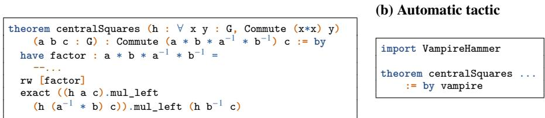
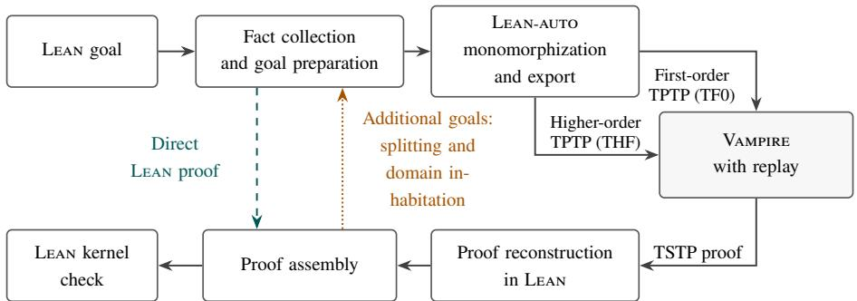
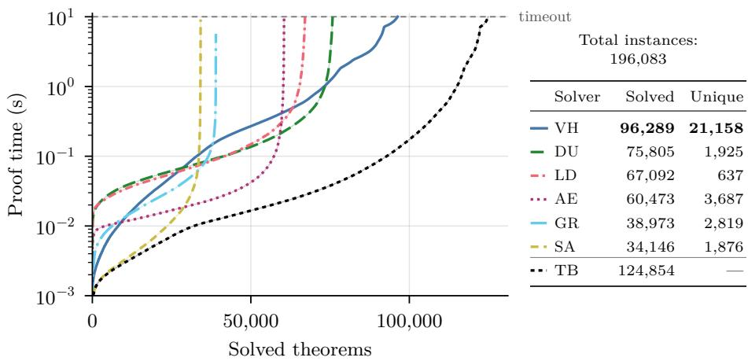

# Hammering with Vampire in Lean

Jonas Bodingbauer and Laura Kovács

TU Wien, Vienna, Austria

jonas.bodingbauer@tuwien.ac.at

Abstract. We present VAMPIRE-HAMMER, a hammer for the LEAN interactive theorem prover that discharges goals using the VAMPIRE automated theorem prover and reconstructs proofs checked by the LEAN kernel. VAMPIRE-HAMMER uses the LEAN-AUTO framework to process goals and premises before dispatching them to VAMPIRE for proof search. Doing so, we rely on standard TPTP problem formats and annotated TSTP proofs that support proof reconstruction. With a 10-second budget on 196,083 eligible Mathlib theorems, VAMPIRE-HAMMER solves 21,158 problems not solved by other evaluated tools within the same budget.

Keywords: Automated reasoning · Proof reconstruction · Vampire · Lean

## 1 Introduction

The VAMPIRE theorem prover fully automates proof search in first- and higher-order logic, including theories and induction [1]. Its proving capabilities support interactive theorem provers (ITPs) for higher-order logics: VAMPIRE has long served as a proof hammer in Isabelle [15,5]. However, integrating automated theorem provers (ATPs), particularly VAMPIRE, as proof hammers with full reconstruction in ITPs based on dependent type theory, such as LEAN [9], remains challenging. Recent approaches translate fragments of dependent type theory into first- and higher-order logic [7,12], enabling ATPs and SMT solvers to reason about them. However, translating a goal and reconstructing an external proof are distinct challenges and not yet fully addressed by existing techniques. This tool demonstration paper addresses these challenges with the new VAMPIRE-HAMMER tool, which uses VAMPIRE as a reasoning engine for LEAN and fully reconstructs its proofs for kernel checking. Successful invocations of VAMPIRE-HAMMER thus do not require the translation procedure, the reconstruction or VAMPIRE to be trusted for proof correctness. To the best of our knowledge, VAMPIRE-HAMMER provides the first complete reasoning pipeline for (native) proof reconstruction, supporting proof extraction in both first- and higher-order logic (Figure 2). Furthermore, VAMPIRE-HAMMER provides the first hammer for LEAN in a way that the proof-search eficiency of the ATP is fully maintained and reconstruction of proof-steps is shared later between both programs in an eficient way.

Methodology. Our work builds on prior results in proof checking [13,2], producing VAMPIRE proofs in formats that can be checked by the SMT solver Z3 [10] or by LEAN. However, direct proof output alone is insuficient for a VAMPIRE-based hammer in LEAN: proof goals must (i) first be translated from dependent type theory into simply typed

(a) Explicit proof

  
Fig. 1. (a) A LEAN goal expressing that centralSquares imply central commutators, discharged by a single VAMPIRE-HAMMER call. Here � is a group and Commute x y means �� = ��. The explicit proof factors the commutator into three squares. (b) Invoked in LEAN, VAMPIRE-HAMMER finds a proof from the centralSquares hypothesis.

higher-order logic or, where possible, into typed first-order logic to be suitable for VAM-PIRE, and (ii) the resulting proof must then be reconstructed using the symbols and assumptions introduced during the translation. Our VAMPIRE-HAMMER therefore combines the LEAN-AUTO translation framework [12] with proof reconstruction in LEAN, and extends VAMPIRE with annotated TSTP proof output, providing suficient information for eficient reconstruction<sup>1</sup>. Together, these components provide a complete pipeline in VAMPIRE-HAMMER (Section 2): given an input LEAN proof goal, we reconstruct proof details in VAMPIRE and handle all further proof-term generation in LEAN which can then be checked by its kernel. Our work uses the TPTP syntax [14] for problem exchange and the related TSTP format for proof output. Figure 1 illustrates the use of VAMPIRE-HAMMER as a tactic (vampire) in LEAN on a group theory theorem, showing how a nontrivial proof can be replaced by a single call to VAMPIRE-HAMMER.

We evaluated VAMPIRE-HAMMER on 196,083 Mathlib [4] theorems (Section 4). Within a timeout of 10 seconds, our experiments show that VAMPIRE-HAMMER solves 21,158 problems that no other tool in the benchmark solves within the same budget. Thanks to supported TPTP/TSTP standards, VAMPIRE-HAMMER could further be extended to support other ATPs, provided that their inference rules admit similar simple reconstruction with extra annotations. Premise-selection tools, such as lean-hammer [16], complement our work and ofer possible directions for future work (Section 5).

## 2 The VAMPIRE-HAMMER Pipeline

VAMPIRE-HAMMER yields a proof tactic that integrates the VAMPIRE automated theorem prover with LEAN through a proof-producing translation and reconstruction pipeline, as summarized in Figure 2 and detailed next. Given a LEAN goal and a collection of premises, the VAMPIRE-HAMMER tactic first attempts to discharge the goal using lightweight LEAN-native reasoning <sup>2</sup>. If this fails, VAMPIRE-HAMMER translates the input problem into a representation supported by VAMPIRE, invokes external proof search, and recon-

  
Fig. 2. The VAMPIRE-HAMMER pipeline via LEAN-AUTO and proof reconstruction. Additional goals from goal splitting and domain inhabitation return to goal preparation.

structs the resulting refutation as a LEAN proof. All successful tactic invocations ultimately produce proof terms checked by LEAN’s kernel.

Goal preparation and direct reasoning. Given a goal � and a collection of selected premises Γ, VAMPIRE-HAMMER reduces the task of proving � to refuting �, by introducing ¬� and attempting to derive ⊥ from Γ ∪ {¬�}. The frontend collects explicit premises and automatically available facts, including typeclass laws and defining equations, and normalizes the corresponding LEAN expressions through reductions and definition unfolding as needed for translation.

Monomorphization and preprocessing. After goal preparation, the VAMPIRE-HAMMER frontend delegates monomorphization and translation to LEAN-AUTO [12]. Preprocessing also tracks inhabitation obligations: TPTP sorts are nonempty whereas LEAN allows empty types. Depending on the configuration, preprocessing produces monomorphic higher- or first-order problem encodings.

External proof search. The resulting problem is then passed to VAMPIRE either using first-order logic (TPTP TF0) or higher-order logic (TPTP THF) encodings. Source types, symbols, and formulas receive fresh names, while the exporter retains mappings from these names to their reified counterparts.

VAMPIRE is invoked on the resulting problem, using portfolio mode for first-order logic and default mode for higher-order logic. When a proof is found, important inference information, such as unifiers and modified literal positions, are recovered using the replay mechanism introduced in [2]. Listing 1 shows these annotations for a subsumption resolution step of VAMPIRE’s proof calculus, that could occur during proving Figure 1. Standard VAMPIRE treats clauses as unordered sets and it changes the order of literals in clauses without recording that. To make such steps reconstructible in VAMPIRE-HAMMER, we extend VAMPIRE to output associativity and commutativity bridges recording the applied permutations.

Proof decoding and local reconstruction. The TSTP proof generated by VAMPIRE is parsed in LEAN [11] and converted into an internal representation with decoded annotations for reconstruction. Following the approach of [2], each proof step is replayed as a local lemma with premises $P _ { 1 } , \ldots , P _ { n }$ and conclusion �. The backend constructs a LEAN term of the form $P _ { 1 } \to \cdot \cdot \cdot \to P _ { n } \to C$ , using reconstruction procedures for each

```prolog
tff(f3,plain, ![X : group] : (mul(X,inv(X)) = e | mul(inv(X),X) = e),
inf(fw_res, [uni([subs(f2,[b(Y,X)])]), rem_lit(lit(f1,0))],[f1,f2])).
tff(f4,plain, ![X : group] : (mul(inv(X),X) = e | mul(X,inv(X)) = e),
inf(ac,[perm([1,0])],[f3])).
```

Listing 1: A shortened example of a TSTP proof step with information for fast reconstruction. A uni annotation records the substitution used in the inference, and rem\_lit records the location of the removed literal in the parent clause. The ac bridge in the second step records the applied permutation.

inference rule. Many steps can be proven by properly instantiating theorems, such as the resolution theorem in Listing 2, using the annotations emitted by VAMPIRE.

When a rule-specific reconstruction procedure does not apply, for example because of missing annotations or an unexpected inference rule, grind [8] is used as a fallback. Symbols introduced during external reasoning, such as Skolem constants, AVATAR split predicates, and named definitions, require additional justification in the form of local let statements as demonstrated in previous work [2]. Once each step of the refutation has been reconstructed locally, the individual lemmas are combined into one full theorem yielding the empty clause ⊥, and thus concluding the refutation. The resulting proof is passed to LEAN-AUTO for assembly into a term that can be checked against the initial goal by the LEAN kernel.

## 3 Search Strategy

Split higher-order and first-order routes. As shown in Figure 2, problem export in VAMPIRE-HAMMER is possible in higher- and first-order logic. The higher-order logic export keeps function types and preserves a more expressive subset of dependent type theory, whereas first-order proof search is more mature and better optimized in VAM-PIRE. Although first-order search may be faster, translating a LEAN goal into first-order logic can produce larger problems and discard information retained by higher-order encodings, potentially making proofs harder to find. Thus, both approaches are viable.

Domain inhabitation. While LEAN-AUTO already collects domain inhabitation evidence, VAMPIRE-HAMMER performs an additional, time-limited inhabitation search. When no inhabitant is found for a type, VAMPIRE is nevertheless invoked under the assumption that the type is inhabited, leaving its justification as an open proof obligation. If VAM-PIRE finds a proof that does not use this assumption, the proof can be reconstructed immediately. Otherwise, VAMPIRE-HAMMER considers the complementary case in which the type is empty and attempts to discharge the resulting goal. If successful, the proofs of both cases are combined to establish the original goal.

theorem resolution (lit : Prop) (c1 c1' c2 c2' : List Prop) : H (c1 ++ lit :: c1') →   
H (c2 ++ (¬ lit) :: c2') → H ((c1 ++ c1') ++ (c2 ++ c2'))

Listing 2: LEAN theorem for binary resolution for resolving complementary literals and deriving the disjunction of remaining literals with clauses treated as Lists of Props.

Scheduling higher-order and first-order search. Higher- and first-order search are complementary, with each finding proofs that the other cannot. When running on a single thread, the two approaches are allocated time slices determined empirically using a small subset of benchmark problems. During the first 20% of VAMPIRE-HAMMER’s search budget, VAMPIRE runs in higher-order mode, as it tends to terminate quickly on unsuccessful attempts and typically finds successful proofs early. If higher-order search fails, the remaining budget is allocated to first-order search using VAMPIRE’s portfolio mode. In case the first-order proof is unsuccessful, a higher-order attempt with additional hints is started. Goals that can be easily split, such as propositions of the form � ∧ �, are identified before proof search. For goals of this form, a fraction of the total time budget is reserved ahead of time for attempting proof search on resulting subgoals 3

## 4 Experimental Evaluation

Benchmark. Our benchmark consists of the user-declared theorems of Mathlib, evaluated with the same LEAN version v4.34.1. For each theorem, we extract the direct theorem dependencies appearing in its original proof and provide these as explicit premises to the competing tactics, together with the theorem’s local hypotheses. Thus, our experiments primarily evaluate automated reasoning given proof-derived premises, rather than end-to-end premise selection tackled by other approaches [16]. Our comparison uses the intersection of eligible cases across all tools, totaling in 196,083 theorems.

To prevent access to the target theorem or declarations introduced later in its source file, the harness reconstructs the environment immediately before the command that originally declared the target. Targets whose statements or original proofs reference constants introduced by the same command are excluded.

Execution protocol. Our experiments run on compute nodes with two AMD EPYC 9335 CPUs at 3 GHz and 1.5 TB of memory. The nodes are managed by Slurm, and each node runs 64 LEAN instances in parallel. To minimize LEAN loading times and source replay, each worker processes batches of up to 16 theorems from the same defining module for the same tactic. We ran the full benchmark twice and report the arithmetic mean across both runs for the runtimes shown in the plots and the number of successfully proved theorems.<sup>4</sup> Every tactic invocation receives a wall-clock proof budget of 10 s, including premise extraction, tactic execution, and kernel checking. We disable LEAN’s overall heartbeat limit for all tools. This avoids terminating an otherwise admissible attempt solely because of LEAN’s default heartbeat allowance. A success requires a complete proof accepted by LEAN’s kernel. The harness also rejects proofs containing sorryAx or depending on the target theorem itself.

Results. We compare VAMPIRE-HAMMER against LEAN-AUTO +DUPER [12,3], standalone DUPER [3], AESOP [6], simp\_all, and grind [8] <sup>5</sup>. Out of 196,083 theorems, 96,289 are proven within 10 s by VAMPIRE-HAMMER. As shown in Figure 3, the union of all tools solve 124,854 theorems, with 21,158 unique problems solved only by VAMPIRE-HAMMER, showcasing the advantage of our proof automation and a relative improvement of 20.4%. This demonstrates that VAMPIRE-HAMMER extends the reach of existing LEAN proof automation, yielding an improvement to the existing automation landscape. Of all problems exported to VAMPIRE, 62% were solved using higher-order reasoning, 36% using first-order reasoning, and 1% using both. These numbers are largely influenced by the higher-order search occurring first in the employed schedule. The noticeable kinks in the VAMPIRE-HAMMER curve of Figure 3 reflect transitions between the proof search modes detailed in Section 3.



<table><tr><td>Solver</td><td>Solved</td><td>Unique</td></tr><tr><td>- VH</td><td>96,289</td><td>21,158</td></tr><tr><td>1 DU</td><td>75,805</td><td>1,925</td></tr><tr><td>- LD</td><td>67,092</td><td>637</td></tr><tr><td> AE</td><td>60,473</td><td>3,687</td></tr><tr><td>一 GR</td><td>38,973</td><td>2,819</td></tr><tr><td>-- SA</td><td>34,146</td><td>1,876</td></tr><tr><td>… TB</td><td>124,854</td><td></td></tr></table>

Fig. 3. Cactus plots and solve counts over two runs with a 10 s proof budget. Unique counts denote problems solved by the respective tool, not solved by any other tool in the suite. VH: VAMPIRE-HAMMER; LD: LEAN-AUTO + DUPER; DU: DUPER; AE: AESOP; SA: simp\_all; GR: grind; TB: theoretical best, combining all tools using the fastest successful proof per problem.

## 5 Conclusion

We presented VAMPIRE-HAMMER, a proof-producing hammer that brings the VAMPIRE automated theorem prover to LEAN. Given a goal and selected premises, VAMPIRE-HAMMER exports problems through LEAN-AUTO into first-order or higher-order TPTP, searches for a refutation with VAMPIRE, and reconstructs the annotated TSTP proof inside LEAN as a composition of local lemmas, yielding a proof term checked by LEAN’s kernel. Because proofs are exchanged through TSTP, the reconstruction approach may be extended to other ATPs if their inference rules and proof output can be supported. On 196,083 eligible Mathlib [4] theorems, VAMPIRE-HAMMER solves 21,158 problems that no other evaluated tool solves within the same budget. Future work is the integration of premise selection over the full library, e.g. via lean-hammer [16], improving exported problem quality, and higher-order reasoning in VAMPIRE.

Acknowledgments. We thank Henrik Böving for discussions and feedback on our work.

Funding. This research was funded in whole or in part by the Austrian Science Fund – FWF [Grant ID 10.55776/EFP2661725], the WWTF grant ForSmart 10.47379/ICT22007, and the SBA Research COMET Center SBA-K1 NGC managed by the FFG.

AI Statement. Generative AI tools (GPT-6.1-Sol, Claude Opus 5.5 and GLM 5.3) were used to assist with the implementation and refinement of parts of the VAMPIRE-HAMMER.

Data Availability Statement. The implementation for VAMPIRE-HAMMER is available at https://github.com/vprover/vampire-hammer, with accompanying benchmark data in https://doi.org/10.5281/zenodo.23405497 as summarized in Appendix B.

## References

1. Bártek, F., Bhayat, A., Coutelier, R., Hajdú, M., Hetzenberger, M., Hozzová, P., Kovács, L., Rath, J., Rawson, M., Reger, G., Suda, M., Schoisswohl, J., Voronkov, A.: The Vampire Diary. In: CAV (2025). https://doi.org/10.1007/978-3-031-98682-6\_4

2. Bodingbauer, J., Hajdu, M., Kovács, L., Polaczek, A., Rawson, M.: Lean on Vampire Proofs. In: ITP. pp. 36:1–36:9 (2026). https://doi.org/10.4230/LIPIcs.ITP.2026.36

3. Clune, J., Qian, Y., Bentkamp, A., Avigad, J.: Duper: A Proof-Producing Superposition Theorem Prover for Dependent Type Theory. In: ITP (2024). https://doi.org/10.4230/ LIPIcs.ITP.2024.10

4. mathlib Community, T.: The Lean Mathematical Library. In: CPP (2020). https://doi. org/10.1145/3372885.3373824

5. Desharnais, M., Vukmirović, P., Blanchette, J., Wenzel, M.: Seventeen Provers Under the Hammer. In: ITP. pp. 8:1–8:18 (2022)

6. Limperg, J., From, A.H.: Aesop: White-Box Best-First Proof Search for Lean. In: CPP. pp. 253–266 (2023). https://doi.org/10.1145/3573105.3575671

7. Mohamed, A., Mascarenhas, T., Khan, H., Barbosa, H., Reynolds, A., Qian, Y., Tinelli, C., Barrett, C.W.: lean-smt: An SMT Tactic for Discharging Proof Goals in Lean. In: CAV (2025). https://doi.org/10.1007/978-3-031-98682-6\_11

8. Morrison, K., de Moura, L.: Grind: An SMT-inspired tactic for lean 4 (short paper – system description). In: IJCAR. pp. 106–114 (2026). https://doi.org/10.1007/ 978-3-032-32589-1\_7

9. de Moura, L., Ullrich, S.: The Lean 4 Theorem Prover and Programming Language. In: CADE. pp. 625–635 (2021). https://doi.org/10.1007/978-3-030-79876-5\_37

10. de Moura, L.M., Bjørner, N.S.: Z3: an eficient SMT solver. In: TACAS. pp. 337–340 (2008). https://doi.org/10.1007/978-3-540-78800-3\_24

11. Polaczek, A.: Thousands of Problems to Lean. Master thesis, TU Wien (2026). https:// doi.org/10.34726/hss.2026.143161

12. Qian, Y., Clune, J., Barrett, C.W., Avigad, J.: Lean-Auto: An Interface Between Lean 4 and Automated Theorem Provers. In: CAV (2025). https://doi.org/10.1007/ 978-3-031-98682-6\_10

13. Rawson, M., Voronkov, A., Schoisswohl, J., Komel, A.P.: Ground Truth: Checking Vampire Proofs via Satisfiability Modulo Theories. In: CADE (2025). https://doi.org/10.1007/ 978-3-031-99984-0\_8

14. Sutclife, G.: Stepping Stones in the TPTP World. In: IJCAR (2024). https://doi.org/ 10.1007/978-3-031-63498-7\_3

15. Wenzel, M., Paulson, L.C., Nipkow, T.: The Isabelle Framework. In: TPHols. pp. 33–38 (2008). https://doi.org/10.1007/978-3-540-71067-7\_7, https://doi.org/10. 1007/978-3-540-71067-7\_7

16. Zhu, T., Clune, J., Avigad, J., Jiang, A.Q., Welleck, S.: Premise Selection for a Lean Hammer (2025). https://doi.org/doi.org/10.48550/arXiv.2506.07477

## A Benchmark Setup

The benchmark evaluates each theorem in an environment reconstructed from immediately before its declaration, excluding the target itself and later declarations. Although every tool receives the same explicit premise names extracted from the original proof, these premises do not form an exclusive set of premises: tactics may also use global simplification rules, registered grind rules, and typeclass instances available in that environment. Such background knowledge can make some goals simpler, including cases where an earlier theorem already provides an equivalent result. The results therefore measure automation with declaration-time library support, rather than reasoning solely from the extracted premises.

Scope and limitations. The evaluation measures reconstruction of existing Mathlib theorems with premises derived from their original proofs. It does not measure interactive usability or premise discovery from the full library.

## B Benchmarked Tool Versions

<table><tr><td>Tool or component</td><td>Version Commit</td><td></td></tr><tr><td>VAMPIRE-HAMMER</td><td>0.1.0</td><td>4c50a21de3e4</td></tr><tr><td>VAMPIRE</td><td>5.1.0</td><td>6ee1f120df1b</td></tr><tr><td>DUPER</td><td>4.34.1</td><td>9e09cd05fd54</td></tr><tr><td>LEAN-AUTO</td><td>4.34.1</td><td>6b2774cde4d1</td></tr><tr><td>AESOP</td><td>4.34.0</td><td>355695d523e4</td></tr><tr><td>simp_all (Lean)</td><td>4.34.1</td><td>5045d0056413</td></tr><tr><td>grind (Lean)</td><td>4.34.1</td><td>5045d0056413</td></tr><tr><td>Mathlib</td><td>4.34.1</td><td>d13f23b723b8</td></tr><tr><td colspan="3">LEAN-AUTo fork used by Vampire-Hammer _ a2f825aca7e5</td></tr></table>

Table 1. Tool versions and dependency pins from the saved benchmark setup, with abbreviated commit identifiers. A dash indicates that no release version was established.

The proof attempt results of each tool in each run are available as two CSV files which each contain 196,083 theorems eligible. The benchmarking scripts are available under https://github.com/i-am-a-teapot/vampire-hammer-benchmarks

## C Usage

VAMPIRE-HAMMER is installed as a Lake dependency, which automatically builds Vampire and the bundled TPTP parser. It can be installed by a simple addition to the LEAN project’s lakefile like:

```gemfile
require vampire_hammer from
git "https://github.com/vprover/vampire-hammer" @ "main"
```

More detailed information is available in the readme of the Git repository.

After importing VampireHammer, users can invoke the vampire tactic on selected hypotheses or lemmas like any other LEAN tactic.

```lisp
example {� : Type} (p q : � → Prop) (a : �)
(h<sub>1</sub> : ∀ x, p x → q x) (h<sub>2</sub> : p a) : q a := by
vampire [h<sub>1</sub>, h<sub>2</sub>]
```

Alternatively, vampire [\*] selects all local hypotheses. The central squares example is provided as a further example in the repository.

By default, first-order and native higher-order search run concurrently, with a search allowance of 10 seconds per attempt. Users can adjust this allowance with (timeout := 20), select sequential search with (parallel $\mathrel { \mathop : } = \mathrm { ~ \ f a l s e ) ~ }$ , and guide definition handling through (unfold := [f]) and (defeq := [f]). Completed proofs are cached within the Lean session; setting (cache := false) forces a fresh search and vampire.outputPath retains input and prover output.