# ACCELERATING LLM PRETRAINING WITH ZEROTH-ORDER CURVATURE ON IDLE SERVING COMPUTE

Mingchuan Ma<sup>1,∗</sup>, Dongqi Cai<sup>2,6,∗,†</sup>, Daqian Yang<sup>1</sup>, Zhenyan Lu<sup>3</sup>, Chen Chen<sup>4</sup>, Teresa Lv<sup>4</sup> Yan Gao<sup>5</sup>, Shangguang Wang<sup>3</sup>, Mengwei Xu<sup>2,3,6</sup>, Nicholas D. Lane<sup>5</sup>, Yu Huang<sup>1,†</sup>

<sup>1</sup> School of Software & Microelectronics, Peking University

<sup>2</sup> Nanjing University

<sup>3</sup> Beijing University of Posts and Telecommunications

<sup>4</sup> Sony Europe Ltd.

<sup>5</sup> University of Cambridge

<sup>6</sup> MingTi Technology

## ABSTRACT

LLM pretraining is increasingly compute-intensive, while substantial inference serving compute remains idle during off-peak periods. However, such serving hardware is difficult to use for conventional first-order training due to its memory, networking and other system requirements. Zeroth-order (ZO) optimization offers a natural interface to this forward-only compute resource, but its gradient estimates break down in pretraining. Unlike fine-tuning, which can confine updates to a small parameter subspace, pretraining must update every parameter, and the alignment of a ZO gradient estimate with the true gradient shrinks as the number of updated parameters grows. We make a different observation: noisy ZO estimates can still provide useful curvature information, even when they are too inaccurate to serve as gradients. Based on this insight, we propose ZO-Curv, which leverages idle forward-only devices to estimate curvature and uses it to adapt and refine the update used during first-order training, thereby accelerating the process. We provide convergence guarantees that characterize the effect of finite-query curvature estimation. Experiments on LLMs from 125M to 1.5B parameters show that ZO-Curv consistently accelerates pretraining. At 770M parameters, ZO-Curv reaches AdamW’s 20K-step validation loss in 3.9 hours instead of 7.5 hours, while achieving a lower final loss of 2.70 versus 2.84 under the same step budget. These results show that idle model serving compute can accelerate LLM pretraining when zeroth-order queries are used to estimate curvature rather than gradients directly.

## 1 INTRODUCTION

LLM pretraining demands substantial compute, with model development requiring repeated runs over architectures, training schedules, data mixtures, and optimizer configurations (Khandelwal et al., 2024; Kaplan et al., 2020; Hoffmann et al., 2022; Zhang et al., 2022; Yang et al., 2021). Meanwhile, rapidly growing model serving compute, from inference clusters to local devices (Cai, 2025), represents a potentially valuable neglected resource for accelerating pretraining.

Serving compute is abundant but difficult to train on. Much of this serving capacity is underuti lized. As shown in Figure 1(a), serving clusters are provisioned for peak demand, leaving substantial capacity idle during off-peak periods (Patel et al., 2024; Griggs et al., 2024; Li et al., 2023; Liu et al., 2026a). Across tens of thousands of production Kubernetes clusters, Cast AI reports only 5% average GPU utilization from January 2025 to April 2026 (Cast AI, 2026). However, this idle compute cannot readily join conventional first-order (FO) training. Training must additionally store activa tions for backpropagation, gradients, and optimizer states, resulting in a 3.5–9× memory overhead over inference (Figure 3(a)). It also requires optimized backward kernels, ultra high-speed networks and runtime support that serving platforms often lack (Kwon et al., 2023; Zhong et al., 2024).

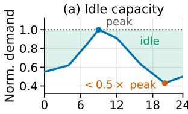  
Time of day (ET)

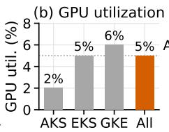

(c) Runs per day  
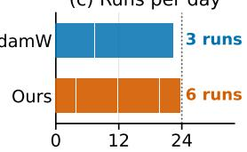  
Time (h)

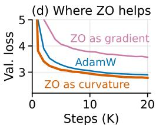  
Figure 1: Landscape of idle serving devices and the pathway of harvesting them. (a) Diurnal inference demand leaves peak-provisioned capacity idle. (b) Production clusters exhibit low average GPU utilization. (c) Harvesting idle devices doubles the pretraining runs a cluster completes per day. (d) Comparison of ZO curvature and ZO gradients on pretraining.

Zeroth-order optimization: promise and challenge. Zeroth-order (ZO) optimization needs only forward passes, estimating gradients from loss differences under random perturbations (Spall, 1992; Nesterov & Spokoiny, 2017). This makes it a natural fit for forward-only hardware, and it has recently proven practical for fine-tuning LLMs at inference-level memory cost (Malladi et al., 2023; Zhang et al., 2024). Pretraining is harder: the variance of random-direction ZO estimators grows with the parameter dimension d (Nesterov & Spokoiny, 2017; Duchi et al., 2015; Shamir, 2017). At the hundreds of millions to billions of parameters of modern LLMs, this leaves low-query estimates extremely noisy. MeZO-style pretraining of GPT-2 355M confirms the effect, stalling near a validation loss of 8.5 while AdamW drops below 3.0 after the same number of training steps. Mixing ZO estimates into the FO gradient inherits the same noise and underperforms AdamW (Figure 1(d)).

Our approach: ZO-Curv. ZO-Curv uses ZO to estimate curvature rather than gradients. Unlike a gradient, curvature need not identify a precise descent direction, which noisy ZO queries cannot provide at pretraining scale; it only sets a coordinate-wise scale for the update, and even a coarse diagonal estimate can tell how aggressively each coordinate should move. ZO-Curv therefore keeps exact FO gradient computation on the training node and outsources only curvature estimation to idle serving devices, which evaluate perturbed losses with forward passes. The training node aggregates these estimates into a diagonal preconditioner for its FO update.

Our contributions are as follows.

• We show that ZO estimates, while too noisy to provide reliable descent directions for LLM pretraining, remain effective for estimating curvature to precondition FO gradients.

• We propose ZO-Curv, a hybrid optimization framework that keeps exact FO gradient computation on the training node while offloading forward-only curvature estimation to idle serving devices. We further establish convergence guarantees for ZO-Curv.

• We demonstrate consistent gains across models from 125M to 1.5B parameters. ZO-Curv reaches AdamW’s target loss up to 2.2× faster, with larger models benefiting more from additional serving compute. On the downstream task LAMBADA, ZO-Curv improves accuracy by 26.9% over AdamW.

## 2 BACKGROUND AND MOTIVATION

## 2.1 PRELIMINARIES

LLM pretraining. Pretraining minimizes the autoregressive negative log-likelihood $F ( \theta ) =$ $\begin{array} { r } { \mathbb { E } _ { \boldsymbol { x } \sim \mathcal { D } } \left[ - \sum _ { i } \log p _ { \boldsymbol { \theta } } ( x _ { i } \mid \boldsymbol { x } _ { < i } ) \right] } \end{array}$ over a large corpus D, where $\theta \in \mathbb { R } ^ { d }$ are the transformer parameters. The de facto optimizer is AdamW (Loshchilov & Hutter, 2017): every step runs a forward and a backward pass and maintains two moment buffers alongside parameters and gradients.

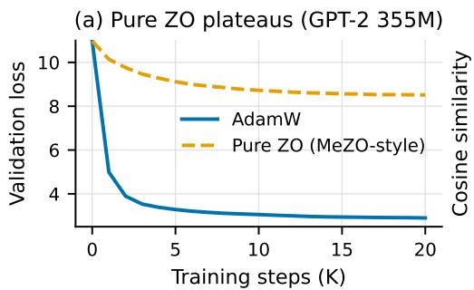

(b) Pretraining vs. Finetuning (GPT-2 355M)  
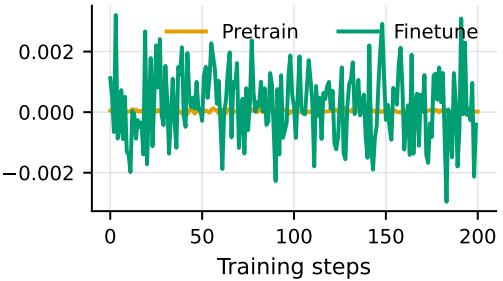  
Figure 2: ZO gradients fail at pretraining. (a) Pure ZO stalls early while AdamW converges under the same budget. (b) Cosine similarity between the ZO gradient and the exact gradient.

Second-order preconditioning. Sophia (Liu et al., 2024) accelerates pretraining by dividing the gradient EMA (Exponential Moving Average) by an EMA of a diagonal Hessian estimate, followed by coordinate-wise clipping. The curvature estimate needs to be neither exact nor fresh: it is refreshed only every ten steps, and the EMA, the clipping, and a positive floor on the denominator absorb estimation noise. This coarse signal halves the number of steps to reach a given validation loss. Its cost, however, is charged to the training node, since the Gauss–Newton–Bartlett (GNB) estimator computes a minibatch gradient with resampled labels, an additional forward and backward pass. Sophia accounts for this as 5% extra compute per step on average, or roughly 50% extra FLOPs on each refresh step. Measured on GPU, however, a refresh step costs about twice an AdamW step rather than the 1.5× that its FLOPs suggest (Section 2.3).

Zeroth-order optimization. Zeroth-order (ZO) methods optimize with forward evaluations only (Spall, 1992; Nesterov & Spokoiny, 2017). The two-point estimator perturbs the parameters along a random direction u and forms

$$
{ \hat { g } } \ = \ { \frac { F ( \theta + \varepsilon u ) - F ( \theta - \varepsilon u ) } { 2 \varepsilon } } u ,\tag{1}
$$

which is unbiased for the gradient of a smoothed loss. Its variance, however, grows linearly with the dimension d at a fixed number of evaluations (Nesterov & Spokoiny, 2017; Duchi et al., 2015). Because each evaluation needs only inference-level memory, ZO has recently proven practical for fine-tuning LLMs (Malladi et al., 2023; Zhang et al., 2024), which raises the question of whether it can support pretraining as well.

## 2.2 ZO GRADIENTS LOSE DIRECTIONAL SIGNAL AT PRETRAINING SCALE

The most direct way to use forward-only serving devices is to let ZO replace backpropagation outright. Figure 2(a) shows that it does not work. We pretrain a 355M model in GPT-2 structure from scratch on OpenWebText with a MeZO-style two-point estimator, against AdamW under an identical setup. AdamW drops below a validation loss of 3.0 within the budget, whereas pure ZO stalls near 8.5 after an initial descent. The gap is not a constant-factor slowdown: beyond the first few thousand steps, the ZO run makes essentially no further progress.

The failure is directional and scales with the number of trainable parameters d. Figure 2(b) compares the cosine similarity between the two-point estimate equation 1 and the exact gradient in pretraining $( d \approx 3 . 5 \times 1 0 ^ { 8 } )$ and in LoRA fine-tuning of the same model on SST-2 (Socher et al., 2013) (d ≈ $7 . 9 \times 1 0 ^ { 5 } )$ . Because the estimate is parallel to its Gaussian direction $u ,$ this cosine has expected magnitude close to $\sqrt { 2 / ( \pi d ) }$ for any gradient, matching both curves: it reflects the dimension, not the loss landscape. Fine-tuning can confine the search to a small subspace, but pretraining must update every parameter, so each ZO estimate carries almost no directional information. Forwardonly devices should therefore supply not the descent direction but information that tolerates far noisier measurements.

(a) Training memory vs. forward-only  
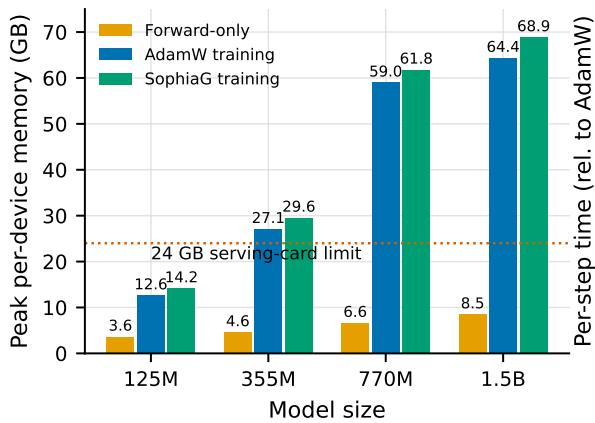

(b) Curvature overhead on the FO node  
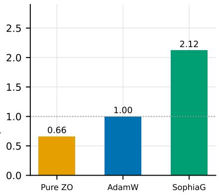  
Figure 3: Serving devices cannot join training, and curvature estimation burdens the training node. (a) Forward-only execution fits a 24 GB serving card at every size; AdamW and SophiaG training exceed it from 355M onward. (b) A SophiaG curvature-refresh step costs about twice an AdamW step, while a forward-only computation is much cheaper to obtain.

## 2.3 SERVING DEVICES CANNOT TRAIN, AND CURVATURE IS COSTLY

Could idle serving devices instead join conventional training as ordinary data-parallel workers? Figure 3(a) compares peak per-device memory for forward-only execution against AdamW and SophiaG training across model sizes. Forward-only execution fits a representative 24 GB serving card at every size, peaking at 8.5 GB for the 1.5B model. Training crosses that limit already at 355M and reaches roughly eight times the forward-only footprint at 1.5B, because it additionally holds activations for backpropagation, gradients, and optimizer state. A device that comfortably serves a model still cannot train it.

Second-order preconditioning strains the training node further, more than its FLOPs accounting indicates. Section 2.1 reports Sophia consumes roughly 50% extra FLOPs for the GNB refresh. While measured on GPU (Figure 3(b)), a step that recomputes the GNB estimate takes 2.12× the time of an AdamW step. Meanwhile, forward-only ZO estimation costs only 66%, and it runs within serving-level memory. The compute that curvature estimation needs is cheap and abundant, but it sits on the wrong side of the cluster.

Together, the two negative results motivate a single split. The first-order gradient is indispensable (Section 2.2) and demands full training capability, so it must stay on the training node. Curvature is auxiliary: it only rescales coordinates, the update rule that consumes it is built to tolerate noise (EMA, clipping, positive floor), and is friendly to ZO estimation on the idle serving nodes.

## 3 ZO-CURV: CURVATURE FROM IDLE FORWARD-ONLY COMPUTE

## 3.1 SETTING

Figure 4 illustrates the overall ZO-Curv workflow. We consider a service cloud with one strong training node and M forward-only serving nodes. The training node supports backpropagation and maintains optimizer states; serving nodes hold the model and evaluate losses with inferencelevel memory. The nodes are physically interconnected within the same cloud, and we assume that transferring model snapshots and query results is not the dominant cost.

Let $F ( \theta ) = \mathbb { E } _ { x \sim D } [ \ell ( \theta ; x ) ]$ be the pretraining objective, with $\theta \in \mathbb { R } ^ { d }$ . The two pools run concurrently, offset by one step. At step t, the training node broadcasts the snapshot $\theta _ { t }$ to the serving pool and computes the exact gradient $g _ { t } = \nabla L _ { t } ( \theta _ { t } )$ with true next-token labels; meanwhile, the pool evaluates its curvature queries at $\theta _ { t } .$ , whose results arrive in time for step t + 1. The update at step t therefore uses the curvature estimated at $\theta _ { t - 1 } \colon$ neither side ever waits for the other, and the curvature

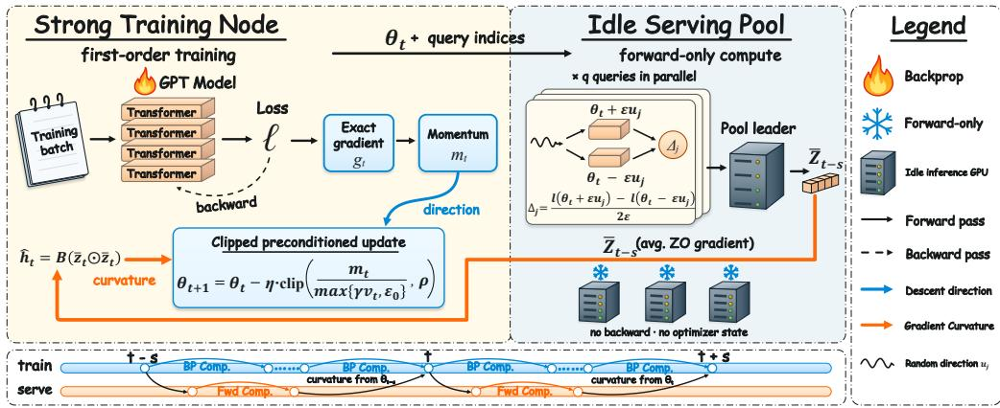  
Figure 4: ZO-Curv overview. The strong node runs ordinary first-order pretraining; idle serving devices concurrently evaluate q central-difference queries and return their averaged directional esti mate, from which the strong node assembles the diagonal curvature that preconditions its update.

EMA and the model are still refreshed at every training step. The one-step offset has no measurable effect on training (Appendix F).

## 3.2 FORWARD-ONLY DIAGONAL CURVATURE ESTIMATION

Estimation target. Our target is the Gauss–Newton–Bartlett (GNB) diagonal estimator used by Sophia-G (Liu et al., 2024). Given a curvature minibatch $B _ { t } = \{ x _ { b } \} _ { b = 1 } ^ { B } ,$ , we sample pseudo-labels $\hat { y } _ { b } \sim p _ { \theta _ { t } } ( \cdot \mid x _ { b } )$ and define the sampled-label loss $\begin{array} { r } { \ell _ { t } ^ { \mathrm { s a m p } } ( \theta ) = B ^ { - 1 } \sum _ { b = 1 } ^ { B } \ell _ { \mathrm { c e } } ( f _ { \theta } ( x _ { b } ) , \hat { y } _ { b } ) } \end{array}$ . Writing $c _ { t } = \nabla \ell _ { t } ^ { \mathrm { s a m p } } ( \theta _ { t } )$ ), the reference estimate is $h _ { t } ^ { \mathrm { G } } = B c _ { t } \odot c _ { t }$ . Its expectation over the sampled labels recovers the minibatch Gauss–Newton diagonal (Martens, 2020). We estimate a damped version of this GNB diagonal from forward passes only, avoiding the additional backward pass needed to compute $c _ { t }$

Forward-only queries. At each step, the serving pool draws $q$ independent full-parameter directions $u _ { t , j } \sim \mathcal { N } ( 0 , I _ { d } )$ and evaluates two perturbed losses per direction. All queries share the same snapshot, curvature minibatch, and sampled labels, which are held fixed under perturbation. The returned central differences determine the curvature estimate:

$$
\begin{array} { r } { \Delta _ { t , j } = \frac { \ell _ { t } ^ { \mathrm { s a m p } } ( \theta _ { t } + \varepsilon u _ { t , j } ) - \ell _ { t } ^ { \mathrm { s a m p } } ( \theta _ { t } - \varepsilon u _ { t , j } ) } { 2 \varepsilon } , } \\ { \bar { z } _ { t } = \frac { 1 } { q } \displaystyle \sum _ { j = 1 } ^ { q } \Delta _ { t , j } u _ { t , j } , \qquad h _ { t } ^ { \mathrm { Z O } } = B \bar { z } _ { t } \odot \bar { z } _ { t } . } \end{array}\tag{2}
$$

Averaging the directional estimates before squaring yields an unbiased estimate of the GNB diagonal with uniform damping $\| h _ { t } ^ { \mathrm { G } } \| _ { 1 } / q$ (Proposition 1). The curvature minibatch and pseudo-labels are sampled on the serving nodes. Thus, the downlink carries only the model snapshot and query indices, while the pool aggregates the directional terms internally. A pool leader returns the averaged vector ${ \bar { z } } _ { t } ,$ requiring one gradient-sized transfer per refresh. Overall, the estimator requires 2q perturbed forward evaluations across the pool.

Preconditioned update. The training node keeps two exponential moving averages, both initialized at zero: the gradient momentum $m _ { t } = \beta _ { 1 } m _ { t - 1 } + ( 1 - \beta _ { 1 } ) g _ { t }$ and the curvature $v _ { t } =$ $\beta _ { 2 } v _ { t - 1 } + ( 1 - \beta _ { 2 } ) h _ { t - 1 } ^ { \mathrm { Z } \tilde { \mathrm { O } } }$ ; the latter uses the estimate of the previous step, which the pool returns one step after receiving the snapshot (Section 3.1). Dividing the momentum by the floored curvature $\hat { d } _ { t } = \operatorname* { m a x } \{ \gamma v _ { t } , \epsilon _ { 0 } \}$ and clipping the result yields

$$
\theta _ { t + 1 } = ( 1 - \eta _ { t } \lambda ) \theta _ { t } - \eta _ { t } \mathrm { c l i p } ( m _ { t } / \hat { d } _ { t } , \rho ) ,\tag{3}
$$

where $\gamma$ scales the curvature, λ is the weight-decay coefficient, and all operations act coordinatewise. The floor $\epsilon _ { \mathrm { 0 } }$ and the clipping threshold $\rho$ are what make this update forgiving of curvature

```latex
Algorithm 1 ZO-Curv: training node Algorithm 2 ZO-Curv: serving node m
1: Input: initial parameters $\theta _ { 1 } ;$ learning rates $\{ \eta _ { t } \} _ { t = 1 } ^ { T } ;$ 1: Input: snapshot $\theta _ { t } ;$ query indices ${ \mathcal { I } } _ { m } ;$
query budget $q ;$ EMA coefficients $\beta _ { 1 } , \beta _ { 2 } ;$ curvature scale finite-difference radius ε
γ; clipping threshold $\rho ;$ denominator floor $\epsilon _ { 0 } ;$ weight de- 2: Draw B and $\hat { y } \sim p _ { \theta _ { t } } ;$ ; form ℓ<sup>samp</sup>
cay λ; staleness s 3: for $j \in \mathcal { I } _ { m }$ do
2: m<sub>0</sub> $ 0 ; v _ { 0 }  0 ;$ partition $\{ 1 , \ldots , q \}$ into $\lbrace \mathcal { I } _ { m } \rbrace _ { m = 1 } ^ { M }$ 4: $\bar { u _ { j , } } \sim \mathcal { N } ( 0 , I _ { d } )$
3: Broadcast $( \theta _ { 1 } , \{ \mathcal { T } _ { m } \} ) ; t _ { \mathrm { d i s p } }$ ← 1 5: $L ^ { \ ' \pm } \gets \ell ^ { \mathrm { s a m p } } ( \partial _ { t } \pm \varepsilon u _ { j } )$
4: for $t = 1 , \ldots , { \dot { T } }$ do 6: $\Delta _ { j }  ( L ^ { + } - \bar { L } ^ { - } ) / 2 \bar { \varepsilon }$
5: $g _ { t } \gets \nabla L _ { t } ( \theta _ { t } )$ 7: end for
6: $m _ { t } \gets \beta _ { 1 } \dot { m _ { t - 1 } } + ( 1 - \beta _ { 1 } ) g _ { t }$ 8: $\begin{array} { r } { z _ { m } \gets \sum _ { j \in \mathcal { I } _ { m } } \Delta _ { j } u _ { j } } \end{array}$ ▷ local partial sum
7: if $t - t _ { \mathrm { d i s p } } = s$ then 9: Send $z _ { m }$ to the pool leader
8: $h  B \bar { z } _ { t - s } ^ { \odot 2 }$ ▷ queries of $\theta _ { t - s }$ 10: Leader: $\begin{array} { r } { \bar { z } _ { t } \gets \bar { q } ^ { - 1 } \sum _ { m = 1 } ^ { M } z _ { m } } \end{array}$
9: $v _ { t }  \beta _ { 2 } { \stackrel {  } { v } } _ { t - 1 } + ( 1 - \beta _ { 2 } ) h$ 11: Return $\bar { z } _ { t }$ to the training node
10: Broadcast $( \theta _ { t } , \{ \dot { \mathcal { I } } _ { m } \} ) ;$ $i _ { \mathrm { d i s p } } \gets t$ ▷ non-blocking;
pool runs Alg. 2
11: else
12: $v _ { t } \gets v _ { t - 1 }$
13: end if
14: $\hat { d } _ { t } \gets :$ max $\left\{ \gamma v _ { t } , \epsilon _ { 0 } \right\}$
15: $\theta _ { t + 1 } \gets ( 1 - \eta _ { t } \lambda ) \theta _ { t } - \eta _ { t } \mathrm { c l i p } ( m _ { t } / \hat { d } _ { t } , \rho )$
16: end for
```

error: a positive denominator rescales a coordinate without flipping its sign, and clipping caps the step wherever the estimated curvature is too small. Algorithms 1 and 2 state both procedures for a general staleness $s ,$ partitioning the q query indices into disjoint sets $\lbrace \mathcal { I } _ { m } \rbrace _ { m = 1 } ^ { M }$ across the pool.

## 3.3 CONVERGENCE ANALYSIS

We study a deterministic core of equation 3: replace minibatch gradients with $g _ { t } = \nabla F ( \theta _ { t } )$ and omit momentum and weight decay; the results hold for staleness s (Remark 2). Proofs and explicit constants are in Appendix H.

Proposition 1 (Forward-only damped GNB curvature). Fix a step and condition on its curvature minibatch and sampled labels. $\mathbf { A } \mathbf { s } \varepsilon  0$

$$
\mathbb { E } [ h _ { t } ^ { \mathrm { Z O } } ] = \tilde { h } _ { t } : = \Big ( 1 + \frac { 1 } { q } \Big ) h _ { t } ^ { \mathrm { G } } + \lambda _ { t } \mathbf { 1 } , \qquad \lambda _ { t } = \frac { \| h _ { t } ^ { \mathrm { G } } \| _ { 1 } } { q } ,\tag{4}
$$

and $\mathbb { E } [ ( h _ { t , i } ^ { \mathrm { Z O } } ) ^ { 2 } ] \leq C _ { v } \tilde { h } _ { t , i } ^ { 2 }$ for a universal constant $C _ { v }$

The forward-only estimate is thus unbiased for a GNB diagonal with a Levenberg–Marquardt-type damping $\lambda _ { t }$ that decreases as $1 / q ,$ and its fluctuation is of the order of its target in every coordinate, independently of d. Under Assumption A1, finite differences add a relative error of order $\varepsilon ^ { 2 }$

Let $D _ { t } = \mathrm { D i a g } ( d _ { t } ) , d _ { t } = \operatorname* { m a x } \{ \gamma \tilde { v } _ { t } , \epsilon _ { 0 } \}$ , be the denominator built from the EMA $\tilde { v } _ { t }$ of $\tilde { h } _ { t }$ at the same iterates, and let $\widehat { D } _ { t } = \mathrm { D i a g } ( \hat { d } _ { t } )$ be its ZO counterpart. Fresh directions at every refresh let the EMA average the fluctuations: if each coordinate of $\tilde { h } _ { t }$ varies by at most a factor κ over the horizon, then with probability at least $1 - \zeta , ( 1 - \delta ) D _ { t } \preceq \widehat { D } _ { t } \preceq ( 1 + \delta ) D _ { t }$ <sub>t</sub> after $\mathcal { O } ( 1 / ( 1 - \beta _ { 2 } ) )$ warm-up steps, where $\delta = \mathcal { O } \big ( \kappa [ \sqrt { ( 1 - \beta _ { 2 } ) \Lambda } + ( 1 - \beta _ { 2 } ) \Lambda ^ { 2 } ] + \sqrt { \zeta / T } + \varepsilon ^ { 2 } \big )$ and $\Lambda = \log ( q d T / \zeta )$ (Theorem 3); the positive floor preserves this relative bound. We require $\delta < 1$

Theorem 1 (Robust descent). Suppose $\nabla ^ { 2 } F \preceq \alpha D _ { t }$ along each update segment and the above distortion bound holds. For $\eta \leq ( 1 - \delta ) / \alpha$ , the deterministic update $\theta _ { t + 1 } = \theta _ { t } - \eta \mathrm { c l i p } ( \widehat { D } _ { t } ^ { - 1 } g _ { t } , \rho )$ satisfies

$$
F ( \theta _ { t + 1 } ) \leq F ( \theta _ { t } ) - \frac { \eta } { 2 } \sum _ { i } \operatorname* { m i n } \left\{ \frac { g _ { t , i } ^ { 2 } } { \hat { d } _ { t , i } } , \rho | g _ { t , i } | \right\} .\tag{5}
$$

If F is bounded below, the minimum of this clipped stationarity measure over T steps is $\mathcal { O } ( 1 / T )$ .

A positive denominator preserves each gradient coordinate’s sign, and clipping bounds the update magnitude; smoothness and the step-size condition ensure that the finite step decreases the loss.

Theorem 2 (Local linear convergence). Suppose clipping is inactive and the preconditioned PL condition $g _ { t } ^ { \top } D _ { t } ^ { - 1 } g _ { t } \ge 2 \mu _ { D } ( F ( \theta _ { t } ) - F _ { \star } )$ holds in the local region. Under the conditions of Theorem 1, choosing $\eta = ( 1 - \delta ) / \alpha$ gives

$$
{ \cal F } ( \theta _ { t + 1 } ) - { \cal F } _ { \star } \le \left( 1 - \frac { \mu _ { D } } { \alpha } \frac { 1 - \delta } { 1 + \delta } \right) ( { \cal F } ( \theta _ { t } ) - { \cal F } _ { \star } ) .\tag{6}
$$

Curvature error enters only through the factor $( 1 - \delta ) / ( 1 + \delta )$ , which is governed by the EMA window and depends on d only logarithmically. The budget q instead sets the damping of the reference preconditioner: as q grows, $\lambda _ { t }$ decreases and $D _ { t }$ approaches the undamped GNB preconditioner of Sophia-G. The serving pool thus supplies coordinate-wise update scales while the training node retains first-order gradient computation.

## 4 EXPERIMENTS

We evaluate ZO-Curv to answer four research questions: RQ1: does forward-only curvature estimation accelerate LLM pretraining end to end, in wall-clock time and across model sizes? RQ2: how does the gain correlate with the query budget $q \mathrm { ? }$ RQ3: can curvature queries substitute for first-order batch size, exchanging training-node compute for idle serving compute? RQ4: do faster pretraining loss curves translate into downstream quality?

## 4.1 SETUP

Models and data. GPT-2–style decoder-only transformers (Radford et al., 2019) with 125M, 355M, and 770M parameters, plus a 1.5B GPT-NeoX configuration, trained from scratch on OpenWeb-Text (Gokaslan & Cohen, 2019) with context length 1024 and global batch size 512. SophiaG and ZO-Curv train for 20K steps at 125M–770M and 50K steps at 1.5B; AdamW receives a doubled step budget (40K and 100K, respectively) so that all methods span a comparable wall-clock window.

Baselines. (i) AdamW (Loshchilov & Hutter, 2017), the FO standard. (ii) SophiaG (Liu et al., 2024), which computes the GNB curvature by backpropagation on the training node, refreshed at every step so that both second-order methods consume equally fresh curvature. (iii) Pure ZO, a MeZO-style ZO-SGD (Malladi et al., 2023). (iv) InstructedZO (Cai, 2025), which mixes ZO gradient estimates into the FO gradient and represents the gradient-level use of forward-only compute. (v) ZO-Curv, with $q = 5 1 2$ unless stated otherwise. Further details are given in Appendix B.

Hardware and timing. All experiments run on a single 8×H100 node. The forward-only pool is emulated on the same hardware: at every step, the 2q perturbed forward evaluations of Section 3.2 are computed alongside the first-order step. Wall-clock time for ZO-Curv counts the training-node critical path; the concurrent curvature evaluations are excluded, as they would occupy otherwise-idle serving devices. Section 4.2 additionally runs first-order training and the forward-only queries on disjoint GPU groups, and the speedup persists.

## 4.2 RQ1: END-TO-END ACCELERATION

Figure 5 plots validation loss against wall-clock time and grants AdamW twice the steps to span a comparable time window. Table 1 instead holds every method to the same 20K-step budget at 770M and measures the time to reach AdamW’s final loss. ZO-Curv reaches this loss in roughly half the wall-clock time. The speedup is consistent from 125M to 1.5B.

Table 1 also shows that simply using forward-only compute does not provide this benefit. Pure ZO never reaches the target, while InstructedZO finishes above AdamW. Both use ZO estimates as descent directions. In contrast, ZO-Curv uses forward-only estimates for curvature while retaining the exact first-order gradient. The benefit therefore comes from using forward-only compute for curvature rather than for the descent direction.

The comparison with SophiaG further isolates where curvature is computed. SophiaG and ZO-Curv make nearly identical progress per step (Appendix C). However, SophiaG computes its GNB curvature on the training node, where a refresh costs 2.12× an AdamW step (Section 2.3). Table 1 shows the resulting wall-clock overhead. SophiaG reaches the target in only 10.0K steps but takes 7.98 hours, more than the 7.53 hours AdamW needs for its full run. ZO-Curv reaches the same target in 10.5K steps and takes only 3.98 hours. Its curvature estimation runs concurrently on the idle serving pool, leaving the training-node critical path close to that of AdamW. Refreshing curvature every ten steps, as in the original Sophia, amortizes the overhead only by using staler curvature. Even then, SophiaG remains 6–12% slower per step than ZO-Curv (Appendix D). Offloading curvature removes this training-node overhead rather than trading it against freshness.

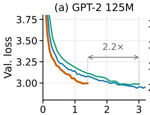  
Time (h)

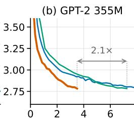  
Time (h)

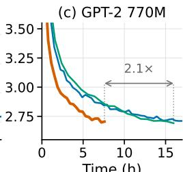  
Time (h)

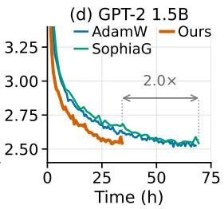  
Figure 5: Main result (RQ1): forward-only curvature turns step efficiency into wall-clock speedup (OpenWebText; AdamW receives a doubled step budget). ZO-Curv reaches AdamW’s final loss in roughly half the time at every size, whereas SophiaG spends its step advantage on curvature computed on the training node.

Table 1: Main comparison at GPT-2 770M with a shared 20K-step budget. Steps- and time-to-target measure how quickly each method reaches AdamW’s final validation loss; “–” = never reached.
<table><tr><td>Method</td><td>Val. loss ↓</td><td>Steps to target (K) ↓</td><td>Time to target (h) ↓</td></tr><tr><td>AdamW</td><td>2.84</td><td>20.0</td><td>7.53</td></tr><tr><td>SophiaG</td><td>2.69</td><td>10.0</td><td>7.98</td></tr><tr><td>Pure ZO (MeZO-style)</td><td>8.01</td><td></td><td></td></tr><tr><td>InstructedZO</td><td>3.37</td><td></td><td></td></tr><tr><td>ZO-Curv (ours)</td><td>2.70</td><td>10.5</td><td>3.98</td></tr></table>

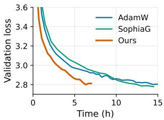  
Figure 6: Real deployment on disjoint GPU groups. The x-axis reports the measured elapsed training time.

Figure 6 further validates the speedup under a real concurrent deployment. We partition one 8×H100 node into two disjoint four-GPU groups. One group performs first-order training, while the other executes forward-only curvature queries. The returned curvature has a three-step staleness $( s = 3 )$ AdamW and SophiaG use only the four training GPUs, so the other four GPUs represent otherwiseidle serving capacity. Unlike the emulated setting above, the figure reports the measured elapsed training time of the concurrent runs. ZO-Curv completes 20K steps in about half the time required by SophiaG. At 20K steps, ZO-Curv reaches a validation loss of 2.81, close to SophiaG’s 2.78, while requiring roughly half the elapsed training time. It also reaches this loss in less than half the time of AdamW. Thus, the wall-clock acceleration persists when curvature estimation and first-order training execute concurrently on disjoint GPU groups.

## 4.3 RQ2: EFFECT OF THE QUERY BUDGET

In Section 3.3, the damping of the curvature target decreases as $1 / q ,$ bringing the preconditioner closer to the GNB diagonal of SophiaG, and Figure 7(a,b) confirms the effect on the final loss. The loss improves as q grows, monotonically until the curve flattens. Where it flattens depends on scale: 125M is essentially saturated by $q \approx 3 2$ and 355M by $q \approx 2 5 6$ , while 770M and 1.5B still improve at $q \ : = \ : 5 1 2$ This ordering is consistent with the dimension dependence of the estimation error. Figure $^ { 7 ( \mathrm { c } , \mathrm { d } ) }$ shows the corresponding trajectories at the two largest sizes. Even $q = 4$ separates from AdamW within the first few thousand steps, and larger budgets lower the whole curve rather than only its endpoint. Appendix E repeats these panels for all four sizes.

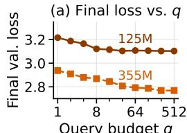  
Query budget q

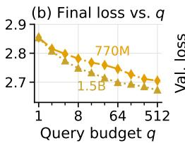

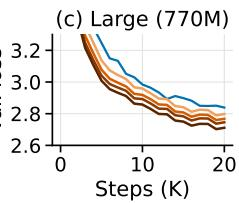

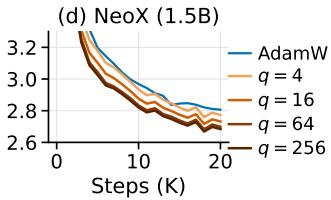  
Figure 7: Effect of the query budget q across model sizes. (a)(b) Final validation loss for different query budgets; (c)(d) corresponding training trajectories.

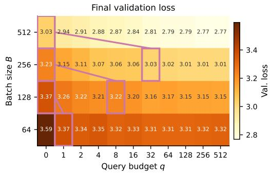  
Figure 8: Effect of the training batch size B and query budget q on final validation loss for GPT-2 355M. The q=0 column corresponds to AdamW.

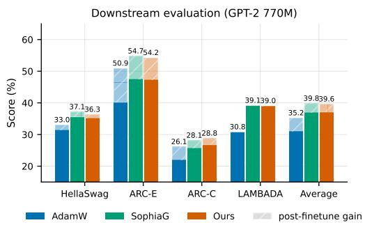  
Figure 9: Downstream performance of different models. Solid bars: few-shot performance; hatched bars: LoRA finetuning gains.

The q queries are mutually independent, so the budget partitions freely across the pool and bounds how many idle devices can contribute in parallel. Read as a provisioning rule, the sweep says that larger models absorb more idle capacity before the returns flatten. Since a larger budget never costs accuracy, we use $q = 5 1 2$ in all other experiments.

## 4.4 RQ3: TRADING FIRST-ORDER BATCH FOR QUERIES

The experiments so far hold the first-order configuration fixed and add queries. We now ask the converse: can queries pay for a smaller first-order batch? Figure 8 varies the training batch size jointly with q at 355M, with the step budget held fixed across cells and the q=0 column giving plain AdamW. Along the marked pairs, halving the batch and adding a modest query budget recovers the full-batch loss: a batch of 256 with q=32 matches a batch of 512 at 3.03. Fewer queries are needed as the batch shrinks, eight when replacing a batch of 256 and a single one when replacing a batch of 128. A first-order step at half the batch costs roughly half the training-node compute, so this substitution shortens every step while the added queries run on serving hardware. ZO-Curv thus offers two ways to spend the same idle capacity: keep the batch and reach the target loss in less time (RQ1), or shrink the batch and cheapen every step at equal loss. Both trade scarce training GPUs for abundant serving compute.

## 4.5 RQ4: DOWNSTREAM QUALITY

We evaluate the 770M checkpoints at the 20K-step budget of Table 1 on HellaSwag (Zellers et al., 2019), ARC-Easy and ARC-Challenge (Clark et al., 2018), and LAMBADA (Paperno et al., 2016). We first evaluate the pretrained checkpoints with few-shot prompting and then apply LoRA finetuning to each task (Figure 9; protocol in Appendix G). Before finetuning, ZO-Curv consistently outperforms AdamW across all four tasks and closely tracks SophiaG. The largest gain appears on LAMBADA, where ZO-Curv improves accuracy from 30.8% to 39.1%, a 26.9% relative improvement over AdamW.

The advantage persists after finetuning. ZO-Curv achieves an average score of 39.6, compared with 35.2 for AdamW and 39.8 for SophiaG. These results show that the lower pretraining loss of

ZO-Curv translates into stronger downstream performance rather than remaining confined to the pretraining objective. Meanwhile, its near-parity with SophiaG shows that curvature estimated on forward-only hardware provides comparable downstream quality to curvature computed by backpropagation.

## 5 CONCLUSION

We show that idle serving compute can accelerate LLM pretraining by estimating curvature rather than gradients. ZO-Curv keeps exact first-order gradients on the training node while using noisy zeroth-order estimates to precondition step sizes. Across 125M–1.5B models, ZO-Curv matches SophiaG step for step and reaches AdamW’s loss in roughly half the wall-clock time. Future work will evaluate ZO-Curv on larger real-world serving clusters.

## AI USE STATEMENT

In this work, we used generative AI tools to implement methods, provide feedback on experimental design, interpret results, and assist with translation. We did not use generative AI tools to formulate the convergence results or to develop the core hypothesis or conceptual framework of ZO-Curv. These contributions originated with the authors. Generating synthetic datasets, cleaning or reformatting datasets, and conducting qualitative data analysis are not applicable to this work. Additionally, we used generative AI tools to search for, identify, and summarize related literature, to format references, and to support brainstorming. We have reviewed all AI-assisted work. AI-assisted implementations were reviewed and validated through the training runs reported in the paper. The authors verified the existence and bibliographic details of every cited work and revised all AI-drafted text. We take responsibility for the final content of this work, including text, claims, or artifacts produced with the aid of generative AI.

## REPRODUCIBILITY STATEMENT

Section 3.2 and Algorithms 1 and 2 specify ZO-Curv completely, including the curvature estimator and the preconditioned update. Section 3.3 summarizes our theoretical results, and Appendix H states their assumptions and gives complete proofs. Section 4.1 describes the experimental protocol, and Appendix B lists the model configurations, all optimizer and estimator hyperparameters (Table 2), and the profiling protocol. Our implementation builds on the public nanoGPT code base used by Sophia (Liu et al., 2024), and all data are public: we pretrain on OpenWebText with the nanoGPT split and evaluate on standard benchmarks following the protocol of Appendix G. Appendix ?? describes the deployment on disjoint GPU groups. We will release our code upon acceptance.

## REFERENCES

Rohan Anil, Vineet Gupta, Tomer Koren, Kevin Regan, and Yoram Singer. Scalable second order optimization for deep learning. arXiv preprint arXiv:2002.09018, 2020.

Atılım Gunes¸ Baydin, Barak A. Pearlmutter, Don Syme, Frank Wood, and Philip Torr. Gradients¨ without backpropagation. arXiv preprint arXiv:2202.08587, 2022.

Alexander Borzunov, Dmitry Baranchuk, Tim Dettmers, Maksim Riabinin, Younes Belkada, Artem Chumachenko, Pavel Samygin, and Colin Raffel. Petals: Collaborative inference and fine-tuning of large models. In Proceedings of the 61st Annual Meeting of the Association for Computational Linguistics (Volume 3: System Demonstrations), pp. 558–568, 2023.

Dongqi Cai. Federated llm pre-training on mobile phones. In Proceedings of the 23rd Annual International Conference on Mobile Systems, Applications and Services, pp. 657–658, 2025.

Cast AI. 2026 state of kubernetes optimization report. https://cast.ai/reports/ kubernetes-optimization-report/, 2026. Analysis of production Kubernetes clusters across AWS, GCP, and Azure.

Aochuan Chen, Yimeng Zhang, Jinghan Jia, James Diffenderfer, Konstantinos Parasyris, Jiancheng Liu, Yihua Zhang, Zheng Zhang, Bhavya Kailkhura, and Sijia Liu. Deepzero: Scaling up zerothorder optimization for deep model training. In International Conference on Learning Representations, volume 2024, pp. 50185–50206, 2024.

Yiming Chen, Yuan Zhang, Liyuan Cao, Kun Yuan, and Zaiwen Wen. Enhancing zeroth-order finetuning for language models with low-rank structures. In International Conference on Learning Representations, volume 2025, pp. 62581–62607, 2025.

Peter Clark, Isaac Cowhey, Oren Etzioni, Tushar Khot, Ashish Sabharwal, Carissa Schoenick, and Oyvind Tafjord. Think you have solved question answering? try arc, the ai2 reasoning challenge. arXiv preprint arXiv:1803.05457, 2018.

Brannon Dorsey and Matt Kafonek. Borrowing the night: Reclaiming idle inference gpus for research. https://runway.com/news/engineering/ borrowing-the-night-reclaiming-idle-inference-gpus-for-research, July 2026.

Arthur Douillard, Qixuan Feng, Andrei A Rusu, Rachita Chhaparia, Yani Donchev, Adhiguna Kuncoro, Marc’Aurelio Ranzato, Arthur Szlam, and Jiajun Shen. Diloco: Distributed lowcommunication training of language models. arXiv preprint arXiv:2311.08105, 2023.

John C Duchi, Michael I Jordan, Martin J Wainwright, and Andre Wibisono. Optimal rates for zero-order convex optimization: The power of two function evaluations. IEEE Transactions on Information Theory, 61(5):2788–2806, 2015.

Saeed Ghadimi and Guanghui Lan. Stochastic first-and zeroth-order methods for nonconvex stochas tic programming. SIAMjournal on optimization, 23(4):2341–2368, 2013.

Aaron Gokaslan and Vanya Cohen. OpenWebText corpus. http://Skylion007.github. io/OpenWebTextCorpus, 2019.

Tyler Griggs, Xiaoxuan Liu, Jiaxiang Yu, Doyoung Kim, Wei-Lin Chiang, Alvin Cheung, and Ion Stoica. M\’elange: Cost efficient large language model serving by exploiting gpu heterogeneity. arXiv preprint arXiv:2404.14527, 2024.

Vineet Gupta, Tomer Koren, and Yoram Singer. Shampoo: Preconditioned stochastic tensor optimization. In International Conference on Machine Learning, pp. 1842–1850. PMLR, 2018.

Jordan Hoffmann, Sebastian Borgeaud, Arthur Mensch, Elena Buchatskaya, Trevor Cai, Eliza Rutherford, Diego de Las Casas, Lisa Anne Hendricks, Johannes Welbl, Aidan Clark, et al. Training compute-optimal large language models. arXiv preprint arXiv:2203.15556, 2022.

Shuoran Jiang, Qingcai Chen, Youcheng Pan, Yang Xiang, Yukang Lin, Xiangping Wu, Chuanyi Liu, and Xiaobao Song. Zo-adamu optimizer: Adapting perturbation by the momentum and uncertainty in zeroth-order optimization. In Proceedings of the AAAI Conference on Artificial Intelligence, volume 38, pp. 18363–18371, 2024.

Jared Kaplan, Sam McCandlish, Tom Henighan, Tom B Brown, Benjamin Chess, Rewon Child, Scott Gray, Alec Radford, Jeffrey Wu, and Dario Amodei. Scaling laws for neural language models. arXiv preprint arXiv:2001.08361, 2020.

Apoorv Khandelwal, Tian Yun, Nihal V Nayak, Jack Merullo, Stephen H Bach, Chen Sun, and Ellie Pavlick. \$100K or 100 days: Trade-offs when pre-training with academic resources. arXiv preprint arXiv:2410.23261, 2024.

Diederik P Kingma and Jimmy Ba. Adam: A method for stochastic optimization. arXiv preprint arXiv:1412.6980, 2014.

Woosuk Kwon, Zhuohan Li, Siyuan Zhuang, Ying Sheng, Lianmin Zheng, Cody Hao Yu, Joseph Gonzalez, Hao Zhang, and Ion Stoica. Efficient memory management for large language model serving with pagedattention. In Proceedings of the 29th symposium on operating systems principles, pp. 611–626, 2023.

Jiamin Li, Hong Xu, Yibo Zhu, Zherui Liu, Chuanxiong Guo, and Cong Wang. Lyra: Elastic scheduling for deep learning clusters. In Proceedings of the Eighteenth European Conference on Computer Systems, pp. 835–850, 2023.

Fangyue Liu, Hua Liu, Xinyuan Lyu, Shuo Ai, Hao Liang, Lingpeng Chen, Ziqian Hu, Chong Zha, Xin Jin, Hanmei Luo, et al. Valve: Production online-offline inference colocation with jointlybounded preemption latency and rate. arXiv preprint arXiv:2604.07874, 2026a.

Hong Liu, Zhiyuan Li, David Hall, Percy Liang, and Tengyu Ma. Sophia: A scalable stochastic second-order optimizer for language model pre-training. In International conference on learning representations, volume 2024, pp. 1621–1650, 2024.

Jingyuan Liu, Jianlin Su, Xingcheng Yao, Zhejun Jiang, Guokun Lai, Yulun Du, Yidao Qin, Weixin Xu, Enzhe Lu, Junjie Yan, et al. Muon is scalable for llm training. arXiv preprint arXiv:2502.16982, 2025.

Yong Liu, Zirui Zhu, Chaoyu Gong, Minhao Cheng, Cho-Jui Hsieh, and Yang You. Sparse mezo: Less parameters for better performance in zeroth-order llm fine-tuning. Advances in Neural Information Processing Systems, 38:21139–21169, 2026b.

Ilya Loshchilov and Frank Hutter. Decoupled weight decay regularization. arXiv preprint arXiv:1711.05101, 2017.

Sadhika Malladi, Tianyu Gao, Eshaan Nichani, Alex Damian, Jason D Lee, Danqi Chen, and Sanjeev Arora. Fine-tuning language models with just forward passes. Advances in Neural Information Processing Systems, 36:53038–53075, 2023.

James Martens. New insights and perspectives on the natural gradient method. Journal ofMachine Learning Research, 21(146):1–76, 2020.

James Martens and Roger Grosse. Optimizing neural networks with kronecker-factored approximate curvature. In International conference on machine learning, pp. 2408–2417. PMLR, 2015.

Yurii Nesterov and Vladimir Spokoiny. Random gradient-free minimization of convex functions. Foundations ofComputational Mathematics, 17(2):527–566, 2017.

Denis Paperno, German Kruszewski, Angeliki Lazaridou, Ngoc-Quan Pham, Raffaella Bernardi,´ Sandro Pezzelle, Marco Baroni, Gemma Boleda, and Raquel Fernandez. The lambada dataset:´ Word prediction requiring a broad discourse context. In Proceedings of the 54th annual meeting of the association for computational linguistics (volume 1: Long papers), pp. 1525–1534, 2016.

Pratyush Patel, Esha Choukse, Chaojie Zhang, Aashaka Shah, <sup>´</sup>Inigo Goiri, Saeed Maleki, and Ri-˜ cardo Bianchini. Splitwise: Efficient generative llm inference using phase splitting. In 2024 ACM/IEEE 51st Annual International Symposium on Computer Architecture (ISCA), pp. 118– 132. IEEE, 2024.

Alec Radford, Jeffrey Wu, Rewon Child, David Luan, Dario Amodei, Ilya Sutskever, et al. Language models are unsupervised multitask learners. OpenAI blog, 1(8):9, 2019.

Mengye Ren, Simon Kornblith, Renjie Liao, and Geoffrey Hinton. Scaling forward gradient with local losses. arXiv preprint arXiv:2210.03310, 2022.

Max Ryabinin, Tim Dettmers, Michael Diskin, and Alexander Borzunov. Swarm parallelism: Training large models can be surprisingly communication-efficient. In International Conference on Machine Learning, pp. 29416–29440. PMLR, 2023.

Ohad Shamir. An optimal algorithm for bandit and zero-order convex optimization with two-point feedback. Journal ofMachine Learning Research, 18(52):1–11, 2017.

Noam Shazeer and Mitchell Stern. Adafactor: Adaptive learning rates with sublinear memory cost. In International conference on machine learning, pp. 4596–4604. PMLR, 2018.

Richard Socher, Alex Perelygin, Jean Wu, Jason Chuang, Christopher D Manning, Andrew Y Ng, and Christopher Potts. Recursive deep models for semantic compositionality over a sentiment treebank. In Proceedings ofthe 2013 conference on empirical methods in natural language processing, pp. 1631–1642, 2013.

James C Spall. Multivariate stochastic approximation using a simultaneous perturbation gradient approximation. IEEE transactions on automatic control, 37(3):332–341, 1992.

James C Spall. Adaptive stochastic approximation by the simultaneous perturbation method. IEEE transactions on automatic control, 45(10):1839–1853, 2000.

John Thorpe, Pengzhan Zhao, Jonathan Eyolfson, Yifan Qiao, Zhihao Jia, Minjia Zhang, Ravi Netravali, and Guoqing Harry Xu. Bamboo: Making preemptible instances resilient for affordable training of large {DNNs}. In 20th USENIX Symposium on Networked Systems Design and Implementation (NSDI 23), pp. 497–513, 2023.

Nikhil Vyas, Depen Morwani, Rosie Zhao, Itai Shapira, David Brandfonbrener, Lucas Janson, and Sham Kakade. Soap: Improving and stabilizing shampoo using adam for language modeling. In International Conference on Learning Representations, volume 2025, pp. 93423–93444, 2025.

Ge Yang, Edward Hu, Igor Babuschkin, Szymon Sidor, Xiaodong Liu, David Farhi, Nick Ryder, Jakub Pachocki, Weizhu Chen, and Jianfeng Gao. Tuning large neural networks via zero-shot hyperparameter transfer. Advances in Neural Information Processing Systems, 34:17084–17097, 2021.

Zhewei Yao, Amir Gholami, Sheng Shen, Mustafa Mustafa, Kurt Keutzer, and Michael Mahoney. Adahessian: An adaptive second order optimizer for machine learning. In proceedings of the AAAI conference on artificial intelligence, volume 35, pp. 10665–10673, 2021.

Ziming Yu, Pan Zhou, Sike Wang, Jia Li, Mi Tian, and Hua Huang. Zeroth-order fine-tuning of llms in random subspaces. In 2025 IEEE/CVF International Conference on Computer Vision (ICCV), pp. 4475–4485. IEEE, 2025.

Rowan Zellers, Ari Holtzman, Yonatan Bisk, Ali Farhadi, and Yejin Choi. Hellaswag: Can a machine really finish your sentence? In Proceedings of the 57th annual meeting of the association for computational linguistics, pp. 4791–4800, 2019.

Susan Zhang, Stephen Roller, Naman Goyal, Mikel Artetxe, Moya Chen, Shuohui Chen, Christopher Dewan, Mona Diab, Xian Li, Xi Victoria Lin, et al. Opt: Open pre-trained transformer language models. arXiv preprint arXiv:2205.01068, 2022.

Yihua Zhang, Pingzhi Li, Junyuan Hong, Jiaxiang Li, Yimeng Zhang, Wenqing Zheng, Pin-Yu Chen, Jason D Lee, Wotao Yin, Mingyi Hong, et al. Revisiting zeroth-order optimization for memory-efficient llm fine-tuning: A benchmark. arXiv preprint arXiv:2402.11592, 2024.

Yanjun Zhao, Sizhe Dang, Haishan Ye, Guang Dai, Yi Qian, and Ivor Tsang. Second-order finetuning without pain for llms: A hessian informed zeroth-order optimizer. In International Conference on Learning Representations, volume 2025, pp. 43496–43520, 2025.

Yinmin Zhong, Shengyu Liu, Junda Chen, Jianbo Hu, Yibo Zhu, Xuanzhe Liu, Xin Jin, and Hao Zhang. {DistServe}: Disaggregating prefill and decoding for goodput-optimized large language model serving. In 18th USENIX symposium on operating systems design and implementation (OSDI 24), pp. 193–210, 2024.

## A RELATED WORK

Zeroth-order optimization. ZO methods build gradient surrogates from function evaluations alone, from SPSA (Spall, 1992) to the smoothing analysis of Nesterov & Spokoiny (2017) and its stochastic nonconvex extension (Ghadimi & Lan, 2013). Their rates degrade with the dimension, and this dependence is optimal up to constants for two-point estimators (Duchi et al., 2015; Shamir, 2017). MeZO (Malladi et al., 2023) made ZO practical for LLM fine-tuning by regenerating perturbations from random seeds, and later work benchmarks ZO fine-tuning (Zhang et al., 2024) and reduces its variance with adaptive momentum (Jiang et al., 2024), sparse perturbations (Liu et al., 2026b), and low-rank subspaces (Chen et al., 2025; Yu et al., 2025). DeepZero (Chen et al., 2024) trains convolutional networks from scratch with coordinate-wise estimates and pruning-guided sparsity, and forward gradients (Baydin et al., 2022; Ren et al., 2022) replace backpropagation with forward-mode directional derivatives, whose variance likewise grows with the number of parameters. InstructedZO (Cai, 2025) mixes ZO estimates into first-order gradients to pretrain on mobile devices. All of these use the estimate as the descent direction; Section 2.2 shows that this fails at LLM pretraining scale, and ZO-Curv uses ZO queries only for curvature.

Zeroth-order curvature estimation. Second-order SPSA (Spall, 2000) estimates the Hessian from loss values alongside the gradient and uses it in a Newton-type update. HiZOO (Zhao et al., 2025) estimates a diagonal Hessian with one extra forward pass per step and uses it to precondition ZO fine-tuning of LLMs. Both still take the descent direction from ZO estimates, in settings that avoid backpropagation altogether. ZO-Curv instead pairs a forward-only curvature estimate with the exact first-order gradient, targets the GNB diagonal of Sophia-G for pretraining, and computes the estimate on separate idle hardware.

Preconditioned optimizers for pretraining. Adaptive methods (Kingma & Ba, 2014; Loshchilov & Hutter, 2017) precondition with gradient moments, Adafactor (Shazeer & Stern, 2018) factors these moments to save memory, and K-FAC (Martens & Grosse, 2015) and Shampoo (Gupta et al., 2018) use structured curvature, with the generalized Gauss–Newton matrix as the principled cur vature for likelihood losses (Martens, 2020). More recent optimizers such as SOAP (Vyas et al., 2025) and Muon (Liu et al., 2025) precondition LLM pretraining with matrix-level structure. Ada-Hessian (Yao et al., 2021) and Sophia (Liu et al., 2024) instead use a diagonal Hessian estimate, and Sophia shows that a clipped, EMA-smoothed estimate accelerates LLM pretraining, but these estimators require extra backward passes on the training node. The closest systems precedent is Distributed Shampoo (Anil et al., 2020), which computes the inverse roots of its preconditioner asynchronously on otherwise underused CPUs and refreshes them only every few hundred steps. Its statistics, however, are still gathered from backpropagated gradients on the accelerators, and only the matrix roots are offloaded. ZO-Curv moves the curvature statistic itself to forward-only devices. It does not propose a new preconditioner: it matches SophiaG step for step (Appendix C).

Training on heterogeneous and idle compute. SWARM parallelism (Ryabinin et al., 2023) and DiLoCo (Douillard et al., 2023) train across poorly connected devices, Petals (Borzunov et al., 2023) runs collaborative inference and fine-tuning of large models, and Bamboo (Thorpe et al., 2023) trains on preemptible instances. Their training workers must all run backpropagation. On the serving side, inference engines such as vLLM (Kwon et al., 2023) and DistServe (Zhong et al., 2024) are built around forward passes, and Splitwise (Patel et al., 2024) and Melange (Griggs et al., 2024) make´ inference clusters more efficient. Lyra (Li et al., 2023) loans idle inference servers to training jobs during low-traffic periods, Valve (Liu et al., 2026a) colocates offline work with online serving, and Runway reclaims idle inference GPUs for research jobs (Dorsey & Kafonek, 2026). These systems hand idle serving capacity to other workloads, and loaned servers must run full training. ZO-Curv instead lets forward-only capacity accelerate the same pretraining run, without backpropagation on the serving devices.

## B EXPERIMENTAL DETAILS

Table 2: Model configurations and peak learning rates. ZO-Curv uses the SophiaG hyperparameters unchanged; γ is the curvature scale of equation 3.
<table><tr><td>Model</td><td> $d _ { \mathrm { m o d e l } }$ </td><td>Heads</td><td>Depth</td><td>AdamW lr</td><td>SophiaG / ZO-Curv lr</td><td>γ</td></tr><tr><td>GPT-2 Small (125M)</td><td>768</td><td>12</td><td>12</td><td> $6 \times 1 0 ^ { - 4 }$ </td><td> $6 \times 1 0 ^ { - 4 }$ </td><td>0.05</td></tr><tr><td>GPT-2 Medium (355M)</td><td>1024</td><td>16</td><td>24</td><td> $3 \times 1 0 ^ { - 4 }$ </td><td> $7 \times 1 0 ^ { - 4 }$ </td><td>0.08</td></tr><tr><td>GPT-2 Large (770M)</td><td>1280</td><td>20</td><td>36</td><td> $2 \times 1 0 ^ { - 4 }$ </td><td> $3 \times 1 0 ^ { - 4 }$ </td><td>0.05</td></tr><tr><td>GPT-NeoX (1.5B)</td><td>1536</td><td>24</td><td>48</td><td> $1 . 5 \times 1 0 ^ { - 4 }$ </td><td> $1 . 2 \times 1 0 ^ { - 4 }$ </td><td>0.05</td></tr></table>

Models and data. We build on the nanoGPT implementation used by Sophia (Liu et al., 2024): decoder-only transformers with GELU activations, no bias terms, and no dropout, with the configurations of Table 2. For the 355M and larger models we scale attention by the inverse of the layer index, as Sophia does to keep AdamW stable at these sizes. All models are trained from scratch on OpenWebText (Gokaslan & Cohen, 2019) with the GPT-2 tokenizer and the train and validation split of nanoGPT (9B and 4.4M tokens), at context length 1024 and global batch size 512, in bfloat16.

Optimization. All methods use a cosine learning-rate schedule with 2K warmup steps, decaying to a minimum between $1 0 ^ { - 5 }$ and $6 \times 1 0 ^ { - 5 }$ , and gradient clipping at norm 1.0. AdamW uses $\beta =$ (0.9, 0.95) and weight decay 0.1. ZO-Curv and SophiaG use $\mathbf { \bar { \boldsymbol { \beta } } } = ( 0 . 9 6 5 , 0 . 9 9 )$ , weight decay 0.2, clipping threshold $\rho = 1$ , and the curvature scale $\gamma$ of Table 2, following Sophia, and refreshes its curvature at every step. Step budgets are given in Section 4.1.

Curvature estimator. Unless stated otherwise, ZO-Curv uses $q \ : = \ : 5 1 2$ queries per refresh with finite-difference radius $\varepsilon = 1 0 ^ { - 4 }$ , and samples the pseudo-labels from the model’s own predictive distribution, as in the GNB estimator. Following the Sophia implementation, the scale B in $h ^ { \mathrm { Z O } } =$ $B \bar { z } \odot \bar { z }$ counts the tokens of the curvature batch, and the denominator floor is $\epsilon _ { 0 } = 1 0 ^ { - 1 5 }$

Profiling. The measurements of Section 2.3 report peak reserved GPU memory at batch size 8, with forward-only execution in fp16 and training in mixed precision, and per-step time averaged over 100 steps after warmup.

## C STEP-AXIS COMPARISON WITH SOPHIAG

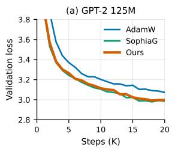

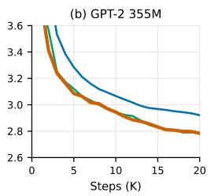

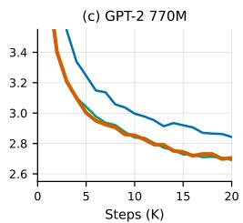

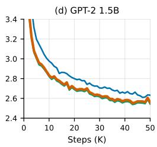  
Figure 10: ZO-Curv matches SophiaG’s step efficiency at every scale (first 20K steps of the runs of Figure 5). The two curves are nearly indistinguishable on a step axis: the forward-only estimator matches the backpropagated one in per-step quality, and the advantage of ZO-Curv lies in where the estimate is computed.

Figure 10 replots the runs of Figure 5 on a step axis. ZO-Curv and SophiaG are nearly indistinguishable at every size, confirming that the forward-only estimator matches the backpropagated GNB estimator in per-step optimization quality. The contribution of ZO-Curv is not a stronger preconditioner but a preconditioner obtained from hardware that could not otherwise participate in training, which is why the two methods separate on the wall-clock axis of Figure 5.

## D SOPHIAG WITH A TEN-STEP REFRESH INTERVAL

Our main comparison refreshes the curvature of SophiaG at every step, so that it consumes curvature as fresh as that of ZO-Curv (Section 4.1). The original Sophia instead refreshes every k = 10 steps to amortize the cost of the GNB estimator. Figure 11 reports the time each method needs for a fixed budget of 20K steps under this setting, using the per-step measurements behind Figure 5. A ten-step interval brings SophiaG to 9–13% above AdamW per step, while ZO-Curv stays within 1–5% of AdamW because its estimate is computed off the training node. SophiaG therefore remains 6–12% slower than ZO-Curv at every size, and it obtains this reduction by refreshing its curvature ten times less often, whereas ZO-Curv refreshes at every step.

The staler curvature also costs accuracy (Figure 12). After 20K steps, SophiaG with a ten-step interval ends 0.03–0.04 above its every-step counterpart in the main runs and 0.02–0.04 above ZO-Curv at every size. Amortizing the estimator on the training node thus leaves SophiaG both slower and less accurate than ZO-Curv, which keeps the curvature fresh at nearly the per-step cost of AdamW.

## E TRAINING TRAJECTORIES ACROSS QUERY BUDGETS

Figure 13 extends the trajectory panels of Figure 7(c,d) to all four model sizes. The qualitative picture is uniform: every query budget separates from AdamW early, and increasing q lowers the entire trajectory. The sizes differ only in where the budgets stop mattering, consistent with the saturation points of Figure 7(a,b).

## F EFFECT OF THE ONE-STEP PIPELINE OFFSET

The pipeline of Section 3.1 applies the curvature estimated at $\theta _ { t - 1 }$ to the update at step t. Figure 14 compares this deployed variant against a synchronous control that waits for the curvature of the current snapshot $\theta _ { t }$ . The two loss curves coincide throughout training: consecutive snapshots differ by a single clipped update, and the curvature EMA smooths over far longer horizons than one step, so the offset costs nothing while removing the serving pool from the critical path.

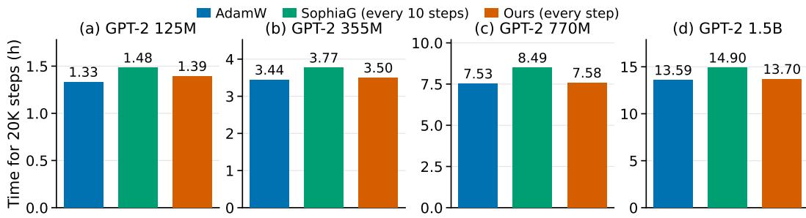  
Figure 11: SophiaG with a ten-step refresh interval. Wall-clock time to complete 20K steps for AdamW, SophiaG refreshing its curvature every ten steps, and ZO-Curv refreshing at every step. Even with its curvature cost amortized, SophiaG is slower than ZO-Curv at every size.

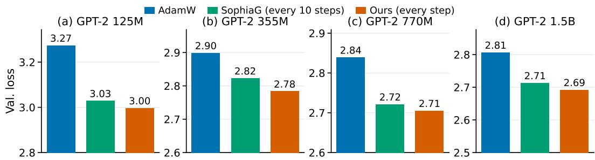  
Figure 12: Loss of SophiaG with a ten-step refresh interval. Validation loss after 20K steps for the runs of Figure 11. With its curvature refreshed ten times less often, SophiaG ends above ZO Curv at every size.

## G FULL DOWNSTREAM RESULTS

Table 3: Full downstream evaluation of the GPT-2 770M checkpoints at 20K steps (companion to Figure 9). Accuracy in %. Base: few-shot before finetuning (10 examples for HellaSwag, 25 for ARC-E and ARC-C, none for LAMBADA). FT: zero-shot after per-task LoRA finetuning. LAM-BADA has no public training split and is not finetuned; it enters the FT average with its untuned score.
<table><tr><td></td><td colspan="2">HellaSwag</td><td colspan="2">ARC-E</td><td colspan="2">ARC-C</td><td colspan="2">LAMBADA</td><td colspan="2">Average</td></tr><tr><td>Method</td><td>Base</td><td>FT</td><td>Base</td><td>FT</td><td>Base</td><td>FT</td><td>Base</td><td>FT</td><td>Base</td><td>FT</td></tr><tr><td>AdamW</td><td>31.4</td><td>33.0</td><td>40.2</td><td>50.9</td><td>22.1</td><td>26.1</td><td>30.8</td><td>一</td><td>31.1</td><td>35.2</td></tr><tr><td>SophiaG</td><td>35.6</td><td>37.1</td><td>47.5</td><td>54.7</td><td>25.8</td><td>28.1</td><td>39.1</td><td>一</td><td>37.0</td><td>39.8</td></tr><tr><td>ZÓ-Curv (ours)</td><td>35.2</td><td>36.3</td><td>47.4</td><td>54.2</td><td>26.8</td><td>28.8</td><td>39.0</td><td>一</td><td>37.1</td><td>39.6</td></tr></table>

Table 3 lists the per-task accuracies behind Figure 9. We evaluate the 770M checkpoint of each method after 20K steps, the shared budget of Table 1.

Before finetuning. We use few-shot prompting with 10 in-context examples for HellaSwag, 25 for ARC-Easy and ARC-Challenge, and none for LAMBADA, drawn from each training split with a fixed seed. For the three multiple-choice tasks, the prediction is the choice with the highest average log-likelihood per answer token, evaluated on the validation split (10,042, 570, and 299 examples). LAMBADA is scored by whether greedy decoding recovers the final word, on the 5,153 test examples of the OpenAI version.

After finetuning. Starting from each checkpoint, we finetune separately on the training split of every multiple-choice task with LoRA (rank 8, α = 16, dropout 0.05) on the attention and MLP projections, which trains 5.9M parameters (0.76% of the model). We use AdamW with learning rate

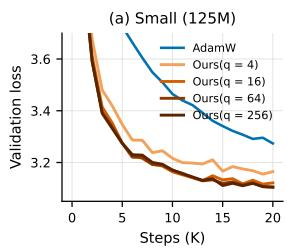

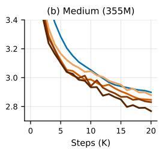

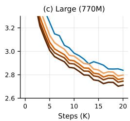

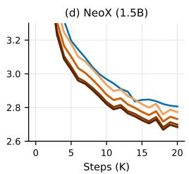  
Figure 13: Training trajectories across query budgets, all four sizes (companion to Figure 7). At 125M the budgets collapse onto each other early, whereas at 770M and 1.5B they remain cleanly ordered, matching the scale-dependent saturation of Figure 7(a,b).

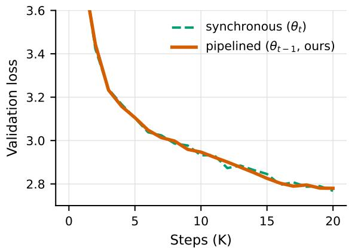  
Figure 14: The one-step pipeline offset is free (GPT-2 355M, $q = 5 1 2 )$ . Training with curvature estimated at $\theta _ { t - 1 }$ (pipelined, as deployed) is indistinguishable from using curvature estimated at the current $\theta _ { t }$ (synchronous).

$2 \times 1 0 ^ { - 5 }$ and batch size 8 for 2,000 steps, with the loss restricted to the answer tokens, and then evaluate on the validation split. LAMBADA has no public training split, so it is not finetuned.

Results. Before finetuning, ZO-Curv improves over AdamW on every task, by 6.0 points on average (37.1 versus 31.1). It stays within 0.4 points of SophiaG on HellaSwag, ARC-Easy, and LAMBADA, and is 1.0 point higher on ARC-Challenge. Finetuning helps the AdamW checkpoint most, by 4.1 points on average against 2.8 for SophiaG and 2.5 for ZO-Curv, with the largest gain on ARC-Easy (10.7 points). It nonetheless trails both second-order checkpoints on every task after finetuning, while ZO-Curv remains within 0.8 points of SophiaG throughout (39.6 versus 39.8 on average).

## H PROOFS

This appendix provides the full theoretical analysis of ZO-Curv. Our goal is to isolate the effect of replacing the backpropagation-based Gauss–Newton–Bartlett (GNB) curvature estimator in Sophia-G with a forward-only zeroth-order estimator. The analysis proceeds in three stages. First, we identify what the average-then-square ZO estimator estimates: under a finite query budget q, it is an unbiased estimate of a damped GNB diagonal whose damping decreases as $\bar { 1 / q } ,$ , and its fluctuation is of the order of this target in every coordinate, independently of the dimension d. Second, we show that the curvature EMA averages these fluctuations into a bounded multiplicative perturbation of the damped reference preconditioner, and that such a perturbation does not destroy descent: the update direction remains a descent direction and converges to stationarity. Third, we combine the two results into a convergence guarantee relative to the damped-GNB-preconditioned reference update.

As in the theoretical analysis of Sophia (Liu et al., 2024), we analyze a deterministic clipped preconditioned core in order to isolate the role of curvature estimation. In particular, we omit gradient momentum and decoupled weight decay from the convergence proof. The curvature EMA is retained and updated at every iteration, matching the per-step estimator in Section 3. We first analyze the synchronous core, in which the update at step t uses the curvature queried at $\theta _ { t } ;$ Remark 2 shows that the results carry over unchanged to the pipelined update with any staleness s.

## H.1 NOTATION AND REFERENCE CURVATURE ESTIMATOR

Let

$$
F ( \theta )\tag{7}
$$

denote the training objective, with parameters $\theta \in \mathbb { R } ^ { d }$ . At iteration t, let

$$
g _ { t } : = \nabla F ( \theta _ { t } )\tag{8}
$$

denote the first-order gradient used to update the model.

The curvature estimator is computed from a sampled-label mini-batch, as in the GNB estimator of Sophia-G. Given a mini-batch $\{ x _ { b } \} _ { b = 1 } ^ { B }$ , let

$$
\hat { y } _ { b } \sim \mathrm { s o f t m a x } ( f ( \theta _ { t } , x _ { b } ) ) , \qquad b = 1 , \dots , B ,\tag{9}
$$

and define the sampled-label loss

$$
\ell _ { t } ^ { \mathrm { s a m p } } ( \theta ) : = \frac { 1 } { B } \sum _ { b = 1 } ^ { B } \ell _ { \mathrm { c e } } \big ( f ( \theta , x _ { b } ) , \hat { y } _ { b } \big ) .\tag{10}
$$

We denote its gradient at $\theta _ { t }$ by

$$
c _ { t } : = \nabla \ell _ { t } ^ { \mathrm { s a m p } } ( \theta _ { t } ) .\tag{11}
$$

Conditioned on the sampled mini-batch and pseudo-labels, $c _ { t }$ is fixed throughout the $q$ ZO queries.

The backpropagation-based GNB estimator used as our reference is

$$
h _ { t } ^ { \mathrm { G } } : = B c _ { t } \odot c _ { t } ,\tag{12}
$$

where $\odot$ denotes element-wise multiplication. Taking expectation over the sampled labels recovers the diagonal of the mini-batch Gauss–Newton matrix, as established by the Bartlett identities in (Liu et al., 2024). Our analysis below compares the ZO estimate with this reference conditioned on the same mini-batch and the same sampled labels.

A finite query budget adds a uniform damping to this target (Proposition 1). We therefore define the damped GNB diagonal

$$
\tilde { h } _ { t } : = \left( 1 + \frac { 1 } { q } \right) h _ { t } ^ { \mathrm { G } } + \lambda _ { t } \mathbf { 1 } , \qquad \lambda _ { t } : = \frac { \| h _ { t } ^ { \mathrm { G } } \| _ { 1 } } { q } = \frac { B \| c _ { t } \| _ { 2 } ^ { 2 } } { q } ,\tag{13}
$$

where $\textbf { 1 } \in \mathbb { R } ^ { d }$ is the all-ones vector. This is a Levenberg–Marquardt-type damping of the GNB diagonal, of the kind commonly added to curvature preconditioners for numerical stability. Here it is not a tuned hyperparameter but is induced by the finite budget, and $\tilde { h } _ { t }  h _ { t } ^ { \mathrm { G } }$ as $q \to \infty$ . Adding a constant to every coordinate preserves the ordering of the coordinates by curvature.

The reference is coupled to the ZO-Curv trajectory: at every iteration, $\tilde { h } _ { t }$ is evaluated at the ZO-Curv iterate $\theta _ { t } .$ , on the same mini-batch and with the same sampled labels as the ZO queries. It is never computed by the algorithm and serves only as a comparison point. Define the reference curvature EMA, initialized at zero as in ZO-Curv, as

$$
\tilde { v } _ { t } = \beta _ { 2 } \tilde { v } _ { t - 1 } + ( 1 - \beta _ { 2 } ) \tilde { h } _ { t } , \qquad \tilde { v } _ { 0 } = 0 .\tag{14}
$$

The corresponding reference denominator is

$$
d _ { t , i } : = \operatorname* { m a x } \{ \gamma \tilde { v } _ { t , i } , \epsilon _ { 0 } \} , \qquad D _ { t } : = \operatorname { D i a g } ( d _ { t } ) ,\tag{15}
$$

where $\epsilon _ { 0 } > 0$ is the numerical denominator floor. We use ε exclusively for the ZO finite-difference radius, to distinguish it from $\epsilon _ { \mathrm { 0 } }$

## H.2 ZO APPROXIMATION OF THE GNB CURVATURE

At each iteration, ZO-Curv draws q independent Gaussian perturbations

$$
u _ { t , j } \stackrel { \mathrm { i . i . d . } } { \sim } \mathcal { N } ( 0 , I _ { d } ) , \qquad j = 1 , \ldots , q .\tag{16}
$$

Importantly, all $q$ queries use the same mini-batch and the same sampled pseudo-labels, and hence share the same curvature gradient $c _ { t }$

For direction $u _ { t , j }$ , define the central-difference directional derivative

$$
\Delta _ { t , j } ^ { \varepsilon } : = \frac { \ell _ { t } ^ { \mathrm { s a m p } } ( \theta _ { t } + \varepsilon u _ { t , j } ) - \ell _ { t } ^ { \mathrm { s a m p } } ( \theta _ { t } - \varepsilon u _ { t , j } ) } { 2 \varepsilon } .\tag{17}
$$

The corresponding ZO gradient estimate is

$$
z _ { t , j } ^ { \varepsilon } : = \Delta _ { t , j } ^ { \varepsilon } u _ { t , j } .\tag{18}
$$

ZO-Curv first averages the q gradient estimates,

$$
\bar { z } _ { t } ^ { \varepsilon } : = \frac { 1 } { q } \sum _ { j = 1 } ^ { q } { z _ { t , j } ^ { \varepsilon } } ,\tag{19}
$$

and then squares the averaged estimate:

$$
h _ { t } ^ { \mathrm { Z O } } : = B \bar { z } _ { t } ^ { \varepsilon } \odot \bar { z } _ { t } ^ { \varepsilon } .\tag{20}
$$

We first study the ideal directional-derivative limit $\varepsilon \to 0$

Lemma 1 (Moments of the averaged ZO gradient). Fix a vector $c \in \mathbb { R } ^ { d }$ and let $u _ { 1 } , \ldots , u _ { q } \stackrel { \mathrm { i . i . d . } } { \sim }$ $\mathcal { N } ( 0 , I _ { d } )$ . Define

$$
z _ { j } : = ( c ^ { \top } u _ { j } ) u _ { j } , \qquad \bar { z } : = \frac 1 q \sum _ { j = 1 } ^ { q } z _ { j } .\tag{21}
$$

Then, for every coordinate i,

$$
\mathbb { E } [ \bar { z } _ { i } \mid c ] = c _ { i } ,\tag{22}
$$

$$
\mathbb { E } [ \bar { z } _ { i } ^ { 2 } \mid c ] = \left( 1 + \frac { 1 } { q } \right) c _ { i } ^ { 2 } + \frac { 1 } { q } \| c \| _ { 2 } ^ { 2 } ,\tag{23}
$$

$$
\operatorname { V a r } ( { \bar { z } } _ { i } \mid c ) = { \frac { \| c \| _ { 2 } ^ { 2 } + c _ { i } ^ { 2 } } { q } } .\tag{24}
$$

Proof. For a single Gaussian direction,

$$
\mathbb { E } [ ( c ^ { \top } u ) u _ { i } ] = \sum _ { r = 1 } ^ { d } c _ { r } \mathbb { E } [ u _ { r } u _ { i } ] = c _ { i } ,\tag{25}
$$

which proves equation 22.

For the second moment, Isserlis’ identity for a standard Gaussian gives

$$
\mathbb { E } \left[ ( c ^ { \top } u ) ^ { 2 } u _ { i } ^ { 2 } \right] = \| c \| _ { 2 } ^ { 2 } + 2 c _ { i } ^ { 2 } .\tag{26}
$$

Therefore

$$
\mathrm { V a r } \left( ( c ^ { \top } u ) u _ { i } \right) = \| c \| _ { 2 } ^ { 2 } + c _ { i } ^ { 2 } .\tag{27}
$$

Averaging q independent directions divides the variance by $q ,$ hence

$$
\operatorname { V a r } ( { \bar { z } } _ { i } \mid c ) = { \frac { \| c \| _ { 2 } ^ { 2 } + c _ { i } ^ { 2 } } { q } } .\tag{28}
$$

Combining this with $\mathbb { E } [ \bar { z } _ { i } \mid c ] = c _ { i }$ yields

$$
\mathbb { E } [ \bar { z } _ { i } ^ { 2 } \mid c ] = c _ { i } ^ { 2 } + \frac { \| c \| _ { 2 } ^ { 2 } + c _ { i } ^ { 2 } } { q }\tag{29}
$$

$$
= \left( 1 + \frac { 1 } { q } \right) c _ { i } ^ { 2 } + \frac { 1 } { q } \| c \| _ { 2 } ^ { 2 } .\tag{30}
$$

□

Lemma 1 shows that the averaged ZO gradient itself approaches c at the canonical $q ^ { - 1 / 2 }$ stochastic rate. Its second moment equation 23 is the source of the damping in equation 13. For the convergence analysis, however, we require a high-probability rather than an expectation bound.

Lemma 2 (High-probability ZO gradient error). Under the setting of Lemma 1, there exists a universal constant $\bar { C _ { 0 } } > 0$ such that, for any failure probability $\zeta \in ( 0 , 1 )$ ), with probability at least $1 - \zeta$

$$
\| \bar { z } - c \| _ { \infty } \leq C _ { 0 } \| c \| _ { 2 } \left[ \sqrt { \frac { \log ( 2 d / \zeta ) } { q } } + \frac { \log ( 2 d / \zeta ) } { q } \right] .\tag{31}
$$

Proof. Fix a coordinate i and define

$$
X _ { j , i } : = ( c ^ { \top } u _ { j } ) u _ { j , i } - c _ { i } .\tag{32}
$$

We have $\mathbb { E } [ X _ { j , i } ] = 0$ . Moreover, $c ^ { \top } u _ { j }$ is a centered Gaussian with variance $\| c \| _ { 2 } ^ { 2 }$ , and $u _ { j , i }$ is standard Gaussian. The product of two sub-Gaussian random variables is sub-exponential, even when the two variables are correlated. Therefore, for a universal constant $C > 0$

$$
\| X _ { j , i } \| _ { \psi _ { 1 } } \leq C \| c \| _ { 2 } .\tag{33}
$$

Bernstein’s inequality for independent centered sub-exponential variables then gives

$$
\operatorname* { P r } \left[ \left| { \frac { 1 } { q } } \sum _ { j = 1 } ^ { q } X _ { j , i } \right| > C _ { 0 } \| c \| _ { 2 } \left( { \sqrt { \frac { s } { q } } } + { \frac { s } { q } } \right) \right] \leq 2 e ^ { - s } .\tag{34}
$$

Setting

$$
s = \log ( 2 d / \zeta )\tag{35}
$$

and applying a union bound over $i = 1 , \ldots , d$ proves equation 31.

We next account for the finite central-difference radius ε.

Assumption A1 (Local Hessian Lipschitzness). For every iteration t, the sampled-label loss $\ell _ { t } ^ { \mathrm { s a m p } }$ is twice differentiable with an $L _ { H ^ { - } } \mathrm { L }$ ipschitz Hessian on the ball $\mathcal { U } _ { t } : = \{ \theta \ \stackrel { \cdot } { : } \ \| \theta - \theta _ { t } \| _ { 2 } \ \leq \ \varepsilon R \}$ containing all ZO query points:

$$
\| \nabla ^ { 2 } \ell _ { t } ^ { \mathrm { s a m p } } ( \theta ) - \nabla ^ { 2 } \ell _ { t } ^ { \mathrm { s a m p } } ( \theta ^ { \prime } ) \| _ { 2 } \leq L _ { H } \| \theta - \theta ^ { \prime } \| _ { 2 } , \qquad \theta , \theta ^ { \prime } \in \mathcal { U } _ { t } .\tag{36}
$$

The query points are $\theta _ { t } \pm \varepsilon u _ { t , i }$ with $\| u _ { t , j } \| _ { 2 } \approx \sqrt { d }$ , so the relevant radius is ε max<sub>j</sub> ∥u<sub>t,j</sub>∥<sub>2</sub> rather than $\varepsilon ;$ we take $R = R _ { q }$ in Proposition 1 and $R = R _ { T }$ in Theorem 3, where $R _ { q }$ and $R _ { T }$ bound max<sub>j</sub> $\Vert u _ { t , j } \Vert _ { 2 }$ with high probability.

Lemma 3 (Central-difference error). Under Assumption A1, for any direction u with $\| u \| _ { 2 } \leq R$

$$
\left| \frac { \ell _ { t } ^ { \mathrm { s a m p } } ( \theta _ { t } + \varepsilon u ) - \ell _ { t } ^ { \mathrm { s a m p } } ( \theta _ { t } - \varepsilon u ) } { 2 \varepsilon } - c _ { t } ^ { \top } u \right| \leq \frac { L _ { H } \varepsilon ^ { 2 } } { 6 } \| u \| _ { 2 } ^ { 3 } .\tag{37}
$$

Proof. Define the scalar function

$$
\phi ( s ) : = \ell _ { t } ^ { \mathrm { s a m p } } ( \theta _ { t } + s u ) , \qquad | s | \leq \varepsilon .\tag{38}
$$

Then $\phi ^ { \prime } ( 0 ) = c _ { t } ^ { \top }$ u and $\phi ^ { \prime \prime } ( s ) = u ^ { \top } \nabla ^ { 2 } \ell _ { t } ^ { \mathrm { s a m p } } ( \theta _ { t } + s u ) u ,$ so Assumption A1 gives

$$
| \phi ^ { \prime \prime } ( s ) - \phi ^ { \prime \prime } ( 0 ) | \leq L _ { H } | s | \| u \| _ { 2 } ^ { 3 } .\tag{39}
$$

Taylor’s theorem with integral remainder, $\begin{array} { r } { \phi ( \pm \varepsilon ) = \phi ( 0 ) \pm \varepsilon \phi ^ { \prime } ( 0 ) + \int _ { 0 } ^ { \pm \varepsilon } ( \pm \varepsilon - s ) \phi ^ { \prime \prime } ( s ) } \end{array}$ ds, then yields

$$
\left| \phi ( \pm \varepsilon ) - \phi ( 0 ) \mp \varepsilon \phi ^ { \prime } ( 0 ) - \frac { \varepsilon ^ { 2 } } { 2 } \phi ^ { \prime \prime } ( 0 ) \right| \le L _ { H } \| u \| _ { 2 } ^ { 3 } \int _ { 0 } ^ { \varepsilon } ( \varepsilon - s ) s d s = \frac { L _ { H } \varepsilon ^ { 3 } } 6 \| u \| _ { 2 } ^ { 3 } .\tag{40}
$$

Subtracting the two expansions cancels $\phi ( 0 )$ and $\phi ^ { \prime \prime } ( 0 )$ , and dividing by 2ε gives

$$
\mathopen { } \mathclose \bgroup \left| \frac { \phi ( \varepsilon ) - \phi ( - \varepsilon ) } { 2 \varepsilon } - \phi ^ { \prime } ( 0 ) \aftergroup \egroup \right| \leq \frac { L _ { H } \varepsilon ^ { 2 } } { 6 } \mathopen { } \mathclose \bgroup \left\| u \aftergroup \egroup \right\| _ { 2 } ^ { 3 } .\tag{41}
$$

This proves the result; no third derivative is required.

We now combine Lemmas 1–3 into the properties of the curvature estimate used in the rest of the analysis. Write

$$
h _ { t } ^ { \mathrm { Z O , 0 } } : = B \bar { z } _ { t } ^ { 0 } \odot \bar { z } _ { t } ^ { 0 } , \qquad \bar { z } _ { t } ^ { 0 } : = \frac 1 q \sum _ { j = 1 } ^ { q } ( c _ { t } ^ { \top } u _ { t , j } ) u _ { t , j } ,\tag{42}
$$

for the ideal estimate with exact directional derivatives, and $h _ { t } ^ { \mathrm { Z O } }$ for the central-difference esti mate equation 20.

Proposition 1 (Forward-only estimation of damped GNB curvature). Fix an iteration t and condition on its mini-batch and sampled labels, with $c _ { t } \neq 0$

(i) Unbiasedness. The ideal estimate is unbiased for the damped target equation 13:

$$
\mathbb { E } \big [ h _ { t } ^ { \mathrm { Z O } , 0 } \big ] = \tilde { h } _ { t } .\tag{43}
$$

(ii) Relative second moment. There is a universal constant $C _ { v } \geq 1$ such that, for every coordi nate i,

$$
\mathbb { E } \big [ ( h _ { t , i } ^ { \mathrm { Z O } , 0 } ) ^ { 2 } \big ] \leq C _ { v } \tilde { h } _ { t , i } ^ { 2 } .\tag{44}
$$

(iii) Relative envelope and finite differences. For $\zeta \in ( 0 , 1 )$ , define

$$
\begin{array} { l } { { \Lambda : = \log \displaystyle \frac { 4 d } { \zeta } , \qquad R _ { q } : = \sqrt { d } + \sqrt { 2 \log \displaystyle \frac { 4 q } { \zeta } } , } } \\ { { { \cal M } _ { q , d } : = \sqrt { 2 \log \displaystyle \frac { 8 q d } { \zeta } } , \qquad \vartheta : = \displaystyle \frac { { \cal L } _ { H } \varepsilon ^ { 2 } } { 6 } R _ { q } ^ { 3 } { \cal M } _ { q , d } , } } \end{array}\tag{45}
$$

and suppose $q \geq \Lambda$ and that Assumption A1 holds with $R = R _ { q } .$ . Then, with probability at least $1 - \zeta$ , simultaneously for all coordinates i,

$$
h _ { t , i } ^ { \mathrm { Z O , 0 } } \leq C _ { b } \Lambda \tilde { h } _ { t , i } , \qquad C _ { b } : = \operatorname* { m a x } \{ 2 , 8 C _ { 0 } ^ { 2 } \} ,\tag{46}
$$

$$
\left| h _ { t , i } ^ { \mathrm { Z O } } - h _ { t , i } ^ { \mathrm { Z O , 0 } } \right| \leq 2 \sqrt { C _ { b } \Lambda B \vartheta ^ { 2 } \tilde { h } _ { t , i } + B \vartheta ^ { 2 } } ,\tag{47}
$$

where $C _ { 0 }$ is the constant of Lemma 2.

Proof. For (i), Lemma 1 with $c = c _ { t }$ gives

$$
\mathbb { E } \big [ h _ { t , i } ^ { \mathrm { Z O , 0 } } \big ] = B \mathbb { E } \big [ ( \bar { z } _ { t , i } ^ { 0 } ) ^ { 2 } \big ] = \bigg ( 1 + \frac { 1 } { q } \bigg ) B c _ { t , i } ^ { 2 } + \frac { B \| c _ { t } \| _ { 2 } ^ { 2 } } { q } = \tilde { h } _ { t , i } .\tag{48}
$$

For (ii), write $\bar { z } _ { t , i } ^ { 0 } = c _ { t , i } + a _ { i }$ with $\begin{array} { r } { a _ { i } : = q ^ { - 1 } \sum _ { j = 1 } ^ { q } X _ { j , i } } \end{array}$ and $X _ { j , i }$ as in the proof of Lemma 2. Since $( x + y ) ^ { 4 } \leq 8 ( x ^ { 4 } + y ^ { 4 } )$

$$
\mathbb { E } \left[ ( \bar { z } _ { t , i } ^ { 0 } ) ^ { 4 } \right] \leq 8 c _ { t , i } ^ { 4 } + 8 \mathbb { E } [ a _ { i } ^ { 4 } ] .\tag{49}
$$

The $X _ { j , i }$ are independent and centered, so

$$
\mathbb { E } [ a _ { i } ^ { 4 } ] = \frac { q \mathbb { E } [ X _ { 1 , i } ^ { 4 } ] + 3 q ( q - 1 ) \big ( \mathbb { E } [ X _ { 1 , i } ^ { 2 } ] \big ) ^ { 2 } } { q ^ { 4 } } \leq \frac { \mathbb { E } [ X _ { 1 , i } ^ { 4 } ] + 3 \big ( \mathbb { E } [ X _ { 1 , i } ^ { 2 } ] \big ) ^ { 2 } } { q ^ { 2 } } .\tag{50}
$$

By Lemma 1, $\mathbb { E } [ X _ { 1 , i } ^ { 2 } ] = \| c _ { t } \| _ { 2 } ^ { 2 } + c _ { t , i } ^ { 2 } \leq 2 \| c _ { t } \| _ { 2 } ^ { 2 }$ , and since $\| X _ { 1 , i } \| _ { \psi _ { 1 } } \leq C \| c _ { t } \| _ { 2 } .$ also $\mathbb { E } [ X _ { 1 , i } ^ { 4 } ] \leq$ $C ^ { \prime } \Vert c _ { t } \Vert _ { 2 } ^ { 4 }$ for a universal constant $C ^ { \prime }$ . Hence $\mathbb { E } [ a _ { i } ^ { 4 } ] \leq C ^ { \prime \prime } \| c _ { t } \| _ { 2 } ^ { 4 } / q ^ { 2 }$ with $C ^ { \prime \prime } : = C ^ { \prime } + 1 2$ , and

$$
\mathbb { E } \left[ ( h _ { t , i } ^ { \mathrm { Z O } , 0 } ) ^ { 2 } \right] = B ^ { 2 } \mathbb { E } \left[ ( \bar { z } _ { t , i } ^ { 0 } ) ^ { 4 } \right] \leq 8 \left( B c _ { t , i } ^ { 2 } \right) ^ { 2 } + 8 C ^ { \prime \prime } \lambda _ { t } ^ { 2 }\tag{51}
$$

$$
\leq C _ { v } \left( B c _ { t , i } ^ { 2 } + \lambda _ { t } \right) ^ { 2 } \leq C _ { v } \tilde { h } _ { t , i } ^ { 2 } ,\tag{52}
$$

with $C _ { v } : = 8 \operatorname* { m a x } \{ 1 , C ^ { \prime \prime } \}$ , where the last step uses $B c _ { t , i } ^ { 2 } + \lambda _ { t } \leq \tilde { h } _ { t , i }$

For (iii), we split the failure probability ζ into three events. First, Lemma 2 with failure probability $\zeta / 2 .$ , for which log $( 2 d / ( \zeta / 2 ) ) = \Lambda$ , gives $| a _ { i } | \le C _ { 0 } \| c _ { t } \| _ { 2 } \big ( \sqrt { \Lambda / q } + \Lambda / q \big )$ for all i. Since $q \geq \Lambda$ and $( { \sqrt { x } } + x ) ^ { 2 } \leq$ 4x for $x \leq 1$

$$
B a _ { i } ^ { 2 } \leq 4 C _ { 0 } ^ { 2 } \Lambda \frac { B \| c _ { t } \| _ { 2 } ^ { 2 } } { q } = 4 C _ { 0 } ^ { 2 } \Lambda \lambda _ { t } .\tag{53}
$$

Therefore, using $\Lambda \geq 1$

$$
h _ { t , i } ^ { \mathrm { Z O } , 0 } = B ( c _ { t , i } + a _ { i } ) ^ { 2 } \leq 2 B c _ { t , i } ^ { 2 } + 8 C _ { 0 } ^ { 2 } \Lambda \lambda _ { t } \leq C _ { b } \Lambda \tilde { h } _ { t , i } ,\tag{54}
$$

which is equation 46.

Second, Gaussian norm concentration, $\operatorname* { P r } [ \| u \| _ { 2 } \geq \sqrt { d } + s ] \leq e ^ { - s ^ { 2 } / 2 }$ , and a union bound over the q directions give, with probability at least $\bar { 1 } - \zeta / 4 , \operatorname* { m a x } _ { j \leq q } | | u _ { t , j } | | _ { 2 } \leq R _ { q }$ . Third, the Gaussian tail bound $\mathrm { P r } [ | u _ { j , i } | \geq s ] \leq 2 e ^ { - s ^ { 2 } / 2 }$ and a union bound over all qd coordinates give, with probability at least $1 - \zeta / 4$ , max<sub>j≤q,</sub> <sub>i≤d</sub> $| u _ { t , j , i } | \le M _ { q , d } .$ . On the second event every query point lies in $\mathcal { U } _ { t }$ with $R = R _ { q } ,$ , so Lemma 3 applies to every direction and

$$
\bar { z } _ { t } ^ { \varepsilon } - \bar { z } _ { t } ^ { 0 } = \frac { 1 } { q } \sum _ { j = 1 } ^ { q } e _ { t , j } ^ { \mathrm { F D } } , \qquad | e _ { t , j , i } ^ { \mathrm { F D } } | \leq \frac { L _ { H } \varepsilon ^ { 2 } } { 6 } \| u _ { t , j } \| _ { 2 } ^ { 3 } | u _ { t , j , i } | .\tag{55}
$$

On both events, $e _ { i } : = \bar { z } _ { t , i } ^ { \varepsilon } - \bar { z } _ { t , i } ^ { 0 }$ satisfies $| e _ { i } | \le \vartheta$ . Then

$$
\big | h _ { t , i } ^ { \mathrm { Z O } } - h _ { t , i } ^ { \mathrm { Z O , 0 } } \big | = B \big | 2 \bar { z } _ { t , i } ^ { 0 } e _ { i } + e _ { i } ^ { 2 } \big | \leq 2 \sqrt { B h _ { t , i } ^ { \mathrm { Z O , 0 } } } \vartheta + B \vartheta ^ { 2 } ,\tag{56}
$$

and equation 46 gives equation 47. A union bound over the three events, with total failure probability $\zeta / 2 + \bar { \zeta } / 4 + \zeta / \bar { 4 } = \zeta$ , completes the proof. □

Proposition 1 shows that, like the GNB estimator of Sophia-G, the forward-only estimate is unbiased; its target is the GNB diagonal with the additional uniform damping $\lambda _ { t } = \lVert \dot { h _ { t } ^ { \mathrm { G } } } \rVert _ { 1 / q }$ . Averaging before squaring is what keeps this damping small: squaring each directional estimate before averaging would give $\mathbb { E } [ B ( \Delta _ { t , j } ^ { 0 } \dot { u _ { t , j , i } } ) ^ { 2 } ] = 2 \dot { h _ { t , i } ^ { \mathrm { G } } } + \| h _ { t } ^ { \mathrm { G } } \| _ { 1 }$ , a damping q times larger that does not decrease with the budget. Moreover, by (ii) and (iii), the fluctuation of the estimate around its target is at most of the order of the target itself in every coordinate, with constants independent of $d , q ,$ , and $c _ { t }$ . This relative control is what the curvature EMA exploits next. Dividing equation 47 by $\ddot { h } _ { t , i }$ shows that the finite-difference perturbation is also relative, of order $\sqrt { \Lambda B \vartheta ^ { 2 } / \tilde { h } _ { t , i } } = O ( \varepsilon ^ { 2 } )$

## H.3 EFFECT OF CURVATURE EMA

The optimizer does not use a single raw curvature estimate directly. Instead, both Sophia-G and ZO-Curv maintain a curvature EMA. Because fresh directions are drawn at every refresh, the EMA averages the relative fluctuations of Proposition 1 over its effective window $1 / ( \dot { 1 } - \beta _ { 2 } )$ .

At every iteration, define

$$
\begin{array} { r } { v _ { t } ^ { \mathrm { Z O } } = \beta _ { 2 } v _ { t - 1 } ^ { \mathrm { Z O } } + ( 1 - \beta _ { 2 } ) h _ { t } ^ { \mathrm { Z O } } , \qquad v _ { 0 } ^ { \mathrm { Z O } } = 0 , } \end{array}\tag{57}
$$

and let $w _ { t , s } : = ( 1 - \beta _ { 2 } ) \beta _ { 2 } ^ { t - s }$ and $\begin{array} { r } { W _ { t } : = \sum _ { s = 1 } ^ { t } w _ { t , s } = 1 - \beta _ { 2 } ^ { t } } \end{array}$ , so that $\begin{array} { r } { v _ { t } ^ { \mathrm { Z O } } = \sum _ { s < t } w _ { t , s } h _ { s } ^ { \mathrm { Z O } } } \end{array}$ and $\begin{array} { r } { \tilde { v } _ { t } = \sum _ { s \leq t } w _ { t , s } \tilde { h } _ { s } } \end{array}$ . Let $\mathcal { G } _ { s }$ denote the history up to and including $\theta _ { s }$ and the step-s mini-batch and sampled labels, but not the step-s directions. Then $c _ { s }$ and $\tilde { h } _ { s }$ are $\mathcal { G } _ { s }$ -measurable, the directions $u _ { s , 1 } , \ldots , u _ { s , q }$ are independent of $\mathcal { G } _ { s } .$ , and $h _ { s } ^ { \mathrm { Z O } }$ is $\mathcal { G } _ { s + 1 }$ -measurable.

Assumption A2 (Slowly varying damped curvature). Over the analyzed horizon $s \leq T$ , there exist $\kappa \geq 1$ and deterministic $\bar { H } _ { i } > 0$ such that

$$
\frac { \bar { H } _ { i } } { \kappa } \leq \tilde { h } _ { s , i } \leq \bar { H } _ { i } , \qquad s \leq T , i = 1 , \ldots , d .\tag{58}
$$

almost surely along the ZO-Curv trajectory.

Since $\tilde { h } _ { s , i } \geq \lambda _ { s }$ , the damping keeps every coordinate away from zero, and the assumption only asks that the damped curvature of each coordinate varies by at most a factor κ over the horizon. Let $\underline { { H } } : = \operatorname* { m i n } _ { i } \hat { H } _ { i }$

Lemma 4 (EMA concentration). Suppose Assumptions A1 and A2 hold over T iterations. For $\zeta \in ( 0 , 1 )$ , define

$$
\Lambda _ { T } : = \log \frac { 1 6 q d T } { \zeta } , \qquad R _ { T } : = \sqrt { d } + \sqrt { 2 \log \frac { 8 q T } { \zeta } } ,\tag{59}
$$

$$
\vartheta _ { T } : = \frac { L _ { H } \varepsilon ^ { 2 } } { 6 } R _ { T } ^ { 3 } \sqrt { 2 \Lambda _ { T } } , \qquad \varrho _ { T } : = \frac { \kappa B \vartheta _ { T } ^ { 2 } } { \underline { { H } } } ,
$$

take $R = R _ { T }$ in Assumption A1, and suppose $q \geq \Lambda _ { T }$ . Let $t _ { 0 } : = \lceil \ln 2 / ( 1 - \beta _ { 2 } ) \rceil$ and

$$
\delta _ { T } : = 2 \kappa \left[ \sqrt { 2 C _ { v } ( 1 - \beta _ { 2 } ) \Lambda _ { T } } + \frac { 4 } { 3 } C _ { b } ( 1 - \beta _ { 2 } ) \Lambda _ { T } ^ { 2 } \right] + \sqrt { \frac { C _ { v } \zeta } { 2 T } } + 2 \sqrt { C _ { b } \Lambda _ { T } \varrho _ { T } } + \varrho _ { T } .\tag{60}
$$

Then, with probability at least $1 - \zeta$ , simultaneously for all $t _ { 0 } \leq t \leq T$ and all coordinates $i ,$

$$
\left| v _ { t , i } ^ { \mathrm { Z O } } - \tilde { v } _ { t , i } \right| \leq \delta _ { T } \tilde { v } _ { t , i } .\tag{61}
$$

Proof. For each $s \leq T .$ , let $\mathcal { E } _ { s }$ be the event of Proposition 1(iii) at step s with failure probability $\zeta / ( 2 T )$ . Its constants satisfy $\log ( 8 d T / \zeta ) \le \Lambda _ { T } , R _ { q } = R _ { T }$ , and $M _ { q , d } = \sqrt { 2 \log ( 1 6 q d T / \zeta ) } =$ $\sqrt { 2 \Lambda _ { T } }$ , so the bounds of Proposition 1(iii) hold with $\Lambda _ { T }$ and $\vartheta _ { T }$ . Because the step-s directions are independent of $\mathcal { G } _ { s }$ , the proposition applies conditionally on $\mathcal { G } _ { s } .$ , and $\operatorname* { P r } [ \mathcal { E } _ { s } ^ { c } \mid \mathcal { G } _ { s } ] \stackrel { } { \ = \ } \stackrel { \cdot } { \zeta } / ( 2 T )$ .

Fix a coordinate i and decompose

$$
v _ { t , i } ^ { \mathrm { Z O } } - \widetilde v _ { t , i } = \sum _ { s \leq t } w _ { t , s } \big ( h _ { s , i } ^ { \mathrm { Z O } } - h _ { s , i } ^ { \mathrm { Z O , 0 } } \big ) + \sum _ { s \leq t } w _ { t , s } \xi _ { s , i } , \xi _ { s , i } : = h _ { s , i } ^ { \mathrm { Z O , 0 } } - \widetilde h _ { s , i } .\tag{62}
$$

Finite-difference term. On ${ \mathcal E } _ { s } ,$ equation 47 and $\tilde { h } _ { s , i } \geq \bar { H } _ { i } / \kappa \geq \underline { { H } } / \kappa$ give

$$
\big | h _ { s , i } ^ { \mathrm { Z O } } - h _ { s , i } ^ { \mathrm { Z O , 0 } } \big | \leq \widetilde { h } _ { s , i } \left[ 2 \sqrt { \frac { C _ { b } \Lambda _ { T } B \vartheta _ { T } ^ { 2 } } { \widetilde { h } _ { s , i } } } + \frac { B \vartheta _ { T } ^ { 2 } } { \widetilde { h } _ { s , i } } \right] \leq \big ( 2 \sqrt { C _ { b } \Lambda _ { T } \varrho _ { T } } + \varrho _ { T } \big ) \widetilde { h } _ { s , i } ,\tag{63}
$$

so the first sum is at most $( 2 \sqrt { C _ { b } \Lambda _ { T } \varrho _ { T } } + \varrho _ { T } ) \tilde { v } _ { t , i }$

Truncation. By Proposition $1 ( \mathrm { i } ) , \mathbb { E } [ \xi _ { s , i } \ | \ \mathcal { G } _ { s } ] = 0$ . Let $b _ { i } : = C _ { b } \Lambda _ { T } \bar { H } _ { i }$ . Since $h _ { s , i } ^ { \mathrm { Z O , 0 } }$ and $\tilde { h } _ { s , i }$ are nonnegative and $C _ { b } \Lambda _ { T } \geq 1$ , on $\mathcal { E } _ { s }$ we have $\begin{array} { r } { | \xi _ { s , i } | \le C _ { b } \Lambda _ { T } \tilde { h } _ { s , i } \le b _ { i } } \end{array}$ . Define the truncated martingale differences

$$
\begin{array} { r } { \xi _ { s , i } ^ { \prime } : = \xi _ { s , i } \mathtt { M } ^ { \angle } \{ | \xi _ { s , i } | \le b _ { i } \} - \mathbb { E } \left[ \xi _ { s , i } \mathtt { M } ^ { \angle } \{ | \xi _ { s , i } | \le b _ { i } \} \ | \mathcal { G } _ { s } \right] . } \end{array}\tag{64}
$$

Because $\mathbb { E } [ \xi _ { s , i } \ | \ \mathcal { G } _ { s } ] = 0$ , the Cauchy–Schwarz inequality and equation 44 bound the conditional mean that is removed:

$$
\left| \mathbb { E } \left[ \xi _ { s , i } | \mathcal { k } \{ | \xi _ { s , i } | \leq b _ { i } \} \mid \mathcal { G } _ { s } \right] \right| = \left| \mathbb { E } \left[ \xi _ { s , i } | \mathcal { k } \{ | \xi _ { s , i } | > b _ { i } \} \mid \mathcal { G } _ { s } \right] \right| \leq \sqrt { C _ { v } } \tilde { h } _ { s , i } \sqrt { \frac { \zeta } { 2 T } } .\tag{65}
$$

Hence, on $\cap _ { s < T } \mathcal { E } _ { s }$

$$
\Big | \sum _ { s \leq t } w _ { t , s } \xi _ { s , i } \Big | \leq \Big | \sum _ { s \leq t } w _ { t , s } \xi _ { s , i } ^ { \prime } \Big | + \sqrt { \frac { C _ { v } \zeta } { 2 T } } \tilde { v } _ { t , i } .\tag{66}
$$

Martingale term. The sequence $Y _ { s } : = w _ { t , s } \xi _ { s , i } ^ { \prime }$ is a martingale difference sequence with respect to $( \mathcal { G } _ { s + 1 } ) _ { s }$ , with $| Y _ { s } | \le 2 ( 1 - \beta _ { 2 } ) b _ { i }$ and, by Assumption A2 and equation 44,

$$
\sum _ { s \leq t } { \mathbb { E } } \left[ Y _ { s } ^ { 2 } \mid { \mathcal { G } } _ { s } \right] \leq C _ { v } { \bar { H } } _ { i } ^ { 2 } \sum _ { s \leq t } w _ { t , s } ^ { 2 } \leq C _ { v } ( 1 - \beta _ { 2 } ) { \bar { H } } _ { i } ^ { 2 } .\tag{67}
$$

Freedman’s inequality then gives, with probability at least $1 - \zeta / ( 2 d T )$

$$
\left| \sum _ { s \le t } Y _ { s } \right| \le \bar { H } _ { i } \left[ \sqrt { 2 C _ { v } ( 1 - \beta _ { 2 } ) \Lambda _ { T } } + \frac { 4 } { 3 } C _ { b } ( 1 - \beta _ { 2 } ) \Lambda _ { T } ^ { 2 } \right] ,\tag{68}
$$

where we used $\log ( 4 d T / \zeta ) \leq \Lambda _ { T }$ . Finally, for $t \geq t _ { 0 }$ we have $\beta _ { 2 } ^ { t } \le e ^ { - ( 1 - \beta _ { 2 } ) t } \le 1 / 2$ , so $W _ { t } \geq 1 / 2$ and ${ \tilde { v } _ { t , i } } \ge { W _ { t } } \bar { H } _ { i } \bar { / } \kappa \ge \bar { H } _ { i } / ( 2 \kappa )$ by Assumption A2. Dividing by $\tilde { v } _ { t , i }$ and collecting the three terms gives equation 61 for this pair $( t , i )$ . A union bound over the events $\dot { \mathcal { E } } _ { s }$ , with total failure probability $\zeta / 2$ , and over the $d T$ Freedman events, with total failure probability $\zeta / 2$ , completes the proof. □

Lemma 4 bounds the error relative to the reference EMA itself. The leading term is governed by the EMA window $1 / ( 1 - \beta _ { 2 } )$ and depends on $d , q ,$ and T only through $\boldsymbol { \Lambda } _ { T } .$ . It does not require $q  \infty \colon$ the query budget enters the analysis through the damping $\lambda _ { t }$ of the target rather than through the estimation error.

## H.4 FROM CURVATURE ERROR TO PRECONDITIONER DISTORTION

Define the actual ZO-Curv denominator

$$
\hat { d } _ { t , i } : = \operatorname* { m a x } \{ \gamma v _ { t , i } ^ { \mathrm { Z O } } , \epsilon _ { 0 } \} , \qquad \widehat { D } _ { t } : = \operatorname { D i a g } ( \hat { d } _ { t } ) .\tag{69}
$$

Lemma 5 (Denominator distortion). Suppose that, for some $\delta \in [ 0 , 1 )$ and every coordinate i,

$$
( 1 - \delta ) \tilde { v } _ { t , i } \leq v _ { t , i } ^ { \mathrm { Z O } } \leq ( 1 + \delta ) \tilde { v } _ { t , i } .\tag{70}
$$

Then

$$
( 1 - \delta ) D _ { t } \preceq \widehat { D } _ { t } \preceq ( 1 + \delta ) D _ { t } .\tag{71}
$$

Proof. The map $x \mapsto \operatorname* { m a x } \{ \gamma x , \epsilon _ { 0 } \}$ is nondecreasing. For the upper bound,

$$
\hat { d } _ { t , i } \leq \operatorname* { m a x } \{ ( 1 + \delta ) \gamma \tilde { v } _ { t , i } , \epsilon _ { 0 } \} \leq ( 1 + \delta ) \operatorname* { m a x } \{ \gamma \tilde { v } _ { t , i } , \epsilon _ { 0 } \} = ( 1 + \delta ) d _ { t , i } .\tag{72}
$$

For the lower bound, since $\epsilon _ { 0 } \geq ( 1 - \delta ) \epsilon _ { 0 }$

$$
\hat { d } _ { t , i } \geq \operatorname* { m a x } \{ ( 1 - \delta ) \gamma \tilde { v } _ { t , i } , \epsilon _ { 0 } \} \geq ( 1 - \delta ) \operatorname* { m a x } \{ \gamma \tilde { v } _ { t , i } , \epsilon _ { 0 } \} = ( 1 - \delta ) d _ { t , i } .\tag{73}
$$

Both matrices are diagonal, which proves equation 71.

Lemma 5 is the interface between the estimator analysis and the optimization analysis. Because the error bound of Lemma 4 is relative, it passes through the floor without any division by $\epsilon _ { \mathrm { 0 } } .$ , and the entire effect of the forward-only ZO estimator is summarized by the multiplicative distortion $\delta .$

## H.5 ROBUST DESCENT UNDER APPROXIMATE CURVATURE

We now analyze the deterministic clipped preconditioned update

$$
\theta _ { t + 1 } = \theta _ { t } - \eta s _ { t } ,\tag{74}
$$

where

$$
s _ { t } : = \mathrm { c l i p } \left( \widehat { D } _ { t } ^ { - 1 } g _ { t } , \rho \right) .\tag{75}
$$

The clipping operator is applied coordinate-wise:

$$
\mathrm { c l i p } ( x , \rho ) : = \mathrm { s i g n } ( x ) \operatorname* { m i n } \{ | x | , \rho \} .\tag{76}
$$

The implementation corresponds to $\rho = 1$

The following assumption is a preconditioned analogue of the usual smoothness assumption.

Assumption A3 (Local preconditioned smoothness). There exists $\alpha > 0$ such that, for every iteration t and every point on the update segment,

$$
\nabla ^ { 2 } F ( \theta _ { t } - \tau \eta s _ { t } ) \preceq \alpha D _ { t } , \qquad \forall \tau \in [ 0 , 1 ] .\tag{77}
$$

For ordinary gradient descent, smoothness assumes $\nabla ^ { 2 } F \preceq L I$ . Assumption A3 replaces the isotropic matrix LI by the reference curvature preconditioner $D _ { t }$ . Because the reference target is damped, ordinary smoothness already implies this assumption. For $t \geq t _ { 0 }$ (defined in Lemma 4), $d _ { t , i } \geq \gamma \tilde { v } _ { t , i } \geq \gamma W _ { t }$ <sub>t</sub> mi $\begin{array} { r } { 1 _ { s \leq t } \lambda _ { s } \geq \frac { \gamma } { 2 } \operatorname* { m i n } _ { s \leq t } \lambda _ { s } , } \end{array}$ , so $\nabla ^ { 2 } \boldsymbol { F } \preceq L I$ along the update segments implies Assumption A3 with $\alpha = 2 L / ( \gamma \mathrm { \bar { m i n } } _ { s < t } \mathrm { \bar { \lambda } } _ { s } )$ . This is only a sufficient condition; the assumption holds with a smaller α whenever the GNB part of $D _ { t }$ captures the curvature of $F .$

Theorem 1 (Robust descent under curvature estimation error). Suppose

$$
( 1 - \delta ) D _ { t } \preceq \widehat { D } _ { t } \preceq ( 1 + \delta ) D _ { t }\tag{78}
$$

for some $\delta \in [ 0 , 1 )$ , and Assumption A3 holds. Define

$$
\Psi _ { t } : = g _ { t } ^ { \top } s _ { t } .\tag{79}
$$

Then

$$
\Psi _ { t } = \sum _ { i = 1 } ^ { d } \operatorname* { m i n } \left\{ \frac { g _ { t , i } ^ { 2 } } { \hat { d } _ { t , i } } , \rho | g _ { t , i } | \right\} \geq 0 ,\tag{80}
$$

and the one-step loss satisfies

$$
F ( \theta _ { t + 1 } ) \leq F ( \theta _ { t } ) - \eta \left( 1 - \frac { \alpha \eta } { 2 ( 1 - \delta ) } \right) \Psi _ { t } .\tag{81}
$$

Therefore, every non-stationary step is a descent step whenever

$$
0 < \eta < \frac { 2 ( 1 - \delta ) } { \alpha } .\tag{82}
$$

In particular, if

$$
\eta \leq \frac { 1 - \delta } { \alpha } ,\tag{83}
$$

then

$$
F ( \theta _ { t + 1 } ) \leq F ( \theta _ { t } ) - \frac { \eta } { 2 } \Psi _ { t } .\tag{84}
$$

Proof. Since every $\hat { d } _ { t , i } > 0$ , clipping preserves the sign of $g _ { t , i }$ . Hence

$$
g _ { t , i } s _ { t , i } = | g _ { t , i } | \operatorname* { m i n } \left\{ \frac { | g _ { t , i } | } { \hat { d } _ { t , i } } , \rho \right\}\tag{85}
$$

$$
= \operatorname* { m i n } \left\{ \frac { g _ { t , i } ^ { 2 } } { \hat { d } _ { t , i } } , \rho | g _ { t , i } | \right\} \geq 0 .\tag{86}
$$

Summing over coordinates gives equation 80.

Taylor’s theorem with integral remainder and Assumption A3 imply

$$
F ( \theta _ { t } - \eta s _ { t } ) \leq F ( \theta _ { t } ) - \eta g _ { t } ^ { \top } s _ { t } + \frac { \alpha \eta ^ { 2 } } { 2 } s _ { t } ^ { \top } D _ { t } s _ { t } .\tag{87}
$$

It remains to upper-bound the quadratic term. By definition of clipping,

$$
| s _ { t , i } | \leq { \frac { | g _ { t , i } | } { \hat { d } _ { t , i } } } .\tag{88}
$$

Therefore

$$
d _ { t , i } s _ { t , i } ^ { 2 } \leq d _ { t , i } | s _ { t , i } | { \frac { | g _ { t , i } | } { { \hat { d } } _ { t , i } } }\tag{89}
$$

$$
= \frac { d _ { t , i } } { \hat { d } _ { t , i } } \vert g _ { t , i } \vert \vert s _ { t , i } \vert .\tag{90}
$$

From $\hat { d } _ { t , i } \geq ( 1 - \delta ) d _ { t , i }$ <sub>i</sub>,

$$
\frac { d _ { t , i } } { \hat { d } _ { t , i } } \leq \frac { 1 } { 1 - \delta } .\tag{91}
$$

Since $g _ { t , i }$ and $s _ { t , i }$ have the same sign,

$$
\begin{array} { r } { | g _ { t , i } | | s _ { t , i } | = g _ { t , i } s _ { t , i } . } \end{array}\tag{92}
$$

Thus

$$
d _ { t , i } s _ { t , i } ^ { 2 } \leq { \frac { 1 } { 1 - \delta } } g _ { t , i } s _ { t , i } .\tag{93}
$$

Summing over i yields

$$
s _ { t } ^ { \top } D _ { t } s _ { t } \leq \frac { 1 } { 1 - \delta } g _ { t } ^ { \top } s _ { t } = \frac { 1 } { 1 - \delta } \Psi _ { t } .\tag{94}
$$

Substituting equation 94 into equation 87 gives equation 81. The remaining claims follow immediately from the corresponding stepsize choices. □

The key property in Theorem 1 is that curvature error affects the magnitude of the update but not its coordinate-wise sign. In contrast, replacing $g _ { t }$ itself with a noisy $\bar { Z 0 }$ gradient may change the sign of the first-order descent term $g _ { t } ^ { \top } \hat { g } _ { t }$ . This difference formalizes why noisy ZO information is more naturally tolerated as a preconditioner than as a descent direction.

Corollary 1 (Convergence to stationarity). Assume the conditions of Theorem 1, let

$$
\eta \leq \frac { 1 - \delta } { \alpha } ,\tag{95}
$$

and suppose $F$ is bounded below by $F _ { \star }$ . Then, for any $T \geq 1$

$$
\operatorname* { m i n } _ { 0 \leq t < T } \Psi _ { t } \leq \frac { 2 \left( F ( \theta _ { 0 } ) - F _ { \star } \right) } { \eta T } .\tag{96}
$$

Consequently,

$$
\operatorname* { m i n } _ { 0 \leq t < T } \Psi _ { t } = O ( T ^ { - 1 } ) .\tag{97}
$$

Proof. Equation equation 84 gives

$$
F ( \theta _ { t } ) - F ( \theta _ { t + 1 } ) \geq \frac { \eta } { 2 } \Psi _ { t } .\tag{98}
$$

Summing from $t = 0$ to $T - 1$

$$
F ( \theta _ { 0 } ) - F ( \theta _ { T } ) \geq \frac { \eta } { 2 } \sum _ { t = 0 } ^ { T - 1 } \Psi _ { t } .\tag{99}
$$

Since $F ( \boldsymbol { \theta } _ { T } ) \ge F _ { \star }$ ⋆

$$
\sum _ { t = 0 } ^ { T - 1 } \Psi _ { t } \leq \frac { 2 ( F ( \theta _ { 0 } ) - F _ { \star } ) } { \eta } .\tag{100}
$$

The minimum is no larger than the average, giving equation 96.

Remark 1 (From $\Psi _ { t }$ to the gradient). The measure $\Psi _ { t }$ controls the gradient whenever the denominator is bounded above. Under Assumption $\begin{array} { r } { \mathsf { A } 2 , \tilde { v } _ { t , i } \le W _ { t } \bar { H } _ { i } \le \bar { H } _ { i } } \end{array}$ , so on the event of Theorem $^ { 3 , }$ $\hat { d } _ { t , i } \leq ( 1 + \delta _ { T } ) d _ { t , i } \leq \hat { d } _ { \operatorname* { m a x } } : = ( 1 + \delta _ { T } )$ max{γ max ${ \mathrm { } } _ { i } { \bar { H } } _ { i } , \epsilon _ { 0 } \}$ . Since $a \mapsto \operatorname* { m i n } \{ a ^ { 2 } / \hat { d } _ { \operatorname* { m a x } } , \rho | a | \}$ is increasing in $| a | , \Psi _ { t } \leq \psi$ implies $| g _ { t , i } | \leq \operatorname* { m a x } \{ \sqrt { \hat { d } _ { \operatorname* { m a x } } \psi } , \psi / \rho \}$ for every coordinate i.

## H.6 LOCAL LINEAR CONVERGENCE

The global result above does not require clipping to be inactive. Once the optimization enters a sufficiently local region, however, the preconditioned gradient becomes small and clipping no longer activates. In this regime we obtain a sharper linear rate.

Assumption A4 (Preconditioned Polyak–Lojasiewicz condition). There exists $\mu _ { D } \in ( 0 , \alpha ]$ such that, whenever $\theta _ { t }$ lies in a neighborhood $\mathcal { N }$ of the target solution,

$$
g _ { t } ^ { \intercal } D _ { t } ^ { - 1 } g _ { t } \geq 2 \mu _ { D } \left( F ( \theta _ { t } ) - F _ { \star } \right) .\tag{101}
$$

Theorem 2 (Local linear convergence with approximate curvature). Suppose Assumptions A3 and A4 hold, and

$$
( 1 - \delta ) D _ { t } \preceq \widehat { D } _ { t } \preceq ( 1 + \delta ) D _ { t } , \qquad 0 \leq \delta < 1 .\tag{102}
$$

Suppose further that

$$
\begin{array} { r } { \| D _ { t } ^ { - 1 } g _ { t } \| _ { \infty } \leq ( 1 - \delta ) \rho . } \end{array}\tag{103}
$$

Then clipping is inactive and

$$
s _ { t } = \widehat { D } _ { t } ^ { - 1 } g _ { t } .\tag{104}
$$

For any

$$
0 < \eta < \frac { 2 ( 1 - \delta ) } { \alpha } ,\tag{105}
$$

we have

$$
F ( \theta _ { t + 1 } ) - F _ { \star } \le \left[ 1 - \frac { 2 \eta \mu _ { D } } { 1 + \delta } \left( 1 - \frac { \alpha \eta } { 2 ( 1 - \delta ) } \right) \right] \left( F ( \theta _ { t } ) - F _ { \star } \right) .\tag{106}
$$

In particular, choosing

$$
\eta = \frac { 1 - \delta } { \alpha }\tag{107}
$$

gives

$$
{ \cal { F } } ( \theta _ { t + 1 } ) - { \cal { F } } _ { \star } \le \left[ 1 - \frac { \mu _ { D } } { \alpha } \frac { 1 - \delta } { 1 + \delta } \right] \left( { \cal { F } } ( \theta _ { t } ) - { \cal { F } } _ { \star } \right) .\tag{108}
$$

Proof. From $\widehat { D } _ { t } \succeq ( 1 - \delta ) D _ { t }$

$$
\frac { | g _ { t , i } | } { \hat { d } _ { t , i } } \leq \frac { | g _ { t , i } | } { ( 1 - \delta ) d _ { t , i } } .\tag{109}
$$

Condition equation 103 therefore implies

$$
\frac { \left| g _ { t , i } \right| } { \hat { d } _ { t , i } } \leq \rho ,\tag{110}
$$

so clipping is inactive.

Using Theorem 1 with $s _ { t } = \widehat { D } _ { t } ^ { - 1 } g _ { t }$

$$
F ( \theta _ { t + 1 } ) \leq F ( \theta _ { t } ) - \eta \left( 1 - \frac { \alpha \eta } { 2 ( 1 - \delta ) } \right) g _ { t } ^ { \top } \widehat { D } _ { t } ^ { - 1 } g _ { t } .\tag{111}
$$

Since

$$
\widehat { D } _ { t } \preceq ( 1 + \delta ) D _ { t } ,\tag{112}
$$

inversion reverses the PSD order:

$$
\widehat { D } _ { t } ^ { - 1 } \succeq \frac { 1 } { 1 + \delta } D _ { t } ^ { - 1 } .\tag{113}
$$

Hence

$$
g _ { t } ^ { \top } \widehat { D } _ { t } ^ { - 1 } g _ { t } \geq \frac { 1 } { 1 + \delta } g _ { t } ^ { \top } D _ { t } ^ { - 1 } g _ { t }\tag{114}
$$

$$
\geq { \frac { 2 \mu _ { D } } { 1 + \delta } } \left( F ( \theta _ { t } ) - F _ { \star } \right) ,\tag{115}
$$

where the second inequality uses Assumption A4. Substituting equation 115 into equation 111 proves equation 106. Setting $\eta = ( 1 - \delta ) / \alpha$ gives equation 108. □

Theorem 2 makes the effect of curvature estimation error explicit. For exact reference curvature, $\delta = 0$ , the contraction coefficient is

$$
1 - \frac { \mu _ { D } } { \alpha } .\tag{116}
$$

With approximate ZO curvature, the effective progress coefficient is reduced continuously by

$$
{ \frac { 1 - \delta } { 1 + \delta } } .\tag{117}
$$

Thus curvature estimation error shrinks the stable stepsize and slows the contraction rate, but does not destroy convergence as long as $\delta < 1$

## H.7 CONVERGENCE OF ZO-CURV

We finally combine the estimator and optimization results over a horizon of T iterations, with one curvature estimate per training step. Throughout, $\Lambda _ { T } , R _ { T } , \vartheta _ { T } , \varrho _ { T } , t _ { 0 } .$ , and δ are as in Lemma 4.

Theorem 3 (Convergence of ZO-Curv). Suppose Assumptions A1 (with $R = R _ { T } ) , \mathrm { A } 2$ , and A3 hold over a horizon of T iterations, and $q \geq \Lambda _ { T }$ . Then, with probability at least $1 - \zeta ,$ , simultaneously for every iteration $t _ { 0 } \leq t < T$

$$
( 1 - \delta _ { T } ) D _ { t } \preceq \widehat { D } _ { t } \preceq ( 1 + \delta _ { T } ) D _ { t } .\tag{118}
$$

If

$$
\delta _ { T } < 1\tag{119}
$$

and

$$
\eta \leq \frac { 1 - \delta _ { T } } { \alpha } ,\tag{120}
$$

then

$$
\operatorname* { m i n } _ { t _ { 0 } \leq t < T } \Psi _ { t } \leq \frac { 2 ( F ( \theta _ { t _ { 0 } } ) - F _ { \star } ) } { \eta ( T - t _ { 0 } ) } .\tag{121}
$$

If, in addition, the iterates $\theta _ { t _ { 0 } } , \ldots , \theta _ { T - 1 }$ remain in the neighborhood $\mathcal { N }$ of Assumption A4 and satisfy the no-clipping condition equation 103 with δ replaced by $\delta _ { T } ,$ , then choosing

$$
\eta = \frac { 1 - \delta _ { T } } { \alpha }\tag{122}
$$

gives

$$
F ( \theta _ { T } ) - F _ { \star } \le \left[ 1 - \frac { \mu _ { D } } { \alpha } \frac { 1 - \delta _ { T } } { 1 + \delta _ { T } } \right] ^ { T - t _ { 0 } } \left( F ( \theta _ { t _ { 0 } } ) - F _ { \star } \right) .\tag{123}
$$

Proof. By Lemma 4, with probability at least $1 - \zeta , ( 1 - \delta _ { T } ) \tilde { v } _ { t } \leq v _ { t } ^ { \mathrm { Z O } } \leq ( 1 + \delta _ { T } ) \tilde { v } _ { t }$ coordinate-wise for every $t _ { 0 } \leq t \leq T$ . Lemma 5 with $\delta = \delta _ { T }$ then proves equation 118. Equation equation 121 follows from Corollary 1 applied to the iterations $t _ { 0 } , \ldots , T - 1$ , and equation 123 follows from Theorem 2 applied at each of these iterations. □

The query budget enters Theorem 3 through the reference preconditioner rather than through $\delta _ { T } \mathbf { : }$ $D _ { t }$ is built from the damped target $\tilde { h } _ { t } .$ , whose damping $\lambda _ { t } = \lVert h _ { t } ^ { \mathrm { G } } \rVert _ { 1 } / q$ decreases as $1 / q ,$ so larger budgets bring the reference update closer to the undamped GNB-preconditioned update of Sophia-G. The estimation error $\delta _ { T }$ is controlled by the EMA window and depends on $d , q ,$ and $T$ only logarithmically.

Corollary 2 (Controlled penalty relative to reference GNB curvature). Suppose there exists a constant $\bar { \delta } < 1$ such that $\delta _ { T } \leq \bar { \delta }$ . Then the number of local iterations $T - t _ { 0 }$ required to reach

$$
F ( \theta _ { T } ) - F _ { \star } \leq \epsilon _ { \mathrm { o p t } }\tag{124}
$$

satisfies

$$
T - t _ { 0 } = O \left( \frac { \alpha } { \mu _ { D } } \frac { 1 + \bar { \delta } } { 1 - \bar { \delta } } \log \frac { F ( \theta _ { t _ { 0 } } ) - F _ { \star } } { \epsilon _ { \mathrm { o p t } } } \right) .\tag{125}
$$

For exact reference curvature, $\bar { \delta } = 0$ , this reduces to

$$
T _ { \mathrm { G } } = O \left( \frac { \alpha } { \mu _ { D } } \log \frac { F ( \boldsymbol { \theta } _ { t _ { 0 } } ) - F _ { \star } } { \epsilon _ { \mathrm { o p t } } } \right) .\tag{126}
$$

Hence the multiplicative iteration penalty of ZO curvature relative to the reference GNBpreconditioned core is bounded by

$$
\frac { T _ { \mathrm { Z O } } } { T _ { \mathrm { G } } } \lesssim \frac { 1 + \bar { \delta } } { 1 - \bar { \delta } } .\tag{127}
$$

For small ${ \bar { \delta } } ,$

$$
\frac { 1 + \bar { \delta } } { 1 - \bar { \delta } } = 1 + 2 \bar { \delta } + O ( \bar { \delta } ^ { 2 } ) .\tag{128}
$$

Proof. From Theorem 3,

$$
F ( \theta _ { T } ) - F _ { \star } \le ( 1 - \nu ) ^ { T - t _ { 0 } } \left( F ( \theta _ { t _ { 0 } } ) - F _ { \star } \right) ,\tag{129}
$$

where

$$
\nu : = \frac { \mu _ { D } } { \alpha } \frac { 1 - \bar { \delta } } { 1 + \bar { \delta } } .\tag{130}
$$

Using

$$
1 - \nu \leq e ^ { - \nu } ,\tag{131}
$$

it is sufficient that

$$
T - t _ { 0 } \geq \frac { 1 } { \nu } \log \frac { F ( \theta _ { t _ { 0 } } ) - F _ { \star } } { \epsilon _ { \mathrm { o p t } } } ,\tag{132}
$$

which gives equation 125. Equation equation 128 is the Taylor expansion around $\bar { \delta } = 0$ □

Remark 2 (Pipelined updates with staleness s). In the deployed pipeline (Section 3.1 and Algorithm 1), the EMA $v _ { t } ^ { \mathrm { Z O } }$ used at step t is built from estimates $\bar { h } _ { t ^ { \prime } } ^ { \mathrm { Z O } }$ queried at earlier snapshots $\theta _ { t ^ { \prime } } .$ $t ^ { \prime } \leq t - s$ , and is held fixed between refreshes. Define the reference EMA $\tilde { v } _ { t }$ with exactly the same schedule, from $\tilde { h } _ { t ^ { \prime } }$ at the same snapshots, mini-batches, and sampled labels. Proposition 1 is a per-refresh statement. Lemma 4 applies to the sequence of refreshes, with s indexing refreshes and $\mathcal { G } _ { s }$ the history before the directions of refresh s: these directions are still drawn independently of ${ \mathcal G } _ { s } ,$ and a held step copies both EMA states. Lemma 5 depends only on $v _ { t } ^ { \mathrm { Z O } }$ and $\tilde { v } _ { t }$ . Theorems 1 and 2 are per-step statements about $D _ { t }$ and $\widehat { D } _ { t }$ , with Assumptions A3 and A4 stated relative to the lagged $D _ { t } .$ . Theorem 3 unions over at most T refreshes. All results therefore hold verbatim for any staleness s, including the one-step offset of the main experiments and the $s = 3$ deployment of Appendix ??; staleness enters only through the reference $D _ { t }$ , which the assumptions already constrain.

## H.8 INTERPRETATION

The above results establish the following chain:

$$
q , \varepsilon \quad \Longrightarrow \quad \tilde { h } _ { t } ( \mathrm { u n b i a s e d t a r g e t } ) \quad \Longrightarrow \quad \delta _ { T } ( \mathrm { E M A } ) \quad \Longrightarrow \quad \mathrm { o p t i m i z a t i o n r a t e } .\tag{133}
$$

The finite query budget has two separate effects. Its systematic effect is the uniform damping $\lambda _ { t } =$ $\| h _ { t } ^ { \mathrm { G } } \| _ { 1 } / q$ of the curvature target (Proposition 1), which averaging before squaring keeps a factor q smaller than squaring before averaging, and which vanishes as $q  \infty$ . Its random effect is a fluctuation of the order of the target in every coordinate, with constants independent of d. The curvature EMA averages this fluctuation over its effective window (Lemma 4), and the positive floor preserves the resulting relative bound (Lemma 5), which yields the multiplicative preconditioner distortion $\delta _ { T }$ of equation 60. As long as $\delta _ { T } < 1$ , ZO-Curv preserves descent. In the local unclipped regime, the convergence coefficient is reduced from the reference value

$$
\frac { \mu _ { D } } { \alpha }\tag{134}
$$

to

$$
\frac { \mu _ { D } } { \alpha } \frac { 1 - \delta _ { T } } { 1 + \delta _ { T } } ,\tag{135}
$$

where $\mu _ { D }$ and α refer to the damped GNB reference preconditioner.

Therefore, curvature-estimation error produces a continuous and controlled degradation of the convergence rate rather than destroying the descent direction. This differs fundamentally from injecting ZO noise directly into the first-order gradient: an erroneous gradient estimate can rotate or reverse the descent direction, whereas a positive curvature estimate only rescales the coordinate-wise firstorder update, with clipping additionally bounding the maximum step magnitude.

Thus, replacing the backpropagation-based GNB computation with forward-only ZO queries yields a damped GNB preconditioner: the query budget controls the damping, the curvature EMA controls the estimation error, and the convergence mechanism of clipped curvature preconditioning is retained.