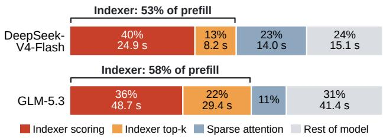
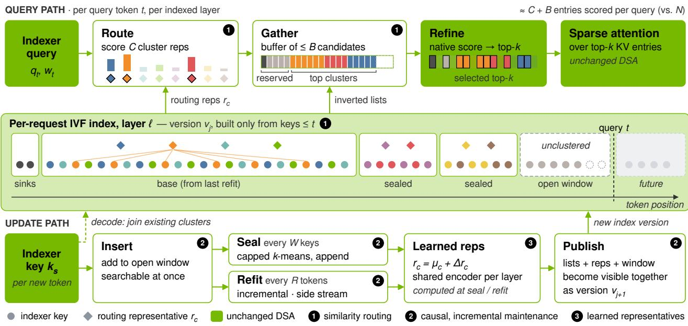
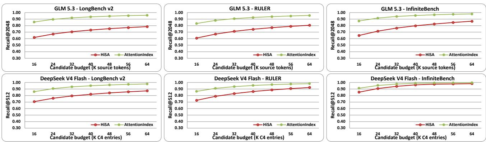
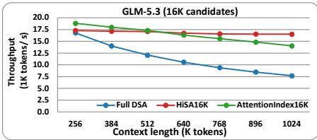
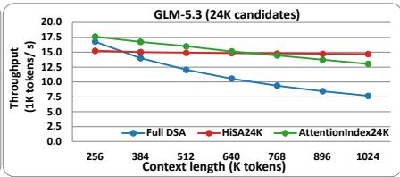
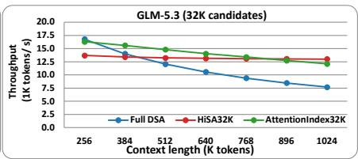
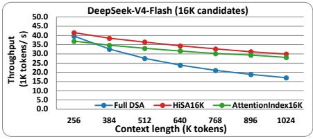
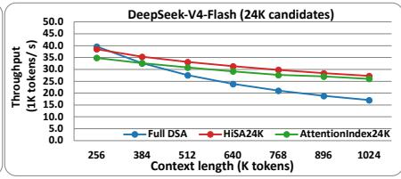
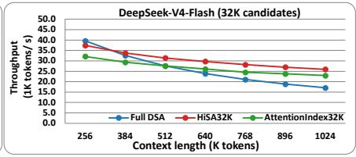
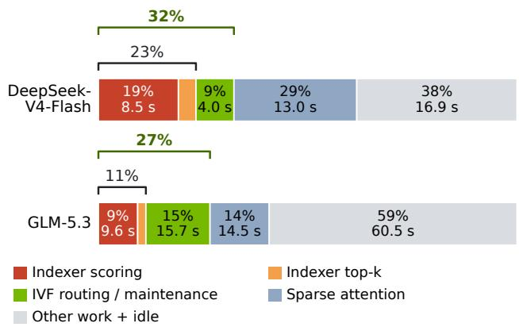

# ATTENTIONINDEX: ACCELERATING LEARNED SPARSE ATTENTION WITH A CAUSAL INVERTED-FILE INDEX

Jeongmin Brian Park 1 Wen-mei Hwu 1

1NVIDIA

## ABSTRACT

Learned sparse attention, used in production models such as DeepSeek-V4 and GLM-5, lets each query attend to only k keys chosen by a lightweight indexer, but the indexer still scores every key in the prefix. At one million tokens, this selection takes more than half of prefill time. Two-stage selection over contiguous blocks, as in HiSA, reduces this cost, but its recall declines as context grows at a fixed candidate budget. We present AttentionIndex, which routes each query over an inverted-file index that groups indexer keys by similarity and refines the candidates with the native indexer score. AttentionIndex builds the index during prefill, making new keys searchable immediately, reusing previous clustering to keep maintenance cheap, and exposing each query only to clusters built from its own prefix. On GLM-5.3 and DeepSeek-V4-Flash at one million tokens, AttentionIndex delivers 1.3–1.8× the prefill throughput of exhaustive selection, and at throughput within 5% of HiSA, it recovers 17.0 and 10.0 percentage points more of the exhaustive top-k, respectively. AttentionIndex also improves accuracy on long-context benchmarks by up to 18.4 percentage points over HiSA at the same candidate budget.

## 1 INTRODUCTION

Long-context inference has become a defining workload for large language models: agents (Sun et al., 2026), code assistants (Rando et al., 2025), and document analysis (Bai et al., 2025; Zhang et al., 2024) routinely process hundreds of thousands to millions of tokens per request (Gemini Team, 2024). At these lengths, dense attention is prohibitively expensive, and production models have adopted learned sparse attention. DeepSeek Sparse Attention (DSA) (DeepSeek-AI, 2025), used by DeepSeek-V3.2, DeepSeek-V4, and GLM-5.3 (DeepSeek-AI, 2026; Z.ai, 2026), adds a lightweight learned indexer to the model’s sparse attention layers. The indexer scores the keys in the prefix, and the main attention operates only on the k highest-scoring entries, which bounds its per-query cost regardless of context length.

However, the indexer itself still scores every key. As a result, the computation cost of selection still grows linearly with context length per query while the cost of the attention stays constant. At one million tokens, indexer scoring and top-k selection take 53–58% of prefill time on DeepSeek-V4-Flash and GLM-5.3, more than the rest of the model combined, even with key compression and cross-layer index reuse (Section 3.1). At long context, choosing which keys to attend to has become the bottleneck of sparse attention.

A natural remedy is two-stage selection: route each query to a small set of candidate keys, then apply the native indexer only to those candidates. HiSA (Xu et al., 2026) routes to contiguous blocks of keys ranked by their mean-pooled representatives. However, keys of contiguous token entries in the context need not be similar in indexer space or equally relevant to a query, so a block holding a few important keys can rank low and be discarded. As context length grows, the probability of entries relevant to a query falling into unselected blocks grows. In our LongBench-v2 measurements on GLM-5.3, HiSA’s recall with 8K candidate keys falls from 83.9% to 41.8% as context grows from 16K to 256K tokens. We observe a similar decline on DeepSeek-V4-Flash with a budget of 4K compressed entries (Section 3.2).

We observe that the native indexer performs exhaustive search within each selected block, so any approximation lies in which keys reside in the selected blocks. Grouping keys by similarity rather than by their positions in the context allows the exhaustive top-k search to be applied to fewer groups that contain a higher number of promising candidates, thus reducing the selection process with limited time budget to reach higher quality top-k outcome. This is the basic idea behind inverted-file (IVF) indexes for approximate nearest-neighbor search (Jegou et al., 2011; Johnson et al., 2021).

However, three constraints in a learned indexer environment make application of IVF more challenging. First, since prefill and decode generate new tokens that must be added into the candidate groups, updating the IVF index to include these new tokens must cost less than the scoring work it saves. Second, in order to maintain inference causality, every query must see an IVF index built only from its own prefix, including the centroids that guide routing. Third, since the indexer score, i.e. similarity measure, is not generated as a simple inner product, the score for a centroid that is the mean of the members of a cluster is a potentially poor approximate proxy for how the indexer scores its members.

We present AttentionIndex, which applies the IVF principle with three novel ideas. First, it routes each query over IVF clusters of keys and refines the candidates with the native indexer score, leaving the sparse attention kernel unchanged. Second, it incrementally builds and maintains the index during prefill to limit maintenance overhead. New keys become available to subsequent queries immediately and are clustered in small batches. Periodic refits regroup the prefix while reusing the previous clustering and selectively reassessing key assignments. To preserve causality, each query uses only clusters and representatives formed from keys in its own prefix. Third, it adjusts the cluster representatives to better predict the native indexer score for its cluster members using an encoder trained offline and shared across the clusters of each layer.

We implement AttentionIndex in SGLang (Zheng et al., 2024) and evaluate it on GLM-5.3 and DeepSeek-V4-Flash with contexts of up to one million tokens. At one million tokens and almost matched prefill throughput, AttentionIndex improves recall over HiSA by 17.0 and 10.0 percentage points on GLM-5.3 and DeepSeek-V4-Flash, respectively. Across the evaluated budgets, AttentionIndex achieves 1.3– 1.8× the prefill throughput of exhaustive selection at the same context length. AttentionIndex also improves accuracy on long-context benchmarks by up to 18.4 percentage points over HiSA at the same candidate budget.

In summary, this paper makes the following contributions:

• We show that in production learned sparse attention, key selection rather than attention dominates longcontext prefill, and that HiSA’s recall declines as context grows at a fixed candidate budget (Section 3).

• We design a causal IVF index for learned indexers that is built and maintained during prefill through immediate insertion and incremental refits (Section 4).

• We evaluate AttentionIndex on two production models with up to one million tokens, measuring selection recall, prefill throughput, and task accuracy against exhaustive selection and HiSA (Section 6).

## 2 BACKGROUND

## 2.1 Sparse Attention

LLM inference processes the input tokens in a prefill phase and then generates output tokens one at a time during decoding. Dense causal attention compares each query with every key in its prefix, so its computation cost grows quadratically with input length during prefill and linearly with context length at each decoding step. Sparse attention reduces this cost by restricting each query to a subset of key–value (KV) entries. Many sparse designs retain a few initial tokens, which act as attention sinks that receive high attention regardless of their content (Xiao et al., 2024).

The efficiency of sparse attention depends on the cost of both selecting these entries and computing attention over them. Systems such as SampleAttention and LServe use structured sparsity to reduce attention cost (Zhu et al., 2025; Yang et al., 2025). Grouping entries into blocks can simplify selection and allow kernels to skip entire blocks. However, the fact that a group is not skipped over does not mean that all its entries should be selected for attention computation. Thus the selection process should consist of two stages: a coarse search can identify candidate groups before a fine stage selects individual tokens. We call the coarse stage routing, the fine stage refinement, and the maximum number of keys passed from routing to refinement the candidate budget.

## 2.2 Learned Attention Indexers

DeepSeek Sparse Attention (DSA) uses a lightweight learned indexer to select the top-k KV entries for each query (DeepSeek-AI, 2025). The indexer has its own query and key projections, separate from those of the main attention. For a query token t and an earlier token $s ,$ it computes

$$
I _ { t , s } = \sum _ { j = 1 } ^ { H ^ { I } } w _ { t , j } ^ { I } \operatorname { R e L U } \bigl ( \mathbf { q } _ { t , j } ^ { I } \cdot \mathbf { k } _ { s } ^ { I } \bigr ) ,\tag{1}
$$

where the indexer queries $\mathbf { q } _ { t , j } ^ { I }$ and weights $w _ { t , j } ^ { I }$ of the $H ^ { I }$ indexer heads are derived from token t, and each token contributes a single indexer key $\mathbf { k } _ { s } ^ { I }$ shared by all heads. Models that compress keys apply the same score to compressed entries. The main attention then operates only on the k entries with the highest scores.

We call $I _ { t , s }$ the native indexer score. Scoring every available key with it and keeping the top k, as DSA does, is exhaustive selection; it is the reference that faster selection methods approximate and the Full DSA baseline in our evaluation. We measure an approximate method by its recall: the fraction of the exhaustive top-k that it recovers.

## 2.3 Inverted-File Indexing

Inverted-file indexing (IVF) speeds up approximate nearestneighbor search by restricting candidate evaluation to selected clusters. It partitions vectors into clusters, commonly using k-means, and stores their members in inverted lists (Jegou et al., 2011; Johnson et al., 2021). At query time, IVF ranks cluster representatives, selects a subset of clusters, and evaluates the vectors within those clusters to return the top-k candidates. The number of clusters selected, or equivalently the number of candidate vectors evaluated, controls the tradeoff between search cost and recall.

Cluster representatives determine which clusters are selected and thus which vectors reach the final scoring stage. Even when candidates are scored exactly, a true top-k result can be missed if its cluster is not selected. Standard IVF represents each cluster by its mean, which suits inner-product search: a query’s score against the mean equals the average score of the cluster’s members. The native indexer score in Equation (1) is not an inner product, so this equivalence does not hold. IVF also supports insertion by assigning new vectors to existing clusters without reclustering, and its clustering cost is typically paid once and amortized over many queries.

## 3 MOTIVATION

## 3.1 The Cost of Exhaustive Indexer Scoring

Learned sparse attention bounds the cost of the main attention computation, but not the cost of choosing which entries it attends to. In DSA, attention uses only the top-k entries for each query, yet exhaustive selection scores every available indexer key and selects the k highest scores (DeepSeek-AI, 2025). For a context of N tokens, scoring and top-k selection each require O(N) work per query and O(N2) work across prefill, assuming fixed model dimensions and compression ratios, whereas attention over the selected entries requires O(k) work per query. The cost of key selection therefore grows with context length, while the per-query cost of sparse attention stays constant. This holds in both phases of inference: selection is quadratic across a prefill, and every decoding step must again score the entire prefix.

Recent models reduce this overhead through compression and reuse. DeepSeek-V4-Flash compresses every four tokens into one indexed entry in its Compressed Sparse Attention (CSA) layers (DeepSeek-AI, 2026), and GLM-5.3 reuses indexer selections across multiple attention layers (Z.ai, 2026), exploiting the high overlap between the selections of adjacent layers (Bai et al., 2026). These optimizations reduce the number of keys or the frequency of scoring, but each fresh selection still scans the available indexed prefix.

  
Figure 1. Prefill time breakdown for one 1M-token request under exhaustive selection. “Rest of model” includes MoE and dense GEMMs, communication, normalization, RoPE, quantization, compressor kernels, and idle time.

Figure 1 shows that these optimizations do not remove the bottleneck at long context. In a 1M-token prefill, indexer scoring and top-k selection together take 53% of prefill time on DeepSeek-V4-Flash and 58% on GLM-5.3, more than the rest of each model combined and 2.4× and 5.2× the time spent in sparse attention, respectively. On GLM-5.3, top-k selection alone takes nearly twice as long as sparse attention, so an effective remedy must shrink the input to top-k as well as the number of keys scored.

AttentionIndex targets this selection cost by routing each query to a bounded set of candidate keys before applying the native indexer, so both scoring and top-k selection operate on these candidates rather than the full prefix. The objective is to recover the keys chosen by exhaustive selection with less computation, while keeping inference-time index construction and maintenance below the savings they provide.

## 3.2 Limitations of Contiguous-Block Routing

Block-level routing reduces selection cost by scoring one representative for many keys. MoBA (Lu et al., 2026) ranks contiguous blocks using mean-pooled keys, and HiSA (Xu et al., 2026) applies the same idea to the learned indexer. It selects blocks using their summaries, then refines the keys in those blocks with the native indexer score. A fixed candidate budget bounds refinement work, but routing determines which keys refinement can recover.

Table 1 shows that HiSA’s recall drops as context grows at a fixed candidate budget. On GLM-5.3, recall falls from 83.9% to 41.8% on LongBench-v2 and from 81.7% to 41.4% on RULER as context grows from 16K to 256K tokens. On DeepSeek-V4-Flash, it falls from 87.4% to 46.0% on LongBench-v2 and from 82.0% to 41.8% on RULER between 32K and 256K tokens. At 256K, HiSA misses more than half of the exhaustive top-k in all four settings.

At a fixed block size and candidate budget, longer contexts introduce more blocks competing for the same routing slots.

Table 1. HiSA recall (%) of the exhaustive top-k at fixed candidate budgets: 8K token keys for GLM-5.3 and 4K C4 entries for DeepSeek-V4-Flash. Context lengths count source tokens; dashes indicate that the budget covers the context.
<table><tr><td colspan="3"></td><td colspan="2">DeepSeek-V4-Flash HiSA4K</td></tr><tr><td>Context</td><td>LongBench-v2</td><td>RULER</td><td>LongBench-v2</td><td>RULER</td></tr><tr><td>16K</td><td>83.9</td><td>81.7</td><td></td><td></td></tr><tr><td>32K</td><td>73.4</td><td>68.3</td><td>87.4</td><td>82.0</td></tr><tr><td>48K</td><td>66.5</td><td>60.0</td><td>83.7</td><td>70.4</td></tr><tr><td>64K</td><td>59.3 53.1</td><td>55.9 50.5</td><td>80.3</td><td>64.7</td></tr><tr><td>96K 128K</td><td>46.6</td><td>48.2</td><td>65.7 59.3</td><td>57.2</td></tr><tr><td></td><td>41.8</td><td>41.4</td><td>46.0</td><td>50.6</td></tr><tr><td>256K</td><td></td><td></td><td></td><td>41.8</td></tr></table>

The challenge is to represent a block’s useful keys with a single centroid. Contiguous keys need not be similar in indexer space or equally relevant to a query, so their mean can score poorly even when a few members belong to the exhaustive top-k. Once their block is discarded, refinement cannot recover those keys. HiSA’s failure analysis identifies this loss from mean pooling (Xu et al., 2026).

This motivates grouping keys by their indexer embeddings rather than their positions. AttentionIndex clusters similar keys, allowing routing to retrieve related keys together without also admitting less relevant their positional neighbors.

## 4 DESIGN

AttentionIndex replaces exhaustive selection with routing over an inverted-file (IVF) index of indexer keys, followed by refinement with the native indexer score. Because the index grows with the requests that use it, during both prefill and decoding, two requirements shape the design: maintaining the index must cost less than the scoring work that it saves, and every query must see an index built only from its own prefix. The design has three parts (Figure 2): routing over similarity clusters (Section 4.1), causal and incremental index maintenance (Sections 4.2 and 4.3), and learned routing representatives (Section 4.4).

## 4.1 Routing over Similarity Clusters

For each request and indexed layer, AttentionIndex keeps an IVF index over the indexer keys (Jegou et al., 2011; Johnson et al., 2021). Each cluster stores an inverted list of its member key IDs and a routing representative. A query scores every representative with the native indexer score (Equation (1)) and ranks the clusters. It then fills a candidate budget of B keys: sink keys and the not-yet-clustered keys of the open window take reserved slots, and the lists of the top-ranked clusters fill the rest, with the last list truncated if needed. Refinement scores these candidates with the native indexer score and passes the top-k keys to the unchanged sparse attention kernel.

Like HiSA, AttentionIndex selects keys in two stages, but its routing units are clusters of similar keys rather than contiguous blocks. Because refinement scores every candidate exactly, all approximation comes from candidate selection: a key in the exhaustive top-k is missed only if it never reaches the candidate set. Grouping keys by similarity concentrates the exhaustive top-k in fewer clusters, so the same budget covers more of it (Section 6.2).

Each query scores about C + B entries instead of N, where C is the number of clusters. With about 128 keys per cluster on GLM-5.3, routing still grows linearly with the prefix but with a far smaller constant, and refinement is bounded by B.

## 4.2 Causal Maintenance of a Growing Index

The prefix grows with every token, so the index must change while queries use it. Rebuilding it whenever new keys arrive would erase the savings, while only adding keys to existing clusters lets clusters grow unevenly. AttentionIndex therefore separates immediate insertion from lazy reorganization.

New keys enter an open window and are included directly in the candidates of later queries, so they are searchable before they are clustered. Every W keys, AttentionIndex seals the window: it clusters the window’s keys with size-capped k-means and appends the new clusters without modifying published ones. On GLM-5.3, a seal groups W = 1,024 keys into eight clusters of about 128 keys. Until the first seal, queries use exhaustive selection.

Sealing keeps insertion cheap but confines each cluster to one window, so similar keys that arrive in different windows stay apart. Every R tokens (R = 16,384 on GLM-5.3), a refit therefore regroups the entire available prefix into a new base, with more clusters as the prefix grows. The window size trades candidate slots for insertion work; the refit interval sets how long window boundaries persist. During decoding, which adds one key per step, new keys instead join existing clusters directly, because a typical response stays below the refit interval.

Causality must hold for routing, not only for candidate IDs: a representative computed from a future key could change which clusters a query selects even if that key is later masked. Each seal or refit therefore produces a new index version whose lists, representatives, and window metadata become visible together, and a query uses a version only if every key that built it lies in the query’s prefix. Within a prefill chunk, earlier queries keep the previous version and cover newer keys through their own window.

  
Figure 2. Overview of AttentionIndex for one indexed layer. Query path: routing scores cluster representatives with the native indexer score and gathers the keys of the top-ranked clusters into the candidate budget, after reserved slots for sink and window keys; refinement selects the top-k candidates for sparse attention. Update path: new keys enter an open window and are searchable at once; every W keys the window is sealed into local clusters, and every R tokens a refit regroups the prefix. A new index version is visible only to queries whose prefix contains all of its keys.

## 4.3 Incremental Refits

Two properties let a refit reuse the previous base instead of clustering from scratch: consecutive refits share almost all of their keys, and indexer keys never change once generated. AttentionIndex warm-starts each refit from the previous base’s nonempty means plus new centers sampled from recently added keys. It also keeps, for every key, its assignment, an upper bound on the distance to its center, and lower bounds on the distances to competing centers (Elkan, 2003; Drake & Hamerly, 2012). A refit compares all keys with the new centers, but only newly added keys and keys whose bounds no longer certify their assignment search all centers. With ∆C new centers and M keys that need a full search, the distance work is proportional to N∆C + MC instead of NC. Each refit runs a single assignment and update pass, trading exact convergence for lower cost.

A refit executes on a separate stream while the forward pass continues, and each layer publishes its new version before the first query that needs it. The new base replaces the clusters of the prefix it covers and keeps any seals made since; only sealing remains on the forward path.

## 4.4 Learned Routing Representatives

Cluster membership and routing serve different purposes. Membership uses geometric distance, which is cheap to update and supports the bounds above. Routing ranks clusters by the native indexer score, under which a cluster’s mean is only an approximate proxy for its members (Section 2), so scoring the mean can rank a cluster low even when it contains top-k keys. AttentionIndex therefore keeps membership geometric and learns only the representatives used for routing, following Vecchiato et al. (2024).

Because clusters are created and replaced within each request, a separate representative cannot be optimized per cluster. Instead, a small encoder shared by all clusters of a layer predicts a correction $\Delta r _ { c }$ to the cluster mean $\mu _ { c }$ from permutation-invariant summaries of its members: their mean, the logarithm of the cluster size, and mean- and maxpooled learned features (Zaheer et al., 2017). The routing representative is $r _ { c } = \mu _ { c } + \Delta r _ { c }$ . The correction is bounded and initialized to zero, so the encoder starts from ordinary IVF and leaves membership, means, and bounds unchanged.

We train the encoder offline on queries and index snapshots from the frozen model, with exhaustive selection as the reference. For a training query, let $h _ { c }$ count the reference keys in cluster c and $n _ { c }$ its causally visible members, both excluding mandatory candidates, and let $z _ { c }$ be the native indexer score of $r _ { c } .$ We minimize the cross entropy between

$$
t _ { c } = \frac { h _ { c } } { \sum _ { j } h _ { j } } \quad \mathrm { a n d } \quad p _ { c } = \frac { n _ { c } \exp ( \alpha z _ { c } ) } { \sum _ { j } n _ { j } \exp ( \alpha z _ { j } ) } ,\tag{2}
$$

plus a penalty on $\Delta r _ { c }$ , where α is a training scale. With unconstrained scores the optimum satisfies $\exp ( \alpha z _ { c } )$ ∝ $h _ { c } / n _ { c } ,$ so the encoder learns to rank clusters by reference keys per candidate slot. The encoder runs only when a seal or refit creates clusters; queries score representatives exactly as in ordinary IVF.

## 5 IMPLEMENTATION

We integrate HiSA and AttentionIndex into SGLang as candidate producers for the learned indexer (Zheng et al., 2024). Full DSA and both selectors share the serving stack, model weights, sparse attention kernels, and client. The selectors use Triton and TileLang kernels and read paged indexer keys directly. On GLM, routing representatives use the same FP8 page format as indexer keys, allowing routing and refinement to reuse DeepGEMM.

Refits read quantized keys directly and run on separate CUDA streams, with work staggered across layers to overlap the forward pass. Under tensor parallelism, indexer keys are replicated, while each layer has an owner rank that fits and broadcasts its index state so all ranks use the same routing geometry. Learned encoders are trained offline and loaded at server startup. Layers without a selected encoder use ordinary cluster means.

We measure recall by capturing indexer operands during serving and replaying selectors under the serving schedule. Replay checks require HiSA to match its served selections and IVF to preserve the server’s mandatory candidates. Serving timings include index construction and maintenance, but exclude startup and kernel compilation. Time breakdowns use PyTorch profiler traces of a prefill. Accuracy runs use greedy decoding and each benchmark’s answer extraction and metric, applied after the model’s thinking segment.

## 6 EVALUATION

## 6.1 Experimental Setup

Models. We evaluate AttentionIndex on GLM-5.3 and DeepSeek-V4-Flash. We preserve their native selection sizes: 2,048 token keys per query for GLM-5.3 and 512 compressed entries for the indexed layers of DeepSeek-V4- Flash, which use a compression stride of four source tokens.

Baselines. We compare against Full DSA, which exhaustively scores the causal key set using the native indexer, and HiSA (Xu et al., 2026), which selects contiguous blocks using pooled key summaries before scoring their member keys.

Datasets. We use LongBench-v2 (Bai et al., 2025), RULER (Hsieh et al., 2024), and InfiniteBench (Zhang et al., 2024), covering code repositories, long-document question answering, in-context learning, and synthetic retrieval tasks.

Hardware. Timing experiments use eight NVIDIA B200 GPUs with eight-way tensor parallelism and 8,192-token prefill chunks. All methods run in the same serving stack (Section 5).

## 6.2 Indexer Retrieval Quality Analysis

In this section, we measure recall as the fraction of the exhaustive native indexer’s top-k keys recovered in the final selection. All methods and budgets use the same 12 inputs per dataset and model. LongBench-v2 uses ten coderepository and two in-context learning inputs, excluding data used to train or select learned representatives and taking prefixes of approximately 1M tokens. RULER uses two 512K inputs from each of six tasks, and InfiniteBench uses 12 long contexts with at most one per book. We evaluate the final 2,048 queries of each prefix at five indexed layers spanning the model’s depth, averaging over queries and layers within each input, then across inputs. Budgets span 16K–64K candidates (1K = 1,024), counted as token keys on GLM and compressed C4 entries on V4. The V4 budgets therefore correspond to 64K–256K source-token equivalents.

AttentionIndex achieves higher mean recall than HiSA (Figure 3) on all three datasets at every evaluated budget supported by both methods. For example, at a 24K budget on LongBench-v2, AttentionIndex improves recall from 67.16% to 89.70% on GLM-5.3 and from 75.88% to 90.66% on DeepSeek-V4-Flash. The smaller gains on DeepSeek-V4-Flash at larger budgets reflect the higher recall already achieved by HiSA.

AttentionIndex also achieves higher recall with smaller candidate budgets. On GLM-5.3, its 24K results exceed HiSA’s 64K results on all three datasets, using 62.5% fewer candidate slots. On DeepSeek-V4-Flash, its 24K-entry results exceed HiSA’s 32K-entry results on all three datasets, using 25% fewer slots. Increasing the budget further improves recall for both methods. These results demonstrate that AttentionIndex uses the candidate budget more effectively, although the resulting latency benefit also depends on routing and index maintenance costs.

The gains are consistent with the limitations of HiSA’s contiguous-block means (Xu et al., 2026) (Section 3.2): similarity grouping preserves more reference keys within the same candidate budget.

## 6.3 Throughput Analysis

A single-stream client evaluates prefix cuts of long LongBench-v2 documents, with two repeats per point and one server launch per method. We report effective prefill throughput as N/TTFT in tokens per second, where N is the number of input tokens and TTFT is the median time from request submission to the first generated token. Timing includes index construction and maintenance throughout prefill.

  
Figure 3. Indexer selection recall of HiSA and AttentionIndex on GLM-5.3 and DeepSeek-V4-Flash across three datasets. Candidate budgets count token keys for GLM and compressed C4 entries for DeepSeek-V4-Flash.

Scaling with context length. Full DSA loses more than half of its throughput between 256K and 1M tokens on both models (Figure 4), because every query scores the entire prefix. Both approximate methods decline far less. At 1M tokens, AttentionIndex reaches 1.6–1.8× the throughput of Full DSA on GLM-5.3 and 1.3–1.6× on DeepSeek-V4- Flash across the three budgets, and its advantage grows with context length. At 256K, where exhaustive selection is still cheap, the index has not yet paid for itself at every budget; AttentionIndex matches or exceeds Full DSA at all budgets from 384K tokens on GLM-5.3 and from 512K on DeepSeek-V4-Flash.

Comparison at equal budgets. At the same budget, AttentionIndex is faster than HiSA on GLM-5.3 up to 512K– 768K tokens, depending on the budget, but slower at longer contexts and on DeepSeek-V4-Flash. Unlike HiSA, AttentionIndex maintains its index and gathers candidates from scattered positions rather than contiguous blocks, and maintenance grows with the prefix because each refit revisits all available keys. This is consistent with its throughput declining with context length while HiSA’s stays nearly constant on GLM-5.3. However, AttentionIndex achieves higher recall at the same budget (Section 6.2), so throughput alone does not capture the difference between the methods.

Recall at comparable throughput. Table 2 pairs AttentionIndex16K with HiSA configurations whose measured throughput differs by less than 5% at 512K and 1M tokens. Throughput is normalized to AttentionIndex16K separately for each model and context length. Recall is measured on four LongBench-v2 code-repository inputs, averaging five indexed layers and the final 2,048 body query positions of

Table 2. Recall (%) at comparable prefill throughput. Tput is throughput relative to AttentionIndex16K for each model and context. Context lengths count source tokens; budgets count token keys for GLM and compressed C4 entries for DeepSeek-V4-Flash. Dashes denote exhaustive selection.
<table><tr><td rowspan="2">Method</td><td colspan="2">GLM-5.3</td><td colspan="2">DeepSeek-V4-Flash</td></tr><tr><td>Budget Tput Recall</td><td></td><td>Budget Tput Recall</td><td></td></tr><tr><td>512K tokens Full DSA HiSA</td><td>-0.698</td><td>100.0</td><td>-0.833</td><td>100.0</td></tr><tr><td>AttentionIndex 1M tokens</td><td>16K 0.987 16K 1.000</td><td>63.1 86.4</td><td>24K 1.002 16K 1.000</td><td>85.2 89.5</td></tr><tr><td></td><td>-0.548</td><td>100.0</td><td>-0.608</td><td></td></tr><tr><td>Full DSA HiSA</td><td>24K 1.048</td><td>69.6</td><td>24K 0.971</td><td>100.0</td></tr><tr><td>AttentionIndex</td><td>16K 1.000</td><td>86.6</td><td>16K 1.000</td><td>76.5</td></tr><tr><td></td><td></td><td></td><td></td><td>86.5</td></tr></table>

each prefix.

AttentionIndex achieves higher recall in all four comparisons. At 512K and 1M tokens, it gains 23.3 and 17.0 percentage points on GLM, and 4.3 and 10.0 points on DeepSeek-V4-Flash. These gains hold at comparable speed, including three comparisons where AttentionIndex uses one third fewer candidates. Full DSA provides reference recall of 100%, but achieves only 0.55–0.83 times AttentionIndex16K’s throughput at these operating points.

## 6.4 Decoding Latency Under Load

HiSA reports larger TPOT gains as request concurrency increases (Xu et al., 2026). We evaluate decoding latency when a long prefill request arrives during ongoing generation. Table 3 lists the two workloads. We report mean TPOT over the first 512 output tokens, including interruptions from the arriving prefill, averaged over two repeats. The node’s 1.1M-token KV capacity limits the concurrency we can evaluate at these context lengths.

  
Figure 4. Effective prefill throughput (N/TTFT) as context length grows, for Full DSA and for HiSA and AttentionIndex at 16K, 24K, and 32K candidate budgets on GLM-5.3 and DeepSeek-V4-Flash.

Table 3. TPOT over the first 512 output tokens (ms), with speedup over Full DSA in parentheses.
<table><tr><td>Decoders Arrival</td><td>4 × 32K 2 × 128K 917K</td></tr><tr><td>Full DSA 231.3 (1.00×)184.1 (1.00×) HiSA24K</td></tr><tr><td>140.0 (1.65×)119.3 (1.54×) AttentionIndex16K 162.7 (1.42×)127.4 (1.45×) AttentionIndex24K 163.9 (1.41×) 131.6 (1.40×)</td></tr></table>

AttentionIndex achieves TPOT speedups of 1.40–1.45× over Full DSA, compared with 1.54–1.65× for HiSA24K. KV capacity limits these workloads to two or four concurrent decoders. Larger batches would better amortize routing overhead and decrease the gap between HiSA and AttentionIndex.

## 6.5 End-to-End Accuracy

We evaluate task accuracy using 200 InfiniteBench questions (25 from each of eight tasks), 198 RULER samples (66 each at 128K, 256K, and 512K), and LongBench-v2. InfiniteBench and RULER use complete contexts.

Table 4 reports task accuracy on both models, with Full DSA as the reference. At a matched 24K budget, AttentionIndex improves accuracy over HiSA on all three benchmarks for both models. The largest gains are on RULER: 14.9 percentage points on GLM and 8.87 points on DeepSeek-V4-Flash, recovering approximately 78% and 84% of HiSA’s gap to Full DSA. On InfiniteBench, the gains are 4.7 and 1.84 points, respectively.

The benefit is smaller on LongBench-v2. Full DSA exceeds HiSA24K by only 2.8 points on GLM and 0.80 points on DeepSeek-V4-Flash, compared with 19.2 and 10.56 points on RULER. AttentionIndex24K recovers 0.7 and 0.40 points, respectively. The small gap to exhaustive selection suggests limited accuracy headroom from improving indexer recall alone. LongBench-v2 emphasizes reasoning over long contexts (Bai et al., 2025), so model capability may remain a limiting factor even when relevant keys are selected. The aggregate scores support this interpretation but do not identify the cause of each missed question.

Table 4. Task accuracy (%) with exhaustive selection (Full DSA) and with HiSA and AttentionIndex at 16K and 24K candidate budgets. Budgets count token keys for GLM and compressed C4 entries for DeepSeek-V4-Flash.
<table><tr><td rowspan="2"></td><td rowspan="2">Full DSA</td><td colspan="2">HiSA</td><td colspan="2">AttentionIndex</td></tr><tr><td>16K</td><td>24K</td><td>16K</td><td>24K</td></tr><tr><td>GLM-5.3</td><td></td><td></td><td></td><td></td><td></td></tr><tr><td>InfiniteBench</td><td>83.0</td><td>75.0</td><td>78.6</td><td>80.4</td><td>83.3</td></tr><tr><td>RULER</td><td>81.8</td><td>55.2 60.4</td><td>62.6 61.0</td><td>73.6</td><td>77.5</td></tr><tr><td>LongBench-v2</td><td>63.8</td><td></td><td></td><td>60.4</td><td>61.7</td></tr><tr><td>DeepSeek-V4-Flash</td><td></td><td></td><td>80.19</td><td></td><td></td></tr><tr><td>InfiniteBench</td><td>81.16</td><td>80.46</td><td></td><td>81.20</td><td>82.03</td></tr><tr><td>RULER</td><td>77.83</td><td>58.59</td><td>67.27</td><td>74.92</td><td>76.14</td></tr><tr><td>LongBench-v2</td><td>63.82</td><td>60.82</td><td>63.02</td><td>61.63</td><td>63.42</td></tr></table>

DeepSeek-V4-Flash’s smaller InfiniteBench gain is also consistent with its higher starting recall. At 24K entries, HiSA already recovers 90.74% of the exhaustive top-k, and AttentionIndex raises recall to 95.51% (Section 6.2). On GLM, the corresponding change is much larger, from 71.58% to 91.59%. HiSA’s DeepSeek-V4-Flash accuracy is already close to Full DSA, at 80.19% versus 81.16%, and AttentionIndex reaches 82.03%. These results show that the accuracy benefit depends on both the retrieval gap and the task; an improvement in indexer recall need not produce a proportional improvement in accuracy.

Finally, the advantage largely persists at comparable throughput. AttentionIndex16K and HiSA24K have measured prefill throughput within 5% on both models at 1M tokens (Section 6.3). Using these configurations, AttentionIndex achieves higher accuracy in four of the six comparisons while using one third fewer candidates. It gains 1.8 and 11.0 points on GLM’s InfiniteBench and RULER, and 1.01 and 7.65 points on DeepSeek-V4-Flash’s. LongBenchv2 is the exception: its scores are lower by 0.6 and 1.39 points, respectively.

## 6.6 AttentionIndex Time Breakdown

  
Figure 5. GPU work during AttentionIndex prefill at approximately 1M tokens and a 24K budget in token keys (GLM) or C4 entries (DeepSeek-V4-Flash).

Figure 5 separates AttentionIndex’s routing and maintenance from the remaining model work. This category includes candidate packing and remapping, index construction and refitting, centroid encoding, publication, and index exchange across TP ranks. We attribute GPU work using operation ranges and maintenance-thread launches, so background refits and encoder GEMMs are included even when their kernel names resemble ordinary model operations. Scoring and top-k kernels, including those used for coarse routing, are counted separately to avoid duplication.

Scoring and top-k together account for 11.6 s on GLM and 10.3 s on DeepSeek-V4-Flash, or 11% and 23% of the totals. Routing and maintenance add 15.7 s (15%) and 4.0 s (9%), respectively. Including these costs raises the share of all index work to 27% on GLM and 32% on DeepSeek-V4- Flash, as shown by the longer brackets. Sparse attention accounts for a further 14% and 29%, leaving 59% and 38% for other work and idle time.

These shares describe GPU work rather than added request latency: kernel durations on concurrent streams are summed, and background refits overlap the forward computation. End-to-end throughput and the incremental cost of learned centroids use separate serving measurements (Sections 6.3 and 6.7.2).

## 6.7 Ablation Studies

## 6.7.1 Periodic Refitting

We compare AttentionIndex with refitting disabled against several refit intervals at fixed candidate budgets.

Table 5. Mean indexer recall with different refit intervals and candidate budgets. Both quantities count token keys for GLM and compressed C4 entries for DeepSeek-V4-Flash; 1K denotes 1,024.
<table><tr><td colspan="3">GLM-5.3</td><td colspan="2">DeepSeek-V4-Flash</td></tr><tr><td>Refit interval</td><td>24K</td><td>32K</td><td>24K</td><td>32K</td></tr><tr><td>None (seal only)</td><td>0.788</td><td>0.825</td><td>0.8166</td><td>0.8524</td></tr><tr><td>4K</td><td>0.880</td><td>0.904</td><td>0.9131</td><td>0.9388</td></tr><tr><td>8K</td><td>0.886</td><td>0.910</td><td>0.9089</td><td>0.9358</td></tr><tr><td>16K</td><td>0.883</td><td>0.907</td><td>0.8995</td><td>0.9282</td></tr><tr><td>32K</td><td>0.879</td><td>0.905</td><td>0.8849</td><td>0.9163</td></tr><tr><td>HiSA</td><td>0.665</td><td>0.702</td><td>0.7610</td><td>0.7972</td></tr></table>

Table 5 shows that every tested refit interval improves recall over sealing alone at every budget. At the serving interval of 16K, GLM recall rises from 0.788 to 0.883 with 24K candidates and from 0.825 to 0.907 with 32K candidates, gains of 9.49 and 8.22 percentage points using unrounded measurements. All 13 evaluated GLM inputs improve at both budgets. On DeepSeek-V4-Flash, the same refit interval adds 8.29 points at 24K and 7.58 points at 32K. Its sweep uses 13 documents: 12 from LongBench-v2 and one from RULER. These results show that regrouping the growing prefix recovers more reference keys during candidate selection than sealing alone.

On GLM, most of the benefit comes from performing periodic refits. Changing the interval to 4K, 8K, or 32K changes mean recall by at most 0.37 points relative to the served 16K setting. The 8K interval gives the highest mean recall, exceeding 16K by 0.27 and 0.23 points at the two budgets; shortening it further to 4K does not improve recall. DeepSeek-V4-Flash is more sensitive to the interval, with shorter intervals consistently yielding higher mean recall in this sweep. The benefit over sealing alone is generally larger at smaller candidate budgets, where routing has less room to compensate for poor grouping.

## 6.7.2 Learned Centroids

Table 6 compares ordinary k-means centroids and learned representatives with fixed membership and a 24K budget of token keys for GLM or compressed entries for DeepSeek-V4-Flash. GLM’s learned layers use ten LongBenchv2 inputs at 512K, with 8,192 query positions per input. DeepSeek-V4-Flash uses 36 inputs across the three datasets, evaluated at each prompt’s end.

The improvement varies across layers: GLM gains 0.55– 5.01 percentage points across the four layers with learned representatives. DeepSeek-V4-Flash gains 0.23 and 0.22 points at layers 2 and 12, with improvements on 32 and 30 of the 36 documents, respectively.

Table 6. Selected-layer recall with ordinary and learned centroids. Gains are percentage points, computed before rounding recall. A dagger marks layers using the ordinary centroid in both configurations. GLM layer 14 is enabled in this ablation.
<table><tr><td colspan="3">GLM-5.3</td><td colspan="3">DeepSeek-V4-Flash</td></tr><tr><td></td><td>Layer k-means Learned</td><td></td><td>Gain Layer k-means Learned</td><td></td><td>Gain</td></tr><tr><td>0</td><td>0.928</td><td> $0 . 9 6 2 + 3 . 4 1$ </td><td>2</td><td>0.885</td><td> $0 . 8 8 8 + 0 . 2 3$ </td></tr><tr><td>14</td><td>0.846</td><td> $0 . 8 9 6 + 5 . 0 1$ </td><td>12 0.931</td><td></td><td> $0 . 9 3 4 \mathrel { + } 0 . 2 2$ </td></tr><tr><td>34</td><td>0.875</td><td> $0 . 8 8 0 + 0 . 5 5$ </td><td>22†</td><td>0.934 0.934</td><td>0.00</td></tr><tr><td>54</td><td>0.885</td><td>0.896 +1.12 32†</td><td></td><td>0.941 0.941</td><td>0.00</td></tr><tr><td> $7 4 ^ { \dag \ast }$ </td><td>0.895</td><td>0.895</td><td>0.0042†</td><td>0.924 0.924</td><td>0.00</td></tr></table>

GLM layer 74 reports checkpoint-selection validation candidatepool recall, averaged over 24K and 32K budgets.

Table 7. TTFT (s) with ordinary and learned centroids in matched serving runs at a 24K budget in each model’s native units. ∆ is the relative TTFT change, computed before rounding.
<table><tr><td rowspan="2"></td><td colspan="2">GLM-5.3</td><td colspan="2">DeepSeek-V4-Flash</td></tr><tr><td>Context k-means Learned</td><td>∆(%)</td><td>k-means Learned</td><td>∆(%)</td></tr><tr><td>512K</td><td>31.58</td><td>31.85 +0.9</td><td>17.58</td><td>17.71 +0.8</td></tr><tr><td>896K</td><td>65.79</td><td>65.86 +0.1</td><td>35.32</td><td>35.89 +1.6</td></tr><tr><td>1M</td><td>77.03</td><td>78.19 +1.5</td><td>41.72</td><td>41.62 -0.2</td></tr></table>

DeepSeek-V4-Flash’s compressed entries mix source tokens through overlapping windows (DeepSeek-AI, 2026); routing adjustments leave this mixture unchanged. This may limit the gains, although the ablation does not isolate compression’s effect.

Table 7 isolates encoder cost with matched hardware and index settings, changing only whether learned representatives are enabled. Each context uses one prompt and medians over two to six repetitions. TTFT changes by +0.1% to +1.5% on GLM and −0.2% to +1.6% on DeepSeek-V4- Flash; measured prefill throughput changes by less than 1.6% in every case. The encoder runs only when clusters are created or refitted, leaving query scoring unchanged (Section 4.4).

## 7 RELATED WORK

Sparse attention. Structured approaches keep local windows and attention sinks (Xiao et al., 2024) or exploit structured sparsity in attention kernels (Zhu et al., 2025; Yang et al., 2025). Query-aware methods select pages of the KV cache at inference time (Tang et al., 2024), and trainable architectures learn block or token selection together with the model (Yuan et al., 2025; Lu et al., 2026; DeepSeek-AI, 2025). Routing Transformers cluster queries and keys with online k-means during training (Roy et al., 2021). AttentionIndex does not change how a model attends: it accelerates the selection step of a learned sparse attention mechanism at inference time and preserves its native score.

Accelerating learned indexers. HiSA replaces the exhaustive indexer scan with routing over contiguous blocks (Xu et al., 2026), the approach we compare against throughout. IndexCache reuses selections across layers (Bai et al., 2026), and kernel-level work streams indexer scores to bound memory (Jaber & Jaber, 2026) or speeds up exact top-k selection (Liu et al., 2026). These optimizations largely complement AttentionIndex’s reduction in the number of keys scored.

Retrieval over the KV cache. RetrievalAttention builds approximate nearest-neighbor indexes over keys (Liu et al., 2025a), and RetroInfer organizes the KV cache as a vector storage engine (Chen et al., 2026). ClusterKV, Squeezed Attention, and Tactic cluster keys to select or estimate important tokens (Liu et al., 2025b; Hooper et al., 2024; Zhu et al., 2026). MagicPIG samples keys with locality-sensitive hashing (Chen et al., 2025), while SAAP partitions keys and queries asymmetrically using a learned query classifier (Mazare et al. ´ , 2025). These methods approximate dense attention, mostly during decoding, with indexes built offline or after prefill. AttentionIndex instead targets the top-k of a learned indexer and maintains its index within the forward pass, keeping routing causal as the prefix grows.

Dynamic vector indexes and clustering. Dynamic indexes combine incremental insertion with periodic reorganization (Xu et al., 2023; Baranchuk et al., 2023). AttentionIndex’s seals and refits resemble buffered writes and merges in log-structured merge trees (O’Neil et al., 1996). Its refits build on bound-based k-means acceleration (Elkan, 2003; Hamerly, 2010; Drake & Hamerly, 2012; Ding et al., 2015), and its learned representatives follow a learning-to-rank formulation of cluster selection (Vecchiato et al., 2024). We adapt these techniques to an index that is built within a single request and publishes causal updates on the inference path.

## 8 CONCLUSION

Learned sparse attention reduces attention computation, but exhaustive key selection remains costly at long contexts. AttentionIndex accelerates selection by maintaining a causal IVF index within each request and refining routed candidates with the native indexer score. At a matched 24K candidate budget, AttentionIndex improves recall and task accuracy over HiSA on both models, while delivering 1.3– 1.8× the prefill throughput of exhaustive selection at one million tokens. Optimizing its per-step decoding cost remains future work.

## REFERENCES

Bai, Y., Tu, S., Zhang, J., Peng, H., Wang, X., Lv, X., Cao, S., Xu, J., Hou, L., Dong, Y., Tang, J., and Li, J. LongBench v2: Towards deeper understanding and reasoning on realistic long-context multitasks. In Che, W., Nabende, J., Shutova, E., and Pilehvar, M. T. (eds.), Proceedings ofthe 63rd Annual Meeting ofthe Association for Computational Linguistics (Volume 1: Long Papers), pp. 3639–3664, Vienna, Austria, July 2025. Association for Computational Linguistics. ISBN 979-8-89176-251- 0. doi: 10.18653/v1/2025.acl-long.183. URL https: //aclanthology.org/2025.acl-long.183/.

Bai, Y., Dong, Q., Jiang, T., Lv, X., Du, Z., Zeng, A., Tang, J., and Li, J. Indexcache: Accelerating sparse attention via cross-layer index reuse. In Third Conference on Language Modeling, 2026. URL https://open review.net/forum?id=74886M5htU.

Baranchuk, D., Douze, M., Upadhyay, Y., and Yalniz, I. Z. Dedrift: Robust similarity search under content drift, 2023. URL https://arxiv.org/abs/2308 .02752.

Chen, Y., Zhang, J., Lu, B., Zhang, Q., Zhang, C., Liu, J., Luo, J., Liu, D., Jiang, H., Chen, Q., Ding, B., Yan, X., Jiang, J., Chen, C., Zhang, M., Li, C., Yang, Y., Yang, F., and Yang, M. Retroinfer: A vector storage engine for scalable long-context llm inference. Proc. VLDB Endow., 19(5):1016–1031, May 2026. ISSN 2150-8097. doi: 10.14778/3796195.3796212. URL https://doi.or g/10.14778/3796195.3796212.

Chen, Z., Sadhukhan, R., Ye, Z., Zhou, Y., Zhang, J., Nolte, N., Tian, Y., Douze, M., Bottou, L., Jia, Z., and Chen, B. MagicPIG: LSH sampling for efficient LLM generation. In The Thirteenth International Conference on Learning Representations, 2025. URL https://openreview .net/forum?id=ALzTQUgW8a.

DeepSeek-AI. DeepSeek-V3.2: Pushing the frontier of open large language models, 2025. URL https://arxiv. org/abs/2512.02556.

DeepSeek-AI. DeepSeek-V4: Towards highly efficient million-token context intelligence, 2026. URL https: //arxiv.org/abs/2606.19348.

Ding, Y., Zhao, Y., Shen, X., Musuvathi, M., and Mytkowicz, T. Yinyang k-means: a drop-in replacement of the classic k-means with consistent speedup. In Proceedings of the 32nd International Conference on Machine Learning - Volume 37, ICML’15, pp. 579–587. JMLR.org, 2015.

Drake, J. and Hamerly, G. Accelerated k-means with adaptive distance bounds. In 5th NIPS Workshop on Optimizationfor Machine Learning (OPT), 2012.

Elkan, C. Using the triangle inequality to accelerate kmeans. In Proceedings of the Twentieth International Conference on International Conference on Machine Learning, ICML’03, pp. 147–153. AAAI Press, 2003. ISBN 1577351894.

Gemini Team. Gemini 1.5: Unlocking multimodal understanding across millions of tokens of context, 2024. URL https://arxiv.org/abs/2403.05530.

Hamerly, G. Making k-means even faster, pp. 130–140. 2010. doi: 10.1137/1.9781611972801.12. URL https: //epubs.siam.org/doi/abs/10.1137/1.9 781611972801.12.

Hooper, C., Kim, S., Mohammadzadeh, H., Maheswaran, M., Paik, J., Mahoney, M. W., Keutzer, K., and Gholami, A. Squeezed attention: Accelerating long context length llm inference. arXiv preprint arXiv:2411.09688, 2024.

Hsieh, C.-P., Sun, S., Kriman, S., Acharya, S., Rekesh, D., Jia, F., and Ginsburg, B. RULER: What’s the real context size of your long-context language models? In First Conference on Language Modeling, 2024. URL https: //openreview.net/forum?id=kIoBbc76Sy.

Jaber, J. and Jaber, O. Streamindex: Memory-bounded compressed sparse attention via streaming top-k, 2026. URL https://arxiv.org/abs/2605.02568.

Jegou, H., Douze, M., and Schmid, C. Product quantization for nearest neighbor search. 33(1):117–128, January 2011. ISSN 0162-8828. doi: 10.1109/TPAMI.2010.57. URL https://doi.org/10.1109/TPAMI.20 10.57.

Johnson, J., Douze, M., and Jegou, H. Billion-Scale Similarity Search with GPUs . IEEE Transactions on Big Data, 7(03):535–547, July 2021. ISSN 2332- 7790. doi: 10.1109/TBDATA.2019.2921572. URL https://doi.ieeecomputersociety.org/ 10.1109/TBDATA.2019.2921572.

Liu, D., Chen, M., Lu, B., Jiang, H., Han, Z., Zhang, Q., Chen, Q., Zhang, C., Ding, B., Zhang, K., Chen, C., Yang, F., Yang, Y., and Qiu, L. Retrievalattention: Accelerating long-context LLM inference via vector retrieval. In The Thirty-ninth Annual Conference on Neural Information Processing Systems, 2025a. URL https://openre view.net/forum?id=8z3cOVER4z.

Liu, G., Li, C., Zhao, J., Zhang, C., and Guo, M. Clusterkv: Manipulating llm kv cache in semantic space for

recallable compression. In Proceedings of the 62nd Annual ACM/IEEE Design Automation Conference, DAC ’25. IEEE Press, 2025b. ISBN 9798331503048. doi: 10.1109/DAC63849.2025.11132479. URL https: //doi.org/10.1109/DAC63849.2025.1113 2479.

Liu, S., Xue, Y., Tang, T., Shao, C., Cheng, Q., Ren, H., Jiang, D., Ming, H., Ding, L., Lin, Z., Wei, S., Liu, W., Liu, K., and Zhu, J. Sample-guided exact top-k selection for long-context sparse attention, 2026. URL https: //arxiv.org/abs/2609.08450.

Lu, E., Jiang, Z., Liu, J., Du, Y., Jiang, T., Hong, C., Liu, S., He, W., Yuan, E., Wang, Y., Huang, Z., Yuan, H., Xu, S., Xu, X., Lai, G., Chen, Y., Zheng, H., Yan, J., Su, J., Wu, Y., Zhang, Y., Yang, Z., Zhou, X., Zhang, M., and Qiu, J. Moba: mixture of block attention for longcontext llms. In Proceedings of the 39th International Conference on Neural Information Processing Systems, NIPS ’25, Red Hook, NY, USA, 2026. Curran Associates Inc. doi: 10.52202/085713-0602. URL https://doi. org/10.52202/085713-0602.

Mazare, P.-E., Szilvasy, G., Lomeli, M., Massa, F., Murray,´ N., Jegou, H., and Douze, M. Inference-time sparse´ attention with asymmetric indexing, 2025. URL https: //arxiv.org/abs/2502.08246.

O’Neil, P., Cheng, E., Gawlick, D., and O’Neil, E. The logstructured merge-tree (lsm-tree). 33(4):351–385, June 1996. ISSN 0001-5903. doi: 10.1007/s002360050048. URL https://doi.org/10.1007/s0023600 50048.

Rando, S., Romani, L., Sampieri, A., Franco, L., Yang, J., Kyuragi, Y., Galasso, F., and Hashimoto, T. Longcodebench: Evaluating coding LLMs at 1m context windows. In Second Conference on Language Modeling, 2025. URL https://openreview.net/forum ?id=GFPoM8Ylp8.

Roy, A., Saffar, M., Vaswani, A., and Grangier, D. Efficient content-based sparse attention with routing transformers. Transactions of the Association for Computational Linguistics, 9:53–68, 2021. doi: 10.1162/tacl a 00353. URL https://aclanthology.org/2021.tacl-1 .4/.

Sun, W., Lu, M., Ling, Z., Liu, K., Yao, X., Yang, Y., and Chen, J. Scaling long-horizon agent via context folding. In Forty-third International Conference on Machine Learning, 2026. URL https://openreview.net /forum?id=lNRgWoGfYg.

Tang, J., Zhao, Y., Zhu, K., Xiao, G., Kasikci, B., and Han, S. Quest: query-aware sparsity for efficient long-context

llm inference. In Proceedings of the 41st International Conference on Machine Learning, ICML’24. JMLR.org, 2024.

Vecchiato, T., Lucchese, C., Nardini, F. M., and Bruch, S. A learning-to-rank formulation of clustering-based approximate nearest neighbor search. SIGIR ’24, pp. 2261–2265, New York, NY, USA, 2024. Association for Computing Machinery. ISBN 9798400704314. doi: 10.1 145/3626772.3657931. URL https://doi.org/10 .1145/3626772.3657931.

Xiao, G., Tian, Y., Chen, B., Han, S., and Lewis, M. Efficient streaming language models with attention sinks, 2024. URL https://arxiv.org/abs/2309.1 7453.

Xu, Y., Liang, H., Li, J., Xu, S., Chen, Q., Zhang, Q., Li, C., Yang, Z., Yang, F., Yang, Y., Cheng, P., and Yang, M. Spfresh: Incremental in-place update for billion-scale vector search. In Proceedings of the 29th Symposium on Operating Systems Principles, SOSP ’23, pp. 545–561, New York, NY, USA, 2023. Association for Computing Machinery. ISBN 9798400702297. doi: 10.1145/3600 006.3613166. URL https://doi.org/10.1145/ 3600006.3613166.

Xu, Y., Meng, F., Jiang, F., Wang, Y., Zhou, R., Wang, Z., Wu, J., Pan, Z., Tang, X., Pei, W., Liu, T., di yin, Sun, X., and Zhang, M. HISA: Efficient hierarchical indexing for fine-grained sparse attention. In Third Conference on Language Modeling, 2026. URL https://openre view.net/forum?id=GnWqiwzNzK.

Yang, S., Guo, J., Tang, H., Hu, Q., Xiao, G., Tang, J., Lin, Y., Liu, Z., Lu, Y., and Han, S. LServe: Efficient longsequence LLM serving with unified sparse attention. In Eighth Conference on Machine Learning and Systems, 2025. URL https://openreview.net/forum ?id=KQ4pJFFqT1.

Yuan, J., Gao, H., Dai, D., Luo, J., Zhao, L., Zhang, Z., Xie, Z., Wei, Y., Wang, L., Xiao, Z., Wang, Y., Ruan, C., Zhang, M., Liang, W., and Zeng, W. Native sparse attention: Hardware-aligned and natively trainable sparse attention. In Che, W., Nabende, J., Shutova, E., and Pilehvar, M. T. (eds.), Proceedings of the 63rd Annual Meeting of the Association for Computational Linguistics (Volume 1: Long Papers), pp. 23078–23097, Vienna, Austria, July 2025. Association for Computational Linguistics. ISBN 979-8-89176-251-0. doi: 10.18653/v1/2025.acl-long.1126. URL https:// aclanthology.org/2025.acl-long.1126/.

Zaheer, M., Kottur, S., Ravanbhakhsh, S., Poczos, B.,´ Salakhutdinov, R., and Smola, A. J. Deep sets. In Proceedings of the 31st International Conference on

Neural Information Processing Systems, NIPS’17, pp. 3394–3404, Red Hook, NY, USA, 2017. Curran Associates Inc. ISBN 9781510860964.

Z.ai. GLM-5.3: Model configuration, 2026. URL https: //huggingface.co/zai-org/GLM-5.3/blo b/main/config.json.

Zhang, X., Chen, Y., Hu, S., Xu, Z., Chen, J., Hao, M., Han, X., Thai, Z., Wang, S., Liu, Z., and Sun, M. ∞Bench: Extending long context evaluation beyond 100K tokens. In Ku, L.-W., Martins, A., and Srikumar, V. (eds.), Proceedings of the 62nd Annual Meeting of the Association for Computational Linguistics (Volume 1: Long Papers), pp. 15262–15277, Bangkok, Thailand, August 2024. Association for Computational Linguistics. doi: 10.18653/v1/2024.acl-long.814. URL https: //aclanthology.org/2024.acl-long.814/.

Zheng, L., Yin, L., Xie, Z., Sun, C., Huang, J., Yu, C. H., Cao, S., Kozyrakis, C., Stoica, I., Gonzalez, J. E., Barrett, C., and Sheng, Y. Sglang: efficient execution of structured language model programs. In Proceedings of the 38th International Conference on Neural Information Processing Systems, NIPS ’24, Red Hook, NY, USA, 2024. Curran Associates Inc. ISBN 9798331314385.

Zhu, K., Tang, T., Xu, Q., Jin, Z., Gu, Y., Zeng, Z., Kadekodi, R., Zhao, L., Li, A., Krishnamurthy, A., and Kasikci, B. Tactic: Adaptive sparse attention with clustering and distribution fitting for long-context LLMs. In The Fourteenth International Conference on Learning Representations, 2026. URL https://openreview .net/forum?id=tJod11fK1A.

Zhu, Q., Duan, J., Chen, C., Liu, S., Li, X., Feng, G., Lv, X., Chuanfu, X., Lin, D., and Yang, C. Sampleattention: Near-lossless acceleration of long context LLM inference with adaptive structured sparse attention. In Eighth Conference on Machine Learning and Systems, 2025. URL https://openreview.net/forum?id=RuZ8 0yl71h.

## AI USAGE DISCLOSURE

We used Claude Opus, Fable 5.1, GPT-6 Astra, and OpenAI Codex to assist with code generation, literature search, and writing. For implementation, AI assistance included generating and revising portions of the code for the proposed system. For literature search, it helped identify relevant papers, summarize their methods, and compare them with our approach. For writing, assistance included developing section outlines, drafting and reorganizing paragraphs, and revising explanations for clarity and concision.