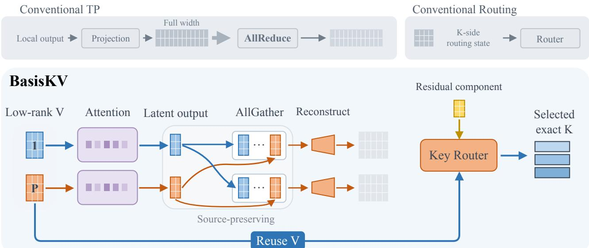
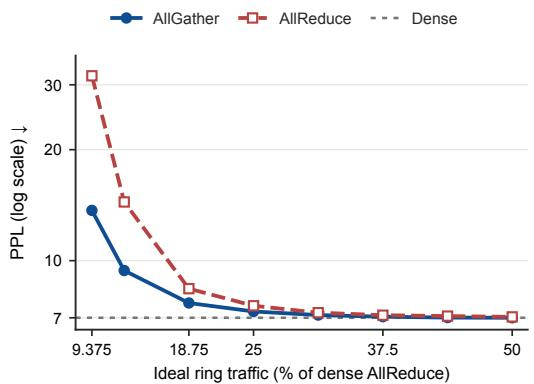
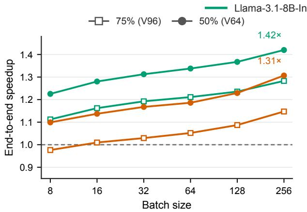
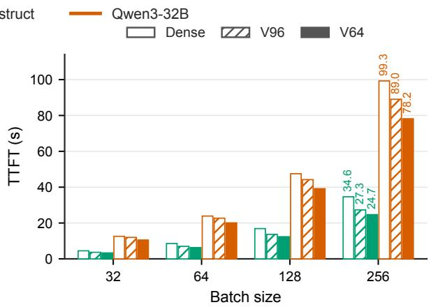
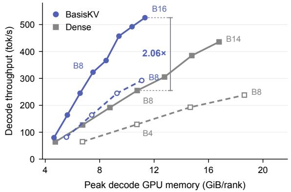
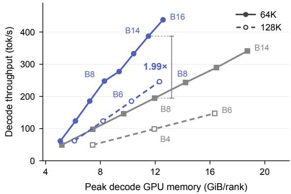
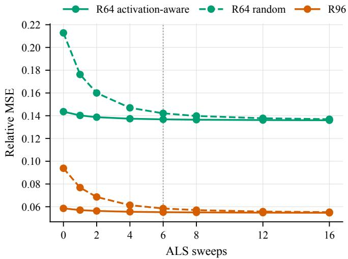
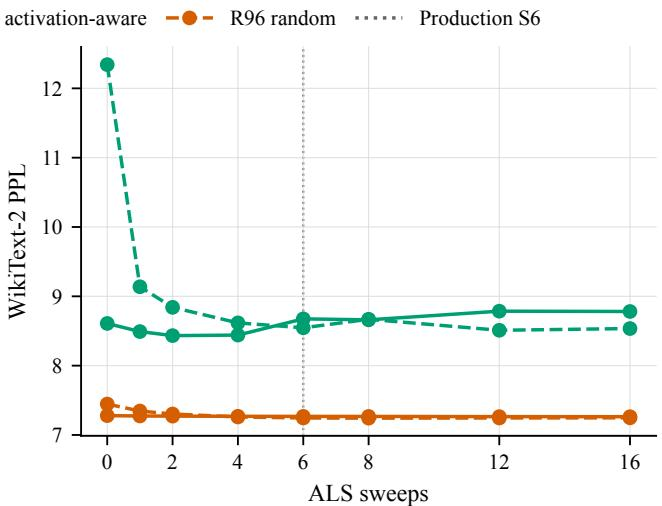
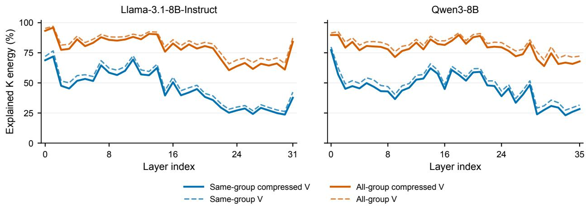

# BasisKV: Value Latents for Communication and Key Routing

Lixun Zhang1, Zishan Shao1,†, Kangning Cui2, Yu Liang1, Fan Yang2, Yiran Chen1

1Duke University 2Wake Forest University

## Abstract

Long-context large language model (LLM) inference is increasingly constrained by the cost of maintaining an ever-growing KV-cache. Low-rank K/V projections provide a promising way to compress the KV-cache with minimal quality loss, but prior work has largely optimized KV-cache compression in isolation, leaving distributed inference, especially with tensor parallelism where attention computation is partitioned across multiple GPUs, largely underexplored. We make two observations: (i) tensor-parallel communication is an important cost when deploying low-rank KV-cache compression in distributed inference; and (ii) Value compression can be associated with the output projection, allowing the same low-rank Value re resentation to reduce both Value-cache width and tensor- arallel communication. Based on these observations, we propose BasisKV, a low-rank KV-cache compression method for communication-intensive, long-context LLM inference. BasisKV jointly optimizes the low-rank factors across per-GPU attention partitions against the complete attention output, rather than fitting each partition in isolation. The compressed Value cache is further reused to help identify which Key pages should be accessed: it predicts part of the Key information needed for routing, while a Key-specific residual stores what cannot be recovered from Value. The original Keys are then retrieved only for the selected pages to compute exact QK scores. Across multiple LLM families and system settings, BasisKV achieves a better quality–eficiency tradeof than existing low-rank baselines, reaching up to 1.42× end-to-end speedup under 8-GPU tensor-parallel inference. The code is available at https://github.com/alexz949/BasisKV

## 1. Introduction

Long-context large language model (LLM) inference is increasingly constrained by the cost of maintaining an ever-growing KV cache (Chang et al., 2025; Liu et al., 2024). A promising approach is to factorize or transform the Key and Value projection matrices such that inference directly produces and caches low-dimensional K/V representations (Chang et al., 2025; Saxena et al., 2024). This broader family of low-rank KV-cache methods has attracted growing interest, including trainable feature-space projections (Lin et al., 2025) and cross-layer low-rank cache representations (Chang et al., 2026). However, prior low-rank KV-cache methods largely optimize cache eficiency in isolation from tensor-parallel communication. Under tensor parallelism (TP), attention computation is partitioned across multiple GPUs, and the resulting partial attention outputs must additionally be communicated across accelerators (Hansen-Palmus et al., 2024; Shoeybi et al., 2019). This raises a natural question: can low-rank KV-cache compression provide additional benefits under distributed inference beyond reducing the cache itself? Our key observation is that low-rank Value compression can also reduce the width of the attention outputs communicated across GPUs, allowing the same latent representation to reduce both KV-cache size and tensor-parallel trafic. This motivates BasisKV, a low-rank KV-cache compression method designed for distributed long-context inference.

  
Figure 1: Overview of BasisKV. BasisKV compresses each TP-local attention output into a low-rank Value latent, communicates the source-specific latents with AllGather, and reconstructs the complete output after communication. The same Value latent is retained in the cache and reused for Key routing where a Key-specific residual provides the remaining routing information.

BasisKV first moves tensor-parallel communication into a low-rank space by projecting each per-GPU attention output (source) to a lower dimension before communication, preserving these source-specific latents through a source-preserving AllGather, and reconstructing them afterward. Rather than fitting each source independently, BasisKV jointly optimizes all low-rank factors against the complete attention output, accounting for the cross-source interactions that contribute to the reconstruction error.

For attention blocks where the Value path remains linear, the low-rank compression projection applied before communication (the encoder) can be moved to the Value side and folded into the Value projection. This allows the model to directly produce and cache the same compressed Values used for TP communication, with no additional approximation beyond the ofline derived low-rank model. We further reuse the compressed Value cache for Key routing. Compressed Values provide part of the information needed to select Key pages, while a Key-specific residual captures the remaining routing information. Original Keys are retrieved only for selected pages to recompute exact QK scores.

Across multiple LLM families, model scales, and inference settings, BasisKV consistently preserves stronger downstream quality than matched low-rank baselines while simultaneously reducing tensor-parallel communica- tion. On eight NVIDIA L40S GPUs, BasisKV reaches up to 1.42× end-to-end speedup under tensor-parallel inference. For long-context decoding, the Value-assisted Key routing avoids accessing full Keys over most of the context; at 128K context on a single L40S GPU, BasisKV achieves 1.63× attention-block speedup and 1.25× full-model decode speedup.

Our contributions are threefold. First, to our knowledge, BasisKV is thefirst post-training method tojointly reduce persistent Value-cache width and tensor-parallel attention-output communication using the same low-rank Value representationfor standard attention. Second, we connect low-rank Value compression with tensor-parallel communication and jointly optimize the resulting low-rank factors against the complete attention ⋯output. Third, we further reuse the compressed Value cache for sparse Key routing and demonstrate improved quality–eficiency tradeofs and end-to-end speedups across multiple models and inference settings.

## 2. Background

## 2.1. Tensor-Parallel Attention Output Projection

We consider standard tensor parallelism (TP) (Hansen-Palmus et al., 2024) over � GPUs. Let � denote the sequence length, � the model width, $H _ { q }$ the number of query heads, and $d _ { h }$ the head dimension. We denote the concatenated attention-output width by $d _ { a } = H _ { q } d _ { h }$ . For both Multi-Head Attention (MHA) and Grouped-Query Attention (GQA), let $Z ^ { ( h ) } \in \mathbb { R } ^ { T \times d _ { h } }$ denote the output of query head ℎ. The concatenated attention output before the output projection is

$$
Z = { \mathrm { C o n c a t } } ( Z ^ { ( 1 ) } , \ldots , Z ^ { ( H _ { q } ) } ) \in \mathbb { R } ^ { T \times d _ { a } } .
$$

Under TP, the QKV projections are column-parallel, so the query heads are partitioned across GPUs. Let $Z _ { p }$ denote the concatenated outputs of the query heads assigned to GPU �. The output projection $W _ { O }$ is partitioned along its input dimension to match this sharding. With $Z _ { p } \in \mathbb { R } ^ { T \times ( \mathbf { \hat { d } } _ { a } / P ) }$ and $\bar { W _ { O , p } } \in \bar { \mathbb { R } } ^ { ( d _ { a } / P ) \times d }$ , the corresponding partitions are

$$
{ \cal Z } = [ Z _ { 1 } \cdots  \begin{array} { l } { { \cal Z } } \\ { { \cdots  \begin{array} { r } { { \cal Z } } \end{array} | , } } \\ { { { \cal W } _ { O , P } } } \end{array} ] , \qquad { \cal W } _ { O } = [ { \displaystyle \sum _ { \stackrel { . } { \sum } } } ] .
$$

Each GPU holds only a $d _ { a } / P .$ -dimensional shard of the attention output, but its row-parallel block $W _ { O , p }$ still maps this local shard to a full �-dimensional contribution,

$$
Y _ { p } = Z _ { p } W _ { O , p } \in \mathbb { R } ^ { T \times d } .
$$

The partial contributions are then summed across GPUs using AllReduce, yielding the complete attention output on every GPU:

$$
Y = { \mathrm { A l l R e d u c e } } ( Y _ { p } ) = \sum _ { p = 1 } ^ { P } Y _ { p } = \sum _ { p = 1 } ^ { P } Z _ { p } W _ { O , p } .
$$

Thus, although the attention output remains sharded at width $d _ { a } / P$ before $W _ { O }$ , the standard row-parallel execution projects each local shard to a full-width �-dimensional contribution before communication. Our goal is to move the communication boundary earlier by communicating a lower-dimensional local representation and reconstructing the full-width output only after the collective.

## 2.2. Low-Rank TP Communication

Consider a rank-� factorization of the local output-projection matrix,

$$
W _ { O , p } \approx \widehat { W } _ { O , p } = E _ { p } D _ { p } , \qquad E _ { p } \in \mathbb { R } ^ { ( d _ { a } / P ) \times r } , \qquad D _ { p } \in \mathbb { R } ^ { r \times d } .
$$

If both factors are evaluated locally, the partial output $Z _ { p } E _ { p } D _ { p } \in \mathbb { R } ^ { T \times d }$ remains full width. Thus, low-rank factorization of $W _ { O , p }$ alone does not reduce TP communication.

To reduce communication, we place the collective between the two factors. GPU $p$ first forms $U _ { p } = Z _ { p } E _ { p } \in \mathbb { R } ^ { T \times r }$ If $U _ { p }$ is communicated using AllReduce, the TP-source representations are summed before reconstruction:

$$
\widehat { Y } _ { \mathrm { A R } } = \mathrm { A l l R e d u c e } ( U _ { p } ) D = \left( \sum _ { p = 1 } ^ { P } Z _ { p } E _ { p } \right) D ,
$$

where the shared decoder $D \in \mathbb { R } ^ { r \times d }$ reconstructs the reduced representation. If AllGather is used instead, the TP-source representations remain separate through communication:

$$
\widehat { Y } _ { \mathrm { A G } } = \mathrm { A l l G a t h e r } ( U _ { p } ) \left[ \begin{array} { l } { D _ { 1 } } \\ { \vdots } \\ { D _ { P } } \end{array} \right] = \sum _ { p = 1 } ^ { P } Z _ { p } E _ { p } D _ { p } .
$$

The individual representations remain available after communication, allowing a separate decoder $D _ { p }$ for each TP source.

## 3. Collective-Aware Low-Rank Attention

Building on the Low-Rank AllGather structure in Section 2.2, we jointly fit the TP-local low-rank factors against the complete attention output. For linear Value paths, the compression factors can be folded into the Value projections, so the same low-dimensional representation reduces both TP communication and Value-cache width. We further allocate ranks across layers under a fixed global budget using forward-only Kullback–Leibler (KL) sensitivity profiling.

## 3.1. Joint Fitting

Although each TP-local block can be approximated separately, the complete attention output is the sum of all source contributions. Let $\epsilon _ { p } = Z _ { p } W _ { O , p } - Z _ { p } { \cal E } _ { p } { \cal D } _ { p }$ denote the approximation error from source $p$ . Then

$$
\left\| Y - \widehat { Y } \right\| _ { F } ^ { 2 } = \sum _ { p = 1 } ^ { P } \| \epsilon _ { p } \| _ { F } ^ { 2 } + 2 \sum _ { p < q } \langle \epsilon _ { p } , \epsilon _ { q } \rangle _ { F } .
$$

Independent fitting does not account for the cross-source terms that appear in the reconstruction error of the complete TP output. We therefore optimize the complete output directly.

$$
\operatorname* { m i n } _ { \left\{ E _ { p } , D _ { p } \right\} _ { p = 1 } ^ { P } } \left\| Y - \sum _ { p = 1 } ^ { P } Z _ { p } E _ { p } D _ { p } \right\| _ { F } ^ { 2 }\tag{1}
$$

where $E _ { p }$ is the compression factor for source $p ,$ and $D _ { p }$ maps the resulting latent representation to its full-width output contribution. The objective in equation 1 is bilinear in $\{ E _ { p } \}$ and $\{ D _ { p } \}$ , but becomes a linear least-squares problem in either factor family when the other is fixed. We therefore optimize it by alternating least squares.

� update. With $\{ E _ { p } \}$ fixed, we denote $U = [ Z _ { 1 } E _ { 1 } \ \cdot \cdot \cdot \ Z _ { P } E _ { P } ]$ and let � be the corresponding stacked matrix of $D _ { p }$ factors. Then equation 1 becomes

$$
D ^ { \star } = \arg \operatorname* { m i n } _ { D } \| Y - U D \| _ { F } ^ { 2 } .
$$

We solve this least-squares problem through the normal equations $U ^ { \top } U D ^ { \star } = U ^ { \top } Y$ . The coupled system is assembled from calibration covariance statistics and solved jointly.

� update. With $\{ D _ { p } \}$ fixed, we update one $E _ { p }$ at a time. We first define $\begin{array} { r } { R _ { p } = Y - \sum _ { q \neq p } Z _ { q } E _ { q } D _ { q } } \end{array}$ as the residual excluding source $p$ . With the remaining factors fixed, equation 1 becomes

$$
E _ { p } ^ { \star } = \arg \operatorname* { m i n } _ { E _ { p } } \left\| { \boldsymbol { R } } _ { p } - Z _ { p } E _ { p } { \boldsymbol { D } } _ { p } \right\| _ { F } ^ { 2 } .
$$

The corresponding normal equation is $( Z _ { p } ^ { \top } Z _ { p } ) E _ { p } ^ { \star } ( D _ { p } D _ { p } ^ { \top } ) = Z _ { p } ^ { \top } R _ { p } D _ { p } ^ { \top }$ . Both updates are therefore convex linear least-squares subproblems of equation 1. In practice, the $D$ system is assembled and solved by Cholesky factorization. We solve the $E _ { p }$ system by matrix-free conjugate gradient, avoiding explicit formation of the large Kronecker-structured system. The complete derivation and implementation details are given in Appendix A.1.

## 3.2. Value Compression

The compression factor learned from the complete attention-output objective can also be applied directly to the Value path. Let $S _ { h }$ and $V _ { h }$ denote the attention matrix and Value state for head ℎ, respectively, so that $Z _ { h } = S _ { h } V _ { h }$ Since $S _ { h }$ is independent of $V _ { h }$ , the fitted approximation satisfies

$$
\widehat { Y } = \sum _ { h = 1 } ^ { H _ { q } } S _ { h } V _ { h } E _ { h } D _ { h } = \sum _ { h = 1 } ^ { H _ { q } } S _ { h } ( V _ { h } E _ { h } ) D _ { h } .
$$

Hence the compression factor $E _ { h }$ may be applied to the Value state before attention without changing the fitted approximation. Defining $\widehat { V } _ { h } = V _ { h } E _ { h }$ , the compressed Value can therefore be cached directly. For GQA, all query heads sharing the same physical KV head also share the same Value encoder $E _ { g }$ , while retaining head-specific decoders $D _ { h }$ . This ensures that only one compressed Value latent is stored per physical KV head. Since $V _ { h } = X W _ { V , h }$ , we have $\widehat { V } _ { h } = X W _ { V , h } E _ { h }$ . Thus $E _ { h }$ can be folded into the Value projection by setting $\widehat { W } _ { V , h } = W _ { V , h } E _ { h }$ . The same latent representation therefore determines both the communicated width and the cached Value width, without introducing any approximation beyond the fitted low-rank output model.

## 3.3. Rank Allocation

A uniform rank assignment ignores that layers have diferent sensitivity to compression. We estimate this sensitivity around a reference rank $r _ { 0 }$ using one lower-rank and one higher-rank probe for each layer. Let $e _ { \ell } ( r )$ denote the reconstruction error of layer ℓ at rank �, and let $\Delta \mathcal { K } _ { \ell } ^ { \pm }$ denote the change in output KL relative to the reference model when only that layer is changed from $r _ { 0 }$ to $r ^ { \pm }$ . We define the two one-sided sensitivities as

$$
s _ { \ell } ^ { \pm } = \operatorname* { m a x } \left( 0 , \frac { \Delta \mathcal { K } _ { \ell } ^ { \pm } } { e _ { \ell } ( r ^ { \pm } ) - e _ { \ell } ( r _ { 0 } ) } \right) .
$$

The profiling requires only forward evaluation and two single-layer probes per layer, so its cost grows linearly with model depth. For each candidate rank, we weight its reconstruction-error change by $s _ { \ell } ^ { - }$ below $r _ { 0 }$ and by $s _ { \ell } ^ { + }$ above $r _ { 0 }$ to obtain a layerwise rank cost. We then use dynamic programming to find the minimum-cost discrete rank assignment under the fixed global budget. The derivation and dynamic-programming details are given in Appendix A.2.

## 4. Key Routing with Value Latents

We next examine whether the compressed Value representation can also be reused for Key routing. We find that the compressed Values can predict a nontrivial component of the corresponding pre-RoPE Keys through a low-rank representation. We then use this Value-derived prediction as part of the routing signal and store a low-rank residual for the remaining Key-specific information. When compressed Values are already retained for attention, this reuse reduces the amount of dedicated per-token routing state. The resulting approximate scores are used only to select KV-cache pages and the original Keys are then accessed to recompute QK scores on the selected pages.

## 4.1. Key Prediction from Value

Let $\widehat { V } _ { c }$ and $K _ { c }$ denote the centered compressed Value latent and pre-RoPE Key. We fit the rank- $r _ { b }$ reduced-rank regression

$$
M ^ { \star } = \arg \operatorname* { m i n } _ { \mathrm { \tiny ~ r a n k } ( M ) \leq r _ { b } } \| K _ { c } - \widehat { V } _ { c } M \| _ { F } ^ { 2 } .\tag{2}
$$

With $G = \widehat { V } _ { c } ^ { \top } \widehat { V } _ { c }$ and $H = \widehat { V } _ { c } ^ { \top } K _ { c }$ , let $U { \boldsymbol { \Sigma } } V ^ { \top }$ be the rank- $\mathbf { \nabla } \cdot r _ { b }$ truncated SVD of $G ^ { \dagger / 2 } H$ . Then

$$
M ^ { \star } = G ^ { \dagger / 2 } U \Sigma V ^ { \top }
$$

Therefore the predicted Key is $\widehat { K } = \mu _ { K } + \widehat { V } _ { c } M ^ { \star }$ . The model’s native RoPE transformation is applied after prediction.

Routing-aligned Value basis. Evaluating the predictor directly would require reading the full compressed Value state for every cached token. However, since $M ^ { \star } = G ^ { \dagger / 2 } U \Sigma \dot { V } ^ { \top }$ , the prediction depends on $\widehat { V } _ { c }$ only through the $r _ { b }$ -dimensional quantity $\widehat { V } _ { c } G ^ { \dagger / 2 } U \Sigma$ . We therefore align this predictive subspace with explicit coordinates of the Value cache. We compute the thin QR factorization

$$
G ^ { \dag / 2 } U \Sigma = { \cal Q } _ { b } R _ { b } , \qquad M ^ { \star } = { \cal Q } _ { b } R _ { b } V ^ { \top } .
$$

Completing $Q _ { b }$ to an orthogonal matrix $Q = [ Q _ { b } \ Q _ { \perp } ]$ we rotate the Value latent and decoder as $\overline { { V } } = \widehat { V } Q$ and $\overline { { D } } = Q ^ { \top } D$ . This change of basis leaves the Value reconstruction unchanged and places all information required by the Key predictor in the first $r _ { b }$ coordinates of ${ \overline { { V } } } .$ . The rotation is folded into the Value encoder ofline, so full-context routing reads only these $r _ { b }$ coordinates. The derivation is given in Appendix B.

## 4.2. Residual Routing Component

After applying RoPE, let $k _ { t }$ and $\widehat { k } _ { t }$ denote the exact and predicted Keys for token $t ,$ and define the residual $e _ { t } = k _ { t } - \widehat { k } _ { t }$ . The Value-based predictor does not recover the full Key, so we represent the remaining score contribution with a low-rank residual component. We factor this contribution into a query-side factor $U _ { h }$ and a residual-side factor $F _ { h }$

$$
\widehat { s } _ { h t } = \frac { 1 } { \sqrt { d _ { h } } } \left[ q _ { h } \widehat { k } _ { t } ^ { \top } + ( q _ { h } U _ { h } ) ( e _ { t } F _ { h } ) ^ { \top } \right] .\tag{3}
$$

Thus, only the $r _ { q }$ -dimensional residual representation $e _ { t } F _ { h }$ is stored for each cached token.

Page-Fisher fitting. The residual correction is used to select pages rather than to reconstruct the Key itself. Let $\ell$ and $\widehat { \ell }$ denote the exact and approximate page logits. We measure the routing error by

$$
D _ { \mathrm { K L } } \left( \operatorname { s o f t m a x } ( \ell ) { \Big \| } \operatorname { s o f t m a x } ( { \widehat { \ell } } ) \right) ,
$$

which measures how the approximation redistributes attention mass among pages. Direct optimization of this objective is nonlinear in the residual factors. However, a second-order expansion around the exact page logits gives a quadratic objective for the residual correction.

Fix one calibration query and head. Let $\pi _ { p }$ denote the exact attention mass of page $p$ and $\bar { e } _ { p }$ be the attention- weighted average Key residual within page $p$ . Define

$$
\bar { e } = \sum _ { p } \pi _ { p } \bar { e } _ { p } , \qquad \Gamma = \sum _ { p } \pi _ { p } ( \bar { e } _ { p } - \bar { e } ) ^ { \top } ( \bar { e } _ { p } - \bar { e } ) .
$$

Here �¯ is the mean residual over pages, and Γ is the corresponding covariance. The second-order expansion gives

$$
\mathcal { L } _ { \mathrm { P F } } = \frac { 1 } { 2 d _ { h } } q _ { h } ( U _ { h } \boldsymbol { F } _ { h } ^ { \top } - I ) \Gamma ( U _ { h } \boldsymbol { F } _ { h } ^ { \top } - I ) ^ { \top } q _ { h } ^ { \top } ,\tag{4}
$$

� is the identit matrix corres ondin to the exact residual score, while $U _ { h } F _ { h } ^ { \top }$ gives its low-rank approximation. We sum this loss over calibration queries and heads. For fixed $F _ { h }$ , equation 4 is a convex quadratic problem in $U _ { h }$ , and vice versa. We alternate between the two factors and solve the resulting positive-semidefinite systems by matrix-free conjugate gradient. The KL expansion and normal equations are given in Appendix B.

Query selection. Fitting the residual at every query position is expensive and provides many redundant observations. We therefore select a small set of representative positions.

For each query head ℎ, we first compute $H _ { h } = \mathbb { E } [ q _ { h } ^ { \top } q _ { h } ]$ over the calibration queries. The factor $H _ { h } ^ { \dagger }$ balances query directions with diferent scales when comparing positions. Let $Q _ { h }$ be the stacked matrix of candidate queries for head ℎ. We then define the position Gram matrix

$$
G = \frac { 1 } { H _ { q } } \sum _ { h = 1 } ^ { H _ { q } } \mathbb { E } \left[ Q _ { h } H _ { h } ^ { \dagger } \underline { { Q } } _ { h } ^ { \top } \right] .\tag{5}
$$

Thus, � measures similarity between candidate positions after accounting for the scale of each query direction. We apply diagonal-pivoted Cholesky to � and retain the selected pivot positions for residual calibration. The construction and its equivalence to column-pivoted QR (CPQR) are given in Appendix B.

## 4.3. Page Selection and Exact Key Retrieval

The approximate scores in equation 3 rank tokens without scanning the original Key cache. For each query head, we assign page $\mathcal { P } _ { j }$ the score log $\begin{array} { r } { \sum _ { t \in \mathcal { P } _ { j } } \exp ( \widehat { s } _ { h t } ) } \end{array}$ and retain the highest-scoring pages under a fixed budget. The original post-RoPE Keys are then accessed only for the selected pages, where their QK scores are recomputed exactly. The resulting exact scores are used to attend to the corresponding compressed Values. Thus, full-dimensional Keys need not be read for unselected pages during decoding and may reside in a slower memory tier.

## 5. Experiment Results

Experimental Setup. We evaluate BasisKV on Llama-3.1, Qwen3, and Qwen3.5. All Value-com ression methods use the same 256 C4 calibration sequences of 2048 tokens. Key routing uses 32 128K-token windows, equally split between C4 and synthetic long-range retrieval data, plus 16 held-out C4 validation windows. The default router combines a 16-dimensional Value-derived Base and a 16-dimensional residual (B16R16), with page size 4. We evaluate routing on RULER-128K (Hsieh et al., 2024) and nine LongBench (Bai et al., 2024) tasks with inputs longer than 4K tokens, selecting 2048 and 256 routed tokens, respectively, plus 64 recent tokens. Appendix C.1 details calibration, baselines, and measurement protocols.

Collective Choice. Figure 2 compares AllGather and AllReduce on Qwen3-8B-Base under 4-way tensor parallelism (TP=4) at matched ideal ring trafic. Both are jointly fitted against the full attention output. AllGather retains source-specific latents and decoders; AllReduce sums latents before a shared decoder.

AllGather achieves lower WikiText-2 perplexity throughout, es- pecially at low trafic. Both approach dense quality as trafic increases, supporting source-specific latents under constrained communication.

Value Compression across Models. Table 1 compares BasisKV with PaLU M-LRD and G-LRD at matched global Value-retention budgets of 75% and 50%. Each method uses its own rank- allocation procedure. M-LRD is the matched-eficiency PaLU baseline; G-LRD groups 4 heads for stronger quality at 4× the low-rank decoding cost. BasisKV achieves the highest average

  
Figure 2: Perplexity at matched TP trafic. Qwen3-8B-Base, WikiText-2, TP4. Gray dotted line: dense quality.

accuracy among compressed methods on all three models at both budgets, while reducing $W _ { O }$ communication. It also gives the lowest WikiText-2 and C4 perplexity on both Qwen3 models; PaLU G-LRD is more competitive on Llama-3.1-8B-Instruct.

Table 1: Value compression across models. PaLU M-LRD uses per-head decomposition; G-LRD groups 4 heads. Comm. is $W _ { O }$ trafic relative to dense. Bold marks the best compressed result within each budget.
<table><tr><td rowspan="2">Model</td><td rowspan="2" colspan="2">Budget Method</td><td colspan="2">PPL↓</td><td colspan="6">General MCQ ↑</td><td colspan="2">|MCQ ↑|Comm. ↓</td></tr><tr><td colspan="2">|WikiT. C4</td><td colspan="2">|BoolQ ARC-E ARC-C WinoG. PIQA HellaS.</td><td colspan="2"></td><td colspan="2"></td><td>Avg.</td><td>Relative</td></tr><tr><td></td><td>Dense</td><td></td><td>7.00 9.17</td><td>0.831</td><td>0.802</td><td>0.569</td><td>0.728</td><td>0.794</td><td>0.786</td><td>0.420</td><td>0.704</td><td>1.00</td></tr><tr><td rowspan="4">Qwen3-8B 75% Base</td><td></td><td>PaLU M-LRD</td><td>8.66 10.75</td><td>0.794</td><td>0.740 0.771</td><td>0.522 0.556</td><td>0.719 0.718</td><td>0.779 0.796</td><td>0.768 0.787</td><td>0.394 0.408</td><td>0.674 0.690</td><td>1.00 1.00</td></tr><tr><td></td><td>PaLU G-LRD BasisKV</td><td>8.24 7.28</td><td>10.40 9.34</td><td>0.793 0.818 0.788</td><td>0.544</td><td>0.730</td><td>0.793</td><td>0.772</td><td>0.424</td><td>0.696</td><td>0.375</td></tr><tr><td></td><td>PaLU M-LRD</td><td></td><td></td><td></td><td></td><td></td><td></td><td></td><td></td><td></td><td></td></tr><tr><td>50%</td><td>PaLU G-LRD</td><td>14.84 16.87 10.65 12.87</td><td>0.763 0.720</td><td>0.626 0.698</td><td>0.421 0.502</td><td>0.670 0.710</td><td>0.739 0.767</td><td>0.700 0.754</td><td>0.356 0.406</td><td>0.611 0.651</td><td>1.00 1.00</td></tr><tr><td rowspan="4"></td><td>BasisKV</td><td></td><td>8.26 10.06</td><td>0.804</td><td>0.771</td><td>0.519</td><td>0.719</td><td>0.788</td><td>0.735</td><td>0.398</td><td>0.676</td><td>0.250</td></tr><tr><td>Dense</td><td></td><td>7.22 9.77</td><td>0.841</td><td>0.796</td><td>0.552</td><td>0.741</td><td>0.810</td><td>0.792</td><td>0.430</td><td>0.709</td><td>1.00</td></tr><tr><td></td><td>PaLU M-LRD</td><td>11.25</td><td></td><td>0.778</td><td>0.528</td><td>0.747</td><td>0.795</td><td>0.775</td><td>0.430</td><td>0.698</td><td>1.00</td></tr><tr><td colspan="2">Llama-3.1 75%</td><td>8.60 7.98</td><td>10.66</td><td>0.832 0.837</td><td>0.779</td><td>0.529</td><td>0.736</td><td>0.792</td><td>0.782</td><td>0.698</td><td>1.00</td></tr><tr><td rowspan="5">8B-Instruct</td><td rowspan="2"></td><td>PaLU G-LRD BasisKV</td><td>8.61</td><td>10.66</td><td>0.846 0.787</td><td>0.534</td><td>0.748</td><td>0.795</td><td>0.776</td><td>0.430 0.440</td><td>0.704</td><td>0.375</td></tr><tr><td>PaLU M-LRD</td><td>16.09</td><td></td><td></td><td></td><td></td><td></td><td></td><td></td><td></td><td></td></tr><tr><td>50%</td><td></td><td>17.16</td><td>0.725</td><td>0.597</td><td>0.364</td><td>0.702</td><td>0.738 0.764</td><td>0.679</td><td>0.376</td><td>0.597</td><td>1.00</td></tr><tr><td></td><td>PaLU G-LRD BasisKV</td><td>10.61 12.90 11.5012.45</td><td>0.813 0.831</td><td>0.712 0.735</td><td>0.462 0.490</td><td>0.710 0.721</td><td>0.773</td><td>0.738</td><td>0.396</td><td>0.656</td><td>1.00</td></tr><tr><td>Dense</td><td></td><td></td><td></td><td>0.830</td><td>0.606</td><td></td><td></td><td>0.739</td><td>0.422</td><td>0.673</td><td>0.250</td></tr><tr><td colspan="2"></td><td></td><td>7.61</td><td>10.81</td><td>0.865</td><td></td><td></td><td>0.739</td><td>0.822</td><td>0.826 0.460</td><td>0.735</td><td>1.00</td></tr><tr><td rowspan="4">Qwen3 32B</td><td rowspan="2">75%</td><td>PaLU M-LRD</td><td>8.48</td><td>11.46</td><td>0.859</td><td>0.814</td><td>0.611</td><td>0.715</td><td>0.808</td><td>0.816 0.446</td><td>0.724</td><td>1.00</td></tr><tr><td>PaLU G-LRD</td><td>8.24</td><td>11.27</td><td>0.866</td><td>0.808</td><td>0.624</td><td>0.736</td><td>0.805</td><td>0.819 0.448</td><td>0.729</td><td>1.00</td></tr><tr><td>BasisKV</td><td>7.76</td><td>10.92</td><td>0.864</td><td>0.832</td><td>0.623</td><td>0.716</td><td>0.808</td><td>0.825</td><td>0.480</td><td>0.735</td><td>0.600</td></tr><tr><td rowspan="2"></td><td>PaLU M-LRD</td><td>10.29</td><td>13.35</td><td>0.742</td><td>0.740</td><td>0.521</td><td>0.710</td><td>0.785</td><td>0.769</td><td>0.430</td><td>0.671</td><td>1.00</td></tr><tr><td>PaLU G-LRD</td><td>9.16</td><td>12.07</td><td>0.874</td><td>0.749</td><td>0.574</td><td>0.740</td><td>0.793</td><td>0.795</td><td>0.434</td><td>0.708</td><td>1.00</td></tr><tr><td rowspan="2"></td><td rowspan="2">50%</td><td></td><td></td><td></td><td></td><td></td><td></td><td></td><td></td><td></td><td></td><td></td></tr><tr><td>BasisKV</td><td>8.62</td><td>11.62 0.841</td><td>0.809</td><td>0.593</td><td></td><td>0.715</td><td>0.807</td><td>0.808 0.446</td><td>0.717</td><td>0.400</td></tr></table>

Tensor-Parallel Inference. Communication-compression gains grow with batch size on both models (Figure 3). V64 crosses over earlier and provides larger gains than V96, reaching 1.42× end-to-end speedup on Llama-3.1- 8B-Instruct and 1.31× on Qwen3-32B at batch size 256. Time-to-first-token (TTFT) follows the same trend.

  
Figure 3: TP inference. Llama-3.1-8B-Instruct and Qwen3-32B, 8× L40S; 4K-token prompts, 128 output tokens. Left: end-to-end speedup; right: TTFT. V96/V64 retain Value widths of 96/64.

Long-Context Routing Quality. In Table 2, Full-K uses full attention. Support is approximately matched for LRQK and Loki as described in Appendix C.1, while ShadowKV retains its native support. BasisKV remains close to Full-K on RULER and among the strongest sparse methods. Its retrieval results support combining Value-derived prediction with residual correction. LongBench diferences are smaller and model-dependent.

Table 2: Sparse attention across models. RULER (10 tasks) and LongBench (9 tasks). Avg. is the unweighted task mean. Bold marks the best sparse score.
<table><tr><td></td><td></td><td colspan="10">RULER ↑</td><td colspan="5">LongBench ↑</td></tr><tr><td>Model</td><td>Method</td><td>S1</td><td></td><td>S2 MK1</td><td></td><td>MK2</td><td>MQ MV</td><td>QA1</td><td>QA2 VT</td><td>FWE</td><td>Avg. NQA MQA</td><td>HQA MQue DRead</td><td>GRep</td><td>SAM PRetr</td><td>LCC</td><td>Avg.</td></tr><tr><td></td><td>Full-K</td><td>100.00</td><td>100.00</td><td></td><td>99.00</td><td>83.00</td><td>99.00</td><td>95.00 74.00</td><td>48.00 76.80</td><td>52.67</td><td>82.75 28.06</td><td>50.25 52.23</td><td>31.32 32.34</td><td>32.76 44.50</td><td>99.50 52.22</td><td>47.02</td></tr><tr><td rowspan="5">Llama-3.1 8B-Instruct</td><td>Loki</td><td>79.00</td><td>96.00</td><td></td><td>97.00</td><td>18.00</td><td>55.50</td><td>53.25 48.00</td><td>32.00</td><td>25.00 48.33</td><td>|55.21</td><td>27.72 48.48 52.04</td><td>31.23</td><td>29.54 32.3646.06</td><td>99.50 51.95</td><td>46.54</td></tr><tr><td>ShadowKV</td><td>99.00</td><td></td><td>99.00</td><td>98.00</td><td>61.00</td><td>97.00</td><td>91.75 74.0048.00</td><td></td><td>28.40 58.00</td><td>75.41</td><td>29.22 51.06 52.64</td><td>31.49</td><td>31.12 30.99 43.74</td><td>99.0051.18</td><td>46.72</td></tr><tr><td>LRQK</td><td>100.00</td><td></td><td>100.00</td><td>99.00</td><td>76.00</td><td>99.00</td><td>93.25</td><td>75.0047.00</td><td>53.60</td><td>48.67 79.15</td><td>27.90 50.00 52.13</td><td>31.46</td><td>30.63 31.0045.37</td><td>99.50 51.61</td><td>46.62</td></tr><tr><td>BasisKV</td><td>100.00</td><td>100.00</td><td></td><td>98.00</td><td>78.00</td><td>99.25</td><td>94.50 75.00</td><td>47.00</td><td>64.80</td><td>46.67 80.32</td><td>29.05 51.02 52.51</td><td>30.70</td><td>28.95 31.47 44.90</td><td>99.50 54.05</td><td>46.91</td></tr><tr><td>Full-K</td><td>100.00</td><td>100.00</td><td></td><td>85.00</td><td>61.00</td><td>93.50</td><td>96.50 55.00</td><td>36.00</td><td>93.40</td><td>88.00| 80.84</td><td>25.35 51.47 51.61</td><td>27.34</td><td>17.89 33.53 46.52</td><td>100.00 62.06|</td><td>46.20</td></tr><tr><td rowspan="4">Qwen3-8B</td><td>Loki</td><td>100.00</td><td>99.00</td><td></td><td>85.00</td><td>38.00</td><td>91.00</td><td>90.75 43.00</td><td>27.00</td><td>78.40 73.33</td><td>|72.55</td><td>|26.47 51.69 51.11</td><td>27.69</td><td>22.58 32.94 44.94</td><td>98.00 55.09</td><td>45.61</td></tr><tr><td>ShadowKV</td><td>100.00</td><td>95.00</td><td></td><td>84.00</td><td>44.00</td><td>83.75</td><td>86.75 53.00</td><td>28.00</td><td>82.00 88.67</td><td>74.52 26.12</td><td>50.47 51.94</td><td>27.32</td><td>19.93 33.82 44.67</td><td>91.00 55.10</td><td>44.49</td></tr><tr><td>LRQK†</td><td>100.00</td><td>98.00</td><td></td><td>86.00</td><td>57.00</td><td>93.75</td><td>96.50 51.00 36.00</td><td></td><td>91.20 81.33</td><td>79.08</td><td>26.76 49.50 52.93</td><td>26.86</td><td>16.36 33.22 46.64</td><td>100.00 59.84</td><td>45.79</td></tr><tr><td>BasisKV</td><td>100.00</td><td></td><td>99.00</td><td>86.00</td><td>53.00</td><td>94.00</td><td>94.00 54.00</td><td>33.00</td><td>93.00</td><td>80.33 78.63</td><td>26.97 50.94 51.47</td><td>26.63</td><td>16.68 32.86 44.60</td><td>98.50 58.80</td><td>45.27</td></tr><tr><td rowspan="5">Qwen3.5-9B</td><td>Full-K</td><td>100.00 100.00</td><td></td><td>100.00</td><td></td><td>100.00</td><td>100.00 100.00</td><td>86.00 56.00</td><td></td><td>100.00 100.00|94.20|</td><td>33.85</td><td>53.95 61.71 47.02</td><td>24.61</td><td>31.04 24.27 29.42</td><td>65.80</td><td>41.30</td></tr><tr><td>Loki</td><td>100.00</td><td>100.00</td><td></td><td>100.00</td><td>97.00</td><td>99.75</td><td>100.00 80.00</td><td>55.00</td><td>100.00 98.67</td><td>|93.04</td><td>32.52 54.51 61.27</td><td>47.14</td><td>22.96 31.10 24.45</td><td>30.17 64.15</td><td>40.92</td></tr><tr><td>ShadowKV</td><td>100.00</td><td></td><td>99.00</td><td>99.00</td><td>100.00</td><td>99.00</td><td>95.0084.00</td><td>58.00</td><td>94.80 99.67</td><td>92.85</td><td>33.14 54.96 61.87</td><td>46.46</td><td>23.09 31.04 23.84</td><td>40.75 61.35</td><td>41.83</td></tr><tr><td>LRQK</td><td>100.00</td><td>100.00 100.00 100.00 100.00</td><td>100.00</td><td></td><td>100.00 100.00</td><td>100.00 100.00</td><td>98.75 85.00</td><td>55.00 99.20 100.00</td><td>99.00 98.00</td><td>93.70 32.89 93.70 33.02</td><td>53.20 61.85 54.29 61.00</td><td>47.15</td><td>23.98 30.90 24.64</td><td>30.9264.17</td><td>41.08</td></tr><tr><td>BasisKV</td><td></td><td></td><td></td><td></td><td></td><td></td><td>100.0083.0056.00</td><td></td><td></td><td></td><td></td><td>46.31</td><td>24.78 30.74 23.77</td><td>35.0862.87</td><td>41.32</td></tr></table>

Sparse Decoding. Table 3 evaluates B16R16 at 24K–128K, excluding prefill. Steady-state attention-block and full-model speedups grow with context, reaching 1.63× and 1.25× at 128K. All exact Keys and Values remain on GPU, without CPU ofload.

Table 3: Sparse decoding across context lengths. TP1/B1, one L40S; median ms over three trials. ×: speedup over dense.
<table><tr><td rowspan="2">Context</td><td colspan="3">Attention block</td><td colspan="3">Full-model decoding</td></tr><tr><td>Dense</td><td>BasisKV</td><td>X</td><td>Dense</td><td>BasisKV</td><td>X</td></tr><tr><td>24K</td><td>5.27</td><td>5.17</td><td>1.02</td><td>28.63</td><td>28.33</td><td>1.01</td></tr><tr><td>32K</td><td>6.70</td><td>5.85</td><td>1.15</td><td>30.11</td><td>29.00</td><td>1.04</td></tr><tr><td>48K</td><td>9.61</td><td>7.31</td><td>1.31</td><td>33.02</td><td>30.43</td><td>1.09</td></tr><tr><td>64K</td><td>12.58</td><td>8.70</td><td>1.45</td><td>36.01</td><td>31.93</td><td>1.13</td></tr><tr><td>96K</td><td>18.33</td><td>11.77</td><td>1.56</td><td>41.78</td><td>34.98</td><td>1.19</td></tr><tr><td>128K</td><td>23.85</td><td>14.67</td><td>1.63</td><td>47.31</td><td>37.87</td><td>1.25</td></tr></table>

  
Figure 4: Decode throughput and GPU memory. Llama-3.1-8B-Instruct (left) and Qwen3-8B (right), TP8 on 8× L40S. Memory: peak per-rank PyTorch allocation during decode. Circles/squares: BasisKV/dense; solid/dashed: 64K/128K.

Long-Context Throughput and Memory. Figure 4 shows throughput gains across batch sizes and context lengths, reaching 2.06× for Llama-3.1-8B-Instruct and 1.99× for Qwen3-8B at comparable measured decode memory footprints.

## 6. Related Work

Tensor-parallel communication. Tensor parallelism partitions Transformer operators across accelerators and uses collective communication to combine their partial results (Shoeybi et al., 2019). Prior work reduces this communication through activation quantization (Hansen-Palmus et al., 2024) or improves parallel execution for decomposed models (Huang et al., 2026). BasisKV instead preserves the individual TP sources through a low-rank AllGather and jointly fits their factors against the complete attention output. The resulting Value representation is also reused for caching and Key routing.

KV-cache compression. KV-cache compression has been studied through quantization (Hooper et al., 2024; Kang et al., 2024; Liu et al., 2024), token and head eviction (Cai et al., 2024; Ge et al., 2024; Li et al., 2024; Tang et al., 2025; Xiao et al., 2025; Zhang et al., 2023), and low-dimensional representations (Bhatnagar et al., 2026; Chang et al., 2025; Lin et al., 2025). PaLU stores low-rank latent Key and Value states obtained from decomposed projection matrices and absorbs Value reconstruction into the output projection (Chang et al., 2025). STAR-KV learns adaptive low-rank truncation through diferentiable soft-thresholding and additional distillation-based training (Bhatnagar et al., 2026). BasisKV instead derives its Value representation post hoc by fitting the complete TP attention output, so the cached representation is simultaneously optimized for the communication path.

Sparse attention and KV routing. Sparse-attention methods reduce decode-time memory trafic by selecting a subset of cached states for attention (Cai et al., 2024; Li et al., 2024; Zhang et al., 2023). SparQ selectively fetches cached history (Ribar et al., 2024), while Quest scores KV-cache pages using query-dependent Key summaries (Tang et al., 2024). Loki ranks tokens using a low-dimensional Key representation (Singhania et al., 2024), and ShadowKV retains a low-rank Key representation on GPU while retrieving selected KV states (Sun et al., 2025). Recent low-rank approaches similarly construct compact Query–Key representations for sparse retrieval, including LRQK (Li et al., 2025) and SALS (Mu et al., 2025). BasisKV instead reuses routing information already present in the compressed Value representation and combines it with a Key-specific residual.

## 7. Conclusion

We presented BasisKV, a low-rank KV-cache compression method for communication-intensive long-context LLM inference. BasisKV jointly fits low-rank factors against the complete tensor-parallel attention output, allowing the resulting Value representation to reduce both TP communication and Value-cache width. The same Value latent is further reused for Key routing, with a Key-specific residual capturing information not recovered from Value. Across multiple model families and system settings, BasisKV improves the quality–eficiency tradeof of low-rank compression while providing end-to-end gains in both tensor-parallel and long-context sparse decoding. These results show that a shared Value representation can serve multiple inference boundaries without optimizing each component in isolation.

## References

Yushi Bai, Xin Lv, Jiajie Zhang, Hongchang Lyu, Jiankai Tang, Zhidian Huang, Zhengxiao Du, Xiao Liu, Aohan Zeng, Lei Hou, Yuxiao Dong, Jie Tang, and Juanzi Li. Longbench: A bilingual, multitask benchmark for long context understanding. In Proceedings of the 62nd Annual Meeting of the Association for Computational Linguistics (Volume 1: Long Papers), pp. 3119–3137. Association for Computational Linguistics, 2024.

Priyansh Bhatnagar, Ashkan Moradifirouzabadi, Se-Hyun Yang, SeungJae Lee, Jungwook Choi, and Mingu Kang. STAR-KV: Low-rank KV cache compression via soft thresholding for adaptive rank control. arXiv preprint arXiv:2606.08382, 2026.

Zefan Cai, Yichi Zhang, Bofei Gao, Yuliang Liu, Tianyu Liu, Keming Lu, Wayne Xiong, Yue Dong, Baobao Chang, Junjie Hu, and Wen Xiao. PyramidKV: Dynamic KV cache compression based on pyramidal information funneling. arXiv preprint arXiv:2406.02069, 2024.

Chi-Chih Chang, Wei-Cheng Lin, Chien-Yu Lin, Chong-Yan Chen, Yu-Fang Hu, Pei-Shuo Wang, Ning-Chi Huang, Luis Ceze, Mohamed S. Abdelfattah, and Kai-Chiang Wu. Palu: KV-cache compression with low-rank projection. In International Conference on Learning Representations, 2025.

Chi-Chih Chang, Wei-Cheng Lin, Chien-Yu Lin, Hung-Yueh Chiang, Yash Akhauri, Xilai Dai, Huiqiang Jiang, Yucheng Li, Luis Ceze, Kai-Chiang Wu, and Mohamed S. Abdelfattah. xKV: Cross-layer KV-cache compression via aligned singular vector extraction. In Forty-third International Conference on Machine Learning, 2026.

Suyu Ge, Yunan Zhang, Liyuan Liu, Minjia Zhang, Jiawei Han, and Jianfeng Gao. Model tells you what to discard: Adaptive KV cache compression for LLMs. In International Conference on Learning Representations, 2024.

Jan Hansen-Palmus, Michael Truong Le, Oliver Hausdörfer, and Alok Verma. Communication compression for tensor parallel llm inference. arXiv preprint arXiv:2411.09510, 2024.

Coleman Hooper, Sehoon Kim, Hiva Mohammadzadeh, Michael W. Mahoney, Yakun Sophia Shao, Kurt Keutzer, and Amir Gholami. KVQuant: Towards 10 million context length LLM inference with KV cache quantization. In Advances in Neural Information Processing Systems, volume 37, 2024.

Cheng-Ping Hsieh, Simeng Sun, Samuel Kriman, Shantanu Acharya, Dima Rekesh, Fei Jia, Yang Zhang, and Boris Ginsburg. RULER: What’s the real context size of your long-context language models? arXiv preprint arXiv:2404.06654, 2024.

You-Liang Huang, Xinhao Huang, Chengxi Liao, and Zeyi Wen. Deinfer: Eficient parallel inferencing for decomposed large language models. arXiv preprint arXiv:2604.17709, 2026.

Hao Kan , Qin ru Zhan , Souvik Kundu, Geonhwa Jeon , Zaoxin Liu, Tushar Krishna, and Tuo Zhao. GEAR: An eficient KV cache compression recipe for near-lossless generative inference of LLM. arXiv preprint arXiv:2403.05527 2024.

Tenghui Li, Guoxu Zhou, Xuyang Zhao, Yuning Qiu, and Qibin Zhao. Eficient low rank attention for long-context inference in large language models. In Advances in Neural Information Processing Systems, volume 38, pp. 43048–43074, 2025.

Yuhong Li, Yingbing Huang, Bowen Yang, Bharat Venkitesh, Acyr Locatelli, Hanchen Ye, Tianle Cai, Patrick Lewis, and Deming Chen. SnapKV: LLM knows what you are looking for before generation. In Advances in Neural Information Processing Systems, volume 37, 2024.

Bokai Lin, Zihao Zeng, Zipeng Xiao, Siqi Kou, TianQi Hou, Xiaofeng Gao, Hao Zhang, and Zhijie Deng. MatryoshkaKV: Adaptive KV compression via trainable orthogonal projection. In International Conference on Learning Representations, 2025.

Zirui Liu, Jiayi Yuan, Hongye Jin, Shaochen Zhong, Zhaozhuo Xu, Vladimir Braverman, Beidi Chen, and Xia Hu. KIVI: A tuning-free asymmetric 2bit quantization for KV cache. In Proceedings of the 41st International Conference on Machine Learning, volume 235 of Proceedings of Machine Learning Research, pp. 32332–32344. PMLR, 2024.

Junlin Mu, Hantao Huang, Jihang Zhang, Minghui Yu, Tao Wang, and Yidong Li. SALS: Sparse attention in latent space for KV cache compression. In Advances in Neural Information Processing Systems, volume 38, pp. 428–447, 2025.

Luka Ribar, Ivan Chelombiev, Luke Hudlass-Galley, Charlie Blake, Carlo Luschi, and Douglas Orr. SparQ attention: Bandwidth-eficient LLM inference. In Proceedings of the 41st International Conference on Machine Learning, volume 235 of Proceedings ofMachine Learning Research, pp. 42558–42583. PMLR, 2024.

Utkarsh Saxena, Gobinda Saha, Sakshi Choudhary, and Kaushik Roy. Eigen attention: Attention in low-rank space for kv cache compression. In Findings ofthe Associationfor Computational Linguistics: EMNLP 2024, pp. 15332–15344, 2024.

Mohammad Shoeybi, Mostofa Patwary, Raul Puri, Patrick LeGresley, Jared Casper, and Bryan Catanzaro. Megatron-lm: Training multi-billion parameter language models using model parallelism. arXiv preprint arXiv:1909.08053, 2019.

Prajwal Singhania, Siddharth Singh, Shwai He, Soheil Feizi, and Abhinav Bhatele. Loki: Low-rank keys for eficient sparse attention. In Advances in Neural Information Processing Systems, volume 37, pp. 16692–16723, 2024.

Hanshi Sun, Li-Wen Chang, Wenlei Bao, Size Zheng, Ningxin Zheng, Xin Liu, Harry Dong, Yuejie Chi, and Beidi Chen. ShadowKV: KV cache in shadows for high-throughput long-context LLM inference. In Proceedings of the 42nd International Conference on Machine Learning, volume 267 of Proceedings of Machine Learning Research, pp. 57355–57373. PMLR, 2025.

Hanlin Tang, Yang Lin, Jing Lin, Qingsen Han, Danning Ke, Shikuan Hong, Yiwu Yao, and Gongyi Wang. RazorAttention: Eficient KV cache compression through retrieval heads. In International Conference on Learning Representations, 2025.

Jiaming Tang, Yilong Zhao, Kan Zhu, Guangxuan Xiao, Baris Kasikci, and Song Han. QUEST: Query-aware sparsity for eficient long-context LLM inference. In Proceedings of the 41st International Conference on Machine Learning, volume 235 of Proceedings ofMachine Learning Research, pp. 47901–47911. PMLR, 2024.

Guangxuan Xiao, Jiaming Tang, Jingwei Zuo, Junxian Guo, Shang Yang, Haotian Tang, Yao Fu, and Song Han. DuoAttention: Eficient long-context LLM inference with retrieval and streaming heads. In International Conference on Learning Representations, 2025.

Zhenyu Zhang, Ying Sheng, Tianyi Zhou, Tianlong Chen, Lianmin Zheng, Ruisi Cai, Zhao Song, Yuandong Tian, Christopher Ré, Clark Barrett, Zhangyang Wang, and Beidi Chen. H2O: Heavy-hitter oracle for eficient generative inference of large language models. In Advances in Neural Information Processing Systems, volume 36, pp. 34661–34710, 2023.

## A. Appendix

## A.1. Collective-Aware Fitting

For the calibration set, let $Z _ { h }$ denote the activation matrix of source block ℎ, and let � denote the corresponding complete attention output. For compactness, define the Gram and cross-product statistics

$$
C _ { h k } = Z _ { h } ^ { \top } Z _ { k } , \qquad B _ { h } = Z _ { h } ^ { \top } Y .
$$

Decoder update. With the encoders fixed, the decoder blocks are solved jointly. For each ℎ, stationarity with respect to $D _ { h }$ gives

$$
0 = E _ { h } ^ { \top } Z _ { h } ^ { \top } \left( \sum _ { k = 1 } ^ { H } Z _ { k } E _ { k } D _ { k } - Y \right) = \sum _ { k = 1 } ^ { H } E _ { h } ^ { \top } C _ { h k } E _ { k } D _ { k } - E _ { h } ^ { \top } B _ { h } .
$$

Thus, the ℎ th stationarity condition couples $D _ { h }$ to all decoder blocks $\{ D _ { k } \} _ { k = 1 } ^ { H }$ . The resulting normal equations are

$$
\sum _ { k = 1 } ^ { H } \left( E _ { h } ^ { \top } C _ { h k } E _ { k } \right) D _ { k } = E _ { h } ^ { \top } B _ { h } , \qquad h = 1 , \ldots , H .\tag{6}
$$

We assemble this coupled block system from the calibration statistics and solve for all decoder blocks jointly by Cholesky factorization.

Encoder update. With the decoders fixed, we update one encoder at a time. For encoder $E _ { h }$ , we first subtract the contributions of all other source blocks and define the conditional target

$$
T _ { h } = Y - \sum _ { k \neq h } Z _ { k } E _ { k } D _ { k } .
$$

With the remaining encoders fixed, the joint objective therefore reduces to the least-squares problem

$$
\operatorname* { m i n } _ { E _ { h } } \| T _ { h } - Z _ { h } E _ { h } D _ { h } \| _ { F } ^ { 2 } .
$$

Its first-order optimality condition gives the normal equation

$$
C _ { h h } E _ { h } D _ { h } D _ { h } ^ { \top } = Z _ { h } ^ { \top } T _ { h } D _ { h } ^ { \top } .\tag{7}
$$

Using the definition of $T _ { h }$ , the right-hand side can be written entirely in terms of the calibration statistics as

$$
C _ { h h } E _ { h } D _ { h } D _ { h } ^ { \top } = B _ { h } D _ { h } ^ { \top } - \sum _ { k \neq h } C _ { h k } E _ { k } D _ { k } D _ { h } ^ { \top } .
$$

The left-hand side defines the linear operator $\mathcal { H } _ { h } ( X ) = C _ { h h } X D _ { h } D _ { h } ^ { \top }$ . It is positive semidefinite since

$$
\langle X , { \mathcal { H } } _ { h } ( X ) \rangle _ { F } = \| Z _ { h } X D _ { h } \| _ { F } ^ { 2 } \geq 0 .
$$

Vectorizing equation 7 would produce a Kronecker-structured linear system with coeficient matrix $( D _ { h } D _ { h } ^ { \top } ) \otimes C _ { h h }$ Rather than form this matrix explicitly, we solve the normal equation by matrix-free conjugate gradient using $\mathcal { H } _ { h } ( X ) = C _ { h h } X D _ { h } D _ { h } ^ { \top }$ for each matrix–vector product.

Because the factorization is invariant to a change of latent basis, we orthonormalize each updated encoder by a thin QR factorization $E _ { h } = Q _ { h } R _ { h }$ and set $E _ { h }  Q _ { h }$ and $D _ { h } \gets R _ { h } D _ { h }$ . This leaves $E _ { h } D _ { h }$ unchanged and avoids scale drift between the two factors. After the final encoder sweep, we solve equation 6 once more for the decoder blocks.

Algorithm 1 Collective-Aware ALS   
1: function Collective-Aware- $\cdot \mathrm { A L S } ( \{ C _ { h k } \} , \{ B _ { h } \} , \{ E _ { h } \} , S )$   
2: Solve equation 6 for $\{ D _ { h } \}$ ⊲ joint Cholesky solve   
3: for $s = 1 , \ldots , S$ do   
4: for $h = 1 , \ldots , H$ do   
5: Solve equation 7 for $E _ { h }$ ⊲ matrix-free CG   
6: $[ Q _ { h } , R _ { h } ] \gets \mathrm { Q R } ( E _ { h } )$   
7: $E _ { h }  Q _ { h }$   
8: $D _ { h } \gets R _ { h } D _ { h }$   
9: end for   
10: Solve equation 6 for $\{ D _ { h } \}$ ⊲ joint Cholesky solve   
11: end for   
12: return $\{ E _ { h } \} , \{ D _ { h } \}$   
13: end function

## A.2. Rank Allocation

Let $\ell = 1 , \ldots , L$ index the compressed layers, and let $e _ { \ell } ( r )$ denote the reconstruction error of layer ℓ at rank �. The two-sided perturbations in equation 3.3 relate changes in $e _ { \ell } ( r )$ to changes in end-to-end KL divergence.

Using the measured sensitivities $s _ { \ell } ^ { - }$ and $s _ { \ell } ^ { + }$ , we estimate the KL change at a candidate rank � by

$$
\widehat { \Delta \mathcal { K } } _ { \ell } ( r ) = \left\{ \begin{array} { l l } { s _ { \ell } ^ { - } \left[ e _ { \ell } ( r ) - e _ { \ell } ( r _ { 0 } ) \right] , } & { r < r _ { 0 } , } \\ { 0 , } & { r = r _ { 0 } , } \\ { s _ { \ell } ^ { + } \left[ e _ { \ell } ( r ) - e _ { \ell } ( r _ { 0 } ) \right] , } & { r > r _ { 0 } . } \end{array} \right.
$$

Thus the reconstruction curve of each layer is converted into an estimated end-to-end KL change using only the two measured perturbations. We use the separable approximation

$$
\mathcal { K } ( \mathbf { r } ) - \mathcal { K } ( \mathbf { r } _ { 0 } ) \approx \sum _ { \ell = 1 } ^ { L } \widehat { \Delta \mathcal { K } } _ { \ell } ( r _ { \ell } ) .
$$

For a total rank budget �, the allocation is therefore

$$
\operatorname* { m i n } _ { \substack { r _ { 1 } , \ldots , r _ { L } \in \mathcal { R } } } \sum _ { \ell = 1 } ^ { L } \widehat { \Delta \mathcal { K } } _ { \ell } ( r _ { \ell } ) \qquad \mathrm { s u b j e c t ~ t o } \qquad \sum _ { \ell = 1 } ^ { L } r _ { \ell } = B .
$$

Let $F ( \ell , b )$ denote the minimum estimated KL change for the first ℓ layers with total rank �. We solve the exact-budget allocation by dynamic programming with

$$
F ( \ell , b ) = \operatorname* { m i n } _ { \stackrel { r \in \mathcal { R } } { r \leq b } } \left\{ F ( \ell - 1 , b - r ) + \widehat { \Delta \mathcal { K } } _ { \ell } ( r ) \right\} .
$$

The resulting dynamic program gives the rank schedule under the budget �.

## A.3. Architecture Extensions

The output-side BasisKV factorization only requires a linear output projection. It therefore applies without modification to other sequence-model blocks with the same structure, including Gated DeltaNet and Mamba blocks. In these blocks, we apply BasisKV to the output projection $W _ { O }$ and no Value-cache factorization is introduced.

Gated attention. For standard attention, the Value reconstruction can be reassociated with the output projection, allowing the jointly fitted factors to also define the compressed Value cache. An elementwise output gate breaks this reassociation. For a gated attention block, we therefore use a separate Value-side factorization

$$
\widehat { Y } = \sum _ { h = 1 } ^ { H _ { q } } \left[ \left( Z _ { h } E _ { h } ^ { V } R _ { h } ^ { V } \right) \odot G _ { h } \right] W _ { O , h } ,
$$

where $G _ { h }$ is the output gate. The Value-side factors $E _ { h } ^ { V }$ and $R _ { h } ^ { V }$ are fitted before the gate and are not part of the joint output-side fit. The encoder $E _ { h } ^ { V }$ is folded into the Value projection, so $\widehat { V } _ { h } = V _ { h } E _ { h } ^ { V }$ is stored in the cache. After the gate, the resulting activations are treated as the sources of the output projection, and the standard collective-aware BasisKV factorization is applied to $W _ { O }$ . Thus gated attention uses a separate Value-cache factorization followed by the same jointly fitted output-side compression used elsewhere.

## B. Value-Based Key Routing

## B.1. Reduced-Rank Key Prediction

Let $G = \widehat { V } _ { c } ^ { \top } \widehat { V } _ { c }$ and $H = \widehat { V } _ { c } ^ { \top } K _ { c }$ . Since range $( H ) \subseteq \mathrm { r a n g e } ( G )$ , the objective in equation 2 can be written as

$$
\begin{array} { r } { \| K _ { c } - \widehat { V } _ { c } M \| _ { F } ^ { 2 } = \| K _ { c } \| _ { F } ^ { 2 } - \| G ^ { \dagger / 2 } H \| _ { F } ^ { 2 } + \left\| G ^ { 1 / 2 } M - G ^ { \dagger / 2 } H \right\| _ { F } ^ { 2 } . } \end{array}
$$

The first two terms are independent of $M ,$ so it remains to minimize

$$
\left\| \boldsymbol { G } ^ { 1 / 2 } \boldsymbol { M } - \boldsymbol { G } ^ { \dagger / 2 } \boldsymbol { H } \right\| _ { F } ^ { 2 }
$$

subject to rank $( M ) \leq r _ { b }$ . Let $U { \boldsymbol { \Sigma } } V ^ { \top }$ be the rank- ${ \bf - } r _ { b }$ truncated singular value decomposition of $G ^ { \dagger / 2 } H$ . Since $G ^ { \dagger / 2 } H$ lies in the range of $G _ { \ast }$ , its truncated SVD is attainable as $G ^ { 1 / 2 } M$ and gives the best rank- ${ \bf - } r _ { b }$ approximation. Thus one minimizer is

$$
M ^ { \star } = G ^ { \dagger / 2 } U \Sigma V ^ { \top } .
$$

For the orthogonal matrix $Q = [ Q _ { b } \ Q _ { \perp } ]$ defined in Section 4.1, we have $Q Q ^ { \top } = I$ . Hence

$$
( \widehat { V } Q ) ( Q ^ { \top } D ) = \widehat { V } Q Q ^ { \top } D = \widehat { V } D .
$$

The change of basis leaves the Value reconstruction unchanged. Moreover,

$$
\widehat { V } _ { c } M ^ { \star } = ( \widehat { V } _ { c } Q ) _ { : , : r _ { b } } R _ { b } V ^ { \top } ,
$$

so the Key predictor depends only on the first $r _ { b }$ coordinates of the rotated Value latent.

## B.2. Low-Rank Residual Correction

Residual approximation. Let $e _ { t } = k _ { t } - \widehat { k } _ { t }$ denote the post-RoPE Key residual. We approximate the exact residual score $q _ { h } e _ { t } ^ { \top } / \sqrt { d _ { h } }$ by the ran ${ \mathfrak { c } } { \cdot } r _ { q }$ form $( q _ { h } U _ { h } ) ( e _ { t } F _ { h } ) ^ { \top } / \sqrt { d _ { h } }$ , where $U _ { h } , F _ { h } \in \mathbb { R } ^ { d _ { h } \times r _ { q } }$ . The resulting token-score perturbation is

$$
\Delta s _ { h t } = \frac { 1 } { \sqrt { d _ { h } } } q _ { h } ( U _ { h } F _ { h } ^ { \top } - I ) e _ { t } ^ { \top } .
$$

The corresponding residual representation $\boldsymbol { e } _ { t } \boldsymbol { F } _ { h } \in \mathbb { R } ^ { r _ { q } }$ is stored for each cached token.

## B.2.1. Page-Fisher Objective

Fix one calibration query and head, and suppress these indices. Let $s _ { t }$ denote the exact token score and $p _ { t } = \operatorname { s o f t m a x } ( s )$ � be the corresponding attention probability over the routable prefix. Since routing is performed over pages, for each page $\mathcal { P } _ { p }$ we define its exact attention mass as

$$
\pi _ { p } = \sum _ { t \in \mathcal { P } _ { p } } p _ { t } .
$$

Let $\Delta { s } _ { t }$ denote the perturbation of token score $s _ { t }$ induced by the low-rank residual approximation. The page score is the log-sum-exp of its token scores, so its first-order perturbation is

$$
\delta _ { p } = \frac { 1 } { \pi _ { p } } \sum _ { t \in \mathcal { P } _ { p } } p _ { t } \Delta s _ { t } + O ( \| \Delta s \| ^ { 2 } ) .
$$

Using $\Delta s _ { t } = q ( U F ^ { \top } - I ) e _ { t } ^ { \top } / \sqrt { d _ { h } }$ , this becomes

$$
\delta _ { p } = \frac { 1 } { \sqrt { d _ { h } } } q ( U F ^ { \top } - I ) \left( \frac { 1 } { \pi _ { p } } \sum _ { t \in \mathcal { P } _ { p } } p _ { t } e _ { t } \right) ^ { \top } + O ( \| \Delta s \| ^ { 2 } ) .
$$

We therefore define the attention-weighted mean residual within page $p$ as

$$
\bar { e } _ { p } = \frac { 1 } { \pi _ { p } } \sum _ { t \in \mathcal { P } _ { p } } p _ { t } e _ { t } ,
$$

so that

$$
\delta _ { p } = \frac { 1 } { \sqrt { d _ { h } } } q ( U F ^ { \top } - I ) \bar { e } _ { p } ^ { \top } + O ( \| \Delta s \| ^ { 2 } ) .
$$

After perturbing the page scores by $\delta ,$ the resulting page distribution is

$$
\widetilde { \pi } _ { p } = \frac { \pi _ { p } \exp ( \delta _ { p } ) } { \sum _ { j } \pi _ { j } \exp ( \delta _ { j } ) } .
$$

The KL divergence from the exact page distribution can therefore be written as

$$
\begin{array} { l } { \displaystyle { D _ { \mathrm { K L } } ( \boldsymbol { \pi } \| \widetilde { \boldsymbol { \pi } } ) = \log \left( \sum _ { p } \boldsymbol { \pi } _ { p } \exp ( \delta _ { p } ) \right) - \sum _ { p } \boldsymbol { \pi } _ { p } \delta _ { p } } } \\ { \displaystyle { \phantom { \sum _ { p } } } = \frac { 1 } { 2 } \left[ \sum _ { p } \boldsymbol { \pi } _ { p } \delta _ { p } ^ { 2 } - \left( \sum _ { p } \boldsymbol { \pi } _ { p } \delta _ { p } \right) ^ { 2 } \right] + O ( \| \delta \| ^ { 3 } ) . } \end{array}
$$

Let $\begin{array} { r } { \bar { e } = \sum _ { p } \pi _ { p } \bar { e } _ { p } } \end{array}$ denote the mean residual over pages. Substituting the first-order expression for $\delta _ { p }$ into the quadratic term gives

$$
\frac { 1 } { 2 d _ { h } } q ( U F ^ { \top } - I ) \left[ \sum _ { p } \pi _ { p } \bar { e } _ { p } ^ { \top } \bar { e } _ { p } - \bar { e } ^ { \top } \bar { e } \right] ( U F ^ { \top } - I ) ^ { \top } q ^ { \top } .
$$

The matrix in brackets is the covariance of the page residuals under the page-attention distribution. We denote it by

$$
\Gamma = \sum _ { p } \pi _ { p } ( \bar { e } _ { p } - \bar { e } ) ^ { \top } ( \bar { e } _ { p } - \bar { e } ) .
$$

Dropping higher-order terms gives the local quadratic objective

$$
\frac { 1 } { 2 d _ { h } } q ( U F ^ { \top } - I ) \Gamma ( U F ^ { \top } - I ) ^ { \top } q ^ { \top } .
$$

Restoring the calibration-query and head indices and summing over them gives

$$
\mathcal { L } _ { \mathrm { P F } } = \frac { 1 } { 2 d _ { h } } \sum _ { a , h } q _ { a , h } ( U _ { h } F _ { h } ^ { \top } - I ) \Gamma _ { a , h } ( U _ { h } F _ { h } ^ { \top } - I ) ^ { \top } q _ { a , h } ^ { \top } .\tag{8}
$$

## B.2.2. Alternating Updates

For fixed residual-side factors, diferentiating equation 8 with respect to $U _ { h }$ gives

$$
\sum _ { a } \left( q _ { a , h } ^ { \top } q _ { a , h } \right) U _ { h } \left( F _ { h } ^ { \top } \Gamma _ { a , h } F _ { h } \right) = \sum _ { a } q _ { a , h } ^ { \top } q _ { a , h } \Gamma _ { a , h } F _ { h } .
$$

<table><tr><td>State</td><td></td><td>Persistent width Full-context routing Selected attention</td><td></td></tr><tr><td>Compressed Value</td><td> $r _ { V }$ </td><td> $r _ { b }$ </td><td> $r _ { V }$ </td></tr><tr><td>Residual code</td><td> $r _ { q }$ </td><td> $r _ { q }$ </td><td></td></tr><tr><td>Exact Key</td><td> $d _ { h }$ </td><td></td><td> $d _ { h }$ </td></tr></table>

Table 4: Per-token state and logical read width for one physical KV head.

For fixed query-side factors, diferentiating with respect to $F _ { h }$ gives

$$
\sum _ { a } \Gamma _ { a , h } F _ { h } \left( U _ { h } ^ { \top } q _ { a , h } ^ { \top } q _ { a , h } U _ { h } \right) = \sum _ { a } \Gamma _ { a , h } q _ { a , h } ^ { \top } q _ { a , h } U _ { h } .
$$

Both updates are positive-semidefinite linear systems. We solve them by matrix-free preconditioned conjugate gradient and alternate between the two factor families.

## B.3. Query Position Selection

For query head ℎ, let $H _ { h } = \mathbb { E } [ q _ { h } ^ { \top } q _ { h } ]$ be the uncentered query second moment over the calibration set. Define

$$
\widetilde { q } _ { w , i , h } = q _ { w , i , h } H _ { h } ^ { \dagger / 2 } , \qquad \phi _ { i } = { \frac { 1 } { \sqrt { W H _ { q } } } } \mathrm { c o n c a t } _ { w , h } \widetilde { q } _ { w , i , h } .
$$

Stacking these whitened features by row gives $\Phi$ and the position Gram matrix $G = \Phi \Phi ^ { \top }$ . We apply diagonal-pivoted Cholesky to $G$ independently within positional strata, selecting 64 representative query positions for Page-Fisher calibration. In exact arithmetic, this selection is equivalent to column-pivoted QR on the corresponding whitened feature matrix $\Phi ^ { \top }$ within each stratum.

## B.4. Runtime and Memory Accounting

After the routing-aligned basis transformation in Appendix B.1, the first $r _ { b }$ coordinates of the compressed Value contain all information required by the Value-to-Key predictor. Thus, no separate per-token representation is needed for the base prediction. The persistent routing state consists of the $r _ { V }$ -dimensional compressed Value and the $r _ { q }$ -dimensional residual code, while the original Key is retained separately for exact QK computation on selected pages.

Let � be the context length and � the number of tokens retained after page selection. If $b _ { V } , b _ { R }$ , and $b _ { K }$ denote the corresponding element sizes, the context-dependent cache trafic per layer is

$$
B _ { \mathrm { d e c o d e } } = H _ { k \nu } \left[ T \left( r _ { b } b _ { V } + r _ { q } b _ { R } \right) + S \left( d _ { h } b _ { K } + r _ { V } b _ { V } \right) \right] .\tag{9}
$$

The first term is the full-context routing scan. The second is paid only for selected pages, where the original Keys are retrieved to recompute exact QK scores and the resulting attention weights are applied to the full compressed Value states.

Without routing-aligned Value coordinates, the first term would require reading all $r _ { V }$ compressed-Value coordinates rather than only $r _ { b }$ . Thus the basis transformation reduces the context-wide Value read from $r _ { V }$ to $r _ { b }$ without changing the Value approximation. Exact Keys may remain outside GPU memory because unselected Key pages are never accessed.

## C. Experimental Details and Ablations

## C.1. Experimental Setup

Models and Calibration. We evaluate Llama-3.1-8B-Instruct, Qwen3-8B-Base, Qwen3-32B, Qwen3-8B, and Qwen3.5-9B; Qwen3-8B uses static YaRN with factor 4 for 128K routing. Value compression uses 256 C4 sequences of 2,048 tokens, activation-aware initialization, FP32 fitting, and BF16 factors. Llama-3.1 and Qwen3 use six ALS sweeps, 16 conjugate-gradient iterations per encoder update, covariance damping 10−7, and joint decoder refits. The 75% and 50% Value-retention settings use global rank allocation (Section 3.3). Qwen3.5-9B uses 12 sweeps and 25% compression of Gated-DeltaNet output projections. Routing uses V96 for Llama-3.1-8B and Qwen3-8B, and V192 on Qwen3.5-9B full-attention layers.

Routin calibration uses 16 C4 and 16 s nthetic retrieval 128K fittin windows, with 16 held-out C4 dia nostic windows. Each C4 window concatenates 32 document-disjoint 4,096-token excerpts. Synthetic windows insert multi-key, multi-value, variable-tracking, and aggregation records into C4 across eight seeded positional strata, followed by a 9–13K-token segment of 48–96 deterministic retrieval queries; identifiers are absent from the haystack and templates are independent of the evaluation benchmarks. Page-Fisher fitting uses 64 representative query positions (Appendix B.3), 40 block-coordinate sweeps, and preconditioned conjugate gradients with at most 100 iterations and relative damping 10−5. Unless stated otherwise, B16R16 denotes a 16-dimensional Value-derived Base and a 16-dimensional Key-derived residual, with Page4 routing and 64 recent tokens excluded from the routed prefix and retained exactly.

Evaluation Protocols. The main RULER-128K evaluation reports 10 tasks with 100 prompts per task, generated by the oficial implementation with seed 42 and a maximum length of 131,072 tokens. LongBench uses nine tasks: narrativeqa, multifieldqa\_en, hotpotqa, musique, dureader, gov\_report, samsum, passage\_retrieval\_en, and lcc. Rendered prompts must exceed 4,096 tokens under the evaluated tokenizer, leaving 1,543/1,549/1,564 prompts for Llama-3.1-8B/Qwen3-8B/Qwen3.5-9B. BasisKV selects 2,048 routed tokens per KV group on RULER and 256 on LongBench, plus 64 recent tokens. Sparse baselines share the compressed-Value checkpoint of Full-K and use the original selected Keys for exact QK computation after routing. LRQK and Loki perform routing independently per query head. To approximately match BasisKV’s 2,048-token group-level support, we set their per-head top-� values to 832 and 856, respectively. After deduplicating selections across query heads within each physical KV group, the average support is 2,111.68 tokens for LRQK and 1,985.09 tokens for Loki, closely matching BasisKV’s 2,048-token budget. ShadowKV retains its native chunk, outlier, and local-support configuration. Controlled ablations specify their exceptions below. These top-� values are chosen based on empirical support size rather than downstream task accuracy.

System Measurements. TP8 experiments use eight 48 GB NVIDIA L40S GPUs connected by PCIe 4.0×16 without NVLink, with NCCL through vLLM’s PyNccl backend; serving uses 4K-token prompts and 128 generated tokens at the reported batch sizes. Sparse decode measurements use one L40S at TP1/B1 and report medians over three trials of steady-state attention-block and full-model decoding, excluding prefill.

## C.2. Collective-Aware Compression Ablations

Unless stated otherwise, compression ablations use Qwen3-8B-Base with dense Keys and dense attention.

Calibration robustness. Refitting BasisKV and matched PaLU baselines on the same WikiText-2 training windows preserves the ordering of the compressed methods at both ranks (Table 5); BasisKV remains close to dense quality at 25% compression.

Table 5: WikiText-2 calibration robustness. PPL and 7-task MCQ at matched Value rank; bold marks the best compressed method per rank.
<table><tr><td colspan="2"></td><td colspan="7">General MCQ ↑</td></tr><tr><td colspan="2">Budget Method</td><td>PPL↓</td><td>BoolQ</td><td></td><td></td><td></td><td> ARC-E ARC-C WinoG. PIQA HellaS.</td><td>OB Avg.</td></tr><tr><td colspan="2">Dense</td><td>7.0025</td><td>0.831</td><td>0.802</td><td>0.569</td><td>0.728</td><td>0.794 0.786</td><td>0.420 0.704</td></tr><tr><td rowspan="3">75%</td><td>PaLU M</td><td>9.0649</td><td>0.752</td><td>0.682</td><td>0.480</td><td>0.704</td><td>0.766 0.755</td><td>0.394 0.647</td></tr><tr><td>PaLU G4</td><td>9.0087</td><td>0.790</td><td>0.745</td><td>0.533</td><td>0.708</td><td>0.787 0.793</td><td>0.414 0.681</td></tr><tr><td>BasisKV</td><td>7.1181</td><td>0.821</td><td>0.792</td><td>0.543</td><td>0.734</td><td>0.790 0.766</td><td>0.422 0.695</td></tr><tr><td rowspan="3">50%</td><td>PaLU M</td><td>10.9782</td><td>0.481</td><td>0.537</td><td>0.378</td><td>0.665</td><td>0.718 0.631</td><td>0.388 0.543</td></tr><tr><td>PaLU G4 9.9710</td><td></td><td>0.690</td><td>0.596</td><td>0.443</td><td>0.714</td><td>0.750 0.743</td><td>0.428 0.623</td></tr><tr><td>BasisKV</td><td>7.6590</td><td>0.791</td><td>0.706</td><td>0.474</td><td>0.694</td><td>0.761</td><td>0.7060.396 0.647</td></tr></table>

With compression fixed within each model, changing the calibration domain afects structured-generation quality on Qwen3.5-9B and Qwen3-32B, with no single corpus preferred across all tasks (Table 6). For both models, Mixed consists of 128 C4, 64 mathematics, and 64 code calibration windows, whereas Reasoning consists of 128 mathematics and 128 code windows. Each window contains 2,048 tokens. Mathematics and code prompts are drawn from OpenThoughts3, with source datasets ai2-adapt-dev/openmath-2-math and nvidia/OpenCodeReasoning, respectively; responses are generated by the corresponding target model rather than taken from the dataset’s teacher answers.

Table 6: Calibration-domain transfer. Full-test-set task scores (%); bold marks the best calibration corpus within each model. Dense rows are reference scores, not calibration variants.
<table><tr><td colspan="2"></td><td colspan="4">Accuracy (%) ↑</td></tr><tr><td>Model</td><td>Calibration</td><td>GSM8K</td><td>MATH500</td><td>MBPP+</td><td>IFEval</td></tr><tr><td rowspan="4">Qwen3.5-9B</td><td>Dense</td><td>93.25</td><td>91.00</td><td>72.75</td><td>83.92</td></tr><tr><td>C4</td><td>86.81</td><td>75.60</td><td>51.59</td><td>69.32</td></tr><tr><td>Mixed</td><td>89.23</td><td>83.00</td><td>69.84</td><td>77.82</td></tr><tr><td>Reasoning</td><td>88.93</td><td>85.60</td><td>72.49</td><td>72.64</td></tr><tr><td rowspan="4">Qwen3-32B</td><td>Dense</td><td>89.08</td><td>79.60</td><td>45.77</td><td>29.21</td></tr><tr><td>C4</td><td>89.01</td><td>58.00</td><td>35.45</td><td>23.66</td></tr><tr><td>Mixed</td><td>90.67</td><td>80.40</td><td>42.59</td><td>24.77</td></tr><tr><td>Reasoning</td><td>91.36</td><td>83.00</td><td>40.74</td><td>26.99</td></tr></table>

ALS convergence. Activation-aware initialization converges faster than random orthogonal initialization (Figure 5). Six sweeps are the fixed production budget, with a final decoder refit for every evaluated checkpoint; PPL is not strictly monotonic with additional sweeps.

  
Figure 5: ALS initialization and convergence. Relative MSE (left) and WikiText-2 perplexity (right) at R64 and R96. The dotted line marks six ALS sweeps.

Joint fitting. We compare BasisKV with Group-SVD, which fits each physical KV group independently using an activation-aware decomposition. BasisKV instead fits the low-rank factors against the complete attention output. As shown in Table 7, the joint fit improves held-out reconstruction error, perplexity, and average MCQ accuracy at both ranks, although some individual tasks favor Group-SVD.

Table 7: Group-SVD versus BasisKV. WikiText-2 PPL and seven-task MCQ at R64/R96; bold marks the better method per rank and metric.
<table><tr><td colspan="8">General MCQ ↑</td></tr><tr><td>Rank Method</td><td></td><td>Rel. MSE↓ PPL ↓</td><td></td><td>BoolQ</td><td>ARC-E ARC-C</td><td>WinoG.</td><td>PIQA</td><td>HellaS.</td><td>OB Avg.</td></tr><tr><td>R64</td><td>Group-SVD</td><td>0.16806</td><td>9.2547</td><td>0.801</td><td>0.717</td><td>0.464</td><td>0.728</td><td>0.777 0.710</td><td>0.388 0.655</td></tr><tr><td></td><td>BasisKV S6</td><td>0.13681</td><td>8.6747</td><td>0.799</td><td>0.747</td><td>0.493</td><td>0.718</td><td>0.783 0.727</td><td>0.400 0.667</td></tr><tr><td rowspan="2">R96</td><td>Group-SVD</td><td>0.06932</td><td>7.3783</td><td>0.806</td><td>0.808</td><td>0.529</td><td>0.724</td><td>0.791 0.759</td><td>0.416 0.690</td></tr><tr><td>BasisKV S6</td><td>0.05523</td><td>7.2679</td><td>0.799</td><td>0.811</td><td>0.569</td><td>0.721</td><td>0.793 0.768</td><td>0.412 0.696</td></tr></table>

## C.3. Key Routing Ablations

Routing ablations use Llama-3.1-8B-Instruct with V96 unless stated otherwise; the page-granularity comparison also includes Qwen3-8B. Calibration and default support follow Appendix C.1.

Routing-calibration robustness. The synthetic routing-calibration windows are constructed independently of the evaluation benchmarks. Each 128K window consists of C4 text with synthetic records inserted across eight positional strata, followed by retrieval questions with deterministic answers. Record and query templates are written independently of RULER and LongBench, and all identifiers and values are freshly sampled. The generator does not import or reuse benchmark-specific prompts, templates, or evaluation code. The 16 synthetic windows consist of 8 multi-key, 4 multi-value, 2 variable-tracking, and 2 aggregation windows.

For example, a multi-key window may contain records such as

Table 8: C4-only routing robustness on RULER-128K. Llama-3.1-8B-Instruct with uniform V96; all methods are evaluated on 11 tasks with 100 prompts per task. Full-K uses the same compressed V96 checkpoint. BasisKV B16R16 is fitted using 32 purely C4 128K windows.
<table><tr><td>Method</td><td>S1</td><td>S2</td><td>S3</td><td>MK1</td><td>MK2</td><td>MQ</td><td></td><td>MV</td><td>VT</td><td>FWE</td><td>QA1</td><td>QA2</td><td>Avg.</td></tr><tr><td>Full-K</td><td>100.00</td><td>99.00</td><td>99.00</td><td>99.00</td><td></td><td>91.00</td><td>97.75</td><td>89.75</td><td>66.80</td><td>65.67</td><td>76.00</td><td>45.00</td><td>84.45</td></tr><tr><td>Loki</td><td>80.00</td><td>94.00</td><td>0.00</td><td>92.00</td><td>41.00</td><td></td><td>55.75</td><td>56.50</td><td>20.40</td><td>40.67</td><td>53.00</td><td>26.00</td><td>50.85</td></tr><tr><td>ShadowKV</td><td>96.00</td><td>99.00</td><td>96.00</td><td>98.00</td><td>84.00</td><td></td><td>93.25</td><td></td><td>87.5026.6054.33</td><td></td><td>78.00</td><td>45.00</td><td>77.97</td></tr><tr><td>LRQK</td><td>100.00</td><td>99.00</td><td>99.00</td><td></td><td>99.00 88.00</td><td></td><td>97.50</td><td>91.25</td><td></td><td>44.4044.33</td><td>77.0045.00</td><td></td><td>80.41</td></tr><tr><td>BasisKV B16R16100.00</td><td></td><td>100.00 99.00 99.00 75.00 97.00 88.50 56.80 56.33 76.00 42.00</td><td></td><td></td><td></td><td></td><td></td><td></td><td></td><td></td><td></td><td></td><td>80.88</td></tr></table>

[C4 text and unrelated records]

Identifier RTKP-0936 has authorization code ND-C840B2.

[C4 text and unrelated records]

Record: asset LWFS-7150 maps to token HK-19DE63.

[additional C4 text]

Question: Retrieve the codes associated with RTKP-0936, ABXZ-4821 and LWFS-7150,

in that order.

Answer: The codes are ND-C840B2, QM-7A2F91, HK-19DE63.

The answers are included in the calibration sequence because these windows are used only for forward-pass statistic collection rather than as evaluation prompts. As an additional robustness check, Table 8 reports an earlier B16R16 router fitted using only C4 windows. Despite receiving no synthetic retrieval calibration, BasisKV remains competitive with the sparse routing baselines on the full 11-task RULER-128K suite. This experiment uses Page32 and a diferent routing configuration from the Page4 setup in the main results, so we treat it as a robustness check rather than a controlled calibration-domain ablation.

Value–Key predictability. Afine predictors fitted on the calibration windows and evaluated held-out measure centered explained pre-RoPE Key energy, with targets centered by the held-out mean. These diagnostics use local or concatenated all-group Values and are not restricted to the router’s rank-16 Base. Local compressed Values retain substantial predictive Key information, and compressed-Value curves remain close to raw-Value curves across depth (Figure 6). All-group Values provide a higher diagnostic reference; routing uses only local Values.

  
Figure 6: Key predictability across layers. Held-out centered explained pre-RoPE Key energy on Llama-3.1-8B-Instruct and Qwen3-8B.

Base and residual components. Table 9 is a controlled 11-task RULER-128K ablation with 30 shared prompts per task, separate from the main 10-task evaluation. Base alone is insuficient, whereas R16 provides substantial routing quality. Adding the Value-derived Base improves over R16, with a paired 95% bootstrap interval of [0.80, 5.17] points, and approaches R32 while using only 16 Key-derived residual dimensions.

Table 9: Base and Residual contributions on RULER-128K. Llama-3.1-8B-Instruct with compressed V96. All methods use the same 30 prompts per task. Sparse routers use Page4, 2048 routed tokens and 64 recent tokens.
<table><tr><td>Router</td><td>S1</td><td>S2</td><td>S3</td><td>MK1</td><td>MK2</td><td>MQ</td><td>MV</td><td>VT</td><td>FWE</td><td>QA1</td><td>QA2</td><td>Avg.</td></tr><tr><td>Full-K</td><td>100.00</td><td>100.00</td><td>100.00</td><td>96.67</td><td>86.67</td><td>98.33</td><td>94.17</td><td>78.00</td><td>57.78</td><td>60.00</td><td>36.67</td><td>82.57</td></tr><tr><td>B16</td><td>70.00</td><td>86.67</td><td>16.67</td><td>86.67</td><td>23.33</td><td>60.00</td><td>25.00</td><td>27.33</td><td>32.22</td><td>53.33</td><td>33.33</td><td>46.78</td></tr><tr><td>R16</td><td>100.00</td><td>100.00</td><td>96.67</td><td>96.67</td><td>50.00</td><td>97.50</td><td>95.83</td><td>64.67</td><td>43.33</td><td>60.00</td><td>36.67</td><td>76.48</td></tr><tr><td>R32</td><td>100.00</td><td>100.00</td><td>96.67</td><td>96.67</td><td>73.33</td><td>99.17</td><td>94.17</td><td>68.00</td><td>50.00</td><td>60.00</td><td>36.67</td><td>79.52</td></tr><tr><td>B16R16</td><td>100.00</td><td>100.00</td><td>96.67</td><td>96.67</td><td>76.67</td><td>99.17</td><td>95.83</td><td>66.00</td><td>43.33</td><td>63.33</td><td>36.67</td><td>79.48</td></tr></table>

Page granularity. We compare Page1/4/8/32 on both models (Table 10); Page1 is token-level routing, the limiting case of Page-Fisher. Finer pages favor MK2, while coarser pages can favor FWE. Page4 has the strongest LongBench point estimate on Llama, with paired diferences from Page1 and Page8 not statistically resolved; Qwen’s highest mean is at Page1. We adopt Page4 as a balanced operating point across task types rather than optimizing for a single retrieval pattern.

Table 10: Page granularity across models and tasks. Both models use V96 and B16R16 routing. LongBench reports nine tasks and their unweighted mean over 1,543/1,549 samples for Llama/Qwen; RULER-128K reports five common task with 100 shared rom ts er task. Hi her scores are better. Shadin marks the ado ted Pa e4 confi uration.
<table><tr><td></td><td></td><td colspan="10">LongBench ↑</td><td colspan="5">RULER-128K ↑</td></tr><tr><td>Model</td><td>Page size</td><td>NQA</td><td>MQA</td><td>HQA</td><td>MQue</td><td>DRead</td><td>GRep</td><td>SAM</td><td>PRetr</td><td>LCC</td><td>Avg.</td><td>MK2</td><td>FWE</td><td>VT</td><td>QA1</td><td>QA2</td></tr><tr><td rowspan="5">Llama-3.1 8B-Instruct</td><td>Full-K</td><td>28.06</td><td>50.25</td><td>52.23</td><td>31.32</td><td>32.34</td><td>32.76</td><td>44.50</td><td>99.50</td><td>52.22</td><td>47.02</td><td>83.00</td><td>52.67</td><td>76.80</td><td>74.00</td><td>48.00</td></tr><tr><td>1</td><td>28.79</td><td>50.15</td><td>52.18</td><td>29.93</td><td>30.77</td><td>32.18</td><td>45.23</td><td>99.50</td><td>51.24</td><td>46.66</td><td>80.00</td><td>46.33</td><td>66.00</td><td>75.00</td><td>48.00</td></tr><tr><td>4</td><td>29.05</td><td>51.02</td><td>52.51</td><td>30.70</td><td>28.95</td><td>31.47</td><td>44.90</td><td></td><td>99.5054.05</td><td>46.91</td><td>78.00</td><td>46.67</td><td>64.80</td><td>75.00</td><td>47.00</td></tr><tr><td>8</td><td>27.96</td><td>50.24</td><td>51.45</td><td>31.15</td><td>30.00</td><td>31.29</td><td>44.43</td><td>99.50</td><td>53.46</td><td>46.61</td><td>75.00</td><td>50.67</td><td>63.40</td><td>75.00</td><td>47.00</td></tr><tr><td>32</td><td>29.16</td><td>51.62</td><td>51.66</td><td>31.15</td><td>29.58</td><td>29.10</td><td>43.34</td><td>99.50</td><td>48.95</td><td>46.01</td><td>66.00</td><td>60.33</td><td>66.80</td><td>74.00</td><td>46.00</td></tr><tr><td rowspan="5">Qwen3-8B</td><td>Full-K</td><td>25.35</td><td>51.47</td><td>51.61</td><td>27.34</td><td>17.89</td><td>33.53</td><td>46.52</td><td>100.00</td><td>62.06</td><td>46.20</td><td>61.00</td><td>88.00</td><td>93.40</td><td>55.00</td><td>36.00</td></tr><tr><td>1</td><td>25.40</td><td>50.78</td><td>51.73</td><td>26.56</td><td>16.72</td><td>32.74</td><td>45.44</td><td>100.00</td><td>59.44</td><td>45.42</td><td>57.00</td><td>79.00</td><td>93.20</td><td>55.00</td><td>34.00</td></tr><tr><td>4</td><td>26.97</td><td>50.94</td><td>51.47</td><td>26.63</td><td>16.68</td><td>32.86</td><td>44.60</td><td>98.50</td><td>58.80</td><td>45.27</td><td>53.00</td><td>80.33</td><td>93.00</td><td>54.00</td><td>33.00</td></tr><tr><td>8</td><td>25.47</td><td>50.47 48.22</td><td>51.28 50.80</td><td>25.82 25.14</td><td>16.03 15.03</td><td>32.88 31.19</td><td>44.63 44.16</td><td>98.00 88.50</td><td>59.64 59.80</td><td>44.91 43.15</td><td>53.00 44.00</td><td>82.67</td><td>92.40</td><td>52.00</td><td>31.00</td></tr><tr><td>32</td><td>25.51</td><td></td><td></td><td></td><td></td><td></td><td></td><td></td><td></td><td></td><td></td><td>88.67</td><td>92.00</td><td>49.00</td><td>31.00</td></tr></table>

Dense-Value RULER-128K. To isolate routing quality from Value compression, we repeat the RULER-128K comparison with the original dense Values and output projection. Table 11 compares B16R16, ShadowKV, LRQK, and Loki with dense attention using their evaluated sparse configurations; support budgets are not strictly matched. BasisKV remains close to dense and competitive with the sparse baselines, with task-dependent diferences: it is stronger on variable tracking and frequent-word extraction than ShadowKV and LRQK, while LRQK is stronger on multi-key, multi-query, and multi-value retrieval.

Table 11: RULER-128K with dense Values. Llama-3.1-8B-Instruct, original V128 and $W _ { O } ;$ 100 shared prompts per task. Scores are percentages; the mean weights all 11 tasks equally. Bold marks the best sparse score; ties involving BasisKV highlight only BasisKV.
<table><tr><td rowspan="2">Method</td><td colspan="8">NIAH</td><td rowspan="2">VT</td><td rowspan="2">FWE</td><td rowspan="2">QA1</td><td rowspan="2">QA2</td><td rowspan="2">Avg.</td></tr><tr><td>S1</td><td>S2</td><td></td><td>S3 MK1</td><td>MK2</td><td></td><td>MQ</td><td>MV</td></tr><tr><td>Dense</td><td>100.00</td><td>100.00</td><td>99.00</td><td>99.00</td><td>89.00</td><td>98.75</td><td></td><td>94.25</td><td>76.20</td><td>74.67</td><td>78.00</td><td>46.00</td><td>86.81</td></tr><tr><td>ShadowKV</td><td>100.00</td><td>100.00</td><td>100.00</td><td>99.00</td><td>76.00</td><td>97.25</td><td></td><td>89.50</td><td>70.20</td><td>69.33</td><td>79.00</td><td>46.00</td><td>84.21</td></tr><tr><td>LRQK</td><td>100.00</td><td>100.00</td><td>100.00</td><td>99.00</td><td>83.00</td><td>98.50</td><td>92.25</td><td></td><td>64.20</td><td>58.00</td><td>80.00</td><td>46.00</td><td>83.72</td></tr><tr><td>Loki</td><td>84.00</td><td>97.00</td><td>0.00</td><td>98.00</td><td>31.00</td><td>45.25</td><td>48.00</td><td></td><td>39.00</td><td>33.67</td><td>64.003</td><td>34.0052.17</td><td></td></tr><tr><td>BasisKV</td><td>100.00</td><td>100.00</td><td>100.00</td><td>99.00</td><td></td><td>80.00 97.75</td><td></td><td>88.50 73.00</td><td></td><td>69.67</td><td>80.00 47.00 84.99</td><td></td><td></td></tr></table>

## C.4. Compatibility with Quantization

Value compression. Applying KVQuant to Keys and compressed Value latents adds only small PPL changes at both evaluated ranks (Table 12), supporting compatibility with Value compression.

Table 12: Value compression with KVQuant. 4-bit NUQ4 with outlier handling for Keys and Value latents, simulated by quantize–dequantize on each BF16 checkpoint. Ranks are average retained Value dimensions; ΔPPL is relative to BF16.
<table><tr><td colspan="5"></td></tr><tr><td>Model</td><td>Dataset</td><td>Avg. V rank</td><td>BF16 PPL ↓</td><td>KVQuant (4-bit) PPL↓</td><td>∆PPL</td></tr><tr><td rowspan="2">Qwen3-8B-Base</td><td rowspan="2">WikiText-2</td><td>96</td><td>7.283</td><td>7.338</td><td>+0.055</td></tr><tr><td>64</td><td>8.259</td><td>8.277</td><td>+0.019</td></tr><tr><td rowspan="2">Llama-3.1-8B Instruct</td><td rowspan="2">C4</td><td>96</td><td>10.662</td><td>10.727</td><td>+0.064</td></tr><tr><td>64</td><td>12.454</td><td>12.595</td><td>+0.141</td></tr></table>

Sparse routing. BasisKV’s LongBench average stays close to BF16 with FP8 and decreases slightly with KVQuant (Table 13). Routing remains efective when the Base is computed from dequantized Value latents; residual codes remain BF16. Both tables use quantize–dequantize quality simulations.

Table 13: Sparse routing with quantized KV caches. Llama-3.1-8B-Instruct, uniform V96, 1,543 shared Lon Bench samples. Full-K: full attention; BasisKV: B16R16 Page4. FP8: E4M3; KVQuant: NUQ4 with outlier handling. Avg.: unweighted nine-task mean; higher is better.
<table><tr><td>Method</td><td>KV format</td><td>NQA MQA</td><td>HQA</td><td>MQue</td><td>DRead</td><td>GRep</td><td>SAM</td><td>PRetr</td><td>LCC</td><td>Avg.</td></tr><tr><td rowspan="3">Full-K</td><td>BF16</td><td>28.06 50.25</td><td>52.23</td><td>31.32</td><td>32.34</td><td>32.76</td><td>44.50</td><td>99.50</td><td>52.22</td><td>47.02</td></tr><tr><td>FP8</td><td>28.73 50.37</td><td>52.32</td><td>31.29</td><td>33.06</td><td>33.06</td><td>45.05</td><td>99.00</td><td>51.34</td><td>47.14</td></tr><tr><td>KVQuant (4-bit)</td><td>28.62 50.05</td><td>52.78</td><td>31.49</td><td>31.87</td><td>32.63</td><td>45.37</td><td>99.50</td><td>52.83</td><td>47.24</td></tr><tr><td rowspan="3">BasisKV</td><td>BF16</td><td>29.05 51.02</td><td>52.51</td><td>30.70</td><td>28.95</td><td>31.47</td><td>44.90</td><td>99.50</td><td>54.05</td><td>46.91</td></tr><tr><td>FP8</td><td>28.76 50.98</td><td>52.62</td><td>30.71</td><td>30.41</td><td>31.45</td><td>44.55</td><td>99.50</td><td>52.62</td><td>46.85</td></tr><tr><td>KVQuant (4-bit)</td><td>28.14 49.79</td><td>52.81</td><td>30.52</td><td>28.83</td><td>31.48</td><td>43.96</td><td>99.50</td><td>53.43</td><td>46.50</td></tr></table>