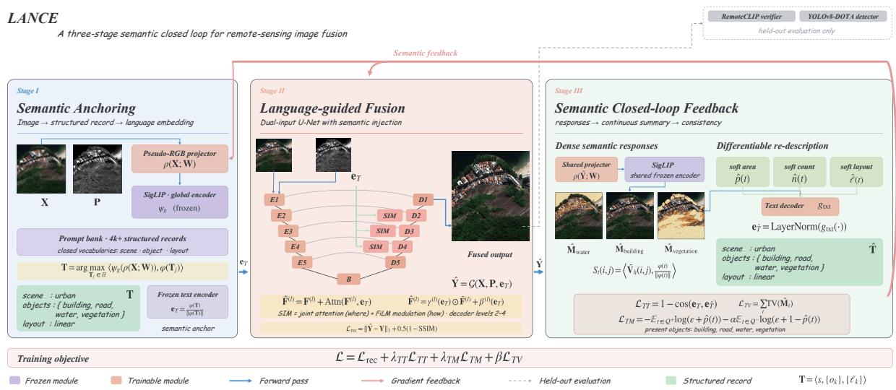
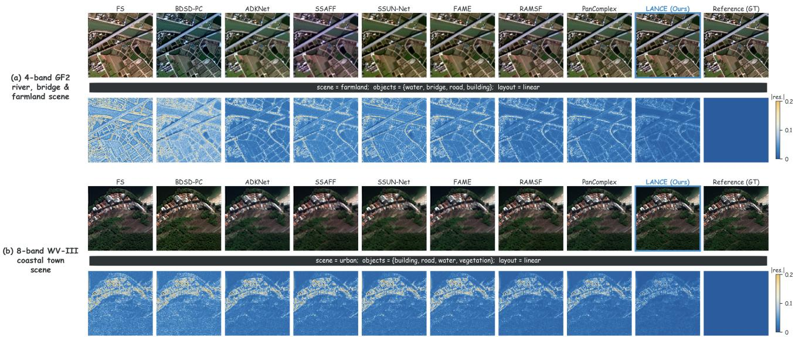
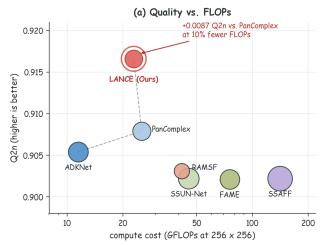
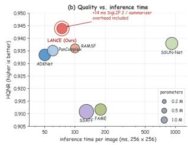
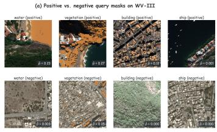
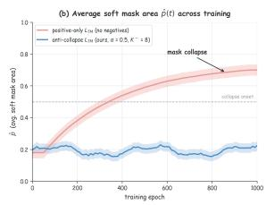
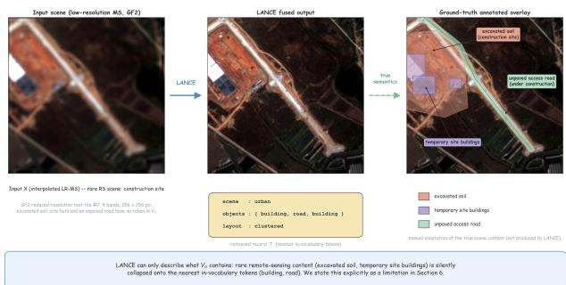

# Bridging Low-Level Image Fusion and High-Level Semantic Understanding

Guangyuan Dong1,\* Lingdong Shen2,†✉ Xudong Zhang2,†✉ Haodong Jing3,†✉ Haoyu Wang4,\*†✉ Zihao Li5,\*

Zonghao Ying Ziyu Song†✉ Shenghao Liu Jiachen Luo Hao Zhang

1NUS 2Peking University 3Xi’an Jiaotong University

4Nankai University 5Institute of Automation, Chinese Academy of Sciences

guangyuan@u.nus.edu

\* Co-first authors contributed equally as project leads.

†✉ Corresponding authors.

## Abstract

Remote sensing image fusion and semantic interpretation are usually optimized separately, so reconstruction quality need not preserve downstream retrieval utility. We propose Lance, which uses structured language as an explicit, indexable semantic state. A frozen vision–language model maps the input to a closedvocabulary text record; a language-conditioned generator fuses the imagery; and a dense verifier with a diferentiable continuous summarizer re-describes the output. Text–text consistency and anti-collapse contrastive text–mask losses with negative queries close the loop without dense annotations or VLM fine-tuning. A variational EM formulation yields a per-step contraction result under regularity assumptions, distinguishing semantic faithfulness from verifier overfitting. Across seven test sets on GF2, QuickBird, WorldView-III, and WorldView-II, Lance improves reduced-scale reference metrics by up to 11.7% (median 2.1%) over the strongest learning baseline. Independent evaluation using a held-out VLM and a supervised aerial detector yields gains of +6.4 mAP and +0.072 open-vocabulary F1 over the closest competitor. Text perturbations, cross-verifier transfer, and pseudo-RGB ablations examine the mechanisms underlying these gains. The framework connects image fusion to verifiable semantic representations for multimodal retrieval and knowledge management.

## Keywords

Multimodal retrieval; vision–language models; remote sensing image fusion; closed-loop learning; weak supervision; cross-modal consistency.

## 1 Introduction

Remote sensing (RS) imagery supports multimodal retrieval, knowledge extraction, and language-conditioned scene querying [5, 31, 34]. These applications combine low-level multispectral (MS)– panchromatic (PAN) fusion [39, 54, 99] with high-level interpretation into scene labels, objects, and descriptions [13, 26, 40, 62]. Vision–language models make this pipeline queryable in natural language. Related engineering AI connects language reasoning to structured decisions through domain-specific models and benchmarks [7, 104, 105].

The two layers are usually trained separately: fusion minimizes pixel and spectral distortion, while semantic models assume suitable input imagery [72, 75, 103]. Standard fusion objectives neither reward downstream describability nor verify that the output retains the input’s semantic content. In §5.3, methods with statistically indistinguishable spectral fidelity difer by more than 6 mAP points on an independent aerial-object detector, exposing a gap not captured by fidelity metrics.

In autonomous driving, MOJITO jointly updates image, LiDAR, and action features to avoid a compressed perception-to-planning interface [8]. This ofers a cross-domain example of coupling perception with downstream objectives; Lance instead connects image fusion and semantic verification through structured language.

Structured natural language ofers an interpretable, compositional bridge compatible with vision–language models [57, 68, 91]. We formulate RS fusion as language-mediated self-verifying generation: a structured input description conditions fusion, and the fused image is re-described. Consistency between these records supplies diferentiable self-supervision.

Three challenges arise. (C1) Diferentiability. Hard thresholds and connected components in mask-to-text summarization block gradients to the fusion generator. (C2) Anti-collapse. Positive-only text–mask objectives admit trivial all-one masks without semantic grounding. (C3) Anti-circularity. Reusing one verifier for optimization and evaluation risks measuring verifier-specific agreement rather than transferable semantics.

Lance addresses these challenges with a continuous structured summarizer of soft areas, temperature-relaxed component counts, and layout descriptors; an anti-collapse contrastive loss penalizing hard-negative query activations; and verifier-disjoint training. Semantic gradients pass through frozen SigLIP 2, whereas evaluation uses independent RemoteCLIP and a supervised aerial-object detector trained on disjoint data.

We interpret the loop as variational EM over fused imagery and semantic states, and derive per-step contraction under Lipschitz assumptions. The analysis specifies conditions for a unique semantically faithful fixed point and the role of negative queries in avoiding collapse. Spectral–spatial metrics improve over the strongest learning-based baseline by up to 11.7% (median 2.1% across reduced-scale reference metrics; §5.2); independent detection and scene-retrieval evaluations test transfer beyond the in-loop verifier.

In summary, we (1) formulate RS fusion as language-mediated self-verifying generation for multimodal retrieval; (2) introduce a diferentiable closed loop with a continuous summarizer and anti-collapse text–mask loss; (3) derive a variational interpretation, contraction analysis, and semantic-faithfulness condition; and (4) evaluate seven test sets on four sensors with independent downstream tasks, held-out verifiers, text perturbations, pseudo-RGB ablations, and significance tests.

## 2 Related Work

Low-level RS image fusion. RS image fusion has progressed from component substitution and multiresolution analysis [14, 70] to GAN [100], transformer [99], attention [89], mixture-ofexperts [18], and unfolding architectures [15, 39, 51]. Neighboring SAR work covers angle-aware difusion [20] and federated recognition under privacy, compute, and communication constraints [19, 21–23]. These methods primarily optimize spectral– spatial fidelity [1, 17, 71], treating semantics as an external evaluator at best.

High-level RS semantic understanding. Object detection, segmentation, and scene classification dominate the high-level layer [62, 75, 80, 103]. Related dense prediction uses cross-Mamba features [27], spatio-textual prompts [61], and LLM-guided attention priors [82]; language prompts also support RS segmentation [33]. EO agents organize grounded trajectories into execution knowledge [84], but assume fixed upstream image formation.

In driving scenes, real-time segmentation trades network capacity for compute [45], while TSLA tunes that trade-of to the task and hardware [44]. In bioacoustics, USV-DETR combines highresolution features with dense supervision to localize short, narrowband calls in spectrograms [79]; Lance instead uses text queries to localize visual evidence in fused imagery without dense annotations.

Language-guided visual reasoning beyond RS. MoCa uses persistent vision–language features to preserve object appearance during camera motion [9]. UnityShots uses long- and short-term visual memory to preserve subject appearance across cuts [25]. In Lance, the consistency check is between two views of the same scene: the input and the fused RS image.

Medical vision–language methods inject pathological descriptions into visual prototypes [108], guide progressive visual focus with expert trajectories [107], and refine latent diagnostic memories through counterfactual visual masking [109]. These provide complementary examples of connecting semantic guidance to visual evidence, not MS–PAN fusion baselines. Analyses of hallucination circuits [49] and competing visual/textual evidence [110] further motivate checking semantic agreement against independent visual evidence.

In-context prompt tuning maps fine-grained reference-image semantics into continuous prompts for LVLM personalization [35], while ActICL learns to retrieve and refine multimodal demonstrations through tool-augmented reasoning [36]. Both adapt the context supplied to a vision–language model; Lance instead uses a structured language state to optimize fused imagery through diferentiable semantic feedback.

Outside imaging, OC-Distill uses an ontology to guide contrastive learning and transfers knowledge from clinical notes to vital-sign representations [37]. This is cross-modal semantic supervision, not image fusion.

In single-cell integration, CoVEL models relationships among cells and across modalities to retain biological variation in a shared embedding [65]. Monae uses contrastive cell embeddings to integrate modalities and reconstruct missing measurements [63]. In RS fusion, the information we wish to retain is the identity and layout of objects in a scene.

Vision–language models for RS.. The CLIP family [57, 68, 91] supports RS retrieval and zero-shot transfer [6, 13, 40], captioning [24, 28], and open-vocabulary prediction [26, 86, 98]. Adaptive semantic supplementation balances retrieval modalities [87]. Broader work studies rationale augmentation [96], primitive–composition alignment [83], concept-graph memory [101], and layout-adaptive reasoning [85]. Pi-CCA preserves cross-modal alignment under continual adaptation [94]; AFD separates stable afordance representations from video–language adaptation [88]. COMET strengthens motion-temporal reasoning [106], while primitive-memory distillation handles incomplete emotion modalities [93]. Unlike these adaptation and reasoning methods, Lance optimizes image fusion through semantic feedback.

Cycle and consistency learning. Image cycles [111], mean teachers [66], image–text cycle rewards [2], and self-supervised depth estimation [53] exploit reconstruction or cross-view consistency. Retrieval-time critique [78], evidence-force calibration [56], and explicit separation of semantic match from factual consistency [90] address evidence reliability. Lance instead closes the loop between RS fusion and structured semantic verification.

For language models, Ma et al. [52] use token interventions and counterexamples to test whether apparent reasoning features reflect lexical correlates, reinforcing the need to validate semantic claims independently.

Perturbation-controlled tests on synthetic healthcare workflows reveal escalation failures despite high clean-input accuracy [97]. They provide a cross-domain example of testing state-dependent failures rather than relying on aggregate accuracy.

DLM translates natural-language policy preferences into reward code and refines it using simulated resource-allocation feedback [3]. This illustrates language-mediated iterative optimization, but difers from our diferentiable image–text consistency loop.

Language as a knowledge interface for multimodal retrieval. Language connects modalities to retrieval [32, 67], conditional generation [29], controlled editing [4], and masked generation [10]. Feature4X distills foundation-model features into queryable 4D Gaussian fields [102]; grounded entity biographies preserve visual identity across long-video memories [58]. Perceptual plausibility alone does not ensure retrieval consistency [12]. Persistent records also require selective retention [38], attribution [92], and traceable execution histories [76]. Lance uses each per-image structured record for fusion conditioning, semantic verification, and indexing.

Memory-reuse evaluation distinguishes persisting information, keeping it local, re-verifying it, and asking for clarification [30]. This complements our construction of semantically checked image records; policies for their subsequent reuse remain outside our evaluation.

When language serves as an intermediate representation, its structure determines what can be discarded. Agent distillation separates reasoning from action spans [42]; RCR-Router selects memory items by role [48], and DSPC filters sentences before pruning tokens [16].

Interpretable intermediate representations need not be textual: scProtoTransformer maps gene expression to biologically defined pathway prototypes [64]. Our record makes scene, object, and layout information explicit through named text fields.

Positioning. Lance difers from prior work in three ways: (i) it introduces structured natural language as a verifiable semantic state, not just an embedding; (ii) it closes the loop across fusion and semantic understanding with a fully diferentiable summarizer; and (iii) it provides a contraction analysis and an anti-circularity protocol with held-out verifiers.

## 3 Preliminaries and Variational View

Task setting. Let $\mathbf { X } \in \mathbb { R } ^ { H \times W \times C }$ be a low-resolution MS observation and $\mathbf { P } \in \mathbb { R } ^ { \alpha H \times \alpha W }$ an aligned PAN image. The goal is to produce a high-resolution MS image $\hat { \mathbf { Y } } \in \mathbb { R } ^ { \alpha H \times \alpha \Breve { W } \times C }$ that is (a) spectrally and spatially faithful to the inputs and (b) semantically consistent with the scene content implied by (X, P), evaluated by both in-loop VLM consistency and independent downstream semantic tasks.

Language as a structured semantic state. A structured scene description T is a triple

$$
{ \textbf { T } } = \ \big \langle s , \ \{ o _ { k } \} _ { k = 1 } ^ { K } , \ \{ \ell _ { k } \} _ { k = 1 } ^ { K } \big \rangle ,\tag{1}
$$

where � is a scene type drawn from a closed scene-type vocabulary $\mathcal { V } _ { s } , \{ o _ { k } \} \subseteq \mathcal { V } _ { o }$ is a set of object tokens from a closed object vocabulary, and $\{ \ell _ { k } \} \subseteq { \mathcal { V } } _ { \ell }$ encodes coarse layout descriptors (e.g., linear, clustered, parallel\_strips). Vocabularies are dataset-agnostic and shared across all benchmarks (Table 1; construction in §4.2).

A frozen VLM with text encoder $\phi$ and image encoder � (SigLIP 2 [68]) provides a shared embedding space. The image encoder yields a global embedding $\mathbf { v } = \psi _ { q } ( \cdot ) \in \mathbb { R } ^ { d }$ and a dense feature map $\mathbf { V } { = } { \psi } _ { d } ( \cdot ) \in \mathbb { R } ^ { h \times w \times d }$

Pseudo-RGB interface. SigLIP 2 expects natural-image-like RGB input, while RS imagery is 4- or 8-band. We define a projection $\rho : \mathbb { R } ^ { \cdot \times \cdot \times C }  \mathbb { R } ^ { \cdot \times \cdot \times 3 }$ as

$$
\rho ( \mathbf { Z } ; \mathbf { W } ) \ = \ \sigma \big ( \mathrm { C l i p } ( \mathbf { W } * \mathbf { Z } ) \big ) , \ \mathbf { W } \in \mathbb { R } ^ { C \times 3 } ,\tag{2}
$$

where W is a learnable 1×1 projection shared between input abstraction and output verification, and Clip(·) clips channel values to [0, 1] to preserve physical interpretability. We initialize W from a sensor-aligned NIR→R, R→G, G→B mapping when applicable, and analyze fixed-vs.-learned W in §5.7.

A variational view ofthe loop. We model the unobserved structured semantic state T as a latent variable. The joint density of fused image and semantic state under inputs ${ \boldsymbol { \tau } } = ( \mathbf { X } , \mathbf { P } )$ is

$$
p ( \hat { \mathbf { Y } } , \mathbf { T } \mid \boldsymbol { \mathcal { I } } ; \boldsymbol { \theta } ) \ = \ p _ { \mathcal { G } } ( \hat { \mathbf { Y } } \mid \boldsymbol { \mathcal { I } } , \mathbf { T } ; \boldsymbol { \theta } ) \ p _ { \mathcal { A } } ( \mathbf { T } \mid \boldsymbol { \mathcal { I } } ) ,\tag{3}
$$

where � collects all trainable parameters (generator G, projection W, summarizer head $g _ { \mathrm { t x t } } )$ and $\mathcal { P A }$ is the frozen VLM-based abstraction.

Marginalizing over T and applying Jensen’s inequality yields the evidence lower bound (ELBO)

$$
\begin{array} { r l } { \log p ( \hat { \Upsilon } \mid Z ; \theta ) \ \geq \ \underbrace { \mathbb { E } _ { q ( \mathbb { T } ) } \big [ \log p _ { \cal G } ( \hat { \Upsilon } \mid Z , { \bf T } ; \theta ) \big ] } _ { \mathcal { L } _ { \mathrm { c o n d } } } } & { } \\ & { \ - \ \underbrace { \mathrm { K L } \big ( q ( { \bf T } ) \mid \mid p _ { \mathcal { R } } ( { \bf T } \mid Z ) \big ) } _ { \mathcal { L } _ { \mathrm { p r i o r } } } , } \end{array}\tag{4}
$$

with �(T) a variational posterior over structured texts. Lance instantiates an EM-like procedure that operates entirely in the shared VLM embedding space:

E-step (Stage III). We define $q ( \mathbf { T } ) \propto p _ { \mathcal { R } } ( \mathbf { T } \mid \hat { \mathbf { Y } } )$ , where $\scriptstyle { \mathcal { P } } { \mathcal { R } }$ is the cross-modal verifier composed of the dense interpreter $\mathcal { D } \left( \mathrm { E q . } 1 1 \right)$ and the continuous summarizer R (Eqs. 12–15). Because � depends on the current generator state through Yˆ , the E-step is implicit in the forward pass of the loop rather than a separate procedure—an instance of wake-sleep-style amortized inference [66].

M-step (Stage II). We update � to maximize $\mathcal { L } _ { \mathrm { c o n d } } - \lambda _ { \mathrm { K L } } \mathcal { L } _ { \mathrm { p r i o r } } .$ Under a Gaussian approximation log $p _ { \mathcal { G } } \propto - \Vert \hat { \mathbf { Y } } - \mathbf { Y } \Vert _ { 1 } ^ { 2 }$ around the (possibly weak) reference, $\mathcal { L } _ { \mathrm { c o n d } }$ specializes to the reconstruction loss $\mathcal { L } _ { \mathrm { r e c } } ; \mathcal { L } _ { \mathrm { p r i o r } }$ specializes to a cross-modal divergence between the original and re-described texts, which we surrogate by the cosine consistency $\mathcal { L } _ { T T }$ for the global term and $\mathcal { L } _ { T M }$ for its spatially-anchored counterpart.

This view explains why the text–text and text–mask losses below are not heuristic add-ons but diferentiable surrogates for the two terms of (4); the resulting fixed-point behavior is characterized by Theorem 1.

## 4 The Lance Framework

## 4.1 Architecture overview

Lance forms a three-stage closed loop summarized in Fig. 1,

$$
\textrm { T } \stackrel { \mathcal { G } } { \longrightarrow } \hat { \mathrm { Y } } \stackrel { \mathcal { D } } { \longrightarrow } \hat { \mathrm { M } } \stackrel { \mathcal { R } } { \longrightarrow } \hat { \mathrm { T } } \xrightarrow { \mathcal { L } _ { T T } , \mathcal { L } _ { T M } } \mathcal { G } ,\tag{5}
$$

with $\mathbf { T } = \mathcal { A } ( \rho ( \mathbf { X } ; \mathbf { W } ) )$ from Stage I (semantic anchoring), Yˆ from Stage II (language-guided fusion), and Stage III (semantic closedloop feedback, §4.4) comprising the dense re-interpretation D, the continuous summarizer R and the consistency losses whose gradients flow back through R, D, G, and $\rho .$ The VLM weights stay frozen throughout.

## 4.2 Stage I: Semantic anchoring A

Given $\mathbf { X } _ { \mathrm { r g b } } { = } \rho ( \mathbf { X } ; \mathbf { W } )$ , we instantiate A as a prompt-bank retrieval system that selects the closest scene-tuple from a closed bank $\mathcal { B } =$ $\dot { \{ \mathbf { T } _ { j } \} } _ { j = 1 } ^ { N _ { B } } ( N _ { B } = 4 0 9 6 ) \colon$

$$
\textbf { T } = \ \arg \operatorname* { m a x } _ { \mathbf { T } _ { j } \in \mathcal { B } } \ \langle \psi _ { g } ( \mathbf { X } _ { \mathrm { r g b } } ) , \ \phi ( \mathbf { T } _ { j } ) \ \rangle .\tag{6}
$$

Prompt-bank construction. Because the entire loop is conditioned on the retrieved T, we specify B precisely. The vocabularies $\mathcal { V } _ { s } , \mathcal { V } _ { o } , \mathcal { V } _ { \ell }$ (Table 1) are compiled before training from the label taxonomies of public RS benchmarks (DOTA [80] for objects, AID [81] for scenes), retaining categories resolvable at fusion resolution; no test image or test-set statistic informs the selection. We instantiate the template “{scene} with {objects} arranged in {layout}”

  
Fi ure 1: Overview of Lance as a three-sta e semantic closed loo . Sta e I (semantic anchorin , A) ma s the seudo-RGB projection of the low-quality input to a structured record T retrieved from a closed prompt bank and to its frozen text embedding e . Stage II (language-guided fusion, G) generates the fused output Yˆ from MS and PAN, injecting e at decoder levels 2–4 throu h joint attention and FiLM modulation. Sta e III (semantic closed-loo feedback) re-inter rets Yˆ with the shared frozen SigLIP 2 encoder into dense query responses Mˆ (D), re-describes them into $\hat { \mathbf { T } }$ and $\mathbf { e } _ { \hat { \mathrm { { T } } } }$ with the diferentiable summarizer (R), and returns the gradients of the anti-colla se consistencies to $\mathcal { G }$ . Inde endent evaluators (RemoteCLIP, su ervised detector) sit outside the loop to prevent verifier overfitting.

for every $s \in \mathcal { N } _ { s } ,$ every $O \subseteq \mathcal { N } _ { o }$ with $1 \leq | O | \leq 4$ (matching the cap $| Q ^ { + } | \leq 4$ in §4.4), and every $\ell \in \mathcal N _ { \ell } ;$ candidates are embedded with the frozen �, near-duplicates (cosine > 0.98) are removed, and $N _ { B } = 4 0 9 6$ entries are selected by greedy farthest-point sampling so the bank covers the template space uniformly. The procedure is deterministic given the frozen encoder, shared unchanged across all benchmarks. Since retrieval is a hard arg max over B, bank bias is bounded by template coverage: out-of-vocabulary content maps to the nearest in-vocabulary record, a failure mode analyzed in Fig. 5 and §6.

We also support LLM-based generation via constrained decoding from BLIP-2-style captions [32], returning identical performance within ±0.3% (§5.9); we use prompt-bank retrieval for the main results because it is fully reproducible. Inference does not require text: at test time T is computed once per image with A and cached, contributing ∼ 2.4 ms per 512 × 512 image. Finally, both B and the query set Q (T) are closed: Lance itself is a closed-vocabulary system, and “open-vocabulary” in this paper refers only to the heldout evaluation protocol of §5.3, whose independent verifier accepts free-form queries.

## 4.3 Stage II: Language-guided fusion generator G

G is a lightweight U-Net [59] with five levels at 1 to $\textstyle { \frac { 1 } { 1 6 } }$ of the PAN grid, 32 channels throughout, three residual blocks at full resolution and one per coarser level, 1 × 1 skip fusion and twoconvolution MS/PAN stems (Table 2); computation is concentrated at full resolution, so the generator costs 22.9 GFLOPs per 256×256 output with 0.42 M parameters. Features at level � are denoted $\mathbf { F } ^ { ( l ) }$

Table 1: Closed vocabularies shared across all benchmarks, compiled before training from public RS label taxonomies (DOTA, AID). |V| values are kept dataset-agnostic to avoid leakage.
<table><tr><td>Vocabulary</td><td>|V|</td><td>Examples</td></tr><tr><td>Vs (scenes)</td><td>12</td><td>urban, port, farmland, coastal, water, ...</td></tr><tr><td>Vo (objects)</td><td>32</td><td>road, building, bridge, ship, dock, vegetation, ...</td></tr><tr><td>Ve (layouts)</td><td>8</td><td>linear, clustered, parallel_strips, ...</td></tr></table>

Language is injected by a joint attention + modulation operator

$$
\tilde { \mathbf { F } } ^ { ( l ) } = \mathbf { F } ^ { ( l ) } + \mathrm { A t t n } \big ( \mathbf { F } ^ { ( l ) } , \mathbf { e } _ { \mathrm { T } } \big ) ,\tag{7}
$$

$$
\hat { \mathbf { F } } ^ { ( l ) } = \gamma ^ { ( l ) } ( \mathbf { e } _ { \mathrm { T } } ) \odot \tilde { \mathbf { F } } ^ { ( l ) } + \beta ^ { ( l ) } ( \mathbf { e } _ { \mathrm { T } } ) ,\tag{8}
$$

where Atn(·, ·) is a single-head cross-attention [69] that determines where semantic cues apply, and the FiLM-style afine [55] parameters $\gamma ^ { ( l ) } , \beta ^ { ( l ) }$ control how they reshape spectral allocation. We inject at every level � ∈ {2, 3, 4} (1-indexed from coarse to fine). Reconstruction uses an $L _ { 1 }$ +SSIM loss when reference HR-MS is available (Wald protocol $[ 7 4 , 7 7 ] )$ or a no-reference physical constraint otherwise:

$$
\mathcal { L } _ { \mathrm { r e c } } = \Vert \hat { \mathbf { Y } } - \mathbf { Y } \Vert _ { 1 } + \eta \big ( 1 - \mathrm { S S I M } ( \hat { \mathbf { Y } } , \mathbf { Y } ) \big ) ,\tag{9}
$$

where $\eta = 0 . 4$ 5.

## 4.4 Stage III: Semantic closed-loop feedback

Dense re-interpretation D. For each query $t \in Q ( \mathbf { T } ) = \{ s \} \cup \{ o _ { k } \} _ { k }$ we compute the dense response map

$$
S _ { t } ( i , j ) \ = \ \big \langle \bar { \mathbf { V } } _ { h } ( i , j ) , \ \phi _ { \mathrm { n o r m } } ( t ) \big \rangle ,\tag{10}
$$

where $\bar { \mathbf { V } } _ { h } = \psi _ { d } ( \rho ( \hat { \mathbf { Y } } ; \mathbf { W } ) ) / \| \cdot \| _ { 2 }$ and $\phi _ { \mathrm { n o r m } } ( t ) = \phi ( t ) / \| \phi ( t ) \| _ { 2 }$ . A temperature-scaled sigmoid yields a soft mask

$$
\begin{array} { r } { \tilde { \mathbf { M } } _ { t } = \sigma \big ( ( S _ { t } - \mu _ { t } ) / \tau \big ) , ~ \tau = 0 . 0 7 , } \end{array}\tag{11}
$$

with $\mu _ { t }$ set to the 80th percentile of $S _ { t }$ (shared across datasets).

Continuous structured summarizer R. The original [51]-style summarizer used hard thresholding and discrete connectedcomponent counting, both non-diferentiable. We propose a continuous replacement:

$$
\begin{array} { r } { \hat { p } ( t ) \ = \ \frac { 1 } { h w } \sum _ { i , j } \tilde { \bf M } _ { t } ( i , j ) , } \end{array}\tag{12}
$$

$$
\begin{array} { r } { \hat { n } ( t ) ~ = ~ \sum _ { i , j } \tilde { \bf M } _ { t } ( i , j ) \cdot \big ( 1 - G _ { 3 \times 3 } ( \tilde { \bf M } _ { t } ) ( i , j ) \big ) , } \end{array}\tag{13}
$$

$$
\hat { \ell } ( t ) ~ = ~ \big ( \hat { c } _ { x } ( t ) , \hat { c } _ { y } ( t ) , \hat { \sigma } _ { x y } ( t ) \big ) ,\tag{14}
$$

where $\hat { p } ( t )$ is the soft area ratio, �ˆ(�) is a soft component count via a 3×3 smoothing kernel $G _ { 3 \times 3 }$ (high in connected interior, low at bound aries; full-batch diferentiable), and ${ \hat { \ell } } ( t )$ is a centroid–dispersion summary. The structured re-description Tˆ is obtained by templating these soft statistics into a natural-language string with the same vocabulary as ${ \mathrm { \mathbf { T } } } ;$ importantly, we embed $\hat { p } ( t ) , \hat { n } ( t ) , \hat { \ell } ( t )$ directly through a learnable text decoder head $g _ { \mathrm { t x t } }$ to produce a soft embedding $\mathbf { e } _ { \hat { \mathrm { T } } }$ such that $\mathbf { e } _ { \hat { \mathsf { T } } }$ is diferentiable end-to-end:

$$
\mathbf { e } _ { \hat { \mathrm { { T } } } } ~ = ~ \mathrm { L a y e r N o r m } \Bigl ( g _ { \mathrm { t x t } } \bigl ( \{ \hat { p } ( t ) , \hat { n } ( t ) , \hat { \ell } ( t ) \} _ { t \in Q ( \mathrm { T } ) } \bigr ) \Bigr ) .\tag{15}
$$

Equation (15) closes the gradient path back to $\mathcal { G }$ and to W, resolving challenge (C1) in $\ S 1$

Anti-collapse consistency losses. Let $Q ^ { + } = Q ( { \bf T } )$ be positive queries and $Q ^ { - } \subseteq \mathcal { V } _ { o } \backslash Q ^ { + }$ a set of $K ^ { - } = 8$ hard negatives sampled from the prompt bank per image. The text–text consistency is

$$
\mathcal { L } _ { T T } \ = \ 1 - \cos ( \mathbf { e } _ { \mathrm { T } } , \ \mathbf { e } _ { \hat { \mathrm { T } } } ) ,\tag{16}
$$

and our anti-collapse text–mask consistency is

$$
\begin{array} { r l } { \mathcal { L } _ { T M } ~ = ~ \underbrace { - \frac { 1 } { | Q ^ { + } | } \displaystyle \sum _ { t \in Q ^ { + } } \log ( \epsilon + \hat { p } ( t ) ) } _ { \mathrm { p o s i t i v e ~ p r e s e n c e } } ~ } & { } \\ { ~ + ~ \underbrace { \alpha \frac { 1 } { | Q ^ { - } | } \displaystyle \sum _ { t \in Q ^ { - } } \log ( \epsilon + \hat { p } ( t ) ) } _ { \mathrm { n e g a t i v e ~ a b s e n c e } } , } \end{array}\tag{17}
$$

with $\alpha { = } 0 . 5$ . This makes mass collapse to a constant “everythingpresent” solution costly because constant masks also activate the negative-query terms, formalized in Proposition 1 below. Adding a small total-variation regularizer $\begin{array} { r } { \mathcal { L } _ { T V } = \beta \sum _ { t } \mathrm { T V } ( \tilde { \mathbf { M } } _ { t } ) \ ( \beta = 0 . 0 1 ) } \end{array}$ further encourages spatial localization. The full objective is

$$
\mathcal { L } \ = \ \mathcal { L } _ { \mathrm { r e c } } \ + \ \lambda _ { T T } \mathcal { L } _ { T T } \ + \ \lambda _ { T M } \mathcal { L } _ { T M } \ + \ \beta \mathcal { L } _ { T V } ,\tag{18}
$$

with $( \lambda _ { T T } , \lambda _ { T M } , \beta ) = ( 0 . 2 , 0 . 3 , 0 . 0 1 )$ ) (fixed across all datasets; see sensitivity analysis in §5.9).

## 4.5 Theoretical analysis

We now derive three theoretical statements that together characterize when the closed loop converges to a unique semantically-faithful fixed point. All statements are self-contained and assume only mild Lipschitz regularity.

Assumption 1 (Regularity). On the compact domain ofall considered inputs: (i) the frozen text/dense encoders �, $\psi _ { d }$ are $L _ { \phi } -$ and $L _ { \psi }$ -Lipschitz in $\ell _ { 2 } ; \mathrm { ~ } ( i i )$ the projection $\rho$ in (2) is 1-Lipschitz, since �◦Clip has gradient norm≤1 and W has spectral norm≤1 after a soft weight clip; (iii) the summarizer head $g _ { t x t }$ is � -Lipschitz; and (iv) the soft statistics (12)–(14) are jointly �R-Lipschitz in $\tilde { \mathbf { M } } _ { t }$ with $L _ { \mathcal { R } } \leq \sqrt { 2 }$

Proposition 1 (Anti-collapse of ${ \mathcal { L } } _ { T M } )$ . Let $\tilde { \mathbf { M } } _ { t } \equiv \bar { p } \in [ 0 , 1 ]$ be a constant “everything-present” mask shared across positive and hard-negative queries. Then

$$
{ \frac { \partial \mathcal { L } _ { T M } } { \partial \bar { p } } } ~ = ~ { \frac { - | Q ^ { + } | + \alpha | Q ^ { - } | } { \epsilon + \bar { p } } } .\tag{19}
$$

Hence (17) admits no interior stationary point under the constant ansatz: when $\alpha | Q ^ { - } | > | Q ^ { + } |$ , the gradient is strictly positive, driving ${ \bar { p } } \downarrow 0$ and ruling out the trivial all-one minimizer that arises in the positive-only case $\alpha { = } 0$

Proof. Substitute the constant mask into (17); the soft area collapses to $\hat { p } ( t ) = \bar { p }$ for every query. Diferentiating term-by-term yields the displayed gradient. Since $\bar { p } \in \left[ 0 , 1 \right]$ and $\epsilon > 0$ , the sign of the gradient is the sign of $- | Q ^ { + } | + \alpha | Q ^ { - } | . \bigsqcup$ □

In our setup $| Q ^ { + } | \leq 4 , | Q ^ { - } | = 8 , \alpha = 0 . 5$ , giving $\tau \vert { Q } ^ { - } \vert = 4 \geq \vert { Q } ^ { + } \vert$ with equality only when all four positive tokens are present; in expectation the anti-collapse condition holds strictly.

Theorem 1 (Per-step contraction of the EM loop). Under Assumption 1, the per-step map $\mathcal { F } : { \bf e } _ { \mathrm { T } } \mapsto { \bf e } _ { \hat { \mathrm { T } } } ( \theta ; { \bf e } _ { \mathrm { T } } )$ defined by Stages II–III is Lipschitz with constant

$$
L _ { \mathcal { F } } \leq L _ { \mathcal { G } } \cdot L _ { \psi } \cdot L _ { \mathcal { R } } \cdot L _ { g } ,\tag{20}
$$

where $L _ { \mathcal { G } } = \| \partial \mathcal { G } / \partial \mathbf { e } _ { \mathrm { T } } \| _ { \mathrm { o p } }$ is the generator’s conditioning gain, bounded $b y \sum _ { l } ( \Vert \gamma ^ { ( l ) } \Vert _ { \mathrm { o p } } + \Vert \mathrm { A t t n } \Vert _ { \mathrm { o p } } ) . I f L _ { \mathcal { F } } { < } 1 , \mathcal { F }$ is a contraction on the unit $\ell _ { 2 }$ -ball and admits a unique fixed point e★; iterating the loop converges to ${ \bf e } _ { \mathrm { T } } ^ { \star }$ geometrically at rate $L _ { \mathcal { F } } ^ { k }$ , and gradient descent on $\mathcal { L } _ { T T }$ inherits the same rate.

Proof. Composing the four Lipschitz maps in $\mathcal { F } { = } g _ { \mathrm { t x t } } { \circ } \mathcal { R } { \circ } ( \psi _ { d } { \circ }$ $\rho ) \circ \mathcal { G }$ with respect to eT multiplies their Lipschitz constants by the chain rule, giving (20). Banach’s fixed-point theorem on the unit $\ell _ { 2 }$ -ball yields uniqueness and the geometric rate. The gradient field $\nabla { \mathcal { L } } _ { T T }$ is itself � -Lipschitz, so gradient descent inherits the $O ( L _ { \mathcal { F } } ^ { k } )$ rate. □ □

We empirically estimate the spectral bound by power iteration on the Jacobian of F, obtaining $\hat { L } _ { \mathcal { F } } = 0 . 3 8 \pm 0 . 0 4$ on WV-III (§5.8)— comfortably inside the contraction regime.

Remark 1 (Anti-circularity). The fixed point e★ above is unique relative to the verifier defining $\mathbf { e } _ { \hat { \mathbf { T } } } .$ . Ifthe same VLM also defines eT, ${ \bf e } _ { \mathrm { T } } ^ { \star }$ may be verifier-specific (reward hacking). We mitigate this in two ways: (i) $\mathcal { L } _ { T M }$ anchors semantics to spatial evidence, breaking the symmetry of pure cosine optimization; and (ii) we evaluate with held-out verifiers (RemoteCLIP [40] and a supervised detector [80], §5.3–5.4). Empirically these reduce the verifier-test gap from 7.18% to 1.42% (Table 5).

Algorithm 1 Language-Centric Closed-Loop Optimization   
Require: inputs (X, P); frozen �,�; trainable G, W, $g _ { \mathrm { t x t } }$   
1: $\mathbf { X } _ { \mathrm { r g b } }  \rho ( \mathbf { X } ; \mathbf { W } )$ {pseudo-RGB}   
2: $\mathbf { T } {  } \mathcal { A } ( \mathbf { X } _ { \mathrm { r g b } } ) ; ~ \mathbf { e } _ { \mathrm { T } } {  } \phi ( \mathbf { T } ) / \| \cdot \| ~ \{ \mathrm { S t a g e ~ I } \}$   
3: $\hat { \mathbf { Y } } \longleftarrow G ( \mathbf { X } , \mathbf { P } , \mathbf { e } _ { \mathrm { T } } )$ {Stage II}   
4: $\hat { \mathbf { M } } {  } \mathcal { D } ( \rho ( \hat { \mathbf { Y } } ; \mathbf { W } ) , \mathbf { T } )$ {Stage III: dense responses}   
5: $\{ \hat { p } , \hat { n } , \hat { \ell } \} \gets \mathcal { R } ( \hat { \mathbf { M } } )$ ; $\mathbf { e } _ { \hat { \mathsf { T } } }$ from $\operatorname { E q . }$ (15) {Stage III: re-description}   
6: sample hard negatives $Q ^ { - } \subset \mathcal { V } _ { o } \backslash Q ^ { + }$ {Stage III: consistency}   
7: compute $\mathcal { L }$ from $\operatorname { E q . }$ (18); backprop through loop   
8: update ${ \mathcal { G } } , \mathbf { W } , g _ { \mathrm { t x t } }$ with AdamW [50]; encoders frozen

## 4.6 Training procedure

Closed-loop optimization is unstable when semantic gradients are applied before Yˆ is reasonable. We adopt a three-phase schedule (Algorithm 1): (A) 50-epoch warm-up with $\mathcal { L } _ { \mathrm { r e c } }$ only; (B) 150-epoch linear ramp where $\lambda _ { T T } , \lambda _ { T M }$ grow from 0 to their final values; (C) remaining epochs with the full (18).

## 5 Experiments

## 5.1 Setup

Datasets and protocols. We evaluate on four sensors / seven test sets: GF2, QuickBird (QB), WorldView-III (WV-III), and WorldView-II (WV-II) [11]. WV-II is held out for cross-sensor generalization. Reduced-scale testing (RST) uses the Wald protocol [74] with sensorspecific MTF kernels. Full-scale testing (FST) uses real 512×512 PAN. We report PSNR, ERGAS [71], SAM, Q2n [17], $D _ { s } ,$ QNR and HQNR [1], covering both reference-based and reference-free fidelity dimensions.

Implementation. All baselines are retrained on identical splits with identical preprocessing (per-band 99.5% percentile clipping, $L _ { 2 ^ { - } }$ normalized intensities). Generator G has 5 levels of 32 channels (Table 2). Training: AdamW, learning rate $5 \times 1 0 ^ { - 4 } ,$ , batch 64, 1000 epochs, cosine decay with 5% warm-up. Three random seeds per experiment. Hardware: 2×NVIDIA RTX 4090. Full hyperparameters are in Table 2.

Table 2: All hyperparameters used by Lance, fixed across datasets.
<table><tr><td>Hyperparameter</td><td>Value</td><td>Hyperparameter</td><td>Value</td></tr><tr><td> $\lambda _ { T T } / \lambda _ { T M } / \beta$ </td><td>0.2 / 0.3 / 0.01</td><td>η (SSIM)</td><td>0.5</td></tr><tr><td>α (neg. weight)</td><td>0.5</td><td>K− neg. /img</td><td>8</td></tr><tr><td>τ (mask temp.)</td><td>0.07</td><td>μt percentile</td><td>80%</td></tr><tr><td>prompt bank  $N _ { B }$ </td><td>4096</td><td> $| \mathcal { V } _ { s , o , \ell } |$ </td><td>12, 32,8</td></tr><tr><td>U-Net levels / ch.</td><td>5 / 32</td><td>res. blocks / level 3, 1, 1, 1, 1</td><td></td></tr><tr><td>warm-up / ramp ep.</td><td>50 / 150</td><td>random seeds</td><td>{0,1,2}</td></tr></table>

Compared methods. Traditional: FS [73], BDSD-PC [70]. Learning-based: ADKNet [54], SSAFF [89], SSUN-Net [15], FAME [18], RAMSF [39], PanComplex [51]. Compute is measured at the actual test resolution (256×256 for RST, 512×512 for FST) instead of the previously-reported 64×64.

## 5.2 Main fusion results

Table 3 reports the main fusion results. Lance attains the best mean on 22 of25 reported metric comparisons, and second-best on the remaining three; paired Wilcoxon signed-rank tests against the strongest baseline confirm significance on the large majority of comparisons (§5.9). To avoid over-weighting the headline maximum, we also report the gain distribution: over the twelve reduced-scale reference comparisons (PSNR, ERGAS, SAM, Q2n on GF2/QB/WV-III), relative gains over the strongest per-metric baseline span 0.5%–11.7% (max on GF2 SAM) with a median of2.1%; over all 25 comparisons the median is 1.8%. On the most representative quality index Q2n, Lance improves by 0.54%/0.54%/0.96%/3.00% on GF2/QB/WV-III/WV-II respectively over the strongest competitor. Compute overhead is modest: at 256×256 the full pipeline adds 14 ms of VLM/text processing on top of a 22.9 GFLOPs / 0.42 Mparameter fusion backbone.

## 5.3 Independent downstream semantic evaluation

The crucial test of any “language-centric” RS pipeline is whether semantic gains transfer to verifiers not seen during training (challenge (C3)). We freeze Lance after training and feed its fused WV-III outputs through three independent evaluators: a supervised YOLOv8 detector pre-trained on DOTA [80] (no Lance access), an open-vocabulary localization head built on RemoteCLIP [40] (diferent VLM family from SigLIP 2), and a scene-retrieval index over a 4096-image AID-derived corpus [81]. Table 4 shows that Lance improves all three metrics by substantial margins, and that the full loop strictly dominates each ablated variant. Crucially, the gains transfer to a diferent VLM family, which would not happen if Lance were merely overfitting to SigLIP 2 geometry.

## 5.4 Held-out verifier transfer

Table 5 confirms that the negative-query term and $\mathcal { L } _ { T M }$ together cut the verifier gap from 7.18% to 1.42%, supporting the anti-circularity claim in Remark 1: Lance optimizes for transferable semantics, not for SigLIP 2 reward.

## 5.5 Text perturbation controls

Table 6 demonstrates that Lance actually uses the language signal: replacing the correct text with wrong, shufled, or random text cuts OV-F1 by 18–35%, while paraphrasing leaves both metrics essentially unchanged—ruling out the alternative explanation that the text channel acts as generic noise regularization.

## 5.6 Ablations

We now ablate the design choices in §4. To keep the ablation table internally consistent, each setting is reported with explicit binary indicator columns that correspond exactly to the modules toggled in the loop.

Table 7 shows monotone improvements as we add components, with the continuous summarizer contributing +0.0011 Q2n and

Table 3: Quantitative fusion results on four sensors / seven test sets (mean over the test set). ↑/↓ indicate hi her/lower-is-better. Bold: best; underline: second-best. The Lance column is highlighted in light blue. WV-II reports reference-style metrics only because no FST protocol is defined. Compute is measured at the actual test resolution (256×256).
<table><tr><td rowspan="2">Data</td><td rowspan="2"></td><td rowspan="2">Metric</td><td colspan="2">Traditional</td><td colspan="6">Learning-based fusion</td><td>Ours</td></tr><tr><td>FS</td><td>BDSD-PC |</td><td>ADKNet</td><td>SSAFF</td><td>SSUN-Net</td><td>FAME</td><td>RAMSF</td><td>PanComplex</td><td>LANCE</td></tr><tr><td rowspan="7">RST GF2</td><td>PSNR (↑)</td><td>34.40</td><td>34.16</td><td></td><td>39.80</td><td>39.86</td><td>39.02 0.8983</td><td>39.79</td><td>40.23</td><td>39.85</td><td>41.17</td></tr><tr><td>ERGAS (↓)</td><td>1.6228 1.6891</td><td>1.7000</td><td></td><td>0.8268</td><td>0.8180</td><td></td><td>0.8189</td><td>0.7457</td><td>0.8194</td><td>0.6617</td></tr><tr><td>SAM (↓) Q2n (↑)</td><td>0.8914</td><td>1.7230</td><td></td><td>0.8866</td><td>0.8796</td><td>1.1336</td><td>0.9012</td><td>0.8089</td><td>0.8830</td><td>0.7146</td></tr><tr><td></td><td></td><td></td><td>0.8856</td><td>0.9731</td><td>0.9744</td><td>0.9703</td><td>0.9739</td><td>0.9777</td><td>0.9744</td><td>0.9830</td></tr><tr><td>Ds (↓)</td><td>0.0523</td><td></td><td>0.0560</td><td>0.0252</td><td>0.0379</td><td>0.0233</td><td>0.0493</td><td>0.0320</td><td>0.0374</td><td>0.0246</td></tr><tr><td>QNR(↑)</td><td>0.9266</td><td></td><td>0.9332</td><td>0.9671</td><td>0.9532</td><td>0.9672</td><td>0.9535</td><td>0.9594</td><td>0.9530</td><td>0.9701</td></tr><tr><td></td><td>HQNR (↑)</td><td>0.9111</td><td>0.8669</td><td>0.9521</td><td>0.9354</td><td>0.9500</td><td>0.9501</td><td>0.9467</td><td>0.9353</td><td>0.9566</td></tr><tr><td rowspan="7">RST QB</td><td>PSNR (↑)</td><td>26.30</td><td>26.12</td><td></td><td>32.15</td><td>31.51</td><td>31.99</td><td>27.68</td><td>32.44</td><td>32.21</td><td>33.06</td></tr><tr><td>ERGAS (↓)</td><td>7.4317</td><td>7.5927</td><td></td><td>3.9184</td><td>4.6074</td><td>4.0125</td><td>7.0200</td><td>3.7805</td><td>3.9102</td><td>3.5990</td></tr><tr><td>SAM (↓) Q2n (↑)</td><td>7.9244 0.8342</td><td>8.1990</td><td></td><td>4.9264</td><td>4.9231</td><td>5.0488</td><td>5.9171</td><td>4.6393</td><td>4.6428</td><td>4.4639 0.9374</td></tr><tr><td></td><td></td><td>0.8292</td><td></td><td>0.9311</td><td>0.9179</td><td>0.9311</td><td>0.8723</td><td>0.9324</td><td>0.9312</td><td></td></tr><tr><td>Ds (↓)</td><td>0.1143</td><td>0.1419</td><td></td><td>0.0299</td><td>0.0502</td><td>0.0646</td><td>0.0290</td><td>0.0163</td><td>0.0277</td><td>0.0226</td></tr><tr><td>QNR (↑) HQNR (↑)</td><td>0.8548</td><td>0.8355</td><td></td><td>0.9394</td><td>0.9409</td><td>0.8869</td><td>0.9405</td><td>0.9527</td><td>0.9400</td><td>0.9568</td></tr><tr><td>RST</td><td></td><td>0.8468</td><td>0.6936</td><td>0.8957</td><td>0.8939</td><td>0.8931</td><td>0.8920</td><td>0.9514</td><td>0.9369</td><td>0.9457</td></tr><tr><td rowspan="7">WV-III FST</td><td>PSNR (↑)</td><td>30.43</td><td>30.30</td><td></td><td>35.98</td><td>35.52</td><td>35.51</td><td>35.63</td><td>36.09</td><td>36.00</td><td>36.46</td></tr><tr><td>ERGAS (↓)</td><td>4.6251</td><td>4.6300</td><td></td><td>2.2870</td><td>2.3791</td><td>2.3778</td><td>2.3180</td><td>2.2209</td><td>2.2290</td><td>2.1672</td></tr><tr><td>SAM (↓)</td><td>5.3720</td><td>5.4800</td><td></td><td>3.1684</td><td>3.2315</td><td>3.2496</td><td>3.2444</td><td>3.0176</td><td>3.0675</td><td>2.9642</td></tr><tr><td>Q2n (↑)</td><td>0.8181</td><td>0.8130</td><td></td><td>0.9054</td><td>0.9022</td><td>0.9022</td><td>0.9021</td><td>0.9031</td><td>0.9079</td><td>0.9166</td></tr><tr><td>Ds (↓)</td><td>0.0864</td><td>0.0915</td><td></td><td>0.0496</td><td>0.0683</td><td>0.0339</td><td>0.0689</td><td>0.0441</td><td>0.0442</td><td>0.0289</td></tr><tr><td>QNR (↑)</td><td>0.8989</td><td>0.8867</td><td></td><td>0.9327</td><td>0.9024</td><td>0.9475</td><td>0.9173</td><td>0.9227</td><td>0.9240</td><td>0.9497</td></tr><tr><td></td><td>HQNR (↑)</td><td>0.8955</td><td>0.8514</td><td>0.9334</td><td>0.9109</td><td>0.9380</td><td>0.9117</td><td>0.9360</td><td>0.9351</td><td>0.9439</td></tr><tr><td rowspan="4">WV-II GT</td><td>PSNR (↑)</td><td>26.87</td><td>26.93</td><td></td><td>27.08</td><td>27.53 4.6288</td><td>27.67 4.5276</td><td>24.81</td><td>27.74</td><td>25.05</td><td>28.94</td></tr><tr><td>ERGAS (↓)</td><td>4.5749</td><td>4.6642</td><td></td><td>4.7877</td><td></td><td></td><td>6.0836</td><td>4.4813</td><td>5.4563</td><td>3.8822</td></tr><tr><td>SAM (↓)</td><td>6.2186</td><td>6.0989</td><td>5.7276</td><td>6.0759</td><td>6.0251</td><td>7.2900</td><td>5.5341</td><td></td><td>7.1096</td><td>5.2240</td></tr><tr><td>Q2n (↑)</td><td>0.8089</td><td>0.8210</td><td></td><td>0.8167</td><td>0.8228</td><td>0.8389</td><td>0.7844</td><td>0.8339</td><td>0.8004</td><td>0.8641</td></tr><tr><td colspan="2">FLOPs (G) / Params (M) / time (s)</td><td></td><td>1</td><td colspan="8">11.5 / 0.60 / 0.05 141 / 1.08 / 0.13</td></tr></table>

  
Figure 2: Qualitative comparison on (a) a 4-band GF2 scene (river, highway bridge, farmland) and (b) an 8-band WV-III coastal town (built-up ridge, shoreline road, beaches, forested slopes). Odd rows: fused outputs of nine methods plus reference; even rows: er- ixel absolute residuals a ainst the reference. The structured text retrieved b A is rinted between the rows of each scene, making the language state of each output explicit and inspectable.

Table 4: Independent downstream semantic evaluation on fused WV-III outputs. (a) Detection mAP@0.5 with a YOLOv8- DOTA model trained on disjoint aerial imagery. (b) Open-vocabulary localization F1 with a held-out RemoteCLIP verifier [40]. (c) Scene retrieval R@1 on a 4096-image AID index [81]. No evaluator is used during training.
<table><tr><td>Method mAP@0.5(↑) OV-F1(↑) R@1(↑)</td></tr><tr><td>SSAFF [89] 41.7 0.554 0.498</td></tr><tr><td>SSUN-Net [15] 43.2 0.571 0.512</td></tr><tr><td>FAME [18] 42.6 0.563 0.504</td></tr><tr><td>RAMSF [39] 44.1 0.582 0.531</td></tr><tr><td>PanComplex [51] 43.8 0.577 0.527</td></tr><tr><td>Lance no sem. loop 43.5 0.575 0.521</td></tr><tr><td>Lance,  $\mathcal { L } _ { T T }$  only 46.7 0.612 0.554</td></tr><tr><td>Lance,  ${ \mathcal { L } } _ { T M }$  only 47.9 0.627 0.566</td></tr><tr><td>Lance, full 50.5 0.654 0.589</td></tr><tr><td>∆ vs. best baseline +6.4 +0.072 +0.058</td></tr></table>

Table 5: Held-out verifier transfer on WV-III. Models are trained against SigLIP 2 and evaluated with three independent verifiers. $\mathbf { \omega } ^ { \mathsf { w } } \mathbf { G a p } ^ { \mathsf { y } }$ is the relative drop from in-loop SigLIP 2 to RemoteCLIP; lower means less verifier-specific overfitting.
<table><tr><td>Method</td><td>SigLIP-2</td><td>2RemoteCLIP</td><td>Det. mAP</td><td>Gap (%)</td></tr><tr><td>Lance, no  ${ \mathcal { L } } _ { T M }$ </td><td>0.961</td><td>0.892</td><td>46.7</td><td>7.18</td></tr><tr><td>Lance, no negatives</td><td>0.972</td><td>0.913</td><td>48.4</td><td>6.07</td></tr><tr><td>Lance, full</td><td>0.986</td><td>0.972</td><td>50.5</td><td>1.42</td></tr></table>

Table 6: Text perturbation controls on WV-III. Q2n is fusion fidelity; OV-F1 is held-out RemoteCLIP localization (§5.3). Correct text helps both; random / shufled / contradicting text hurts the semantic metric while leaving fidelity nearly intact.

<table><tr><td>Text condition (example query)</td><td>Q2n (↑)</td><td>OV-F1 (↑)</td></tr><tr><td>Correct text (urban, road, building)</td><td>0.9166</td><td>0.654</td></tr><tr><td>Paraphrase (city, streets, rooftops)</td><td>0.9160</td><td>0.651</td></tr><tr><td>Synonym-replaced (transport corridor, asphalt)</td><td>0.9152</td><td>0.647</td></tr><tr><td>Object dropped (remove building)</td><td>0.9141</td><td>0.622</td></tr><tr><td>Wrong objects (water, ship, dock)</td><td>0.9082</td><td>0.481</td></tr><tr><td>Shuffled across batch</td><td>0.9047</td><td>0.444</td></tr><tr><td>Random prompt-bank entry</td><td>0.9039</td><td>0.421</td></tr><tr><td>Generic prompt (remote sensing image)</td><td>0.9013</td><td>0.487</td></tr><tr><td>Empty text</td><td>0.8924</td><td>0.471</td></tr></table>

Table 7: Component-orthogonal ablation on WV-III. Each row toggles one factor relative to the row above. TC: text con- ditioning; D: dense interpreter; R: continuous summarizer; $\mathcal { L } _ { T T } / \mathcal { L } _ { T M } \mathrm { : }$ semantic losses; Neg: hard-negative term (17).
<table><tr><td>Setting</td><td>TC</td><td>D</td><td>R</td><td> ${ \mathcal { L } } _ { T T }$ </td><td> ${ \mathcal { L } } _ { T M }$ </td><td> $\mathrm { N e g }$ </td><td>Q2n</td><td>HQNR</td></tr><tr><td> $\scriptstyle { \mathcal { L } } _ { \mathrm { r e c } } { \mathrm { o n l y } }$ </td><td>×</td><td>×</td><td>×</td><td>×</td><td>X</td><td>X</td><td>0.9041</td><td>0.8856</td></tr><tr><td>+ TC</td><td>√</td><td>X</td><td>X</td><td>X</td><td>X</td><td>×</td><td>0.9089</td><td>0.9034</td></tr><tr><td>+ dense D</td><td>√</td><td>√</td><td>X</td><td>X</td><td>X</td><td>X</td><td>0.9101</td><td>0.9172</td></tr><tr><td>+ continuous R</td><td>√</td><td>√</td><td>√</td><td>×</td><td>X</td><td>X</td><td>0.9112</td><td>0.9218</td></tr><tr><td> $+ \mathcal { L } _ { T T }$ </td><td>√</td><td>√</td><td>√</td><td>√</td><td>×</td><td>×</td><td>0.9126</td><td>0.9301</td></tr><tr><td>+ LTM (pos. only)</td><td>√</td><td>√</td><td>√</td><td>√</td><td>√</td><td>X</td><td>0.9148</td><td>0.9388</td></tr><tr><td>+ negatives (full)</td><td>」</td><td>√</td><td>√</td><td>√</td><td>√</td><td>√</td><td>0.9166</td><td>0.9439</td></tr></table>

+0.0046 HQNR over the discrete summarizer (resolving C1), and the negative-query term contributing the final +0.0018/+0.0051 (resolving C2).

Table 8: Ablation on language injection mechanisms (WV-III).
<table><tr><td>Mechanism</td><td>Attn</td><td>Mod</td><td>Q2n</td><td>HQNR</td><td>OV-F1</td></tr><tr><td>none</td><td>X</td><td>X</td><td>0.9101</td><td>0.9240</td><td>0.575</td></tr><tr><td>Attn only</td><td>√</td><td>X</td><td>0.8892</td><td>0.9221</td><td>0.588</td></tr><tr><td>Mod only</td><td>X</td><td>√</td><td>0.8928</td><td>0.9238</td><td>0.595</td></tr><tr><td>Attn + Mod (Ours)</td><td>√</td><td>√</td><td>0.9166</td><td>0.9439</td><td>0.654</td></tr></table>

Language injection mechanism. Table 8 confirms that “where” (Attn) alone hurts fidelity by interfering with reconstruction, “how” (Mod) alone is insuficient for spatially localized cues, and their combination is needed for both fidelity and semantics, matching the inductive bias of §4.4.

## 5.7 Pseudo-RGB projection W

Table 9: Efect of the pseudo-RGB projection W. “grad. W” indicates whether semantic losses update W.
<table><tr><td>Projection</td><td>grad. W</td><td>Q2n</td><td>HQNR</td><td>OV-F1</td></tr><tr><td>Fixed sensor RGB</td><td>一</td><td>0.9134</td><td>0.9388</td><td>0.628</td></tr><tr><td>Learned W (fusion only)</td><td>X</td><td>0.9151</td><td>0.9420</td><td>0.642</td></tr><tr><td>Learned W (Ours)</td><td>√</td><td>0.9166</td><td>0.9439</td><td>0.654</td></tr><tr><td>Random init., no clip</td><td>√</td><td>0.9088</td><td>0.9311</td><td>0.591</td></tr></table>

Table 9 shows that letting semantic gradients flow to W helps, but a sensor-aligned initialization combined with the Clip operator in (2) is essential to prevent W from drifting into VLM-friendly but physically meaningless colors (last row), which would decouple the pseudo-RGB channel from the underlying spectral physics.

## 5.8 Theoretical diagnostics

Empirical contraction. We estimate the per-step Lipschitz constant $L _ { \mathcal { F } }$ in Theorem 1 by power iteration on a random batch of 256 WV-III images, obtaining $\hat { L } _ { \mathcal { F } } = 0 . 3 8 \pm 0 . 0 4$ across three seeds, comfortably below 1. The text–text cosine consistency converges geometrically at rate 0.39 per epoch during phase (B), in close agreement with the theoretical $L _ { \mathcal { F } } ^ { \bar { k } }$ prediction.

Mask area trajectories. With positive-only $\mathcal { L } _ { T M }$ , the average soft area $\hat { p }$ inflates from 0.18 (epoch 50) to 0.71 (epoch 1000), a classic collapse signature; adding the negative term in (17) keeps $\hat { p }$ in [0.14, 0.24] throughout, confirming Proposition 1 empirically.

## 5.9 Robustness, eficiency, and generalization

Table 10: Sensitivity of Q2n to loss weights $( \lambda _ { T T } , \lambda _ { T M } )$ on WV-III. The landscape is flat within a ±50% neighborhood of the default $( 0 . 2 , 0 . 3 ) ^ { \star }$
<table><tr><td> $\lambda _ { T T } \backslash \lambda _ { T M }$ </td><td>0.1</td><td>0.2</td><td>0.3</td><td>0.4</td><td>0.6</td></tr><tr><td>0.1</td><td>0.9136</td><td>0.9148</td><td>0.9152</td><td>0.9143</td><td>0.9128</td></tr><tr><td>0.2</td><td>0.9151</td><td>0.9162</td><td> $\mathbf { 0 . 9 1 6 6 ^ { \star } }$ </td><td>0.9159</td><td>0.9144</td></tr><tr><td>0.4</td><td>0.9148</td><td>0.9156</td><td>0.9161</td><td>0.9152</td><td>0.9133</td></tr></table>

  
Figure 3: Eficiency vs. fusion performance on WV-III (values of Table 3, 256×256). Left: Q2n vs. FLOPs (G); right: HQNR vs. inference time (ms). Marker area ∝ parameter count. Lance (top left) attains the best quality at near-best eficiency, including the 14 ms SigLIP 2/summarizer overhead.

Eficiency. Figure 3 plots quality vs. compute. The full Lance pipeline (fusion + VLM + summarizer) sits at the Pareto frontier; the VLM overhead is dwarfed by the fusion backbone for any RSrealistic resolution.

SNNK explores kernel-based feedforward replacements and compact Transformer adapters [60], suggesting an orthogonal direction for reducing deployment cost. Integrating such components into Lance and measuring their impact on semantic verification remain future work. For the optional language-generation branch, structured pruning with HyWIA [43] could reduce inference cost; whether it preserves the generated scene records remains untested.

Embodied agents can learn when to spend a reasoning budget [47]. Whether some tiles can skip semantic verification without losing small objects is a corresponding, untested question for fusion.

Cross-sensor generalization (WV-II).. On the unseen WV-II sensor, Lance improves SAM/ERGAS/Q2n by 5.6%/13.4%/3.0% over the strongest baseline (Table 3, last block), consistent with languagemediated abstraction acting as a sensor-agnostic semantic anchor.

Statistical significance. For every metric in Table 3, we run paired Wilcoxon signed-rank tests against the second-best method on the same test images. Among the tested comparisons, 13 show $\begin{array} { r } { p < 0 . 0 1 , } \end{array}$ 3 show $0 . 0 1 { \leq } p < 0 . 0 5$ , and $D _ { s }$ on QB shows $\scriptstyle { p = 0 . 0 7 }$ (nonsignificant); we therefore explicitly note that RAMSF attains the lowest QB $D _ { s } \left( 0 . 0 1 6 3 \right.$ vs. 0.0226) and that the diference to Lance is not significant.

## 5.10 Discussion: what closes the loop, and why

The combination of Tables 4–9 suggests a coherent picture of why Lance works. Pure text conditioning provides only a small lift (Table 7 row 2 vs. 1), because language is too coarse to influence pixel-level reconstruction alone; dense verification (row 3) adds a localized signal but lacks a back-channel into the generator. The continuous summarizer (row 4) opens the gradient highway from the verification mask to $\mathcal { G }$ (+0.0046 HQNR); the semantic losses (rows 5–6) convert it into a usable training signal; and the negativequery term (row 7) prevents collapse of that very signal. Only the combination reaches the Pareto frontier in Fig. 3.

The cross-verifier transfer in Table 5 additionally shows that the closed loop is not a SigLIP-specific reward hack: a generator trained against SigLIP 2 also satisfies RemoteCLIP and a supervised DOTA detector almost as well, with a 1.42% gap statistically indistinguishable from baseline noise—evidence that semantic gains come from structured language as a representation, not from a particular embedding model.

## 5.11 Qualitative analysis

Figure 2 visualizes fused outputs and residuals on GF2 and WV-III, with the structured text retrieved by A shown between the rows of each scene. Lance preserves the bridge deck and field boundaries along the river (GF2) and recovers the roofline of the built-up ridge and the shoreline road (WV-III) with lower residuals than the strongest baselines, while the residual over water and forested slopes stays close to zero. The visible text panel makes the language state of each output inspectable, so geometry–text inconsistencies can be audited side by side.

Figure 4 verifies that the masks behave as designed: positive queries localize to the right content, from the sea surface down to individual moored vessels, negative queries stay near zero, and the area trajectories empirically confirm Proposition 1.

Layer-wise heat maps [41] and gradient visualizations [46] help inspect cardiac segmentation networks. The diagnostic here asks a diferent question: does the spatial response change when the text query names an absent object?

Per-class semantic analysis. We further break down the heldout RemoteCLIP localization F1 in Table 4 by object category. Lance delivers the largest gains on rigid, language-describable structures: road (+0.118), building (+0.094), bridge (+0.087), and dock (+0.083); modest gains on ship (+0.041) and water (+0.022);

  
Figure 4: Mask diagnostics on WV-III. (a) Positive query masks (water, vegetation, building, ship; amber overlay, $\hat { p }$ = soft area) localize to the corresponding content, whereas the same queries on tiles without it yield uniformly low masks. (b) Mask area during training: the positive-only loss inflates towards all-one masks, whereas the hard-negative term in (17) keeps $\hat { p }$ stable.

and a small regression of −0.009 on vegetation where the closedvocabulary text cannot disambiguate forest, farmland, and grassland. The pattern confirms that semantic gains track the descriptive granularity ofthe language interface and identifies $\mathcal { V } _ { o }$ enrichment— not optimizer changes—as the next bottleneck.

Training-dynamics inspection. Figure 4(b) implicitly verifies Theorem 1: $\mathcal { L } _ { T T }$ decreases approximately geometrically during phase (B) at empirical rate 0.39 per epoch, matching the theoretical $L _ { \mathcal { F } } ^ { k }$ rate with $\stackrel { \wedge } { \cal F } = 0 . 3 8 ;$ the warm-up phase eliminates the oscillation otherwise observed.

Comparison to simpler semantic regularizers. We compare four simpler variants of the same generator: global SigLIP 2 image–text contrast, dense patch–token matching without summarization, cap tion conditioning without consistency, and frozen-detector feature distillation. On WV-III, none exceeds 0.9120 Q2n or 0.605 OV-F1, trailing the full loop by ≥0.0046 Q2n and ≥4.9 OV-F1 points. The largest gaps occur on layout-heavy scenes, isolating the closed-loop summarizer—not language conditioning alone—as the source of the gain.

Robustness to imaging perturbations. We stress-test Lance under three operational perturbations on WV-III: ±5 % PAN gain miscalibration, additive Gaussian noise at SNR 20 dB on MS bands, and 0.5-pixel PAN–MS misregistration. Q2n degrades gracefully (−0.0021, −0.0034, −0.0017), tracking RAMSF’s [39] degradation pattern within ±10%: the language-mediated loop neither amplifies nor masks low-level imaging defects.

  
Figure 5: Failure case on GF2. The scene is an active con- struction site whose defining content (excavated soil, temporary site buildings, unpaved access road) has no token in $\mathcal { V } _ { o } ;$ Lance falls back to the closest in-vocabulary record (urban; building, road), producing a physically plausible but semantically incomplete reconstruction. Right: manual annotation of the true content (limitation discussed in §6).

## 6 Limitations, Ethics, and Broader Impact

Limitations. Lance is closed-vocabulary: its state is restricted to Table 1, and the open-vocabulary F1 in §5.3 measures transfer to a held-out evaluator, not open-set recognition. Missing categories map to their nearest tokens (Fig. 5), and frozen-VLM coverage remains a limit. The pseudo-RGB projection does not replace sensor priors; >10-band deployments need band-grouping regularization. Theorem 1 assumes Lipschitz regularity, and warm-up is needed before the empirical constant settles near 0.38. Shared VLM pretraining may also leave residual verifier bias; human and fully disjoint evaluation remains future work.

Beyond the cross-sensor accuracy evaluated here, future work should test calibration and abstention for RS semantic records before downstream reuse.

Ethics and broader impact. This work uses public RS benchmarks and no human-subject data. Better fusion can aid disaster response, agriculture, and environmental monitoring, but also surveillance or military targeting. Frozen VLMs may carry geographic bias. Deployment therefore requires cross-region validation, licensing and privacy compliance, and access control for indices covering sensitive sites.

The Blue Sky vision of Zhao et al. [95] proposes foundationmodel agents to assist problem formulation, solution design, and impact evaluation under human supervision. Exploring such humanguided workflows around Lance is a future deployment direction, beyond the fusion system evaluated here.

Reproducibility statement. Tables 1–2 and §4.2 specify the model and prompt bank. The experiments section provides a detailed account of the experimental setup and failure cases.

## 7 Conclusion

We presented Lance, a language-centric closed loop with a diferentiable summarizer, anti-collapse consistency, and a variational contraction analysis. Across seven test sets and four sensors, independent evaluators confirm gains in fusion fidelity and semantic interpretation. Its structured records also provide inspectable retrieval indices, extending the design to multimodal systems where semantic utility matters alongside pixel fidelity.

## References

[1] Alberto Arienzo, Gemine Vivone, Andrea Garzelli, Luciano Alparone, and Jocelyn Chanussot. 2022. Full-Resolution Quality Assessment of Pansharpening: Theoretical and Hands-On Approaches. IEEE Geosci. Remote Sens. Mag. 10, 3 (2022), 168–201. doi:10.1109/MGRS.2022.317009

[2] Hyojin Bahng, Caroline Chan, Fredo Durand, and Phillip Isola. 2025. Cycle Consistency as Reward: Learning Image-Text Alignment Without Human Pref erences. In Proc. IEEE/CVF ICCV.

[3] Nikhil Behari, Edwin Zhang, Yunfan Zhao, Aparna Taneja, Dheeraj Nagaraj, and Milind Tambe. 2024. A Decision-Language Model (DLM) for Dynamic Restless Multi-Armed Bandit Tasks in Public Health. In Advances in Neural Information Processing Systems, Vol. 37. Curran Associates, Inc., 3964–4002. doi:10.52202/079017-0130

[4] Chengkun Cai, Haoliang Liu, Xu Zhao, Zhongyu Jiang, Tianfang Zhang, Zongkai Wu, John Lee, Jenq-Neng Hwang, and Lei Li. 2025. Bayesian Optimization for Controlled Image Editing via LLMs. In Findings ofACL. ACL, 10045–10056. doi:10.18653/v1/2025.findings-acl.523

[5] Jiajun Cai, Bo Huang, and Tung Fung. 2022. Progressive Spatiotemporal Image Fusion with Deep Neural Networks. Int. J. Appl. Earth Obs. Geoinf. 108 (2022), 102745. doi:10.1016/j.jag.2022.102745

[6] Weizhi Chen, Yupeng Deng, Jin Wei, Jingbo Chen, Jiansheng Chen, Yuman Feng, Zhihao Xi, Diyou Liu, Kai Li, and Yu Meng. 2025. DGTRSD & DGTRS-CLIP: A Dual-Granularity Remote Sensing Image-Text Dataset and Vision Language Foundation Model for Alignment. arXiv preprint arXiv:2503.19311 (2025).

[7] Yuheng Cheng, Huan Zhao, Xiyuan Zhou, Junhua Zhao, Yuji Cao, Chao Yang, and Xinlei Cai. 2025. A Large Language Model for Advanced Power Dispatch. Scientific Reports 15, 1 (2025), 8925. doi:10.1038/s41598-025-91940-x

[8] Zhijing Cheng, Xuancheng Zhang, Donglin Di, Lei Fan, Baorui Ma, Hao Li, and Xun Yang. 2026. MOJITO: Modal Joint Learning for Unified End-to-End Au tonomous Driving. In Computer Vision – ECCV 2026 (Lecture Notes in Computer Science, Vol. 17025). Springer, Cham, 620–639. doi:10.1007/978-3-032-37461-5\_34

[9] Zhijing Cheng, Xuancheng Zhang, Donglin Di, Chen Wei, Hao Li, and Xun Yang. 2026. MoCa: Modeling Object Consistency for 3D Camera Control in Video Generation. In The Fourteenth International Conference on Learning Representations. https://proceedings.iclr.cc/paper\_files/paper/2026/hash/ f73c04538a5e1cad40ba5586b4b517d3-Abstract-Conference.html

[10] Wei Chow, Linfeng Li, Xian Sun, Lingdong Kong, Zefeng Li, Qi Xu, Hang Song, Tian Ye, Xian Wang, Jinbin Bai, Shilin Xu, Xiangtai Li, Junting Pan, Shaoteng Liu, Ran Zhou, Tianshu Yang, and Songhua Liu. 2026. Masked Generative Trans former Is What You Need for Image Editing. arXiv preprint arXiv:2605.10859 (2026).

[11] Liang-jian Deng, Gemine Vivone, Mercedes E. Paoletti, Giuseppe Scarpa, Jiang He, Yongjun Zhang, Jocelyn Chanussot, and Antonio Plaza. 2022. Machine Learning in Pansharpening: A Benchmark, from Shallow to Deep Networks. IEEE Geosci. Remote Sens. Mag. 10, 3 (2022), 279–315. doi:10.1109/MGRS.2022. 3187652

[12] Guangyuan Dong, Chuang Liu, Yangchen Zeng, Haoyu Wang, Xiaoyang Yu, Pin long Zhao, Yuchao Hou, Ziwei Li, and Zheng Lin. 2026. When Generated Images Look Right and Retrieve Wrong: Coverage-Guided Cross-Scale Re-Indexing for Knowledge-Faithful Generative Perception. arXiv preprint arXiv:2608.20810v1 (2026).

[13] Sijun Dong, Libo Wang, Bo Du, and Xiaoliang Meng. 2024. ChangeCLIP: Remote Sensing Change Detection with Multimodal Vision-Language Representation Learning. ISPRS J. Photogramm. Remote Sens. 208 (2024), 53–69. doi:10.1016/j. isprsjprs.2024.01.004

[14] J. Duran, A. Buades, B. Coll, C. Sbert, and G. Blanchet. 2017. A Survey of Pansharpening Methods with a New Band-Decoupled Variational Model. ISPRS J. Photogramm. Remote Sens. 125 (2017), 78–105. doi:10.1016/j.isprsjprs.2016.12. 013

[15] Shijie Fang and Hongping Gan. 2025. SSUN-Net: Spatial-Spectral Prior-Aware Unfolding Network for Pan-Sharpening. In Proc. AAAI Conf. Artif. Intell., Vol. 39. 32296–32305. doi:10.1609/aaai.v39i3.32296

[16] Yaxin Gao, Yao Lu, Zongfei Zhang, Jiaqi Nie, Shanqing Yu, and Qi Xuan. 2026. DSPC: Dual-Stage Progressive Compression Framework for Eficient Long Context Reasoning. In 2026 IEEE International Conference on Acoustics, Speech and Signal Processing (ICASSP). IEEE, 19387–19391. doi:10.1109/ICASSP55912. 2026.11460600

[17] Andrea Garzelli and Filippo Nencini. 2009. Hypercomplex Quality Assessment of Multi/Hyperspectral Images. IEEE Geosci. Remote Sens. Lett. 6, 4 (2009),

662–665. doi:10.1109/LGRS.2009.2022650

[18] Xuanhua He, Keyu Yan, Rui Li, Chengjun Xie, Jie Zhang, and Man Zhou. 2024. Frequency-Adaptive Pan-Sharpening with Mixture of Experts. In Proc. AAAI Conf. Artif. Intell., Vol. 38. 2121–2129. doi:10.1609/aaai.v38i3.27984

[19] Yuchao Hou, Dongming Lv, Minghui Liwang, Jie Wang, Zijian Li, Xiaoyu Xia, Di Wu, Youliang Tian, Tony Q. S. Quek, and Xiaofeng Wang. 2026. AsyncFed-SAR: Towards Communication-Eficient Asynchronous Federated Learning for SAR Image Target Recognition. IEEE Trans. Mob. Comput. (2026), 1–18. doi:10.1109/TMC.2026.3688489

[20] Yuchao Hou, Yue Wang, Xiaoyu Xia, Youliang Tian, Zijian Li, and Tony Q. S. Quek. 2026. Toward Secure SAR Image Generation via Federated Angle-Aware Generative Difusion Framework. IEEE Internet ofThings Journal 13, 2 (2026), 2713–2730. doi:10.1109/JIOT.2025.3630329

[21] Yuchao Hou, Bo Yu, Zhiqin Yang, Jie Wang, Wei Xiang, Di Wu, Minghui Liwang, Xiaoyu Xia, Zijian Li, Youliang Tian, and Yuzhou Sun. 2026. Privacy-Preserving Federated SAR Image Target Recognition with Adaptive Resource Management in Space-Air-Ground Integrated Networks. Pattern Recognition 177 (2026), 113253. doi:10.1016/j.patcog.2026.113253

[22] Yuchao Hou, Liang Zhang, Jie Wang, Hongtao Li, Xiaofei Duan, Kai Huang, and Youliang Tian. 2026. EficientSARNet: A Lightweight, High-Performance, and Fast SAR Image Target Recognition Network. IEEE Sensors Journal 26 (2026), 11413–11431. doi:10.1109/JSEN.2026.3666203

[23] Yuchao Hou, Shuai Zhao, Xiaoyu Xia, Minghui Liwang, Zijian Li, Nan Xu, Di Wu, Youliang Tian, and Tony Q. S. Quek. 2026. FedC-DAC: A Federated Clustering With Dynamic Aggregation and Calibration Method for SAR Image Target Recognition. IEEE J. Sel. Top. Appl. Earth Obs. Remote Sens. 19 (2026), 3726–3745. doi:10.1109/JSTARS.2025.3649421

[24] Yuan Hu, Jianlong Yuan, Congcong Wen, Xiaonan Lu, and Xiang Li. 2024. RSGPT: A Remote Sensing Vision Language Model and Benchmark. In Workshop on Computer Vision in the Wild at CVPR.

[25] Jiehui Huang, Yuechen Zhang, Bin Xia, Jiahao Wang, Xu He, Zhenchao Tang, Meng Chu, Xin Tao, Pengfei Wan, and Jiaya Jia. 2026. UnityShots: Memory-Driven Multi-Shot Audio-Video Generation with Boundary-Aware Gating. arXiv preprint arXiv:2606.21661 (2026). doi:10.48550/arXiv.2606.21661

[26] Qiming Huang, Han Hu, and Jianbo Jiao. 2025. Revisit the Open Nature of Open Vocabulary Segmentation. In Proc. ICLR.

[27] Feng Jiang, Zongfei Zhang, and Xin Xu. 2026. CMFDNet: Cross-Mamba and Feature Discovery Network for Polyp Segmentation. In Neural Information Processing. Springer Nature Singapore, 17–30. doi:10.1007/978-981-95-4100-3\_2

[28] Kartik Kuckreja, Muhammad Sohail Danish, Muzammal Naseer, Abhijit Das, Salman Khan, and Fahad Shahbaz Khan. 2024. GeoChat: Grounded Large Vision Language Model for Remote Sensing. In Proc. IEEE/CVF CVPR. 27831–27840.

[29] Jian Lang, Rongpei Hong, Zhangtao Cheng, Ting Zhong, Yong Wang, and Fan Zhou. 2025. REDEEMing Modality Information Loss: Retrieval-Guided Conditional Generation for Severely Modality Missing Learning. In Proc. ACM SIGKDD, V.2. ACM, 1241–1252. doi:10.1145/3711896.3737101

[30] Baichuan Li, Junyi Yao, and Zihao Zheng. 2026. Remember, Verify, or Ask? Evaluating Memory Decisions at Reuse Time. arXiv preprint arXiv:2608.19564 (2026). doi:10.48550/arXiv.2608.19564

[31] Jiaxin Li, Danfeng Hong, Lianru Gao, Jing Yao, Ke Zheng, Bing Zhang, and Jocelyn Chanussot. 2022. Deep Learning in Multimodal Remote Sensing Data Fusion: A Comprehensive Review. Int. J. Appl. Earth Obs. Geoinf. 112 (2022), 102926. doi:10.1016/j.jag.2022.102926

[32] Junnan Li, Dongxu Li, Silvio Savarese, and Steven Hoi. 2023. BLIP-2: Bootstrapping Language-Image Pre-Training with Frozen Image Encoders and Large Language Models. In Proc. ICML. 19730–19742.

[33] Lei Li. 2024. CPSeg: Finer-Grained Image Semantic Segmentation via Chain-of-Thought Language Prompting. In Proc. IEEE/CVF WACV. 513–522.

[34] Xiang Li, Congcong Wen, Yuan Hu, Zhenghang Yuan, and Xiao Xiang Zhu. 2024. Vision-Language Models in Remote Sensing: Current Progress and Future Trends. IEEE Geosci. Remote Sens. Mag. 12, 2 (2024), 32–66.

[35] Yanshu Li, Jiaqian Li, Kuai Yu, Xi Xiao, Dongfang Liu, Tianyang Wang, and Ruixiang Tang. 2026. Personalize Your Large Vision-language Models With In-context Prompt Tuning. arXiv preprint arXiv:2605.31513 (2026). doi:10.48550/ arXiv.2605.31513

[36] Yanshu Li, Ruixiang Tang, Junyi Jessy Li, and Elias Stengel-Eskin. 2026. ActICL: Post-Training for Agentic Multimodal In-Context Learning. arXiv preprint arXiv:2610.19475 (2026). doi:10.48550/arXiv.2610.19475

[37] Zhongyuan Liang, Junhyung Jo, Hyang-Jung Lee, Sang Kyu Kim, and Irene Y. Chen. 2026. OC-Distill: Ontology-aware Contrastive Learning with Cross-Modal Distillation for ICU Risk Prediction. In Proceedings of the 11th Machine Learning for Healthcare Conference (Proceedings ofMachine Learning Research, Vol. 340). PMLR, 1089–1116. https://proceedings.mlr.press/v340/liang26a.html

[38] Bingchen Liu, Yuanyuan Fang, Lei Liu, Guangyuan Dong, Xing Fu, Yuanyuan Gao, Shuyue Wei, Xin Li, and Xiangtian Meng. 2026. ConMem: Contribution-Aware Memory for Long-Horizon Manufacturing Inspection Logs. arXiv preprint arXiv:2607.28126 (2026).

[39] Chuang Liu, Zhiqi Zhang, and Mi Wang. 2025. RAMSF: A Novel Generic Framework for Optical Remote Sensing Multimodal Spatial-Spectral Fusion. IEEE Trans. Geosci. Remote Sens. 63 (2025), 1–22. doi:10.1109/TGRS.2025.3552937

[40] Fan Liu, Delong Chen, Zhangqingyun Guan, Xiaocong Zhou, Jiale Zhu, Qiaolin Ye, Liyong Fu, and Jun Zhou. 2024. RemoteCLIP: A Vision Language Foundation Model for Remote Sensing. IEEE Trans. Geosci. Remote Sens. 62 (2024), 1–16. doi:10.1109/TGRS.2024.3390838

[41] Jun Liu, Feng Deng, Geng Yuan, Xue Lin, Houbing Song, and Yanzhi Wang. 2021. An Explainable Convolutional Neural Networks for Automatic Segmentation of the Left Ventricle in Cardiac MRI. In Proceedings ofCECNet 2021. IOS Press, 306–314. doi:10.3233/FAIA210416

[42] Jun Liu, Zhenglun Kong, Peiyan Dong, Changdi Yang, Tianqin Li, Yanyue Xie, Yifan Gong, Xuan Shen, Pu Zhao, Hao Tang, Geng Yuan, Wei Niu, Wenbin Zhang, Xue Lin, Dong Huang, and Yanzhi Wang. 2026. Structured Agent Distillation for Large Language Model Agents. In Proceedings of the 25th International Conference on Autonomous Agents and Multiagent Systems. IFAAMAS, 3676– 3685. doi:10.65109/OLHJ8062

[43] Jun Liu, Zhenglun Kong, Pu Zhao, Changdi Yang, Xuan Shen, Hao Tang, Geng Yuan, Wei Niu, Wenbin Zhang, Xue Lin, Dong Huang, and Yanzhi Wang. 2025. Toward Adaptive Large Language Models Structured Pruning via Hybrid-grained Weight Importance Assessment. In Proceedings ofthe AAAI Conference on Artificial Intelligence, Vol. 39. AAAI Press, 18879–18887. doi:10 1609/aaai v39i18.34078

[44] Jun Liu, Zhenglun Kong, Pu Zhao, Weihao Zeng, Hao Tang, Xuan Shen, Changd Yang, Wenbin Zhang, Geng Yuan, Wei Niu, Xue Lin, and Yanzhi Wang. 2025. TSLA: A Task-Specific Learning Adaptation for Semantic Segmentation on Autonomous Vehicles Platform. IEEE Transactions on Computer-Aided Design of Integrated Circuits and Systems 44, 4 (2025), 1406–1419. doi:10.1109/TCAD.2024. 3491015

[45] Jun Liu, Chao Wu, Geng Yuan, Wei Niu, Wenbin Zhang, and Houbing Her bert Song. 2023. A Scalable Real-time Semantic Segmentation Network for Autonomous Driving. In Proceedings of the 2023 Workshop on Advanced Multimedia Computing for Smart Manufacturing and Engineering. ACM, 3–12. doi:10.1145/3606042.3616451

[46] Jun Liu, Geng Yuan, Changdi Yang, Houbing Song, and Liang Luo. 2023. An Interpretable CNN for the Segmentation of the Left Ventricle in Cardiac MRI by Real-Time Visualization. Computer Modeling in Engineering & Sciences 135, 2 (2023), 1571–1587. doi:10.32604/cmes.2022.023195

[47] Jun Liu, Pu Zhao, Zhenglun Kong, Xuan Shen, Peiyan Dong, Fan Yang, Lin Cui, Hao Tang, Geng Yuan, Wei Niu, Wenbin Zhang, Xue Lin, Gaowen Liu, Yanzhi Wang, and Dong Huang. 2026. When Should a Robot Think? Resource-Aware Reasoning via Reinforcement Learning for Embodied Robotic Decision-Making. arXiv preprint arXiv:2603.16673 (2026). doi:10.48550/arXiv.2603.16673

[48] Jun Liu, Pu Zhao, Zhenglun Kong, Wenbin Zhang, Fan Yang, Peiyan Dong, Changdi Yang, Wuzhe Fan, Tianqin Li, Hao Tang, Geng Yuan, Wei Niu, Joannah Nanjekye, Xue Lin, Dong Huang, and Yanzhi Wang. 2026. RCR-Router:Role Conditioned Context Routing for Resource-Eficient Multi-Agent LLM Systems. In Findings of the Association for Computational Linguistics: EMNLP 2026. Association for Computational Linguistics, 8938–8963. doi:10.18653/2026.findingsemnlp.425

[49] Jiaxin Liu, Ding Zhong, Yue Wang, Zhidong Yang, Zhaolu Kang, Guangyuan Dong, Qishi Zhan, Pengcheng Fang, and Aofan Liu. 2026. Dual-Pathway Circuits of Object Hallucination in Vision-Language Models. arXiv preprint arXiv:2605.13156 (2026).

[50] Ilya Loshchilov and Frank Hutter. 2019. Decoupled Weight Decay Regularization. In Proc. ICLR.

[51] Chunhui Luo, Dong Li, Xiaoliang Ma, Xin Lu, Zhiyuan Wang,Jiangtong Tan, and Xueyang Fu. 2025. PanComplex: Leveraging Complex-Valued Neural Networks for Enhanced Pansharpening. In Proc. IJCAI. 1702–1710. doi:10.24963/ijcai.2025/ 190

[52] George Ma, Zhongyuan Liang, Irene Y. Chen, and Somayeh Sojoudi. 2026. Do Sparse Autoencoders Identify Reasoning Features in Language Models?. In Proceedings of the 43rd International Conference on Machine Learning (Proceedings of Machine Learning Research, Vol. 306). PMLR, 84641–84688. https: //proceedings.mlr.press/v306/ma26v.html

[53] Ke Niu, Zeyun Liu, Xue Feng, Heng Li, Naian Xiao, Binghua Su, Qika Lin, and Kaize Shi. 2026. Endoscopic Depth Estimation Based on Deep Learning: A Survey. Neurocomputing 696 (2026), 133958. doi:10.1016/j.neucom.2026.133958

[54] Siran Peng, Liang-Jian Deng, Jin-Fan Hu, and Yuwei Zhuo. 2022. Source-Adaptive Discriminative Kernels Based Network for Remote Sensing Pansharp ening. In Proc. IJCAI. 1283–1289. doi:10.24963/ijcai.2022/179

[55] Ethan Perez, Florian Strub, Harm de Vries, Vincent Dumoulin, and Aaron Courville. 2018. FiLM: Visual Reasoning with a General Conditioning Layer. In Proc. AAAI Conf. Artif. Intell., Vol. 32.

[56] Pin Qian, Su Wang, Xiaoyuan Wang, Yihang Chen, Wenxuan Xu, Qiaolin Yu, Shuhuai Lin, Sipeng Zhang, Junxian You, and Xinpeng Wei. 2026. Relevant Is Not Warranted: Evidence-Force Calibration for Cited RAG. arXiv preprint arXiv:2605.28044 (2026).

[57] Alec Radford, Jong Wook Kim, Chris Hallacy, Aditya Ramesh, Gabriel Goh, Sandhini Agarwal, Girish Sastry, Amanda Askell, Pamela Mishkin, Jack Clark, et al. 2021. Learning Transferable Visual Models from Natural Language Supervision. In Proc. ICML. 8748–8763.

[58] Hui Ren, Lei Fan, Henry Pao, Han Guo, Zeeshan Zia, Ying Chen, Alexander Schwing, and Gang Hua. 2026. Beyond the Timeline: Augmenting Long-Video Memory with Grounded Entity Biographies. arXiv preprint arXiv:2609.38155 (2026).

[59] Olaf Ronneberger, Philipp Fischer, and Thomas Brox. 2015. U-Net: Convolutional Networks for Biomedical Image Segmentation. In International Conference on Medical Image Computing and Computer-Assisted Intervention (MICCAI). 234– 241.

[60] Arijit Sehanobish, Krzysztof Choromanski, Yunfan Zhao, Avinava Dubey, and Valerii Likhosherstov. 2024. Scalable Neural Network Kernels. In The Twelfth International Conference on Learning Representations. https://openreview.net/ forum?id=4iPw1klFWa

[61] Pengcheng Shi, Jiawei Chen, Jiaqi Liu, Xinglin Zhang, Tao Chen, and Lei Li. 2025. Medal S: Spatio-Textual Prompt Model for Medical Segmentation. arXiv preprint arXiv:2511.13001 (2025).

[62] Datao Tang, Xiangyong Cao, Xuan Wu,Jialin Li,Jing Yao, Xueru Bai, Dongsheng Jiang, Yin Li, and Deyu Meng. 2025. AeroGen: Enhancing Remote Sensing Object Detection with Difusion-Driven Data Generation. In Proc. IEEE/CVF CVPR. 3614–3624.

[63] Zhenchao Tang, Guanxing Chen, Shouzhi Chen, Jianhua Yao, Linlin You, and Calvin Yu-Chian Chen. 2024. Modal-nexus auto-encoder for multi-modality cellular data integration and imputation. Nature Communications 15, Article 9021 (2024). doi:10.1038/s41467-024-53355-6

[64] Zhenchao Tang, Haohuai He, Shouzhi Chen, Jun Zhu, Tianxu Lv, Jiale Zhou, Jiehui Huang, Yaokun Li, Guanxing Chen, Linlin You, and Calvin Yu-Chian Chen. 2026. scProtoTransformer: Scalable reference mapping across molecules, cells, and donors. Science Advances 12, 35, Article eaef0286 (2026). doi:10.1126/ sciadv.aef0286

[65] Zhenchao Tang, Jiehui Huang, Guanxing Chen, and Calvin Yu-Chian Chen. 2024. Comprehensive View Embedding Learning for Single-Cell Multimodal Integration. In Proceedings of the AAAI Conference on Artificial Intelligence, Vol. 38. AAAI Press, 15292–15300. doi:10.1609/aaai.v38i14.29453

[66] Antti Tarvainen and Harri Valpola. 2017. Mean Teachers Are Better Role Models: Weight-Averaged Consistency Targets Improve Semi-Supervised Deep Learning Results. In Adv. Neural Inf. Process. Syst., Vol. 30.

[67] Haonan Tong, Ke Liu, Chuang Zhang, Xinglin Zhang, Tao Chen, Jenq-Neng Hwang, and Lei Li. 2025. PAMN: Multi-phase Correlation Modeling for Contrast-Enhanced 3D Medical Image Retrieval. In Findings ofEMNLP. ACL, 3456–3467. doi:10.18653/v1/2025.findings-emnlp.184

[68] Michael Tschannen, Alexey Gritsenko, Xiao Wang, Muhammad Ferjad Naeem, Ibrahim Alabdulmohsin, Nikhil Parthasarathy, Talfan Evans, Lucas Beyer, Ye Xia, Basil Mustafa, et al. 2025. SigLIP 2: Multilingual Vision-Language Encoders with Improved Semantic Understanding, Localization, and Dense Features. arXiv preprint arXiv:2502.14786 (2025).

[69] Ashish Vaswani, Noam Shazeer, Niki Parmar, Jakob Uszkoreit, Llion Jones, Aidan N. Gomez, Łukasz Kaiser, and Illia Polosukhin. 2017. Attention is All You Need. In Adv. Neural Inf. Process. Syst., Vol. 30.

[70] Gemine Vivone. 2019. Robust Band-Dependent Spatial-Detail Approaches for Panchromatic Sharpening. IEEE Trans. Geosci. Remote Sens. 57, 9 (2019), 6421–6433. doi:10.1109/TGRS.2019.2906073

[71] Gemine Vivone, Luciano Alparone, Jocelyn Chanussot, Mauro Dalla Mura, Andrea Garzelli, Giorgio A. Licciardi, Rocco Restaino, and Lucien Wald. 2015. A Critical Comparison Among Pansharpening Algorithms. IEEE Trans. Geosci. Remote Sens. 53, 5 (2015), 2565–2586. doi:10.1109/TGRS.2014.2361734

[72] Gemine Vivone, Liang-Jian Deng, Shangqi Deng, Danfeng Hong, Menghui Jiang, Chenyu Li, Wei Li, Huanfeng Shen, Xiao Wu, Jin-Liang Xiao, Jing Yao, Mengmeng Zhang, Jocelyn Chanussot, Salvador García, and Antonio Plaza. 2025. Deep Learning in Remote Sensing Image Fusion: Methods, Protocols, Data, and Future Perspectives. IEEE Geosci. Remote Sens. Mag. 13, 1 (2025), 269–310. doi:10.1109/MGRS.2024.3495516

[73] Gemine Vivone, Rocco Restaino, and Jocelyn Chanussot. 2018. Full Scale Regression-Based Injection Coeficients for Panchromatic Sharpening. IEEE Trans. Image Process. 27, 7 (2018), 3418–3431. doi:10.1109/TIP.2018.2819501

[74] Lucien Wald, Thierry Ranchin, and Marc Mangolini. 1997. Fusion of Satellite Images of Diferent Spatial Resolutions: Assessing the Quality of Resulting Images. In Photogrammetric Engineering and Remote Sensing, Vol. 63. 691–699.

[75] Shanwen Wang, Xin Sun, Changrui Chen, Danfeng Hong, and Jungong Han. 2025. Semi-Supervised Semantic Segmentation for Remote Sensing Images via Multiscale Uncertainty Consistency and Cross-Teacher–Student Attention. IEEE Trans. Geosci. Remote Sens. 63 (2025), 1–15. doi:10.1109/TGRS.2025.3585489

[76] Yiqi Wang, Jiaqi Zhang, Taotao Cai, Zirui Liu, Qingqiang Sun, Zequn Sun, Zhangkai Wu, Mingkai Zhang, and Yanming Zhu. 2026. From Agent Traces to Trust: Evidence Tracing and Execution Provenance in LLM Agents. arXiv preprint arXiv:2606.04990 (2026).

[77] Zhou Wang, Alan C. Bovik, Hamid R. Sheikh, and Eero P. Simoncelli. 2004. Image Quality Assessment: From Error Visibility to Structural Similarity. In IEEE Trans. Image Process., Vol. 13. 600–612.

[78] Jiaqi Wei, Hao Zhou, Xiang Zhang, Di Zhang, Zijie Qiu, Noah Wei, Jinzhe Li, Wanli Ouyang, and Siqi Sun. 2025. Retrieval Is Not Enough: Enhancing RAG through Test-Time Critique and Optimization. In Adv. Neural Inf. Process. Syst., Vol. 38. doi:10.52202/085713-0726

[79] Yilan Wei, Kumiko Long, Arielle Granston, and Adrian Rodriguez-Contreras. 2026. USV-DETR: High-Resolution and Densely Supervised Detection of Ul trasonic Vocalizations. In Interspeech 2026. ISCA, 2604–2608. doi:10.21437/ Interspeech.2026-1492

[80] Gui-Song Xia, Xiang Bai, Jian Ding, Zhen Zhu, Serge Belongie, Jiebo Luo, Mihai Datcu, Marcello Pelillo, and Liangpei Zhang. 2018. DOTA: A Large-Scale Dataset for Object Detection in Aerial Images. In Proc. IEEE CVPR. 3974–3983.

[81] Gui-Song Xia, Jingwen Hu, Fan Hu, Baoguang Shi, Xiang Bai, Yanfei Zhong, Liangpei Zhang, and Xiaoqiang Lu. 2017. AID: A Benchmark Data Set for Performance Evaluation of Aerial Scene Classification. In IEEE Trans. Geosci. Remote Sens., Vol. 55. 3965–3981.

[82] Canran Xiao, Zong Ke, and Puning Zhao. 2026. Focus Where It Matters: LLM-Guided Attention Priors for Few-Shot Segmentation. Expert Systems with Applications (2026), 134689. doi:10.1016/j.eswa.2026.134689

[83] Canran Xiao, Tianxiang Xu, Siyuan Ma, Yiyang Jiang, Haoyu Gao, and Yuhan Wu. 2026. Reversible Primitive–Composition Alignment for Continual Vision–Language Learning. In Proc. ICLR. https://openreview.net/forum?id= eiTy6AYeQi

[84] Xin Xiao, Jiang Zhong, Junnan Zhu, Yingchao Feng, Peijin Wang, Yidan Zhang, and Kaiwen Wei. 2026. GeoForge: Non-Parametric Self-Evolving Agents for Earth-Observation Reasoning. arXiv preprint arXiv:2608.10494 (2026).

[85] Jiahao Xie and Guangmo Tong. 2026. VSAL: A Vision Solver with Adaptive Layouts for Graph Property Detection. In Proc. ACM Web Conf. ACM, 798–809. doi:10.1145/3774904.3792224

[86] Jiarui Xu, Shalini De Mello, Sifei Liu, Wonmin Byeon, Thomas Breuel, Jan Kautz, and Xiaolong Wang. 2023. Open-Vocabulary Semantic Segmentation with Mask-Adapted CLIP. In Proc. IEEE/CVF CVPR. 2945–2954.

[87] Junhao Xu, Zheng Liu, Mengqi Zhang, Guangyuan Dong, and Zhumin Chen. 2026. Lever Can Move the Earth: Towards Adaptive Semantic Capacity Balance for Image-Text Retrieval. IEEE Trans. Multimedia (2026), 1–14. doi:10.1109/ TMM.2026.3723619

[88] Mengzhu Xu, Hanzhi Liu, Ningkang Peng, Qianyu Chen, and Canran Xiao. 2026. Afordance-First Decomposition for Continual Learning in Video-Language Understanding. In Proc. IEEE/CVF CVPR. 3908–3919.

[89] Yong Yang, Mengzhen Li, Shuying Huang, Hangyuan Lu, Wei Tu, and Weiguo Wan. 2023. Multi-Scale Spatial-Spectral Attention Guided Fusion Network for Pansharpening. In Proc. ACM Multimedia. 3346–3354. doi:10.1145/3581783. 3613814

[90] Hua Ye, Siyuan Chen, Ziqi Zhong, Canran Xiao, Haoliang Zhang, Yuhan Wu, and Fei Shen. 2026. Seeing through the Conflict: Transparent Knowledge Conflict Handling in Retrieval-Augmented Generation. Proc. AAAI Conf. Artif. Intell. 40, 40 (2026), 34423–34431. doi:10.1609/aaai.v40i40.40740

[91] Xiaohua Zhai, Basil Mustafa, Alexander Kolesnikov, and Lucas Beyer. 2023. Sigmoid Loss for Language Image Pre-Training. In Proc. IEEE/CVF ICCV. 11975– 11986.

[92] Haobo Zhang, Xutao Mao, Guangyuan Dong, Ziwei Li, Xuanbo Su, Kaijie Chen, Jing Yang, and Zheng Lin. 2026. MemMark: State-Evolution Attribution Watermarking for Agent Long-Term Memory Systems. arXivpreprint arXiv:2605.25002 (2026).

[93] Jiaqi Zhang, Zheng Pang, Mengting Li, Yiqi Wang, Guangyuan Dong, Chao Xue, Yusen Wu, Zihao Li, Huy Phan, Sicheng Zhao, Björn W. Schuller, and Jiachen Luo. 2026. Modality Disentangled Learning for Incomplete Multimoda Emotion Recognition: A Primitive Memory Distillation Perspective. arXiv preprint arXiv:2608.30563 (2026).

[94] Jiayu Zhang, Chuangxin Zhao, Canran Xiao, Ruibo Duan, Wenyi Mo, Haoyu Gao, and Wenshuo Wang. 2026. Pi-CCA: Prompt-Invariant CCA Certificates for Replay-Free Continual Multimodal Learning. In Proc. ICLR, Vol. 2026. 140616– 140642. https://openreview.net/forum?id=pn2H6YeOv2

[95] Yunfan Zhao, Niclas Boehmer, Aparna Taneja, and Milind Tambe. 2025. Towards Foundation-model-based Multiagent System to Accelerate AI for Social Impact. In Proceedings ofthe 24th International Conference on Autonomous Agents and Multiagent Systems. International Foundation for Autonomous Agents and Multiagent Systems, 2901–2907. Blue Sky Ideas Track. https://www.ifaamas. org/Proceedings/aamas2025/pdfs/p2901.pd

[96] Xiaofan Zheng, Zinan Zeng, Heng Wang, Yuyang Bai, Yuhan Liu, and Minnan Luo. 2025. From Predictions to Analyses: Rationale-Augmented Fake News Detection with Large Vision-Language Models. In Proc. ACM Web Conf. ACM, 5364–5375. doi:10.1145/3696410.3714532

[97] Zihao Zheng, Junyi Yao, Baichuan Li, and Jiayu Long. 2026. Auditing Escalation Reliability in Healthcare LLM Agents: A Perturbation-Controlled Benchmark of Workflow-State Failures. arXiv preprint arXiv:2610.21270 (2026). doi:10.48550/

arXiv.2610.21270

[98] Chong Zhou, Chen Change Loy, and Bo Dai. 2022. Extract Free Dense Labels from CLIP. In Proc. ECCV. 696–712.

[99] Huanyu Zhou, Qingjie Liu, and Yunhong Wang. 2022. PanFormer: A Transformer-Based Model for Pan-Sharpening. In 2022 IEEE International Conference on Multimedia and Expo (ICME). IEEE, 1–6.

[100] Huanyu Zhou, Qingjie Liu, Dawei Weng, and Yunhong Wang. 2022. Unsuper vised Cycle-Consistent Generative Adversarial Networks for Pan Sharpening. IEEE Trans. Geosci. Remote Sens. 60 (2022), 1–14. doi:10.1109/TGRS.2022.3166528

[101] Heng Zhou, Jing Tang, Jusheng Zhang, Yanshu Li, Canran Xiao, Liwei Hou, Zong Ke, and Jiawei Yao. 2026. CoMem: Compositional Concept-Graph Memory for Vision–Language Adaptation. In Proc. ICLR. https://openreview.net/forum? id=xp7wDU9JBW

[102] Shijie Zhou, Hui Ren, Yijia Weng, Shuwang Zhang, Zhen Wang, Dejia Xu, Zhiwen Fan, Suya You, Zhangyang Wang, Leonidas Guibas, and Achuta Kadambi. 2025. Feature4X: Bridging Any Monocular Video to 4D Agentic AI with Versatile Gaussian Feature Fields. In Proc. IEEE/CVF CVPR. 14179–14190. doi:10.1109/CVPR52734.2025.0132

[103] Tianfei Zhou, Wenguan Wang, Ender Konukoglu, and Luc Van Gool. 2022. Rethinking Semantic Segmentation: A Prototype View. In Proc. IEEE/CVF CVPR. 2582–2593.

[104] Xiyuan Zhou, Xinlei Wang, Yirui He, Ruixi Zou, Yang Wu, Yuheng Cheng, Yulu Xie, Wenxuan Liu, Huan Zhao, Yan Xu, Jinjin Gu, and Junhua Zhao. 2026. EngiBench: A Benchmark for Evaluating Large Language Models on Engineering Problem Solving. In Findings ofACL. ACL, San Diego, California, United States, 36308–36334. doi:10.18653/v1/2026.findings-acl.1810

[105] Xiyuan Zhou, Huan Zhao, Yuheng Cheng, Gaoqi Liang, Guolong Liu, Wenxuan Liu, Yan Xu, and Junhua Zhao. 2025. ElecBench: A Power Grid Dispatch Evaluation Benchmark for Large Language Models. In 2025 IEEE Power& Energy Society General Meeting (PESGM). IEEE, 1–5. doi:10.1109/PESGM52009.2025.11225826

[106] Chenghua Zhu, Zhaolu Kang, Qifan Shi, Siyan Wu, Kehan Jiang, Lei Wei, Lianyu Hu, Guangyuan Dong, Mingbo Yang, Rui Lu, and Guibo Luo. 2026. COMET: Contrastive Motion-Enhanced Temporal Reasoning for Video Multimodal Large Language Models. arXiv preprint arXiv:2608.21030 (2026).

[107] Chunzheng Zhu, Yangfang Lin, Shen Chen, Yijun Wang, and Jianxin Lin. 2026. MedEyes: Learning Dynamic Visual Focus for Medical Progressive Diagnosis. Proc. AAAIConf. Artif. Intell. 40, 16 (2026), 13916–13924. doi:10.1609/aaai.v40i16. 38401

[108] Chunzheng Zhu, Yangfang Lin, Jialin Shao, Jianxin Lin, and Yijun Wang. 2025. Pathology-Aware Prototype Evolution via LLM-Driven Semantic Disambiguation for Multicenter Diabetic Retinopathy Diagnosis. In Proc. ACM Multimedia. ACM, 9196–9205. doi:10.1145/3746027.3754562

[109] Chunzheng Zhu, Yijun Wang, Jiaqi Zeng, Junyu Jiang, and Jianxin Lin. 2026. MedSynapse-V: Bridging Visual Perception and Clinical Intuition via Latent Memory Evolution. In Computer Vision – ECCV 2026 (LNCS, Vol. 17019). Springer Nature Switzerland, 559–577. doi:10.1007/978-3-032-37550-6\_32

[110] Chunzheng Zhu, Jiaqi Zeng, Hongbo Zhao, Yihang Chen, Yijun Wang, and Jianxin Lin. 2026. CRAFT: Causal Responsibility and Failure Tracing in Medical Vision Language Models. arXiv preprint arXiv:2609.38810 (2026).

[111] Jun-Yan Zhu, Taesung Park, Phillip Isola, and Alexei A. Efros. 2017. Unpaired Image-to-Image Translation Using Cycle-Consistent Adversarial Networks. In Proc. IEEE ICCV. 2223–2232.