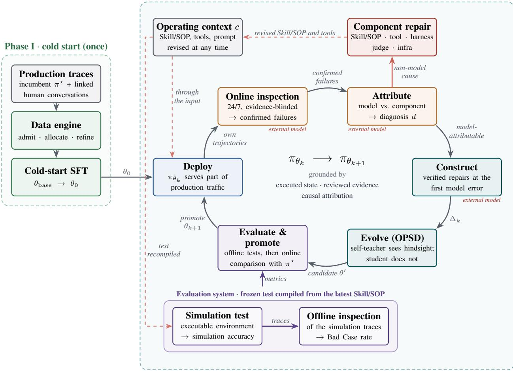
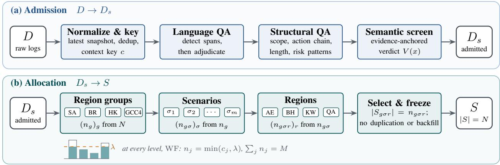
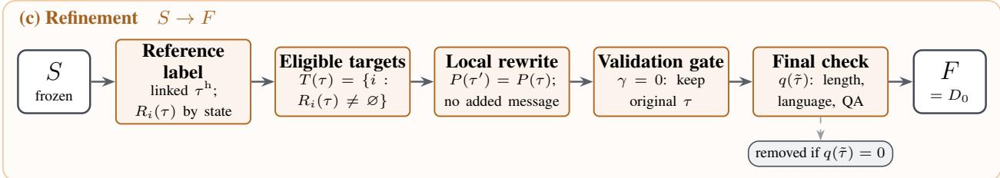
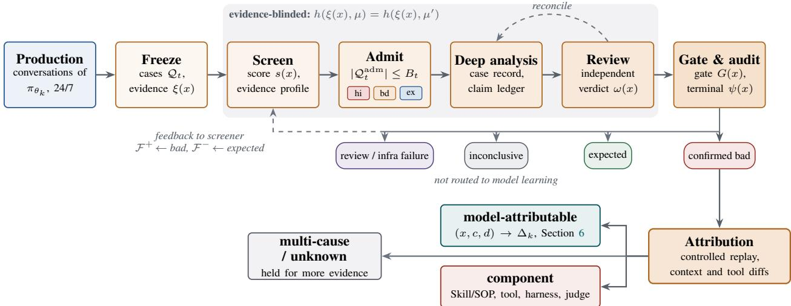
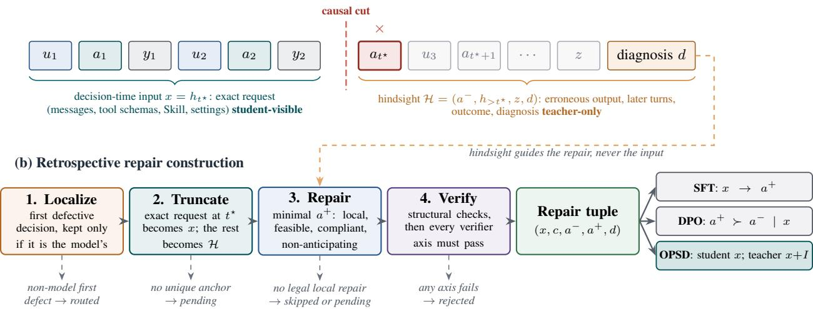
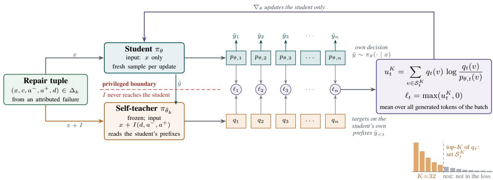
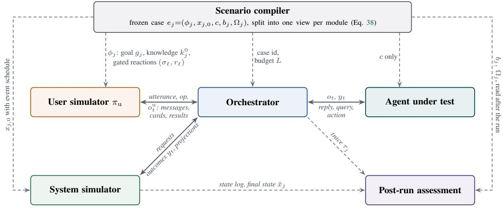
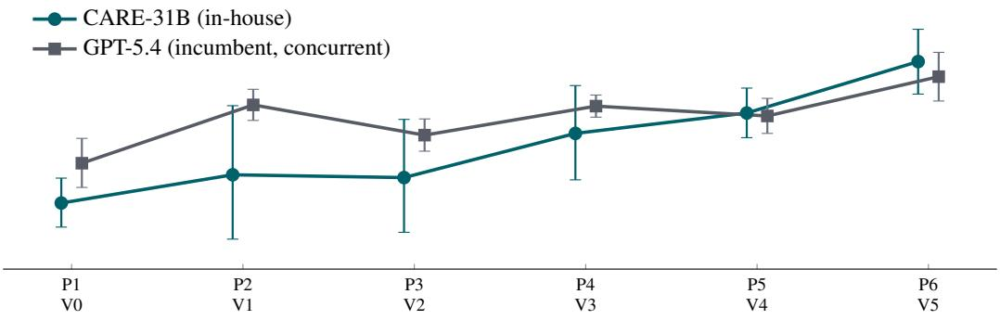
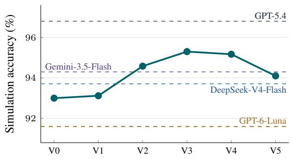
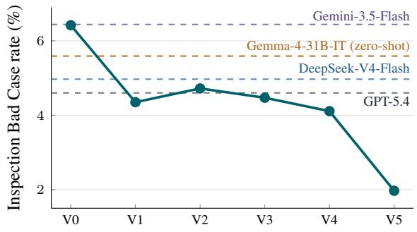

# CARE: Grounded Recursive Self-Improvement for Production Customer-Service Agents

Yanbei Jiang1,2, Chao Lei2, Rena Gao2, Xiaochen Zhao1, Yuchen Ge1, Haohang Liu1,3, Runze Nie1, Qitian Chen1, Qi An1, Haolin Song1, Yufei Sun1, Yihao Ding2, Jey Han Lau2, Krista A. Ehinger2, Xingjun Ma3, Weijia Chen1, Ruiyuan Wu1, Zhen Luo1, Ke Xing1, Yongjun Yin1

1AI and Data Team, Keeta, Meituan 2University of Melbourne 3Fudan University

Technical Report · October 2026

## ABSTRACT

Recursive self-improvement (RSI) in production agents involves transforming accumulated experience into reliable model updates while adapting to evolving business policies. We present CARE (Customer-service Agent Retrospective and Evolve), a grounded RSI framework that operationalizes this process in customer service. Its goal is to replace a frontier proprietary incumbent with an in-house mid-sized model that continues learning after deployment. After a one-time cold start on governed production traces, the current model serves production traffic alongside the incumbent, and its own failures drive the next update. A 24/7 inspection process establishes failures through evidence-blinded, independently reviewed judgments. Attribution separates model errors from defects in Skills, tools, or the harness, routing component failures to repair. Model-attributable trajectories are truncated at the first erroneous decision and paired with verified repairs. On-policy self-distillation (OPSD) then updates the model using the same model as teacher, with the diagnosis and repair supplied as privileged information unavailable to the student. To support continued evolution as business requirements change, training mixes failures from different Skill/SOP versions, each judged against the policy in force when it occurred. Candidates run an executable simulation test compiled from the latest SOP and then frozen, followed by offline inspection of the resulting traces. Promotion requires a combined simulation-and-inspection score at least at parity with the deployed version, confirmation through an online comparison with the incumbent, and human approval. In a multilingual food-delivery deployment, five RSI iterations reduce the inspection Bad Case rate of our in-house 31B model, CARE-31B, from 6.42% after cold start to 1.97%, below the incumbent GPT-5.4’s 4.60%, raise its simulation accuracy from 93.0% to 94.1%, and bring its online user satisfaction from 4.6 points below the incumbent to parity (1.7 points above it in the latest period). CARE-31B also lowers median reply latency by 27.7%, and replacing the incumbent completely lowers the serving cost per service order by 70.5%.

## Contents

Introduction 4   
2 Background and Related Work   
2.1 Recursive Self-Improvement   
2.2 On-Policy and Privileged-Information Distillation   
2.3 Interactive Evaluation and Continual Adaptation   
Problem Formulation   
3.1 Agents, policies in context, and the incumbent 7   
3.2 Replacement and improvement criteria   
3.3 What the loop depends on   
3.4 Requirements of grounded RSI in production   
Phase I: Cold Start from Production Traces 9   
4.1 Admission 10   
4.2 Hierarchical, capacity-constrained allocation 11   
4.3 State-aligned expression refinement 12   
4.4 Cold-start objective 12   
Retrospection: Online Inspection and Attribution 13   
5.1 Continuous online inspection 13   
5.2 Failure attribution 15   
Phase II: Evolve by Attribution-Guided On-Policy Self-Distillation 15   
6.1 From failures to verified repair tuples 15   
6.2 Hindsight as privileged information 17   
6.3 Data selection and mixing across policy versions 19   
Evaluation System and Promotion 19   
7.1 Executable simulation test 20   
7.2 Offline inspection test 24   
7.3 Online comparison . 24   
7.4 Promotion 24   
8 Experiments   
8.1 Setup .   
8.2 Recursive improvement over five iterations   
8.3 Comparison with other models   
8.4 Online deployment by scenario   
8.5 Serving latency and cost   
8.6 Ablation: how to learn from verified repairs   
8.7 Ablation: OPSD loss . 28   
0 Discussion 29   
9.1 RSI as an industrial learning workflow 29   
9.2 Evolving with business policies 29   
9.3 Why grounding keeps the loop from collapsing 29   
9.4 Limitations 30   
9.5 Risks and safeguards 30   
9.6 Toward a more closed loop 30   
10 Conclusion 31   
A Cold-Start Details 34   
A.1 Evolution of the data recipe 34   
A.2 Semantic screening states 34   
A.3 Training configuration . 34   
B Simulation Environment Details 35   
C Inspection Details 35   
C.1 Two inspected production cases 36   
D Repair Construction Details 37

E OPSD Training Configuration

## 1 Introduction

Large language model (LLM) agents now resolve a substantial share of customer-service conversations end to end. They interpret user requests, consult business state through tools, follow a Skill or standard operating procedure (SOP), and take actions such as refunds, compensation, or handoff to a human. In many deployments, a frontier proprietary model powers the agent. This incumbent delivers strong quality, but serving it at scale is expensive, its inference adds latency to every turn, and the operator has limited control over its behavior, update schedule, and data boundaries. These constraints motivate post-training an in-house mid-sized model that can replace the incumbent in production.

This replacement requires more than one-time distillation for three reasons. First, post-training on historical traces leaves a residual quality gap concentrated in long-tail situations. These failures emerge only when the model is deployed and encounters the state distribution induced by its own behavior. Second, the production environment is non-stationary: Skills and SOPs are revised, tool schemas change, and prompts are hot-fixed. Behavior that is correct under one configuration may become incorrect under the next. Third, once the incumbent is retired its production traces stop, so fresh experience can only come from the replacement’s own behavior. The replacement must therefore continue learning from its own experience while adapting to a changing environment. We frame this requirement as recursive self-improvement (RSI).

The idea of a system that improves the process by which it improves dates back to Good [1] and was formalized in self-referential agents such as the Gödel machine [2]. In the LLM era, RSI usually denotes a loop in which a system turns its own experience and feedback into persistent updates to its components, including weights, prompts, memory, tools, or harness code [3–5]. Recent analyses identify the grounding of feedback as a central constraint on such loops. When the same model generates and evaluates outputs, correlated errors can reinforce confident mistakes. Recursive training on self-generated data can also erode the tails of the distribution [6], and LLM judges can be gamed [7, 8]. Production customer service compounds these difficulties: there is no verifier that certifies an entire conversation as correct; a failure may originate in the model, a Skill, a tool, the harness, the simulator, the judge, or the infrastructure; and experimentation on real users is constrained.

We present CARE (Customer-service Agent Retrospective and Evolve), a grounded RSI framework for replacing an incumbent model in production (Figure 1). A one-time cold start (Phase I) builds the initial policy from governed production traces of the incumbent system, using a data engine that admits, allocates, and refines conversations.

Thereafter, the improvement loop runs on the in-house model’s own experience (Phase II). The current model serves part of the production traffic, and a 24/7 online inspection stage examines its conversations through evidence-blinded, independently reviewed judgments. For each confirmed failure, an attribution stage determines whether responsibility lies with the model or a non-model component. Component failures are repaired outside the model. For each modelattributable failure, the trajectory is truncated at the first erroneous decision and a verified repair is constructed. The model then evolves through on-policy self-distillation (OPSD): the student samples its own decision at that point, while the same model serves as the teacher with access to the diagnosis and verified repair as privileged information.

A separate evaluation system determines whether the candidate is ready to replace the deployed version. The candidate runs an executable simulation test compiled from the latest Skill/SOP and then frozen; offline inspection evaluates the resulting simulation traces. Its combined score must be at least at parity with the deployed version before an online comparison with the incumbent. Failures used for learning and cases used for evaluation come from separate sources and are never mixed. After cold start, the model’s own failures supply the training data, and the model itself supplies the teacher.

The loop is not free of external intervention. An external frontier model, not the in-house model, drives online inspection, attribution, and repair construction; component owners repair non-model failures; and a person approves each release. The external model’s output reaches training only as privileged information for the teacher, so CARE is self-improving in the source of its experience and of its teacher, not in the sense of running without outside help. The operating context also changes independently of the loop: Skills and SOPs can be revised at any time, including while a version is serving. Until the next update the deployed model has to follow a revision from its input alone, which is why training mixes several policy versions, and each simulation test is compiled from the current version. Section 3.3 sets out both points.

In Phase II, the reliance on self-generated training data and teacher supervision introduces a risk of error amplification, when model-generated outputs are evaluated without independent verification. Three checks outside the model therefore govern the loop. Reviewed evidence, rather than a single judge score, establishes whether a production conversation contains a failure. Attribution determines whether that failure warrants a model update or a component repair. In simulation, executed business state establishes whether an action such as a refund or cancellation actually occurred, independently of the model’s description of that action. Attribution also supplies privileged information for selfdistillation: the teacher’s information advantage comes from being told what went wrong, not from critiquing its own output.

Phase II · inspect, evolve, evaluate (recurring, k = 0, 1, 2, . . . )  
  
Figure 1: Overview of CARE. Phase I bootstraps an in-house policy $\pi _ { \theta _ { 0 } }$ from governed production traces of the incumbent system. Phase II is the recursive loop. The current model $\pi _ { \theta _ { k } }$ serves part of the production traffic; 24/7 online inspection turns its own conversations into reviewed failures; attribution separates model-attributable failures from component failures, which are repaired outside the model; model-attributable failures are cut at the first erroneous decision and repaired, and the model distills from itself on that decision, with the hindsight visible only to the teacher. The candidate is measured by the evaluation system, where it runs a simulation test compiled from the latest Skill/SOP and then frozen, and its simulation traces are inspected offline; it is promoted onl if the combined score of the two is at least at parity with the deployed version and an online comparison with the incumbent confirms it. After cold start, training data come from the model’s own failures and the teacher is the model itself. Stages tagged in red are driven by an external frontier model rather than by the in-house model. The operating context is revised independently of the loop: a revision reaches the deployed model through its input and the evaluation system through a recompiled test (Section 3.3).

Our contributions are as follows.

1. Problem formulation. We formalize production model replacement as grounded RSI, with an explicit replacement criterion and an iteration in which the model supplies both its experience and its teacher (Section 3).

2. Grounded retrospection and evaluation. A 24/7, layered, evidence-blinded online inspection process and a failure-attribution stage separate model errors from component errors before learning (Section 5). A separate evaluation system assesses every candidate through an executable, partially observable simulation test and offline inspection of the resulting traces (Section 7).

3. Attribution-guided on-policy self-distillation. We truncate each attributed failure trajectory at its first erroneous decision, construct a verified minimal repair using hindsight information, and train the model on its own outputs at the identified erroneous decision under the supervision of a hindsight-informed self-teacher. Hindsight information is excluded from the student’s input. Training incorporates failures from different Skill/SOP versions, each evaluated against its corresponding SOP, to improve the model’s ability to make decisions consistent with the provided policy (Section 6).

4. Production study. We report results from a multilingual food-delivery customer-service deployment covering seven regions, including comparisons with frontier models, online A/B comparisons, five RSI iterations that produce six model versions, and ablations of the learning signal and of the OPSD loss (Section 8).

Over five iterations, the inspection Bad Case rate of our in-house 31B model, CARE-31B, decreases from 6.42% after cold start to 1.97%, less than half of the incumbent’s 4.60% and the lowest rate among all evaluated models. Simulation accuracy improves from 93.0% to 94.1%, behind the incumbent and Gemini-3.5-Flash, and the combined evaluation score reaches 96.07 against the incumbent’s 96.10. In the online deployment across all seven regions, user satisfaction improves from 4.6 percentage points below the incumbent at cold start to comparable performance in the final two versions (+0.3 and +1.7 points).

These results highlight the limitations of cold start alone. Although the cold-start model completes substantially more simulated cases than the untuned base model, it produces more confirmed failures than both the base model and the incumbent. Recursive self-improvement addresses this gap through iterative refinement.

The ablations show why the learning signal matters at this data scale. On a small increment of repairs, supervised fine-tuning collapses during training, and preference optimization collapses into immediate handoff, passing 15.1% of simulated cases. OPSD keeps a simulation accuracy of 94.1%. Among its loss configurations, a forward KL divergence truncated to the teacher’s top 32 tokens performs best overall and is the one deployed.

Section 2 positions CARE within the RSI literature. Section 3 formalizes the setting. Sections 4–7 describe cold start, retrospection, evolution, and evaluation. Section 8 reports the experiments, and Section 9 discusses limitations and risks.

## 2 Background and Related Work

## 2.1 Recursive Self-Improvement

Good [1] introduced the concept of an “intelligence explosion,” in which a machine improves the design of its successors. The Gödel machine [2] formalized a self-referential agent capable of modifying its own code upon proving the benefits of such modifications. Contemporary recursive self-improvement (RSI) extends these ideas to systems that iteratively update their components through accumulated experience and feedback [3–5, 9]. Existing approaches differ in their update mechanisms and supervision signals. STaR improves reasoning through self-generated rationales leading to correct answers [10], SPIN learns from comparisons between model-generated responses and human demonstrations [11], and Self-Rewarding Language Models use model-generated judgments to improve both the policy and its reward model [12]. Beyond model parameters, Reflexion incorporates verbal feedback into subsequent attempts [13], Voyager accumulates executable skills through environment interaction [14], and the Darwin Gödel Machine evolves agent code through empirical evaluation [15].

The reliability of self-generated feedback remains a central challenge in RSI. Shared biases between generators and evaluators can reinforce existing errors, while recursive training on generated data may lead to model collapse [6]. Previous studies also report high variance, task-order sensitivity, and vulnerabilities in LLM-based evaluation [7, 8]. Formal verification and execution feedback provide more direct evidence of correctness than model-generated judgments alone [5]. A recent taxonomy [5] distinguishes bounded self-improvement, where updates are evaluated against fixed external criteria, from open-ended RSI, which can also modify the mechanisms governing improvement. It further categorizes improvement loops according to human involvement: human-in-the-loop systems require human review of individual updates, human-on-the-loop systems automate improvement while retaining human oversight and deployment control, and closed-loop systems operate without human intervention. Within this taxonomy, CARE adopts a bounded, human-on-the-loop approach in which retrospection, error attribution, and model training operate automatically, while promotion to production remains subject to evaluation and deployment gates. Learning signals are grounded in simulated business-state transitions, reviewed inspections, and verified repairs, while failures attributed to non-model components are directed to component repair.

## 2.2 On-Policy and Privileged-Information Distillation

On-policy learning addresses compounding errors arising from the mismatch between training distributions and states encountered during execution [16]. Generalized Knowledge Distillation (GKD) extends this principle to language models by sampling sequences from the student and minimizing divergence from teacher predictions [17]. Recent research further examines the training dynamics and practical considerations of on-policy distillation for LLMs [18]. Learning Using Privileged Information (LUPI) introduces supervision from information available during training but inaccessible during inference [19]. Privileged Information Distillation extends this principle to multi-turn agents, where a teacher conditioned on privileged actions guides a student without access to those actions [20]. On-Policy Self-Distillation (OPSD) enables a single model to serve as both teacher and student, using verified reasoning traces in the teacher context to minimize token-level divergence on student-generated trajectories [21].

Table 1: Positioning of CARE among representative self-improvement and distillation methods. “Grounding” denotes the evidence or supervision used to guide improvement, while “Contexts” indicates whether the method explicitly addresses changing policy requirements during iterative improvement. A dash indicates that the corresponding feature is not explicitly addressed.
<table><tr><td>Method</td><td>Updated component</td><td>Experience source</td><td>Grounding</td><td>Teacher</td><td>Contexts</td></tr><tr><td>STaR [10]</td><td>weights</td><td>own rationales</td><td>answer correctness</td><td></td><td></td></tr><tr><td>SPIN [11]</td><td>weights</td><td>own generations</td><td>human demonstrations</td><td>previous self</td><td></td></tr><tr><td>Self-Rewarding [12]</td><td>weights</td><td>own responses</td><td>self-judgment</td><td>self</td><td></td></tr><tr><td>Reflexion [13]</td><td>prompt / memory</td><td>own attempts</td><td>env. signal + self-reflection</td><td></td><td></td></tr><tr><td>Voyager [14]</td><td>skill library</td><td>own episodes</td><td>environment execution</td><td></td><td></td></tr><tr><td>DGM [15]</td><td>agent code</td><td>own code edits</td><td>benchmark evaluation</td><td></td><td></td></tr><tr><td>GKD [17]</td><td>weights</td><td>own rollouts</td><td>teacher likelihood</td><td>external model</td><td></td></tr><tr><td>π-Distill [20]</td><td>weights</td><td>own rollouts</td><td>privileged actions</td><td>PI-conditioned teacher</td><td></td></tr><tr><td>OPSD [21]</td><td>weights</td><td>own rollouts</td><td>verified solutions</td><td>self + PI</td><td></td></tr><tr><td>CARE</td><td>weights; routed component</td><td>own failures in simulation and</td><td>executed state, reviewed inspection, attribution,</td><td>self + hindsight</td><td>√</td></tr></table>

CARE adopts the self-distillation framework of OPSD while introducing failure-specific hindsight as privileged information. Unlike approaches using reference solutions or privileged actions, the self-teacher receives a reviewed, causally attributed diagnosis and a verified minimal repair at the first erroneous decision. The student learns from its own decision outputs under hindsight-informed supervision without access to hindsight in its input. This enables recursive model improvement through verified supervision derived from the model’s own production failures.

## 2.3 Interactive Evaluation and Continual Adaptation

Interactive agent evaluation examines decision-making through multi-turn interactions, tool execution, and environmentstate transitions. τ -bench evaluates tool–agent–user interactions under domain-specific policies [22], while $\tau ^ { 2 } .$ -bench extends this setting to environments where both users and agents can modify shared state [23]. These benchmarks motivate the explicit state transitions and outcome verification adopted by the CARE simulator. Agent Lightning and DataEnvGym further investigate the separation of agent execution from training and data-generation infrastructure [24, 25].

Continual learning introduces challenges including catastrophic forgetting, distribution shift, and evaluation leakage during successive model updates [26]. Production agents face an additional challenge as business policies evolve independently of model updates. CARE addresses this setting by incorporating failure trajectories from different Skill/SOP versions, with each trajectory evaluated against the SOP applicable during its execution. This enables the model to learn decisions consistent with the provided policy rather than relying on fixed policy-specific behaviors.

Table 1 compares representative self-improvement and distillation methods in terms of updated components, experience sources, grounding signals, teacher configurations, and adaptation to changing policy contexts.

## 3 Problem Formulation

## 3.1 Agents, policies in context, and the incumbent

A customer-service agent operates under business rules specified through its input rather than fixed within the model parameters. We define the operating context as

$$
c = ( s , w , p ) ,\tag{1}
$$

where s denotes the Skill/SOP governing agent behavior, w the available tools and their schemas, and $p$ the prompting instructions. The correct action for a given request depends on the operating context, as different Skills/SOPs and tool configurations may impose different requirements and constraints. As Skills and SOPs evolve during operation, the operating context changes accordingly.

An interaction under operating context c generates a trajectory

$$
\tau = ( x _ { 0 } , o _ { 1 } , a _ { 1 } , y _ { 1 } , \dots , o _ { T } , a _ { T } , y _ { T } , z ) ,\tag{2}
$$

where $x _ { 0 }$ denotes the initial business state (e.g., order, delivery, or after-sales status), $o _ { t }$ the agent-visible observation, $a _ { t }$ the agent’s action (e.g., a response, tool query, or business operation), $y _ { t }$ the corresponding tool or environment result, and z the terminal business outcome. The agent follows a policy $\pi ( a _ { t } \mid h _ { t } , c )$ , which determines the next action given the agent-visible interaction history $h _ { t }$ and operating context $c .$ We denote the incumbent model serving production by $\pi ^ { \star }$ and the in-house model by $\pi _ { \theta } ,$ initialized from an open-weight base model with parameters $\theta _ { \mathrm { b a s e } } .$

The incumbent serves three roles: its production trajectories provide the initial training data for cold start, its measured performance establishes the replacement benchmark, and it remains available as a fallback during model promotion. Beyond these roles, the incumbent is not used to generate training labels during recursive self-improvement.

## 3.2 Replacement and improvement criteria

Let $Q ( \pi , c )$ denote the expected business and service quality under operating context $c , H ( \pi , c )$ the rate of hard violations (e.g., prohibited actions or invalid state transitions), and $K ( \pi )$ the average serving cost per interaction. We define the replacement criteria separately for each operating context rather than aggregating performance across contexts.

Definition 1 (Replacement). An in-house policy $\pi _ { \theta }$ satisfies the replacement criteria relative to the incumbent $\pi ^ { \star }$ over a context set C, with quality tolerance $\delta \geq 0 , \operatorname { i f }$ , for every $c \in { \mathcal { C } } .$

$$
Q ( \pi _ { \theta } , c ) \geq Q ( \pi ^ { \star } , c ) - \delta , \qquad H ( \pi _ { \theta } , c ) \leq H ( \pi ^ { \star } , c ) , \qquad K ( \pi _ { \theta } ) < K ( \pi ^ { \star } ) .\tag{3}
$$

These criteria define the model replacement objective rather than the evaluation procedure for individual updates.   
Continued improvement remains necessary as new failures emerge and business policies evolve during deployment.

Definition 2 (Grounded RSI iteration). Given the current model parameters $\theta _ { k }$ , an iteration of CARE generates experience $\mathcal { T } _ { k } \sim \pi _ { \theta _ { k } }$ and produces a candidate model through

$$
\begin{array} { r l } & { \mathcal { D } _ { k } = \mathrm { ( C o n s t r u c t \circ A t t r i b u t e \circ R e t r o s p e c t ) } ( \mathcal { T } _ { k } ) , } \\ & { \quad \theta _ { k } ^ { \prime } = \mathrm { E v o l v e } ( \theta _ { k } ; \mathcal { D } _ { k } ) , } \\ & { \theta _ { k + 1 } = \Big \{ \theta _ { k } ^ { \prime } , \quad \mathrm { i f ~ G a t e } ( \theta _ { k } ^ { \prime } , \theta _ { k } ) = 1 , } \\ & { \theta _ { k } , \quad \mathrm { o t h e r w i s e } . } \end{array}\tag{4}
$$

The current model generates the training experience and serves as the self-teacher during evolution. External information provides grounding through executed business states, reviewed evidence, and verified repairs, with hindsight available only to the teacher. The binary promotion gate accepts a candidate if its combined offline score meets or exceeds that of the deployed model, an online comparison with the incumbent confirms its suitability, and human approval is obtained. The combined score incorporates simulation accuracy on a test set compiled from the latest Skill/SOP and frozen for candidate evaluation, together with offline inspection of the resulting simulation trajectories (Section 7, Eq. (46)).

Definition 2 specifies what “self” means in CARE: the model supplies both the training experience and the self-teacher, while external evidence and verification establish the correctness of the learning signals. Each promoted iteration is subject to independent evaluation and controlled deployment.

## 3.3 What the loop depends on

External intervention. Definition 2 is narrower than a loop that improves without external intervention. The in-house model supplies the experience and the teacher, but Retrospect, Attribute, and Construct in Eq. (4) are driven by an external frontier model, such as $\mathrm { G P T } ,$ , rather than by $\pi _ { \theta }$ . People also take part: component owners and engineers repair non-model failures, cases that cannot be confirmed may go to manual review, and a person approves each promotion. The external model’s output reaches training only as privileged information for the self-teacher, and the student never sees it (Section 6.2). We keep these stages outside the in-house model because a model that identifies and diagnoses its own failures would reinforce its own errors; independent judgment is what grounds the loop. CARE is therefore self-improving in its weights and training experience, not autonomous.

Changes to the operating context. A change of c is not a step of the loop. Business owners revise Skills, SOPs, tools, and prompts on their own schedule, and the component repairs that attribution triggers change them too, so a revision can land at any stage of an iteration. It reaches the loop in three places. While a version is serving, a revision reaches the model through its input and the weights stay the same, so until the next iteration the deployed model has to adapt by following the policy it is given. If it fails, online inspection picks the failure up and judges it against the revised policy, so the next iteration learns from it. During construction and training, each failure keeps the context in which it occurred, and a training set mixes several policy versions so that the model learns to follow the policy it is given and to generalize across revisions (Section 6.3). During evaluation, the simulation test is compiled automatically from the current Skill/SOP and then frozen, so a candidate is measured against the policy in force (Section 7).

## 3.4 Requirements of grounded RSI in production

Reliable improvement under Eq. (4) depends on the validity of the feedback, attribution, learning, and evaluation processes. We identify four requirements for grounded RSI in production, each addressed by a component of CARE.

R1: Grounded failure identification. Customer-service interactions lack a universal correctness verifier, making failure identification dependent on executed business states and independently reviewed evidence. Reliable retrospection requires distinguishing confirmed failures from inconclusive judgments while preventing evaluation shortcuts arising from model identities, prior quality labels, or other source metadata. Independence between training failures and evaluation cases is further required to avoid evaluation leakage (Sections 5 and 7).

R2: Causal attribution before learning. A failed interaction may originate from model behavior, defective Skills or prompts, tool or routing errors, simulator artifacts, judge errors, or infrastructure failures. These causes require different corrective interventions, and treating them uniformly as model errors can encourage the model to compensate for defective components. Reliable learning therefore depends on attributing failures to their underlying causes and restricting model updates to failures attributable to model behavior (Section 5.2).

R3: Learning from self-generated failures without reinforcing errors. Confirmed failures provide evidence of incorrect execution, whereas effective model improvement depends on identifying the first erroneous decision and constructing a verified repair. Directly incorporating failed trajectories into training risks propagating the errors embedded in those trajectories. Reliable on-policy learning therefore requires supervision grounded in verified repairs, applied to the model’s own generated decisions, with privileged hindsight accessible exclusively to the self-teacher (Section 6.2).

R4: Policy-conditioned learning and safe promotion. Evolving Skills and SOPs introduce policy variations across trajectories collected during successive iterations, such that similar interactions may require different actions under different policy versions. Learning without accounting for these variations risks reinforcing decisions that are inconsistent with the operating context. Policy-conditioned learning therefore preserves the Skill/SOP associated with each failure and verifies its corresponding repair against the policy in force at the time, enabling training across multiple policy versions (Section 6.3). Reliable promotion further requires evaluating candidate models on a simulation test compiled from the latest Skill/SOP and frozen for candidate evaluation, followed by offline inspection of the resulting trajectories, online comparison with the incumbent, and human approval (Section 7).

## 4 Phase I: Cold Start from Production Traces

Cold start produces the initial policy π that enters the recursive loop. Its raw material is the logged production behavior $\pi _ { \theta _ { 0 } }$ of the incumbent system: complete agent conversations with tool definitions, calls, results, and Skill content, together with conversations handled by human support staff. These logs are abundant but uneven. They contain execution defects, language errors, and scenario imbalance, and an incumbent trace that looks fluent may still take an action that contradicts the business state. We therefore treat cold start as a data-governance problem with three separate decisions (Figure 2): which conversations are admissible as positive demonstrations, how a fixed training budget is allocated among them, and whether their wording can be improved without changing their behavior. For raw candidates D, admitted candidates $D _ { s } ,$ , selected members S, and retained output F, the engine enforces

$$
\mathrm { I D s } ( F ) \subseteq \mathrm { I D s } ( S ) \subseteq \mathrm { I D s } ( D _ { s } ) \subseteq \mathrm { I D s } ( D ) ,\tag{5}
$$

so later stages can only remove members, never introduce new ones.

  
Figure 2: The cold-start data engine. (a) Admission keeps complete, context-keyed conversations that pass language, structural, and evidence-anchored semantic checks; only no\_problem conversations enter $\dot { D } _ { s } .$ , and rejected or unresolved records are never backfilled. (b) Allocation splits a fixed budget N over region groups, the scenarios of each group, and the regions of GCC4, applying the capacity-constrained equal split of Eq. 8 at every level, and then freezes the selected members S. (c) Refinement borrows tone from linked human conversations for eligible turns while preserving every protected field; a rejected rewrite keeps the original conversation, and only a failed final check removes it.

## 4.1 Admission

The learning unit is a complete conversation rather than an isolated reply, because a reply that is appropriate in one business state can be wrong in another. Exports may contain several cumulative snapshots of one conversation; the engine keeps the most complete snapshot, deduplicates by conversation identity, normalizes region, scenario, and provenance, and attaches the context key c of Eq. (1).

Language consistency. Multilingual customer service introduces language-related defects, including unintended script mixing, word-internal concatenation, and intrusion of unrelated languages. A rule-based detector identifies potentially anomalous spans in assistant messages, which are subsequently evaluated by a model using the surrounding conversational context. Protocol fields, URLs, placeholders, brand names, and user-initiated code-switching are excluded from defect classification. Conversations with confirmed or unresolved language issues are excluded from the admitted pool.

Structural quality. Deterministic checks then filter scenario scope, validate action chains, and compute context length with the target tokenizer and chat template, including tool definitions. Over-length conversations are excluded rather than truncated, since truncation silently changes the decision problem. Known risk patterns, such as inappropriate handoff placement, formulaic online-presence confirmations, claims of real-time processing, and placeholder images, are removed at this stage.

Evidence-anchored semantic screening. Structural validity alone provides insufficient evidence of behavioral correctness. A screening model examines every structurally qualified conversation, including tool execution results and structured business facts, to identify execution defects supported by identifiable evidence. Representative cases include applying a missing-item procedure to a whole-order non-receipt request and claiming courier contact without a corresponding executed action. Weak indicators, including low customer satisfaction, prolonged interactions, and requests for human assistance, provide insufficient grounds for confirming a defect. Each conversation x receives a verdict V(x) ∈ {no\_problem, problem, inconclusive}, where inconclusive denotes cases whose classification depends on unavailable runtime evidence. Admission is restricted to conversations classified as no\_problem:

$$
D _ { s } = \{ x \in D _ { q } : V ( x ) = \mathtt { n o \_ p r o b l e m } \} ,\tag{6}
$$

where $D _ { q }$ denotes the structurally qualified candidate pool. Semantic screening is applied to the complete candidate pool before allocation, ensuring that training quotas are determined from admitted conversations. The screening procedure prioritizes precision in identifying problem cases, treating the configured problem-rate limit as a ceiling rather than a target.

## 4.2 Hierarchical, capacity-constrained allocation

Production traffic is dominated by a few regions and scenarios; in an early snapshot, one scenario alone accounted for 37.8% of the conversations. Sampling according to the empirical traffic distribution would therefore underrepresent low-frequency regions and scenarios. Allocation assigns a fixed budget N hierarchically: first across four region groups (Saudi Arabia, Brazil, Hong Kong, and a GCC4 group of the United Arab Emirates, Bahrain, Kuwait, and Qatar), then across the scenarios present in each group, and finally across the individual regions within each group–scenario cell, limiting the dominance of high-volume categories.

Cells and capacities. Every admitted conversation $x \in D _ { s }$ carries a cell key $\boldsymbol \kappa ( \boldsymbol x ) = ( g , \sigma , r )$ : its region group $g \in { \mathcal { G } } = \{ \mathrm { S A }$ , BR, HK, GCC4}, its scenario $\sigma ,$ and its region $\boldsymbol { r } \in \mathcal { R } _ { g }$ , where ${ \mathcal { R } } _ { \mathrm { G C C 4 } } = \{ \mathrm { A E }$ , BH, KW, QA} and every other group contains a single region. The admitted capacity of each cell and its marginals are

$$
c _ { g \sigma r } = \big | \{ { x \in D _ { s } : \kappa ( x ) = ( g , \sigma , r ) } \} \big | , \qquad c _ { g \sigma } = \sum _ { r \in \mathcal { R } _ { g } } c _ { g \sigma r } , \qquad c _ { g } = \sum _ { \sigma } c _ { g \sigma } .\tag{7}
$$

Capacity-constrained equal split. The same capacity-constrained allocation principle is applied at each hierarchical level. For a budget M and capacities $\mathbf { c } = \left( c _ { 1 } , \dots , c _ { K } \right)$ , the continuous water-filling solution $\mathbf { n } ^ { * } = \left( n _ { 1 } ^ { * } , \ldots , n _ { K } ^ { * } \right)$ satisfies

$$
n _ { j } ^ { * } = \operatorname* { m i n } ( c _ { j } , \lambda ) , \qquad 0 \leq n _ { j } ^ { * } \leq c _ { j } , \qquad \sum _ { j = 1 } ^ { K } { n _ { j } ^ { * } } = M ,\tag{8}
$$

where the water level λ solves $\begin{array} { r } { \sum _ { j } \operatorname* { m i n } ( c _ { j } , \lambda ) = M . } \end{array}$ A scarce category contributes its entire available capacity, and the remaining budget is distributed equally among categories with residual capacity. The corresponding integer allocation operator $\operatorname { W F } ( M ; \mathbf { c } )$ implements this principle through the sequential assignment procedure described below. The operator is applied hierarchically as follows:

$$
\begin{array} { r } { ( n _ { g } ) _ { g } = \mathrm { W F } \big ( N ; ( c _ { g } ) _ { g } \big ) , \qquad ( n _ { g \sigma } ) _ { \sigma } = \mathrm { W F } \big ( n _ { g } ; ( c _ { g \sigma } ) _ { \sigma } \big ) , \qquad ( n _ { g \sigma r } ) _ { r } = \mathrm { W F } \big ( n _ { g \sigma } ; ( c _ { g \sigma r } ) _ { r } \big ) . } \end{array}\tag{9}
$$

$\operatorname { W F } ( M ; \mathbf { c } )$ is feasible if and only if $M \leq \textstyle \sum _ { j } c _ { j }$ . Each parent capacity is the sum of its children’s capacities (Eq. (7)), and the constraints $n _ { g } \leq c _ { g }$ and $n _ { g \sigma } \leq c _ { g \sigma }$ ensure the feasibility of every subsequent allocation. Consequently, the overall selection is feasible if and only $\ddot { \vert \mathbf { f } \vert } D _ { s } \vert \ge N . \mathrm { ~ I f ~ } \vert D _ { s } \vert < \overset { \cdot } { N }$ , selection fails rather than reducing the specified training budget. A category with $c _ { j } = 0$ receives zero allocation, reflecting the coverage limitations of the admitted pool.

Integer assignment. The implementation assigns slots sequentially, prioritizing categories with remaining capacity and the smallest current allocation. The resulting integer quotas satisfy

$$
n _ { k } - n _ { j } \geq 2 \implies n _ { j } = c _ { j } , \qquad \forall j , k .\tag{10}
$$

A category can therefore trail another by two or more slots only after exhausting its available capacity, while categories with remaining capacity differ by at most one slot. When category k received its last slot, any category j with fewer assigned slots and unused capacity would have been selected first. This establishes max–min fairness under capacity constraints. Proportional sampling, $\begin{array} { r } { n _ { j } = M c _ { j } / \sum _ { k } c _ { k } } \end{array}$ , would instead reproduce the traffic skew, assigning a scenario that accounts for 37.8% of conversations the same proportion of the training budget.

Member selection. The allocation determines the number of conversations contributed by each cell, while secondary criteria determine the selected members:

$$
S = \bigcup _ { g , \sigma , r } S _ { g \sigma r } , \qquad S _ { g \sigma r } \subseteq \{ x \in D _ { s } : \kappa ( x ) = ( g , \sigma , r ) \} , \qquad | S _ { g \sigma r } | = n _ { g \sigma r } ,\tag{11}
$$

so $| S | = N$ . Records are selected without duplication $( n _ { g \sigma r } \leq c _ { g \sigma r } )$ , and quarantined records are excluded from backfilling $( S \subseteq D _ { s } )$ . Secondary criteria, including handoff stage, data source, and multimodal content, determine membership within each cell while preserving the allocated quotas. The availability of linked human references and eligibility for subsequent expression refinement are excluded from selection criteria to prevent refinement opportunities from influencing training exposure. The selected set S is then frozen as the training membership.

## 4.3 State-aligned expression refinement

Incumbent responses generally follow the intended business procedures, although their linguistic expression can be formulaic, particularly when addressing customer frustration. Human support conversations provide more natural expressions of empathy and reassurance, while differing in operational permissions and workflow states. We therefore use human conversations exclusively as references for linguistic expression, preserving the business facts and actions of the original agent trajectories. Refinement operates on the frozen selected set S.

Representation. We represent a selected conversation as $\tau = \big ( ( z _ { 1 } , u _ { 1 } ) , \dots , ( z _ { L } , u _ { L } ) \big )$ , where $z _ { i }$ contains the protected fields of message $i ,$ including roles, actions, FAQ codes, responsibility assignments, action extensions, and tool calls and results, while $u _ { i }$ denotes its natural-language content. The projection onto protected fields, $P ( \tau ) =$ $\left( z _ { 1 } , \dots , z _ { L } \right)$ , additionally preserves the number and order of messages.

Reference labeling. Let $\tau ^ { \mathrm { h } }$ denote a human support conversation linked to τ through an explicit conversation key. Ambiguous links are excluded from reference matching, while conversations without valid references retain their original expressions. For an assistant message i in τ and a human response $v \in \tau ^ { \mathrm { h } }$ , a labeling model determines their alignment in business state and action, $\alpha ( v , \bar { i } ; \tau ) \in \{ 0 , 1 \}$ . The eligible references are

$$
R _ { i } ( \tau ) = \big \{ v \in \tau ^ { \mathrm { h } } \ \backslash \ \mathcal { X } : \ \alpha ( v , i ; \tau ) = 1 \big \} ,\tag{12}
$$

where $\mathcal { X }$ comprises rating solicitations, closing and repetitive templates, empty apologies, self-introductions, and private content. An alignment label $\alpha = 1$ indicates eligibility as a linguistic style reference, with business facts retained exclusively from the original agent trajectory.

Eligible targets. Refinement is restricted to existing assistant messages with at least one eligible reference:

$$
T ( \tau ) = \{ i : { \cal R } _ { i } ( \tau ) \neq \emptyset \} .\tag{13}
$$

Constrained rewrite. For $T ( \tau ) \neq \emptyset$ , the rewriting model proposes $\tau ^ { \prime }$ through local modifications to eligible message text, $u _ { i } ^ { \prime } = f \bigl ( u _ { i } ; \tau , R _ { i } ( \tau ) \bigr )$  for $i \in T ( \tau )$ . The rewriting process preserves the original message structure, actions, and tool interactions by enforcing

$$
P ( \tau ^ { \prime } ) = P ( \tau ) , \qquad \{ i : u _ { i } ^ { \prime } \neq u _ { i } \} \subseteq T ( \tau ) .\tag{14}
$$

A validation gate $\gamma ( \tau , \tau ^ { \prime } ) \in \{ 0 , 1 \}$ assesses reference reliability, expected linguistic improvement, and potential risks introduced by the rewrite. Rejected proposals revert to the original conversation:

$$
\tilde { \tau } = \left\{ \begin{array} { l l } { { \tau ^ { \prime } } } & { { \mathrm { i f } T ( \tau ) \neq \emptyset \mathrm { a n d } \gamma ( \tau , \tau ^ { \prime } ) = 1 , } } \\ { { \tau } } & { { \mathrm { o t h e r w i s e . } } } \end{array} \right.\tag{15}
$$

Final check. Preservation of structural fields alone is insufficient to establish semantic equivalence. The refinement process therefore recomputes context length and derived attributes and repeats the language and structural checks of Section 4.1, including model-based language adjudication where applicable. Let $q ( \tilde { \tau } ) \in \{ 0 , 1 \}$ } denote the final quality check. The retained corpus is

$$
\begin{array} { r l r l } & { F = \big \{ \tilde { \tau } : \tau \in S , q ( \tilde { \tau } ) = 1 \big \} , } & & { n _ { g \sigma r } ^ { F } = \big | \{ \tilde { \tau } \in F : \kappa ( \tilde { \tau } ) = ( g , \sigma , r ) \} \big | \leq n _ { g \sigma r } . } \end{array}\tag{16}
$$

Rejected rewrites retain their original conversations $( \mathrm { E q . ~ } ( 1 5 ) )$ , whereas failures in the final quality check result in exclusion. Consequently, $F$ satisfies the membership constraint of Eq. (5). The absence of resampling allows the retained cell distribution ${ \bf \Pi } _ { n } F$ to deviate from the original allocation quotas, which are reported separately.

## 4.4 Cold-start objective

The retained set $F$ forms the cold-start corpus $D _ { 0 }$ . Starting from $\theta _ { \mathrm { b a s e } } .$ , the instruction-tuned Gemma-4-31B-IT checkpoint, we minimize the masked negative log-likelihood

$$
\mathcal { L } _ { \mathrm { c o l d } } ( \theta ) = - \frac { 1 } { Z } \sum _ { i \in D _ { 0 } } \sum _ { j } m _ { i j } \log \pi _ { \theta } \bigl ( y _ { i j } \mid y _ { i , < j } , c _ { i } \bigr ) , \qquad Z = \sum _ { i , j } m _ { i j } ,\tag{17}
$$

where $m _ { i j }$ selects assistant tokens. System-injected context cards, tool results, and business state serve as conditioning inputs; supervision begins with the first assistant response or tool call following the first user message. This objective trains the model to generate actions and responses conditioned on the supplied Skills, tool contracts, and business context, providing a context-dependent initialization for subsequent recursive improvement.

The training configuration of this stage is provided in Appendix $\mathrm { A . } 3 ,$ , while historical revisions of the data preparation process, including earlier approaches that concatenated or inserted human turns, are documented in Appendix A.1.

  
Figure 3: Online inspection and attribution. Production conversations of the in-house model are frozen into a case set $\mathcal { Q } _ { t }$ and pass an evidence-blinded inspection (Eq. 18) that separates ranking, capacity-aware admission from three strata (Eq. 20), analysis, and independent review with reconciliation, and ends in one of four terminal states (Eq. 21). Terminal states feed back to the screener (Eq. 23). Only confirmed failures reach attribution, which routes model-attributable cases, together with their diagnosis d, to incremental task construction, routes component failures to repair, and holds cases whose cause cannot be isolated.

## 5 Retrospection: Online Inspection and Attribution

Retrospection turns the deployed model’s own production conversations into failure evidence that is reliable enough to learn from (requirement R1), and decides whose failure each one is before any of them can influence training (R2). It runs continuously, around the clock, on the traffic served by the in-house model. Its screening, analysis, review, and attribution steps are run by an external frontier model rather than by the in-house model (Section 3.3), so the deployed model never judges its own conversations. It is deliberately separate from the evaluation system of Section 7: online inspection discovers failures to learn from, whereas the evaluation system measures candidate versions on fixed test sets. The two use the same inspection procedure but never share cases or denominators.

## 5.1 Continuous online inspection

Online inspection examines the production conversations handled by the in-house model as they mature, 24 hours a day. Because no verifier exists, inspection is organized as a sequence of separable decisions rather than a single judge score (Figure 3). Three separations run through the design: discovering a suspicious conversation is separate from confirming a Bad Case, a model’s judgment is separate from the act of publishing it, and local evidence is separate from production writes.

Freezing and evidence blinding. Each inspection run first freezes its input: the source window or report, the case identities, and the evidence view. We write $\mathcal { Q } _ { t }$ for the frozen case set of window $t ;$ online it holds the mature conversations served by $\pi _ { \boldsymbol { \theta } _ { k } }$ in that window, and offline it is a fixed test set. Every case $x \in \mathcal { Q } _ { t }$ carries an evidence view ξ(x) (dialogue, tool calls and results, order state, trajectory, and the applicable policy knowledge) and metadata $\mu ( x )$ (source quality labels and scores, report and model identities, experiment labels, and release-side fields). The metadata are kept for auditing but never enter a judgment prompt, so every judgment stage h (screening, analysis, review) is counterfactually invariant to them:

$$
h { \big ( } \xi ( x ) , \mu { \big ) } = h { \big ( } \xi ( x ) , \mu ^ { \prime } { \big ) } \qquad { \mathrm { f o r ~ a l l ~ m e t a d a t a ~ } } \mu , \mu ^ { \prime } .\tag{18}
$$

Scenario identity is taken from stable fields (test contract, region, business group, scenario definition) rather than from the model’s reply. Without Eq. (18), a judge that knew the source system had failed a trace, or which version produced it, could learn a label shortcut instead of judging the behavior.

Screening as evidence grading. A screening model compresses $\mathcal { Q } _ { t }$ into a ranked candidate pool. It is an evidence grader and ranker, not the final judge. For each case it returns a suspicion score $s ( x ) \in [ 0 , 1 ]$ together with an evidence profile: whether the defect is visible, the number of locatable evidence anchors $a ( x )$ , the likelihood $u ( x )$ that the case

survives to publication, and the degree $\rho ( x )$ to which the verdict depends on runtime evidence missing from the log. Only cases with strong evidence are eligible for high-confidence admission,

$$
\begin{array} { r } { \mathcal { Q } _ { t } ^ { \mathrm { e l } } = \left\{ x \in \mathcal { Q } _ { t } : \mathrm { ~ d e f e c t ~ v i s i b l e } , \ a ( x ) \geq a _ { \mathrm { m i n } } , \ u ( x ) \geq u _ { \mathrm { m i n } } , \ \rho ( x ) \leq \rho _ { \mathrm { m a x } } \right\} . } \end{array}\tag{19}
$$

Weak signals such as low satisfaction, long dialogue, or repeated requests for a human may raise $s ( x )$ but cannot establish eligibility on their own. A case on which screening fails is not routed onward by any fallback, so an infrastructure fault is never converted into an apparent business risk.

Capacity-aware admission. Deep analysis, review, and gating are expensive, and the choice of which cases receive them shapes what the system can conclude. Admission therefore fills a rolling capacity $B _ { t }$ from three strata,

$$
\mathcal { Q } _ { t } ^ { \mathrm { a d m } } = \mathcal { Q } _ { t } ^ { \mathrm { h i } } \cup \mathcal { Q } _ { t } ^ { \mathrm { b d } } \cup \mathcal { Q } _ { t } ^ { \mathrm { e x } } , \qquad \left| \mathcal { Q } _ { t } ^ { \mathrm { a d m } } \right| \leq B _ { t } ,\tag{20}
$$

where $\mathcal { Q } _ { t } ^ { \mathrm { h i } }$ takes the highest-scoring cases of $\mathcal { Q } _ { t } ^ { \mathrm { e l } }$ to maximize immediate discovery, $\mathcal { Q } _ { t } ^ { \mathrm { b d } }$ samples the boundary band $\{ x : | s ( x ) - \eta | \leq \beta \}$ around the screening threshold $\eta$ to measure where the screener is uncertain, and ${ \mathcal { Q } } _ { t } ^ { \mathrm { e x } }$ samples low-score or rare strata to keep new failure families discoverable. Pure top-K admission would entrench the screener’s historical bias, and pure random admission would spend expensive capacity on uninformative cases. Every admitted case is committed to reach a terminal state; a suspicious case outside $\dot { \mathcal { Q } } _ { t } ^ { \mathrm { a d m } }$ carries no such commitment.

Deep analysis. Each admitted case receives a structured case record that answers six questions: what the user actually requested; which intent, FAQ, Skill, or SOP path the system selected; which actions or promises the agent made at the key turns; whether those violated regional, business-line, compensation, risk-control, or language rules; whether the runtime evidence suffices to support that judgment; and, if a defect exists, its type, likely cause, and a suggested fix. A claim ledger links every conclusion of the record to anchors in $\xi ( x )$ , and mechanical contract checks verify the record’s structure. These auxiliary checks improve consistency but never short-circuit the semantic review and gate.

Review, reconciliation, and gate. An independent reviewer, distinct from the analyst, challenges the record against the policy knowledge base and returns a verdict $\omega ( x ) \in \{ \mathrm { B A D } . \qquad $ EXPECTED, INCONCLUSIVE}. Evidence gaps, malformed records, or conflicting conclusions send the record back for reconciliation before the verdict is final. A publication gate $G ( x ) \in \{ 0 , 1 \}$ then requires a unique anomalous turn, a complete evidence package, a valid problem classification, and an explicit verdict. The terminal state $\psi ( x )$ of an admitted case is

$$
\psi ( x ) = \left\{ \begin{array} { l l } { \mathrm { B A D } } & { \mathrm { i f } \omega ( x ) = \mathrm { B A D \ a n d \ } G ( x ) = 1 , } \\ { \mathrm { E X P E C T E D } } & { \mathrm { i f } \omega ( x ) = \mathrm { E X P E C T E D } , } \\ { \mathrm { F A I L } } & { \mathrm { i f \ r e v i e w \ o r \ i n f r a s t r u c t u r e \ f a i l s } , } \\ { \mathrm { I N C O N C L U S I V E } } & { \mathrm { o t h e r w i s e } . } \end{array} \right.\tag{21}
$$

The rule is fail-closed: a case that cannot be confirmed is recorded as inconclusive or sent for manual review, and a review or gate pass is never assumed. Only $\psi ( x ) = \mathbf { B } \mathbf { A } \mathbf { D }$ can reach learning.

Audit and the confirmed-bad rate. An audit checks that every admitted case reached a terminal state, that every confirmed case holds both a review and a gate pass, that expected and inconclusive verdicts are backed by an independent review, that no source label leaked into a prompt, and that denominators are consistent. With $B _ { t } \stackrel { \cdot } { = } \{ x \in \stackrel { \cdot } { \mathcal { Q } _ { t } ^ { \mathrm { a d m } } }$ $\psi ( x ) = \mathtt { B A D } \big \}$ , the headline metric is the confirmed-bad rate over the complete frozen set,

$$
\widehat { R } _ { t } = \frac { | B _ { t } | } { | Q _ { t } | } .\tag{22}
$$

Cases that were never admitted, and inconclusive cases, count neither as failures nor as passes. If confirmation is precise, that is, $B _ { t } \subseteq B _ { t } ^ { \star }$ for the set $B _ { t } ^ { \star }$ of truly defective cases, then $\widehat { R } _ { t } \leq | B _ { t } ^ { \star } | / | \mathcal { Q } _ { t } | \colon \widehat { R } _ { t }$ is a conservative lower bound on the defect rate rather than a calibrated estimate of it. Online, it is a monitoring signal over shifting traffic; versions are compared instead with the offline inspection test of Section 7.2, which applies the same procedure to a fixed case set.

Feedback to the screener. Terminal states also recalibrate the inspection system itself. Writing $\mathcal { F } _ { t } ^ { + }$ and $\mathcal { F } _ { t } ^ { - }$ for the screener’s positive and negative examples,

$$
\mathcal F _ { t + 1 } ^ { + } = \mathcal F _ { t } ^ { + } \cup \mathcal B _ { t } , \qquad \mathcal F _ { t + 1 } ^ { - } = \mathcal F _ { t } ^ { - } \cup \{ x \in \mathcal Q _ { t } ^ { \mathrm { a d m } } : \psi ( x ) = \mathtt { E X P E C T E D } \} .\tag{23}
$$

Inconclusive and failed cases enter neither set: a review failure is semantically undecided, and an infrastructure failure says nothing about model quality, so a broken evaluator is never learned as evidence of safe behavior. The boundary and exploration strata of Eq. (20) supply the cases from which new failure families enter ${ \mathcal { F } } ^ { + }$ . Inspection modes and the stage contract are summarized in Appendix $\mathrm { C } ,$ and Appendix C.1 follows two production conversations through the procedure, one judged expected behavior and one confirmed as a Bad Case.

Table 2: Attribution categories and repair routes. Only the model-behavior category produces training data for Phase II; every other category is repaired outside the model.
<table><tr><td>Cause</td><td>Evidence sought</td><td>Route</td></tr><tr><td>Model behavior</td><td>Same context and valid tools; the decision error is reproducible, including in situations that training covered poorly</td><td>Incremental task and attribution-guided OPSD</td></tr><tr><td>Skill/SOP or prompt</td><td>The policy or prompt itself is wrong, ambiguous, or inconsistent</td><td>Revise the Skill/SOP or prompt</td></tr><tr><td>Tool, harness, or router</td><td>Schema, dispatch, projection, or route mismatch</td><td>Runtime repair</td></tr><tr><td>Judge or inspection</td><td>Unsupported verdict or review disagreement</td><td>Recalibrate the evaluator; discard the label</td></tr><tr><td>Infrastructure</td><td>Timeout, missing artifact, failed write</td><td>Operational recovery; no quality label</td></tr></table>

## 5.2 Failure attribution

A confirmed failure says that something went wrong, not that the model should change. Attribution assigns responsibility before learning. It assembles an evidence package for each confirmed case: the complete trajectory, the executed tool results, the Skill/SOP, prompt, and tool definitions the model was given and their recent changes, the training coverage of similar situations, and the version of the judge involved. Candidate causes and their repair routes are listed in Table 2.

Co-occurrence is not causation: a concurrent Skill change does not by itself make a failure the Skill’s fault, and the absence of similar examples from training does not by itself explain a model error. Where feasible, attribution performs controlled replay that varies the model, the Skill/SOP and prompt, and the tool or harness contract independently, and it retains a multi-cause or unknown label when the cause cannot be isolated. This conservatism prevents the loop from teaching the model to work around a broken tool or a miscalibrated judge, which would be a self-confirming failure of exactly the kind RSI must avoid.

For a model-attributable case, attribution emits a diagnosis d alongside the route. The diagnosis records the supported cause, including whether similar situations were scarce in training, the policy and context under which the correct behavior is defined, the evidence anchors, the decision point at which the model went wrong, and corrective guidance. Recording the decision point matters for learning: the guidance must be actionable with the information available at that point, so that the model is not taught to assert outcomes it could not have known. Because the correct action depends on the SOP in force, the diagnosis is defined relative to the Skill/SOP the model was given when the failure occurred.

## 6 Phase II: Evolve by Attribution-Guided On-Policy Self-Distillation

The evolve stage converts model-attributable failures into a weight update (requirement R3). It has three parts. Retrospective repair construction turns each failure into a verified repair at the first decision where the model went wrong. On-policy self-distillation trains the model on its own outputs at that decision against a teacher that is the model itself, given the hindsight as privileged information. Data selection balances the training signal and deliberately mixes policy versions (R4). The resulting candidate is then evaluated and promoted as described in Section 7; Algorithm 1 summarizes one full iteration.

## 6.1 From failures to verified repair tuples

A confirmed failure arrives as a long multi-turn trajectory, logged across several streams (the requests sent to the model, the agent’s outputs and tool calls, state persistence, and what the user saw), together with a retrospective diagnosis. It cannot be used for training as it stands, because it records the whole conversation, whereas the model made each decision from only what preceded it. Everything from the first error onward is therefore hindsight: the later turns are conditioned on a state that a corrected policy would never reach, so their correction is ill-defined, and the outcome and inspection that exposed the failure were not available when the model erred. Construction accordingly works at the single decision where the model first went wrong, and separates the input the model had there from what was learned afterwards (Figure 4).

Let $h _ { t }$ denote the exact input of the model at step t: the message history, the tool schemas, the Skill content, and the generation settings of that request. It is the agent’s information set at the moment of decision. Everything that retrospection adds beyond $h _ { t }$ is hindsight.

(a) A confirmed failure, split at the first model error  
  
Figure 4: Retrospective repair construction. (a) A confirmed failure is cut at the first decision the model got wrong. Everything the model could see at that moment becomes the student input; the erroneous output, the rest of the conversation, the outcome, and the diagnosis become hindsight. (b) The proposer uses hindsight to write a minimal repair that remains justified by the decision-time input alone, an independent verifier accepts or rejects it, and each accepted tuple can be projected into SFT, DPO, or OPSD data. Every case ends in exactly one terminal state.

Step 1: localize the first model error. Let $\boldsymbol { \mathcal { A } } ^ { \star } ( h _ { t } , \boldsymbol { c } )$ be the set of acceptable actions at step t under context c. Construction anchors the earliest defective decision,

$$
t ^ { \star } = \operatorname* { m i n } \{ t : a _ { t } \notin { \mathcal { A } } ^ { \star } ( h _ { t } , c ) \} ,\tag{24}
$$

and proceeds only if attribution assigns this defect to the model. If the earliest defect belongs to a tool, a state resolver, or an upstream component, the case is routed to component repair even when later model errors exist, since those later decisions were made on a corrupted state. The anchor is identified by the request identity and the exact logged output rather than by ordinal position, and a case without a unique anchor is held as pending.

Step 2: causal truncation. The training input is the exact request at the anchored decision, $x = h _ { t ^ { \star } }$ : the message history up to but excluding $a _ { t ^ { \star } }$ , with every other request field kept verbatim. The erroneous output $a ^ { - } = a _ { t ^ { \star } }$ , everything after it, the outcome $z ,$ and the diagnosis d form the hindsight $\bar { \mathcal { H } } = ( a ^ { - } , h _ { > t ^ { \star } } , z , d )$ , which may enter training only on the teacher side.

Step 3: minimal counterfactual repair. A proposer model receives $x , a ^ { - }$ , the incident-time policy, and the diagnosis d (marked as invisible to the student), and proposes a replacement $a ^ { + }$ for the single erroneous decision. Writing M(x) for the actions whose asserted facts are supported by x alone, the proposer approximates the smallest admissible edit,

$$
a ^ { + } \in \arg \operatorname* { m i n } _ { a \in A ^ { \star } ( x , c ) \cap \mathcal { M } ( x ) } \delta \big ( a , a ^ { - } \big ) ,\tag{25}
$$

where $\delta$ measures the extent of the change. Four constraints make this precise. Locality: only the erroneous decision changes; the prefix is identical, and nothing after the decision (tool results, user replies, follow-up messages) is generated. Feasibility: $a ^ { + }$ uses only the tools, arguments, and response fields available in x under context c. Non-anticipation: hindsight may tell the proposer that $a ^ { - }$ was wrong, but it may not make $a ^ { + }$ more specific than x allows. For example, if a status tool returned only “not picked up” and the original reply asserted that the food was still being prepared, the repair may remove the unsupported claim but may not substitute an order status observed later. Compliance: $a ^ { + }$ follows the policy in force at the time of the incident, not the current one. When x contains images, the proposer must consume the images themselves.

Step 4: independent verification. Deterministic checks first confirm prefix identity, a single in-place difference, and schema validity of tool calls and response fields. An independent verifier then judges $( x , \bar { a } ^ { - } , \bar { a ^ { + } } , d )$ along separate axes: whether the target is a genuine model fault, whether the inspected symptom is corrected, whether the repair stays at the decision boundary, whether it complies with the incident-time policy, and whether it respects the tool and format contract. A repair is accepted only if every axis passes, accept $= \textstyle \bigwedge _ { j } ^ { - } V _ { j } ( x , a ^ { - } , a ^ { + } , d )$ . Acceptance certifies that $a ^ { + }$ is an acceptable decision at $x ;$ it does not certify that a tool call would succeed or that the conversation would end well.

Table 3: Training views of a repair tuple (x, $\cdot c , a ^ { - } , a ^ { + } , d ) . I = \operatorname { e n c } ( d , a ^ { - } , a ^ { + } )$ is the privileged information.
<table><tr><td>View</td><td>Student input Learning signal</td><td></td></tr><tr><td>SFT</td><td>x</td><td>imitate the reference repair  $a ^ { + }$ </td></tr><tr><td>DPO</td><td>x</td><td>prefer  $a ^ { + }$  over  $a ^ { - }$ </td></tr><tr><td>OPSD</td><td>x</td><td>match a self-teacher that sees  $( x , I )$  , on the student&#x27;s own sampled output</td></tr></table>

Repair tuples and their training views. Accepted cases form the incremental set

$$
\Delta _ { k } = \big \{ ( x _ { i } , c _ { i } , a _ { i } ^ { - } , a _ { i } ^ { + } , d _ { i } , \ell _ { i } ) \big \} ,\tag{26}
$$

where $\ell _ { i }$ links each tuple to its source case. One tuple supports three training views (Table 3), which we compare in Section 8.6. Supervised fine-tuning imitates $a ^ { + }$ , and direct preference optimization [27] contrasts $a ^ { + }$ with $a ^ { - } ;$ both treat a text written by the proposer as the target. OPSD instead keeps the student on its own outputs and lets the reference reach it only through the teacher. The construction resembles hindsight relabeling [28] in that it reuses information that becomes available only after the episode, but the hindsight is used to correct the decision under the original goal, and it never reaches the student.

Accounting. Every case ends in exactly one terminal state: admitted, routed (the first defect is not the model’s), rejected by the verifier, or pending (no unique anchor, a failed construction, or unverified visual evidence). Pending cases are never relabeled as rejected or routed, and cases that are not admitted are not counted as failures the model cannot learn. Before a tuple is used for training, four further checks apply: the incident model is replayed at $x$ to test whether $\cdot \ : a ^ { - }$ reproduces; the tuple is rendered with the target tokenizer, chat template, tool schemas, and loss mask; the collator is verified to keep I out of the student input; and a minimal training run is executed. Implementation details are given in Appendix D.

## 6.2 Hindsight as privileged information

For a tuple $( x , c , a ^ { - } , a ^ { + } , d ) \in \Delta _ { k }$ , the student samples its own decision at the anchored point, ${ \hat { y } } \sim \pi _ { \theta } ( \cdot \mid x ) ;$ a single assistant turn, which may contain a tool call; x already encodes the context c. A self-teacher, a frozen copy ${ \bar { \theta } _ { k } }$ of the model at the start of the iteration, reads the same input with the privileged information $I = \operatorname { e n c } ( d , a ^ { - } , a ^ { + } )$ added to its system message, which states what went wrong, the SOP in force at the incident, and the verified repair. The teacher then follows the student’s rollout token by token (Figure 5), so that at each position both models give a distribution over the whole vocabulary from the same prefix,

$$
p _ { \theta , t } = \pi _ { \theta } \big ( \cdot \mid x , \hat { y } _ { < t } \big ) , \qquad q _ { t } = \mathrm { s g } \big [ \pi _ { \bar { \theta } _ { k } } \big ( \cdot \mid x , I , \hat { y } _ { < t } \big ) \big ] ,\tag{27}
$$

where sg denotes stop-gradient. The objective accumulates a divergence $\ell _ { t }$ between the two over the student’s own samples,

$$
\mathcal { L } _ { \mathrm { O P S D } } ( \theta ) = \mathbb { E } _ { ( x , I ) \sim \Delta _ { k } } \mathbb { E } _ { \hat { y } \sim \pi _ { \theta } ( \cdot | x ) } \Big [ \sum _ { t } m _ { t } \ell _ { t } ( \theta ) \Big ] ,\tag{28}
$$

where $m _ { t }$ selects the generated tokens of the student’s turn and excludes the prompt and padding. The rollout fixes the prefixes at which the two models are compared and is then treated as data: the loss is backpropagated directly through ${ p } _ { \theta , t }$ , without a policy-gradient estimator over the sampling step.

A family of truncated KL losses. We define $\ell _ { t }$ as a Kullback–Leibler (KL) divergence restricted to the tokens that matter to the teacher. Let $\mathbf { \mathcal { S } } _ { t } ^ { K }$ be the K tokens to which $q _ { t }$ assigns the highest probability. The family leaves three choices open: the direction of the divergence, the size $K$ , and a floor on negative token losses. Section 8.7 ablates all three. The configuration that we deploy uses the forward direction with $K \stackrel { = } { = } 3 2$ and the floor,

$$
u _ { t } ^ { K } ( \theta ) = \sum _ { v \in S _ { t } ^ { K } } q _ { t } ( v ) \left[ \log q _ { t } ( v ) - \log p _ { \theta , t } ( v ) \right] , \qquad \ell _ { t } ( \theta ) = \operatorname* { m a x } \bigl ( u _ { t } ^ { K } ( \theta ) , 0 \bigr ) .\tag{29}
$$

Both distributions keep their full-vocabulary normalization: the K terms are not renormalized, and no smoothing or lower bound is added to the probabilities.

Direction. The forward direction weights each token by the teacher’s probability. For $u _ { t } ^ { K } > 0$ its gradient is $\begin{array} { r } { - \sum _ { v \in S _ { t } ^ { K } } q _ { t } ( v ) \nabla _ { \theta } \log p _ { \theta , t } ( v ) } \end{array}$ , a soft cross-entropy: the student is pulled toward every token that the informed teacher

  
Figure 5: Attribution-guided on-policy self-distillation at the failing decision. The student samples a fresh decision yˆ from the decision-time input x. A frozen copy of the same model, additionally given the privileged information I (diagnosis, incident-time SOP, and verified repair), reads the same prefixes, so at every token position both models give a distribution over the vocabulary. The loss compares the two on the teacher’s top-K tokens, in the forward direction with a floor at zero in the deployed configuration, and is backpropagated directly. Gradients flow only into the student, and I stays on the teacher side of the privileged boundary. The direction of the KL divergence, K, and the floor are ablated in Section 8.7.

finds plausible, in proportion to the teacher’s confidence, instead of toward one fixed token. The alternative is the reverse direction over $\dot { \boldsymbol { S } } _ { t } ^ { K }$ and one cell that merges all remaining tokens,

$$
\ell _ { t } ^ { \mathrm { r e v } } ( \theta ) = \sum _ { \substack { c \in S _ { t } ^ { K } \cup \{ \mathrm { t a i l } \} } } p _ { \theta , t } ( c ) \left[ \log p _ { \theta , t } ( c ) - \log q _ { t } ( c ) \right] , \qquad r ( \mathrm { t a i l } ) = \sum _ { \substack { v \notin S _ { t } ^ { K } } } r ( v ) \mathrm { f o r } r \in \{ p _ { \theta , t } , q _ { t } \} ,\tag{30}
$$

which is a proper KL divergence between the two distributions coarsened to $K + 1$ cells, and hence nonnegative. It is mode-seeking: it penalizes the student for placing mass where the teacher does not, rather than for missing mass where the teacher places it.

Floor. Without a tail cell, $u _ { t } ^ { K }$ is only a partial sum of the forward KL, and it can be negative although the full divergence cannot. By the log-sum inequality, $u _ { t } ^ { \dot { K } } \geq Q _ { t } \log ( Q _ { t } / P _ { t } )$ , where $Q _ { t }$ and $P _ { t }$ are the total probabilities that the teacher and the student place on $S _ { t } ^ { K }$ , so it is negative only when the student already places more mass on the set than the teacher does. Driving it lower would only concentrate the student further: the minimizer of $u _ { t } ^ { K }$ is $q _ { t } / Q _ { t }$ on the set, with zero probability on every other token. The floor stops the update of such a token at zero. It acts on the sum at each token, before masking and averaging, not on individual terms or on the batch mean, and it bounds a loss, not a probability.

Batch loss. Over a batch, the loss is the mean over all generated tokens,

$$
\hat { \mathcal { L } } ( \theta ) = \frac { 1 } { N _ { \mathrm { t o k } } } \sum _ { i , t } m _ { i , t } \ell _ { i , t } ( \theta ) , \qquad N _ { \mathrm { t o k } } = \sum _ { i , t } m _ { i , t } ,\tag{31}
$$

so every generated token of the batch, tool-call syntax included, has equal weight. No task reward, policy-gradient term, or auxiliary SFT or DPO loss enters the update, and the forward objective needs from the teacher only its $\bar { K }$ most likely tokens and their probabilities at each position. The configuration is listed in Appendix E.

Three properties make this objective a mechanism for grounded self-improvement rather than for compression.

On-policy at the failing decision. The model is corrected on what it would do now at the decision where it failed, not on a text written by someone else. A fresh sample is drawn for every update, so the same tuple yields different student turns in different epochs, and the data never contain a fixed target sequence. Supervised fine-tuning on $a ^ { + }$ is off-policy: it imitates the surface form of the proposer’s output, which may be unlikely under the model’s own distribution. Preference optimization contrasts two fixed outputs, neither of which need be what the current model produces. OPSD defines its targets on the student’s own sample, so the signal stays relevant as the model changes, in line with on-policy distillation more broadly [16, 17].

A teacher that is the model itself. The teacher starts from the same weights as the student, so its targets lie close to the student’s distribution and the update concentrates on the decisions that the privileged information changes. Keeping it fixed during the iteration, rather than tracking the student as a moving average, anchors the signal: the student cannot move its own target. This anchoring is what makes a small increment usable. The target at every token is the model’s own distribution, so tokens that the privileged information does not affect carry little loss, whereas a fixed target text has to be fitted everywhere; on increments of this size SFT and DPO collapse (Section 8.6). The teacher’s only advantage over the student is I, in line with the intuition that a capable model can rationalize verified privileged information and teach its weaker, uninformed self [20, 21]. In our implementation the repair proposer is a frontier model (GPT-5.6-Sol). Its output reaches training only as a verified reference inside I: the student never sees it and is never trained to copy its wording. The proposer is a replaceable component, and letting the in-house model propose its own repairs is a natural step toward a more closed loop (Section 9).

Grounded privileged information. The privileged information is neither an unverified solution nor the model’s own critique. The failure is established by retrospection, its cause by attribution, its location by first-error localization, and the reference repair by an independent verifier; only the articulation of the corrected behavior in the student’s own distribution is left to the model. A self-critique loop would let the model’s biases define both the problem and its correction.

The privileged information never crosses the privileged boundary. It is not appended to student inputs, production requests, or held-out evaluation, and the training data loader is checked to keep it out of the student context, so measured improvement reflects what the model has internalized. Because construction enforces non-anticipation, the teacher’s targets remain actionable from x alone, and because the teacher scores the student’s own tokens, a different but acceptable decision is not forced into the wording of a+. The student’s sample is a single turn: a tool call it produces is scored but not executed. Letting the student continue the conversation in the simulator after the repaired decision is a natural generalization that we leave to future work.

Why not reinforcement learning from outcome rewards. A natural alternative is to optimize the agent against an outcome reward, for example with group-relative policy optimization (GRPO) [29]. We deliberately do not, because no available reward is faithful to the production objective. CARE is ultimately judged by user satisfaction, and satisfaction is a poor training reward: most conversations are never rated, ratings arrive only at the end of a conversation, and they are confounded by factors outside the agent’s decisions, such as courier delays, refund policy, and the food itself. They also cannot be computed for a replayed or simulated decision. Rewards that can be computed are either unrelated to satisfaction, such as format or tool-validity checks, or produced by LLM judges, which an optimizer can exploit [7]; rubric rewards [30] make the criteria explicit but would still have to be calibrated against satisfaction. OPSD avoids defining a scalar reward altogether. Its token-level signal is the divergence from a teacher that sees a verified repair, so learning is grounded in reviewed evidence about specific decisions rather than in a proxy for satisfaction.

## 6.3 Data selection and mixing across policy versions

Production failures are unevenly distributed: a few micro-scenarios, such as repeated handoff requests or formulaic comfort replies, recur many times with nearly identical repairs. Training on all of them would spend most of the update on a handful of patterns. Before training, repair tuples are therefore deduplicated per micro-scenario under a cap: for the deployed model, repeated handoff micro-scenarios typically keep at most two tuples and homogeneous comfort patterns at most five, distinct compound errors are kept in full, and no further reweighting or oversampling is applied.

The failures behind a set of repair tuples occur at different times, and Skills and SOPs are revised in between, so a training set mixes several policy versions. We keep this mixture by design. A tuple is a good example not because its SOP is the newest, but because its repair follows the SOP that its own input carries: the compliance constraint of Section 6.1 judges every repair against the policy in force when the failure occurred, and that policy is part of x. Training on such a mixture teaches the model to follow the SOP it is given and to generalize across revisions, instead of memorizing one version that will soon be replaced. The cold-start corpus follows the same principle (Section 4.4). Tuples from superseded policies are therefore neither discarded nor rewritten to the latest policy.

## 7 Evaluation System and Promotion

Before a candidate replaces the deployed version, it is evaluated by an evaluation system with two chained offline stages, and then compared with the incumbent online (Section 7.3). The candidate first runs an executable simulation test (Section 7.1), which yields its simulation accuracy; the conversation traces it produces there are then inspected offline (Section 7.2), which yields its inspection Bad Case rate. The simulation test is compiled automatically from the latest Skill/SOP and then frozen, so every candidate evaluated against it sees exactly the same cases, and both scores are computed on the same runs. This separates evaluation from the continuous online inspection of Section 5.1, whose cases change with the traffic and feed learning rather than measurement.

Algorithm 1 One run of CARE   
Require: base parameters $\theta _ { \mathrm { b a s e } } ;$ production traces D   
1: $\theta _ { 0 } \gets$ COLDSTART $( \theta _ { \mathrm { b a s e } } ,$ DATAENGINE(D) ▷ Phase I, Sec. 4   
2: for $k = 0 , 1 , 2 , \ldots$ do ▷ Phase II   
3: $\mathcal { T } _ { k } \gets \mathrm { S E R V E } ( \pi _ { \theta _ { k } } )$ ▷ part of production traffic   
4: $B _ { k } \gets \mathrm { I N S P E C T O N L I N E } ( \mathcal { T } _ { k } )$ ▷ 24/7; confirmed failures only   
5: for $b \in B _ { k }$ do   
6: (routeb, db) ← ATTRIBUTE(b)   
7: REPAIRCOMPONENTS $( \{ b$ : routeb ̸= model} ▷ Skill/SOP, tools, harness   
8: ∆k ← CONSTRUCTREPAIRS $( \{ ( b , d _ { b } ) $ : routeb = model} ▷ Sec. 6.1   
9: $\theta ^ { \prime }  \theta _ { k } ; \ \bar { \theta }  \theta _ { k }$   
10: repeat   
11: sample $( x , I )$ from $\Delta _ { k } ;$ sample $\hat { y } \sim \pi _ { \theta ^ { \prime } } ( \cdot \mid x )$   
12: compute ℓt on yˆ from $p _ { \theta ^ { \prime } , t }$ and $q _ { t } ( \cdot ; \bar { \theta } , I ) ; \theta ^ { \prime }  \mathrm { S T E P } \big ( \theta ^ { \prime } , \nabla _ { \theta ^ { \prime } } \hat { \mathcal { L } } \big )$ ▷ Eqs. (29)–(31)   
13: until converged   
14: $S ( \theta ^ { \prime } ) \gets \mathrm { E v A L U A T E } ( \theta ^ { \prime } )$ ▷ simulation test, then offline inspection of its traces   
15: $\mathbf { i f } \ S ( \theta ^ { \prime } ) \geq S ( \theta _ { k } ) \ ( \mathrm { E q . } \ 4 6 )$ , confirmed online, and approved then   
16: $\theta _ { k + 1 }  \theta ^ { \prime }$ ▷ promote   
17: else   
18: $\theta _ { k + 1 }  \theta _ { k }$ ▷ keep the deployed version

## 7.1 Executable simulation test

A question-answering test treats the user’s message as a fixed input and a single reply as the output, so it cannot separate saying the right thing from getting the matter resolved. In customer service, information is revealed over several turns, queries and business actions change the state of orders and after-sales requests, and the user acts on what the agent has done. A run must therefore answer three questions: what the agent knew, that is, whether it obtained the facts it needed and which remained uncertain; what it did, that is, the timing and order of its queries, explanations, confirmations, and business actions; and what resulted, that is, how the user’s situation and the business state actually changed. The object under test is consequently a trajectory produced under fixed conditions rather than a reply, and different wording is acceptable whenever the process and the outcome satisfy the rules. The simulation test realizes this as a closed loop: the conditions of a case are fixed before the run, the simulated user, the agent, and a simulated business world interact during it, and the verdict is decided afterwards from what actually happened (Figure 6). A keyword-matching mock cannot represent state that changes with actions and time, and executing against production systems would introduce sensitive data and uncontrolled side effects.

Test cases and frozen conditions. The $j \cdot$ -th test case is the tuple

$$
e _ { j } = \big ( \phi _ { j } , \ x _ { j , 0 } , \ c , \ b _ { j } , \ \Omega _ { j } \big ) ,\tag{32}
$$

where $\phi _ { j }$ is the user’s situation (why the user makes contact, what the user knows at the start, and what the user wants resolved), $x _ { j , 0 }$ is the initial business state of Eq. (2), including events that are scheduled but have not yet occurred, c is the operating context of Eq. (1) under which the case is compiled, $b _ { j }$ is the decision branch that the case targets, and $\Omega _ { j }$ is its acceptance oracle. All components must refer to the same Skill/SOP version, and a case with a missing component is not compiled rather than being completed from defaults. Freezing a case fixes its starting point and its acceptance criteria, not the dialogue: everything after the first turn is determined by the actions actually taken. A frozen test $\dot { \mathcal { Z } } = \{ e _ { j } \} _ { j = 1 } ^ { N }$ is run with the same user simulator, transition rules, tool set, run budget, and judging procedure for every candidate, so that a difference between two candidates’ results can be attributed to the agents rather than to the conditions.

Branch-driven scenarios. The unit of coverage is a decision branch, a point at which a fact or an action changes what the correct decision is, rather than a paraphrase of the user’s request. A user who reports that an order has not arrived does not by that statement determine the correct reply: the order query may return that the order is still being delivered, or that it was delivered although the user denies receiving it, and the Skill/SOP may require different handling in the two cases. A pair of cases that differ only in this result tests whether the agent decides from the queried fact rather than giving one answer to every report of a missing order. Each branch closes a five-link chain,

$$
{ \mathrm { r e a c h a b l e ~ s t a t e } } ~ \to ~ { \mathrm { o b s e r v a b l e ~ s i g n a l } } ~ \to ~ { \mathrm { u s e r ~ r e a c t i o n } } ~ \to ~ { \mathrm { a g e n t ~ d e c i s i o n } } ~ \to ~ { \mathrm { p o s t - r u n ~ e v i d e n c e } } , ~ ( 3 3 )
$$

  
E = (X, A , A , T, O , O , Ω); solid: interaction during the run; dashed: before or after the run  
Figure 6: The executable simulation environment. Before the run, the frozen case is split into one view per module (Eq. 38): the user simulator receives the user’s goal, initial knowledge, and signal-gated reactions; the system simulator the initial state and event schedule; the agent only its operating context; and the assessment the branch and the oracle, which no participant sees (Eq. 37). During the run, the orchestrator mediates every exchange, only the system simulator changes business state, and each participant receives its own projection of that state. After the run, the trace and the state log are judged against the oracle, and each case ends in pass or fail (Eq. 41). The traces are also inspected offline (Section 7.2).

and a missing link produces false coverage: a branch can be listed in the plan while its signal never appears in a run, or the agent can make the decision while no evidence shows on what basis and with what effect.

Closed-loop dynamics. Each case is executed in a partially observable environment with two participants,

$$
\mathcal { E } = { \left( \mathcal { X } , A _ { \mathrm { u } } , A _ { \mathrm { c } } , T , O _ { \mathrm { u } } , O _ { \mathrm { c } } , \Omega \right) } ,\tag{34}
$$

where X is the space of business states, $A _ { \mathrm { u } }$ the user’s utterances and operations, $A _ { \mathrm { c } }$ the agent’s replies, queries, and business actions, T the transition function, $O _ { \mathrm { u } }$ and $O _ { \mathrm { c } }$ the user- and agent-visible projections of the state, and Ω the acceptance oracle. At turn t the user and the agent act on their own histories, and the business world advances on the actions that actually occurred and on the elapsed virtual time $\Delta _ { t }$

$$
a _ { t } ^ { \mathrm { u } } \sim \pi _ { \mathrm { u } } \bigl ( \cdot \mid h _ { t } ^ { \mathrm { u } } , \phi _ { j } \bigr ) , \qquad a _ { t } \sim \pi _ { \theta } \bigl ( \cdot \mid h _ { t } , c \bigr ) , \qquad x _ { t + 1 } = T \bigl ( x _ { t } , a _ { t } ^ { \mathrm { u } } , a _ { t } , \Delta _ { t } \bigr ) .\tag{35}
$$

A user action states a request, supplies information, or operates a card that has been shown; an agent action is a reply, a query, or a business action, as in Eq. (2). The transition function is the only way the state changes. A query returns information and leaves $x _ { t }$ unchanged; a refund or cancellation exists only if a registered and validated action was executed by the system simulator; and an agent’s statement that something has been done is not a transition. Each request returns an explicit executed, business-rejected, or protocol-failed outcome, which is the result $y _ { t }$ of Eq. (2), and a repeated request does not apply the same change twice. Scheduled events, such as the completion of a refund review, take effect only when the virtual clock passes them. Because $T$ and the event schedule are deterministic, variation across repeated runs of a case comes from the two language models and not from the environment. In Figure 6, the scenario compiler produces $e _ { j } .$ , the user simulator implements $\pi _ { \mathrm { u } } .$ , the system simulator holds $x _ { t }$ and implements $T$ , and the orchestrator is the only component that sequences turns, advances the virtual clock, and ends the run. Table 4 lists what each role may and may not do.

Information boundary. The business state is never shown to either participant. The user and the agent each receive their own projection of it,

$$
\begin{array} { r } { o _ { t } ^ { \mathrm { u } } = O _ { \mathrm { u } } \bigl ( x _ { t } ; \mathrm { c o n t e n t ~ d i s p l a y e d ~ t o ~ t h e ~ u s e r } \bigr ) , \qquad o _ { t } = O _ { \mathrm { c } } \bigl ( x _ { t } ; \mathrm { r e s u l t s ~ r e t u r n e d ~ t o ~ t h e ~ a g e n t } \bigr ) , } \end{array}\tag{36}
$$

and the histories $h _ { t } ^ { \mathrm { u } }$ and $h _ { t }$ accumulate only their owner’s observations and actions. The two windows differ: that the system holds an order status does not mean that the user has seen it, and an agent that has not yet queried cannot answer from the hidden state. The acceptance oracle is read only after the run, so a run depends on its case only through the starting conditions,

$$
\tau _ { j } \sim P \big ( \cdot \mid \phi _ { j } , x _ { j , 0 } , c ; \pi _ { \mathrm { u } } , \pi _ { \theta } , T \big ) ,\tag{37}
$$

Table 4: Roles in a simulation run. Each role has a fixed boundary.
<table><tr><td>Role</td><td>May</td><td>May not</td></tr><tr><td>Scenario compiler</td><td>Fix the user situation, initial state, Skill/SOP version, Choose an action for the agent during the run branch, and oracle</td><td></td></tr><tr><td>User simulator</td><td>Speak, confirm, or operate on what has been shown</td><td>Read  $x _ { t }$  or  $\Omega _ { j }$ </td></tr><tr><td>System simulator</td><td>Hold  $x _ { t } ,$  execute actions, advance virtual time</td><td>Infer a state change from the agent&#x27;s wording</td></tr><tr><td>Agent under test</td><td>Query, decide, reply, and act</td><td>Observe  $x _ { t }$  other than through query results, or see  $\Omega _ { j }$ </td></tr><tr><td>Post-run assessment Judge from</td><td> $\Omega _ { j }$  and the recorded evidence</td><td>Steer any participant during the run</td></tr></table>

Table 5: How the five links of a branch $( \operatorname { E q } .$ 33) are placed in the modules, for the branch in which an order is recorded as delivered while the user reports that it has not arrived. The example illustrates the distribution only; the correct handling is whatever the Skill/SOP in force specifies.
<table><tr><td>Link</td><td>Placed in</td><td>Example</td></tr><tr><td>Reachable state</td><td>System simulator, in  $x _ { j , 0 }$ </td><td>The order is recorded as delivered</td></tr><tr><td>Observable signal Projections</td><td> $O _ { \mathrm { c } }$  and  $O _ { \mathrm { u } }$ </td><td>The order query returns delivered to the agent; the user learns it only when the agent says so or a card shows it</td></tr><tr><td>User reaction</td><td>User simulator, as a gated pair  $\left( { \sigma } _ { \ell } , r _ { \ell } \right)$  in  $\phi _ { j }$ </td><td>r Once told that the order was delivered, the user states that nothing was received</td></tr><tr><td>Agent decision</td><td>Not given to the agent; checked by  $\bar { \Omega } _ { j } ^ { \mathrm { r e q } }$  and  $\Omega _ { j } ^ { \mathrm { p r o } }$ </td><td>Whether the agent queries before answering, and how it then handles a disputed delivery</td></tr><tr><td>Post-run evidence</td><td>Assessment, from the trace and the state log</td><td>The query and its result, the agent&#x27;s statements, and any executed action with its state change</td></tr></table>

in which $\Omega _ { j }$ does not appear, and the branch $b _ { j }$ enters only through the state and user situation that realize it. Eq. (37) is the simulation counterpart of the evidence blinding of Eq. (18). It excludes two self-confirming loops: a simulated user that reveals a result the agent has not yet produced, so that the agent reaches the expected answer by being told it, and an environment that advances the state along the expected path, so that an agent passes without acting.

How a case reaches the modules. The compiled case is never handed to any module as a whole. Before the run, the orchestrator splits $e _ { j }$ into one view per module,

$$
\underbrace { \phi _ { j } } _ { \mathrm { u s e r \ : s i m u l a t o r } } , \qquad \underbrace { x _ { j , 0 } } _ { \mathrm { s y s t e m \ : s i m u l a t o r } } , \qquad \underbrace { c } _ { \mathrm { a g e n t } } , \qquad \underbrace { ( b _ { j } , \Omega _ { j } ) } _ { \mathrm { a s s e s s m e n t } } ,\tag{38}
$$

and keeps the case identity, the run budget $L ,$ and the termination rules for itself. The system simulator thus knows the truth but not what is expected of the agent; the user simulator knows the user’s goal and what the user would say in response to particular signals, but neither the business state nor the branch under test; the agent is configured with its operating context only and learns about the case solely through the user’s messages and its own query results; and the branch and the oracle reside with the assessment, which reads them after the run. No module that acts during the run therefore holds $\Omega _ { j }$ , which is what makes Eq. (37) hold by construction. A branch is accordingly not transmitted as one object but realized jointly: each link of the chain in Eq. (33) is placed in the module that owns it, and the branch is reached only if the interaction connects them. Table 5 traces this distribution for one branch.

Information-limited user simulation. The user simulator is goal-directed but sees only what a real user would see: messages, cards, and page results. Its view of the case is

$$
\phi _ { j } = { \left( g _ { j } , \ k _ { j } ^ { 0 } , \ \{ \left( \sigma _ { \ell } , r _ { \ell } \right) \} _ { \ell } \right) } ,\tag{39}
$$

consisting of a goal $g _ { j }$ , the knowledge $k _ { i } ^ { 0 }$ that the user has at the start, and reactions $r _ { \ell } .$ , each attached to a signal $\sigma _ { \ell }$ that a user could observe, such as being told that the order was delivered or being shown a card. A reaction becomes available only after its signal has appeared in the user’s history, so the knowledge the simulator may use at turn t is

$$
{ \cal K } _ { t } = k _ { j } ^ { 0 } \cup \big \{ r _ { \ell } : \sigma _ { \ell } \mathrm { o c c u r s } \mathrm { i n } h _ { t } ^ { \mathrm { u } } \big \} , \qquad \pi _ { \mathrm { u } } \big ( \cdot \big \vert h _ { t } ^ { \mathrm { u } } , \phi _ { j } \big ) = \pi _ { \mathrm { u } } \big ( \cdot \big \vert h _ { t } ^ { \mathrm { u } } , g _ { j } , K _ { t } \big ) .\tag{40}
$$

This is how a branch reaches the user: not as a script or a target, but as a reaction that the agent’s behavior or a business event has to unlock. If the signal never occurs, the reaction is never used and the branch is not reached in that run. The simulator keeps a persistent session, so the user can maintain a request across turns, remember what the agent promised, and react to new information. Besides speaking, it has two capabilities: reading $K _ { t } ,$ , and requesting an operation that has been displayed, such as a click or a confirmation, whose effect is decided by T. Its wording may vary from run to run, but its knowledge may not exceed $K _ { t }$ and $h _ { t } ^ { \mathrm { u } }$ : it may not use $r _ { \ell }$ before $\sigma _ { \ell }$ has occurred, or operate content that was never shown.

Algorithm 2 Running one simulation case   
Require: frozen case $e _ { j } ;$ candidate $\pi _ { \boldsymbol { \theta } } ;$ run budget $L$   
1: load $x _ { j , 0 } , \phi _ { j }$ , and c into their modules; hold $( b _ { j } , \Omega _ { j } )$ ▷ Eq. (38)   
2: $t \gets 0 ;$ au ← opening message from $g _ { j }$ and $\dot { k } _ { j } ^ { 0 }$   
3: repeat   
4: deliver $a _ { t } ^ { \mathrm { u } }$ to the agent   
5: repeat ▷ one agent turn   
6: $a \sim \pi _ { \theta } ( \cdot \mid h _ { t } , c )$   
7: if a is a query or a business action then   
8: system simulator executes a under $T ;$ append $y _ { t }$ and $O _ { \mathrm { c } }$ to $h _ { t }$   
9: until a is a reply to the user   
10: deliver the reply and any card through $O _ { \mathrm { u } } ;$ update $K _ { t + 1 }$ ▷ Eq. (40)   
11: $a _ { t + 1 } ^ { \mathrm { u } } \sim \pi _ { \mathrm { u } } ( \cdot \mathrm { ~ \textbar ~ { ~ } } \dot { h } _ { t + 1 } ^ { \mathrm { u } } , g _ { j } , K _ { t + 1 } ) ;$ an operation is executed under $T$   
12: if the conversation waits, advance the virtual clock and fire due events   
13: $t \gets t + 1$   
14: until the user closes the conversation, the agent transfers it, or $t = L$   
15: assemble the trace $\tau _ { j }$ and the state log   
16: judge $Y _ { j }$ by Eq. (41): PASS if $Y _ { j } = 1 ,$ else FAIL

Running one case. Algorithm 2 lists the steps of one run. The orchestrator first loads each view of Eq. (38) into its module. The user simulator opens with a message formed from $g _ { j }$ and $k _ { j } ^ { 0 }$ alone, for example that the order has not arrived. The agent then takes a turn that may contain several steps: the orchestrator sends each query or business action to the system simulator, which executes it under $T$ and returns the outcome $y _ { t }$ together with the agent’s projection, until the agent replies to the user. The orchestrator delivers the reply and any card to the user through $O _ { \mathrm { u } } ;$ if this produces a signal $\sigma _ { \ell } ,$ the corresponding reaction $r _ { \ell }$ enters $K _ { t }$ . The user then answers, asks, or operates a displayed control, and any operation is again executed by the system simulator. When the conversation has to wait, for example for a review in progress, the orchestrator advances the virtual clock and the system simulator fires the events that fall due, whose user-visible effects reach the user through $O _ { \mathrm { u } }$ . The loop ends when the user closes the conversation, the agent transfers it to a human, or the budget L is exhausted, and the trace and the state log are then judged as described next. In the example of Table 5, the five links are connected in order: the agent’s query exposes the delivered state, its reply passes the signal to the user, the unlocked reaction makes the user deny receipt, the agent’s subsequent handling is the decision under test, and the trace and the state log hold the evidence. An agent that answers without querying never exposes the signal, so the branch is not reached, and the run is judged on what the agent actually did, for instance asserting a delivery status it never checked.

Judgment. Every case ends in one of two outcomes, PASS or FAIL, decided from the recorded trace and the final business state. The oracle is decomposed as $\Omega _ { j } = ( \Omega _ { j } ^ { \mathrm { r e q } } , \Omega _ { j } ^ { \mathrm { p r o } } , \Omega _ { j } ^ { \mathrm { g o a l } } )$ , and

$$
Y _ { j } = { \bf 1 } \big \{ \Omega _ { j } ^ { \mathrm { r e q } } ( \tau _ { j } ) \mathrm { ~ \wedge ~ } \neg \Omega _ { j } ^ { \mathrm { p r o } } ( \tau _ { j } ) \mathrm { ~ \wedge ~ } \Omega _ { j } ^ { \mathrm { g o a l } } ( \bar { x } _ { j } ) \big \} ,\tag{41}
$$

with PASS exactly when $Y _ { j } = 1$ . A run that does not meet all three conditions is a FAIL, including one that ends without the evidence to show that they hold. The required-step condition $\Omega _ { j } ^ { \mathrm { r e q } }$ checks the classification of the request and the timing and order of the necessary steps, such as querying before asserting a fact or obtaining confirmation before a business action; where a goal admits several legitimate paths it accepts any of them, so it constrains paths rather than prescribing a script. The prohibition condition $\mathbf { \bar { \Omega } } ^ { \mathrm { { p r o } } }$ detects behavior that the Skill/SOP forbids, such as promising a compensation the policy does not allow or reporting an action that was never executed. The goal condition $\Omega _ { j } ^ { \mathrm { g o a l } }$ is evaluated on the final business state $\bar { x } _ { j }$ , not on the agent’s account of it. Wording, politeness, and language quality are not part of $Y _ { j }$ ; they are judged by the offline inspection of Section 7.2, and a fluent reply cannot compensate for a wrong action or an unresolved outcome.

Simulation accuracy. The simulation accuracy is the share of the frozen test that passes,

$$
\operatorname { A c c } _ { \mathrm { s i m } } ( \theta ) = \frac { 1 } { N } \sum _ { j = 1 } ^ { N } Y _ { j } ( \theta ) ,\tag{42}
$$

and it is the term that enters the combined score of Eq. (45). Branches are counted by whether they were reached rather than whether they were planned: with $\mathcal { I }$ the branches that the test plans to exercise, the branches covered by a candidate are

$$
\mathcal { T } ^ { \mathrm { h i t } } ( \theta ) = \big \{ b \in \mathcal { I } : \ b \mathrm { i s \ : r e a c h e d \ : i n \ : } \tau _ { j } \mathrm { \ : f o r \ : s o m e \ } j \big \} .\tag{43}
$$

Comparing candidates. Two candidates $\theta _ { A }$ and $\theta _ { B }$ face the same frozen test, Skill/SOP version, observation boundaries, and run budget. Because the environment responds to the agent, the two may reach different states and conversations from the same start; this divergence is the behavior under test, and their dialogues are not forced into a common script. They are compared case by case,

$$
\Delta _ { B - A } = \frac { 1 } { N } \sum _ { j = 1 } ^ { N } \bigl ( Y _ { j } ( \theta _ { B } ) - Y _ { j } ( \theta _ { A } ) \bigr ) .\tag{44}
$$

Results obtained on tests compiled from different Skill/SOP versions, or under a different definition of success, are not a controlled comparison.

Test compilation and scope. Whenever the Skill/SOP changes, the scenario compiler regenerates the simulation test from the latest version automatically: it enumerates the business branches that the new policy defines and compiles a test case of the form of Eq. (32) for each. The compiled set is then frozen, and all candidates evaluated in that period run against the same static set. A result therefore supports a bounded conclusion: on these cases, under this Skill/SOP version, and with this evidence, the candidate passed a given share of the cases. Its validity rests on four conditions: the cases cover the branches that matter, and many cases do not by themselves imply good branch coverage; the oracle agrees with the rules in force and never guides the agent during the run; the simulated user acts only on what it has seen while keeping a natural range of expression; and the business state changes only through executed actions and time. The result does not extrapolate to satisfaction on production traffic, which is why a candidate is also compared online (Section 7.3); the fidelity of the simulator is discussed in Section 9. Execution tiers and experimental controls are detailed in Appendix B.

## 7.2 Offline inspection test

The offline inspection test takes the traces that a candidate produced in the simulation test and judges them with the inspection procedure of Section 5.1, in the offline mode that freezes the traces and the evidence view (Appendix C). The two stages are complementary. The simulation oracle checks business outcomes (Eq. (41)): whether the required steps were taken, whether a prohibited action occurred, and whether the required state change happened. The inspection judges every decision along the way, including service quality, language, and policy compliance in replies, so a trace that reaches the right outcome can still contain a Bad Case. Because the traces come from the frozen simulation test, the resulting confirmed-bad rate $\widehat { R }$ of Eq. (22), the inspection Bad Case rate, has a fixed denominator and is comparable across candidates, unlike the rate observed by online inspection.

## 7.3 Online comparison

A candidate that passes offline evaluation serves part of the production traffic while the incumbent serves the rest at the same time. The primary online metric is user satisfaction, compared against the incumbent in the same period; the escalation rate to human staff is monitored as a secondary signal, since an appropriate handoff is a correct outcome.

## 7.4 Promotion

The two offline scores are combined into a single evaluation score,

$$
\begin{array} { r } { S ( \theta ) = \frac { 1 } { 2 } \Big [ \mathrm { A c c } _ { \mathrm { s i m } } ( \theta ) + \big ( 1 0 0 - \widehat { R } ( \theta ) \big ) \Big ] , } \end{array}\tag{45}
$$

where $\operatorname { A c c } _ { \operatorname { s i m } }$ is the simulation accuracy of Eq. (42) and $\widehat { R }$ the inspection Bad Case rate, both percentages measured on the current frozen simulation test, so that S rewards a high simulation accuracy and a low inspection Bad Case rate equally. A candidate $\theta ^ { \prime }$ replaces the deployed version $\theta _ { k }$ only if it is at least at parity on the combined score,

$$
S ( \theta ^ { \prime } ) \geq S ( \theta _ { k } ) ,\tag{46}
$$

and it is then confirmed online against the incumbent. Using one combined score rather than two separate conditions accepts a candidate whose small loss on one score is outweighed by a larger gain on the other, while still requiring the evaluation as a whole not to regress. Promotion to production requires human approval, which makes CARE a human-on-the-loop system in the sense of Section 2.1, and the previous version remains available as a fallback. Because the test sets are compiled from the latest Skill/SOP, a candidate is evaluated against the policy currently in force, not against earlier policy versions; Section 9 discusses this limitation.

## 8 Experiments

We evaluate CARE over five recursive iterations in a production deployment and ask five questions. Does the recursive phase keep improving the in-house model, offline and online (Section 8.2)? How does the final model compare with the incumbent and other frontier models (Section 8.3)? How do the versions fare with real users (Section 8.4)? What does the final model take to serve (Section 8.5)? And which design choices matter when learning from repairs (Sections 8.6–8.7)?

## 8.1 Setup

Deployment. The agent handles after-sales customer service for a food-delivery platform in seven regions: Saudi Arabia (SA), Brazil (BR), Hong Kong (HK), and the United Arab Emirates, Bahrain, Kuwait, and Qatar, which form the GCC4 group. Typical scenarios include missing or wrong items, cold food and poor taste, spillage and damage, non-receipt, delivery delays, refunds, and cancellations. The agent uses Skills and tools for order lookup, compensation, refunds, and handoff to human staff, and serves several languages.

Models. The incumbent is GPT-5.4, which served production before replacement. Our in-house model, CARE-31B, is post-trained from the open-weight Gemma-4-31B-IT: CARE-31B V0 is the cold-start model of Section 4, and V1–V5 are produced by five Phase II iterations, each with its own round of incremental repair data. As references we evaluate GPT-6-Luna, Gemini-3.5-Flash, DeepSeek-V4-Flash, Qwen3.8-27B, and the untuned Gemma-4-31B-IT, all without task-specific training. The harness around the model is maintained by engineering and differs between versions, for instance when a harness defect is fixed, so the absolute results of a version can reflect harness changes as well as the model. Each change applies to CARE-31B and the incumbent at the same time, so the difference between the two in the same period is not affected.

Offline evaluation. Both offline metrics come from the evaluation system of Section 7, not from the online inspection that supplies training failures. Simulation accuracy is $\operatorname { A c c } _ { \sin }$ of Eq. (42), the share of the cases in the frozen simulation test of Section 7.1 that pass. The inspection Bad Case rate is the confirmed-bad rate Rb of Eq. (22) obtained by inspecting the same simulation traces offline (Section 7.2); lower is better, and it is a conservative observed rate rather than a calibrated population error rate. All versions and reference models are evaluated on the same frozen test of 559 cases.

Online evaluation. In all seven regions, production traffic is split between CARE-31B and the incumbent, each serving part of the users at the same time, so the incumbent in the same period serves as the concurrent control. Each version served one period (P1–P6 in Table 6). The primary online metric is satisfaction, the share of 4–5 star ratings among valid 1–5 star ratings of agent-handled conversations. Conversations are assigned to periods by their start time in local time. Ratings are sparse, so we report 95% Wilson intervals and two-sided two-proportion tests.

## 8.2 Recursive improvement over five iterations

Table 6 and Figure 7 follow the six versions. Cold start makes the base model competent at the task but not yet safe enough to replace the incumbent. V0 completes 93.0% of simulated cases, against 79.0% for the untuned Gemma-4-31B-IT, yet its inspection Bad Case rate of 6.42% is higher than that of both the untuned base (5.59%) and the incumbent (4.60%), and online it trails the incumbent by 4.6 points of satisfaction $( p = 0 . 0 3 )$ . Imitating historical traces teaches the model to act within the business process, but not to avoid the errors that appear only once it acts on it own, which is the gap the recursive phase is designed to close.

Offline. The first iteration lowers the Bad Case rate from 6.42% to 4.35%, V4 reaches 4.11%, and V5 reaches 1.97%, 69% below V0 and less than half of the incumbent’s 4.60%. Simulation accuracy rises from 93.0% to a peak of 95.30% at V3 and stands at 94.10% for V5, 2.7 points below the incumbent. The two scores do not improve in lockstep: the Bad Case rate rises from V1 to V2, simulation accuracy dips slightly from V3 to V4, and V5 gives up 1.07 points of simulation accuracy against V4 for a drop of 2.14 points in the Bad Case rate. Each iteration learns from the failures of the version before it, so its effect concentrates on newly observed failure families. The combined score of Eq. (45), on which promotion is decided, never decreases: it rises from 93.29 for V0 to 96.07 for V5, against 96.10 for the incumbent.

Table 6: Six versions of CARE-31B. V0 is the cold-start model, and Vk is obtained from V(k−1) by the k-th Phase II iteration. Offline metrics are measured on CARE-31B in percent, and S is the combined score of Eq. (45) used for promotion; online, ∆ is the satisfaction of CARE-31B minus that of the incumbent serving concurrently, in percentage points, in the period in which each version served. V5 is configuration 4 of Table 10. No evaluation supplies privileged information to the model.
<table><tr><td colspan="2"></td><td colspan="3">Offline</td></tr><tr><td>Version</td><td>Period</td><td></td><td>Sim. acc. ↑ Bad Case ↓ Combined S ↑</td><td></td></tr><tr><td>VO</td><td>P1 (Jul 30–Aug 11)</td><td>93.00</td><td>6.42</td><td>93.29 -4.57</td></tr><tr><td>V1</td><td>P2 (Aug 11–18)</td><td>93.12</td><td>4.35 94.39</td><td>-8.02</td></tr><tr><td>V2</td><td>P3 (Aug 18–27)</td><td>94.58</td><td>4.72 94.93</td><td>-4.87</td></tr><tr><td>V3</td><td>P4 (Aug 27–Sep 4)</td><td>95.30</td><td>4.47</td><td>95.42 -3.13</td></tr><tr><td>V4</td><td>P5 (Sep 10–24)</td><td>95.17</td><td>4.11</td><td>95.53 +0.34</td></tr><tr><td>V5</td><td>P6 (Oct 5–15)</td><td>94.10</td><td>1.97</td><td>96.07 +1.73</td></tr><tr><td>GPT-5.4</td><td>一</td><td>96.80</td><td>4.60</td><td>96.10</td></tr></table>

  
(a) Online satisfaction, with 95% Wilson intervals

  
(b) Offline simulation accuracy ↑

  
(c) Offline inspection Bad Case rate ↓  
Figure 7: Recursive improvement of CARE-31B over six versions. (a) Online satisfaction of each version against the incumbent serving concurrently in the same period; the vertical scale is omitted. (b, c) Offline metrics of CARE-31B, with reference models as dashed lines; Gemma-4-31B-IT (zero-shot, 79.00%) and Qwen3.8-27B (77.08%) fall below the range of (b), and GPT-6-Luna (5.55%) and Qwen3.8-27B (9.17%) are omitted from (c) for legibility.

Online. The satisfaction gap closes over the same iterations (Figure 7a). The early versions trail the incumbent by 3.1 to 8.0 points; V4 matches it (+0.34 points), and V5’s point estimate exceeds it (+1.73 points). Neither of the last two differences is statistically significant $( p = 0 . 8 5$ and $p = 0 . 4 7 )$ , so the correct reading is that the in-house model reaches parity with the incumbent in user satisfaction after five iterations, with point estimates at or above it.

Table 7: Comparison with other models. Simulation accuracy is the share of simulated cases that pass; the inspection Bad Case rate is the confirmed-bad rate of Eq. (22); S is the combined score of Eq. (45). Reference models run without task-specific training.
<table><tr><td>Model</td><td>Role</td><td>Sim. accuracy (%)↑</td><td>Bad Case rate (%) ↓</td><td>Combined S ↑</td></tr><tr><td>GPT-5.4</td><td>incumbent</td><td>96.80</td><td>4.60</td><td>96.10</td></tr><tr><td>GPT-6-Luna</td><td>reference</td><td>91.60</td><td>5.55</td><td>93.03</td></tr><tr><td>Gemini-3.5-Flash</td><td>reference</td><td>94.30</td><td>6.44</td><td>93.93</td></tr><tr><td>DeepSeek-V4-Flash</td><td>reference</td><td>93.71</td><td>4.97</td><td>94.37</td></tr><tr><td>Qwen3.8-27B</td><td>reference</td><td>77.08</td><td>9.17</td><td>83.96</td></tr><tr><td>Gemma-4-31B-IT</td><td>base, zero-shot</td><td>79.00</td><td>5.59</td><td>86.71</td></tr><tr><td>CARE-31B V0</td><td>cold start</td><td>93.00</td><td>6.42</td><td>93.29</td></tr><tr><td>CARE-31B V5</td><td>five iterations</td><td>94.10</td><td>1.97</td><td>96.07</td></tr></table>

Table 8: Reduction of CARE-31B against the incumbent, in percent. Reply latency: online reply latency over successful replies, with V5 and the incumbent serving at the same time. Cost per service order: by the share of the traffic served by the in-house model.
<table><tr><td rowspan="2"></td><td colspan="4">Reply latency</td><td colspan="4">Cost per service order</td></tr><tr><td>Mean</td><td>P50</td><td>P90</td><td>P95</td><td>30%</td><td>50%</td><td></td><td>100%</td></tr><tr><td>Reduction (%) ↑</td><td>18.4</td><td>27.7</td><td>28.0</td><td>28.9</td><td></td><td>21.7</td><td>35.8</td><td>70.5</td></tr></table>

## 8.3 Comparison with other models

Table 7 places the final model among the reference models. With 31B parameters, CARE-31B V5 has the lowest inspection Bad Case rate of all models evaluated, less than half of the incumbent’s (1.97% against 4.60%). Its combined score of 96.07 is the second highest, 0.03 below the incumbent and ahead of every reference model, and its simulation accuracy of 94.10% is the third highest, behind the incumbent and Gemini-3.5-Flash (94.30%) and ahead of DeepSeek V4-Flash and GPT-6-Luna. Similarly sized models without task-specific training complete fewer than 80% of simulated cases (Qwen3.8-27B 77.08%, Gemma-4-31B-IT 79.00%), so the competence of the in-house model comes from post-training rather than from its base. Against the replacement criterion of Definition 1, V5 is below the incumbent on Bad Case rate, within 2.7 points on simulation accuracy, and at parity on online satisfaction. Section 8.5 reports the remaining term of the criterion, the serving cost.

## 8.4 Online deployment by scenario

Both arms vary from period to period because traffic composition, the harness, and operating context change over time; this is why each version is compared only with the incumbent in the same period. In P6, CARE-31B matches or exceeds the incumbent’s satisfaction in the largest scenario, meal-handover issues (+0.97 points), as well as in late delivery (+4.33) and food quality (+5.87), while it trails slightly in refunds and compensation (−3.29) and order acceptance (−1.78). Per-scenario rating counts are small, so these differences are indicative only.

## 8.5 Serving latency and cost

Table 8 compares CARE-31B with the incumbent. V5 replies faster than the incumbent at every point reported, with a reduction of about 28% at each percentile. The mean falls by less, 18.4%, which suggests slow replies beyond P95, so the improvement is established only up to P95. Both arms run in the same harness at the same time, so the gap lies with the model and how it is served.

The serving cost has three parts: the API cost of the traffic the incumbent still serves, the NVIDIA H20 GPUs that serve CARE-31B, and a fixed machine cost that does not depend on the model. Replacing the incumbent completely lowers the cost per service order by 70.5%, which meets the cost term $K ( \pi _ { \theta } ) < K ( \overline { { { \pi } } } { } ^ { \star } )$ of Definition 1. Model serving alone falls by 92.8%, and what remains is mostly the fixed machine cost. The saving does not require full replacement: half of the traffic already lowers the cost by 35.8%.

Table 9: Ablation of the learning signal. All objectives start from V4 and use the same repair tuples and training budget. On-policy: the loss is defined on the model’s own samples. S is the combined score of Eq. (45). A dash means unavailable, not zero: SFT collapsed during training and never entered the full test. The OPSD row is configuration 4 of Table 10.
<table><tr><td>Objective</td><td>Learning signal</td><td>On-policy</td><td>Sim. acc. (%)↑</td><td>Bad Case (%) ↓</td><td>S↑</td></tr><tr><td>SFT</td><td>imitate  $a ^ { + }$ </td><td>X</td><td></td><td></td><td></td></tr><tr><td>DPO</td><td>prefer  $a ^ { + }$  over a</td><td>X</td><td>15.1</td><td>1.88</td><td>56.61</td></tr><tr><td>OPSD (CARE)</td><td>match self-teacher given I</td><td>√</td><td>94.1</td><td>1.97</td><td>96.07</td></tr></table>

Table 10: Ablation of the OPSD loss. Bad Case: confirmed Bad Cases over all cases of the report, with their number in parentheses. S is the combined score of Eq. (45).
<table><tr><td>Config.</td><td>Direction</td><td>K</td><td>Tail</td><td></td><td>Floor Sim. acc. (%) ↑1</td><td>Bad Case (%) ↓</td><td> $S \uparrow$ </td></tr><tr><td>1</td><td>reverse, Eq. (30)</td><td>128</td><td>√</td><td>一</td><td>90.9</td><td>1.79 (10)</td><td>94.56</td></tr><tr><td>2</td><td>forward, Eq. (29)</td><td>128</td><td></td><td>√</td><td>93.0</td><td>2.87 (16)</td><td>95.07</td></tr><tr><td>3</td><td>forward, Eq. (29)</td><td>128</td><td></td><td>1</td><td>94.1</td><td>2.50 (14)</td><td>95.80</td></tr><tr><td>4</td><td>forward, Eq. (29)</td><td>32</td><td></td><td>√</td><td>94.1</td><td>1.97 (11)</td><td>96.07</td></tr></table>

## 8.6 Ablation: how to learn from verified repairs

A repair tuple can be turned into training signal in several ways (Table 3). We compare OPSD in its deployed configuration with two objectives that train on fixed texts: SFT, which imitates the reference repair $a ^ { + }$ , and DPO [27], which prefers $a ^ { + }$ over the erroneous output $a ^ { - }$ . All three start from V4 and use the same repair tuples and training budget, so the comparison isolates where the learning signal is defined: on fixed texts, or on the outputs the model actually produces. We do not include reinforcement learning from outcome rewards, such as GRPO [29], because no reward is available that tracks the production objective of user satisfaction (Section 6.2).

Table 9 shows that both fixed-text objectives collapse on an increment of this size. SFT does not yield a usable model: incremental training destabilizes it until it emits tool calls continuously, it is stopped by a one-case smoke test, and it never enters the full test. DPO completes training but collapses in behavior, handing the conversation to a human in the first turn: its simulation accuracy is 15.1%, against 95.17% for V4 before the update and 94.1% for OPSD. Its Bad Case rate of 1.88% is low only because a conversation that is handed off at once leaves few decisions to get wrong, which is why promotion weighs both scores: the combined score of DPO is 56.61, against 96.07 for OPSD.

We read this as a consequence of training on fixed texts at this data scale rather than of SFT as such. The same negative log-likelihood trains V0 stably in cold start (Section 4.4) on a corpus about fifty times larger than the increment. A few hundred repair tuples cannot constrain a full-parameter update toward fixed texts: every token of those texts is fitted, and nothing holds the model’s behavior in place elsewhere. In OPSD the target at every token is the model’s own distribution, reshaped only where the privileged information applies, so the same data corrects decisions without destabilizing the model. Small increments are the normal operating condition of the recursive phase, so this stability is a precondition for the loop, not a secondary benefit.

## 8.7 Ablation: OPSD loss

The OPSD objective of Section 6.2 leaves three choices open: the direction of the KL divergence, the truncation size K, and the floor on negative token losses. Table 10 compares four configurations. Configuration 1 uses the reverse divergence of Eq. (30) over the top 128 tokens and a tail cell. Configurations 2, 3, and 4 use the forward partial sum of Eq. (29): configuration 2 with K = 128 and the floor, configuration 3 with $K = 1 2 8$ and no floor, and configuration 4 with K = 32 and the floor. All four start from V4 with V4 as the frozen teacher, train for three epochs (210 steps) on the same 280 repair tuples, and are evaluated at the third epoch. The remaining settings are shared (Appendix E): every loss is backpropagated directly and averaged over the generated tokens of the batch, with no task reward.

Configuration 4 is the best overall and the one deployed as V5: it matches the highest simulation accuracy (94.1%) and has the highest combined score (96.07). Two comparisons change a single factor. From configuration 2 to 4, K falls from 128 to 32, which raises the simulation accuracy by 1.1 points and the combined score by 1.00. From configuration 2 to 3, the floor is removed at K = 128, which raises the simulation accuracy by 1.1 points and the combined score by 0.73. We do not extrapolate from these two values of K to a claim that smaller is better. The other two comparisons change several factors at once and therefore do not support a single-factor reading: configuration 1 to 4 (+1.51 in combined score) replaces the reverse top-128 loss with its tail cell by the forward top-32 partial sum and adds the floor, and configuration 3 to 4 (+0.27) changes both K and the floor. The effect of the KL direction alone is thus not isolated by this design. Configuration 1 shows the trade-off that the combined score resolves: it has the lowest Bad Case rate (1.79%), but also the lowest simulation accuracy (90.9%), and with it the lowest combined score (94.56).

These differences rank the configurations but are not significance claims. The Bad Case counts are the retained counts of separate review batches: those of configurations 1 and 2 did not pass final batch acceptance, those of configurations 3 and 4 were not re-reviewed under later rulings, and configuration 4 has one further undetermined case that is not counted. A gap of a few cases, such as 10 against 11 between configurations 1 and 4 or 14 against 11 between configurations 3 and 4, should therefore not be read as a difference between them.

## 9 Discussion

## 9.1 RSI as an industrial learning workflow

The contribution of CARE is to operationalize RSI within a production customer-service domain, connecting production feedback, failure attribution, verified repair, and model updates under domain-specific business rules. Failures encountered by the deployed model become learning tasks only after evidence review and attribution. Model-attributable failures feed OPSD with the model itself as teacher, conditioned on privileged failure information, while component defects are routed to repair. This division of responsibility directs improvement to the part of the service that should change. Evaluation and promotion connect each update back to the operating requirements of the deployed system.

The multilingual food-delivery deployment provides evidence for this workflow in a live business setting. Across five iterations, the in-house 31B model’s inspection Bad Case rate fell below the incumbent’s, and online user satisfaction reached parity. The recurring process turns production experience into persistent model updates, extending improvement beyond the one-time transfer of incumbent traces used for cold start. These results support RSI as an operational approach to improving a deployed domain-specific agent.

## 9.2 Evolving with business policies

Customer-service policies change independently of the learner, so continued improvement requires adaptation to the Skill/SOP currently supplied to the agent. CARE separates changes to business instructions from changes to model behavior: component owners revise Skills/SOPs, while model-attributable failures feed the learning loop. Training mixes failures from historical SOP versions, each judged against the policy in force when it occurred, so that following the given policy is the learning objective. For promotion, simulation tests are compiled from the latest SOP and frozen; offline inspection evaluates the resulting traces, and the combined-score gate precedes online comparison and human approval. This coupling of policy-conditioned learning and SOP-derived evaluation is designed to shorten the turnaround from a business change to a validated model update.

## 9.3 Why grounding keeps the loop from collapsing

Recursive training on a model’s own outputs is known to erode the tails of its distribution [6], and loops in which a model judges itself tend to reinforce its own errors [5]. CARE faces both risks because it trains on its own rollouts and uses itself as the teacher. Four design choices counter these risks. First, failures are established through executed state and reviewed evidence, never through the model’s opinion of its own output. Second, learning uses the model’s own distribution, reshaped only where a verified diagnosis applies, as its target, rather than raw self-generated text. Third, allocation in cold start and capped selection in Phase II deliberately preserve low-frequency regions and scenarios. Finally, promotion depends on fixed test sets that are separate from the traffic used for learning and evaluated without the diagnosis. Together, these choices keep the loop in the regime that recent analyses describe as productive: bounded improvement against an external anchor.

The ablations show the same effect from the other side. On a small increment, objectives that train on fixed texts lose the model’s behavior altogether: SFT collapses during training, and DPO collapses into handing conversations to a human in the first turn (Section 8.6). OPSD trains on the same data and stays stable, which we attribute to its target being the model’s own distribution.

These design choices also define the method’s limits. The self-teacher remains limited by what it can articulate from the privileged information. A verified reference repair narrows this gap, but an external model writes that repair in our implementation, and external models also drive inspection and attribution, so the loop is not self-contained (Section 3.3). Grounding comes from the verifier, not the proposer. Repairs are also local to a single decision. Failures that reflect missing knowledge rather than an incorrect decision are better addressed through component repair (for example, a Skill revision), new cold-start data, or human-written targets.

## 9.4 Limitations

The simulator is a modeled world, not a digital twin. Its state model, user behavior, and rules can be wrong, and we have not yet measured its fidelity against production in terms of user behavior, conversation length, tool paths, and failure families. Work on L2 dialogue simulation compares generated and human dialogue distributions while accounting for speakers’ language backgrounds [31]. Adapting such comparisons to customer-service interaction patterns is a direction for validating our simulator.

The confirmed-bad rate depends on screening recall and is therefore a conservative observed rate, not a calibrated population estimate. Its calibration against multilingual human annotation remains to be reported. The online results have few satisfaction ratings in the early periods, while the offline metrics are reported without confidence intervals. The serving cost does not include the research, storage, network traffic, or additional operations staff of the in-house model, so it understates the full cost of ownership. Harness changes between versions overlap with the model updates, so the trend across versions cannot be assigned to the model alone, although the comparison with the incumbent within a period is not affected. The Bad Case counts behind the loss ablation come from separate review batches that were not uniformly finalized, and the ablation changes several factors at once in some comparisons, so it supports a choice of configuration rather than the effect of each factor. Attribution is itself a model-assisted judgment, so its errors propagate into training. Controlled replay and an explicit unknown category mitigate this risk, but attribution accuracy is not reported here.

Evaluation is also bound to a single policy version. The simulation test is compiled from the latest Skill/SOP and then frozen; offline inspection evaluates the resulting simulation traces. A candidate is therefore measured against the policy currently in force, not against earlier versions. Although training mixes failures from several SOP versions, we do not yet test whether a candidate still follows an earlier SOP correctly when given that SOP as input. The benefit of mixing versions is therefore argued rather than measured. How well a deployed version follows a revision made after its training, and how long a revision takes to reach a validated update, have not yet been quantified. Since the simulation test is already compiled automatically from a given SOP, a natural next step is to compile tests for several SOP versions and evaluate each candidate across them. We plan this cross-version simulation test as future work.

## 9.5 Risks and safeguards

• Evaluator gaming. Repeated optimization against the same judge or the same exposed cases can raise scores without improving service. Cases used to construct incremental tasks are excluded from evaluation, judgments are evidence-blinded, and boundary and exploration samples continue to identify new failure families.

• Privileged leakage. If the diagnosis were available to the student or during evaluation, measured gains would overstate what the model learned. By construction, the diagnosis is confined to the teacher context.

• Forgetting. Training on new failures can erase behavior that earlier versions handled well. Static test sets detect such regressions only for the current SOP, making cross-version evaluation a priority for future work.

• Privacy and authority. Production traces contain personal and order information. Collection, linking of human conversations, and publication require explicit authorization, de-identification, least-privilege access, and audit logs; credentials and customer identifiers never enter prompts or reports. Promotion is a consequential action approved by an accountable owner.

## 9.6 Toward a more closed loop

CARE is deliberately human-on-the-loop and relies on an external frontier model for retrospection and construction. Several extensions would further close the improvement loop. Having the current model propose its own repairs under the same verifier would remove the external proposer from Phase II; inspection, attribution, and verification would remain external, because the grounding depends on their independence from the model being improved. Allowing the student to continue the conversation in the simulator after the repaired decision would extend on-policy learning from single decisions to multi-step recovery. Compiling simulation tests for several Skill/SOP versions would allow each candidate to be evaluated across policy revisions rather than only against the latest one. Rubric-based reinforcement learning [30] could complement self-distillation for failures whose correction is easier to verify than to articulate, provided that hard business constraints cannot be offset by soft rubric scores. Finally, co-evolving the evaluator with the agent [32], under the same grounding discipline, would let the retrospection stage improve alongside the model it inspects.

## 10 Conclusion

We presented CARE, a production framework for recursive self-improvement in customer service. It aims to replace a frontier incumbent with an in-house mid-sized model that learns from its own experience. A one-time cold start on governed production traces made a 31B open-weight model competent but left it with more confirmed failures than the incumbent. Five recursive iterations then reduced its inspection Bad Case rate below the incumbent’s and brought online user satisfaction to parity with the incumbent. On small increments of repairs, training on fixed target texts collapsed, whereas self-distillation remained stable, which makes it the learning signal that the recursive phase depends on.

In each iteration, the model serves production traffic and its own failures provide the next learning signal. A 24/7 online inspection process establishes failures from reviewed evidence, and attribution separates model errors from surrounding-system defects. Model-attributable failures yield verified repairs for on-policy self-distillation: the same model serves as teacher, with attribution and repair available as privileged information withheld from the student.

To support changing business requirements, Skills/SOPs enter through the model’s input. Training mixes failures from several SOP versions, each judged against the policy in force when it occurred, to teach the model to follow the policy it is given. Evaluation uses a simulation test compiled from the latest SOP and then frozen, followed by offline inspection of its traces. The combined score must match or exceed that of the deployed version before an online comparison with the incumbent and promotion under human approval.

CARE thus makes continuing model evolution a practical production process, designed to keep pace with business changes and shorten the path from a revised policy to a validated update.

## References

[1] Irving John Good. Speculations concerning the first ultraintelligent machine. In Advances in Computers, volume 6, pages 31–88. Academic Press, 1965.

[2] Jürgen Schmidhuber. Gödel machines: Fully self-referential optimal universal self-improvers. In Ben Goertzel and Cassio Pennachin, editors, Artificial General Intelligence, pages 199–226. Springer, 2007.

[3] Huan-ang Gao, Jiayi Geng, Wenyue Hua, Mengkang Hu, Xinzhe Juan, Hongzhang Liu, Shilong Liu, Jiahao Qiu, Xuan Qi, Yiran Wu, Hongru Wang, Han Xiao, Yuhang Zhou, Shaokun Zhang, Jiayi Zhang, Jinyu Xiang, Yixiong Fang, Qiwen Zhao, Dongrui Liu, Qihan Ren, Cheng Qian, Zhenhailong Wang, Minda Hu, Huazheng Wang, Qingyun Wu, Heng Ji, and Mengdi Wang. A survey of self-evolving agents: What, when, how, and where to evolve on the path to artificial super intelligence. arXiv preprint arXiv:2507.21046, 2025. URL https://arxiv.org/abs/2507.21046.

[4] Zhe Ren, Yimeng Chen, Dandan Guo, Guowei Rong, Tonghui Li, R. B. Xiong, Qingfeng Lan, Wenyi Wang, Li Nanbo, Yibo Yang, Mingchen Zhuge, and Jürgen Schmidhuber. Self-improvements in modern agentic systems: A survey. arXiv preprint arXiv:2607.13104, 2026. URL https://arxiv.org/abs/2607.13104.

[5] Mingguang Chen, Licheng Wang, and Bo Qu. Recursive self-improvement in AI: From bounded self-refinement to autonomous research loops. arXiv preprint arXiv:2607.07663, 2026. URL https://arxiv.org/abs/2607. 07663.

[6] Ilia Shumailov, Zakhar Shumaylov, Yiren Zhao, Nicolas Papernot, Ross Anderson, and Yarin Gal. AI models collapse when trained on recursively generated data. Nature, 631:755–759, 2024.

[7] Vansh Wahi. Llm-as-a-judge is not an oracle: Why self-improving agents need deterministic guardrails. arXiv preprint arXiv:2609.02246, 2026. URL https://arxiv.org/abs/2609.02246.

[8] Qinyuan Ye, Yu Li, Yada Pruksachatkun, Jiaxin Zhang, and Chien-Sheng Wu. On the fragility of self-improving agents: Variance, task order, and underspecification. arXiv preprint arXiv:2608.18066, 2026. URL https: //arxiv.org/abs/2608.18066.

[9] RSI Workshop Organizers. ICLR 2026 workshop on AI with recursive self-improvement. https://iclr.cc/ virtual/2026/workshop/10000796, 2026.

[10] Eric Zelikman, Yuhuai Wu, Jesse Mu, and Noah D. Goodman. STaR: Bootstrapping reasoning with reasoning. arXiv preprint arXiv:2203.14465, 2022. URL https://arxiv.org/abs/2203.14465.

[11] Zixiang Chen, Yihe Deng, Huizhuo Yuan, Kaixuan Ji, and Quanquan Gu. Self-play fine-tuning converts weak language models to strong language models. arXiv preprint arXiv:2401.01335, 2024. URL https://arxiv. org/abs/2401.01335.

[12] Weizhe Yuan, Richard Yuanzhe Pang, Kyunghyun Cho, Xian Li, Sainbayar Sukhbaatar, Jing Xu, and Jason Weston. Self-rewarding language models. arXiv preprint arXiv:2401.10020, 2024. URL https://arxiv.org/ abs/2401.10020.

[13] Noah Shinn, Federico Cassano, Edward Berman, Ashwin Gopinath, Karthik Narasimhan, and Shunyu Yao. Reflexion: Language agents with verbal reinforcement learning. arXiv preprint arXiv:2303.11366, 2023. URL https://arxiv.org/abs/2303.11366.

[14] Guanzhi Wang, Yuqi Xie, Yunfan Jiang, Ajay Mandlekar, Chaowei Xiao, Yuke Zhu, Linxi Fan, and Anima Anandkumar. Voyager: An open-ended embodied agent with large language models. arXiv preprint arXiv:2305.16291, 2023. URL https://arxiv.org/abs/2305.16291.

[15] Jenny Zhang, Shengran Hu, Cong Lu, Robert Lange, and Jeff Clune. Darwin godel machine: Open-ended evolution of self-improving agents. arXiv preprint arXiv:2505.22954, 2025. URL https://arxiv.org/abs/ 2505.22954.

[16] Stéphane Ross, Geoffrey Gordon, and Drew Bagnell. A reduction of imitation learning and structured prediction to no-regret online learning. In Proceedings of the International Conference on Artificial Intelligence and Statistics (AISTATS), pages 627–635, 2011.

[17] Rishabh Agarwal, Nino Vieillard, Yongchao Zhou, Piotr Stanczyk, Sabela Ramos, Matthieu Geist, and Olivier Bachem. On-policy distillation of language models: Learning from self-generated mistakes. arXiv preprint arXiv:2306.13649, 2023. URL https://arxiv.org/abs/2306.13649.

[18] Yaxuan Li, Yuxin Zuo, Bingxiang He, Jinqian Zhang, Chaojun Xiao, Cheng Qian, Tianyu Yu, Huan-ang Gao, Wenkai Yang, Zhiyuan Liu, and Ning Ding. Rethinking on-policy distillation of large language models: Phenomenology, mechanism, and recipe. arXiv preprint arXiv:2604.13016, 2026. URL https: //arxiv.org/abs/2604.13016.

[19] Vladimir Vapnik and Akshay Vashist. A new learning paradigm: Learning using privileged information. Neural Networks, 22(5–6):544–557, 2009.

[20] Emiliano Penaloza, Dheeraj Vattikonda, Nicolas Gontier, Alexandre Lacoste, Laurent Charlin, and Massimo Caccia. Privileged information distillation for language models. arXiv preprint arXiv:2602.04942, 2026. URL https://arxiv.org/abs/2602.04942.

[21] Siyan Zhao, Zhihui Xie, Mengchen Liu, Jing Huang, Guan Pang, Feiyu Chen, and Aditya Grover. Self-distilled reasoner: On-policy self-distillation for large language models. arXiv preprint arXiv:2601.18734, 2026. URL https://arxiv.org/abs/2601.18734.

[22] Shunyu Yao, Noah Shinn, Pedram Razavi, and Karthik Narasimhan. τ-bench: A benchmark for tool-agent-user interaction in real-world domains. arXiv preprint arXiv:2406.12045, 2024. URL https://arxiv.org/abs/ 2406.12045.

[23] Victor Barres, Honghua Dong, Soham Ray, Xujie Si, and Karthik Narasimhan. τ2-Bench: Evaluating conversational agents in a dual-control environment. arXiv preprint arXiv:2506.07982, 2025. URL https: //arxiv.org/abs/2506.07982.

[24] Xufang Luo, Yuge Zhang, Zhiyuan He, Zilong Wang, Siyun Zhao, Dongsheng Li, Luna K. Qiu, and Yuqing Yang. Agent Lightning: Train ANY AI agents with reinforcement learning. arXiv preprint arXiv:2508.03680, 2025. URL https://arxiv.org/abs/2508.03680.

[25] Zaid Khan, Elias Stengel-Eskin, Jaemin Cho, and Mohit Bansal. DataEnvGym: Data generation agents in teacher environments with student feedback. arXiv preprint arXiv:2410.06215, 2024. URL https://arxiv.org/abs/ 2410.06215.

[26] Liyuan Wang et al. Continual learning for large language models: A survey. arXiv preprint arXiv:2402.01364, 2024. URL https://arxiv.org/abs/2402.01364.

[27] Rafael Rafailov, Archit Sharma, Eric Mitchell, Stefano Ermon, Christopher D. Manning, and Chelsea Finn. Direct preference optimization: Your language model is secretly a reward model. arXiv preprint arXiv:2305.18290, 2023. URL https://arxiv.org/abs/2305.18290.

[28] Marcin Andrychowicz, Filip Wolski, Alex Ray, Jonas Schneider, Rachel Fong, Peter Welinder, Bob McGrew, Josh Tobin, Pieter Abbeel, and Wojciech Zaremba. Hindsight experience replay. arXiv preprint arXiv:1707.01495, 2017. URL https://arxiv.org/abs/1707.01495.

[29] Zhihong Shao, Peiyi Wang, Qihao Zhu, Runxin Xu, Junxiao Song, Xiao Bi, Haowei Zhang, Mingchuan Zhang, Y. K. Li, Y. Wu, and Daya Guo. DeepSeekMath: Pushing the limits of mathematical reasoning in open language models. arXiv preprint arXiv:2402.03300, 2024. URL https://arxiv.org/abs/2402.03300.

[30] Anisha Gunjal, Anthony Wang, Elaine Lau, Vaskar Nath, Yunzhong He, Bing Liu, and Sean Hendryx. Rubrics as rewards: Reinforcement learning beyond verifiable domains. arXiv preprint arXiv:2507.17746, 2025. URL https://arxiv.org/abs/2507.17746.

[31] Rena Gao, Xuetong Wu, Tatsuki Kuribayashi, Mingrui Ye, Siya Qi, Carsten Roever, Yuanxing Liu, Zheng Yuan, and Jey Han Lau. Can LLMs simulate L2-English dialogue? an information-theoretic analysis of L1-Dependent biases. In Proceedings ofthe 63rd Annual Meeting ofthe Associationfor Computational Linguistics (Volume 1: Long Papers), pages 4355–4379, Vienna, Austria, July 2025. Association for Computational Linguistics. doi: 10.18653/v1/2025.acl-long.219. URL https://aclanthology.org/2025.acl-long.219/.

[32] Alex Iacob, Andrej Jovanovic, William F. Shen, Daniel Burkhardt, Meghdad Kurmanji, Nurbek Tastan, Lorenzo´ Sani, Niccolò Alberto Elia Venanzi, Ambroise Odonnat, Zeyu Cao, Bill Marino, Xinchi Qiu, and Nicholas D. Lane. The red queen godel machine: Co-evolving agents and their evaluators. arXiv preprint arXiv:2606.26294, 2026. URL https://arxiv.org/abs/2606.26294.

## A Cold-Start Details

## A.1 Evolution of the data recipe

The data engine of Section 4 is the result of several revisions, listed in Table 11. Early recipes concatenated complete human conversations (D2) or inserted human turns into agent trajectories (D3–D6). Insertion aimed to improve tone but risked introducing steps that the agent never took and facts that only a human operator could know, which motivated protecting business actions during insertion (D4), the precursor of Eq. (14), and, eventually, the current rule of rewriting only existing turns without adding messages. Rebalancing (D5) anticipated the hierarchical allocation of Section 4.2, and the language repair of D7 anticipated the language admission checks. The current engine replaces insertion with state-aligned refinement and moves all screening before allocation.

Table 11: Historical revisions of the cold-start data recipe.
<table><tr><td>Revision</td><td>Transformation</td></tr><tr><td>D1 Baseline</td><td>Production incumbent trajectories, no human data</td></tr><tr><td>D2 Concat</td><td>Append complete human-support conversations</td></tr><tr><td>D3 Style</td><td>Filter, rewrite, and insert human turns</td></tr><tr><td>D4 Protect</td><td>Preserve business actions and metadata during insertion</td></tr><tr><td>D5 Rebalance</td><td>Adjust the region and scenario distribution</td></tr><tr><td>D6 EvalPatch</td><td>Target inspected failures while preserving structure</td></tr><tr><td>D7 LangFix</td><td>Repair assistant language only</td></tr></table>

## A.2 Semantic screening states

Table 12 defines the three verdicts of the semantic screening step. Screening must cover the full structurally qualified pool with one-to-one identity matching; missing results, duplicate identities, and inconsistent assignments are treated as failures rather than passes. Disabling screening yields a structurally qualified pool, not a pool that has passed semantic screening.

Table 12: Semantic screening verdicts and their downstream effect.
<table><tr><td>Verdict</td><td>Meaning</td><td>Effect</td></tr><tr><td>no_problem</td><td>No supported execution defect; the decision does not depend on missing runtime evidence</td><td>Admitted to allocation</td></tr><tr><td>problem</td><td>Visible evidence supports a specific execution defect</td><td>Quarantined</td></tr><tr><td>inconclusive</td><td>No defect found, but the decision depends on missing decisive runtime evidence</td><td>Quarantined separately</td></tr></table>

## A.3 Training configuration

Table 13 lists the configuration used to train V0 on $D _ { 0 }$ with the objective of Eq. (17). The maximum sequence length matches the admission check of Section 4.1: conversations longer than 16,384 tokens are excluded from $D _ { 0 }$ rather than truncated.

Table 13: Cold-start SFT configuration.
<table><tr><td>Item</td><td>Setting</td></tr><tr><td>Base model</td><td>Gemma-4-31B-IT</td></tr><tr><td>Objective</td><td>masked negative log-likelihood on assistant tokens (Eq. 17)</td></tr><tr><td>Maximum sequence length</td><td>16,384 tokens</td></tr><tr><td>Epochs and steps</td><td>one epoch; 467 steps</td></tr><tr><td>Batch size</td><td>global batch 32; micro-batch 1 per GPU</td></tr><tr><td>Learning rate</td><td>peak  $1 \times 1 0 ^ { - 5 }$  ; warmup over 5% of steps (23 steps), then cosine decay</td></tr><tr><td>Precision</td><td>BF16</td></tr><tr><td>Hardware</td><td>32 NVIDIA A100 80GB GPUs</td></tr></table>

## B Simulation Environment Details

Execution tiers. Simulation results are produced in three tiers with increasing scope (Table 14). An isolated execution error may be retried without changing the experiment identity, and retries preserve attempt identity so that failed executions are not silently dropped; global provider, version, or aggregation failures stop the run.

Table 14: Simulation execution tiers.
<table><tr><td>Tier</td><td>Purpose</td><td>Supported conclusion</td></tr><tr><td>Fixture smoke</td><td>Check assets, protocols, state transitions, and the offline loop with a substitute agent</td><td>Internal consistency of the environment</td></tr><tr><td>Live smoke</td><td>Exercise a small slice with the real model, routes, and Integration evidence for that slice tools</td><td></td></tr><tr><td>Live end-to-end</td><td>1 Run the real chain on a frozen scenario set</td><td>Acceptance within the selected scope</td></tr></table>

Experimental controls. Controlled comparisons freeze the scenario set, capability versions, simulator capabilities, route identity, user model, agent lifecycle, and judgment contract. Version bindings, a compiled test plan, and a run lock retain these identities, and detected drift stops execution instead of substituting a runnable alternative with different semantics.

Evidence and privacy. An attempt is the basic unit that joins user generation, system actions, and agent calls into one local trace. Persistent reports retain redacted identities, statuses, and references; raw prompts, full requests and business state, credentials, and sensitive customer identifiers are excluded.

## C Inspection Details

Inspection modes. The inspection system exposes several modes that share prompts and evidence schemas but keep independent queues, denominators, and side effects (Table 15). This separation prevents a local sample from becoming a population denominator and a diagnostic screen from being reported as a confirmed-bad rate.

Table 15: Inspection modes.
<table><tr><td>Mode</td><td>Input and purpose</td><td>Boundary</td></tr><tr><td>Online continuous</td><td>Mature production sessions, for ongoing discovery</td><td>Persistent source, ranked pool, admitted queue</td></tr><tr><td>Custom online</td><td>A selected experiment, market, window, or user segment</td><td>Independent of the main online queue</td></tr><tr><td>Offline check</td><td>A frozen report or export with a fixed test set</td><td>Frozen cases and evidence view</td></tr><tr><td>Screening only</td><td>Fast candidate diagnosis</td><td>No deep analysis or publication</td></tr><tr><td>Technical check</td><td>Tool-call, log, and infrastructure anomalies</td><td>Technical signal only; no semantic verdict</td></tr></table>

Stage contract. Each stage of Figure 3 produces a required artifact and can stop a case; a later stage cannot manufacture evidence that an earlier one lacked (Table 16). Publication to the shared quality dashboard is incremental by test-set version, requires a passing audit and explicit confirmation, and is complete only after the written record has been read back and matched against the intended payload.

Table 16: Inspection stage contract.
<table><tr><td>Stage</td><td>Required artifact</td><td>Stop condition</td></tr><tr><td>Freeze</td><td>Source, case identities, evidence view</td><td>Identity or snapshot not fixed</td></tr><tr><td>Screen</td><td>Candidate score, evidence anchors, risk tier</td><td>Screening failure</td></tr><tr><td>Admit</td><td>Ranked pool and admitted queue</td><td>Capacity or strata unavailable</td></tr><tr><td>Deep analysis</td><td>Structured case record with claim ledger</td><td>Unsupported claims</td></tr><tr><td>Review</td><td>Independent verdict and correction history</td><td>Conflict, missing evidence, malformed output</td></tr><tr><td>Gate and audit</td><td>Terminal verdict, counts, denominator</td><td>Missing field, count mismatch, leakage</td></tr></table>

Evaluation dimensions. Business correctness covers routing, tool and action validity, process progression, consistency between replies and actions, coverage of available solutions, and appropriate escalation. Service quality covers language consistency, emotion recognition, specific empathy, ownership, and the absence of blaming or defensive language. Hard business violations are reported separately from soft quality, and no aggregate allows pleasant language to compensate for an invalid business action.

## C.1 Two inspected production cases

We follow two production conversations through the procedure of Section 5.1: one that the inspection judged correct and one it confirmed as a Bad Case. Both are refund inquiries from consumer traffic in Saudi Arabia on 1 August 2026 (UTC), served by the in-house model during period P1 (V0) under the same refund-consult Skill, and both were inspected in the custom online mode of Table 15. Dialogue is translated from Arabic and condensed; merchants and orders are replaced by placeholders, with Merchant A the merchant the customer means and Merchant B the merchant on the order card the system suggests.

Two rules of the Skill decide both cases. When no order has been selected, the agent calls a context resolver; if it returns no order ID, the only allowed reply is ORDER\_CONFIRMATION, asking the customer to pick the order. If the customer says the current order is not the one they mean, the agent must ask for the new order and must not reuse the previous order’s result. Table 17 summarizes the two cases.

Table 17: The two inspected cases at a glance.
<table><tr><td></td><td>Case 1: expected behavior</td><td>Case 2: confirmed Bad Case</td></tr><tr><td>Customer issue</td><td>Refund for an order cancelled because the courier was late</td><td>Charged, but the order was never confirmed</td></tr><tr><td>Retained window</td><td>9 entries over 45 s</td><td>15 entries over 5.5 min</td></tr><tr><td>Tool calls</td><td>6: Skill load, context resolver</td><td>8: Skill load, context resolver, order detail</td></tr><tr><td>Review</td><td>First review FAIL; reconciled; second review PASS as expected behavior, high confidence</td><td>First review PASS as confirmed Bad Case, high confidence</td></tr><tr><td>Gate and outcome Inspection time</td><td>Upload not allowed; closed as no issue 26 min</td><td>Notification gate PASS; uploaded as a Bad Case 18.5 min</td></tr></table>

Case 1: a suspicious-looking conversation judged correct. Table 18 lists the dialogue. The customer is frustrated, the agent never states a refund status, and the order card it shows belongs to a different merchant, all of which a judge relying on weak signals could read as a failure. The inspection did not. In every turn after the Skill was loaded, the resolver returned an empty order ID, so ORDER\_CONFIRMATION was the only path the Skill allowed; the agent neither guessed the order nor claimed a refund state. The card on G09 is the order picker’s initial suggestion, awaiting the customer’s confirmation, and the review found that showing such a suggestion does not by itself violate the picker’s design; the retained window ends before the customer confirms any order. The first review failed the analysis; after reconciliation, the second review passed it as expected behavior with no missing evidence. Under Eq. (23), an expected verdict of this kind becomes a negative example for the screener.

Table 18: Case 1 dialogue (expected behavior). Replies the model generated for G02, G05, and G06 were not delivered to the customer and are omitted.
<table><tr><td>#</td><td>Speaker</td><td>Message (translated, condensed)</td><td>Action and tools</td></tr><tr><td>G01</td><td>Agent</td><td>Welcome. Is your issue &quot;When will I get my money back?&quot;</td><td>Entry FAQ</td></tr><tr><td>G02-03 G04</td><td>User Agent</td><td>No. / The Merchant A order. Do you mean an order from Merchant A? Please tell me the issue, e.g. a</td><td>INTENT_GUIDE</td></tr><tr><td></td><td></td><td>missing item, a wrong order, cold food, or a late delivery. I cancelled it and the money has not been returned. / The driver was</td><td></td></tr><tr><td>G05-07</td><td>User</td><td>late. / It has been over an hour and the money has not been returned. Since the order was cancelled because the driver was late, please</td><td>Skill loaded; resolver returns no</td></tr><tr><td>G08</td><td>Agent</td><td>confirm the order in the list and I will check its refund status.</td><td>order ID; ORDER_CONFIRMATION</td></tr><tr><td>G09</td><td>Card</td><td>Suggested order: Merchant B, delivered, 50.40 SAR, awaiting confirmation.</td><td></td></tr></table>

Case 2: a stale order kept after an explicit correction. Table 19 lists the dialogue. The customer names Merchant A in B05, yet in B06 the agent looks up and reports on the Merchant B order, a delivered order from three days earlier with no refund record. After the explicit correction in B07, the reply B08 acknowledges in text that the customer means a different order, but the confirmation card B09 still carries the stale Merchant B order. The customer confirms that card (B10–B12), and the conversation ends in a transfer to a human agent (B13–B15) without the intended order ever having been checked. The review confirmed a wrong-entity defect, the stale order and card after the correction, with high confidence and no missing evidence; the gate passed and the case was uploaded. The first erroneous turn is B06. The resolver also returned the stale order ID in B06, B08, and B13, so the card shown in B09 reflects runtime state as well as the model’s choice. Separating the two is the task of attribution (Section 5.2), which decides whether such a case becomes training data.

Table 19: Case 2 dialogue (confirmed Bad Case). Rows marked × contain the defect.
<table><tr><td>#</td><td>Speaker</td><td>Message (translated, condensed)</td><td>Action and tools</td></tr><tr><td>B01</td><td>Agent</td><td>Welcome. Is your issue “Why did the payment fail?&quot;</td><td>Entry FAQ</td></tr><tr><td>B02</td><td>User</td><td>I placed an order; the money was taken, but the order was not confirmed.</td><td></td></tr><tr><td>B03</td><td>Agent</td><td>Please select the order you are asking about, and I will check its payment or refund status.</td><td>Skill loaded; resolver returns no order ID; ORDER_CONFIRMATION</td></tr><tr><td>B04</td><td>Card</td><td>Suggested order: Merchant B, delivered, 34.68 SAR, awaiting confirmation.</td><td></td></tr><tr><td>B05</td><td>User</td><td>I ordered from Merchant A and you took the money. Why was the order not confirmed?</td><td></td></tr><tr><td>B06 ×</td><td>Agent</td><td>I checked the Merchant B order: it was completed and delivered, and has no refund request. If this is not the right order, please give the order number.</td><td>Resolver returns the Merchant B order; order detail: completed on 29 July, no after-sale record; GUIDE</td></tr><tr><td>B07</td><td>User</td><td>My order is not Merchant B; my new order is desserts from Merchant A.</td><td></td></tr><tr><td>B08</td><td>Agent</td><td>The order shown to me is from Merchant B, but you mean the new dessert order from Merchant A. Please select or confirm it.</td><td>Resolver returns the Merchant B order again; ORDER_CONFIRMATION</td></tr><tr><td>B09 ×</td><td>Card</td><td>Order card: the same Merchant B order, 34.68 SAR, marked confirmed.</td><td></td></tr><tr><td>B10-12</td><td>User</td><td>Clicks confirm on the card; “Yes.&quot;; the system records the Merchant B order as confirmed. Sorry for the confusion. Since you confirmed this completed order,</td><td>Resolver and order detail on the</td></tr><tr><td>B13</td><td>Agent</td><td>please contact a specialist, who can check the new Merchant A</td><td>Merchant B order again;</td></tr><tr><td>B14-15</td><td>Agent, User</td><td>order directly. Contact-a-specialist entry; the customer transfers to a human agent.</td><td>TRANSFER_TO_HUMAN</td></tr></table>

## D Repair Construction Details

Sources and identity. Each confirmed failure is frozen together with its inspection record and diagnosis and four trace streams: the requests sent to the model, the agent’s outputs and tool calls, state persistence, and the content rendered to the user. Cases are keyed by both case and conversation identity, and file manifests are hashed. The persistence and rendering streams support attribution but never enter the student input, and neither do other cases from the same conversation, neighboring requests, or a policy revision newer than the incident.

Anchors. The first erroneous decision is anchored by the request identity together with the exact logged output and its content hash. Ordinal positions (“the third assistant turn”), the first occurrence of a repeated request identity, and earlier repair artifacts are not accepted as anchors, although earlier artifacts may help to locate a candidate that is then re-verified against the frozen sources.

Verification axes. Table 20 lists the axes of the independent verifier. A tuple is admitted only if every axis takes its passing value; ineligible, unrepaired, undetermined, malformed, and pending outcomes are all excluded.

Table 20: Axes of the independent repair verifier.
<table><tr><td>Axis</td><td>Question</td><td>Passing value</td></tr><tr><td>Disposition</td><td>Is the case repaired by the proposed decision?</td><td>repaired</td></tr><tr><td>Eligibility</td><td>May the pair be used for training at all?</td><td>eligible</td></tr><tr><td>Fault relation</td><td>Is the anchored output the model&#x27;s own fault?</td><td>model fault</td></tr><tr><td>Symptom</td><td>Is the inspected symptom corrected?</td><td>corrected</td></tr><tr><td>Boundary</td><td>Is the change confined to the anchored decision?</td><td>corrected</td></tr><tr><td>Policy</td><td>Does the repair follow the incident-time SOP?</td><td>compliant</td></tr><tr><td>Format</td><td>Does it respect the Skill, tool, and field contract?</td><td>compliant</td></tr></table>

Training admission. A verified tuple is a candidate, not yet training data. Before the OPSD runs of Section 8, every selected tuple passed the following checks: (i) requestfidelity: the student messages equal the frozen request and its content hash matches, with tools retained and the prompt ending where the next assistant turn begins; (ii) privilege isolation: the teacher text is non-empty and absent from the student request, verified by reading every tuple back through the actual training dataset and collator; (iii) visual evidence: every image resolves to a frozen file whose hash, size, and decoding are checked, and tuples with more than four images are excluded whole; (iv) length: student and teacher contexts are encoded with the target tokenizer, chat template, tool schemas, and image processor, and must fit the 32K context together with a 2,048-token response budget, with truncation treated as an error; and (v) a one-step run on the full training layout, covering rollout, teacher scoring, update, checkpointing, export, and independent readback, after which training restarts from the initial checkpoint. Replaying the incident model at x, to test whether the original error reproduces, is a separate check.

## E OPSD Training Configuration

Table 21 lists the OPSD configuration of the final model (configuration 4 of Table 10). Configurations 1, 2, and 3 of Section 8.7 share every setting except the objective row, which Table 10 gives for each of them. SFT and DPO in Section 8.6 use the same initialization, repair tuples, and training budget.

Table 21: OPSD training configuration of the final model.
<table><tr><td>Item</td><td>Setting</td></tr><tr><td>Student initialization</td><td>V4, the previous version; full-parameter update, vision tower trainable</td></tr><tr><td>Teacher</td><td>V4, frozen for the whole run, not a moving average; scores the student&#x27;s rollout token by token; targets detached and kept in FP32</td></tr><tr><td>Privileged information</td><td>appended to the teacher&#x27;s system message; never in the student context</td></tr><tr><td>Training set</td><td>280 repair tuples after micro-scenario capping (Section 6.3); 281 candidates, one excluded for exceeding four images per tuple</td></tr><tr><td>Objective</td><td>forward KL partial sum over the teacher&#x27;s top 32 tokens, floored at zero per token (Eq. 29); backpropagated directly; loss coefficient 1.0; mean over all generated tokens of the batch (Eq. 31)</td></tr><tr><td>Not used</td><td>task reward, policy gradient, tail cell, renormalization within the top-K set, probability floor or smoothing, auxiliary SFT or DPO loss</td></tr><tr><td>Student sampling</td><td>one sample per tuple and update; temperature 1.0, top-p 1.0, no top-k; single turn; at most 2,048 response tokens</td></tr><tr><td>Context limits</td><td>prompt ≤ 30,719 tokens; prompt plus response ≤ 32,768 tokens for both student and teacher contexts; no truncation</td></tr><tr><td>Optimizer</td><td>AdamW,  $\beta = ( 0 . 9 , 0 . 9 9 9 )$  , weight decay 0.01, gradient-norm clipping 1.0, fresh state</td></tr><tr><td>Learning rate</td><td>peak  $5 \times 1 0 ^ { - 6 }$  , linear warmup over 5% of steps (10 steps), cosine decay</td></tr><tr><td>Batch and schedule</td><td>global batch 4, three epochs of 70 steps; 210 steps; the third epoch is the final model</td></tr><tr><td>Precision and parallelism</td><td>BF16; 16 GPUs, sequence parallel 8 × data parallel 2, one sequence per micro-batch end of every epoch; each exported and independently read back</td></tr></table>