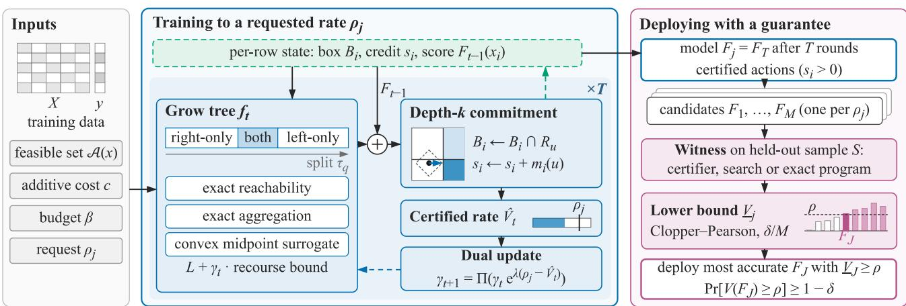
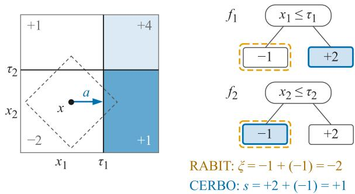
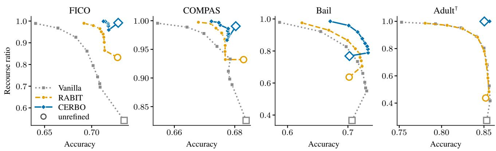
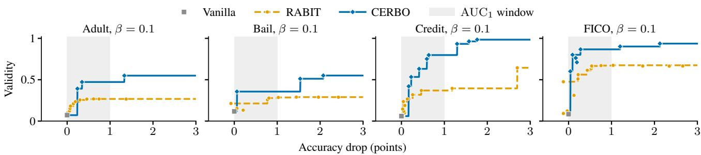
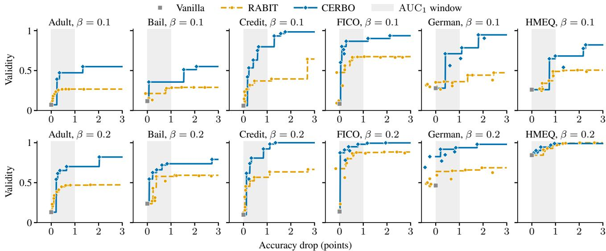
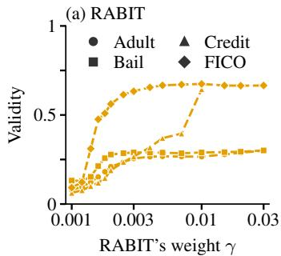
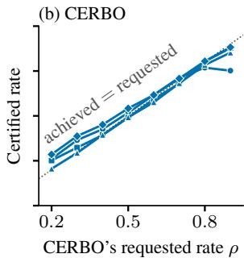

# CERBO: CERTIFIED RECOURSE AT A REQUESTED RATE FOR GRADIENT-BOOSTED TREES

Farhan Shahriyar Hossain <sup>1</sup> Taufikur Rahman Fuad <sup>1</sup> Md. Zarif Bin Hasnat <sup>1</sup> Md Abrar Jahin <sup>2</sup> Md Rizwan Parvez <sup>3</sup>

## ABSTRACT

Recourse-aware learning trains models so that people who receive an adverse decision can reverse it with an affordable change. For gradient-boosted decision trees (GBDTs), the existing method, RABIT, exposes a single recourse weight whose effect on the recourse rate is abrupt and data-dependent, and its training bound cannot certify recourse for any rejected individual. We present Certified Recourse Boosting (CERBO), which takes a requested recourse rate and returns a GBDT with certified actions: it tracks exact additive effort along tree paths, trains against committed boxes (a family of bounds that contains RABIT’s and certifies a within-budget action for each training sample) and adjusts the weight after every tree until the certified rate meets the request. A calibration step guarantees the rate on new individuals, and the certifier runs on any tree ensemble, including XGBoost and LightGBM, in milliseconds per person without a solver. In RABIT’s own experimental protocol, at equal accuracy, CERBO raises the recourse ratio from 0.90 to 0.99 on FICO and from 0.64 to 0.77 on Bail. Under additive costs on six data sets, it raises the area under the accuracy–recourse frontier in all 12 settings, and in simulated deployments it guarantees recourse to 70% of rejected individuals in 11 of 12 settings, against 2 fo RABIT.

## 1 INTRODUCTION

Algorithmic recourse asks which feasible, affordable changes would reverse an unfavorable prediction (Wachter et al., 2018; Ustun et al., 2019; Karimi et al., 2021). Post-hoc methods search for such changes in a fixed model (Karimi et al., 2020; Mothilal et al., 2020; Parmentier & Vidal, 2021), but a model trained only for accuracy may admit none (Ross et al., 2021; Kanamori et al., 2024). Recourse-aware learning therefore changes training itself. For gradient-boosted decision trees (GBDTs), the dominant model family on tabular data (Grinsztajn et al., 2022), RABIT (Kanamori et al., 2025) adds a recourse loss with weight γ to the second-order boosting objective.

RABIT leaves three practical gaps. The first is how much recourse a weight buys. The share of rejected people with recourse switches abruptly over a narrow range of γ, at a location that differs across data sets, and we prove that weighted training returns only models on the lower convex hull of the accuracy–recourse trade-off. A practitioner therefore cannot ask for “recourse for 70% of rejected applicants” and get it.

The second gap is who has recourse. RABIT’s training bound treats every rejected sample as having none, so the learner cannot tell whose recourse it creates, and nothing guarantees a recourse rate on new people. Both questions matter in deployment: a US lender must tell a rejected applicant the specific reasons for the decision (Consumer Financial Protection Bureau, 2011), and the EU AI Act gives people a right to an explanation of decisions made with high-risk systems such as credit scoring (European Parliament and Council of the European Union, 2024). An operator who also promises recourse must know for what share of rejected people the promise holds.

The third gap is the effort model. RABIT’s split search assumes a max-type cost, under which an action is affordable exactly when every per-feature change is, yet effort is often additive: raising income and reducing debt costs more than either alone. Its authors leave additive budgets to future work (Kanamori et al., 2025, Section 6).

We present Certified Recourse Boosting (CERBO). A practitioner states a recourse rate and an effort budget, and CERBO returns a GBDT with certified actions, as Figure 1 illustrates. Our contributions are:

1. Exact training under additive costs. Section 3.1 tracks each sample’s remaining budget along tree paths and aggregates split statistics exactly in O(r log K+K) time for r samples and K thresholds, and replaces RABIT’s indefinite surrogate with a convex one.

  
Figure 1. CERBO trains one model per requested rate and deploys one with a guaranteed rate. Each training row keeps a box $B _ { i }$ , a credit $s _ { i }$ and its score. In each of $T$ boosting rounds, CERBO grows tree $f _ { t }$ on the loss $L$ plus $\gamma _ { t }$ times a recourse bound, using exact reachability, exact aggregation over the right-only, both and left-only reach states of a split, and a convex surrogate. Each row then commits to a reachable node u, a positive credit certifies an action, and the certified rate $\hat { V } _ { t }$ of rejected rows sets $\gamma _ { t + 1 }$ . Deployment keeps the most accurate candidate whose Clopper–Pearson lower bound $\underline { { V } } _ { j }$ on a held-out sample reaches $\rho ;$ its rate on new individuals is then at least ρ with probability at least $1 - \delta$ . The bars show the candidates’ lower bounds by requested rate for one calibration draw on Adult at $\beta = 0 . 2$ . Sections 3.1 to 3.4 describe the four steps.

2. Certified recourse. Committed boxes (Section 3.2) are a family of training bounds that contains RABIT’s as its weakest member and certifies a within-budget action for each sample; the same certifier audits any tree ensemble, including XGBoost and LightGBM, in milliseconds per person.

3. Recourse at a requested rate. A dual update drives the certified training rate to the request, and a calibration step guarantees the rate on new individuals with probability $1 - \delta$ (Sections 3.3 and 3.4).

4. Experiments in two settings. In RABIT’s own experimental protocol, CERBO matches RABIT’s accuracy, raises the recourse ratio on every data set and finds cheaper actions; under additive costs it raises the area under the accuracy–recourse frontier in all 12 settings (Section 4).

## 2 BACKGROUND

Setting. We consider binary classification with favorable class +1 and ensembles $\begin{array} { r } { F _ { T } = \sum _ { t < T } f _ { t } } \end{array}$ of T regression trees. Feasible actions factor by coordinate, $A ( x ) =$ $\textstyle \prod _ { d } { \mathcal { A } } _ { d } ( x _ { d } )$ , which covers immutable, increase-only and decrease-only features. Costs are additive and coordinateseparable, $\begin{array} { r } { c ( { a } \mid { x } ) = \sum _ { d } \phi _ { d } ( { a } _ { d } ; { x } _ { d } ) } \end{array}$ , with each $\phi _ { d }$ nondecreasing in the distance moved. Our experiments use the percentile shift $| Q _ { d } ( x _ { d } + a _ { d } ) - Q _ { d } ( x _ { d } ) |$ , where $Q _ { d }$ is the cumulative distribution function of feature d. RABIT’s split search instead assumes the max-type cost ma $\mathrm { x } _ { d } \phi _ { d } ( a _ { d } ; x _ { d } )$ its experiments use the max percentile shift.

For a budget $\beta ,$ let $\mathcal { A } _ { \beta } ( x ) = \{ a \in \mathcal { A } ( x ) : c ( a \mid x ) \leq \beta \}$ The recourse loss of x is $\begin{array} { r } { \ell _ { \beta } ( x \mid F ) = \operatorname* { m i n } _ { a \in \mathcal { A } _ { \beta } ( x ) } \ell ( F ( x + } \end{array}$ $a ) )$ , where $\ell ( s ) = \ell ( + 1 , s )$ is a non-increasing margin loss (the logistic loss in our experiments), and x has recourse if $F ( x + a ) > 0$ for some $a \in \mathcal { A } _ { \beta } ( x )$ . We measure the share of rejected people with recourse by a verified search (validity) and by certificates (certified rate).

RABIT. RABIT grows tree t greedily to minimize the training loss plus γ times an upper bound on $\textstyle \sum _ { i } \ell _ { \beta } ( x _ { i } )$ over rejected samples. The bound replaces the earlier trees by $\begin{array} { r } { \xi _ { t } ( x ) = \sum _ { t ^ { \prime } < t } \operatorname* { m i n } _ { a \in \mathcal { A } _ { \beta } ( x ) } f _ { t ^ { \prime } } ( x + a ) } \end{array}$ , the sum of the worst leaf values reachable in each earlier tree. A sample that can reach only one child of a split contributes the loss gradient to that child. A sample that can reach both contributes through a soft-min of the two child losses. A second-order expansion gives closed-form leaf values and split gains. After training, an optional leaf refinement refits leaf values with a logistic regression that also rewards found actions.

## 3 CERBO

CERBO keeps RABIT’s boosting loop, changes the bound each tree is trained against, and adds a rate controller and a deployment step, as Figure 1 shows. Appendix A proves every result.

## 3.1 Exact Additive Training

Exact reachability. For a box $\begin{array} { r } { B = \prod _ { d } I _ { d } . } \end{array}$ , let $\kappa _ { d } ( x ; I _ { d } )$ be the minimum one-dimensional cost of moving $x _ { d }$ into the interval $I _ { d } ,$ , and $\begin{array} { r } { C ( x , B ) = \sum _ { d } \kappa _ { d } ( x ; I _ { d } ) } \end{array}$

Proposition 1 (Box cost). min $\{ c ( a \mid x ) : a \in { \mathcal { A } } ( x )$ , x + $a \in B \} = C ( x , B )$

Proposition 2 (Independent caps). For $D \geq 2$ features, no product set $\Pi _ { d } [ 0 , b _ { d } ]$ equals the additive budget set $\{ c \in$ $\begin{array} { r } { { \mathbb { R } } _ { + } ^ { D } : \sum _ { d } c _ { d } \overset { - } { \leq } \beta \} } \end{array}$

A product set cannot cut the diagonal face of the budget simplex, so per-feature caps either admit unaffordable actions or exclude affordable ones.

When a split on feature d intersects the current interval with a half-line, the d-term becomes the maximum of the old term and the crossing cost, by Lemma 15 in Appendix A. The path cost updates in constant time per sample, and a sample reaches a child exactly when its updated cost is at most $\beta .$

Exact aggregation. For threshold $\tau _ { q }$ on feature $d ,$ sample i reaches the left child if $x _ { i d } \leq \tau _ { q }$ or its crossing cost is within its remaining budget $b _ { i } ,$ and symmetrically for the right child. Under additive costs, $b _ { i }$ differs across samples.

Proposition 3 (Monotone states). As q increases, sample i is right-only, then reaches both children, then is left-only. It never reaches neither.

Corollary 4 (Exact aggregation cost). The gradient and Hessian sums of the left-only, both and right-only sets for all K thresholds of a feature can be computed exactly in O(r log $K + K )$ time, where r is the number of samples reaching the node.

Two binary searches locate the two transitions of each sample, and difference arrays accumulate their contributions. A scan over samples sorted by feature value, as used for constant caps, assumes all samples share one budget. Under per-sample budgets the transitions are not ordered by feature value; Appendix B lists the differences from RABIT’s code.

A convex surrogate. For a sample that reaches both children, RABIT bounds min $( \ell ( s + w _ { L } ) , \ell ( s + w _ { R } ) )$ ), where s bounds the earlier trees’ score and $w _ { L } , w _ { R }$ are the two leaf values, by a LogSumExp soft-min with temperature $\nu \left( \nu \right. = 1$ in the released code). At $w = 0$ its secondorder model, as implemented, has diagonal $\ell ^ { \prime \prime } / ( 2 \nu )$ and off-diagonal coupling $\ell ^ { \prime } { } ^ { 2 } / ( 4 \nu )$

For the logistic loss this matrix is indefinite exactly when $\sigma ( s ) < 1 / 3$ , with σ the logistic function, for every ν, as Lemma 16 in Appendix A shows. This happens once the worst-case score is clearly negative, the regime recourse training targets. The two-leaf Newton system can then become singular and the leaf values diverge. $\mathrm { A t } \gamma = 0 . 2$ the released RABIT diverges in our runs: 13 training runs on German fail, and 11 models trained for the certification experiments (Credit, German, HMEQ) have non-finite leaf values.

Lemma 5 (Midpoint bound). For any non-increasing ℓ, min $\begin{array} { r } { ( \ell ( s + w _ { L } ) , \ell ( s + w _ { R } ) ) \le \ell \big ( s + \frac { w _ { L } + w _ { R } } { 2 } \big ) } \end{array}$ . The righthand side is convex in $( w _ { L } , w _ { R } ) f o r$ convex ℓ; at 0 its Hessian is $\frac { \ell ^ { \prime \prime } } { 4 } \big ( \mathrm { \scriptsize ~ \frac { 1 } { 1 } ~ \frac { 1 } { 1 } ~ } \big ) \succeq 0$

With the midpoint bound the objective remains an upper bound on the recourse loss. The two-leaf system is positive definite, because the loss Hessians and the ridge term $\alpha > 0$ add to its diagonal, so leaf values are well defined.

## 3.2 Committed Boxes and Certified Recourse

RABIT’s bound ξ takes the worst reachable leaf of each earlier tree independently. The worst leaves of different trees are rarely reachable by one action, so the bound is loose, and it gives nearly every sample the same recourse gradient. We instead keep, for each training sample, a box $B _ { i }$ , the intersection of the tree regions it has committed to, and a credit $s _ { i } ,$ with the invariant

$$
F _ { t - 1 } ( x _ { i } + a ) \geq s _ { i } { \mathrm { ~ f o r ~ a l l ~ } } a \in A _ { \beta } ( x _ { i } ) { \mathrm { ~ w i t h ~ } } x _ { i } + a \in B _ { i } .\tag{1}
$$

Depth-k commitment. After tree t is grown, sample i commits to a node u at depth k (or a shallower leaf) whose region $R _ { u }$ is reachable from $B _ { i }$ within budget. It chooses the node with the largest $m _ { i } ( u )$ , the minimum value over the leaves below u that remain reachable. Then $B _ { i }  B _ { i } \cap R _ { u }$ and $s _ { i } \gets s _ { i } + m _ { i } ( u )$ . When growing tree $t ,$ the recourse term uses $s _ { i }$ as the score bound s of the surrogate and the reachability of $B _ { i }$ in place of $\xi _ { t }$

Theorem 6 (Commitment invariant). Depth-k commitment preserves (1)for every k. Hence,for every new tree $h ,$

$$
\ell _ { \beta } ( x _ { i } \mid { F } _ { t - 1 } + h ) \le \operatorname* { m i n } _ { a \in { \mathcal A } _ { \beta } ( x _ { i } ) \atop x _ { i } + a \in { B } _ { i } } \ell \big ( s _ { i } + h ( x _ { i } + a ) \big ) .
$$

For $k = 0$ the box never shrinks and $s _ { i } = \xi _ { t } ( x _ { i } )$ , RABIT’s bound; for k at least the tree depth, $F _ { t - 1 } = s _ { i }$ exactly on $B _ { i }$

Theorem 7 (Training certificate). Let $a _ { i }$ be the projection of $x _ { i }$ onto $B _ { i }$ . Then $a _ { i } \ \in \ A ( x _ { i } ) , \ c ( a _ { i } \ \mid \ x _ { i } ) \ \leq \ \beta$ and $F _ { T } ( x _ { i } + a _ { i } ) \ge s _ { i }$ . Thus $s _ { i } > 0$ certifies a valid withinbudget action, without solving an optimization problem.

By Proposition 17 in Appendix A, credit is monotone in k for one step, but deeper commitment leaves smaller boxes, in which later trees reach fewer leaves. We use $k = 1$

Test-time certification. Theorem 7 does not depend on how the trees were trained.

  
Figure 2. A committed box certifies an action that RABIT’s bound misses. Two stumps $f _ { 1 }$ and $f _ { 2 }$ (left branch: split condition holds) under an additive budget; cells show $F = f _ { 1 } + f _ { 2 }$ , and the dashed region holds the points $x + a$ with $c ( a \mid x ) \leq \beta$ . The point x can cross either split within the budget, but not both. RABIT’s bound adds the worst reachable leaf of each tree (orange) and certifies nothing. With $k = 1$ , tree 1 commits x to $x _ { 1 } > \tau _ { 1 }$ (light blue) and tree 2 to its only reachable leaf, $x _ { 2 } \leq \tau _ { 2 }$ , giving the dark-blue box; committed leaves are blue. The credit $s = + 1$ certifies the projection a of x onto this box, with $F ( x + a ) = 1$

Theorem 8 (Test-time certificate). For any tree ensemble F and any x, run depth-k commitment through the trees of $F _ { T }$ startingfrom $\boldsymbol { B } = \mathbb { R } ^ { D }$ and $s = 0 ,$ . The resulting box B and credit s satisfy $F _ { T } ( x + a ) \geq s f o r$ all $a \in \mathcal { A } _ { \beta } ( x )$ with $x + a \in B$ , and the projection ofx onto B isfeasible with cost at most β. $I f s > 0$ , this action is valid recourse. The procedure takes $O ( T 2 ^ { k } D )$ time.

Three sound witnesses. The certifier is sound but incomplete: $s \leq 0$ does not prove that no recourse exists. A verified action is feasible, costs at most $\beta$ and is approved by the model; a sound witness returns only verified actions. We use three: RABIT’s heuristic search over leaf regions, the certifier above, and an exact mixed-integer program, whose running times Section 4.5 reports. Section 4.6 shows that search finds far more actions than the certifier and nearly all that exist, so the certifier does not replace search at test time. It is the bound CERBO trains with, which makes the certified rate visible during training.

Relation to RABIT’s bound. Committed boxes contain RABIT’s bound as their weakest member, and the gap between the two can be as large as the ensemble’s range, as Figure 2 and Proposition 11 show. Let $\xi = \xi _ { T + 1 }$ be RA-BIT’s bound over all T trees of a fixed ensemble, with exact reachability, and $s _ { k } ( x )$ the credit of Theorem 8.

Theorem 9 (Sandwich). For every tree ensemble F, budget $\beta ,$ input x and depth $k \geq 0$

$$
\xi ( x ) \leq \operatorname* { m i n } _ { a \in A _ { \beta } ( x ) } F ( x + a ) \leq F ( x ) ,
$$

$$
\xi ( x ) = s _ { 0 } ( x ) \leq s _ { k } ( x ) \leq \operatorname* { m a x } _ { a \in A _ { \beta } ( x ) } F ( x + a ) .
$$

Corollary 10 (RABIT’s bound cannot certify a rejected individual). $I f F ( x ) \leq 0$ then $\xi ( x ) \leq 0 ;$ hence RABIT’s bound certifies no rejected individual.

RABIT’s bound lower-bounds the score of the worst affordable action, and “do nothing” is always affordable. Certificates require commitment $( k \geq 1 )$ , which bounds the score of a chosen action.

Proposition 11 (Worst-case gap). For every $T \geq 1$ and $w > 0$ there is a one-feature ensemble of T stumps and a rejected x with $\xi ( x ) = F ( x ) = - T w$ and $s _ { 1 } ( x ) \ =$ $\begin{array} { r } { \operatorname* { m a x } _ { a \in \mathcal { A } _ { \beta } ( x ) } F ( x + a ) = T w } \end{array}$

## 3.3 Training to a Requested Rate

Why a fixed weight cannot express a rate. A practitioner’s requirement is a constraint: the most accurate model whose recourse rate is at least $\rho ,$

$$
\operatorname { P } ( \rho ) : \quad \operatorname* { m i n } _ { F \in { \mathcal { F } } } L ( F ) \quad { \mathrm { s . t . } } \quad V ( F ) \geq \rho ,\tag{2}
$$

where $L$ is the training loss, V the recourse rate and $\mathcal { F }$ the models the learner can produce. Weighted training instead returns $\begin{array} { r } { F _ { \gamma } \in \arg \operatorname* { m i n } _ { F \in \mathcal { F } } L ( F ) + \gamma \Omega ( F ) } \end{array}$ for a recourse loss Ω. Let $\mathcal { P } = \{ ( L ( F ) , \Omega ( F ) ) : F \in \mathcal { F } \}$

Proposition 12 (Weights reach only the convex hull). (i) For every $\gamma \ge 0 , ( L ( F _ { \gamma } ) , \Omega ( F _ { \gamma } ) )$ ) lies on the lower convex hull $o f { \mathcal { P } } ;$ models above the hull are never returnedfor any $\gamma . \ ( i i ) \Omega ( F _ { \gamma } )$ is non-increasing and $L ( F _ { \gamma } )$ non-decreasing in $\gamma ,$ and both change only where the minimizing hull vertex changes, so the returned rate moves in jumps between hull vertices. (iii) There are classes of three models in which, for every $\rho \in ( 0 , \frac { 1 } { 2 } ]$ , the solution of (2) is never returned: every γ yields either a model with rate $0 < \rho$ or one that is strictly less accurate than necessary, and the rate jumps from 0 to 1 at a single γ.

Parts (i) and (ii) restate known limits of weighted-sum scalarization (Das & Dennis, 1997). Tree ensembles form a discrete, non-convex class, so such gaps are to be expected. A randomized mixture of two hull models could fill a gap, but randomized credit or bail decisions are unacceptable in practice and admit no per-person certificate.

Our experiments match this picture: across 18 weights, the released RABIT’s validity stays below 0.31 on Adult and Bail at $\beta = 0 . 1$ , and Figure 6 in the appendix shows how abruptly it changes in γ.

Closed-loop targeting. CERBO does not search over a weight. Certificates are a by-product of training, so the certified rate among currently rejected training samples, $\hat { V } _ { t } = \operatorname* { P r } _ { i } [ s _ { i } > 0 \ | \ F _ { t } ( x _ { i } ) \ \leq \ 0 ]$ , is known exactly after every tree. For a target rate $\rho$ we update

$$
\begin{array} { r } { \gamma _ { t + 1 } = \Pi _ { [ \gamma _ { \mathrm { m i n } } , \gamma _ { \mathrm { m a x } } ] } \big ( \gamma _ { t } \exp ( \lambda ( \rho - \hat { V } _ { t } ) ) \big ) , } \end{array}\tag{3}
$$

a multiplicative (mirror) ascent step with step size λ on the dual of “minimize the training loss subject to certified rate at least $\rho ^ { \dagger }$ . Dual updates of this kind are standard in constrained learning (Cotter et al., 2019; Chamon et al., 2023); the new element is that certificates make the constrained quantity observable after every tree. Algorithm 1 in Appendix B lists the training loop.

Proposition 13 (Rate tracking). If the projection in (3) is inactive $f o r t = 1 , \dots , T _ { : }$ , then

$$
\Big | \frac { 1 } { T } \sum _ { t = 1 } ^ { T } \hat { V } _ { t } - \rho \Big | \leq \frac { \log ( \gamma _ { \operatorname* { m a x } } / \gamma _ { \operatorname* { m i n } } ) } { \lambda T } .
$$

## 3.4 Deploying with a Guaranteed Rate

Fix any sound witness $w _ { F } ( x ) \in \{ 0 , 1 \}$ , which returns 1 only with a verified action (the certifier, RABIT’s search or an exact program; it may use fixed internal randomness). For a model $F .$ , let $V ( F ) = \operatorname* { P r } [ w _ { F } ( x ) = 1 \mid F ( x ) \le 0 ]$ be its witnessed recourse rate on new individuals from the data distribution P.

Train candidate models $F _ { 1 } , \ldots , F _ { M }$ (for example, one per requested rate $\rho _ { j } ;$ Figure 1) and draw a calibration sample $S$ of N individuals from $P ,$ independent of training. For model $j ,$ let $n _ { j }$ be the number of individuals in $S$ that $F _ { j }$ rejects and $z _ { j }$ the number of them with a witness. Let $\underline { { V } } _ { j }$ be $\mathbf { a }$ lower confidence bound at level $\delta / M$ on the proportion that $z _ { j } / n _ { j }$ estimates, such as Hoeffding’s or the exact Clopper–Pearson bound (Clopper & Pearson, 1934), which we use.

Theorem 14 (Recourse-rate control). Let J be any selection rule, possibly depending on S and on other data, that selects only models with $\underline { { V } } _ { J } \geq \rho \ : ( f o r$ example, the most accurate such model). Then, with probability at least $1 - \delta$ over S, $V ( F _ { J } ) \ge \rho ,$ and every witnessed individual receives a feasible action of cost at most $\beta$ that $F _ { J }$ approves.

Like conformal prediction (Vovk et al., 2005; Angelopoulos & Bates, 2023) and risk control by multiple testing (Angelopoulos et al., 2025), the recipe is distribution-free and holds in finite samples when calibration and deployment individuals come from the same distribution. CERBO adds candidates at requested rates, rather than at the scattered rates that, by Proposition 12, a weight produces. RABIT’s probably approximately correct (PAC) bound (Kanamori et al., 2025, Prop. 3) instead bounds the chance that one model admits no affordable action, through a training surrogate and a capacity term.

## 3.5 Implementation

CERBO extends RABIT’s public Python implementation and reuses its tree, binning and action code (Algorithm 1 in

Appendix B). Each training row carries its box bounds, perfeature path costs and credit, so the state grows linearly with the data. Numba (Lam et al., 2015) compiles the split search, which performs the exact aggregation of Corollary 4. After each tree, one vectorized step commits all rows: a depth-first walk carries every row’s reachability and path cost to each node, and a bottom-up pass takes the minimum reachable leaf value below each node. The test-time certifier runs the same step from an unconstrained box on any ensemble stored as RABIT’s tree arrays, to which converters map XGBoost and LightGBM models.

## 4 EXPERIMENTS

Sections 4.2 to 4.6 test five claims in turn: CERBO outperforms RABIT under RABIT’s own protocol and along the whole trade-off under additive effort, requested rates are met and can be guaranteed, certifying a deployed ensemble is cheap, and each component contributes.

## 4.1 Experimental Setup

Data sets. All seven data sets are public; we give individuals × encoded features below, and Table 5 in the appendix lists sources and licenses. The first setting follows RA-BIT’s experimental protocol on FICO (FICO et al., 2018) $( 9 , 8 7 1 \times 2 3 )$ , COMPAS (Angwin et al., 2016) (7,214 × 15), Adult (Becker & Kohavi, 1996) $( 4 8 , 8 4 2 \times 1 6 )$ and Bail (Schmidt & Witte, 1989) (8,923×16), with RABIT’s actionability metadata and evaluation code. The second compares whole trade-offs under additive costs on Adult, Bail, FICO and Credit (Yeh & Lien, 2009) (30,000 × 13; RABIT’s data and metadata, Credit from its code release), and on German Credit (Hofmann, 1994) $( 1 , 0 0 0 \times 5 1 )$ and HMEQ (Baesens et al., 2016) $( 5 , 9 6 0 \times 1 8 )$ , two held-out data sets added after method development. COMPAS is absent from the second setting because its mutable one-hot group is outside our exactness results for additive budgets.

Baselines. We compare with Vanilla (boosting without recourse), OAF (boosting on actionable features only, RA-BIT’s second baseline) and RABIT, to the best of our knowledge the only published method that trains GBDTs for recourse. All methods share RABIT’s booster and configuration: 100 trees of depth 8, learning rate 0.1, $\sqrt { D }$ candidate features per split, 128 bins and ridge term $\alpha = 0 . 0 0 1$ . This implementation is within about one point of scikit-learn’s tuned histogram gradient boosting except on Bail (0.700 vs. 0.851), and Appendix C.5 shows that a stronger configuration raises Bail only to 0.733 and widens CERBO’s lead. Under additive costs, for which RABIT’s algorithm is not designed, we run the depth-scheduled budget rule of its released code, and ablations B–D in Section 4.6 also give RABIT exact accounting and aggregation. CERBO uses initial $\gamma = 0 . 0 1 , \lambda = 0 . 5$ and $\gamma \in [ 1 0 ^ { - 3 } , 1 ]$ ; Table 6 in the

Table 1. CERBO under RABIT’s experimental protocol (max percentile-shift cost with kernel density estimate (KDE) percentiles, $\beta = 0 . 2 )$ . Values are test means over ten 75/25 splits, with the standard deviation as a subscript for accuracy and recourse ratio. OAF boosts on actionable features only. RABIT appears at its published γ and with γ tuned by the same validation rule a $\mathrm { C E R B O ^ { \circ } s } \rho .$ The best value per data set is in bold for the recourse ratio and the three action metrics; accuracy, ROC-AUC and F1 have no bold, because Vanilla, trained for accuracy alone, is their reference. On Bail the rule selects $\gamma = 0 . 0 0 2$ , so the two RABIT rows coincide. CERBO raises the recourse ratio on every data set at equal accuracy. †Cost-model artifact, not counted (Section 4.1).
<table><tr><td>Data</td><td>Method</td><td>Accuracy ↑</td><td>Recourse ratio ↑</td><td>Cost↓</td><td>Sparsity ↓</td><td>Plausibility ↓</td><td>ROC-AUC ↑</td><td>F1↑</td></tr><tr><td rowspan="5">FICO</td><td>Vanilla</td><td> $0 . 7 3 4 { \scriptstyle \pm . 0 0 6 }$ </td><td> $0 . 5 4 2 { \scriptstyle \pm . 0 0 8 }$ </td><td>0.372</td><td>2.24</td><td>0.440</td><td>0.801</td><td>0.717</td></tr><tr><td>OAF</td><td> $0 . 7 2 2 { \scriptstyle \pm . 0 0 9 }$ </td><td> $0 . 6 2 8 { \scriptstyle \pm . 0 1 0 }$ </td><td>0.316</td><td>2.77</td><td>0.443</td><td>0.786</td><td>0.704</td></tr><tr><td>RABIT  $( \gamma = 0 . 0 0 2 )$ </td><td> $0 . 7 2 8 { \scriptstyle \pm . 0 0 9 }$ </td><td> $0 . 8 3 2 { \scriptstyle \pm . 0 1 4 }$ </td><td>0.167</td><td>1.05</td><td>0.475</td><td>0.796</td><td>0.711</td></tr><tr><td>RABIT (tuned γ)</td><td> $0 . 7 2 7 { \scriptstyle \pm . 0 0 8 }$ </td><td> $0 . 9 0 0 { \scriptstyle \pm . 0 1 4 }$ </td><td>0.113</td><td>1.02</td><td>0.475</td><td>0.790</td><td>0.708</td></tr><tr><td>CERBO</td><td> $0 . 7 2 8 { \scriptstyle \pm . 0 1 0 }$ </td><td> $\mathbf { 0 . 9 9 2 _ { \pm . 0 0 2 } }$ </td><td>0.052</td><td>1.05</td><td>0.465</td><td>0.794</td><td>0.717</td></tr><tr><td rowspan="5">COMPAS</td><td>Vanilla</td><td> $0 . 6 8 4 { \scriptstyle \pm . 0 0 8 }$ </td><td> $0 . 8 2 6 _ { \pm . 0 0 9 }$ </td><td>0.232</td><td>1.51</td><td>0.436</td><td>0.736</td><td>0.727</td></tr><tr><td>OAF</td><td> $0 . 6 8 5 { \scriptstyle \pm . 0 1 0 }$ </td><td> $0 . 8 5 4 { \scriptstyle \pm . 0 1 9 }$ </td><td>0.179</td><td>1.55</td><td>0.445</td><td>0.734</td><td>0.726</td></tr><tr><td>RABIT  $( \gamma = 0 . 0 0 2 )$ </td><td> $0 . 6 8 3 { \scriptstyle \pm . 0 0 9 }$ </td><td> $0 . 9 3 2 _ { \pm . 0 2 1 }$ </td><td>0.108</td><td>1.20</td><td>0.471</td><td>0.734</td><td>0.726</td></tr><tr><td>RABIT (tuned γ)</td><td> $0 . 6 8 1 { \scriptstyle \pm . 0 0 8 }$ </td><td> $0 . 9 6 6 _ { \pm . 0 0 9 }$ </td><td>0.087</td><td>1.09</td><td>0.486</td><td>0.729</td><td>0.726</td></tr><tr><td>CERBO</td><td> $0 . 6 8 0 { \scriptstyle \pm . 0 0 9 }$ </td><td> $\mathbf { 0 . 9 9 0 } _ { \pm . 0 0 7 }$ </td><td>0.071</td><td>1.08</td><td>0.491</td><td>0.731</td><td>0.734</td></tr><tr><td rowspan="5">Adult</td><td>Vanilla</td><td> $0 . 8 5 3 { \scriptstyle \pm . 0 0 2 }$ </td><td> $0 . 2 7 3 { \scriptstyle \pm . 0 1 0 }$ </td><td>0.353</td><td>1.50</td><td>0.476</td><td>0.909</td><td>0.632</td></tr><tr><td>OAF</td><td> $0 . 8 3 3 { \scriptstyle \pm . 0 0 4 }$ </td><td> $0 . 3 0 7 { \scriptstyle \pm . 0 0 7 }$ </td><td>0.309</td><td>1.51</td><td>0.462</td><td>0.858</td><td>0.554</td></tr><tr><td>RABIT  $( \gamma = 0 . 0 0 2 )$ </td><td> $0 . 8 5 2 { \scriptstyle \pm . 0 0 2 }$ </td><td> $0 . 4 3 7 { \scriptstyle \pm . 0 3 1 }$ </td><td>0.281</td><td>1.42</td><td>0.478</td><td>0.906</td><td>0.633</td></tr><tr><td>RABIT (tuned γ)</td><td> $0 . 8 4 8 { \scriptstyle \pm . 0 0 3 }$ </td><td> $0 . 5 3 8 { \scriptstyle \pm . 0 2 3 }$ </td><td>0.240</td><td>1.30</td><td>0.479</td><td>0.898</td><td>0.627</td></tr><tr><td>CERBO</td><td> $0 . 8 5 0 { \scriptstyle \pm . 0 0 2 }$ </td><td> $\mathbf { 0 . 9 9 9 } _ { \pm . 0 0 1 } ^ { \dagger }$ </td><td>0.083</td><td>1.35</td><td>0.439</td><td>0.904</td><td>0.633</td></tr><tr><td rowspan="5">Bail</td><td>Vanilla</td><td> $0 . 7 0 7 { \scriptstyle \pm . 0 0 6 }$ </td><td> $0 . 3 6 6 _ { \pm . 0 2 0 }$ </td><td>0.456</td><td>1.44</td><td>0.507</td><td>0.739</td><td>0.499</td></tr><tr><td>OAF</td><td> $0 . 6 7 8 { \scriptstyle \pm . 0 0 6 }$ </td><td> $0 . 4 1 0 { \scriptstyle \pm . 0 2 1 }$ </td><td>0.371</td><td>1.60</td><td>0.502</td><td>0.706</td><td>0.453</td></tr><tr><td>RABIT (γ = 0.002)</td><td> $0 . 7 0 2 { \scriptstyle \pm . 0 0 5 }$ </td><td> $0 . 6 3 7 { \scriptstyle \pm . 0 2 5 }$ </td><td>0.225</td><td>1.13</td><td>0.517</td><td>0.729</td><td>0.474</td></tr><tr><td>RABIT (tuned γ)</td><td> $0 . 7 0 2 { \scriptstyle \pm . 0 0 5 }$ </td><td> $0 . 6 3 7 { \scriptstyle \pm . 0 2 5 }$ </td><td>0.225</td><td>1.13</td><td>0.517</td><td>0.729</td><td>0.474</td></tr><tr><td>CERBO</td><td> $0 . 7 0 2 { \scriptstyle \pm . 0 0 7 }$ </td><td> $\mathbf { 0 . 7 6 9 _ { \pm . 0 2 7 } }$ </td><td>0.167</td><td>1.07</td><td>0.513</td><td>0.731</td><td>0.511</td></tr></table>

appendix lists every setting.

Metrics. Effort under additive costs is the mid-rank empirical percentile shift. RABIT’s kernel density estimate (KDE) of the percentile smooths away point masses: on Adult, raising capital gain from 0 to 1 costs 0.0003. Validity is the share of rejected test individuals for whom RABIT’s search finds a verified action with cost at most $\beta .$ Because it changes abruptly in γ, we compare accuracy–recourse frontiers with validity as the recourse measure. Each trained model gives one point: its accuracy drop relative to Vanilla, in percentage points, and its validity, both averaged over seeds. With val(d) the best validity at an accuracy drop of at most d points, we report the normalized area under the frontier

$$
\mathrm { A U C } _ { \Delta } = \frac { 1 } { \Delta } \int _ { 0 } ^ { \Delta } \mathrm { v a l } ( d ) \mathrm { d } d\tag{4}
$$

with $\Delta = 1$ , the tolerance of the validation rule in Section 4.2.

RABIT gets 18 weights from 0.001 to 0.2, dense around its jump (its paper uses 0.002; some runs diverge at 0.2), and CERBO eight targets $\rho \in \{ 0 . 2 , \ldots , 0 . 9 \}$ . We report two frontiers: the model frontier, the best validity of a trained model at each accuracy drop, and the upper concave envelope, which also credits randomizing between two models. The model frontier is stricter, since randomized decisions are unacceptable in consequential settings. Both frontiers, and the 0.5- and 2-point windows of Table 13 in the appendix, lead to the same conclusions.

Statistics. Each seed is a fresh random train/test split, and intervals are 95% paired percentile-bootstrap intervals over seeds (2,000 resamples), which include split and test-sample variation. Method development used seeds 0–12 and 100– 107 (0–1 on synthetic data). Every reported number comes from later seeds, which Table 7 in the appendix lists, and no table selects a model on test data.

Software and hardware. Runs used Python 3.11, NumPy (Harris et al., 2020), SciPy (Virtanen et al., 2020), scikitlearn 1.5 (Pedregosa et al., 2011), XGBoost 2.1 (Chen & Guestrin, 2016), LightGBM 4.5 (Ke et al., 2017) and SCIP through PySCIPOpt 5.5 (Maher et al., 2016); Appendix B describes the hardware. The code (MIT license), all run results and a one-command reproduction script will be released upon publication.

## 4.2 Comparison under RABIT’s Protocol

Protocol. We use RABIT’s data, splits, cost and evaluation code without changes (Kanamori et al., 2025, Section 5 and App. C): ten random 75/25 splits (seeds 300–309), the max percentile-shift cost with KDE percentiles, $\beta = 0 . 2 ,$ and a search that samples 1,000 leaf regions. We add one validation rule shared by both methods, described below. The metrics are RABIT’s: accuracy, the recourse ratio (the share of test individuals who are accepted or for whom a valid action is found), the cost, sparsity and plausibility of the found actions, ROC-AUC and F1.

  
Figure 3. RABIT’s leaf refinement at every level η under RABIT’s protocol: recourse ratio against test accuracy, mean over ten splits, for Vanilla, RABIT at its published $\gamma = 0 . 0 0 2$ and CERBO. Hollow markers are the unrefined models; the other points use $\eta = 0 . 0 1$ to 1.28. At every $\eta > 0 ,$ CERBO + refinement is at least as accurate as RABIT + refinement and has a higher recourse ratio. †Cost-model artifact.

Each recourse-aware method gets one setting per data set, chosen by the same rule on validation data (an 80/20 split of the training data): the highest validation recourse ratio whose validation accuracy is within 1 point of Vanilla’s, the window of AUC<sub>1</sub>. The rule picks $\begin{array} { r l r } { \gamma } & { { } = } & { 0 . 0 0 5 } \end{array}$ 0.0035, 0.004 and 0.002 from RABIT’s published grid {0.0005, . . . , 0.005} for FICO, COMPAS, Adult and Bail, and $\rho = 0 . 9 , 0 . 8 , 0 . 9$ and 0.5 for CERBO. We also report RABIT at its published $\gamma = 0 . 0 0 2$ , which meets the rule on every data set. COMPAS has a mutable one-hot feature outside our exactness results, so CERBO trains on it approximately.

Results. Our runs of Vanilla and RABIT reproduce RA-BIT’s published accuracy and recourse ratio within the reported standard deviations on all four data sets, as Table 8 in the appendix shows. Table 1 shows that CERBO gives recourse to more people, with cheaper actions and no significant loss of accuracy. Paired over the ten splits against RABIT with tuned γ, the accuracy difference is at most 0.001 in absolute value on FICO, COMPAS and Bail (none significant). The recourse ratio rises from 0.900 to 0.992, from 0.966 to 0.990 and from 0.637 to 0.769 $( p \leq 1 0 ^ { - 4 }$ each, paired t-test), and the mean action cost falls by 18– 54%. The gains over RABIT’s published setting are at least as large. ROC-AUC is within 0.006 of both RABIT rows and F1 is equal or higher.

The comparison also holds over the whole trade-off. With all ten values of RABIT’s grid against all eight requested rates, CERBO’s $\mathrm { A U C _ { 1 } }$ on the recourse ratio is larger by +0.272 [+0.192, +0.327] on FICO, +0.067 [+0.009, +0.092] on COMPAS and +0.146 [+0.073, +0.255] on Bail. With the selection-rule tolerances of Table 10, from 0.5 to 2 points, CERBO’s recourse ratio is never significantly lower. It leads significantly on FICO and Bail, and on COMPAS the two methods tie at 0.5 and 0.75 points.

Table 2. Area under the accuracy–recourse frontier (validity; AUC , higher is better) under additive costs, test data, mean over seeds 200–207. OAF trains on actionable features only, and RABIT gets 18 weights. ∆ is CERBO minus RABIT with a 95% paired bootstrap interval, on the upper concave envelope (as in the AUC columns) and on the model frontier, which credits only trained models. The best AUC<sub>1</sub> per row is in bold. German and HMEQ (bottom) were added after method development. CERBO leads in all 12 settings.
<table><tr><td>Setting</td><td>OAF</td><td>RABIT</td><td>CERBO</td><td>∆ (envelope)</td><td>∆ (model frontier)</td></tr><tr><td>Adult β = 0.1</td><td>0.076</td><td>0.247</td><td>0.427</td><td>+0.180 [+0.164, +0.203]</td><td> $+ 0 . 1 2 7 \left[ + 0 . 1 0 7 , + 0 . 1 5 3 \right]$ </td></tr><tr><td>Adult β = 0.2</td><td>0.137</td><td>0.418</td><td>0.609</td><td>+0.191 [+0.160, +0.232]</td><td>+0.145[+0.095, +0.203]</td></tr><tr><td>Bail β = 0.1</td><td>0.126</td><td>0.252</td><td>0.396</td><td>+0.143[+0.072, +0.207]</td><td>+0.115[+0.015, +0.144]</td></tr><tr><td>Bail β = 0.2</td><td>0.251</td><td>0.517</td><td>0.661</td><td>+0.144[+0.068, +0.258]</td><td>+0.153 [+0.024, +0.272]</td></tr><tr><td>Credit β = 0.1</td><td>0.228</td><td>0.352</td><td>0.644</td><td>+0.292[+0.233, +0.376]</td><td>+0.249 [+0.179, +0.344]</td></tr><tr><td>Credit β = 0.2</td><td>0.260</td><td>0.539</td><td>0.782</td><td>+0.244[+0.208, +0.302]</td><td>+0.201[+0.132, +0.286]</td></tr><tr><td>FICO β = 0.1</td><td>0.118</td><td>0.576</td><td>0.841</td><td>+0.265 [+0.167, +0.302]</td><td>+0.211 [+0.129, +0.267]</td></tr><tr><td>FICO β = 0.2</td><td>0.200</td><td>0.747</td><td>0.941</td><td>+0.194 [+0.039, +0.215]</td><td>+0.121 [-0.024, +0.163]</td></tr><tr><td>German β = 0.1</td><td>0.316</td><td>0.386</td><td>0.655</td><td>+0.269 [+0.069, +0.469]</td><td>+0.179[-0.090, +0.446]</td></tr><tr><td>German β = 0.2</td><td>0.494</td><td>0.626</td><td>0.908</td><td>+0.282 [+0.090, +0.391]</td><td>+0.260 [-0.117, +0.348]</td></tr><tr><td>HMEQ β = 0.1</td><td>0.282</td><td>0.388</td><td>0.510</td><td>+0.121 [+0.090, +0.172]</td><td>+0.033 [-0.040, +0.130]</td></tr><tr><td>HMEQ β = 0.2</td><td>0.872</td><td>0.913</td><td>0.943</td><td>+0.030 [+0.000, +0.050]</td><td>+0.038 [+0.003, +0.065]</td></tr></table>

  
Figure 4. Accuracy–recourse frontiers (validity) under additive costs $( \beta = 0 . 1$ , test data, mean over seeds 200–207). Each marker is one trained model (RABIT: 18 weights; CERBO: 8 requested rates), and lines are model frontiers, the best validity of a trained model at each accuracy drop relative to Vanilla. The gray band is the 1-point window of $\mathrm { A U C _ { 1 } }$ (Table 2). On all four data sets CERBO’s frontier is at o above RABIT’s at every accuracy drop of 0.25 points or more. Appendix Figure 5 shows all 12 settings.

CERBO’s actions are the cheapest on every data set, their sparsity is within 0.05 of the best RABIT row, and their plausibility is worse than RABIT’s only on COMPAS (0.491 vs. 0.471 and 0.486; lower is better). Training times are of the same order, as Table 9 shows. On Adult CERBO reaches a recourse ratio of 0.999, not counted because RABIT’s KDE cost prices small capital-gain increases as nearly free.

Leaf refinement. RABIT’s strongest variant refits leaf values after training. We apply its released refinement to Vanilla, RABIT $( \gamma = 0 . 0 0 2 )$ and CERBO alike, at every level η of its grid (0.01 to 1.28), and compare the methods at the same η, so no level is selected. Figure 3 shows the result. Paired over the splits, CERBO’s recourse ratio is higher at all eight levels on FICO, COMPAS and Bail. The difference is significant $( p < 0 . 0 5 )$ in 22 of 24 cases; the exceptions are COMPAS at $\eta = 0 . 3 2$ and 0.64, where both methods exceed 0.98. No accuracy difference is significantly negative. Tables 11 and 12 in the appendix list every level and apply RABIT’s own selection rule, under which CERBO also leads.

## 4.3 Frontiers under Additive Costs

Table 2 and Figure 4 compare the frontiers under additive costs. On the four main data sets CERBO raises $\mathrm { A U C _ { 1 } }$ over RABIT in all 8 settings, by 0.143 to 0.292, with every 95% interval above zero. On the held-out data sets the gain is 0.030 to 0.282, and the intervals exclude zero except on HMEQ at $\beta = 0 . 2$ , where both methods are near the ceiling and the lower end is 0.000.

On the stricter model frontier CERBO is ahead in all 12 settings, with the interval above zero in 7 of the 8 main settings (the exception is FICO at $\beta = 0 . 2 )$ . The held-out intervals are wide (German has 1,000 individuals).

Figure 4 shows where the gain arises. At zero accuracy loss RABIT can be ahead (FICO: 0.48 vs. 0.08), since every CERBO model gives up a little accuracy, but from a 0.25-point drop on CERBO leads on all four data sets. At 0.5 points its validity is 0.47, 0.36, 0.63 and 0.87 against 0.27, 0.21, 0.37 and 0.61 on Adult, Bail, Credit and FICO. Beyond that, RABIT’s frontier gains at most 0.08 on Adult, Bail and FICO, consistent with the vacuous bound of Corollary 10, while CERBO keeps rising. A replication on four fresh seeds (700–703) gives the same picture: CERBO raises $\mathrm { A U C _ { 1 } }$ in all 12 settings, with the interval above zero except on HMEQ, where the gap is below 0.01.

RABIT’s leaf refinement does not close the gap. Applied to every trained model on Bail and FICO, under max and additive costs, it leaves CERBO + refinement ahead of the stronger refined baseline in all four settings, by 0.157 to 0.292 in $\mathrm { A U C _ { 1 } } .$ , with every interval above zero (Table 14). Nor does a decision-threshold shift, RABIT’s second postprocessing: against all Vanilla and RABIT models at eleven intercept shifts, CERBO without a shift has the larger AUC<sub>1</sub> in 11 of 12 settings, as Appendix C.3 details.

## 4.4 Certified and Guaranteed Rates

Certified recourse. We apply the test-time certifier of Theorem 8 on fresh seeds and all six data sets, measuring the share of rejected individuals for whom recourse is proven. CERBO raises the certified $\mathrm { A U C _ { 1 } }$ over RABIT in 11 of 12 settings, by 0.08 to 0.38, with the interval above zero in 9 (Table 15). Requested rates also transfer to new people, as Figure 6(b) shows: for targets within 2 points of Vanilla’s accuracy, the mean absolute gap between $\rho$ and the test certified rate is 0.012 to 0.090.

Guaranteed recourse rates. We simulate the recipe of

Table 3. Deploying with a guaranteed recourse rate (6 data sets × 2 budgets, 6 seeds × 200 calibration/evaluation splits, $\delta = 0 . 1$ Clopper–Pearson bound). Achievable: settings in which a qualifying model exists in at least half of the deployments. Accuracy cost: Vanilla’s accuracy minus the deployed model’s (median over settings achievable for both methods; lower is better). Violation: share of deployments whose rate on new people falls short. Bold: the better method per witness; violations are not ranked. With either witness, CERBO guarantees higher rates at lower cost.
<table><tr><td rowspan="2">Required rate</td><td colspan="2">RABIT&#x27;s search</td><td colspan="2">Our certifier</td></tr><tr><td>RABIT</td><td>CERBO</td><td>RABIT</td><td>CERBO</td></tr><tr><td>30% achievable</td><td>11/12</td><td>12/12</td><td>7/12</td><td>12/12</td></tr><tr><td>50% achievable</td><td>7/12</td><td>12/12</td><td>5/12</td><td>11/12</td></tr><tr><td>70% achievable</td><td>2/12</td><td>11/12</td><td>2/12</td><td>9/12</td></tr><tr><td>Accuracy cost (points)</td><td>0.66</td><td>0.17</td><td>1.35</td><td>0.33</td></tr><tr><td>Violation</td><td>0.8%</td><td>0.4%</td><td>1.2%</td><td>0.8%</td></tr></table>

Theorem 14 on six data sets $( \beta \in \{ 0 . 1 , 0 . 2 \}$ , fresh seeds 800–805). Each method has a candidate family: Vanilla plus CERBO at eight requested rates, or Vanilla plus RABIT at twelve values of γ. For each of 200 random splits of the test set into a calibration and an evaluation half, we select the most accurate candidate whose Clopper–Pearson bound meets the requirement $( \delta = 0 . 1 )$ and evaluate it on the other half. Table 3 reports both witnesses, RABIT’s search and our certifier.

The guarantee holds: with RABIT’s search as witness, the rate on new individuals fell below the requirement in 0.4% of 41,674 simulated deployments of CERBO (9.0% in the worst setting, within the allowed 10%). Promises fail far less often than δ allows because the bound covers all M candidates at once, and this conservatism costs CERBO little: a median of 0.17 accuracy points relative to Vanilla, against 0.66 for RABIT.

CERBO can guarantee a rate of 70% in 11 of 12 settings and RABIT in 2. Where both can make a promise, CERBO gives up less accuracy in 18 of 20 settings. Guaranteeing 50% on Adult at $\beta = 0 . 2$ costs 0.2 points with CERBO and 8.1 with RABIT. The selection rule is identical, so the difference comes from the candidates: requested rates fill the gaps that, by Proposition 12, weights leave.

## 4.5 Efficiency and Deployed Ensembles

Training and certification time. On Adult with 2,000 to 32,000 training rows (one run at a time), CERBO trains in 1.3× RABIT’s time at full size (201 s vs. 156 s; at most 1.9×, at the smallest size). Its training time grows nearlinearly (log–log slope 1.16; RABIT 1.31), as Corollary 4 suggests, and certification takes under 1 ms per person at every size. In the certification runs, the certifier takes a median of 0.6–1.9 ms per person and RABIT’s search 2.2–

Table 4. Ablation path under additive costs: $\mathrm { A U C _ { 1 } }$ on validity (envelope, test data, seeds 200–207; higher is better). Each column adds one component to the released RABIT (A): B, exact additive accounting in RABIT’s training code; C, exact split aggregation with RABIT’s soft-min surrogate; D, convex midpoint surrogate; E, exact additive reachability; F, committed boxes $( k = 1 )$ at fixed γ; G, targeting (CERBO). The best value per row is in bold; targeting gives the best frontier in 7 of 8 settings.
<table><tr><td>Setting</td><td>A</td><td>B</td><td>C</td><td>D</td><td>E</td><td>F</td><td>G</td></tr><tr><td>Adult 0.1</td><td>0.247</td><td>0.240</td><td>0.334</td><td>0.359</td><td>0.332</td><td>0.391</td><td>0.427</td></tr><tr><td>Adult 0.2</td><td>0.418</td><td>0.404</td><td>0.589</td><td>0.616</td><td>0.573</td><td>0.554</td><td>0.609</td></tr><tr><td>Bail 0.1</td><td>0.252</td><td>0.204</td><td>0.219</td><td>0.232</td><td>0.261</td><td>0.270</td><td>0.396</td></tr><tr><td>Bail 0.2</td><td>0.517</td><td>0.455</td><td>0.552</td><td>0.592</td><td>0.564</td><td>0.578</td><td>0.661</td></tr><tr><td>Credit 0.1</td><td>0.352</td><td>0.324</td><td>0.305</td><td>0.354</td><td>0.629</td><td>0.576</td><td>0.644</td></tr><tr><td>Credit 0.2</td><td>0.539</td><td>0.525</td><td>0.701</td><td>0.765</td><td>0.746</td><td>0.654</td><td>0.782</td></tr><tr><td>FICO 0.1</td><td>0.576</td><td>0.576</td><td>0.601</td><td>0.701</td><td>0.708</td><td>0.729</td><td>0.841</td></tr><tr><td>FICO 0.2</td><td>0.747</td><td>0.675</td><td>0.840</td><td>0.891</td><td>0.908</td><td>0.761</td><td>0.941</td></tr></table>

7.0 ms, except on German with 51 features (about 10 ms each); the exact program takes 0.9–4.1 s.

Certifying XGBoost and LightGBM. Theorem 8 applies to any tree ensemble. We convert XGBoost and LightGBM models (up to 1,000 trees with early stopping; seeds 400– 404) into the certifier’s format. On every test point their decisions match the libraries’, and all certificates in the 120 runs are sound when checked against the original library model. Certification takes a median of 7.8 ms per person, against 41.6 ms for RABIT’s search. These models, not trained for recourse, offer little of it: search finds verified actions for 9–73% of rejected people, and the certifier certifies 0.1–23%. At similar accuracy CERBO offers several times more; on FICO at $\beta = 0 . 1$ , (accuracy, validity) is (0.728, 0.09) for XGBoost and (0.719, 0.91) for CERBO. The rate-control recipe can still audit such a model: with RABIT’s search as witness, the bound failed in 8.5% of calibration draws (δ = 0.1).

## 4.6 Ablations and Analysis

Ablations. Table 4 adds one component at a time to RABIT. Exact additive accounting inside RABIT’s training code (B) does not help by itself. Exact split aggregation with RABIT’s soft-min (C) improves on RABIT in 6 of 8 settings, and the convex surrogate (D) improves on C in every setting, so the gain is not due to the aggregation alone. Exact reachability (E) and committed boxes (F) help in some settings and not in others, and targeting (G, CERBO) gives the best frontier in 7 of 8. Against D, CERBO is ahead in 7 of 8 settings, with the interval above zero in 5. No fixed-γ variant matches the full method consistently, which is the practical case for targeting: one run per requested rate instead of a dense γ search.

Exact recourse. Because search can miss actions, we decide recourse exactly for 100 rejected test people per model on Adult, Bail, Credit and FICO $( \beta \in \{ 0 . 1 , 0 . 2 \}$ seeds 200–202; 384 models, 35,009 people), using RABIT’s mixed-integer formulation plus the budget constraint, solved by SCIP. One person hit the 20 s limit and counts as having no recourse. On exact validity CERBO leads RABIT in all 8 settings and all 24 setting–seed pairs, by 0.115–0.364 $\mathrm { A U C _ { 1 } }$ . Exact and search-based gaps agree within 0.025. On CERBO’s models, 0.79 of the decided people have recourse, search finds 0.77 and the certifier 0.57.

When committed boxes help. On synthetic data in which the label depends equally on m mutable features (16 regimes × 2 budgets, seeds 10–13), committed boxes help over exact reachability alone when few features are mutable $( m = 2 ;$ AUC<sub>1</sub> 0.348 vs. 0.306) and hurt when many are $( m \geq 6 )$ −0.08 to −0.10), because a box commits to directions early, as Proposition 17 suggests. CERBO inherits this behavior, and Appendix C.5 shows that choosing the commitment depth on validation data does not remove it. The real data sets have 4–15 mutable features, and on all of them CERBO leads RABIT.

## 5 RELATED WORK

Algorithmic recourse. Karimi et al. (2023) survey recourse and counterfactual explanations. Post-hoc methods search for actions in a fixed model, for linear models (Ustun et al., 2019) or model-agnostically (Wachter et al., 2018; Karimi et al., 2020; Mothilal et al., 2020). For tree ensembles they use feature tweaking (Tolomei et al., 2017) or mixed-integer optimization (Parmentier & Vidal, 2021), and counterfactual explanation trees assign consistent actions to groups (Kanamori et al., 2022). CARLA benchmarks such methods (Pawelczyk et al., 2021), reachable-set verification decides whether any action exists (Kothari et al., 2024), and robust recourse methods guard against model and input changes (Upadhyay et al., 2021; Dominguez-Olmedo et al., 2022). These methods explain a model after training; CERBO changes the model so that recourse exists.

Recourse-aware learning. Other methods shape the model itself: adversarial training with PAC confidence sets (Ross et al., 2021), robust recourse models (Guo et al., 2023), recourse-aware trees and forests (Kanamori et al., 2024), and RABIT for GBDTs (Kanamori et al., 2025). Relative to RABIT, CERBO adds exact additive training, certificates and rate guarantees.

Verification of tree ensembles. Committed boxes relate to robustness verification of tree ensembles over the regions reachable under a perturbation budget (Kantchelian et al., 2016; Chen et al., 2019; Einziger et al., 2019) and to provably robust boosting against a worst-case bound (Andriushchenko & Hein, 2019). Recourse reverses the quantifier: it needs some affordable change to be approved, not every change to be rejected, so by Theorem 9 a worstcase bound like RABIT’s is vacuous for rejected individuals; committed boxes turn it into a certificate.

Statistical guarantees for deployed models. In machine learning systems, ease.ml/ci gives $( \epsilon , \delta )$ guarantees on model-quality conditions from test sets in continuous integration (Renggli et al., 2019); Section 3.4 certifies a recourse rate in the same way.

## 6 LIMITATIONS

Our guarantees need coordinate-separable feasible sets and per-feature costs monotone in the distance moved. Grouped categorical or causal actions would need grouped reachability states. Certificates are sound but incomplete, and validity relies on an incomplete search, a lower bound on true recourse that Section 4.6 shows to be close. Actionability metadata determines which actions count; with the stricter Adult metadata of Appendix C.5, every method’s validity drops but CERBO still leads. As Section 4.6 shows, committed boxes lose recourse when the label depends on small joint moves across many mutable features; a per-person commitment rule remains open.

The rate guarantee assumes calibration and deployment individuals come from one distribution, and it covers the population rate: it promises recourse neither to every rejected person nor equally across groups, and per-group rates would need calibration data from each group. Because the bound covers all M candidates at once, it is conservative; promises failed in 0.4% of deployments where δ allows 10%, and a smaller calibration sample makes high rates harder to guarantee. Finally, an action that reverses the decision need not improve the outcome the model predicts. Appendix D discusses broader impact.

## 7 CONCLUSION

A single recourse weight cannot deliver a requested rate, and RABIT’s training bound cannot certify recourse for any rejected individual. CERBO replaces the weight with a request, certifies actions and guarantees the rate on new people. In both settings it gives recourse to more people than RABIT at equal accuracy and with cheaper actions, and its certifier can audit any deployed tree ensemble. An operator can thus state a recourse rate in advance, verify it on held-out applicants and re-check it with the certifier whenever the applicant population changes.

## REFERENCES

Andriushchenko, M. and Hein, M. Provably robust boosted decision stumps and trees against adversarial attacks. In

Wallach, H. M., Larochelle, H., Beygelzimer, A., d’Alche-´ Buc, F., Fox, E. B., and Garnett, R. (eds.), Advances in Neural Information Processing Systems 32: Annual Conference on Neural Information Processing Systems 2019, NeurIPS 2019, December 8-14, 2019, Vancouver, BC, Canada, pp. 12997–13008, 2019. URL https: //proceedings.neurips.cc/paper/2019/ hash/4206e38996fae4028a26d43b24f68d3 2-Abstract.html.

Angelopoulos, A. N. and Bates, S. Conformal prediction: A gentle introduction. Found. Trends Mach. Learn., 16(4): 494–591, 2023. doi:10.1561/2200000101. URL https://doi.org/10.1561/2200000101.

Angelopoulos, A. N., Bates, S., Candes, E. J., Jordan, M. I.,\` and Lei, L. Learn then test: Calibrating predictive algorithms to achieve risk control. The Annals of Applied Statistics, 19(2):1641–1662, 2025. doi:10.1214/24 -AOAS1998.

Angwin, J., Larson, J., Mattu, S., and Kirchner, L. Machine bias. ProPublica, May 2016. URL https://www.pr opublica.org/article/machine-bias-ris k-assessments-in-criminal-sentencing.

Baesens, B., Rosch, D., and Scheule, H.¨ Credit Risk Analytics: Measurement Techniques, Applications, and Examples in SAS. Wiley, 2016. ISBN 9781119143987. doi:10.1002/9781119449560. URL https: //doi.org/10.1002/9781119449560.

Becker, B. G. and Kohavi, R. Adult. UCI Machine Learning Repository, 1996. URL https://doi.org/10.2 4432/C5XW20. Dataset.

Chamon, L. F. O., Paternain, S., Calvo-Fullana, M., and Ribeiro, A. Constrained learning with non-convex losses. IEEE Trans. Inf. Theory, 69(3):1739–1760, 2023. doi:10 .1109/TIT.2022.3187948. URL https://do i.org/10.1109/TIT.2022.3187948.

Chen, H., Zhang, H., Si, S., Li, Y., Boning, D. S., and Hsieh, C. Robustness verification of tree-based models. In Wallach, H. M., Larochelle, H., Beygelzimer, A., d’Alche-´ Buc, F., Fox, E. B., and Garnett, R. (eds.), Advances in Neural Information Processing Systems 32: Annual Conference on Neural Information Processing Systems 2019, NeurIPS 2019, December 8-14, 2019, Vancouver, BC, Canada, pp. 12317–12328, 2019. URL https: //proceedings.neurips.cc/paper/2019/ hash/cd9508fdaa5c1390e9cc329001cf145 9-Abstract.html.

Chen, T. and Guestrin, C. XGBoost: A scalable tree boosting system. In Krishnapuram, B., Shah, M., Smola, A. J.,

Aggarwal, C. C., Shen, D., and Rastogi, R. (eds.), Proceedings ofthe 22nd ACM SIGKDD International Conference on Knowledge Discovery and Data Mining, San Francisco, CA, USA, August 13-17, 2016, pp. 785–794. ACM, 2016. doi:10.1145/2939672.2939785. URL https://doi.org/10.1145/2939672. 2939785.

Clopper, C. J. and Pearson, E. S. The use of confidence or fiducial limits illustrated in the case of the binomial. Biometrika, 26(4):404–413, 1934. doi:10.1093/biom et/26.4.404.

Consumer Financial Protection Bureau. Equal Credit Opportunity Act (Regulation B), 12 CFR § 1002.9: Notifications. Code of Federal Regulations, Title 12, Section 1002.9, 2011. URL https://www.ecfr.gov/cur rent/title-12/chapter-X/part-1002/su bpart-A/section-1002.9. Original rule: 76 FR 79445, December 21, 2011.

Cotter, A., Jiang, H., Gupta, M. R., Wang, S. L., Narayan, T., You, S., and Sridharan, K. Optimization with nondifferentiable constraints with applications to fairness, recall, churn, and other goals. J. Mach. Learn. Res., 20: 172:1–172:59, 2019. URL https://jmlr.org/p apers/v20/18-616.html.

Das, I. and Dennis, J. E. A closer look at drawbacks of minimizing weighted sums of objectives for Pareto set generation in multicriteria optimization problems. Structural Optimization, 14(1):63–69, 1997. doi:10.1007/ BF01197559. URL https://doi.org/10.100 7/BF01197559.

Dominguez-Olmedo, R., Karimi, A., and Scholkopf, B. On¨ the adversarial robustness of causal algorithmic recourse. In Chaudhuri, K., Jegelka, S., Song, L., Szepesvari, C.,´ Niu, G., and Sabato, S. (eds.), International Conference on Machine Learning, ICML 2022, 17-23 July 2022, Baltimore, Maryland, USA, volume 162 of Proceedings ofMachine Learning Research, pp. 5324–5342. PMLR, 2022. URL https://proceedings.mlr.press/v1 62/dominguez-olmedo22a.html.

Einziger, G., Goldstein, M., Sa’ar, Y., and Segall, I. Verifying robustness of gradient boosted models. In The Thirty-Third AAAI Conference on Artificial Intelligence, AAAI 2019, The Thirty-First Innovative Applications of Artificial Intelligence Conference, IAAI 2019, The Ninth AAAI Symposium on Educational Advances in Artificial Intelligence, EAAI 2019, Honolulu, Hawaii, USA, January 27 - February 1, 2019, pp. 2446–2453. AAAI Press, 2019. doi:10.1609/AAAI.V33I01.33012446. URL https://doi.org/10.1609/aaai.v33 i01.33012446.

European Parliament and Council of the European Union. Regulation (EU) 2024/1689 (Artificial Intelligence Act). Official Journal of the European Union, L 2024/1689, 2024. URL https://eur-lex.europa.eu/eli /reg/2024/1689/oj. Article 86: Right to Explanation of Individual Decision-Making.

FICO, Google, Imperial College London, MIT, University of Oxford, UC Irvine, and UC Berkeley. Explainable Machine Learning Challenge. FICO announcement, 2018. URL https://investors.fico.com/news-r eleases/news-release-details/fico-ann ounces-xml-challenge/.

Grinsztajn, L., Oyallon, E., and Varoquaux, G. Why do treebased models still outperform deep learning on typical tabular data? In Koyejo, S., Mohamed, S., Agarwal, A., Belgrave, D., Cho, K., and Oh, A. (eds.), Advances in Neural Information Processing Systems 35: Annual Conference on Neural Information Processing Systems 2022, NeurIPS 2022, New Orleans, LA, USA, November 28 - December 9, 2022, pp. 507–520, 2022. URL http: //papers.nips.cc/paper\_files/paper/2 022/hash/0378c7692da36807bdec87ab043 cdadc-Abstract-Datasets\_and\_Benchmar ks.html.

Guo, H., Jia, F., Chen, J., Squicciarini, A. C., and Yadav, A. RoCourseNet: Robust training of a prediction aware recourse model. In Frommholz, I., Hopfgartner, F., Lee, M., Oakes, M., Lalmas, M., Zhang, M., and Santos, R. L. T. (eds.), Proceedings ofthe 32nd ACM International Conference on Information and Knowledge Management, CIKM 2023, Birmingham, United Kingdom, October 21- 25, 2023, pp. 619–628. ACM, 2023. doi:10.1145/35 83780.3615040. URL https://doi.org/10 .1145/3583780.3615040.

Harris, C. R., Millman, K. J., van der Walt, S., Gommers, R., Virtanen, P., Cournapeau, D., Wieser, E., Taylor, J., Berg, S., Smith, N. J., Kern, R., Picus, M., Hoyer, S., van Kerkwijk, M. H., Brett, M., Haldane, A., del R´ıo, J. F., Wiebe, M., Peterson, P., Gerard-Marchant, P., Sheppard,´ K., Reddy, T., Weckesser, W., Abbasi, H., Gohlke, C., and Oliphant, T. E. Array programming with NumPy. Nat., 585:357–362, 2020. doi:10.1038/S41586-0 20-2649-2. URL https://doi.org/10.103 8/s41586-020-2649-2.

Hofmann, H. Statlog (German Credit Data). UCI Machine Learning Repository, 1994. URL https://doi.or g/10.24432/C5NC77. Dataset.

Kanamori, K., Takagi, T., Kobayashi, K., and Ike, Y. Counterfactual explanation trees: Transparent and consistent actionable recourse with decision trees. In Camps-Valls,

G., Ruiz, F. J. R., and Valera, I. (eds.), International Conference on Artificial Intelligence and Statistics, AISTATS 2022, 28-30 March 2022, Virtual Event, volume 151 of Proceedings ofMachine Learning Research, pp. 1846– 1870. PMLR, 2022. URL https://proceedings. mlr.press/v151/kanamori22a.html.

Kanamori, K., Takagi, T., Kobayashi, K., and Ike, Y. Learning decision trees and forests with algorithmic recourse. In Salakhutdinov, R., Kolter, Z., Heller, K. A., Weller, A., Oliver, N., Scarlett, J., and Berkenkamp, F. (eds.), Fortyfirst International Conference on Machine Learning, ICML 2024, Vienna, Austria, July 21-27, 2024, volume 235 of Proceedings of Machine Learning Research, pp. 22936–22962. PMLR, 2024. URL https://procee dings.mlr.press/v235/kanamori24a.html.

Kanamori, K., Kobayashi, K., and Takagi, T. Learning gradient boosted decision trees with algorithmic recourse. In Belgrave, D., Zhang, C., Montoya, L. N., Lin, H., Pascanu, R., Koniusz, P., Ghassemi, M., Chen, N., Ru´ız, I. V. M., and Loaiza-Bonilla, A. (eds.), Advances in Neural Information Processing Systems 38: Annual Conference on Neural Information Processing Systems 2025, NeurIPS 2025, San Diego, CA, USA, December 2-7, 2025 / Mexico City, Mexico, November 30 - December 5, 2025, pp. 76509–76542, 2025. URL http://papers.nips.cc/paper\_files/p aper/2025/hash/6ecd51685e2d765bc0ad3 2a2e73faf62-Abstract-Conference.html.

Kantchelian, A., Tygar, J. D., and Joseph, A. D. Evasion and hardening of tree ensemble classifiers. In Balcan, M. and Weinberger, K. Q. (eds.), Proceedings of the 33rd International Conference on Machine Learning, ICML 2016, New York City, NY, USA, June 19-24, 2016, volume 48 of JMLR Workshop and Conference Proceedings, pp. 2387– 2396. JMLR.org, 2016. URL http://proceeding s.mlr.press/v48/kantchelian16.html.

Karimi, A., Barthe, G., Balle, B., and Valera, I. Modelagnostic counterfactual explanations for consequential decisions. In Chiappa, S. and Calandra, R. (eds.), The 23rd International Conference on Artificial Intelligence and Statistics, AISTATS 2020, 26-28 August 2020, Online [Palermo, Sicily, Italy], volume 108 of Proceedings of Machine Learning Research, pp. 895–905. PMLR, 2020. URL http://proceedings.mlr.press/v108 /karimi20a.html.

Karimi, A., Scholkopf, B., and Valera, I. Algorithmic re-¨ course: from counterfactual explanations to interventions. In Elish, M. C., Isaac, W., and Zemel, R. S. (eds.), FAccT ’21: 2021 ACM Conference on Fairness, Accountability, and Transparency, Virtual Event / Toronto, Canada, March 3-10, 2021, pp. 353–362. ACM, 2021.

doi:10.1145/3442188.3445899. URL https: //doi.org/10.1145/3442188.3445899.

Karimi, A., Barthe, G., Scholkopf, B., and Valera, I. A sur-¨ vey of algorithmic recourse: Contrastive explanations and consequential recommendations. ACM Comput. Surv., 55 (5):95:1–95:29, 2023. doi:10.1145/3527848. URL https://doi.org/10.1145/3527848.

Ke, G., Meng, Q., Finley, T., Wang, T., Chen, W., Ma, W., Ye, Q., and Liu, T. LightGBM: A highly efficient gradient boosting decision tree. In Guyon, I., von Luxburg, U., Bengio, S., Wallach, H. M., Fergus, R., Vishwanathan, S. V. N., and Garnett, R. (eds.), Advances in Neural Information Processing Systems 30: Annual Conference on Neural Information Processing Systems 2017, December 4-9, 2017, Long Beach, CA, USA, pp. 3146–3154, 2017. URL https://proceedings.neurips.cc/p aper/2017/hash/6449f44a102fde848669b dd9eb6b76fa-Abstract.html.

Kothari, A., Kulynych, B., Weng, T., and Ustun, B. Prediction without preclusion: Recourse verification with reachable sets. In The Twelfth International Conference on Learning Representations, ICLR 2024, Vienna, Austria, May 7-11, 2024. OpenReview.net, 2024. URL https: //openreview.net/forum?id=SCQfYpdoGE.

Lam, S. K., Pitrou, A., and Seibert, S. Numba: a LLVMbased Python JIT compiler. In Finkel, H. (ed.), Proceedings of the Second Workshop on the LLVM Compiler Infrastructure in HPC, LLVM 2015, Austin, Texas, USA, November 15, 2015, pp. 7:1–7:6. ACM, 2015. doi:10.1145/2833157.2833162. URL https: //doi.org/10.1145/2833157.2833162.

Maher, S. J., Miltenberger, M., Pedroso, J. P., Rehfeldt, D., Schwarz, R., and Serrano, F. PySCIPOpt: Mathematical programming in Python with the SCIP optimization suite. In Mathematical Software – ICMS 2016, volume 9725 of Lecture Notes in Computer Science, pp. 301–307. Springer, 2016. doi:10.1007/978-3-319-42432 -3\_37. URL https://doi.org/10.1007/97 8-3-319-42432-3\_37.

Mothilal, R. K., Sharma, A., and Tan, C. Explaining machine learning classifiers through diverse counterfactual explanations. In Hildebrandt, M., Castillo, C., Celis, L. E., Ruggieri, S., Taylor, L., and Zanfir-Fortuna, G. (eds.), FAT\* ’20: Conference on Fairness, Accountability, and Transparency, Barcelona, Spain, January 27-30, 2020, pp. 607–617. ACM, 2020. doi:10.1145/3351 095.3372850. URL https://doi.org/10.1 145/3351095.3372850.

Parmentier, A. and Vidal, T. Optimal counterfactual explanations in tree ensembles. In Meila, M. and Zhang,

T. (eds.), Proceedings of the 38th International Conference on Machine Learning, ICML 2021, 18-24 July 2021, Virtual Event, volume 139 of Proceedings of Machine Learning Research, pp. 8422–8431. PMLR, 2021. URL http://proceedings.mlr.press/v139/par mentier21a.html.

Pawelczyk, M., Bielawski, S., van den Heuvel, J., Richter, T., and Kasneci, G. CARLA: A Python library to benchmark algorithmic recourse and counterfactual explanation algorithms. In Vanschoren, J. and Yeung, S. (eds.), Proceedings ofthe Neural Information Processing Systems Track on Datasets and Benchmarks 1, NeurIPS Datasets and Benchmarks 2021, December 2021, virtual, 2021. URL https://datasets-benchmarks-proce edings.neurips.cc/paper/2021/hash/b5 3b3a3d6ab90ce0268229151c9bde11-Abstr act-round1.html.

Pedregosa, F., Varoquaux, G., Gramfort, A., Michel, V., Thirion, B., Grisel, O., Blondel, M., Prettenhofer, P., Weiss, R., Dubourg, V., VanderPlas, J., Passos, A., Cournapeau, D., Brucher, M., Perrot, M., and Duchesnay, E. Scikit-learn: Machine learning in Python. J. Mach. Learn. Res., 12:2825–2830, 2011. URL https://jmlr.o rg/papers/v12/pedregosa11a.html.

Renggli, C., Karlas, B., Ding, B., Liu, F., Schawinski,ˇ K., Wu, W., and Zhang, C. Continuous integration of machine learning models with ease.ml/ci: Towards a rigorous yet practical treatment. In Talwalkar, A., Smith, V., and Zaharia, M. (eds.), Proceedings of the Second Conference on Machine Learning and Systems, SysML 2019, Stanford, CA, USA, March 31 - April 2, 2019, pp. 322–333. mlsys.org, 2019. URL https: //proceedings.mlsys.org/paper\_files/ paper/2019/hash/4284d31e68c0a4a39dcd ad167ac4bd72-Abstract.html.

Ross, A., Lakkaraju, H., and Bastani, O. Learning models for actionable recourse. In Ranzato, M., Beygelzimer, A., Dauphin, Y. N., Liang, P., and Vaughan, J. W. (eds.), Advances in Neural Information Processing Systems 34: Annual Conference on Neural Information Processing Systems 2021, NeurIPS 2021, December 6-14, 2021, virtual, pp. 18734–18746, 2021. URL https: //proceedings.neurips.cc/paper/2021/ hash/9b82909c30456ac902e14526e63081d 4-Abstract.html.

Schmidt, P. and Witte, A. D. Predicting recidivism in North Carolina, 1978 and 1980. Inter-university Consortium for Political and Social Research, 1989. URL https: //doi.org/10.3886/ICPSR08987.v1. Dataset, version V1.

Tolomei, G., Silvestri, F., Haines, A., and Lalmas, M. Interpretable predictions of tree-based ensembles via actionable feature tweaking. In Proceedings ofthe 23rd ACM SIGKDD International Conference on Knowledge Discovery and Data Mining, Halifax, NS, Canada, August 13 - 17, 2017, pp. 465–474. ACM, 2017. doi:10.114 5/3097983.3098039. URL https://doi.org/ 10.1145/3097983.3098039.

Upadhyay, S., Joshi, S., and Lakkaraju, H. Towards robust and reliable algorithmic recourse. In Ranzato, M., Beygelzimer, A., Dauphin, Y. N., Liang, P., and Vaughan, J. W. (eds.), Advances in Neural Information Processing Systems 34: Annual Conference on Neural Information Processing Systems 2021, NeurIPS 2021, December 6-14, 2021, virtual, pp. 16926–16937, 2021. URL https://proceedings.neurips.cc/paper /2021/hash/8ccfb1140664a5fa63177fb6e 07352f0-Abstract.html.

Ustun, B., Spangher, A., and Liu, Y. Actionable recourse in linear classification. In danah boyd and Morgenstern, J. H. (eds.), Proceedings of the Conference on Fairness, Accountability, and Transparency, FAT\* 2019, Atlanta, GA, USA, January 29-31, 2019, pp. 10–19. ACM, 2019. doi:10.1145/3287560.3287566. URL https: //doi.org/10.1145/3287560.3287566.

Virtanen, P., Gommers, R., Oliphant, T. E., Haberland, M., Reddy, T., Cournapeau, D., Burovski, E., Peterson, P., Weckesser, W., Bright, J., van der Walt, S. J., Brett, M., Wilson, J., Millman, K. J., Mayorov, N., Nelson, A. R. J., Jones, E., Kern, R., Larson, E., Carey, C. J., Polat, <sup>˙</sup>I., Feng, Y., Moore, E. W., VanderPlas, J., Laxalde, D., Perktold, J., Cimrman, R., Henriksen, I., Quintero, E. A., Harris, C. R., Archibald, A. M., Ribeiro, A. H., Pedregosa, F., van Mulbregt, P., and SciPy 1.0 Contributors. SciPy 1.0: Fundamental algorithms for scientific computing in Python. Nature Methods, 17(3):261–272, 2020. doi:10 .1038/s41592-019-0686-2.

Vovk, V., Gammerman, A., and Shafer, G. Algorithmic Learning in a Random World. Springer, 2005. doi:10.1 007/b106715.

Wachter, S., Mittelstadt, B., and Russell, C. Counterfactual explanations without opening the black box: Automated decisions and the GDPR. Harvard Journal of Law & Technology, 31(2):841–887, 2018. URL https://jo lt.law.harvard.edu/assets/articlePDF s/v31/Counterfactual-Explanations-wit hout-Opening-the-Black-Box-Sandra-W achter-et-al.pdf.

Yeh, I. and Lien, C. The comparisons of data mining techniques for the predictive accuracy of probability of default

of credit card clients. Expert Syst. Appl., 36(2):2473– 2480, 2009. doi:10.1016/J.ESWA.2007.12.020. URL https://doi.org/10.1016/j.eswa.2 007.12.020.

## A PROOFS

Lemma 15 (Intersection cost). IfI is an interval, H a half-line and $I \cap H \neq \emptyset ,$ , then $\kappa ( x ; I \cap H ) = \operatorname* { m a x } ( \kappa ( x ; I ) , \kappa ( x ; H ) )$ for monotone ϕ.

Proof. For monotone ϕ the cheapest point of an interval lies at x itself or at the endpoint on the side of x. The binding endpoint of $I \cap H$ on that side is the endpoint of I or of H that is farther from x, whose cost is the larger of the two.

ProofofProposition 1. Any feasible a with $x + a \in B$ satisfies $x _ { d } + a _ { d } \in I _ { d }$ for all d, so $\begin{array} { r } { c ( { a } \mid { x } ) \ge \sum _ { d } \kappa _ { d } ( { x } ; I _ { d } ) } \end{array}$ Coordinate-wise minimizers combine into a feasible action because $\boldsymbol { \mathcal { A } } ( \boldsymbol { x } )$ and c are separable. □

ProofofProposition 2. A product set containing the vertices $\beta e _ { 1 }$ and $\beta e _ { 2 }$ must have $b _ { 1 } , b _ { 2 } \geq \beta$ and so contains $\beta ( e _ { 1 } + e _ { 2 } )$ whose sum is $2 \beta > \beta$ □

ProofofProposition 3. For $\tau _ { q } < x _ { i d }$ the cost of crossing to the left decreases as $\tau _ { q }$ approaches $x _ { i d } ;$ for $\tau _ { q } \geq x _ { i d }$ the cost of crossing to the right increases with $\tau _ { q } .$ . So reaching the left child is non-decreasing in q and reaching the right child is non-increasing. If the left child is not reachable then $\tau _ { q } < x _ { i d }$ and the sample lies on the right. □

ProofofCorollary 4. By Proposition 3 each sample contributes to one contiguous range of thresholds for each of the three sets. Its two transition indices are found by binary search $( O ( \log K )$ each); adding its gradient and Hessian at the range ends of three difference arrays and taking prefix sums gives all K sums in $O ( r \log K + K )$ □

ProofofLemma 5. Since max $\mathit { \Omega } : ( w _ { L } , w _ { R } ) \geq ( w _ { L } + w _ { R } ) / 2$ and ℓ is non-increasing, min<sub>j</sub> $\begin{array} { r } { \mathrm { ~ : ~ } \ell ( s + w _ { j } ) = \ell ( s + \operatorname* { m a x } _ { j } w _ { j } ) \leq } \end{array}$ $\ell ( s + ( w _ { L } + w _ { R } ) / 2 )$ . A convex function of a linear map is convex, and the Hessian follows from the chain rule. □

Lemma 16 (Indefinite soft-min model). Let $\ell ( s ) = \log ( 1 + e ^ { - s } ) , \nu > 0 ,$ , and $\begin{array} { r } { M = \frac { 1 } { \nu } { \left( \begin{array} { l } { \ell ^ { \prime \prime } ( s ) / 2 \ell ^ { \prime } ( s ) ^ { 2 } / 4 } \\ { \ell ^ { \prime } ( s ) ^ { 2 } / 4 \ell ^ { \prime \prime } ( s ) / 2 } \end{array} \right) } } \end{array}$ , the two-leaf second-order model ofRABIT’s soft-min at $w = 0$ as implemented in its released code. Then M is indefinite ifand only if $\sigma ( s ) < 1 / 3$

Proof. The eigenvalues of M are $\textstyle { \frac { 1 } { \nu } } \left( \ell ^ { \prime \prime } / 2 \pm \ell ^ { \prime 2 } / 4 \right)$ . With $\ell ^ { \prime } = - ( 1 - \sigma )$ and $\ell ^ { \prime \prime } = \sigma ( 1 - \sigma )$ , the larger one is positive, and the smaller one equals $( 1 - \sigma ) ( 3 \dot { \sigma } - 1 ) / ( 4 \nu )$ , which is negative exactly when $\sigma < 1 / 3$ □

ProofofTheorem 6. Initially $F _ { 0 } = 0 = s _ { i }$ and $B _ { i } = \mathbb { R } ^ { D }$ . Suppose (1) holds before tree t, and let $a \in \mathcal { A } _ { \beta } ( x _ { i } )$ with $x _ { i } + a \in B _ { i } \cap R _ { u }$ . Then $x _ { i } + a$ lies in a leaf v below u that is reachable within the old box and budget, so $f _ { t } ( x _ { i } + a ) \geq m _ { i } ( u )$ and $F _ { t - 1 } ( x _ { i } + a ) \geq s _ { i }$ by hypothesis. Adding gives $F _ { t } ( x _ { i } + a ) \geq s _ { i } + m _ { i } ( u )$ . The loss bound follows because ℓ is non-increasing and the minimum over a subset of $A _ { \beta } ( x _ { i } )$ is at least the minimum over the whole set. For $k = 0$ the node is the root, so the box is unchanged and $m _ { i }$ is the minimum reachable leaf value, which is ${ \mathrm { R A B I T } } ^ { \prime } { \mathrm { s } }$ per-tree term. With leaf commitment every committed box lies inside one leaf of each tree, so $F _ { t - 1 }$ is constant on $B _ { i }$ and equals $s _ { i }$ □

ProofofTheorem 7. The projection $a _ { i }$ attains $C ( x _ { i } , B _ { i } ) \leq \beta$ by Proposition 1 (commitment only accepts reachable nodes, and emptiness checks respect integer features), so $a _ { i } \in \mathcal { A } _ { \beta } ( x _ { i } )$ and $x _ { i } + a _ { i } \in B _ { i }$ ; then (1) gives $F _ { T } ( x _ { i } + a _ { i } ) \geq s _ { i }$ □

ProofofTheorem 8. The proof of Theorem 6 uses only the tree structure and leaf values, not how the trees were fitted, and the proof of Theorem 7 then applies. Each tree costs $O ( 2 ^ { k } D )$ : the reachable nodes at depth k are examined with $O ( D )$ cost updates each. □

Proof of Theorem 9. Left chain. For every $a \in A _ { \beta } ( x )$ and every t, $\begin{array} { r } { \operatorname* { m i n } _ { a ^ { \prime } \in A _ { \beta } ( x ) } f _ { t } ( x + a ^ { \prime } ) \le f _ { t } ( x + a ) } \end{array}$ ; summing over t gives $\xi ( x ) \leq F ( x + a )$ , hence $\begin{array} { r } { \xi ( x ) \le \operatorname* { m i n } _ { a } F ( x + a ) } \end{array}$ . Since $a = 0$ is feasible with cost $0 \leq \beta ,$ , min $\mathfrak l _ { a } F ( x + a ) \le F ( x )$

$s _ { 0 } = \xi ,$ . With $k = 0$ every commitment is to the root, the box stays $\mathbb { R } ^ { D }$ , and the credit added for tree t is the minimum value over the leaves of $f _ { t }$ reachable from x within budget, which is mi $\begin{array} { r } { \Omega _ { a \in \mathcal { A } _ { \beta } ( x ) } f _ { t } ( x + a ) } \end{array}$

$s _ { k } \geq \xi .$ Consider tree t and the current box B (affordable: some $a \in A _ { \beta } ( x )$ has $x + a \in B )$ . The leaves reachable from x within B and budget form a subset of the leaves reachable within budget alone, and this subset is non-empty because the leaves partition $\mathbb { R } ^ { D }$ . Let u be the committed node and $u _ { 0 }$ the depth-k ancestor of any reachable leaf. Then the credit $m ( u ) \geq m ( u _ { 0 } ) \geq$ min{values of leaves reachable within $B \} \geq$ min{values of leaves reachable within budget}, the last quantity being RABIT’s term for tree t. Summing over t gives $s _ { k } ( x ) \geq \xi ( x )$

$s _ { k } \le \operatorname* { m a x }$ . By Theorem 8 the projection $a ^ { \star }$ of x onto the final box is in $A _ { \beta } ( x )$ and satisfies $F ( x + a ^ { \star } ) \geq s _ { k } ( x )$ □

Proof of Corollary 10. Immediate from $\xi ( x ) \leq F ( x )$ in Theorem 9. Clipping each term at 0, as in ${ \mathrm { R A B I T } } \mathrm { s }$ implementation, only decreases $\xi .$ □

Proof of Proposition 11. Take one mutable feature, let every tree be the stump $f _ { t } ( z ) = w$ for $z > 0$ and $f _ { t } ( z ) = - w$ for $z \leq 0 ,$ , and let $x \ : < 0 \ :$ be close enough to 0 that crossing to $z > 0$ costs at most $\beta .$ . Both leaves of every tree are reachable, so $\xi ( x ) = - T w = F ( x )$ . For $k = 1$ the leaves are the depth-1 nodes: at tree 1 the sample commits to the right leaf (credit w, box $z > 0 )$ , after which only the right leaf of every later tree is reachable within the box, so $s _ { 1 } ( x ) = T w = \operatorname* { m a x } _ { a } F ( x + a )$ □

ProofofProposition 12. (i) If $F _ { \gamma }$ minimizes $L + \gamma \Omega$ , then $L ( F ) + \gamma \Omega ( F ) \geq L ( F _ { \gamma } ) + \gamma \Omega ( F _ { \gamma } )$ for every $F \in { \mathcal { F } } .$ , so the line through $( L ( F _ { \gamma } ) , \Omega ( F _ { \gamma } ) )$ ) with slope $- 1 / \gamma$ (vertical for $\gamma = 0 )$ has all of $\mathcal { P }$ on or above it. A supported point of $\mathcal { P }$ is on the lower convex hull; a point strictly above the hull admits no supporting line and is never a minimizer.

(ii) Let $\gamma _ { 1 } < \gamma _ { 2 }$ with minimizers $F _ { 1 } , F _ { 2 }$ . Optimality gives $L _ { 1 } + \gamma _ { 1 } \Omega _ { 1 } \leq L _ { 2 } + \gamma _ { 1 } \Omega _ { 2 }$ and $L _ { 2 } + \gamma _ { 2 } \Omega _ { 2 } \leq L _ { 1 } + \gamma _ { 2 } \Omega _ { 1 }$ . Adding the two inequalities gives $( \gamma _ { 2 } - \gamma _ { 1 } ) ( \Omega _ { 2 } - \Omega _ { 1 } ) \leq 0$ , so $\Omega _ { 2 } \leq \Omega _ { 1 }$ , and then the first inequality gives $L _ { 1 } \leq L _ { 2 }$ . By (i) the minimizer is a hull vertex, and it can only change at the slopes of the hull’s edges.

(iii) Let $\mathcal { F } = \{ A , B , C \}$ with $( L , \Omega , V )$ equal to $( 0 . 1 0 , 1 , 0 ) , ( 0 . 1 6 , 0 . 5 , 0 . 5 )$ and $( 0 . 2 0 , 0 , 1 )$ , where $\Omega = 1 - V .$ . Then $L + \gamma \Omega$ equals $0 . 1 0 + \gamma , 0 . 1 6 + 0 . 5 \gamma$ and 0.20 respectively. B beats A only for $\gamma > 0 . 1 2$ and beats C only for $\gamma < 0 . 0 8$ so $B$ is never returned. For $\gamma < 0 . 1$ the minimizer is A (rate 0), and for $\gamma > 0 . 1$ it is $C$ (rate 1, loss $0 . 2 0 > 0 . 1 6 )$ . For $\rho \in ( 0 , 0 . 5 ]$ the solution of (2) is $B .$ □

Proof of Proposition 13. Taking logarithms, log $\begin{array} { l l l } { \gamma _ { T + 1 } ~ - ~ \log { \gamma _ { 1 } } } & { = } & { \lambda \sum _ { t } ( \rho ~ - ~ \hat { V } _ { t } ) } \end{array}$ , and both logarithms lie in $[ \log \gamma _ { \mathrm { m i n } } , \log \gamma _ { \mathrm { m a x } } ]$ □

ProofofTheorem 14. The models are fixed with respect to S. Fix j and condition on the set of calibration individuals that $F _ { j }$ rejects; given $n _ { j }$ , these are i.i.d. draws from $P ( \cdot \mid F _ { j } ( x ) \leq 0 )$ , and the witness is a fixed {0, 1}-valued function of x with mean $V ( F _ { j } )$ , so $z _ { j }$ is binomial with parameters $n _ { j }$ and $V ( F _ { j } )$ . Hoeffding’s inequality, or the defining property of the Clopper–Pearson bound, gives $\operatorname* { P r } [ V ( F _ { j } ) < \underline { { V } } _ { i } ] \leq \bar { \delta } / M$ , and a union bound gives $\operatorname* { P r } [ \exists j : V ( F _ { j } ) < \underline { { V } } _ { i } ] \leq \delta$ . On the complementary event, $V ( F _ { J } ) \ge \underline { { V } } _ { J } \ge \rho$ for whichever J the rule selects, because the event holds for all $j$ simultaneously. The second claim holds because the witness is sound (for the certifier, Theorem 8). □

Proposition 17 (Credit is monotone in k). For afixed tree and box, the best achievable credit max $\mathsf { \Pi } _ { : u } m _ { i } ( u )$ over nodes of depth k is non-decreasing in k.

Proof. For a node u with children $v , w , m _ { i } ( u ) = \operatorname* { m i n } ( m _ { i } ( v ) , m _ { i } ( w ) ) \leq \operatorname* { m a x } ( m _ { i } ( v ) , m _ { i } ( w ) ) .$

Proposition 18 (Starved window). Under RABIT’s depth-scheduled cap $\beta ( ( q + 1 ) / D _ { \mathrm { m a x } } ) ^ { 0 . 3 }$ at depth q of a tree of depth $D _ { \mathrm { m a x } } ,$ , a child whose only within-budget access is one crossing ofcost in $( \beta ( ( q + 1 ) / D _ { \mathrm { m a x } } ) ^ { 0 . 3 } , \beta ]$ is marked unreachable although it is reachable. At the root with $D _ { \mathrm { m a x } } = 8$ the window is (0.536β, β]

Proof. Immediate from the definitions.

## B IMPLEMENTATION NOTES

Algorithm 1 lists the training loop of CERBO and Algorithm 2 the test-time certifier; both use the commitment step of Section 3.2, implemented as described in Section 3.5.

Algorithm 1 CERBO training at a requested rate $\rho$   
Require: training data $\{ ( x _ { i } , y _ { i } ) \} _ { i = 1 } ^ { n }$ , feasible sets ${ \mathcal { A } } ,$ cost c, budget $\beta ,$ rate $\rho ,$ trees $T ,$ depth k, γ<sub>1</sub>, λ, [γ<sub>min</sub>, γ<sub>max</sub>]   
1: $F _ { 0 } \gets 0 ;$ $B _ { i }  \mathbb { R } ^ { D } , s _ { i }  0$ for all i   
2: for $t = 1$ to $T$ do   
3: grow $f _ { t }$ greedily on the loss plus $\gamma _ { t }$ times the recourse bound of rejected samples, using the credit $s _ { i } ,$ exact reachability   
of $B _ { i }$ within budget $\beta$ (Section 3.1) and the midpoint bound (Lemma 5)   
4: $F _ { t } \gets F _ { t - 1 } + f _ { t }$   
5: for $i = 1$ to n do   
6: choose the node u of $f _ { t }$ at depth k (or a shallower leaf) with $R _ { u }$ reachable from $B _ { i }$ within budget that maximizes   
$m _ { i } ( u )$   
7: $B _ { i }  B _ { i } \cap R _ { u } ; \ s _ { i }  s _ { i } + m _ { i } ( u )$   
8: end for   
9: $\hat { V } _ { t } \gets$ share of rejected samples $( F _ { t } ( x _ { i } ) \leq 0 )$ with $s _ { i } > 0$   
10: $\gamma _ { t + 1 } \gets \gamma _ { t } \exp ( \lambda ( \rho - \hat { V } _ { t } ) )$ , projected onto [γ<sub>min</sub>, γ<sub>max</sub>]   
11: end for   
12: return $F _ { T }$ and, for each i with $s _ { i } > 0 ,$ , the certified action $a _ { i }$ that projects $x _ { i }$ onto $B _ { i }$

```perl
Algorithm 2 Test-time certifier for any tree ensemble (Theorem 8)
Require: trees $f _ { 1 } , \ldots , f _ { T }$ , input $x ,$ feasible set $A ( x ) .$ , cost $c ,$ budget $\beta ,$ depth $k$
1: $B  \mathbb { R } ^ { D } ; s  0$
2: for $t = 1$ to $T$ do
3: choose the node u of $f _ { t }$ at depth k (or a shallower leaf) with $R _ { u }$ reachable from B within budget that maximizes
m(u)
4: $B  B \cap R _ { u } ; \ s  s + m ( u )$
5: end for
6: if $s > 0$ return the action a that projects x onto B; it satisfies $F ( x + a ) \geq s > 0$ and $c ( a \mid x ) \leq \beta$
7: else return “not certified” (recourse may still exist)
```

Hardware. Experiments ran on Kaggle CPU sessions (4 vCPUs of an Intel Xeon at 2.20 GHz, 30 GB RAM, Ubuntu; four models in parallel) and, for part of the frontier and certification runs, on a local machine (Intel Core i7-12650H, 10 cores, 16 GB RAM, Windows 11; ten models in parallel). Training-time comparisons use Kaggle only.

Software and licenses. We pin Python 3.11, NumPy 1.26.4 (BSD-3-Clause), SciPy 1.14.1 (BSD-3-Clause), pandas 2.2.3 (BSD-3-Clause), scikit-learn 1.5.2 (BSD-3-Clause), Numba 0.60.0 (BSD-2-Clause), XGBoost 2.1.3 (Apache-2.0), LightGBM 4.5.0 (MIT) and PySCIPOpt 5.5.0 (MIT) with SCIP (Apache-2.0). All comparisons use RABIT’s public code (https://github.com/kelicht/rabit) at commit 0cf0068 under its BSD-3-Clause license, and our runs of its released configuration are bit-identical to it.

Differences from RABIT’s code. Our exact aggregation differs from the public implementation in four places that matter under per-sample budgets: (i) the both-reachable set is built from the transitions of Proposition 3 rather than from a sample-sorted scan; (ii) the both-reachable gradient enters with the sign of the bound it expands; (iii) the recourse bound ξ is indexed by the original row of each bootstrap-sampled training point; and (iv) integer crossings are rounded to the feature’s integer grid. All methods share the action search, data splits and metric code, so these choices affect only the training objective; ablation B isolates exact accounting alone. Automated tests verify the baseline reproduction, the exact aggregation against a direct evaluation of the reachability sets, and the soundness of every certificate.

## C ADDITIONAL RESULTS

Appendix C.1 lists the data sets, the settings and the runs behind every result. The other subsections follow Section 4: Appendix C.2 covers RABIT’s protocol, Appendix C.3 the frontiers under additive costs, Appendix C.4 certified and guaranteed rates, and Appendix C.5 robustness checks.

## C.1 Data Sets, Settings and Runs

Table 5 describes the seven data sets, Table 6 lists the settings of every method, and Table 7 maps each result to its data sets, seeds and runs.

Table 5. Data sets. N: individuals; D: features after one-hot encoding; mutable: encoded features that an action may change (RABIT’s actionability metadata for the first five data sets, ours for German and HMEQ); favorable: share of individuals with the favorable label. German and HMEQ, below the rule, were added after method development. All seven are public, and licenses are as stated by each provider (HMEQ: Kaggle data set ajay1735/hmeq- $\cdot \mathtt { d a t a } ) .$ . COMPAS is RABIT’s released file (its paper lists $6 , 1 6 7 \times 1 4 )$ .
<table><tr><td>Data set</td><td>N</td><td>D</td><td>Mutable</td><td>Favorable</td><td>Source</td><td>License</td></tr><tr><td>FICO</td><td>9,871</td><td>23</td><td>15</td><td>0.480</td><td>FICO et al. (2018)</td><td>FICO terms</td></tr><tr><td>COMPAS</td><td>7,214</td><td>15</td><td>7</td><td>0.549</td><td>Angwin et al. (2016)</td><td>none stated</td></tr><tr><td>Adult</td><td>48,842</td><td>16</td><td>5</td><td>0.239</td><td>Becker &amp; Kohavi (1996)</td><td>CC BY 4.0</td></tr><tr><td>Bail</td><td>8,923</td><td>16</td><td>7</td><td>0.375</td><td>Schmidt &amp; Witte (1989)</td><td>ICPSR terms</td></tr><tr><td>Credit</td><td>30,000</td><td>13</td><td>9</td><td>0.779</td><td>Yeh &amp; Lien (2009)</td><td>CC BY 4.0</td></tr><tr><td>German</td><td>1,000</td><td>51</td><td>7</td><td>0.700</td><td>Hofmann (1994)</td><td>CC BY 4.0</td></tr><tr><td>HMEQ</td><td>5,960</td><td>18</td><td>6</td><td>0.801</td><td>Baesens et al. (2016)</td><td>CCO 1.0</td></tr></table>

Table 6. Settings of every method. Each method spans its grid of weights or requested rates; Section 4.2 selects one value per method on validation data, and the frontiers use all of them. Proposition 18 analyzes RABIT’s depth-scheduled budget rule.
<table><tr><td>Component</td><td>Setting</td></tr><tr><td>Shared booster</td><td>RABIT&#x27;s implementation and configuration for every method: 100 trees of depth 8, learning rate 0.1,  $\sqrt { D }$  candidate features per split, 128 bins, ridge term  $\alpha = 0 . 0 0 1$ </td></tr><tr><td>Splits</td><td>per seed, a stratified 75/25 train/test split; validation data, where used, are a stratified 80/20 split of the training data</td></tr><tr><td>RABIT</td><td>soft-min surrogate with ν = 1; under additive costs, the depth-scheduled budget rule of its code. Weights: its published grid  $\{ 0 . 0 0 0 5 , 0 . 0 0 1 , \dots , 0 . 0 0 5 \}$  under RABIT&#x27;s protocol; 12 weights  $\{ 0 . { \bar { 0 } } 0 1 , 0 . 0 0 { \dot { 2 } } , 0 . 0 0 3 , { \bar { 0 } } . 0 0 5 , 0 . 0 0 7 , 0 . 0 1 , 0 . 0 1 5 , 0 . 0 2 , { \bar { 0 } } . 0 3 , 0 . 0 5 , 0 . 1 , 0 . { \dot { 2 } } \}$  elsewhere, plus</td></tr><tr><td>CERBO</td><td> $\{ 0 . 0 0 1 2 , 0 . 0 0 1 4 , 0 . 0 0 1 6 , 0 . 0 0 1 8 , 0 . 0 0 2 5 , 0 . 0 0 4 \}$  for the 18-weight frontiers requested rates  $\rho \in \{ 0 . 2 , 0 . 3 , \ldots , 0 . 9 \}$  ; commitment depth  $k = 1 ;$  midpoint surrogate; initial  $\gamma = 0 . 0 1$ </td></tr><tr><td>Ablations</td><td> $\lambda \stackrel {  } { = } 0 . 5 , [ \gamma _ { \mathrm { m i n } } , \gamma _ { \mathrm { m a x } } ] = [ 1 0 ^ { - 3 } , 1 ]$  B and C: RABIT&#x27;s 12 weights; D, E and F: 17 weights from 0.005 to 1</td></tr><tr><td>Leaf refinement</td><td>RABIT&#x27;s released code at  $\eta \in \{ 0 . 0 1 , 0 . 0 2 , 0 . 0 4 , \dots , 1 . 2 8 \}$  , calibration samples from the training split</td></tr><tr><td>Validity</td><td>RABIT&#x27;s action search over 1,000 sampled leaf regions, in chunks of 512 individuals, for every method</td></tr><tr><td>Exact decisions</td><td>RABIT&#x27;s mixed-integer formulation plus the budget constraint, SCIP, 20 s limit per person, 100 rejected</td></tr><tr><td>Rate control</td><td>test people per model Clopper-Pearson bound at level δ/M over M candidates, δ = 0.1, 200 calibration/evaluation halves per</td></tr><tr><td>XGBoost</td><td>seed up to 1,000 trees, learning rate 0.05, depth 6, row and column subsampling 0.8, histogram method; early</td></tr><tr><td>LightGBM</td><td>stopping after 30 rounds without improvement on a stratified 15% split of the training data as XGBoost, with 31 leaves per tree instead of a depth limit</td></tr><tr><td>Accuracy reference</td><td>scikit-learn&#x27;s histogram gradient boosting, default and tuned (up to 1,000 iterations, learning rate 0.05,</td></tr></table>

Table 7. The runs behind every reported number. Each seed is a fresh split, unused in method development (Section 4.1). Runs: numbe of trained models, including those trained on validation splits for model selection. CPU-h: summed single-core task time. Method development (seeds 0–12 and 100–107) used further compute, not counted here. Budgets are for the additive cost unless marked max. RABIT’s four: FICO, COMPAS, Adult and Bail; four main: Adult, Bail, Credit and FICO; six: these and German and HMEQ. The synthetic data have 16 regimes; training time uses subsets of Adult with 2,000 to 32,000 rows.
<table><tr><td>Experiment</td><td>Sections</td><td>Data sets</td><td>β</td><td>Seeds</td><td>Runs</td><td>CPU-h</td></tr><tr><td>RABIT&#x27;s protocol</td><td>4.2, C.2</td><td>RABIT&#x27;s four</td><td>0.2 (max)</td><td>300-309</td><td>1,600</td><td>89</td></tr><tr><td>Frontiers and ablations</td><td>4.3, 4.6, C.3</td><td>six</td><td>0.1, 0.2</td><td>200-207</td><td>9,489</td><td>341</td></tr><tr><td>Refinement along the trade-off</td><td>4.3, C.3</td><td>Bail, FICO</td><td>0.2 (max); 0.1</td><td>300–309; 200–204</td><td>330</td><td>37</td></tr><tr><td>Replication, commitment depth</td><td>4.3, C.5</td><td>six; synthetic</td><td>0.1, 0.2</td><td>700–703; 20–22</td><td>6,623</td><td>220</td></tr><tr><td>Certified recourse</td><td>4.4, C.4</td><td>six</td><td>0.1, 0.2</td><td>400-404</td><td>2,278</td><td>76</td></tr><tr><td>Guaranteed rates</td><td>4.4</td><td>six</td><td>0.1, 0.2</td><td>800-805</td><td>1,511</td><td>47</td></tr><tr><td>Threshold shifts, reference</td><td>4.3, C.3, C.5</td><td>six</td><td>0.1, 0.2</td><td>900-904</td><td>1,377</td><td>43</td></tr><tr><td>XGBoost and LightGBM</td><td>4.5</td><td>six</td><td>0.1, 0.2</td><td>400-404</td><td>120</td><td>8</td></tr><tr><td>Training time</td><td>4.5</td><td>Adult (subsets)</td><td>0.1</td><td>600-602</td><td>45</td><td>1</td></tr><tr><td>Exact recourse</td><td>4.6</td><td>four main</td><td>0.1, 0.2</td><td>200-202</td><td>384</td><td>36</td></tr><tr><td>Synthetic data</td><td>4.6</td><td>synthetic</td><td>0.1, 0.2</td><td>10-13</td><td>3,456</td><td>136</td></tr><tr><td>Base-model accuracy</td><td>4.1, C.5</td><td>Bail</td><td>0.1, 0.2</td><td>1000-1004</td><td>695</td><td>13</td></tr><tr><td>Stricter actionability</td><td>C.5</td><td>Adult (stricter)</td><td>0.1,0.2</td><td>500-504</td><td>220</td><td>17</td></tr><tr><td>Total</td><td></td><td></td><td></td><td></td><td>28,128</td><td>1,064</td></tr></table>

## C.2 Comparison under RABIT’s Protocol

Correspondence to RABIT’s experiments. Section 4.2 adds CERBO to the experiments of Kanamori et al. (2025) as follows. Their baseline comparison (Fig. 1, Table 1 and Fig. 5, with standard deviations in Table 6) corresponds to Table 1, with every metric and its standard deviation in Table 9; their running times (Fig. 2) are in Table 9; and their leaf refinemen (Fig. 4 and Table 9) corresponds to Figure 3 and Tables 11 and 12. Three of their analyses have counterparts in another setting: their sensitivity to γ (Fig. 3) corresponds to RABIT’s full γ grid in Section 4.2 and the 18-weight frontiers of Section 4.3; their exact action search (Table 8) to our exact decisions (Section 4.6); and their intercept adjustment (Fig. 8) to our decision-threshold shifts (Section 4.3). We do not repeat their sensitivity to the number of trees and the budget (Figs. 6 and 7) or their brittleness analysis (Table 7).

Protocol differences. We follow their protocol with four changes: (i) our ten splits use seeds 300–309, so every method, RABIT included, is rerun on the same splits; (ii) the action search runs in chunks of 512 individuals and draws its 1,000 leaf regions per chunk, for every method alike; (iii) their Appendix B.2 describes enumerating all leaves, whereas the released code, which produced their numbers and which we use, samples 1,000 regions; and (iv) refinement draws its calibration samples from the training data, as in the released code for their Table 9, whereas their Fig. 4 used a separate 50:25:25 calibration split, which we did not rerun.

Reproduction. Table 8 compares our runs of RABIT’s released configuration with its published values: accuracy and the recourse ratio agree within 0.01, and the other metrics are close. With refinement, RABIT’s selection rule picks different levels η (λ in their paper) in our runs and in theirs (Table 12). At a matching η, our RABIT + refinement lies within 0.006 of the published accuracy and recourse ratio (ours vs. published) on FICO (η = 0.01: 0.714 / 0.865 vs. 0.716 / 0.859), COMPAS (η = 0.32: 0.674 / 0.987 vs. 0.677 / 0.986) and Bail (η = 0.32: 0.700 / 0.867 vs. 0.706 / 0.868). On Adult, at the published accuracy (η = 0.08), it gives 0.850 / 0.781 against 0.850 / 0.847, a gap of about one standard deviation over our ten splits (0.060).

Selection rule and refinement. Table 10 re-selects both methods with accuracy tolerances from 0.5 to 2 points. Table 11 compares the refined methods at every level η, and Table 12 applies RABIT’s own rule for choosing η.

Table 8. Reproduction of RABIT’s published results with its released code: our runs (ten splits, seeds 300–309) against the values published by Kanamori et al. (2025). Accuracy and recourse ratio are from their Table 9; cost, sparsity and plausibility of the found actions from their Table 1; ROC-AUC and F1 from the results file behind their Fig. 5 in the released repository.
<table><tr><td>Data</td><td>Method</td><td>Values</td><td>Accuracy</td><td>Recourse</td><td>Cost</td><td>Sparsity</td><td>Plausibility</td><td>ROC-AUC</td><td>F1</td></tr><tr><td>FICO</td><td>Vanilla</td><td>ours</td><td>0.734</td><td>0.542</td><td>0.372</td><td>2.24</td><td>0.440</td><td>0.801</td><td>0.717</td></tr><tr><td rowspan="4"></td><td rowspan="4">RABIT  $( \gamma = 0 . 0 0 2 )$ </td><td>published</td><td>0.735</td><td>0.541</td><td>0.358</td><td>2.16</td><td>0.438</td><td>0.802</td><td>0.717</td></tr><tr><td>ours</td><td>0.728</td><td>0.832</td><td>0.167</td><td>1.05</td><td>0.475</td><td>0.796</td><td>0.711</td></tr><tr><td>published</td><td>0.732</td><td>0.825</td><td>0.165</td><td>1.08</td><td>0.475</td><td>0.796</td><td>0.711</td></tr><tr><td>ours</td><td>0.684</td><td>0.826</td><td>0.232</td><td>1.51</td><td>0.436</td><td>0.736</td><td>0.727</td></tr><tr><td rowspan="4">COMPAS</td><td rowspan="2">Vanilla RABIT  $( \gamma = 0 . 0 0 2 )$ </td><td>published</td><td>0.682</td><td>0.832</td><td>0.230</td><td>1.52</td><td>0.436</td><td>0.734</td><td>0.728</td></tr><tr><td>ours</td><td>0.683</td><td>0.932</td><td>0.108</td><td>1.20</td><td>0.471</td><td>0.734</td><td>0.726</td></tr><tr><td rowspan="2">Vanilla</td><td>published</td><td>0.677</td><td>0.936</td><td>0.112</td><td>1.26</td><td>0.466</td><td>0.733</td><td>0.727</td></tr><tr><td>ours</td><td>0.853</td><td>0.273</td><td>0.353</td><td>1.50</td><td></td><td></td><td>0.632</td></tr><tr><td rowspan="4">Adult</td><td rowspan="4">RABIT  $( \gamma = 0 . 0 0 2 )$ </td><td>published</td><td>0.852</td><td>0.274</td><td>0.354</td><td>1.47</td><td>0.476 0.477</td><td>0.909 0.907</td><td>0.632</td></tr><tr><td>ours</td><td>0.852</td><td>0.437</td><td>0.281</td><td>1.42</td><td>0.478</td><td>0.906</td><td>0.633</td></tr><tr><td>published</td><td>0.851</td><td>0.427</td><td>0.275</td><td>1.42</td><td>0.479</td><td>0.905</td><td>0.633</td></tr><tr><td></td><td></td><td></td><td></td><td></td><td></td><td></td><td></td></tr><tr><td rowspan="4">Bail Vanilla</td><td rowspan="2">RABIT  $( \gamma = 0 . 0 0 2 )$ </td><td>ours published</td><td>0.707 0.711</td><td>0.366 0.364</td><td>0.456 0.449</td><td>1.44 1.55</td><td>0.507 0.508</td><td>0.739 0.735</td><td>0.499</td></tr><tr><td>ours</td><td>0.702</td><td>0.637</td><td>0.225</td><td>1.13</td><td>0.517</td><td>0.729</td><td>0.493</td></tr><tr><td></td><td></td><td></td><td></td><td></td><td>1.13</td><td>0.519</td><td>0.725</td><td>0.474</td></tr><tr><td></td><td>published</td><td>0.701</td><td>0.628</td><td>0.225</td><td></td><td></td><td></td><td>0.469</td></tr></table>

Table 9. Table 1 with standard deviations over the ten splits for every metric, in the format of Kanamori et al. (2025, Table 6), and training time in seconds (cf. Kanamori et al., 2025, Fig. 2). Times are wall-clock on shared cloud CPUs with four runs in parallel, so only ratios between methods on the same data set are meaningful. On Bail the selection rule picks $\gamma = 0 . 0 0 2 ,$ , so the two RABIT rows coincide.
<table><tr><td>Data</td><td>Method</td><td>Accuracy</td><td>Recourse</td><td>Cost</td><td>Sparsity</td><td>Plausibility</td><td>ROC-AUC</td><td>F1</td><td>Time (s)</td></tr><tr><td>FICO</td><td>Vanilla</td><td> $0 . 7 3 4 { \scriptstyle \pm . 0 0 6 }$ </td><td> $0 . 5 4 2 { \scriptstyle \pm . 0 0 8 }$ </td><td> $0 . 3 7 2 _ { \pm . 0 1 7 }$ </td><td> $2 . 2 4 _ { \pm 0 . 1 4 }$ </td><td> $0 . 4 4 0 { \scriptstyle \pm . 0 0 4 }$ </td><td> $0 . 8 0 1 { \scriptstyle \pm . 0 0 8 }$ </td><td> $0 . 7 1 7 { \scriptstyle \pm . 0 0 8 }$ </td><td> $9 6 _ { \pm 1 }$ </td></tr><tr><td></td><td>OAF</td><td> $0 . 7 2 2 { \scriptstyle \pm . 0 0 9 }$ </td><td> $0 . 6 2 8 { \scriptstyle \pm . 0 1 0 }$ </td><td> $0 . 3 1 6 { \scriptstyle \pm . 0 0 6 }$ </td><td> $2 . 7 7 { \scriptstyle \pm 0 . 0 8 }$ </td><td> $0 . 4 4 3 { \scriptstyle \pm . 0 0 5 }$ </td><td> $0 . 7 8 6 { \scriptstyle \pm . 0 0 9 }$ </td><td> $0 . 7 0 4 { \scriptstyle \pm . 0 1 1 }$ </td><td> $9 0 \pm _ { 1 2 }$ </td></tr><tr><td></td><td>RABIT  $( \gamma = 0 . 0 0 2 )$ </td><td> $0 . 7 2 8 _ { \pm . 0 0 9 }$ </td><td> $0 . 8 3 2 _ { \pm . 0 1 4 }$ </td><td> $0 . 1 6 7 { \scriptstyle \pm . 0 1 3 }$ </td><td> $1 . 0 5 { \scriptstyle \pm 0 . 0 2 }$ </td><td> $0 . 4 7 5 { \scriptstyle \pm . 0 0 3 }$ </td><td> $0 . 7 9 6 { \scriptstyle \pm . 0 0 8 }$ </td><td> $0 . 7 1 1 { \scriptstyle \pm . 0 1 0 }$ </td><td> $9 7 _ { \pm 4 }$ </td></tr><tr><td></td><td>RABIT (tuned γ)</td><td> $0 . 7 2 7 { \scriptstyle \pm . 0 0 8 }$ </td><td> $0 . 9 0 0 { \scriptstyle \pm . 0 1 4 }$ </td><td> $0 . 1 1 3 { \scriptstyle \pm . 0 0 7 }$ </td><td> $1 . 0 2 _ { \pm 0 . 0 1 }$ </td><td> $0 . 4 7 5 { \scriptstyle \pm . 0 0 3 }$ </td><td> $0 . 7 9 0 { \scriptstyle \pm . 0 0 8 }$ </td><td> $0 . 7 0 8 { \scriptstyle \pm . 0 0 9 }$ </td><td> $7 1 \pm 2 4$ </td></tr><tr><td></td><td>CERBO</td><td> $0 . 7 2 8 { \scriptstyle \pm . 0 1 0 }$ </td><td> $0 . 9 9 2 _ { \pm . 0 0 2 }$ </td><td> $0 . 0 5 2 { \scriptstyle \pm . 0 0 3 }$ </td><td> $1 . 0 5 { \scriptstyle \pm 0 . 0 1 }$ </td><td> $0 . 4 6 5 { \scriptstyle \pm . 0 0 3 }$ </td><td> $0 . 7 9 4 { \scriptstyle \pm . 0 0 9 }$ </td><td> $0 . 7 1 7 { \scriptstyle \pm . 0 1 0 }$ </td><td> $6 6 _ { \pm 9 }$ </td></tr><tr><td>COMPAS</td><td>Vanilla</td><td> $0 . 6 8 4 { \scriptstyle \pm . 0 0 8 }$ </td><td> $0 . 8 2 6 _ { \pm . 0 0 9 }$ </td><td> $0 . 2 3 2 _ { \pm . 0 1 7 }$ </td><td> $1 . 5 1 { \scriptstyle \pm 0 . 0 6 }$ </td><td> $0 . 4 3 6 _ { \pm . 0 0 5 }$ </td><td> $0 . 7 3 6 _ { \pm . 0 1 2 }$ </td><td> $0 . 7 2 7 { \scriptstyle \pm . 0 0 9 }$ </td><td> $9 { \pm } 1$ </td></tr><tr><td></td><td>OAF</td><td> $0 . 6 8 5 { \scriptstyle \pm . 0 1 0 }$ </td><td> $0 . 8 5 4 { \scriptstyle \pm . 0 1 9 }$ </td><td> $\underline { { 0 . 1 7 9 } } \pm . 0 1 3$ </td><td> $1 . 5 5 { \scriptstyle \pm 0 . 0 7 }$ </td><td> $0 . 4 4 5 { \scriptstyle \pm . 0 0 4 }$ </td><td> $0 . 7 3 4 { \scriptstyle \pm . 0 1 3 }$ </td><td> $0 . 7 2 6 { \scriptstyle \pm . 0 1 1 }$ </td><td> $9 _ { \pm 0 }$ </td></tr><tr><td></td><td>RABIT  $( \gamma = 0 . 0 0 2 )$ </td><td> $0 . 6 8 3 { \scriptstyle \pm . 0 0 9 }$ </td><td> $0 . 9 3 2 _ { \pm . 0 2 1 }$ </td><td> $0 . 1 0 8 { \scriptstyle \pm . 0 1 3 }$ </td><td> $1 . 2 0 { \scriptstyle \pm 0 . 0 6 }$ </td><td> $0 . 4 7 1 { \scriptstyle \pm . 0 0 7 }$ </td><td> $0 . 7 3 4 { \scriptstyle \pm . 0 1 4 }$ </td><td> $0 . 7 2 6 { \scriptstyle \pm . 0 1 1 }$ </td><td> $9 { \pm } 1$   $_ { \alpha } ^ { \mathrm { y } _ { \pm 1 } }$ </td></tr><tr><td></td><td>RABIT (tuned γ)</td><td> $0 . 6 8 1 { \scriptstyle \pm . 0 0 8 }$ </td><td> $0 . 9 6 6 _ { \pm . 0 0 9 }$ </td><td> $0 . 0 8 7 { \scriptstyle \pm . 0 0 3 }$ </td><td> $1 . 0 9 _ { \pm 0 . 0 3 }$ </td><td> $0 . 4 8 6 _ { \pm . 0 0 2 }$ </td><td> $0 . 7 2 9 { \scriptstyle \pm . 0 1 5 }$ </td><td> $0 . 7 2 6 { \scriptstyle \pm . 0 0 9 }$ </td><td> $9 _ { \pm 0 }$ </td></tr><tr><td></td><td>CERBO</td><td> $0 . 6 8 0 { \scriptstyle \pm . 0 0 9 }$ </td><td> $0 . 9 9 0 { \scriptstyle \pm . 0 0 7 }$ </td><td> $0 . 0 7 1 { \scriptstyle \pm . 0 0 3 }$ </td><td> $1 . 0 8 { \scriptstyle \pm 0 . 0 2 }$ </td><td> $0 . 4 9 1 { \scriptstyle \pm . 0 0 5 }$ </td><td> $0 . 7 3 1 { \scriptstyle \pm . 0 1 4 }$ </td><td> $0 . 7 3 4 { \scriptstyle \pm . 0 0 8 }$ </td><td> $9 { \pm } 1$ </td></tr><tr><td>Adult</td><td>Vanilla</td><td> $0 . 8 5 3 { \scriptstyle \pm . 0 0 2 }$ </td><td> $0 . 2 7 3 { \scriptstyle \pm . 0 1 0 }$ </td><td> $0 . 3 5 3 { \scriptstyle \pm . 0 0 7 }$ </td><td> $1 . 5 0 { \scriptstyle \pm 0 . 1 2 }$ </td><td> $0 . 4 7 6 { \scriptstyle \pm . 0 0 4 }$ </td><td> $0 . 9 0 9 { \scriptstyle \pm . 0 0 3 }$ </td><td> $0 . 6 3 2 { \scriptstyle \pm . 0 0 7 }$ </td><td> $1 6 7 \pm 1 2$ </td></tr><tr><td></td><td>OAF</td><td> $0 . 8 3 3 { \scriptstyle \pm . 0 0 4 }$ </td><td> $0 . 3 0 7 { \scriptstyle \pm . 0 0 7 }$ </td><td> $0 . 3 0 9 { \scriptstyle \pm . 0 0 5 }$ </td><td> $1 . 5 1 { \scriptstyle \pm 0 . 1 1 }$ </td><td> $0 . 4 6 2 _ { \pm . 0 0 4 }$ </td><td> $0 . 8 5 8 { \scriptstyle \pm . 0 0 3 }$ </td><td> $0 . 5 5 4 { \scriptstyle \pm . 0 1 1 }$ </td><td> $1 7 3 { \scriptstyle \pm 2 3 }$ </td></tr><tr><td></td><td>RABIT  $( \gamma = 0 . 0 0 2 )$ </td><td> $0 . 8 5 2 { \scriptstyle \pm . 0 0 2 }$ </td><td> $0 . 4 3 7 { \scriptstyle \pm . 0 3 1 }$ </td><td> $0 . 2 8 1 { \scriptstyle \pm . 0 1 2 }$ </td><td> $1 . 4 2 _ { \pm 0 . 1 0 }$ </td><td> $0 . 4 7 8 _ { \pm . 0 0 4 }$ </td><td> $0 . 9 0 6 _ { \pm . 0 0 4 }$ </td><td> $0 . 6 3 3 { \scriptstyle \pm . 0 0 6 }$ </td><td> $1 6 9 \pm { } 1 7$ </td></tr><tr><td></td><td>RABIT (tuned γ)</td><td> $0 . 8 4 8 _ { \pm . 0 0 3 }$ </td><td> $0 . 5 3 8 { \scriptstyle \pm . 0 2 3 }$ </td><td> $0 . 2 4 0 { \scriptstyle \pm . 0 1 0 }$ </td><td> $1 . 3 0 { \scriptstyle \pm 0 . 1 2 }$ </td><td> $0 . 4 7 9 { \scriptstyle \pm . 0 0 3 }$ </td><td> $0 . 8 9 8 _ { \pm . 0 0 4 }$ </td><td> $0 . 6 2 7 { \scriptstyle \pm . 0 0 8 }$ </td><td> $1 5 9 \pm 2 2$ </td></tr><tr><td></td><td>CERBO</td><td> $0 . 8 5 0 { \scriptstyle \pm . 0 0 2 }$ </td><td> $0 . 9 9 9 { \scriptstyle \pm . 0 0 1 }$ </td><td> $0 . 0 8 3 _ { \pm . 0 3 6 }$ </td><td> $1 . 3 5 { \scriptstyle \pm 0 . 1 3 }$ </td><td> $0 . 4 3 9 { \scriptstyle \pm . 0 0 4 }$ </td><td> $0 . 9 0 4 { \scriptstyle \pm . 0 0 3 }$ </td><td> $0 . 6 3 3 { \scriptstyle \pm . 0 0 7 }$ </td><td> $1 8 6 \pm 5 4$ </td></tr><tr><td>Bail</td><td>Vanilla</td><td> $0 . 7 0 7 { \scriptstyle \pm . 0 0 6 }$ </td><td> $0 . 3 6 6 _ { \pm . 0 2 0 }$ </td><td> $0 . 4 5 6 _ { \pm . 0 0 8 }$ </td><td> $1 . 4 4 { \scriptstyle \pm 0 . 0 5 }$ </td><td> $0 . 5 0 7 { \scriptstyle \pm . 0 0 3 }$ </td><td> $0 . 7 3 9 { \scriptstyle \pm . 0 0 9 }$ </td><td> $0 . 4 9 9 { \scriptstyle \pm . 0 1 2 }$ </td><td> $1 8 _ { \pm 1 }$ </td></tr><tr><td></td><td>OAF</td><td> $0 . 6 7 8 { \scriptstyle \pm . 0 0 6 }$ </td><td> $0 . 4 1 0 { \scriptstyle \pm . 0 2 1 }$ </td><td> $0 . 3 7 1 { \scriptstyle \pm . 0 1 0 }$ </td><td> $1 . 6 0 { \scriptstyle \pm 0 . 0 8 }$ </td><td> $0 . 5 0 2 \pm .$  004</td><td> $0 . 7 0 6 _ { \pm . 0 0 9 }$ </td><td> $0 . 4 5 3 { \scriptstyle \pm . 0 1 6 }$ </td><td> $1 8 _ { \pm 1 }$ </td></tr><tr><td></td><td> $\mathrm { R A B I T } \left( \gamma = 0 . 0 0 2 \right)$ </td><td> $0 . 7 0 2 { \scriptstyle \pm . 0 0 5 }$ </td><td> $0 . 6 3 7 { \scriptstyle \pm . 0 2 5 }$ </td><td> $0 . 2 2 5 { \scriptstyle \pm . 0 2 6 }$ </td><td> $1 . 1 3 { \scriptstyle \pm 0 . 0 4 }$ </td><td> $0 . 5 1 7 \pm .$  003</td><td> $0 . 7 2 9 { \scriptstyle \pm . 0 0 9 }$ </td><td> $0 . 4 7 4 { \scriptstyle \pm . 0 1 8 }$ </td><td> $1 8 { \pm } 0$ </td></tr><tr><td></td><td> $\mathbf { R A B I T } \ ( \mathrm { t u n e d } \ \gamma )$ </td><td> $0 . 7 0 2 { \scriptstyle \pm . 0 0 5 }$ </td><td> $0 . 6 3 7 { \scriptstyle \pm . 0 2 5 }$ </td><td> $0 . 2 2 5 { \scriptstyle \pm . 0 2 6 }$ </td><td> $1 . 1 3 { \scriptstyle \pm 0 . 0 4 }$ </td><td> $0 . 5 1 7 { \scriptstyle \pm . 0 0 3 }$ </td><td> $0 . 7 2 9 { \scriptstyle \pm . 0 0 9 }$ </td><td> $0 . 4 7 4 { \scriptstyle \pm . 0 1 8 }$ </td><td> $1 8 { \pm } 0$ </td></tr><tr><td></td><td>CERBO</td><td> $0 . 7 0 2 _ { \pm . 0 0 7 }$ </td><td> $0 . 7 6 9 { \scriptstyle \pm . 0 2 7 }$ </td><td> $0 . 1 6 7 { \scriptstyle \pm . 0 0 8 }$ </td><td> $1 . 0 7 _ { \pm 0 . 0 3 }$ </td><td>0.513±.003</td><td> $0 . 7 3 1 { \scriptstyle \pm . 0 0 9 }$ </td><td> $0 . 5 1 1 { \scriptstyle \pm . 0 1 9 }$ </td><td> $3 0 _ { \pm 3 }$ </td></tr></table>

Table 10. Sensitivity of the shared selection rule under RABIT’s protocol to its accuracy tolerance (points below Vanilla’s validation accuracy). For each tolerance both methods are re-selected by the same rule; entries are CERBO minus tuned RABIT on test, paired over ten splits $( ^ { * } \colon p < 0 . 0 5 )$ . The only significant accuracy loss is COMPAS at 2 points (−0.007), within the tolerance the rule allows. †Cost-model artifact.
<table><tr><td></td><td colspan="2">FICO</td><td colspan="2">COMPAS</td><td colspan="2">Bail</td><td colspan="2"> $\mathrm { \ A d u l t } ^ { \dagger }$ </td></tr><tr><td>Tolerance</td><td>∆acc.</td><td>∆rec.</td><td>∆acc.</td><td>∆rec.</td><td>∆acc.</td><td>∆rec.</td><td>∆acc.</td><td>∆rec.</td></tr><tr><td>0.5</td><td>+0.004</td><td> $+ 0 . 0 8 1 ^ { \ast }$ </td><td>+0.002</td><td>-0.015</td><td>+0.000</td><td>+0.235*</td><td>+0.002*</td><td> $+ 0 . 4 6 1 ^ { \ast }$ </td></tr><tr><td>0.75</td><td>+0.001</td><td> $+ 0 . 0 9 2 ^ { * }$ </td><td>+0.003</td><td>+0.005</td><td>-0.001</td><td>+0.280*</td><td>+0.002*</td><td> $+ 0 . 4 6 1 ^ { \ast }$ </td></tr><tr><td>1 (paper)</td><td>+0.001</td><td> $+ 0 . 0 9 2 ^ { * }$ </td><td>0.000</td><td>+0.024*</td><td>+0.000</td><td>+0.132*</td><td>+0.002*</td><td> $+ 0 . 4 6 1 ^ { \ast }$ </td></tr><tr><td>1.5</td><td>+0.001</td><td> $+ 0 . 0 9 2 ^ { \ast }$ </td><td>0.000</td><td>+0.024*</td><td>-0.002</td><td>+0.151*</td><td>+0.002*</td><td> $+ 0 . 4 6 1 ^ { \ast }$ </td></tr><tr><td>2</td><td>+0.001</td><td> $+ 0 . 0 9 2 ^ { * }$ </td><td>-0.007*</td><td>+0.034*</td><td>-0.002</td><td>+0.151*</td><td>+0.002*</td><td> $+ 0 . 4 6 1 ^ { \ast }$ </td></tr></table>

Table 11. CERBO + refinement minus RABIT + refinement, with RABIT at its published $\gamma = 0 . 0 0 2 ,$ , at the same refinement level η (RABIT’s protocol; mean of the paired difference over ten splits). ◦Recourse difference with $p \geq 0 . 0 5$ (paired t-test); all others have $p < 0 . 0 5$ . No accuracy difference at $\eta > 0$ is significantly negative. †Cost-model artifact.
<table><tr><td></td><td colspan="2">FICO</td><td colspan="2">COMPAS</td><td colspan="2">Bail</td><td colspan="2"> $\mathrm { \ A d u l t ^ { \dagger } }$ </td></tr><tr><td>η</td><td>∆acc.</td><td>∆rec.</td><td>∆acc.</td><td>∆rec.</td><td>∆acc.</td><td>∆rec.</td><td> $\Delta \mathrm { a c c . }$ </td><td> $\Delta \mathrm { r e c . }$ </td></tr><tr><td>0 (none)</td><td>+0.001</td><td>+0.159</td><td>-0.003</td><td>+0.058</td><td>+0.000</td><td>+0.132</td><td>-0.002</td><td>+0.562</td></tr><tr><td>0.01</td><td>+0.004</td><td>+0.095</td><td>+0.001</td><td>+0.034</td><td>+0.010</td><td>+0.084</td><td>+0.001</td><td>+0.515</td></tr><tr><td>0.02</td><td>+0.004</td><td>+0.075</td><td>+0.001</td><td>+0.028</td><td>+0.011</td><td>+0.073</td><td>+0.002</td><td>+0.415</td></tr><tr><td>0.04</td><td>+0.004</td><td>+0.061</td><td>+0.001</td><td>+0.021</td><td>+0.012</td><td>+0.069</td><td>+0.004</td><td>+0.314</td></tr><tr><td>0.08</td><td>+0.005</td><td>+0.052</td><td>+0.001</td><td>+0.015</td><td>+0.009</td><td>+0.067</td><td>+0.007</td><td>+0.219</td></tr><tr><td>0.16</td><td>+0.005</td><td>+0.044</td><td>+0.002</td><td>+0.008</td><td>+0.012</td><td>+0.063</td><td>+0.014</td><td>+0.116</td></tr><tr><td>0.32</td><td>+0.006</td><td>+0.032</td><td>+0.001</td><td>+0.005°</td><td>+0.017</td><td>+0.052</td><td>+0.032</td><td>+0.054</td></tr><tr><td>0.64</td><td>+0.013</td><td>+0.019</td><td>+0.003</td><td>+0.001°</td><td>+0.033</td><td>+0.029</td><td>+0.050</td><td>+0.029</td></tr><tr><td>1.28</td><td>+0.021</td><td>+0.009</td><td>+0.004</td><td>+0.002</td><td>+0.047</td><td>+0.009</td><td>+0.076</td><td>+0.014</td></tr></table>

Table 12. The selection rule of Kanamori et al. (2025, App. C.6, Table 9): for each method, the $\eta > 0$ whose test accuracy is closest to unrefined RABIT’s (accuracy, recourse ratio and the chosen η). The rule is sensitive to near-ties: on COMPAS RABIT’s accuracy is 0.677 for every $\eta \in [ \underline { { 0 . 0 1 } } , 0 . 0 8 ]$ , so it selects $\eta = 0 . 0 1$ in our run and $\eta = 0 . 3 2$ in the published run. †Cost-model artifact.
<table><tr><td></td><td colspan="3">FICO</td><td colspan="3">COMPAS</td><td colspan="3">Bail</td><td colspan="3"> $\mathrm { \ A d u l t ^ { \dagger } }$ </td></tr><tr><td>Method</td><td> $\operatorname { A c c } .$ </td><td>Rec.</td><td>η</td><td>Acc.</td><td>Rec.</td><td>η</td><td> $\operatorname { A c c } .$ </td><td>Rec.</td><td>η</td><td>Acc.</td><td>Rec.</td><td>η</td></tr><tr><td>Vanilla + ref.</td><td>0.709</td><td>0.696</td><td>0.01</td><td>0.679</td><td>0.888</td><td>0.01</td><td>0.697</td><td>0.827</td><td>0.32</td><td>0.854</td><td>0.682</td><td>0.04</td></tr><tr><td> $\mathrm { R A B I T } + \mathrm { r e f } .$ </td><td>0.714</td><td>0.865</td><td>0.01</td><td>0.677</td><td>0.932</td><td>0.01</td><td>0.700</td><td>0.867</td><td>0.32</td><td>0.853</td><td>0.686</td><td>0.04</td></tr><tr><td> $\mathbf { C E R B O + r e f . }$ </td><td>0.718</td><td>0.959</td><td>0.01</td><td>0.678</td><td>0.977</td><td>0.04</td><td>0.701</td><td>0.959</td><td>0.64</td><td>0.857</td><td>1.000</td><td>1.28</td></tr></table>

## C.3 Frontiers under Additive Costs

All frontiers. Figure 5 shows the frontiers behind Table 2 for all 12 settings, drawn as in Figure 4. Table 13 varies the window $\Delta$ of $\mathrm { A U C _ { 1 } }$ , and Table 14 applies RABIT’s leaf refinement to every trained model along the trade-off.

Decision-threshold shifts. RABIT’s second post-processing raises the model’s intercept so that more people are approved; it is also the simplest alternative to recourse-aware training. On fresh seeds 900–904 we evaluate every Vanilla and RABIT model at eleven intercept shifts from 0 to 3, a superset of the shifts RABIT’s own rule can choose, and take the frontier over all of them. CERBO without a shift still has the larger $\mathrm { A U C _ { 1 } }$ in 11 of 12 settings, with the interval above zero in 9 (Credit, $\beta = 0 . 1 \colon 0 . 7 5 1$ vs. 0.402). A shift approves everyone a little more easily and pays for it in accuracy; recourse-aware training places favorable leaves where affordable actions lead. Letting CERBO shift as well adds at most 0.03.

Table 13. Window sensitivity of Table 2: CERBO minus RABIT in the area under the accuracy–recourse frontier (validity) up to an accuracy drop of $\Delta = 0 . 5 ,$ 1 and 2 points (envelope, test data, seeds 200–207, RABIT with 18 weights; 95% paired bootstrap intervals). The point estimate is positive in every setting at every window; the interval is above zero in 9, 11 and 11 of the 12 settings.
<table><tr><td>Setting</td><td> $\Delta = 0 . 5$ </td><td> $\Delta = 1$ </td><td> $\Delta = 2$ </td></tr><tr><td>Adult  $\beta = 0 . 1$ </td><td> $+ 0 . 1 2 4 \left[ + 0 . 1 0 5 , + 0 . 1 4 9 \right]$ </td><td> $+ 0 . 1 8 0 \ [ + 0 . 1 6 4 , + 0 . 2 0 3 ]$ </td><td>+0.230 [+0.212, +0.249]</td></tr><tr><td> $\mathrm { A d u l t } \ \beta = 0 . 2$ </td><td>+0.141[+0.082, +0.216]</td><td> $+ 0 . 1 9 1 \ [ + 0 . 1 6 0 , + 0 . 2 3 2 ]$ </td><td>+0.246[+0.229, +0.268]</td></tr><tr><td>Bail  $\beta = 0 . 1$ </td><td> $+ 0 . 1 2 9 \left[ + 0 . 0 1 3 , + 0 . 2 0 9 \right]$ </td><td> $+ 0 . 1 4 3 \ : [ + 0 . 0 7 2 , + 0 . 2 0 7 ]$ </td><td>+0.179 [+0.131, +0.233]</td></tr><tr><td>Bail  $\beta = 0 . 2$ </td><td>+0.146 [+0.005, +0.316]</td><td>+0.144[+0.068, +0.258]</td><td>+0.154 [+0.113, +0.217]</td></tr><tr><td>Credit β = 0.1</td><td> $+ 0 . 1 7 6 [ + 0 . 1 1 7 , + 0 . 3 0 9 ]$ </td><td>+0.292 [+0.233, +0.376]</td><td>+0.372[+0.253, +0.443]</td></tr><tr><td>Credit β = 0.2</td><td> $+ 0 . 1 8 3 [ + 0 . 1 1 2 , + 0 . 2 7 7 ]$ </td><td>+0.244 [+0.208, +0.302]</td><td>+0.298[+0.279, +0.325]</td></tr><tr><td> $\mathrm { F I C O } \ \beta = 0 . 1$ </td><td> $+ 0 . 3 1 5 \ : [ + 0 . 1 1 4 , + 0 . 3 7 7 ]$ </td><td>+0.265 [+0.167, +0.302]</td><td>+0.252[+0.200, +0.274]</td></tr><tr><td> $\mathrm { F I C O } \ \beta = 0 . 2$ </td><td> $+ 0 . 2 8 7 \left[ - 0 . 0 2 6 , + 0 . 3 2 0 \right]$ </td><td>+0.194 [+0.039, +0.215]</td><td>+0.154[+0.076, +0.166]</td></tr><tr><td>German β = 0.1</td><td> $+ 0 . 1 7 1 \ [ + 0 . 0 0 7 , + 0 . 4 4 8 ]$ </td><td> $+ 0 . 2 6 9 \left[ + 0 . 0 6 9 , + 0 . 4 6 9 \right]$ </td><td>+0.360 [+0.170, +0.490]</td></tr><tr><td> $\mathrm { G e r m a n } \ \beta = 0 . 2$ </td><td> $+ 0 . 2 7 2 \ [ - 0 . 0 0 1 , + 0 . 4 0 0 ]$ </td><td> $+ 0 . 2 8 2 \ : [ + 0 . 0 9 0 , + 0 . 3 9 1 ]$ </td><td>+0.289[+0.174, +0.368]</td></tr><tr><td> $\mathrm { H M E Q } \ \beta = 0 . 1$ </td><td> $+ 0 . 0 6 7 \left[ + 0 . 0 4 3 , + 0 . 1 4 1 \right]$ </td><td> $+ 0 . 1 2 1 \ [ + 0 . 0 9 0 , + 0 . 1 7 2 ]$ </td><td>+0.168 [+0.152, +0.202]</td></tr><tr><td> $\mathrm { H M E Q } \ \beta = 0 . 2$ </td><td> $+ 0 . 0 3 3 \left[ - 0 . 0 0 3 , + 0 . 0 6 3 \right]$ </td><td> $+ 0 . 0 3 0 \left[ + 0 . 0 0 0 , + 0 . 0 5 0 \right]$ </td><td> $+ 0 . 0 1 4 \left[ - 0 . 0 0 2 , + 0 . 0 2 4 \right]$ </td></tr></table>

  
Figure 5. Accuracy–recourse frontiers (validity) for all 12 settings of Table 2 (additive costs, test data, mean over seeds 200–207), drawn as in Figure 4: markers are trained models, lines are model frontiers, and the gray band is the window of $\mathrm { A U C _ { 1 } }$ . Models outside the plotted range of accuracy drops are not drawn but count toward the frontiers. German and HMEQ were added after method development. On HMEQ at $\beta = 0 . 2$ both methods reach a validity near 1 within the window.

Table 14. RABIT’s leaf refinement applied to every trained model along the trade-off (Bail and FICO; seeds 300–309 under the max cost, 200–204 under the additive cost). $\mathrm { A U C _ { 1 } }$ on validity (higher is better); each $\ " + \mathrm { r e f . } \ "$ frontier uses all trained models and all $\eta . \Delta$ is CERBO + ref. minus $\mathrm { R A B I T } + \mathrm { r e f } .$ , the stronger refined baseline in every setting, with a 95% paired bootstrap interval. The best $\mathrm { A U C _ { 1 } }$ per row is in bold.
<table><tr><td>Setting</td><td>RABIT + ref.</td><td>CERBO</td><td>CERBO + ref.</td><td>∆</td></tr><tr><td>Bail, max cost,  $\beta = 0 . 2$ </td><td>0.686</td><td>0.607</td><td>0.843</td><td> $+ 0 . 1 5 7 \left[ + 0 . 0 5 3 , + 0 . 2 9 2 \right]$ </td></tr><tr><td>FICO, max cost,  $\beta = 0 . 2$ </td><td>0.568</td><td>0.860</td><td>0.860</td><td> $+ 0 . 2 9 2 \ [ + 0 . 1 9 2 , + 0 . 3 7 6 ]$ </td></tr><tr><td>Bail, additive,  $\beta = 0 . 1$ </td><td>0.378</td><td>0.237</td><td>0.564</td><td> $+ 0 . 1 8 6 [ + 0 . 1 1 4 , + 0 . 3 5 3 ]$ </td></tr><tr><td>FICO, additive,  $\beta = 0 . 1$ </td><td>0.628</td><td>0.834</td><td>0.847</td><td> $+ 0 . 2 2 0 \ [ + 0 . 1 0 8 , + 0 . 3 3 6 ]$ </td></tr></table>

## C.4 Certified and Guaranteed Rates

Table 15 lists the certified-rate $\mathrm { A U C _ { 1 } }$ behind Section 4.4, and Figure 6 sets a weight against a requested rate on the four main data sets.

## C.5 Robustness Checks

Base-model accuracy. RABIT’s boosting implementation and configuration, which all methods share, is within about one point of scikit-learn’s tuned histogram gradient boosting on five of the six data sets (Adult 0.853 vs. 0.863; Credit, FICO, German and HMEQ within 1.2 points). On Bail it reaches 0.700, as RABIT reports, against 0.851. A stronger configuration of the same implementation (all features at every split, 300 trees; seeds 1000–1004) raises Bail accuracy only to 0.733, and it widens CERBO’s lead to $\nu _ { } + 0 . 2 1 0 \ [ + 0 . 1 0 6 , + 0 . 3 5 5 ]$ and +0.370 [+0.227, +0.453] $\mathrm { A U C _ { 1 } }$ at $\beta = 0 . 1$ and 0.2, against +0.123 and +0.265 in RABIT’s configuration. Shallower trees lower accuracy (0.698 at depth 3), and at depth 4 the lead is again large (+0.260 and +0.447).

Stricter actionability. Under RABIT’s Adult metadata many successful actions reduce working hours, wait five years or reduce education. With age fixed and education and working hours increase-only (4 mutable features instead of 5; seeds 500–504), every method’s validity drops, but CERBO’s lead over RABIT remains: $+ 0 . 0 5 7 \left[ + 0 . 0 3 4 , + 0 . 0 7 9 \right]$ at $\beta = 0 . 1$ and $+ 0 . 1 6 9 \ : [ + 0 . 1 3 3 , + 0 . 2 0 4 ] \ : \mathrm { a t } \ : \beta = 0 . 2$ . On the certified rate it leads at $\beta = 0 . 2 \left( + 0 . 0 8 9 \left[ + 0 . 0 6 8 , + 0 . 1 1 1 \right] \right)$ and ties at $\beta = 0 . 1$

Table 15. Test-time certified recourse under additive costs (seeds 400–404). Certified-rate $\mathrm { A U C _ { 1 } }$ (higher is better) for RABIT and CERBO, their difference with the lower end of its 95% paired bootstrap interval, and the mean absolute error (MAE) between CERBO’s requested rate ρ and its test certified rate, over requested rates whose model is within 2 points of Vanilla’s accuracy. CERBO leads in 11 of 12 settings.  




<table><tr><td>Setting</td><td>RABIT</td><td>CERBO</td><td>∆ [lower]</td><td>MAE↓</td></tr><tr><td>Adult 0.1</td><td>0.203</td><td>0.332</td><td>+0.130 [+0.109]</td><td>0.050</td></tr><tr><td>Adult 0.2</td><td>0.286</td><td>0.449</td><td>+0.164 [+0.113]</td><td>0.053</td></tr><tr><td>Bail 0.1</td><td>0.149</td><td>0.233</td><td>+0.084[+0.004]</td><td>0.027</td></tr><tr><td>Bail 0.2</td><td>0.300</td><td>0.416</td><td>+0.116 [-0.016]</td><td>0.062</td></tr><tr><td>Credit 0.1</td><td>0.278</td><td>0.382</td><td>+0.103 [+0.088]</td><td>0.012</td></tr><tr><td>Credit 0.2</td><td>0.299</td><td>0.538</td><td>+0.239 [+0.187]</td><td>0.012</td></tr><tr><td>FICO 0.1</td><td>0.316</td><td>0.625</td><td>+0.309[+0.141]</td><td>0.048</td></tr><tr><td>FICO 0.2</td><td>0.358</td><td>0.741</td><td>+0.383[+0.216]</td><td>0.057</td></tr><tr><td>German 0.1</td><td>0.166</td><td>0.468</td><td>+0.302[+0.209]</td><td>0.047</td></tr><tr><td>German 0.2</td><td>0.396</td><td>0.603</td><td>+0.206[-0.030]</td><td>0.056</td></tr><tr><td>HMEQ 0.1</td><td>0.221</td><td>0.175</td><td>-0.046[-0.149]</td><td>0.019</td></tr><tr><td>HMEQ 0.2</td><td>0.663</td><td>0.773</td><td>+0.110[+0.035]</td><td>0.090</td></tr></table>

Figure 6. A weight against a requested rate on the four main data sets under additive costs $( \beta = 0 . 1$ , test data). (a) RABIT’s validity against its weight γ (mean over seeds 200–207) rises over a narrow range that differs by data set and levels off near 0.3 on Adult and Bail and 0.67 on FICO; missing points are models that approve everyone. (b) CERBO’s certified rate on new individuals against the requested rate ρ (mean over seeds 400–404) follows the dotted diagonal, except on Adult at $\rho = 0 . 9$ , where it reaches 0.75. Markers distinguish data sets. Weights above 0.03 are not shown: they add no validity on Adult and Bail and make the model approve everyone on FICO and, up to $\gamma = 0 . 1$ , on Credit.

Commitment depth chosen on validation data. A variant that trains with $k = 0$ but targets the depth-1 certified rate lets validation data choose between $k = 0$ and $k = 1$ (seeds 700–703 on the six real data sets, 20–22 on the 32 synthetic cells). The k = 0 variant is rarely preferred, as Corollary 10 suggests: its training bound cannot see the certificates it is asked to produce. Validation keeps $k = 1$ in 11 of 12 real settings, and the choice comes within 0.02 of the best fixed variant in only 9 of 32 synthetic cells, so it does not remove the weakness with many mutable features. On the same fresh seeds CERBO is ahead of RABIT in all 12 real settings, with the interval above zero in 10.

Point masses. Proposition 18 predicts that exact reachability helps most over the depth-scheduled rule when features have point masses. With the convex surrogate this effect does not appear on the synthetic data (contrast of the gain at 30–50% point mass minus 0%: −0.011 [−0.039, +0.012]).

## D BROADER IMPACT

Recourse-aware training aims to help people who receive an adverse automated decision, such as a denied loan, by ensuring that an affordable change would reverse it. CERBO adds a certificate for each such person and a guaranteed rate for the population, so an operator who promises recourse can state for whom and how often the promise holds.

Three risks remain. A certificate is only as meaningful as the cost model and actionability metadata behind it: if they misstate what a change costs a person, a certified action can be unaffordable or undesirable in practice. Under RABIT’s Adult metadata, for example, many found actions reduce working hours (Appendix C.5), so deployers should review the metadata with domain experts and the people affected. The guarantee concerns the rate over a population; it promises recourse neither to every rejected person nor equally across groups, and requesting rates per group, with calibration data from each group, could address the latter. Finally, an action that changes the model’s decision need not change the outcome the model predicts, so recourse can reward changes that game the model rather than improve the applicant’s situation.

Two of our data sets, COMPAS and Bail, come from criminal justice. We use them, as prior recourse work does, for comparability, not to endorse automated decisions in that domain. This work introduces no new data sets or trained models.