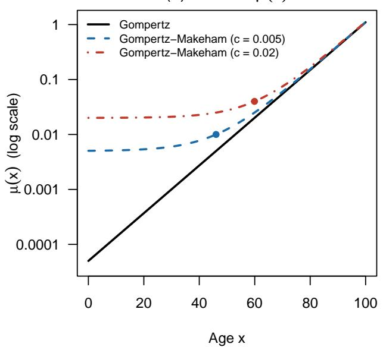
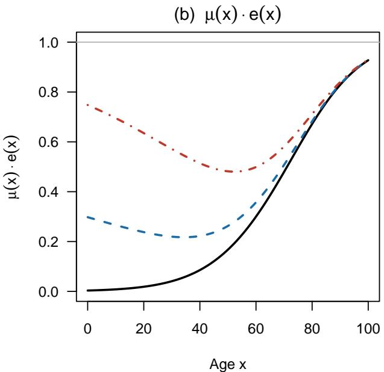

# Can AI Do Formal Demography? Why Vaccinating the Oldest Saves Both the Most Lives and the Most Years of Life

Joshua R. Goldstein and Kenneth W. Wachter∗

## Abstract

Can AI contribute to formal demography? We report an experiment in which an AI model, Claude, was asked to explain and then simplify the proof of an earlier result: that vaccinating the oldest against COVID-19 saves both the most lives and the most years of life, because the years saved per person treated rise with age. The model proposed a new proof that is shorter, more intuitive, and somewhat more general than the original, built from a known life-table identity and the definition of convexity. It states the condition for the result as the convexity of the reciprocal of the hazard, which can be checked from the hazard alone and holds for most familiar parametric models, and it yields a lower bound on life expectancy whenever that condition is met. Prompted by a further question, the model also gave an exact form of the condition, showing how far convexity can be relaxed. The model traced these identities and related results in earlier literature. An edited record of the sessions is provided, and complete transcripts are available on request. The exercise suggests that AI can revisit established results, make them easier to understand, and prove valuable generalizations.

Keywords Formal demography, life expectancy, mean residual life, vaccine prioritization, human–AI collaboration

## Introduction

AI systems have begun to make discoveries in mathematics. In September 2026, OpenAI announced a proof, found by a large system of AI agents and checked in the proof assistant Lean, that solutions of the three-dimensional Navier–Stokes equations can break down in finite time, a question posed as one of the Clay Millennium Prize problems (OpenAI 2026; Kakaes 2026). The claim is still under scrutiny, but it is no longer far-fetched that AI will settle problems that have resisted mathematicians for generations.

Our aim here is more modest. Formal demography has few famous open problems of this kind. For a field like ours, AI may instead be most useful in helping us understand, and even deepen, our own previously established results. We tested this on a result from our earlier work with Tom Cassidy: that vaccinating the oldest against COVID-19 saves both the most lives and the most years of life (Goldstein et al. 2021). Cassidy and Goldstein had worked out specific cases, and Wachter found the proof that established the result in general, by an indirect route. One of us (Goldstein) asked Claude, an AI model made by Anthropic, to explain that proof and then to find a simpler one.

What follows is the result, written largely by Claude under our direction. The new proof is shorter than the original. It restates the original condition in a more interpretable form, the convexity of the life expectancy a person would have if the hazard stayed frozen at its current level. This is a condition on the hazard itself, which matters because life expectancy rarely has a simple analytic form, and it holds for most familiar parametric models with increasing hazards. The proof also yields a lower bound on life expectancy that holds whenever the condition is met. Then, when the other of us (Wachter), reading the draft, asked whether that bound was equivalent to the condition, Claude gave an exact expression for the curvature of life expectancy in terms of the curvature of the frozen-hazard life expectancy. It shows how far convexity can be relaxed, although, because it involves the person-years lived at later ages, it cannot be checked from the hazard alone. The section on the use of AI at the end describes who did what.

This experiment suggests at least one use for AI in formal demography: revisiting earlier results, finding arguments that show more clearly why they hold, and connecting them to the larger body of what is already known. Here, Claude revisited our 2021 result, found a new, simpler proof that shows why it holds, and connected it both to an identity published by Cohen (2010) and to work by reliability theorists.

This example, we believe, ofers some general lessons, at least as of this writing in late 2026. First, AI is already useful for revisiting what we think we know. Initial proofs are rarely the clearest, and improving them no longer has to wait for someone with the time

and inclination; it can be done in a few hours of interaction with an AI model. Second, the gains came from combining human and machine: the model derived, searched, and drafted, while humans originated the questions, asked the follow-up that led to the exact condition, and judged what came back. That division of labor may not last; models may soon ask more of the follow-up questions themselves. Even then, humans will need to steer, deciding which of the many questions a model can generate are the ones worth pursuing. Third, authors revisiting their own results may be particularly well situated to work this way, because they know where their original argument was least satisfying and already know enough to judge the value of what the AI produces.

## The Key Relationship

Let $\mu ( x ) > 0$ be the force of mortality, $\ell ( x )$ survivorship, $d ( x ) = \mu ( x ) \ell ( x )$ the life table density of deaths, and X the age at death. Remaining life expectancy at age x (assumed finite) is the mean number of years still to be lived by those alive at x,

$$
e ( x ) \ = \ \mathbb { E } [ X - x \mid X > x ] \ = \ { \frac { 1 } { \ell ( x ) } } \int _ { x } ^ { \infty } \ell ( y ) d y .
$$

Key relationship. $I f 1 / \mu ( y )$ is convex for $y \geq x$ , then

$$
\frac { d } { d x } \left[ \mu ( x ) e ( x ) \right] \geq 0 .\tag{1}
$$

In words, the product of the hazard and life expectancy rises with age whenever the reciprocal of the hazard curves upward. Because of the standard identity $e ^ { \prime } ( x ) = \mu ( x ) e ( x ) - 1$ 2 this is the same as saying that life expectancy is convex in age, $e ^ { \prime \prime } ( x ) \geq 0$ . If $1 / \mu$ is strictly convex, both inequalities are strict. The product stays constant only in the boundary case where $1 / \mu$ is a straight line, flat or sloped, as with constant mortality or de Moivre’s linear survival curve.

The quantity $1 / \mu ( x )$ has a natural reading. It is the life expectancy a person aged x would have if the hazard stayed frozen at its current level. We will call it the frozen-hazard life expectancy. Cohen (2010), who showed that life expectancy is “the death-weighted average of the reciprocal of the survival-specific force of mortality,” called it the reciprocal of the force of mortality; we use the shorter name for its interpretation. Under the Gompertz model, $\mu ( x ) = \alpha e ^ { \beta x }$ , the frozen-hazard life expectancy e $^ { - \beta x } / \alpha$ declines exponentially. That is a convex function, so the relationship applies at every age.

Why should anyone care whether $\mu ( \boldsymbol { x } ) e ( \boldsymbol { x } )$ rises? It is the number of person-years saved by averting a death at age x, scaled by the risk of dying at that age. Consider COVID-19 vaccination. If a vaccine cuts each recipient’s risk of dying by the same proportion at every age, the expected years of life saved per dose given at age x are proportional to $\mu ( \boldsymbol { x } ) e ( \boldsymbol { x } )$ (Goldstein et al. 2021). The oldest have the highest risk of dying but the fewest years left to lose. When $\mu ( \boldsymbol { x } ) e ( \boldsymbol { x } )$ rises with age, the first efect wins: vaccinating the oldest first saves not only the most lives but also the most years of life, and the two goals point in the same direction.

## Proof

The proof has three steps. Throughout, $\mu ^ { \prime } ( x ) / \mu ( x )$ is the rate of ageing, the relative rate at which the hazard rises with age. Under the Gompertz model it is the constant $\beta .$

Step 1: Life expectancy is an average of frozen-hazard life expectancies. Since $d ( y ) = \mu ( y ) \ell ( y )$ , we can write $\begin{array} { r } { \ell ( y ) = \frac { 1 } { \mu ( y ) } d ( y ) } \end{array}$ , and so

$$
e ( x ) = { \frac { 1 } { \ell ( x ) } } \int _ { x } ^ { \infty } { \frac { 1 } { \mu ( y ) } } d ( y ) d y = \mathbb { E } { \bigg [ } { \frac { 1 } { \mu ( X ) } } { \bigg | } X > x { \bigg ] } .\tag{2}
$$

In words, actual life expectancy equals the average frozen-hazard life expectancy, evaluated at the age at which each survivor eventually dies. The identity needs no assumptions beyond $\mu > 0$ . It appears implicitly in Bradley and Gupta (2003) and explicitly in Co hen (2010), who wrote it with the surviving proportion, rather than age, as the variable of integration.

Step 2: Apply the tangent-line inequality. A convex function lies on or above each of its tangent lines. The slope of $1 / \mu$ at age x is $- \mu ^ { \prime } ( x ) / \mu ( x ) ^ { 2 }$ , so for every $y \geq x$

$$
\frac { 1 } { \mu ( y ) } \geq \frac { 1 } { \mu ( x ) } \left[ 1 - \frac { \mu ^ { \prime } ( x ) } { \mu ( x ) } ( y - x ) \right] .
$$

Now average both sides over the ages at which those alive at x will die, by multiplying by $d ( y ) / \ell ( x )$ and integrating. Because the weights are nonnegative, the inequality is preserved:

$$
\underbrace { \int _ { x } ^ { \infty } \frac { 1 } { \mu ( y ) } \frac { d ( y ) } { \ell ( x ) } d y } _ { e ( x ) } \geq \ \frac { 1 } { \mu ( x ) } \left[ \underbrace { \int _ { x } ^ { \infty } \frac { d ( y ) } { \ell ( x ) } d y } _ { 1 } - \frac { \mu ^ { \prime } ( x ) } { \mu ( x ) } \underbrace { \int _ { x } ^ { \infty } ( y - x ) \frac { d ( y ) } { \ell ( x ) } d y } _ { e ( x ) } \right] .
$$

The left integral is $e ( x )$ by the identity (2). On the right, the first integral is one, because everyone alive at x eventually dies, and the second is the mean remaining lifetime, which is $e ( x )$ by definition. Hence

$$
e ( x ) \geq { \frac { 1 } { \mu ( x ) } } \left[ 1 - { \frac { \mu ^ { \prime } ( x ) } { \mu ( x ) } } e ( x ) \right] ,
$$

or, multiplying through by $\mu ( x )$

$$
\mu ( x ) e ( x ) + \frac { \mu ^ { \prime } ( x ) } { \mu ( x ) } e ( x ) - 1 \geq 0 .\tag{3}
$$

Step 3: Recognize the derivative. Diferentiate $\mu ( \boldsymbol { x } ) e ( \boldsymbol { x } )$ and use the familiar identity $e ^ { \prime } ( x ) = \mu ( x ) e ( x ) - 1$

$$
\frac { d } { d x } \big [ \mu ( x ) e ( x ) \big ] \ = \ \mu ^ { \prime } ( x ) e ( x ) + \mu ( x ) \big [ \mu ( x ) e ( x ) - 1 \big ] \ = \ \mu ( x ) \left[ \mu ( x ) e ( x ) + \frac { \mu ^ { \prime } ( x ) } { \mu ( x ) } e ( x ) - 1 \right] ,
$$

which is nonnegative by (3). Because $\mu ( x ) e ( x ) = 1 + e ^ { \prime } ( x )$ , its derivative is $e ^ { \prime \prime } ( x )$ , and the proof is complete. □

The argument never uses the second derivative of $\mu ,$ nor does it require $\mu$ to be increasing. Convexity alone supplies the tangent line. Where $1 / \mu$ has a kink, any supporting line will do.

## Related Relationships

An equivalent condition on the rate of ageing. When Goldstein et al. (2021) first proved that $\mu ( \boldsymbol { x } ) e ( \boldsymbol { x } )$ rises with age, they did not state the condition in terms of $1 / \mu .$ Their proof worked with the logarithm of the hazard, and the condition it required was a restriction on the rate of ageing, $\mu ^ { \prime } / \mu = d \log \mu / d x$ , and its derivative. It is not obvious what that restriction means, or that it is the same as convexity of $1 / \mu$ . Diferentiating $1 / \mu$ twice shows that it is:

$$
{ \frac { d ^ { 2 } } { d x ^ { 2 } } } { \frac { 1 } { \mu ( x ) } } = { \frac { 1 } { \mu ( x ) } } \left[ \left( { \frac { \mu ^ { \prime } ( x ) } { \mu ( x ) } } \right) ^ { 2 } - { \frac { d } { d x } } { \frac { \mu ^ { \prime } ( x ) } { \mu ( x ) } } \right] .
$$

So $1 / \mu$ is convex exactly when

$$
\left( \frac { \mu ^ { \prime } ( x ) } { \mu ( x ) } \right) ^ { 2 } > \frac { d } { d x } \frac { \mu ^ { \prime } ( x ) } { \mu ( x ) } .\tag{4}
$$

This is the condition of Goldstein et al. (2021). In words, the rate of ageing may rise, but not faster than its own square. Any model with a positive rate of ageing that is constant or falling with age satisfies it. That includes the Gompertz model, Weibull hazards $x ^ { \beta - 1 }$ with $\beta > 1$ , and the logistic and gamma–Gompertz models with their mortality plateaus.

A lower bound on life expectancy. Wherever $1 / \mu$ is convex at all ages above $x ,$ inequality (3) is a bound worth having in its own right:

$$
e ( x ) \geq { \frac { 1 } { \mu ( x ) + \mu ^ { \prime } ( x ) / \mu ( x ) } } .
$$

Life expectancy is at least the reciprocal of the hazard plus the rate of ageing. Under the Gompertz model the rate of ageing is $\beta _ { i }$ , and the bound becomes

$$
e ( x ) \geq { \frac { 1 } { \mu ( x ) + \beta } } .\tag{5}
$$

The bound becomes exact as the hazard grows large relative to $\beta ,$ , but it understates life expectancy at the ages where most deaths occur.1

The boundary case. When $1 / \mu$ is linear, the tangent line is exact, so the bound holds with equality and $\mu ( \boldsymbol { x } ) e ( \boldsymbol { x } )$ is constant. This happens when $\mu ( x ) = 1 / ( a + b x )$ with $b < 1$ the generalized Pareto family. Its rate of ageing is $- b \mu ( x )$ , and its life expectancy $e ( x ) =$ $( a + b x ) / ( 1 - b )$ is linear in age. The family includes two familiar life tables. De Moivre’s linear survival curve, $\ell ( x ) = 1 - x / \omega _ { \mathrm { i } }$ , is the case $a = \omega , b = - 1$ , with $e ( x ) = ( \omega - x ) / 2$ and $\mu ( x ) e ( x ) = 1 / 2$ at every age. Constant mortality, where $e ( x ) = 1 / \mu$ , is the case $b = 0$

Where the relationship fails. Under Gompertz–Makeham mortality, $\mu ( x ) = c + \alpha e ^ { \beta x }$ ，

$$
{ \frac { d ^ { 2 } } { d x ^ { 2 } } } { \frac { 1 } { \mu ( x ) } } = { \frac { \beta ^ { 2 } A ( A - c ) } { ( c + A ) ^ { 3 } } } , \quad \quad A = \alpha e ^ { \beta x } .
$$

So $1 / \mu$ is convex only above the age where the senescent component overtakes the background component, $x ^ { * } = \log ( c / \alpha ) / \beta$ . Figure 1 shows that this failure is not just a failure of a suficient condition. With background mortality of $c = 0 . 0 0 5 , \mu ( x ) e ( x )$ actually falls until about age 34. With $c = 0 . 0 2$ it falls until about age 52. More generally, any local minimum of the hazard, such as the childhood minimum or the trough after the youngadult accident hump, is a local maximum of $1 / \mu$ , where convexity fails.

(a) Hazard µ(x)  

  
Figure 1: (a) Gompertz and Gompertz–Makeham hazards $( \alpha = 5 \times 1 0 ^ { - 5 } , \beta = 0 . 1 )$ . Dots mark the age log $( c / \alpha ) / \beta$ above which $1 / \mu$ is convex. (b) The product $\mu ( \boldsymbol { x } ) e ( \boldsymbol { x } )$ . It rises at all ages under Gompertz mortality, and at all ages above the dot under Gompertz– Makeham mortality. All three curves approach 1 at the oldest ages.

How far convexity can be relaxed. Because $\mu ( x ) e ( x ) = 1 + e ^ { \prime } ( x )$ , the product rises exactly where life expectancy is convex, so an exact condition is always available in terms of e itself. Keeping, rather than discarding, the gap in Step 2 expresses that condition through the hazard. Without assuming convexity, the gap between $1 / \mu$ and its tangent line at x is the curvature accumulated between x and $y \colon$

$$
{ \frac { 1 } { \mu ( y ) } } \ - \ { \frac { 1 } { \mu ( x ) } } \left[ 1 - { \frac { \mu ^ { \prime } ( x ) } { \mu ( x ) } } ( y - x ) \right] \ = \ \int _ { x } ^ { y } ( y - t ) \left( { \frac { 1 } { \mu } } \right) ^ { \prime \prime } ( t ) d t .
$$

Average both sides over the ages at which those alive at x will die, as in Step 2, and change the order of integration on the right. The weight on the curvature at age t becomes $\textstyle \int _ { t } ^ { \infty } ( y - t ) d ( y ) d y / \ell ( x ) = T ( t ) / \ell ( x )$ , where $\begin{array} { r } { T ( t ) = \int _ { t } ^ { \infty } \ell ( y ) } \end{array}$ dy is the person-years lived above t. With Step 3, this gives

$$
e ^ { \prime \prime } ( x ) ~ = ~ { \frac { d } { d x } } \big [ \mu ( x ) e ( x ) \big ] ~ = ~ { \frac { \mu ( x ) ^ { 2 } } { \ell ( x ) } } \int _ { x } ^ { \infty } \bigg ( { \frac { 1 } { \mu } } \bigg ) ^ { \prime \prime } ( t ) ~ T ( t ) d t .\tag{6}
$$

So $\mu ( \boldsymbol { x } ) e ( \boldsymbol { x } )$ rises at $x ,$ and the lower bound holds at x, if and only if the curvature of $1 / \mu$ above x, weighted by person-years lived, is nonnegative on balance. Equivalently, $1 / \mu$ must lie above its tangent at x on average over the ages at which survivors die, not at every age. (At a kink, the curvature includes a point mass equal to the jump in slope.) Convexity can therefore be relaxed. In the Gompertz–Makeham example with $c = 0 . 0 0 5$ $\mu ( \boldsymbol { x } ) e ( \boldsymbol { x } )$ begins to rise at about age $3 4$ , although $1 / \mu$ is convex only above $x ^ { * } \approx 4 6$ . But Equation (6) involves $T _ { \cdot }$ , which, like $e ,$ rarely has a simple analytic form, so it cannot be checked from the hazard alone. Convexity of $1 / \mu$ remains the practical test.

## History

The result ofers an alternative to the original proof of Goldstein et al. (2021), who showed that $\mu ( \boldsymbol { x } ) e ( \boldsymbol { x } )$ increases with age under condition (4). Their argument changed variables from age to cumulative hazard, which turns $\mu ( \boldsymbol { x } ) e ( \boldsymbol { x } )$ into an average of hazard ratios, and then used a log-concavity argument. The proof given here is shorter and extends theirs in two ways. It requires only that $1 / \mu$ be convex, so the hazard need not be twice diferentiable and may have kinks. And it yields the lower bound on life expectancy as a by-product.

The proof combines the identity (2) of Cohen (2010) with a tangent line. Cohen also derived a lower bound from his identity, by applying Jensen’s inequality to the reciprocal function: the average of $1 / \mu$ over deaths is at least the reciprocal of the average of $\mu .$ . That bound difers from ours, which uses the shape of $1 / \mu$ across ages, and Cohen did not examine the shape of $e ( x )$ . We have not found the convexity result or the general lower bound stated elsewhere, and we would welcome earlier references.

Before Goldstein et al. (2021), reliability theorists had made partial statements about the product of the hazard and the mean residual life, as they call $e ( x )$ . Kupka and Loo (1989) named $\mu ( \boldsymbol { x } ) e ( \boldsymbol { x } )$ the “vitality rate.” They noted that its increase is equivalent to convexity of $e ( x )$ , as follows from $e ^ { \prime } = \mu e - 1$ , and showed that an increasing hazard alone does not imply it, but they gave no condition on the hazard that does. Gupta and Kirmani (2000: Theorem 5.3) showed that a concave hazard implies a convex mean residual life. Because a positive concave function has a convex reciprocal, their result is a special case of the one here. It does not cover the Gompertz model, whose hazard is convex. Bradley and Gupta (2003) studied the limit of $\mu ( \boldsymbol { x } ) e ( \boldsymbol { x } )$ at old ages in terms of $1 / \mu$ and its derivatives, but not its shape at younger ages. In doing so they wrote life expectancy, in efect, as the average of $1 / \mu$ over ages at death, the identity (2) later stated explicitly by Cohen (2010), and obtained by integration by parts its first-derivative counterpart,

$\begin{array} { r } { e ^ { \prime } ( x ) = \frac { \mu ( x ) } { \ell ( x ) } \int _ { x } ^ { \infty } ( 1 / \mu ) ^ { \prime } ( t ) \ell ( t ) } \end{array}$ dt (Bradley and Gupta 2003: proof of Theorem 4). One further integration by parts gives Equation (6). The condition it expresses, convexity of $e ( x )$ 2 was known (Kupka and Loo 1989); we have not found Equation (6), which states that condition through the curvature of $1 / \mu ,$ elsewhere.

The ingredients are standard. The identity $e ^ { \prime } ( x ) \ = \ \mu ( x ) e ( x ) \ - 1$ is long-standing actuarial knowledge (e.g., Spurgeon 1922:212). In the Gompertz case, the lower bound (5) is a classical inequality for the exponential integral (Abramowitz and Stegun 1964: formula 5.1.19).

## Application

The result was motivated by COVID-19 vaccine allocation. Goldstein et al. (2021) observed that if vaccine eficacy θ is constant over age and the disease kills at a constant fraction ρ of all-cause mortality, the expected years of life saved per dose given at age x are $\theta \rho \mu ( x ) e ( x )$ . The key relationship says that, wherever mortality is Gompertz-like, this quantity is largest for the oldest. Prioritizing the oldest therefore saves both the most lives and the most years of life. This was the case for COVID-19 in the United States, Germany, and South Korea (Goldstein et al. 2021). Where background mortality is high, or where the disease’s age pattern departs from that of all-cause mortality, the conclusion need not hold at every age (Pifarr´e i Arolas et al. 2021). Even then, as Figure 1 shows, the oldest may still save the most years.

The theorem also clarifies a familiar demographic result. A small proportional reduction in mortality at age x raises life expectancy at birth by an amount proportional to $\ell ( x ) \mu ( x ) e ( x )$ (see, e.g., Vaupel 1986). These weights typically decline at the oldest ages, which can suggest that mortality reductions there are of little value. The decline comes entirely from the factor $\ell ( x )$ , the number of people who survive to age x. The remaining factor, $\mu ( \boldsymbol { x } ) e ( \boldsymbol { x } )$ , is the gain per person alive at x, and by the key relationship it rises with age. Gains summed over a birth cohort and gains per person treated therefore have opposite age gradients, and it is the second that matters when deciding whom to treat.

The same logic applies to other interventions that remove a fixed share of each person’s risk of death, at once and at the same cost at every age, and that leave those saved facing the ordinary life table afterwards. Many age-prioritization questions are more complicated because one of these conditions fails. Cancer screening and preventive drugs pay of only after a lag, and the chance of surviving the lag falls with age. Surgery and intensive care carry risks of their own that rise with age, so the cost of treatment is not constant. And a transplanted organ is a durable resource whose working life can outlast an older recipient, so the benefit depends on life expectancy with and without the organ, not on $\mu ( \boldsymbol { x } ) e ( \boldsymbol { x } )$ . In these cases a real trade-of between saving lives and saving years of life can arise.

## Use of AI

The original work was done in a single interactive session with Claude Opus 5.5 (Anthropic), run in Claude Code, which let the model read files, run code, compile LAT X, and search the web and, through Goldstein’s library login, licensed full texts. The session took about two and a half hours on the evening of October 9, 2026, with a brief follow-up the next morning, and comprised 60 prompts. Goldstein began by asking Claude to explain the proof at the end of Goldstein et al. (2021) and to search the reliability literature for precedents. In reporting on that search, Claude observed that the result is equivalent to the convexity of life expectancy, and when he asked what’s your simple convexity proof, it proposed the tangent-line argument of the Proof section. The remaining prompts asked Claude to write the proof up for a general demographic audience, to check its originality more exhaustively, and to revise the notation and the exposition of Step 2; most were short editorial instructions. The sixteen prompts that shaped the content are listed verbatim in Appendix Table A1. An edited record of this session, with prompts verbatim and replies excerpted, is provided as a supplementary file; the complete transcripts of all sessions are available from the authors. Goldstein used Claude again, in sessions beginning on October 22, 2026, to revise the paper for this journal, including the title, the introduction, and this section. After reading the draft, Wachter asked whether the lower bound, holding at all ages, is equivalent to the convexity of 1/µ; in reply, Claude showed that it is not and derived the exact form (6) given in the Related Relationships section. At Goldstein’s request, Claude then checked every reference against bibliographic databases and the full texts. It confirmed that all the cited works exist and that the citations were correct, including a formula number that Claude had given from memory, with two exceptions, both from the AI sessions. The publisher of Spurgeon (1922) was wrong. And an article by Keyfitz, cited with Vaupel (1986) for the efect of a change in mortality at one age, was one Claude had not read; the result could be confirmed only in Vaupel, so the citation was dropped. The division of labor between Claude and the two of us is described in the footnote on the title page.

## Acknowledgments

As described in the “Use of AI” section, this paper was produced with the assistance of Claude Opus 5.5 (Anthropic). This work was supported by the Eunice Kennedy Shriver National Institute of Child Health and Human Development (NICHD) of the National Institutes of Health under award R25HD083136 (Workshops in Formal Demography).

## References

Abramowitz, M., & Stegun, I. A. (Eds.). (1964). Handbook of mathematical functions. Washington, DC: National Bureau of Standards.

Bradley, D. M., & Gupta, R. C. (2003). Limiting behaviour of the mean residual life. Annals of the Institute of Statistical Mathematics, 55, 217–226.

Cohen, J. E. (2010). Life expectancy is the death-weighted average of the reciprocal of the survival-specific force of mortality. Demographic Research, 22, 115–128. https://doi. org/10.4054/DemRes.2010.22.5

Goldstein, J. R., Cassidy, T., & Wachter, K. W. (2021). Vaccinating the oldest against COVID-19 saves both the most lives and most years of life. Proceedings of the National Academy of Sciences, 118, e2026322118.

Gupta, R. C., & Kirmani, S. N. U. A. (2000). Residual coeficient of variation and some characterization results. Journal of Statistical Planning and Inference, 91, 23–31.

Kupka, J., & Loo, S. (1989). The hazard and vitality measures of ageing. Journal of Applied Probability, 26, 532–542.

OpenAI. (2026). On the Navier–Stokes Millennium Prize problem [Webpage]. Retrieved from https://openai.com/index/navier-stokes-solution/ (archived at https://web.archive.org/web/20260908171518/https://openai.com/index/ navier-stokes-solution/)

Pifarr´e i Arolas, H., Acosta, E., & Myrskyl¨a, M. (2021). Optimal vaccination age varies across countries. Proceedings of the National Academy of Sciences, 118, e2105987118.

Kakaes, K. (2026, September 8). AI has solved one of math’s \$1 million Millennium Prize problems. Quanta Magazine. Retrieved from https://www.quantamagazine.org/ ai-has-solved-one-of-maths-1-million-millennium-prize-problems-20260908/

Spurgeon, E. F. (1922). Life contingencies. London: C. & E. Layton, for the Institute of Actuaries.

Vaupel, J. W. (1986). How change in age-specific mortality afects life expectancy. Population Studies, 40, 147–157.

## Appendix

Table A1: The sixteen prompts that shaped the content, verbatim, in order. Numbers give each prompt’s position among the 60 in the session. The other prompts were editorial or practical (“open in skim,” “recompile”).

# Prompt   
Understanding the original proof   
1 read the paper by goldstein cassidy and wachter in pnas it should be on disk.   
and explain the proof to me that is at the end   
2 how would you describe the approach of this proof   
Precedents   
3 search the reliability literature for precedents   
The new proof   
4 ok so what’s your simple convexity proof. please don’t use latex when   
showing me math on console   
Writing it up   
7 cool. write up a pdf version of the proof. the proof should be accessible   
to general demogrphaic audience. you can look at goldstein and vaupel’s   
Formal Relationship articles in Demogrpahic Research for style and voice   
The lower bound   
9 wow. your gompertz life expectancy at old ages inequality looks almost like   
a good approximation, right?   
Checking originality   
13 how could one do a more exhaustive lit check for originality of this result?   
21 also look for citers of goldstein, cassidy and wachter to see if someone has   
come up with different math   
Notation   
23 is s(x) really best notation here. seems like it should be a junior version   
of S(x) ...   
30 why did we reject h^{-1}   
31 rewrite the draft with 1/µ and µ’/µ, no new symbol   
Exposition of Step 2

<table><tr><td># Prompt</td><td></td></tr><tr><td>39</td><td>oh, maybe flesh out the math of expectations at the cost of a bit more text. when you take expectaitons in part 2 of proof, it&#x27;s not obvious without paper and pencil what&#x27;s going on.</td></tr><tr><td>43</td><td>for me step 2 would be simpler if you just said something like you did at first, averaging ... but then you actually write down the integrals that are</td></tr><tr><td></td><td>the averages rather than explain everythign in words. also is it ovious</td></tr><tr><td></td><td>that E(y-x) = E(x)? maybe you don&#x27;t have to do integration by parts. maybe</td></tr><tr><td>A source for e′(x) = µ(x)e(x) − 1</td><td>there&#x27;s a simple logicla reason for this</td></tr><tr><td></td><td></td></tr><tr><td></td><td>46 id don&#x27;t believe the results from calabria and pucini are foundational.</td></tr><tr><td></td><td>this must have been known much, much earlier. the keyfitz an dvaupel stuff</td></tr><tr><td></td><td>seems ok, but probably also restatements.</td></tr><tr><td></td><td></td></tr><tr><td></td><td></td></tr><tr><td></td><td>47 old actuarial knowledge needs a citation, no?</td></tr><tr><td></td><td></td></tr><tr><td></td><td></td></tr><tr><td></td><td></td></tr><tr><td></td><td>Why the proof is simple</td></tr><tr><td></td><td></td></tr><tr><td></td><td></td></tr><tr><td></td><td></td></tr><tr><td></td><td>58 one thing that is good about the new proof is that it uses life table</td></tr><tr><td></td><td></td></tr><tr><td></td><td></td></tr><tr><td></td><td></td></tr><tr><td></td><td>identities and very simple calculus. just the definition of convexity. no</td></tr><tr><td></td><td></td></tr><tr><td></td><td></td></tr><tr><td></td><td></td></tr><tr><td></td><td>change of variable, for example. am i right in seeing that it is so simple</td></tr><tr><td></td><td></td></tr><tr><td></td><td></td></tr><tr><td></td><td></td></tr><tr><td></td><td></td></tr><tr><td></td><td></td></tr><tr><td></td><td></td></tr><tr><td></td><td></td></tr><tr><td></td><td></td></tr><tr><td></td><td></td></tr><tr><td></td><td></td></tr><tr><td></td><td></td></tr><tr><td></td><td></td></tr><tr><td></td><td></td></tr></table>