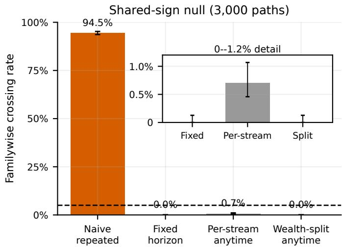
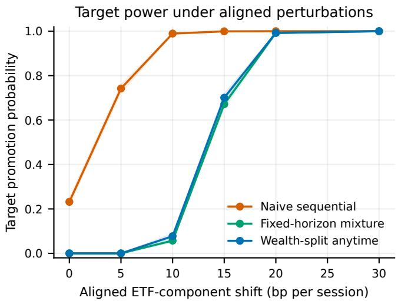
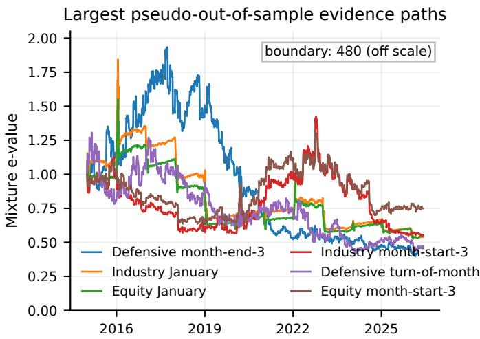
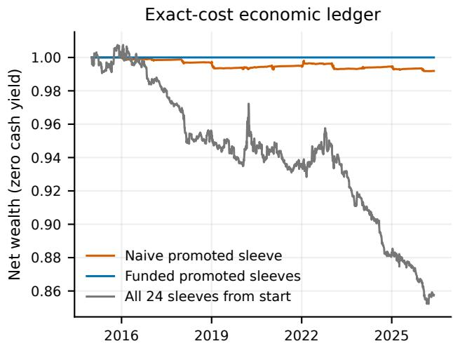

# Can We Stop the Backtest Yet? Anytime-Valid Promotion Tests for Adaptive Financial Research Agents

Eric Benhamou   
Ai For Alpha   
Neuilly-sur-Seine, France   
LAMSADE, Université Paris   
Dauphine–PSL   
Paris, France   
eric.benhamou@aiforalpha.com

Ethan Setrouk Ai For Alpha Neuilly-sur-Seine, France ethan.setrouk@aiforalpha.com

Jean-Jacques Ohana Ai For Alpha Neuilly-sur-Seine, France jean-jacques.ohana@aiforalpha.com

Chamyl Saadi Ai For Alpha Neuilly-sur-Seine, France chamyl.saadi@aiforalpha.com

Beatrice Guez Ai For Alpha Neuilly-sur-Seine, France beatrice.guez@aiforalpha.com

Thomas Jacquot Ai For Alpha Neuilly-sur-Seine, France thomas.jacquot@aiforalpha.com

## Abstract

Financial research agents can generate and monitor trading rules faster than a human can document the resulting selection process. Candidates appear at data-dependent times, weak rules are abandoned, and promising ones are watched until they cross a reporting threshold. We introduce Promote, a protocol that assigns every candidate predictable testing wealth at birth and accumulates a cost-aware e-process only from subsequent returns. If lifetime allocations sum to at most one, a weighted Ville argument bounds the probability of ever promoting a rule whose declared bounded net score has always had nonpositive conditional mean. The result permits dependent candidates, adaptive births, and indefinite monitoring. We audit the implementation in two settings. A retrospective pseudo-out-of-sample replay contains 24 panel–rule hypotheses, 3,000 shared-sign null paths, injected alternatives, and public ETF and industry data. Repeated unadjusted tests produce a family crossing in 94.5% of null paths, versus 0.0% for Promote; at a 15-bp aligned ETF-component perturbation, Promote has 70.1% target power and median crossing session 2,327. A separate exact mean-zero experiment lets an agent select candidate identities and birth times from past scores; the funded gate has 1.77% false-family crossings across 3,000 programs. The market replay produces zero promotions after costs. The certificate controls historical false promotion under the declared null; it is not a certificate that an earlier edge remains profitable at deployment.

AI-use disclosure. Generative AI tools, including OpenAI Codex, assisted manuscript preparation. For this preprint version, Codex assisted with LaTeX editing, author and venue metadata, compilation, and layout checks.

## CCS Concepts

• Mathematics of computing → Probability and statistics; • Computing methodologies → Sequential decision making.

## Keywords

financial agents, anytime-valid inference, e-processes, backtest overfitting, strategy selection, responsible AI

Accepted at ICAIF 2026, Milan, Italy. Author preprint.

## 1 Introduction

A conventional backtest has a nominal end date. Research rarely does. An analyst looks at interim results, changes the universe, adds a seasonal interaction, drops an unpromising rule, and continues when the evidence is close. An autonomous research agent can perform the same sequence at machine speed. Treating the final rule as if it came from one fixed test understates the number of opportunities the system had to be lucky.

This failure is familiar in empirical finance. Data-snooping corrections compare many strategies on a common terminal sample [9, 18, 27], while empirical-finance protocols quantify selection and backtest overfitting [1, 2, 10]. Neither device, by itself, authorizes continuous inspection of a library whose membership is decided from the observed history. The relevant error event is operational: did the research process ever promote a strategy whose declared net score has no positive conditional mean?

Test martingales and e-values are well suited to this question because they remain valid at stopping times [16, 19, 22, 23]. Their use still requires a protocol. A newly proposed rule must not inherit evidence from before it was specified; adding near-duplicates must consume a finite research budget; transaction costs must be known before the return used to update the test; and trading must begin after, rather than on, the boundary-crossing observation. Those details are where an apparently safe backtest can leak.

Promote turns them into a ledger. At a predictable birth time, candidate ℎ receives initial testing wealth �ℎ. Subsequent bounded, cost-adjusted payofs update an e-process with bets chosen from the past. Promotion occurs at the first crossing of $1 / ( \alpha \pi _ { h } )$ . If the total wealth assigned over the life of the research program is at most one, a weighted Ville argument controls the probability of any false promotion by �. The library may be dependent, monitored at diferent frequencies, and expanded in response to old data.

Contributions. The statistical ingredients are established; our contribution is to make them operational for an adaptive financialresearch workflow:

• a pathwise testing-wealth ledger that covers dependent, predictably registered candidates and continuous monitoring;

• a cost-aware implementation that separates pre-registration data, evidence, promotion, and next-session execution; and

• matched fixed-family and adaptive-birth audits that expose false-family error, detection delay, and the economic weakness of the historical library.

The protocol tests an executable bounded payof, not a semantic strategy story supplied by an agent. Its certificate concerns the complete promotion history, including rejected ideas; the market replay is a deliberately narrower pseudo-out-of-sample special case.

## 2 Research Process and Null Hypotheses

Let $( \mathcal { F } _ { t } ) _ { t \geq 0 }$ contain all prices, candidate definitions, test states, and decisions available immediately before outcome � + 1. A research agent may create candidate ℎ at a stopping time $\nu _ { h } .$ . Its rule is an executable map from $\mathcal { F } _ { t - 1 }$ to an exposure $a _ { h , t } \in [ - 1 , 1 ]$ for $t > \nu _ { h }$ The candidate definition includes its asset, direction, rebalance convention, and cost model; changing any of these fields creates a new candidate.

In the ledger, “hash the rule” means compute a cryptographic fingerprint of one canonical, machine-readable package containing the executable code and all settings that determine its trades. For example, the package includes the asset universe, signal formula, parameter values, data fields, calendar, position sizing, rebalance timing, and cost convention. A function such as SHA-256 maps those bytes to a short identifier: identical packages produce the same identifier, while even a small edit almost certainly produces a diferent one. The hash is not the rule, encryption, or proof that the rule is correct; the full package is retained. It is a tamper-evident label that lets an auditor verify exactly which frozen version was registered before later returns arrived.

Let $r _ { h , t } ^ { \mathrm { n e t } }$ be the return that candidate ℎ would have earned over period � after its predictable transaction cost. We use a predictable positive scale $s _ { h , t }$ and define

$$
Y _ { h , t } = \mathrm { c l i p } \Big ( r _ { h , t } ^ { \mathrm { n e t } } / s _ { h , t } , - 1 , 1 \Big ) .\tag{1}
$$

Clipping is part of the estimand: the test concerns the conditional mean of the bounded score, not the unbounded mean return. Economic results are always computed from the unclipped net return.

For each candidate, the null is

$$
H _ { h } : \qquad \mathbb { E } [ Y _ { h , t } \mid { \mathcal F } _ { t - 1 } ] \le 0 \quad { \mathrm { f o r ~ e v e r y ~ } } t > \nu _ { h } .\tag{2}
$$

This is stronger than a zero unconditional full-sample mean. It defines a uniform post-birth null: the false-promotion guarantee applies only when the conditional mean has been nonpositive at every scored date. If an edge was positive and later decays, the null is false and old evidence does not certify that the edge remains positive today.

Assumption 1 (Predictable registration). The candidate definition, scale $s _ { h , t } ,$ transaction cost, and bet $\lambda _ { h , t }$ are $\mathcal { F } _ { t - 1 }$ -measurable, with $0 \leq \lambda _ { h , t } \leq 1$ . The first scored return begins strictly after $\nu _ { h }$

The score may be inactive on dates when the rule holds cash; equivalently, $Y _ { h , t } = 0$ on those dates. Candidates can share assets and returns, so no cross-rule independence is assumed.

## 3 A Wealth-Conserving Promotion Protocol

## 3.1 One candidate

Starting from $E _ { h , \nu _ { h } } = 1$ , define

$$
E _ { h , t } = \prod _ { s = \nu _ { h } + 1 } ^ { t } \left( 1 + \lambda _ { h , s } Y _ { h , s } \right) .\tag{3}
$$

The nonnegative factor is the return on one unit ofstatistical wealth bet against $H _ { h }$

Proposition 1 (Anytime validity). Under $H _ { h }$ and Assumption 1, $( E _ { h , t } ) _ { t \geq \nu _ { h } }$ is a nonnegative supermartingale. For every � $\iota \in ( 0 , 1 )$ ,

$$
\mathbb { P } _ { H _ { h } } \left( \operatorname* { s u p } _ { t \geq \nu _ { h } } E _ { h , t } \geq u ^ { - 1 } \right) \leq u .
$$

Proof. Conditional on $\mathcal { F } _ { t - 1 } , \mathbb { E } \big [ 1 + \lambda _ { h , t } Y _ { h , t } \ \big | \ \mathcal { F } _ { t - 1 } \big ] \le 1$ . Thus (3) is a nonnegative supermartingale beginning at one. Ville’s inequality gives the crossing bound. □

The product in (3) is cumulative. A rolling product that deletes old factors is generally not an e-process and cannot use Proposition 1. Restarting is possible, but every restart must be funded as a new test or combined through a valid mixture.

The implementation avoids choosing a bet after seeing test returns. For the fixed grid Λ = {.025, .05, .10, .20, .35}, let $E _ { h , t } ^ { ( \lambda ) }$ denote (3) with constant bet � and set

$$
\bar { E } _ { h , t } = \frac { 1 } { | \Lambda | } \sum _ { \lambda \in \Lambda } E _ { h , t } ^ { ( \lambda ) } .\tag{4}
$$

Each component starts at one and is a nonnegative supermartingale, so their fixed convex mixture is one as well. The promotion rule uses $\bar { E } _ { h , t }$ throughout; it never substitutes the best component in hindsight.

## 3.2 An adaptively growing library

Suppose a budget account assigns candidate ℎ a nonnegative mass $\pi _ { h }$ at birth. The allocation may depend on $\mathcal { F } _ { \nu _ { h } }$ , but the pathwise total must satisfy

$$
\sum _ { h \mathrm { ~ e v e r ~ c r e a t e d } } \pi _ { h } \leq 1 .\tag{5}
$$

The rule is promoted at

$$
\tau _ { h } = \operatorname* { i n f } \{ t > \nu _ { h } : E _ { h , t } \geq ( \alpha \pi _ { h } ) ^ { - 1 } \} .\tag{6}
$$

Theorem 1 (False-promotion control). Under Assumption 1 and (5),

$$
\mathbb { P } \{ a t l e a s t o n e t r u e H _ { h } \ i s \ e \nu e r \ p r o m o t e d \} \le \alpha .
$$

The statement allows dependent candidates, data-dependent birth times, and an unbounded monitoring horizon.

Proof. Condition on $\mathcal { F } _ { \nu _ { h } }$ . Proposition 1 bounds the crossing probability of a null candidate by ��ℎ. A union bound over the countable set of created nulls and (5) give the result. Random predictable masses are handled by iterated expectation. □

Promote: auditable promotion ledger   
1. Before outcome �+1, freeze the rule package, compute its fingerprint,   
and record its birth �ℎ, scale, cost convention, bet mixture, and mass   
$\pi _ { h } .$   
2. Debit $\pi _ { h }$ from the remaining lifetime budget; reject a birth that   
would make cumulative allocations exceed one.   
3. For each $t >$ �ℎ, append the realized net score $Y _ { h , t }$ � and update every   
predeclared mixture component. Never import pre-birth evidence.   
4. Record $\bar { E } _ { h , t } ,$ the applicable boundary $( \alpha \hat { \pi } _ { h } ) ^ { - \hat { 1 } }$ , and the crossing   
decision.   
5. If a crossing occurs at $\tau _ { h } ,$ schedule economic exposure no earlier   
than �ℎ + 1 and maintain evidence and P&L as separate ledgers.   
Minimum row key: candidate hash, event time, data-version hash, score, cost,   
evidence, boundary, decision, and first executable session.  
Figure 1: The protocol is implementable as an append-only ledger. A changed rule, restart, or current-regime certificate is a newly funded candidate.

Conditioning is what permits adaptive research: pre-birth observations may determine the rule’s code, identity, and mass, but cannot enter its post-birth product. Abandonment can set future bets to zero but does not replenish the account; the program already enjoyed a crossing opportunity. Revival, rescaling, or a nearby parameterization requires another debit. Zero-mass candidates are ineligible. These rules block free restarts and hidden near-duplicate tests.

This theorem controls familywise error, a demanding criterion appropriate to an automated promotion gate. If the objective is discovery rather than certification, stopped e-values can instead be passed to e-BH, which controls FDR under arbitrary dependence [25]. That is a diferent operating point and is not used for the primary experiment.

## 3.3 Promotion is not same-period trading

The crossing observation belongs to the test, not to post-promotion performance. If $\tau _ { h } < \infty ,$ , live or holdout exposure starts at $\tau _ { h } + 1$ . This one-period separation prevents the return that triggers promotion from being counted as evidence of deployed profitability. Statistical wealth is also not trading capital: $E _ { h , t }$ may be highly volatile even when the economic position is small.

For a promoted rule, we therefore maintain two ledgers. The evidence ledger continues to update (3); the economic ledger records the actual net return from the next executable interval. Demotion can be governed by a separately registered rule, but optional removal does not retroactively change the false-promotion guarantee. Production use therefore requires a distinct current-regime or forward deployment check. A predictable epoch restart can provide one, but it must be funded as a new test; deleting old factors from the original product would break anytime validity.

## 3.4 State, corrections, and recovery

Each update reads the committed state at � − 1, joins one point-intime outcome, and writes one state for �. Its unique key combines the candidate fingerprint, event time, and data-version fingerprint. Replaying a key after a crash returns the stored row instead of multiplying an e-factor twice; partial writes are not evidence.

Event time and ingestion time remain separate. Revised data or code cannot silently overwrite an old factor: the ledger retains the original row, flags the certificate, and computes a versioned diagnostic. Any corrected series used for authorization starts prospectively as a newly funded stream. Thus a reviewer can reconstruct what the gate actually knew when it acted.

Automated checks enforce idempotent replay, no influence from post-� inputs, and cumulative birth debits that never decrease or exceed one. These target double counting, look-ahead joins, and budget recycling.

## 3.5 A simple power calculation

Under an alternative with E $\operatorname { \mathcal { Y } } _ { h , t } \mid { \mathcal { F } } _ { t - 1 } ] \geq \mu > 0$ and $| Y _ { h , t } | \leq 1 ;$ , a fixed bet $\lambda \in ( 0 , 1 )$ obeys

$$
\log ( 1 + \lambda Y _ { h , t } ) \geq \lambda Y _ { h , t } - \frac { \lambda ^ { 2 } Y _ { h , t } ^ { 2 } } { 2 ( 1 - \lambda ) } .\tag{7}
$$

If the predictable second moment is bounded by $v ,$ the expected log-growth per active observation is at least $\lambda \mu - \lambda ^ { 2 } v / [ 2 ( 1 - \lambda ) ]$ For every component in the implemented grid, (4) gives log $\bar { E } _ { h , t } \geq$ log $E _ { h , t } ^ { ( \lambda ) } - \log { 5 } .$ . Thus adaptation over the five predeclared bet sizes costs at most log 5 units of log evidence relative to the best component on that path; it does not license selecting the best component after the test. The growth bound makes the cost of a small $\pi _ { h }$ explicit: a candidate born late or deep in a hypothesis tree needs more observations to reach (6). Validity is cheap computationally but not statistically.

## 4 Experimental Design

## 4.1 Retrospective pseudo-out-of-sample library

The implementation crosses three asset panels with eight calendar definitions, giving 24 panel–rule hypotheses. This is the fixedfamily special case of Theorem 1: within the replay, all candidates are frozen before the 2015 segment is processed and receive equal wealth. Adaptive births and data-dependent allocations are not exercised by the market replay; Section 4.3 isolates them under an exact mean-zero score law. The panels are six equity ETFs (SPY, QQQ, IWM, EFA, EEM, and VNQ), five defensive or diversifying ETFs (IEF, TLT, GLD, DBC, and SHY), and the ten value-weighted Fama–French industries. The rules are turn of month, first three and last three trading days, Monday, Friday, last three trading days of a quarter, January, and the third Friday of a month. The common daily sample runs from March 2006 through May 2026.

For rule indicator $I _ { h , t }$ , the candidate takes the approximately calendar-neutral panel exposure

$$
q _ { h , t } = d _ { h } \frac { I _ { h , t } - \hat { p } _ { h } } { \operatorname* { m a x } ( \hat { p } _ { h } , 1 - \hat { p } _ { h } ) } ,
$$

split equally across the assets in its panel. The activation frequency ${ \hat { p } } _ { h }$ and direction $d _ { h } \in \{ - 1 , 1 \}$ are fixed on March 2006–December 2010. The predictable score scale is the larger of 50 bp and the training 99.5th percentile of absolute net return. The 2011–2014 segment records stability and component-bet diagnostics, but does not choose the test bet or alter the family. Every test stream uses the predeclared equal mixture in (4) and restarts at one in January 2015. The replay code does not use a post-2014 return to change these choices; the overall split and library were nevertheless designed retrospectively.

The replay segment covers January 2015 through May 2026. Candidates divide wealth equally, so each boundary is $2 4 / \alpha . \mathrm { A l l }$ strategies pay five basis points per dollar of one-way risky-asset turnover. The code solves the proportional-cost self-financing equation against drifted pre-trade weights rather than subtracting cost from stale targets. At each date it records exposures and costs, observes the return, updates evidence, and schedules any promotion for the following trading day.

## 4.2 Shared-sign null and power experiments

Type-I error is evaluated on 3,000 Monte Carlo paths using a shareddate sign randomization of the observed gross test returns. The same independent Rademacher sign multiplies the complete crosshypothesis vector on a date, preserving observed magnitudes and contemporaneous cross-rule dependence while removing serial sign dependence. The nonnegative cost-fraction path is conditioned upon rather than recomputed, and scores are recalculated and clipped after costs. This construction satisfies (2) conditionally on the magnitudes and costs. Indeed, with $f ( u ) = \mathrm { c l i p } ( u , - 1 , 1 )$ $a = - c / s \le 0 , b = ( 1 - c ) g / s ,$ , and a Rademacher sign �,

$$
\begin{array} { r } { \mathbb { E } _ { S } f ( a + S b ) = \frac { 1 } { 2 } \{ f ( a + b ) + f ( a - b ) \} \le \frac { 1 } { 2 } \{ f ( b ) + f ( - b ) \} = 0 , } \end{array}
$$

because � is increasing and odd. The complete fixed-family monitoring rule is rerun, including every intermediate inspection. The primary statistic is whether at least one null candidate is ever promoted.

The comparator repeatedly computes an expanding one-sided z statistic after a minimum of 63 sessions and declares success whenever an unadjusted �-value falls below � at an inspection date. This baseline is intentionally common rather than defensible: it measures the inflation caused by the workflow that Promote is designed to replace. A second comparator gives every stream its own anytime boundary 1/� without splitting wealth; it isolates cross-candidate multiplicity from optional stopping. A matchederror fixed-horizon comparator rejects candidate ℎ only when its terminal mixture satisfies $\bar { E } _ { h , n } \geq ( \alpha \pi _ { h } ) ^ { - 1 }$ . Markov’s inequality and a union bound give the same familywise guarantee under (2); unlike Promote, this comparator discards earlier crossings and cannot stop before session �.

Power paths shift each equity component return on every date by 5, 10, 15, 20, or 30 basis points in the sign of the target equity turn-of-month weight. The target therefore receives a positive gross contribution proportional to its absolute exposure, and overlapping equity rules also move. The five shifts correspond to 4.8%, 9.6%, 14.4%, 19.2%, and 28.8% annualized gross alpha for the target over lay. We report target detection and delay; the repeated-� curve is diagnostic and is not a matched-Type-I-error comparison.

## 4.3 Adaptive-birth boundary-null audit

The fixed market replay cannot demonstrate the adaptive-birth part of Theorem 1. We therefore add a separate exact boundary-null experiment. Each of 3,000 research programs contains 32 independent Rademacher score streams over 768 sessions. After a 64-session warm-up, an agent inspects the past only and registers the unregistered stream with the largest trailing-64 sum whenever that sum is at least 20. Births are separated by 32 sessions and capped at 12.

Table 1: Fixed-family audit. Entries are percentages [95% Wilson interval]. Null rates use 3,000 paths; 15-bp target power uses 1,500. Median is the one-based crossing session conditional on detection.
<table><tr><td>Procedure</td><td>Null FWER</td><td>15-bp power Med. session</td><td></td></tr><tr><td>Repeated p &lt; .05</td><td>94.5 [93.6,95.3]</td><td>99.9 [99.6,100.0]</td><td>125</td></tr><tr><td>Fixed  $\bar { E } _ { n } \overset { \cdot } { \geq } 4 8 0$ </td><td>0.0 [0,.128]</td><td>67.1 [64.7,69.5]</td><td>2,868</td></tr><tr><td>Per-stream  $\bar { E } _ { t } \geq 2 0 $ </td><td>0.7 [.46,1.07]</td><td></td><td></td></tr><tr><td>PROMOTE  $\bar { E } _ { t } \geq 4 8 0$ </td><td>0.0 [0,.128]</td><td>70.1 [67.7,72.3]</td><td>2,327</td></tr></table>

The selected identity and birth time are thus data dependent, but its first test score is the next independent Rademacher increment, so $\mathbb { E } [ Y _ { h , t } \mid \mathcal { F } _ { t - 1 } ] = 0$ exactly after registration.

At each birth the agent predictably spends one half of remaining wealth when the trailing sum is at least 28 and one quarter otherwise. Consequently the pathwise lifetime allocation never exceeds one even though candidate identity, birth time, mass, and final family size vary by path. We compare the funded boundary with an unfunded per-stream boundary of 20 and with repeated one-sided Gaussian tests after 32 post-birth observations. The simulation uses seed 20262731 and the same fixed e-mixture as the market study.

## 4.4 Public-market replay

The market study uses a July 31, 2026 frozen snapshot: Yahoo adjusted closes for the ETFs and the Ken French Data Library’s value-weighted ten-industry file. Source and derived-file SHA-256 hashes accompany the artifact; the replay itself performs no network retrieval. Returns, candidate indicators, costs, and evidence are computed from information available at each decision. The study reports the entire promotion ledger, including candidates that never cross. The split and library were designed retrospectively, and trading-day ranks are reconstructed from the realized exchange calendar. No test return calibrates direction, scale, bet grid, or prior wealth, but one historical path cannot establish the conditional null in (2).

For any promoted strategy, exposure begins one interval after crossing and pays exact one-way turnover under the declared cost convention. Program-level wealth includes cash before activation; the complete daily ledger permits a separate live-only analysis when a crossing occurs.

## 5 Results

## 5.1 Fixed-family calibration and power

Table 1 gives the principal calibration result. Continuous use of unadjusted fixed-sample tests turns a nominal threshold into a much larger research-program error rate. The wealth-split rule records no false family crossing in 3,000 paths; its Wilson upper endpoint is 0.128%. This shared-sign law includes frozen positive costs and is therefore generally a strict, conservative null rather than a leastfavorable boundary case. Giving every stream its own boundary of 20 has no 5% familywise guarantee; it records 21 crossings (0.7%) here, still below 5% because the component e-processes are conservative under this law. The fixed-horizon and anytime wealth-split rules both record zero crossings.

Table 2: Complete target-power frontier (1,500 paths per shift). Shift is bp per ETF component per session, with annualized target gross alpha in parentheses. Power entries are percentages [95% Wilson interval]; $t _ { 5 0 }$ is the anytime median crossing session conditional on detection. A terminal detec- tion, when present, occurs at session 2,868.
<table><tr><td>Shift (ann. %)</td><td>Terminal power</td><td>Anytime power</td><td> $t _ { 5 0 }$ </td></tr><tr><td>0 (0.0)</td><td>0.00 [0,.26]</td><td>0.00 [0,.26]</td><td></td></tr><tr><td>5 (4.8)</td><td>0.00 [0,.26]</td><td>0.00 [0,.26]</td><td></td></tr><tr><td>10 (9.6)</td><td>5.73 [4.67,7.03]</td><td>7.73 [6.49,9.20]</td><td>2,568</td></tr><tr><td>15 (14.4)</td><td>67.13 [64.72,69.46]</td><td>70.07 [67.70,72.33]</td><td>2,327</td></tr><tr><td>20 (19.2)</td><td>99.20 [98.61,99.54]</td><td>99.27 [98.69,99.59]</td><td>1,743</td></tr><tr><td>30 (28.8)</td><td>100 [99.74,100]</td><td>100 [99.74,100]</td><td>1,049</td></tr></table>

The injected alternatives show the price of validity. Evidence accumulates only on observations realized after the test starts, and a candidate with mass �ℎ must earn log(1/(��ℎ)) units of log evidence. Strong, persistent efects are promoted; weak or intermittent efects often remain below the boundary during the available hori zon. Target power rises from 0% at 5 bp to 7.7%, 70.1%, 99.3%, and 100% at 10, 15, 20, and 30 bp, respectively. At 15 bp, the matched terminal rule has 67.1% power (95% Wilson interval 64.7–69.5%), while Promote has 70.1% (67.7–72.3%) and crosses at a median 2,327 of 2,868 sessions. The terminal rule necessarily waits for session 2,868; the naive test crosses after 125 sessions in paths where it detects the target, but its null FWER is 94.5%. At 15 bp the anytime event contains 3.0 percentage points of paths that cross before the horizon but finish below the terminal boundary. This is useful for a gate, although Promote is not designed to maximize discovery count.

Table 2 exposes the full operating curve rather than a single favorable efect. The valid procedures detect none of the zero- or 5-bp target paths; with 1,500 paths, the zero-count Wilson upper endpoint is 0.26%. The repeated z workflow, by comparison, declares the target on 23.2% of zero-shift paths and 74.2% of 5-bp paths, so its apparent sensitivity cannot be separated from its inflated inspection error. Between 10 and 15 bp the funded methods move through their steep transition. The anytime rule gains 2.0 and 2.9 power points over the terminal rule, respectively, because it retains paths that cross earlier and later fall below 480; overlapping intervals caution against interpreting these diferences as a tuned advantage. At 20 bp the power gap nearly disappears, but the anytime median crossing is 1,125 sessions earlier than the terminal decision. Even at 30 bp, its median requires 1,049 sessions. The boundary therefore rewards persistent net evidence, not a visually strong but short backtest.

## 5.2 Adaptive registration on an exact boundary null

The agent registers a mean of 9.88 candidates per program (median 10; 10th–90th percentiles 8–12) after selecting strong pre-birth histories. It allocates 93.45% of testing wealth on average, while the pathwise total never exceeds one. Because only independent future increments enter evidence, this experiment sits exactly on the conditional mean-zero boundary. Table 3 shows that adaptive selection itself does not invalidate the funded gate: its interval lies below 5%. In contrast, reusing a full 5% threshold for each adaptively selected stream produces 18.4% familywise error.

Table 3: Adaptive-birth mean-zero audit (3,000 programs). Intervals are 95% Wilson intervals in percentage points.
<table><tr><td>Procedure</td><td>Crossings</td><td>FWER [95% CI]</td></tr><tr><td>Repeated one-sided  $\mathbf { \mathscr { p } } < . 0 5$ </td><td>2,792</td><td>93.07 [92.10, 93.92]</td></tr><tr><td>Anytime per stream,  $\bar { E } _ { t } \geq 2 0 $ </td><td>552</td><td>18.40 [17.05, 19.83]</td></tr><tr><td>Funded adaptive PRoMOTE</td><td>53</td><td>1.77 [1.35, 2.30]</td></tr></table>

Table 4: Predictable allocation sensitivity on the same 3,000 adaptive null programs. “First” and “spent” are mean per- centages of initial testing wealth; FWER is a percentage [95% Wilson interval].
<table><tr><td>Allocation rule</td><td>First</td><td>Spent</td><td>FWER [95% CI]</td></tr><tr><td>Observed-strength split</td><td>25.29</td><td>93.45</td><td>1.77 [1.35,2.30]</td></tr><tr><td>Equal 12-slot reserve</td><td>8.33</td><td>82.36</td><td>1.17 [0.84,1.62]</td></tr><tr><td>Quarter remaining</td><td>25.00</td><td>93.34</td><td>1.77 [1.35,2.30]</td></tr><tr><td>Half remaining</td><td>50.00</td><td>99.75</td><td>2.37 [1.88,2.97]</td></tr></table>

Table 4 replays the identical births and post-birth evidence under four predeclared spending policies. The equal-slot rule reserves 1/12 for every possible birth. The geometric rules spend a quarter or a half of remaining wealth, and the observed-strength rule uses the pre-birth trailing sum to choose between those fractions. Each policy obeys $\textstyle \sum _ { h } \pi _ { h } \leq 1$ pathwise; unfilled equal slots and the tail of a geometric schedule remain unspent. Thus Theorem 1 applies to all four without assuming how many candidates will arrive.

The estimated FWER stays below 5% for every policy, but the finite-sample rates illustrate a design trade-of rather than a ranking theorem. Spending half of the remainder gives early proposals the lowest boundary, then rapidly shrinks later masses; it also has the largest crossing rate here. Equal slots retain more capacity for late births and spend only 82.36% on average because programs register fewer than 12 candidates. The signal-dependent and quarterremaining rules happen to produce the same 53 crossing programs, but their masses are not generally identical. Allocation may favor proposals using information available at birth; it must not be revised after observing their test evidence. This separates an auditable research priority from post-selection threshold shopping.

## 5.3 Market evidence and the finance ledger

The pseudo-out-of-sample market run promotes zero of 24 candidates. This count should not be read as a rejection rate under a known stochastic null: market returns need not satisfy (2), and the experiment supplies only one dependent path. Its role is to show how the protocol behaves when familiar strategy families compete for the same research budget.

The largest evidence value reached by any candidate is 1.93, versus the declared boundary of 480. Repeated unadjusted inspection instead promotes the reversed Fama–French industry January rule on 13 January 2016. Its full 2015–2026 shadow path loses 0.90% per year (Sharpe −0.18); the fixed 1/24 sleeve activated by the naive gate ends at 0.992 after costs. These figures do not prove that the crossing was a statistical false positive, but they show why a nomi nal $\mathit { p } < . 0 5$ crossing is a poor deployment event.

  
Figure 2: Fixed-family diagnostics. Left: familywise crossings over candidates and inspection times; the inset makes the 0.7% per-stream result and zero-count Wilson intervals visible. Right: target promotion probability under an aligned shift to each ETF component return; shaded regions are 95% Wilson intervals. The repeated-test curve is diagnostic, not a matched-error comparator.

Table 5: Finance audit from the exact daily ledger. Returns, volatility, and one-way risky-asset turnover are annualized; SR uses zero cash yield. All paths pay 5 bp per dollar traded. Industry sleeves are non-tradable, so the economics are diag- nostic.
<table><tr><td>Metric</td><td>Funded PROMOTE</td><td>Naive sleeve</td><td>All 24 sleeves</td></tr><tr><td>Annualized net return</td><td>0.000%</td><td>-0.071%</td><td>-1.341%</td></tr><tr><td>Annualized volatility</td><td>0.000%</td><td>0.167%</td><td>1.577%</td></tr><tr><td>Sharpe, zero cash yield</td><td>0.00</td><td>-0.43</td><td>-0.85</td></tr><tr><td>Maximum drawdown</td><td>0.00%</td><td>-0.90%</td><td>-15.41%</td></tr><tr><td>One-way turnover/year</td><td>0.00</td><td>0.10</td><td>26.06</td></tr><tr><td>Mean gross exposure</td><td>0.00%</td><td>0.55%</td><td>10.23%</td></tr><tr><td>Terminal wealth</td><td>1.000</td><td>0.992</td><td>0.858</td></tr></table>

Only two of the 24 full-test shadow paths have a positive arithmetic mean, and the larger is 0.087% annualized; neither comes close to the boundary. This is a weak library after the retrospective split, not evidence that the gate suppresses profitable rules. Conversely, any promoted rule has an audit trail identifying the exact observations, score scaling, cost, bet, and boundary responsible for the decision. This is more informative than reporting only the winning backtest.

## 5.4 What the artifacts establish

These checks do not establish a stable positive conditional mean for a market rule. Power depends on clipping, efect persistence, family size, and bet fractions. Changing those choices after seeing the replay creates another research layer that requires new validation data or testing wealth.

tables for 15,000 simulated programs or paths, and SHA-256 hashes of every machine-readable result accompany the artifact.

The rowwise replay verifies three deterministic invariants: the 24 fixed-family weights sum to one, every test e-process restarts at one, and no promoted return is credited before the interval following a crossing. The adaptive simulation checks variable birth times, identities, masses, and family sizes under an exact mean-zero law. Seeds 20260731 and 20262731, the complete hypothesis ledger, summary

  
Figure 3: Pseudo-out-of-sample evidence and economic ledgers, January 2015–May 2026. Left: the six largest mixture e-processes; the artifact retains all 24 paths. Right: portfolio wealth after exact five-basis-point one-way turnover costs. The funded gate stays at one because no rule crosses; cash is assigned zero yield in this diagnostic ledger.

## 6 Relation to Existing Work

Backtest overfitting has been studied through data-snooping tests, superior-predictive-ability tests, multiple-testing adjustments, and selection diagnostics [2, 9, 10, 18, 27]. These methods address closely related selection problems, usually for a collection evaluated at a terminal sample size. Our target is the event generated by an ongoing research system: a false strategy is promoted at some random time after a data-dependent proposal.

Repeated interaction with a holdout set is adaptive data analysis; the reusable-holdout framework gives a privacy-based route to valid reuse [6]. Asynchronous online testing handles overlapping sequential experiments [29]. Neither is a cost-aware familywise promotion ledger for financial strategies.

Online multiple-testing methods allocate error across a sequence of hypotheses, including alpha-investing and adaptive FDR rules [7, 13, 17]. Our pathwise masses are deliberately simpler: they are a weighted online Bonferroni allocation for familywise control, with no claim of wealth recycling. That conservative choice makes the audit rule transparent when candidate identities and birth times are selected from the past.

E-values provide the underlying evidence currency [23], and safe testing, betting-based inference, and confidence sequences explain their optional-stopping behavior [8, 12, 16, 26]. The e-BH procedure extends the framework to false-discovery control under arbitrary dependence [25]. Sequential e-values have also been used to evaluate probability forecasts and backtest financial risk measures [11, 24]; those applications test forecasts, whereas our unit is a strategy-promotion workflow. We use the conservative wealth-weighted crossing rule because one false launch can matter operationally. Our contribution is its implementation as a strategylevel gate, an exact adaptive-birth audit, and a reproducible market ledger with costs and delayed deployment.

Calendar and technical trading rules provide a demanding case study because their design space is easy to expand and many reported efects are sample-sensitive [3, 14, 20, 21]. More broadly, the attenuation of published return predictability and the prevalence of false anomaly rejections motivate a strict separation between discovery and deployment [5, 15]. The candidate generator may instead be a language model, feature search, or a human, provided its executable definition and wealth are fixed before scoring. ICAIF studies multiscale evaluation of financial time-series foundation models [4], and AAAI studies trading-policy generalization beyond ofline data [28]. Neither controls the probability of ever promoting a null strategy during adaptive search.

## 6.1 Expiring evidence and predictably funded revalidation

A promotion is historical evidence, not a perpetual certificate of current profitability. The process in (3) is cumulative: evidence earned during an early favorable regime is not erased when the conditional mean later becomes zero or negative. Theorem 1 controls crossing under the uniformly nonpositive null (2); it does not assert that the conditional mean remains positive after a genuine crossing. Simply deleting old factors or resetting the displayed process to one while reusing its original testing mass would create additional crossing opportunities outside the theorem.

A production protocol can instead make authorization expire and fund every revalidation as a new candidate. Give strategy definition ℎ a lifetime base mass $\omega _ { h }$ , allocated predictably at its original birth, with $\begin{array} { r } { \sum _ { h \mathrm { \scriptsize ~ e v e r ~ c r e a t e d } } \omega _ { h } \le 1 } \end{array}$ pathwise. Choose $( q _ { e } ) _ { e \geq 0 }$ nonnegative with $\textstyle \sum _ { e } q _ { e } \leq 1$ . Epoch � may begin at any stopping time $\rho _ { h , e }$ determined from past information and receives fresh mass $\pi _ { h , e } = \omega _ { h } q _ { e }$ Its e-process starts from one, uses only scores strictly after $\rho _ { h , e ; }$ , and crosses at $\bar { E } _ { h , e , t } \geq ( \alpha \omega _ { h } q _ { e } ) ^ { - 1 }$ . A finite authorization window can be declared at epoch birth; setting bets to zero after expiry freezes the process, and renewal requires a separately funded epoch.

Proposition 2 (False authorization under funded restarts). Suppose every epoch satisfies Assumption 1, and define its null by $\mathbb { E } [ Y _ { h , t } \mid \mathcal { F } _ { t - 1 } ] \leq 0$ at every time on which that epoch places a nonzero bet. Ifauthorization or renewal occurs only after its funded boundary, then the probability that any null epoch ever authorizes a strategy is at most �. The result allows data-dependent restart times, overlapping epochs, shared returns, and an unbounded number of reviews.

Proof. Treat each pair $( h , e )$ as a distinct candidate in Theorem 1. Its predictable mass is $\omega _ { h } q _ { e }$ . Moreover,

$$
\sum _ { h , e } \omega _ { h } q _ { e } \leq ( \sum _ { h } \omega _ { h } ) ( \sum _ { e } q _ { e } ) \leq 1 .
$$

The theorem applies directly; no independence across epochs is required. □

With � initially equal-weighted definitions, $\omega _ { h } ~ = ~ 1 / H$ , the epoch-� threshold and log-evidence requirement are $H / ( \alpha q _ { e } )$ and $\log ( H / \alpha ) + \log ( 1 / q _ { e } )$ . Doubling the family adds log 2 to the evidence requirement, while later restarts pay log $[ 1 / q _ { e } )$ . For example, $q _ { e } = 6 / [ \pi ^ { 2 } ( e + 1 ) ^ { 2 } ]$ reserves finite lifetime wealth while making the threshold grow quadratically rather than permitting cost-free restarts. Epoching does not prove that a profitable regime persists after crossing; it makes every renewed authorization depend on fresh post-restart observations and a declared share of the lifetime error budget.

## 7 Limitations and Governance

The guarantee is narrow by design. It concerns the clipped, costadjusted score and a null that is uniformly nonpositive after birth; it does not certify that a formerly positive edge remains profitable. Clipping can also suppress rare economic losses. It occurs in 128 of 68,832 historical candidate–session scores (0.186%), so every evidence row is retained beside its unclipped return.

The two simulations answer diferent questions. Shared independent signs preserve magnitudes and contemporaneous cross-rule dependence, but remove serial sign dependence and freeze observed cost fractions; the resulting null is generally strict. The adaptive audit is exactly mean zero and exercises selection and staggered births, but its iid Rademacher scores are not a market model. Neither construction asserts that realized returns satisfy (2).

Validity is only as trustworthy as the filtration. Revised data, survivorship-biased universes, pretrained-model knowledge of the replay era, or same-close execution can import future information. A production agent must therefore retain data and prompt hashes, candidate births, allocations, and rejected proposals. An idea with out a deterministic executable rule receives no testing wealth.

The economic replay uses adjusted closes and zero cash yield. Five-basis-point turnover costs are explicit, but financing, borrow fees, bid–ask dynamics, impact, taxes, and capacity are absent; French industries are not directly tradable. The design and pseudo out-of-sample periods were chosen retrospectively, and realized trading-day ranks can encode rare unscheduled closures. These facts make Table 5 an audit, not a live performance claim.

Finally, familywise control becomes conservative when an agent proposes many correlated variants. Hierarchical predictable allocations expose but do not eliminate that cost; discovery-oriented systems may prefer FDR control. In all cases, promotion should trigger a separately governed forward evaluation rather than unrestricted scaling.

In production, a crossing is an authorization request, not an order. A pre-trade gate still checks data availability, venue and borrow eligibility, spread and impact, concentration, turnover, and duplicate portfolio exposure. It may veto or cap a trade without changing the evidence. A predictable risk kill switch may stop exposure or betting, but cannot reclaim testing mass or justify a same-day restart.

The ledger should fail closed: missing prices, ambiguous calendars, stale features, or a code-hash mismatch suspend updates and deployment until an operator records the resolution and first usable session. The e-process asks whether the historical null was crossed; operations controls ask whether the position is safe to trade now.

## 7.1 Certificate lifecycle under failure

A certificate moves through registered, accumulating, crossed, authorized, suspended, and expired states. Crossing concerns one frozen version; authorization is separate and time limited. Expiry requires a funded epoch from Section 6.1; corrected history cannot backdate promotion.

The release manifest binds the fingerprint to its rule package, data vintage, calendar, costs, bet grid, budget, and expiry. This supports audits of replay, post-decision inputs, and the first trade. It does not prove profitability; it prevents implementation changes from voiding the theorem’s premises.

## 8 Conclusion

Adaptive research changes the unit of inference. The relevant object is the sequence of proposals, inspections, and stopping decisions, not one terminal backtest. Promote gives that process a finite error budget: candidates inherit no evidence and must cross a cost-aware, wealth-adjusted boundary. The guarantee survives continuous monitoring and an adaptively expanding library.

The experiments expose the price: repeated inspection finds winners readily, whereas the valid gate may wait for weak efects. That delay is the cost of an optional-stopping guarantee, not evidence of current profitability. Frictions, scale, and forward risk remain deployment questions.

## References

[1] Robert D. Arnott, Campbell R. Harvey, and Harry Markowitz. 2019. A Backtesting Protocol in the Era of Machine Learning. The Journal ofFinancial Data Science 1, 1 (2019), 64–74. doi:10.3905/jfds.2019.1.064

[2] David H. Bailey, Jonathan M. Borwein, Marcos López de Prado, and Qiji Jim Zhu. 2017. The Probability of Backtest Overfitting. The Journal ofComputational Finance 20, 4 (2017), 39–69. doi:10.21314/JCF.2016.322

[3] Pierre Bajgrowicz and Olivier Scaillet. 2012. Technical Trading Revisited: False Discoveries, Persistence Tests, and Transaction Costs. Journal of Financial Economics 106, 3 (2012), 473–491. doi:10.1016/j.jfineco.2012.06.001

[4] Nigel Cheong, Ling Wei Hsuen, Ranjan Satapathy, Erik Cambria, Rick Siow Mong Goh, and Joyjit Chattoraj. 2025. BForTFin: A Financial Domain-Aware Multiscale Evaluation Method for Time-Series Foundation Models. In Proceedings of the 6th ACM International Conference on AI in Finance. Association for Computing Machinery, 274–282. doi:10.1145/3768292.3770402

[5] Tarun Chordia, Amit Goyal, and Alessio Saretto. 2020. Anomalies and False Rejections. The Review of Financial Studies 33, 5 (2020), 2134–2179. doi:10.1093/ rfs/hhaa018

[6] Cynthia Dwork, Vitaly Feldman, Moritz Hardt, Toni Pitassi, Omer Reingold, and Aaron Roth. 2015. Generalization in Adaptive Data Analysis and Holdout

Reuse. In Advances in Neural Information Processing Systems 28. Curran Asso ciates, Inc. https://papers.nips.cc/paper/5993-generalization-in-adaptive-dataanalysis-and-holdout-reuse

[7] Dean P. Foster and Robert A. Stine. 2008. Alpha-Investing: A Procedure for Sequential Control of Expected False Discoveries. Journal of the Royal Statistical Society: Series B (Statistical Methodology) 70, 2 (2008), 429–444. doi:10.1111/j.1467- 9868.2007.00643.x

[8] Peter Grünwald, Rianne de Heide, and Wouter M. Koolen. 2024. Safe Testing. Journal ofthe Royal Statistical Society Series B: Statistical Methodology 86, 5 (2024), 1091–1128. doi:10.1093/jrsssb/qkae011

[9] Peter Reinhard Hansen. 2005. A Test for Superior Predictive Ability. Journal of Business & Economic Statistics 23, 4 (2005), 365–380.

[10] Campbell R. Harvey, Yan Liu, and Heqing Zhu. 2016. . . . and the Cross-Section of Expected Returns. The Review ofFinancial Studies 29, 1 (2016), 5–68. doi:10. 1093/rfs/hhv059

[11] Alexander Henzi and Johanna F. Ziegel. 2022. Valid Sequential Inference on Probability Forecast Performance. Biometrika 109, 3 (2022), 647–663. doi:10.1093 biomet/asab047

[12] Steven R. Howard, Aaditya Ramdas, Jon McAulife, and Jasjeet Sekhon. 2021. Time-Uniform, Nonparametric, Nonasymptotic Confidence Sequences. The Annals ofStatistics 49, 2 (2021), 1055–1080. doi:10.1214/20-AOS1991

[13] Adel Javanmard and Andrea Montanari. 2018. Online Rules for Control of False Discovery Rate and False Discovery Exceedance. The Annals ofStatistics 46, 2 (2018), 526–554. doi:10.1214/17-AOS1559

[14] Josef Lakonishok and Seymour Smidt. 1988. Are Seasonal Anomalies Real? A Ninety-Year Perspective. The Review of Financial Studies 1, 4 (1988), 403–425. doi:10.1093/rfs/1.4.403

[15] R. David McLean and Jefrey Pontif. 2016. Does Academic Research Destroy Stock Return Predictability? The Journal ofFinance 71, 1 (2016), 5–32. doi:10. 1111/jofi.12365

[16] Aaditya Ramdas, Peter Grünwald, Vladimir Vovk, and Glenn Shafer. 2023. Game-Theoretic Statistics and Safe Anytime-Valid Inference. Statist. Sci. 38, 4 (2023), 576–601. doi:10.1214/23-STS894

[17] Aaditya Ramdas, Tijana Zrnic, Martin J. Wainwright, and Michael I. Jordan. 2018. SAFFRON: An Adaptive Algorithm for Online Control of the False Discovery Rate. In Proceedings of the 35th International Conference on Machine Learning (Proceedings ofMachine Learning Research, Vol. 80). PMLR, 4286–4294. https: //proceedings.mlr.press/v80/ramdas18a.htm

[18] Joseph P. Romano and Michael Wolf. 2005. Stepwise Multiple Testing as Formal ized Data Snooping. Econometrica 73, 4 (2005), 1237–1282. doi:10.1111/j.1468- 0262.2005.00615.x

[19] Glenn Shafer, Alexander Shen, Nikolai Vereshchagin, and Vladimir Vovk. 2011. Test Martingales, Bayes Factors and p-Values. Statist. Sci. 26, 1 (2011), 84–101. doi:10.1214/10-STS34

[20] Ryan Sullivan, Allan Timmermann, and Halbert White. 1999. Data-Snooping, Technical Trading Rule Performance, and the Bootstrap. The Journal ofFinance 54, 5 (1999), 1647–1691. doi:10.1111/0022-1082.00163

[21] Ryan Sullivan, Allan Timmermann, and Halbert White. 2001. Dangers of Data Mining: The Case of Calendar Efects in Stock Returns. Journal ofEconometrics 105, 1 (2001), 249–286. doi:10.1016/S0304-4076(01)00077-X

[22] Jean Ville. 1939. Étude critique de la notion de collectif. Gauthier-Villars, Paris.

[23] Vladimir Vovk and Ruodu Wang. 2021. E-values: Calibration, Combination, and Applications. The Annals of Statistics 49, 3 (2021), 1736–1754. doi:10.1214/20- AOS2020

[24] Qiuqi Wang, Ruodu Wang, and Johanna Ziegel. 2025. E-backtesting. Management Science 72, 6 (2025), 4952–4973. Published online September 23, 2025; issue dated June 2026. doi:10.1287/mnsc.2023.01659

[25] Ruodu Wang and Aaditya Ramdas. 2022. False Discovery Rate Control with E-values. Journal ofthe Royal Statistical Society Series B: Statistical Methodology 84, 3 (2022), 822–852. doi:10.1111/rssb.12489

[26] Ian Waudby-Smith and Aaditya Ramdas. 2024. Estimating Means of Bounded Random Variables by Betting. Journal ofthe Royal Statistical Society Series B: Statistical Methodology 86, 1 (2024), 1–27. doi:10.1093/jrsssb/qkad009

[27] Halbert White. 2000. A Reality Check for Data Snooping. Econometrica 68, 5 (2000), 1097–1126. doi:10.1111/1468-0262.00152

[28] Haochen Yuan, Minting Pan, Yunbo Wang, Siyu Gao, and Xiaokang Yang. 2026. MetaTrader: Learning to Generalize RL Trading Policies Beyond Ofline Data. In Proceedings ofthe AAAI Conference on Artificial Intelligence, Vol. 40. 28023–28031. doi:10.1609/aaai.v40i33.40027

[29] Tijana Zrnic, Aaditya Ramdas, and Michael I. Jordan. 2021. Asynchronous Online Testing of Multiple Hypotheses. Journal of Machine Learning Research 22, 33 (2021), 1–39. https://jmlr.org/papers/v22/19-910.html