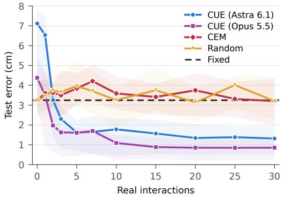

# Closing the Dynamics Gap through Self-Directed Robotic Interaction

Xilun Zhang1,∗ Liam Achenbach1,2,4,∗ Luis Pabon1,† Matthew Foutter1,† Marco Pavone1,3

1Stanford University 2ETH Zurich 3NVIDIA Research 4microagi

∗Project Co-Lead †Equal Contribution

Abstract: Agentic Real2Sim2Real systems can reconstruct a scene in simulation from camera observations, but contact-rich dynamics such as friction and restitution cannot be observed without interaction. We call this the dynamics gap and present CUE, an agentic system that closes it by interacting with the environment itself. Given only a high-level instruction and no resets, the agent builds its own perception, identifies physical parameters, and targets interactions where its simulation is least accurate. On billiards, CUE reduces held-out ball-position error by 72% relative to the strongest baseline across 25 hidden-physics conditions in simulation, and we further deploy it on a real pool table. More details can be found on the project website: https://cue-dynamics.github.io/

Keywords: Real2Sim2Real, Agentic Robotics, Dynamics Learning

## 1 Introduction & Related Work

The advent of scalable, high-fidelity simulation [1, 2] and Multi-Modal Large Language Models (MLLMs) endowed with emerging 3D spatial understanding [3] have enabled a Real2Sim2Real operational paradigm [4, 5, 6]: an autonomous agent reconstructs a digital twin of the scene in simulation, iteratively refines a policy in this digital environment, and closes the loop by executing this policy on the physical robot [7, 8]. However, given the dynamics gap, skills learned in these simulations are not directly transferrable to the real world.

We study the dynamics gap in the game of billiards, a setting where table reconstruction is simple but contact-driven transitions are difficult to model apriori. Prior efforts to recover system dynamics learn from offline data [9, 10], inheriting human embodiment and action priors, and importantly, are passive: the reconstruction agent cannot actively choose which interactions to examine. System identification methods [11, 12], including active exploration [13], let the agent learn from interaction, but within a simulator and parameter space specified by a human, whose inductive biases can constrain the search space and limit both generalization and scalability.

We present CUE, Calibration Using Exploration, an agentic Real2Sim2Real system that closes the dynamics gap in simulation by actively probing the environment, predicting object interactions and iteratively refines physical parameters in simulation to match autonomously collected rollouts. We showcase this framework by demonstrating CUE learns the unknown pool dynamics in the real world with zero human involvement. CUE aims to unify the action and world understanding into one system through iterative interactions in both simulation and the real world. Our contributions are summarized as follows: we show that our agent’s simulation becomes increasingly predictive of real outcomes through self play, reducing held-out ball-position error by 72% relative to the strongest static Real2Sim2Real baseline across 25 hidden physics conditions. We also share lessons learned from deploying a highly dynamic robotic task in the real world, in the hope of inspiring future agentic systems that can operate outside strict human supervision.

## 2 Methodology & Experiments

CUE starts with a general instruction: Reconstruct the scene in simulation, then interact with the real table until confident that the simulation explains it. There would be no human reset during your exploration, so make sure to plan ahead. This instruction forces the agent to design the rollouts to collect and system identification protocol. During the exploration phase, we let the agent run without supervision so as to demonstrate the general application of our framework, and only intervene when a potential safety hazard occurs.

Reconstruct and form a prior. From initial images, the agent builds a MuJoCo model of the table, cushions, pockets, cue, and balls. Drawing on its own knowledge and web search, it decides which dynamics parameters are likely to matter, sets initial ranges for them, and proposes a first set of generic probing shots. This plays the role of a prior: plausible, but not yet grounded in this table.

What the agent discovered. From its reasoning traces, the agent built a general sim-to-real pipeline on top of the reconstruction. To compare sim and real, it first built a camera-based ball tracker that turns each real shot into a trajectory comparable to a simulated rollout. It then fit the simulation parameters by minimizing sim-to-real trajectory difference with CMA-ES over parallel MuJoCo instances replaying recorded shots from their observed initial states. Instead of continuing its generic opening shots, it proposed new shots targeting the parts of the scene its fitted model explained worst.

Experiments We evaluate CUE on both sim-tosim and sim-to-real reconstruction and deployment, which demonstrate the system’s statistical performance and its practical use, respectively. In sim-tosim, a MuJoCo pool simulator with hidden physics serves as the real world across 25 conditions (5 layouts × 5 physics settings), and each method gets at most 30 shots to build its model. CUE starts from an initial assumption about the dynamics, while the baselines start from the default simulation parameters (Fig. 1). After 30 shots, CUE reaches a heldout ball-position error of 0.91 cm with Opus 5.5 and 1.32 cm with Astra 6.1, reductions of 72% and 59% relative to the strongest baseline (CEM, 3.20 cm; random search, 3.20 cm; unfitted model, 3.25 cm). In sim-to-real, we use a small-size pool

  
Figure 1: Held-out ball-position error after k real interactions, mean over 25 hidden-physics conditions (shaded: 25th–75th percentile).

table to validate the idea with unknown physical parameters, to further demonstrate both it’s scalability and limitations in the real-world deployment. We use CUE (Opus5.5) in the real-world experiment, and results are shown in the project page.

## How to actually solve Real2Sim2Real

• Agentic reconstruction needs richer dynamics models. Small ball imperfections and local surface variations remain difficult to reconstruct from camera views. Parameter tuning cannot capture effects outside the model, and explicitly modeling every imperfection means continually extending the simulator. A future research direction is a combination of physics-based simulation and data-driven dynamics models in agentic robotic systems.

• Agentic robotics needs better experimental judgment. While many claim computer vision is solved, agents still struggle to build reliable vision pipelines for real robotic experiments. Agents kept patching the vision pipeline and needed prompting to reconsider the approach. Agentic robotics creates a concrete opportunity for the vision community: robust, reusable tools that agents can reliably assemble, verify, and use in the physical world.

• Agentic robotics needs stronger vision tools. Our coding agent needed guidance on how to spend time and compute across long physical experiments. We need systems that preserve future exploration options and help agents decide when to think, act, refit, or backtrack in the physical world.

## Acknowledgments

We gratefully acknowledge support from the Defense Advanced Research Projects Agency (DARPA), the Office of Naval Research (ONR), Redwire, and microagi. We also thank the members of the Stanford Autonomous Systems Lab for their insightful discussions and valuable feedback.

## References

[1] S. Gao, M. Pagnucco, T. Bednarz, and Y. Song. NVIDIA isaac sim: Enabling scalable, GPUaccelerated simulation for robotics, 2026. URL https://arxiv.org/abs/2606.03551.

[2] NVIDIA. Isaac lab: A GPU-accelerated simulation framework for multi-modal robot learning, 2025. URL https://arxiv.org/abs/2511.04831.

[3] OpenAI. GPT-6 Astra: A new generation of intelligence. https://openai.com/index/ gpt-6-astra/, 2026. Accessed: 2026-10-24.

[4] Y. Li, Y. Feng, S. Sun, J. Chen, H. Ren, B. Yang, W. Xu, Q. Wu, H. Cheng, and R. Xu. Agentic rsr: Real-to-sim-to-real through scene reconstruction and execution-grounded robot policies, 2026. URL https://arxiv.org/abs/2610.10479.

[5] K. Ren, Y. Xu, K. Song, L. Xu, B. Dai, M. Yu, and T. Lu. Real2gym: Building gyms from videos, bringing skills to robots, 2026. URL https://arxiv.org/abs/2609.37089.

[6] Y.-J. Wang, H. Jiang, S. Deng, H. Xue, W. Ye, R. Duan, N. Haghtalab, S. S. Sastry, P. Abbeel, and H. Qi. Reconstruct, practice, go real: Guided self-improvement for embodied agents, 2026. URL https://arxiv.org/abs/2610.02204.

[7] G. Huh, C. Gu, T. E. Truong, C. K. Liu, and G. Tevet. HomeBody: A humanoid that explores, remembers, and acts on its own, 2026. URL https://tml.stanford.edu/homebody/.

[8] Z. Xiao, M. Pan, N. He, D. Zhou, and Y. Wang. VPTwin: Real-sim-real video prediction for robotic manipulation planning, 2026. URL https://arxiv.org/abs/2609.33104.

[9] S. Kundu, A. Gupta, J. Julin, Y. Zhao, L. Xie, and L. A. Jeni. Physimcode: A benchmark and evaluation method for physics video to code generation, 2026. URL https://arxiv.org/abs/ 2610.15722.

[10] K. Chen, S. Xie, U. Yoo, X. Zhu, C. Magner, A. Zhu, D. Kim, E. Heiden, E. Coumans, M. Macklin, et al. Robosimstudio: An interactive toolkit for rapid real2sim of robot manipulation tasks. arXiv preprint arXiv:2610.18835, 2026.

[11] P. Huang, X. Zhang, Z. Cao, S. Liu, M. Xu, W. Ding, J. Francis, B. Chen, and D. Zhao. What went wrong? closing the sim-to-real gap via differentiable causal discovery. In Conference on Robot Learning, 2023.

[12] X. Zhang, S. Liu, P. Huang, W. J. Han, Y. Lyu, M. Xu, and D. Zhao. Dynamics as prompts: In-context learning for sim-to-real system identifications, 2024. URL https://arxiv.org/abs/2410.20357.

[13] M. Memmel, A. Wagenmaker, C. Zhu, D. Fox, and A. Gupta. Asid: Active exploration for system identification in robotic manipulation. In International Conference on Learning Representations, volume 2024, pages 39979–39997, 2024.