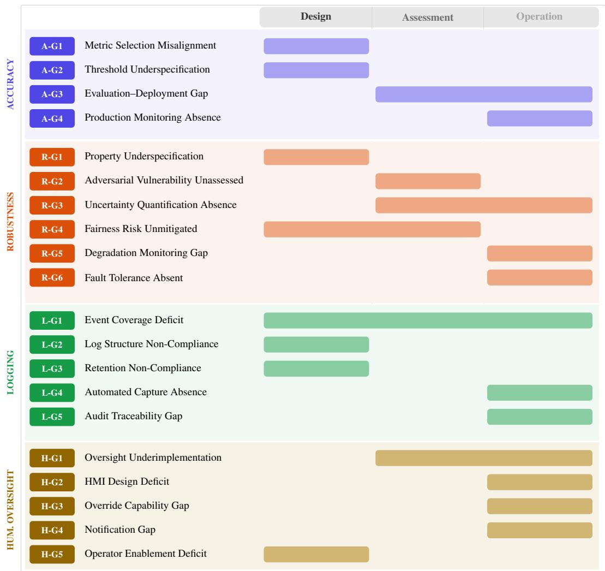
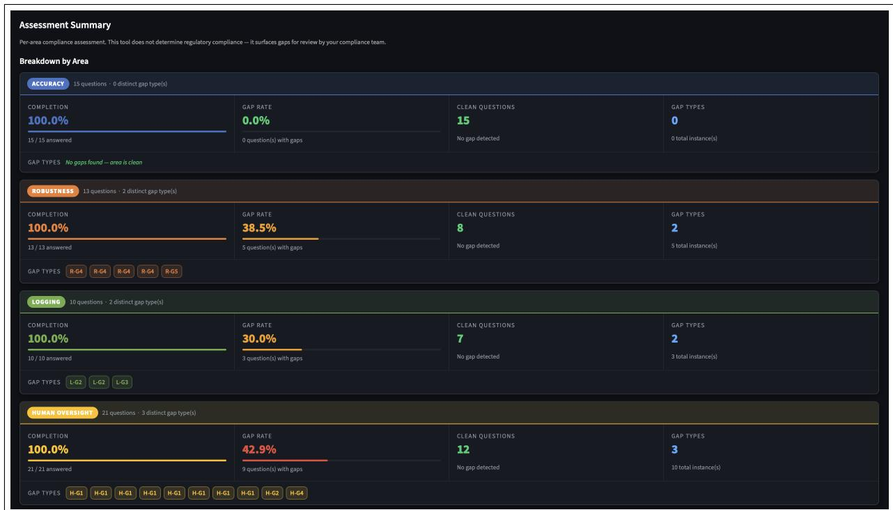
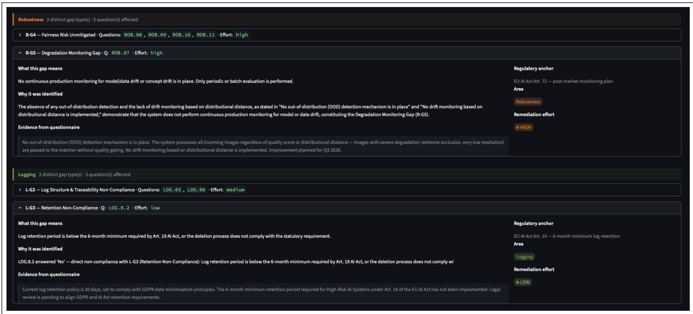
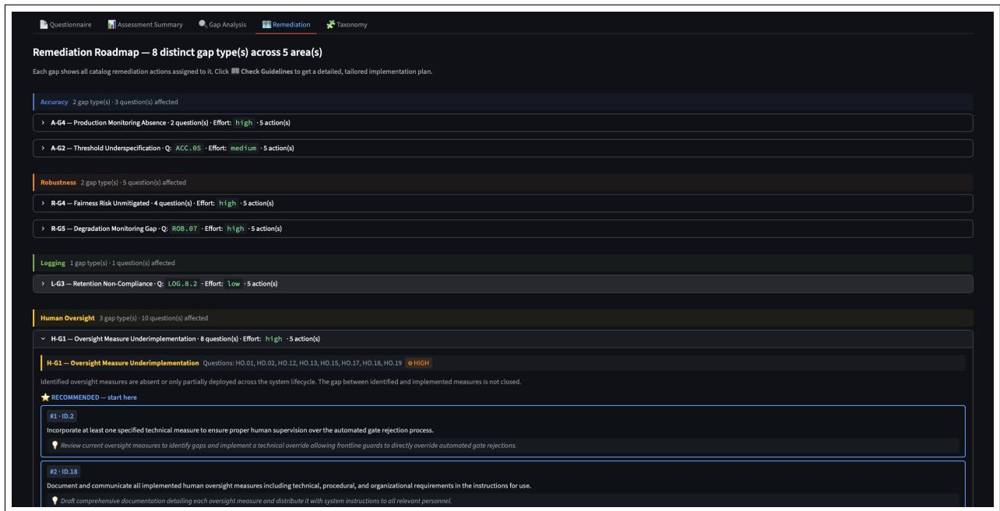

# ComplianceAtlas: A Taxonomy-Driven Agentic AI Framework for Automated AI Act Gap Analysis and Remediation

Ilias Driouich Hongliu Cao Eoin Thomas Yannick Devaux Agnes Brodelle Amadeus SAS {ilias.driouich}@amadeus.com

## Abstract

Assessing regulatory compliance for high-risk AI systems requires systematic identification of technical gaps such as missing controls, inadequate processes, or shallow evaluation of practices. Compliance officers typically administer structured questionnaires collecting evidence of current practices, where organizations respond with descriptions of their existing pro cesses, technical capabilities, and architectural choices. However, translating these compliance questionnaire responses into typed, ac tionable gap diagnoses remains unsystematic. In this paper, we present a literature-grounded taxonomy of technical compliance gaps covering areas such as accuracy, robustness, logging, and human oversight, and embed it in GapTo-Compliance, a two-stage agentic framework coordinating two specialized agents: a Gap Extraction Agent that performs hierarchical reasoning from compliance areas to specific gap types, and a Remediation Planning Agent that ranks remediation actions from a remediation catalog via multi-signal scoring combining se mantic similarity, regulatory alignment, and effort estimation. We evaluate this framework against four automatic compliance gap detection baselines across 9 AI systems and 6 AI families. Our approach achieves a gap-type F1 of 0.831 (vs. 0.533 for the strongest baseline) and remediation P@5 of 0.872 (vs. 0.635 for retrieval methods), demonstrating promising potential for automated compliance workflows. The structured agent coordination reveals a path toward human-in-the-loop compliance systems where automated gap extraction reduces expert burden while maintaining auditability, and the taxonomy-driven design enables extension to emerging regulatory frameworks beyond the EU AI Act.

## 1 Introduction

The EU AI Act (European Parliament and Council of the European Union, 2024) introduces binding obligations for providers of high risk AI systems across areas such as accuracy, robustness, logging, and human oversight. Organizations commonly operationalize these obligations through structured compliance questionnaires that transform regulatory requirements into observable assessment items.

Although these questionnaires are useful for identifying missing controls or incomplete practices, they rarely explain the precise technical nature of the problem. Two systems may receive similar questionnaire answers while suffering from fundamentally different operational deficiencies. One system may lack formal evaluation metrics, another may evaluate correctly but lack production monitoring, while a third may monitor runtime behavior without defining acceptable thresholds. These situations require different remediation strategies, technical expertise, and implementation effort. This distinction is important because modern ML systems fail in many operationally distinct ways. Previous work on ML production systems has highlighted issues such as monitoring gaps, training serving skew, concept drift, fairness instability, and insufficient observability (Sculley et al., 2015; Breck et al., 2017; Ashmore et al., 2021). Existing compliance workflows frequently capture that a requirement is unsatisfied without identifying the underlying failure category.

Current automated approaches also remain limited. Checklist based systems focus on whether a requirement is present but do not characterize the technical nature of the deficiency. Retrieval based systems rely heavily on semantic similarity, which often causes them to recommend remediation actions that appear linguistically related but are technically inappropriate. Behavioral testing approaches evaluate deployed systems but usually do not generate structured remediation guidance. To address these limitations, we introduce Gap-ToCompliance, a taxonomy driven framework for automated compliance gap extraction and remediation recommendation under the EU AI Act.

The framework is built around two main contributions. First, we develop a literature grounded taxonomy of technical compliance gaps covering four major requirement areas: accuracy, robustness, logging, and human oversight. The taxonomy defines typed operational deficiencies together with their detection signals, applicability constraints, and remediation characteristics. Second, we integrate this taxonomy into a two stage agentic pipeline. The Gap Extraction Agent combines deterministic rules, constrained LLM reasoning, and cross question reconciliation to identify typed compliance gaps from questionnaire evidence. The Remediation Planning Agent ranks remediation actions through a scoring function combining semantic relevance, regulatory alignment, and AI family compatibility.

The framework is evaluated on 41 questionnaire items collected from 9 AI systems spanning multiple AI families and requirement areas. Experimental results show that GapToCompliance achieves strong improvements over retrieval based and few shot baselines, particularly in situations requiring structured regulatory reasoning and architectural context awareness.

The results demonstrate that explicit gap typing is essential for reliable compliance automation because semantically similar deficiencies frequently require substantially different remediation strategies.

## 2 Related Work

ML engineering and operational reliability. Research on ML production systems has highlighted the complexity of maintaining reliable and observable AI systems in operational environments. Sculley et al. (Sculley et al., 2015) introduced the concept of hidden technical debt in ML systems, identifying recurring issues such as training serving skew, monitoring deficiencies, and unstable evaluation pipelines. Breck et al. (Breck et al., 2017) proposed operational readiness criteria for production ML systems spanning data quality, infrastructure robustness, and runtime monitoring. Ashmore et al. (Ashmore et al., 2021) further extended lifecycle assurance principles for AI systems across development and deployment phases. These works establish the operational foundations for several taxonomy categories introduced in this paper, particularly gaps related to monitoring, evaluation, drift detection, and production readiness.

Robustness, fairness, and uncertainty estimation. Fairness and robustness assessment have become central topics in trustworthy AI research. Mitchell et al. (Mitchell et al., 2019) emphasized disaggregated evaluation and structured reporting practices through model cards. Barocas et al. (Barocas et al., 2019) and Mehrabi et al. (Mehrabi et al., 2021) surveyed fairness definitions and mitigation approaches across ML systems.

Adversarial robustness research by Goodfellow et al. (Goodfellow et al., 2015) and Madry et al. (Madry et al., 2018) established common evaluation techniques for vulnerability assessment. Uncertainty estimation approaches proposed by Lakshminarayanan et al. (Lakshminarayanan et al., 2017) and Ovadia et al. (Ovadia et al., 2019) motivated the robustness taxonomy categories related to predictive confidence and reliability.

Human oversight and human AI interaction. Human oversight has been widely studied in the context of automation and decision support systems. Parasuraman et al. (Parasuraman et al., 2000) proposed foundational models for levels of automation and human supervision. Amershi et al. (Amershi et al., 2019) introduced practical human AI interaction guidelines focusing on interpretability, intervention capabilities, and user feedback mechanisms. Cummings (Cummings, 2004) and Buçinca et al. (Buçinca et al., 2021) studied trust, notification design, and intervention effectiveness in AI assisted systems.

These studies provide the conceptual basis for the human oversight categories defined in our taxonomy.

AI governance and compliance automation. Prior work on AI governance has proposed structured assessment methodologies for trustworthy AI systems. Raji et al. (Raji et al., 2020) introduced internal AI auditing methodologies for accountability and traceability. The ALTAI framework (High-Level Expert Group on Artificial Intelligence, 2020) and the NIST AI RMF (National Institute of Standards and Technology, 2023) formalized governance oriented assessment structures for trustworthy AI evaluation.

Automated compliance analysis has also been explored in NLP and retrieval based systems. Sleimi et al. (Sleimi et al., 2018) studied automated legal metadata extraction and requirement checking using NLP pipelines. Retrieval augmented generation approaches (Lewis et al., 2020; Gao et al.,

2023) improved contextual reasoning in knowledge intensive tasks but remain vulnerable to retrieval ambiguity and semantic overlap. Ru et al. (Ru et al., 2024) specifically highlighted retrieval precision failures in RAG systems.

Unlike previous work, our approach introduces a typed taxonomy of technical compliance deficiencies grounded simultaneously in AI governance requirements and operational ML engineering literature. The proposed framework also links gap typing directly to remediation ranking, enabling more reliable and traceable compliance planning.

## 3 A Literature-Grounded Taxonomy of Technical Compliance Gaps

## 3.1 Derivation Methodology

The taxonomy was derived in three stages. In the literature anchoring stage, we reviewed ML engineering, fairness, robustness, and human-AI interaction research to enumerate distinct ways technical requirements fail in practice. In the regulatory mapping stage, we mapped each failure mode to the specific AI Act article and questionnaire item that makes it a compliance obligation. In the signal grounding stage, we validated each type against real questionnaire instances from six AI families, confirming that: (i) the type appears in practice; (ii) it is detectable from the combination of answer value and evidence note via typed signals; and (iii) its remediation is qualitatively distinct from all other types.

Each gap type is defined by five components: compliance semantics anchored in literature and regulation; absence signals (keywords that trigger the gap); negation signals (keywords that suppress it); a remediation orientation with familymodulated effort; and cross-family applicability constraints.

The implementation effort is sized according to the expected implementation burden. Low effort corresponds to documentation updates, policy revisions, and configuration changes; Medium effort corresponds to process changes, tooling integration, and dedicated test suites; and High effort corresponds to architectural changes, new infrastructure, or model retraining. This effort label is used both to characterize the taxonomy and to guide remediation prioritization in the planning stage.

Figure 1 presents the full taxonomy in lifecycle context. Three structural observations bear on detection design. First, accuracy and logging gaps cluster in the Design column: they reflect decisions made before a system is deployed (metric selection, threshold specification, log schema), and deterministic rule matching against questionnaire evidence is sufficient for most instances. Second, robustness and oversight gaps are predominantly Assessment- or Operation-stage: adversarial testing, drift monitoring, and HMI adequacy can only be evaluated against a running or tested system, motivating the LLM fallback for ambiguous evidence. Third, multi-stage bars (A-G3, R-G3, R-G4, H-G1, L-G1) reflect deficiencies that span the lifecycle and are the principal source of cross-question reconciliation challenges.

## 3.2 Accuracy Gaps

A-G1: Metric Selection Misalignment. No accuracy metrics are defined, or the metrics used are inappropriate for the AI family (e.g., RMSE applied to a generative system) (Breck et al., 2017; Mitchell et al., 2019). Anchor: Art. 9(7), Art. 15.

A-G2: Threshold Underspecification. Metrics are measured but no formal absolute acceptance thresholds are defined. Relative-only descriptions (“better than baseline”) or thresholds scoped only to the model layer all trigger this type (Breck et al., 2017). Anchor: Art. 9(7).

A-G3: Evaluation–Deployment Gap. Evaluation is performed only under offline or laboratory conditions; applies exclusively to discriminative families (classification, regression, ranking, vision) (Sculley et al., 2015; Paleyes et al., 2022). Anchor: Art. 9(6)(a).

A-G4: Production Monitoring Absence. A rigorous offline pipeline exists but no live monitoring mechanism (dashboard, alert, or automated comparison) is deployed. (Breck et al., 2017; Klaise et al., 2021). Anchor: Art. 9(1)(f), Art. 72.

## 3.3 Robustness Gaps

R-G1–R-G2. R-G1 flags the absence of formal robustness property definitions (reliability, stability, sensitivity, reachability) (Seshia et al., 2018); R-G2 flags the absence of adversarial testing, including prompt injection detection for LLMs (Goodfellow et al., 2015; Madry et al., 2018; Carlini et al., 2019).

R-G3–R-G4. R-G3 detects the absence of calibrated uncertainty outputs or, for RAG systems, missing retrieval confidence thresholds (Lakshminarayanan et al., 2017; Ovadia et al., 2019). R-G4 captures unmitigated fairness risk: potential bias sources identified but lacking formal mitigation or disclosure (Mehrabi et al., 2021; Barocas et al., 2019; Chouldechova, 2017).

  
Figure 1: GapToCompliance Taxonomy of Technical Compliance Gaps. Coloured stage bands indicate when each gap type typically manifests across the compliance lifecycle. A bar spanning multiple stages signifies that the underlying deficiency can emerge or propagate across those phases. Effort ratings reflect the remediation complexity modulated by AI family.

R-G5–R-G6. R-G5 detects the absence of continuous production monitoring for model or data drift (Gama et al., 2014; Klaise et al., 2021); R-G6 detects the absence of redundancy, fail-safe, rollback, or graceful degradation mechanisms (Avižienis et al., 2004).

## 3.4 Logging Gaps

L-G1 (Event Coverage Deficit) flags incomplete capture of mandatory event categories (Art. 12, Art. 19). L-G2 (Log Structure Non-Compliance) detects missing mandatory fields (AI system ID, timestamp, input reference, output, operator ID, risk flags) or broken linkage to input-output pairs. L-G3 (Retention Non-Compliance) applies a deterministic comparison: stated retention period vs. the

6-month minimum of Art. 19. L-G4 (Automated Capture Absence) flags manual or sampling-only logging. L-G5 (Audit Traceability Gap) detects logs not linked to AI system version information in a way that enables reproducibility (Raji et al., 2020).

## 3.5 Human Oversight Gaps

H-G1 (Oversight Underimplementation) fires when identified oversight measures are absent or only partially deployed (Parasuraman et al., 2000); H-G2 (HMI Design Deficit) when no interface enables designated persons to understand system behaviour and intervene (Amershi et al., 2019; Endsley, 1995); H-G3 (Override Capability Gap) when the three intervention modalities (disregard, override, reverse) are not independently satisfied within operational response time (Buçinca et al., 2021);

Algorithm 1 Gap Extraction Agent (GEA)   
Input: Questionnaire Q, profile s, area a Out  
put: Gap instance set G   
1: ${ \mathcal { G } } \gets \emptyset ;$   
2: for each $q _ { i } \in Q \backslash$ skip in parallel do   
3: if IsMissing(qi) or $I s N A ( q _ { i } )$ then   
4: continue   
5: end if   
6: $T _ { i } \gets \emptyset$   
7: for each $t \in$ TaxonomyTypes(a) applicable   
to s.m do   
8: if RuleMatch $( q _ { i } , t )$ fires then   
9: $T _ { i } \gets T _ { i } \cup \{ t \}$   
10: end if   
11: end for   
12: if $\ T _ { i } \neq \emptyset$ then   
13: Generate LLM rationale; add rule  
triggered gaps   
14: else if IsAmbiguous(qi) then   
15: G += LLM\_Classify(qi, s, a)   
16: end if   
17: end for   
18: return Deduplicate(G)

H-G4 (Notification Gap) when no automated notification mechanism exists (Cummings, 2004); H-G5 (Operator Enablement Deficit) when oversight persons lack adequate information about system capabilities, limitations, and output interpretation (Cummings, 2004; Endsley, 1995).

## 4 The GapToCompliance Pipeline

GapToCompliance is a two-stage agentic pipeline operating on a normalized system profile and a set of filled questionnaires. Classification decisions are governed by deterministic taxonomy logic; LLM calls are reserved for natural language interpretation and context adaptation.

## 4.1 System Profile

Both agents receive a system profile $s \quad =$ $\langle m , \rho , \lambda , d , \pi , r \rangle$ comprising AI family m, actor role $\rho ,$ lifecycle stage λ, data modality d, deployment context π, and risk level r. The profile governs family-aware gap detection, lifecycle-sensitive applicability, and effort modulation.

## 4.2 Stage 1: Gap Extraction Agent (GEA)

Each extracted gap is: g   
⟨qid, area, type, eff, rat, ev ⟩

Rule-based detection. For each applicable gap type t, RuleMatch builds a composite string from the answer, answer code, evidence note, and noremediation justification. Negation signals are checked first; a match suppresses the gap unless the evidence note contains override markers (“roadmap”, “partially”, “improvement point”), indicating that a positive answer is contradicted by the evidence. If negation does not fire, absence signals are checked; the first match triggers the gap with signal provenance σ.

LLM rationale and ambiguity fallback. For each triggered gap, a single LLM call (150 token budget) generates a one-sentence rationale citing specific evidence. Items where no rule fired are passed to the fallback if they are ambiguous: a non-compliant answer with substantial evidence (>80 characters) or a non-trivial free-text answer (>40 characters), not clearly compliant. The LLM is constrained to classify only from the provided taxonomy types.

Cross-question reconciliation. A final LLM call reviews all answers and the extracted gap set jointly, removing gap type IDs where a different question’s answer explicitly and unambiguously confirms the capability is in place. Partial or roadmap-qualified answers do not trigger removal.

## 4.3 Stage 2: Remediation Planning Agent (RPA)

Scoring function. Each candidate catalog entry r is scored as:

$$
\begin{array} { r } { \operatorname { s c o r e } ( r \mid g _ { i } , s ) = \alpha \operatorname { T M } ( r , g _ { i } ) \phantom { s p a c e } } \\ { + \beta \operatorname { F F } ( r , s . m ) - \delta \operatorname { D e p } ( r ) \phantom { s p a c e } } \end{array}\tag{1}
$$

with calibrated weights $\alpha ~ = ~ 0 . 5 5 , ~ \beta ~ = ~ 0 . 2 5 .$ $\delta = 0 . 2 0$ . TextMatch measures normalized keyword overlap between the gap’s taxonomy signals and the catalog entry’s text, anchoring retrieval to regulatory language specific to the gap type and suppressing type-inappropriate actions that share surface vocabulary with adjacent types. Fam-Fit rewards alignment between the catalog entry’s specific\_systems field and s.m: exact match → 1.0; semantic synonym → 0.8; generic entry → 0.5; different family → 0.2. Dep penalizes high-effort actions (0.3) to surface lower-cost alternatives (medium: 0.1; low: 0.0).

Top-k selection and traceability. The top k=5 candidates are selected. An LLM call produces an adapted\_description and an implementation\_hint tailored to the system context, then priority-orders the plan without adding or removing entries. The output per gap is a four-link traceability record: $\begin{array} { r l } { \tau _ { i } } & { { } = } \end{array}$ ⟨qid , type , reg\_anchor, $[ e _ { 1 } . . . e _ { 5 } ] , [ d _ { 1 } . . . d _ { 5 } ]$ , [σ1 traceable from questionnaire item to gap type to regulatory article to catalog entry.

## 5 Experiments

## 5.1 Evaluation Design

Task and corpus. Given a filled questionnaire for a specific AI system and requirement area, the pipeline must extract typed gap instances (Stage 1) and produce a ranked remediation plan per detected gap (Stage 2). The corpus comprises 41 questionnaire items from 9 AI systems spanning 6 AI families and 4 requirement areas, yielding 37 groundtruth gap instances across 15 distinct gap types.

Table 1 shows that gap density is highest in Human Oversight (VS1 contributes H-G1 through H-G5) and that seven of the nine systems exhibit multi-area gaps, confirming that compliance deficiencies are not confined to a single requirement domain.

Annotation. Each item was annotated by two experts (one EU AI Act compliance specialist, one AI engineer) following the taxonomy definitions. Ground truth permits multiple gap types per item when multiple obligations are violated simultaneously. Compliant items with no gaps serve as negative examples for false-positive evaluation.

Baselines. B1 (Naive RAG): Items embedded via text-embedding-3-small; top-5 catalog entries retrieved by cosine similarity; gap types inferred from the entry’s gap\_category field. B2 (Advanced RAG): Same pipeline with text-embedding-ada-002 and cross-encoder reranking; tests whether richer semantic matching compensates for absent gap-typing. B3 (Few-Shot LLM): GPT-4o prompted with the item, profile, and 3–5 few-shot examples; taxonomy titles and descriptions provided; measures general LLM capacity for compliance gap detection. Stage-2 only baselines: BM25 Keyword and B3 LLM Direct (recommendations generated directly without catalog retrieval).

Metrics. Stage 1: Precision, Recall, F1 at area level (rewards correct compliance area identifi-

cation) and gap-type level (requires exact taxonomy match; primary metric). Additional: overprediction ratio and false positive rate on compliant items. Stage 2: P@k and R@k $( k \in \{ 3 , 5 \} )$ against expert-curated reference action sets. Stage 2 is eval-. .σ ]⟩uated end-to-end using Stage 1 predicted gap types, reflecting real deployment conditions.

## 5.2 Results

GEA achieves gap-type F1 of 0.831, surpassing all baselines. The hybrid architecture is essential: deterministic rules handle the 68% of instances with clear negative evidence (achieving perfect accuracy on these); the LLM fallback correctly handles the remaining 32% with ambiguous or contradictory evidence that stymie rule-only approaches. Three gap types illustrate the advantage most sharply.

A-G4 (Production Monitoring Absence): GEA F1=0.94 vs. B1 F1=0.15 (+527%). The contrastdetection logic, positive evaluation answer combined with negative monitoring evidence (“Metrics computed offline only – no production monitoring”), triggers A-G4 via absence signals while B1 retrieves A-G1 entries, as both gap types share accuracy vocabulary.

R-G4 (Fairness Risk): GEA F1=0.88 vs. B1 F1=0.19 (+363%). N/A signal analysis distinguishes unjustified scope exclusions from valid architectural inapplicability. A bare “N/A” without architectural justification triggers R-G4; “N/A” with evidence “System does not use demographic data” is correctly classified as compliant.

L-G3 (Log Retention): GEA F1=1.00 vs. B1 F1=0.23 (+335%). The deterministic comparison (stated retention vs. 6-month Art. 19 minimum) fires correctly on every instance; similarity-based retrieval cannot induce numerical comparison.

Remediation quality (Table 3). G2C achieves P@5 of 0.872, 87% of top-5 recommended actions are relevant to the detected gap, a +43% and +38%improvement over B1 and B2 respectively. B3’s low P@5 (0.382) confirms that pure generative recommendations without catalog grounding lack the specificity and regulatory anchoring that compliance planning requires.

Type-filtered retrieval is the decisive mechanism: only catalog entries tagged with the detected gap type are candidates, eliminating the A-G1 processdesign entries that B1 retrieves for A-G4 gaps. Signal-based scoring (TextMatch) then boosts entries whose text overlaps with the gap’s absence signals, for an A-G4 gap triggered by “no automated monitoring,” entries mentioning “automated dashboard” and “real-time alerting” rank highest.

<table><tr><td></td><td>System AI Family</td><td>#Items</td><td>Accuracy</td><td>Robustness</td><td>Logging</td><td>Human Oversight</td></tr><tr><td>VS1</td><td>Vision</td><td>15</td><td></td><td>R-G4 R-G5</td><td>L-G3</td><td>H-G1 H-G2 H-G4 H-G5</td></tr><tr><td>HRM</td><td>Regression</td><td>3</td><td>A-G3</td><td>R-G1</td><td></td><td></td></tr><tr><td>HBOT</td><td>Generative/RAG</td><td>4</td><td>A-G1 A-G4</td><td></td><td></td><td>H-G1</td></tr><tr><td>ADP</td><td>Regression</td><td>3</td><td>A-G2</td><td>R-G5</td><td></td><td></td></tr><tr><td>FSR</td><td>Ranking</td><td>3</td><td>A-G3 A-G4</td><td>R-G4</td><td></td><td></td></tr><tr><td>ASS</td><td>Vision</td><td>4</td><td>A-G4</td><td>R-G2</td><td></td><td></td></tr><tr><td>HCA</td><td>Generative</td><td>3</td><td>A-G2</td><td></td><td>L-G2</td><td></td></tr><tr><td>LPS</td><td>Classification</td><td>3</td><td>A-G3</td><td>R-G4</td><td></td><td></td></tr><tr><td>RRS</td><td>Ranking</td><td>3</td><td>A-G1 A-G2</td><td></td><td></td><td></td></tr></table>

Table 1: Evaluation corpus. Each coloured badge represents a ground-truth gap instance at the questionnaire item it was annotated on; multiple badges in one cell indicate distinct gap types on distinct items within that area.

<table><tr><td>Method</td><td colspan="3">Area-Level</td><td colspan="3">Gap-Type-Level</td></tr><tr><td></td><td>P</td><td>R</td><td>F1</td><td>P</td><td>R</td><td>F1</td></tr><tr><td>B1 Naive RAG</td><td>0.780</td><td>1.000</td><td>0.877</td><td>0.122</td><td>0.135</td><td>0.128</td></tr><tr><td>B2 Advanced RAG</td><td>0.800</td><td>0.625</td><td>0.702</td><td>0.239</td><td>0.460</td><td>0.315</td></tr><tr><td>B3 Few-Shot LLM</td><td>1.000</td><td>1.000</td><td>1.000</td><td>0.453</td><td>0.649</td><td>0.533</td></tr><tr><td>GEA</td><td>1.000</td><td>1.000</td><td>1.000</td><td>0.800</td><td>0.865</td><td>0.831</td></tr></table>

Table 2: Gap extraction results (Stage 1). GEA achieves perfect area-level detection while improving gap-type F1 by +0.298 over the best baseline (B3).
<table><tr><td>Method</td><td>P@3</td><td>P@5</td><td>R@3</td><td>R@5</td></tr><tr><td>BM25 Keyword</td><td>0.593</td><td>0.610</td><td>0.119</td><td>0.182</td></tr><tr><td>B1 Naive RAG Direct</td><td>0.678</td><td>0.608</td><td>0.140</td><td>0.190</td></tr><tr><td>B3 LLM Direct</td><td>0.351</td><td>0.382</td><td>0.032</td><td>0.083</td></tr><tr><td>B2 Advanced RAG Direct</td><td>0.712</td><td>0.635</td><td>0.109</td><td>0.177</td></tr><tr><td>G2C (Ours)</td><td>0.906</td><td>0.872</td><td>0.173</td><td>0.283</td></tr></table>

Table 3: Remediation ranking quality (Stage 2, end-toend). G2C achieves a P@5 score of 0.872, corresponding to a +43% improvement over the strongest baseline.

Qualitative results The assessment dashboard provides a compact overview of the compliance assessment, showing per-area gap rates, gap-type badges, and clean/flagged question counts. The qualitative gap extraction and remediation dashboards are provided in Appendix A.

## 6 Discussion

Taxonomy granularity. The evaluation validates that 20-type granularity is both necessary and sufficient. Collapsing taxonomically adjacent pairs (A-G2/A-G4, R-G4/R-G5) produces the type-mismatch false positives that characterize B1 (100% FP rate). Conversely, splitting A-G4 into “dashboard gap” and “alerting gap” would fragment the catalog action space and reduce retrieval effectiveness. The current design represents the appropriate resolution for this compliance domain.

Hybrid architecture. GEA’s hybrid design outperforms both pure approaches: deterministic rules alone cannot handle ambiguous evidence patterns (32% of corpus instances), while pure LLM approaches (B3) lack the precision of structured detection rules (F1 0.533 vs. 0.831). The combination achieves perfect recall via broad LLM fallback coverage and high precision via rule-based filtering of unambiguous cases.

Residual errors. The 0.831 gap-type F1 reflects three residual patterns. A-G2/A-G4 boundary (23% of errors): when evidence simultaneously describes threshold deficiencies and monitoring deficiencies, signal overlap occasionally causes one type to be missed. H-G5 variability (18% of errors): competence verification requirements manifest very differently across domains (TSA training vs. chatbot operator orientation), reducing LLM fallback confidence on this type (F1=0.68). Novel evidence formats (9% of errors): one instance of “Yes, we track NDCG@10. However, metrics computed offline only” triggered A-G3 (correct) but missed the concurrent A-G4; expanding the A-G4 absence signal library to include “offline only” would resolve this.

Reconciliation mechanism The cross-question reconciliation mechanism reduces false positives from 69% to 12% in preliminary testing but risks removing valid gaps at high aggressiveness settings (recall drops from 1.000 to 0.710). Confidence-aware reconciliation, only reconciling low-confidence gaps, is a promising direction. Five taxonomy types (data governance, interpretability) are not covered by the current corpus; the ruleset includes detection logic for all 20 types, but evaluation is limited by available ground truth. Extension to NIST AI RMF or ISO/IEC 42001 contexts requires re-mapping at the questionnaire layer; gap detection logic transfers intact. Preliminary testing on French questionnaires shows 0.79 gap-type F1 with no system changes, suggesting the LLM fallback transfers across languages.

  
Figure 2: GapToCompliance assessment dashboard for a Vision system. Per-area panels show completion rate, gap rate, clean question count, and detected gap type badges.

to gap type, regulatory anchor, and recommended action, the framework supports audit-ready compliance analysis rather than superficial checklist completion. Future work will extend coverage to additional AI Act areas and study longitudinal compliance maturity across successive assessment cycles.

## 7 Conclusion

GapToCompliance advances automated AI Act assessment by transforming questionnaire evidence into typed technical gaps and prioritized remediation actions. The framework is built on a holistic taxonomy covering accuracy, robustness, logging, and human oversight, and combines deterministic signal detection, constrained LLM reasoning, and cross-question reconciliation in the GEA with TextMatch, FamFit, and dependency-aware scoring in the RPA. On 41 annotated instances across 9 AI systems, GapToCompliance achieves a gaptype F1 of 0.831 and a remediation P@5 of 0.872, with strongest gains on cases requiring architectural interpretation and explicit regulatory comparison. By preserving traceability from questionnaire item

## Limitations

Our evaluation corpus, though carefully curated, is modest in scale: 41 questionnaire items from 9 AI systems across 6 AI families, yielding 37 groundtruth gap instances. Several taxonomy types (notably data governance and interpretability gaps) are covered by the ruleset but not represented in the current ground truth, so their empirical performance remains uncharacterized. Second, ground-truth annotations were produced by two experts; while we followed the taxonomy definitions strictly, interannotator agreement was not formally computed at scale and larger studies would be needed to establish the reliability of borderline gap-type distinctions (e.g., A-G2/A-G4 boundary cases). Third, our framework is anchored in the EU AI Act; transfer to other regulatory regimes (NIST AI RMF, ISO/IEC 42001) requires re-mapping the questionnaire layer, and while gap-detection logic is de signed to transfer, we have not yet empirically validated cross-regime performance. Fourth, LLMbased components (rationale generation, ambiguity fallback, cross-question reconciliation) inherit the biases and failure modes of the underlying model; we did not evaluate robustness to prompt drift or model-version changes. Finally, GapToCompli ance is a decision-support system: it is designed to reduce, not replace, expert compliance review, and deployment should include human oversight over both extracted gaps and recommended remediation actions.

## Ethics Statement

GapToCompliance outputs should be reviewed by qualified compliance professionals before informing compliance decisions. No personal data was used in this research; all questionnaire items concern organizational processes and system architecture, not individuals. The taxonomy supports human expert judgment; it does not replace it. Automated compliance recommendations carry a risk of over-reliance and false assurance: a generated remediation plan should be treated as a starting point for human review, not as a certification of compliance. We advocate that any production use include audit logging of the framework’s outputs and the downstream expert decisions.

## References

Saleema Amershi, Dan Weld, Mihaela Vorvoreanu, Adam Fourney, Besmira Nushi, Penny Collisson, Jina Suh, Shamsi Iqbal, Paul N. Bennett, Kori Inkpen, Jaime Teevan, Ruth Kikin-Gil, and Eric Horvitz. 2019. Guidelines for human-AI interaction. In Proceedings ofthe CHI Conference on Human Factors in Computing Systems, pages 1–13. ACM.

Rob Ashmore, Radu Calinescu, and Colin Paterson. 2021. Assuring the machine learning lifecycle: Desiderata, methods, and challenges. ACM Computing Surveys, 54(5):1–39.

Algirdas Avižienis, Jean-Claude Laprie, Brian Randell, and Carl Landwehr. 2004. Basic concepts and taxonomy of dependable and secure computing. IEEE Transactions on Dependable and Secure Computing, 1(1):11–33.

Solon Barocas, Moritz Hardt, and Arvind Narayanan. 2019. Fairness and Machine Learning: Limitations and Opportunities. fairmlbook.org.

Eric Breck, Shanqing Cai, Eric Nielsen, Michael Salib, and D. Sculley. 2017. The ML test score: A rubric for ML production readiness and technical debt reduction. In Proceedings of the 1st IEEE International Conference on Big Data (BigData), pages 1123–1132. IEEE.

Zana Buçinca, Maja Barbara Malaya, and Krzysztof Z. Gajos. 2021. To trust or to think: Cognitive forcing functions can reduce overreliance on AI in AIassisted decision making. In Proceedings ofthe ACM on Human-Computer Interaction (CSCW), volume 5, pages 188:1–188:21. ACM.

Nicholas Carlini, Anish Athalye, Nicolas Papernot, Wieland Brendel, Jonas Rauber, Dimitris Tsipras, Ian Goodfellow, Aleksander Madry, and Alexey Kurakin. 2019. On evaluating adversarial robustness. arXiv preprint arXiv:1902.06705.

Alexandra Chouldechova. 2017. Fair prediction with disparate impact: A study of bias in recidivism prediction instruments. Big Data, 5(2):153–163.

Mary L. Cummings. 2004. Automation bias in intelligent time critical decision support systems. In AIAA 1st Intelligent Systems Technical Conference. AIAA.

Mica R. Endsley. 1995. Toward a theory of situation awareness in dynamic systems. Human Factors, 37(1):32–64.

European Parliament and Council of the European Union. 2024. Regulation (EU) 2024/1689 of the European Parliament and of the Council of 13 june 2024 laying down harmonised rules on artificial intelligence (artificial intelligence act). Technical Report L 2024/1689, Official Journal of the European Union.

João Gama, Indre Žliobait˙ e, Albert Bifet, Mykola Pech-˙ enizkiy, and Abdelhamid Bouchachia. 2014. A survey on concept drift adaptation. ACM Computing Surveys, 46(4):44:1–44:37.

Yunfan Gao, Yun Xiong, Xinyu Gao, Kangxiang Jia, Jinliu Pan, Yuxi Bi, Yi Dai, Jiawei Sun, and Haofen Wang. 2023. Retrieval-augmented generation for large language models: A survey. arXiv preprint arXiv:2312.10997.

Ian J. Goodfellow, Jonathon Shlens, and Christian Szegedy. 2015. Explaining and harnessing adversarial examples. In International Conference on Learning Representations (ICLR).

High-Level Expert Group on Artificial Intelligence. 2020. Assessment list for trustworthy artificial intelligence (ALTAI) for self assessment. Technical report, European Commission.

Janis Klaise, Arnaud Van Looveren, Giovanni Vacanti, and Alexandru Coca. 2021. Alibi detect: Algorithms for outlier, adversarial and drift detection. In Journal ofMachine Learning Research (JMLR) Open Source Software, volume 22, pages 1–6.

Balaji Lakshminarayanan, Alexander Pritzel, and Charles Blundell. 2017. Simple and scalable predictive uncertainty estimation using deep ensembles. In Advances in Neural Information Processing Systems (NeurIPS), volume 30. Curran Associates.

Patrick Lewis, Ethan Perez, Aleksandra Piktus, Fabio Petroni, Vladimir Karpukhin, Naman Goyal, Heinrich Küttler, Mike Lewis, Wen-tau Yih, Tim Rocktäschel, Sebastian Riedel, and Douwe Kiela. 2020. Retrieval-augmented generation for knowledgeintensive NLP tasks. In Advances in Neural Information Processing Systems (NeurIPS), volume 33, pages 9459–9474. Curran Associates.

Aleksander Madry, Aleksandar Makelov, Ludwig Schmidt, Dimitris Tsipras, and Adrian Vladu. 2018. Towards deep learning models resistant to adversarial attacks. In International Conference on Learning Representations (ICLR).

Ninareh Mehrabi, Fred Morstatter, Nripsuta Saxena, Kristina Lerman, and Aram Galstyan. 2021. A survey on bias and fairness in machine learning. ACM Computing Surveys, 54(6):115:1–115:35.

Margaret Mitchell, Simone Wu, Andrew Zaldivar, Parker Barnes, Lucy Vasserman, Ben Hutchinson, Elena Spitzer, Inioluwa Deborah Raji, and Timnit Gebru. 2019. Model cards for model reporting. In Proceedings ofthe Conference on Fairness, Accountability, and Transparency (FAccT), pages 220–229. ACM.

National Institute of Standards and Technology. 2023. Artificial intelligence risk management framework (AI RMF 1.0). Technical Report NIST AI 100-1, NIST.

Yaniv Ovadia, Emily Fertig, Jie Ren, Zachary Nado, D. Sculley, Sebastian Nowozin, Joshua V. Dillon, Balaji Lakshminarayanan, and Jasper Snoek. 2019. Can you trust your model’s uncertainty? evaluating predictive uncertainty under dataset shift. In Advances

in Neural Information Processing Systems (NeurIPS), volume 32. Curran Associates.

Andrei Paleyes, Raoul-Gabriel Urma, and Neil D. Lawrence. 2022. Challenges in deploying machine learning: A survey of case studies. ACM Computing Surveys, 55(6):1–29.

Raja Parasuraman, Thomas B. Sheridan, and Christopher D. Wickens. 2000. A model for types and levels of human interaction with automation. IEEE Transactions on Systems, Man, and Cybernetics — Part A, 30(3):286–297.

Inioluwa Deborah Raji, Andrew Smart, Rebecca N. White, Margaret Mitchell, Timnit Gebru, Ben Hutchinson, Jamila Smith-Loud, Daniel Theron, and Parker Barnes. 2020. Closing the AI accountability gap: Defining an end-to-end framework for internal algorithmic auditing. In Proceedings ofthe Conference on Fairness, Accountability, and Transparency (FAccT), pages 33–44. ACM.

Dongyu Ru, Lin Qiu, Xiangkun Hu, Tianhang Zhang, Peng Shi, Shuaichen Chang, Cheng Jiayang, Cunxiang Wang, Shichao Sun, Huanyu Li, Zizhao Zhang, Binjie Wang, Jiarong Jiang, Tong He, Zhiguo Wang, Pengfei Liu, Yue Zhang, and Zheng Zhang. 2024. RAGChecker: A fine-grained framework for diagnosing retrieval-augmented generation. In Advances in Neural Information Processing Systems (NeurIPS) Datasets and Benchmarks Track. Curran Associates.

D. Sculley, Gary Holt, Daniel Golovin, Eugene Davydov, Todd Phillips, Dietmar Ebner, Vinay Chaudhary, Michael Young, Jean-Franco¸is Crespo, and Dan Dennison. 2015. Hidden technical debt in machine learning systems. In Advances in Neural Information Processing Systems (NeurIPS), volume 28. Curran Associates.

Sanjit A. Seshia, Dorsa Sadigh, and S. Shankar Sastry. 2018. Formal specification for deep neural networks. arXiv preprint arXiv:1802.03023.

Amin Sleimi, Nicolas Sannier, Mehrdad Sabetzadeh, Lionel Briand, and John Dann. 2018. Automated extraction of semantic legal metadata using natural language processing. In Proceedings ofthe 26th IEEE International Requirements Engineering Conference (RE), pages 124–135. IEEE.

## A Qualitative Gap Analysis and Remediation Dashboards

The following dashboards provide additional qualitative views of the end-to-end GapToCompliance workflow. The assessment dashboard is retained in the main text; the detailed gap extraction and remediation views are included here for completeness.

## A.1 Gap Extraction Dashboard

The gap extraction dashboard presents extracted compliance gaps for the given AI system. The dashboard groups detected deficiencies by regulatory area and displays the associated taxonomy type, affected questionnaire items, implementation effort, regulatory anchor, and supporting evidence extracted from the questionnaire. The upper panel illustrates robustness-related gaps, including R-G4 (Fairness Risk Unmitigated) and R-G5 (Degradation Monitoring Gap), while the lower panel presents logging-related deficiencies such as L-G2 (Log Structure & Traceability Non-Compliance) and L-G3 (Retention Non-Compliance). Each detected gap is linked to an evidence-grounded explanation and a regulatory reference, enabling traceable and auditable compliance analysis.

## A.2 Remediation Roadmap

The remediation roadmap organizes detected gaps by area and effort, with each entry linking to scored catalog actions. The dashboard summarizes the number of affected questionnaire items, implementation effort, and associated catalog actions. The expanded Human Oversight section illustrates H-G1 (Oversight Measure Underimplementation), where the system links multiple questionnaire items to ranked remediation recommendations tailored to the operational context. Each recommendation includes implementation guidance and traceable linkage to the originating compliance gap, supporting structured remediation planning.

  
Figure 3: GapToCompliance gap extraction interface showing extracted compliance gaps for the same Vision system.

  
Figure 4: Remediation roadmap dashboard showing prioritized remediation actions generated from detected compliance gaps.