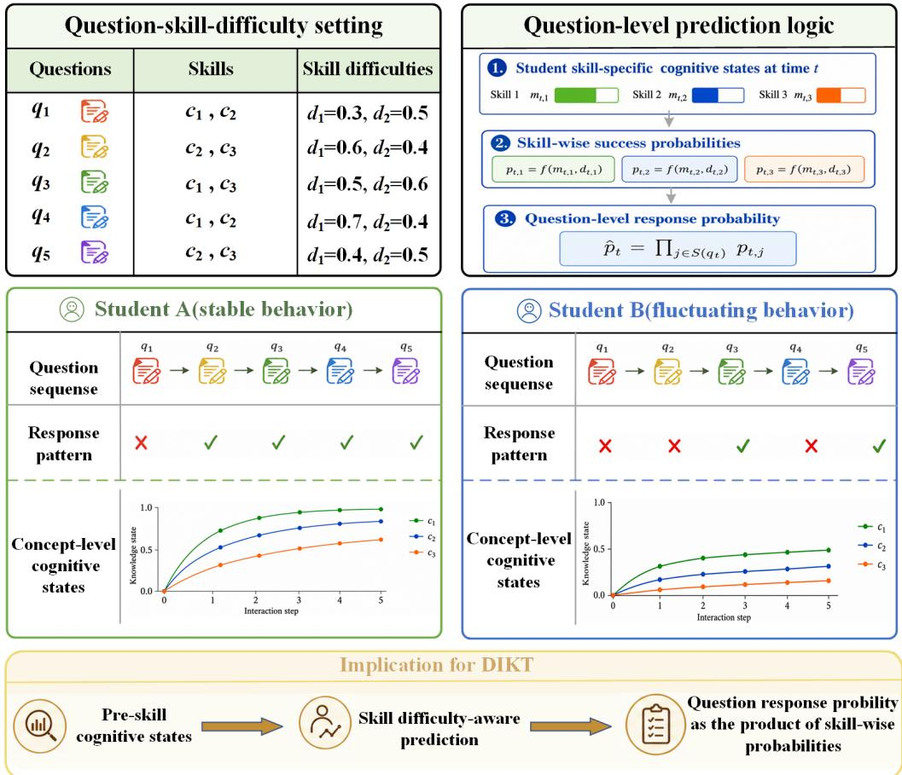
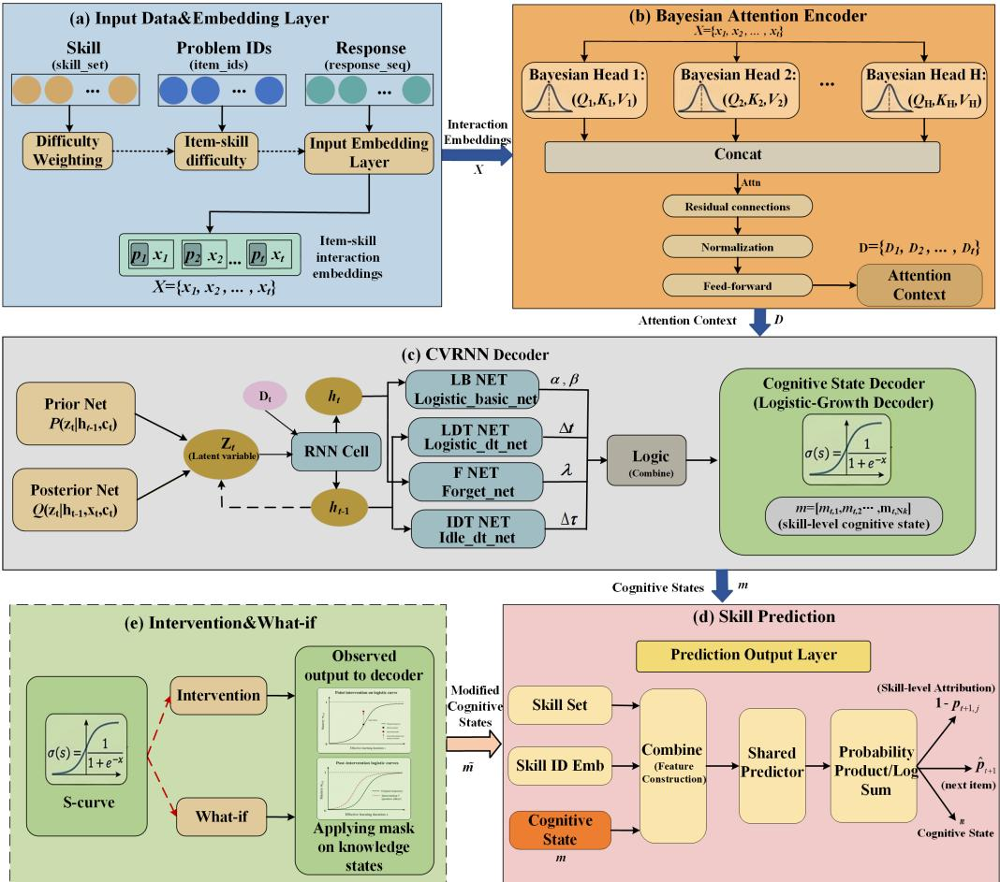
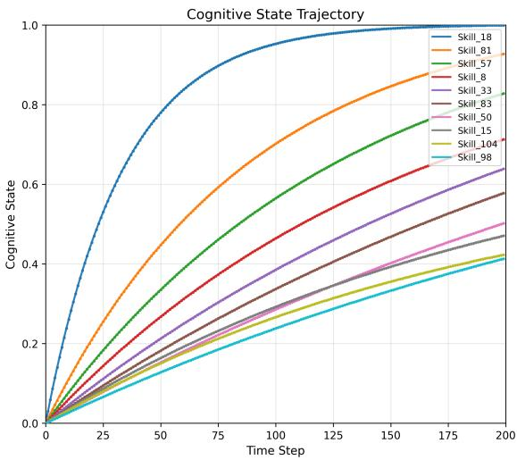
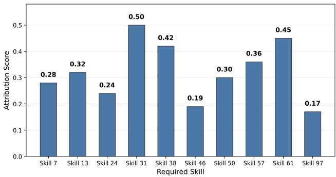
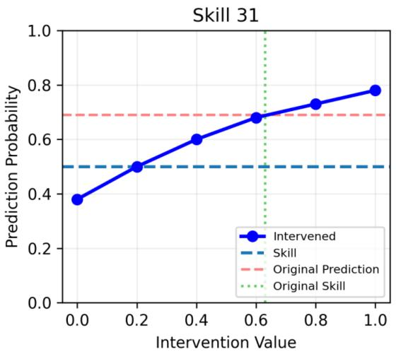
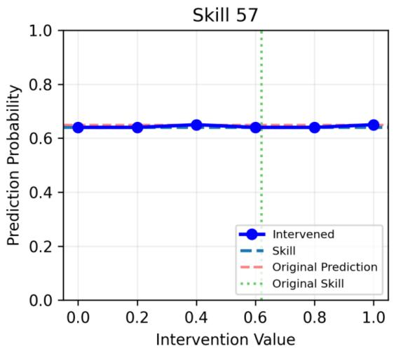
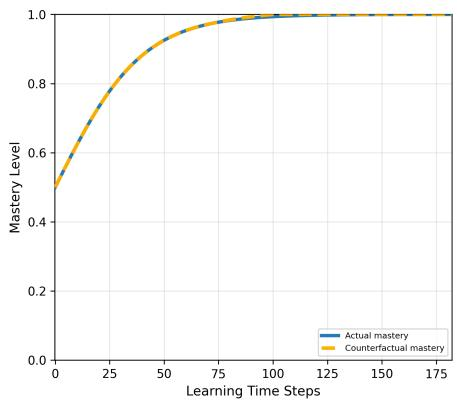
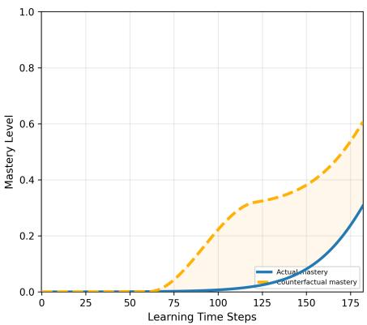
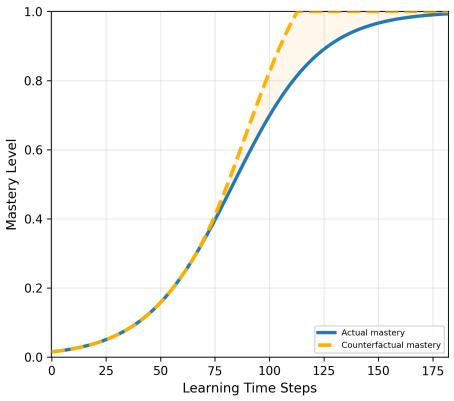

# DIKT: A Diagnostic and Interpretable Knowledge Tracing Framework for Prediction and Model-based Learning Analysis

Yi-Qiang Wua,1, Shaohui Chenb,1, Hanlin Lic,∗ and Baolin Yia,∗

aFaculty ofArtificial Intelligence in Education, Central China Normal University, Wuhan, 430079, China

bSchool of Mathematics and Systems Science, Wuhan University of Science and Technology, Wuhan, 430065, China

cSchool of Physics and Mechanics, Wuhan University of Science and Technology, Wuhan, 430065, China

## A R T I C L E I N F O

Keywords:   
Knowledge tracing   
Interpretable student modeling Skill-level cognitive trajectories Skill-level attribution   
Model-based diagnostic analysis

## A BS T R AC T

Knowledge tracing is a key component of intelligent educational systems. However, most existing methods mainly focus on response prediction, providing limited support for explaining predicted outcomes and improving students’ learning states. This paper proposes Diagnostic and Interpretable Knowledge Tracing (DIKT), which integrates response prediction, skill-level diagnosis, and modelbased learning analysis. DIKT generates bounded cognitive-state trajectories and decomposes the final response probability into skill-wise probabilities. The trajectories reveal students’ evolving strengths and weaknesses, while the skill-wise probabilities identify the skills that most strongly constrain the prediction. Based on these diagnostic results, DIKT supports direct cognitive-state intervention and efective-learning-duration-based what-if analysis to examine how hypothetical adjustments afect current predictions and subsequent state evolution. DIKT combines Bayesian multihead attention, conditional variational recurrent inference, a logistic-growth decoder, and multiplicative skill-wise prediction. Experiments on three benchmark datasets show that DIKT outperforms all evaluated baselines, with an average absolute AUC gain of 2.04 percentage points. Other experiments further demonstrate that DIKT supports educationally meaningful diagnostic analysis and provides informative diagnostic indicators for downstream applications, extending knowledge tracing from response prediction to interpretable diagnosis and model-based learning analysis.

## 1. Introduction

Knowledge tracing (KT) has become an essential component of intelligent educational systems with the rapid development of artificial intelligence and online learning platforms. It aims to infer students’ evolving cognitive states from their historical learning interactions and predict their future performance. By providing accurate estimates of students’ cognitive states, KT models can support a wide range of educational applications, such as personalized exercise recommendation, learning diagnosis, adaptive tutoring, and remedial instruction.

Over the past decade, substantial research eforts have been devoted to improving the predictive performance of KT models. Early studies mainly relied on probabilistic student models, such as Bayesian Knowledge Tracing, to estimate students’ mastery of specific skills. With the development of deep learning, recurrent neural networks, memoryaugmented networks, attention mechanisms, and graph-based models have been widely introduced into KT, leading to notable improvements in response prediction. However, most existing deep KT methods still focus primarily on predicting whether a student will correctly answer the next question. Although this prediction-oriented objective is important, it is often insuficient for practical educational decision making.

In real instructional settings, teachers and intelligent tutoring systems require more than an overall prediction score. They also need to determine which skills a student has mastered, which skills are most likely to underlie an incorrect response, and how interventions on the student’s current or prior cognitive states may afect subsequent performance. However, many deep knowledge tracing models represent students’ cognitive states as implicit latent vectors and produce predictions through largely opaque processes. Consequently, their explanations are often derived passively from internal model mechanisms and are dificult to align with explicit educational semantics. Such explanations therefore provide limited actionable diagnostic information and ofer little support for proactively evaluating how hypothetical interventions may alter response outcomes. This substantially restricts the diagnostic value and practical utility of existing knowledge tracing models.

A typical learning scenario further illustrates this limitation. Consider an exercise that primarily assesses two skills, denoted as Skill A and Skill B. Diferent students may answer the same exercise incorrectly for diferent reasons: some may fail because of an insuficient cognitive state for Skill A, whereas others may fail because of a weakness in Skill B. Even when students answer the exercise correctly, their underlying cognitive states may still difer. For example, some students may only marginally reach the required cognitivestate levels, whereas others may exhibit substantially higher cognitive states. This phenomenon indicates that a knowledge tracing model limited to response prediction cannot explicitly distinguish among these skill-specific factors, nor can it evaluate how the predicted response would change following a hypothetical improvement in a student’s cognitive state for Skill A.

  
Fig. 1. Motivating example for interpretable knowledge tracing. Even under similar exercises, associated skills, and dificulty levels, students may exhibit diferent response patterns and latent learning dynamics. These diferences can lead to distinct skill-level cognitive trajectories, suggesting that response prediction alone is insuficient and motivating explicit interpretable cognitive modeling in knowledge tracing.

To address the above limitations, we propose the Diagnostic and Interpretable Knowledge Tracing (DIKT) framework, which integrates response prediction, skill-level diagnosis, and model-based learning analysis. Fig. 1 illustrates the motivation and logical pathway of DIKT. An exercise may involve multiple skills, each assessed at a diferent dificulty level, while a student may exhibit distinct cognitive states for the skills required by that exercise. Accordingly, DIKT estimates a skill-specific success probability for each required skill and obtains the overall probability of answering the exercise correctly by multiplying these skill-wise probabilities. Because student interactions form a temporal sequence, the cognitive state associated with each skill evolves across time steps, thereby forming a skill-level cognitive-state trajectory. These trajectories are used not only to interpret response predictions, but also to support diagnostic and intervention analyses. In this way, DIKT extends knowledge tracing beyond response prediction to encompass skill-level diagnosis and model-based learning analysis.

Specifically, DIKT first employs Bayesian multi-head attention to obtain uncertainty-aware interaction representations. It then uses CVRNN-based latent state inference to capture dynamic learning processes. To generate interpretable cognitive evolution, we further design a logisticgrowth cognitive-state decoder and a skill-wise structured prediction layer, which explicitly links skill-level cognitive states to item-level response prediction. Based on the learned cognitive trajectories, DIKT also supports intervention-aware and model-based what-if analysis, allowing the model to explore how hypothetical changes in cognitive states or learning-duration dynamics may afect predictions and future trajectories.

The main contributions of this paper are summarized as follows:

• We propose DIKT, a diagnostic and interpretable knowledge tracing framework that jointly supports response prediction, skill-level diagnosis, and model-based learning analysis through explicit skill-level cognitive states.

• We develop an uncertainty-aware sequential inference architecture that combines Bayesian multi-head attention with CVRNN-based latent-state modeling to capture noisy interaction patterns and heterogeneous learning dynamics.

• We design a logistic-growth cognitive-state decoder and a multiplicative skill-wise prediction mechanism that establish an explicit pathway from bounded skill-level cognitive-state estimates to skill-wise success probabilities, attribution scores, and the final item-level response prediction.

• We develop intervention-aware and model-based what-if analysis modules to examine how hypothetical changes in cognitive states or learning-duration dynamics influence predictions and cognitive trajectories.

The remainder of this paper is organized as follows. Section 2 reviews related work on deep, interpretable, and diagnostic knowledge tracing. Section 3 formulates the knowledge tracing task and defines the explicit skill-level cognitive states considered in this work. Section 4 introduces the proposed DIKT framework. Section 5 presents the experimental setup and discusses the experimental results. Finally, Section 6 concludes this paper and outlines future research directions.

## 2. Related Work

This section reviews the studies most closely related to DIKT. We first summarize the development of deep knowledge tracing models and then discuss recent eforts toward interpretable and diagnosis-oriented knowledge tracing.

## 2.1. Deep Knowledge Tracing

Knowledge tracing aims to infer students’ evolving knowledge states from historical learning interactions and predict their future performance. Early approaches, such as Bayesian Knowledge Tracing, represented learning through probabilistic transitions and explicit mastery assumptions (Corbett & Anderson, 1994). Several journal surveys have subsequently summarized the evolution of knowledge tracing from probabilistic modeling to deep sequence modeling and have highlighted the growing importance of representation quality, interpretability, cognitive consistency, and educational applicability (Abdelrahman et al., 2023; Song et al., 2022; Shen et al., 2024; Bai et al., 2024; Yang et al., 2025).

Deep Knowledge Tracing introduced recurrent neural networks into KT and demonstrated the efectiveness of neural sequence modeling for response prediction (Piech et al., 2015). Subsequent studies employed memory networks, self-attention, and contrastive learning to improve studentstate representation. DKVMN used an external key–value memory structure to maintain and update latent knowledge states (Zhang et al., 2017), while SKVMN combined sequential modeling with key–value memory to capture longer-term exercise dependencies (Abdelrahman & Wang, 2019). SAINT and SAKT applied self-attention to model dependencies among learning interactions (Choi et al., 2020; Pandey & Karypis, 2019), and AKT introduced contextaware monotonic attention together with psychometric regularization (Ghosh et al., 2020). KQN further modeled the interaction between a student’s knowledge state and the target skill through a knowledge-query mechanism (Lee & Yeung, 2019), whereas CL4KT used pedagogically informed contrastive learning to improve the robustness of learned knowledge representations (Lee et al., 2022). Recent journalbased models have further incorporated exercise information, hierarchical sessions, learning-state diversity, exercise-level concept memory, student–question interaction graphs, and eficient multi-task sequence modeling into student-state estimation (Liu et al., 2019; Ke et al., 2024; S. Wang et al., 2025; Mao et al., 2025; Xu et al., 2026; Liu et al., 2026).

These methods have substantially improved predictive performance. However, most of them represent students’ knowledge states using implicit high-dimensional vectors optimized for next-response prediction. Such representations are dificult to associate directly with individual skills and therefore provide limited support for identifying weak skills, tracing interpretable mastery evolution, or conducting targeted instructional analysis.

## 2.2. Interpretable and Diagnostic Knowledge Tracing

Interpretability is essential in educational applications. To enhance model transparency, recent KT studies have introduced explicit educational structures and explanatory mechanisms (Abdelrahman et al., 2023; Shen et al., 2024; Bai et al., 2024; Yang et al., 2025).

Graph- and relation-based methods improve interpretability by explicitly representing relations among students, exercises, and skills. GIKT incorporated high-order question–skill relations into a graph-based interaction model (Yang et al., 2020), while heterogeneous-information and heterogeneousgraph models exploited interactions among students, exercises, and skills (J. Xu et al., 2023; Ni et al., 2023). Recent journal studies have further combined spatiotemporal topological relations, interpretable GCN–GAT structures, multiple knowledge relations, long- and short-term skill graphs, and multi-granularity interaction graphs to capture evolving educational dependencies (S. Li et al., 2025; Huo et al., 2025; Duan et al., 2024; Yu et al., 2025; J. Wang et al., 2025). Although these models make relational structures more visible, their internal knowledge states are generally not expressed as continuous and directly inspectable skill-level cognitive trajectories.

Question-aware methods provide explanations through cognitive representations, item parameters, or question factors. QIKT used question-centric cognitive representations and an item-response-theory-based prediction mechanism (Chen et al., 2023); XKT combined cognitive learning theories with multidimensional item response theory (C. Q. Huang et al., 2024); and question-factor-based models incorporated dificulty, discrimination, and response information into prediction (Zhao et al., 2023). Time- and concept-enhanced multidimensional item response theory and cognitive-assimilation modeling further introduced explicit educational parameters and cognitive mechanisms (Su et al., 2021; Guo et al., 2025). Other recent studies modeled knowledge states at both question and skill levels, incorporated metacognitive skills, or aligned implicit predictive states with explicit semantic explanations (Y. Li et al., 2025; Yin et al., 2026; Ni et al., 2026). These methods improve the interpretability of prediction factors and state representations, but they do not necessarily provide an explicit account of how a student’s cognitive state of each skill evolves over time and supports controlled intervention analysis.

Learning-process-aware models further incorporate temporal behavior and individual learning characteristics. LPKT directly modeled students’ learning processes and learning gains (Shen et al., 2021), while IEKT considered individual cognition and knowledge-acquisition sensitivity (Long et al., 2021). LBKT explicitly modeled the efects of learning behaviors on knowledge-state evolution (B. Xu et al., 2023), and DTransformer sought to trace stable knowledge rather than superficial response patterns (Yin et al., 2023). Monitoringbased KT modeled continuous learning progress and learningprocess consistency (Shen et al., 2022), while TCKT introduced temporal and causal enhancement to obtain more consistent student representations (C. Huang et al., 2024). Learning-state-enhanced KT separated knowledge states from broader learning states, and ClusterKT jointly modeled personalized learning gains and forgetting losses through state dependencies (S. Wang et al., 2025; Luo et al., 2025). More recently, TIAKT introduced a cognitively grounded trilevel memory architecture to model knowledge consolidation, schema formation, and learning transfer (Wang & Ji, 2026), while quiz-based KT used structured quiz information to model the learning process (Shen et al., 2025). These methods improve the consistency and cognitive relevance of learningprocess modeling, but their latent states are not necessarily bounded, smooth, or directly interpretable as skill-level cognitive state.

A small number of studies have explored uncertainty, causal relations, and counterfactual-style explanations. UKT represented student interactions using stochastic distribution embeddings and uncertainty-aware attention (Cheng et al., 2025). IKT incorporated causal relations into interpretable student modeling (Minn et al., 2022), and response influencebased counterfactual reasoning examined how changes in responses afect model outputs (Cui et al., 2024). PSI-KTjointly modeled learner-specific cognitive traits and prerequisite structures through scalable Bayesian inference (Zhou et al., 2024), while Markov-blanket-based KT used causal discovery to improve predictive performance and explainability (Jiang et al., 2024). Nevertheless, these approaches mainly provide uncertainty estimates, interpretable representations, causalstructure information, or post-hoc explanations.

Most existing KT models do not ofer an integrated mechanism that converts explicit skill-level cognitive states into actionable diagnosis and targeted intervention analysis. In particular, the connection among cognitive evolution, response prediction, skill diagnosis, and controlled what-if intervention remains insuficiently explored.

## 3. Problem Definition

In a knowledge tracing task, let S, ε, and K denote the sets of students, exercises, and knowledge skills, respectively.

For a student, the historical learning sequence is represented as

$$
X = \{ ( e _ { 1 } , y _ { 1 } ) , ( e _ { 2 } , y _ { 2 } ) , \dots , ( e _ { T } , y _ { T } ) \} ,\tag{1}
$$

where $e _ { t } \in \mathcal { E }$ denotes the exercise attempted at time step �, and $y _ { t } \in \{ 0 , 1 \}$ denotes whether the student answers it correctly. Each exercise $e _ { t }$ is associated with one or more knowledge skills, and we denote the corresponding skill set as $\textstyle { \mathcal { k } } ( e _ { t } ) \subseteq { \mathcal { K } }$

The standard KT task is to estimate the probability that the student will answer the next exercise correctly:

$$
\hat { p } _ { t + 1 } = P ( y _ { t + 1 } = 1 \mid e _ { 1 : t } , y _ { 1 : t } , e _ { t + 1 } ) .\tag{2}
$$

To provide skill-level diagnostic information for the predicted outcome, DIKT further models an explicit skilllevel cognitive state:

$$
\mathbf { m } _ { t } = [ m _ { t , 1 } , m _ { t , 2 } , \ldots , m _ { t , N _ { k } } ] \in [ 0 , 1 ] ^ { N _ { k } } ,\tag{3}
$$

where $N _ { k }$ is the number of knowledge skills, and $m _ { t , k }$ denotes the model-estimated cognitive state of skill � at time step �.

For the target exercise $e _ { t + 1 }$ , we define the skill-level attribution vector as

$$
\rho _ { t + 1 } ^ { \mathrm { a t t r } } = \left[ \rho _ { t + 1 , 1 } ^ { \mathrm { a t t r } } , \rho _ { t + 1 , 2 } ^ { \mathrm { a t t r } } , \ldots , \rho _ { t + 1 , J } ^ { \mathrm { a t t r } } \right] \in [ 0 , 1 ] ^ { J } ,\tag{4}
$$

where � denotes the maximum number of skill slots for one exercise, and $\rho _ { t + 1 , j } ^ { \mathrm { a t t r } }$ denotes the attribution score assigned to the �-th required skill slot of the target exercise. A larger $\rho _ { t + 1 , j } ^ { \mathrm { a t t r } }$ indicates a lower skill-wise success probability and a stronger model-estimated constraint on the predicted success of the target exercise.

Diferent from purely prediction-oriented KT methods, DIKT is designed to accurately predict students’ future responses while producing interpretable cognitive trajectories and skill-level attribution scores for diagnosis-oriented analysis. The cognitive trajectories characterize the temporal evolution of students’ skill-level states, whereas the attribution scores identify the skills that are more likely to constrain the predicted outcome. Based on the learned cognitive states, DIKT further provides model-based intervention-aware and what-if analysis. These analyses are used as probing tools for inspecting model behavior rather than as formal causal identification procedures.

For clarity, the main mathematical notations used throughout this paper are summarized in Table 1.

## 4. The Proposed Method

## 4.1. Overview of DIKT

To learn interpretable and diagnosis-oriented student representations, we propose Diagnostic and Interpretable Knowledge Tracing (DIKT). The overall architecture is shown in Fig. 2. As illustrated in the figure, DIKT contains five major components: an input data and embedding layer, a Bayesian attention encoder, a CVRNN-based cognitivestate modeling module, a skill-wise prediction layer, and an intervention and what-if analysis interface. Specifically, the input data and embedding layer integrates exercise, skill, dificulty, and response information into interaction representations. The Bayesian attention encoder captures sequential dependencies and uncertainty-aware interaction patterns. The CVRNN-based module infers dynamic latent learning states and produces explicit skill-level cognitive trajectories, represented by bounded cognitive estimates, through a logistic-growth decoder. The skill-wise prediction layer connects the learned cognitive states with item-level response prediction. The intervention and what-if analysis interface further enables model-based diagnostic analysis by exploring how hypothetical changes in cognitive states may influence predicted responses and subsequent cognitive trajectories.

Table 1  
The key mathematical notations and descriptions.
<table><tr><td>Notation</td><td>Description</td></tr><tr><td> $e _ { t }$ </td><td>Exercise attempted at time step t</td></tr><tr><td> $y _ { t }$ </td><td>Binary response label at time step t</td></tr><tr><td> $\boldsymbol { \kappa } ( \boldsymbol { e } _ { t } )$ </td><td>Skill set associated with exercise  $e _ { t }$ </td></tr><tr><td> $N _ { k }$ </td><td>Number of knowledge skills</td></tr><tr><td> $J$ </td><td>Maximum number of skill slots for one exercise</td></tr><tr><td> $\mathbf { X } _ { t }$ </td><td>Interaction representation at time step t</td></tr><tr><td> $\mathbf { h } _ { t }$ </td><td>Recurrent hidden state at time step t</td></tr><tr><td> $\mathbf { z } _ { t }$ </td><td>Latent learning variable at time step t</td></tr><tr><td> $\mathbf { m } _ { t }$ </td><td>Skill-level cognitive-state vector at time step t</td></tr><tr><td> $m _ { t , k }$ </td><td>Estimated cognitive state of skill k at time step t</td></tr><tr><td> $\alpha _ { k }$ </td><td>Growth-rate parameter of skill k</td></tr><tr><td> $\beta _ { k }$ </td><td>Offset parameter of skill k</td></tr><tr><td> $\Delta t _ { t , k }$ </td><td>Learning-duration increment of skill k at time</td></tr><tr><td> $\lambda _ { k }$ </td><td>step t Forgetting rate of skill k</td></tr><tr><td> $\Delta \tau _ { t }$ </td><td>Idle-duration increment of skill k at time step t</td></tr><tr><td> $T _ { t , k }$ </td><td>Cumulative effective learning duration of skill k</td></tr><tr><td> $p _ { t + 1 , j }$ </td><td>Skill-wise success probability for the j-th required skill slot</td></tr><tr><td> $\rho _ { t + 1 } ^ { \mathrm { a t t r } }$ </td><td>Skill-level attribution vector for target exercise</td></tr><tr><td> $\hat { p } _ { t + 1 }$ </td><td> $e _ { t + 1 }$  Final predicted response probability for the next</td></tr><tr><td> $\mathbf { c } _ { t }$ </td><td>exercise Intervention mask for selected cognitive states</td></tr><tr><td> $\mathbf { m } _ { t } ^ { \mathrm { i n t } }$ </td><td>Skill-level cognitive-state in intervention</td></tr><tr><td> $\delta ^ { \mathrm { w f } }$ </td><td>analysis at time step t Duration perturbation mask for what-if analysis</td></tr><tr><td> $\mathbf { m } _ { t } ^ { \mathrm { w f } }$ </td><td>Skill-level cognitive-state in what-if analysis at</td></tr><tr><td></td><td>time step t</td></tr></table>

Compared with conventional deep KT models that mainly rely on implicit hidden representations, DIKT explicitly generates bounded cognitive states over knowledge skills. This design allows the model to be used not only for response prediction, but also for cognitive visualization, diagnostic interpretation, and model-based learning analysis.

## 4.2. Interaction Representation and Bayesian Sequence Encoding

At each time step, DIKT receives an exercise ID, its associated skills, and the student’s response. Since the same response label may correspond to diferent exercises, skill combinations, and dificulty levels, the input representation should preserve item-specific, skill-specific, and responserelated information simultaneously.

For the �-th skill associated with exercise $\boldsymbol { e } _ { t } ,$ the skill ID $s _ { t , j }$ is mapped into a dense embedding:

$$
\mathbf { e } _ { t , j } ^ { ( s ) } = \mathrm { E m b } _ { s k i l l } ( s _ { t , j } ) \in \mathbb { R } ^ { d _ { h } } .\tag{5}
$$

The exercise ID is embedded as

$$
\mathbf { e } _ { t } ^ { ( i ) } = \mathrm { E m b } _ { i t e m } ( e _ { t } ) .\tag{6}
$$

To distinguish exercises with diferent dificulty levels under the same skill, DIKT introduces a learnable dificultyaware weighting mechanism. For each exercise-skill pair, a dificulty weight is maintained and projected into the hidden space:

$$
\boldsymbol { w } _ { e _ { t } , j } \in [ 0 . 1 , 0 . 9 ] , \qquad \mathbf { d } _ { t , j } = f _ { d i f f } ( \boldsymbol { w } _ { e _ { t } , j } ) .\tag{7}
$$

The skill embedding is then reweighted by

$$
\tilde { \mathbf { e } } _ { t , j } ^ { ( s ) } = \mathbf { e } _ { t , j } ^ { ( s ) } \odot ( 1 + \mathbf { d } _ { t , j } ) .\tag{8}
$$

The skill-based exercise representation is obtained through masked average pooling:

$$
\mathbf { v } _ { t } = \frac { \sum _ { j = 1 } ^ { J } \mathbb { I } ( s _ { t , j } > 0 ) \tilde { \mathbf { e } } _ { t , j } ^ { ( s ) } } { \sum _ { j = 1 } ^ { J } \mathbb { I } ( s _ { t , j } > 0 ) + \epsilon } .\tag{9}
$$

It is then combined with the exercise embedding:

$$
\tilde { \mathbf { v } } _ { t } = f _ { q u s } ( [ \mathbf { v } _ { t } ; \mathbf { e } _ { t } ^ { ( i ) } ] ) .\tag{10}
$$

The response label is embedded as

$$
{ \bf e } _ { t } ^ { ( y ) } = \mathrm { E m b } _ { r e s p } ( y _ { t } ) ,\tag{11}
$$

and the final interaction representation is

$$
\begin{array} { r } { \mathbf { x } _ { t } = f _ { f u s i o n } ( [ \tilde { \mathbf { v } } _ { t } ; \mathbf { e } _ { t } ^ { ( y ) } ] ) . } \end{array}\tag{12}
$$

To preserve temporal order in the interaction sequence, DIKT adds sinusoidal positional encoding to the interaction representation. For the �-th hidden dimension, the positional encoding is defined as

$$
\begin{array} { r } { \mathbf { p } _ { t , 2 r } = \sin \left( \frac { t } { 1 0 0 0 0 ^ { 2 r / d _ { h } } } \right) , } \\ { \mathbf { p } _ { t , 2 r + 1 } = \cos \left( \frac { t } { 1 0 0 0 0 ^ { 2 r / d _ { h } } } \right) . } \end{array}\tag{13}
$$

The position-aware interaction representation is then obtained by

$$
\bar { \mathbf { x } } _ { t } = \mathbf { x } _ { t } + \mathbf { p } _ { t } .\tag{14}
$$

  
Fig. 2. Overall architecture of DIKT.

The resulting position-aware interaction sequence is denoted as

$$
\bar { \bf X } = [ \bar { \bf x } _ { 1 } , \bar { \bf x } _ { 2 } , \dots , \bar { \bf x } _ { T } ] .\tag{15}
$$

To capture long-range dependencies and represent uncertainty in student interactions, DIKT uses a Bayesian multihead attention encoder. Unlike deterministic attention, the projection matrices of query, key, and value are treated as Gaussian-distributed random variables:

$$
\begin{array} { r l } & { W _ { Q } \sim \mathcal { N } ( \mu _ { Q } , \mathrm { d i a g } ( \sigma _ { Q } ^ { 2 } ) ) , } \\ & { W _ { K } \sim \mathcal { N } ( \mu _ { K } , \mathrm { d i a g } ( \sigma _ { K } ^ { 2 } ) ) , } \\ & { W _ { V } \sim \mathcal { N } ( \mu _ { V } , \mathrm { d i a g } ( \sigma _ { V } ^ { 2 } ) ) . } \end{array}\tag{16}
$$

During training, the projection matrices are sampled using the reparameterization trick:

$$
W _ { Q } = { \pmb { \mu } } _ { Q } + \sigma _ { Q } \odot { \epsilon } _ { Q } , \qquad { \epsilon } _ { Q } \sim \mathcal { N } ( \mathbf { 0 } , \mathbf { I } ) ,\tag{17}
$$

and similarly for $W _ { K }$ and $W _ { V }$ . During inference, the posterior means are used.

Given the position-aware interaction sequence $\bar { \mathbf { X } } ,$ , the attention output is computed as

$$
\begin{array} { l } { { \displaystyle \mathrm { A t t n } ( \bar { \bf X } ) = \mathrm { s o f t m a x } \left( \frac { ( \bar { \bf X } W _ { Q } ) ( \bar { \bf X } W _ { K } ) ^ { \top } } { \sqrt { d _ { h } / N _ { h } } } \right) } } \\ { ~ \times ( \bar { \bf X } W _ { V } ) , } \end{array}\tag{18}
$$

where $N _ { h }$ is the number of attention heads. Residual connections, layer normalization, and feed-forward networks are used to obtain the encoded interaction sequence. During training, the posterior distributions of the Bayesian query, key, and value projection matrices are regularized toward their Gaussian priors through the Bayesian loss defined in Section 4.5. This Bayesian formulation reduces the model’s over-reliance on a single deterministic attention estimate and improves the robustness of sequence encoding for sparse and noisy educational interaction data.

## 4.3. Variational Skill-Level Cognitive-State Modeling

The encoded interaction representations are then fed into a conditional variational recurrent module to infer dynamic latent learning states. This module is introduced because students with similar observed responses may still difer in hidden learning pace, retention tendency, or short-term learning instability.

At time step $t ,$ the latent variable $\mathbf { z } _ { t }$ is modeled with a prior distribution:

$$
p ( \mathbf { z } _ { t } | \mathbf { h } _ { t - 1 } ) = \mathcal { N } ( \mu _ { t } ^ { p r i o r } , \mathrm { d i a g } ( ( \sigma _ { t } ^ { p r i o r } ) ^ { 2 } ) ) ,\tag{19}
$$

and a posterior distribution:

$$
q ( \mathbf { \boldsymbol { z } } _ { t } | \mathbf { \boldsymbol { x } } _ { t } , \mathbf { \boldsymbol { h } } _ { t - 1 } ) = \mathcal { N } ( \mu _ { t } ^ { p o s t } , \mathrm { d i a g } ( ( \sigma _ { t } ^ { p o s t } ) ^ { 2 } ) ) .\tag{20}
$$

During training, $\mathbf { z } _ { t }$ is sampled from the posterior:

$$
\begin{array} { r } { \mathbf { z } _ { t } = \pmb { \mu } _ { t } ^ { p o s t } + \pmb { \sigma } _ { t } ^ { p o s t } \odot \epsilon , \qquad \epsilon \sim \mathcal { N } ( 0 , I ) . } \end{array}\tag{21}
$$

The recurrent hidden state is updated by

$$
\mathbf { h } _ { t } = \mathrm { G R U C e l l } ( [ \mathbf { x } _ { t } ; \mathbf { z } _ { t } ] , \mathbf { h } _ { t - 1 } ) .\tag{22}
$$

Instead of directly mapping � to an unconstrained cognitive vector, DIKT generates skill-specific growth parameters:

$$
[ \alpha _ { 1 } , \ldots , \alpha _ { N _ { k } } , \beta _ { 1 } , \ldots , \beta _ { N _ { k } } ] = f _ { b a s i c } ( { \bf h } _ { T } ) ,\tag{23}
$$

where $\alpha _ { k }$ and $\beta _ { k }$ are bounded to (0, 1) through a sigmoid layer. The model also estimates an efective learning-duration increment:

$$
\Delta t _ { t , k } = f _ { \Delta t } ( [ \mathbf { z } _ { t } ; \mathbf { h } _ { t - 1 } ] ) _ { k } .\tag{24}
$$

The cognitive state is generated through a recursive logistic-growth decoding process. Let $T _ { t - 1 , k }$ denote the equivalent cumulative efective learning duration of skill � after the previous update. At time step �, the efective learning duration is first updated as

$$
\widetilde { T } _ { t , k } = T _ { t - 1 , k } + \Delta t _ { t , k } ,\tag{25}
$$

where $T _ { 0 , k } = 0$ . The corresponding preliminary cognitive state is then generated by the logistic-growth function:

$$
\widetilde { m } _ { t , k } = \frac { 1 } { 1 + \exp \Big ( { - \alpha _ { k } ( \widetilde { T } _ { t , k } - \beta _ { k } ) \cdot \gamma } \Big ) } ,\tag{26}
$$

where $\gamma$ is a scaling constant.

After the learning update, the preliminary cognitive state is adjusted through an exponential decay function:

$$
m _ { t , k } = \widetilde { m } _ { t , k } \exp \left( - \lambda _ { k } \Delta \tau _ { t } \right) .\tag{27}
$$

The skill-specific forgetting rate is generated as

$$
\lambda _ { k } = \left[ f _ { \mathrm { f o r g e t } } ( \mathbf { h } _ { T } ) \right] _ { k } \in ( 0 , 1 ) ,\tag{28}
$$

where $\lambda _ { k }$ denotes the learned forgetting rate of skill �. The model-estimated idle-duration increment at time step � is defined as

$$
\Delta \tau _ { t } = f _ { \mathrm { i d l e } } \left( [ \mathbf { z } _ { t } ; \mathbf { h } _ { t - 1 } ] \right) .\tag{29}
$$

The exponential decay term simulates forgetting by reducing the preliminary cognitive state according to the skill-specific forgetting rate and the estimated idle duration.

The corrected cognitive state is subsequently converted back into an equivalent cumulative efective learning duration through the inverse logistic transformation:

$$
T _ { t , k } = \beta _ { k } - \frac { \log { \left( \frac { 1 } { m _ { t , k } } - 1 + \epsilon \right) } } { \alpha _ { k } \gamma } .\tag{30}
$$

The resulting $T _ { t , k }$ is carried forward as the initial efective learning duration for the next time step. This recursive process constrains the cognitive states to (0, 1) and preserves the smooth and saturating pattern of the logistic-growth trajectory, while allowing the estimated states to exhibit gradual decreases during idle periods.

## 4.4. Skill-Wise Prediction and Model-Based Analysis

After obtaining the cognitive state $\mathbf { m } _ { t } ,$ , DIKT predicts the student’s response to the next exercise. For the �-th skill slot of the target exercise $e _ { t + 1 }$ , the model constructs a skill-wise prediction feature:

$$
\mathbf f _ { t + 1 , j } = [ \tilde { \mathbf v } _ { t + 1 } ; m _ { t , s _ { t + 1 , j } } ; \mathbf u _ { t + 1 , j } ] ,\tag{31}
$$

where $\mathbf { u } _ { t + 1 , j }$ is the skill-ID embedding. A shared skill predictor produces the corresponding skill-wise success probability:

$$
p _ { t + 1 , j } = \sigma ( f _ { s k i l l } ( \mathbf { f } _ { t + 1 , j } ) ) .\tag{32}
$$

The corresponding skill-level attribution score is computed as

$$
\rho _ { t + 1 , j } ^ { \mathrm { a t t r } } = 1 - p _ { t + 1 , j } ,\tag{33}
$$

The final response probability is obtained through multiplicative fusion:

$$
\hat { p } _ { t + 1 } = \prod _ { j : s _ { t + 1 , j } > 0 } p _ { t + 1 , j } .\tag{34}
$$

For numerical stability, it is implemented as

$$
\begin{array} { l } { \log \hat { p } _ { t + 1 } = \displaystyle \sum _ { j : s _ { t + 1 , j } > 0 } \log ( p _ { t + 1 , j } + \epsilon ) , } \\ { \quad \hat { p } _ { t + 1 } = \exp ( \log \hat { p } _ { t + 1 } ) . } \end{array}\tag{35}
$$

The multiplicative fusion is used as a structured aggregation mechanism rather than as a strict causal equation. Its purpose is to preserve an explicit pathway from skill-level cognitive-state estimates to item-level response prediction. The skill-wise success probabilities provide the computational basis for the attribution scores, while their multiplicative aggregation produces the final item-level response probability.

DIKT further supports mask-based attribution exclusion. Let $\mathbf { R } = [ R _ { 1 } , \ldots , R _ { J } ] \in \{ 0 , 1 \} ^ { J }$ denote the exclusion mask, where $R _ { j } = 0$ retains the �-th skill and $R _ { j } = 1$ excludes it. The masked skill-wise probability is defined as

$$
\widetilde { p } _ { t + 1 , j } = ( 1 - R _ { j } ) p _ { t + 1 , j } + R _ { j } ,\tag{36}
$$

so that $\widetilde { p } _ { t + 1 , j } = 1$ when $R _ { j } = 1$

Based on the learned cognitive states, DIKT further provides two model-based analysis modules.

First, the intervention-aware module adjusts selected cognitive dimensions through a mask-based intervention operation. Let

$$
\mathbf { c } _ { t } = [ c _ { t , 1 } , c _ { t , 2 } , \ldots , c _ { t , N _ { k } } ]\tag{37}
$$

denote the intervention mask at time step �, where each entry satisfies

$$
c _ { t , k } \in \{ - 1 \} \cup [ 0 , 1 ] .\tag{38}
$$

The default value $c _ { t , k } = - 1$ indicates that no intervention is applied to skill �. If $c _ { t , k } \geq 0 .$ , the cognitive value of skill � is directly replaced by the specified intervention value. Formally, the intervened cognitive state is defined as

$$
\begin{array} { r } { \boldsymbol { m } _ { t , k } ^ { \mathrm { i n t } } = \left\{ \begin{array} { l l } { \boldsymbol { m } _ { t , k } , } & { \boldsymbol { c } _ { t , k } < 0 , } \\ { \boldsymbol { c } _ { t , k } , } & { \boldsymbol { c } _ { t , k } \geq 0 . } \end{array} \right. } \end{array}\tag{39}
$$

This masking strategy allows DIKT to intervene only on selected skills while keeping all other skill-level cognitive states unchanged. The intervened cognitive state $\mathbf { m } _ { t } ^ { \mathrm { i n t } }$ is then passed to the same skill-wise prediction layer. By varying the non-negative entries in $\mathbf { c } _ { t }$ for selected skills, DIKT can produce intervention-response curves that show how hypothetical cognitive changes afect the predicted response probability under the learned model.

Second, the what-if module perturbs the efective learning-duration dynamics rather than directly overwriting cognitive values. Let � denote the length of the learning sequence. We define the temporal-skill mask as

$$
\delta ^ { \mathrm { w f } } = [ \delta _ { \tau , k } ^ { \mathrm { w f } } ] \in \mathbb { R } ^ { L \times N _ { k } } ,\tag{40}
$$

where $\delta _ { \tau , k } ^ { \mathrm { w f } }$ represents the perturbation applied to the efective duration increment of skill � at time step �. To ensure that the perturbed duration remains valid, the perturbation is constrained by

$$
\Delta t _ { \tau , k } + \delta _ { \tau , k } ^ { \mathrm { w f } } \geq 0 .\tag{41}
$$

The perturbed duration increment is then computed as

$$
\Delta t _ { \tau , k } ^ { \mathrm { w f } } = \Delta t _ { \tau , k } + \delta _ { \tau , k } ^ { \mathrm { w f } } .\tag{42}
$$

The what-if cognitive state $m _ { t , k } ^ { \mathrm { w f } }$ is then generated using the same logistic-growth decoding process defined above, with $\Delta t _ { \tau , k }$ replaced by $\Delta t _ { \tau , k } ^ { \mathrm { w f } }$ at each time step. The resulting sequence of cognitive states constitutes the corresponding what-if cognitive trajectory.

Both modules are intended as model-based probing tools for instructional analysis. The mask-based formulation makes the hypothetical operation explicit and prevents unrelated skills or time steps from being unintentionally modified. Therefore, the intervention-aware module analyzes the immediate efect of directly modifying selected cognitive values, whereas the what-if module examines how changes in learning-duration dynamics may influence the subsequent cognitive trajectory.

## 4.5. Training Objective

DIKT is trained end-to-end using a multi-term objective that jointly optimizes response prediction, Bayesian parameter regularization, latent-state inference, and the interpretability-related properties of the cognitive trajectories:

$$
\begin{array} { r l } & { \mathcal { L } = \mathcal { L } _ { p r e d } + \lambda _ { a t t n } \mathcal { L } _ { a t t n } + \lambda _ { B a y e s } \mathcal { L } _ { B a y e s } } \\ & { ~ + \lambda _ { V A E } \mathcal { L } _ { V A E } + \lambda _ { m o n o } \mathcal { L } _ { m o n o } + \lambda _ { s c a l e } \mathcal { L } _ { s c a l e } , } \end{array}\tag{43}
$$

where $\lambda _ { a t t n } , \lambda _ { B a y e s } , \lambda _ { V A E } , \lambda _ { m o n o }$ , and $\lambda _ { s c a l e }$ control the contributions of the corresponding auxiliary and regularization terms.

The main prediction loss is the binary cross-entropy between the predicted and observed next responses:

$$
\mathcal { L } _ { p r e d } = \sum _ { t = 1 } ^ { T - 1 } \mathrm { B C E } ( y _ { t + 1 } , \hat { p } _ { t + 1 } ) .\tag{44}
$$

An auxiliary attention-based prediction head is used to stabilize the learning of sequential interaction representations:

$$
\mathcal { L } _ { a t t n } = \sum _ { t = 1 } ^ { T - 1 } \mathrm { B C E } ( y _ { t + 1 } , \hat { p } _ { t + 1 } ^ { a t t n } ) .\tag{45}
$$

The Bayesian attention loss regularizes the posterior distributions of the query, key, and value projection matrices toward their Gaussian priors:

$$
{ \begin{array} { r l } { { \mathcal { L } } _ { \mathrm { B a y e s } } = } & { \displaystyle \sum _ { \theta \in \{ Q , K , V \} } \mathrm { K L } \Big ( { \mathcal { N } } \big ( \mu _ { \theta } , \mathrm { d i a g } ( \sigma _ { \theta } ^ { 2 } ) \big ) } \\ & { \quad \quad \quad \quad \quad \left\| { \mathcal { N } } \big ( \mathbf { 0 } , \sigma _ { \mathrm { p r i o r } } ^ { 2 } \mathbf { I } \big ) \right) . } \end{array} }\tag{46}
$$

This term constrains the posterior distributions of the Bayesian attention parameters to remain close to the predefined Gaussian prior, thereby reducing overfitting and improving the robustness of attention estimation under sparse and noisy student interaction data.

The variational latent-state regularization is defined as

$$
\mathcal { L } _ { V A E } = \frac { 1 } { T } \sum _ { t = 1 } ^ { T } \mathrm { K L } \left( q ( \mathbf { \boldsymbol { z } } _ { t } \vert \mathbf { \boldsymbol { x } } _ { t } , \mathbf { \boldsymbol { h } } _ { t - 1 } ) \parallel p ( \mathbf { \boldsymbol { z } } _ { t } \vert \mathbf { \boldsymbol { h } } _ { t - 1 } ) \right)\tag{47}
$$

To ensure that the predicted probability is positively consistent with the cognitive state of the corresponding skill, DIKT introduces a monotonicity regularization term for the skills associated with the target exercise. The regularization consists of three parts: a first-order monotonicity constraint, a lower-boundary constraint, and an upper-boundary constraint.

For each skill $k \in \mathcal { K } ( e _ { t + 1 } )$ , let $p _ { t + 1 , k } ( m _ { t , k } )$ denote the skill-wise prediction probability produced by the shared skill predictor when the cognitive state of skill � is set to $m _ { t , k }$ , while other inputs remain unchanged. The first-order monotonicity constraint is defined as

$$
\mathcal { L } _ { \mathrm { g r a d } } = \mathbb { E } \left[ \frac { 1 } { | K ( e _ { t + 1 } ) | } \sum _ { k \in K ( e _ { t + 1 } ) } \mathrm { R e L U } \left( - \frac { \partial p _ { t + 1 , k } } { \partial m _ { t , k } } + \epsilon \right) \right] .\tag{48}
$$

To further encourage meaningful boundary behavior, DIKT constrains the skill-wise prediction probability to

approach 0 when the corresponding cognitive state is 0, and to approach 1 when the corresponding cognitive state is 1:

$$
\mathcal { L } _ { \mathrm { l o w } } = \mathbb { E } \left[ \frac { 1 } { | K ( e _ { t + 1 } ) | } \sum _ { k \in K ( e _ { t + 1 } ) } \left( p _ { t + 1 , k } ( 0 ) \right) ^ { 2 } \right] ,\tag{49}
$$

$$
\mathcal { L } _ { \mathrm { h i g h } } = \mathbb { E } \left[ \frac { 1 } { | \mathcal { K } ( e _ { t + 1 } ) | } \sum _ { k \in \mathcal { K } ( e _ { t + 1 } ) } \big ( 1 - p _ { t + 1 , k } ( 1 ) \big ) ^ { 2 } \right] .\tag{50}
$$

The complete monotonicity regularization term is then defined as

$$
\mathcal { L } _ { \mathrm { m o n o } } = \mathcal { L } _ { \mathrm { g r a d } } + \eta _ { \mathrm { l o w } } \mathcal { L } _ { \mathrm { l o w } } + \eta _ { \mathrm { h i g h } } \mathcal { L } _ { \mathrm { h i g h } } ,\tag{51}
$$

where $\eta _ { \mathrm { l o w } }$ and $\eta _ { \mathrm { h i g h } }$ control the strengths of the two boundary constraints.

This regularization encourages the skill-wise prediction probability to increase monotonically with the corresponding cognitive state, while also promoting meaningful boundary behavior at the two extremes of the cognitive-state range. As a result, the prediction layer is encouraged to follow an educationally consistent mapping in which a low cognitive state corresponds to a low success probability, whereas a high cognitive state corresponds to a high success probability.

Finally, DIKT introduces scale and smoothness regularization to constrain the range and temporal evolution of the cognitive trajectories:

$$
\begin{array} { l } { { \displaystyle { \mathcal { L } } _ { \mathrm { s c a l e } } = ( 1 - \operatorname* { m a x } ( { \bf m } ) ) ^ { 2 } + \frac { 1 } { N _ { k } } \sum _ { k = 1 } ^ { N _ { k } } ( m _ { 1 , k } ) ^ { 2 } } \ ~ } \\ { { \displaystyle ~ + \frac { 1 } { T - 1 } \sum _ { i = 1 } ^ { T - 1 } \big \| { \bf m } _ { i + 1 } - { \bf m } _ { i } \big \| _ { 2 } ^ { 2 } } \ ~ } \\ { { \displaystyle ~ + \frac { 1 } { T - 2 } \sum _ { t = 1 } ^ { T - 2 } \big \| ( { \bf m } _ { t + 2 } - { \bf m } _ { t + 1 } ) - ( { \bf m } _ { t + 1 } - { \bf m } _ { t } ) \big \| _ { 2 } ^ { 2 } } . } \end{array}\tag{52}
$$

The first two terms constrain the overall scale and initial values of the cognitive states. The third term penalizes abrupt first-order changes between adjacent time steps, while the fourth term penalizes rapid changes in the trajectory growth rate. Together, these terms encourage bounded, smooth, and educationally plausible cognitive trajectories.

## 5. Experiments

In this section, we conduct experiments to evaluate DIKT from both predictive and diagnostic perspectives. We first introduce the experimental setup, including datasets, baselines, evaluation metrics, and implementation details. Then, we report the experimental results and discuss the efectiveness of DIKT by answering the following research questions:

• RQ1: Can DIKT achieve competitive predictive performance compared with representative KT baselines?

• RQ2: Can DIKT generate interpretable skill-level cognitive trajectories and skill-level attribution scores?

• RQ3: Can the learned cognitive states support modelbased intervention-aware and what-if analysis?

• RQ4: How do the main components of DIKT contribute to prediction and interpretability?

## 5.1. Experimental Setup

## 5.1.1. Datasets

We evaluate DIKT on three public benchmark datasets for knowledge tracing: ASSIST09, ASSIST17, and Algebra2005. ASSIST09 and ASSIST17 are collected from the ASSISTments platform, whereas Algebra2005 is collected from algebra learning records in an intelligent tutoring environment. These datasets vary in terms of the numbers of students, exercises, skills, and interactions, which enables us to examine the robustness of DIKT under diferent educational scenarios and sequence characteristics.

The statistics in Table 2 are reported on the preprocessed versions used in this paper. Following common KT preprocessing practice, interaction records are organized into student-level sequences, and exercises without valid skill annotations are removed.

## 5.1.2. Baselines

We compare DIKT with representative KT baselines from diferent modeling families:

• BKT (Corbett & Anderson, 1994): a classical probabilistic KT model based on hidden Markov assumptions;

• DKT (Piech et al., 2015): a recurrent neural network based KT model for student response sequence modeling;

• SAINT (Choi et al., 2020): a Transformer-based KT model that applies self-attention to exercise and response sequences;

• QIKT (Chen et al., 2023): an interpretable KT model that introduces question-centric cognitive representations;

• DSN-KT (Gao, 2025): a recent deep semantics-robust knowledge tracing model that combines knowledge augmentation, time-cumulative attention, and semantic contrastive learning to obtain stable knowledge-state representations;

• KQN (Lee & Yeung, 2019): a knowledge query network model that predicts student performance through skillspecific knowledge representations;

• SAKT (Pandey & Karypis, 2019): a self-attentive KT model that captures relevant historical interactions for response prediction.

Table 2  
Statistics of the datasets used in the experiments.
<table><tr><td>Dataset</td><td>Students</td><td>Exercises</td><td>Skills</td><td>Interactions</td><td>Avg. Length</td></tr><tr><td>ASSIST09</td><td>4,217</td><td>26,688</td><td>123</td><td>346,860</td><td>82.25</td></tr><tr><td>ASSIST17</td><td>1,709</td><td>3,162</td><td>102</td><td>942,816</td><td>551.68</td></tr><tr><td>Algebra2005</td><td>574</td><td>210,710</td><td>112</td><td>809,694</td><td>1410.62</td></tr></table>

These baselines cover probabilistic KT, recurrent neural KT, Transformer-based KT, interpretable KT, knowledgequery-based KT, and self-attention-based KT. This comparison allows us to examine whether DIKT can maintain competitive predictive performance while providing explicit skilllevel cognitive interpretation and model-based diagnostic analysis.

## 5.1.3. Metrics

For predictive performance, we use AUC and ACC as the main evaluation metrics, both of which are commonly adopted for evaluating predictive performance in knowledge tracing. AUC measures the model’s ability to rank positive responses higher than negative responses across diferent classification thresholds, while ACC measures the proportion of correctly predicted student responses.

In addition to prediction metrics, DIKT also supports diagnostic analysis, including intervention and what-if analysis. The intervention and what-if metrics are not used as primary ranking criteria. Instead, they are used to inspect whether the learned cognitive states can support model-based diagnostic analysis.

For intervention analysis, we evaluate how the predicted response probability changes when the cognitive value of a selected skill is hypothetically adjusted. For a target skill � at time step �, the original cognitive value $m _ { t , k }$ is replaced by a specified intervention value $v \in [ 0 , 1 ] .$ , while the cognitive values of all unselected skills remain unchanged. Let $\hat { p } _ { t + 1 }$ denote the original predicted response probability and let $\hat { p } _ { t + 1 } ^ { \mathrm { i n t } } ( v )$ denote the prediction obtained after the single-point intervention. The point-wise intervention eficiency is defined as

$$
\mathrm { E f f } _ { t , k } ( v ) = \frac { \Big | \hat { p } _ { t + 1 } ^ { \mathrm { i n t } } ( v ) - \hat { p } _ { t + 1 } \Big | } { \big | v - m _ { t , k } \big | + \epsilon } .\tag{53}
$$

Here, � is a small positive constant used for numerical stability. A larger value of $\mathrm { E f f } _ { t , k } ( v )$ indicates that the predicted response probability is more sensitive to a unit change in the selected skill cognitive value.

For what-if analysis, we quantify the diference between the original and perturbed cognitive trajectories using the normalized $L _ { 2 }$ distance:

$$
D _ { L 2 } = \sqrt { \frac { 1 } { T N _ { k } } \sum _ { t = 1 } ^ { T } \sum _ { k = 1 } ^ { N _ { k } } \left( m _ { t , k } ^ { \mathrm { w f } } - m _ { t , k } \right) ^ { 2 } } .\tag{54}
$$

A larger $D _ { L 2 }$ indicates a greater overall change in the skilllevel cognitive trajectory after the hypothetical perturbation.

Table 3  
Implementation details and hyperparameter settings.
<table><tr><td>Hyperparameter Value</td></tr><tr><td>Hidden dimension 64</td></tr><tr><td>Number of attention heads 2</td></tr><tr><td>Number of attention layers 2</td></tr><tr><td>Latent dimension 16</td></tr><tr><td>Dropout rate 0.1</td></tr><tr><td>Learning rate 0.001</td></tr><tr><td>Batch size 16</td></tr><tr><td> $\lambda _ { \mathrm { B a y e s } }$  0.1</td></tr><tr><td> $\lambda _ { \mathrm { V A E } }$  0.1</td></tr><tr><td> $\lambda _ { \mathrm { a t t { n } } }$  0.5</td></tr><tr><td> $\lambda _ { \mathrm { m o n o } }$  0.5</td></tr><tr><td> $\lambda _ { \mathrm { s c a l e } }$  1.0</td></tr></table>

## 5.1.4. Implementation

DIKT is implemented in PyTorch and trained using the Adam optimizer. The learning rate is set to 0.001 and the batch size is set to 16. The main hyperparameters are summarized in Table 3.

## 5.2. Performance Comparison (RQ1)

This subsection compares DIKT with representative KT baselines and examines whether explicit skill-level cognitivestate modeling can be introduced without compromising response prediction performance.

As shown in Table 4, DIKT achieves competitive predictive performance on the benchmark datasets. On AS-SIST09, DIKT obtains an AUC of 0.8272, outperforming the representative baselines listed in the table. This result indicates that explicit skill-level cognitive modeling does not necessarily weaken prediction performance. Instead, the learned cognitive states can provide useful information for response prediction.

The comparison also suggests that DIKT should not be evaluated only as a prediction-oriented KT model. Unlike methods that mainly optimize the next-response objective, DIKT is designed to jointly support prediction, cognitive state interpretation, and model-based learning analysis. Therefore, the following experiments further examine whether the learned states have educationally meaningful properties.

Table 4  
Predictive performance comparison on benchmark datasets.
<table><tr><td rowspan="2">Methods</td><td colspan="2">ASSIST09</td><td colspan="2">ASSIST17</td><td colspan="2">Algebra2005</td></tr><tr><td>AUC</td><td>ACC</td><td>AUC</td><td>ACC</td><td>AUC</td><td>ACC</td></tr><tr><td>BKT</td><td>0.6511</td><td>0.6342</td><td>0.6017</td><td>0.5874</td><td>0.6500</td><td>0.7553</td></tr><tr><td>DKT</td><td>0.7561</td><td>0.7362</td><td>0.7178</td><td>0.7098</td><td>0.8149</td><td>0.8097</td></tr><tr><td>SAINT</td><td>0.7441</td><td>0.7358</td><td>0.7087</td><td>0.6922</td><td>0.7775</td><td>0.7791</td></tr><tr><td>QIKT</td><td>0.7801</td><td>0.7377</td><td>0.7645</td><td>0.6985</td><td>0.8408</td><td>0.8222</td></tr><tr><td>DSN-KT</td><td>0.8016</td><td>0.7546</td><td>0.6886</td><td>0.6811</td><td>0.7793</td><td>0.8354</td></tr><tr><td>KQN</td><td>0.7546</td><td>0.7249</td><td>0.7065</td><td>0.6611</td><td>0.8027</td><td>0.8025</td></tr><tr><td>SAKT</td><td>0.7861</td><td>0.7681</td><td>0.7261</td><td>0.7144</td><td>0.7880</td><td>0.7954</td></tr><tr><td>DIKT</td><td>0.8272</td><td>0.7761</td><td>0.7925</td><td>0.7313</td><td>0.8485</td><td>0.8598</td></tr></table>

## 5.3. Cognitive State and Attribution Analysis (RQ2)

This subsection evaluates the interpretability of DIKT from two complementary perspectives: the temporal evolution of skill-level cognitive states and the exercise-specific attribution of the skills required by each exercise.

We first examine whether the skill-level cognitive states generated by DIKT are bounded, smooth, and distinguishable across skills. It should be noted that these cognitive states are model-inferred probabilistic representations rather than directly observable variables. Therefore, the generated trajectories are used to characterize and visualize the estimated evolution of students’ skill-level knowledge under the modeling assumptions of DIKT.

  
Fig. 3. Representative skill-level cognitive trajectories generated by DIKT. The trajectories remain bounded in [0, 1] and exhibit smooth but heterogeneous evolution patterns across skills.

As shown in Fig. 3, the estimated cognitive states remain within the intended range of [0, 1], which is consistent with the design of the cognitive-state decoder. The trajectories also evolve smoothly over time rather than exhibiting abrupt fluctuations after individual interactions, thereby providing a stable representation of the estimated learning process.

Diferent skills exhibit heterogeneous evolution patterns. Some trajectories increase rapidly and gradually approach higher cognitive levels, whereas others evolve more slowly or remain at relatively low levels. These diferences indicate that DIKT can distinguish the estimated learning dynamics of individual skills instead of forcing all skills to follow a common evolution pattern. Compared with opaque hidden representations, the resulting trajectories provide a more direct view of the student’s estimated strengths, weaknesses, and learning progress at the skill level.

In addition to temporal cognitive trajectories, DIKT provides exercise-specific attribution scores for the skills required by a target exercise. These scores provide an exercisespecific view of the relative influence of the required skills on the current prediction.

  
Fig. 4. Exercise-specific attribution scores for the skills required by a representative target exercise. Higher scores indicate stronger model-estimated constraints on the predicted response.

As shown in Fig. 4, the attribution scores vary across the required skills, indicating that the model assigns diferent levels of importance to their contributions to the current prediction. Among them, Skill 31 receives the highest attribution score, suggesting that it places the strongest modelestimated constraint on the predicted success of the target exercise.

These results demonstrate that DIKT can identify the skills that most strongly constrain a specific prediction rather than treating all associated skills as equally important. Together with the cognitive-state trajectories, this attribution analysis provides both temporal and exercise-specific diagnostic information.

  
Fig. 5. Intervention-response curves for representative target skills. The figure shows how the predicted response probability changes as the specified intervention value of a selected skill increases.

## 5.4. Diagnostic Analysis (RQ3)

This subsection examines whether the learned cognitive states can support model-based diagnostic analysis. Specifically, we conduct two complementary analyses: intervention analysis and what-if analysis.

## 5.4.1. Intervention Analysis

This experiment examines how the predicted response probability changes when the cognitive state of a selected target skill is hypothetically modified. For the target skill �, the corresponding entry $c _ { t , k }$ is assigned a series of intervention values within [0, 1]. Each intervention value produces a corresponding predicted response probability, thereby forming an intervention–response curve that illustrates how the predicted response probability varies with the specified cognitive state.

As shown in Fig. 5, diferent target skills exhibit distinct intervention–response patterns. A non-flat curve indicates that the cognitive state of the selected skill is associated with the final prediction under the learned model. To characterize the model’s local sensitivity around the student’s current state, we use the intervention eficiency corresponding to the evaluated intervention value closest to the student’s current cognitive estimate. For Skill 31, a small increase in the intervention value produces a noticeable improvement in the predicted response probability, with a local intervention eficiency of approximately 0.33, indicating that the prediction is sensitive to this cognitive dimension. In contrast, the nearly flat curve of Skill 57 is associated with a local intervention eficiency close to 0.00, suggesting that this skill has limited immediate influence on the target prediction.

The intervention analysis reported above can indicate which skill-level cognitive state changes are more likely to improve the predicted performance on a target exercise, thereby providing a quantitative diagnostic means of examining the relationship between skill cognitive and response prediction. In practical applications, downstream diagnostic tools can adopt intervention analysis to design additional indicators for more comprehensive assessment; however, the design and evaluation of such indicators are beyond the scope of this experiment. This type of analysis is generally not available from conventional knowledge tracing models.

## 5.4.2. What-ifAnalysis

In addition to direct cognitive state intervention, DIKT supports what-if analysis. Instead of directly overwriting cognitive values, the what-if module perturbs earlier efective learning-duration dynamics and recomputes the subsequent cognitive trajectory. While the previous intervention analysis focuses on how a hypothetical cognitive change afects the predicted response probability, the what-if analysis further examines how such a perturbation propagates through subsequent skill-level cognitive evolution.

Fig. 6 presents representative what-if cases under different cognitive states. In the high-cognitive case, the original and what-if trajectories almost overlap throughout the sequence, resulting in a $D _ { L 2 }$ value of 0.0020. This small value suggests that the hypothetical perturbation has limited downstream influence when the target skill is already close to saturation. In the low-cognitive case, the original trajectory remains at a low level, whereas the what-if trajectory gradually diverges after the perturbation and reaches a higher cognitive level over time. The corresponding $D _ { L 2 }$ value is 0.2008, which is the largest among the three cases. This indicates that skills with low cognitive-state estimates may be more sensitive to changes in efective learning dynamics and that an early positive perturbation can induce a sustained change in subsequent cognitive evolution. In the low-to-high transition case, the what-if trajectory initially deviates from the original trajectory, but the gap gradually narrows as the original trajectory improves over time. The resulting $D _ { L 2 }$ value is 0.0685, which is larger than that of the high-cognitive case but substantially smaller than that of the low-cognitive case. This suggests that when a skill already exhibits strong subsequent growth, the long-term marginal efect of the perturbation becomes limited.

  
Fig. 6. Representative what-if cognitive trajectories under diferent learning states. The three cases correspond to a high-cognitive state, a low-cognitive state, and a low-to-high transition state, respectively.

Table 5  
Performance comparison of the seven ablation variants and the full DIKT model.
<table><tr><td rowspan="2">Methods</td><td colspan="2">ASSIST09</td><td colspan="2">ASSIST17</td><td colspan="2">Algebra2005</td></tr><tr><td>AUC</td><td>ACC</td><td>AUC</td><td>ACC</td><td>AUC</td><td>ACC</td></tr><tr><td>DIKT-NM</td><td>0.7644</td><td>0.7406</td><td>0.7033</td><td>0.6841</td><td>0.7382</td><td>0.8349</td></tr><tr><td>DIKT-DA</td><td>0.7169</td><td>0.7665</td><td>0.7860</td><td>0.7279</td><td>0.7984</td><td>0.8421</td></tr><tr><td>DIKT-NC</td><td>0.6860</td><td>0.7613</td><td>0.7545</td><td>0.7178</td><td>0.7934</td><td>0.8393</td></tr><tr><td>DIKT-NA</td><td>0.6291</td><td>0.7433</td><td>0.7478</td><td>0.7142</td><td>0.7777</td><td>0.8375</td></tr><tr><td>DIKT-NMo</td><td>0.6781</td><td>0.7615</td><td>0.7546</td><td>0.7185</td><td>0.7893</td><td>0.8419</td></tr><tr><td>DIKT-NS</td><td>0.6568</td><td>0.7643</td><td>0.7552</td><td>0.7169</td><td>0.7911</td><td>0.8423</td></tr><tr><td>DIKT-MLP</td><td>0.7487</td><td>0.7315</td><td>0.7372</td><td>0.7082</td><td>0.7953</td><td>0.8425</td></tr><tr><td>DIKT</td><td>0.8272</td><td>0.7761</td><td>0.7925</td><td>0.7313</td><td>0.8485</td><td>0.8598</td></tr></table>

The what-if analysis capability has important potential for intelligent tutoring systems. By propagating hypothetical perturbations through the learned cognitive trajectories and performing subsequent response prediction, the model can evaluate the potential efects of diferent learning scenarios, thereby supporting the selection of more efective personalized learning paths. Such model-based trajectory analysis and predictive decision support are generally beyond the capability of conventional knowledge tracing models.

## 5.5. Ablation Study (RQ4)

This subsection evaluates the contributions of the main components of DIKT to predictive performance and interpretability. Following the ablation settings summarized in Table 5, we compare the full DIKT model with seven variants: DIKT-NM removes the cognitive-state module; DIKT-DA replaces Bayesian attention with deterministic multi-head attention; DIKT-NC removes CVRNN-based latent-state modeling; DIKT-NA removes the auxiliary attention-based prediction loss ${ \mathcal { L } } _ { \mathrm { a t t n } } ;$ ; DIKT-NMo removes the monotonicity regularization term $\mathcal { L } _ { \mathrm { m o n o } } ;$ DIKT-NS removes the scale and smoothness regularization term $\mathcal { L } _ { \mathrm { s c a l e } } ;$ and DIKT-MLP replaces the multiplicative skill-wise prediction layer with a direct MLP prediction head.

As shown in Table 5, all ablated variants show diferent degrees of performance degradation compared with the full DIKT model. DIKT-NM performs worse than DIKT, indicating that the explicit cognitive state module contributes not only to interpretability but also to response prediction. DIKT-DA also leads to a decrease in performance, suggesting that Bayesian attention is more suitable than deterministic attention for modeling uncertainty in noisy educational interaction sequences. In addition, the performance drop of DIKT-NC shows that CVRNN-based latent-state modeling is important for capturing heterogeneous and dynamic learning processes.

The results of DIKT-NA, DIKT-NMo, and DIKT-NS further demonstrate the contribution of the auxiliary objectives and regularization terms. Removing the auxiliary attention loss ${ \mathcal { L } } _ { \mathrm { a t t n } }$ weakens the supervision of attention-based prediction, while removing the monotonicity regularization ${ \mathcal { L } } _ { \mathrm { m o n o } }$ or the scale regularization $\mathcal { L } _ { \mathrm { s c a l e } }$ reduces the educational plausibility and stability of the learned cognitive trajectories. Moreover, DIKT-MLP performs worse than the full DIKT model, which supports the value of the multiplicative skillwise prediction layer in preserving an explicit pathway from skill-level cognitive state to response prediction.

## 6. Conclusions and future work

This paper proposed DIKT, a Diagnostic and Interpretable Knowledge Tracing framework that integrates response prediction, skill-level diagnosis, and model-based learning analysis. By combining Bayesian multi-head attention, CVRNN-based latent-state inference, a logisticgrowth cognitive-state decoder, and a multiplicative skillwise prediction mechanism, DIKT explicitly models bounded and smooth skill-level cognitive trajectories. The skill-wise prediction mechanism further provides skill-wise success probabilities and attribution scores, thereby establishing an explicit pathway from skill-level cognitive-state estimates to the final item-level response prediction. Based on the learned cognitive states, DIKT also supports direct cognitive-state intervention and efective-learning-duration-based what-if analysis for examining the immediate and temporal efects of hypothetical learning changes on model predictions.

Experiments on three benchmark datasets demonstrate that DIKT achieves strong predictive performance while producing distinguishable skill-level cognitive trajectories and exercise-specific attribution scores. The intervention results show that the predicted response exhibits diferent sensitivities to changes in diferent skill-level cognitive states, whereas the what-if results illustrate how changes in efective learning duration may propagate through subsequent cognitive trajectories. These results demonstrate that DIKT can provide diagnostic information from both the current prediction and temporal evolution perspectives, thereby extending knowledge tracing beyond response prediction. In future work, we will incorporate richer educational and contextual information, improve the visualization and practical usability of skill-level cognitive trajectories and attribution results, and further evaluate the diagnostic value of DIKT through expert assessment and real instructional applications.

## CRediT authorship contribution statement

Yi-Qiang Wu: Conceptualization, Methodology, Software, Formal analysis, Investigation, Visualization, Writing – original draft. Shaohui Chen: Conceptualization, Methodology, Validation, Software, Formal analysis, Investigation, Writing – original draft. Hanlin Li: Writing – review and editing. Baolin Yi: Writing – review and editing.

## Declaration of Competing Interest

The authors declare that they have no known competing financial interests or personal relationships that could have appeared to influence the work reported in this paper.

## Data availability

Data will be made available on request.

## Acknowledgements

This work is supported by the National Natural Science Foundation of China (Grants No. 12035006 and No. 12205310). Computations are performed at the High-Performance Computing Center of Wuhan University of Science and Technology.

## References

Abdelrahman, G., & Wang, Q. (2019). Knowledge tracing with sequential key-value memory networks. In Proceedings ofthe 42nd International ACM SIGIR Conference on Research and Development in Information Retrieval (pp. 175–184).

Abdelrahman, G., Wang, Q., & Nunes, B. (2023). Knowledge tracing: A survey. ACM Computing Surveys, 55(11), 1–37.

Bai, Y., Zhao, J., Wei, T., Cai, Q., & He, L. (2024). A survey of explainable knowledge tracing. Applied Intelligence, 54(8), 6483–6514.

Chen, J., Liu, Z., Huang, S., Liu, Q., & Luo, W. (2023). Improving interpretability of deep sequential knowledge tracing models with questioncentric cognitive representations. In Proceedings ofthe AAAI Conference on Artificial Intelligence (pp. 14196–14204).

Cheng, W., Du, H., Li, C., Ni, E., Tan, L., Xu, T., & Ni, Y. (2025). Uncertainty-aware knowledge tracing. In Proceedings of the AAAI Conference on Artificial Intelligence (pp. 27905–27913).

Choi, Y., Lee, Y., Cho, J., Baek, J., Kim, B., Cha, Y., Shin, D., Bae, C., & Heo, J. (2020). Towards an appropriate query, key, and value computation for knowledge tracing. In Proceedings ofthe Seventh ACM Conference on Learning at Scale (pp. 341–344).

Corbett, A. T., & Anderson, J. R. (1994). Knowledge tracing: Modeling the acquisition of procedural knowledge. User Modeling and User-Adapted Interaction, 4(4), 253–278.

Cui, J., Yu, M., Jiang, B., Zhou, A., Wang, J., & Zhang, W. (2024). Interpretable knowledge tracing via response influence-based counterfactual reasoning. In 2024 IEEE 40th International Conference on Data Engineering (ICDE) (pp. 1103–1116). IEEE.

Duan, Z., Dong, X., Gu, H., Wu, X., Li, Z., & Zhou, D. (2024). Towards more accurate and interpretable model: Fusing multiple knowledge relations into deep knowledge tracing. Expert Systems with Applications, 243, Article 122573.

Ghosh, A., Hefernan, N., & Lan, A. S. (2020). Context-aware attentive knowledge tracing. In Proceedings of the 26th ACM SIGKDD International Conference on Knowledge Discovery and Data Mining (pp. 2330–2339).

Guo, L., Zhang, J., Ma, G., & Dai, J. (2025). A deep knowledge tracing model based on cognitive assimilation and item response theory with better interpretability. Applied Soft Computing, 180, Article 113331.

Huang, C., Wei, H., Huang, Q., Jiang, F., Han, Z., & Huang, X. (2024). Learning consistent representations with temporal and causal enhancement for knowledge tracing. Expert Systems with Applications, 245, Article 123128.

Huang, C. Q., Huang, Q. H., Huang, X., Wang, H., Li, M., Lin, K. J., & Chang, Y. (2024). XKT: Toward an explainable knowledge tracing model with cognitive learning theories for questions of multiple knowledge concepts. IEEE Transactions on Knowledge and Data Engineering, 36(11), 7308– 7325.

Huo, Y., He, M., Tan, X., & Chen, K. (2025). GCN and GAT-based interpretable knowledge tracing model. Complex & Intelligent Systems, 11, Article 300.

Jiang, B., Wei, Y., Zhang, T., & Zhang, W. (2024). Improving the performance and explainability of knowledge tracing via Markov blanket. Information Processing & Management, 61(3), Article 103620.

Ke, F., Wang, W., Tan, W., Du, L., Jin, Y., Huang, Y., & Yin, H. (2024). HiTSKT: A hierarchical transformer model for session-aware knowledge tracing. Knowledge-Based Systems, 284, Article 111300.

Lee, J., & Yeung, D. Y. (2019). Knowledge query network for knowledge tracing: How knowledge interacts with skills. In Proceedings ofthe 9th International Conference on Learning Analytics and Knowledge (pp. 491–500). Association for Computing Machinery.

Lee, W., Chun, J., Lee, Y., Park, K., & Park, S. (2022). Contrastive learning for knowledge tracing. In Proceedings ofthe ACM Web Conference 2022 (pp. 2330–2338).

Li, S., Shen, S., Su, Y., Sun, X., Lu, J., Mo, Q., Wu, Z., & Liu, Q. (2025). STHKT: Spatiotemporal knowledge tracing with topological Hawkes process. Expert Systems with Applications, 259, Article 125248.

Li, Y., Zhou, T., Cai, T., & Ju, S. (2025). Interpretable knowledge tracing with dual-level knowledge states. Expert Systems with Applications, Article

129658.

Liu, Q., Huang, Z., Yin, Y., Chen, E., Xiong, H., Su, Y., & Hu, G. (2019). EKT: Exercise-aware knowledge tracing for student performance prediction. IEEE Transactions on Knowledge and Data Engineering, 33(1), 100–115.

Liu, W., Yang, B., Su, H., Wang, Y., & Li, Q. (2026). EKT-ML: An eficient knowledge tracing model with multi-task learning. Expert Systems with Applications, 298, Article 129671.

Long, T., Liu, Y., Shen, J., Zhang, W., & Yu, Y. (2021). Tracing knowledge state with individual cognition and acquisition estimation. In Proceedings of the 44th International ACM SIGIR Conference on Research and Development in Information Retrieval (pp. 173–182).

Luo, H., Zhang, Z., Cui, L., Hu, H., & Yu, B. (2025). Cluster-driven knowledge tracing: Joint learning–forgetting efects modeling via state dependency. Expert Systems with Applications, 292, Article 128619.

Mao, S., Zhan, J., Deng, Y., Qin, Y., & Jiang, Y. (2025). Improving exerciselevel knowledge tracing via knowledge concept-based memory network. Expert Systems with Applications, 284, Article 127825.

Minn, S., Vie, J. J., Takeuchi, K., Kashima, H., & Zhu, F. (2022). Interpretable knowledge tracing: Simple and eficient student modeling with causal relations. In Proceedings of the AAAI Conference on Artificial Intelligence (pp. 12810–12818).

Ni, E., Wang, J., Luan, J., Liu, J., Xiong, S., Xu, S., Cheng, W., Chen, M., Ni, Y., & Li, Y. (2026). Interpretable knowledge tracing via explicit–implicit alignment. Knowledge-Based Systems, 344, Article 116071.

Ni, Q., Wei, T., Zhao, J., He, L., & Zheng, C. (2023). HHSKT: A learner– question interaction-based heterogeneous graph neural network model for knowledge tracing. Expert Systems with Applications, 215, Article 119334.

Pandey, S., & Karypis, G. (2019). A self-attentive model for knowledge tracing. In Proceedings of the 12th International Conference on Educational Data Mining (pp. 384–389). International Educational Data Mining Society.

Piech, C., Bassen, J., Huang, J., Ganguli, S., Sahami, M., Guibas, L. J., & Sohl-Dickstein, J. (2015). Deep knowledge tracing. Advances in Neural Information Processing Systems, 28.

Shen, S., Liu, Q., Chen, E., Huang, Z., Huang, W., Yin, Y., Su, Y., & Wang, S. (2021). Learning process-consistent knowledge tracing. In Proceedings ofthe 27th ACM SIGKDD Conference on Knowledge Discovery and Data Mining (pp. 1452–1460).

Shen, S., Chen, E., Liu, Q., Huang, Z., Huang, W., Yin, Y., Su, Y., & Wang, S. (2022). Monitoring student progress for learning processconsistent knowledge tracing. IEEE Transactions on Knowledge and Data Engineering, 35(8), 8213–8227.

Shen, S., Liu, Q., Huang, Z., Zheng, Y., Yin, M., Wang, M., & Chen, E. (2024). A survey of knowledge tracing: Models, variants, and applications. IEEE Transactions on Learning Technologies, 17, 1858–1879.

Shen, S., Liu, Q., Huang, Z., Zhu, L., Lu, J., & Zhang, K. (2025). Practicing in quiz, assessing in quiz: A quiz-based neural network approach for knowledge tracing. Neural Networks, Article 107797.

Song, X., Li, J., Cai, T., Yang, S., Yang, T., & Liu, C. (2022). A survey on deep learning based knowledge tracing. Knowledge-Based Systems, 258, Article 110036.

Su, Y., Cheng, Z., Luo, P., Wu, J., Zhang, L., Liu, Q., & Wang, S. (2021). Time-and-concept enhanced deep multidimensional item response theory for interpretable knowledge tracing. Knowledge-Based Systems, 218, Article 106819.

Wang, H., & Ji, W. (2026). Cognitive schema-driven knowledge tracing based on hierarchical memory networks: Learning transfer modeling under multi-level cognitive architecture. Expert Systems with Applications, 330, Article 133050.

Wang, J., Ma, H., Zhang, M., Zhang, L., & Chang, L. (2025). Multigranularity ensemble interaction graph modeling for knowledge tracing. Knowledge-Based Systems, 309, Article 112834.

Wang, S., Zhang, X., Yang, X., Zhang, X., & Wang, K. (2025). Learning states enhanced knowledge tracing: Simulating the diversity in real-world learning process. Expert Systems with Applications, 274, Article 126838.

Xu, B., Huang, Z., Liu, J., Shen, S., Liu, Q., Chen, E., Wu, J., & Wang, S. (2023). Learning behavior-oriented knowledge tracing. In Proceedings of the 29th ACM SIGKDD Conference on Knowledge Discovery and Data Mining (pp. 2789–2800).

Xu, J., Huang, X., Xiao, T., & Lv, P. (2023). Improving knowledge tracing via a heterogeneous information network enhanced by student interactions. Expert Systems with Applications, 232, Article 120853.

Xu, T., Zhao, Y., Zhang, J., Deng, J., Zhao, Z., Han, D., Wang, F., & Wei, X. (2026). SQGKT: Student–question interaction graph-based knowledge tracing. Expert Systems with Applications, 297, Article 129175.

Yang, Y., Shen, J., Qu, Y., Liu, Y., Wang, K., Zhu, Y., Zhang, W., & Yu, Y. (2020). GIKT: A graph-based interaction model for knowledge tracing. In Joint European Conference on Machine Learning and Knowledge Discovery in Databases (pp. 299–315). Springer.

Gao, R. (2025).Student classroom knowledge tracking based on deep semantics-robust network. Journal ofApplied Science and Engineering, 28(10), 2251–2258.

Yang, H., Hu, J., Hu, S., Xu, Z., Ou, X., Geng, J., Tang, L., & Huang, T. (2025). A survey of deep learning based knowledge tracing from cognitive processing perspective. Neurocomputing, Article 131879.

Yin, Y., Dai, L., Huang, Z., Shen, S., Wang, F., Liu, Q., Chen, E., & Li, X. (2023). Tracing knowledge instead of patterns: Stable knowledge tracing with diagnostic transformer. In Proceedings ofthe ACM Web Conference 2023 (pp. 855–864).

Yin, J., Qiao, J., Xu, H., Goh, T.-T., & Hu, Y. (2026). Metacognitive skills driven knowledge tracing. Expert Systems with Applications, 297, Article 129229.

Yu, G., Xie, Z., Zhou, G., Zhao, Z., & Huang, J. X. (2025). Exploring long-and short-term knowledge state graph representations with adaptive fusion for knowledge tracing. Information Processing & Management, 62(3), Article 104074.

Zhang, J., Shi, X., King, I., & Yeung, D. Y. (2017). Dynamic key-value memory networks for knowledge tracing. In Proceedings of the 26th International Conference on World Wide Web (pp. 765–774).

Zhao, Y., Ma, H., Wang, W., Gao, W., Yang, F., & He, X. (2023). Exploiting multiple question factors for knowledge tracing. Expert Systems with Applications, 223, Article 119786.

Zhou, H., Bamler, R., Wu, C. M., & Tejero-Cantero, Á. (2024). Predictive, scalable and interpretable knowledge tracing on structured domains. In International Conference on Learning Representations.