# DeliverBench: Benchmarking AI Agents on Delivering Realistic Multi-Stage Professional Projects

Yumou Liu1,2,3, Mingju Chen1, Zhoufutu Wen1, Qianyu Yang1, Zijie Wang1, Yeqian Liu1, Chenghao Yang1, Tiliang Duan1, Qiyu Cai1, Yanglihong Xiao1, Jiayun Dong1, Jianlan Ma1, Shenhao Miao1, Yuhan Cao1, Lu Xu1, Que Shen, Tian Gao1, Ge Zhang, Jianpeng Jiao1, Xuanhe Zhou2,3, Fan Wu2,3

1Humanlaya, 2Shanghai Jiao Tong University, 3Theseus Labs

€ Homepage § GitHub Code õ Hugging Face Dataset

## Abstract

LLM agents are judged by what they deliver, and in professional work what gets delivered is a project, not a task. A project pays of only if the whole package holds, and one weak part can limit the value of the rest. Yet existing benchmarks mostly test agents on one task at a time, leaving a gap between the capability we measure and the outcome that makes agents useful. To address this gap, we introduce DeliverBench, which tests whether agents can carry a project from brief to final delivery. Its 11 projects, spanning financial due diligence, legal contract drafting, and drug safety reporting, are reconstructed with 13 domain experts from real materials and chain 150 subtasks through 2–15 rounds of new materials and client feedback. Because no reference outputs are injected, agents inherit their own errors from one task to the next. Expert rubrics then score every checkpoint as well as the final package. Across seven model–harness systems, even the best system scores only 65.0 out of 100 on final delivery and passes 50.0% of subtasks at a 90-point threshold. The failures are often failures of carrying work forward: in one audit project, all seven systems addressed the review findings, but only one preserved traceability. Together, these results suggest that task-level capability does not simply compose into delivery, which also depends on keeping the work coherent as it evolves.

## 1 Introduction

As AI agents become capable of producing professional work products [7, 15], the scope of delegation is expanding from assistance for individual employees toward end-to-end delivery for enterprises. Figure 1 illustrates three modes of participation: a personal assistant supplies partial results that an employee integrates; a task executor completes assignments that a manager reviews; and a project-delivery agent carries an entire project from its initial brief to final handof. In the last setting, clients define project goals and acceptance requirements, while agents take responsibility for the intervening work. Evaluating this form of delegation requires examining how agents carry outputs through interdependent tasks toward a shared objective.

Enterprise delivery requires more than completing individual assignments. In business-to-business (B2B) services, clients often commission a project whose deliverables must jointly serve a business purpose. An analysis becomes input to a later report; new evidence or client feedback may require revising both the analysis and a presentation based on it. Professional work therefore unfolds through evolving information, intermediate handofs, and revisions across files. Managing these dependencies is a core coordination problem [6]. Even individually polished outputs can fail as a delivery package if they omit required components, disagree on key facts, or retain superseded conclusions. The client ultimately needs a complete, consistent, and usable package that satisfies the project’s acceptance requirements. The lower panel of Figure 1 makes these demands explicit: agents must preserve dependencies between stages, incorporate new inputs, reconcile related files, and satisfy the project’s delivery requirements. A locally correct update can leave an operative table, a dependent report, or a handof register out of date.

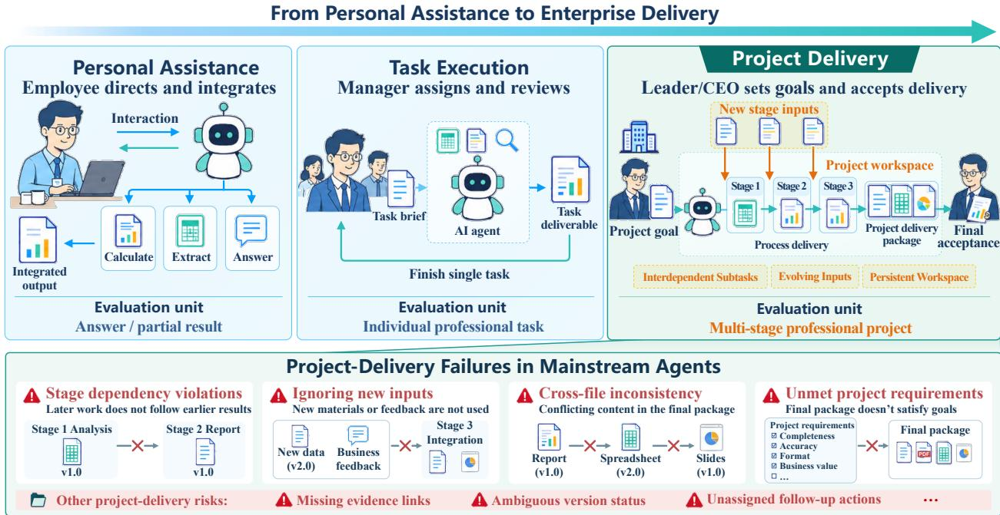  
How well can agents deliver multi-stage professional projects end to end?  
Figure 1 From personal assistance to professional project delivery. As delegation expands, the evaluation unit shifts from partial results and individual tasks to a multi-stage project. DeliverBench follows an agent’s work through a persistent workspace, new inputs, intermediate handofs, and final acceptance. The lower panel illustrates delivery failures that require tracking dependencies, revisions, and the joint state of the final package.

Existing benchmarks capture parts of this setting, but leave project delivery underexplored (Table 1). Professional-task benchmarks such as GDPval, APEX-Agents, and OficeBench assess whether agents can complete bounded assignments [7, 13, 14]. DAYJOB also checks consistency across deliverables and requires every rubric criterion to be met for strict task success [2]. OSWorld 2.0 evaluates long-horizon computeruse workflows with dynamic task updates and checkpoint assessment [17], while AutomationBench checks business-workflow outcomes in application state [8]. Other benchmarks incorporate workplace environments, file dependencies, research projects, or end-to-end workflows [9, 12, 15, 20]. Interactive benchmarks also study policy-guided tool use [16] and proactive assistance across sessions [18]. Two requirements must be addressed together: project simulation, in which later tasks inherit and revise the agent’s own artifacts as new information arrives; and delivery evaluation, which assesses intermediate work as well as the joint requirements of the final package. Our central question is: How well can AI agents deliver multi-stage professional projects end to end?

We introduce DeliverBench, a benchmark that takes a multi-stage professional project as its evaluation unit. Domain experts provide original project materials, including source records, deliverables, feedback, and acceptance standards. With their guidance, we reconstruct the stages, task instructions, and release schedule; scripted feedback supplements the source materials to make professional decisions reproducible.

Table 1 Comparison of published benchmark protocols. Evaluation unit: the scope of work in one benchmark instance. Agent’s artifact handoff: later component tasks use or revise artifacts generated by the same agent in earlier tasks. Project delivery: an integrated final package is evaluated against a shared project outcome, including consistency and acceptance requirements. ✓: explicit support; △: limited or related support; ×: not specified. Appendix A give the operational definitions and evidence. Ratings follow these criteria and are based on each benchmark’s published protocol.
<table><tr><td>Benchmark</td><td>Evaluation unit</td><td>Agent&#x27;s artifact handoff</td><td>Project delivery</td><td>Evolving inputs/feedback</td><td>Long-horizon tasks</td><td>Explicit subtasks</td><td>Intermediate evaluation</td></tr><tr><td>GDPval [7]</td><td>Professional task</td><td>X</td><td>△</td><td>X</td><td>√</td><td>X</td><td>X</td></tr><tr><td>APEX-Agents [13]</td><td>Professional task</td><td>X</td><td>△</td><td>X</td><td>√</td><td>X</td><td>X</td></tr><tr><td>DAYJOB [2]</td><td>Professional task</td><td>X</td><td>√</td><td>X</td><td>√</td><td>X</td><td>△</td></tr><tr><td>JobBench [4]</td><td>Professional task</td><td>X</td><td>△</td><td>X</td><td>√</td><td>△</td><td>△</td></tr><tr><td>OfficeBench [14]</td><td>Office task</td><td>△</td><td>△</td><td>X</td><td>√</td><td>△</td><td>X</td></tr><tr><td>OSWorld 2.0 [17]</td><td>Computer-use workflow</td><td>△</td><td>√</td><td>√</td><td>√</td><td>△</td><td>√</td></tr><tr><td>AutomationBench [8]</td><td>Cross-app workflow</td><td>△</td><td>X</td><td>X</td><td>√</td><td>△</td><td>△</td></tr><tr><td>WorkArena++ [1]</td><td>Compositional task</td><td>△</td><td>X</td><td>X</td><td>√</td><td>√</td><td>√</td></tr><tr><td>TheAgentCompany [15]</td><td>Workplace task</td><td>△</td><td>△</td><td>√</td><td>√</td><td>△</td><td>√</td></tr><tr><td>PaperBench [9]</td><td>ML paper replication</td><td>△</td><td>√</td><td>X</td><td>√</td><td>△</td><td>△</td></tr><tr><td>StartupBench [20]</td><td>Workflow task</td><td>X</td><td>△</td><td>X</td><td>√</td><td>X</td><td>X</td></tr><tr><td>Workspace-Bench 1.0 [12]</td><td>Workspace task</td><td>X</td><td>△</td><td>X</td><td>√</td><td>X</td><td>△</td></tr><tr><td>SQBench [10]</td><td>Knowledge-work task</td><td>X</td><td>△</td><td>X</td><td>△</td><td>X</td><td>△</td></tr><tr><td>DeliverBench</td><td>Multi-stage professional project</td><td>√</td><td>√</td><td>√</td><td>√</td><td>√</td><td>√</td></tr></table>

The benchmark comprises 11 projects across seven domains, with 150 interdependent subtasks and 111 required final deliverables (Section 3.4). Agents work in a persistent workspace along a project timeline: task instructions, new materials, and client feedback arrive at prescribed stages. Later tasks use the agent’s earlier deliverables as working inputs, so data, assumptions, and conclusions must retain their meaning and evidential support as they move from analysis to decisions and formal documents. An upstream error can persist across several mutually consistent files, while a correctly identified risk can still be lost if it does not inform the next decision. Each project culminates in a multi-file package governed by shared delivery requirements. The challenge is therefore to maintain and update accumulated work across tasks, beyond completing any one lengthy assignment.

DeliverBench pairs process delivery evaluation with final project delivery evaluation. Expert-written rubrics assess checkpoint submissions against each subtask’s requirements and the information available at that point. The final package is evaluated through three complementary targets: artifact quality of individual files, crossfile consistency among them, and package acceptance against overall handof requirements. Orthogonally, each criterion carries one primary quality-dimension label: correctness, completeness, consistency, professionalism, or usability. Evaluation targets specify what is evaluated; quality dimensions specify which aspect of quality is checked. Process and final scores remain separate, while preserved submissions and execution records support tracing how earlier work is reused, repaired, or left unresolved.

Our contributions are as follows.

• A benchmark of real-world professional projects. We reconstruct projects supplied by domain experts as staged, interdependent workflows in a persistent workspace, testing whether agents can carry their own artifacts forward toward a shared multi-file delivery objective.

• Evaluation beyond individual deliverables. We connect checkpoint assessment with final-package evaluation and diagnostics across five quality dimensions, capturing cross-file relationships and package acceptance requirements that isolated artifact scores leave untested.

• Evidence of limited end-to-end delivery capability. Across seven model–harness systems, mean final-delivery scores range from 40.4 to 65.0, and subtask pass rates at the 90-point threshold range from 13.3% to 50.0%. Every system scores lower on final delivery than on process evaluation, with final-package criteria revealing failures that checkpoint scores do not cover. Across the 77 system–project outcomes, 69 have lower final-delivery scores. Artifact inspection identifies conflicting conclusions and stale decisions, while case studies highlight the need to sustain quality and repair earlier artifacts.

## 2 Related Work

Table 1 compares representative designs; we discuss three related lines of work below.

Professional and office tasks. GDPval [7] evaluates occupational work products, APEX-Agents [13] studies professional-service assignments in tool-rich worlds, and OficeBench [14] covers cross-application workflows, including file creation and subsequent use. JobBench [4] organizes heterogeneous reference workspaces around occupational tasks and evaluates their outputs with fact-anchored rubric chains. Agents’ Last Exam (ALE) [11] evaluates expert-authored, long-horizon professional tasks involving real software and verifiable outputs. DAYJOB [2] pairs brief professional requests with large, heterogeneous workspaces in healthcare and finance; its criteria include consistency within a set of deliverables, and strict success requires meeting every criterion. DeliverBench studies how such delivery requirements are maintained across a multi-stage project, where outputs from one assignment become inputs to later assignments and new materials arrive during execution. This tests whether task-level competence produces artifacts that remain usable in subsequent work toward a shared business objective.

Workflow and project benchmarks. OSWorld 2.0 [17] evaluates end-to-end computer-use workflows involving realistic artifacts, stateful applications, and new information arriving during execution. AutomationBench [8] evaluates policy-guided business workflows through REST APIs, with dependent operations across simulated applications. WorkArena++ [1] composes executable enterprise subtasks with state dependencies, while TheAgentCompany [15] combines workplace tasks with intermediate milestones and feedback from simulated colleagues. PaperBench [9] evaluates complete research-replication repositories by executing them in a fresh environment, providing project-level functional acceptance. StartupBench [20] assesses final deliverables from long-horizon professional workflows; Workspace-Bench [12] models input-file dependencies and restores its workspace between independent tasks. In interactive settings, τ -bench [16] tests agents’ API use and policy adherence through conversations with simulated users, while π-Bench [18] evaluates proactive intent resolution and task completeness across sessions sharing a persistent workspace. DeliverBench makes project evolution explicit: instructions, new evidence, and client feedback arrive along a prescribed timeline, while later tasks inherit the agent’s own artifacts. This tests coordinated revision: new information must be incorporated into earlier work and the dependent deliverables, keeping the project consistent as it evolves.

Process and delivery evaluation. AgentBoard [5] measures incremental progress using state matching and subgoal completion. OSWorld 2.0 assesses workflow checkpoints against the final environment state, while AutomationBench reports strict task success alongside final-state completion diagnostics [8, 17]. TheAgent-Company provides checkpoint scores, and DevAI’s Agent-as-a-Judge evaluates development milestones linked by a requirement DAG [15, 21]. PaperBench measures partial replication through a final-submission rubric; Workspace-Bench and SQBench also use trajectory evidence for process or risk checks [9, 10, 12]. DAYJOB likewise allows its judge to inspect the final workspace and execution trajectory after the agent finishes [2]. These mechanisms need not preserve and separately score submissions along the original project timeline. DeliverBench preserves checkpoint submissions and evaluates them separately from the final package, whose assessment covers artifact quality, cross-file consistency, and package acceptance. This supports tracing whether earlier defects persist or are repaired, while cross-file and package checks reveal inconsistencies or omissions that individual-file scores cannot establish.

## 3 DeliverBench

DeliverBench evaluates professional project delivery through intermediate submissions and a complete, consistent, and usable final package.

## 3.1 Professional Projects as the Evaluation Unit

A professional project delivery instance specifies a professional role, a shared business objective, initial materials, interrelated subtasks, and a final multi-file package. Each project combines three elements:

• A shared delivery contract. Scope and acceptance requirements define what must be handed over. Individual files must meet professional standards and jointly satisfy package completeness, cross-file consistency, and the project objective. The package must give its intended recipients the information and conditions needed to review, act on, or continue the work.

• Interdependent work in a persistent workspace. Subtasks have distinct instructions, and their outputs become working inputs to later tasks. Earlier results constrain later calculations, judgments, and formal documents; agents must check, revise, and integrate these artifacts to complete the downstream work. Checkpoints preserve submissions; stages organize delivery milestones and may contain several subtasks.

• An evolving project timeline. New materials, client decisions, and scripted feedback arrive according to the project schedule, requiring updates to earlier work and afected deliverables.

Appendix B.1 illustrates these elements through P02, where due diligence informs financing terms, those terms enter a financial model, and the resulting analyses support lender coordination and final handof.

## 3.2 Project Sourcing and Benchmark Construction

Figure 2 demonstrates the five-step process for reconstructing real-world projects as expert-reviewed benchmark instances.

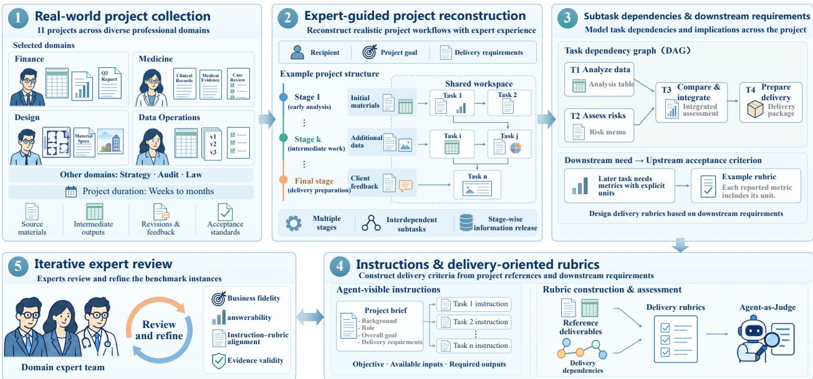  
Figure 2 Expert-guided construction of DeliverBench. Real-world materials are reconstructed into staged workflows. Artifact dependencies and downstream requirements guide instruction and rubric writing, followed by expert review of business fidelity, answerability, and evidence validity.

1. Collect real-world project materials. Domain experts (e.g., lawyers and investment bankers with several years of professional experience) provide projects spanning weeks to months, together with source records, intermediate and final deliverables, feedback, and acceptance standards.

2. Reconstruct the project workflow. Experts help translate project scope and milestones into stages and subtasks with specified inputs, outputs, and information releases. The reconstruction specifies stage boundaries, task instructions, and the release schedule; scenario feedback makes the required professional decisions reproducible. Original records, reconstructed materials, and scenario assumptions are distinguished during construction.

3. Model dependencies and downstream requirements. We identify how later tasks use earlier artifacts and which outputs a revision afects. These downstream needs determine what upstream deliverables must contain and inform their acceptance criteria.

4. Write instructions and delivery rubrics. The project brief and task instructions specify objectives, available inputs, and required outputs. Reference artifacts and dependency requirements inform task, cross-file, and package rubrics; evaluator-only references and future-stage materials are kept separate from currently visible inputs.

5. Review and refine with domain experts. Experts check business fidelity, factual support, stage-specific information suficiency, and instruction–rubric alignment. Unresolved evidence gaps require repair or exclusion.

## 3.3 Execution and Evaluation Protocol

DeliverBench evaluates interdependent tasks as one continuous project. Figure 3 contrasts this setting (right) with a typical task-level setup (left), where each task is executed and scored independently. In DeliverBench, the same agent carries its artifacts forward across tasks toward a shared project objective.

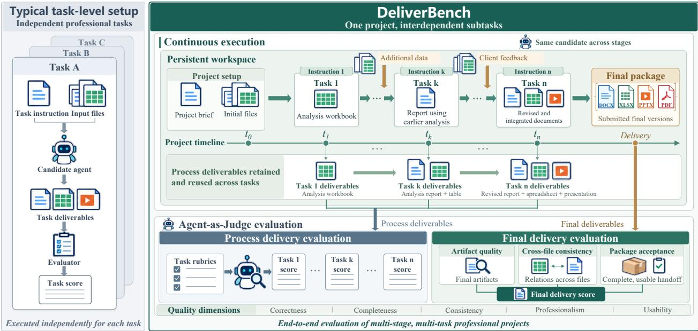  
Figure 3 Continuous project execution and delivery evaluation. A typical task-level setup executes and scores assignments independently (left). DeliverBench keeps the same candidate in a persistent workspace as new data and feedback arrive; later tasks use and revise its earlier artifacts (right). Process evaluation scores preserved checkpoint submissions. Final evaluation assesses artifact quality, cross-file consistency, and package acceptance on the submitted handof. Quality-dimension labels provide a separate diagnostic view.

Tasks share a persistent workspace along a project timeline. Execution starts from a project brief and initial files; instructions, additional data, and client feedback arrive at prescribed stages. Later tasks use the agent’s earlier deliverables as working inputs. No reference outputs are injected between tasks: all artifact handofs contain the agent’s own work. Uncorrected errors therefore carry into downstream analyses, decisions, and the final package. The agent must detect and repair missing or defective upstream artifacts while completing the work that depends on them. When new evidence changes an input or invalidates an assumption, the agent must identify the calculations, conclusions, and handof actions that depend on it and update their current versions. Checkpoint versions are preserved for evaluation, while the final package contains the versions intended for handof.

Evaluation follows both intermediate handofs and final acceptance. Process evaluation assesses each subtask submission; final evaluation covers artifact quality, cross-file consistency, and package acceptance. For project p with $T _ { p }$ subtasks, checkpoint artifacts $\mathcal { D } _ { p , t }$ , and final package $D _ { p } ,$ we report

$$
\mathrm { P r o c e s s } _ { p } = \frac { 1 } { T _ { p } } \sum _ { t = 1 } ^ { T _ { p } } S ( \mathcal { D } _ { p , t } , \mathcal { R } _ { p , t } ) , \qquad \mathrm { F i n a l } _ { p } = S ( D _ { p } , \mathcal { R } _ { p } ^ { \mathrm { f i n a l } } ) ,\tag{1}
$$

where $\mathcal { R } _ { p , t }$ contains checkpoint criteria and $\mathcal { R } _ { p } ^ { \mathrm { f i n a l } }$ combines criteria for the three final-delivery targets. The scoring operator S applies the scoring rules associated with each rubric set. For final delivery, all applicable criteria enter a single aggregate: their signed integer-weighted judgments are summed, divided by the total available positive weight, and scaled to [0, 100], with out-of-range values clipped. A triggered project-level fatal gate sets the final score to zero. Artifact quality, cross-file consistency, and package acceptance identify the assessment scope of each criterion. Their separately normalized scores support diagnosis; the final score is computed directly from individual criteria, without an additional layer of target weights. Criterion weights are shared across systems within each project, and the benchmark score averages the 11 project scores equally (Appendix C.2). Process and final scores remain separate. Final-artifact assessment reuses applicable task criteria; previous judgments are reused only when the relevant artifacts, criteria, and evaluation context are unchanged.

Each rubric criterion specifies an evaluation target and a quality dimension. Targets are checkpoint artifacts, final artifacts, cross-file relationships, and the complete package. Quality dimensions are correctness, completeness, consistency, professionalism, and usability. We adopt an agent-as-a-judge approach [21]: the judge assesses criteria using task instructions and artifact evidence, supported by programmatic extraction and integrity checks. Appendix C specifies evaluation targets, evidence scopes, scoring, and rubric reuse; Appendix D.1 gives evaluator settings, and Section 4.4 reports evaluator validation.

## 3.4 Dataset Composition and Task Characteristics

Figure 4 summarizes 11 projects, 150 subtasks, 661 input files, and 111 required final deliverables across seven domains: Finance, Medicine, Design, Data Operations, Strategy, Audit, and Law. Finance contains four projects, Medicine two, and each remaining domain one. Appendix B.2 describes their workflows and deliverables.

(a) Benchmark overview
<table><tr><td>Projects</td><td>11</td><td>Input files</td><td>661</td></tr><tr><td>Domains</td><td></td><td>7 Rubric criteria</td><td>4,313</td></tr><tr><td>Subtasks</td><td>150</td><td>Required final files</td><td>111</td></tr></table>

(b) Rubric coverage  
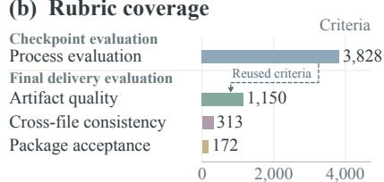  
(c) Input files across releases

(d) Subtasks per project  
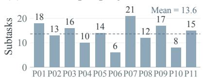

(e) Quality dimensions  
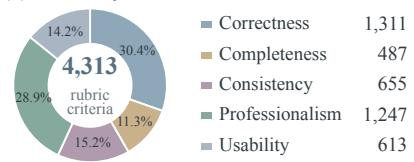

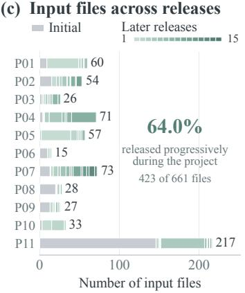  
1,150 criteria reused in final evaluation; quality dimensions count unique, unweighted criteria

Figure 4 Dataset overview. (a) Benchmark scale, excluding duplicate input copies; deliverables are required final files. (b) Rubric coverage: 1,150 process criteria are reapplied to final deliverables. (c) Input releases, indexed within each project. (d) Subtask counts and their mean. (e) Unique criteria by primary quality dimension, without weighting. P01–P11 identify the same projects across panels.

Materials and workflows place diferent demands on agents. Finance spans transaction documents, financial workbooks, and market data, requiring numerical reconciliation and reproducible analysis. Medicine covers clinical records and follow-up in P08 and policy drafting in P09, emphasizing factual consistency and coordinated revisions, respectively. Law aligns contractual terms with changing business facts; Strategy translates financial and field evidence into recommendations; Audit links control judgments to testing evidence.

Design (P04) includes 48 images among 71 inputs, requiring agents to reconcile visual materials with evolving requirements. Data Operations (P11) contains 217 inputs, mostly structured records and code-related files, emphasizing programmatic checks and version tracking.

Projects contain 6–21 subtasks (mean 13.6) and 15–217 input files. Their demands also difer in output scope: quantitative research (P06) requires 35 final files across six subtasks, including code, workbooks, reports, and figures; financial due diligence (P07) consolidates 21 subtasks into six final files and receives 15 later input releases. Overall, 423 inputs (64.0%) arrive after initialization, with 2–15 later releases per project. This share reaches 96.5% in the forensic investigation (P05) and 94.4% in Design (P04), where corrected records or client feedback require agents to revise earlier work and update dependent deliverables.

The rubric inventory contains 4,313 unique criteria: 3,828 process criteria, 313 cross-file consistency criteria, and 172 package acceptance criteria. Final artifact-quality evaluation reapplies 1,150 process criteria to final artifact versions, counted once in the inventory. The five-dimension distribution describes annotation coverage rather than scoring weights.

## 4 Experiments and Analysis

## 4.1 Experimental Setup and Metrics

Agent systems and execution. We evaluate seven model–harness systems: GPT-5.6 Sol with Codex, Claude Opus 5 with Claude Code, Gemini 3.8 Flash with Gemini CLI, Qwen 3.8 Max with Qwen Code, DeepSeek V4.1 Flash and GLM 5.2 with Claude Code, and Kimi K3 with Kimi CLI. Projects follow the continuous protocol in Section 3.3, using Harbor 0.20.0 and Docker with a four-hour execution limit per subtask. System versions and execution settings are specified in Appendix D.1.

Evaluation and reporting. GPT-5.6 Luna judges rubric criteria; deterministic scoring produces separate process and final-delivery scores (Equation 1). We evaluate all 11 projects, yielding 77 system–project outcomes and 150 checkpoint submissions per system. Process and final-delivery scores are averaged equally across projects; the process score first averages subtasks within each project. We additionally report the fraction of checkpoint submissions scoring at least 90, pooling all 150 subtasks per system with equal weight. This thresholded subtask pass rate measures the frequency of high-scoring intermediate submissions, rather than final-package acceptance. Each system–project pair contributes one reported outcome; Appendix D.2 specifies failure and recovery handling. Appendix C specifies scoring, rubric reuse, project means, and subtask pass rates.

## 4.2 Main Results and Analysis

Figure 5 summarizes delivery performance, process–delivery gaps, resource use, and quality profiles across seven agent systems and 11 projects. Appendix E.1 provides the complete final-delivery and process-score matrices.

Current agents struggle with reliable end-to-end project delivery. Final-delivery scores range from 40.4 to 65.0 out of 100, with Claude Opus 5 scoring 65.0 and GPT-5.6 Sol scoring 63.7 (Figure 5a). At the 90-point threshold, subtask pass rates range from 13.3% to 50.0%: Claude passes 75 of 150 subtasks, GPT passes 54 (36.0%), and each remaining system passes at most 26.7%. Even the strongest observed pass rate covers only half of the subtasks, indicating that agents do not consistently produce intermediate deliverables that meet this high-quality threshold. Project delivery requires carrying these intermediate outputs through subsequent tasks and integrating them into a coherent final package. The low subtask pass rates and limited final-delivery scores together show that current systems fall short of sustaining high-quality delivery from intermediate work through final handof.

Local task scores do not establish final-package readiness. Every system scores higher on process evaluation than on final delivery, with delivery gaps of 11.3–18.5 points (Figure 5b). For example, Claude scores 79.8 on intermediate work and 65.0 on final delivery, while GLM scores 63.0 and 44.5, respectively. This pattern also holds beyond system averages: 69 of 77 system–project outcomes lie below the equal-score line in Figure 5c. On P04, Gemini averages 80.8 across checkpoints but scores 45.7 on final delivery; on P07, Claude averages 88.4 but delivers a final package scoring 54.6. System-level rankings broadly agree, but the project-level view reveals requirements that remain unmet at handof even after high-scoring intermediate work. Averaging individually scored submissions does not establish whether the final versions agree across files or jointly meet handof requirements. Project-level evaluation checks these relationships and package conditions alongside the final artifacts themselves. Section 4.3.1 identifies the concrete revision and handof failures behind this distinction.

11 projects · 150 subtasks per mode  
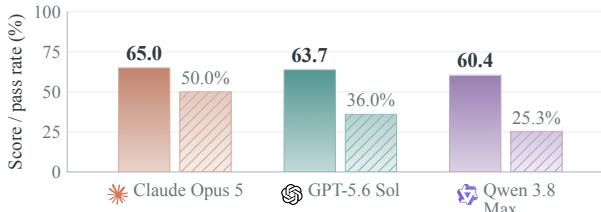  
(b) Process and final scores

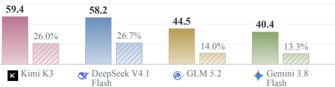  
(c) Process–delivery gap

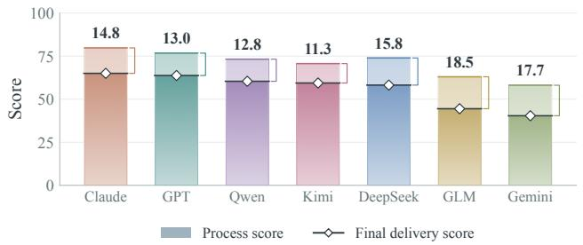

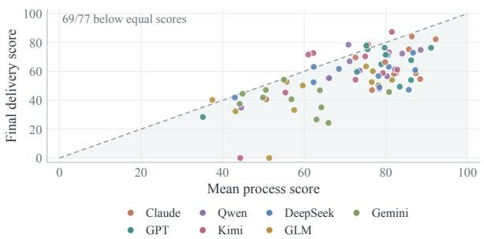

(d) Score and resource use  
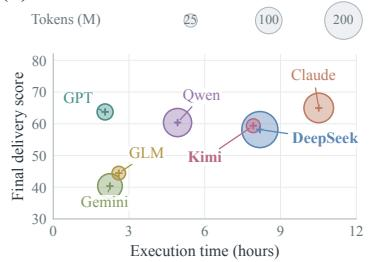

(e) Quality dimensions  
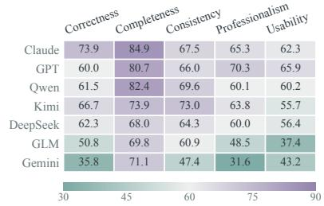

(f) Delivery dimensions  
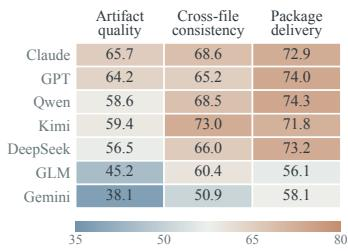  
Figure 5 Main results across seven agent systems and 11 projects. (a) Final-delivery score and subtask pass rate (≥ 90 over 150 subtasks per system). (b) Mean process and final-delivery scores; numbers above the bars give their diferences in points. (c) All 77 system–project outcomes, with mean checkpoint score on the horizontal axis and final-delivery score on the vertical axis; the dashed line denotes equal scores. (d) Mean execution time versus final-delivery score; bubble area encodes mean total tokens. (e) Five quality dimensions (color scale: 30–90). (f) Three final-delivery targets (color scale: 35–80). System-level means give equal weight to projects. Final scores retain fatal gates; the diagnostic profiles in (e,f) precede these gates.

Delivery requirements need separate diagnostic views. Figure 5f reports artifact quality, cross-file consistency, and package delivery against acceptance requirements. Their system-level means range from 38.1–65.7, 50.9–73.0, and 56.1–74.3, respectively. Cross-file agreement alone cannot establish correctness: several files may consistently reuse the same unsupported upstream value. Artifact quality checks its evidential basis, cross-file consistency checks agreement across the resulting documents, and package acceptance checks whether the combined deliverables meet the recipient’s requirements. These averages do not locate the failure within an individual project. For example, Claude’s P05 package scores 88.8 on artifact quality and 100.0 on cross-file consistency, but only 60.0 on package acceptance: it leaves authorization contingencies, evidence-closure conditions, and the review-to-issuance sequence insuficiently specified for the recipient. In P03, all seven systems satisfy the four criteria directly addressing the incoming review issues, yet only four satisfy the associated propagation check and only one satisfies the associated cross-file traceability check. Recording feedback, updating all afected artifacts, and handing over an actionable package are therefore distinct demands.

Content coverage exceeds operational quality. Completeness is the highest-scoring quality dimension for every system (68.0–84.9; mean 75.8), while usability averages 54.4, professionalism 57.1, correctness 58.7, and consistency 64.1 (Figure 5e). Covering requested content therefore does not ensure accurate, professionally presented, and usable outputs. These five quality dimensions cut across the three final-delivery targets.

Greater resource use does not consistently yield better delivery. Following joint evaluation of agent performance and cost [3], Figure 5d reports mean project time of 2.05–10.51 hours and token usage of 26.0M–184.5M. GPT and Claude score 63.7 and 65.0, respectively, but use 2.05 versus 10.51 hours and 36.4M versus 124.1M tokens per project; Appendix D.3 details accounting for the evaluated model–harness systems.

## 4.3 Case Studies

We examine preserved artifacts to identify concrete delivery failures, then use checkpoint trajectories to study quality stability and recovery.

## 4.3.1 Revision and Handoff Failures

Figure 6 presents four representative cases in which information was available or explicitly recorded, but its implications did not reach the relevant artifacts or current project state.

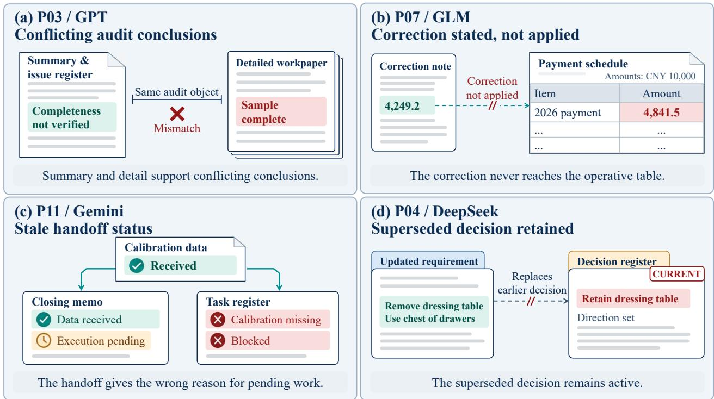  
Figure 6 Representative failures in maintaining a coherent delivery package. (a) P03/GPT: the audit summary and issue register acknowledge an unverified population, while the detailed workpaper retains a positive completeness conclusion. (b) P07/GLM: a correction note records the revised payment amount, but the operative schedule retains the old amount (units: CNY 10,000). (c) P11/Gemini: the closing memo acknowledges receipt of calibration data, while the task register still treats the data as missing. (d) P04/DeepSeek: an updated requirement replaces a dressing table, but its retention remains an active decision. The figure summarizes inspected artifact evidence.

Conflicting audit conclusions (P03/GPT). After review, the audit summary and issue register state that population completeness and period coverage are unverified, preventing an operating-efectiveness conclusion.

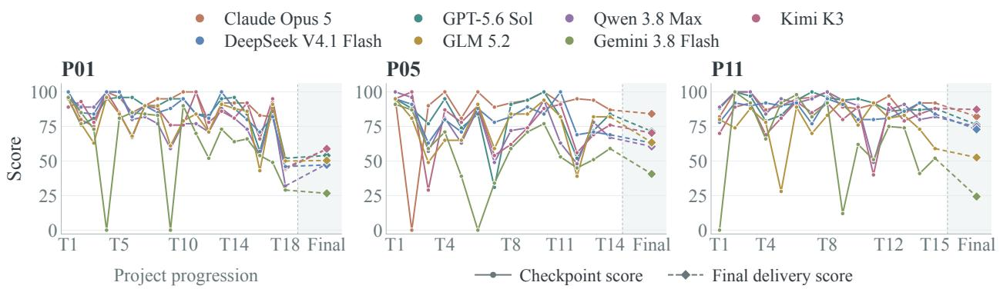  
Figure 7 Agent trajectories on three selected projects. Circles show checkpoint scores; diamonds show final-delivery scores. Dashed terminal segments mark the change in evaluation scope. All checkpoints are retained on a common score scale. The cases illustrate quality changes and recovery behaviors during project delivery.

The detailed workpaper for the same control still claims a complete sample and an appropriate random selection. The revised limitation has reached the summary, but the supporting detail continues to assert an incompatible evidence state. A recipient cannot obtain a consistent audit conclusion by following the package from its summary to its supporting workpaper.

A correction stated but not applied (P07/GLM). New feedback corrects a 2026 payment amount from 4,841.5 to 4,249.2 in units of CNY 10,000. The revised workbook records the correct amount in its change note, but retains 4,841.5 in the operative capital-expenditure schedule, where it continues to feed the calculation. Recognizing a correction is insuficient when the table used for subsequent financial analysis still carries the superseded value.

Stale handoff status (P11/Gemini). The closing memo records that calibration data have arrived and that the remaining model execution belongs to the next scheduled window. The task register nevertheless lists missing calibration data as the current blocker. This inconsistency changes the apparent next action: the recipient is told to obtain an input that is already available instead of completing the outstanding execution.

A superseded decision remains active (P04/DeepSeek). The agent records a new requirement to remove the dressing table and use a chest of drawers. Its final decision register still treats retention of the dressing table as the current direction and preserves related follow-up actions. The failure is in maintaining the active decision state: entering the new requirement has not retired the decision that it replaces.

Together, these cases show that carrying work forward requires preserving the implications of new information across calculations, conclusions, decisions, and handof actions. A correction must reach the operative calculation; an evidence limitation must restrict the conclusions drawn from it; and a revised decision must change the instructions passed to the recipient. Recording the update without changing these dependent artifacts leaves downstream work on the earlier basis. The final package must communicate one coherent state that the recipient can act on.

## 4.3.2 Delivery Stability and Artifact Recovery

We analyze agent execution trajectories from three projects: P01, P05, and P11. Figure 7 pairs checkpoint scores with final-delivery scores for all seven agents. Together with artifact and execution-trace inspection, this supports fine-grained analysis of how artifact quality changes during a project, where failures arise, and whether later work repairs earlier artifacts. Appendix E.2 provides the corresponding trajectories for all 11 projects.

Final delivery builds on intermediate artifacts and introduces distinct quality requirements. The final package inherits earlier deliverables, which agents must maintain, revise, and integrate as the project unfolds. Its score is not a simple average of checkpoint scores: final evaluation examines the resulting artifact versions, cross-file relationships, and package acceptance. The trajectories reveal recovery after an early failure in P05 and contrasting stability patterns in P11. Project-delivery evaluation thus examines whether agents maintain accumulated work and transform it into a coherent, usable final package.

Stronger agents generally sustain more stable delivery quality. For example, the Claude agent maintains scores of 82–100 throughout P11, whereas the Gemini agent ranges from 0 to 100 and sufers another sharp drop at T09. The Gemini agent also exhibits substantial fluctuations in P01 and P05, and obtains the lowest final-delivery score in all three cases: 26.6, 40.6, and 24.3, respectively. Its occasional high-scoring checkpoints therefore do not translate into sustained quality across the project or a high-scoring final package.

In P05, the Claude agent scores 0 at the second checkpoint because the required transaction-reconciliation workbook was not submitted. During the third task, it detects the missing earlier deliverable and rebuilds the workbook from retained parsing results so that downstream entity-analysis references can resolve. The rebuilt workbook contains 3,327 transaction rows and is preserved in the third-task archive. The agent subsequently obtains the highest final-delivery score on P05, 84.1, compared with 40.6 for the Gemini agent. By repairing the upstream workbook, the agent restores the input needed for downstream analysis and makes its transaction records available through the references used by later work. The execution trace thus shows recovery of a dependency: subsequent analysis can continue from a usable upstream artifact.

## 4.4 Evaluation Reliability

Comparisons with human judgments provide an empirical check on model-based evaluation [19]. We assess evaluator reliability by comparing expert and evaluator judgments on final deliverables produced by GPT-5.6 Sol–Codex for three projects: P01, P05, and P10. Across 478 rubric decisions, the judgments agree on 446 (93.31%); agreement is 93.04% for artifact quality, 95.00% for cross-file consistency, and 92.45% for package acceptance. Agreement is the fraction of matching binary judgments, pooled across criteria without deliveryscore weights. This validation covers final-delivery judgments for one agent system, including source-task criteria applied to its final artifacts.

## 5 Conclusion and Limitations

DeliverBench evaluates agents on multi-stage professional projects reconstructed with domain experts. Later tasks directly reuse the agent’s earlier deliverables, making the quality of upstream work consequential for downstream analysis and final handof. It assesses intermediate submissions and final packages as agents incorporate new information and revise earlier artifacts in a persistent workspace.

Across seven model–harness systems, the highest mean final-delivery score is approximately 65 out of 100, and the highest subtask pass rate is 50% at the 90-point threshold. Every system has a lower mean final-delivery score than mean process score, and 69 of 77 system–project outcomes exhibit this gap. Case studies reveal conflicting conclusions, unapplied corrections, stale handof states, and superseded decisions; they also show the value of repairing missing upstream artifacts. Reliable delivery requires tracing the efects of new evidence, translating analytical findings into current decisions, and repairing upstream artifacts together with the downstream work that uses them. Evaluating final packages alongside intermediate submissions makes these relationships and acceptance requirements explicit. More reliable project delivery could broaden enterprise delegation and support one-person companies, where an individual sets business goals and oversees agents through final handof.

Our study has several limitations. Coverage remains limited to eleven projects across seven domains. Prescribed information releases and feedback support reproducible evaluation but do not fully capture open-ended client communication or live business decisions. Future work can broaden project coverage, introduce richer interaction, and extend expert validation to assess delivery capability more comprehensively in professional settings.

## References

[1] Léo Boisvert, Megh Thakkar, Maxime Gasse, Massimo Caccia, Thibault L De Chezelles, Quentin Cappart, Nicolas Chapados, Alexandre Lacoste, and Alexandre Drouin. Workarena++: Towards compositional planning and reasoning-based common knowledge work tasks. Advances in Neural Information Processing Systems, 37: 5996–6051, 2024.

[2] Stephanie Finley, Liudas Panavas, Thomas Mikkelson, Cam Hinton, Stacey Ganss, Bradley Monton, Emily Kendall, Michelle Spradlin, Lydia Bye, Michael O’Brien, Lauren Ylvisaker, Derek Ray, Suhaas Garre, Sushant Mehta, and Edwin Chen. DAYJOB: A benchmark for long-horizon professional work. arXiv preprint arXiv:2610.01306, 2026. doi: 10.48550/arXiv.2610.01306. URL https://arxiv.org/abs/2610.01306.

[3] Sayash Kapoor, Benedikt Stroebl, Zachary S Siegel, Nitya Nadgir, and Arvind Narayanan. Ai agents that matter. arXiv preprint arXiv:2407.01502, 2024.

[4] Yuetai Li, Yichen Feng, Zhangchen Xu, Zixian Ma, Kaiyuan Zheng, Fengqing Jiang, Xinghua Sun, Rulin Shao, Zichen Chen, Yue Huang, Xinyang Han, Brian Lee, Kayla Xu, Shenglai Zeng, Hang Hua, Xiangliang Zhang, Basel Alomair, Ranjay Krishna, Luke Zettlemoyer, Pang Wei Koh, Bhaskar Ramasubramanian, Luyao Niu, Xiang Yue, and Radha Poovendran. JobBench: Aligning agent work with human will, 2026. URL https://arxiv.org/abs/2605.26329.

[5] Chang Ma, Junlei Zhang, Zhihao Zhu, Cheng Yang, Yujiu Yang, Yaohui Jin, Zhenzhong Lan, Lingpeng Kong, and Junxian He. Agentboard: An analytical evaluation board of multi-turn llm agents. Advances in neural information processing systems, 37:74325–74362, 2024.

[6] Thomas W Malone and Kevin Crowston. The interdisciplinary study of coordination. ACM Computing Surveys (CSUR), 26(1):87–119, 1994.

[7] Tejal Patwardhan, Rachel Dias, Elizabeth Proehl, Grace Kim, Michele Wang, Olivia Watkins, Simon Fishman, Marwan Aljubeh, Phoebe Thacker, Laurance Fauconnet, et al. Gdpval: Evaluating ai model performance on real-world economically valuable tasks. In International Conference on Learning Representations, volume 2026, pages 24005–24040, 2026.

[8] Daniel Shepard and Robin Salimans. AutomationBench. arXiv preprint arXiv:2604.18934, 2026. URL https: //arxiv.org/abs/2604.18934.

[9] Giulio Starace, Oliver Jafe, Dane Sherburn, James Aung, Jun Shern Chan, Leon Maksin, Rachel Dias, Evan Mays, Benjamin Kinsella, Wyatt Thompson, et al. Paperbench: evaluating ai’s ability to replicate ai research. arXiv preprint arXiv:2504.01848, 2025.

[10] Summer Sun. Sqbench: A benchmark for evaluating task delivery by language-model agents in production-oriented workflows. arXiv preprint arXiv:2607.23123, 2026.

[11] Yiyou Sun, Xinyang Han, Weichen Zhang, Yuanbo Pang, Tianyu Wang, Yuhan Cao, Yixiao Huang, Chris Duroiu, Haoyun Zhang, Jefrey Lin, et al. Agents’ last exam. arXiv preprint arXiv:2606.05405, 2026.

[12] Zirui Tang, Xuanhe Zhou, Yumou Liu, Linchun Li, Yukai Wu, Weizheng Wang, Hongzhang Huang, Wei Zhou, Jun Zhou, Jiachen Song, et al. Workspace-bench 1.0: Benchmarking ai agents on workspace tasks with large-scale file dependencies. arXiv preprint arXiv:2605.03596, 2026.

[13] Bertie Vidgen, Austin Mann, Abby Fennelly, John Wright Stanly, Lucas Rothman, Marco Burstein, Julien Benchek, David Ostrofsky, Anirudh Ravichandran, Debnil Sur, et al. Apex-agents. arXiv preprint arXiv:2601.14242, 2026.

[14] Zilong Wang, Yuedong Cui, Li Zhong, Zimin Zhang, Da Yin, Bill Yuchen Lin, and Jingbo Shang. Oficebench: Benchmarking language agents across multiple applications for ofice automation. arXiv preprint arXiv:2407.19056, 2024.

[15] Frank Fangzheng Xu, Yufan Song, Boxuan Li, Yuxuan Tang, Kritanjali Jain, Mengxue Bao, Zora Wang, Xuhui Zhou, Zhitong Guo, Murong Cao, et al. Theagentcompany: benchmarking llm agents on consequential real world tasks. Advances in Neural Information Processing Systems, 38, 2026.

[16] Shunyu Yao, Noah Shinn, Pedram Razavi, and Karthik Narasimhan. τ-bench: A benchmark for tool-agent-user interaction in real-world domains. arXiv preprint arXiv:2406.12045, 2024.

[17] Mengqi Yuan, Zilong Zhou, Xinzhuang Xiong, Weiming Wu, Jiayang Sun, Jiamin Song, Kaiqian Cui, Bowen Wang, Haoyuan Wu, Yitong Li, Dunjie Lu, Haikong Lu, Qi Zhen, Xinyuan Wang, Jiaqi Deng, Yuhao Yang, Cheng Chen, Boyuan Zheng, Alex Su, Xiao Yu, Hao Zou, Saaket Agashe, Xing Han Lu, Manpreet Kaur, Zhengyang Qi, Vincent Sunn Chen, Frederic Sala, Dayiheng Liu, Junyang Lin, Zhou Yu, Yu Su, Siva Reddy, Xin Eric Wang, Peng Qi, Tianbao Xie, and Tao Yu. OSWorld 2.0: Benchmarking computer use agents on long-horizon real-world tasks. arXiv preprint arXiv:2606.29537, 2026. doi: 10.48550/arXiv.2606.29537. URL https://arxiv.org/abs/2606.29537.

[18] Haoran Zhang, Luxin Xu, Zhilin Wang, Runquan Gui, Shunkai Zhang, Haodi Lei, Zihao He, Bingsu He, Chicheng Qin, Tong Zhu, et al. π-Bench: Evaluating proactive personal assistant agents in long-horizon workflows. arXiv preprint arXiv:2605.14678, 2026.

[19] Lianmin Zheng, Wei-Lin Chiang, Ying Sheng, Siyuan Zhuang, Zhanghao Wu, Yonghao Zhuang, Zi Lin, Zhuohan Li, Dacheng Li, Eric Xing, et al. Judging llm-as-a-judge with mt-bench and chatbot arena. Advances in neural information processing systems, 36:46595–46623, 2023.

[20] Liya Zhu, Xin Ma, Tao Liu, Haodong Wang, Ge Zhang, Jingzhe Ding, Qingshui Gu, Yongjie Zhong, Jinxiang Meng, Yuan Gao, et al. Startupbench: Benchmarking general-purpose agents on market-validated end-to-end workflows. arXiv preprint arXiv:2608.17800, 2026.

[21] Mingchen Zhuge, Changsheng Zhao, Dylan Ashley, Wenyi Wang, Dmitrii Khizbullin, Yunyang Xiong, Zechun Liu, Ernie Chang, Raghuraman Krishnamoorthi, Yuandong Tian, et al. Agent-as-a-judge: Evaluate agents with agents. arXiv preprint arXiv:2410.10934, 2024.

## Appendix

## A Benchmark Comparison Details

Table 1 summarizes support specified in published protocols: a checkmark denotes explicit support, a triangle limited or related support, and a cross support not specified. These marks describe benchmark design rather than model performance or the prevalence of a feature across instances.

Evaluation unit. The unit is the scope of one evaluated instance, rather than its surrounding environment, individual tool actions, or rubric criteria. A project world can contain independent professional tasks, as in APEX-Agents [13, Sections 3.1–3.3]. Multiple output files alone do not change a task into a staged project. The labels describe scope rather than impose a common duration or file count.

Evolving inputs/feedback. Full support requires new task-relevant materials, requirements, or substantive collaborator feedback during execution. Scheduled releases and simulated-manager feedback qualify; ordinary tool observations, errors, continuation prompts, and retrieval of pre-existing files do not. TheAgentCompany incorporates simulated-manager feedback [15, Section 3 and Appendix C]; DeliverBench releases materials and client feedback across stages (Section 3.3).

Long-horizon tasks. Support follows an explicit benchmark objective or documented substantial compositional execution, without a common numerical step threshold. SQBench receives partial support because it mixes atomic capabilities with composite and domain workflows [10, Sections 3.2–3.4].

Explicit subtasks and artifact handoff. Full subtask support requires instantiated component tasks within a workflow; steps, checkpoints, or hierarchical requirements within one assignment receive partial support. Full artifact-handof support requires later, separately specified tasks to consume or revise the same agent’s earlier outputs. Dependencies within one workflow, such as OficeBench’s spreadsheet-to-email sequence, receive partial support [14]. Dependencies among supplied inputs alone do not qualify. Workspace-Bench restores the workspace between independent tasks [12, Section 4.5].

Intermediate evaluation. Full support requires checks or scores for defined intermediate subtasks or milestones, whether evaluated online or retrospectively. WorkArena++ and TheAgentCompany provide such checks [1, 15]. Partial support covers partial-progress assessment without defined subtask or milestone checks, or general retrospective process checks. Retrospective checkpoint scoring does not itself establish separately preserved stage submissions.

Project delivery. Full support requires evaluating an integrated multi-file submission against a shared project outcome, regardless of whether the benchmark calls the instance a task or project. DAYJOB’s cross-deliverable consistency checks qualify [2, Section 3.2], as does full PaperBench’s repository reproduction protocol [9, Sections 2.1–2.2]. This column does not additionally require staged inputs. Task-level output checks receive partial support where a project-package acceptance protocol is unspecified; WorkArena++ and AutomationBench instead validate application task state.

OSWorld 2.0 and AutomationBench. The OSWorld 2.0 row follows its published 108-task protocol. Dynamic messages support evolving inputs, and task-specific workflow checkpoints support intermediate evaluation, although scored from final state. Its reimbursement case evaluates a claim together with three generated supporting documents against shared requirements, qualifying for project delivery. Within-workflow artifact reuse and dependent steps support partial handof and subtask structure; they are not separately specified project tasks [17, Sections 2.1–2.2 and Appendix H.1.1]. AutomationBench’s dependent API operations, including creating an Asana record and subsequently updating it, support partial handof and subtask structure, and its compositional business workflows support the long-horizon column. Its single initial instruction and pre-seeded records do not establish evolving inputs. Acceptance checks application state rather

than a multi-file project package. Final-state assertion diagnostics support limited intermediate evaluation;   
oficial task success requires all assertions to pass [8, Sections 2–4 and 11].

Boundary cases and evidence. DAYJOB’s post-attempt trajectory inspection and partial-credit reporting support partial intermediate evaluation, while its initial workspace and non-interactive attempt do not establish evolving inputs or separate artifact handofs [2, Sections 3.1–3.2 and 4.1–4.4]. JobBench’s chained criteria and multi-part outputs support partial subtask, intermediate, and package assessment [4, Sections 2.2–3.1 and Appendix E]. SQBench entries follow its published protocol because oficial tasks and the production scorer are withheld. The DeliverBench row follows Section 3.

## B Project Example and Profiles

The eleven projects span Finance, Medicine, Design, Data Operations, Strategy, Audit, and Law. Each connects successive assignments through evolving materials, feedback, and agent-produced artifacts. The profiles use project identifiers P01–P11 and omit organization and individual names.

## B.1 Representative Project Workflow

P02 follows a transaction team preparing syndicated refinancing for a digital infrastructure business. The agent turns due diligence into financing proposals, financial models, lender communications, and a six-file signing-preparation package. Figure 8 groups its thirteen sequential subtasks into four phases. All tasks share one persistent workspace: later assignments use the agent’s actual earlier files, including their assumptions, conclusions, and unresolved issues.

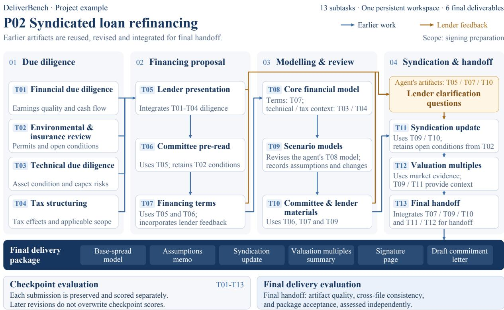  
Selected information and artifact flows are shown; task references add context. All 13 subtasks run sequentially.

Figure 8 P02: syndicated loan refinancing through directly dependent artifacts. Four phases group the thirteen sequential subtasks. Blue arrows show selected flows of earlier work; the gold path shows lender clarification questions informed by the agent’s submitted materials. The final package reuses and updates earlier models and reports alongside newly prepared signing documents.

Due diligence establishes the inputs (T01–T04). T01 finalizes financial due diligence on earnings quality and cash available for debt service. T02 assesses environmental permits and insurance, identifying open conditions that afect financing readiness. T03 examines asset condition and capital-expenditure risks, and T04 updates the tax analysis for a separated business perimeter. These outputs establish the evidence, assumptions, and qualifications that the later financing work must use.

Financing proposals build on the diligence (T05–T07). T05 integrates T01–T04 into a lender presentation. T06 uses that presentation and the outstanding conditions to prepare an investment-committee pre-read. T07 then revises the financing terms using the earlier proposal, committee materials, a new rate notice, and lender feedback. A finding first recorded in due diligence must therefore remain reflected in the financing proposal and the conditions attached to it.

Models and review materials carry the terms forward (T08–T10). T08 updates the core financial model using T07’s terms and the technical and tax context from T03–T04. T09 directly revises the agent’s T08 workbook to produce the BaseSpread and CasePreferred scenarios, with an assumptions memorandum and a change log. T10 draws on the committee pre-read, financing terms, and scenario analysis to prepare the final committee pack, lender invitation, and working-group status note. This creates a concrete calculation dependency: a financing assumption left unchanged in the core model enters the scenario analysis, while the review and lender documents must reflect the resulting financing position.

Lender coordination leads to final handoff (T11–T13). Lender clarification questions are generated from the agent’s T05 presentation, T07 terms, and T10 invitation. T11 addresses those questions alongside new subscription and execution updates, drawing on the scenario analysis and retaining unresolved conditions from earlier diligence. T12 prepares valuation-multiple reference ranges using market evidence, with T09 and T11 providing transaction context. T13 assembles the signing-preparation package from this accumulated work and prepares the signature page and draft commitment letter.

The package preserves the dependency chain. The six final files are the BaseSpread model and assumptions memorandum from T09, the syndication update from T11, the valuation-multiples summary from T12, and the signature page and draft commitment letter from T13. Final copies may be revised to reflect subsequent information, with the basis for changes recorded. Their financing amounts, assumptions, open conditions, and commitment status must agree. An unresolved permit condition, for example, must remain visible from the diligence through lender coordination and signing preparation; an updated financing term must reach both the model that calculates its consequences and the documents that communicate it. P02 thus tests whether agents maintain these dependencies while producing a coherent final package.

What must survive each handoff. The dependency chain carries meaning and decision constraints as well as files. A debt figure used for refinancing must retain its borrower, facility scope, reporting date, and units; a consolidated borrowing total cannot simply become the balance of one facility. Financing scenarios must distinguish agreed terms from modelling assumptions, and that distinction must remain visible in the syndication update and signing drafts. If the model identifies a debt-service or covenant constraint, the subsequent recommendation must address its consequences for feasibility, conditions, or further work. Finally, each recipient needs a usable version of the package: outstanding approvals must be explicit, and internal working information must be separated from documents intended for external circulation.

## B.2 Project Profiles

P01. A strategy and capital advisory engagement supports a manufacturing company’s operating-improvement and industrial-cooperation decisions. Financial baselines, site visits, partner profiles, and industry comparisons feed into alternative cooperation structures; new evidence and review comments require coordinated updates to analysis and recommendations. Delivery combines an analytical workbook, strategy and cooperation proposals, an investment memorandum, a management presentation, and handover notes identifying assumptions, evidence gaps, and decisions requiring approval.

P02. A transaction team prepares syndicated refinancing for a digital infrastructure business. Financial, environmental, engineering, and tax due diligence inform financing terms, cash-flow models, and lender coordination. New evidence and lender responses must be reconciled across assumptions, financing amounts, valuation references, and commitment status. The signing-readiness package contains a scenario model, assumptions memorandum, syndication update, valuation presentation, and draft signing documents, distinguishing proposed terms, conditional commitments, and completed approvals.

P03. An information-technology general-controls audit supports a financial audit team’s reliance assessment. Planning, scoping, risk-control mapping, walkthroughs, and testing cover six control domains. Missing evidence and cross-domain review findings require coordinated revisions without presenting incomplete tests as efective controls. The package includes workpapers, an issue register, reliance conclusions and financial-audit implications, and a management presentation with outstanding actions and review status.

P04. A residential interior-design review coordinates changing room functions, stylistic preferences, furniture, cabinetry, lighting, and equipment interfaces. Successive client discussions and design submissions must be reflected in requirements, decisions, issue registers, and drawing reviews. Delivery assembles a review report, meeting presentation, acceptance documents, and relevant supplied drawings and visual materials. The task is to review and coordinate the evolving design, without independently redrawing all original attachments.

P05. An audit-committee investigation traces supply-chain fund flows. Fourteen stages reconcile bank and business records, check counterparties, prioritize inquiries, revise workpapers, conduct tool-mediated interviews, and integrate additional account evidence into tracing and reproducible calculations. The package contains tracing and calculation workbooks, a methodology note, an editable investigation report, a committee presentation, and handover notes, supported by locally included evidence and unresolved-issue records.

P06. An equity-index futures research project assesses readiness for simulated observation. Six stages cover data auditing, candidate factors, validation, a frozen modeling plan, execution and account-state simulation, and independent evaluation. Research decisions must connect to implementable trades, reproducible performance calculations, and account constraints. Deliverables include workbooks, code, reports, figures, and a next-stage recommendation; a supported decision not to trade or proceed is permissible.

P07. Investment-side financial due diligence examines a manufacturing group’s consolidation perimeter, financial baseline, earnings quality, and funding needs. Workpapers cover revenue, costs, inventory, working capital, debt, capital expenditure, and personnel. Management responses and supplementary evidence must propagate into adjustments and forecast assessment. Delivery comprises a due diligence report, databook, earnings-adjustment schedule, open-issues register, management presentation, and handover notes linking findings to valuation and transaction decisions.

P08. A post-marketing individual case safety report progresses from receipt through follow-up, medical assessment, quality review, and closure. Later responses and review comments must update clinical facts, reporting classification, narrative, and structured fields without losing source links or unresolved questions. The final narrative, field workbook, closure summary, and archive inventory must reconcile clinical conclusions with review decisions, submission receipts, and administrative status.

P09. A pharmaceutical commercialization-compliance project translates document review and departmental interviews into governance recommendations and policies. Cross-functional feedback must propagate through healthcare-professional interactions, publication review, third-party due diligence, conflicts, investigation cooperation, and conduct rules. The final twelve policy and supporting files, management presentation, and handover recommendations align policy text, approval procedures, forms, and implementation tools while distinguishing existing controls, proposals, unresolved choices, and approved actions.

P10. External legal counsel prepares agreements for a platform connecting business clients with professional contributors. Business-model and data-flow review informs the user agreement, privacy policy, and datasubmission agreement. Client comments and a cross-border pilot require coordinated revisions across all three documents and launch arrangements. The publishable documents, launch checklist, and handover notes must identify unresolved decisions and release conditions without presenting proposed activities or approvals as established facts.

P11. An evaluation-data project coordinates acceptance and release across multiple production streams. Task packages, model responses, scoring records, and client feedback undergo registration, deduplication, repair, runtime integration, and targeted testing within a constrained window. Replacements and supplementary deliveries must reconcile across versions. Final outputs include the adopted customer package, evidence, manifests, delivery notes, and internal registers that distinguish production claims, verified results, approvals, dispatch, acceptance, and remaining work.

## C Evaluation Protocol and Scoring

## C.1 Evaluation Targets and Quality Dimensions

Process evaluation assesses checkpoint artifacts using the information available at submission. Final evaluation uses the three targets in Table 2. A target specifies the scope of assessment; a quality dimension (Table 3) specifies the property checked. Each criterion has one primary quality dimension. The examples illustrate these definitions.

Table 2 Final-delivery evaluation targets and their scopes.
<table><tr><td>Target</td><td>Scope</td><td>Example criterion</td></tr><tr><td>Artifact quality</td><td>Individual deliverables in their submitted final versions.</td><td>The final report incorporates the revisions required by the end of the project.</td></tr><tr><td>Cross-file consistency</td><td>Agreement between two or more final artifacts.</td><td>The report and workbook agree on the operative assumptions, units, and totals.</td></tr><tr><td>Package acceptance</td><td>The complete file collection against the project&#x27;s shared delivery requirements.</td><td>All required deliverables are included and their handoff status is clearly communicated.</td></tr></table>

Table 3 Quality dimensions. The same dimension can apply to diferent evaluation targets.
<table><tr><td>Dimension</td><td>Assessed property</td><td>Illustrative failure</td></tr><tr><td>Correctness</td><td>Accuracy of facts, calculations, reasoning, and conclusions under the applicable information conditions.</td><td>A conclusion contradicts the supporting data.</td></tr><tr><td>Completeness</td><td>Coverage of required content, files, and project objectives.</td><td>A required analysis or deliverable is missing.</td></tr><tr><td>Consistency</td><td>Agreement of figures, definitions, decisions, and version states within and across artifacts.</td><td>A revised assumption is not reflected in an affected report.</td></tr><tr><td>Professionalism</td><td>Adherence to domain methods, terminology, A provisional finding is presented as an business rules, and responsibility boundaries.</td><td>authorized final decision.</td></tr><tr><td>Usability</td><td>Organization, presentation, and operational accessibility for the intended recipient.</td><td>An otherwise valid workbook cannot be interpreted or used for its intended decision.</td></tr></table>

## C.2 Criterion Scope, Scoring, and Reuse

Criteria specify a task requirement, target artifacts, weight, and judgment evidence. Checkpoint judgments use the submitted stage versions and information conditions; final judgments use the handof versions and requirements in efect at completion. Artifact-quality assessment reuses applicable source-task criteria while preserving their identities. A criterion or source group contributes once to the final aggregate, even when it covers several files. Previous verdicts are reused only when the relevant artifacts, requirements, and evidence context are unchanged; otherwise the criteria are judged again. Figure 4 counts each unique criterion once.

Final-delivery criteria use signed integer weights with nonzero magnitudes from 1 to 10. Positive weights award credit for satisfied requirements; negative weights deduct credit when the specified failure condition is met. Fatal-gate criteria have weight zero and are checked separately. Dependencies are resolved by the declared criterion rules before aggregation. Each criterion contributes directly to the final score, without an additional weighting layer for evaluation targets or source-task groups. Checkpoint scores retain their own scoring specifications and are not added to the final score.

Let $w _ { p , i }$ be the signed integer weight of criterion i, and let $h _ { m , p , i } \in \{ 0 , 1 \}$ be its efective judgment for system m after dependency resolution. For a positive criterion, $h _ { m , p , i } = 1$ means the requirement is satisfied; for a negative criterion, it means the specified failure condition is met. Write $\begin{array} { r } { W _ { p } ^ { + } = \sum _ { i \in \mathcal { R } _ { p } ^ { \mathrm { f i n a l } } } } \end{array}$ max $( w _ { p , i } , 0 ) > 0$ and let $g _ { m , p } = 1$ indicate that a project-level fatal gate triggers. The final score is

$$
\mathrm { F i n a l } _ { m , p } = \left\{ \begin{array} { l l } { 0 , } & { g _ { m , p } = 1 , } \\ { \mathrm { c l i p } _ { [ 0 , 1 0 0 ] } \left( 1 0 0 \frac { \sum _ { i \in \mathcal { R } _ { p } ^ { \mathrm { f i n a l } } } w _ { p , i } h _ { m , p , i } } { W _ { p } ^ { + } } \right) , } & { g _ { m , p } = 0 . } \end{array} \right.\tag{2}
$$

Here cli $^ { \small 5 } [ 0 , 1 0 0 ]$ bounds the normalized score to [0, 100]. The same project-specific criterion weights apply to every system.

## C.3 Aggregation and Diagnostic Profiles

Both reported means give equal weight to the eleven projects:

$$
\overline { { \mathrm { F i n a l } } } _ { m } = \frac { 1 } { | \mathcal { P } | } \sum _ { p \in \mathcal { P } } \mathrm { F i n a l } _ { m , p } , \qquad \overline { { \mathrm { P r o c e s s } } } _ { m } = \frac { 1 } { | \mathcal { P } | } \sum _ { p \in \mathcal { P } } \mathrm { P r o c e s s } _ { m , p } ,\tag{3}
$$

where $| \mathcal { P } | = 1 1$ and each project’s process score first averages its checkpoint scores (Equation 1). The subtask pass rate instead counts unrounded checkpoint scores of at least 90, including checkpoint gates, over all 150 subtasks per system. Reusing criteria at final delivery does not add subtasks to this denominator. Figure 5b reports the diference between process and final means, which assess diferent artifact versions and requirement sets.

The profiles in Figure 5e,f group final criteria by quality dimension or evaluation target. Within each project and group, signed credit after dependency resolution is divided by the group’s positive available weight, scaled to 100, and clipped to [0, 100]. Group scores are then averaged equally across projects, before project-level fatal gates. Groups without positive available weight are marked unavailable. These separately normalized profiles are diagnostics, not additive parts of the final score; package acceptance is a rubric score rather than an acceptance rate. Missing outcomes remain explicit, and rankings use a shared project set.

## D Experimental Details

## D.1 Agent and Evaluator Configuration

Table 4 lists the evaluated model–harness pairs and CLI versions. Comparisons concern complete agent systems, including their native tool interfaces and context-management behavior.

Table 4 Agent-system configurations and CLI versions.
<table><tr><td>Model</td><td>Harness</td><td>CLI version</td></tr><tr><td>GPT-5.6 Sol</td><td>Codex</td><td>0.142.4</td></tr><tr><td>Claude Opus 5</td><td>Claude Code</td><td>2.1.278</td></tr><tr><td>Gemini 3.8 Flash</td><td>Gemini CLI</td><td>0.60.0</td></tr><tr><td>Qwen 3.8 Max</td><td>Qwen Code</td><td>0.24.1</td></tr><tr><td>DeepSeek V4.1 Flash</td><td>Claude Code</td><td>2.1.278</td></tr><tr><td>GLM 5.2</td><td>Claude Code</td><td>2.1.278</td></tr><tr><td>Kimi K3</td><td>Kimi CLI</td><td>1.50.0</td></tr></table>

Execution. Harbor 0.20.0 orchestrates Docker environments with session continuation under the persistentworkspace protocol in Section 3.3. Each subtask has a 14,400-second agent limit and a separate 1,200-second setup limit. Standard containers request two CPUs, 8 GiB RAM, and 30 GiB storage, with network access enabled. The launcher requests high reasoning efort where supported, without a common token cap or temperature; efective reasoning budgets remain model-dependent.

Evaluation. GPT-5.6 Luna uses high reasoning efort, batches of eight criteria, and up to four concurrent batches. Each batch has at most two attempts with a 1,200-second request timeout, followed by a single-item fallback for unresolved criteria. Retries recover missing responses rather than select favorable judgments. The verifier has a separate 43,200-second limit. The judge assesses evidence; programmatic scoring applies weights, dependencies, normalization, and gates. Evaluator instructions, private references, and verdicts remain outside the agent-facing workspace.

## D.2 Run Provenance and Failure Handling

The results comprise 77 selected system–project outcomes and 1,050 checkpoint evaluations, with one reported outcome per pair. Job configurations request one attempt and disable automatic trial retries. Infrastructure recovery can resume preserved checkpoints or create additional attempt records; these are not independent repetitions. If judging or storage fails after a successful agent submission, recovery preserves that submission instead of regenerating it. Historical scores from diferent configurations are not pooled without reassessment.

Missing deliverables in completed submissions are evaluated by the applicable criteria and gates. Pending runs, infrastructure interruptions, and missing judgments retain explicit status; completed evaluations with triggered fatal conditions retain their zero final scores. For the evaluated GLM system, Claude Code’s native PDF and image payloads are unsupported: a compatibility guard returns recoverable tool errors while keeping local files and extraction tools available. This interface adaptation is recorded with the run provenance.

## D.3 Resource Accounting

Figure 5d sums agent execution intervals within each project, including model waiting and tool execution but excluding setup and judging. Recovered checkpoints use their original intervals. All 1,050 selected subtasks are covered: 1,047 use host-recorded intervals, two native CLI durations, and one an interval inferred from native session timestamps.

Token totals are available for all 77 outcomes and deduplicated from retained native sessions, including identifiable logged subagents. Total tokens equal input plus output; cached input is already included in input and is not added again. Unavailable usage fields remain missing. Reported resources cover the selected scored stages and retained sessions, excluding additional overhead from historical failed attempts and recovery. Tokenization, reasoning-token reporting, and caching difer by provider, so token counts measure usage rather than comparable monetary cost.

## E Complete Project Results

## E.1 Agent--Project Scores

Table 5 reports all 77 system–project pairs in two panels. Scores range from 0 to 100, rounded to two decimals only for display. Columns correspond to the model–harness systems in Table 4; project identifiers follow Appendix B.2. Final delivery and process evaluation assess the distinct targets specified in Section 3.3.

Table 5 Final-delivery and mean process scores for all seven agent systems and eleven projects. Final scores retain acceptance gates; process scores average checkpoint submissions within each project. Mean rows weight projects equally.

<table><tr><td colspan="9">Final delivery</td></tr><tr><td>Project</td><td>Claude</td><td>GPT</td><td>Qwen</td><td>DeepSeek</td><td>Kimi</td><td>GLM</td><td>Gemini</td></tr><tr><td>P01</td><td>58.60</td><td>54.00</td><td>47.94</td><td>47.22</td><td>58.84</td><td>50.36</td><td>26.63</td></tr><tr><td>P02</td><td>40.57</td><td>28.37</td><td>34.83</td><td>41.83</td><td>0.00</td><td>40.22</td><td>37.52</td></tr><tr><td>P03</td><td>58.19</td><td>64.92</td><td>72.27</td><td>71.22</td><td>73.11</td><td>60.08</td><td>35.08</td></tr><tr><td>P04</td><td>47.01</td><td>67.66</td><td>61.41</td><td>60.87</td><td>61.14</td><td>54.08</td><td>45.65</td></tr><tr><td>P05</td><td>84.15</td><td>71.47</td><td>60.52</td><td>63.11</td><td>70.32</td><td>63.40</td><td>40.63</td></tr><tr><td>P06</td><td>78.44</td><td>75.33</td><td>78.44</td><td>63.11</td><td>72.67</td><td>52.67</td><td>44.44</td></tr><tr><td>P07</td><td>54.59</td><td>49.38</td><td>56.58</td><td>48.88</td><td>58.81</td><td>33.25</td><td>46.90</td></tr><tr><td>P08</td><td>66.37</td><td>59.65</td><td>55.26</td><td>61.70</td><td>71.64</td><td>0.00</td><td>47.08</td></tr><tr><td>P09</td><td>75.27</td><td>76.36</td><td>66.91</td><td>56.73</td><td>54.18</td><td>50.18</td><td>54.18</td></tr><tr><td>P10</td><td>69.57</td><td>77.81</td><td>55.31</td><td>52.46</td><td>45.32</td><td>32.33</td><td>41.84</td></tr><tr><td>P11</td><td>82.20</td><td>76.27</td><td>74.86</td><td>72.88</td><td>87.29</td><td>52.54</td><td>24.29</td></tr><tr><td>Mean</td><td>65.00</td><td>63.75</td><td>60.39</td><td>58.18</td><td>59.39</td><td>44.46</td><td>40.39</td></tr></table>

<table><tr><td colspan="10">Process evdiudtion</td></tr><tr><td>Project</td><td>Claude</td><td>GPT</td><td>Qwen</td><td>DeepSeek</td><td></td><td>Kimi</td><td>GLM</td><td>Gemini</td><td></td></tr><tr><td>P01</td><td>87.33</td><td>86.17</td><td>78.39</td><td></td><td>85.61</td><td>82.50</td><td>78.17</td><td></td><td>63.00</td></tr><tr><td>P02 P03</td><td>50.69</td><td>35.15</td><td>44.54</td><td></td><td>43.00</td><td>44.31</td><td>37.46</td><td></td><td>44.15</td></tr><tr><td>P04</td><td>82.00</td><td>78.88</td><td>84.00 82.20</td><td></td><td>80.44 87.20</td><td>80.75 82.80</td><td>76.81</td><td></td><td>64.19</td></tr><tr><td>P05</td><td>76.60</td><td>86.20</td><td></td><td></td><td>80.71</td><td>74.93</td><td>81.50</td><td></td><td>80.80</td></tr><tr><td>P06</td><td>86.36 75.67</td><td>79.93 75.54</td><td></td><td>73.57 70.83</td><td>62.33</td><td>62.25</td><td>75.14 55.71</td><td></td><td>56.86</td></tr><tr><td>P07</td><td>88.42</td><td>83.39</td><td></td><td>80.30</td><td>78.42</td><td>79.27</td><td>57.52</td><td></td><td>44.88</td></tr><tr><td>P08</td><td>79.83</td><td>72.92</td><td></td><td>65.83</td><td>68.50</td><td>61.00</td><td>51.42</td><td></td><td>63.82</td></tr><tr><td>P09</td><td>85.63</td><td>79.71</td><td></td><td>71.13</td><td>78.18</td><td>72.56</td><td>59.63</td><td></td><td>50.58</td></tr><tr><td>P10</td><td>72.56</td><td>75.22</td><td></td><td>66.12</td><td>62.28</td><td>55.38</td><td>43.16</td><td></td><td>54.99</td></tr><tr><td>P11</td><td>92.20</td><td>91.07</td><td></td><td>88.53</td><td>86.67</td><td>81.47</td><td>76.53</td><td></td><td>49.88</td></tr><tr><td></td><td></td><td></td><td></td><td></td><td></td><td></td><td></td><td></td><td>65.93</td></tr><tr><td>Mean</td><td>79.75</td><td></td><td>76.74</td><td>73.22</td><td>73.94</td><td>70.66</td><td>63.00</td><td></td><td>58.10</td></tr></table>

## E.2 Project Trajectories

Figure 9 extends the three cases in Section 4.3.2 to all 11 projects and seven agents, retaining all 1,050 checkpoint scores and 77 final-delivery scores. The panels use the same score scale and agent colors, allowing the quality changes discussed in the main text to be examined across the full benchmark.

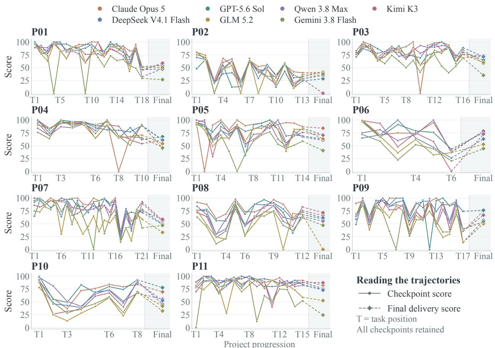  
Figure 9 Agent trajectories across all 11 projects. Panels are ordered P01–P11. Circles show checkpoint scores; diamonds show final-delivery scores. T labels denote chronological task positions, with all original checkpoints retained. Dashed terminal segments mark the change in evaluation scope. All panels share the same score scale and agent colors.