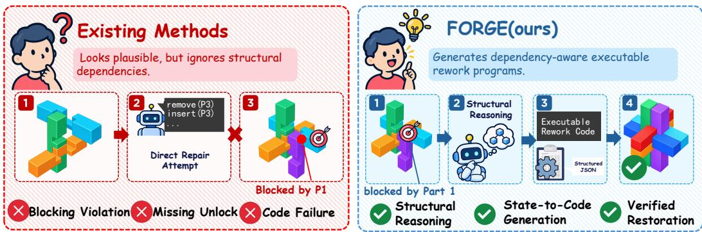
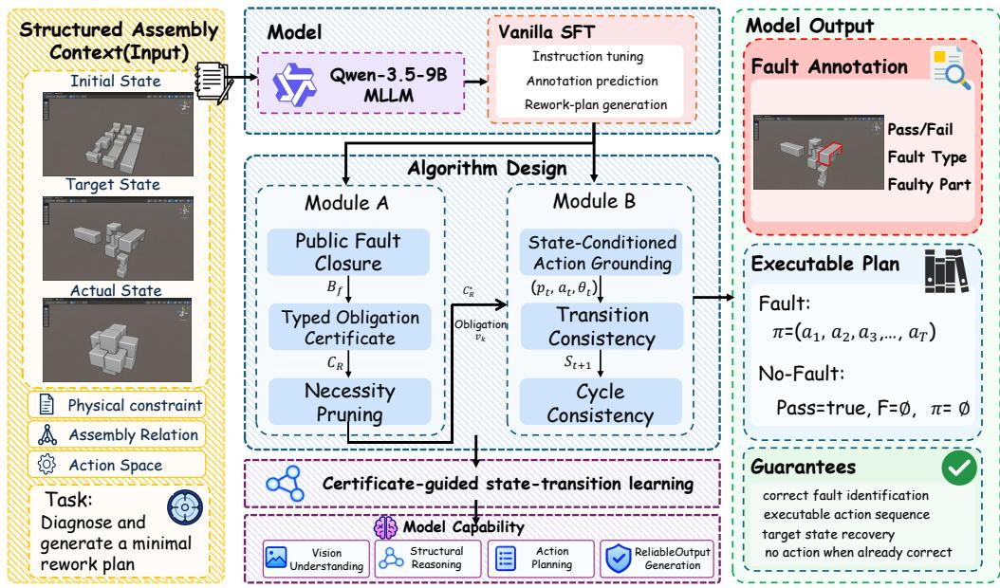
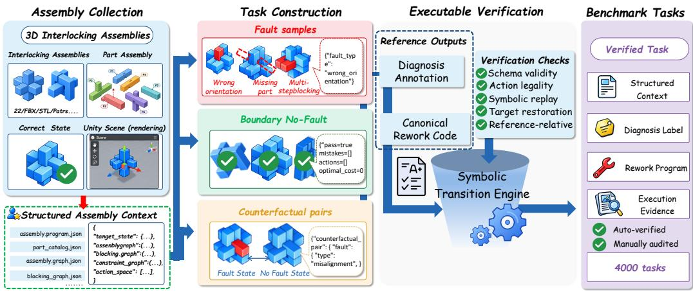
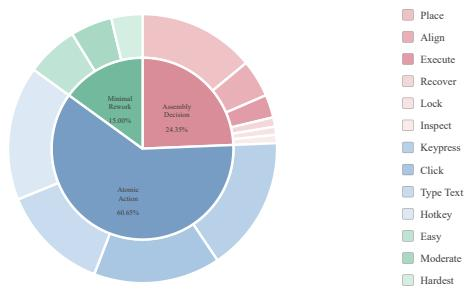
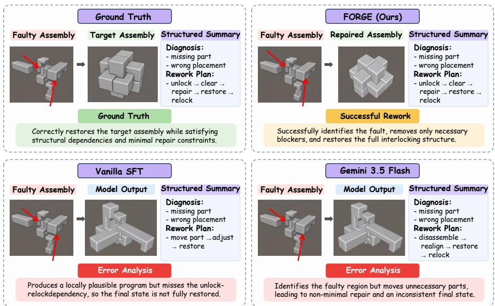
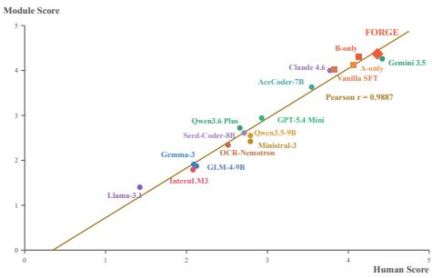

# FORGE: FAULT-ORIENTED REWORK CODE GENERA-TION FOR EXECUTABLE INTERLOCKING ASSEMBLY

Fuqiang Wang<sup>2,3,4</sup>, Jiahao Fu<sup>2,3,4</sup>, Ren Hefeng<sup>2,3,4</sup>, Yining Qian<sup>5</sup> Chuanting Zhang<sup>6</sup>, Cheng Tan<sup>7</sup>, Yuwen Liu<sup>2,3,4</sup>, Jingxuan Wei<sup>1,2,3,4</sup>

<sup>1</sup>University of Chinese Academy of Sciences, Beijing, China

<sup>2</sup>Key Laboratory of Computing Power Network and Information Security,   
Ministry of Education,   
Shandong Computer Science Center (National Supercomputer Center in Jinan),   
Qilu University of Technology (Shandong Academy of Sciences),   
Jinan 250014, China   
<sup>3</sup>Shandong Provincial Key Laboratory of Industrial Network   
and Information System Security,   
Shandong Fundamental Research Center for Computer Science,   
Jinan 250014, China

<sup>4</sup>Quan Cheng Laboratory, Jinan, China

<sup>5</sup>Northeastern University, China

<sup>6</sup>Shandong University, China

<sup>7</sup>Tencent, China

## ABSTRACT

Large language models have demonstrated strong capabilities in structured reasoning and code generation, yet identifying an assembly fault does not guarantee the ability to generate executable rework programs. In interlocking assemblies, a locally plausible repair program may violate blocking dependencies, omit required recovery operations, or terminate in an incorrect configuration. We identify this challenge as fault-conditioned executable rework generation, where models must jointly reason about structural failures and generate programs that restore constrained assembly states. To benchmark this capability, we introduce FORGE-Bench, containing 4,000 tasks across 26 interlocking assemblies with five assemblies held out for evaluating generalization to unseen structures. We further propose FORGE (Fault-Oriented Rework Code Generation for Executable Interlocking Assembly), a structured state-to-program framework that decomposes rework generation into Rework Structuring and Action Grounding. Rework Structuring captures fault-induced recovery dependencies, while Action Grounding maps these dependencies into state-conditioned executable actions. Experiments show that locally reasonable repair code is insufficient for reliable assembly recovery, and that connecting structural recovery reasoning with executable action realization is essential for verified target restoration.

## 1 INTRODUCTION

Recent large language models are increasingly extending code generation beyond software development toward structured programs for interacting with complex environments. Recent systems have demonstrated strong capabilities in structured generation, tool use, code synthesis, and long-horizon planning by translating high-level instructions into machine-readable representations and executable actions (Zhang et al., 2025; Liu et al., 2025b; Lei et al., 2025; Zheng et al., 2026). These advances make language models increasingly attractive for physical reasoning tasks, where symbolic states, discrete action interfaces, and structural constraints can be represented in a structured form (Kim et al., 2024; Black et al., 2024; Shukor et al., 2025; Bjorck et al., 2025; Chen et al., 2026). However, generating a program that appears reasonable does not guarantee that it remains executable when successful execution depends on hidden dependencies among multiple operations.

  
Figure 1: Motivation of FORGE. Existing methods overlook structural dependencies during assembly rework, while FORGE enables executable recovery through dependency-aware reasoning.

Interlocking assemblies provide a setting where this limitation becomes explicit. A faulty component is rarely independent of the surrounding structure. Repairing it may require removing blocking parts, releasing locking relations, and restoring temporarily displaced components after the correction. Therefore, a valid rework program must reason not only about the faulty part, but also about the dependency chain that determines when each operation can be executed and how the final assembly state can be restored. Recent assembly-oriented systems have advanced instruction generation, hierarchical scene representation, error correction, and context-aware assistance (Yan & Mu, 2025; Li et al., 2025; Wan et al., 2024; Liu et al., 2025a; Wang et al., 2026a;b). Nevertheless, these methods primarily address forward assembly, operator guidance, or local correction rather than complete dependency-aware recovery.

We call this regime executable rework generation, where models must move beyond isolated fault identification and local repair actions toward dependency-aware programs that execute complete recovery procedures. This regime sits at the intersection of assembly reasoning, program synthesis, and symbolic planning, but none of these directions directly captures the coupled requirements of fault diagnosis, structural dependency reasoning, and target-state restoration. Assembly reasoning methods primarily focus on component relations, assembly sequences, or forward construction, but do not address recovery from faulty states (Pun et al., 2025; Wang et al., 2026a;b). Program generation methods study executable code synthesis, yet typically assume that required operations are already specified or that individual actions can be evaluated independently (Chi et al., 2025; Ahn et al., 2026; Chen et al., 2025b). Symbolic planning approaches provide constraint-aware reasoning, but rarely consider the joint problem of identifying faults and generating state-restoring programs under physical assembly dependencies (Curtis et al., 2024; Cornelio et al., 2025; Pesjak & Zabkar,<sup>ˇ</sup> 2026; Huang et al., 2025; Chen et al., 2024).

To study this gap, we introduce FORGE, short for Fault-Oriented Rework Code Generation for Executable Interlocking Assembly. FORGE formulates interlocking assembly repair as a structured state-to-program generation framework built on vanilla SFT with two complementary algorithmic modules: Rework Structuring, which captures fault-induced recovery obligations among components, and Action Grounding, which maps these obligations into executable actions, parameters, and symbolic state transitions. Given public assembly states and structural constraints, FORGE generates complete recovery programs while avoiding unnecessary intervention on assemblies that are already correct. Unlike benchmarks centered on isolated function calls, FORGE evaluates statechanging action sequences and their final verified outcomes, reflecting the growing emphasis on stateful and multi-step agent evaluation. (Patil et al., 2025; Lu et al., 2025; Chen et al., 2025a; Zheng et al., 2026; Shen et al., 2026). Our main contributions are as follows:

• We identify and formalize fault-conditioned executable rework generation, a structured task requiring joint fault diagnosis, dependency-aware recovery planning, executable action generation, and target-state verification.

• We introduce FORGE-BENCH, a benchmark for interlocking-assembly rework with assemblydisjoint splits, controlled fault/no-fault cases, and verifier-based evaluation of structural correctness and target-state restoration.

• We propose FORGE, a dependency-aware framework that separates recovery into Rework Structuring and Action Grounding, enabling state-conditioned generation of executable restoration programs.

## 2 RELATED WORK

Assembly reasoning. Assembly reasoning focuses on representing component relations, spatial dependencies, and executable operations in physical environments. General-purpose vision-languageaction models such as OpenVLA, π , SmolVLA, and GR00T N1 connect language understanding with robotic control, while OpenVLA-OFT and PointACT improve fine-tuning efficiency and spatially grounded manipulation (Kim et al., 2024; Black et al., 2024; Shukor et al., 2025; Bjorck et al., 2025; Kim et al., 2025; Chen et al., 2026). Assembly-oriented methods further study instruction generation, hierarchical scene representations, error correction, and physically stable construction (Yan & Mu, 2025; Li et al., 2025; Wan et al., 2024; Pun et al., 2025). Recent manufacturing systems also explore autonomous assembly, VLA-mediated robotic manipulation, and multimodal operator assistance (Liu et al., 2025a; Wang et al., 2026a;b). Together, these studies provide useful representations of components and relations, but a repair procedure must also account for parts temporarily removed to access a fault. Existing approaches mainly address forward construction, local correc tion, or instruction following. FORGE instead targets faulty interlocking states and requires joint fault diagnosis, dependency-aware rework, and target-state restoration.

Executable planning. Executable planning converts high-level goals into action sequences or programs that satisfy environmental constraints. Recent methods combine language-model generation with constraint solving, symbolic decomposition, adaptive code synthesis, and neuro-symbolic val idation (Curtis et al., 2024; Cornelio et al., 2025; Chi et al., 2025; Ahn et al., 2026; Lei et al., 2025; Chen et al., 2025b). Other studies connect natural-language specifications with formal planning through LLM-symbolic pipelines, structured planning languages, task-and-motion checking, and embodied intermediate reasoning (Huang et al., 2025; Zuo et al., 2025; Chen et al., 2024; Zawalski et al., 2024; Pesjak & Zabkar, 2026). These methods show the value of checking proposed actions<sup>ˇ</sup> against explicit constraints rather than relying on the plausibility of generated text. However, they generally assume that the goal or required operations are already specified. FORGE addresses the complementary setting in which the model must infer recovery obligations from a faulty assembly and generate a verifier-grounded program that restores the complete target configuration.

Structured action generation. Structured action generation maps model decisions to machinereadable actions for tool use, function calling, and agent interaction. xLAM, ToolACE, and Tool-Gen improve action selection, tool retrieval, and argument generation (Zhang et al., 2025; Liu et al., 2025b; Wang et al., 2025). Stateful interaction is evaluated by BFCL, ToolSandbox, and ACEBench, while E-Bench and SciAgentGym extend evaluation to multi-step tool orchestration and dependency-aware scientific workflows (Patil et al., 2025; Lu et al., 2025; Chen et al., 2025a; Zheng et al., 2026; Shen et al., 2026). These benchmarks highlight the need to evaluate outcomes across a sequence of state-changing actions, beyond the correctness of individual tool calls. Nevertheless, their environments rarely model physical interlocking constraints or fault-conditioned recovery. FORGE therefore evaluates complete rework programs whose actions must respect structural dependencies, avoid unnecessary intervention, and terminate in a verifier-confirmed target state.

## 3 METHOD

## 3.1 TASK FORMULATION AND FRAMEWORK OVERVIEW

FORGE studies fault-conditioned executable rework generation for interlocking assemblies. Given an observed assembly state, a target configuration, and public structural constraints, the model must determine whether rework is required, identify the underlying fault, and generate an executable program that restores the assembly to the target state. Built on vanilla SFT, FORGE uses Rework

  
Figure 2: Overview of FORGE. Rework Structuring identifies recovery obligations, while Action Grounding converts them into executable actions.

Structuring for dependency-aware recovery and Action Grounding for state-conditioned executable action generation.

We formulate each task as a structured state-to-program generation problem:

$$
\begin{array} { r l } & { X = \left( S ^ { \mathrm { i n i t i a l } } , S ^ { \mathrm { a c t u a l } } , S ^ { \mathrm { t a r g e t } } , \mathcal { G } , A , P \right) , } \\ & { Y = ( D , \pi ) , \qquad \pi = \left( ( a _ { t } , \theta _ { t } ) \right) _ { t = 1 } ^ { T } , } \end{array}\tag{1}
$$

where $S ^ { \mathrm { i n i t i a l } }$ is the initial assembly state, $S ^ { \mathrm { a c t u a l } }$ is the observed state, $S ^ { \mathrm { t a r g e t } }$ is the target configuration, G denotes the public assembly, blocking, contact, and constraint relations, A is the available action space, $P$ contains public part information, D denotes the fault diagnosis, and π is the executable rework program.

FORGE represents program execution as a symbolic state trajectory:

$$
\begin{array} { r l } & { \tau _ { \pi } = \left( S _ { 0 } , ( a _ { 1 } , \theta _ { 1 } ) , S _ { 1 } , \dots , ( a _ { T } , \theta _ { T } ) , S _ { T } \right) , } \\ & { S _ { 0 } = S ^ { \mathrm { a c t u a l } } , \qquad S _ { t } = { \mathcal T } \left( S _ { t - 1 } , a _ { t } , \theta _ { t } ; { \mathcal G } \right) , \quad t = 1 , \dots , T , } \end{array}\tag{2}
$$

where $\tau$ is the frozen symbolic transition function used for supervision construction and benchmark evaluation.

A generated program is valid only when its schema is well formed, every operation is legal in it execution state, and the terminal state satisfies the target configuration:

$$
\operatorname { V a l i d } ( X , Y ) = \mathbb { I } [ \operatorname { S c h e m a } ( Y ) ] \left( \prod _ { t = 1 } ^ { T } \mathbb { I } [ ( a _ { t } , \theta _ { t } ) \in { \mathcal A } ( S _ { t - 1 } ; { \mathcal G } ) ] \right) \mathbb { I } \big [ S _ { T } \equiv _ { { \mathcal G } } S ^ { \mathrm { t a r g e t } } \big ] .\tag{3}
$$

For an already correct assembly, the safe output is $D = { \mathrm { N o F A U L T } }$ and $\pi = \varnothing$ , which prevents unnecessary intervention.

Vanilla SFT directly learns the diagnosis and rework sequence but does not explicitly model recovery dependencies or state-conditioned execution. FORGE therefore augments the SFT backbone with two algorithmic modules: Rework Structuring and Action Grounding, as illustrated in Figure 2.

## 3.2 FAULT-ORIENTED REWORK STRUCTURING

Rework Structuring organizes the supervision target before action generation. It identifies the components and prerequisite relations that are relevant to a diagnosed fault, but it does not introduce an additional prediction head or an additional output object.

Given a diagnosed fault set $F ,$ the relevant component set is expanded using the public graph relations:

$$
\begin{array} { r l } & { \quad D _ { F } ^ { 0 } = F , } \\ & { \quad D _ { F } ^ { k + 1 } = D _ { F } ^ { k } \cup N _ { b } ( D _ { F } ^ { k } ) \cup N _ { c } ( D _ { F } ^ { k } ) \cup N _ { k } ( D _ { F } ^ { k } ) , } \\ & { \quad \mathcal { D } _ { F } = \operatorname* { m i n } \left\{ D _ { F } ^ { k } : D _ { F } ^ { k + 1 } = D _ { F } ^ { k } \right\} . } \end{array}\tag{4}
$$

The resulting dependency information is used to organize the actions in the reference rework plan and to provide structured supervision for recovery generation. The intermediate dependency structure is not exposed as an additional output field; the model generates the final annotation–rework plan object.

## 3.3 STATE-CONDITIONED ACTION GROUNDING

Action Grounding conditions each generated action on the symbolic state produced by preceding operations. The model generates the complete annotation–rework plan object, whose actions are subsequently evaluated through symbolic replay.

For a current state $S _ { t - 1 }$ , the executable action set is $\mathcal { A } _ { t } = \mathcal { A } \left( S _ { t - 1 } ; \mathcal { G } \right)$ , and the generated action must satisfy $( a _ { t } , \theta _ { t } ) \in \mathcal { A } _ { t }$ . The training target remains the final diagnosis and rework program:

$$
\begin{array} { r } { p _ { \theta } ( D , \pi \mid X ) = p _ { \theta } ( D \mid X ) p _ { \theta } ( \pi \mid X , D ) . } \end{array}\tag{5}
$$

The decomposition above describes the supervision and execution structure. All fields are generated by the same autoregressive model and serialized into the final annotation–rework plan schema.

## 3.4 TRAINING OBJECTIVE AND INFERENCE PROTOCOL

FORGE uses Rework Structuring to organize fault-dependent recovery sequences and Action Grounding to condition each action on its preceding symbolic state. The resulting diagnosis and rework program are serialized into a single autoregressive training target without separate prediction heads or auxiliary losses:

$$
\begin{array} { r l } & { Y = { \mathrm { S e r i a l i z e } } ( D , \pi ) } \\ & { \quad = { \mathrm { B O S } } \| \operatorname { E n c o d e } ( D ) \| \operatorname { S E P } \| \operatorname { E n c o d e } ( \pi ) \| \operatorname { E O S } } \\ & { \quad = ( y _ { 1 } , \dots , y _ { | Y | } ) , } \end{array}\tag{6}
$$

We train the model with teacher-forced supervised fine-tuning:

$$
\mathcal { L } _ { \mathrm { S F T } } ( \theta ) = - \sum _ { ( X , Y ) \in \mathcal { D } } \sum _ { t = 1 } ^ { | Y | } \log p _ { \theta } ( y _ { t } \mid X , y _ { < t } ) .\tag{7}
$$

During inference, the model generates the same final schema using deterministic autoregressive decoding. The generated sequence is then parsed and replayed under the symbolic transition rules:

$$
\begin{array} { c } { \hat { Y } = \operatorname { D e c o d e } _ { \operatorname { g r e e d y } } ( X ) , } \\ { ( \hat { D } , \hat { \pi } ) = \operatorname { P a r s e } ( \hat { Y } ) . } \end{array}\tag{8}
$$

The symbolic transition engine then checks schema validity, action legality, state transitions, and target-state restoration.

## 4 DATASET

We introduce FORGE-BENCH, a benchmark for fault-conditioned executable rework generation in interlocking assemblies. Unlike conventional assembly datasets that focus on forward construction, assembly-sequence prediction, or instruction generation, FORGE-BENCH evaluates whether a model can diagnose faulty assembly sEach task provides a public assembly representation comprising the initial state, observed state, target state, structural relations, constraints, action space, and part catalog.Given this information, the model must determine whether rework is required and, when a fault is present, generate a program that restores the target configuration.

## 4.1 DATASET CONSTRUCTION

As shown in Figure 3, FORGE-BENCH is constructed as a closed execution-and-verification loop rather than a static collection of assembly states. The pipeline converts executable assembly structures into fault-conditioned rework tasks and retains only instances whose reference programs satisfy structural, action-level, and target-restoration constraints.

  
Figure 3: Construction pipeline of FORGE-BENCH. Executable assembly structures are converted into public task representations, augmented with controlled fault and no-fault states, paired with reference rework programs, and filtered through symbolic execution and target-state restoration.

Assembly collection and executable representation. We collect 3D interlocking assembly structures and instantiate their valid configurations as executable Unity scenes. Each assembly is represented by a structured context containing its part catalog, assembly relations, blocking dependencies, physical constraints, and available action interfaces. This context defines both the target configuration and the conditions under which individual operations can be executed.

Fault-conditioned task construction. From each assembly context, we generate faulty states, boundary no-fault states, and matched fault/no-fault pairs. Faults include incorrect orientations, missing components, misplacements, and errors hidden behind multi-step blocking dependencies. Boundary no-fault states remain within the target tolerance and therefore require an empty rework program.

Reference program generation and verification. Each task is paired with a diagnosis annotation and a verified sequence-minimal rework program. For a faulty state, the program resolves the relevant blocking dependencies, corrects the fault, and restores temporarily affected components. A frozen symbolic transition engine replays every action and checks schema validity, action legality, state-transition consistency, and target-state restoration.

<sup>4.2</sup> <sup>DATASET</sup> <sup>ANALYSIS</sup> Figure 4 and Table 1 summarize the composition and scale of FORGE-BENCH. FORGE-BENCH contains 4,000 tasks across 26 interlocking assemblies, with a 3,000/1,000 traintest split and five held-out assemblies for evaluating generalization to unseen structures. The benchmark includes 1,115 no-fault cases (27.9%), 2,353 single-fault cases (58.8%), and 532 multi-fault cases (13.3%), combining routine diagnosis with dependency-coupled recovery at different fault scopes and structural complexities. Counterfactual metadata contains 160 matched fault/no-fault pairs, or 320 states, providing paired examples of required intervention and valid no-intervention cases across diverse structural configurations and recovery scenarios.

  
Figure 4: Composition of FORGE-BENCH.

Table 1: Key statistics of FORGE-BENCH.
<table><tr><td colspan="3">Dataset statistics</td><td colspan="3">Rework statistics</td></tr><tr><td>Statistic</td><td>Count</td><td>Share</td><td>Statistic</td><td>Count</td><td>Share</td></tr><tr><td>Total tasks</td><td>4,000</td><td>100.0%</td><td>No-fault cases</td><td>1,115</td><td>27.9%</td></tr><tr><td>Train / Test</td><td>3,000 / 1,000</td><td>75.0 / 25.0%</td><td>Single-fault cases</td><td>2,353</td><td>58.8%</td></tr><tr><td>Assembly families</td><td>26</td><td></td><td>Multi-fault cases</td><td>532</td><td>13.3%</td></tr><tr><td>Train assemblies</td><td>21</td><td>一</td><td>Counterfactual pairs</td><td>160</td><td>一</td></tr><tr><td>Test assemblies</td><td>5</td><td>一</td><td>Fault/no-fault instances</td><td>320</td><td></td></tr></table>

## 5 EXPERIMENTS

## 5.1 EXPERIMENTAL SETUP

We build FORGE on Qwen3.5-9B-Base (Qwen Team, 2026a) and apply LoRA with rank 8, scaling factor 32, and dropout 0.05 to all linear modules. Training uses bfloat16 precision, a per-device batch size of 1, and gradient accumulation over 4 steps. Vanilla SFT provides the training backbone, while Rework Structuring and Action Grounding support dependency-aware program generation. Inference uses deterministic decoding with temperature 0 and a maximum output length of 4,096 tokens, with thinking disabled.

We compare FORGE with open-source models, including Qwen3.5-9B Base (Qwen Team, 2026a), Gemma-3-12B-IT (Team et al., 2025), GLM-4-9B-0414-Chat (GLM Team, 2025), InternLM3- 8B-Instruct (InternLM Team, 2024), Ministral-3-8B-Instruct (Mistral AI, 2025), and Llama-3.1- 8B-Instruct (Grattafiori et al., 2024); closed-source models, including GPT-5.4 Mini (OpenAI, 2026), Claude Sonnet 4.6 (Anthropic, 2026), Qwen3.6-Plus (Qwen Team, 2026b), and Gemini 3.5 Flash (Google DeepMind, 2026); and code-oriented methods, including AceCoder-7B (Zeng et al., 2025), OpenCodeReasoning-Nemotron-7B (Ahmad et al., 2025), and Seed-Coder-8B-Reasoning (Seed et al., 2025). All models receive the same public task representation and produce the shared annotation–rework plan schema. Generated programs are evaluated with the same symbolic transition engine under the benchmark protocol, while unadapted Qwen3.5-9B serves as the backbone baseline. We evaluate all methods on FORGE-Bench using six executionoriented metrics, their unweighted aggregate Overall-Core, and a separate LLM-as-Judge score. Metric definitions are provided in Appendix D.

## 5.2 MAIN RESULTS

Table 2 shows that FORGE achieves the highest Overall-Core score of 72.75 among all compared methods. It obtains the best performance on five of the six core metrics, including SSE, VMRE, DGTR, MVE, and HRQ. These gains indicate that the proposed framework improves both recovery structure and executable target restoration.

Table 2: Main results on FORGE-BENCH. Models are grouped into open-source models, closedsource models, prior methods, and our method. The best results are highlighted in bold, and the second-best results are underlined.
<table><tr><td rowspan="2">Model</td><td colspan="6">Core Metrics</td><td rowspan="2">Overall-Core↑</td><td>|LLM-as-Judge</td></tr><tr><td colspan="6">|SSE↑ SAPF↑ VMRE↑ DGTR↑ MVE↑ HRQ↑|</td><td>Score↑</td></tr><tr><td colspan="9">Open-source Models</td></tr><tr><td>Qwen3.5-9B Base (Qwen Team, 2026a)</td><td>20.00</td><td>11.04</td><td>22.50</td><td>25.83</td><td>22.50</td><td>20.00</td><td>20.31</td><td>2.55</td></tr><tr><td>Gemma-3-12B-IT (Team et al., 2025)</td><td>6.21</td><td>50.00</td><td>2.50</td><td>5.83</td><td>2.50</td><td></td><td>11.17</td><td>1.91</td></tr><tr><td>GLM-4-9B-0414-Chat (GLM Team, 2025)</td><td>8.42</td><td>38.75</td><td>3.33</td><td>3.33</td><td>3.33</td><td></td><td>9.53</td><td>1.87</td></tr><tr><td>InternLM3-8B-Instruct (InternLM Team, 2024)</td><td>16.00</td><td>22.22</td><td>20.00</td><td>20.00</td><td>20.00</td><td>20.00</td><td>19.70</td><td>1.79</td></tr><tr><td>Ministral-3-8B-Instruct (Mistral AI, 2025) Llama-3.1-8B-Instruct (Grattafiori et al., 2024)</td><td>18.21</td><td>27.78</td><td>17.50</td><td>20.83</td><td>17.50</td><td>20.00</td><td>20.30</td><td>2.42</td></tr><tr><td></td><td>5.50</td><td>57.36</td><td></td><td></td><td></td><td></td><td>10.48</td><td>1.40</td></tr><tr><td colspan="9">Closed-source Models</td></tr><tr><td>GPT-5.4 Mini (OpenAI, 2026)</td><td>25.50</td><td>37.15</td><td>25.16</td><td>25.74</td><td>25.16</td><td>30.63</td><td>28.22</td><td>2.94</td></tr><tr><td>Claude Sonnet 4.6 (Anthropic, 2026)</td><td>31.35</td><td>41.11</td><td>27.87</td><td>36.19</td><td>25.22</td><td>23.43</td><td>30.86</td><td>4.00</td></tr><tr><td>Qwen3.6-Plus (Qwen Team, 2026b)</td><td>22.55</td><td>47.22</td><td>18.77</td><td>19.44</td><td>18.19</td><td>14.37</td><td>23.43</td><td>2.72</td></tr><tr><td>Gemini 3.5 Flash (Google DeepMind, 2026)</td><td>62.93</td><td>69.10</td><td>28.12</td><td>45.49</td><td>26.61</td><td>46.39</td><td>46.44</td><td>4.26</td></tr><tr><td colspan="9">Prior Methods</td></tr><tr><td>AceCoder-7B (Zeng et al., 2025)</td><td>28.89</td><td>8.33</td><td>26.14</td><td>29.27</td><td>26.14</td><td>52.58</td><td>28.56</td><td>3.63</td></tr><tr><td>OpenCodeReasoning-Nemotron-7B (Ahmad et al., 2025) Seed-Coder-8B-Reasoning (Seed et al., 2025)</td><td>15.25</td><td>16.67</td><td>15.21</td><td>15.21</td><td>15.21</td><td>9.55</td><td>14.51</td><td>2.34</td></tr><tr><td></td><td>8.57</td><td>6.67</td><td>9.83</td><td>11.67</td><td>8.00</td><td></td><td>7.46</td><td>2.61</td></tr><tr><td>FORGE (Ours)</td><td>71.54</td><td>61.11</td><td>72.60</td><td>75.93</td><td>72.13</td><td>83.17</td><td>72.75</td><td>4.37</td></tr></table>

The independent LLM-as-Judge evaluation follows the same trend, with FORGE achieving the highest score of 4.37. The largest improvements appear on execution-oriented metrics, suggesting that FORGE more effectively converts structured repair intent into executable recovery programs.

## 5.3 ABLATION STUDY

Table 3: Ablation study of FORGE components. The best results are highlighted in bold with a blue background.
<table><tr><td rowspan="2">Method</td><td colspan="6">Core Metrics</td><td rowspan="2">Overall-Core↑</td><td rowspan="2">|LLM-as-Judge Score↑</td></tr><tr><td>|SSE↑</td><td>SAPF↑</td><td>VMRE↑</td><td>DGTR↑</td><td>MVE↑</td><td>HRQ↑|</td></tr><tr><td>Vanilla SFT</td><td>|69.23</td><td>61.11</td><td>63.23</td><td>71.56</td><td>62.60</td><td>77.44</td><td>67.53</td><td>4.03</td></tr><tr><td rowspan="2">w/o Rework Structuring w/o Action Grounding</td><td>62.38</td><td>41.67</td><td>62.19</td><td>68.19</td><td>60.10</td><td>73.60</td><td>61.35</td><td>4.12</td></tr><tr><td>65.43</td><td>66.67</td><td>64.05</td><td>67.38</td><td>63.11</td><td>80.67</td><td>67.89</td><td>4.30</td></tr><tr><td>FORGE (Ours)</td><td>71.54</td><td>61.11</td><td>72.60</td><td>75.93</td><td>72.13</td><td>83.17</td><td>72.75</td><td>4.37</td></tr></table>

Table 3 analyzes the contribution of the two algorithmic modules. Vanilla SFT already provides a strong prior for diagnosis and rework generation, achieving an Overall-Core score of 67.53. Removing Rework Structuring mainly affects state and hard-case quality, reducing SAPF and HRQ to 41.67 and 73.60. Removing Action Grounding improves SAPF but lowers DGTR, MVE, and Overall-Core, indicating that its primary benefit lies in executable state-conditioned recovery. The full FORGE model achieves the highest VMRE, MVE, HRQ, Overall-Core, and LLM-as-Judge scores, showing that recovery organization and executable action grounding provide complementary improvements.

## 5.4 CASE STUDY AND ERROR ANALYSIS

Figure 5 presents a representative interlocking assembly rework case. The example highlights the key challenge of executable rework generation: models must identify faulty components and preserve recovery dependencies during restoration. FORGE generates a dependency-aware repair procedure, while baseline models exhibit missing dependency handling and unnecessary intervention. This comparison supports the quantitative finding that structured recovery reasoning and stateconditioned action grounding improve executable assembly restoration.

  
Figure 5: Qualitative comparison of executable rework generation. FORGE preserves recovery dependencies and restores the target assembly, while baseline predictions exhibit missing dependency handling or unnecessary intervention.

## 5.5 CONSISTENCY WITH HUMAN JUDGMENTS

Figure 6 shows a clear positive alignment between automatic evaluation and expert judgment across the evaluated models. Most baseline systems follow the rising trend from the lower-left to the upper-middle region, with weaker verified execution and incomplete target restoration receiving lower expert ratings. FORGE is located in the upper-right region, indicating that its benchmark improvements are reflected in expert assessment. This ordering suggests that the metrics capture structural recovery, executable action sequences, and complete target-state restoration across the evaluated assemblies and fault types, rather than surface-level plausibility alone.

  
Figure 6: Consistency between automatic evaluation and human judgment.

## 6 CONCLUSION AND LIMITATIONS

We introduce fault-conditioned executable rework generation, where assembly repair shifts from identifying an isolated fault to producing a complete recovery program that respects structural dependencies and restores the target configuration. FORGE-Bench makes this capability measurable through structured interlocking assembly tasks, controlled fault and no-fault conditions, and verifierbacked execution, while FORGE addresses it through rework structuring and action grounding. Experiments reveal a clear dependency-execution gap: existing models can often identify the faulty component or propose a plausible local action, but fail to resolve blocking dependencies, preserve displaced components, or restore the complete assembly state. FORGE narrows this gap by coupling fault understanding with executable program generation and target-state verification. This work fo cuses on symbolic interlocking assembly environments with discrete action interfaces and a finite set of assembly structures, so extending the same principle to richer assembly families, continuous physical execution, uncertain perception, and interactive recovery with execution feedback will require additional action models, environment adapters, and validity criteria, and remains a natural direction for future work.

## AI USE STATEMENT

Generative AI assistance was used for literature processing, dataset construction, and auxiliary LLM-as-Judge evaluation. All generated records, annotations, and evaluation outputs were reviewed under the documented audit procedure. The authors are responsible for the final dataset, experimental results, analyses, and claims.

## REPRODUCIBILITY STATEMENT

Appendix A defines the FORGE-Bench task contract. Appendix B describes dataset construction and split protocols; Appendix C gives the training and inference configuration; and Appendix D defines the evaluation metrics. All reported results use the fixed split and evaluation protocol specified in Appendix B.

## REFERENCES

Wasi Uddin Ahmad, Sean Narenthiran, Somshubra Majumdar, Aleksander Ficek, Siddhartha Jain, Jocelyn Huang, Vahid Noroozi, and Boris Ginsburg. Opencodereasoning: Advancing data distillation for competitive coding. arXiv preprint arXiv:2504.01943, 2025.

Sanghyun Ahn, Wonje Choi, Junyong Lee, Jinwoo Park, and Honguk Woo. Towards reliable codeas-policies: A neuro-symbolic framework for embodied task planning. Advances in Neural Information Processing Systems, 38:75428–75459, 2026.

Anthropic. Claude sonnet 4.6. Official model documentation, 2026. URL https://docs. anthropic.com/en/docs/about-claude/models.

Johan Bjorck, Fernando Castaneda, Nikita Cherniadev, Xingye Da, Runyu Ding, Linxi Fan, ˜ Yu Fang, Dieter Fox, Fengyuan Hu, Spencer Huang, et al. Gr00t n1: An open foundation model for generalist humanoid robots. arXiv preprint arXiv:2503.14734, 2025.

Kevin Black, Noah Brown, Danny Driess, Adnan Esmail, Michael Equi, Chelsea Finn, Niccolo Fusai, Lachy Groom, Karol Hausman, Brian Ichter, et al. backslash pi0: A vision-languageaction flow model for general robot control. arXiv preprint arXiv:2410.24164, 1, 2024.

Chen Chen, Xinlong Hao, Weiwen Liu, Xu Huang, Xingshan Zeng, Shuai Yu, Dexun Li, Yuefeng Huang, Xiangcheng Liu, Xinzhi Wang, et al. Acebench: A comprehensive evaluation of llm tool usage. In EMNLP (Findings), pp. 12970–12998, 2025a.

Shizhe Chen, Paul Pacaud, and Cordelia Schmid. Pointact: Vision-language-action models with multi-scale point-action interaction. arXiv preprint arXiv:2605.21414, 2026.

Yongchao Chen, Jacob Arkin, Charles Dawson, Yang Zhang, Nicholas Roy, and Chuchu Fan. Autotamp: Autoregressive task and motion planning with llms as translators and checkers. In 2024 IEEE International conference on robotics and automation (ICRA), pp. 6695–6702. IEEE, 2024.

Yongchao Chen, Yilun Hao, Yang Zhang, and Chuchu Fan. Code-as-symbolic-planner: Foundation model-based robot planning via symbolic code generation. In 2025 IEEE/RSJ International Conference on Intelligent Robots and Systems (IROS), pp. 19248–19254. IEEE, 2025b.

Haotian Chi, Zeyu Feng, Yueming Lyu, Chengqi Zheng, Linbo Luo, Yew Soon Ong, Ivor Tsang, Hechang Chen, Yi Chang, and Haiyan Yin. Instructflow: Adaptive symbolic constraint-guided code generation for long-horizon planning. Advances in Neural Information Processing Systems, 38:2927–2957, 2025.

Cristina Cornelio, Flavio Petruzzellis, and Pietro Lio. Hierarchical planning for complex tasks with knowledge graph-rag and symbolic verification. arXiv preprint arXiv:2504.04578, 2025.

Aidan Curtis, Nishanth Kumar, Jing Cao, Tomas Lozano-P ´ erez, and Leslie Pack Kaelbling. Trust´ the proc3s: Solving long-horizon robotics problems with llms and constraint satisfaction. arXiv preprint arXiv:2406.05572, 2024.

GLM Team. Glm-4-9b-0414-chat. Model card, 2025. URL https://huggingface.co/ THUDM/glm-4-9b-0414.

Google DeepMind. Gemini 3.5 flash. Official model documentation, 2026. URL https://ai. google.dev/gemini-api/docs/models.

Aaron Grattafiori, Abhimanyu Dubey, Abhinav Jauhri, Abhinav Pandey, Abhishek Kadian, Ahmad Al-Dahle, Aiesha Letman, Akhil Mathur, Alan Schelten, Alex Vaughan, et al. The llama 3 herd of models. arXiv preprint arXiv:2407.21783, 2024.

Sukai Huang, Nir Lipovetzky, and Trevor Cohn. Planning in the dark: Llm-symbolic planning pipeline without experts. In Proceedings of the AAAI Conference on Artificial Intelligence, volume 39, pp. 26542–26550, 2025.

InternLM Team. Internlm3-8b-instruct. Model card, 2024. URL https://huggingface.co/ internlm/internlm3-8b-instruct.

Moo Jin Kim, Karl Pertsch, Siddharth Karamcheti, Ted Xiao, Ashwin Balakrishna, Suraj Nair, Rafael Rafailov, Ethan Foster, Grace Lam, Pannag Sanketi, et al. Openvla: An open-source vision-language-action model. arXiv preprint arXiv:2406.09246, 2024.

Moo Jin Kim, Chelsea Finn, and Percy Liang. Fine-tuning vision-language-action models: Optimizing speed and success. arXiv preprint arXiv:2502.19645, 2025.

Chao Lei, Yanchuan Chang, Nir Lipovetzky, and Krista A Ehinger. Planning-driven programming: A large language model programming workflow. In Proceedings of the 63rd Annual Meeting of the Association for Computational Linguistics (Volume 1: Long Papers), pp. 12647–12684, 2025.

Shufei Li, Zhijie Yan, Zuoxu Wang, and Yiping Gao. Vlm-msgraph: Vision language model-enabled multi-hierarchical scene graph for robotic assembly. Robotics and Computer-Integrated Manufacturing, 94:102978, 2025.

Quan Liu, Zhenrui Ji, Wenjun Xu, Zhihao Liu, and Lihui Wang. One-shot learning-driven autonomous robotic assembly via human-robot symbiotic interaction. Npj Advanced Manufacturing, 2(1):22, 2025a.

Weiwen Liu, Xu Huang, Xingshan Zeng, Shuai Yu, Dexun Li, Shuai Wang, Weinan Gan, Zhengying Liu, Yuanqing Yu, Zezhong WANG, et al. Toolace: Winning the points of llm function calling. In International conference on learning representations, volume 2025, pp. 41359–41381, 2025b.

Jiarui Lu, Thomas Holleis, Yizhe Zhang, Bernhard Aumayer, Feng Nan, Haoping Bai, Shuang Ma, Shen Ma, Mengyu Li, Guoli Yin, et al. Toolsandbox: A stateful, conversational, interactive evaluation benchmark for llm tool use capabilities. In Findings of the Association for Computational Linguistics: NAACL 2025, pp. 1160–1183, 2025.

Mistral AI. Ministral-3-8b-instruct. Model card, 2025. URL https://huggingface.co/ mistralai.

OpenAI. Gpt-5.4 mini. Official model documentation, 2026. URL https://platform. openai.com/docs/models.

Shishir G Patil, Huanzhi Mao, Fanjia Yan, Charlie Cheng-Jie Ji, Vishnu Suresh, Ion Stoica, and Joseph E Gonzalez. The berkeley function calling leaderboard (bfcl): From tool use to agentic evaluation of large language models. In Forty-second International Conference on Machine Learning, 2025.

Drejc Pesjak and Jure Zabkar. Robot planning via llm proposals and symbolic verification.<sup>ˇ</sup> Machine Learning and Knowledge Extraction, 8(1):22, 2026.

Ava Pun, Kangle Deng, Ruixuan Liu, Deva Ramanan, Changliu Liu, and Jun-Yan Zhu. Generating physically stable and buildable brick structures from text. In 2025 IEEE/CVF International Conference on Computer Vision (ICCV), pp. 14798–14809. IEEE, 2025.

Qwen Team. Qwen3.5-9b-base. Model card, 2026a. URL https://huggingface.co/Qwen/ Qwen3.5-9B-Base.

Qwen Team. Qwen3.6-plus. Official model documentation, 2026b. URL https://qwenlm. github.io.

ByteDance Seed, Yuyu Zhang, Jing Su, Yifan Sun, Chenguang Xi, Xia Xiao, Shen Zheng, Anxiang Zhang, Kaibo Liu, Daoguang Zan, et al. Seed-coder: Let the code model curate data for itself. arXiv preprint arXiv:2506.03524, 2025.

Yujiong Shen, Yajie Yang, Zhiheng Xi, Binze Hu, Huayu Sha, Jiazheng Zhang, Qiyuan Peng, Junlin Shang, Jixuan Huang, Yutao Fan, et al. Sciagentgym: Benchmarking multi-step scientific tool-use in llm agents. arXiv preprint arXiv:2602.12984, 2026.

Mustafa Shukor, Dana Aubakirova, Francesco Capuano, Pepijn Kooijmans, Steven Palma, Adil Zouitine, Michel Aractingi, Caroline Pascal, Martino Russi, Andres Marafioti, et al. Smolvla: A vision-language-action model for affordable and efficient robotics. arXiv preprint arXiv:2506.01844, 2025.

Gemma Team, Aishwarya Kamath, Johan Ferret, Shreya Pathak, Nino Vieillard, Ramona Merhej, Sarah Perrin, Tatiana Matejovicova, Alexandre Rame, Morgane Rivi´ ere, et al. Gemma 3 technical\` report. arXiv preprint arXiv:2503.19786, 2025.

Yuxuan Wan, Kaichen Zhou, Jinhong Chen, and Hao Dong. Scanet: Correcting lego assembly errors with self-correct assembly network. In 2024 IEEE/RSJ International Conference on Intelligent Robots and Systems (IROS), pp. 5940–5947. IEEE, 2024.

Renxi Wang, Xudong Han, Lei Ji, Shu Wang, Timothy Baldwin, and Haonan Li. Toolgen: Unified tool retrieval and calling via generation. In International Conference on Learning Representations, volume 2025, pp. 73473–73498, 2025.

Xueting Wang, Xiwen Dengxiong, Shi Bai, Pai Zheng, and Yunbo Zhang. Vlabot: A human vision– language–action models interaction framework for robotic assembly. Robotics and Computer-Integrated Manufacturing, 100:103268, 2026a.

Xueting Wang, Xiwen Dengxiong, Jie-Ke Pan, Ke Jing, Zipeng Guo, Rui Liu, Qinqin Xiao, and Yunbo Zhang. Assemblymate: an interactive context-aware ai-xr co-worker with multimodal spatial-temporal reasoning for manufacturing assembly. npj Advanced Manufacturing, 2026b.

Hongyu Yan and Yadong Mu. Neural assembler: Learning to generate fine-grained robotic assembly instructions from multi-view images. In Proceedings of the AAAI Conference on Artificial Intelligence, volume 39, pp. 14717–14725, 2025.

Michał Zawalski, William Chen, Karl Pertsch, Oier Mees, Chelsea Finn, and Sergey Levine. Robotic control via embodied chain-of-thought reasoning. arXiv preprint arXiv:2407.08693, 2024.

Huaye Zeng, Dongfu Jiang, Haozhe Wang, Ping Nie, Xiaotong Chen, and Wenhu Chen. Acecoder: Acing coder rl via automated test-case synthesis. In Proceedings of the 63rd Annual Meeting of the Association for Computational Linguistics (Volume 1: Long Papers), pp. 12023–12040, 2025.

Jianguo Zhang, Tian Lan, Ming Zhu, Zuxin Liu, Thai Hoang, Shirley Kokane, Weiran Yao, Juntao Tan, Zhiwei Liu, Yihao Feng, et al. xlam: A family of large action models to empower ai agent systems. In Proceedings of the 2025 Conference of the Nations of the Americas Chapter of the Association for Computational Linguistics: Human Language Technologies (Volume 1: Long Papers), pp. 11583–11597, 2025.

Weihuang Zheng, Tianyuan Zou, Eileen Ye, Alphet Liu, Youyong Kong, Ya-Qin Zhang, Duran Zheng, and Maxm Pan. E-bench: Benchmarking multi-step tool-use agents in real-world product scenarios. arXiv preprint arXiv:2607.23722, 2026.

Max Zuo, Francisco Piedrahita Velez, Xiaochen Li, Michael Littman, and Stephen Bach. Planetarium: A rigorous benchmark for translating text to structured planning languages. In Proceedings of the 2025 Conference of the Nations of the Americas Chapter of the Association for Computational Linguistics: Human Language Technologies (Volume 1: Long Papers), pp. 11223–11240, 2025.

## A TASK DEFINITION AND OUTPUT SCHEMA

This appendix specifies the public task contract used by FORGE-Bench. TThe benchmark provides an initial assembly state, an observed assembly state, a target state, structural relations, an action library, and a public part catalog.The model must decide whether rework is required, diagnose the fault when present, and produce a state-valid rework program.

## A.1 PUBLIC INPUT CONTRACT

Each task is represented as

$$
X = ( S ^ { \mathrm { i n i t i a l } } , S ^ { \mathrm { a c t u a l } } , S ^ { \mathrm { t a r g e t } } , \mathcal { G } , A , P ) ,
$$

where $S ^ { \mathrm { i n i t i a l } }$ is the initial assembly state, $S ^ { \mathrm { a c t u a l } }$ is the observed state, $S ^ { \mathrm { t a r g e t } }$ is the target configuration,G contains assembly, blocking, contact, and constraint relations, A is the action space, and $\breve { P }$ is the public part catalog. The benchmark package contains the following files:

Table 4: Public files in a FORGE-Bench task.
<table><tr><td>File</td><td>Role</td></tr><tr><td>initial_state.json</td><td>Initial assembly state.</td></tr><tr><td>target_state.json</td><td>Target assembly configuration.</td></tr><tr><td>actual_state.json</td><td>Observed state supplied to the model.</td></tr><tr><td>assembly-graph.json</td><td>Assembly relations between parts.</td></tr><tr><td>blocking-graph.json</td><td>Blocking and access dependencies.</td></tr><tr><td>contact_graph.json</td><td>Contact or adjacency relations.</td></tr><tr><td>action_space.json</td><td>Available actions and their interfaces.</td></tr><tr><td>part_catalog.json</td><td>Part identifiers and public metadata.</td></tr></table>

## A.2 OUTPUT CONTRACT

The structured target contains a diagnosis and a rework plan. The executable program is written as $\pi = ( ( a _ { t } , \theta _ { t } ) ) _ { t = 1 } ^ { T } .$ , where $a _ { t }$ is an action type and $\theta _ { t }$ contains its parameters.

A compressed real task example from the repository has the following form:

```jsonl
{
"task_id": "bayonet_structure_train_000000",
"assembly_id": "bayonet_structure",
"input_contract": [
"initial_state.json", "target_state.json", "actual_state.json",
"assembly_graph.json", "blocking_graph.json", "contact_graph.json",
"action_space.json", "part_catalog.json"
],
"actual_state": {
"BayonetStructure_Part01_Lock": {"present": true},
"BayonetStructure_Part02_Pin": {"present": false}
}
}
```

The model returns one JSON object with the top-level fields annotation and rework plan. For the example above, the corresponding output is:

```jsonl
{
"annotation": {
"sample_id": "bayonet_structure_train_000000",
"assembly_id": "bayonet_structure",
"pass": false,
"mistakes": [{
```

"type": "missing\_part",   
"part\_id": "BayonetStructure\_Part02\_Pin",   
"visible": true   
}]   
},   
"rework\_plan": {   
"objective": "restore\_to\_target\_state",   
"actions": [   
{   
"action": "insert",   
"part\_id": "BayonetStructure\_Part02\_Pin"   
}   
]   
}

For a no-fault sample, annotation.pass=true, annotation.mistakes=[], and rework plan.actions=[].

## A.3 ACTION LIBRARY AND PRECONDITIONS

The recorded action types are remove, insert, reset pose, rotate, rotate to unlock, rotate translate to unlock, rotate to lock, translate rotate to lock, and replace.

Table 5: Recorded action interfaces and symbolic preconditions.
<table><tr><td>Action</td><td>Recorded precondition</td></tr><tr><td>remove(part_id)</td><td>Part is present and not blocked for removal.</td></tr><tr><td>insert (part_id)</td><td>Part is absent, target pose is free, and insertion path is collision-free.</td></tr><tr><td>reset-pose(part_id)</td><td>Part is present and reset path is collision-free.</td></tr><tr><td>rotate(part_id, axis, angle_deg)</td><td>Part is present and rotation path is collision-free.</td></tr><tr><td>rotate_to-unlock(part_id, axis, angle_deg)</td><td>Part is present and the rotation path is collision-free.</td></tr><tr><td>rotate_translate_to_unlock (part_id, after-pose)</td><td>Part is present and the coupled unlock path is collision-free.</td></tr><tr><td>rotate_to_lock(part_id, axis, angle_deg)</td><td>Part is present and the assembly has been restored.</td></tr><tr><td>translate_rotate_to_lock (part_id, after-pose)</td><td>Part is present and the assembly has been restored.</td></tr><tr><td>replace (wrong-part_id, target-part_id)</td><td>Wrong part is present, target part is absent, and the replacement path is collision-free.</td></tr></table>

An action is legal only in the symbolic state produced by all preceding actions:

$$
\operatorname { L e g a l } ( a _ { t } , \theta _ { t } \mid S _ { t - 1 } , \mathcal { G } ) = \mathbb { I } [ ( a _ { t } , \theta _ { t } ) \in \mathcal { A } ( S _ { t - 1 } ; \mathcal { G } ) ] .\tag{9}
$$

The symbolic transition is

$$
S _ { t } = \mathcal { T } ( S _ { t - 1 } , a _ { t } , \theta _ { t } ; \mathcal { G } ) .\tag{10}
$$

## B FORGE-BENCH CONSTRUCTION DETAILS

## B.1 ASSEMBLY COLLECTION AND REPRESENTATION

The benchmark uses Luban lock interlocking assemblies. The repository contains parametric assembly descriptions, Unity scenes, assembly graphs, blocking graphs, and part catalogs. The reported benchmark contains 26 assemblies, with 21 training assemblies and 5 held-out test assemblies. The assembly-local coordinate convention is y-up; lengths are expressed in Unity scene units. All headline tables and claims in this manuscript use the final 4,000-task protocol with a 3,000/1,000 train/test split. The split contains 21 training assemblies and 5 held-out test assemblies, with no assembly identity shared across the two partitions.

## B.2 FAULT TAXONOMY AND TASK COMPOSITION

The benchmark covers no-fault, single-fault, and multi-fault conditions. Faults include wrong orientation, missing parts, misplacement, blocking dependencies, wrong-part substitutions, underinsertion, and interference locks. Multi-fault instances contain two or more concurrent fault conditions, while no-fault instances require an empty rework plan. Counterfactual pairs provide matched fault and no-fault states as auxiliary benchmark metadata.

Table 6: FORGE-Bench composition under the 4,000-task protocol.
<table><tr><td>Statistic</td><td>Count</td><td>Share / note</td></tr><tr><td>Total tasks</td><td>4,000</td><td>100.0%</td></tr><tr><td>Train / test tasks</td><td>3,000 / 1,000</td><td>75.0 / 25.0%</td></tr><tr><td>Assembly families</td><td>26</td><td>21 train, 5 held-out</td></tr><tr><td>No-fault cases</td><td>1,115</td><td>27.9%</td></tr><tr><td>Single-fault cases</td><td>2,353</td><td>58.8%</td></tr><tr><td>Multi-fault cases</td><td>532</td><td>13.3%</td></tr><tr><td>Counterfactual pairs</td><td>160</td><td>Auxiliary evaluation metadata</td></tr><tr><td>Fault/no-fault instances</td><td>320</td><td>Auxiliary evaluation metadata</td></tr></table>

## B.3 REFERENCE PROGRAM GENERATION

Reference programs are constructed from the assembly program, the validated disassembly sequence, the blocking graph, and the target state. Each reference program follows the fixed discrete action grammar and resolves the relevant blocking dependencies before restoring the affected components. The number of executable actions in this verified reference sequence defines the reference cost c<sup>∗</sup> used by the rework metrics.

We refer to this construction as reference-sequence minimality: the reference uses the fewest executable actions required by the prescribed disassembly–repair–restoration sequence under the benchmark’s symbolic transition rules. A valid assembly is assigned an empty reference program.

## B.4 SYMBOLIC VERIFICATION AND FILTERING

The frozen transition engine replays every action and checks:

1. output-contract validity;

2. action preconditions and action legality;

3. parameter validity under the declared tolerances;

4. consistency of every symbolic state transition;

5. target-state restoration; and

6. empty-program compliance for no-fault cases and reference-relative cost where applicable.

The verifier records contract validity, symbolic executability, target-state restoration, and structured failure reasons for each prediction.

Input: observed state S0, target state S<sub>\*</sub>, context G, program pi   
1. Parse pi and reject malformed output.   
2. For each action (a\_t, theta\_t) in pi:   
3. Check Legal(a\_t, theta\_t | S\_{t-1}, G).   
4. If illegal, reject and record the failure reason.   
5. Compute S\_t = T(S\_{t-1}, a\_t, theta\_t; G).   
6. Check diagnosis, parameter validity, and target equivalence.   
7. Check no-fault abstention and reference-relative cost where required.   
8. Return pass/fail, final state, and structured failure reasons.

## B.5 SPLIT PROTOCOL

The split is assembly-disjoint: train and test use different assembly identities. Assembly IDs, the sample-generation configuration, and the split manifest are fixed for the reported experiments.

The training and formal inference records use random seed 42. The split manifest is fixed for all reported experiments.

## C TRAINING AND INFERENCE DETAILS

## C.1 MODEL AND OPTIMIZATION

FORGE is initialized from Qwen3.5-9B at /home/models/Qwen3.5-9B. LoRA is applied to all linear modules with rank 8, scaling factor 32, and dropout 0.05. Training uses bfloat16 precision, per-device batch size 1, gradient accumulation of 4, learning rate 10<sup>−4</sup>, two epochs, a cosine scheduler, a warmup ratio of 0.03, and random seed 42.

Table 7: Recorded training and inference configuration.
<table><tr><td>Setting</td><td>Recorded value</td></tr><tr><td>Base model</td><td>Qwen3.5-9B</td></tr><tr><td>Checkpoint source</td><td>/home/models/Qwen3.5-9B</td></tr><tr><td>Trainable modules</td><td>All linear modules</td></tr><tr><td>LoRA rank / scale / dropout</td><td>8 / 32 / 0.05</td></tr><tr><td>Precision</td><td>bfloat16</td></tr><tr><td>Per-device batch size</td><td>1</td></tr><tr><td>Gradient accumulation</td><td>4</td></tr><tr><td>Learning rate</td><td>10−4</td></tr><tr><td>Epochs</td><td>2</td></tr><tr><td>Scheduler</td><td>Cosine</td></tr><tr><td>Warmup</td><td>0.03 warmup ratio</td></tr><tr><td>Random seed</td><td>42</td></tr><tr><td>Maximum input length</td><td>12,288 tokens</td></tr><tr><td>Maximum output length</td><td>4,096 tokens</td></tr><tr><td>Temperature</td><td>0</td></tr><tr><td>Beam setting</td><td>One beam</td></tr><tr><td>Checkpoint selection</td><td>Final checkpoint after 2 epochs; prereg- istered global step 2160</td></tr></table>

## C.2 SERIALIZATION AND INFERENCE CONTRACT

Training examples require one JSON object with top-level keys annotation and rework plan. The stable prompt contract is:

```xml
<System>
Return one JSON object with the declared annotation and rework_plan fields.
Do not add explanatory prose.
</System>
<User>
<public task representation>
</public task representation>
</User>
<Assistant>
{"annotation": ..., "rework_plan": ...}
</Assistant>
```

During inference, output is parsed once. Raw output is recorded before normalization and JSON parsing. Contract, action-legality, and symbolic-executability failures are counted as invalid; invalid actions are not counted as verified recovery.

## C.3 BASELINE PROTOCOL

All baselines receive the same public task representation and shared output schema under the same evaluation protocol.

## D EVALUATION METRICS

We evaluate FORGE from four complementary perspectives: structural sequence correctness, state and action parameter fidelity, verified recovery, and hard-case rework quality. All automatic metrics are computed from the structured prediction, the public symbolic transition engine, and the reference annotation. Scores are normalized to [0, 1] and reported as percentages in the main tables.

Let $\hat { D } _ { i }$ and $D _ { i } ^ { * }$ denote the predicted and reference diagnoses for sample i, and let $\hat { \pi } _ { i }$ and $\pi _ { i } ^ { * }$ denote the predicted and reference rework programs. The corresponding ordered action-identity sequences are denoted by $\hat { A } _ { i }$ and $A _ { i } ^ { * }$ . Let $c _ { i }$ and $c _ { i } ^ { * }$ be the predicted and reference numbers of executable actions. The symbolic replay predicate $R _ { i }$ is true only when the predicted output satisfies the schema, all actions are legal, the replay produces no symbolic errors, and the final state matches the target state.

## D.1 VALIDITY AND TOLERANCES

A prediction is schema-valid when it parses under the declared output contract. It is execution-valid when every action is legal in the state produced by its predecessors, symbolic replay produces no error, and the terminal state is equivalent to the target. Position, orientation, and scalar fields are compared with the fixed tolerances used by the evaluator.

Table 8: Evaluator comparison rules.
<table><tr><td>Field family</td><td>Recorded rule</td></tr><tr><td>Position / translation</td><td>Tolerance-aware comparison.</td></tr><tr><td>Orientation / rotation</td><td>Tolerance-aware comparison.</td></tr><tr><td>Scalar parameter</td><td>Tolerance-aware comparison.</td></tr><tr><td>Part identity</td><td>Exact identifier equality.</td></tr><tr><td>Action type</td><td>Exact action-name equality.</td></tr><tr><td>Target state</td><td>Pose, presence, and tolerance-aware symbolic comparison.</td></tr></table>

## D.2 STRUCTURAL AND PARAMETER METRICS

Structural Sequence Exact (SSE). SSE measures whether the predicted ordered (action,part) sequence matches the verified reference sequence exactly. It captures structural sequence agreement, while action parameters and executable restoration are evaluated separately by SAPF and DGTR:

$$
\mathrm { S S E } = \mathrm { M a c r o } _ { \mathrm { a s s e m b l y } } \left[ \frac { 1 } { | \mathcal { F } _ { a } | } \sum _ { i \in \mathcal { F } _ { a } } \mathbf { 1 } \Big [ \hat { A } _ { i } = A _ { i } ^ { * } \Big ] \right] .\tag{11}
$$

where ${ \mathcal { F } } _ { a }$ denotes the fault samples associated with assembly a. The final score is macro-averaged across assemblies.

State–Action Parameter Fidelity (SAPF). SAPF evaluates the required observable diagnosticstate fields and the reference-action parameters. Each field receives a binary score according to the declared pose tolerance, rotation tolerance, or fixed scalar tolerance. Missing fields receive zero credit. Let $s _ { i }$ and $a _ { i }$ denote the mean state and action parameter fidelity for sample i:

$$
{ \mathrm { S A P F } } = { \mathrm { M a c r o } } _ { \mathrm { a s s e m b l y , t y p e } } \left[ { \frac { 1 } { 2 } } \left( { \overline { { s } } } _ { i } + { \overline { { a } } } _ { i } \right) \right] .\tag{12}
$$

where each family is first averaged within a fault-type stratum and then macro-averaged across fault types and assemblies. If one family has no applicable fields for a sample, only the supported family contributes to the sample score.

## D.3 VERIFIED RECOVERY METRICS

Diagnosis-Grounded Target Restoration (DGTR). DGTR requires a valid output contract, exact fault diagnosis, successful symbolic execution of the complete predicted program, and restoration of the target state:

$$
g _ { i } = { \bf 1 } \Big [ C _ { i } \wedge ( \hat { D } _ { i } = D _ { i } ^ { * } ) \wedge R _ { i } \Big ] , \qquad \mathrm { D G T R } = \mathrm { M a c r o } _ { \mathrm { a s s e m b l y , t y p e } } \left[ g _ { i } \right] .\tag{13}
$$

where $C _ { i }$ indicates contract validity. No-fault samples are not included in DGTR; they are handled separately through the empty-program requirement defined by the output contract.

Verified Minimal Repair Efficiency (VMRE). VMRE measures how efficiently a verified prediction reaches the target relative to the reference cost. A prediction receives efficiency credit only when its diagnosis, execution, and required state and action parameters are valid:

$$
\mathrm { V M R E } _ { i } = \left\{ \begin{array} { l l } { \operatorname* { m i n } \Biggl ( 1 , \frac { c _ { i } ^ { * } } { c _ { i } } \Biggr ) , } & { g _ { i } = 1 , v _ { i } = 1 , c _ { i } > 0 , } \\ { 0 , } & { \mathrm { o t h e r w i s e , } } \end{array} \right.\tag{14}
$$

where $v _ { i }$ indicates complete parameter validity. The reported VMRE is the macro-average across fault types within each assembly, followed by an assembly-level macro-average. Redundant actions reduce the score, while a verified repair that matches or improves on the reference cost receives full credit.

Minimal Verified Execution (MVE). MVE is a strict binary metric that combines diagnosis, execution, parameter validity, structural sequence agreement, and reference-level action efficiency:

$$
m _ { i } = \mathbf { 1 } \left[ g _ { i } \wedge v _ { i } \wedge ( { \hat { A } } _ { i } = A _ { i } ^ { * } ) \wedge ( c _ { i } \leq c _ { i } ^ { * } ) \right] , \qquad { \mathrm { M V E } } = { \mathrm { M a c r o } } _ { \mathrm { a s s e m b l y , t y p e } } \left[ m _ { i } \right] .\tag{15}
$$

MVE credits programs that reproduce the validated recovery sequence, restore the target state, and use no more executable actions than the reference.

## D.4 HARD-CASE METRIC

Hard Reference Quality (HRQ). HRQ evaluates difficult fault cases whose metadata is marked as hard or expert. A hard sample first must satisfy the diagnosis and verified-restoration gates. Its remaining quality is determined by action-sequence similarity and supported parameter fidelity. Let $d _ { i }$ be the unit-cost edit distance between the predicted and reference action-identity sequences:

$$
q _ { i } ^ { \mathrm { s e q } } = \operatorname* { m a x } \left( 0 , 1 - \frac { d _ { i } } { \operatorname* { m a x } ( | \hat { A } _ { i } | , | A _ { i } ^ { * } | , 1 ) } \right) .\tag{16}
$$

The hard-case score is then

$$
\mathrm { H R Q } _ { i } = \left\{ \begin{array} { l l } { \displaystyle \frac { q _ { i } ^ { \mathrm { s e q } } + p _ { i } } { 2 } , } & { g _ { i } = 1 , \ h _ { i } = 1 , \ p _ { i } \ \mathrm { i s \ s u p p o r t e d } , } \\ { \displaystyle q _ { i } ^ { \mathrm { s e q } } , } & { g _ { i } = 1 , \ h _ { i } = 1 , \ p _ { i } \ \mathrm { i s \ u n s u p p o r t e d } , } \\ { 0 , } & { \mathrm { o t h e r w i s e } , } \end{array} \right.\tag{17}
$$

where $h _ { i }$ indicates membership in the hard subset and $p _ { i }$ is the state–action parameter fidelity for that sample. HRQ is macro-averaged across assemblies and is reported only on hard fault samples.

## D.5 OVERALL-CORE AND LLM-AS-JUDGE

The main aggregate score is the unweighted arithmetic mean of the six automatic metrics, computed from their unrounded values. A missing entry shown as “–” in the result tables denotes zero credit and contributes zero to this mean:

$$
\mathrm { O v e r a l l - C o r e } = \frac { \mathrm { S S E } + \mathrm { S A P F } + \mathrm { V M R E } + \mathrm { D G T R } + \mathrm { M V E } + \mathrm { H R Q } } { 6 } .\tag{18}
$$

We additionally report an LLM-as-Judge semantic quality score on a fixed, stratified 60-sample subset shared by all models. The judge assigns a score from 0 to 5 based on diagnosis consistency, recovery completeness, action executability, and target-state restoration. The judge score is reported separately and is not included in OVERALL-CORE.

Human evaluation provides an auxiliary comparison with the automatic metrics and is not included in OVERALL-CORE. The detailed evaluation protocol is provided in Appendix F.

## E ERROR ANALYSIS

The automatic metrics summarize different aspects of executable rework quality, but they do not show how a recovery attempt fails. We therefore organize the qualitative analysis around the point at which a generated program departs from the intended recovery trajectory. The resulting failure categories cover diagnosis, dependency handling, action grounding, execution, and final restoration.

Table 9: Failure categories used in the qualitative analysis.
<table><tr><td>Failure category</td><td>Description</td><td>Diagnostic sig- nal</td><td></td></tr><tr><td>Fault misdiagnosis</td><td>The predicted fault type or affected part does not match the observed assembly state.</td><td> $\hat { D } _ { i } \neq D _ { i } ^ { * }$ </td><td></td></tr><tr><td>Dependency omission</td><td>A required unlock, clearing, restoration, or relocking Missing depen- operation is missing from the recovery program.</td><td>dency</td><td></td></tr><tr><td>Illegal grounding</td><td>The generated action or parameter is unavailable in the ¬ Legal current symbolic state.</td><td></td><td></td></tr><tr><td>Parameter error</td><td>The action type is appropriate, but its pose, rotation, or Invalid parameter</td><td></td><td></td></tr><tr><td>Incomplete restoration</td><td>other parameters fall outside the evaluator tolerance. The program executes partially but the terminal state</td><td> $S _ { T } \not \equiv S ^ { * }$ </td><td></td></tr><tr><td>Over-disassembly</td><td>does not match the target configuration. The program moves additional components that are Excessive actions</td><td></td><td></td></tr><tr><td>No-fault intervention</td><td>not required by the recovery route. The model produces a non-empty program for an al-</td><td> $\hat { \pi } _ { i } \neq \varnothing$ </td><td></td></tr><tr><td>Schema failure</td><td>ready valid assembly. The output cannot be parsed under the declared anno- tation and rework-plan schema.</td><td> $C _ { i } = 0$ </td><td></td></tr></table>

## E.1 FAILURE PATTERNS IN EXECUTABLE REWORK

The failure categories expose different stages of executable rework generation. Diagnosis errors occur when the model predicts an incorrect fault type or affected component, which can subsequently produce an invalid recovery structure.

Dependency errors arise when a required unlocking, clearing, restoration, or relocking step is omitted. Such omissions can make an otherwise plausible repair sequence impossible to execute under the assembly constraints.

Action-grounding errors are more local: the intended recovery step may be correct, while the selected action, part identifier, pose, rotation, or other parameter is invalid in the current symbolic state.

Finally, a program may execute partially but fail to restore the complete target configuration, or may introduce unnecessary actions beyond the required recovery route. These cases show how local errors can propagate into illegal execution, incomplete restoration, or excessive intervention.

## F HUMAN EVALUATION PROTOCOL

Human evaluation uses the same fixed, stratified 60-sample subset as the LLM-as-Judge evaluation. The subset is shared by all evaluated models so that the automatic and human scores are computed on identical task instances.

Three experts with relevant experience in mechanical assembly, symbolic planning, or structuredprogram evaluation independently rate every model output in the subset. The experts use the same 0–5 rubric as the LLM judge, covering diagnosis consistency, recovery completeness, action executability, and target-state restoration.

For each output, the three expert ratings are averaged with equal weight. The resulting per-output scores are then averaged over the 60 sampled instances to obtain a model-level human score. Human scores are reported separately and are not included in OVERALL-CORE.