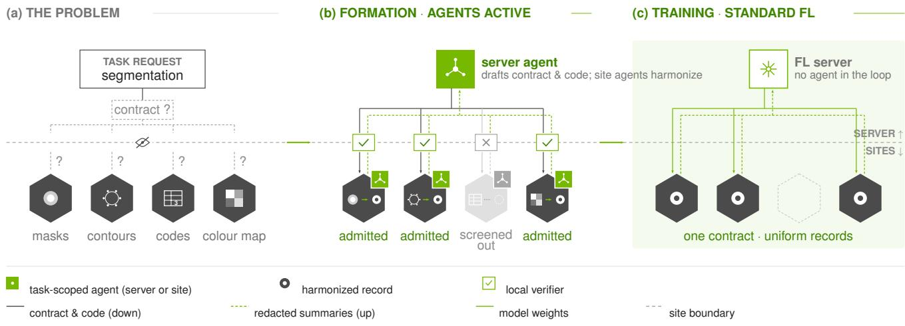
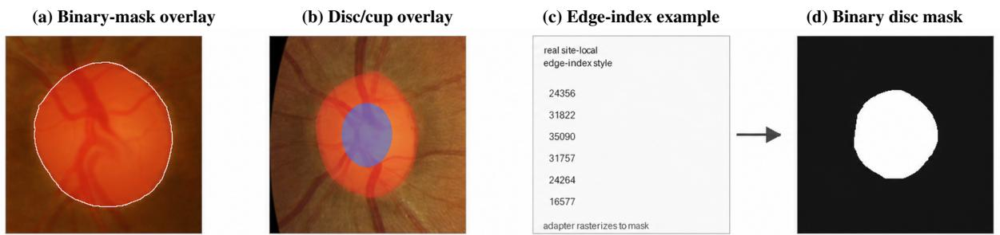
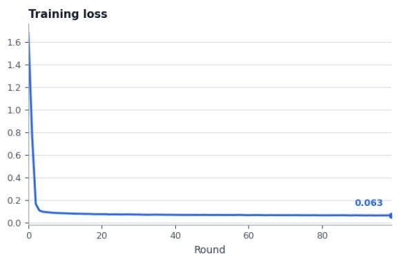
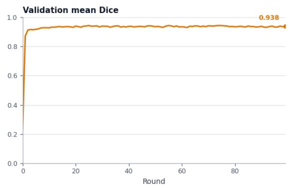
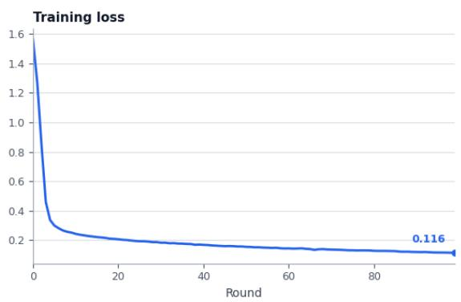
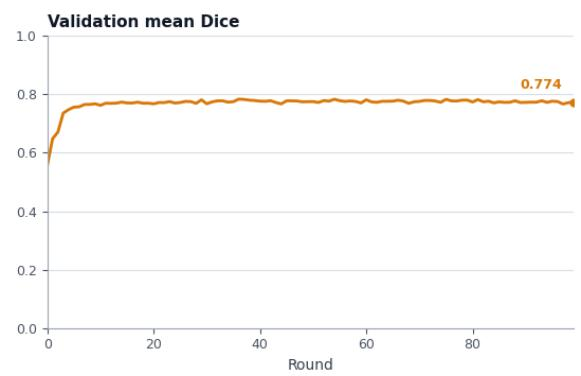
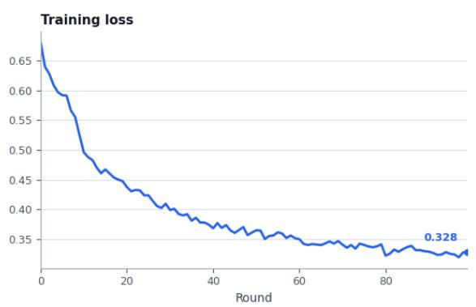
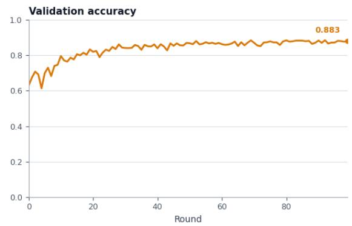
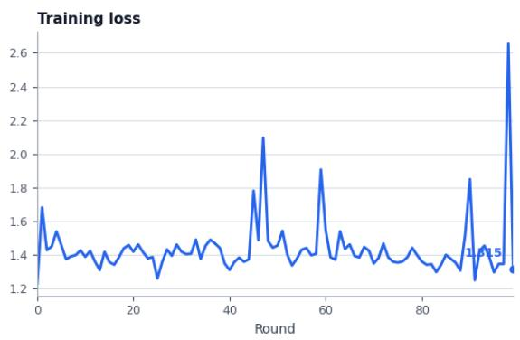
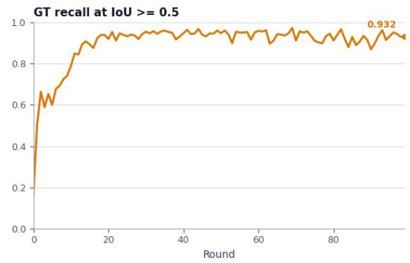

# FedReady: Bounded Agents for Federation Formation

Ziyue Xu Holger R. Roth Chester Chen Peter Cnudde

NVIDIA

ziyuex@nvidia.com

Preprint

## Abstract

Federated learning (FL) runtimes standardize aggregation and deployment, but each new study still requires federation formation: selecting task-eligible sites and preparing their local data and task code for federated training or analysis. This preparation recurs when the target changes, while raw records and site-private mappings are excluded from cross-site FL messages. We present FedReady, a system that performs federation formation with bounded LLM agents. Agents propose shared contracts, local adapters, and task code; the runtime owns workflow state and accepts artifacts only after checks tied to their digests. Candidate site discovery prioritizes recall; local eligibility verification checks task support before site admission. Once participating sites and artifacts are fixed, conventional federated training or analysis proceeds without readiness agents Across 39 simulated retinal sites and four tasks, discovery reaches recall 1.00 at precision 0.65; local eligibility verification removes all 17 false positives without losing an eligible site–task pair. The participating sites supply 45,575 task-record instances and complete four 100-round jobs, including one with a runtime-generated contract. Across ten patient cohorts, preparation supports seven patient populations and holds endpoints at three sources as unsupported. Comparison with manually prepared reference populations and analysis (the manual reference) gives a maximum survival-curve difference of 0.001133. We also analyze 19 development failures, targeted classification ablations, and standalone and heterogeneous agent configurations. These results establish the feasibility of task-specific data preparation before ordinary FL training or analysis.

## 1 Introduction

Federated learning (FL) lets institutions train a shared model without centralizing their records (McMahan et al., 2017). Production runtimes handle aggregation, deployment, and fault tolerance (Bonawitz et al., 2019; Roth et al., 2022), but they start from a federation that already exists: sites that can each emit records under one shared interface and task code that consumes them. We definefederationformation as selecting task-eligible sites and preparing their local data and task code for federated training or analysis. Even within an established FL alliance holding structured data, preparing data for a particular FL task remains separate work: defining a shared data contract, writing conversion code against each site’s native annotations or clinical fields, and producing task code that runs on the result. This stage recurs per task, not per deployment: disc segmentation and disc detection over the same images need different contracts, adapters, and trainers. Even across a 52-database network that already shares a standardized schema, operators still report the need for feasibility feedback and coordinated code deployment (Burkard et al., 2025).

Automating this stage requires more than code generation. The evidence that decides whether a site qualifies sits behind that site’s disclosure boundary: a local codebook that says whether a numeric code means glaucoma, an annotation format that may or may not contain the requested structure, a duration field whose endpoint is defined only in a source publication. Under the configured disclosure policy, the FL server receives approved summaries rather than raw records and site-private mappings; public documentation can still inform interpretation. A common schema does not supply the missing meaning.

LLM agents can now carry out much of this work (Li et al., 2026; Saha et al., 2025), but handing it to them raises a placement question that model quality alone does not answer. A server agent cannot verify a predicate over evidence it cannot see. A site agent that emits plausible adapter code has not shown that the code produces correct records. A reporting agent that finds an error in a log has not shown that the job failed. Each is an ownership failure: a component decides something whose evidence or authority belongs elsewhere.

FedReady performs federation formation with agents bounded by view (evidence they may observe), output (artifacts they may propose), and authority (they cannot accept artifacts or admit sites). Server agents draft the contract and task code; site agents write adapters. The runtime owns transport, per-site state, and artifact acceptance, requiring checks tied to each artifact’s digest. With participating sites and artifacts fixed, readiness agents stop and ordinary FL training or analysis begins (Figure 1).

  
Figure 1. Federation formation, illustrated for imaging. A new task encounters incompatible private representations (a). Bounded agent propose a shared data contract, local adapters, and task code; local verifiers check prepared data before site admission (b). Ordinary FL then runs on fixed inputs, without readiness agents (c). The hosted coding-provider channel is not shown (Section 4.2).

The central design rule is to place each decision at the boundary that owns its evidence. Within a fixed formation episode, terminal exclusion loses eligible sites; retained ineligible sites remain removable by later checks. FedReady assigns high-recall candidate site discovery to the server and local eligibility verification to site verifiers that execute generated adapters against locally supported semantics. On 39 simulated retinal sites and four tasks, this pipeline screens out 17 ineligible candidates against the evaluator’s ledger, without sending raw evidence to the FL server. The hosted coding provider is a separate trust boundary (Section 4.2).

Our contributions are:

• Abstraction. We identify federation formation as a recurring, per-task stage between private data and an FL runtime, with an audit graph and four separately checkable validity criteria (Section 3).

• System. We build FedReady on a production FL runtime, NVIDIA FLARE (Roth et al., 2022), around runtime-owned artifact acceptance and evidence-based decision placement, with request-bound messages, persite states that cannot skip required checks, task-code execution tests, and training from fixed verified inputs. An extension shares verified procedures among heterogeneous site agents (Section 4).

• Evaluation. Across 156 imaging site-task decisions, local eligibility verification removes all 17 discovery false positives without recall loss; four 100-round jobs complete, one with a generated contract. Seven of ten patient cohorts support analysis, with maximum survival-curve difference 0.001133 from the manual reference (Section 5).

• Lessons. An audit of 19 development failures classifies 15 primarily as ownership or state-integrity faults, yielding design lessons for agentic ML pipelines (Sections 5.6 and 6).

Our sites are diverse public datasets simulated as private sites on one host. The evaluation therefore tests logical boundaries, site-selection correctness, and executability; it does not measure labor savings, formal privacy, or clinical validity (Section 6). Field mappings, provenance policies, and the incident index are in the appendix.

## 2 Related Work

FL systems and data validation. FL runtimes standardize training and deployment interfaces (Bonawitz et al., 2019; Roth et al., 2022); benchmarks such as FedScale supply workloads with shared task interfaces (Lai et al., 2022). Data validation checks conformance (Breck et al., 2019), yet federated analyses still require coordination on standardized data (Burkard et al., 2025). FedReady constructs task interfaces from private sites; schema checks cannot establish codebook or endpoint meaning.

Agentic FL. FedAgentBench is closest because it also addresses client selection and data harmonization (Saha et al., 2025); we reuse its retinal population list. Our emphasis is on checking generated artifacts and proposed site admissions against local evidence, runtime-controlled acceptance, and fixing the accepted configuration before downstream execution (Table 1). Automation alone is not our novelty claim. Agent registries describe published capabilities (Raskar et al., 2025; Singh et al., 2025), not contractspecific readiness.

Table 1. Positioning relative to related agentic systems: primary objectives and agent-produced outputs. FedReady connects task-specific site selection and data preparation to runtime-controlled acceptance before training or analysis.
<table><tr><td>Work</td><td>Primary objective</td><td>Main mechanism or output</td></tr><tr><td>FedAgentBench (Saha et al., 2025)</td><td>Automate and benchmark medical FL workflows</td><td>Server-client agents coordinate client selection, preprocessing, label harmonization, and training.</td></tr><tr><td>Helmsman (Li et al., 2026)</td><td>Synthesize FL systems from user specifications</td><td>Agents generate plans and modular FL code, then evaluate and refine implementations in simulation.</td></tr><tr><td>Auto-FL-Research (Roth et al., 2026)</td><td>Search training algorithms within an existing federation</td><td>Coding agents propose and evaluate changes to FL training recipes.</td></tr><tr><td>2026)</td><td>FederatedSkill (Yang et al., Improve agents through collaborative skill evolution</td><td>Agents share semantic skill patches to update personalized skill libraries.</td></tr><tr><td>This work (FedReady)</td><td>Select eligible sites and prepare task-compatible inputs</td><td>Agents propose contracts, local adapters, and task code; the runtime controls acceptance and site admission using local evidence and execution checks.</td></tr></table>

Shared procedural knowledge. FederatedSkill shares semantic patches for personalized agent evolution (Yang et al., 2026); knowledge sharing alone is not novel. Our extension targets local data readiness: contrastive lessons retain disambiguating observations and receiver checks, with unchanged local verifiers. Separating these effects remains future work.

Executable feedback, failures, and agent security. Coding-agent interfaces and test generation emphasize execution over plausible text (Yang et al., 2024; Ahmed et al., 2025). Failure taxonomies classify multi-agent failures (Cemri et al., 2025); our audit tracks ownershipboundary violations. Security and leakage benchmarks motivate boundary restriction and whole-trace audit (Zhang et al., 2025; El Yagoubi et al., 2026). Our formation interfaces are neither a security benchmark nor a formal privacy mechanism.

## 3 Federation Formation

Let $\boldsymbol { S } = \{ S _ { 1 } , \ldots , S _ { n } \}$ be candidate sites. Site $S _ { i }$ owns private state $x _ { i } = ( D _ { i } , R _ { i } , P _ { i } , E _ { i } ) \colon$ records, their representation and semantics, disclosure policy, and execution environment. Given a task $q ,$ formation produces

$$
W = ( C , \{ A _ { i } , M _ { i } \} _ { i \in \widehat { \cal S } } , T , J , G ) ,\tag{1}
$$

where $C$ is the shared contract, $A _ { i }$ a local adapter, $M _ { i }$ its immutable prepared-data manifest, T shared task code, J the exported job, G an audit graph, and ${ \widehat { s } } \subseteq s$ the participating sites. The server observes policy-approved projections $z _ { i } = \rho _ { i } ( x _ { i } )$ , never $x _ { i }$ itself.

Two features make formation a coordination problem rather than a fixed pipeline. First, capability is indexed by site and task: whether a site can supply a target depends on $q .$ Published metadata may be insufficient for a new target, so earlier site admission does not replace contract-specific verification. Second, the decisive artifacts are executable: a capability claim means little until code at that site produces contract-valid records, so discovery and code synthesis must be linked to execution-derived checks.

Success is the conjunction of four separately reported criteria, since none implies the others: site-selection correctness $( \hat { \cal S }$ matches an evaluator’s eligible-site ledger), local validity (each $M _ { i }$ holds contract-valid, provenance-bound records), package validity $( T$ completes a simulation on synthetic test data: contract-valid records used for execution testing), and execution validity $( J$ completes the multiclient job and persists its outputs). Correctly screening out a site whose evidence does not support the target is a valid outcome, distinct from implementation failure. Our gates establish conformance to implemented predicates, not an independent clinical oracle.

Trust model and scope. We assume honest-but-fallible agents, malformed generated artifacts, accidental overdisclosure, ambiguous source semantics, and backend or transport failures. The FL runtime is a centralized control plane; evidence stays decentralized at the sites. We do not defend against a malicious host, provide OS-grade confinement of generated code, or establish differential privacy. In the evaluated configuration a hosted coding worker operates under a site-scoped access policy, so keeping records out of cross-site messages does not prove non-observation by its provider.

## 3.1 Artifact Acceptance and Site Admission

Artifact acceptance approves generated contracts or code; site admission accepts verified sites into the federation; a state transition records workflow progress. These are separate runtime decisions. Three invariants, each enforced by an interface rather than a prompt, organize the design: scope (I1: a record-level observation cannot silently become a site-level veto), proposal (I2: agent output is never a veri fier result), and terminal state (I3: the runtime’s completion evidence, not a narrative or log token, determines success).

Property 1 (Acceptance tied to checked artifacts). Assuming an honest host and intact acceptance interfaces, every accepted contract, adapter/manifest, and trainer carries a runtime-owned attestation (verification record) bound to the digest (content hash) ofits reviewed bytes.

The runtime restores verification fields from its own checks and accepts only artifacts with the reviewed digest. Agent self-reports cannot replace these checks; visual observations may inform them but cannot authorize acceptance. This argument bounds who accepts artifacts, not semantic correctness; it is not a machine-checked theorem.

The second result concerns where a decision is taken. For the eligible set $\mathcal { E }$ and shrinking active site sets $S _ { 0 } \supseteq \cdots \supseteq$ $\boldsymbol { \mathcal { S } } _ { K } = \boldsymbol { \widehat { \mathcal { S } } }$ , define recall as $\vert S _ { k } \cap \mathcal { E } \vert / \vert \mathcal { E } \vert$

Proposition 1 (Authority placement). For fixed $\mathcal { E } ,$ terminal exclusion without re-entry means recall cannot increase along the stage chain. An excluded eligible site is unavailable to later checks; a retained ineligible site remains removable by a later evidence-sufficient verifier.

This follows from set inclusion. A stage seeing only $\rho _ { i } ( x _ { i } )$ should defer predicates over omitted evidence to a later sound and complete verifier; deferral alone guarantees nothing. Retries repair implementations, not justified screening. Changed evidence requires a new formation episode; live re-admission is unevaluated. Section 4 implements this split, and Section 5.2 measures both of its terms.

## 4 The FedReady System

FedReady implements Section 3.1 through candidate site discovery, contract resolution, local adaptation, and taskcode execution tests before ordinary FL. Only the runtime authorizes state transitions.

## 4.1 Architecture and Runtime Ownership

Agents receive request-scoped work items, not controller handles or peer addresses. They can propose artifacts but cannot invoke another site, mutate the participating-site list, or approve their own artifacts (Table 2).

What the runtime must provide. NVIDIA FLARE (Roth et al., 2022) owns transport, state, and execution. Typed Shareable headers bind replies to requests; controllers and executors own cross-site dispatch. The simulator tests exported jobs against synthetic test data, and sample-weighted FedAvg runs imaging training. These are logical workflow boundaries, not deployment-grade isolation. Another runtime would need equivalent state ownership, request binding, and deployment-faithful simulation.

Backbones. In the primary imaging configuration, hosted Codex workers perform global planning, task-code synthesis, and site-scoped adapter coding, and Qwen3-VL-8B-Instruct supplies bounded visual judgments at a local endpoint. Separate Luna/Codex and Pi/Nemotron studies extend the preparation evaluation; Table 11 records campaignspecific model, harness, effort, and budget settings.

## 4.2 Typed State and Disclosure Boundaries

Within an attempt, each site advances through gated states: registered, profiled, plausible, contract-bound, adapterattested, materialized, verified, and train-ready. Screenedout sites, held records or endpoints, and implementation failures have distinct typed dispositions. Generated-contract tasks add a materializer-ready gate. A repair creates a new, bounded attempt; it cannot overwrite an attestation or skip a gate.

Every reply is bound to session, correlation, schema, task, site, round, and action, including the payload’s client identity, so a valid JSON object from the wrong request cannot trigger a state transition. The transcript links artifact versions, checks, and dispositions into the audit graph G instead of treating free-form logs as the state record.

Disclosure has two channels. Cross-site FL messages exclude records, codebooks, source paths, adapter source, and manifests, using typed status, counts, reason codes, booleans, digests, and authorized summaries instead. Optional semantic redaction preserves required fields and is runtime-audited. Separately, the hosted coding provider receives prompts and tool-visible content: local file reads can expose documentation, paths, record excerpts, code, and diagnostics. Site-scoped tools do not imply local model inference; a local VLM does not protect this coding channel. We have not audited complete provider-bound traffic. These are coarse flow controls (Sabelfeld and Myers, 2003), not a privacy guarantee.

## 4.3 Candidate Site Discovery and Local Eligibility Verification

Candidate site discovery. To find potentially suitable sites, the server broadcasts a bounded inquiry for q. Sites profile authorized structure and may use agents to interpret local documentation or codebooks. Redacted site profiles support plausibility, not verified eligibility. Discovery prioritizes recall, retaining candidates for local eligibility verification (Proposition 1), and can stop early if no site reports plausible data.

Table 2. Roles are assigned by evidence access and permitted state effects, not by a particular backbone. Agents propose artifacts; the runtime accepts them after checks.
<table><tr><td>Role</td><td>Permitted view/output</td><td>Authority boundary</td></tr><tr><td>FL runtime</td><td>Typed messages, contract, site list, digests; dispatch, checks, export, training</td><td>Owns transport, state, verification records, and terminal evidence; does not infer private label meaning</td></tr><tr><td>Server planner/coder</td><td>Task, redacted summaries, synthetic test data; inquiry, contract, task code</td><td>No raw site evidence, direct client calls, or artifact acceptance</td></tr><tr><td>Site adapter coder</td><td>Authorized local structure, documentation, contract; adapter or abstention</td><td>No sibling access, contract mutation, or visual-verdict ownership</td></tr><tr><td>Local visual witness</td><td>Bounded raw input and contract-owned rendering; structured observations</td><td>No cross-site images, code edits, or site admission</td></tr><tr><td>Local verifiers</td><td>Owning-site artifacts; structure, provenance, and execution checks</td><td>No invented semantics, silent repairs, or reference-code substitution</td></tr><tr><td>Disclosure filters</td><td>Message payloads; field checks and redaction</td><td>No artifact acceptance or site admission</td></tr></table>

  
Figure 2. Different annotation representations, not successive views of one case: (a) a binary disc-mask overlay; (b) a multi-valued mask overlay (orange disc, purple cup); (c) an edge-index illustration derived from a real mask boundary; (d) the binary disc-mask format required by the data contract. The arrow illustrates rasterization of boundary indices. Adapters must resolve encoding and label meaning; Table 3 shows the tabular counterpart.

Contract resolution. The server resolves a versioned data contract from q and redacted site profiles. The contract specifies required structure, meaning, and constraints; its schema defines the structural part. The interface is how task code consumes the prepared records under that contract. Built-in contracts cover binary segmentation and imagelevel classification. For a new task family, an agent proposes a contract, and a separate request produces a materializer that converts adapter outputs to its schema. Required fields, types, invariants, and synthetic test data construction are checked before dispatch. The contract owns the invariants, so generated code cannot invent exclusion rules, and adapter execution binds to the selected contract and materializer digests.

Local eligibility verification. A site agent checks task support against authorized inputs and proposes an adapter and manifest. The runtime snapshots pre-existing source identities, compiles the adapter, and runs sample adapter checks on at most eight real local records: declared semantics, pairing, types, conversions, and exact source/manifest binding. Newly generated annotations cannot masquerade as original label evidence, and live modes never fall back silently to a reference adapter.

The server receives typed extraction outcomes and aggregate verification summaries. A site is screened out when its evidence cannot support the task. A record or endpoint is held when source evidence or contract rules do not support its inclusion in analysis. Missing target values have a separate status. These outcomes differ from implementation failure: required code or its execution fails, which does not establish data ineligibility. Correct screening or holds count as completed preparation, not workflow failure.

Medical imaging data. For image-bearing tasks requiring visual evidence, a local visual witness observes a bounded raw input and a contract-owned rendering, conditioned on a digest-bound task example; its verdict is a structured observation, not permission to edit code or admit a site. Full materialization then checks required fields, counts, label domains, splits, readability, and provenance. A representative check does not establish dataset-wide visual or clinical correctness. Broad quality grading and autonomous relabeling are outside this paper.

Clinical tabular data. For tables, the contract also states the analysis unit, endpoint, event coding, duration units, and population-selection rules. Agents inspect documentation and propose site mappings and measurable assertions; local programs then apply those policies to all records without perrecord LLM review. Fixed coordinator checks cover identifiers, target domains, hashes, and contracted predicates over execution-derived measurements, and an aggregate reviewer can request local corrections or a new contract. The same distinction between proposal and artifact acceptance applies: assertions test conformance to an issued interpretation but cannot independently establish its clinical meaning.

## 4.4 Task-Code Execution Tests and Training Handoff

After local preparation, the server coder receives the contract, approved aggregates, and synthetic test data, never real site records, and proposes a contained task package. For imaging training, schema, path, containment, and compilation checks precede task-code execution tests: a runtimeowned one-client simulation on synthetic test data checks the exported command line, imports, data loader, model, optimizer, update exchange, metrics, and persistence. Bounded failure feedback returns to the same coding role for repair. Passing these tests is neither operator deployment approval nor clinical validation.

The runtime then fixes $C , { \widehat { S } } , \{ M _ { i } \}$ , and the task-code digest, and ends readiness-agent participation. Each admitted client re-resolves its prepared-data root and checks manifest, schema, splits, and digests before running shared task code; the exported job contains no prepared examples or per record manifests. Imaging rounds exchange model updates and approved aggregate metrics under sample-weighted FedAvg (McMahan et al., 2017). The tabular application instead aggregates endpoint-specific event/censor histograms with a numerical check, without training a predictive model. In both workloads there are no readiness agents or sharedguidance updates downstream. The present simulation skips human approval; deployment would require operator approval and stronger code confinement.

## 4.5 Extension: Heterogeneous Site Agents

The base FedReady uses one site-agent configuration. Agents introduce another form of FL heterogeneity, agent heterogeneity, in which each site can use a different agent backbone. We therefore investigate FedReady-Hetero, which permits different site-agent configurations. The exten sion keeps the same contracts and runtime checks and adds shared guidance. Initially successful stronger agents share procedures intended to make weaker agents’ preparation more consistent.

Local contrastive-guidance generation. After verified preparation, a designated contributing site abstracts its procedure into shared guidance with site-specific details removed. A contrastive lesson records a plausible incorrect interpretation, the local observation that rules it out, and a check the receiver must perform; for example, an output mask must not be mistaken for a pre-existing annotation source. Lessons derive from verified success or an actually resolved failure and cannot invent a failure history.

Global distillation. The server distills validated lessons into common steps and conditional procedures gated on receiver-local evidence, removing donor paths, examples, adapters, numeric codebooks, and unresolved conflicts. Lessons explain how to investigate, not another site’s label meanings. Provenance checks do not prove correctness or absence of leakage. Site agents first attempt independently; unresolved implementations may retry with shared guidance under unchanged local verifiers, and verified successes may contribute lessons. Completed sites do not rerun; justified screening is not reversed. Retries stop when preparation completes, no new shared guidance is produced, or the attempt limit is reached. The aim is repeatable success within existing capability, not guaranteed rescue (Section 6).

## 5 Evaluation

We ask five questions across two modalities: RQ1 (site admission): do candidate site discovery and local eligibility verification select the correct sites under the disclosure policy? RQ2 (new task interface): can the fixed protocol build and execute a new task interface? RQ3 (training and analysis): do accepted packages execute, and how closely does tabular analysis match the manual reference? RQ4 (agent configurations): how does readiness vary across agents and harnesses? RQ5 (failures): which boundaries do development failures violate? Imaging and tabular studies use distinct coordinators, not one combined run.

## 5.1 Workloads and Methodology

Retinal imaging data. We register 39 public retinal packages, following the population listed by FedAgent-Bench (Saha et al., 2025), as simulated private sites. They differ in layout, annotation representation, codebooks, and task eligibility. Four tasks (disc segmentation, cup segmentation, glaucoma classification, and disc detection) are each issued to all 39 sites, giving 156 site-task decisions. Figure 2 contrasts binary masks, multi-valued masks, and boundary indices: adapters must interpret the native labels and produce the binary disc-mask interface required by the task.

Clinical tabular data. Ten public colorectal-cancer patient cohorts (seven GEO series, TCGA colon and rectal cohorts, and an Ethiopian cohort) contain 2,189 source records, including controls. The authors separately prepared reference populations and analysis (the manual reference). Both methods use the same checksum-bound pool of 98 clinical-metadata and documentation files; expression matrices, manual adapters, prepared reference tables, and reference outputs are unavailable to live agents. The task is to construct supported populations for endpoint-specific survival analysis, not to pool different endpoints under one schema. As Table 3 shows, a value can have the right type but the wrong endpoint, event polarity, time origin, analysis unit, or population. Identity, applicability, and eligibility must precede target-completeness filtering, and a supported target can coexist with an unsupported covariate. A dedicated tabular coordinator reuses the architecture and agent bridge of Section 4, not the unchanged imaging controller.

Table 3. Representative native-column challenges in the clinical workload. GEO names are characteristic keys; TCGA prefixes denote nested objects. Additional evidence determines which fields and records support the task, or whether targets must be held.
<table><tr><td>Source</td><td>Native columns</td><td>Task selection and interpretation</td><td>Additional evidence</td></tr><tr><td>GSE14333</td><td>DFS_Time, DFS_Cens, DukesStage</td><td>DFS for supported Dukes B/C; months/12; event = 1 - DFS_Cens. Completeness alone does not confer eligibility.</td><td>Published methods for this patient cohort (Jorissen et al., 2009), recurrence counts, duration distributions.</td></tr><tr><td>Ethiopia</td><td>TIME, VSTATUS, statusfn; Date_Dx,Date_death</td><td>CRC-specific survival, not all-cause OS; months/12; 1 means CRC death. Hold contradictory chronology.</td><td>Endpoint definition (Teka et al., 2021), duplicate status, published person-months/life table.</td></tr><tr><td>TCGA COAD/READ</td><td>demographic: vital_status, days_to_death;diagnoses: days_to_last_follow_up; follow_ups:</td><td>Case-level OS: death days for dead cases; latest applicable nonnegative follow-up for alive cases; days/365.25. Follow-up cannot</td><td>GDC dictionary/release guidance (NCI Genomic Data Commons, n.d.); clinical outcome methods (Liu et al.,</td></tr><tr><td>GSE35896</td><td>days_to_follow_up Mirror ID_REF, DFS (in months),DFS event, Gender; GEO^SAMPLE</td><td>All 62 accessions join, but targets remain held: linkage does not authenticate secondary clinical fields.</td><td>2018). Primary-source comparison; 32 joined-record sex conflicts and unresolved mirror</td></tr></table>

Task specification and automation boundary. Table 4 separates supplied inputs from generated artifacts. Fixed runtime checks cover schemas, provenance, artifact binding, and executable conformance. For tables, the coordinator also evaluates agent-generated measurements and assertions over executed outputs. These can repeat an adapter’s mistaken assumption: passing is not independent semantic verification. Agents formulate policies; local programs process records.

Reference evidence and metrics. Both studies run public sources as private-site stand-ins on one host. The tabular clients are source patient cohorts, not ten verified independent hospitals; cross-source patient overlap is unresolved. For imaging, an evaluator-owned ledger, never exposed to agents or used as an admission allow-list, defines eligibility from locally available evidence: spatial tasks need provable target supervision, and classification needs explicit local diagnosis meaning rather than structural proxies or undocumented numeric codes. We report discovery precision and recall, final site admissions, and completion of 100-round jobs. Prediction metrics are unweighted means of available client validation scalars, not pooled patient-level scores. For tables, we report supported versus held endpoints by source, endpoint-specific record and event counts, monthly survival-curve agreement with the manual reference, and a separately implemented arithmetic check on the agent’s accepted inputs. Neither study measures a matched speedup or predictive superiority over a baseline.

Table 4. Automation boundary across workloads. Task requests, source inputs, and shared runtime checks are supplied in every case.
<table><tr><td>Workload</td><td>Supplied specification</td><td>Agent-produced artifacts</td></tr><tr><td>classification</td><td>Segmentation; Built-in data contract Site mappings, adapters,</td><td>task code</td></tr><tr><td>Detection</td><td>Generic field/storage Contract, materializer, checks</td><td>local conversions, trainer</td></tr><tr><td>Clinical tables Output fields and</td><td>screening categories adapters, measurable</td><td>Endpoint/selection rules, assertions, analysis code</td></tr></table>

Table 5. Federation formation across four tasks, each issued to 39 sites. Candidate counts include discovery precision in parentheses. Local checks screen out all 17 ineligible candidates. Records reused across tasks count again.
<table><tr><td>Task</td><td>Candidates Screened (precision)</td><td>out</td><td>Admitted Records</td><td></td></tr><tr><td>Disc segmentation</td><td>12 (0.67)</td><td>4</td><td>8</td><td>6,482</td></tr><tr><td>Cup segmentation</td><td>8 (0.75)</td><td>2</td><td>6</td><td>6,062</td></tr><tr><td>Glaucoma</td><td>19 (0.53)</td><td>9</td><td>10</td><td>26,549</td></tr><tr><td>classification Disc detection</td><td>10 (0.80)</td><td>2</td><td>8</td><td>6,482</td></tr><tr><td>Total</td><td>49 (0.65)</td><td>17</td><td>32</td><td>45,575</td></tr></table>

## 5.2 RQ1: Decision Placement and Site Admission

Imaging admission. Candidate site discovery retained 49 site-task pairs from redacted site profiles against 32 eligible pairs: recall 1.00 at precision 0.65. Local eligibility verification removed all 17 false positives without recall loss: precision 1.00 at recall 1.00 (Table 5). Admitted sites supply 45,575 materialized records across 32 task memberships, not 32 distinct organizations. The server received typed screening outcomes and approved summaries, not raw rejection evidence. The targeted classification ablations below test the contribution of individual preparation mechanisms.

Discovery precision is lowest for glaucoma (0.53), whose labels can require a local codebook omitted from central profiles. One source provided documented spatial targets but was screened out for classification: its numeric diagnosis columns lacked a codebook. Four disc candidates lacked usable target labels or pairings. Discovery precision 0.65 depends on this population and metadata policy; richer approved metadata could change it.

Targeted classification ablations. The two ablations use a matched control, not the historical training run (Table 6). The semantic-check arm retains agents, inputs, instructions, local budgets, reasoning, and abstention across 19 candidates. It yields no false admissions, but lower token consumption coincides with an eligible-site exclusion. Discovery is intended to avoid contract-building and adapter effort when no client supports the task.

Clinical population construction. All ten tabular workflows completed; seven supplied supported populations. Endpoints at GSE33113, GSE35896, and GSE37892 remained held for endpoint, identity, or provenance uncertainty. At GSE37892, executable date subtraction cannot establish event-free follow-up from missing metastasis dates; retaining only known metastases would select on the outcome. Holding an unsupported endpoint completes preparation without including it in analysis. One corrective cycle addressed GSE37892 and TCGA\_COAD; a TCGA\_READ adapter failure was recovered. These outcomes distinguish unsupported semantics from repairable implementation failure: schema validity or a successful join alone cannot justify site admission or endpoint inclusion.

Table 6. Glaucoma preparation: ten eligible sites, one run per configuration. Tokens normalized to the matched full-workflow control.
<table><tr><td>Configuration</td><td>Incorrect Eligible admissions ↓ excluded ↓ tokens ↓</td><td></td><td>Relative</td></tr><tr><td>Full workflow</td><td>0</td><td>0</td><td>1.000</td></tr><tr><td>Without semantic-evidence</td><td>0</td><td>*一</td><td>0.894</td></tr><tr><td>and class-coverage checks Without candidate site</td><td>0</td><td>0</td><td>1.099</td></tr></table>

End-to-end tokens (row order): 10,467,482; 9,359,084; 11,500,395. Provenance-related exclusion; causal link to removed checks unresolved.

## 5.3 RQ2: Adapting to a New Task Interface

Disc segmentation and detection share eight sites and 6,482 images, but require different schemas, materializers, and adapters: native boundaries must become boxes for detection. Prior site admission does not establish new-interface conformance; source evidence and artifacts require rechecking.

Detection was also a generated-contract probe. The runtime contains generic field and storage validation, but no checked-in detection contract, materializer, renderer, adapter, or fallback trainer. From the request and redacted site profiles, the server generated an image-box contract and materializer, eight site agents converted their own contours or masks into locally verified boxes, and the server coder produced a Faster R-CNN-style package that passed contract-preserving simulation and completed 100 rounds. Three interfaces (shared schema, local conversion, shared trainer) changed at run time while authority, message binding, and gates stayed fixed. This is one task-family probe, not evidence of arbitrary task generality.

## 5.4 RQ3: Training and Analysis on Verified Inputs

Imaging training. All four jobs completed 100 rounds of sample-weighted FedAvg (Table 7). Detection’s round-96 communication warning did not prevent completion or persisted terminal artifacts. Learning curves remain in the supplement as execution diagnostics.

Survival analysis and agreement. A generated FLARE application, accepted on its second attempt, computes sepa rate monthly-grid Kaplan-Meier curves (Kaplan and Meier,

Table 7. End-to-end execution after federation formation. Agent-generated local adapters and shared task code support four completed FL jobs, including detection with an agent-generated data contract. Participating sites and artifacts remain fixed, with no readiness-agent intervention. Validation metrics are unweighted means across reporting clients.
<table><tr><td>Task</td><td>Shared data contract</td><td>Participating sites</td><td>Rounds completed</td><td>Final validation result</td></tr><tr><td>Disc segmentation</td><td>Predefined</td><td>8</td><td>100/100</td><td>Dice: 0.9383</td></tr><tr><td>Cup segmentation</td><td>Predefined</td><td>6</td><td>100/100</td><td>Dice: 0.7740</td></tr><tr><td>Glaucoma classification</td><td>Predefined</td><td>10</td><td>100/100</td><td>Accuracy: 0.8827; AUC: 0.9150</td></tr><tr><td>Disc detection</td><td>Agent-generated</td><td>8</td><td>100/100</td><td>GT recall@0.5: 0.9316</td></tr></table>

Table 8. Survival results (records/events). Curve differences compare agent and manual populations on the same monthly grid.
<table><tr><td>Endpoint</td><td>Sites</td><td>Agent</td><td>Manual Max. |∆S|</td></tr><tr><td>OS</td><td></td><td>51,410/410</td><td>1,417/412 0.001133</td></tr><tr><td>DFS</td><td>1</td><td>185/48</td><td>185/48</td></tr><tr><td>CRC-specific</td><td>1</td><td>160/74</td><td>160/74</td></tr></table>

1958) from local event/censor histograms after prepared inputs are fixed. Five clients contribute overall survival (OS); disease-free (DFS) and CRC-specific survival each use one client, so those two endpoints test endpoint-preserving exe cution rather than multi-client aggregation.

DFS and CRC-specific counts and curves match at all 80 and 49 monthly points (Table 8). OS differs in at least one risk/event/censor count at 42 of 153 points, with maximum survival difference 0.001133 (0.1133 percentage points). Archived attribution lists four stage-0 and four prior-treated records held only by the agent, and one primary-case record included only by the agent: seven fewer patients and two fewer events overall. These are selection disagreements, not adjudicated errors; the patient-row-free archive prevents independent replay. A separate arithmetic check reports zero curve error on accepted inputs, not validation of original eligibility or endpoint meaning. The manual reference is not independent clinical adjudication.

## 5.5 RQ4: Agent Configurations and Readiness

FedReady-Hetero uses a Sol server, 20 Sol-high and 19 Luna-low site agents; high/low denote reasoning effort. Table 9 reports readiness, not training completion; initial R2 means round 2, not one-shot success.

Readiness rises from 26/32 to 31/32 task memberships: Luna-low from 10/16 to 15/16, Sol-high unchanged at 16/16. One glaucoma membership remains unresolved; detection needs no revision.

All four Luna detection sites succeed initially, but intentional Sol/Luna reassignment between detection and disc segmentation prevents paired inference about standalone segmentation success. Causal guidance effects, stability, and record correctness require matched repeated trials and complete attempt and guidance-use records (Section 6).

Table 9. Heterogeneous readiness: Sol-high / Luna-low counts, not fractions; 39 sites per task. $^ { 6 6 } - / - ^ { 9 } :$ initial readiness retained without revision.
<table><tr><td>Task</td><td>Expected</td><td>Initial R2</td><td>Latest</td></tr><tr><td>Disc segmentation</td><td>4/4</td><td>4/2</td><td>4/4</td></tr><tr><td>Glaucoma classification</td><td>5/5</td><td>5/2</td><td>5/4</td></tr><tr><td>Cup segmentation</td><td>3/3</td><td>3/2</td><td>3/3</td></tr><tr><td>Disc detection</td><td>4/4</td><td>4/4</td><td>-/-</td></tr></table>

Table 10. Standalone preparation on 39 sites per task: eligible memberships missed against the same reference. Both configurations have zero incorrect admissions.
<table><tr><td>Task</td><td>Eligible missed</td><td></td><td>Luna Nemotron missed</td></tr><tr><td>Disc segmentation</td><td>8</td><td>1</td><td>0</td></tr><tr><td>Cup segmentation</td><td>6</td><td>1</td><td>2</td></tr><tr><td>Glaucoma classification</td><td>10</td><td>2</td><td>1</td></tr><tr><td>Disc detection</td><td>8</td><td>1</td><td>2</td></tr><tr><td>Total</td><td>32</td><td>5</td><td>5</td></tr></table>

Standalone agent configurations. All-Luna-low/Codex without shared guidance and Nemotron 3.5 Super/HIGH with Pi each miss five eligible task memberships (Table 10); their missed sites do not overlap within any task. Nemotron’s misses are implementation failures; Luna’s failure types are unspecified. These separate campaigns do not isolate model, harness, or guidance effects.

## 5.6 RQ5: What Failed in Development

Archive review identifies 19 author-coded incidents: five authority, five scope, five state-loss, and four environment failures; 15/19 concern ownership or state integrity. Eight have a validating retry or regression test (E1); eleven have a timestamped trace and diagnosis (E2). Four quality-screening incidents (WF-002, WF-011, WF-012, WF-013) are out of scope. Without a second annotator or reliable run/attempt denominator, incident shares are not failure rates. This audit covers the primary coding configuration, not a matched multi-backend study.

WF-001 treated seg as supervision and omitted classfolder evidence, silently excluding an eligible 4,217-record classification source from a completed run (Proposition 1); narrowing parser ownership recovered its verified manifest. In WF-004, synthetic test data lost approved detectioncontract fields; seven misdirected trainer revisions failed, while preserving the contract enabled task-code execution tests and training. These cases identify concrete interfacelevel repairs; incident summaries and evidence grades are in Appendix D.

Other incidents involved undeclared materializer invariants, provenance confusion, and log-based completion errors. All four environment faults required exported-code execution to detect.

## 6 Discussion and Limitations

Lessons for agentic ML pipelines. Four lessons follow: place authority by evidence; execute the exported interface; repair the owning component; and audit transitions. Typed outcomes distinguish screened-out sites, held records or endpoints, and implementation failures, including backend failures.

Guidance as stabilization, not capability rescue. Shared guidance may stabilize an agent capable of independent but unreliable success, not rescue persistent incapability. Testing this hypothesis requires repeated, equal-budget trials with and without shared guidance, establishing standalone success and comparing verified success rates. Zero successes in finite controls do not prove incapability; this checkpoint establishes neither stability gains nor a necessary capability threshold.

Matching fields can represent different clinical outcomes. Duration/event fields may differ in endpoint, time origin, or population. Contracts must state these meanings and unsupported cases; curve agreement cannot replace sourceto-output population checks.

Potential time and effort saving. Clinical-data transformation and loading took over six person-months initially, versus one to two for a subsequent health system with partially transferable code and knowledge (FitzHenry et al., 2015); different sources preclude a causal reuse estimate. Nursing flowsheet mapping logged 95.33 concept-mapping and 74.75 value-mapping hours (Austin et al., 2025). FLEX-LLM-CARE estimates a reduction from 360 to 149 experthours (59% reduction) from historical timelines and expert feedback, retaining 40 hours for semantic validation (Marfoglia et al., 2025). These reports motivate a matched preparation study rather than serving as per-adapter baselines for FedReady.

Across 52 databases in 19 countries, partners typically ran code steps within one to two months of deployment; execution took hours to days, or weeks with issues (Burkard et al., 2025). Coordination delays were not isolated. In our experience, response waiting, time zones, meeting scheduling, and clarification can exceed conversion time. Matched human, coding-assisted, and FedReady studies should fix inputs and acceptance checks, separating person-hours, blocked waiting, review/rework, and machine cost. Labor and calendar savings remain to be measured.

Study limitations. Imaging studies share one host, domain, and small sets of participating sites. Our eligibility ledgers and failure taxonomy lack independent adjudication or inter-rater agreement (Cemri et al., 2025). No matched human-effort or agent-versus-script baseline isolates agency’s value. The incomplete heterogeneous checkpoint needs repeated paired replays and ablations. Table 11 records available model and harness settings and marks historical gaps. Primary-run hyperparameters and compute accounting remain incomplete. The contribution is federation formation before conventional FL, rather than a new aggregation or agent-training method.

Clinical validity. Tabular patient cohorts were not held out; manual rules are not an external clinical oracle, and omitted rows prevent full replay. Unresolved OS origins, source overlap, and censoring mean histogram and curve agreement cannot validate clinical pooling.

Deployment and privacy. Artifact checks do not ensure semantic correctness; hosted-provider access requires authorization, and workspaces are not sandboxes. NVIDIA Open Agent Safety Platform offers complementary sandboxing and independent monitoring (Myers et al., 2026). Integration with FedReady remains future work. KM histograms are plaintext; deployment requires disclosure-reviewed release rules, confinement, and operator approval. We claim no formal privacy, malicious-host resistance, dataset-wide cleaning, or autonomous clinical use.

## 7 Conclusion

FedReady separates agent proposals from runtime-owned artifact acceptance. Candidate site discovery prioritizes recall, while local verification establishes task eligibility. Site admission precedes ordinary training or analysis on fixed verified inputs. Across imaging and clinical analysis, the resulting workflows connect task-specific site selection to executable data preparation and retain evidence for acceptance decisions. Shared guidance extends this design toward more repeatable preparation by heterogeneous agents.

## References

Toufique Ahmed, Jatin Ganhotra, Rangeet Pan, Avraham Shinnar, Saurabh Sinha, and Martin Hirzel. Otter: Generating tests from issues to validate SWE patches. In Proceedings of the 42nd International Conference on Machine Learning, volume 267 of Proceedings of Machine Learning Research, pages 752–771, 2025. URL https://proceedings.mlr.press/v2 67/ahmed25b.html.

Robin Austin, Malin Britt Lalich, Katy Stewart, Jonna Zarbano, Matthew Byrne, Melissa D. Pinto, and Elizabeth E. Umberfield. Exploring common data model coverage of nursing flowsheet data: a pilot study using SNOMED CT and LOINC mapping. JAMIA Open, 8(6):ooaf168, 2025. doi: 10.1093/jamiaopen/oo af168. URL https://academic.oup.com/jamiaop en/article/8/6/ooaf168/8379721.

Keith Bonawitz, Hubert Eichner, Wolfgang Grieskamp, Dzmitry Huba, Alex Ingerman, Vladimir Ivanov, Chloé Kiddon, Jakub Konecný, Stefano Mazzocchi, H. Brendan McMahan, Timonˇ Van Overveldt, David Petrou, Daniel Ramage, and Jason Roselander. Towards federated learning at scale: System design. In Proceedings of Machine Learning and Systems, volume 1, pages 374–388, 2019. URL https://proceedings.mlsys. org/paper\_files/paper/2019/hash/7b770da6 33baf74895be22a8807f1a8f-Abstract.html.

Eric Breck, Neoklis Polyzotis, Sudip Roy, Steven Euijong Whang, and Martin Zinkevich. Data validation for machine learning. In Proceedings of Machine Learning and Systems, volume 1, pages 334–347, 2019. URL https://proceedings.mlsys. org/paper\_files/paper/2019/hash/928f1160 e52192e3e0017fb63ab65391-Abstract.html.

Theresa Burkard, Montse Camprubi, Daniel Prieto-Alhambra, Peter Rijnbeek, and Marta Pineda-Moncusi. Best practices to design, plan, and execute large-scale federated analyses: Key learnings and suggestions from a study comprising 52 databases. Applied Clinical Informatics, 16(5):1507–1517, 2025. doi: 10.1055/a-2710-4226. URL https://pmc.ncbi.n lm.nih.gov/articles/PMC12575070/.

Mert Cemri, Melissa Z. Pan, Shuyi Yang, Lakshya A. Agrawal, Bhavya Chopra, Rishabh Tiwari, Kurt Keutzer, Aditya Parameswaran, Dan Klein, Kannan Ramchandran, Matei Zaharia, Joseph E. Gonzalez, and Ion Stoica. Why do multi-agent LLM systems fail? arXiv preprint arXiv:2503.13657, 2025. URL https://arxiv.org/abs/2503.13657.

Faouzi El Yagoubi, Ranwa Al Mallah, and Godwin Badu-Marfo. AgentLeak: A full-stack benchmark for privacy leakage in multi-agent LLM systems. arXiv preprint arXiv:2602.11510, 2026. URL https://arxiv.org/abs/2602.11510.

F. FitzHenry, F. S. Resnic, S. L. Robbins, J. Denton, L. Nookala, D. Meeker, L. Ohno-Machado, and M. E. Matheny. Creating a common data model for comparative effectiveness with the observational medical outcomes partnership. Applied Clinical Informatics, 6(3):536–547, 2015. doi: 10.4338/ACI-2014-1 2-CR-0121. URL https://pmc.ncbi.nlm.nih.gov /articles/PMC4586341/.

Robert N. Jorissen, Peter Gibbs, Michael Christie, Saurabh Prakash, Lara Lipton, Jayesh Desai, David Kerr, Lauri A. Aaltonen, Diego Arango, Mogens Kruhøffer, Torben F. Orntoft, Claus Lindbjerg Andersen, Mike Gruidl, Vidya P. Kamath, Steven Eschrich, Timothy J. Yeatman, and Oliver M. Sieber. Metastasis-associated gene expression changes predict poor outcomes in patients with Dukes’ stage B and C colorectal cancer. Clinical Cancer Research, 15(24):7642–7651, 2009. doi: 10.1158/1078-0432.CCR-09-1431. URL https://pmc.nc bi.nlm.nih.gov/articles/PMC2920750/.

E. L. Kaplan and Paul Meier. Nonparametric estimation from incomplete observations. Journal of the American Statistical Association, 53(282):457–481, 1958. doi: 10.1080/01621459.1 958.10501452.

Fan Lai, Yinwei Dai, Sanjay Singapuram, Jiachen Liu, Xiangfeng Zhu, Harsha Madhyastha, and Mosharaf Chowdhury. FedScale: Benchmarking model and system performance of federated learning at scale. In Proceedings of the 39th International Conference on Machine Learning, volume 162 of Proceedings of Machine Learning Research, pages 11814–11827, 2022. URL https://proceedings.mlr.press/v162/lai22a. html.

Haoyuan Li, Mathias Funk, and Aaqib Saeed. Helmsman: Autonomous synthesis of federated learning systems via collaborative LLM agents. In International Conference on Learning Representations, 2026. URL https://openreview.net /forum?id=Voiy13SK3r.

Jianfang Liu, Tara Lichtenberg, Katherine A. Hoadley, Laila M. Poisson, Alexander J. Lazar, Andrew D. Cherniack, Albert J. Kovatich, Christopher C. Benz, Douglas A. Levine, Adrian V. Lee, Larsson Omberg, Denise M. Wolf, Craig D. Shriver, Vesteinn Thorsson, Cancer Genome Atlas Research Network, and Hai Hu. An integrated TCGA pan-cancer clinical data resource to drive high-quality survival outcome analytics. Cell, 173(2): 400–416.e11, 2018. doi: 10.1016/j.cell.2018.02.052. URL https://pmc.ncbi.nlm.nih.gov/articles/PM C6066282/.

Alberto Marfoglia, Antonio Robustelli, Christian D’Errico, Sabato Mellone, and Antonella Carbonaro. A LLMOps-driven framework for clinical data harmonization. In Workshop on Machine Learning Operations (MLOps 2025), volume 4109 of CEUR Workshop Proceedings, 2025. URL https://ceur-ws.or g/Vol-4109/paper3.pdf.

Brendan McMahan, Eider Moore, Daniel Ramage, Seth Hampson, and Blaise Agüera y Arcas. Communication-efficient learning of deep networks from decentralized data. In Proceedings of the 20th International Conference on Artificial Intelligence and Statistics, volume 54 of Proceedings ofMachine Learning Research, pages 1273–1282, 2017. URL https://procee dings.mlr.press/v54/mcmahan17a.html.

John Myers, Alex Watson, Ali Golshan, and Ofir Arkin. NVIDIA Open Agent Safety Platform: A reference for continuous insilicon agent monitoring. NVIDIA Technical Blog, September 2026. URL https://developer.nvidia.com/blo g/nvidia-open-agent-safety-platform-a-ref erence-for-continuous-in-silicon-agent-m onitoring.

NCI Genomic Data Commons. GDC clinical documentation and API release notes, n.d. URL https://docs.gdc.cance r.gov/API/Release\_Notes/API\_Release\_Note s/. The experiment uses a frozen local dictionary and terms snapshot bound by its source selector; the online documentation is a reference entry point.

Ramesh Raskar, Pradyumna Chari, John Zinky, Mahesh Lambe, Jared James Grogan, Sichao Wang, Rajesh Ranjan, Rekha Singhal, Shailja Gupta, Robert Lincourt, Raghu Bala, Aditi Joshi, Abhishek Singh, Ayush Chopra, Dimitris Stripelis, Bhuwan B, Sumit Kumar, and Maria Gorskikh. Beyond DNS: Unlocking the internet of AI agents via the NANDA index and verified AgentFacts. arXiv preprint arXiv:2507.14263, 2025. URL https://arxiv.org/abs/2507.14263.

Holger R. Roth, Yan Cheng, Yuhong Wen, Isaac Yang, Ziyue Xu, Yuan-Ting Hsieh, Kristopher Kersten, Ahmed Harouni, Can Zhao, Kevin Lu, Zhihong Zhang, Wenqi Li, Andriy Myronenko, Dong Yang, Sean Yang, Nicola Rieke, Abood Quraini, Chester Chen, Daguang Xu, Nic Ma, Prerna Dogra, Mona Flores, and Andrew Feng. NVIDIA FLARE: Federated learning from simulation to real-world. arXiv preprint arXiv:2210.13291, 2022. URL https://arxiv.org/abs/2210.13291.

Holger R. Roth, Ziyue Xu, Chester Chen, Daguang Xu, Peter Cnudde, and Andrew Feng. Auto-FL-Research: Agentic search for federated learning algorithms. arXiv preprint arXiv:2607.01366, 2026. URL https://arxiv.org/ab s/2607.01366.

Andrei Sabelfeld and Andrew C. Myers. Language-based information-flow security. IEEE Journal on Selected Areas in Communications, 21(1):5–19, 2003. doi: 10.1109/JSAC.200 2.806121.

Pramit Saha, Joshua Strong, Divyanshu Mishra, Cheng Ouyang, and J. Alison Noble. FedAgentBench: Towards automating real-world federated medical image analysis with server–client LLM agents. arXiv preprint arXiv:2509.23803, 2025. URL https://arxiv.org/abs/2509.23803.

Aditi Singh, Abul Ehtesham, Mahesh Lambe, Jared James Grogan, Abhishek Singh, Saket Kumar, Luca Muscariello, Vijoy Pandey, Guillaume Sauvage De Saint Marc, Pradyumna Chari, and Ramesh Raskar. Evolution of AI agent registry solutions: Centralized, enterprise, and distributed approaches. arXiv preprint arXiv:2508.03095, 2025. URL https://arxiv.org/ab s/2508.03095.

Mohammed Ahmed Teka, Aman Yesuf, Foziya Mohammed Hussien, and Hamid Yimam Hassen. Histological characteristics, survival pattern and prognostic determinants among colorectal cancer patients in ethiopia: A retrospective cohort study. Heliyon, 7(2):e06366, 2021. doi: 10.1016/j.heliyon.2021.e0636 6. URL https://pmc.ncbi.nlm.nih.gov/article s/PMC7920880/.

Jingbo Yang, Guanyu Yao, Yang Zhang, Ramana Rao Kompella, Gaowen Liu, and Shiyu Chang. FederatedSkill: Federated learning for agentic skill evolution. arXiv preprint arXiv:2606.03143, 2026. URL https://arxiv.org/abs/2606.03143.

John Yang, Carlos E. Jimenez, Alexander Wettig, Kilian Lieret, Shunyu Yao, Karthik Narasimhan, and Ofir Press. SWE-agent: Agent–computer interfaces enable automated software engineering. In Advances in Neural Information Processing Systems, volume 37, 2024. URL https://proceedings.neurip s.cc/paper\_files/paper/2024/hash/5a7c947 568c1b1328ccc5230172e1e7c-Abstract-Confe rence.html.

Hanrong Zhang, Jingyuan Huang, Kai Mei, Yifei Yao, Zhenting Wang, Chenlu Zhan, Hongwei Wang, and Yongfeng Zhang. Agent security bench (ASB): Formalizing and benchmarking attacks and defenses in LLM-based agents. In International Conference on Learning Representations, 2025. URL https: //openreview.net/forum?id=V4y0CpX4hK.

## AI Usage Disclosure

The AI agents evaluated as part of FedReady are described in the methods and experimental sections. During preparation of this work, OpenAI Codex assisted with ideation, literature retrieval and comparison, experiment planning, code generation and debugging, result summarization, and manuscript drafting, revision, and LaTeX formatting. Anthropic Claude assisted with manuscript restructuring and editing, and the overview figure was adapted from a Claudeassisted design. The authors retain responsibility for the accuracy, originality, and integrity of the submitted work.

## Appendix

## A Deployment conditions, safety, and broader impact

Scope of the stated properties. The main paper’s artifactacceptance property is structural and conditional on intact acceptance interfaces, not machine-checked. An honest host is not necessarily bug-free: WF-004 accidentally lost approved contract fields during synthetic test data construction. This motivates testing the entire contract-to-test-datato-executor path; the property alone does not establish that every host transformation implements its intended interface. The authority-placement proposition assumes an active site set that only shrinks, no re-entry after exclusion, and the existence of a later stage whose view contains the evidence for the deferred predicate and whose implementation of that predicate is sound and complete. Dropping the evidence or verifier assumption makes the “correctable” half vacuous. The eligible set is fixed within the modeled episode. Re-admission would relax the unrecoverability conclusion; versioned re-admission could remain auditable, but is not evaluated here.

Recovery after changed evidence. Exclusion is not permanent across studies. Source correction or newly available evidence calls for fresh formation checks in a new session, which may reuse the same contract if its meaning is unchanged. The old outcome is not rewritten; its source bindings and participating sites describe the earlier episode. The current bounded retries address implementation failure under an issued interpretation. They are not an evaluated mechanism for incrementally reopening screened sites within an existing formation episode.

Security of generated code. Generated adapters and trainers run in logical, request-scoped workspaces that constrain paths and imports but are not security sandboxes. A deployment would additionally require OS- or container-level confinement, signed and reproducible artifacts, operator approval before generated code is deployed, and consortium governance of the evidence policy. The evaluated simulation skips human approval. The threat model excludes malicious hosts. WF-004 is an accidental host implementation failure, not evidence of resistance to malicious mutation.

Disclosure. Schema-bounded release is a coarse flow policy, not a privacy guarantee. Aggregate counts, split sizes, reason codes, timing, and the mere fact of a screened\_out response are all side channels, and repeated queries against a stable population compose. Protecting per-client messages and protecting released aggregates are separate requirements. Secure aggregation may hide individual contributions under its assumptions, but does not itself protect a disclosed curve or a single-client endpoint. Noise would require a specified privacy mechanism and accounting; neither protection is implemented here, and we make no differential-privacy claim.

Coding-provider boundary. Launching a coding worker at a site does not run its language model there. The Codex backend and the locally hosted VLM are separate channels. The coding provider must be treated as a recipient of prompts and tool-visible content, including any local documentation, paths, code, record excerpts, or diagnostics read into context. The evaluated policy bounds cross-site FL messages; provider-bound traffic requires its own audit and authorization. No complete provider-bound payload audit was performed. All evaluated source data are public. Before private-data deployment, sites would need to approve provider access or use an on-premises coding model, enforce tool/network confinement, and audit outgoing payloads. Backend replacement would need fresh performance evaluation.

Medical use and data. The study uses public research datasets, selected following the retinal list of (Saha et al., 2025) and downloaded from their original or mirrored public hosts, then registered as simulated sites; all source licenses remain in force and no clinical decision is made anywhere in the pipeline. Automated site admission carries a specific risk: a site with a bad or ambiguous codebook can be admitted on the strength of a locally plausible interpretation, and a site with an unusual acquisition style can be excluded for reasons that are correct under the contract but undesirable epidemiologically. The protocol mitigates neither automatically. It instead makes both visible: every exclusion carries a typed reason code and every site admission carries an adapter digest and manifest. It performs no autonomous relabeling, deletion, or repair of site data. Lower setup friction is the intended benefit and also the main hazard: it becomes cheaper to stand up a federation with the wrong participating sites. Checked artifact acceptance does not prevent that outcome; it makes it auditable after the fact.

## B Reproducibility and implementation details

The prototype is implemented in Python on NVIDIA FLARE. Live agent requests use a shared typed interface carrying role, action, expected schema, context, site identity, and request identifier. The primary four-workload snapshot used the hosted Codex configuration for server planning and task-code generation and for site-agent adapter coding; adapter workers were launched at the site boundary with policy-bounded access to the corresponding data directory. Qwen3-VL-8B-Instruct was served through a client-local vLLM-compatible endpoint for bounded visual checks during local adaptation. The client runtime rejects non-local endpoints for dedicated VLM requests. Only typed verification summaries cross that FLARE boundary; codingprovider access is a separate channel described above. Training packages use PyTorch 2.x and MONAI 1.4+ interfaces where appropriate.

## B.1 Experiment configurations and artifact availability

Table 11 separates the reported campaigns. NR means not recovered from the retained run record or supplied with that result; a current default is not substituted. Model strings are the recorded request identifiers, not immutable provider weight snapshots.

Configuration provenance. The heterogeneous checkpoint’s model IDs, CLI version, initial-request and visualrevision limits, and five-wave cap are author-confirmed for the reported mixed study. Visual revision applies to spatial tasks; classification has no visual-review stage. Initial adapter requests and paired guidance waves are distinct budget units, not a single total-attempt limit. The separate Luna-only study’s run-linked model ID, CLI version, and budgets remain NR. Earlier assignments and later prepared protocols in [H] are not substituted for missing run settings. The classification-ablation model and budgets were supplied separately with its matched protocol.

Artifact locations. [I] is the imaging documentation snapshot (commit e7c9835), including data-materiali zation-trace.md, workflow-failure-modes .md, and training plots under assets/. [H] is the heterogeneous implementation snapshot (commit 4d8aa77); see configs/corrected\_runtime.json, experime nts/client\_workflowir\_transfer\_39/, and experiments/fresh\_full39/. [S] is the survival evidence snapshot (commit 7ac0ec2); the final manifest is results/fedready\_screened\_shared\_v3\_fr esh\_02/fresh\_run\_version.json. These links identify retained materials, not complete raw-run releases.

The final data snapshot is identified as data\_20260731\_1234; the four 100-round longevity jobs began on August 3, 2026. Every run is expected to retain: task and profile requests; schema and redaction decisions; agent action records; generated source; source and artifact digests; adapter manifests; sample adapter-check and full-materialization reports; verification dispositions; approved extraction summaries; task-code execution-test logs and repairs; exported job configuration; per-round metrics; and final model state. The archive-audit script enumerates these artifacts without relying on keyword counts as incident labels. This is the retention target, not a claim that every artifact was released. Exact historical replay additionally requires runtime and environment locks, bridge/prompt digests, generated packages, and source/output bindings. Table 11 identifies the available materials; Section F.7 details aggregate survival replay.

## B.2 Classification preparation ablations

The main paper’s three-row comparison uses three fresh runs in total: one matched full-workflow control and one run for each ablation, not three repetitions per configuration. The reference contains ten eligible sites; the control and semantic-check ablation share 19 local-preparation candidates, agents, original inputs and documentation, task instructions, and local budgets. Each has one adapter attempt and no retries. Agent semantic reasoning and abstention remain enabled.

The semantic-check ablation removes runtime semanticevidence presence, task/meaning consistency, evidence-file provenance, record-to-evidence binding, codebook/polarity consistency, and class-coverage enforcement. Schema, execution, full materialization, image readability, uniqueness, path containment, integer-label checks, and separate original label-source provenance checks remain enabled. Its one eligible-site exclusion was provenance-related; the available result does not explain its causal relationship to the removed gate.

Standalone end-to-end token totals are 10,467,482 for the matched control, 9,359,084 without semantic-evidence and class-coverage checks, and 11,500,395 without candidate site discovery. Relative to control, these are 1.000, 0.894, and 1.099, respectively. The semantic-check ablation uses 10.6% fewer tokens but excludes one eligible site, so it does not provide equivalent formation outcomes. The discovery ablation retains the same ten sites with 9.9% more tokens. These are single-run observations, not repeated-run cost estimates. Per-arm implementation-failure and elapsed-time accounting were not reported; missing values are not zeros.

## B.3 Standalone agent preparation studies

The Luna-only study assigns Luna-low site agents through the Codex harness to the same 39 sites, without shared guidance. It misses five eligible site–task pairs and reports zero incorrect admissions: one miss each in disc segmentation, cup segmentation, and disc detection, and two in glaucoma classification. These are final false negatives against the task reference; their classification as evidence-related exclusions or implementation failures was not supplied. They must not be conflated with justified screening of ineligible sites or with the separate heterogeneous-guidance checkpoint.

Table 11. Reported experiment configurations. Attempt limits concern local preparation unless stated otherwise; they are separate from downstream training rounds and provider/transport retries. NR entries remain historical reproducibility gaps. Artifact keys are defined below.
<table><tr><td>Campaign</td><td>Model, harness, and reasoning</td><td>Budgets and retries</td><td>Retained artifacts</td></tr><tr><td>Historical imaging</td><td>Codex; model ID, CLI version, and reasoning NR. Local VLM: Qwen3-VL-8B-Instruct; serving version NR.</td><td>Four 100-round jobs. Agent deadlines, attempt limits, and request retries NR.</td><td>[I]: materialization traces, training plots, failure index; full run environments</td></tr><tr><td>Classification ablations</td><td>gpt-6- sol/HIGH through Codex; CLI version NR.</td><td>Control/semantic-check pair: one adapter attempt, zero local retries, 1,200-s request deadline, no shared guidance. One run per arm. Discovery-arm local budget and</td><td>incomplete. Author-supplied matched protocol and token totals; frozen run bundle not supplied.</td></tr><tr><td>Heterogeneous checkpoint</td><td>Sol server; 20 gpt–6–so1/HIGH and 19 gpt-6-1una/LOW site agents; Codex CLI 0.162.0.</td><td>provider retries NR. One initial adapter request per site plus at most one visual revision; up to five paired guidance waves. Request deadline, transport/provider retries, and repetitions NR.</td><td>Author-confirmed settings; [H] design/configuration records. Complete run bundle not supplied.</td></tr><tr><td>Luna-only</td><td>Luna/LOW through Codex; run-linked model ID and CLI version NR.</td><td>39 sites per task, no shared guidance. Deadlines, attempts, retries, and repetitions NR.</td><td>Author-supplied task-level outcomes; complete run bundle not supplied.</td></tr><tr><td>Pi/Nemotron</td><td>-super-text-preview/HIGH; Pi retries, and repetitions NR. 0.85.0.</td><td>nvidia/nvidia/nemotron-3.5 39sites per task. Deadlines, attempts,</td><td>Author-supplied model pin, harness version, and outcomes; complete four-task bundle not</td></tr><tr><td>Clinical survival</td><td>gpt-5.6-sol/HIGH; Codex CLI 0.159.2; three isolated workers.</td><td>At most five corrective cycles and five analysis attempts; one cycle and two analysis attempts used. Preparation requests: 3,600 s; analysis deadline and provider retries NR.</td><td>supplied. [S]: fresh-run manifest, selector, prompts, accepted reviews, generated KM code, verification, and reference curves.</td></tr></table>

The Nemotron study uses Pi with Nemotron 3.5 Super/HIGH (Table 11). Its preparation outcomes and the Luna-only outcomes are separate from the heterogeneousagent checkpoint and the four downstream-training runs.

The Luna and Nemotron studies share the eligibility reference. Their missed eligible sites are disjoint within each task: no site missed by Luna is also missed by Nemotron for that task. Whether their complementary misses support an effective ensemble or fallback remains a separate experiment.

## C Site eligibility evidence policy

Candidate site discovery finds potentially suitable sites from approved profiles. Local eligibility verification checks whether each candidate supports the task using local evidence and prepared artifacts. Site admission accepts verified sites into the federation. The requirements below govern local eligibility verification, not discovery alone.

Optic-disc and optic-cup segmentation require locally provable spatial supervision for the requested structure and a readable compatible input image. Contour coordinates, binary masks, soft maps, and documented multi-value masks are eligible if a local adapter can convert them without inventing semantics; the main paper’s local-translation figure contrasts these encodings with the required binary disc mask. Glaucoma classification requires explicit local evidence mapping records to glaucoma or referable-glaucoma status; structural proxies, undocumented numeric codes, abbreviations without local definition, or dataset-name memory are insufficient. Detection requires the disc-eligible source plus a generated contract that defines normalized or pixel-coordinate boxes consistently with the generated trainer.

Table 12. Pi with Nemotron 3.5 Super/HIGH: preparation outcomes against the task-eligibility reference. Implementation failures concern eligible sites, not evidence that those sites lack supported data.
<table><tr><td>Task</td><td>Eligible</td><td>Ready</td><td>Implementation failures</td><td>Incorrect admissions</td></tr><tr><td>Disc segmentation</td><td>8</td><td>8</td><td></td><td>0</td></tr><tr><td>Cup segmentation</td><td>6</td><td>4</td><td></td><td>0</td></tr><tr><td>Glaucoma classification</td><td>10</td><td>9</td><td></td><td>0</td></tr><tr><td>Disc detection</td><td>8</td><td>6</td><td>2</td><td>0</td></tr><tr><td>Total</td><td>32</td><td>27</td><td>5</td><td>0</td></tr></table>

The reference ledgers are evaluator artifacts, not live allow-lists. The primary run admits 8 disc sites, 6 cup sites, 10 classification sites, and 8 detection sites. Because one physical package can be eligible for multiple tasks, the 32 final site-task memberships should not be interpreted as 32 distinct organizations.

## D Failure analysis and complete stable-workflow index

## D.1 Archive scope and evidence criteria

We run a read-only audit over all retained development artifacts through August 11, 2026; coverage is exhaustive within that archive, not over all attempted executions. The audit inventories 254,854 files in 87 candidate workflow, test, or pilot roots; analyzes all 89,113 text/structured artifacts (626.7 MB); parses 153,672 JSON documents or JSONL rows; and reconciles incidents with code history, retry artifacts, or contemporaneous diagnosis. An incident enters the taxonomy only when a real run shows a causal artifact chain. Evidence grade E1 additionally requires a validating retry or regression test; E2 requires a timestamped run plus code or documented diagnosis. Constructed redteam cases and unobserved invariants are excluded.

The full archive contains 23 evidence-graded incidents (10 E1, 13 E2). Four are specific to the experimental samplequality screening that this paper places out of scope: WF-002, WF-011, WF-012, and WF-013, each a visual-QC verdict on image quality rather than task compatibility. We exclude them and analyze the remaining 19 stable-workflow incidents: 8 E1 cases with a validating retry or regression and 11 E2 cases with timestamped evidence and diagnosis.

Partition by what was violated. Classifying each incident by what it violated rather than by the component that surfaced it gives four disjoint classes.

Authority, I2 (5): a role decided outside its ownership, or a self-reported success was consumed as a verifier result: WF-003 and WF-008 (generated materializers inventing undeclared invariants), WF-009 (an adapter inventing label semantics from pixel values), WF-010 and WF-023 (backend outcomes consumed as data outcomes).

Scope, I1 and I3 (5): a fact changed state at a granularity, or through a channel, that its evidence does not license: WF-001 (a path token deciding record semantics) and WF-007 (redaction removing evidence needed for candidate site discovery) violate I1; WF-006 (a log line overriding completion evidence), WF-017 (one client rejection aborting a run), and WF-018 (a reporting call overriding runtime facts) violate I3.

State loss (5): a negotiated or accepted artifact was mutated, re-encoded, or resolved against the wrong base between acceptance and use: WF-004, WF-005, WF-014, WF-015, WF-021.

Environment (4): a defect that surfaced only when the exact deployed code and runtime executed: WF-016, WF-019, WF-020, WF-022.

We assign 15 of 19 to the first three classes. Better generation might reduce incidents in any class; this partition cannot isolate model quality from interface design. Several incidents span classes, and we assign the earliest identified violation. This is author coding without a blinded second annotator, not an independently validated taxonomy or an inter-rater study such as MAST (Cemri et al., 2025).

The 87 archive roots, artifact counts, retries, and repeated logs are not independent exposure units. No reliable denominator of all workflow runs, site-task attempts, or boundary transitions is reconstructed, so 15/19 is a share of retained incident types, not a failure probability or an estimated repair benefit. The primary imaging snapshot uses one coding-agent family; unmatched OpenHands stress traces do not establish backend generality. Validation would require a frozen codebook, independent annotation with agreement and adjudication, deduplicated run/attempt exposure accounting, and prospective held-out traces across backend families.

## D.2 Selected causal failures

Table 13 shows the E1 cases with the clearest crossboundary consequence. Silent failures are especially important because every component may report local success while collective state is wrong.

Table 13. Selected E1 coordination failures. Each occurred in an executable workflow and has a validating retry or regression test.
<table><tr><td>ID</td><td>Boundary failure</td><td>Consequence at occurrence</td><td>Protocol-level repair</td></tr><tr><td>WF-001</td><td>Weak path token treated as record-level evidence, then used in candidate site discovery</td><td>Silent: one eligible site and 4,217 records omitted from a completed run</td><td>Narrow observation ownership; typed replay recovered and verified all 4,217 records</td></tr><tr><td>WF- 003/008</td><td>Generated materializer invented invariants not declared by the</td><td>1,949 valid records across two sites dropped after successful adapter</td><td>Contract-declared invariants became the complete authority; focused retries</td></tr><tr><td></td><td>contract Host synthetic test data</td><td>work Seven coding-agent revisions blamed</td><td>recovered both sites Preserve the negotiated contract end to</td></tr><tr><td></td><td>constructor erased fields from an approved generated contract Shell-valid JSON fragmented by</td><td>the trainer; the one-client simulation was never reached Valid manifests appeared to lack</td><td>end and validate a complete synthetic test record Validate compact arguments with the</td></tr><tr><td></td><td>the deployed FL runner&#x27;s tokenizer Static checks missed CLI, device,</td><td>required fields despite static validation Four runtime incompatibilities;</td><td>actual deployed tokenizer Execute the exact exported interface in the</td></tr><tr><td></td><td>update-delta, and installed-API defects Any ERROR line overrode</td><td>generated package unusable A valid 100-round run was labeled</td><td>one-client simulation; the third runtime revision succeeded Model, metric, and controller terminal</td></tr><tr><td>WF-006</td><td>stronger completion evidence</td><td>failed and an unnecessary rerun started</td><td>state now govern; recoverable events remain warnings</td></tr></table>

WF-001: lossy candidate site discovery silently changed the population. A directory seg\_dataset/{glaucoma,normal} contained 4,217 classification images. A structural parser interpreted the weak token “seg” as mask evidence and omitted the class-folder evidence from the shareable profile. The round-1 agent reasonably returned “not applicable” (a site-screening outcome), the client never reached its local adapter, and the workflow reported success. After narrowing the parser’s ownership rule, a one-client replay produced a verified 4,217-record manifest. The agent could not recover evidence it was never shown; the fault belonged to the candidate site discovery interface.

WF-004: host state misdirected the repair loop. The agent-generated detection trainer included the required contract fields, but host-side synthetic test data construction discarded them. Seven revisions could not repair the host’s corrupted view. Preserving the full approved contract enabled task-code execution tests and later training. Together these cases support a governance rule: feedback must preserve causal ownership, or the workflow spends its repair budget on the wrong component.

Backend stress behavior. Unmatched OpenHands/Qwen stress runs (SDK 1.27.0) either produced no validated datalist or failed before the required training-code specification; the runtime withheld job export. These cases illustrate the intended fail-closed behavior: backend failure reduces availability rather than replacing executable evidence with selfreport. They are not a matched model comparison.

## D.3 Complete retained index

Table 14 gives a compact summary of the 19 retained incidents. E1 means a timestamped trace plus a validating retry or regression test; E2 means a timestamped trace and diagnosis without a clean controlled validation.

## E Message and artifact ledger

Table 15 expands the main-text information-flow description into concrete producer-consumer interfaces. The decisive distinction is between a message that may cross the runtime boundary and a private artifact that is consumed by a local verifier.

## F Tabular survival preparation: evidence, verification, and reproducibility

## F.1 Sources, execution, and scope

The experiment is preserved in the versioned biobank repository snapshot (commit 7ac0ec2). We compare the final screened fresh run, fedready\_screened\_shared\_v 3\_fresh\_02, with the separately prepared manual V5 reference, km\_manual\_v5\_20261008\_v1. Their retained curves and reports are under results/; the offline comparison script reproduces aggregate agreement without patient inputs or agent calls. The source counts are 290, 177, 55, 96, 62, 130, 585, 161, 461, and 172 for GSE14333, GSE17536, GSE17537, GSE33113, GSE35896, GSE37892,

Table 14. Descriptive index of retained stable-workflow incidents, derived from the versioned engineering archive.
<table><tr><td>ID</td><td>Grade</td><td>Observed failure</td></tr><tr><td>WF-001</td><td>E1</td><td>Weak path token erased classification evidence and silently excluded 4,217 valid records.</td></tr><tr><td>WF-003</td><td>E1</td><td>A generated materializer invented an undeclared pixel-uniqueness invariant and dropped a valid site.</td></tr><tr><td>WF-004</td><td>E1</td><td>Host synthetic test data construction erased approved contract fields, causing seven misdirected coding-agent revisions.</td></tr><tr><td>WF-005</td><td>E1</td><td>Shell-valid JSON was fragmented by the deployed runner tokenizer.</td></tr><tr><td>WF-006</td><td>E1</td><td>A recoverable communication event overrode stronger evidence of completed 100-round training.</td></tr><tr><td>WF-007</td><td>E2</td><td>Privacy hardening redacted target vocabulary required by candidate site discovery, reducing participating sites for all tasks.</td></tr><tr><td>WF-008</td><td>E1</td><td>Sample adapter checks passed, but a generated full-data nesting invariant later removed 1,200 records.</td></tr><tr><td>WF-009</td><td>E2</td><td>An adapter inferred confidence semantics from grayscale values without local metadata.</td></tr><tr><td>WF-010</td><td>E2</td><td>Backend request completion masked an unimplemented adapter skeleton and resembled data infeasibility.</td></tr><tr><td>WF-014</td><td>E1</td><td>Adapter-input encoding and materialized-output encoding were conflated.</td></tr><tr><td>WF-015</td><td>E2</td><td>A generated package path alias was resolved against the wrong workspace base.</td></tr><tr><td>WF-016</td><td>E1</td><td>Static checks missed four exact CLI/device/update/API runtime incompatibilities.</td></tr><tr><td>WF-017</td><td>E2</td><td>Strict quorum amplified one client readiness rejection into a whole-run abort.</td></tr><tr><td>WF-018</td><td>E2</td><td>A free-form reporting call obscured completed deterministic extraction facts.</td></tr><tr><td>WF-019</td><td>E2</td><td>A syntax error in staged runtime code prevented client startup.</td></tr><tr><td>WF-020</td><td>E2</td><td>Multiple guardrail-worker failures escalated into a fatal system error.</td></tr><tr><td>WF-021</td><td>E2</td><td>Resume schemas and APIs drifted, producing three control-plane aborts.</td></tr><tr><td>WF-022</td><td>E2</td><td>A live run launched without the required agent executable in the runtime environment.</td></tr><tr><td>WF-023</td><td>E2</td><td>Backend iteration and provider failures could masquerade as client/data outcomes.</td></tr></table>

GSE39582, Ethiopia, TCGA\_COAD, and TCGA\_READ, respectively. Public source patient cohorts simulate private clients on one host.

The run uses the Codex backend with three workers. Disposable site-only workspaces and checksum-bound input staging separate practical access scopes; they do not provide OS-level isolation. Adapters, patient rows, and record crosswalks are excluded from cross-site FL messages, not guaranteed hidden from the hosted coding provider. The shared-host numerical checker reads accepted local outputs for offline verification. Plaintext histograms, summaries, and counts provide no differential-privacy or cryptographic guarantee.

The 98-file selector binds clinical metadata, original publications, dictionaries, and mechanically extracted reading copies. Gene-expression inputs, manual mappings and policy files, prepared tables, and previous agent artifacts are excluded. Fresh execution regenerates summaries, contracts, adapters, and decisions, but these patient cohorts were used in earlier prompt and reference development. This is a freshexecution test, not an untouched held-out benchmark. The manual implementation was separately written and documented, but provides neither independent clinical adjudication nor an unquestionable oracle.

## F.2 Readiness decisions beyond a shared schema

Relational identity. GDC files contain cases with nested diagnoses and follow-ups. The adapter must emit the agreed case-level unit rather than treating every nested object as an independent participant. Source IDs, join cardinality, and retained output identity require local checks and crosswalks. For GEO, sample accessions can support mechanical linkage without independently verifying unique patients. In GSE35896, all 62 secondary clinical IDs match GEO samples, but this join neither authenticates the clinical mirror nor resolves conflicting attributes. Cross-client patient overlap is not established by within-client uniqueness.

Temporal and endpoint semantics. Overall survival, disease-free survival, and colorectal-cancer-specific survival remain separate endpoint families. TCGA OS combines vital status with death or follow-up durations in the selected case/diagnosis context. Native months are converted to years only where documentation supports the unit. Numerical ranges, coherent date ordering, and plausible distributions do not independently define units, event polarity, censoring, death handling, or time origin. Ethiopia’s event definition counts CRC death, while censoring does not imply that a patient is known to be alive; a chronology contradiction remains held. The workflow does not replace documented duration fields with a guessed date-derived target or clip contradictory durations into validity.

Table 15. Key interfaces in the implemented workflow. Server-to-client and client-to-server denote FL-runtime transport; “local” artifacts never cross that boundary.
<table><tr><td>Artifact or message</td><td>Producer and consumer</td><td>Information carried</td><td>Check before state effect</td></tr><tr><td>Client inquiry (v1)</td><td>Controller to client executor (server-to-client)</td><td>site discovery instructions</td><td>Task intent and bounded candidate Header binding, allow-listed action/phase, client policy authorization</td></tr><tr><td>Client response (v1)</td><td>Client executor to controller</td><td>Redacted aggregate profile, applicability, counts, privacy metadata</td><td>Schema and redaction checks; exact session, correlation, task, site, and payload-identity binding</td></tr><tr><td>Site extraction policy (v1) Server decision flow to</td><td>(client-to-server) selected client</td><td>Locked contract, site policy, adapter rule, strategy digest, optional materializer source and</td><td>Server disclosure filter; client action/phase/schema authorization; contract and materializer integrity</td></tr><tr><td>Local adapter manifest (v1)</td><td>Site agent to adapter runtime (local)</td><td>digest Candidate adapter entry point and Pre-agent source snapshot, compilation, private record bindings</td><td>sample adapter checks, provenance, schema, and source-digest checks</td></tr><tr><td>Local visual verdict (v1)</td><td>Local visual witness to client runtime (local)</td><td>one raw input and optional contract-owned label rendering</td><td>Reference-conditioned finding for Localhost-only endpoint, reference digest, bounded issue schema, concordance/fallback policy; never</td></tr><tr><td>Runtime verification record (v1)</td><td>executor (local)</td><td>Adapter runtime to client Harness-owned executable verdict Required local checks complete; bound to exact adapter source</td><td>sufficient alone for site admission agent-reported status is overwritten by runtime facts</td></tr><tr><td>(v1)</td><td>Client extraction response Client executor to controller (client-to-server)</td><td>Status/reason, aggregate split counts, verifier outcomes, contract/policy digests, redaction declaration</td><td>Outgoing disclosure-filter/schema checks plus reply binding; coherent extracted results are required before site admission</td></tr><tr><td>(v1)</td><td>Training plan / code spec Server planner/coder to exporter (server local)</td><td>Approved data contract, synthetic test data interface, contained trainer package</td><td>Schema, path, containment, and compilation checks plus task-code execution tests in a runtime-owned</td></tr><tr><td>Client training config (v1) Exporter to admitted</td><td>client launcher (job deployment)</td><td>Fixed contract, participating-site list, artifact digests, and expected local manifest</td><td>one-client simulation Launcher resolves local prepared data and validates schema, splits, verification, and digest bindings before task code</td></tr><tr><td>FL model update</td><td>FedAvg server and client trainer</td><td>Global parameters outward; parameter differences, sample count, and aggregate metrics</td><td>No agent call; update type and weight checks, controller completion, model persistence, and metric artifact</td></tr><tr><td>Audit event</td><td>Runtime component to audit graph (boundary-local or server)</td><td>inward Phase, role/channel/action, decision, correlation metadata, reason, payload/artifact digests</td><td>Append-only event identity and digest linkage; private artifact bodies remain at the owning site</td></tr></table>

Population and selection. Eligibility and endpoint applicability precede missing-target handling. Normal tissue, ambiguous primary origin, prior treatment, and subgroup restrictions are accounted for explicitly. In GSE14333, primary DFS uses 185 Dukes B/C records with 48 recurrences. The manual reference preserves 226 A/B/C records with 50 events as a separate sensitivity population; 41 complete stage-A pairs are not silently included in primary analysis. For GSE37892, including only records with recorded metastasis would select on the outcome, so complete arithmetic for that subset is insufficient to justify a survival estimate

for the full patient cohort.

Field-level uncertainty. A supported survival target can coexist with an unsupported covariate. Disputed sex codes, unknown staging systems, and ambiguous age reference points retain native values and uncertainty rather than forcing a crosswalk. Dukes stages are not silently converted to AJCC stages; AJCC/TNM edition and source context are retained where available. GDC age-at-index is not automatically age-at-diagnosis, and unknown obfuscation flags remain unknown. A disagreement in one covariate need not exclude otherwise supported endpoints, whereas complete covariates cannot rescue an undefined endpoint.

## F.3 Native columns and evidence used to reconcile them

Table 16 preserves source field spellings from the branch’s native-column inventory and manual builders. GEO names denote keys inside !Sample\_characteristics\_ch 1, not necessarily physical CSV headers; ^SAMPLE supplies the sample accession. GSE14333 packs several keys into one semicolon-delimited characteristic. Parsers can case-normalize keys internally (for example, DFS\_Time becomes dfs\_time) without changing the deposited field’s identity. GDC names denote nested JSON paths. The early inventory supplies spelling only; final decisions follow the screened contract and manual V5 policy.

GSE14333: reverse coding and population scope. Native DFS\_Time, DFS\_Cens, and DukesStage are reconciled with the publication’s patient/statistical methods (Jorissen et al., 2009), recurrence counts, and duration distributions. For the documented B/C population, the issued mapping is duration\_years=DFS\_Time/12 and event=1-DFS\_Cens. This is documentary-plusaggregate corroboration, not a recovered literal deposited codebook. The contract reconciles 94 stage-B and 91 stage-C records to 185 ready targets, while 44 stage-A and 61 stage-D records are held. Its local dfs\_transform\_violations measure must be zero and its unique-output count must be 290. The manual audit identifies 226 complete A/B/C pairs, including 41 complete A pairs, and 64 missing native pairs overall: completeness cannot determine primary eligibility. The publication and deposit differ by three B/C records; current deposit counts are not forced to match historical publication counts. Documentary age units and matching aggregate range/median support Age\_Diag in years. DukesStage remains Dukes without an assumed AJCC crosswalk.

GSE17536/GSE17537: identity and explicit event wording. The event field specifies death from any cause and uses death/no death. GEO series descriptions, the publication for these patient cohorts PMC3388775, and distinct patient-numbered sample titles jointly support 177 Moffitt and 55 Vanderbilt patients. Native pairs corroborate 177 OS targets with 73 deaths and 55 targets with 20 deaths; documentary follow-up units support division by 12. Count agreement alone is insufficient, and no independent patientkey column is available. Their parent series GSE17538 must not be counted as another independent patient cohort. Exact interval origin and staging edition remain unresolved. Seven compound grade values in GSE17537 remain raw rather than being silently decoded or used to discard supported OS targets.

Ethiopia: triangulation without silent repair. The CRC-specific publication (Teka et al., 2021) defines the endpoint and diagnosis origin; the broader data publication PMC8367784 supplies a colorectal life table. Native VSTATUS/statusfn agree across all 161 released records. Their 75 events and the 2,937-person-month total corroborate TIME/VSTATUS; the reference reports reproduction of all 36 published risk/death/censor cells before exclusion. The final mapping uses TIME/12 and VSTATUS=1 for CRC death; 0 denotes censoring, not necessarily known-alive status. Date\_Dx/Date\_death reveal one endpoint date before diagnosis while TIME is zero. That record remains held, leaving 160 ready records and 74 events; dates do not overwrite TIME. Documentary disagreement in numeric Sex coding remains unresolved and raw. Published/native follow-up discrepancies also remain limitations rather than being erased by matching totals.

TCGA: release-aware paths and overlap bounds. Staged GDC dictionary/term definitions and outcome methods (Liu et al., 2018) inform entity roles, day offsets, and OS construction. GDC API release guidance (NCI Genomic Data Commons, n.d.) includes follow\_ups .days\_to\_follow\_up; using only an older followup path can lose later observations. Dead cases use death days; alive cases use the largest applicable nonnegative contact/follow-up interval. Days are divided by 365.25; a missing death time is not replaced by living follow-up. diagnosis\_is\_primary\_disease, primary\_site, tissue\_or\_organ\_of\_origin, and prior\_treatment guide population screening, while submitter\_id binds case identity. A rectal biopsy site does not establish rectal primary origin. Current COAD aggregates contain 461 cases, 458 mechanically complete OS pairs, and three prior-treatment holds. Because their overlap is initially unavailable, the generated contract uses a 455–458 ready bound. Local measured reconciliation establishes that all three holds are target-complete, leaving 455 ready and three target-missing cases. READ likewise resolves anatomy/treatment/missingness overlap rather than summing counts blindly. These are issued workflow rules, not proof that every eligibility boundary matches the reference. Historical patient-cohort sizes are not current-release quotas. Age-at-index, obfuscation, AJCC edition, and diagnosis context remain explicit.

GSE39582: endpoint corroboration and localized conflicts. Native os.delay (months)/os.event supply explicit units and candidate OS coding. dataset=Non Tumoral identifies 19 controls among 585 samples. The patient-cohort paper PMC3660251, CMS paper PMC4636487, and outcome paper PMC8657766 provide same-source context. The outcome paper’s OS table reports

Table 16. Native target fields and decision context. Field presence alone does not establish readiness; the following paragraphs identify supporting evidence and unresolved assumptions.
<table><tr><td>Source patient cohort</td><td>Target or candidate-target fields</td><td>Identity, population, and covariate fields</td></tr><tr><td>GSE14333</td><td>DFS_Time,DFS_Cens</td><td>^SAMPLE, DukesStage, Age_Diag, Gender, Location. Packed characteristic parsing</td></tr><tr><td>GSE17536 and GSE17537</td><td>overall survival follow-up time; overall_event (death from any</td><td>^SAMPLE, !Sample_title; age, gender, ajcc_stage, grade. Other DFS/DSS fields are not OS aliases.</td></tr><tr><td>GSE33113</td><td>cause) meta or recurrence within 3 years; time to meta or recurrence</td><td>^SAMPLE,tissue;age at diagnosis,Sex, disease status. Tumors and normal mucosa</td></tr><tr><td>GSE35896</td><td>DFS (in months), DFS event in a secondary clinical CSV</td><td>require different dispositions. CSV ID_REF joined to GEO ^SAMPLE; Age (in years), Gender, Dukes Stage, Location; direct GEOmicrosatellite.status and sex</td></tr><tr><td>GSE37892</td><td>date at surgery,date at distant metastasis,date at last contact</td><td>metadata. ^SAMPLE;age at diagnosis,gender, Stage, localisation. Date-derived intervals are</td></tr><tr><td>GSE39582</td><td>os.delay (months),os.event</td><td>candidates only. dataset,tnm.stage,tnm.m; age.at.diagnosis(year),Sex, tumor.location,mmr.status.RFS remains a</td></tr><tr><td>Ethiopia</td><td>TIME, VSTATUS, statusfn; Date_Dx, Date_death for chronology</td><td>different endpoint family. Immutable CSV row position; Age, Sex, TNM_stage, Location, Hist_grade. FU_last and Status_patient do not replace</td></tr><tr><td>TCGA_COAD and TCGA_READ</td><td>demographic.vital_status, demographic.days_to_death, diagnoses.days_to_last_follow_up, follow_ups.days_to_follow_up</td><td>the issued target. submitter_id, primary_site, diagnoses. diagnosis_is_primary_disease, diagnoses.prior_treatment, diagnoses.tissue_or_organ_of_origin; demographic.age_at_index, demographic.age_is_obfuscated, demographic.sex_at_birth, diagnoses.ajcc_pathologic_stage.</td></tr></table>

191 events, 371 non-events, and four missing, corroborating 562 complete tumor pairs before the agent’s stage-0 exclusions. The agent contract holds four tnm.stage=0 records as well as controls, leaving 558 ready and four target-missing records. Manual V5 instead retains stage-0 records for supported OS without normalizing stage; this policy difference contributes to the OS discrepancy. The reference also flags tnm.stage=2 with tnm.m=M1 as a covariate contradiction. It does not invalidate every supported OS target or justify replacing OS with RFS. Exact time origin remains unresolved.

GSE35896: join success without authenticated provenance. Mirror ID\_REF matches all 62 GEO accessions and offers DFS (in months), DFS event, Age (in years), and Gender. Primary GEO metadata/publication evidence is compared with the mirror;

header wording alone is not trusted. The archived contract reports 32 joined-record sex disagreements, incompatible age evidence, unauthenticated clinical provenance, and one villous-adenoma-only pathology conflict. It requires an actual post-execution 62-record join count, exclusion of an index-only export artifact, and null targets on held rows. Mechanical linkage succeeds but DFS remains unissued. Direct-source microsatellite.status can remain raw without legitimizing secondary survival fields.

GSE33113/GSE37892: negative results test abstention. GSE33113 tissue separates 90 tumors from six normal specimens. The initial audit finds 89 complete recurrence pairs and 18 yes records, including time 1278 under a flag labeled within 3 years. This warns against inferring units from range or assuming no means event-free censoring. GEO metadata and the available publication abstract do not resolve all required meanings; targets stay null. GSE37892’s three dates yield 130 mechanically calculable intervals, including 37 recorded metastases, and chronology checks succeed. Series/sample metadata and the primary abstract support patient-cohort scope but do not define absent-date censoring or death handling. All targets remain held; selecting only the 37 metastases would bias the population. Aggregate review also challenges normalized Stage when its staging system is unknown. Unsupported stage and age units remain raw.

Limits of corroboration. Documentation justifies candidate meanings; duplicate fields, chronology, native distributions, joins, and published aggregates corroborate or contradict them; measured assertions test implementation against issued rules. None alone is a semantic oracle. The compact archive omits native rows, full candidate site discovery summaries, and local verifiers, so these examples are traced to archived policies and reported audits, not newly recomputed patient-level cross-checks.

## F.4 Contract and verification responsibilities

The configured task brief identifies output fields and requests named screening sections: analysis unit, eligibility, evidence precedence, subgroup applicability, accounting, and covariate handling. These section names and the clinical schema are task inputs. The server generates their substance and site rules from local evidence; task-neutral runtime code checks representation and contract conformance, rather than deciding clinical meanings from hard-coded patient-cohort names.

1. Local evidence and policy proposal. A site agent inspects only staged site files and returns source-field descriptions, aggregate structure, citations, and unresolved questions. Publications are evidence, not assumed complete column-level codebooks.

2. Shared contract. The server drafts endpoint identities, duration/event rules, eligibility partitions, field handling, site guidance, and measurable assertions. A globalcontract defect requires a new version before affected clients rerun.

3. Executable local adaptation. Site agents generate an adapter and, when contracted, a measurement program. Local scripts process all records; no per-record LLM inspection is performed. The runner checks input hashes, ordered output schema, site/endpoint binding, unique nonempty IDs, finite nonnegative durations, binary events, and recognized ready, held, or missing\_target statuses. Nonready rows must have blank targets.

4. Execution-derived checks. Runner-owned counts and agent-generated source/output measurements are evaluated by fixed eq, ge, le, or between predicates. Assertions carry evidence, scope, and a failure disposition (revise\_local or review). Client-supplied pass flags are insufficient. Generated measurement programs can still repeat adapter assumptions, so their execution is not independent semantic verification.

5. Aggregate review. A reviewer sees the contract, evidence summaries, and measured aggregates, not patient rows or adapter code. It reconciles population counts, parsing/linkage evidence, and unsupported normalization, and requests bounded correction. Pre-execution checklist narratives remain distinct from actual output measurements.

6. Analysis on fixed inputs and offline comparison. A generated four-file NVFlare application consumes only accepted ready records for the exact endpoint, binds input and contract digests, and undergoes review, simulation, and independent numerical checking. The manualreference comparison occurs separately after agent execution.

The final run permits at most five corrective cycles and five analysis attempts. It completed one aggregate corrective cycle: GSE37892 required resolution of unsupported stage normalization, and TCGA\_COAD required reconciliation of source/output stage coverage. These were covariate/measurement issues, not requests to include held endpoints. No global-contract revision was needed. The analysis completed on attempt two. The summary reports recovery from a local TCGA\_READ adapter failure; the compact archive omits the complete local attempt trace.

## F.5 Held endpoints and record accounting

The endpoint at GSE33113 remains held because interval unit/origin and event/censor semantics are not sufficiently supported. The endpoint at GSE35896 remains held because a mechanically complete secondary join does not authenticate provenance or DFS semantics. The endpoint at GSE37892 remains held because dates alone do not resolve metastasis event definition, censoring, death handling, origin, and identity. These are documented dispositions under the experiment’s evidence policy, rather than runtime failures or proof that the patient cohorts can never support analysis.

The final agent tables retain 25 normal controls as held records; the manual tables omit them while keeping audit decisions. Different accounting conventions should not be mistaken for different analyzed populations. Both retain distinct target-missing and held dispositions. The desired outcome is correct record inclusion and justified holds, not maximum record count.

## F.6 Numerical checks versus reference agreement

Accepted durations in years are mapped to month bins $b =$ max $( 0 , \lceil 1 2 t - 1 0 ^ { - 8 } \rceil )$ . Clients produce endpoint-specific event counts $d _ { i , b }$ and censor counts $c _ { i , b }$ . The server sums these, computes the initial risk set from their totals, and updates

$$
\begin{array} { c } { { S _ { b } = S _ { b - 1 } \left( 1 - \displaystyle \frac { \sum _ { i } d _ { i , b } } { r _ { b } } \right) , } } \\ { { r _ { b + 1 } = r _ { b } - \displaystyle \sum _ { i } ( d _ { i , b } + c _ { i , b } ) . } } \end{array}
$$

Events use the risk set before either events or censorings in that bin are removed. This is a product-limit calculation on the configured monthly discretization; exact agreement does not refer to unbinned event times. The reported slot width is one month in both arms. Other widths should be specified in the analysis contract and compared using the same binning; only the monthly setting is evaluated here.

The separately implemented checker reconstructs monthly risk sets from the actual accepted local outputs, validates endpoint and digest binding, and checks counts and survival values. All three agent analyses report zero maximum arithmetic error. This tests the generated application on its accepted population; it does not validate the original endpoint mappings or manual eligibility rules.

The manual-reference comparison is a distinct evaluation: live agents did not receive the manual adapters, selection policies, prepared tables, or reference outputs. Thus it is not a comparison of the generated application to itself. However, both implementations were developed by the authors on these patient cohorts and can share interpretation errors. Numerical verification, reference agreement, and external clinical adjudication are different evidence levels; only the first two are reported. Independent eligibility validation would require blinded source-to-output review, including the disputed record selections, sources with held endpoints, endpoint definitions, and time origins.

The archived offline comparison requires identical, unique monthly grids and compares risk, event, censor, and survival values. DFS and CRC-specific survival agree at all evaluated points. OS differs by at most 0.0011329628355009058 in survival probability. The experiment summary reports nine record-selection differences: four stage-0 GSE39582 cases and four prior-treated TCGA records held only by the agent, and one TCGA\_COAD case included only by the agent because of primary-case interpretation. The net difference is seven fewer patients and two fewer events in the agent population. These are policy-sensitive selection disagreements, not nine independently established agent errors. Similar aggregate curves can coexist with different inclusion policies, so adjudicating these boundaries is a separate task from verifying the product-limit calculation.

The summary reports matching duration/event targets within numerical tolerance for records included by both methods. Patient rows, crosswalks, and local adapters are absent from the compact archive, so this record-level claim and its discrepancy attribution rely on reported evidence. Remaining differences include covariate coverage, disposition precedence, and representation conventions; Section F.7 specifies the replay boundary.

Histogram release scope. The evaluated application sends per-site event/censor histograms in plaintext without a minimum-cell or tail-risk-set suppression rule. All three archived aggregate curves contain singleton event and censor bins and reach risk sets of one; the two singleclient endpoints receive no cross-site pooling protection. Small patient-cohort size is not itself the disclosure test. GSE35896’s endpoint is held, so none of its 62 source records enter analysis. Bin width is an analysis setting, not a privacy guarantee. Private deployment would require a consortium-defined release policy covering sparse cells, tails, and repeated queries; coarsening, suppression, secure aggregation, or calibrated noise would need separate evaluation. No such protection or reidentification test is claimed here.

## F.7 Reproduction and next evidence

From the branch’s experiment directory, python -B results/compare\_curves.py reproduces the aggregate comparison without patient inputs, paid agent calls, or a new simulation. It was rerun during manuscript preparation with the values in the main paper’s survival-results table. Full preparation needs the exact source selector, pinned runtime/bridge versions, and omitted site-local artifacts. The compact archive does not include the complete execution environment or all site-local artifacts; aggregate replay is not full workflow reproduction.

The summary describes earlier information-pool and policy revisions. Only the final screened fresh run and manual V5 curves supply the results reported here. In particular, older documents that include endpoints at GSE35896 or GSE37892, or hold all GSE14333 records, must not supply final counts. The execution status retains revision-worklist fields after completion; completion is corroborated by the accepted ten-site review and all three persisted analysis results, rather than inferred from that worklist.

Stronger evidence requires repeated held-out runs, independent clinical adjudication of population boundaries, source-to-output record comparisons, documentation/contract/review ablations, and matched human preparation with ordinary coding assistance. Record human preparation and communication person-hours separately from machine cost and elapsed data-readiness time. Correctness must be matched before claiming efficiency; no observed human-time savings are established by this experiment.

## G Imaging Training Curves

Best validation values were disc Dice 0.9444 at round 25 and cup Dice 0.7839 at round 36.

Best validation values were classification accuracy 0.8861 at round 92 and detection GT recall@0.5 0.9742 at round 69; final classification balanced accuracy was 0.8372. A matched predictive comparison would hold participating sites, splits, trainer, initialization, and training budget fixed while changing preparation, and report patient-weighted and client-mean scores with per-round contributing-client counts.

Optic-disc segmentation |8 clients |100 rounds  

Optic-cup segmentation | 6 clients | 100 rounds  

  
\_client\_mean | unweighted mean of available client aggregate scalars

Figure 3. Historical segmentation curves: disc (top) and cup (bottom). Each run, with fixed participating sites, completes 100 rounds of sample-weighted FedAvg with no agent in the loop. Values are unweighted means of available client scalars for both loss and validation, not pooled patient-level performance or the sample-weighted training objective. The curves document downstream execution rather than a controlled comparison of prediction quality.

Binary glaucoma classification |10 clients | 100 rounds  

Optic-disc object detection | 8 clients | 100 rounds  

  
Figure 4. Historical classification (top) and detection (bottom) curves, using the same client-mean convention as Figure 3. Detection’s round-96 communication warning did not prevent later rounds or persisted terminal artifacts. Temporal proximity does not establish that the warning caused the loss excursions; no such attribution is claimed.