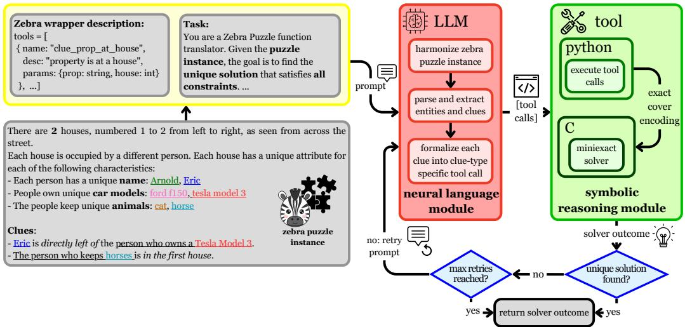
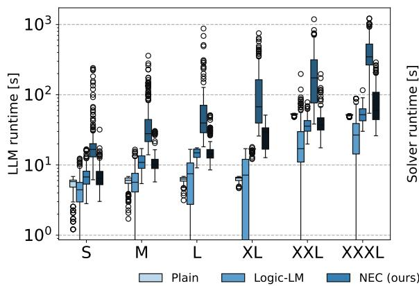
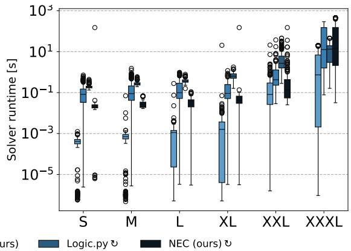

# From Natural Language to Exact Cover: A Neuro-Symbolic Approach to Zebra Puzzles

Paulius Skaisgiris<sup>∗</sup> Institute of Logic and Computation, TU Wien, Austria

paulius.skaisgiris@tuwien.ac.at

Thomas Pammer<sup>∗</sup> tpammer@faw.jku.at Institute for Application-Oriented Knowledge Processing, JKU Linz, Austria

Veronika Semmelrock

veronika.semmelrock@aau.at

Department of Artificial Intelligence and Cybersecurity, University of Klagenfurt, Austria

Mykyta Ielanskyi

ielanskyi@ml.jku.at

Institute for Machine Learning, JKU Linz, Austria

Maximilian Heisinger<sup>†</sup>

maximilian.heisinger@jku.at

Institute for Symbolic Artificial Intelligence, JKU Linz, Austria

Erich Kobler<sup>†</sup>

erich.kobler@jku.at

Institute for Machine Learning, LIT AI Lab, Department of Virtual Morphology, Clinical Research Institute Medical AI, JKU Linz, Austria

Editors: Alessandra Mileo, Andrea Passerini and Cogan Shimizu

## Abstract

Chain-of-Thought (CoT) generation has substantially improved the performance of Large Language Models (LLMs) on complex reasoning tasks, including code generation, data analysis, and exam-style question answering. Despite these advances, purely neural LLMs continue to struggle with elementary logical reasoning problems and lack the determinism, soundness, and reliability characteristic of symbolic reasoning systems. Conversely, classical symbolic methods such as SAT solving and exact cover guarantee correctness and completeness, but require problems to be expressed in highly specialized formal encodings, limiting their applicability to natural language inputs. In this work, we present a synergistic neuro-symbolic framework that bridges this gap by combining neural semantic parsing with deterministic exact cover reasoning. Given a Zebra-style logic puzzle in natural language, an LLM translates entities and constraints into structured tool calls that construct an exact cover instance. A symbolic solver then computes the solution and provides feedback to iteratively refine invalid, under- or overconstrained encodings, exploiting the uniqueness property of Zebra puzzles. We conduct a comprehensive empirical evaluation across multiple parameter scales, post-training paradigms, and LLM families. The results demonstrate that our hybrid approach consistently outperforms strong plain neural baselines, including CoT prompting, as well as recent neuro-symbolic methods.

## 1. Introduction

Constraint Satisfaction Problems (CSPs) lie at the core of many real-world decision-making tasks, including scheduling, planning, resource allocation, and configuration, making them a fundamental abstraction in AI research (Russell and Norvig, 1995; Mackworth, 1977; Nadel, 1989; Knuth, 2016, 2020, 2025). While symbolic methods such as SAT and constraint solvers can guarantee correctness and completeness, their practical deployment critically depends on constructing efective formal encodings – a process that remains dificult even for domain experts (Heisinger et al., 2024). Translating informal problem descriptions into a structured encoding requires substantial modeling expertise as small representational choices can dramatically impact solver performance and tractability. As a result, research often studies simplified yet representative proxy domains such as logic puzzles (e.g. Sudoku or Zebra Puzzles), which capture essential combinatorial and relational reasoning challenges while providing clean semantics, controllable complexity, and objectively verifiable solutions (Dechter and Pearl, 1987; Prosser, 1993; Lin et al., 2025; White et al., 2025).

This reliance on structured benchmark domains aligns naturally with recent advances in Large Language Models (LLMs), which are increasingly applied to tasks requiring the construction of structured symbolic solutions from unstructured inputs. Such domains include mathematical reasoning (Hendrycks et al., 2021b), programming (Hendrycks et al., 2021a), planning (Zhang et al., 2026), and logic puzzle solving (Lin et al., 2025; Chollet et al., 2025). A shared characteristic of these problems is that, although discovering solutions is challenging, their correctness can be verified algorithmically. Reinforcement learning with verifiable rewards post-training has therefore emerged as a standard approach for optimizing models directly against symbolic verifiers (Guo et al., 2025). The resulting thinking LLMs produce Chain-of-Thought (CoT) reasoning traces enabling inference-time scaling.

Zebra Puzzles are among recent benchmarks to test the reasoning capabilities of LLMs (Lin et al., 2025; White et al., 2025). They consist of lists of entities, properties, and attributes as well as clues; the goal is to infer the relations of attributes and entities from the given information. Lin et al. (2025) find that scaling the model size does not help beyond a certain level of complexity which is defined by the puzzles’ solution space. This manifests in generalist LLMs faring extremely well on simple Zebra Puzzles while struggling with more complex ones. Longer reasoning traces appear to be more helpful with these problems than larger models. However, these longer traces present additional challenges such as high frequency noise (Radler et al., 2025) and increased chance of hallucination (Mei et al., 2025).

To address the reasoning limitations of purely neural models, recent neuro-symbolic approaches increasingly combine LLM-based semantic parsing with symbolic solvers to enforce logical consistency (Dinu et al., 2024). Prior work explores both agentic formulations that iteratively generate solver-compatible programs and solver-centric pipelines that translate natural language inputs into formal constraint specifications solved using SAT, SMT, CSP, or ASP techniques (Szeider, 2025; Pan et al., 2023; Ye et al., 2023; Eiter et al., 2025). Notably, Logic.py (Kesseli et al., 2025) translates natural language into a domain-specific representation solved by an exact constraint solver, incorporating iterative error feedback to the LLM. This coupling of semantic parsing and symbolic solving consistently outperforms LLMs on Zebra Puzzle-style benchmarks.

  
Figure 1: Visualization of NeuralExactCover. A puzzle instance is combined with our prompt template and processed by an LLM that harmonizes attributes, extracts entities and clues, and translates clues into an exact cover encoding. The symbolic MiniExact solver then solves the encoding and provides iterative feedback on failures to refine the generated tool calls. This loop continues until a unique solution is found or the retry limit is reached, after which the solution is converted into plain text.

In this work, we present an integrated neuro-symbolic framework called NeuralExact-Cover that combines LLM-based semantic parsing with deterministic exact cover solving for reliable logical reasoning over plain text Zebra-style puzzles. Our main contributions are as follows:

• We introduce and adapt an exact cover encoding for eficient symbolic solving of Zebrastyle logic puzzles.

• We introduce a neuro-symbolic framework that leverages LLMs as a translation layer for an exact cover solver and re-applies symbolic results as feedback to the LLM.

• We introduce the ZebraExtreme dataset, extending ZebraLogic (Lin et al., 2025) with even more challenging problems of size up to $8 \times 1 0$ entities and properties.

## 2. Background and Preliminaries

## 2.1. Exact Cover

Given a collection S of subsets of a set X, the exact cover problem is about finding a subcollection $S ^ { * } \subseteq S$ such that each element in X is contained in exactly one subset of ${ \boldsymbol { S } } ^ { * }$ This concept becomes clearer when we rename elements in X to items and S to options. We want to find the subcollection ${ \boldsymbol { S } } ^ { * }$ of options to cover all items exactly once. One example comes from Knuth (2020): Let $\mathcal { X } = \{ a , b , c , d , e , f , g \}$ be items and the collection of options $\mathcal { S } = \left\{ \left[ c , e \right] , \left[ a , d , g \right] , \left[ b , c , f \right] , \left[ a , d , f \right] , \left[ b , g \right] , \left[ d , e , g \right] \right\}$ . When selecting the first, fourth, and fifth options, we cover each item exactly once, i.e. $\bar { \boldsymbol { S } } ^ { * } = \{ \left[ c , e \right] , \left[ a , d , f \right] , \left[ b , g \right] \}$ . This is very useful, as such exact-1 properties have a large variety of encodings with strong performance impacts for solvers, as discussed in the context of SAT-solving in Nguyen et al. (2020).

Colored Exact Cover. Exact cover can be extended by splitting the options into primary items $\mathcal { X } _ { P }$ and secondary items $\chi _ { S }$ such that $\smash { \mathcal { X } = \mathcal { X } _ { P } \cup \mathcal { X } _ { S } }$ . Let E denote a set of colors that can be used to color (change) secondary items. Now, each primary item must still be covered exactly once, while secondary items must be assigned at most one color. Note that colors can be shared between options, i.e. multiple options with secondary items of matching colors may be selected.

Notation. We write options as sets of comma-separated items enclosed in brackets, $\mathrm { e . g . }$ $[ a , b ]$ We use colons to separate secondary items and colors. Thus, $a : c$ means the secondary item $a \in \mathcal { X } _ { S }$ has the color $c \in { \mathcal { E } } .$ . Items may be combined from other terms using angle brackets, e.g. $\langle a , b \rangle$ is one item. For instance, $[ \langle a , b \rangle : 1 , c ]$ denotes an option of one item $\langle a , b \rangle$ with the color 1 (meaning $\langle a , b \rangle$ must be a secondary item), and c as another item. A set of options is enclosed in curly brackets.

MiniExact. It is an eficient implementation<sup>2</sup> of some of the Dancing Links algorithms of Knuth (2020). Its performance mostly mirrors Knuth’s original C implementation, while also ofering a user-friendly Python API and a more sophisticated parser. The algorithm can be selected at run-time, making it a useful tool for experiments with exact cover problems.

## 2.2. Zebra Puzzles

Zebra Puzzles are classic constraint satisfaction problems (CSPs) where a solver must find a one-to-one mapping across entity categories using logical clues (see Fig. 1).

Formulation. Each puzzle consists of initial statements defining a finite set of entities $\mathcal { E } =$ $\{ e _ { 1 } , \ldots , e _ { N } \}$ (e.g., numbered houses) with $N > 1 \cdot$ ; several characteristics or properties $\mathcal { P } =$ $\{ p _ { 1 } , . . . , p _ { M } \}$ (e.g., name, car, animal) with $M \geq 1$ , each containing N mutually exclusive attributes; and a set of clues $\mathcal { C } = \{ c _ { 1 } , \ldots , c _ { K } \}$ with $K \geq 1$ that relate entities, properties, and attributes. All attributes of a property define its domain $\mathcal { A } _ { p } = \{ a _ { p 1 } , . . . , a _ { p N } \}$ (e.g., cat, horse) with $| { \mathcal { A } } _ { p } | = N$

Constraints. To ensure uniqueness of each puzzle’s solution, uniqueness and clue-based constraints have to be fulfilled. The uniqueness constraint ensures that every attribute $a \in \mathcal A _ { p }$ is assigned exactly to one entity for all $p \in \mathcal P$ . Clue-based constraints formalize the diferent verbal clues into logic statements that must be satisfied by a valid solution. For Zebra Puzzles, there are 8 diferent clue-based constraints that relate attributes and/or entities by specifying presence/absence or positional relations as summarized in Appx. A.3.

Task. The goal is to find an assignment $x _ { p , e } \in \mathcal { A } _ { p }$ selecting an attribute for each property $p \in \mathcal { P }$ and entity $e \in { \mathcal { E } }$ such that all constraints are fulfilled. Note that these assignments can be summarized into a tabular grid where the columns are defined by the entities, the rows by the properties, and the assigned attributes are listed in the corresponding cells.

Datasets. Zebra Puzzles are used as proxies to test the reasoning capabilities of modern LLMs (Lin et al., 2025; White et al., 2025). To this end, Lin et al. (2025) introduced the ZebraLogic dataset containing 1,000 logic grid puzzles of various sizes $( N \times M )$ ranging from $2 \times 2$ to $6 \times 6$ . We extend this dataset to include 400 bigger puzzle instances $( 7 \times 5$ $\ldots , 8 \times 1 0 )$ and call this extended dataset ZebraExtreme<sup>3</sup>. Following Lin et al. (2025), we partition the puzzles according to their solution space size $( | \mathcal { Q } | = ( N ! ) ^ { M } )$ into bins:

$$
\begin{array} { r l r } { \mathrm { S } \colon 1 0 ^ { 0 } \leq | \mathcal { Q } | < 1 0 ^ { 3 } , } & { \quad \mathrm { ~ M } \colon 1 0 ^ { 3 } \leq | \mathcal { Q } | < 1 0 ^ { 6 } , } & { \quad \mathrm { ~ L } \colon 1 0 ^ { 6 } \leq | \mathcal { Q } | < 1 0 ^ { 1 0 } , } \\ { \mathrm { X L } \colon 1 0 ^ { 1 0 } \leq | \mathcal { Q } | < 1 0 ^ { 1 8 } , } & { \quad \mathrm { ~ X X L } \colon 1 0 ^ { 1 8 } \leq | \mathcal { Q } | < 1 0 ^ { 3 0 } , } & { \quad \mathrm { ~ X X X L } \colon 1 0 ^ { 3 0 } \leq | \mathcal { Q } | < 1 0 ^ { 5 0 } . } \end{array}
$$

Note that the bins S to XL are included in the original ZebraLogic dataset, while the ZebraExtreme only includes puzzles in XXL and XXXL. Appx. A.2 describes how we created this computationally challenging dataset.

## 3. Solving Zebra Puzzles with Exact Cover

In the following, we present NeuralExactCover, a neural-symbolic approach for solving Zebra logic puzzles. As in Figure 1, we leverage the in-context learning capabilities of LLMs to extract semantic relations between entities, properties, and attributes from freetext puzzle descriptions and translate them into an exact cover encoding. The symbolic module then computes solutions and provides feedback on the resulting encoding, allowing the LLM to iteratively refine its tool calls until a unique solution is obtained. This feedback loop integrates neural language understanding with symbolic reasoning.

## 3.1. Language Module for Puzzle Parsing

The main goal of the language module is the conversion of the problem from natural language to a valid exact cover encoding. At the core of this module is a language model. To this end, we consider several recent open weight LLMs that are state-of-the-art for their parameter size, such as Qwen3 (Yang et al., 2025), gpt-oss (OpenAI et al., 2025), Magistral (Rastogi et al., 2025a), and Devstral (Rastogi et al., 2025b). Note that any language model that has been fine-tuned to perform tool calling could be used. The model is prompted to complete the following sequence of actions: harmonization, clue extraction and formalization. The full prompt is listed in Appx. A.4. It includes manually constructed few-shot examples to improve the adherence of the model to the specific instructions given.

Harmonization. First, each puzzle is paraphrased such that every attribute occurrence follows the format <property-name>@<attribute-name>. This reduces ambiguity arising from attributes that occur under multiple properties. For example, if “cat” is used by two diferent properties, it may be extracted incorrectly, resulting in an erroneous encoding.

Clue extraction. First, the LLM parses the puzzle’s setup (i.e. M, N, $\{ { \mathcal { A } } _ { p } \} _ { p \in { \mathcal { P } } }$ , and K) and proceeds to extract the clues. The model is instructed to use our exact cover encoding’s tool-calls presented in the next section to express the extracted clues. Consequently, the output of the LLM is a list of tool calls in JSON format, specifying the called function and its arguments. The first call must be to the initialization tool, that specifies the dimensions of the problem, i.e. number of entities, properties, property domains, and clues. The subsequent tool calls encode each clue. The complete reference of callable tools is provided in Appx. A.5. Note that we prompt each model to provide a one-sentence description for each tool call to simplify the optional inspection of traces (Appx. D).

## 3.2. Reasoning Module using Exact Cover

We use exact cover as a logic backbone since it natively expresses exact-one constraints instead of requiring complex encodings as in SAT-solving and solvers naturally support enumerating solutions without employing blocking clauses (Nguyen et al., 2020).

Items. We assign a primary item to all clues C, ensuring that each must be used once. We expand entities and properties over their full domain and add a primary item for each pair, to model that each property has exactly one entity. Moreover, we use entities to color secondary items, defined by all attributes of all properties. Thus, the set of items is

$$
\mathcal { X } = \mathcal { X } _ { P } \cup \mathcal { X } _ { S } , \quad \mathcal { X } _ { P } = \mathcal { C } \cup \left( \bigcup _ { e \in \mathcal { E } } \bigcup _ { p \in \mathcal { P } } \Big \{ \big [ \langle p , e \rangle \big ] \Big \} \right) , \quad \mathcal { X } _ { S } = \bigcup _ { p \in \mathcal { P } } \bigcup _ { a \in A _ { p } } \Big \{ \big [ a \big ] \Big \} .
$$

Options. To model the uniqueness constraint – every attribute of each property can only be assigned to one entity, we set

$$
S _ { U } = \bigcup _ { e \in \mathcal { E } } \bigcup _ { p \in \mathcal { P } } \bigcup _ { a \in \mathcal { A } _ { p } } \Big \{ \big [ \langle p , e \rangle , a : e \big ] \Big \} .
$$

The clue-based constraints are transformed into corresponding exact cover encodings based on the 8 diferent clue types. Then, the set of options reads as

$$
\begin{array} { r } { \pmb { \mathcal { S } } = \pmb { \mathcal { S } } _ { U } \cup \pmb { \mathcal { S } } _ { \mathcal { C } } , \quad \pmb { \mathcal { S } } _ { \mathcal { C } } = \bigcup _ { c \in \mathcal { C } } \pmb { \mathcal { S } } _ { c } , } \end{array}
$$

where $S _ { c }$ implements the encoding of clue c according to its clue type listed in Appx. A.3. Because each clue has a primary item, exactly one of the clue’s options must be in the solution. This forces the secondary items representing the afected attributes to be colored according to the clue, in turn afecting other clues and the solution as a whole.

Implementation Details. We implement the proposed exact cover encoding using the MiniExact Python API. The encoding is exposed through a set of documented functions corresponding to the clue types in Appx. A.3, enabling LLMs to construct exact cover instances via tool calls. To ensure robust evaluation, extracted property and attribute names are normalized to canonical puzzle names using string-similarity matching. Additional implementation details and API descriptions are provided in Appx A.5.

## 3.3. Feedback Mechanism

For neuro-symbolic integration, NeuralExactCover uses feedback from the symbolic reasoning component to iteratively refine the LLM-generated tool calls. First, the generated tool calls are checked for completeness by verifying that tool calls were produced and that their number matches the number of puzzle clues. If tool calls are missing or excessive, the LLM is prompted to generate one tool call per clue, add missing clue encodings, or re-evaluate redundant or conflicting ones.

If the number of tool calls and parsed clues matches, the corresponding encoding is evaluated by the MiniExact solver. For feedback, the following three outcomes are considered:

Overconstrained If no solution exists, the generated constraints are overconstraining, indicating an error in clue extraction. The LLM receives symbolic feedback and is instructed to revise at least one previous tool call to make the encoding less restrictive.

Underconstrained If multiple solutions are found, the encoding is underconstrained, and the LLM is prompted to revise its clue interpretations by modifying at least one tool call. Unique solution If a unique solution is found, the encoding is considered suficiently complete and consistent, and the solution is returned.

The corresponding prompts and additional details are listed in Appx. A.6.

## 4. Experiments

We evaluate the reasoning performance of plain LLMs (without tools), Logic-LM (Pan et al., 2023), Logic.py (Kesseli et al., 2025), and our NeuralExactCover (NEC) in a LLM model agnostic way on Zebra Puzzles. To apply Logic-LM to these logic puzzles, we extended its CSP pipeline by adding a Zebra puzzle specific prompt and adapting the solution parsing, see Appx B.2. Note that Logic.py implements a feedback mechanism to correct for syntax errors and UNSAT encodings. For numerical evaluation, we consider the recent ZebraLogic benchmark (Lin et al., 2025) and our introduced ZebraExtreme, a more challenging variant characterized by a larger number of cells and an expanded set of possible values per cell. Refer to Appx A.2 for details on this dataset.

To assess the reasoning and scaling capabilities of the diferent methods, we evaluate puzzle and cell accuracy. While the former counts the fraction of correctly solved puzzles, the latter counts the fraction of correctly assigned attributes to entities (i.e. cells in the solution table). In addition, we evaluate the runtime of the LLMs and the symbolic solvers. We stratify the runtime and puzzle accuracy by the puzzle size into bins S to XXXL to analyze how models perform on increasingly complex puzzles.

For all methods, each LLM was run with temperature set to 0 and top p set to 1 following Lin et al. (2025). We also adopt an output token budget of 4096 per LLM call, except for ZebraExtreme, where the budget is increased to 30720 to accommodate reasoning over larger puzzles. Notably, Logic.py Lin et al. (2025) employs a multi-step LLM pipeline checking for syntax and constraint-encoding errors at each stage and reruns LLMs when such errors occur, thereby enabling multiple self-correction attempts. Consequently, the total token usage may exceed the output token budget of 4096. In contrast, our approach relies on a single LLM call. Further details on models and serving are in Appx A.1. Since all four approaches under consideration are LLM-agnostic, we evaluate LLMs across a diverse range of parameter scales, training paradigms, and families.

LLM Post-Training Paradigms. We examined the efect of instruction following and thinking post-training paradigms on solving Zebra puzzles. To this end, we evaluated the Qwen3 model family in the hybrid (Base), instruct, and thinking configuration both at 4B and 30B parameter scales. Table 1 lists the corresponding puzzle and cell accuracies. For small puzzles, the Plain approach consistently achieved high performance – most results exceeding 90%, but performance dropped sharply on larger puzzles. In contrast, Logic.py attained lower accuracy on small puzzles, yet its performance degraded more gradually as puzzle size increased, while Logic-LM only achieved comparable accuracy for 30B instruct. Our approach outperformed all neurosymbolic baselines in all settings except 4B instruct.

Table 1: Efect of training mode of Qwen3 LLMs. The best result per model-size group is shown in italics. The best result across all models is shown in bold italics.
<table><tr><td rowspan="2">Size Metric</td><td rowspan="2"></td><td colspan="5">Base</td><td colspan="6">Instruct</td><td colspan="4">Thinking</td></tr><tr><td>P</td><td>LL</td><td>NEC</td><td> $\mathrm { L P ^ { \odot } }$ </td><td>NEC</td><td>P</td><td>LL</td><td>NEC</td><td> $\mathrm { L P ^ { \odot } }$ </td><td>NEC</td><td>P</td><td>LL†</td><td>NEC</td><td> $\mathrm { L P ^ { \circ } }$ </td><td>NECO</td></tr><tr><td rowspan="6">4B</td><td>All S</td><td>52.7</td><td>25.6</td><td>82.6</td><td>68</td><td>84.9</td><td>66.1</td><td>43.5</td><td>53.8</td><td>80.2</td><td>65.7</td><td>27.5</td><td></td><td>3.3</td><td>45.1</td><td>10.3</td></tr><tr><td></td><td>98.44</td><td>25.94</td><td>95</td><td>82.5</td><td>96.56</td><td>97.81</td><td>70.31</td><td>71.88</td><td>93.12</td><td>82.19</td><td>79.06</td><td></td><td>9.38</td><td>55.31</td><td>29.38</td></tr><tr><td>M</td><td>71.07</td><td>26.43</td><td>93.93</td><td>72.5</td><td>96.79</td><td>85.71</td><td>50.71</td><td>57.14</td><td>85.36</td><td>73.57</td><td>7.86</td><td></td><td>1.07</td><td>44.29</td><td>3.21</td></tr><tr><td>L</td><td>6.5</td><td>24</td><td>82</td><td>65.5</td><td>83</td><td>48</td><td>27</td><td>39.5</td><td>73.5</td><td>52.5</td><td>0</td><td></td><td>0</td><td>36</td><td>0</td></tr><tr><td>XL</td><td>0</td><td>25.5</td><td>47.5</td><td>41</td><td>51.5</td><td>6</td><td>7</td><td>34.5</td><td>59</td><td>41.5</td><td>0</td><td></td><td>0</td><td>39</td><td>0</td></tr><tr><td>Cell</td><td>33.65</td><td>28.47</td><td>76.19</td><td>73.48</td><td>77.61</td><td>52.41</td><td>50.21</td><td>55.5</td><td>84.98</td><td>63.81</td><td>13.54</td><td></td><td>1.47</td><td>42.91</td><td>4.8</td></tr><tr><td rowspan="6">30B</td><td>All</td><td>54.2</td><td>31.1</td><td>93.6</td><td>93.3</td><td>95.6</td><td>70.9</td><td>83</td><td>92.7</td><td>87.5</td><td>95</td><td>35.5</td><td></td><td>30.2</td><td>86.5</td><td>39.4</td></tr><tr><td>S</td><td>99.06</td><td>18.12</td><td>97.81</td><td>98.75</td><td>97.81</td><td>99.38</td><td>95.31</td><td>95.94</td><td>95.94</td><td>98.44</td><td>92.19</td><td></td><td>69.69</td><td>87.81</td><td>87.5</td></tr><tr><td>M</td><td>75</td><td>29.29</td><td>97.5</td><td>94.64</td><td>98.57</td><td>95.71</td><td>87.14</td><td>95</td><td>88.57</td><td>97.5</td><td>21.43</td><td></td><td>23.93</td><td>91.07</td><td>36.79</td></tr><tr><td>L</td><td>7.5</td><td>42</td><td>93.5</td><td>93</td><td>95.5</td><td>55</td><td>74.5</td><td>91.5</td><td>85</td><td>92.5</td><td>0</td><td></td><td>6</td><td>85.5</td><td>5.5</td></tr><tr><td>XL</td><td>0</td><td>43.5</td><td>81.5</td><td>83</td><td>88</td><td>6.5</td><td>66</td><td>85.5</td><td>75</td><td>88.5</td><td>0</td><td></td><td>0</td><td>79</td><td>0</td></tr><tr><td>Cell</td><td>34.79</td><td>37.64</td><td>92.64</td><td>93.39</td><td>95.81</td><td>54.28</td><td>85.67</td><td>93.77</td><td>85.44</td><td>95.54</td><td>19.12</td><td></td><td>16.76</td><td>87.67</td><td>22.82</td></tr></table>

⟳ denotes approaches using a feedback loop. P: Plain; LL: Logic-LM; NEC: NEC (ours); LP: Logic.py. <sup>†</sup> A parsing error prevented this configuration from returning any output.

Interestingly, for Plain, Logic-LM and Logic.py the instruct post-training strategy outperforms the thinking versions. We hypothesize that, for these approaches, extended reasoning may lead the model to focus on irrelevant details and become confused, whereas instruct variants remain more focused on producing a solution.

For NeuralExactCover, the hybrid variant outperforms both the instruct and thinking paradigms. We attribute this to its ability to combine concise, goal-directed tool usage with explicit step-by-step reasoning. Since the model is not required to solve the puzzle directly, but instead to encode it as an exact cover problem through appropriate tool calls, the hybrid setup appears particularly efective, as it allows the model to reason over individual clues while still producing a structured and executable formulation of the full problem.

Performance across LLM families. We compare the performances of the five considered approaches with various LLM families in the 20B-30B range (details on models used can be found in Appx. A.1). The results are presented in Tab. 2. Both versions of NeuralExactCover perform well across most tested LLMs, where the feedback-loop approach consistently outperforms the approach using a single run, often achieving highest puzzle and cell accuracies on ZebraLogic. In particular, it attains the best overall performance with Qwen3-30B-Instruct and Devstral Small-2, outperforming the compared approaches.

At the time of writing, the oficial ZebraLogic SOTA is 91.7% puzzle and 95.7% cell accuracy by o3-mini-2025-01-31-high<sup>4</sup> (Plain approach). Our NeuralExactCover using the feedback loop with mistralai/Devstral-Small-2-24B-Instruct-2512 achieves 97.9% puzzle and 98.32% cell accuracy, establishing a new SOTA. We also provide the first ZebraExtreme baseline, reaching 84.75% puzzle and 82.59% cell accuracy using gpt-oss-20b.

Runtime Comparison. We compare the runtime of both the LLM and the symbolic solver on the ZebraLogic and ZebraExtreme (see Fig. 2). Note that we only track the solver runtime if the solver was executed. For Logic-LM, Logic.py and NeuralExactCover, LLM runtime increases by about one order of magnitude from S to XXXL puzzles, reflecting higher complexity. In contrast, the Plain approach shows constant median times up to size XL and hits the maximum number of output tokens beyond. For solver runtime, Logic-LM is the fasted on all scales. NeuralExactCover is roughly a factor 2 faster than Logic.py on S–XL puzzles in ZebraLogic. On ZebraExtreme, this advantage is maintained for XXL and disappears for XXXL. Despite similar runtime at the largest scale, NeuralExactCover improves accuracy by 43.67% (XXL) and 48.12% (XXXL) over Logic.py.

Table 2: Performance by model family. The overall best performance per column is marked bold, while the best performance per LLM family is in italics. Model output was capped at 4K tokens for ZebraLogic and 30K for ZebraExtreme.
<table><tr><td rowspan="2"></td><td colspan="2">Model</td><td colspan="6">ZebraLogic</td><td colspan="4">ZebraExtreme</td></tr><tr><td>Size</td><td>Approach</td><td>All</td><td>S</td><td>M</td><td>L</td><td>XL</td><td>Cell</td><td>All</td><td>XXL</td><td>XXXL</td><td>Cell</td></tr><tr><td rowspan="4"> $\sum \limits _ { 0 } ^ { \infty } \pi$ </td><td>30B</td><td>Plain</td><td>70.9</td><td>99.38</td><td>95.71</td><td>55</td><td>6.5</td><td>54.28</td><td>0.5</td><td>0.83</td><td>0</td><td>14.58</td></tr><tr><td>30B</td><td>Logic-LM</td><td>83</td><td>95.31</td><td>87.14</td><td>74.5</td><td>66</td><td>85.67</td><td>6.75</td><td>11.5</td><td>2</td><td>19.27</td></tr><tr><td>30B</td><td> $\mathrm { { N E C } _ { \mathrm { { \ t o u r s } } } ) }$ </td><td>92.7</td><td>95.94</td><td>95</td><td>91.5</td><td>85.5</td><td>93.77</td><td>43.75</td><td>48.75</td><td>36.25</td><td>58.05</td></tr><tr><td>30B 30B</td><td> $\mathrm { L o g i c . p y ^ { \mathrm { \odot } } }$ </td><td>87.5</td><td>95.94</td><td>88.57 97.5</td><td>85</td><td>75</td><td>85.44</td><td>6</td><td>12 52.08</td><td>0 38.75</td><td>10.58 59.89</td></tr><tr><td rowspan="5"></td><td>30B</td><td> $\mathrm { N E C ^ { \circ } \Sigma \left( o u r s \right) }$  Plain</td><td>95</td><td>98.44 92.19</td><td>21.43</td><td>92.5</td><td>88.5</td><td>95.54 19.12</td><td>46.75 1.25</td><td>2.08</td><td>0</td><td>1.81</td></tr><tr><td>30B</td><td>Logic-LM†</td><td>35.5</td><td></td><td></td><td>0</td><td>0</td><td></td><td></td><td></td><td></td><td></td></tr><tr><td> $\sum \limits _ { \gamma = 0 } ^ { \infty } \prod \limits _ { i = 0 } ^ { N } B$ </td><td> $\mathrm { { N E C } _ { \mathrm { { \ t o u r s } } } ) }$ </td><td>30.2</td><td>69.69</td><td>23.93</td><td>6</td><td>0</td><td>16.76</td><td>54.5</td><td>66.67</td><td>36.25</td><td>62.87</td></tr><tr><td>30B 30B</td><td> $\mathrm { L o g i c . p y ^ { \mathrm { \odot } } }$ </td><td>86.5</td><td>87.81</td><td>91.07</td><td>85.5</td><td>79</td><td>87.67</td><td>11.5</td><td>20.5</td><td>2.5</td><td>17.92</td></tr><tr><td></td><td> $\mathrm { N E C ^ { \circ } \Sigma \left( o u r s \right) }$ </td><td>39.4</td><td>87.5</td><td>36.79</td><td>5.5</td><td>0</td><td>22.82</td><td>60.25</td><td>73.33</td><td>40.62</td><td>67.09</td></tr><tr><td rowspan="5">Devtra2 Sma2-2</td><td>24B-I</td><td>Plain†</td><td></td><td></td><td></td><td></td><td></td><td></td><td>一</td><td></td><td></td><td></td></tr><tr><td>24B-I</td><td> $\mathrm { L o g i c - L M }$ </td><td>82.2</td><td>97.19</td><td>90.71</td><td>74</td><td>54.5</td><td>83.55</td><td>3</td><td>3.5</td><td>2.5</td><td>12.97</td></tr><tr><td>24B-I</td><td> $\mathrm { { N E C } _ { \mathrm { { \ t o u r s } } } ) }$ </td><td>97.9</td><td>97.5</td><td>99.64</td><td>97.5</td><td>96.5</td><td>98.24</td><td>58.75</td><td>66.67</td><td>46.88</td><td>62.86</td></tr><tr><td>24B-I</td><td> $\mathrm { L o g i c . p y ^ { \mathrm { \odot } } }$ </td><td>91.3</td><td>96.56</td><td>93.93</td><td>93</td><td>77.5</td><td>87.89</td><td>6.5</td><td>12</td><td>1</td><td>11.94</td></tr><tr><td>24B-I</td><td> $\mathrm { N E C ^ { \circ } \Sigma \left( o u r s \right) }$ </td><td>97.9</td><td>97.5</td><td>99.64</td><td>97.5</td><td>96.5</td><td>98.32</td><td>60</td><td>66.67</td><td>50</td><td>64.21</td></tr><tr><td rowspan="5">Mastradl Smal</td><td>24B</td><td>Plain</td><td>57.2</td><td>94.38</td><td>74.29</td><td>30</td><td>1</td><td>40.96</td><td>0</td><td>0</td><td>0</td><td>7.64</td></tr><tr><td>24B</td><td> $\mathrm { L o g i c - L M }$ </td><td>67.9</td><td>94.06</td><td>78.93</td><td>54</td><td>24.5</td><td>69.72</td><td>0</td><td>0</td><td>0</td><td>0.35</td></tr><tr><td>24B</td><td> $\mathrm { N E C _ { \ c u r s } ) }$ </td><td>85.1</td><td>93.12</td><td>89.29</td><td>79.5</td><td>72</td><td>87.89</td><td>51.5</td><td>60</td><td>38.75</td><td>59.09</td></tr><tr><td>24B</td><td> $\mathrm { L o g i c . p y ^ { \mathrm { \odot } } }$ </td><td>90.5</td><td>95.31</td><td>93.21</td><td>88.5</td><td>81</td><td>88.74</td><td>9.75</td><td>18.5</td><td>1</td><td>15.61</td></tr><tr><td>24B</td><td> $\mathrm { N E C ^ { \circ } \Sigma \left( o u r s \right) }$ </td><td>88.3</td><td>94.38</td><td>93.21</td><td>84</td><td>76</td><td>91.84</td><td>53</td><td>60.83</td><td>41.25</td><td>61.02</td></tr><tr><td rowspan="5"></td><td>20B</td><td>Plain</td><td>48.9</td><td>90.94</td><td>61.07</td><td>13.5</td><td>0</td><td>35.83</td><td>0 ★</td><td>0 ★</td><td>0 ★</td><td>0 ★</td></tr><tr><td>20B</td><td> $\mathrm { L o g i c - L M }$ </td><td>71.6</td><td>84.38</td><td>81.43</td><td>64</td><td>45</td><td>68.08</td><td>40.5</td><td>53</td><td>28</td><td>45.6</td></tr><tr><td>20B</td><td> $\mathrm { { N E C } _ { \mathrm { { \ t o u r s } } } ) }$ </td><td>69.4</td><td>96.88</td><td>90</td><td>58</td><td>8</td><td>52.6</td><td>75.25</td><td>86.25</td><td>58.75</td><td>75.6</td></tr><tr><td>20B</td><td> $\mathrm { L o g i c . p y ^ { \mathrm { \odot } } }$ </td><td>93.5</td><td>98.44</td><td>95.71</td><td>94</td><td>82</td><td>93.04</td><td>36.5</td><td>50.5</td><td>22.5</td><td>41.62</td></tr><tr><td>20B</td><td> $\mathrm { N E C ^ { \circ } \Sigma \left( o u r s \right) }$ </td><td>84.7</td><td>99.69</td><td>98.57</td><td>92.5</td><td>33.5</td><td>72.72</td><td>84.75</td><td>94.17</td><td>70.62</td><td>82.59</td></tr></table>

denotes approaches that use a feedback mechanism. <sup>†</sup> A parsing error prevented this configuration from returning any output. <sup>⋆</sup> All LLM traces reached output token budget before returning any solution.

## 5. Related Work

Recent work addressing LLM reasoning limitations increasingly combines neural models with symbolic solvers. Logic.py (Kesseli et al., 2025) provides the closest comparison, using an intermediate domain specific language (DSL) for semantic parsing into CBMC. While expressive, DSLs require explicit encoding of global constraints, whereas exact-cover formulations directly capture the bijective assignment structure through exactly-once coverage semantics, reducing overhead and improving alignment with the problem structure. CP-Agent (Szeider, 2025) explores a fully agentic architecture in which a Python coding agent, guided by layered prompts, iteratively models and solves constraint problems translated from natural language. In contrast to DSL-based pipelines, the system emphasizes iterative code generation and execution within a persistent environment. Berman et al. (2024) propose a multi-agent framework for Zebra logic puzzles, where LLMs iteratively generate and refine SMT-LIB encodings subsequently solved by a theorem prover. Solver feedback is incorporated into a refinement loop to correct inconsistencies. LOGIC-LM (Pan et al., 2023) and SATLM (Ye et al., 2023) translate natural language inputs into declarative symbolic specifications that are solved using logic programming systems, CSP, SAT, or SMT solvers. LOGIC-LM uses optional solver feedback to refine encodings, while SATLM delegates planning and execution entirely to the solver. This avoids common chain-of-thought reasoning errors and guarantees correctness for the parsed specification. Recent research also explores various integration levels of neural and symbolic components. Allen et al. (2025) integrate LLM outputs directly into a logical reasoning framework, treating the model as a source of truth judgments while keeping the reasoning itself symbolically formal, aiming to maintain logical guarantees even when LLM outputs are inconsistent. Chen (2025) compares integrative approaches, where reasoning is built into neural networks, with hybrid systems that translate problems into symbolic form and solve them externally, finding that hybrid architectures are generally more scalable and easier to interpret. Eiter et al. (2025) extend hybrid reasoning to the multimodal domain, integrating LLM-based semantic parsing with ASP for explainable zero-shot visual question answering, highlighting the modularity and traceability of solver-based designs.



  
Figure 2: Runtimes of the LLM (left) and the symbolic solver (right) for gpt-oss-20b.

## 6. Conclusion

In this work, we introduce NeuralExactCover, a neuro-symbolic system that combines modern LLMs with an exact cover solver to solve Zebra-style puzzles. To the best of our knowledge, this is the first approach to provide LLMs with this type of logic solver as a callable tool. Our method outperforms recent approaches in both accuracy and runtime. We introduce ZebraExtreme, a dataset featuring substantially larger puzzles than ZebraLogic. Previous approaches solve only a few of these challenging puzzles (≤ 40.5%), whereas our method achieves 84.75% puzzle accuracy. Since exact cover reasoning is applicable to a wide range of combinatorial reasoning tasks, an important direction for future work is extending NeuralExactCover beyond Zebra puzzles to automatically generate symbolic encodings.

## Acknowledgments

The authors acknowledge support from the DFG within the SPP2298 under project number 543939932 and from the Austrian Science Fund (FWF) project number 10.55776/COE12.

## References

Bradley P. Allen, Prateek Chhikara, Thomas Macaulay Ferguson, Filip Ilievski, and Paul Groth. Sound and complete neurosymbolic reasoning with llm-grounded interpretations. arxiv 2507.09751, 2025. doi: 10.48550/ARXIV.2507.09751.

Shmuel Berman, Kathleen R. McKeown, and Baishakhi Ray. Solving zebra puzzles using constraint-guided multi-agent systems. arxiv 2407.03956, 2024. doi: 10.48550/ARXIV. 2407.03956.

Michael K. Chen. A comparative study of neurosymbolic AI approaches to interpretable logical reasoning. arxiv 2508.03366, 2025. doi: 10.48550/ARXIV.2508.03366.

Fran¸cois Chollet, Mike Knoop, Gregory Kamradt, Bryan Landers, and Henry Pinkard. ARC-AGI-2: A new challenge for frontier AI reasoning systems. arxiv 2505.11831, 2025. doi: 10.48550/ARXIV.2505.11831.

Rina Dechter and Judea Pearl. Network-based heuristics for constraint-satisfaction problems. Artif. Intell., 34(1):1–38, 1987. doi: 10.1016/0004-3702(87)90002-6.

Marius-Constantin Dinu, Claudiu Leoveanu-Condrei, Markus Holzleitner, Werner Zellinger, and Sepp Hochreiter. Symbolicai: A framework for logic-based approaches combining generative models and solvers. In Conference on Lifelong Learning Agents, volume 274 of Proceedings of Machine Learning Research, pages 869–914, 2024.

Thomas Eiter, Jan Hadl, Nelson Higuera Ruiz, Lukas Lange, Johannes Oetsch, Bileam Scheuvens, and Jannik Str¨otgen. Explainable zero-shot visual question answering via logic-based reasoning. In International Conference on Neurosymbolic Learning and Reasoning, volume 284 of Proceedings of Machine Learning Research, pages 977–991, 2025.

Daya Guo, Dejian Yang, Haowei Zhang, Junxiao Song, Peiyi Wang, Qihao Zhu, Runxin Xu, Ruoyu Zhang, Shirong Ma, Xiao Bi, and et al. Deepseek-r1 incentivizes reasoning in llms through reinforcement learning. Nat., 645(8081):633–638, 2025. doi: 10.1038/ S41586-025-09422-Z.

Maximilian Heisinger, Simone Heisinger, and Martina Seidl. Booleguru, the propositional polyglot (short paper). In Automated Reasoning - International Joint Conference (IJ-CAR), pages 315–324. Springer, 2024. doi: 10.1007/978-3-031-63498-7\ 19.

Dan Hendrycks, Steven Basart, Saurav Kadavath, Mantas Mazeika, Akul Arora, Ethan Guo, Collin Burns, Samir Puranik, Horace He, Dawn Song, and Jacob Steinhardt. Measuring Coding Challenge Competence With APPS. In Neural Information Processing Systems Track on Datasets and Benchmarks, volume 1, 2021a.

Dan Hendrycks, Collin Burns, Saurav Kadavath, Akul Arora, Steven Basart, Eric Tang, Dawn Song, and Jacob Steinhardt. Measuring Mathematical Problem Solving With the MATH Dataset. In Neural Information Processing Systems Track on Datasets and Benchmarks, volume 1, 2021b.

Pascal Kesseli, Peter W. O’Hearn, and Ricardo Silveira Cabral. Logic.py: Bridging the gap between llms and constraint solvers. arxiv 2502.15776, 2025. doi: 10.48550/ARXIV. 2502.15776.

Donald Knuth. The Art of Computer Programming. Volume 4, Fascicle 6. Satisfiability. Addison-Wesley, 2016.

Donald Knuth. The Art of Computer Programming. Volume 4, Fascicle 5. Mathematical Preliminaries Redux; Introduction to Backtracking; Dancing Links. Addison-Wesley, 2020.

Donald Knuth. The Art of Computer Programming. Volume 4, Fascicle 7. Constraint Satisfaction. Addison-Wesley, 2025.

Woosuk Kwon, Zhuohan Li, Siyuan Zhuang, Ying Sheng, Lianmin Zheng, Cody Hao Yu, Joseph Gonzalez, Hao Zhang, and Ion Stoica. Eficient memory management for large language model serving with pagedattention. In Symposium on Operating Systems Principles, pages 611–626. ACM, 2023. doi: 10.1145/3600006.3613165.

Bill Yuchen Lin, Ronan Le Bras, Kyle Richardson, Ashish Sabharwal, Radha Poovendran, Peter Clark, and Yejin Choi. Zebralogic: On the scaling limits of llms for logical reasoning. In International Conference on Machine Learning, volume 267 of Proceedings of Machine Learning Research, 2025.

Alan K. Mackworth. Consistency in networks of relations. Artif. Intell., 8(1):99–118, 1977. doi: 10.1016/0004-3702(77)90007-8.

Zhiting Mei, Christina Zhang, Tenny Yin, Justin Lidard, Ola Shorinwa, and Anirudha Majumdar. Reasoning about uncertainty: Do reasoning models know when they don’t know? arxiv 2506.18183, 2025. doi: 10.48550/ARXIV.2506.18183.

Bernard A. Nadel. Constraint satisfaction algorithms. Comput. Intell., 5:188–224, 1989. doi: 10.1111/J.1467-8640.1989.TB00328.X.

Van-Hau Nguyen, Van-Quyet Nguyen, Kyungbaek Kim, and Pedro Barahona. Empirical study on sat-encodings of the at-most-one constraint. In International Conference on Smart Media and Applications, pages 470–475. ACM, 2020. doi: 10.1145/3426020. 3426170.

OpenAI, Sandhini Agarwal, Lama Ahmad, Jason Ai, Sam Altman, Andy Applebaum, Edwin Arbus, Rahul K. Arora, Yu Bai, Bowen Baker, and et al. Gpt-oss-120b & gpt-oss-20b Model Card. arXiv 2508.10925, 2025.

Liangming Pan, Alon Albalak, Xinyi Wang, and William Yang Wang. Logic-lm: Empowering large language models with symbolic solvers for faithful logical reasoning. In Findings of the Association for Computational Linguistics: EMNLP, pages 3806–3824, 2023. doi: 10.18653/V1/2023.FINDINGS-EMNLP.248.

Patrick Prosser. Hybrid algorithms for the constraint satisfaction problem. Comput. Intell., 9:268–299, 1993. doi: 10.1111/J.1467-8640.1993.TB00310.X.

Andreas Radler, Vincent Seyfried, Stefan Pirker, Johannes Brandstetter, and Thomas Lichtenegger. PAINT: parallel-in-time neural twins for dynamical system reconstruction. arxiv 2510.16004, 2025. doi: 10.48550/ARXIV.2510.16004.

Abhinav Rastogi, Albert Q Jiang, Andy Lo, Gabrielle Berrada, Guillaume Lample, Jason Rute, Joep Barmentlo, Karmesh Yadav, Kartik Khandelwal, and et al. Magistral. arXiv 2506.10910, 2025a.

Abhinav Rastogi, Adam Yang, Albert Q Jiang, Alexander H Liu, Alexandre Sablayrolles, Am´elie H´eliou, Am´elie Martin, Anmol Agarwal, Andy Ehrenberg, Andy Lo, et al. Devstral: fine-tuning language models for coding agent applications. arXiv 2509.25193, 2025b.

Stuart J. Russell and Peter Norvig. Artificial intelligence - a modern approach: the intelligent agent book. Prentice Hall series in artificial intelligence. Prentice Hall, 1995. ISBN 978-0-13-103805-9.

Aarohi Srivastava, Abhinav Rastogi, Abhishek Rao, Abu Awal Md Shoeb, Abubakar Abid, Adam Fisch, Adam R. Brown, Adam Santoro, Aditya Gupta, and Adri\`a Garriga-Alonso et al. Beyond the imitation game: Quantifying and extrapolating the capabilities of language models. Transactions on Machine Learning Research, 2023.

Stefan Szeider. Cp-agent: Agentic constraint programming. arxiv 2508.07468, 2025. doi: 10.48550/ARXIV.2508.07468.

Colin White, Samuel Dooley, Manley Roberts, Arka Pal, Benjamin Feuer, Siddhartha Jain, Ravid Shwartz-Ziv, Neel Jain, Khalid Saifullah, Sreemanti Dey, and et al. Livebench: A challenging, contamination-limited LLM benchmark. In International Conference on Learning Representations, 2025.

An Yang, Anfeng Li, Baosong Yang, Beichen Zhang, Binyuan Hui, Bo Zheng, Bowen Yu, Chang Gao, Chengen Huang, Chenxu Lv, and et al. Qwen3 Technical Report. arXiv 2505.09388, 2025.

Xi Ye, Qiaochu Chen, Isil Dillig, and Greg Durrett. Satlm: Satisfiability-aided language models using declarative prompting. In Neural Information Processing Systems, 2023.

Yinger Zhang, Shutong Jiang, Renhao Li, Jianhong Tu, Yang Su, Lianghao Deng, Xudong Guo, Chenxu Lv, and Junyang Lin. Deepplanning: Benchmarking long-horizon agentic planning with verifiable constraints. arXiv 2601.18137, 2026. doi: 10.48550/ARXIV. 2601.18137.

## Appendix A. Details on Datasets and Models used.

## A.1. Hardware details, Model Reference, and Sampling Parameters

The evaluation was carried out by serving each LLM on a server using vLLM (Kwon et al., 2023) on a single NVIDIA RTX PRO 6000 GPU with 96GB vRAM. The server node has AMD EPYC 9555 64-Core Processor and 2.2 TiB of RAM.

LLM weights were downloaded from Hugging Face. The exact Hugging Face identifiers of models used in this paper are as follows:

• Qwen/Qwen3-0.6B

• Qwen/Qwen3-1.7B

• Qwen/Qwen3-4B

• Qwen/Qwen3-8B

• Qwen/Qwen3-14B

• Qwen/Qwen3-30B-A3B

• Qwen/Qwen3-4B-Instruct-2507

• Qwen/Qwen3-4B-Thinking-2507

• Qwen/Qwen3-30B-A3B-Instruct-2507

• Qwen/Qwen3-30B-A3B-Thinking-2507

• mistralai/Devstral-Small-2-24B-Instruct-2512

• mistralai/Magistral-Small-2506

• openai/gpt-oss-20b

Unless otherwise stated, we used the default tokenizer and configuration provided with each repository. All models were executed without additional fine-tuning or weight modification.

For the Plain approach, we used the maximum output length of 4096 tokens as per Lin et al. (2025), while for Logic.py and NEC, the default maximum output length of each LLM was used. All models were run with temperature set to 0, top p to 1.0, and max model len to 30,720, and were served on a single shard on one GPU. For the Plain approach, the tokenizer mode was set to “auto” for all models, except Magistral Small and Devstral Small, for which it was set to “magistral”. For Logic.py and NEC, each model was served with --enable-auto-tool-choice enabled and --tool-call-parser set to the recommended option specified in the vLLM tool-calling documentation.

## A.2. Generating ZebraExtreme

The ZebraExtreme dataset comprises two size classes, XXL and XXXL, defined by their solution space size $| \mathcal { Q } | = ( N ! ) ^ { M }$ representing the number of possible table fillings (with repetition). We designed the dataset with varied dimensions to investigate how increasing entities (N) or properties (M) impacts puzzle dificulty. The classes are assigned as follows:

<table><tr><td colspan="2">XXL</td><td colspan="2">XXXL</td></tr><tr><td>Size</td><td>|Q|</td><td>Size</td><td>|Q|</td></tr><tr><td> $7 \times 5$ </td><td> $3 . 2 5 \times 1 0 ^ { 1 8 }$ </td><td> $7 \times 9$ </td><td> $2 . 1 0 \times 1 0 ^ { 3 3 }$   $1 . 7 3 \times 1 0 ^ { 3 2 }$ </td></tr><tr><td> $7 \times 6$ </td><td> $1 . 6 4 \times 1 0 ^ { 2 2 }$ </td><td> $8 \times 7$   $8 \times 8$ </td><td> $6 . 9 8 \times 1 0 ^ { 3 6 }$ </td></tr><tr><td> $7 \times 7$ </td><td> $8 . 2 6 \times 1 0 ^ { 2 5 }$ </td><td></td><td></td></tr><tr><td> $7 \times 8$ </td><td> $4 . 1 6 \times 1 0 ^ { 2 9 }$ </td><td> $8 \times 9$ </td><td> $2 . 8 2 \times 1 0 ^ { 4 1 }$ </td></tr><tr><td> $8 \times 6$ </td><td> $4 . 3 0 \times 1 0 ^ { 2 7 }$ </td><td> $8 \times 1 0$ </td><td> $1 . 1 4 \times 1 0 ^ { 4 6 }$ </td></tr></table>

The pseudocode for our generator follows the high-level recipe from the Hugging Face article https://huggingface.co/blog/yuchenlin/zebra-logic (Puzzle Creation section):

1. Choose N houses and M features; each feature has N distinct values.

2. Sample a hidden solution (a Latin rectangle-like one-to-one assignment).

3. Enumerate candidate clues from a small set of clue types.

4. Iteratively remove clues while ensuring the remaining clues still imply a unique solution equal to the hidden one.

## A.3. Formal encodings of the ZebraPuzzle clue types

Table 3: Exact cover encodings of all diferent clue types as sets of options. Here, $c \in { \mathcal { C } }$ denotes a clue, $a \in \mathcal { A } _ { p } , \hat { a } \in \mathcal { A } _ { \hat { p } }$ any attribute of a property $p , \hat { p } \in \mathcal { P } .$ , and $e , { \hat { e } } \in { \mathcal { E } }$ any entity. Note that we only list the exact cover encoding for the left of clues in the last lines; the right of pendants have similar structure but shifted indices.
<table><tr><td>Clue Type</td><td>Exact Cover Encoding</td></tr><tr><td>a at entity e</td><td> $\left\{ \left[ c , a : e \right] \right\}$ </td></tr><tr><td>a not at entity e</td><td> $\textstyle { \bigcup _ { \hat { e } \in { \mathcal { E } } } \left\{ \left[ c , a : \hat { e } \right] \right\} } \setminus \left\{ \left[ c _ { \alpha } , a : e \right] \right\}$ </td></tr><tr><td>a at same entity as â</td><td> $\textstyle \bigcup _ { \hat { e } \in { \mathcal { E } } } \left\{ [ c , a : { \hat { e } } , { \hat { a } } : { \hat { e } } ] \right\}$ </td></tr><tr><td>a is I entities from â</td><td> $\bigcup _ { i = 1 } ^ { N - \Pi } \bigl \{ [ c , a : e _ { i } , \hat { a } : e _ { i + \Pi } ] , [ c , a : e _ { i + \Pi } , \hat { a } : e _ { i } ] \bigr \}$ </td></tr><tr><td>a directly left/right of â</td><td> $\bigcup _ { i = 1 } ^ { N - 1 } \big \{ [ c , a : e _ { i } , \hat { a } : e _ { i + 1 } ] \big \}$ </td></tr><tr><td>a left/right of â</td><td> $\cup _ { i = 1 } ^ { N - 1 } \cup _ { j = i } ^ { N } \{ [ c , a : e _ { i } , \hat { a } : e _ { j } ] \}$ </td></tr></table>

## A.4. System prompt used for the Language Module

We provide the full system prompt used to instruct the language model to translate Zebra logic puzzles into structured tool calls. The prompt first defines the model role and expected input format.

You are a Zebra Puzzle function translator. Your role is to convert the   
textual description of a Zebra Puzzle (a logic grid puzzle) into a sequence   
of structured function calls that can programmatically solve it.

## ### Input Format

```markdown
- The puzzle description begins with `=== PUZZLE ===`, including details
like the number of houses/places, and lists of property groups (categories
with unique values for each house).
- The clues begin with `### CLUES`, numbered from 1 to N.
```

The next section specifies the ordered transformation procedure applied by the model, including harmonization, initialization, and clue translation.

## ### Task Sequence

1. \*\*Harmonize\*\*: Re-print the input, but replace each property-value in   
the puzzle \*and\* clues by <property-name>\_<property-value>. Properties   
should always be combined with their names. All spaces in properties should   
be replaced by minus (-) symbols. All property names must be consistent   
with the initial definition. Try to map similar words to   
<property-name>\_<property-value> tuples, e.g. something ending with   
-ian or -ist is probably linked to its base or similar value, like   
Scientist -> science, Austrian -> austria.   
Be careful to convert each property in each clue to the fitting name\_value   
tuple. Use as many hints from the clue as possible, e.g. if the clue lists   
a person's child's name to be Max, the property will be child\_max.   
2. \*\*Initialize\*\*: Use your harmonized puzzle. Extract the number of   
houses/places, the property groups (each group is a category with its   
unique values), and the total number of clues.   
Output exactly one call to \`init\_zebra\`. Use the same   
<property-name>\_<property-value> format for properties.   
3. \*\*Translate Clues\*\*: For each numbered clue (1 to N) in your harmonized   
puzzle, convert it into exactly one function call that represents the logical   
constraint (e.g., a property in a specific house, a negation, adjacency,   
etc.). Use appropriate function names based on the clue type (examples:   
\`clue\_property\_at\_house\`, \`clue\_not\_property\_at\_house\`,   
\`clue\_property\_next\_to\_property\`).   
Use the same <property-name>\_<property-value> format for properties.   
4. \*\*Explain\*\*: For each function call (including initialization), provide   
a single-sentence explanation immediately before it, describing why the   
parameters match the puzzle element or clue.

We then define strict output formatting and normalization rules that ensure consistent structured tool invocation.

```markdown
### Output Format Rules
- Wrap every function call in `<tool_call>...</tool_call>` tags.
- Property and value names must be lowercase. Spaces are converted to -.
Property names are prepended, separated with _. Multiple words must remain
unshortened and in full, following the required format (e.g., "Labrador
Retriever" → "pet_labrador-retriever"; "Golden Gate Bridge" →
```

"location\_golden-gate-bridge").   
- Output exactly 1 initialization call followed by exactly N clue calls   
(where N is the number of clues). No additional text or calls, beside the   
harmonized output. Always be consistent with naming properties.   
- Use the exact JSON-like structure in the template below for each call.   
- Process the puzzle mechanically and systematically: Parse elements directly   
without adding interpretations or solving the puzzle yourself. Only use   
your harmonized puzzle for translating.   
- Never correct yourself. You can directly translate clues individually,   
without referring to other clues. New information is combined by the tool   
afterwards.

The prompt also provides a template illustrating the required tool-call structure.

```markdown
### Template
Harmonized puzzle:
Explanation: [One sentence explaining why this function and its parameters
represent the clue or initialization.]
<tool_call>
{
"name": "function_name",
"arguments": {
"param1": "value1",
"param2": "value2",
}
}
</tool_call>
```

Additional processing guidelines constrain normalization and mapping behavior.

```markdown
### Processing Guidelines
- Identify property groups from the puzzle description (e.g., categories
like "pet" with values ["pet_cat", "pet_dog"]).
- For clues, map to the simplest matching function (e.g., "X is in house
Y" → `clue_property_at_house` with `prop: "x"` and `house: Y`).
- Ensure all values and names are normalized (lowercase, minus (-) instead
of spaces, property name prefixed with an underscore).
- Do not output anything outside the explanations and tool calls, and the
initial translation.
```

Finally, the prompt includes a complete example demonstrating the expected transformation from puzzle instance to tool calls.

The following is a concrete example of how to transform a puzzle into function   
calls. Consider this puzzle:   
=== PUZZLE ===   
There are 3 houses, numbered 1 to 3 from left to right, as seen from the   
front.   
Each house contains a different pet.   
Each house has a unique attribute for each of the following characteristics:   
- Each pet is a unique type: Cat, Dog, Bird   
- They all have a unique breed: Siamese, Labrador Retriever, African Grey

Parrot   
- Each pet has a favorite toy: \`ball\`, \`yarn\`, \`mirror\`   
- Pets have unique fur colors: \`black\`, \`white\`, \`spotted   
### Clues:   
1. The labrador retriever is in the first house.   
2. The bird is not in the third house.   
3. The pet whose favorite toy is yarn is in the second house.   
4. The siamese is next to the black one.

## Consider the following output:

Harmonized puzzle:   
=== PUZZLE ===   
There are 3 houses, numbered 1 to 3 from left to right, as seen from the   
front.   
Each house contains a different pet.   
Each house has a unique attribute for each of the following characteristics:   
- Each pet is a unique type: pet\_cat, pet\_dog, pet\_bird   
- They all have a unique breed: breed\_siamese, breed\_labrador-retriever,   
breed\_african-grey-parrot   
- Each pet has a favorite toy: toy\_ball, toy\_yarn, toy\_mirror   
- Pets have unique fur-color: fur-color\_black, fur-color\_white, fur-color\_spotted   
### Clues:   
1. The pet\_labrador-retriever is in the first house.   
2. The pet\_bird is not in the third house.   
3. The pet whose favorite toy is toy\_yarn is in the second house.   
4. The breed\_siamese is next to the fur-color\_black one.   
Explanation: Initializing 3-house puzzle with 4 property groups and 4 clues.   
<tool\_call>   
{   
"name": "init\_zebra",   
"arguments": {   
"number\_of\_places": 3,   
"number\_of\_clues": 4,   
"property\_groups": {"pet": ["pet\_cat", "pet\_dog", "pet\_bird"], "breed":   
["breed\_siamese", "breed\_labrador-retriever", "breed\_african-grey-parrot"],   
"toy": ["toy\_ball", "toy\_yarn", "toy\_mirror"], "fur-color": ["fur-color\_black",   
"fur-color\_white", "fur-color\_spotted"]}   
}   
}   
</tool\_call>   
Explanation: The breed\_labrador-retriever is in the first house.   
<tool\_call>   
{   
"name": "clue\_property\_at\_house",   
"arguments": {"prop": "breed\_labrador-retriever", "house": 1}   
}   
</tool\_call>   
Expl

Explanation: The pet\_bird is not in the third house.

<tool\_call>   
{   
"name": "clue\_not\_property\_at\_house",   
"arguments": {"prop": "pet\_bird", "house": 3}   
}   
</tool\_call>   
Explanation: The pet whose favorite toy is toy\_yarn is in the second house.   
<tool\_call>   
{   
"name": "clue\_property\_at\_house",   
"arguments": {"prop": "toy\_yarn", "house": 2}   
}   
</tool\_call>   
Explanation: The breed\_siamese is next to the fur-color\_black one.   
<tool\_call>   
{   
"name": "clue\_property\_next\_to\_property",   
"arguments": {"prop1": "breed\_siamese", "prop2": "fur-color\_black"}   
}   
</tool\_call>

## A.5. MiniExact Implementation Details

MiniExact ofers two modes of interaction: The command-line tool MiniExact and the API, either in the simple variant also exposed to Python, or the direct variant that the MiniExact binary is using. Both modes provide options to choose the solving algorithm to be used. This work relies on Algorithm C (Knuth (2020)) to solve exact cover problems with colored secondary items. The simple API requires consumers must to adhere to the following steps when using the provided Solver object:

1. Declare all primary items using .primary.

2. Declare all secondary items using .secondary.

3. Add all options using .add. We wrapped this in an add option function that automatically ends each option.

4. Call .solve, returning either 10 if there is a solution, or 20 if no (more) solution was found found. Multiple solutions may be extracted, but in this work, we only use the first one.

5. We extract the solution by calling .print solution and parse the resulting string, as this was easier compared to keeping track of the indices to the inserted colors.

Implementation. We use the MiniExact API to implement the proposed encoding in Python. The whole encoding is contained in a Python class, which we instantiate for each new problem. To define the primary and secondary items and colors, we implement an init zebra function with arguments: number of entities N, number of clues K, and a dictionary mapping each property to its list of attributes. To encode the clues, we implemented corresponding member functions for each clue type listed in Appx. A.3. The functions include precise documentation and examples to facilitate in-context learning. We also add explicit synonym functions for abstract clue types to help LLMs select the correct type from textual clues. Table 4 lists all Python functions along with a coarse description. After processing all function calls, we run the MiniExact solver. If it does not converge within 120 seconds, we terminate it and return an empty solution.

Table 4: Python API for exact cover encoding.
<table><tr><td>Encoding Function</td><td>Description</td></tr><tr><td>init_zebra</td><td>Initializes the puzzle with N entities M property groups, and K clues.</td></tr><tr><td>clue_property_left_of</td><td>Attribute a is somewhere to the left of attribute â.</td></tr><tr><td>clue_property_right_of</td><td>Attribute a is somewhere to the right</td></tr><tr><td>clue_property_at_house</td><td>of attribute â. Attribute a is fixed at entity e.</td></tr><tr><td>clue_property_at-property</td><td>Attributes a and â occur at the same house.</td></tr><tr><td>clue_not_property_at_house</td><td>Attribute a is not located at entity e.</td></tr><tr><td>clue_property_next_to_property</td><td>Attributes a and â are at adjacent en- tities.</td></tr><tr><td>clue_one_between_two_properties</td><td>Exactly one entity lies between at- tributes a and â.</td></tr><tr><td>clue_two_between_two-properties</td><td>Exactly two houses lie between at- tributes a and â.</td></tr><tr><td>clue_property_directly_left_of_property</td><td>Attribute a is immediately to the left of attribute â.</td></tr><tr><td>clue_property_directly_right_of_property Attribute a is immediately to the right</td><td>of attribute â.</td></tr></table>

While mapping clues to their corresponding types (encoding functions) is reliable, the exacted attribute strings are not. LLMs sometimes use plural forms (e.g., flowers instead of flower), which creates an evaluation issue since we require exact matches of property and attribute names. Consequently, a puzzle may be encoded and solved consistently yet marked incorrect due to minor naming variations. To maintain naming uniformity, we use the initial puzzle setup function as the ground-truth reference. Thus, extracted names (arguments parsed by the LLM) are mapped to their canonical spelling from the puzzle setup using a string similarity ratio. The ratio is computed with the Ratclif–Obershelp algorithm as implemented in Python’s difflib.SequenceMatcher. This approach was more efective than prompt engineering or changing models, eliminating spelling mismatches that would otherwise confound our evaluation of LLM reasoning.

## A.6. Feedback prompt

As discussed in Section 3.3, we integrate feedback from the symbolic reasoning component to ensure a coupled neurosymbolic approach. To this end, we use the following feedback prompt:

"{status\_line}

Previous attempt generated {num\_previous\_calls} tool calls:

{history\_tool\_calls\_str}

Required: {num\_expected\_calls} tool calls (one per clue)

Corrections needed: {remedy\_line}

Generate {num\_expected\_calls} corrected tool calls:",

where num previous calls denotes the number of tool calls generated in the previous run, history tool calls str contains all tool calls generated to solve the puzzle, and num expected calls is determined by the number of clues in the puzzle. The status line and remedy line are constructed based on the reason why a puzzle remains unsolved. In the following the diferent error cases are listed.

If no tool calls were generated, we set the remedy line to:

"Generate tool calls for each clue. Focus on producing tool calls rather than reasoning ,→ about them."

and the status line to:

"FAILED - No tool calls generated"

If too few tool calls were generated, the remedy line is defined as follows:

"Add missing clue encodings"

and the status line is set to:

f"INCOMPLETE - Only {num\_previous\_calls}/{num\_expected\_calls} clues encoded"

If too many tool calls were generated, we set the remedy line to:

"Re-evaluate clue encodings and return {num\_expected\_calls} tool calls",

and the status line is set to:

"TOO MANY TOOL CALLS - Returned {num\_previous\_calls} but expected {num\_expected\_calls} ,→ calls"

If the solution is not unique, we set the remedy line to:

"Change at least one tool call (either function name or, most likely, arguments) from ,→ above"

and the status line to:

"UNDERCONSTRAINED - Found multiple solutions, expected exactly 1"

If no solution exists because the generated tool calls lead to an overconstrained problem, the remedy line remains the same as in the underconstrained case, but the status line is set to:

"OVERCONSTRAINED - Constraints conflict, no solution possible"

## Appendix B. Adaption of Baseline Models

## B.1. Logic.py setup adaptions

We set the temperature to 0 and top-p to 1 so that we have the identical settings in all of our three approaches. To ensure a fair comparison between NeuralExactCover and the Logic.py approach across diferent LLM back-ends, we extended the original system prompt as follows:

\*\*Important modeling requirements for this task (do not ignore):\*\*   
- Use a \*\*collection\*\* in the top-level solution: \`houses: list[House, N]\` (here N=2).   
- Each \`House\` must contain a numeric \*\*position\*\* field, e.g. \`number: Unique[Domain[int,   
,→ range(1, 3)]]\`.   
- Do not define separate fields like \`house\_1\` or \`house\_2\`.

Return \*\*only one\*\* fenced Python code block with the class definitions; no prose before or ,→ after.

Return only a single fenced Python code block. Do not include any analysis, explanations, ,→ or think content

The remainder of the workflow stayed unchanged and we also kept the number of retries for unsolved puzzles at 5.

## B.2. Extending Logic-LM to ZebraLogic Puzzles

To apply Logic-LM (Pan et al., 2023) to Zebra puzzles, we examined the datasets considered in the original work. Among them, the LogicalDeduction (Srivastava et al., 2023) is conceptually the closest to Zebra puzzles. Since Logic-LM uses a constraint satisfaction problem (CSP) formulation for this dataset, we extended its CSP-based approach to support Zebra puzzles.

A limitation of Logic-LM is that its CSP variant does not incorporate solver feedback. To remain faithful to the original implementation, we likewise did not include a feedback mechanism in this baseline. Note that Logic.py (Pan et al., 2023), the second baseline, implements an iterative reasoning process that leverages solver feedback.

To ensure that the comparison with all evaluated approaches was conducted under consistent and fair conditions, we implemented the following modifications for Logic-LM’s CSP variant:

• We designed a ZebraLogic-specific prompt for the LLM.

• We adapted the inference script responsible for invoking the constraint-programming solver, enabling it to solve the full arrangement problem.

• We implemented a parsing function that converts the solver output into the standardized solution format used for evaluating all approaches.

ZebraLogic-specific prompt. To ensure a fair comparison with our algorithm, we provided Logic-LM with a ZebraLogic-specific prompt. This prompt used exactly the same examples as those provided to our approach and covered all available clue types. By keeping the prompt examples and clue coverage consistent across methods, we aimed to minimize diferences arising from prompt design and ensure that the evaluation reflected the reasoning capabilities as well as the overall workflow of each approach.

Task Description: You are a Zebra Puzzle constraint translator. Your role is to convert the   
textual description of a Zebra Puzzle into a structured constraint satisfaction program,→   
that can be executed by a solver.,→   
A Zebra Puzzle consists of numbered houses/positions and several categories of attributes.   
Each category has unique values. Each value appears exactly once. The goal is to solve,→   
the complete assignment for all houses, not to answer a multiple-choice question.,→

You must output only the structured program. Do not include explanations, markdown, code ,→ fences, bullet points, titles, reasoning steps, or final natural-language answers.

Use exactly these section headers:   
Domain:   
Categories:   
Variables:   
Constraints:   
General rules:   
Houses are represented by numbers.   
House 1 is the leftmost house.   
The largest house number is the rightmost house.   
Represent every attribute value as a variable.   
The value of each variable is the house number where that attribute value occurs.   
Use lowercase variable names.   
Replace spaces and hyphens with underscores.   
Remove punctuation from variable names.   
Use only letters, numbers, and underscores.   
Every variable declaration must use exactly this format:   
variable\_name [IN] [1, 2, ..., N]   
Do not use "=", ":", "∈", or natural language in the Variables section.   
Constraint rules:   
Use == for same-house clues.   
Use != for not-same-house clues.   
Use < for \left of".   
Use > for \right of".   
Use abs(x - y) == 1 for \next to".   
Use abs(x - y) == 2 for \there is one house between x and y".   
Use abs(x - y) == 3 for \there are two houses between x and y".   
Use x + 1 == y for \immediately left of".   
Use x == y + 1 for \immediately right of".   
Use AllDifferentConstraint([...]) once for every category.   
If a clue says a value is in a specific house, use value == house\_number.   
If a clue says a value is not in a specific house, use value != house\_number.   
Do not write comments after constraints.   
Do not use ::: comments.   
Do not include natural language inside the Constraints section.

Problem:   
There are 3 houses, numbered 1 to 3 from left to right, as seen from the front.   
Each house contains a different pet.   
Each house has a unique attribute for each of the following characteristics:   
Each pet is a unique type: Cat, Dog, Bird   
They all have a unique breed: Siamese, Labrador Retriever, African Grey Parrot   
Each pet has a favorite toy: ball, yarn, mirror   
Pets have unique fur colors: black, white, spotted   
Clues:   
The labrador retriever is in the first house.   
The bird is not in the third house.   
The pet whose favorite toy is yarn is in the second house.   
The siamese is next to the black one.   
Domain:   
1: leftmost   
3: rightmost   
Categories:   
house: [1, 2, 3]   
type: [cat, dog, bird]   
breed: [siamese, labrador\_retriever, african\_grey\_parrot]   
toy: [ball, yarn, mirror]   
fur\_color: [black, white, spotted]   
Variables:   
cat [IN] [1, 2, 3]   
dog [IN] [1, 2, 3]   
bird [IN] [1, 2, 3]   
siamese [IN] [1, 2, 3]   
labrador\_retriever [IN] [1, 2, 3]   
african\_grey\_parrot [IN] [1, 2, 3]   
ball [IN] [1, 2, 3]   
yarn [IN] [1, 2, 3]   
mirror [IN] [1, 2, 3]   
black [IN] [1, 2, 3]   
white [IN] [1, 2, 3]   
spotted [IN] [1, 2, 3]   
Constraints:   
AllDifferentConstraint([cat, dog, bird])   
AllDifferentConstraint([siamese, labrador\_retriever, african\_grey\_parrot])   
AllDifferentConstraint([ball, yarn, mirror])   
AllDifferentConstraint([black, white, spotted])   
labrador\_retriever == 1   
bird != 3   
yarn == 2   
abs(siamese - black) == 1   
Problem:   
There are 3 houses, numbered 1 to 3 from left to right, as seen from the front.   
Each house is occupied by a different person: Alice, Bob, or Charlie.   
Each person has a unique attribute for each of the following characteristics:

```m4
Each person owns a unique pet: Dog, Fish, Hamster
Each person has a favourite animal: Tiger, Panda, Eagle
Each person has a unique hobby: Reading, Gardening, Painting
Clues:
Alice lives in the first house.
The person who has the Dog lives in the third house.
Bob loves pandas.
The person who likes Gardening lives next to the person who owns the Hamster.
Domain:
1: leftmost
3: rightmost
Categories:
house: [1, 2, 3]
person: [alice, bob, charlie]
pet: [dog, fish, hamster]
favourite_animal: [tiger, panda, eagle]
hobby: [reading, gardening, painting]
Variables:
alice [IN] [1, 2, 3]
bob [IN] [1, 2, 3]
charlie [IN] [1, 2, 3]
dog [IN] [1, 2, 3]
fish [IN] [1, 2, 3]
hamster [IN] [1, 2, 3]
tiger [IN] [1, 2, 3]
panda [IN] [1, 2, 3]
eagle [IN] [1, 2, 3]
reading [IN] [1, 2, 3]
gardening [IN] [1, 2, 3]
painting [IN] [1, 2, 3]
Constraints:
AllDifferentConstraint([alice, bob, charlie])
AllDifferentConstraint([dog, fish, hamster])
AllDifferentConstraint([tiger, panda, eagle])
AllDifferentConstraint([reading, gardening, painting])
alice == 1
dog == 3
bob == panda
abs(gardening - hamster) == 1
Problem:
[[PROBLEM]]
###
```

Adapt of inference file. To also incorporate the logic-constraint solver provided by the authors of Logic-LM, we adapted their inference script to correctly parse both the output generated by the LLM and the subsequent solution produced by the constraint-programming solver. These adaptations were necessary to ensure compatibility with the output structure required for the ZebraLogic evaluation.

Solution parsing. Since the Logic-LM solver was originally designed to answer individual questions rather than complete arrangement problems, we further adjusted the solver’s output format. Following the same principle as in Logic.py, we provided the original solution structure to reconstruct the final arrangement. This step was taken to ensure that all methods were evaluated under comparable conditions and that the comparison remained as fair and consistent as possible.

## Appendix C. Additional Results

## C.1. Evaluation for varying Parameter Scales

In this experiment, we evaluate Qwen3 0.6B–30B parameter hybrid models (Yang et al., 2025), which support both thinking and non-thinking modes. This enables us to examine the efect of number of parameters on performance in Zebra Puzzles. The resulting puzzle accuracy scores are shown in the third column of Table 5. The Plain approach achieves the highest accuracy on the smallest models (0.6B and 1.7B), though performance remains low (< 50%). However, Plain performs poorly for larger models, not exceeding 60%. Logic.py only achieves competitive performance with the largest model (30B), whereas our NeuralExactCover already performs well with a 4B model, indicating its low dependence on the LLM model scale. For full results, see Appx. Table. Furthermore, the introduced feedback loop provides further improvements over the already strong results, achieving a maximum score of 95.6% for the largest model.

## Appendix D. Analysis of Failure Traces

We categorize the 21 observed failures of the best-performing model (Devstral Small) on the S, M, L and XL puzzle instances into two broad classes corresponding to distinct system components: failures of the neural language module and failures of the symbolic reasoning module. The majority of errors (18 cases, or 86%) stem from the neural language module, which converts natural language clues into symbolic tool calls. Within this category, 2 cases (11%) arise from inherently ambiguous clues that would challenge even a human (e.g., ambiguity over whether ’cat’ refers to an animal or a pet; see Appx D.1), 6 cases (33%) involve the complete omission of reasoning and tool calls, and 10 cases (55%) involve hallucinations or incorrect execution such as missing tool calls (see Appx D.2).

The remaining 3 failures (14%) arise from the symbolic reasoning stage, specifically from errors in reverting the harmonized MiniExact output back into the original attribute- and property-space required for evaluation. In these cases, the executed tool calls yield the correct unique solution, but parsing and de-harmonization introduce missing assignments, causing an otherwise semantically correct solution to appear incorrect (see Appx D.3).

## D.1. Example Failure due to Ambiguous Clues

This trace illustrates a representative failure due to natural language ambiguity, where the neural language module confuses the semantic categories animal and pet. Although the natural-language puzzle admits a valid solution, the generated symbolic constraints become inconsistent, and the MiniExact solver therefore returns no prediction.

There are 2 houses, numbered 1 to 2 from left to right, as seen from across the street.   
Each house is occupied by a different person.

Table 5: Performance across Qwen3-base model sizes. The overall best performance per column is marked bold, while the best performance per size is written in italics.
<table><tr><td rowspan="2">Model Size Approach</td><td rowspan="2"></td><td colspan="6">Accuracies [ [%] ↑</td></tr><tr><td>All</td><td>S</td><td>M</td><td>L</td><td>XL</td><td>Cell</td></tr><tr><td>0.6B</td><td>Plain</td><td>24.1</td><td>61.25</td><td>15</td><td>1.5</td><td>0</td><td>18.31</td></tr><tr><td>0.6B</td><td>Logic-LM</td><td>0</td><td>0</td><td>0</td><td>0</td><td>0</td><td>0.04</td></tr><tr><td>0.6B</td><td>NEC (ours)</td><td>2.7</td><td>8.44</td><td>0</td><td>0</td><td>0</td><td>1.86</td></tr><tr><td>0.6B</td><td>Logic.py</td><td>0</td><td>0</td><td>0</td><td>0</td><td>0</td><td>0</td></tr><tr><td>0.6B</td><td>NEC (ours)</td><td>2.2</td><td>6.88</td><td>0</td><td>0</td><td>0</td><td>1.23</td></tr><tr><td>1.7B</td><td>Plain</td><td>44.6</td><td>92.81</td><td>48.93</td><td>6</td><td>0</td><td>27.76</td></tr><tr><td>1.7B</td><td>Logic-LM</td><td>0.4</td><td>0.94</td><td>0.36</td><td>0</td><td>0</td><td>0.18</td></tr><tr><td>1.7B</td><td>NEC (ours)</td><td>25</td><td>51.56</td><td>22.14</td><td>11.5</td><td>0</td><td>20.73</td></tr><tr><td>1.7B</td><td>Logic.py</td><td>0.8</td><td>2.19</td><td>0.36</td><td>0</td><td>0</td><td>0.53</td></tr><tr><td>1.7B</td><td>NEC (ours)</td><td>28.1</td><td>56.25</td><td>26.07</td><td>13.5</td><td>0.5</td><td>24.19</td></tr><tr><td>4B</td><td>Plain</td><td>52.7</td><td>98.44</td><td>71.07</td><td>6.5</td><td>0</td><td>33.65</td></tr><tr><td>4B</td><td>Logic-LM</td><td>25.6</td><td>25.94</td><td>26.43</td><td>24</td><td>25.5</td><td>28.47</td></tr><tr><td>4B</td><td>NEC (ours)</td><td>82.6</td><td>95</td><td>93.93</td><td>82</td><td>47.5</td><td>76.19</td></tr><tr><td>4B</td><td>Logic.py</td><td>68</td><td>82.5</td><td>72.5</td><td>65.5</td><td>41</td><td>73.48</td></tr><tr><td>4B</td><td>NEC (ours)</td><td>84.9</td><td>96.56</td><td>96.79</td><td>83</td><td>51.5</td><td>77.61</td></tr><tr><td>8B</td><td>Plain</td><td>51.8</td><td>99.06</td><td>67.14</td><td>6.5</td><td>0</td><td>32.57</td></tr><tr><td>8B</td><td>Logic-LM</td><td>18.9</td><td>15.62</td><td>17.5</td><td>26.5</td><td>18.5</td><td>20.81</td></tr><tr><td>8B</td><td>NEC (ours)</td><td>86.8</td><td>96.25</td><td>95.71</td><td>87.5</td><td>58.5</td><td>80.26</td></tr><tr><td>8B</td><td>Logic.py</td><td>74.3</td><td>91.25</td><td>71.43</td><td>63</td><td>62.5</td><td>72.56</td></tr><tr><td>8B</td><td>NEC (ours)</td><td>88.3</td><td>97.5</td><td>97.5</td><td>89.5</td><td>59.5</td><td>81.46</td></tr><tr><td>14B</td><td>Plain</td><td>56.9</td><td>99.06</td><td>81.07</td><td>12.5</td><td>0</td><td>37.44</td></tr><tr><td>14B</td><td>Logic-LM</td><td>29</td><td>18.44</td><td>28.93</td><td>40</td><td>35</td><td>34.42</td></tr><tr><td>14B</td><td>NEC (ours)</td><td>93.2</td><td>97.5</td><td>95.71</td><td>93</td><td>83</td><td>92.35</td></tr><tr><td>14B</td><td>Logic.py</td><td>83.5</td><td>71.25</td><td>84.64</td><td>96.5</td><td>88.5</td><td>93.13</td></tr><tr><td>14B</td><td>NEC (ours)</td><td>94.4</td><td>97.5</td><td>98.93</td><td>96.5</td><td>81</td><td>92.69</td></tr><tr><td>30B</td><td>Plain</td><td>54.2</td><td>99.06</td><td>75</td><td>7.5</td><td>0</td><td>34.79</td></tr><tr><td>30B</td><td>Logic-LM</td><td>31.1</td><td>18.12</td><td>29.29</td><td>42</td><td>43.5</td><td>37.64</td></tr><tr><td>30B</td><td>NEC (ours)</td><td>93.6</td><td>97.81</td><td>97.5</td><td>93.5</td><td>81.5</td><td>92.64</td></tr><tr><td>30B</td><td>Logic.py</td><td>93.3</td><td>98.75</td><td>94.64</td><td>93</td><td>83</td><td>93.39</td></tr><tr><td>30B</td><td>NEC (ours)</td><td>95.6</td><td>97.81</td><td>98.57</td><td>95.5</td><td>88</td><td>95.81</td></tr></table>

## D.1.1. Puzzle Instance

## === PUZZLE ===

Each house has a unique attribute for each of the following characteristics:

\- Each person has a unique name: \`Arnold\`, \`Eric

\- Each person has a unique type of pet: \`cat\`, \`dog

\- Each person has a unique favorite drink: \`tea\`, \`water\`

\- People have unique favorite music genres: \`rock\`, \`pop\`

\- The people keep unique animals: \`horse\`, \`cat

\- People own unique car models: \`ford f150\`, \`tesla model 3\`

```markdown
### Clues:
1. The tea drinker is the person who owns a Tesla Model 3.
2. The person who owns a dog is the cat lover.
3. Arnold is the tea drinker.
4. The person who loves pop music is directly left of the person who has a cat.
5. The person who loves rock music is the tea drinker.
```

## D.1.2. Ground-Truth Solution

The puzzle itself is satisfiable:

<table><tr><td>House</td><td>Name</td><td>Pet</td><td>Drink</td><td>Music</td><td>Animal</td><td>Car</td></tr><tr><td>1</td><td>Eric</td><td>dog</td><td>water</td><td>pop</td><td>cat</td><td>ford f150</td></tr><tr><td>2</td><td>Arnold</td><td>cat</td><td>tea</td><td>rock</td><td>horse</td><td>tesla model 3</td></tr></table>

## D.1.3. Symbolic Domain Initialization

After harmonization, the language module initializes the symbolic domain with the following tool call (simplified for readability):

init\_zebra(   
number\_of\_places = 2,   
number\_of\_clues = 5,   
property\_groups = {   
name = {name@arnold, name@eric},   
pet = {pet@cat, pet@dog},   
drink = {drink@tea, drink@water},   
music = {music@rock, music@pop},   
animal = {animal@horse, animal@cat},   
car = {car@ford-f150, car@tesla-model-3}   
}   
)

## D.1.4. Clues and Generated Tool Calls

The following table shows, how the language module transformed the natural language clues into tool calls.

<table><tr><td>Natural-language clue</td><td>Generated tool call</td></tr><tr><td>who owns a Tesla Model 3. </td><td>The tea drinker is the person clue_property_at_property(drink@tea, car@tesla-model-3)</td></tr><tr><td>The person who owns a dog clue-property_at_property(pet@dog, is the cat lover.</td><td>animal@cat)</td></tr><tr><td>Arnold is the tea drinker.</td><td>clue_property_at_property(name@arnold, drink@tea)</td></tr><tr><td>pop music is directly left animal@cat) of the person who has a</td><td>The person who loves clue_property_directly_left_of_property(music@pop</td></tr><tr><td>cat. music is the tea drinker.</td><td>The person who loves rock clue-property_at-property(music@rock, drink@tea)</td></tr></table>

Ambiguity The phrase “who has a cat” of the 4th clue is semantically ambiguous in this domain: it could refer either to (i) the person whose pet is a cat (pet@cat), or (ii) the person who keeps the animal cat (animal@cat). The model selects animal@cat, but the ground-truth interpretation in the puzzle is pet@cat.

Under the incorrect interpretation of the tool calls, this implies:

Due to clue 2 Eric has animal@cat and due to clue 4 Arnold has animal@cat,

which violates the uniqueness constraint for animals. Hence the set of constraints become unsatisfiable and MiniExact returns no solution.

This example demonstrates how category confusion can propagate into hard symbolic contradictions despite an otherwise valid puzzle.

## D.2. Example Failure due to Missing Initialization

The following trace presents a representative failure caused by an error in the neural language module. While the puzzle is correctly harmonized and all clues are translated into symbolic constraints, the required init zebra tool call is omitted. As a result, the symbolic domain is never initialized and MiniExact cannot produce a solution, regardless of whether the tool calls were translated correctly.

## D.2.1. Puzzle Instance

=== PUZZLE ===   
There are 2 houses, numbered 1 to 2 from left to right, as seen   
from across the street. Each house is occupied by a different person.   
Each house has a unique attribute for each of the following characteristics:   
- Each person has a unique name: \`Arnold\`, \`Eric\`   
- The people keep unique animals: \`cat\`, \`horse\`   
- People use unique phone models: \`samsung galaxy s21\`, \`iphone 13   
- Each person has a unique type of pet: \`cat\`, \`dog\`   
- Everyone has a unique favorite cigar: \`pall mall\`, \`prince\`

1. Arnold and the person who uses a Samsung Galaxy S21 are next to each other.   
2. The person partial to Pall Mall and Eric are next to each other.   
3. The person who owns a dog is directly left of Eric.   
4. The cat lover and the person who uses a Samsung Galaxy S21 are next to each other.

## D.2.2. Ground-Truth Solution

<table><tr><td>House</td><td>Name</td><td>Animal</td><td>Phone</td><td>Pet</td><td>Cigar</td></tr><tr><td>1</td><td>Arnold</td><td>cat</td><td>iphone 13</td><td></td><td>dog pall mall</td></tr><tr><td>2</td><td>Eric</td><td>horse</td><td>samsung galaxy s21</td><td>cat</td><td>prince</td></tr></table>

## D.2.3. Expected Symbolic Domain Initialization

Based on the harmonized puzzle, the language module should generate the following initialization call:

init\_zebra(   
number\_of\_places = 2,   
number\_of\_clues = 4,   
property\_groups = {   
name = {name@arnold, name@eric},   
animal = {animal@cat, animal@horse},   
phone = {phone@samsung-galaxy-s21, phone@iphone-13},   
pet = {pet@cat, pet@dog},   
cigar = {cigar@pall-mall, cigar@prince}   
}   
)

However, the call itself is absent from the emitted tool call sequence. Because the symbolic domain is never initialized, MiniExact cannot construct the underlying constraint model. Consequently, no symbolic prediction is produced and the omission of the mandatory initialization call prevents the solver from executing and results in a complete failure to generate a solution.

## D.3. Example Failure due to Parsing Error

The following trace presents a representative failure caused by an error in the post-processing step that converts the symbolic solver output of MiniExact into the final structured solution. The symbolic constraints and solver result are correct and match the ground-truth solution, but the parsed solution misses an attribute value.

## D.3.1. Puzzle Instance

=== PUZZLE ===   
There are 4 houses, numbered 1 to 4 from left to right, as seen   
from across the street. Each house is occupied by a different person.   
Each house has a unique attribute for each of the following characteristics:   
- Each person has a unique name: \`Peter\`, \`Eric\`, \`Alice\`, \`Arnold\`   
- People have unique hair colors: \`brown\`, \`blonde\`, \`red\`, \`black\`   
- People have unique heights: \`short\`, \`average\`, \`tall\`, \`very short\`   
- Each person has a unique favorite color: \`green\`, \`yellow\`, \`white\`, \`red\`

```markdown
### Clues:
1. Eric is the person who has an average height.
2. The person whose favorite color is red is the person who is tall.
3. The person whose favorite color is green is somewhere to the left of Peter.
4. Arnold is in the fourth house.
5. The person who has an average height is not in the first house.
6. The person who is very short is in the fourth house.
7. The person who loves white is the person who has black hair.
8. The person who is tall is directly left of the person who has brown hair.
9. The person who has blonde hair is the person who has an average height.
```

## D.3.2. Ground-Truth Solution

<table><tr><td>House</td><td>Name</td><td>Hair color</td><td>Height</td><td>Favorite color</td></tr><tr><td>1</td><td>Alice</td><td>black</td><td>short</td><td>white</td></tr><tr><td>2</td><td>Eric</td><td>blonde</td><td>average</td><td>green</td></tr><tr><td>3</td><td>Peter</td><td>red</td><td>tall</td><td>red</td></tr><tr><td>4</td><td>Arnold</td><td>brown</td><td>very short</td><td>yellow</td></tr></table>

D.3.3. Clues and Generated Tool Calls
<table><tr><td>Clue</td><td>Generated tool call</td></tr><tr><td>Clue 1</td><td>clue_property_at_property(name@eric, height@average)</td></tr><tr><td>Clue 2</td><td>clue-property-at-property(favorite-color@red, height@tall)</td></tr><tr><td>Clue 3</td><td>clue_property_left_of(favorite-color@green, name@peter)</td></tr><tr><td>Clue 4</td><td>clue-property_at_house(name@arnold, 4)</td></tr><tr><td>Clue 5</td><td>clue_not_property_at_house(height@average, 1)</td></tr><tr><td>Clue 6</td><td>clue_property_at_house(height@very-short, 4)</td></tr><tr><td>Clue 7</td><td>clue-property_at-property(favorite-color@white, hair-color@black)</td></tr><tr><td>Clue 8</td><td>clue_property_directly_left_of_property(height@tall,</td></tr><tr><td>Clue 9</td><td>hair-color@brown) clue_property_at_property(hair-color@blonde, height@average)</td></tr></table>

## D.3.4. MiniExact Output

The symbolic solver returns a complete assignment consistent with the ground truth:

House 1:   
name = name@alice   
hair-color = hair-color@black   
height = height@short   
favorite-color = favorite-color@white   
House 2:   
name = name@eric   
hair-color = hair-color@blonde   
height = height@average   
favorite-color = favorite-color@green

House 3:   
name = name@peter   
hair-color = hair-color@red   
height = height@tall   
favorite-color = favorite-color@red   
House 4:   
name = name@arnold   
hair-color = hair-color@brown   
height = height@very-short   
favorite-color = favorite-color@yellow

This semantically corresponds exactly to the ground-truth solution.

## D.3.5. Parsed Prediction

Parsing the MiniExact output into the final structured representation results in:

<table><tr><td>House</td><td>Name</td><td>Hair color</td><td>Height</td><td>Favorite color</td></tr><tr><td>1</td><td>Alice</td><td>black</td><td>short</td><td>white</td></tr><tr><td>2</td><td>Eric</td><td>blonde</td><td>average</td><td>green</td></tr><tr><td>3</td><td>Peter</td><td>red</td><td>tall</td><td>/</td></tr><tr><td>4</td><td>Arnold</td><td>brown</td><td>very short</td><td>yellow</td></tr></table>

The favorite-color value for house 3 (red) is lost during parsing, even though it is correctly present in the symbolic solver output. This indicates that the error is introduced entirely in the post-processing step, while symbolic reasoning remains correct.

We hypothesize that this failure occurs during the deharmonization step, in particular when multiple attributes share identical parts of their naming across diferent characteristics. In the illustrated example, the value red appears as both a hair color and a favorite color, which may introduce ambiguity during matching. The current post-processing relies on approximate string matching between symbolic outputs and schema fields. Such overlaps can therefore lead to incorrect or missing assignments and resolving this suspected issue would require the implementation of a more robust disambiguation strategy.